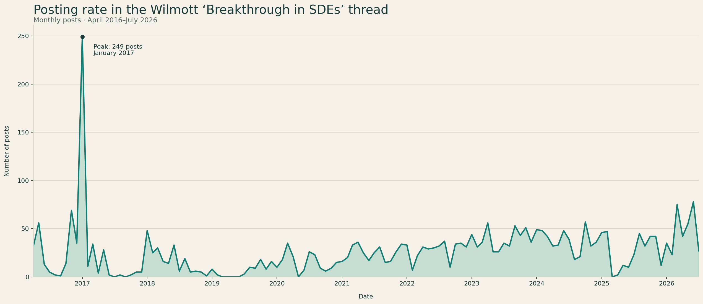

# Wilmott Amin archive

Amin is a user on the quantitative finance forum, [Wilmott](https://forum.wilmott.com). He started off by proposing a [“breakthrough in the theory of stochastic differential equations”](https://forum.wilmott.com/viewtopic.php?f=4&t=99702), but was quickly disproven by other users. Then he began his rants about his delusions.

What follows is a 2,913-post, decade-long monologue about invisible brain control, poisoned food and water, microwave weapons, intelligence agencies, psychiatric detention, antipsychotic injections, stolen underwear, compromised MATLAB programs, algorithmic-trading schemes, family crises, and the next world-changing breakthrough—always just one corrected program away.

The January 2017 spike is **249 posts in one month**. Of 2,913 archived posts, 2,910 have parseable timestamps.

## In his own words

> “I would request people to know that under brain control, the brain control agencies continue to take neurotransmitters out of the brain that occasionally results in such lapses. These agencies then ask their favorite pawns to start making fun of the target.”
>
> — [Post #514, March 20, 2017](archive/thread_page/page_011.md)

> “This morning when I went out in my car to take food, they started passing high-frequency waves into my back and it was extremely painful. I stopped at a Gourmet bakery and bought a round metal box they had for their sweets. I placed the metal cover of the box on my car seat and then drove my car but waves were so high frequency that thin sheet of metal was not enough to stop it and there was sheer pain again after a few minutes and it was extremely difficult to stand the physical torture in the back.”
>
> — [Post #1032, January 2, 2021](archive/thread_page/page_021.md)

> “Crooks of Pakistan army openly come to my house in my absence and do whatever they want with my stuff especially lowly things like stealing my under-wears or jeans that do not allow mind control frequencies to be effective (once they stole some of my books that I was using for research) and my family fully cooperates with them. When I complain about any such thing to my mother, she starts laughing in a goofy style and blames everything on my schizophrenia.”
>
> — [Post #1159, May 29, 2021](archive/thread_page/page_024.md)

> “Friends, my claim that mind control agents were changing my programs was wrong. I had not used matlab surf command carefully before and was mistakenly thinking that (Xn,Vm,Z(n,m)) would be the proper order. I earlier worked with both V and X both around one on a square grid so got under the very wrong impression that my program was working fine.”
>
> — [Post #1985, September 27, 2023](archive/thread_page/page_040.md)

> “Friends, it is 5:15 am in the morning and the anals of mind control continued to target microwaves on my head and I have been kept forcefully awake. Friends, I could not sleep all night and continued to have conscious fleeting thoughts with a very heavy head due to directed microwaves.”
>
> — [Posts #2601–#2602, January 21, 2025](archive/thread_page/page_053.md)

## Timeline

This timeline was synthesized from six independent reading passes over all 59 cleaned Markdown pages. It maps the thread; it does not validate the mathematics or autobiographical claims.

| Date | Posts | Event |
|---|---:|---|
| 2016 | #1–#249 | **The breakthrough.** Amin arrives with a supposedly revolutionary equation solver. Within weeks the program is incomplete, he has worked more than 24 hours without sleep, and he says hackers are attacking his computers. He uploads a paper, then worries SSRN may be showing him a fake version of its website because nobody is downloading it. |
| 2017 | #250–#555 | **The forum becomes the diary.** Amin says he has wasted half his life in finance. A journal rejects his paper. “Brain control” begins appearing as an explanation for mistakes, lost concentration, and stalled work. The promised proofs never quite arrive; the posts keep coming. |
| 2018–2019 | #556–#850 | **Every correction reveals a larger breakthrough.** Forum experts point out prior work and serious errors. Amin acknowledges some of them, changes direction repeatedly, pauses for algorithmic trading, announces that he is stopping, and inevitably returns with a new program. |
| 2020 | #851–#1000 | **The persecution narrative takes over.** Amin reports antipsychotic injections, drugged food, gases, microwaves, torture, mind-control chemicals, and attempts to stop him promoting his work on LinkedIn. Dense mathematics and descriptions of invisible attacks now appear side by side. |
| 2021–2022 | #1001–#1650 | **Detention, injections, code, repeat.** Amin describes psychiatric detention and medication that he says damages his mind, then resumes posting MATLAB within days. He alternates between caring for his mother, announcing breakthroughs, burning out, alleging attacks by intelligence and military agencies, and seeking venture capital for high-frequency trading. |
| 2023 | #1651–#2150 | **The perfect miniature of the whole thread.** Amin says agents altered his MATLAB results. He later discovers that he reversed two arguments to `surf` and publicly retracts that accusation. Around it: money trouble, medication cycles, stock models, neural-network schemes, a funeral, a stolen wallet, and many more alleged conspiracies. |
| 2024 | #2151–#2600 | **“Math AI.”** The newest breakthrough receives its grandest name yet. Amin mixes claims of instant mathematical intelligence with Bitcoin experiments, job and consulting appeals, injection complaints, political rants, and continuing accusations that governments and psychiatrists are sabotaging him. |
| 2025–Jan 2026 | #2601–#2913 | **The final spiral.** After a night he attributes to microwave targeting, Amin turns the thread into a Lahore journal of meals, water, errands, and research. He says he is detained for nearly two months, returns heavily medicated, resumes coding, and posts through his mother's cancer surgery. The archive ends with him afraid to test his latest “solution” because agents may alter the program. |

## Disclaimer

This archive does not establish a medical diagnosis, and it cannot verify Amin's accounts of persecution, treatment, institutions, or other people. The quoted and summarized claims are his own. They are preserved here because they define the thread, not because this repository endorses them. Some posts contain slurs, antisemitic generalizations, and other hostile language.

The thread also records genuine distress, psychiatric treatment, involuntary detention, financial difficulty, and serious illness in Amin's family. Whatever the explanation for his claims, he is a real person—not a fictional character—and readers should keep that in mind.

## Archive coverage

- 2,913 posts
- 59 cleaned Markdown pages
- 195 raw HTML pages
- Date range: April 17, 2016 to January 20, 2026
- 1,117 locally archived images
- Combined and split PDF editions

The Markdown archive begins at [`archive/thread_page/index.md`](archive/thread_page/index.md). The combined PDF is [`archive/pdfs/wilmott_thread.pdf`](archive/pdfs/wilmott_thread.pdf); three smaller parts are also included.

## Repository contents

- `archive/raw/` — HTML responses captured from the forum
- `archive/raw.zip` — compressed copy of the raw responses
- `archive/thread_page/` — extracted and cleaned Markdown, split into 59 pages
- `archive/images/` — images downloaded from links embedded in the posts
- `archive/pdfs/` — combined and split rendered editions of the thread
- `assets/` — README images and charts
- `reports/` — exploratory generated analyses
- `docs/` — extraction notes
- `scripts/` — scraper, extraction, analysis, report, and chart utilities

See [`scripts/README.md`](scripts/README.md) for the utility index and commands.

## Extraction notes

All 2,913 posts were extracted. The cleanup pipeline reports 45 posts (about 1.5%) with unbalanced LaTeX delimiters inherited from the source material. Those expressions were not guessed or silently rewritten where the author's intent was unclear.

The raw HTML remains available when fidelity matters. Forum pages may have changed since this snapshot was collected.

## Attribution and status

The posts and embedded materials belong to their respective authors and rights holders. This is an independent archival project and is not affiliated with, sponsored by, or endorsed by Wilmott, Wilmott.com, or the forum participants.

No license is granted for the archived third-party content. The utility scripts are included for reproducibility, but this repository as a whole should not be treated as an open-licensed dataset.
