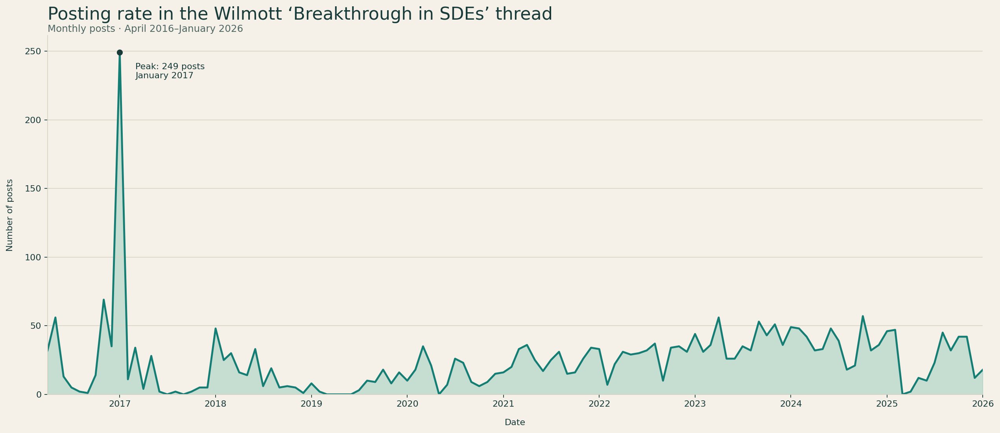

# Wilmott Amin archive

This repository is an archival copy of the Wilmott Technical Forum thread
[*Breakthrough in the theory of stochastic differential equations and their simulation*](https://forum.wilmott.com/viewtopic.php?f=4&t=99702).

The thread was started by the forum user **Amin** and combines proposed mathematics about stochastic differential equations and simulation with extensive personal writing. This repository preserves the public discussion for easier reading and analysis. Inclusion here does not endorse or verify any mathematical, medical, political, or personal claims made in the posts.

## Coverage

- 2,913 posts
- 59 cleaned Markdown pages
- 195 raw HTML pages
- Date range: April 17, 2016 to January 20, 2026
- 1,117 locally archived images
- Combined and split PDF editions

The Markdown archive begins at [`thread_page/index.md`](thread_page/index.md). The combined PDF is [`wilmott_thread.pdf`](wilmott_thread.pdf); three smaller parts are also included.

## Summary

The thread begins in April 2016 as Amin's attempt to present a purportedly general, arbitrarily accurate method for simulating stochastic differential equations. Over almost ten years it becomes a public research diary. The mathematical program repeatedly changes form—iterated stochastic integrals, ODE series, Fokker–Planck solvers, equal-probability grids, Hermite and Z-series density representations, moment and cumulant calibration, multidimensional conditional densities, trading models, and finally an interpretable regression system he calls “Math AI.”

The characteristic rhythm is conjecture, MATLAB prototype, numerical graph, strong announcement, discovery of an error or instability, and a revised method. Knowledgeable forum respondents are active early, challenging novelty, convergence, error bounds, and comparisons with established methods. Later, the thread is overwhelmingly a solo diary.

Alongside the mathematics, Amin writes extensively about family, money, psychiatric treatment, involuntary detention, and alleged surveillance, drugging, electronic attacks, and institutional persecution. Those statements are Amin's reports and beliefs; the archive does not independently corroborate them. Some posts contain hostile political language and antisemitic generalizations.

## Timeline

This timeline was synthesized from six independent reading passes over all 59 cleaned Markdown pages. It maps the thread; it does not validate the mathematics or autobiographical claims.

| Date | Posts | Event |
|---|---:|---|
| Apr 17, 2016 | #1 onward | Amin opens the thread with a claimed generic SDE simulation method based on repeated Ito expansion, frozen derivatives, nested stochastic integrals, and Gaussian/Hermite representations. Respondents immediately ask about convergence and known numerical schemes. |
| May–Jun 2016 | #34–#100 | Early numerical experiments expose bias and incomplete formulas. Amin revises the method, introduces “Stochastic Calculus of Standard Deviations,” and names a broader “Method of Iterated Integrals.” |
| Nov 2016–Jan 2017 | #124–#364 | The focus pivots from SDE simulation to a purported general ODE series method. Amin posts an SSRN paper; extended forum debate centers on Picard/Taylor antecedents, existence, uniqueness, stability, remainder bounds, and the lack of decisive benchmarks. |
| Mar 2017 | #492 | Amin reports that *Numerische Mathematik* declined the ODE paper and asks where else to submit it. |
| Aug 2017–Feb 2018 | #556–#625 | He revives “SCSD,” develops density and option-pricing programs, and claims joint transition laws can be recovered from marginal CDF grids. Forum users object that marginals do not determine a joint distribution. A new SSRN paper follows. |
| Mar–May 2018 | #645–#693 | Amin builds symbolic arbitrary-order Ito expansions, then acknowledges Kloeden and Platen's prior work and corrects his attribution. He also retracts the assumption that mixed `dt`/`dz` iterated integrals commute. |
| Mid-2018–2019 | #766–#840 | Research shifts toward Ito–Hermite density evolution, Lamperti/Bessel coordinates, moment corrections, direct Fokker–Planck solvers, and fixed transition-probability grids. Numerous instability fixes follow. |
| 2020 | #859–#1000 | Hermite density and path-integral work continues. Personal allegations about mind control, electronic attacks, medication, and interference become increasingly prominent. |
| Oct–Dec 2020 | #1001–#1025 | Amin announces, retracts, and revises a variance-preserving transition method, then constructs discrete transition grids constrained by normalization and successive moments. |
| Jan–Mar 2021 | #1040–#1080 | While describing his mother's heart surgery and his own psychiatric treatment and detention, Amin develops covariance and Bessel-coordinate mass-transfer programs and reports improved density accuracy. |
| Apr–Dec 2021 | #1101–#1300 | The program expands through Ito–Hermite/Z-series transformations, trading filters, and two-dimensional stochastic-volatility Fokker–Planck systems benchmarked against Monte Carlo. |
| Dec 2021–Jul 2022 | #1302–#1500 | “Overlaid” Fokker–Planck equations evolve into cumulant matching and Z-series/path-integral machinery. A difficult 2D volatility episode leads to burnout, followed by a pivot to fitting general densities from moments and cumulants. |
| Jul–Dec 2022 | #1501–#1654 | Amin releases six-, seven-, and eight-cumulant calibration code, adds Newton stabilization, and broadens the toolkit to transformations, CDFs, option Greeks, and SDE evolution. |
| Feb–May 2023 | #1705–#1840 | He replaces single Pearson correlations with order-by-order Hermite correlations, develops constrained moment matching and non-Gaussian regression, and proposes “Z-series neural networks.” |
| Sep–Oct 2023 | #1956–#2000 | A major move to bivariate Hermite/Z-series representations for stochastic-volatility densities. Amin retracts one program-tampering allegation after finding a MATLAB `surf` argument-order mistake. |
| Oct 2023–Mar 2024 | #2005–#2229 | Conditional density becomes the central problem: cross moments, decorrelated residuals, regression-based conditioning, “Hermite-state transitions,” and proposed multidimensional generalization. |
| May–Aug 2024 | #2317–#2432 | The machinery is applied to option payoffs, intraday stock data, Bitcoin, and mean-reversion strategies. Amin consolidates the Z-series/Hermite work into a paper and reports posting a revised SSRN version. |
| Sep–Oct 2024 | #2437–#2511 | He trains polynomial regressions from randomized SDE parameters to density coefficients and introduces “Math AI,” later reporting better fits from Hermite rather than Legendre regression. |
| Nov 2024–Feb 2025 | #2517–#2653 | “Math AI” develops into explicit inverse transformations and dynamic Hermite-coefficient models, then a two-dimensional joint/conditional series. |
| Feb 25–Apr 18, 2025 | #2673–#2676 | Amin says he was involuntarily detained without access to his phone or laptop and that medication made research difficult after he returned home. This account is not independently verified here. |
| Aug–Oct 2025 | #2734–#2817 | He resumes intensive work on stable 2D Hermite calibration: Newton-like iteration, smoothing, tail correction, alternative optimizers, and a proposed recursive multidimensional construction. |
| Sep–Dec 2025 | #2778–#2892 | Amin reports his mother's stroke risk, carotid blockage, breast-cancer diagnosis, and December surgery while continuing the research. These details come only from his posts. |
| Nov 2025–Jan 2026 | #2869–#2913 | He calls a 6×6 Hermite calibration framework a milestone, documents further failed or unstable variants, and announces another systematic cross-moment solution. The archive ends with the method still being revised. |

## Posting rate

The chart counts all timestamped posts in the thread by month. Of 2,913 archived posts, 2,910 have timestamps parsed by the analysis script.

## Repository contents

- `raw/` — HTML responses captured from the forum
- `raw.zip` — compressed copy of the raw responses
- `thread_page/` — extracted and cleaned Markdown, split into 59 pages
- `images/` — images downloaded from links embedded in the posts
- `scripts/` — scraper, extraction, analysis, report, and chart utilities
- `wilmott_thread*.pdf` — rendered editions of the thread
- `wilmott_analysis.pdf` and `amin_report.pdf` — exploratory reports generated from the archive
- `posting_rate.png` — monthly posting-rate chart

See [`scripts/README.md`](scripts/README.md) for the utility index and commands.

## Extraction notes

All 2,913 posts were extracted. The cleanup pipeline reports 45 posts (about 1.5%) with unbalanced LaTeX delimiters inherited from the source material. Those expressions were not guessed or silently rewritten where the author's intent was unclear.

The raw HTML remains available when fidelity matters. Forum pages may have changed since this snapshot was collected.

## Attribution and status

The posts and embedded materials belong to their respective authors and rights holders. This is an independent archival project and is not affiliated with, sponsored by, or endorsed by Wilmott, Wilmott.com, or the forum participants.

No license is granted for the archived third-party content. The utility scripts are included for reproducibility, but this repository as a whole should not be treated as an open-licensed dataset.
