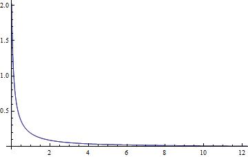
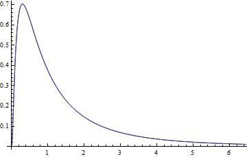
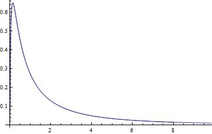
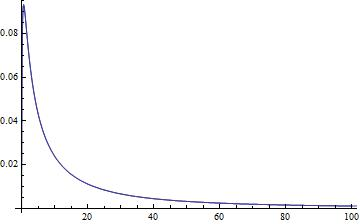

# Breakthrough in the theory of stochastic differential equations and their simulation

**Page 14 of 59** — Posts #651–#700

[← Previous](page_013.md) | [Index](index.md) | [Next →](page_015.md)

---

### #651 — Amin (Topic Author)
*March 7, 2018, 6:10 PM*

**(broken latex: Unbalanced $$: 1)**

```latex
> Instead of Black Scholes, I was a little more bold and tried solution of CEV noise fokker planck pde. I have given
initial steps and I will complete full numerical analysis tomorrow.
>
>
>
> We try to find the solution of following fokker planck equation
>
>
$\frac{\partial p}{\partial t}=.5 \sigma ^2\frac{\partial ^2\left[x^{2\gamma }p\right]}{\partial x^2}=.5 \sigma ^2x^{2\gamma }\frac{\partial ^2p}{\partial x^2}+2\gamma \sigma ^2x^{2\gamma -1}\frac{\partial p}{\partial x}+\gamma \sigma ^2(2\gamma -1)x^{2\gamma -2}p$
Equation(1)
>
>
>
> We change coordinates from p(x,t) to$\text{w(}\zeta\text{,t)}$ such that$\text{p(x,t)=w(}\zeta\text{,t)}$ We have
after the change of coordinates
>
> $\frac{\partial p}{\partial x}=\frac{\partial w}{\partial \zeta }\frac{\partial \zeta }{\partial x}$
>
>
$\frac{\partial p}{\partial t}=\frac{\partial w}{\partial \zeta }\frac{\partial \zeta }{\partial t}+\frac{\partial w}{\partial t}$
>
>
$\frac{\partial ^2p}{\partial x^2}=\frac{\partial ^2w}{\partial \zeta ^2}\left(\frac{\partial \zeta }{\partial x}\right)^2+\frac{\partial w}{\partial \zeta }\frac{\partial ^2\zeta }{\partial x^2}$
Equations(2)
>
>
>
> Substituting Equations(2) in Equation(1), we get
>
>
$\frac{\partial w}{\partial t}=.5 \sigma ^2x^{2\gamma }(\frac{\partial \zeta }{\partial x})^2\frac{\partial ^2w}{\partial \zeta ^2}+\left.(.5 \sigma ^2x^{2\gamma }\frac{\partial ^2\zeta }{\partial x^2}-\frac{\partial \zeta }{\partial t}+2\gamma \sigma ^2x^{2\gamma -1}\frac{\partial \zeta }{\partial x}\right)\frac{\partial w}{\partial \zeta }$
>
> $+\gamma \sigma ^2(2\gamma -1)x^{2\gamma -2}w$ Equation(3)
>
>
>
> We want to convert the transformed equation(3) into standard heat equation in new coordinates. Assuming we can
successfully do that we will get a standard brownian motion as the solution to heat equation in new coordinates.
>
> For that to happen, we will have to impose the conditions
>
> $.5 \sigma ^2x^{2\gamma }(\frac{\partial \zeta }{\partial x})^2=1$  Equation(4)
>
>
$\left.(.5 \sigma ^2x^{2\gamma }\frac{\partial ^2\zeta }{\partial x^2}-\frac{\partial \zeta }{\partial t}+2\gamma \sigma ^2x^{2\gamma -1}\frac{\partial \zeta }{\partial x}\right)\frac{\partial w}{\partial \zeta }+\gamma \sigma ^2(2\gamma -1)x^{2\gamma -2}w=0$
Equation(5)
>
>
>
> But we also know once we have satisfied the above conditions, as we stated earlier we will get a standard brownian
motion as the solution to heat equation in new coordinates.
>
> $w=\frac{1}{\sqrt{4\text{pi} t}}\text{Exp}\left[-\frac{\zeta ^2}{4t}\right]$  Equation(6)
>
>
$\frac{\partial w}{\partial \zeta }=\frac{1}{\sqrt{4\text{pi} t}}\text{Exp}\left[-\frac{\zeta ^2}{4t}\right]\left(-\frac{\zeta }{2t}\right)$
Equation(7)
>
>
>
> From Equation (4) , we get
>
> $\frac{\partial \zeta }{\partial x}=\frac{1}{\sqrt{.5 }\sigma\text{x}^{\gamma }}$ Equation(8)
>
> From above equation
>
>$\zeta (x)=\frac{x^{1-\gamma }}{\sqrt{.5 }\sigma (1-\gamma )}-\frac{x_0{}^{1-\gamma }}{\sqrt{.5 }\sigma (1-\gamma )}$
Equation(9)
>
> $\frac{\partial ^2\zeta }{\partial x^2}=\frac{(-\gamma )}{\sqrt{.5 }\sigma\text{x}^{\gamma +1}}$ Equation(10)
>
> Putting Equations (6) and (7) in Equaiton(5) and simplifying to cancel the exponential, we get
>
>
$\left.(.5 \sigma ^2x^{2\gamma }\frac{\partial ^2\zeta }{\partial x^2}-\frac{\partial \zeta }{\partial t}+2\gamma \sigma ^2x^{2\gamma -1}\frac{\partial \zeta }{\partial x}\right)\left(-\frac{\zeta }{2t}\right)+\gamma \sigma ^2(2\gamma -1)x^{2\gamma -2}=0$
Equation(11)
>
> We try to solve the following ODE  which can be solved for both zeta or x.(I will attempt to give the complete
solution tomorrow but we will have to convert the eqution into zeta or x because a map between both variables exists as
given by equation(9) for example.
>
>
$\frac{\partial \zeta }{\partial t}=\left.(.5 \sigma ^2x^{2\gamma }\frac{\partial ^2\zeta }{\partial x^2}+2\gamma \sigma ^2x^{2\gamma -1}\frac{\partial \zeta }{\partial x}\right)-\left(\frac{2t}{\zeta }\right)\gamma \sigma ^2(2\gamma -1)x^{2\gamma -2}$
>
>
>
> I will try to give complete numerically worked out solution tomorrow. The PDE can then easily be solved in the light
of example I cited in the previous post. Here is the reference again. Please look at equation 4.24 in example 4.7 on
page 48 of the book, "Essential partial differential equations: Analytical and computational aspects" by David F.
Griffiths, John W. Dold, and David J. Silvester. I followed the reference in the above derivation.
I have tried to solve the fokker-planck PDE related to driftless CEV diffusion. Here is the steps I have taken for the
solution. Unlike the above analysis, I used the standard definition of normal with .5 in the exponential and .5 in the
standard heat equation.

The equation (3) in the quoted post above becomes

$\frac{\partial w}{\partial t}=.5 \sigma ^2x^{2\gamma }(\frac{\partial \zeta }{\partial x})^2\frac{\partial ^2w}{\partial \zeta ^2}+\left.(.5 \sigma ^2x^{2\gamma }\frac{\partial ^2\zeta }{\partial x^2}-\frac{\partial \zeta }{\partial t}+2\gamma \sigma ^2x^{2\gamma -1}\frac{\partial \zeta }{\partial x}\right)\frac{\partial w}{\partial \zeta }$

$+\gamma \sigma ^2(2\gamma -1)x^{2\gamma -2}w$   Equation(1)

We want to convert the transformed equation into standard heat equation in new coordinates. Assuming we can successfully
do that we will get a standard brownian motion as the solution to heat equation in new coordinates. For that to happen,
we will have to impose the conditions

$\sigma ^2x^{2\gamma }\left(\frac{\partial \zeta }{\partial x}\right)^2=1$   Equation(2)

$\left.(.5 \sigma ^2x^{2\gamma }\frac{\partial ^2\zeta }{\partial x^2}-\frac{\partial \zeta }{\partial t}+2\gamma \sigma ^2x^{2\gamma -1}\frac{\partial \zeta }{\partial x}\right)\frac{\partial w}{\partial \zeta }+\gamma \sigma ^2(2\gamma -1)x^{2\gamma -2}w=0$
Equation(3)

But we also know once we have satisfied the above conditions,

$w=\frac{1}{\sqrt{2\text{pi} t}}\text{Exp}\left[-\frac{\zeta ^2}{2t}\right]$ Equation(4)

$\frac{\partial w}{\partial \zeta }=\frac{1}{\sqrt{2\text{pi} t}}\text{Exp}\left[-\frac{\zeta ^2}{2t}\right]\left(-\frac{\zeta }{t}\right)$
Equation(5)

From equation(2) above, we can find the following three equations

$\frac{\partial \zeta }{\partial x}=\frac{1}{\sigma\text{x}^{\gamma }}$  Equation(6)

$\zeta (x,0)=\frac{x^{1-\gamma }}{\sigma (1-\gamma )}-\frac{x_0{}^{1-\gamma }}{\sigma (1-\gamma )}$   Equation(7)

$\frac{\partial ^2\zeta }{\partial x^2}=\frac{(-\gamma )}{\sigma\text{x}^{\gamma +1}}$   Equation(8)

From equation(3), we derive the following equation

$$

\frac{\partial \zeta }{\partial t}=\left.(.5 \sigma ^2x^{2\gamma }\frac{\partial ^2\zeta }{\partial x^2}+2\gamma \sigma ^2x^{2\gamma -1}\frac{\partial \zeta }{\partial x}\right)$

$-\left(\frac{t}{\zeta }\right)\gamma \sigma ^2(2\gamma -1)x^{2\gamma -2}$   Equation(9)

which simplifies in the case of driftless diffusion where we have to account only for second order derivative as

$\frac{\partial \zeta }{\partial t}=.5 \sigma ^2x^{2\gamma }\frac{\partial ^2\zeta }{\partial x^2}-\left(\frac{t}{\zeta }\right)\gamma \sigma ^2(2\gamma -1)x^{2\gamma -2}$ Equation(10)

using equation(6), we get from equation(10)

$\frac{\partial \zeta }{\partial t}=-.5 \sigma \gamma x^{\gamma -1}-\left(\frac{t}{\zeta }\right)\gamma \sigma ^2(2\gamma -1)x^{2\gamma -2}$ Equation(11)

From equation(7), we get the inverse map from zeta to x which is valid at time zero

$x=\left[\sigma (1-\gamma )\left(\zeta (x,0)+\frac{x_0{}^{1-\gamma }}{\sigma (1-\gamma )}\right)\right]{}^{\frac{1}{(1-\gamma )}}$  Equation(12)

using the above inverse map, we get from equation (11), the following ode

$\frac{\partial \zeta }{\partial t}=-.5 \sigma  \gamma \left[\sigma (1-\gamma )\left(\zeta (x,0)+\frac{x_0{}^{1-\gamma }}{\sigma (1-\gamma )}\right)\right]{}^{-1}$

$-\left(\frac{t}{\zeta }\right)\gamma \sigma ^2(2\gamma -1)[\sigma (1-\gamma )\left(\zeta (x,0)+\frac{x_0{}^{1-\gamma }}{\sigma (1-\gamma )}\right)]{}^{-2}$

We can very easily solve the above ordinary differential equation with method of iterated integrals in terms of general initial value. I would like the friends to recall that in the method of iterated integrals the series solution only depends on initial values of the dependent variable which are handily available in almost all the cases. The right initial value would usually be $\zeta (x,0)=0$  which will make many terms in the series expansion solution singular but once we change coordinates back to x  from equation (12), after the solution of ODE in zeta without giving numerical value of zeta(0) in the solution from the method of iterated integrals, the right initial value in terms of x would be x(0) which will give us a very valid solution.
I made this post about semi-analytic solution to Fokker-Planck PDEs. I hope to code it in matlab for a fairly general PDE and post it here on Wilmott. There will be very minor changes to the above derivation.
```

---

### #652 — Amin (Topic Author)
*March 9, 2018, 7:02 AM*

I made some changes in the paper. Some wording in the abstract and the paper was ambiguous and could be wrongly interpreted. Here is the link to paper. [https://papers.ssrn.com/sol3/papers.cfm ... id=3133959](https://papers.ssrn.com/sol3/papers.cfm?abstract_id=3133959)

Abstract

In this article we suggest a new method for solutions of stochastic integrals where the dynamics of the variables in
integrand are given by some stochastic differential equation. We also propose numerical simulation of stochastic
differential equations which is based on iterated integrals method employing Ito change of variable expansion of the
drift and volatility function of the SDE. Method of iterated integrals is a method of solution of integrals in which we
repeatedly expand different terms in the integral as an initial value and an integrated derivative so that their sum
would equal the original term in the integrand that was expanded. We continue to repeatedly expand the integrals until
we have enough accuracy in the terms evaluated at initial values so as to be able to neglect the highest derivative
term. We evaluate all these iterated integrals terms at the initial time of the simulation along with the solution of
the stochastic integrals which is found in terms of Hermite polynomials and variance of the integrals. We apply the
method of iterated integrals to simulation of various stochastic differential equations. We find that the accuracy of
simulation sharply increases using the method of iterated integral as compared to naïve and simple monte carlo
simulation methods.

---

### #653 — Amin (Topic Author)
*March 12, 2018, 7:39 AM*

**(broken latex: Unbalanced $$: 1)**

```latex
> Instead of Black Scholes, I was a little more bold and tried solution of CEV noise fokker planck pde. I have given
initial steps and I will complete full numerical analysis tomorrow.
>
>
>
> We try to find the solution of following fokker planck equation
>
>
$\frac{\partial p}{\partial t}=.5 \sigma ^2\frac{\partial ^2\left[x^{2\gamma }p\right]}{\partial x^2}=.5 \sigma ^2x^{2\gamma }\frac{\partial ^2p}{\partial x^2}+2\gamma \sigma ^2x^{2\gamma -1}\frac{\partial p}{\partial x}+\gamma \sigma ^2(2\gamma -1)x^{2\gamma -2}p$
Equation(1)
>
>
>
> We change coordinates from p(x,t) to$\text{w(}\zeta\text{,t)}$ such that$\text{p(x,t)=w(}\zeta\text{,t)}$ We have
after the change of coordinates
>
> $\frac{\partial p}{\partial x}=\frac{\partial w}{\partial \zeta }\frac{\partial \zeta }{\partial x}$
>
>
$\frac{\partial p}{\partial t}=\frac{\partial w}{\partial \zeta }\frac{\partial \zeta }{\partial t}+\frac{\partial w}{\partial t}$
>
>
$\frac{\partial ^2p}{\partial x^2}=\frac{\partial ^2w}{\partial \zeta ^2}\left(\frac{\partial \zeta }{\partial x}\right)^2+\frac{\partial w}{\partial \zeta }\frac{\partial ^2\zeta }{\partial x^2}$
Equations(2)
>
>
>
> Substituting Equations(2) in Equation(1), we get
>
>
$\frac{\partial w}{\partial t}=.5 \sigma ^2x^{2\gamma }(\frac{\partial \zeta }{\partial x})^2\frac{\partial ^2w}{\partial \zeta ^2}+\left.(.5 \sigma ^2x^{2\gamma }\frac{\partial ^2\zeta }{\partial x^2}-\frac{\partial \zeta }{\partial t}+2\gamma \sigma ^2x^{2\gamma -1}\frac{\partial \zeta }{\partial x}\right)\frac{\partial w}{\partial \zeta }$
>
> $+\gamma \sigma ^2(2\gamma -1)x^{2\gamma -2}w$ Equation(3)
>
>
>
> We want to convert the transformed equation(3) into standard heat equation in new coordinates. Assuming we can
successfully do that we will get a standard brownian motion as the solution to heat equation in new coordinates.
>
> For that to happen, we will have to impose the conditions
>
> $.5 \sigma ^2x^{2\gamma }(\frac{\partial \zeta }{\partial x})^2=1$  Equation(4)
>
>
$\left.(.5 \sigma ^2x^{2\gamma }\frac{\partial ^2\zeta }{\partial x^2}-\frac{\partial \zeta }{\partial t}+2\gamma \sigma ^2x^{2\gamma -1}\frac{\partial \zeta }{\partial x}\right)\frac{\partial w}{\partial \zeta }+\gamma \sigma ^2(2\gamma -1)x^{2\gamma -2}w=0$
Equation(5)
>
>
>
> But we also know once we have satisfied the above conditions, as we stated earlier we will get a standard brownian
motion as the solution to heat equation in new coordinates.
>
> $w=\frac{1}{\sqrt{4\text{pi} t}}\text{Exp}\left[-\frac{\zeta ^2}{4t}\right]$  Equation(6)
>
>
$\frac{\partial w}{\partial \zeta }=\frac{1}{\sqrt{4\text{pi} t}}\text{Exp}\left[-\frac{\zeta ^2}{4t}\right]\left(-\frac{\zeta }{2t}\right)$
Equation(7)
>
>
>
> From Equation (4) , we get
>
> $\frac{\partial \zeta }{\partial x}=\frac{1}{\sqrt{.5 }\sigma\text{x}^{\gamma }}$ Equation(8)
>
> From above equation
>
>$\zeta (x)=\frac{x^{1-\gamma }}{\sqrt{.5 }\sigma (1-\gamma )}-\frac{x_0{}^{1-\gamma }}{\sqrt{.5 }\sigma (1-\gamma )}$
Equation(9)
>
> $\frac{\partial ^2\zeta }{\partial x^2}=\frac{(-\gamma )}{\sqrt{.5 }\sigma\text{x}^{\gamma +1}}$ Equation(10)
>
> Putting Equations (6) and (7) in Equaiton(5) and simplifying to cancel the exponential, we get
>
>
$\left.(.5 \sigma ^2x^{2\gamma }\frac{\partial ^2\zeta }{\partial x^2}-\frac{\partial \zeta }{\partial t}+2\gamma \sigma ^2x^{2\gamma -1}\frac{\partial \zeta }{\partial x}\right)\left(-\frac{\zeta }{2t}\right)+\gamma \sigma ^2(2\gamma -1)x^{2\gamma -2}=0$
Equation(11)
>
> We try to solve the following ODE  which can be solved for both zeta or x.(I will attempt to give the complete
solution tomorrow but we will have to convert the eqution into zeta or x because a map between both variables exists as
given by equation(9) for example.
>
>
$\frac{\partial \zeta }{\partial t}=\left.(.5 \sigma ^2x^{2\gamma }\frac{\partial ^2\zeta }{\partial x^2}+2\gamma \sigma ^2x^{2\gamma -1}\frac{\partial \zeta }{\partial x}\right)-\left(\frac{2t}{\zeta }\right)\gamma \sigma ^2(2\gamma -1)x^{2\gamma -2}$
>
>
>
> I will try to give complete numerically worked out solution tomorrow. The PDE can then easily be solved in the light
of example I cited in the previous post. Here is the reference again. Please look at equation 4.24 in example 4.7 on
page 48 of the book, "Essential partial differential equations: Analytical and computational aspects" by David F.
Griffiths, John W. Dold, and David J. Silvester. I followed the reference in the above derivation.
I have tried to solve the fokker-planck PDE related to driftless CEV diffusion. Here is the steps I have taken for the
solution. Unlike the above analysis, I used the standard definition of normal with .5 in the exponential and .5 in the
standard heat equation.

The equation (3) in the quoted post above becomes

$\frac{\partial w}{\partial t}=.5 \sigma ^2x^{2\gamma }(\frac{\partial \zeta }{\partial x})^2\frac{\partial ^2w}{\partial \zeta ^2}+\left.(.5 \sigma ^2x^{2\gamma }\frac{\partial ^2\zeta }{\partial x^2}-\frac{\partial \zeta }{\partial t}+2\gamma \sigma ^2x^{2\gamma -1}\frac{\partial \zeta }{\partial x}\right)\frac{\partial w}{\partial \zeta }$

$+\gamma \sigma ^2(2\gamma -1)x^{2\gamma -2}w$   Equation(1)

We want to convert the transformed equation into standard heat equation in new coordinates. Assuming we can successfully
do that we will get a standard brownian motion as the solution to heat equation in new coordinates. For that to happen,
we will have to impose the conditions

$\sigma ^2x^{2\gamma }\left(\frac{\partial \zeta }{\partial x}\right)^2=1$   Equation(2)

$\left.(.5 \sigma ^2x^{2\gamma }\frac{\partial ^2\zeta }{\partial x^2}-\frac{\partial \zeta }{\partial t}+2\gamma \sigma ^2x^{2\gamma -1}\frac{\partial \zeta }{\partial x}\right)\frac{\partial w}{\partial \zeta }+\gamma \sigma ^2(2\gamma -1)x^{2\gamma -2}w=0$
Equation(3)

But we also know once we have satisfied the above conditions,

$w=\frac{1}{\sqrt{2\text{pi} t}}\text{Exp}\left[-\frac{\zeta ^2}{2t}\right]$ Equation(4)

$\frac{\partial w}{\partial \zeta }=\frac{1}{\sqrt{2\text{pi} t}}\text{Exp}\left[-\frac{\zeta ^2}{2t}\right]\left(-\frac{\zeta }{t}\right)$
Equation(5)

From equation(2) above, we can find the following three equations

$\frac{\partial \zeta }{\partial x}=\frac{1}{\sigma\text{x}^{\gamma }}$  Equation(6)

$\zeta (x,0)=\frac{x^{1-\gamma }}{\sigma (1-\gamma )}-\frac{x_0{}^{1-\gamma }}{\sigma (1-\gamma )}$   Equation(7)

$\frac{\partial ^2\zeta }{\partial x^2}=\frac{(-\gamma )}{\sigma\text{x}^{\gamma +1}}$   Equation(8)

From equation(3), we derive the following equation

$$

\frac{\partial \zeta }{\partial t}=\left.(.5 \sigma ^2x^{2\gamma }\frac{\partial ^2\zeta }{\partial x^2}+2\gamma \sigma ^2x^{2\gamma -1}\frac{\partial \zeta }{\partial x}\right)$

$-\left(\frac{t}{\zeta }\right)\gamma \sigma ^2(2\gamma -1)x^{2\gamma -2}$   Equation(9)

which simplifies in the case of driftless diffusion where we have to account only for second order derivative as

$\frac{\partial \zeta }{\partial t}=.5 \sigma ^2x^{2\gamma }\frac{\partial ^2\zeta }{\partial x^2}-\left(\frac{t}{\zeta }\right)\gamma \sigma ^2(2\gamma -1)x^{2\gamma -2}$ Equation(10)

using equation(6), we get from equation(10)

$\frac{\partial \zeta }{\partial t}=-.5 \sigma \gamma x^{\gamma -1}-\left(\frac{t}{\zeta }\right)\gamma \sigma ^2(2\gamma -1)x^{2\gamma -2}$ Equation(11)

From equation(7), we get the inverse map from zeta to x which is valid at time zero

$x=\left[\sigma (1-\gamma )\left(\zeta (x,0)+\frac{x_0{}^{1-\gamma }}{\sigma (1-\gamma )}\right)\right]{}^{\frac{1}{(1-\gamma )}}$  Equation(12)

using the above inverse map, we get from equation (11), the following ode

$\frac{\partial \zeta }{\partial t}=-.5 \sigma  \gamma \left[\sigma (1-\gamma )\left(\zeta (x,0)+\frac{x_0{}^{1-\gamma }}{\sigma (1-\gamma )}\right)\right]{}^{-1}$

$-\left(\frac{t}{\zeta }\right)\gamma \sigma ^2(2\gamma -1)[\sigma (1-\gamma )\left(\zeta (x,0)+\frac{x_0{}^{1-\gamma }}{\sigma (1-\gamma )}\right)]{}^{-2}$

We can very easily solve the above ordinary differential equation with method of iterated integrals in terms of general initial value. I would like the friends to recall that in the method of iterated integrals the series solution only depends on initial values of the dependent variable which are handily available in almost all the cases. The right initial value would usually be $\zeta (x,0)=0$  which will make many terms in the series expansion solution singular but once we change coordinates back to x  from equation (12), after the solution of ODE in zeta without giving numerical value of zeta(0) in the solution from the method of iterated integrals, the right initial value in terms of x would be x(0) which will give us a very valid solution.
I made this post about semi-analytic solution to Fokker-Planck PDEs. I hope to code it in matlab for a fairly general PDE and post it here on Wilmott. There will be very minor changes to the above derivation.
Sorry, this probably would not work. I tried but as the time increases their is more and more discrepancy with true solution. Probably some derivatives that are supposedly fixed cannot be constrained. If somebody still would be interested, I could send my matlab program but I am afraid the approach might not work.
```

---

### #654 — Amin (Topic Author)
*March 12, 2018, 6:12 PM*

Friends, I am very sorry for this but I uploaded files on SSRN multiple times on 9th March and some latest files could
not be properly uploaded since I was not detaching earlier files. Looking at that today, I made some more changes to
wording and uploaded a proper file now after detaching the old file. Anyway, I would soon be doing a new version of the
paper in which I want to include how to use the method for multi-dimensional correlated simulations.

But here is the new abstract. Yes, the abstract had properly changed on 9th but I still made a change. I hope I made it
a little bit more clear.

Abstract: In this article we suggest a new method for solutions of stochastic integrals where the dynamics of the
variables in integrand are given by some stochastic differential equation.  We also propose numerical simulation of
stochastic differential equations which is based on iterated integrals method employing Ito change of variable expansion
of the drift and volatility function of the SDE. If a function has to be evaluated along time, it would be possible to
calculate its value in time using the initial value of the function and an integral of the time derivative of the
function till terminal time. Method of iterated integrals is a method of solution of integrals in which we repeatedly
expand different time dependent terms in the integral as an initial value and integral of its derivative along time so
that their sum would equal the original time dependent term in the integrand that was expanded. We continue to
repeatedly expand the integrand in time dependent terms into initial value terms and integral of further time dependent
higher derivative and continue until we have enough accuracy in the terms evaluated at initial values so as to be able
to neglect the time dependent highest derivative terms. We evaluate all these iterated integrals terms at the initial
time of the simulation along with the solution of the stochastic integrals which is found in terms of Hermite
polynomials and variance of the integrals. We apply the method of iterated integrals to simulation of various stochastic
differential equations. We find that the accuracy of simulation sharply increases using the method of iterated integral
as compared to naïve and simple monte carlo simulation methods.

---

### #655 — Amin (Topic Author)
*March 14, 2018, 10:02 AM*

Ok, I found out that my second order SDEs discretization matches exactly with the Kloeden and Platen's work in 1999.
However method of iterated integrals can very easily extend the accuracy of stochastic integrals to any arbitrary order
but it is very messy and difficult to do all the integrals with hand for all different SDEs as the order of expansion
increases. I have decided to write code using symbolic computing that will automatically expand the general stochastic
integrals or SDEs to arbitrary order and arbitrary accuracy. I hope that I would be able to do accurate iterated
integral expansions for most stochastic volatility models at least up to five years with very good accuracy in a way
that any term structure of volatility could be specified either in asset or the volatility SDEs. This is the objective
of this new project. This could still be done even now but keeping track of expansions when you are doing every integral
with hand is very difficult until there is a symbolic computing engine that just takes in arbitrary SDEs and gives the
final resulting integrals. I would be posting quite a lot of code on Wilmott here.

---

### #656 — Amin (Topic Author)
*March 18, 2018, 1:27 PM*

Just to let friends know about the progress of my work, I am actively working on writing mathematica code that would
expand Stochasic Differential Equations and different stochastic integrals to arbitrary order just like the code I had
earlier written for ODEs. I have written the algorithm and I am currently coding it but it will still take two to three
days. As matlab also supports limited symbolic computing, later I will also write a matlab version and post on this
forum.

---

### #657 — Amin (Topic Author)
*March 19, 2018, 12:35 PM*

```
Clear[x, x0, Y, p, l1, l2, Z, mu, sigma, mu0, sigma0, W, k, m, ll1, ll2, YAns, H];
p = 4;
ll1 = 0;
ll2 = 0;
Array[Y, {p + ll1 + 1, p + ll2 + 1}, {0, 0}];
For[k = 0, k <= p + ll1, k++, (For[m = 0, m <= p + ll2, m++, (Y[k, m] = 0);]);];
Y[ll1, ll2] = x;
mu := mu0 *x;
sigma := sigma0*x;
For[k = 0, k < p, k++, (For[m = 0, m <= k, m++,
     (l1 = ll1 + k - m; l2 = ll2 + m;
      Y[l1 + 1, l2] = Y[l1 + 1, l2] + D[Y[l1, l2], x]*mu + .5*D[D[Y[l1, l2], x], x]*sigma^2;
      Y[l1, l2 + 1] = Y[l1, l2 + 1] + D[Y[l1, l2], x]*sigma;)];)];
Array[W, {p + ll1 + 1, p + ll2 + 1}, {0, 0}];
For[k = 0, k <= p + ll1, k++, (For[m = 0, m <= p + ll2, m++, (W[k, m] = 0);]);];
W[0, 0] = 1;
For[l1 = 0, l1 < ll1 + p, l1++, (W[l1 + 1, 0] = Integrate[W[l1, 0], {t, 0, t}];)];
For[l1 = 0, l1 <= ll1 + p, l1++, (W[l1, 0] = W[l1, 0]^2;)];
For[l1 = 0, l1 <= ll1 + p, l1++, (For[l2 = 0, l2 < ll2 + p, l2++,
(W[l1, l2 + 1] = Integrate[W[l1, l2], {t, 0, t}];)];)];
For[l1 = 0, l1 <= ll1 + p, l1++, (For[l2 = 0, l2 <= ll2 + p, l2++,(W[l1, l2] = Sqrt[W[l1, l2]];)];)];
Array[H, p + ll2 + 1, 0];
YAns = 0;
For[k = 0, k <= p, k++, (For[m = 0, m <= k, m++,
     (l1 = ll1 + k - m; l2 = ll2 + m;
      YAns = YAns + Y[l1, l2]*W[l1, l2]*H[l2]/Sqrt[l2!];)];)];

YAns
```

and here is the output of the above program

```
x H[0] + Sqrt[t^2] (0. + mu0 x) H[0] +
 1/2 Sqrt[t^4] (0. + mu0^2 x) H[0] +
 1/6 Sqrt[t^6] (0. + mu0^3 x) H[0] +
 1/24 Sqrt[t^8] (0. + mu0^4 x) H[0] + sigma0 Sqrt[t] x H[1] + (
 Sqrt[t^3] (0. + 2 mu0 sigma0 x) H[1])/Sqrt[3] + (
 Sqrt[t^5] (0. + 3 mu0^2 sigma0 x) H[1])/(2 Sqrt[5]) + (
 Sqrt[t^7] (0. + 4 mu0^3 sigma0 x) H[1])/(6 Sqrt[7]) +
 1/2 sigma0^2 Sqrt[t^2] x H[2] + (
 Sqrt[t^4] (0. + 3 mu0 sigma0^2 x) H[2])/(2 Sqrt[6]) + (
 Sqrt[t^6] (0. + 6 mu0^2 sigma0^2 x) H[2])/(4 Sqrt[15]) +
 1/6 sigma0^3 Sqrt[t^3] x H[3] + (
 Sqrt[t^5] (0. + 4 mu0 sigma0^3 x) H[3])/(6 Sqrt[10]) +
 1/24 sigma0^4 Sqrt[t^4] x H[4]
```

line1: Clear[x, x0, Y, p, l1, l2, Z, mu, sigma, mu0, sigma0, W, k, m, ll1, ll2, YAns, H];

above line clears all indicated variables so as to avoid having values beforehand once we run the program.

line2: p = 4;

This is order of the expansion in the program and you can arbitrarily change it.

line3: ll1 = 0;

Above is order of the dt integrals in the integral to be solved.

line4: ll2 = 0;

Above is the order of dz integrals in the integral to be solved.

If you want to solve an sde, this order has to be l1=0 and l2=0 which means that we have zero integral. Please read this
line explanation with explanation of line 7.

line5: Array[Y, {p + ll1 + 1, p + ll2 + 1}, {0, 0}];  //Creates a two dimensional array with p+ll1 and p+ll2  member
limits that starts at 0,0.

line6: For[k = 0, k

line 9: sigma := sigma0*x;//this is the volatility expression. I have tried to solve a lognormal SDE with drift so this
is equal to sigma0 which is the coefficient into x.

line 10: For[k = 0, k  For[l1 = 0, l1

---

### #658 — Amin (Topic Author)
*March 19, 2018, 12:42 PM*

In the result in above post, you will have to replace x with x0 which is the initial value and replace hermite
polynomials in terms of standard normal draws like I indicated in my paper. I will soon make another post that will give
the desnity directly in terms of forward coordinates by using the normal density. I will be posting a lot of code here.

---

### #659 — Amin (Topic Author)
*March 19, 2018, 4:22 PM*

Sorry I edited last three lines of the original code since I had neglected an error there. If you have copied code
before from post 657, please make sure you look at the changes. I am sure the result is fine now. Some coefficients in
the resulting output have also changed but it is good now.

---

### #660 — Amin (Topic Author)
*March 19, 2018, 5:41 PM*

Ok, I found this simple formula for variance of iterated dt and dz integrals. Since when these integrals start at zero
which is usually the case, the order does not matter and only the number of dz-integrals and dt-integrals matter. If
there are n dt -integrals and m dz_integrals, there is a simple formula to calculate their variance which is
$((2 n)! t^{(2 n + m)})/((2 n + m)! (n!)^2)$ . Friends who understand the code can easily replace line 11 to line 16 of
the stochastic integrals calculation code with this expression. A word of caution that this is the variance and you have
to take its squre-root before you use it with hermite polynomials. Hopefully SDEs are easier than they ever were.

---

### #661 — Amin (Topic Author)
*March 19, 2018, 6:33 PM*

since the code I posted earlier became quite simpler with the new formula in the previous post, I am copying new code
here again. I am sure you can now solve any SDE or their stochastic integrals to arbitrary order. I will follow soon
with examples and graphs. For an explanation of the post, please look at older post on previous page where I have
explained it in reasonable detail. Ok, one more important thing that you cannot have an explicit t or its powers in the
SDE and it can solve the most of the SDEs of the type that usually appear in math finance usually with only dt. If you
want a program that also calculates the solution with explicit t in drift or volatility, you have to contact me or
change this program.

```
Clear[x, x0, Y, p, l1, l2, Z, mu, sigma, mu0, sigma0, k, m, ll1, ll2, YAns, H];
p = 4;
ll1 = 0;
ll2 = 0;
Array[Y, {p + ll1 + 1, p + ll2 + 1}, {0, 0}];
For[k = 0, k <= p + ll1, k++, (For[m = 0, m <= p + ll2, m++, (Y[k, m] = 0);]);];
Y[ll1, ll2] = x;
mu := mu0 *x;
sigma := sigma0*x;
For[k = 0, k < p, k++, (For[m = 0, m <= k, m++,(l1 = ll1 + k - m; l2 = ll2 + m;
Y[l1 + 1, l2] = Y[l1 + 1, l2] + D[Y[l1, l2], x]*mu + .5*D[D[Y[l1, l2], x], x]*sigma^2;
Y[l1, l2 + 1] = Y[l1, l2 + 1] + D[Y[l1, l2], x]*sigma;)];)];
Array[H, p + ll2 + 1, 0];
YAns = 0;
For[k = 0, k <= p, k++, (For[m = 0, m <= k, m++,
     (l1 = ll1 + k - m; l2 = ll2 + m;
      YAns = YAns + Y[l1, l2]*Sqrt[(t^(2*l1 + l2)*(2*l1)!)/((2*l1 + l2)! (l1!)^2)]*H[l2]/Sqrt[l2!];)];)];
YAns

```

 The output again is given as

```
x H[0] + Sqrt[t^2] (0. + mu0 x) H[0] +
 1/2 Sqrt[t^4] (0. + mu0^2 x) H[0] +
 1/6 Sqrt[t^6] (0. + mu0^3 x) H[0] +
 1/24 Sqrt[t^8] (0. + mu0^4 x) H[0] + sigma0 Sqrt[t] x H[1] + (
 Sqrt[t^3] (0. + 2 mu0 sigma0 x) H[1])/Sqrt[3] + (
 Sqrt[t^5] (0. + 3 mu0^2 sigma0 x) H[1])/(2 Sqrt[5]) + (
 Sqrt[t^7] (0. + 4 mu0^3 sigma0 x) H[1])/(6 Sqrt[7]) +
 1/2 sigma0^2 Sqrt[t^2] x H[2] + (
 Sqrt[t^4] (0. + 3 mu0 sigma0^2 x) H[2])/(2 Sqrt[6]) + (
 Sqrt[t^6] (0. + 6 mu0^2 sigma0^2 x) H[2])/(4 Sqrt[15]) +
 1/6 sigma0^3 Sqrt[t^3] x H[3] + (
 Sqrt[t^5] (0. + 4 mu0 sigma0^3 x) H[3])/(6 Sqrt[10]) +
 1/24 sigma0^4 Sqrt[t^4] x H[4]

```

---

### #662 — Amin (Topic Author)
*March 22, 2018, 10:38 AM*

For those friends who want to take the order of expansion to quite high number, you would have to be careful if you are
using random numbers since any large outlier or other distributional problems in randomly drawn normal random numbers
become worse when we take higher powers of these random numbers. One solution could be to simply discretize the normal
and use the discretized values in the hermite polynomials.

---

### #663 — Amin (Topic Author)
*March 22, 2018, 8:21 PM*

Sorry, I had earlier promised to post a matlab program for calculation of solution of distribution of SDEs and their
stochastic integrals. I wrote the program a few days ago with monte carlo and it works well on many SDEs but has
problems when I apply it to some other SDEs. One reason I think is that instead of integrating over normal distribution,
I started by using randomly drawn normal numbers. And with larger times and higher order of hermrite polynomials, I
continued to see problems due to bad higher order distributional properties of pseudo random numbers. If somebody
wishes, I would be willing to share my program with monte carlo. I would be writing and testing another matlab program
to integrate the hermite polynomials with normal density and hopefully share it after the weekend.

Sometimes I think that such a method should probably be called hermite transform method to solve the SDEs because I
think that they are in some sense analogous to what sine and cosine with different frequencies are to fourier transforms
and I am sure some of the similar problems might arise when we integrate higher order hermite polynomials just like the
sort of problems arise when high frequencies are integrated in fourier transforms. We can of course know that hermite
polynomials are orthogonal basis functions just like sines and cosines with different frequencies are basis functions
for fourier transforms. An obvious difference is that high frequencies in fourier are mostly seen in short term options.
But comparing with fourier transforms, we see that as fourier with zero frequency gives us the mean, here hermite
polynomial of order zero gives us the mean. It seems that many times it could possibly be more important to get lower
order hermite polynomials right as compared to adding larger order hermite polynomials. May be we can take series in
hermite polynomials upto possibly eighth order and take larger number of terms so that coefficient terms with each of
these low order hermite polynomials converge. Taking the extreme case, we can see if series of terms with hermite
polynomial of order zero does not coverge we will never have a right distribution since mean will be off even if we have
included the 32nd order hermite polynomials in the expansion. But this would have to be very carefully seen and properly
researched. But we can probably do a rough analysis of convergence once we know how and when the time coefficients that
arise from the integration and calculation of variance converge and when factorial takes over the higher order powers of
terminal time and based on that and combined with already calculated coefficients of hermite polynomials a simple
analysis of convergence could be possible. Though lack of convergence in coefficient terms of higher order hermite
polynomials would be a problem but lack of convergence in the series of terms which are coefficients of lower order
hermite polynomials would be a far larger problem.

With the current expansion, I do not believe that it would be possible to solve all the SDEs universally with something
like hermite polynomials to 16th order which could possibly work only till a year in some of my simulations. Really it
could be a possibility to use higher order hermite polynomials only if we use a carefully chosen numerical
discretization scheme instead of doing monte carlo simulations.

Ok, I have really not thought about it carefully but can we somehow calculate delta and gamma using this method as a
possible byproduct of the solution technique? I will try to think about it later but any thoughts from friends?

I also plan to work on some simple algorithm to add term structure of volatilities to existing method.

---

### #664 — Amin (Topic Author)
*March 24, 2018, 10:01 AM*

I am posting new code derived from the earlier code posted on this forum. One difference is that array limits and loop
count limit parameters are written in capitals letters. L1 replaces ll1 and L2 replaces ll2. This new code expands to P1
order while keeping terms till P2 hermite polynomials. P1=8 and P2=4 will mean that there will be only coefficients of
first four hermite polynomials and total expansion will be taken to eighth order. You can specify a large P1 while
retaining first four or eight hermite polynomials. You could do a rough convergence analysis on the dt-integrals for a
given t and find out when pure drift would converge and use that to find a rough bound on P1 order. Here is the code.

```
Clear[x, x0, Y, P1, P2, l1, l2, Z, mu, sigma, mu0, sigma0, k, k1, m, L1, L2, YAns, H];
P1 = 8;
P2 = 4;
L1 = 0;
L2 = 0;
Array[Y, {P1 + L1 + 1, P2 + L2 + 1}, {0, 0}];
For[k = 0, k <= P1 + L1, k++, (For[m = 0, m <= P2 + L2, m++, (Y[k, m] = 0);]);];
Y[L1, L2] := x;
mu := mu0*x;
sigma := sigma0*x;
For[k = 0, k < P1, k++, (For[m = 0, m <= If[k <= P2, k, P2], m++,(l1 = L1 + k - m; l2 = L2 + m; Y[l1 + 1, l2] = Y[l1 +
1, l2] +
        D[Y[l1, l2], x]*mu + .5*D[D[Y[l1, l2], x], x]*sigma^2;
If[l2 < L2 + P2,(Y[l1, l2 + 1] = Y[l1, l2 + 1] + D[Y[l1, l2], x]*sigma), 0])];)];
Array[H, P2 + L2 + 1, 0];
YAns = 0;
For[k = 0, k <= P1, k++, (For[m = 0, m <= If[k <= P2, k, P2], m++,(l1 = L1 + k - m; l2 = L2 + m;
      YAns = YAns + Y[l1, l2]*Sqrt[(t^(2*l1 + l2)*(2*l1)!)/((2*l1 + l2)! (l1!)^2)]*H[l2]/Sqrt[l2!];)];)];

```

Here is the output

```
x H[0] + Sqrt[t^2] (0. + mu0 x) H[0] +
 1/2 Sqrt[t^4] (0. + mu0^2 x) H[0] +
 1/6 Sqrt[t^6] (0. + mu0^3 x) H[0] +
 1/24 Sqrt[t^8] (0. + mu0^4 x) H[0] +
 1/120 Sqrt[t^10] (0. + mu0^5 x) H[0] +
 1/720 Sqrt[t^12] (0. + mu0^6 x) H[0] + (
 Sqrt[t^14] (0. + mu0^7 x) H[0])/5040 + (
 Sqrt[t^16] (0. + mu0^8 x) H[0])/40320 + sigma0 Sqrt[t] x H[1] + (
 Sqrt[t^3] (0. + 2 mu0 sigma0 x) H[1])/Sqrt[3] + (
 Sqrt[t^5] (0. + 3 mu0^2 sigma0 x) H[1])/(2 Sqrt[5]) + (
 Sqrt[t^7] (0. + 4 mu0^3 sigma0 x) H[1])/(6 Sqrt[7]) +
 1/72 Sqrt[t^9] (0. + 5 mu0^4 sigma0 x) H[1] + (
 Sqrt[t^11] (0. + 6 mu0^5 sigma0 x) H[1])/(120 Sqrt[11]) + (
 Sqrt[t^13] (0. + 7 mu0^6 sigma0 x) H[1])/(720 Sqrt[13]) + (
 Sqrt[t^15] (0. + 8 mu0^7 sigma0 x) H[1])/(5040 Sqrt[15]) +
 1/2 sigma0^2 Sqrt[t^2] x H[2] + (
 Sqrt[t^4] (0. + 3 mu0 sigma0^2 x) H[2])/(2 Sqrt[6]) + (
 Sqrt[t^6] (0. + 6 mu0^2 sigma0^2 x) H[2])/(4 Sqrt[15]) + (
 Sqrt[t^8] (0. + 10 mu0^3 sigma0^2 x) H[2])/(24 Sqrt[7]) + (
 Sqrt[t^10] (0. + 15 mu0^4 sigma0^2 x) H[2])/(144 Sqrt[5]) + (
 Sqrt[t^12] (0. + 21 mu0^5 sigma0^2 x) H[2])/(240 Sqrt[66]) + (
 Sqrt[t^14] (0. + 28 mu0^6 sigma0^2 x) H[2])/(1440 Sqrt[91]) +
 1/6 sigma0^3 Sqrt[t^3] x H[3] + (
 Sqrt[t^5] (0. + 4 mu0 sigma0^3 x) H[3])/(6 Sqrt[10]) + (
 Sqrt[t^7] (0. + 10 mu0^2 sigma0^3 x) H[3])/(12 Sqrt[35]) + (
 Sqrt[t^9] (0. + 20 mu0^3 sigma0^3 x) H[3])/(72 Sqrt[21]) + (
 Sqrt[t^11] (0. + 35 mu0^4 sigma0^3 x) H[3])/(144 Sqrt[165]) + (
 Sqrt[t^13] (0. + 56 mu0^5 sigma0^3 x) H[3])/(720 Sqrt[286]) +
 1/24 sigma0^4 Sqrt[t^4] x H[4] + (
 Sqrt[t^6] (0. + 5 mu0 sigma0^4 x) H[4])/(24 Sqrt[15]) + (
 Sqrt[t^8] (0. + 15 mu0^2 sigma0^4 x) H[4])/(48 Sqrt[70]) + (
 Sqrt[t^10] (0. + 35 mu0^3 sigma0^4 x) H[4])/(144 Sqrt[210]) + (
 Sqrt[t^12] (0. + 70 mu0^4 sigma0^4 x) H[4])/(1728 Sqrt[55])
```

---

### #665 — Amin (Topic Author)
*March 25, 2018, 9:36 AM*

I will soon be posting an algorithm probably in mathematica but one that does not symbolically differentiates but uses
simple algorithm for differentiation so that it could easily be ported to C++ and other languages where symbolic
differentiation capability does not exist or it would be expensive otherwise. It is not difficult  to write a simple
algorithm like that once we restrict SDE terms and integrals to have only powers of X, the SDE variable. This would be
very fast in C++ and will simply return coefficients of hermite polynomials which could also be precomputed if we
integrate with respect to  normal density or even use the coefficients for monte carlo if you wish.

I believe it could be possible to calculate, in the special case that is mentioned above, the coefficients of various
terms and we could analytically calculate the powers associated with the coefficients just like we calculated the powers
of t that multiply hermite polynomials in the previous algorithm. There is really no need for symbolic computing and
only a simple arithmetic based algorithm could calculate the coefficients very easily to arbitrary expansion order. I
will be posting the new algorithm in a few days after carefully checking it. Though we will need more computations for
SDEs where drift and volatility are not simple functions given by powers of X, the SDE variable.

---

### #666 — Amin (Topic Author)
*March 25, 2018, 7:08 PM*

Though I will be posting a worked out program in a few days, for those friends who want to do it on their own, when we
have an expression of sum of hermite polynomials in terms of numerical coefficients, this is a non-linear or a
polynomial transformation of normal density. And you would have the transformed variable on X-axis and you would have to
calculate the change of variable derivative for the densities to find the density function of transformed variable from
the normal density. I will be posting worked out code soon. For stochastic integrals, we will be calculating density of
stochastic integrals.

---

### #667 — outrun
*March 25, 2018, 9:17 PM*

Hi Amin, I've mentioned this before: have you looked into "polynomial chaos" yet? I think you might like it. It starts
at 4:00

[YouTube Video](https://www.youtube.com/embed/)

---

### #668 — Amin (Topic Author)
*March 26, 2018, 8:25 AM*

Outrun, thank you for the video. It is certainly common in my work and the Chaos expansions that we use hermite
polynomials but the method of computation of coefficients of hermite polynomials is very different. I hope you would
choose the method that is far easier.

---

### #669 — Amin (Topic Author)
*March 26, 2018, 7:40 PM*

Ok, here is the code for this SDE

dX= mu0 X^beta *dt + sigma0 * X^gamma *dz(t)

It will solve for the functions of the kind f(x)=a0* X^alpha; of the SDE. It will not find solution for higher order
integrals and will solve only for the SDE or its functions. I will post a revised version of the code which can find
solution for any order of integrals tomorrow. I am presenting two mathematica routines. One which I had posted earlier
and this new one. This code is based only on arithmetic and some algebra and there is no need for any calculus. I will
substitute values of all parameters to get a result solely in terms of hermite polynomials and their numerical
coefficients. You could compare and find that solution is same from the code that is based on calculus and the other one
that is based on arithmetic and some algebra.

This is just first intermediate version. The second version will be able to take two terms in drift for non-linear
dynamics and will also be able to solve for all higher order integrals. There is a three dimensional array of
coefficients that keeps track of drift terms, quadratic variantion terms and volatility terms and their all possible
combinations.

Here are the parameters of the examples.

mu0=.25, beta=1,sigma0=.75, gamma=.75, x0=.75, t=.25, alpha=2.0, a0=1;

or alternatively we have

f(X)=X^2

and SDE is

dX=.25*X dt+ .75 * X^.75 *dz(t)

X0=.75;

Here is the arithmetic based code which just finds the coefficients and then multiplies them to appropriate powers
later.

```
Clear[x, x0, Y, P1, P2, l0, l1, l2, l3, Z, mu, sigma, mu0, sigma0, k,k1, m, n, L1, L2, YAns, H];
P1 = 8;
P2 = 4;
L1 = 0;
L2 = 0;
Array[Y, {P1 + L1 + 1, P1 + L1 + 1, P2 + L2 + 1}, {0, 0, 0}];
For[k = 0, k  2, beta -> 1, gamma -> .75, a0 -> 1, sigma0 -> .75, mu0 -> .25, x -> .75, t -> 1.25}
```

Here is the output of the code

```
0. + 1.95211 H[0] + 3.29125 H[1] + 2.24464 H[2] + 0.864476 H[3] + 0.210543 H[4]
```

Here is the code from which I compare the output. This code is based on calculus

```
Clear[x, x0, Y, P1, P2, l1, l2, Z, mu, sigma, mu0, sigma0, k, k1, m, L1, L2, YAns, H];
P1 = 8;
P2 = 4;
L1 = 0;
L2 = 0;
Array[Y, {P1 + L1 + 1, P2 + L2 + 1}, {0, 0}];
For[k = 0, k  .75, t -> 1.25}
```

Here is the output of the program

```
1.95211 H[0] + 3.29125 H[1] + 2.24464 H[2] + 0.864476 H[3] + 0.210543 H[4]
```

There is one caveat that if you graph the solution, it will probably not converge for the parameters I posted and you
would have to take higher order of polynomials because terminal time is 1.25. I am sure most friends would be able to
easily do that. If you would like the solution to converge, you probably would have to take it to 12th or higher
polynomial. I just input a random value of time that is too high for four polynomials. The only purpose of the above
examples was to demonstrate that arithmetic based code gives the same numerical coefficients of hermite polynomials as
the calculus based code. You would have to play around with order to find convergence. Can easily be done with
arithmetic based code.

I will post a new version of code in a day and explain it in more detail line by line.

---

### #670 — Cuchulainn
*March 26, 2018, 8:59 PM*

Speaking of KL, one way to solve SDEs is to project them into a randomized  ODE by using Karhunen-Loeve expansions.

https://arxiv.org/abs/1302.5324

---

### #671 — Amin (Topic Author)
*March 27, 2018, 8:02 PM*

Here is the modified program that will work for dz and dt-integrals of all order. It is the same SDE but with modified
parameters. The program is re-written  to become faster since values of SDE and related parameters that are used in the
algorithm are assigned before the start of the algorithm. When I tried assigning values yesterday after the
computations, mathematica was sometimes still taking a long time. Now it works very fast. This algorithm can very easily
be ported to C++ etc.

```
Clear[x, x0, Y, P1, P2, l1, l2, Z, mu, sigma, mu0, sigma0, alpha, beta, gamma, a0, k, k1, m, L1, L2, YAns, H];
P1 = 16;
P2 = 8;
L1 = 2;
L2 = 1;
Array[Y, {P1 + L1 + 1, P1 + L1 + 1, P2 + L2 + 1}, {0, 0, 0}];
For[k = 0, k  .75, t -> 1.25}

```

 And the output of the program is

```
0. + 0.333066 H[1] + 0.192282 H[2] + 0.0647657 H[3] + 0.0142863 H[4] + 0.00216058 H[5] + 0.000225513 H[6] + 0.000015755
H[7] + 6.72362*10^-7 H[8] + 1.34419*10^-8 H[9]
```

I will explain the algorithm in detail tomorrow. I wanted to do it today but there were some bugs in the program so
correcting them took a lot of time. I will also write another version of the algorithm that will take two terms in the
drift so any non-linear dynamics can be modelled.

---

### #672 — Amin (Topic Author)
*March 29, 2018, 7:11 PM*

Here is a small algorithm to generate hermite polynomials in matlab, c++ or Python etc.

Hermite polynomials have recursion relation H[n+1]=Z*H[n]-d/dZ[H[n]];  here n is the order of hermite polynomials.

In my program Hz symbolizes coefficients of hermite polynomials. It is a two dimensional array and contains coefficients
of hermite polynomials where first index indicates order of hermite polynomials and second index indicates the power of
Z. So Hz[k,m] will contain coefficients of  Z^m in k-th hermite polynomial.

Recursion algorithm is very simple. In order to mimic the first term in recursion relation Z*H[n], the coefficient of
mth power in kth polynomial will go to coefficient of m+1-th power in k+1 order hermite polynomial, i.e coefficient of
Z^m in k-th hermite polynomial will go to Coefficient of Z^(m+1) in k+1-th hermite polynomial. This is done using the
command Hz[k + 1, m + 1] = Hz[k, m];

Second term in recursion is -d/dZ[H[n]], so here we multiply the m th coefficient of kth hermite polynomial by m and add
it to (m-1)-th power of k+1-th order hermite polynomial. This is done by algorithm as  Hz[k + 1, m - 1] = Hz[k + 1, m -
1] - m*Hz[k, m];  This is done because coefficient of  Z^(m-1) in k+1-th hermite polynomial is given by (m*Coefficient
of Z^m) in k-th hermite polynomial .

The numerical multiples of these hermite polynomials have already been calculated in the previous program.   After
getting the result in terms of powers of Z, you simply have to draw a graph after calculating the derivative associated
with change of variable in the normal density. I would have loved to do that but was facing bizarre problems in that and
would try to post that tomorrow.

```
Array[Hz, {P2 + L2 + 1, P2 + L2 + 1}, {0, 0}];
For[k = 0, k = 1, Hz[k + 1, m - 1] = Hz[k + 1, m - 1] - m*Hz[k, m], 0];)])];
```

---

### #673 — Amin (Topic Author)
*April 3, 2018, 5:03 PM*

Here is a program that will calculate the density of an SDE using hermite polynomials. In the following program, I have
used 24 hermite polynomials for expansion of driftless CEV SDE density at two years. I have kept the drift at zero and
this is just an initial experimentation. I have not carefully checked everything and posting the program in the hope
that it would be helpful for others. I will stay away from this project for a few days and possibly come back next week
and make more changes. Here is the code.

```
In[83]:= Clear[x,t,x0,Y,P1,P2,l1,l2,Z,mu,sigma,mu0,sigma0,alpha, beta,
gamma,a0,k,k1,m,L1,L2,YAns,H,Hz,X1,fX1,DfX1,Nn,n,HCoeff,ZCoeff,DZCoeff,zz];
In[84]:= P1=24;
In[85]:= P2=24;
In[86]:= L1=0;
In[87]:= L2=0;
In[88]:= Array[Y,{P1+L1+1,P1+L1+1,P2+L2+1},{0,0,0}];
In[89]:= For[k=0,k=1,Hz[k+1,m-1]=SetPrecision[Hz[k+1,m-1]-m*Hz[k,m],50],0];)])];
In[107]:= Array[ZCoeff,P2+L2+1,0];
In[108]:= For[k=0,k<P2+L2+1,k++,ZCoeff[k]=0];
In[109]:= For[k=0,k<P2+L2+1,k++,(For[m=0,m<=k,m++,ZCoeff[m]=ZCoeff[m]+SetPrecision[Hz[k,m]*HCoeff[k],50]])];
In[110]:= Array[DZCoeff,P2+L2,0];
In[111]:= For[k=0,k<P2+L2,k++,DZCoeff[k]=0];
In[112]:= For[k=0,k<P2+L2,k++,DZCoeff[k]=SetPrecision[ZCoeff[k+1]*(k+1),50]];
In[113]:= Nn=81;
In[114]:= Array[X1,Nn,0];
In[115]:= Array[DfX1,Nn,0];
Array[fX1,Nn,0];
Array[zz,Nn,0];
In[118]:= For[n=0,n<Nn,n++,(X1[n]=0;DfX1[n]=0;fX1[n]=0;zz[n]=0;)];
In[119]:= For[n=0,n<Nn,n++,(zz[n]=n*.1-4;X1[n]=0;DfX1[n]=0;fX1[n]=0;
X1[n]=ZCoeff[0];DfX1[n]=DZCoeff[0];For[k=1,k<P2+L2+1,k++,(X1[n]=X1[n]+SetPrecision[ZCoeff[k]*zz[n]^k,50];If[k<P2+L2,DfX1[n]=DfX1[n]+SetPrecision[DZCoeff[k]*zz[n]^k,50],0];)];
fX1[n]=SetPrecision[PDF[NormalDistribution[0,1],zz[n]]/Abs[DfX1[n]],50];
)];
In[120]:= data1=Table[{X1[n],fX1[n]},{n,0,80}];
In[122]:= ListLinePlot[data1]
```

---

### #674 — Amin (Topic Author)
*April 4, 2018, 8:01 AM*

I want to tell friends that iterated applications of Ito formula is actually the original work of Kloeden and Platen. I
was not aware of the work they had done but got to know about it just a few days ago. Though I had done it on my own, of
course credit must go to Kloeden and Platen for this research. I would be changing references in my paper and put
everything in a more clear context of earlier research that Kloeden and Platen had done. Kloeden and Platen also suggest
the use of hermite polynomials in their book. I seriously apologize to the original authors and also the Wilmott readers
for this error due to lack of my knowledge.

I do think that I still have some very original contributions like the easier calculation of variance of hermite
polynomials, calculation of iterated dt-integrals and dz-integrals and  giving a variance formulation. I do think I also
contributed to a very simple and efficient algorithm to numerically calculate the expansion and relate it to the
density.

But the original motivation and a huge work had already been suggested by Kloeden and Platen and their collaborators.

I would be away from this project for about a week but I would come back next week and try to very clearly explain the
algorithm I have written for the calculation of expansion to arbitrary order and make more changes to the working
program.

---

### #675 — Cuchulainn
*April 4, 2018, 10:11 AM*

*I want to tell friends that iterated applications of Ito formula is actually the original work of Kloeden and Platen. I
was not aware of the work they had done but got to know about it just a few days ago. Though I had done it on my own, of
course credit must go to Kloeden and Platen for this research.*

Researching the literature to see who is working on the same ideas is always advisable and part of the (academic)
writing process. In this case K&P would be one of the first places to look.That was one of my first questions, i.e. can
you relate your breakthrough to something in the past (Newton invented calculus 1500 years after Archimedes did).

If you can take K&P theoretical/paper results and write them in *computational form* (pseudo code, not Matlab..) form,
that would be very good.

OK, a source for SDEs has been found; have you a similar source for ODEs?

In general, 99% of 'new results' has already been done by someone, somewhere in the past.

---

### #676 — Amin (Topic Author)
*April 4, 2018, 11:10 AM*

Daniel, my mathematica code can easily be translated into pseudo code and programmed in any other language. Mathematic
program has a very clear logical structure. The only restriction of the current program I see is that it takes just one
term in the drift part of the SDE and mostly we need multiple terms in the drift when we want to have mean reversion and
other interesting dynamics. But I will posting a specific pseudo code sometimes next week. I hope to be posting both a
C++ and matlab program. I am sure an optimized C++ program will solve the SDEs with an order of expansion to 36 hermite
polynomials in a few milliseconds and I am sure it will be possible to solve many SDEs and their stochastic integrals
out to five years in small fraction of a second.

OK, the most original reference for this work is work by Platen and Wagner called Wagner-Platen formula. You have to
google for Wagner-Platen formula.

---

### #677 — Amin (Topic Author)
*April 4, 2018, 11:18 AM*

>
>
>
> OK, a source for SDEs has been found; have you a similar source for ODEs?
>
>
I believe that ODEs is still my original work. There were earlier expansions of ODEs that used two dimensional Taylor
for solution of ODEs. But I did not follow the two dimensional Taylor formula and kept time functions in every term and
integrated them to get a one dimensional expansion with integrations. IF there is no explicit functions of time in the
right side of the ODE, Taylor expansion would give the same result but in case of time functions in right hand side of
the ODEs, the use of two dimensional Taylor will be too cumbersome. I believe my approach to ODEs has never been used
earlier.

---

### #678 — amike
*April 4, 2018, 11:38 AM*

99.9%

---

### #679 — Amin (Topic Author)
*April 4, 2018, 3:45 PM*

I will come back in a few days and describe my contribution to solution of SDEs after doing a thorough research about
previous literature. I have several things in mind but I have to make sure. I am busy with a project and do not have
extensive amount of time at the moment. But I will surely keep on posting interesting code and possibly some graphs.

---

### #680 — Cuchulainn
*April 5, 2018, 7:48 PM*

I cannot imagine that iterated integrals are new; see the works by Volterra, Picard and other mathematicians of that
era.

[http://www.maths.manchester.ac.uk/~wpar ... Series.pdf](http://www.maths.manchester.ac.uk/~wparnell/MT34032/34032_IntEqunsNeumannSeries.pdf)

An ODE is equivalent to a Volterra integral equation of the 2nd kind.

---

### #681 — Amin (Topic Author)
*April 5, 2018, 9:51 PM*

Iterated integrals can be used in so many different ways and that does not mean that everywhere iterated integrals are
used, it is the same setting in which I used them for ODEs. The PDF you have posted has little relevance to my work on
ODEs. Can you please suggest something where iterated integrals have been used explicitly for ODEs in a similar manner
to how I used them?

I developed the idea explicitly in the case of 1st order, 2nd order and nth order ODEs case and also presented programs
to solve systems of  ODEs of nth order.

---

### #682 — Cuchulainn
*April 6, 2018, 6:42 AM*

> Iterated integrals can be used in so many different ways and that does not mean that everywhere iterated integrals are
used, it is the same setting in which I used them for ODEs. The PDF you have posted has little relevance to my work on
ODEs. Can you please suggest something where iterated integrals have been used explicitly for ODEs in a similar manner
to how I used them?
>
> I developed the idea explicitly in the case of 1st order, 2nd order and nth order ODEs case and also presented
programs to solve systems of  ODEs of nth order.
OK. The integral and ODE approach are mirror images of each other.

It is really up to you to show it is original work. A good idea is to locate ODE academics and ask them.

Iterated integrals is not my cup of tea, since I prefer numerics. Each to his own, I suppose.

---

### #683 — Amin (Topic Author)
*April 6, 2018, 11:22 AM*

> Iterated integrals can be used in so many different ways and that does not mean that everywhere iterated integrals are
used, it is the same setting in which I used them for ODEs. The PDF you have posted has little relevance to my work on
ODEs. Can you please suggest something where iterated integrals have been used explicitly for ODEs in a similar manner
to how I used them?
>
> I developed the idea explicitly in the case of 1st order, 2nd order and nth order ODEs case and also presented
programs to solve systems of  ODEs of nth order.
OK. The integral and ODE approach are mirror images of each other.

It is really up to you to show it is original work. A good idea is to locate ODE academics and ask them.

Iterated integrals is not my cup of tea, since I prefer numerics. Each to his own, I suppose.
Yes, I think it would be more interesting to give an idea about how previous researchers and scholars have used iterated
integrals in different settings. And then put my work in a right context. Even for SDEs where credit for original work
goes to Platen and his collaborators, I see my contribution in the sense that I developed the idea to practically use
higher order expansions. Earlier, I have not seen anything in literature that goes beyond fourth order. In fact if you
use monte carlo, though not always but sometimes you cannot take a very high expansion order since outliers and
distributional errors can play havoc with the density when  high order expansions are used with monte carlo so I
suggested a density formulation which is more suitable when we have to take order of expansion to high orders and we
want to take terminal time to several years. Again I do not believe that people had previously used related expansions
to a time frame of several years with accuracy but now you can easily expand some SDEs out to five years very easily. I
also practically developed the idea of higher order iterated dz-integrals and dt-integrals where dynamics of variables
in integrand are given by an SDE. Though possible in light of previous research but explicitly developing the idea has
merits. So I have decent enough contribution among the original work of other scholars. I would be writing a post here
after a week or so in which I would place everything in the right context starting from the original work of
Wagner-Platen formula and also include all the related work of other researchers.

If you are happy with numerics, the last mathematica program I posted is mostly numerics and would be of interest to
you.

---

### #684 — Amin (Topic Author)
*April 6, 2018, 2:30 PM*

> Here is a program that will calculate the density of an SDE using hermite polynomials. In the following program, I
have used 24 hermite polynomials for expansion of driftless CEV SDE density at two years. I have kept the drift at zero
and this is just an initial experimentation. I have not carefully checked everything and posting the program in the hope
that it would be helpful for others. I will stay away from this project for a few days and possibly come back next week
and make more changes. Here is the code.
>
> ```
> In[83]:= Clear[x,t,x0,Y,P1,P2,l1,l2,Z,mu,sigma,mu0,sigma0,alpha, beta,
gamma,a0,k,k1,m,L1,L2,YAns,H,Hz,X1,fX1,DfX1,Nn,n,HCoeff,ZCoeff,DZCoeff,zz];
> In[84]:= P1=24;
> In[85]:= P2=24;
> In[86]:= L1=0;
> In[87]:= L2=0;
> In[88]:= Array[Y,{P1+L1+1,P1+L1+1,P2+L2+1},{0,0,0}];
> In[89]:= For[k=0,k=1,Hz[k+1,m-1]=SetPrecision[Hz[k+1,m-1]-m*Hz[k,m],50],0];)])];
> In[107]:= Array[ZCoeff,P2+L2+1,0];
> In[108]:= For[k=0,k<P2+L2+1,k++,ZCoeff[k]=0];
> In[109]:= For[k=0,k<P2+L2+1,k++,(For[m=0,m<=k,m++,ZCoeff[m]=ZCoeff[m]+SetPrecision[Hz[k,m]*HCoeff[k],50]])];
> In[110]:= Array[DZCoeff,P2+L2,0];
> In[111]:= For[k=0,k<P2+L2,k++,DZCoeff[k]=0];
> In[112]:= For[k=0,k<P2+L2,k++,DZCoeff[k]=SetPrecision[ZCoeff[k+1]*(k+1),50]];
> In[113]:= Nn=81;
> In[114]:= Array[X1,Nn,0];
> In[115]:= Array[DfX1,Nn,0];
> Array[fX1,Nn,0];
> Array[zz,Nn,0];
> In[118]:= For[n=0,n<Nn,n++,(X1[n]=0;DfX1[n]=0;fX1[n]=0;zz[n]=0;)];
> In[119]:= For[n=0,n<Nn,n++,(zz[n]=n*.1-4;X1[n]=0;DfX1[n]=0;fX1[n]=0;
>
X1[n]=ZCoeff[0];DfX1[n]=DZCoeff[0];For[k=1,k<P2+L2+1,k++,(X1[n]=X1[n]+SetPrecision[ZCoeff[k]*zz[n]^k,50];If[k<P2+L2,DfX1[n]=DfX1[n]+SetPrecision[DZCoeff[k]*zz[n]^k,50],0];)];
> fX1[n]=SetPrecision[PDF[NormalDistribution[0,1],zz[n]]/Abs[DfX1[n]],50];
> )];
> In[120]:= data1=Table[{X1[n],fX1[n]},{n,0,80}];
> In[122]:= ListLinePlot[data1]
> ```
>
>
For those friends who downloaded the above program in post 673, I want to mention that sometimes we might like to take
the same order of volatility in volatility noise terms and quadratic variation terms. Quadratic variation terms have
order of sigma^2. I want to post a next version of the program after about a week in which I will make it possible for
users to take different order in each of drift, quadratic variations and volatility terms. I believe when volatility
term has a power closer to .5 i.e. heston-like, in that case it might make the model stable if we take order in
quadratic variations expansion half of the order in volatility noise expansion terms and then we will have similar order
in powers of sigma, possibly making the expansion stable. Again for example if we take the expansion order of quadratic
variations to two, in that case they will have an order in terms of sigma of sigma^4 and we would like to take the order
in expansion of volatility noise terms to 4, making their order in terms of sigma also to sigma^4. So if quadratic
variations are expanded to half the order of volatility noise terms, the model might become stable for quite high
hermite polynomials. In the next version of the program, we will easily be able to experiment with this.

When I wrote this above program or its earlier versions, I was thinking that expansion order in dt-integrals of drift
and quadratic variations will always be higher or equal to the expansion order of volatility noise terms or hermite
polynomials.

---

### #685 — Cuchulainn
*April 15, 2018, 7:11 AM*

*If you are happy with numerics, the last mathematica program I posted is mostly numerics and would be of interest to
you.*

I am happy when the qualitative behaviour (existence results etc.)  of ODE/SDE have been finalised  and then move to
numerics. So, both are needed.

---

### #686 — Cuchulainn
*April 15, 2018, 7:12 AM*

*If you are happy with numerics, the last mathematica program I posted is mostly numerics and would be of interest to
you.*

I am happy when the qualitative behaviour (existence results etc.)  of ODE/SDE have been finalised  and then move to
numerics. So, both are needed. You can't have one without the other.

---

### #687 — Amin (Topic Author)
*April 16, 2018, 7:50 PM*

Towards the end of this week, I hope to post very interesting stuff including graphs making comparison of distributions
produced by the method with true distributions out to five years and ten years. I want to make comparisons of many
different distributions of the kind that are used in stochastic volatility models and distributions of their variance
integrals. I am sure, it will get very interesting. And I am looking forward to it.

---

### #688 — Amin (Topic Author)
*April 19, 2018, 4:37 PM*

I am working on a better algorithm and related mathematica program for Ito-Taylor expansion of SDEs that would be based
on only first 4-6 hermite polynomials and it will evaluate the coefficients of hermite polynomials every .25 or .5
years. There will be one calculation of hermite polynomials at the start but we will have to calculate the coefficients
after .25/.5 years for every node on the tree that branches just once at origin. So if there are forty branches of the
tree, we will have to do forty calculations of hermite polynomial coefficients every .25/.5 year. I have ideas about an
efficient program and hope to post it here in a few days. We would keep the discretization time interval to a value
where most nice SDEs would converge using only a handful of first few hermite polynomials keeping the whole process
efficient enough. I hope to post the new algorithm in a few days.

---

### #689 — Amin (Topic Author)
*May 6, 2018, 5:48 PM*

> I will take a few more days to complete the paper but here are a few formulas for friends. Here I give the general
algorithm for the type of integrals where only dz and dt integrals follow each other in any order. Like many other
possibilities, one four order repeated integral with two dz uncertainties could be
$\int _0^t \sigma\text{dz}(s)\int _0^s\text{du}\int _0^u\text{dv}\int _0^v\sigma  \text{dz}(w)$ The value of the above
kind of integrals, as long as there is no explicit t, does not depend upon the sequence order(whether dz integral comes
first or dt integral comes first does not change the value of the total integrals) so variance can be easily calculated
by Ito Isometry. The order of hermite polynomial depends upon the number of normal uncertainties so is equal to number
of dz integrals. Here is the simple formula to calculate the hermite polynomial representation of the integrals which
equals$ H_n(N)*\frac{\sqrt{\text{Variance}}}{\sqrt{n!}}$ here n, which is the order of hermite polynomials, equals the
number of normal uncertainties. I will give a few examples
$\int _0^t \sigma\text{dz}(s)\int _0^s\text{du}=H_1(N)\frac{\sigma\text{t}^{1.5}}{\sqrt{1!}\sqrt{3}}$
$\int _0^t \sigma\text{dz}(s)\int _0^s\sigma\text{dz}(u)=H_2(N)\frac{\sigma ^2t}{\sqrt{2!}\sqrt{2}}$
$\int _0^t \sigma\text{dz}(s)\int _0^s\text{du}\int _0^u\sigma\text{dz}(v)=\int _0^t \sigma\text{dz}(s)\int _0^s\sigma\text{dz}(u)\int _0^u\text{dv}=\int _0^t \text{ds}\int _0^s\sigma\text{dz}(u)\int _0^u\sigma\text{dz}(v)=H_2(N)\frac{\sigma ^2t^2}{\sqrt{2!}\sqrt{12}}$
$\int _0^t \sigma\text{dz}(s)\int _0^s\text{du}\int _0^u\text{dv}=\int _0^t \text{ds}\int _0^s\sigma\text{dz}(u)\int _0^u\text{dv}=\int _0^t \text{ds}\int _0^s\text{du}\int _0^u\sigma\text{dz}(v)=H_1(N)\frac{\sigma ^2t^{2.5}}{\sqrt{1!}\sqrt{20}}$
$\int _0^t \sigma\text{dz}(s)\int _0^s\sigma\text{dz}(u)\int _0^u\sigma\text{dz}(v)=H_3(N)\frac{\sigma ^3t^{1.5}}{\sqrt{3!}\sqrt{6}}$
Fourth order and higher integrals can be evaluated to perfect precision using this method so I am not giving examples
for that.
Ok friends, I believe that this is an error and all integrals do not commute. I will soon be posting a new program to
calculate these integrals in a nice algorithmic fashion. But just want to warn friends that this is a mistake and will
put the results slightly off.

Calculation of coefficients of stochastic integrals in an algorithmic fashion is perfectly fine but variance and
calculations of related stochastic integrals is slightly off in many cases.

---

### #690 — Amin (Topic Author)
*May 10, 2018, 10:38 PM*

I was able to find these very nice recursions for integrals of products of time powers and hermite polynomials of
various orders. Using this I get very perfect match when I expand using Ito-Taylor the powers of lognormal and time
integrals of squared lognormal etc. I will soon be posting new matlab and mathematica programs with the corrections made
for integrals. And calculations are no more complex than what we did before. But for friends who would be interested,
these are the recursions for various stochastic integrals of hermite polynomials and their time products. With these
recursions, we can very easily calculate all the stochastic integrals that arise in Ito-Taylor expansions whatever the
order of integrals.

\int_0^t s^m H_n (z(s)) ds = t^(m+1) H_n (z(t))/( m+1) (1-sqrt(n)/sqrt(2m+n+2))

\int _0^t s^m H_n(z(s)) dz(s)=t^m H_(n+1)(z(t))/sqrt(n+1)/sqrt(2m+n+1)

Here H_n(z(t)) is hermite polynomial of degree n and H_(n+1)(z(t)) is hermite polynomial of degree n+1.

---

### #691 — Amin (Topic Author)
*May 11, 2018, 12:57 PM*

In the above post my definition of hermite polynomial might be slightly non-standard

and here are first few hermites according to my definition

H1(z(t))=z(t)

H2(z(t))=z(t)^2-t.

H3(Z(t))=z(t)^3-3*t*z(t)

and so on so we have t dependent coefficients in different terms based on variance. These are the kinds of hermite
polynomials in integrals that arise in solution of Ito-Taylor stochastic integrals.

Even though I made a mistake when I earlier said that these stochastic integrals commute, they do take the same order of
hermite polynomials as earlier but their coefficients change based on the order of stochastic integrals.

---

### #692 — Amin (Topic Author)
*May 11, 2018, 5:41 PM*

I am posting a new version of the old programs correcting the error. I have run the new program on density of square of
a lognormal SDE with drift. And it can then be compared to analytical solution for the density of squared lognormal.
Here is the new code with Ito-Taylor.

```
Clear[x,t,x0,Y,P1,P2,l1,l2,Z,mu,sigma,mu0,sigma0,alpha,beta,gamma,a0,k,k1,m,L1,L2,YAns,H,Hc,Hz,X1,fX1,DfX1,Nn,n,HCoeff,ZCoeff,DZCoeff,zz];
P1=24;
P2=24;
L1=0;
L2=0;
Array[Y,{P1+L1+1,P1+L1+1,P2+L2+1},{0,0,0}];
For[k=0,k=1,Hz[k+1,m-1]=SetPrecision[Hz[k+1,m-1]-m*Hz[k,m],50],0];)])];
Array[ZCoeff,P2+L2+1,0];
For[k=0,k<P2+L2+1,k++,ZCoeff[k]=0];
For[k=0,k<P2+L2+1,k++,(For[m=0,m<=k,m++,ZCoeff[m]=ZCoeff[m]+SetPrecision[Hz[k,m]*HCoeff[k],50]])];
Array[DZCoeff,P2+L2,0];
For[k=0,k<P2+L2,k++,DZCoeff[k]=0];
For[k=0,k<P2+L2,k++,DZCoeff[k]=SetPrecision[ZCoeff[k+1]*(k+1),50]];
Nn=81;
Array[X1,Nn,0];
Array[DfX1,Nn,0];
Array[fX1,Nn,0];
Array[zz,Nn,0];
For[n=0,n<Nn,n++,(X1[n]=0;DfX1[n]=0;fX1[n]=0;zz[n]=0;)];
For[n=0,n<Nn,n++,(zz[n]=n*.1-4;X1[n]=0;DfX1[n]=0;fX1[n]=0;
X1[n]=ZCoeff[0];DfX1[n]=DZCoeff[0];For[k=1,k<P2+L2+1,k++,(X1[n]=X1[n]+SetPrecision[ZCoeff[k]*zz[n]^k,50];If[k<P2+L2,DfX1[n]=DfX1[n]+SetPrecision[DZCoeff[k]*zz[n]^k,50],0];)];
fX1[n]=SetPrecision[PDF[NormalDistribution[0,1],zz[n]]/Abs[DfX1[n]],50];)];
data1=Table[{X1[n],fX1[n]},{n,0,58}];
p1=ListLinePlot[data1]
```

And here is the code for analytical density of square of lognormal SDE with drift.

```
For[ n = 0, n  All]
```

And then single line of code for overlaying both densities in a single graph

```
Show[p1, p2]
```

I hope that this new program will be helpful.

Here is the graph comparison image. The parameters are mu=.25, sigma=.75, X0=1,t=2 for geometric Brownian
motion/lognormal SDE. And graphs show the density of      squared X(t) that is  X(t)^2.  The following graph shows the
overlaid comparison for analytical solution with Ito-Taylor expansion. Both images are indistinguishable. I have removed
a lot of the area from the tail where probability was miniscule to focus on the main area.

[](https://postimages.org/)

Here is graph comparison for the lognormal SDE density with drift but that is not squared. The parameters are mu=.25,
sigma=.75, X0=1,t=2. It is again overlaid graph comparison with the same parameters as described earlier but it is the
SDE variable and not its square. Here is the overlaid comparison graph. I have again tried to focus on the main graph
body and not on the tails.

[](https://postimages.org/)

Here is another overlaid graph comparison of ito-taylor expansion and analytical formula for five year density of
lognormal SDE with slightly decreased volatility. Here mu=.25, sigma=.65,t=5, X0=1.

[](https://postimages.org/)

---

### #693 — Amin (Topic Author)
*May 11, 2018, 6:08 PM*

Here I have latexed the update formulas for stochastic integrals

$\int_0^t s^m H_{n}(z(s)) ds = \frac {t^{m+1} H_{n}(z(t))}{(m+1)} (1 - \frac {\sqrt{n}}{\sqrt{(2m+n+2)}}) $

$\int_0^t s^m H_{n}(z(s)) dz(s)= \frac {t^m H_{n+1}(z(t))}{ \sqrt{(n+1)} \sqrt{(2m+n+1)}} $

---

### #694 — Amin (Topic Author)
*May 12, 2018, 10:36 AM*

Doing stress test with lognormal SDE with high drift to make sure that approximation matches with closed form formula.
here mu=.75, sigma=.75, x0=1, t=5. I have used 24 hermite polynomials.

And both analytical and Ito-Taylor graphs overlaid are shown below. I have taken out extreme tail so that focus is on
the main body of graph where we can make a visual comparison.

[](https://postimages.org/)

The purpose here is not to use the method for lognormal SDE but to make sure that the method works with lognormal SDE
where a closed form solution is known and to make sure that calculation of stochastic integrals is sound. Method has
largest domain of validity with lognormal type SDEs where diffusion term is lognormal like. And it has very small domain
of validity with CEV exponent=.5 or diffusion terms like in heston. And a crossover for domain of validity is diffusion
terms with powers .75 or greater where domain of validity is reasonable and can easily be several years. And for
lognormal like diffusion terms, I believe you can easily do Ito-Taylor expansion for more than ten or twenty years or
even more. And for some SDEs of interest that take mean reversion with lognormal like diffusion terms, I am sure the
method is very interesting. Even if domain of validity is small, the method can be used with other techniques to easily
simulate(without monte carlo) the SDEs or their various stochastic integrals out to practically any time horizon.

---

### #695 — Amin (Topic Author)
*May 13, 2018, 9:58 AM*

For friends who did not follow the earlier posts where I gave some basic details. here is the general SDE whose density
is found by Ito-Taylor.

$dX(t)=\mu X(t)^{\beta} dt + \sigma X(t)^{\gamma} dz(t) $

and relating to parameters used in mathematica

mu0=$\mu$

sigma0=$\sigma$

and density is found for $X^{\alpha}$

For example for lognormal density calculations beta=1, gamma=1 and also alpha=1.

For calculation of density of X^2 where dX is given by lognormal SDE, beta=1, gamma=1, and alpha=2.

and you can specify the order of dz and dt integrals by changing the values of L1 and L2.

If L1=0 and L2=0, it means that density would be calculated for $X^{\alpha}$

If L1=1 and L2=0, it means that order of dt integral is one and the density would be calculated for

$\int_0^t X(s)^{\alpha} ds$

if L1=0 and L2=1, it means that density would be calculated for

$\int_0^t X(s)^{\alpha} dz(s)$

At this stage I would not use the program for higher mixed integrals since I did not redo this part for mixed integrals
when they do not commute and it would require slight tweaking.

and in the mid of first code snippet, I specify the initial conditions for x, the starting point of diffusion and time
horizon t. They are shown in mathematica code as

x=1;

t=2;

And you can play around with these initial values and time horizon.

And Sorry, there was a minor error in my analytic density of$X^2$ where X is the lognormal density variable. This is
regarding second code snippet in post 692. here I have to use log[x] instead of log[Sqrt[x]]. But it was working fine
for particular initial condition since the initial condition was x=1. But results hold seamlessly for any initial value
after this minor change. This is error in my analytic formula for density of X^2 of lognormal SDE and Ito-Taylor part
was fine as earlier posted. I am reposting second code snippet of post 692 after this correction.

```
For[ n = 0, n  All]
```

And for those friends who would want to compare the lognormal density itself. Here is the code snippet for that. I did
not share this previously.

```
For[ n = 0, n  All]

```

Please make sure to change the ranges for density calculations and showing graph according to the true density range and
visuals.

Giving slight more detail about working of the code. I have calculated coefficients of Ito-Taylor in an array
Y(l1,l2,l3). l1 corresponds to order of dt-integral with respect to drift term. l2 shows the order of dt-integral with
respect to quadratic variations. l3 shows order of dz-integrals. And there are all sorts of combinations of l1,l2,l3
carrying Ito-Taylor coefficients of the respective iterated stochastic integrals. while calculating these coefficients
based on differentiation, I also multiply them with weights for hermite polynomials required for hermite polynomial
update. so basically updating from Y(l1,l2,l3) to Y(l1+1,l2,l3), I multiply them with

(1.0/(l1+l2+1)*(1.0-Sqrt[l3]/Sqrt[2*l1+2*l2+l3+2])) which are the coefficients of first hermite dt-integral update in
post 693. here order of dt-integrals is l1+l2 which is the sum of order associated with drift and quadratic variation
dt-integrals. Update to Y(l1,l2+1,l3) from Y(l1,l2,l3) is exactly the same in terms of l1,l2 and l3. And then Update to
Y(l1,l2,l3+1) from Y(l1,l2,l3) requires dz-integral update coefficients which are given by second formula in 693 and
coded as  (1.0/Sqrt[2*l1+2*l2+l3+1]/Sqrt[l3+1]) .

And also P1 and P2 are order of expansion of dt and dz terms. For lognormal I freely used P1=P2=24. Though
lognormal-like diffusions can be easily expanded to arbitrary higher hermite polynomials without any problems, I have
seen that in case of heston-like diffusions where gamma=.5 become unstable as the order of expansions increases. In
order to play with expansion order, you have to change P1 and P2.

---

### #696 — Amin (Topic Author)
*May 13, 2018, 8:08 PM*

I have two questions so as to have clarity about my contribution to literature.

a) Has somebody systematically solved these stochastic integrals that I wrote in post 693  before? I was reading some
recent research papers and I noticed that authors did first few integrals with hand with a lot of effort. Would like to
know if there is any reference about these integrals. Can somebody help with the literature review here? Of course,
would be good to claim ownership if I have done them first so as to obviate the possibility of others claiming the same
thing. But surely some expert literature review would be helpful. I believe any stochastic integral of Brownian motion
can be solved with the equations in post 693.

b) Also I mostly see applications of Ito-Taylor expansions to monte carlo simulations of SDEs in almost all of the
research papers. I have presented a framework in this thread to analytically calculate the density of SDEs and their
stochastic integrals  and relate these derived densities to density of standard normal random variable. Have some other
people done that before?

I also see some contribution in writing a simple algorithm to calculate the Ito-Taylor coefficients in an efficient
manner without resorting to symbolic computing but that is probably more basic. But I believe there is enough original
material now to put together a very good research paper after throwing in some interesting , useful and practical
examples that are based on analytic solution of densities of stochastic integrals of SDEs and their applications to
mathematical finance.

And I made a lot of errors on the way. Thanks to all friends for pardoning and overlooking the mistakes.

---

### #697 — Amin (Topic Author)
*May 15, 2018, 6:29 PM*

> Here I have latexed the update formulas for stochastic integrals
>
>
>
> $\int_0^t s^m H_{n}(z(s)) ds = \frac {t^{m+1} H_{n}(z(t))}{(m+1)} (1 - \frac {\sqrt{n}}{\sqrt{(2m+n+2)}}) $
>
>
>
> $\int_0^t s^m H_{n}(z(s)) dz(s)= \frac {t^m H_{n+1}(z(t))}{ \sqrt{(n+1)} \sqrt{(2m+n+1)}} $
As I suggested, we can calculate most stochastic integrals using this update. Let us suppose, we want to calculate

$\int_0^t z(s)^4 ds$  Equation(1)

Here is the way to go. We have to do it in terms of hermite polynomials.

fourth hermite polynomial representation of Brownian motion goes like

$H_4(z(t)) = z(t)^4 -6 t z(t)^2 +3 t^2 $  Eq(2)

and second hermite polynomial is

$H_2(z(t)) = z(t)^2 - t $  Eq(3)

and we know from the quoted post

$\int_0^t H_4(z(s)) ds = t H_4(z(t)) (1- \frac{2}{\sqrt{6}} ) $  Eq(4)

so from Eq(2) and Eq(4)

$\int_0^t z(s)^4 ds = t H_4(z(t)) (1 - \frac{2}{\sqrt{6}} ) + 6 \int_0^t s z(s)^2 ds - 3 \int_0^t s^2 ds $ Eq(5)

In order to solve the second term, we take the second hermite polynomial and use the formula in quotes to calculate that

$\int_0^t s H_2(z(s)) ds = \frac{t^2 H_2(z(t))}{2} (1 - \frac{\sqrt{2}}{\sqrt{6}} ) $  Eq(6)

so

$\int_0^t s z(s)^2 ds = \frac{t^2 H_2(z(t))}{2} ( 1 - \frac{\sqrt{2}}{\sqrt{6}} ) + \int_0^t s^2 ds $  Eq(7)

and we substitute Eq(7) in Eq(5) to get

$\int_0^t z(s)^4 ds = t H_4(z(t)) ( 1 - \frac{2}{\sqrt{6}} ) + 3 t^2 H_2(z(t)) ( 1 - \frac{\sqrt{2}}{\sqrt{6}} ) + 3 \int_0^t s^2 ds $

so

$\int_0^t z(s)^4 ds = t H_4(z(t)) (1- \frac{2}{\sqrt{6}} ) + 3 t^2 H_2(z(t)) ( 1 - \frac{\sqrt{2}}{\sqrt{6}} ) + t^3 $

and we could take$t^3$ common and have a representation in terms of standard normal. And then you can easily simulate
the density of$\int_0^t z(s)^4 ds$ or analytically calculate and plot its density.

---

### #698 — Amin (Topic Author)
*May 15, 2018, 9:22 PM*

Ok friends, there is possibility of a slight bug in the program I posted in post 692. It will work perfectly well with
lognormal and calculation of stochastic integrals is perfectly fine. But I am slightly afraid that I might have
multiplied stochastic integrals in reverse in the algorithm and that would not matter for lognormal SDE since it takes a
constant multiple of initial values. Though the program seems to work fine for some other simple SDEs where I checked
but I want to double check more carefully and if there is an error, I will be posting a new version in a few days. But
again good thing is that calculation of stochastic integrals is good and possible error is in the algorithm that can be
easily fixed and it is a programming issue and not a mathematical or research issue. I will be updating in a day or two.

---

### #699 — Amin (Topic Author)
*May 15, 2018, 9:33 PM*

Sorry Double.

---

### #700 — Amin (Topic Author)
*May 18, 2018, 4:48 PM*

It will be a few days before I post a new full fledged program since some of the program architecture has to be
completely changed.

But some interesting things about hermite polynomials.

1. If we have two different stochastic integrals or dependent processes of a single SDE and we want to get a density
representation of the sum/difference and we know their hermite representations, We can simply add/subtract the
respective hermite coefficients as hermite is an orthogonal basis. By coefficients of hermite polynomials, I mean
different variable weights that we have assigned to each hermite polynomial when we found the hermite representation.
And these weights are not to be confused with the fixed coefficients assigned to different powers in each hermite
polynomial.

2. The same applies if we have two different stochastic integrals or dependent processes of two different SDEs driven by
a single normal random variable and we want to get a density representation of the sum/difference of stochastic
processes of different SDEs driven by the same normal noise and we know their hermite representations, again we can
simply add/subtract the respective hermite coefficients/weights as hermite is an orthogonal basis.

3. If we have two different stochastic integrals of totally different SDEs driven by independent normal noises, and we
want to add them and get a single density representation for the sum, we could easily do that if we have respective
hermite representations of each stochastic integral since there is a map from two different hermite polynomials to a
single hermite polynomial of the sum of two processes.

$H_{n}(x+y) = 2^{\frac{-n}{2}} \sum_{k=0}^{n} \binom{n}{k} H_{n-k}(x \sqrt{2}) H_{k}(y \sqrt{2}) $

I copied the formula from Wikipedia and I think it is based on a combination of Taylor expansion and Fourier transforms.
This is a formula (and its fourier counterparts) that relates hermite representation of a sum of two independent
processes in terms of their hermite representation and coefficients of the resulting process can be found from the same
formula in terms of coefficients/weights of hermite polynomials of two independent processes. I am sure there can be
vast applications of this formula and one very simple application can be finding a single hermite representation of sum
of two processes driven by two independent lognormal SDEs or sum of various stochastic integrals of two different
lognormal SDEs. And once we have a single hermite representation of a sum of two stochastic processes, we can easily
calculate density of such a stochastic process. I am sure there will also be many other interesting applications of this
formula.

---

[← Previous](page_013.md) | [Index](index.md) | [Next →](page_015.md)
