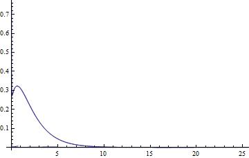
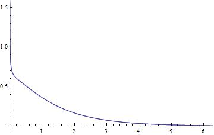
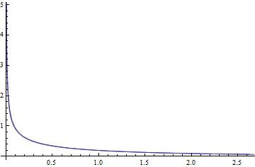
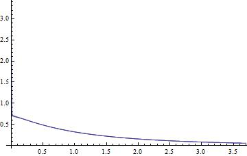
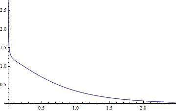
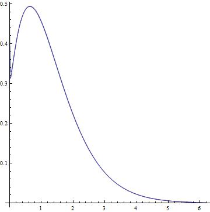
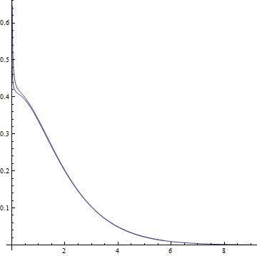
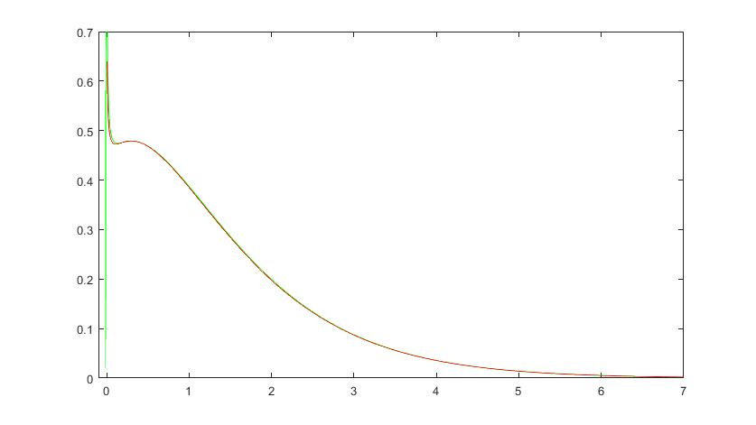
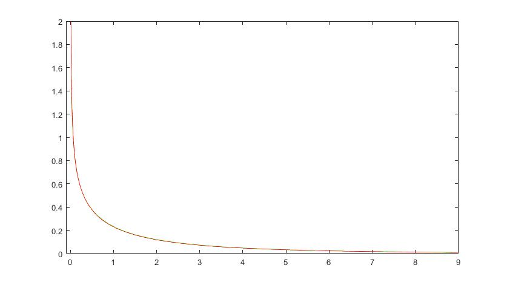
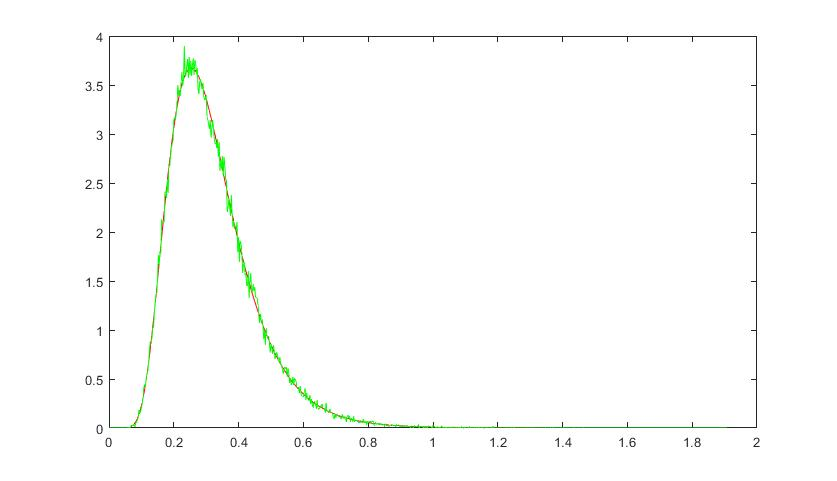

# Breakthrough in the theory of stochastic differential equations and their simulation

**Page 15 of 59** — Posts #701–#750

[← Previous](page_014.md) | [Index](index.md) | [Next →](page_016.md)

---

### #701 — Amin (Topic Author)
*May 24, 2018, 5:09 PM*

I am posting this interim version of the new program. Works perfectly with lognormal and driftless CEV but with 
lognormal drift + CEV diffusion, the results are very slightly off when the Ito-Taylor results have converged. As of
this time, You cannot do dt-integrals or dz-integrals of diffusions with this program but I will be adding this
capability in the next version. I will be posting a new version at the end of next week after carefully checking for the
possible error and reason why lognormal drift + CEV SDEs are not perfectly exact as their might be some error in my
algorithm. This is just an interim version.

```
Clear[x, t, x0, Y, P1, P2, l1, l2, Z, mu, sigma, mu0, sigma0, alpha, beta, gamma, a0, k, k1, m, L1, L2, YAns, H, Hc, Hz,
X1, fX1, DfX1, Nn, n, HCoeff, ZCoeff, DZCoeff, zz, KIndex, MIndex, MaxIndex, Y1,Y2, CoeffDX1, CoeffDX2, CoeffdtIntegral,
CoeffdzIntegral, qIndex1, qIndex21, qIndex22, qIndex23, qIndex0, qqIndex1, qqIndex2, n1, m1, l3, P, k0, m0];
P1 = 12;
P2 = 12;
P3 = 12;
L1 = 0;
L2 = 0;
P = If[P1 > P2, P1, P2];
Array[Y, {P + L1 + 1, P + L1 + 1, P + L2 + 1}, {0, 0, 0}];
For[k = 0, k  0, (k0 = k - 1; KIndex[k] = (k0*(k0 + 1)*(2*k0 + 1) + 9*k0*(k0 + 1) + 12*k0)/12 + 1), KIndex[k] = 0]];
Array[MIndex, {P1 + 1}, {0}];
For[m = 0, m  0, (m0 = m - 1; MIndex[m] = m0*(m0 + 1)/2 + m0 + 1), MIndex[m] = 0]];
MaxIndex = 1 + 2*MIndex[Round[P/2 + 1]]*KIndex[Round[P/2 + 1]];
Array[Y1, MaxIndex, 0];
Array[Y2, MaxIndex, 0];
For[m = 0, m = 1, Hz[k + 1, m - 1] = SetPrecision[Hz[k + 1, m - 1] - m*Hz[k, m], 50], 0];)])];
Array[ZCoeff, P2 + L2 + 1, 0];
For[k = 0, k < P2 + L2 + 1, k++, ZCoeff[k] = 0];
For[k = 0, k < P2 + L2 + 1, k++, (For[m = 0, m <= k, m++, ZCoeff[m] = ZCoeff[m] + SetPrecision[Hz[k, m]*HCoeff[k],
50]])];
Array[DZCoeff, P2 + L2, 0];
For[k = 0, k < P2 + L2, k++, DZCoeff[k] = 0];
For[k = 0, k < P2 + L2, k++, DZCoeff[k] = SetPrecision[ZCoeff[k + 1]*(k + 1), 50]];
Nn = 81;
Array[X1, Nn, 0];
Array[DfX1, Nn, 0];
Array[fX1, Nn, 0];
Array[zz, Nn, 0];
For[n = 0, n < Nn, n++, (X1[n] = 0; DfX1[n] = 0; fX1[n] = 0; zz[n] = 0;)];
For[n = 0, n < Nn, n++, (zz[n] = n*.1 - 4; X1[n] = 0; DfX1[n] = 0; fX1[n] = 0;
   X1[n] = ZCoeff[0]; DfX1[n] = DZCoeff[0];
   For[k = 1, k < P2 + L2 + 1, k++, (X1[n] = X1[n] + SetPrecision[ZCoeff[k]*zz[n]^k, 50];
     If[k < P2 + L2, DfX1[n] = DfX1[n] + SetPrecision[DZCoeff[k]*zz[n]^k, 50], 0];)];
   fX1[n] = SetPrecision[PDF[NormalDistribution[0, 1], zz[n]]/Abs[DfX1[n]], 50];)];
data1 = Table[{X1[n], fX1[n]}, {n, 0, 75}];
p1 = ListLinePlot[data1]
```

Here is the code snippet for plotting the density of lognormal drift + CEV diffusion SDE for comparison. For mu0=0, it
will create and plot the density of driftless CEV.

```
Nn1 = 1000;
Array[yy, Nn1, 0];
Array[fyy, Nn1, 0];
gamma2 = 2*gamma;
X0 = x;
tau = If[mu0 != 0, (Exp[2*mu0*gamma0*t] - 1)/(2*mu0*gamma0), t];
kStar = (2*mu0)/(sigma0^2*(2 - gamma2)*(Exp[mu0*(2 - gamma2)*t] - 1));
x0 = kStar*X0^(2 - gamma2)*Exp[mu0*(2 - gamma2)*t];
For[n = 0, n  All]
```

---

### #702 — Amin (Topic Author)
*May 27, 2018, 1:36 PM*

Sorry Bad post

---

### #703 — Amin (Topic Author)
*June 1, 2018, 9:02 PM*

Updating about the recent progress regarding the work. I was able to work on the method in which I could analytically
calculate weights of hermite polynomial expansion analytically using only first four hermites. And then starting from
origin, we could branch a tree and then recalculate the coefficients on each branch of the tree using the analytic
hermite expansion every .25 years. And we could use the locally calculated hermite weights for the particular single
branch (related to a specific value of normal) of the tree. So basically after the first time step from origin, we
calculate the different hermite weights according to local values of SDE variable along the tree using the same analytic
hermite expansion formula and we continue to recalculate the local hermite weights along every branch after every .25
years. And the method works for several SDEs. But I have not extensively tried everything and I was sort of excited to
report this new improvement in the method. I will be doing a few more tests for next day or two with different SDEs and
then post the new mathematica program here for review by friends. Good thing is that it is based on only first four
hermite polynomials and then takes local coefficietns/weights along the tree and we also have to rescale the variances
as we add normal. I hope to post the full-fledged program in a few days.

---

### #704 — Amin (Topic Author)
*June 1, 2018, 10:52 PM*

Here is the quick raw program. Sometimes, you could see random lines in the graph coming out from origin and they are
due to diffusion paths getting into negative territory and continuing and when I take derivatives numerically, these
places can give unstable results. Can easily be corrected by making negative paths zero and then not continuing them.
This will be perfectly resolved in the next version so please pardon these little issues. But I will work on all these
aspects and release an industrial strength program in a few days. This is just an initial raw version.

 You can overlay this program's graph with the mathematica code snippet for CEV diffusions with lognormal type drift
(that I previously posted)  if you will like to see the results with that SDE type. I believe we are done with a lot of
difficult part and hard work and I will be explaining the program and its working carefully in next few days.

Here is the code. Please note that Tt is number of time intervals in the program. Here t=.25 nand Tt=12 so Terminal time
is 3.0

```
Clear[x, t, x0, Y, P1, P2, l1, l2, Z, mu, sigma, mu0, sigma0, alpha, beta, gamma, a0, k, k1, m, L1, L2, YAns, H, Hc, Hz,
X1, fX1, DfX1, Nn, n, HCoeff, ZCoeff, DZCoeff, zz, KIndex, MIndex, MaxIndex, Y1, Y2, CoeffDX1, CoeffDX2,
CoeffdtIntegral, CoeffdzIntegral, qIndex1, qIndex21, qIndex22, qIndex23, qIndex0, qqIndex1, qqIndex2, n1, m1, l3, P, k0,
m0];
P1 = 6;
P2 = 6;
P3 = 6;
L1 = 0;
L2 = 0;
P = If[P1 > P2, P1, P2];
Array[Y, {P + L1 + 1, P + L1 + 1, P + L2 + 1}, {0, 0, 0}];
For[k = 0, k  0, (k0 = k - 1; KIndex[k] = (k0*(k0 + 1)*(2*k0 + 1) + 9*k0*(k0 + 1) + 12*k0)/12 + 1), KIndex[k] = 0]];
Array[MIndex, {P1 + 1}, {0}];
For[m = 0, m  0, (m0 = m - 1; MIndex[m] = m0*(m0 + 1)/2 + m0 + 1), MIndex[m] = 0]];
MaxIndex = 1 + 2*MIndex[Round[P/2 + 1]]*KIndex[Round[P/2 + 1]];
Array[Y1, MaxIndex, 0];
Array[Y2, MaxIndex, 0];
For[m = 0, m = 1, Hz[k + 1, m - 1] = Hz[k + 1, m - 1] - m*Hz[k, m], 0];)])];
x0 = 1;
t = .250;
Tt = 12;
For[k = 0, k < P2 + L2 + 1, k++, (For [nn = 0, nn < Nn, nn++, HCoeff[k, nn] = 0;])];
Array[x, Nn, 0];
For[nn = 0, nn < Nn, nn++, x[nn] = x0];
Array[ZCoeff, {P2 + L2 + 1, Nn}, 0];
Array[X1, Nn, 0];
Array[DfX1, Nn, 0];
Array[fX1, Nn, 0];
Array[zz, Nn, 0];
For[nn = 0, nn < Nn, nn++, (X12[nn] = 0; DfX12[nn] = 0;)];
Array[DZCoeff, {P2 + L2, Nn}, {0, 0}];
For[tt = 0, tt < Tt, tt++, (For[nn = 0, nn < Nn, nn++, (For[k = 0, k <= P3, k++, HCoeff[k, nn] = 0];
     For[k = 0, k <= P3, k++, (For[m = 0, m <= If[k < P1, k, P1], m++, (l0 = L1 + m; l3 = L2 + k - m;
         For[n = 0, n <= If[m < P2, m, P2], n++, (l1 = L1 + m - n; l2 = L1 + n;
           HCoeff[l3, nn] = HCoeff[l3, nn] + Y[l1, l2, l3]*x[nn]^(alpha + (l1 - L1)*beta + (l2 - L1)*2*gamma + (l3 -
L2)*gamma - (l1 - L1) - 2*(l2 - L1) - (l3 - L2))*t^(l1 + l2 - L1 + .5*l3);)];)])])];
   For[k = 0, k < P2 + L2 + 1, k++, For[nn = 0, nn < Nn, nn++, ZCoeff[k, nn] = 0]];
   For[nn = 0, nn < Nn, nn++, (For[k = 0, k < P2 + L2 + 1, k++,
       For[m = 0, m <= k, m++, ZCoeff[m, nn] = ZCoeff[m, nn] + Hz[k, m]*HCoeff[k, nn]]];)];
   For[nn = 0, nn < Nn, nn++, (X12[nn] = ZCoeff[0, nn]; zz[nn] = nn*.1 - 4;
     For[k = 1, k < P2 + L2 + 1, k++,X12[nn] = X12[nn] + ZCoeff[k, nn]*(1/Tt^(.5)*zz[nn])^k;]; x[nn] = X12[nn];)];)];
For[nn = 1, nn < Nn - 1, nn++, zz[nn] = Tt^(.5)*(nn*.1 - 4);];
For[nn = 1, nn < Nn - 1, nn++, (DfX12[nn] = (X12[nn + 1] - X12[nn - 1])/(zz[n + 1] - zz[n - 1]);)];
For[nn = 0, nn < Nn, nn++, (zz[nn] = nn*.1 - 4;
   fX12[nn] = PDF[NormalDistribution[0, Sqrt[Tt]], ((Tt)^(.5)*zz[nn])]/Abs[DfX12[nn]];)];
data12 = Table[{X12[nn], fX12[nn]}, {nn, 0, 80}];
p12 = ListLinePlot[data12]
```

Here is the output of the SDE overlaid with graph from analytic formula for the density. The SDE is dX=mu0* X dt+ sigma0
* X^gamma *dz(t)

with mu0=.25, sigma0=.55, gamma=.65. and T=3. There are Tt=12 time levels of t=.25 years duration each where the
analytic coefficients are recomputed for each branch of the SDE tree based on a particular value of normal ( which
ranges from -4 to +4 with .1 increments for each branch of the tree). Ok here is the overlaid graph comparison for the
output with program above posted.

[](https://postimages.org/)

I am sure more work will need to be done but these results are very encouraging.

---

### #705 — Amin (Topic Author)
*June 2, 2018, 7:31 PM*

Friends, this is slightly updated version of the program that corrects for instabilities in the graph that arise from
Ito-Taylor tree branches going into negative. Most of the graphs will be perfectly good now. I have also made a few
minor changes. Here is the code.

```
Clear[x, t, x0, Y, P1, P2, l1, l2, Z, mu, sigma, mu0, sigma0, alpha, beta, gamma, a0, k, k1, m, L1, L2, YAns, H, Hc, Hz,
X1, fX1, DfX1, Nn, n, HCoeff, ZCoeff, DZCoeff, zz, KIndex, MIndex, MaxIndex, Y1, Y2, CoeffDX1, CoeffDX2,
CoeffdtIntegral, CoeffdzIntegral, qIndex1, qIndex21, qIndex22, qIndex23, qIndex0, qqIndex1, qqIndex2, n1, m1, l3, P, k0,
m0];
P1 = 4;
P2 = 4;
P3 = 4;
L1 = 0;
L2 = 0;
P = If[P1 > P2, P1, P2];
Array[Y, {P + L1 + 1, P + L1 + 1, P + L2 + 1}, {0, 0, 0}];
For[k = 0, k  0, (k0 = k - 1;
    KIndex[k] = (k0*(k0 + 1)*(2*k0 + 1) + 9*k0*(k0 + 1) + 12*k0)/12 + 1), KIndex[k] = 0]];
Array[MIndex, {P1 + 1}, {0}];
For[m = 0, m  0, (m0 = m - 1; MIndex[m] = m0*(m0 + 1)/2 + m0 + 1),
   MIndex[m] = 0]];
MaxIndex = 1 + 2*MIndex[Round[P/2 + 1]]*KIndex[Round[P/2 + 1]];
Array[Y1, MaxIndex, 0];
Array[Y2, MaxIndex, 0];
For[m = 0, m = 1, Hz[k + 1, m - 1] = Hz[k + 1, m - 1] - m*Hz[k, m], 0];)])];
x0 = 1;
t = .1250;
Tt = 8;
For[k = 0, k  1, nn--, (If[((X12[nn] > X12[nn - 1]) && (CFlag == 1)), (X13[nn] = X12[nn]; nnStart = nn;), (X13[nn] = 0;
CFlag = 0;)])];
nnStart
For[nn = 1, nn < Nn - 1, nn++, zz[nn] = (nn*.1 - 4);];
For[nn = nnStart, nn < Nn - 1, nn++, (
   DfX12[nn] = (X12[nn + 1] - X12[nn - 1])/(zz[n + 1] - zz[n - 1]);)];
For[nn = nnStart, nn < Nn, nn++, (zz[nn] = nn*.1 - 4;
   fX12[nn] = PDF[NormalDistribution[0, 1], zz[nn]]/Abs[DfX12[nn]];)];
data12 = Table[{X12[nn], fX12[nn]}, {nn, nnStart, 60}];
p12 = ListLinePlot[data12]
```

Here is the output graph of the Ito-Taylor tree program overlaid with graph from true solution using analytic formula.

[](https://postimages.org/)

---

### #706 — Amin (Topic Author)
*June 3, 2018, 11:25 AM*

Here are overlaid graphs with Ito-Taylor tree method and true solution from analytic method. Parameters are

X0=.5, mu0=.2, sigma0=.65, gamma=.75, and T=5

where the SDE is

dX=mu0 * X dt + sigma0 * X^gamma *dz(t)

I have used the step size =.0625 so there are eighty time steps on the Ito-Taylor tree for five years of density
projection.

The overlaid grap for five years is given below. I have truncated the graph to concentrate on the main body where
reasonably valid visual comparison can be made.

[](https://postimages.org/)

Here is a third overlaid graph comparison. Parameters are

X0=1,mu0=.1,sigma0=.5, gamma=.8, T=5

[](https://postimages.org/)

Here is an overlaid graph comparison for density with parameters. Again I have removed some tail.

X0=.5, mu0=.1, sigma0=.5, gamma=.65 and T=2.5. Step size is the same at .0625. There are forty steps for 2.5 years of
density projection.

[](https://postimages.org/)

Here is an overlaid graph comparison with

X0=1, mu0=.1, sigma0=.5, gamma=.55, T=2.5. I have increased the aspect ratio in this graph. The graphs diverge very very
slightly extremely close to zero.

[](https://postimages.org/)

Here is the overlaid graph comparison for the same parameters as the above graph but now T=4. I have used only two
hermite polynomials in both these graphs with gamma=.55 with a step size=.0625. We see that both graphs diverge slightly
close to zero for gamma=.55 and T=4.

[](https://postimages.org/)

---

### #707 — Amin (Topic Author)
*June 3, 2018, 1:00 PM*

All the above graphs have been made with Ito-Taylor tree method. And we analytically compute the hermite polynomials
weights for a particular SDE in terms of initial value parameter i.e starting value of the SDE variable, X0. Then we
start an Ito-Taylor tree for the SDE from origin. Each branch of Ito-Taylor tree is like an ODE for a particular value
of the standard normal variable. And we re-compute the coefficients given the new initial values for every branch along
the Ito-Taylor tree for every time grid. We have to account for variances.

Basically Ito-Taylor tree method is just converting an SDE evolution into ODE-like evolution where each ODE evolves with
the particular value of normal assigned to the specific branch of Ito-Taylor tree.

I have lumped together all time calculations into calculation of hermite polynomial weights and later I solely use
variances of standard normal random variable without any further consideration of time values.

In the previous post, some graphs diverge from true solution when certain tree-paths (or ODE paths) get closer to zero
and this can be easily tackled by selectively decreasing the step size for ODEs(for the specific branch of Ito-Taylor
tree that has gotten close to zero) in the Ito-Taylor tree when they reach close to zero. Paths diverge from true
solution mostly for diffusions that have a CEV parameter gamma close to .5

---

### #708 — Amin (Topic Author)
*June 3, 2018, 4:57 PM*

I have used variance of 1/Tt for one step evolution (along the Ito-Taylor tree evolution) of normal random variable
where Tt are total number of time steps so at the terminal time variance becomes 1 (one) when added over all the time
steps and we can map the evolution of the SDE on a standard normal density. In the modified program I attached on post
705, you could see that density of SDE is calculated by change of variable with respect to a standard normal.

However if you want to find the density at any intermediate time point, you could easily do so by using the density of
normal random variable with variance parameter (standard deviation to be precise)$\sqrt{\frac{Tt}{n}}$ where n is the
time level where we are finding the density. For example to find the density at time level 2 (or after two time steps)
where Tt are total time levels/steps, you could simply use the normal random variable density with variance parameter or
standard deviation equal to$\sqrt{\frac{Tt}{2}}$ and thus you could easily continue to calculate the density along every
time point on the Ito-Taylor tree evolution. There could also be several other ways to map the evolution of SDE density
on density of normal random variable and these minor details will continue to change with different possible algorithms.

In fact, you can construct this Ito-Taylor tree with only first two hermite polynomials and taking a step size small
enough and it would work. For many SDEs, I found no significant difference when I used a step size of .0625 with two
hermite polynomials as compared to solution with four hermite polynomials with .0625 step size. Of course, when SDE
parameters go to extreme, you might have to use larger number of hermite polynomials or a smaller step size. When
gamma=.5, in that case taking just two hermite polynomials is more stable closer to zero than working with first four
hermite polynomias in Ito-Taylor expansion.

I will soon be posting another very simple matlab program based on just two hermite polynomials so that most friends
would not have to worry about any high dimensional expansions. And it could simply be extended to four hermite
polynomials when needed. No special need for very high dimensional hermite expansions.

---

### #709 — Amin (Topic Author)
*June 3, 2018, 10:39 PM*

Here is an Ito-Taylor tree matlab program based on only first two hermite polynomials. This is just a first initial
version but I decided to post it. You can change the program in all sort of interesting ways. And you will have to
rescale the axes in matlab many times. I have compared the output from Ito-Taylor tree to analytical solution for the
SDE dX=mu0 * X(t) *dt + sigma0 * X(t)^gamma *dz(t)

Please note that analytical solution given in the program can be compared with Ito-Taylor solution only when beta=1 in
the program. I have taken a very small step and used 64 time intervals per year. Green line in graph is Ito-Taylor
solution and red line is analytical solution.

Here is the program.

```
function [] = SDEdensity()
x0=.50;
mu0=.15;
sigma0=.55;
beta=1.0;
gamma=.85;
dt=.0625/4;
Tt=64*2;
T=Tt*dt;
Nn=81;
IdtdzN=1/sqrt(3.0)*dt^1.5;
IdzdtN=(1-1/sqrt(3.0))*dt^1.5;
Idtdt0=dt^2/2.0;
IdzdzN2=.5*dt;
Idzdz0=-.5*dt;
Idt=dt;
Idz=sqrt(dt);
for nn=1:Nn
    X(nn)=x0;
end
for tt=1:Tt
    for nn=1:Nn
        zz(nn) = (nn*.1 - 4.0);
        HCoeff(nn,1)=mu0*X(nn)^beta*Idt+mu0^2.0*beta*X(nn)^(2*beta-1)*Idtdt0+ ...
            sigma0^2*gamma*X(nn)^(2*gamma-1)*Idzdz0+.5*beta*(beta-1)*mu0*sigma0^2*X(nn)^(beta+2*gamma-2)*Idtdt0;
        HCoeff(nn,2)=sigma0*X(nn)^gamma*Idz+mu0*sigma0*beta*X(nn)^(gamma+beta-1)*IdzdtN+ ...
            sigma0*mu0*gamma*X(nn)^(gamma+beta-1)*IdtdzN+ .5*gamma*(gamma-1)*sigma0^3*X(nn)^(3*gamma-2)*IdtdzN;
        HCoeff(nn,3)=sigma0^2*gamma*X(nn)^(2*gamma-1)*IdzdzN2;
        X(nn)=X(nn)+HCoeff(nn,1)+HCoeff(nn,2)*1/sqrt(Tt)*zz(nn)+HCoeff(nn,3)*(1/sqrt(Tt)*zz(nn))^2.0;
    end
end
CFlag = 1;
for nn = Nn - 1:-1:2
  if((X(nn) > X(nn - 1)) && (CFlag == 1))
      nnStart = nn;
  else
     CFlag = 0;
  end
end
for nn=nnStart:Nn-1
   zz(nn) = (nn*.1 - 4.0);
   Dfx(nn)=(X(nn+1)-X(nn-1))/(zz(nn+1)-zz(nn-1));
end
for nn=nnStart:Nn-1
    fx(nn)=normpdf(zz(nn),0,1)/Dfx(nn);
end

Nn2 = 2000;
gamma0 = gamma - 1;
X0 = x0;
if(mu0~=0)
    tau=(exp(2*mu0*gamma0*T) - 1)/(2*mu0*gamma0);
else
    tau=T;
end
for n = 1:Nn2
  yy(n) = (.0002 + n*.0050);
  yy1(n) = (.0002 + n*.005)*exp(-mu0*T);
  fyy(n) = exp(-mu0*T)*yy1(n)^(-2*gamma0 - 3/2)*x0^(.5)/(sigma0^2*abs(gamma0)*tau)* ...
      besseli(abs(1/(2*gamma0)), (yy1(n)^(-gamma0)*x0^(-gamma0)/(sigma0^2*gamma0^2*tau)))* ...
     exp(-1*(x0^(-2*gamma0) + yy1(n)^(-2*gamma0))/(2*sigma0^2*gamma0^2*tau));
end
fyy;
plot(X(nnStart:Nn-1),fx(nnStart:Nn-1),'g',yy(1:Nn2),fyy(1:Nn2),'r');
end
```

---

### #710 — Amin (Topic Author)
*June 3, 2018, 10:55 PM*

Here is an output of the matlab program from previous post.

Here X0=1, mu0=.15, sigma0=.65, gamma=.6 and T=2.0, I have used just two hermite polynomials with 64 steps per year.
Green line is Ito-Taylor density and red line is analytical density.

[](https://postimages.org/)

Here is another comparison of Ito-Taylor tree density and density from analytical formula. Here X0=1, mu0=.15,
sigma0=.65, gamma=.8 and T=5.0

I have rescaled the graph to show the density area. And I have used just two hermite polynomials.

[](https://postimages.org/)

---

### #711 — Amin (Topic Author)
*June 4, 2018, 8:34 AM*

Sorry friends. There is a minor error in the above matlab program.

In the 14th line of code currently is IdzdzN2=.5*dt^2.0; should be corrected to  IdzdzN2=.5*dt;

This might be slightly throwing results off. It is the time coefficient related to second hermite polynomial and I
erroneously set it to second power.

I will also be posting another matlab program in terms of sqrt(t) variance.

---

### #712 — Amin (Topic Author)
*June 4, 2018, 12:04 PM*

Though I hope there will be interesting uses of the new Ito-Taylor tree method, some new possibilities also open up with
this method. For example, in SDEs literature, it is almost always assumed that noise scales as square root of time as in
Brownian motion. Though this might be intelligent in most of the situations, there is nothing there to say that this
must always be the case. In many SDEs modelling physical phenomenon, noise might as well scale as .25 power of time
interval or possibly .75 power of time interval and we can very easily solve those SDEs with different time scaling with
this new method. Time scaling must not necessarily be related to Brownian motion and when it is actually not, we can use
the new method to solve other SDEs that arise with different time scaling in the random noise.

---

### #713 — Amin (Topic Author)
*June 5, 2018, 2:11 PM*

Do people see five graphs with explanation of parameters in this post 706 of this thread. It is the first post in the
current page.

---

### #714 — ppauper
*June 5, 2018, 2:19 PM*

> Do people see five graphs with explanation of parameters in this post 706 of this thread. It is the first post in the
current page.
yes

(firefox under windows 10 if it makes a difference)

---

### #715 — Amin (Topic Author)
*June 5, 2018, 2:23 PM*

Thank you Peter for your help. When I click on two images in post 710, they open in the same window but out of the five
images in post 706 nothing opens in that window. But thank you for your helpful comment and I am sure now that
everything must be perfectly alright.

---

### #716 — ppauper
*June 5, 2018, 3:02 PM*

like I said in your other thread, (windows 10, firefox)

when I click on the graphs, 2 new tabs open: (i) a matlab graph and (ii) a postimage.org page trying to get me to post
my stuff there

---

### #717 — Amin (Topic Author)
*June 5, 2018, 4:10 PM*

Here I made a post on linkedin  about this new method. I have also mentioned Wilmott.com there. Here is the link to post. [https://www.linkedin.com/pulse/converti ... hsan-amin/](https://www.linkedin.com/pulse/converting-sde-autonomous-odes-ito-taylor-tree-method-ahsan-amin/)

Here I copy the post.

Converting An SDE into Autonomous ODEs: The Ito-Taylor Tree Method for Solution of SDEs

In my new research on the solution of SDEs and their stochastic integrals, I have worked with a new Ito-Taylor tree
method for calculation of densities of SDEs and their path integrals. In this method, we start an Ito-Taylor tree for
the SDE with a few branches and each branch is associated with a certain value of standard normal random variable and
the tree branches just once at origin/starting value of SDE . Each branch of Ito-Taylor tree is like an ODE for a
particular value of the standard normal variable and each branch of the tree evolves in time autonomously and never
re-branches save once at origin. And we re-compute the Ito-Taylor coefficients given the new initial values of X for
every branch along the Ito-Taylor tree for every time level. Basically, Ito-Taylor tree method is just converting an SDE
evolution into ODE-like evolution where each ODE evolves autonomously with the particular value of normal assigned to
the specific branch of Ito-Taylor tree.

The method is lightning fast since the tree branches once at origin and never branches after that. In the accompanying
matlab program, I have taken only 81 branches that span a standard normal between -4 and +4 with a normal gird spacing
of .1 and there are only 64 time steps per year and one step computational effort for every branch is roughly comparable
to monte carlo simulation computational effort for one single path. So you can yourself imagine how super-fast the
method is. Its speed is roughly comparable to monte carlo with only 81 paths.

I have posted an initial version of Ito-Taylor tree matlab program based on only first two hermite polynomials that you
can download. You can change the program in all sort of interesting ways. And you will have to rescale the axes in
matlab many times. I have compared the output from Ito-Taylor tree to analytical solution for the SDE

dX=mu0 * X(t)^beta *dt + sigma0 * X(t)^gamma *dz(t)

Please note that analytical solution(from Schroeder's formula/its time changed version) given in the program can be
compared with Ito-Taylor solution only when beta=1 in the program. I have taken a very small step and used 64 time
intervals per year. Green line in graph is Ito-Taylor solution and red line is analytical solution.

You can download and freely distribute the matlab program for calculation of density of SDEs using this new method. There is a lot of information I posted about the new method on Wilmott.com math finance web site in past few days. I have posted a very simple matlab program that you can download from post 709 on wilmott.com mathematical finance forum here: [viewtopic.php?f=4&t=99702&start=705](https://forum.wilmott.com/viewtopic.php?f=4&t=99702&start=705) or from nuclearphynance.com forum here: [http://nuclearphynance.com/Show%20Post. ... Key=180518](http://nuclearphynance.com/Show%20Post.aspx?PostIDKey=180518)

Sometimes, when parameters of SDE are extreme, you might want an Ito-Taylor tree with first four hermite polynomials
instead of just two that I used in the program and you could then also take a larger step. Larger step might not have
much of an advantage since we are working with only a hundred or so paths. And sometimes, when stability issues arise,
you could use the method with just one polynomial.

Almost the density of any SDE can be found by this method. I have written the following program for CEV-like diffusion
and lognormal-like drift because it can be analytically evaluated with Schroeder's formula. But you can find the density
of almost any SDE with mean-reversion and so many other features. You could also calculate the densities of path
integrals of these stochastic volatility SDEs and plug those values in lognormal or CEV formula.

Here is a graphical comparison of the density from a simple matlab program and the analytical density. Here X0=1,
mu0=.15, sigma0=.65, gamma=.6 and T=2.0, I have used just two hermite polynomials with 64 steps per year. Green line is
Ito-Taylor density and red line is analytical density. On the link below, you can view the graph comparison.

https://s26.postimg.cc/cdnmh80y1/Matlab_Graph01.jpg

Here is another comparison of Ito-Taylor tree density and density from analytical formula. Here X0=1, mu0=.15,
sigma0=.65, gamma=.8 and T=5.0, I have rescaled the graph to show the density area. And I have used just two hermite
polynomials. You can view the graph comparison on link below.

https://s26.postimg.cc/gzjqprwtl/Matlab_Graph02.jpg

---

### #718 — Amin (Topic Author)
*June 5, 2018, 4:17 PM*

> like I said in your other thread, (windows 10, firefox)
>
> when I click on the graphs, 2 new tabs open: (i) a matlab graph and (ii) a postimage.org page trying to get me to post
my stuff there
Yes, post 710 works fine with me as well. But I had posted 5 graphs from mathematica on post 706 with the same postimage
gallery and I do see those graphs on my screen but when I click on them, it does not take me to the mathematica graphs
on post 706 as it does with the matlab graphs on post 710 as you mentioned as in post 710-(i) a matlab graph.

---

### #719 — ppauper
*June 5, 2018, 4:41 PM*

you're correct of course.

When I click on the mathematica figures, I do not get the graph, but I do get a postimage.org page trying to get me to
post my stuff there,

---

### #720 — Amin (Topic Author)
*June 6, 2018, 11:23 PM*

> I have used variance of 1/Tt for one step evolution (along the Ito-Taylor tree evolution) of normal random variable
where Tt are total number of time steps so at the terminal time variance becomes 1 (one) when added over all the time
steps and we can map the evolution of the SDE on a standard normal density. In the modified program I attached on post
705, you could see that density of SDE is calculated by change of variable with respect to a standard normal.
>
> However if you want to find the density at any intermediate time point, you could easily do so by using the density of
normal random variable with variance parameter (standard deviation to be precise)$\sqrt{\frac{Tt}{n}}$ where n is the
time level where we are finding the density. For example to find the density at time level 2 (or after two time steps)
where Tt are total time levels/steps, you could simply use the normal random variable density with variance parameter or
standard deviation equal to$\sqrt{\frac{Tt}{2}}$ and thus you could easily continue to calculate the density along every
time point on the Ito-Taylor tree evolution. There could also be several other ways to map the evolution of SDE density
on density of normal random variable and these minor details will continue to change with different possible algorithms.
>
> In fact, you can construct this Ito-Taylor tree with only first two hermite polynomials and taking a step size small
enough and it would work. For many SDEs, I found no significant difference when I used a step size of .0625 with two
hermite polynomials as compared to solution with four hermite polynomials with .0625 step size. Of course, when SDE
parameters go to extreme, you might have to use larger number of hermite polynomials or a smaller step size. When
gamma=.5, in that case taking just two hermite polynomials is more stable closer to zero than working with first four
hermite polynomias in Ito-Taylor expansion.
>
> I will soon be posting another very simple matlab program based on just two hermite polynomials so that most friends
would not have to worry about any high dimensional expansions. And it could simply be extended to four hermite
polynomials when needed. No special need for very high dimensional hermite expansions.
As I have mentioned, there could be a very large number of ways to choose the variance for each step normal but it will
certainly have to be equal over the steps. So it would have to be the same algorithm that I have used in the matlab
program posted but there could be more efficient ways to choose the variance for each step.

I will follow in a day or two with detailed latex equations explaining the algorithm. And it is absolutely no more
difficult and in fact almost identical to monte carlo simulations with hermite polynomials. All that is different that
you do not use a random number generator and instead use the same particular value of normal variable assigned to each
branch of the Ito-Taylor tree all along the time evolution of the particular branch. I weighted the normal value with
sqrt(1/Tt) weight and choice of this weight makes a slight difference in how each branch gets mapped on the standard
normal density. Again this weight could be changed and would result in a slightly more efficient or less efficient
algorithm.

In my implementation, I divided normal density into 81 parts associated with each branch of the tree, starting from -4
and going to +4 with a spacing of .1, so the first branch of the Ito-Taylor tree will use a value of normal -4, all
along its evolution for each time step and rest of the algorithm is exactly the same as monte carlo simulation and they
differ only in

1. that I use a normal value of -4 for first branch instead of any randomly generated value (as in monte carlo). For the
second branch, I would use a normal value of -3.9 instead of any randomly generated normal value and so on with a normal
value of +4 for the 81st branch. And of course normal value of zero for 41st branch.

2. I use a weight for this normal value assigned to each branch, and I have set this weight equal to sqrt(1/Tt) in my
algorithm and there could be many other possible choice of weights that would work. But for all branches of the
tree,these weights would have to be the equal and same for every time interval when these time intervals are equal.
There could be many ways of choosing these equal weights and mapping them on normal density with reverse varaince.

And when I reach a step where density has to be calculated, We use the inverse of square-root of squared weights used
over all the previous time intervals in the density. Since I used a weight of sqrt(1/Tt) for each interval when there
are Tt time intervals, sum of their squared values would go to one and it would be mapped on a standard normal density.

3. As opposed to monte carlo, the final values of the SDE density have to be calculated by doing a change of variable
derivative with normal density of appropriate variance(this variance is unity in my implementation since sum of squres
of sqrt(1/Tt) sums to one over Tt time intervals). Since we have chosen equal spacing of normal values along different
branches of the trees, this can be easily calculated using the finite difference derivative formula for equi-spaced
grids.

All of the above is valid when we calculate the density over multiple steps such that sum of squared weights (sqrt(1/Tt)
in my implementation) over all steps have summed to unity. But we would like to be able to calculate the density along
all the time steps in the evolution. And that is where an intelligent choice of weights and grid could help. I will
explain this part in greater detail tomorrow.

---

### #721 — Amin (Topic Author)
*June 7, 2018, 8:22 AM*

Here I try to explain the method in more detail. Suppose we want to calculate the density of an SDE given as

$dX(t)=\mu (t) X(t)^{\beta} dt + \sigma (t) X(t)^{\gamma} dz(t) $  Eq(1)

The second order Ito-Taylor expansion of the above SDE is given as

$X(t)=X(t_0) + \mu X(t_0)^{\beta} \int_{t_0}^t ds + \sigma X(t_0)^{\gamma} \int_{t_0}^t dz(s)$

$+\mu \sigma \beta X(t_0)^{\beta + \gamma -1} \int_{t_0}^t \int_{t_0}^s dz(v) ds $

$+\mu \sigma \gamma X(t_0)^{\beta + \gamma -1} \int_{t_0}^t \int_{t_0}^s dv dz(s)$

$+{\sigma}^2 \gamma X(t_0)^{2 {\gamma} -1 } \int_{t_0}^t  \int_{t_0}^s dz(v) dz(s)$

$+ .5 {\sigma}^3 \gamma (\gamma-1) X(t_0)^{3 \gamma -2} \int_0^t \int_0^s dv dz(s)$

$+ {\mu}^2 \beta X(t_0)^{2 \beta -1} \int_{t_0}^t \int_{t_0}^s dv ds + .5 \beta (\beta -1) \mu  {\sigma}^2 X(t_0)^{\beta + 2 \gamma -2} \int_{t_0}^t \int_{t_0}^s dv ds$
Eq(2)

if $\Delta t=t-t_0$, we can write the above expressions in terms of time variances and standard normal as

$X(t)=X(t_0) + \mu X(t_0)^{\beta}  \Delta t + \sigma X(t_0)^{\gamma} \sqrt{\Delta t} N$

$ +\mu \sigma \beta X(t_0)^{\beta + \gamma -1} \frac{1}{\sqrt{3}} {\Delta t}^{1.5} N$

$+\mu \sigma \gamma X(t_0)^{\beta + \gamma -1} (1-\frac{1}{\sqrt{3}}) {\Delta t}^{1.5} N$

$+{\sigma}^2 \gamma X(t_0)^{2 {\gamma} -1 } \frac{\Delta t}{2} (N^2-1) $

$+.5 \gamma (\gamma - 1) {\sigma}^3 X(t_0)^{3 \gamma -2} \frac{1}{\sqrt{3}} {\Delta t}^{1.5} N $

$ + {\mu}^2 \beta X(t_0)^{2 {\beta} -1} \frac{{\Delta t}^2}{2}$

$+ .5 \beta (\beta -1) \mu {\sigma}^2 X(t_0)^{\beta + 2 \gamma -2} \frac{{\Delta t}^2}{2}$   Eq(3)

In my program, I simply wrote the expression so that powers of N are lumped together, so just re-arranging above
equation, we get

$X(t)=X(t_0) + \mu X(t_0)^{\beta}  {\Delta t} $

$+ {\mu}^2 \beta X(t_0)^{2 {\beta} -1} \frac{{\Delta t}^2}{2}$

$+ .5 \beta (\beta -1) \mu {\sigma}^2 X(t_0)^{\beta + 2 \gamma -2} \frac{{\Delta t}^2}{2} -{\sigma}^2 \gamma X(t_0)^{2 {\gamma} -1 } \frac{\Delta t}{2}$

$ + \sigma X(t_0)^{\gamma} \sqrt{\Delta t} N + \mu \sigma \beta X(t_0)^{\beta + \gamma -1} \frac{1}{\sqrt{3}} {\Delta t}^{1.5} N$

$ +.5 \gamma (\gamma -1) {\sigma}^3 X(t_0)^{3 \gamma - 2} \frac{1}{\sqrt{3}} {\Delta t}^{1.5} N$

$ + \mu \sigma \gamma X(t_0)^{\beta + \gamma -1} (1- \frac{1}{\sqrt{3}}) {\Delta t}^{1.5} N $

$+{\sigma}^2 \gamma X(t_0)^{2 {\gamma} -1 } \frac{\Delta t}{2}  N^2$   Eq(4)

So basically, we can see that one step evolution computational effort is exactly comparable to one step effort in monte
carlo when the monte carlo simulation is based on two hermite polynomials as above.

In my algorithm, I simply used 81 paths and assigned a normal value to each path. The simulation algorithm for nth path
would be

$X_n(t)=X_n(t_0) + \mu X_n(t_0)^{\beta}  {\Delta t} $

$+ {\mu}^2 \beta X_n(t_0)^{2 {\beta} -1 } \frac{{\Delta t}^2}{2}$

$+ .5 \beta (\beta -1) \mu {\sigma}^2 X_n(t_0)^{\beta + 2 \gamma -2} \frac{{\Delta t}^2}{2} -{\sigma}^2 \gamma X_n(t_0)^{2 {\gamma} -1 } \frac{\Delta t}{2}$

$ + \sigma X_n(t_0)^{\gamma} \sqrt{\Delta t} N_n + \mu \sigma \beta X_n(t_0)^{\beta + \gamma -1} \frac{1}{\sqrt{3}} {\Delta t}^{1.5} N_n$

$ +.5 \gamma (\gamma -1) {\sigma}^3 X_n(t_0)^{3 \gamma - 2} \frac{1}{\sqrt{3}} {\Delta t}^{1.5} N_n$

$ + \mu \sigma \gamma X_n(t_0)^{\beta + \gamma -1} (1- \frac{1}{\sqrt{3}}) {\Delta t}^{1.5} N_n $

$+{\sigma}^2 \gamma X_n(t_0)^{2 {\gamma} -1 } \frac{\Delta t}{2}  N_n^2$   Eq(5)

In my implementation$N_n$ , the normal variable grid, ranges from -4 to +4 with an increment of .1, so there are only 81
paths/branches each for a specific value of associated normal variable value.

You could safely use the above algorithm but the variance added over normal increments would go to$T$ if there are T
time intervals of equal width. And you would have to map it using a normal density of variance$\frac{1}{T}$

In my algorithm, I simply used a slight modification and weighted every normal random number value with weight
$\sqrt{\frac{1}{T}}$ so that variance of weighted normal would add to one and we could simply map the evolution of SDE
at terminal time (after T time intervals) to a standard normal. Please note that I have used$T$ as number of time
intervals and it is not the absolute value of time anywhere. Here is the algorithm I used.

$X_n(t)=X_n(t_0) + \mu X_n(t_0)^{\beta}  {\Delta t} $

$+ {\mu}^2 \beta X_n(t_0)^{2 {\beta} -1 } \frac{{\Delta t}^2}{2}$

$+ .5 \beta (\beta -1) \mu {\sigma}^2 X_n(t_0)^{\beta + 2 \gamma -2} \frac{{\Delta t}^2}{2} -{\sigma}^2 \gamma X_n(t_0)^{2 {\gamma} -1 } \frac{\Delta t}{2}$

$ + \sigma X_n(t_0)^{\gamma} \sqrt{\Delta t} (\sqrt{\frac{1}{T}} N_n) + \mu \sigma \beta X_n(t_0)^{\beta + \gamma -1} \frac{1}{\sqrt{3}} {\Delta t}^{1.5} (\sqrt{\frac{1}{T}} N_n)$

$ +.5 \gamma (\gamma -1) {\sigma}^3 X_n(t_0)^{3 \gamma - 2} \frac{1}{\sqrt{3}} {\Delta t}^{1.5} (\sqrt{\frac{1}{T}} N_n)$

$ + \mu \sigma \gamma X_n(t_0)^{\beta + \gamma -1} (1- \frac{1}{\sqrt{3}}) {\Delta t}^{1.5} (\sqrt{\frac{1}{T}} N_n) $

$+{\sigma}^2 \gamma X_n(t_0)^{2 {\gamma} -1 } \frac{\Delta t}{2}  (\sqrt{\frac{1}{T}} N_n)^2$           Eq(6)

In my implementation$N_n$ , the normal variable grid, ranges from -4 to +4 with an increment of .1, so there are only 81
paths/branches each for a specific value of associated normal variable value.

And finally, I calculated the density of SDE by doing a change of variable derivative with respect to standard normal
variable as ( I have omitted time index)

$dX_n=\frac{X_{n+1}- X_{n-1}}{N_{n+1} - N_{n-1} }$   Eq(7)

Here$X_n$ is the value of X calculated along nth branch and$N_n$ is the value of normal variable associated with the nth
branch/ or equivalently at nth point on normal variable grid.

and then used the formual for density of SDE as

$f(X_n)=\frac{f(N_n)}{dX_N}$  Eq(8)

In my implementation$f(N_n)$ is the value of standard normal density at$N=N_n$ which was the specific value of normal
assigned to nth branch.

I used a standard normal density for calculation of SDE density since I used a weighting$\sqrt{\frac{1}{T}}$ but for
different possible weights, you would use a different variance of the normal density in formula of Eq(8). For example,
if I used no weight (or unity weight) as in Eq(5), the squared weights summed over T intervals would give a weight of T
and then I would have to use a variance of$\frac{1}{T}$ for normal density in equation(8). Again, Please note that I
have used$T$ as number of time intervals and it is not the absolute value of time anywhere. Sorry for this slightly
ambiguous notation.

And there could be a large number of ways of assigning weights to normal variable in the algorithm and mapping to normal
density with different variance corresponding to weights used in the algorithm.

---

### #722 — amike
*June 7, 2018, 12:11 PM*

> ...
>
> $X(t)=X(t_0) + \mu X(t_0)^{\beta} \int_{t_0}^t ds + \sigma X(t_0)^{\gamma} \int_{t_0}^t dz(s)$
>
> $+\mu \sigma \beta X(t_0)^{\beta + \gamma -1} \int_{t_0}^t \int_{t_0}^s dz(v) ds $
>
> ...
Everything else aside, I get that you can introduce standard normal drivers to represent the distribution of the
integrals of the brownian driver, but they are not all perfectly correlated as (I think) you are assuming.

Take the first two you have:

$\int_{t_0}^t dz(s) \sim \sqrt{\Delta t} Z_1$

$\int_{t_0}^t \int_{t_0}^s dz(v) ds \sim \frac{(\Delta t)^{3/2}}{\sqrt{3}} Z_2$

where both$Z_1,Z_2$ are standard normal. The problem is that they are not perfectly correlated, but have correlation
$\sqrt{3}/2$ , so you can't really just introduce your single$N$ to represent them both...

Or is there something more subtle going on?

---

### #723 — Amin (Topic Author)
*June 7, 2018, 5:05 PM*

Amike, no, you are not familiar with Ito-Taylor expansion theory. We use exactly the same normal random number in the
expansion of a single SDE. We use hermite polynomials based on exactly the same random value drawn from normal density
even in case of monte carlo simulations.

Yes, we know, that in case of two dimensional correlated SDEs, we will have to be more careful and then problems of the
sort you mentioned would have to be properly tackled. And yes that can also be done.

---

### #724 — amike
*June 7, 2018, 11:10 PM*

I am reasonably familiar with Kloeden+Platen, and thought I was simply repeating Exercise 5.2.7 (first edition) or,
since you're going beyond first order, what happens in section 10.4/10.5.

Maybe not.

---

### #725 — Amin (Topic Author)
*June 8, 2018, 3:13 PM*

amike, at the moment, I do not have Kloeden and Platen at hand. I will try to look at it. It has several simulation
schemes and, I believe, some of them do use the same normal random number draw everywhere in a second order accurate
simulation.

---

### #726 — Amin (Topic Author)
*June 10, 2018, 3:57 PM*

I will have a formal research paper ready about my work on SDEs in next two weeks.

And I have been writing about my research for past few years on Wilmott.com. And using the same forum, I will like to
tell friends that I would absolutely love to work on some reasonably general analytic method to solve different types of
partial differential equations. Though I know that I can make decent money from the new research I did on SDE density
evolution algorithms, I would prefer to work on more stimulating and interesting problems related to solution of partial
differential equations. But I would need some support from a research institution or a commercial organization. And I
would absolutely love to seriously work and focus on the more interesting problem of solution of PDEs. I am writing here
in the hope that some organization would be interested in supporting me for this research.

---

### #727 — Amin (Topic Author)
*June 13, 2018, 8:30 PM*

My research opens up many new possibilities and many of those things in quantitative finance that were previously
considered impossible due to computational complexity can now be very easily modelled and evaluated. In addition to the
traditional applications in quantitative finance related to derivatives pricing and risk management, many new
possibilities could open up in other wide ranging scientific areas of stochastic filtering, parameter estimation and the
application of Artificial intelligence to stochastic processes due to this new research because calculation of densities
of general SDE based stochastic processes that earlier required extreme computing power, has now become almost
instantaneous. I hope there will be development of many new methods and algorithms in Bayesian statistics since it
really becomes so easy to calculate the densities of SDE based stochastic processes and researchers would like to take
advantage of this new development. And surely I foresee really a lot of new work on marriage between artificial
intelligence and Bayesian statistics related methods. If you would like me to work with you in these scientific
disciplines with new emerging possibilities due to this new research, you can email me at my private email
anan2999ATyahoo

---

### #728 — Amin (Topic Author)
*June 16, 2018, 9:48 PM*

Dear friends, I was able to find very interesting applications of my research to non-linear filtering that would make
non-linear filtering computationally very simple and efficient. The new method would work equally well for discrete time
state space models.

I will try to explain the idea with Bayesian filtering applied to a very simple set of univariate discrete time state
space equations giving observation process equation and the State process equation.

We can apply the method to general discrete time models of the form given below. I tried to be reasonably general in
writing the model equations and many other possible variants of the state model could also be solved for filtering.

$X_{t}=\mu_1 {Y_{t}}^{\beta_1} + \sigma_1 {Y_{t}}^{\gamma_1} z_{t}$

$Y_{t}= \mu_2 [{Y_{(t-1)}}]^{\beta_2} + \sigma_2 [{Y_{(t-1)}}]^{\gamma_2} w_{t}$

I will give details of the algorithm tomorrow but using this new algorithm even non-linear filtering will become simpler
than Kalman filtering.

---

### #729 — Amin (Topic Author)
*June 17, 2018, 5:05 PM*

Before we work on a complete algorithm, there are a few principles that we need for that purpose.

1. Mapping an arbitrary density on a normal (or other) density.

We can map any density on a normal density. Densities have probability mass normalized to one and this mapping requires
that corresponding subdivisions on two densities have the same probability mass. Sometimes, we would like to map a
density on a normal density so that subdivisions on the normal density are equally spaced.

2. Non-linear transformation of a density

We can easily take non-linear transformation of a density and this requires scaling the density variable by the
appropriate transformation but the density changes everywhere and new density for the transformed variable can be
calculated from the pre-transformation density by finding the change of variable derivative for the densities.

3. Adding locally non-linear innovations to a density.

Just like we did for SDEs, we can easily add local possibly non-linear (in the SDE variable) normal-based innovations to
a density and calculate the resulting density. For this we first map the density to a normal density and then add
innovations linearly along the appropriate value of normal variable associated with the particular subdivision of the
density.

4. Calculating Transition probabilities from one density to the other density when both densities have been mapped on a
normal density.

This is far simpler than people would otherwise think. And it would only require Green's function that takes into
account appropriate variance of the innovations and most local non-linearities can be easily neglected. For example, in
the case of SDEs, we could map the two densities of SDE on Brownian motion densities(by equating the probability mass)
and then transition probabilities between any two subdivisions would equal the transition probabilities between
corresponding two subdivisions of the Brownian motion densities and this requires only appropriate calculation of time
elapsed$\Delta t$ . And any other non-linearities in the SDE evolution can be safely neglected. Other non-linearities
show up in local scaling of the density but they can very easily be accounted for by a change of variable for densities.
I will be explaining it more clearly with equations tomorrow.

5. Calculation of Filtered density once an Observation has been made.

Suppose we have an updated state density and we possibly take a transformation of it (as dictated by
observation/measurement equation) and then we add observation noise (or observation innovation) to it to calculate what
I call the observation/measurement density. Calculation of filtered density from this observation/measurement density
simply requires calculation of all the transition probabilities from the updated state density that would result in the
observed point estimate(on the measurement/observation density). Again this filtered density is the transition density
from all the points on the updated state density to the observed point on the observation/measurement density. This
would not in general be a normalized density and we have to normalize it and this normalized density is the filtered
density.

And then we update this filtered density according to state update equation to calculate the updated state density. This
would possibly require a transformation of the filtered density(2), mapping the transformed density on a normal
density(1) and then adding local update innovations(3) required to calculate the state update density.

And then we will again map the state update density on a normal density(1) and add observation noise/innovations(3) to
calculate the measurement density. And then again find filtered density(5) again.

I will explain everything in more detail with equations tomorrow.

---

### #730 — Amin (Topic Author)
*June 18, 2018, 4:09 PM*

Sorry that when I wrote about mapping a density of SDE on a normal density, I forgot to mention another important
relevant fact and that is when densities of SDEs are generated by using Ito-Taylor algorithm which gives us the SDE
variable X,as a function of standard normal, Z, and in that case

$F(X(Z))=F(Z)$ where$F$ means CDF of the density. So when SDE variable X is found as a function of standard normal
variable Z, the CDF of X is exactly the same as the CDF of corresponding Z. And SDE variable X is a local scaling of the
standard normal variable.

As I mentioned yesterday that we can calculate the transition probabilities of SDEs by mapping the density of SDEs on relevant generating Brownian motion densities and then transition probability between various subdivisions on SDE density would be exactly the same as the transition probability between the corresponding subdivisions of two Brownian motion densities. Here is the link to the paper: [https://papers.ssrn.com/sol3/papers.cfm ... id=3119980](https://papers.ssrn.com/sol3/papers.cfm?abstract_id=3119980)

But I believe that normal density and densities of SDEs share a far stronger result which says that when we divide the
evolving normal density or density of SDEs along CDF subdivisions or probability mass subdivisions, then the the
cumulative transition probabilities between different CDF subdivisions of both normal densities at different time remain
the same. We are used to looking at transition probabilities in terms of absolute grids. Greater variance simply expands
the CDF subdivisions and on fixed grids, it seems that density is expanding which is, of course, true with respect to
fixed grids . But when considered in terms of CDF subdivisions (fixed probability mass subdivisions i.e subdivisions
that expand so as to keep the probability mass the same in them), the local subdivisions also expand in a synchronized
fashion so that transition probabilities between various expanding subdivisions really remain the same though on fixed
grids one would only notice that normal density/SDE density is expanding while it remains constant when considered in
terms of locally expanding fixed probability mass density subdivisions while transition probability dynamics remain
constant in terms of expanding subdivisions.

---

### #731 — MaxwellSheffield
*June 18, 2018, 4:32 PM*

too many posts, it is hard to keep track of your work .

---

### #732 — Amin (Topic Author)
*June 18, 2018, 5:06 PM*

> Amin:Sorry that when I wrote about mapping a density of SDE on a normal density, I forgot to mention another important
relevant fact and that is when densities of SDEs are generated by using Ito-Taylor algorithm which gives us the SDE
variable X,as a function of standard normal, Z, and in that case
>
>$F(X(Z))=F(Z)$ where$F$ means CDF of the density. So when SDE variable X is found as a function of standard normal
variable Z, the CDF of X is exactly the same as the CDF of corresponding Z. And SDE variable X is a local scaling of the
standard normal variable.
>
>
>
> As I mentioned yesterday that we can calculate the transition probabilities of SDEs by mapping the density of SDEs on relevant generating Brownian motion densities and then transition probability between various subdivisions on SDE density would be exactly the same as the transition probability between the corresponding subdivisions of two Brownian motion densities. Here is the link to the paper: [https://papers.ssrn.com/sol3/papers.cfm ... id=3119980](https://papers.ssrn.com/sol3/papers.cfm?abstract_id=3119980)
>
> But I believe that normal density and densities of SDEs share a far stronger result which says that when we divide the
evolving normal density or density of SDEs along CDF subdivisions or probability mass subdivisions, then the the
cumulative transition probabilities between different CDF subdivisions of both normal densities at different time remain
the same. We are used to looking at transition probabilities in terms of absolute grids. Greater variance simply expands
the CDF subdivisions and on fixed grids, it seems that density is expanding which is, of course, true with respect to
fixed grids . But when considered in terms of CDF subdivisions (fixed probability mass subdivisions i.e subdivisions
that expand so as to keep the probability mass the same in them), the local subdivisions also expand in a synchronized
fashion so that transition probabilities between various expanding subdivisions really remain the same though on fixed
grids one would only notice that normal density/SDE density is expanding while it remains constant when considered in
terms of locally expanding fixed probability mass density subdivisions while transition probability dynamics remain
constant in terms of expanding subdivisions.
I will be explaining how to calculate the transition probability using this observation with detailed equations in a few
hours.

---

### #733 — Amin (Topic Author)
*June 18, 2018, 7:49 PM*

Post in progress:

Here I made a post on linkedin for friends: [https://www.linkedin.com/pulse/new-algo ... arch-amin/](https://www.linkedin.com/pulse/new-algorithms-non-linear-filtering-applications-my-research-amin/)

Here I copy the linkedin post.

New Algorithms For Non-linear Filtering: Applications of my Research On SDEs (Part I)

I was able to find very interesting applications of my research to non-linear filtering that would make non-linear
filtering computationally very simple and efficient. The new method would work equally well for discrete time state
space models. Before we work on a complete algorithm, there are a few principles that we need for that purpose.

1. Mapping an arbitrary density on a normal (or other) density.

We can map any density on a normal density. Densities have probability mass normalized to one and this mapping requires
that corresponding subdivisions on two densities have the same probability mass. Sometimes, we would like to map a
density on a normal density so that subdivisions on the normal density are equally spaced. when densities of SDEs are
generated by using Ito-Taylor algorithm which gives us the SDE variable X,as a function of standard normal, Z, and in
that case F(X(Z))=F(Z) where F means CDF of the density. So when SDE variable X is found as a function of standard
normal variable Z, the CDF of X is exactly the same as the CDF of corresponding Z. And SDE variable X is a local scaling
of the standard normal variable.

2. Non-linear transformation of a density

We can easily take non-linear transformation of a density and this requires scaling the density variable by the
appropriate transformation but the density changes everywhere and new density for the transformed variable can be
calculated from the pre-transformation density by finding the change of variable derivative for the densities.

3. Adding locally non-linear innovations to a density.

Just like we did for SDEs, we can easily add local possibly non-linear (in the SDE variable) normal-based innovations to
a density and calculate the resulting density. For this we first map the density to a normal density and then add
innovations linearly along the appropriate value of normal variable associated with the particular subdivision of the
density.

4. Calculating Transition probabilities from one density to the other density when both densities have been mapped on a
normal density.

This is far simpler than people would otherwise think. And it would only require Green's function that takes into account appropriate variance of the innovations and most local non-linearities can be easily neglected. For example, in the case of SDEs, we could map the two densities of SDE on Brownian motion densities(by equating the probability mass) and then transition probabilities between any two subdivisions would equal the transition probabilities between corresponding two subdivisions of the Brownian motion densities and this requires only appropriate calculation of time elapsed Δt. And any other non-linearities in the SDE evolution can be safely neglected. Other non-linearities show up in local scaling of the density but they can very easily be accounted for by a change of variable for densities. As I mentioned earlier that we can calculate the transition probabilities of SDEs by mapping the density of SDEs on relevant generating Brownian motion densities and then transition probability between various subdivisions on SDE density would be exactly the same as the transition probability between the corresponding subdivisions of two Brownian motion densities. Here is the link to the paper: [https://papers.ssrn.com/sol3/papers.cfm ... id=3119980](https://papers.ssrn.com/sol3/papers.cfm?abstract_id=3119980)

But I believe that normal density and densities of SDEs based on locally non-linear scaling of normal noise share a far
stronger result which says that when we divide the evolving normal density or density of SDEs along CDF subdivisions or
probability mass subdivisions, then the cumulative transition probabilities between different CDF subdivisions of both
normal densities at different time remain the same. We are used to looking at transition probabilities in terms of
absolute grids. Greater variance simply expands the CDF subdivisions and on fixed grids, it seems that density is
expanding which is, of course, true with respect to fixed grids . But when considered in terms of CDF subdivisions
(fixed probability mass subdivisions i.e subdivisions that expand so as to keep the probability mass the same in them),
the local subdivisions also expand in a synchronized fashion so that transition probabilities between various expanding
subdivisions really remain the same though on fixed grids one would only notice that normal density/SDE density is
expanding while it remains constant when considered in terms of locally expanding fixed probability mass density
subdivisions while transition probability dynamics remain constant in terms of expanding subdivisions.

5. Calculation of Filtered density once an Observation has been made.

Suppose we have an updated state density and we possibly take a transformation of it (as dictated by
observation/measurement equation) and then we add observation noise (or observation innovation) to it to calculate what
I call the observation/measurement density. Calculation of filtered density from this observation/measurement density
simply requires calculation of all the transition probabilities from the updated state density that would result in the
observed point estimate(on the measurement/observation density). Again this filtered density is the transition density
from all the points on the updated state density to the observed point on the observation/measurement density. This
would not in general be a normalized density and we have to normalize it and this normalized density is the filtered
density.

And then we update this filtered density according to state update equation to calculate the updated state density. This
would possibly require a transformation of the filtered density(2), mapping the transformed density on a normal
density(1) and then adding local update innovations(3) required to calculate the state update density.

And then we will again map the state update density on a normal density(1) and add observation noise/innovations(3) to
calculate the measurement density. And then again find filtered density(5) again.

I have written about this post in equal detail at post # and post of wilmott forum here: [viewtopic.php?f=4&t=99702&start=720](https://forum.wilmott.com/viewtopic.php?f=4&t=99702&start=720) And at nuclearphynance forum here:[http://nuclearphynance.com/Show%20Post. ... Key=180518](http://nuclearphynance.com/Show%20Post.aspx?PostIDKey=180518)

---

### #734 — Amin (Topic Author)
*June 24, 2018, 8:15 AM*

I am looking for PhD positions in mainland Europe. I want to research in the area of artificial intelligence with
dynamic Bayesian models. Here is my resume

Ahsan Amin

Email: [[email protected]](/cdn-cgi/l/email-protection#19787778772b202020596078717676377a7674)

Phone: +92-336-2602125

Website: https://ahsanamin2999.wordpress.com/

Research Website:[https://papers.ssrn.com/sol3/cf_dev/Abs ... _id=435366](https://papers.ssrn.com/sol3/cf_dev/AbsByAuth.cfm?per_id=435366)

Education

New York University, New York, NY , USA .

Masters of Arts in Economics with a concentration in Mathematical Finance, September 2002.

Wrote my thesis on pricing of Bermudan Swaptions and other Bermudan structured Derivatives within the framework of Libor
Market Model. Libor Market Model was the newly introduced and most modern interest rate model at that time. My thesis
was titled, “Pricing Bermudan fixed income derivatives in multi-factor extended LIBOR market model.” My thesis was cited
in several other research papers/theses.

Northwestern University, Evanston, IL , USA .

Bachelor of Science in Electrical Engineering, March 97

Work

CEO, Infiniti Derivatives Technologies, Lahore, Pakistan

Feb 2012 - Present

1.        My company  web site is: [http://www.infinitiderivatives.com](http://www.infinitiderivatives.com/)

2.       Worked on research on the analytic solution of ordinary differential equations. I presented methods for analytic solution of general nth-order ordinary differential equations and also for the analytic solution of systems of nth-order ordinary differential equations. My research is discussed in the research paper, "On the General Solution of Initial Value Problems of Ordinary Differential Equations Using the Method of Iterated Integrals" downloadable at [https://papers.ssrn.com/sol3/papers.cfm ... id=2872598](https://papers.ssrn.com/sol3/papers.cfm?abstract_id=2872598)

3.       I have worked with a new Ito-Taylor based method for calculation of densities of SDEs and their path integrals. In this method, SDE or its functionals evolve like a set of autonomous ODEs. This results in an extremely fast algorithm which is several orders of magnitude faster than previous methods. I have not completed the formal research paper yet but I worked on this method over several years and simultaneously continued to post any new major advances in my understanding on internet as they occurred. I made these posts on wilmott.com mathematical finance forum. Here is the chronicle of my posts about this research over the years: [viewtopic.php?f=4&t=99702&start=690](https://forum.wilmott.com/viewtopic.php?f=4&t=99702&start=690)

My formal research paper would be ready in about two weeks.

4.       My research paper titled, “Calibration, Simulation and Hedging in a Heston Libor Market Model with Stochastic Basis” was published in a Risk book “Interest Rate Modelling after the Financial Crisis.” Here is the link to Risk book web site: [http://riskbooks.com/interest-rate-mode ... ial-crisis](http://riskbooks.com/interest-rate-modelling-after-the-financial-crisis)

5.       I also successfully completed another research project which resulted in the research paper titled “Solution of Stochastic Volatility Models Using Variance Transition Probabilities and Path Integrals.” This paper can be downloaded at [https://papers.ssrn.com/sol3/papers.cfm ... id=2149231](https://papers.ssrn.com/sol3/papers.cfm?abstract_id=2149231)

Quantitative Research Analyst, UP-FRONT Inc., Tokyo, Japan

Feb 2003 – Oct 2010

It was a research and development Role and I was based in Lahore, Pakistan. These were the major research projects I
completed with Upfront.

1.        I developed a stochastic volatility displaced diffusion LIBOR Market Model.  Worked on global Calibration of
the model to more than 2000 swaptions with forward curve out to sixty years. Priced callable structured derivatives and
more exotic deals as well as their deltas and vegas in this stochastic volatility model.

2.        Worked on advanced multi-factor skew extended calibration of LIBOR Market model. Very robust smoothing
constraints were implemented which were required for stability of hedges. Worked with calibration of four different
versions of skew extended LIBOR Market Models. Successfully dealt with the problem of simultaneous calibration of the
whole swaptions matrix.

3.       Worked extensively with pricing of most complex callable LIBOR exotics. The instruments include Bermudans
swaptions, Bermudan callable reverse floaters, Bermudan captions, Bermudan CMS floaters, Bermudan CMS reverse floaters,
Bermudan CMS spread options, CMS TARN structures, Bermudan Snowballs, snowblades, and Bermudan callable PRDC.

4.       Extended Longstaff and Schwartz method to deal with complex callable fixed income structured derivatives in my research paper, “Multi-Factor Cross Currency Libor Market Models: Implementation, Calibration and Examples.” The paper can be downloaded here: [https://papers.ssrn.com/sol3/papers.cfm ... id=1214042](https://papers.ssrn.com/sol3/papers.cfm?abstract_id=1214042)

5.       Worked on the pricing of Bermudan Callable and Trigger Power Reverse Dual Currency Note and other FX/IR hybrid
derivatives. Developed a multi-factor cross-currency LIBOR Market Model for the pricing of these instruments.
Implemented the advanced analytics of the model on Excel using VBA and C++.

6.     Worked on a three factor Hull White Cross Currency model in Cheyette framework for fast pricing of Bermudan
trigger PRDCs. This involved analytic calibration of the model to FX volatilities and to swaption volatilities of local
and foreign economy.

---

### #735 — Amin (Topic Author)
*June 28, 2018, 10:25 AM*

Completing some work towards my paper,  I will be  posting a very general program that could easily take two, three or
even more terms in the SDE drift. Though I will have only one SDE noise term but the same framework could be easily
extended to have more noise terms. I hope the algorithm would be helpful and I think that it would also be efficient
enough. I hope to post the program on a day or two.

---

### #736 — Amin (Topic Author)
*July 2, 2018, 10:56 AM*

The program has the right algorithm for linear-like SDEs but my algorithm using  sqrt(1/T) *N  for each step of normal
density evolution probably does not seem to hold for very non-linear SDEslike stoch vol SDEs.

But I am giving the simulation algorithm in the hope that it would be helpful to provide a simple framework for people
to experiment on their own and try their ideas where Ito-Taylor coefficients and simulation program has been calculated
and normal variance structure or hermite polynomial type might have to be altered. My first thought would be that trying
Brownian motion based hermite polynomials (orthogonal hermite polynomials that take Brownian motion variance) might
really fix the problem with very non-linear SDEs and I hope that this simulation framework would be helpful for people
to try brownian motion based hermite polynomials and other ideas they have. And it would be easier for many people to
slightly change the existing program and try the ideas they have.

I have not been able to work for past few weeks for many reasons and would love to try many of these ideas on my own.
But, of course, my personal inability to work must not stop other friends from working on their research ideas. And I
would request friends to give me credit for the original basic work I have already done and would absolutely welcome all
good research from other friends.

Here is the basic program explanation.

In the expansion of X(t)^alpha

With SDE

dX(t)=mu1 * X(t)^beta1 dt + mu2* X(t)^beta2 dt + sigma * X(t)^gamma dz(t)

The first order expansion of X^alpha with the above SDE is

X(t+1)^alpha= X(t)^alpha +alpha* X(t)^(alpha-1) * mu1 * X(t)^beta1 *dt

+alpha*X(t)^(alpha-1) * mu2 * X(t)^beta2*dt

+ .5* alpha *(alpha-1)* X(t)^(alpha-2) * sigma^2 * X(t)^(2*gamma) *dt

+ alpha * X(t)^(alpha-1) * sigma * X(t)^gamma *dz(t)

In my program, for the above four term expansion, I use a four dimensional array notation that shows the order of
differentiation on each of these four types of terms. So if l1 represents drift one, l2 represents drift two and l3
represents quadratic variation term and l4 represents volatility term, we can use the notation Y(l1,l2,l3,l4) for the
coefficients of expansion of the above term. So in the above first order expansion

Y(1,0,0,0)=alpha * mu1

Y(0,1,0,0)=alpha *mu2

Y(0,0,1,0)=.5* alpha *(alpha-1)* sigma^2

Y(0,0,0,1)= alpha * sigma

For higher orders of expansion, we will have to carefully compute the coefficients separately and then lump them
together in Y according to array indices. Once we have done that, we can write one term of the general expansion as

Y(l1,l2,l3,l4) * x^(alpha+l1 * beta1 +l2* beta2 +l3* 2* gamma +l4 * gamma

 - l1 -l2 - 2*l3 -l4) * HermiteP(l4) * dt^(l1 + l2 +l3 + .5*l4);

In my program, since matlab does not take indices starting from zero, I have slightly adjusted the above notation.  In
the density simulation program, we pre-compute everything but we have to calculate the part of above expression where
power of x is evaluated.

If we have four terms in Ito-hermite SDE expansion at first order, In every next level, each of the four terms would
take four descendent terms and there will be sixteen terms on second level, and on third level there will be 64
descendent terms and 256 descendent terms on fourth level. However we can reduce the number of terms in Ito-hermite
expansion to number of terms in polynomial expansion. For example Ito-hermite expansion of SDE with four terms on first
order can be reduced to the number of terms in expansion of a polynomial with four terms on each level. To do this, we
will have to pre-calculate the Coefficients carefully and the lump them together as in a multinomial like expansion.

Again the above array Y(l1,l2,l3,l4) is relatively sparse and does not take all possible indices. Just like in
polynomial expansion, on a certain expansion order, it takes only indices so that sum of indices goes to expansion
order. For example on second order, only those indices could be found such that l1+l2+l3+l4=2. And similarly for third
ito-hermite expansion level only those indices would be populated such that l1+l2+l3+l4=3.

In order to do that I have done simple loops in a fashion shown below

for k = 0 : (Order4)

    for m = 0:k

        l4 = k - m;

        for n = 0 : m

            l3 = m - n;

            for j = 0:n

                l2 = n - j;

                l1 = j;

First loop variable is for expansion order. And then rest of the loop variables take values such that their sum equals
the expansion order. When we would add a fifth term in the SDE expansion for example, we will have to add another loop
variable with the same logic that sum of loop variables equal to expansion order. In my matlab program, I have given
offset to l4, l2,l3, l1 since array indices cannot start at zero.

In the coefficient calculation program which calculates Y(l1,l2,l3,l4), I have used four levels of looping each for
relevant expansion order. The first loop takes four values and second loop takes 16 values and third loop takes 64
values and so on. And then each coefficient term can be individually calculated while carefully accounting for path
dependence.

So for example in a nested loop structure

     m1= 1:mDim

            m2=1:mDim

                   m3=1:mDim

                    l(m1)=l(m1)+1;

                    l(m2)=l(m2)+1;

                    l(m3)=l(m3)+1;

         Y(l(1)+1,l(2),l(3),l(4))=Y(l(1)+1,l(2),l(3),l(4))+Coeff1st*IntegralCoeff(1,1,1,2);

in the above looping loop takes values from one to four with one indicating the first drift term, two indicating the
second drift term and three indicating quadratic variation term and four indicating the volatility term. And with this
looping structure we can

So in the above looping m1=1 would mean that all terms are descendent of first drift term and m2=4 would mean that all
terms are descendent of first drift term on first expansion order and descendent of volatility term on the second order
and so we can keep track of path dependence perfectly.

And on each level, we individually calculate the descendent terms. While keeping track of path dependence and
calculating the coefficients with careful path dependence consideration, we update the appropriate element in our
polynomial like expansion coefficientarray .Here l(1) denotes l1 but written as l(1) so it can be conveniently updated
with the loop variable when the loop variable takes value one indicating first drift term . And l(2) could be
conveniently updated when the loop variable takes value equal to two indicating second drift term and so on.

Here is the part of code snippet for that

form1=1:mDim

l(1)=1;

l(2)=1;

l(3)=1;

l(4)=1;

l(m1)=l(m1)+1;

CoeffDX1 = alpha + (l(1)-1) *beta1 + (l(2)-1) *beta2 + (l(3)-1) *2*gamma + (l(4)-1)*gamma - (l(1)-1) - (l(2)-1) -
2*(l(3)-1) - (l(4)-1);

    CoeffDX2 = CoeffDX1 - 1;

    ArrIndex0=m1;

ArrIndex=(m1-1)*mDim;

    Coeff1st=Y1(ArrIndex0)*CoeffDX1;

    Coeff2nd=Y1(ArrIndex0)*.5*CoeffDX1*CoeffDX2;

Y2(1+ArrIndex)=Coeff1st;

    Y(l(1)+1,l(2),l(3),l(4))=Y(l(1)+1,l(2),l(3),l(4))+Coeff1st*IntegralCoeff(1,1,2,n1(m1));

Y2(2+ArrIndex)=Coeff1st;

    Y(l(1),l(2)+1,l(3),l(4))=Y(l(1),l(2)+1,l(3),l(4))+Coeff1st*IntegralCoeff(1,1,2,n1(m1));

Y2(3+ArrIndex)=Coeff2nd;

    Y(l(1),l(2),l(3)+1,l(4))=Y(l(1),l(2),l(3)+1,l(4))+Coeff2nd*IntegralCoeff(1,1,2,n1(m1));

Y2(4+ArrIndex)=Coeff1st;

    Y(l(1),l(2),l(3),l(4)+1)=Y(l(1),l(2),l(3),l(4)+1)+Coeff1st*IntegralCoeff(1,1,3,n1(m1));

The first four lines update the array indices according to the parent term. And then CoeffDX1 and CoeffDX2 are
calculated according to algebraic exponents on parent terms.

ArrIndex0=m1;calculates the array index of the parent term

And

ArrIndex=(m1-1)*mDim;calculates the array index of the descendent terms

And coefficient of the drift and volatility descendent terms is calculated by multiplying the coefficient of the parent
term by

Coeff1st=Y1(ArrIndex0)*CoeffDX1;

And coefficient of the quadratic variation descendent terms is calculated by multiplying the coefficient of the parent
term by

Coeff2nd=Y1(ArrIndex0)*.5*CoeffDX1*CoeffDX2;

And then each of the four descendent terms are updated with Coeff1st if they are drift or volatility descendent terms or
Coeff2nd if they are quadratic variation descendent terms.

Here Y1 indicates the temporary coefficient array with parent terms on first level. And Y2 denotes temporary coefficient
array with parent terms on second level and Y3 indicates temporary coefficient array with parent terms on third level.

Here is the main simulation Code after the coefficients have been calculated

```
function [] = ItoTaylorDensitySimulation()

% In the expansion of X^alpha
% With SDE
% dX(t)=mu1 * X(t)^beta1 dt + mu2* X(t)^beta2 dt + sigma * X(t)^gamma dz(t)
% The first order expansion of X^alpha with the above SDE is
% X(t+1)^alpha= X(t)^alpha +alpha* X(t)^(alpha-1) * mu1 * X(t)^beta1 *dt
% +alpha* X(t)^(alpha-1) * mu2 * X(t)^beta2 *dt
% + .5* alpha *(alpha-1)* X(t)^(alpha-2) * sigma^2 * X(t)^(2*gamma) *dt
% + alpha * X(t)^(alpha-1) * sigma * X(t)^gamma *dz(t)

% In my program, for the above four term expansion, I use a four dimensional
%array notation that shows the order of differentiation on each of these
%four types of terms. So if l1 represents drift one, l2 represents drift
%two and l3 represents quadratic variation term and l4 represents
%volatility term, we can use the notation Y(l1,l2,l3,l4) for the
%coefficients of expansion of the above term. So in the above first order expansion

% Y(1,0,0,0)= alpha * mu1
% Y(0,1,0,0)=alpha *mu2
% Y(0,0,1,0)= .5* alpha *(alpha-1)* sigma^2
% Y(0,0,0,1)= alpha * sigma
%
% For higher orders of expansion, we will have to carefully compute the
%coefficients separately based on path dependence and then lump them
%together in Y according to array indices. Once we have done that,
%we can write one term of the general expansion as

% Y(l1,l2,l3,l4) * x^(alpha+l1 * beta1 +l2* beta2 +l3* 2* gamma +l4 * gamma
%  - l1 -l2 - 2*l3 -l4) * HermiteP(l4) * dt^(l1 + l2 +l3 + .5*l4);
%
% In my program, since matlab does not take indices starting from zero,
%I have slightly adjusted the above notation.
%In the density simulation program, we pre-compute all coefficients and values
%needed in simulation but we have to calculate the part of above
%expression where power of x is evaluated.
% If we have four terms in Ito-hermite SDE expansion at first order,
%In every next level, each of the four terms would take four descendent
%terms and there will be sixteen terms on second level, and on third level
%there will be 64 descendent terms and 256 descendent terms on fourth level.
%However we can reduce the number of terms in Ito-hermite expansion to
%number of terms in polynomial expansion. For example Ito-hermite expansion
%of SDE with four terms on first order can be reduced to the number of
%terms in expansion of a polynomial with four terms on each level.
%To do this, we will have to pre-calculate the Coefficients carefully and
%the lump them together as in a polynomial like expansion.
% Again the above array Y(l1,l2,l3,l4) is relatively sparse and
%does not take all possible indices. Just like in polynomial expansion,
%on a certain expansion order, it takes only indices so that sum of indices
%goes to expansion order. For example on second order, only those indices
%could be found such that l1+l2+l3+l4=2. And similarly for third ito-hermite
%expansion level only those indices would be populated such that l1+l2+l3+l4=3.
% In order to do that I have done simple loops in a fashion shown below
%
% for k = 0 : (Order4)
%     for m = 0:k
%         l4 = k - m;
%         for n = 0 : m
%             l3 = m - n;
%             for j = 0:n
%                 l2 = n - j;
%                 l1 = j;
% First loop variable is for expansion order. And then rest of the loop
%variables take values such that their sum equals the expansion order.
%When we would add a fifth term in the SDE expansion for example,
%we will have to add another loop variable with the same logic that
%sum of loop variables equal to expansion order. In my matlab program,
%I have given offset to l4, l2,l3, l1 since array indices cannot start at zero.

Order4=4;  %expansion order
Nn=161;    % No of normal density subdivisions
dNn=.05;   % Normal density width. would change with number of subdivisions
dt=.250;   % Simulation time interval.
Tt=2;      % simulation level. Terminal time= Tt*dt;
x0=.250;   % starting value of SDE

alpha=1;   % x^alpha is being expanded
beta1=0;   % the first drift term power.
beta2=1;   % Second drift term power.
gamma=1;   % volatility power.
mu1=.25;   % first drift coefficient.
mu2=-1;    % Second drift coefficient.
sigma0=.750;%Volatility value

for nn=1:Nn
    x(nn)=x0;
end

for nn=1:Nn
    Z(nn)=((nn-1)*dNn-4.0)*1/sqrt(Tt);

end

ZProb(1)=normcdf(.5*Z(1)+.5*Z(2),0,1/sqrt(Tt));
ZProb(Nn)=1-normcdf(.5*Z(Nn)+.5*Z(Nn-1),0,1/sqrt(Tt));
for nn=2:Nn-1
    ZProb(nn)=normcdf(.5*Z(nn)+.5*Z(nn+1),0,1/sqrt(Tt))-normcdf(.5*Z(nn)+.5*Z(nn-1),0,1/sqrt(Tt));
end

%ZProb contains probaility mass in each cell.

% Pre-compute the hermite polynomilas associated with each subdivision of
% normal.
for nn=1:Nn
        HermiteP(1,nn)=1;
        HermiteP(2,nn)=Z(nn);
        HermiteP(3,nn)=Z(nn)^2-1;
        HermiteP(4,nn)=Z(nn)^3-3*Z(nn);
        HermiteP(5,nn)=Z(nn)^4-6*Z(nn)^2+3;
end

%These sigma11, mu11, mu22, sigma22 can be lumped with Y(l1,l2,l3,l4) but I
%kept them separate for a general program where these values could change
%on every step while exponents on x in each term would remain same in
%pre-calcualted Y(l1,l2,l3,l4)

sigma11(1:Order4+1)=0;
mu11(1:Order4+1)=0;
mu22(1:Order4+1)=0;
sigma22(1:Order4+1)=0;

% index 1 correponds to zero level since matlab indexing starts at one.
sigma11(1)=1;
mu11(1)=1;
mu22(1)=1;
sigma22(1)=1;

for k=1:(Order4+1)
    if sigma0~=0
        sigma11(k)=sigma0^(k-1);
    end
    if mu1 ~= 0
        mu11(k)=mu1^(k-1);
    end
    if mu2 ~= 0
        mu22(k)=mu2^(k-1);
    end
    if sigma0~=0
        sigma22(k)=sigma0^(2*(k-1));
    end
end

Ft(1:Tt+1,1:(Order4+1),1:(Order4+1),1:(Order4+1),1:(Order4+1))=0;
Fp(1:(Order4+1),1:(Order4+1),1:(Order4+1),1:(Order4+1))=0;

%Pre-compute the time and power exponent values in small multi-dimensional arrays

for k = 0 : (Order4)
    for m = 0:k
        l4 = k - m + 1;
        for n = 0 : m
            l3 = m - n + 1;
            for j = 0:n
                l2 = n - j + 1;
                l1 = j + 1;
                Ft(l1,l2,l3,l4) = dt^((l1-1) + (l2-1) + (l3-1) + .5* (l4-1));
                Fp(l1,l2,l3,l4) = (alpha + (l1-1) * beta1 + (l2-1) * beta2 + (l3-1) * 2* gamma + (l4-1) * gamma ...
                    - (l1-1) - (l2-1) - 2* (l3-1) - (l4-1));
            end
        end
    end
end

%Below call the program that calculates the Ito-Taylor coeffs.

Y = ItoTaylorCoeffsNew(alpha,beta1,beta2,gamma);
%YdtCoeff= ItoTaylorCoeffsNew(alphadt,beta1,beta2,gamma);
%YdzCoeff= ItoTaylorCoeffsNew(alphadz,beta1,beta2,gamma);
Y(1,1,1,1)=0;

for tt=1:Tt
    for nn=1:Nn
        x1(nn)=x(nn);
        for k = 0 : Order4
            for m = 0:k
                l4 = k - m + 1;
                for n = 0 : m
                    l3 = m - n + 1;
                    for j = 0:n
                        l2 = n - j + 1;
                        l1 = j + 1;
                        x1(nn)=x1(nn) + Y(l1,l2,l3,l4) * ...
                            mu11(l1)*mu22(l2)*sigma22(l3)*sigma11(l4)* ...
                            x(nn)^Fp(l1,l2,l3,l4) * HermiteP(l4,nn) * Ft(l1,l2,l3,l4);
                    end
                end
            end
        end
    x(nn)=x1(nn);
    x(nn)
    end
end

for nn=1:Nn
    B(nn)=((nn-1)*dNn-4.0);
end

for nn=2:Nn-1
    Dfx(nn) = (x(nn + 1) - x(nn - 1))/(B(nn + 1) - B(nn - 1));
end
fx(1:Nn)=0;
for nn = 2:Nn-1
    fx(nn) = normpdf(B(nn),0, 1)/abs(Dfx(nn));
end

%x

%Ft(1,1,1,2)
%Calculate the density with monte carlo below.

dt0=dt/8;
paths=100000;
X(1:paths)=x0;
Random1(1:paths)=0;
for tt=1:Tt*8
    Random1=randn(size(Random1));
    X(1:paths)=X(1:paths)+ mu1* X(1:paths).^beta1 *dt0 + ...
        mu2 * X(1:paths).^beta2*dt0 + ...
        sigma0 * X(1:paths).^gamma .* Random1(1:paths) *sqrt(dt0) + ...
        mu1^2 * beta1* X(1:paths).^(2*beta1-1) *  dt0^2/2.0 + ...
        mu2^2 * beta2 * X(1:paths).^(2*beta2-1) * dt0^2/2 + ...
        mu1*mu2* beta1* X(1:paths).^(beta1+beta2-1) *dt0^2/2.0 + ...
        mu1*mu2* beta2* X(1:paths).^(beta1+beta2-1) *dt0^2/2.0 + ...
        sigma0^2 * gamma * X(1:paths).^(2*gamma-1) .* dt0/2.0 .* (Random1(1:paths).^2-1) + ...
        mu1 * sigma0 *gamma* X(1:paths).^(beta1+gamma-1) .* sqrt(1/3) .* dt0^1.5 .* Random1(1:paths) + ...
        mu2 * sigma0 *gamma* X(1:paths).^(beta2+gamma-1) .* sqrt(1/3) .* dt0^1.5 .* Random1(1:paths) + ...
        sigma0 * mu1 *beta1* X(1:paths).^(beta1+gamma-1) .* (1-sqrt(1/3)) .* dt0^1.5 .* Random1(1:paths) + ...
        sigma0 * mu2.*beta2* X(1:paths).^(beta2+gamma-1) .* (1-sqrt(1/3)) .* dt0^1.5 .* Random1(1:paths);
end

sum(X(:))/paths   %monte carlo average
sum(x(:).*ZProb(:))  % Ito-Taylor density average(good enough but slightly approximate)

BinSize=.00125;
MaxCutOff=20;
[XDensity,IndexOutX,IndexMaxX] = MakeDensityFromSimulation_Infiniti(X,paths,BinSize,MaxCutOff);
plot(x(2:Nn-1),fx(2:Nn-1),'r',IndexOutX(1:IndexMaxX),XDensity(1:IndexMaxX),'g');

end

```

Here is the Coefficient calculation program

```
function [Y] = ItoTaylorCoeffsNew(alpha,beta1,beta2,gamma)

%In the coefficient calculation program which calculates Y(l1,l2,l3,l4),
%I have used four levels of looping each for relevant expansion order.
%The first loop takes four values and second loop takes 16 values and
%third loop takes 64 values and so on. And then each coefficient
%term can be individually calculated while carefully accounting
%for path dependence.
%So for example in a nested loop structure
%m1= 1:mDim
% m2=1:mDim
% m3=1:mDim
%    l(m1)=l(m1)+1;
%    l(m2)=l(m2)+1;
%    l(m3)=l(m3)+1;

%in the above looping loop takes values from one to four with one
%indicating the first drift term, two indicating the second drift term
%and three indicating quadratic variation term and
%four indicating the volatility term. And with this looping structure
%we can So in the above looping m1=1 would mean that all terms are
%descendent of first drift term and m2=4 would mean that all terms are
%descendent of first drift term on first expansion order and descendent
%of volatility term on the second order and so we can keep track of path
%dependence perfectly.
%And on each level, we individually calculate the descendent terms. While
%keeping track of path dependence and calculating the coefficients with
%careful path dependence consideration, we update the appropriate element
%in our polynomial like expansion coefficient array

%explaining the part of code
%m1= 1:mDim
% m2=1:mDim
% m3=1:mDim
%    l(m1)=l(m1)+1;
%    l(m2)=l(m2)+1;
%    l(m3)=l(m3)+1;
%Y(l(1)+1,l(2),l(3),l(4))=Y(l(1)+1,l(2),l(3),l(4))+Coeff1st*IntegralCoeff(1,1,1,2);

%Here l(1) denotes l1 but written as l(1) so it can be conveniently
%updated with the loop variable when the loop variable takes value one
%indicating first drift term . And l(2) could be conveniently updated when
%the loop variable takes value equal to two indicating second
%drift term and so on.
%Here is the part of code snippet for that

%for m1=1:mDim
%    l(1)=1;
%    l(2)=1;
%    l(3)=1;
%    l(4)=1;
%    l(m1)=l(m1)+1;
%CoeffDX1 = alpha + (l(1)-1) *beta1 + (l(2)-1) *beta2 + (l(3)-1) *2*gamma + (l(4)-1)*gamma - (l(1)-1) - (l(2)-1) -
2*(l(3)-1) - (l(4)-1);
%    CoeffDX2 = CoeffDX1 - 1;
%    ArrIndex0=m1;
%    ArrIndex=(m1-1)*mDim;
%    Coeff1st=Y1(ArrIndex0)*CoeffDX1;
%    Coeff2nd=Y1(ArrIndex0)*.5*CoeffDX1*CoeffDX2;
%    Y2(1+ArrIndex)=Coeff1st;
%    Y(l(1)+1,l(2),l(3),l(4))=Y(l(1)+1,l(2),l(3),l(4))+Coeff1st*IntegralCoeff(1,1,2,n1(m1));
%    Y2(2+ArrIndex)=Coeff1st;
%    Y(l(1),l(2)+1,l(3),l(4))=Y(l(1),l(2)+1,l(3),l(4))+Coeff1st*IntegralCoeff(1,1,2,n1(m1));
%    Y2(3+ArrIndex)=Coeff2nd;
%    Y(l(1),l(2),l(3)+1,l(4))=Y(l(1),l(2),l(3)+1,l(4))+Coeff2nd*IntegralCoeff(1,1,2,n1(m1));
%    Y2(4+ArrIndex)=Coeff1st;
%    Y(l(1),l(2),l(3),l(4)+1)=Y(l(1),l(2),l(3),l(4)+1)+Coeff1st*IntegralCoeff(1,1,3,n1(m1));

%The first four lines update the array indices according to the parent term.
%And then CoeffDX1 and CoeffDX2 are calculated according to algebraic exponents on parent terms.
%ArrIndex0=m1; calculates the array index of the parent term
%And ArrIndex=(m1-1)*mDim; calculates the array index of the descendent terms
%And coefficient of the drift and volatility descendent terms is
%calculated by multiplying the coefficient of the parent term by
%Coeff1st=Y1(ArrIndex0)*CoeffDX1;
%And coefficient of the quadratic variation descendent terms is
%calculated by multiplying the coefficient of the parent term by
%Coeff2nd=Y1(ArrIndex0)*.5*CoeffDX1*CoeffDX2;
%And then each of the four descendent terms are updated with Coeff1st
%if they are drift or volatility descendent terms or Coeff2nd if
%they are quadratic variation descendent terms.
%Here Y1 indicates the temporary coefficient array with parent terms on
%first level. And Y2 denotes temporary coefficient array with parent terms
%on second level and Y3 indicates temporary coefficient array with parent terms on third level.

[IntegralCoeff,IntegralCoeffdt,IntegralCoeffdz] = ComputeIntegralCoeffs();

n1(1)=2;
n1(2)=2;
n1(3)=2;
n1(4)=3;
%n1(1), n1(2), n1(3) are drift and quadratic variation term variables
%and take a value equal to 2 indicating a dt integral.
%n1(4) is volatility term variable and indicates a dz-integral by taking a
%value of 3.

mDim=4; % four descendent terms in each expansion
Y(1:5,1:5,1:5,1:5)=0;
Y1(1:mDim)=0;
Y2(1:mDim*mDim)=0;
Y3(1:mDim*mDim*mDim)=0;

%First Ito-hermite expansion level starts here. No loops but four
%descendent terms.
l(1)=1;
l(2)=1;
l(3)=1;
l(4)=1;
CoeffDX1 = alpha;
CoeffDX2 = CoeffDX1 - 1;
Coeff1st=CoeffDX1;
Coeff2nd=.5*CoeffDX1*CoeffDX2;

Y1(1)=Coeff1st;
Y(l(1)+1,l(2),l(3),l(4))=Y(l(1)+1,l(2),l(3),l(4))+Coeff1st*IntegralCoeff(1,1,1,2);
Y1(2)=Coeff1st;
Y(l(1),l(2)+1,l(3),l(4))=Y(l(1),l(2)+1,l(3),l(4))+Coeff1st*IntegralCoeff(1,1,1,2);
Y1(3)=Coeff2nd;
Y(l(1),l(2),l(3)+1,l(4))=Y(l(1),l(2),l(3)+1,l(4))+Coeff2nd*IntegralCoeff(1,1,1,2);
Y1(4)=Coeff1st;
Y(l(1),l(2),l(3),l(4)+1)=Y(l(1),l(2),l(3),l(4)+1)+Coeff1st*IntegralCoeff(1,1,1,3);

%Second Ito-hermite expansion level starts. It has a loop over four parent
%terms and there are four descendent terms for each parent term.
%The coefficient terms are then lumped in a polynomial-like expansion
%array of coefficients.
for m1=1:mDim
    l(1)=1;
    l(2)=1;
    l(3)=1;
    l(4)=1;
    l(m1)=l(m1)+1;
    CoeffDX1 = alpha + (l(1)-1) *beta1 + (l(2)-1) *beta2 + (l(3)-1) *2*gamma + (l(4)-1)*gamma ...
                        - (l(1)-1) - (l(2)-1) - 2*(l(3)-1) - (l(4)-1);
    CoeffDX2 = CoeffDX1 - 1;
    ArrIndex0=m1;
    ArrIndex=(m1-1)*mDim;
    Coeff1st=Y1(ArrIndex0)*CoeffDX1;
    Coeff2nd=Y1(ArrIndex0)*.5*CoeffDX1*CoeffDX2;
    Y2(1+ArrIndex)=Coeff1st;
    Y(l(1)+1,l(2),l(3),l(4))=Y(l(1)+1,l(2),l(3),l(4))+Coeff1st*IntegralCoeff(1,1,2,n1(m1));
    Y2(2+ArrIndex)=Coeff1st;
    Y(l(1),l(2)+1,l(3),l(4))=Y(l(1),l(2)+1,l(3),l(4))+Coeff1st*IntegralCoeff(1,1,2,n1(m1));
    Y2(3+ArrIndex)=Coeff2nd;
    Y(l(1),l(2),l(3)+1,l(4))=Y(l(1),l(2),l(3)+1,l(4))+Coeff2nd*IntegralCoeff(1,1,2,n1(m1));
    Y2(4+ArrIndex)=Coeff1st;
    Y(l(1),l(2),l(3),l(4)+1)=Y(l(1),l(2),l(3),l(4)+1)+Coeff1st*IntegralCoeff(1,1,3,n1(m1));
    %Third Ito-hermite expansion level starts and it is a nested loop with
    %a total of sixteen parents and each parent takes four descendent
    %terms.
    for m2=1:mDim
        l(1)=1;
        l(2)=1;
        l(3)=1;
        l(4)=1;
        l(m1)=l(m1)+1;
        l(m2)=l(m2)+1;
        CoeffDX1 = alpha + (l(1)-1) *beta1 + (l(2)-1) *beta2 + (l(3)-1) *2*gamma + (l(4)-1)*gamma ...
                        - (l(1)-1) - (l(2)-1) - 2*(l(3)-1) - (l(4)-1);
        CoeffDX2=CoeffDX1-1;
        ArrIndex0=(m1-1)*mDim+m2;
        ArrIndex=((m1-1)*mDim+(m2-1))*mDim;
        Coeff1st=Y2(ArrIndex0)*CoeffDX1;
        Coeff2nd=Y2(ArrIndex0)*.5*CoeffDX1*CoeffDX2;
        Y3(1+ArrIndex)=Coeff1st;
        Y(l(1)+1,l(2),l(3),l(4))=Y(l(1)+1,l(2),l(3),l(4))+Coeff1st*IntegralCoeff(1,2,n1(m2),n1(m1));
        Y3(2+ArrIndex)=Coeff1st;
        Y(l(1),l(2)+1,l(3),l(4))=Y(l(1),l(2)+1,l(3),l(4))+Coeff1st*IntegralCoeff(1,2,n1(m2),n1(m1));
        Y3(3+ArrIndex)=Coeff2nd;
        Y(l(1),l(2),l(3)+1,l(4))=Y(l(1),l(2),l(3)+1,l(4))+Coeff2nd*IntegralCoeff(1,2,n1(m2),n1(m1));
        Y3(4+ArrIndex)=Coeff1st;
        Y(l(1),l(2),l(3),l(4)+1)=Y(l(1),l(2),l(3),l(4)+1)+Coeff1st*IntegralCoeff(1,3,n1(m2),n1(m1));
        %fourht Ito-hermite expansion level starts and it is a triply-nested loop with
        %a total of sixteen parents and each parent takes four descendent
        %terms. We then lump the terms in a relatively sparse polynomial
        %like expansion coefficient array that has smaller number of
        %non-zero terms.

        for m3=1:mDim
            l(1)=1;
            l(2)=1;
            l(3)=1;
            l(4)=1;
            l(m1)=l(m1)+1;
            l(m2)=l(m2)+1;
            l(m3)=l(m3)+1;
            CoeffDX1 = alpha + (l(1)-1) *beta1 + (l(2)-1) *beta2 + (l(3)-1) *2*gamma + (l(4)-1)*gamma ...
                        - (l(1)-1) - (l(2)-1) - 2*(l(3)-1) - (l(4)-1);
            CoeffDX2=CoeffDX1-1;
            ArrIndex0=((m1-1)*mDim+(m2-1))*mDim+m3;
            %ArrIndex=(((m1-1)*mDim+(m2-1))*mDim+(m3-1))*mDim;
            Coeff1st=Y3(ArrIndex0)*CoeffDX1;
            Coeff2nd=Y3(ArrIndex0)*.5*CoeffDX1*CoeffDX2;
            %Y4(1+ArrIndex)=Coeff1st;
            Y(l(1)+1,l(2),l(3),l(4))=Y(l(1)+1,l(2),l(3),l(4))+Coeff1st*IntegralCoeff(2,n1(m3),n1(m2),n1(m1));
            %Y4(2+ArrIndex)=Coeff1st;
            Y(l(1),l(2)+1,l(3),l(4))=Y(l(1),l(2)+1,l(3),l(4))+Coeff1st*IntegralCoeff(2,n1(m3),n1(m2),n1(m1));
            %Y4(3+ArrIndex)=Coeff2nd;
            Y(l(1),l(2),l(3)+1,l(4))=Y(l(1),l(2),l(3)+1,l(4))+Coeff2nd*IntegralCoeff(2,n1(m3),n1(m2),n1(m1));
            %Y4(4+ArrIndex)=Coeff1st;
            Y(l(1),l(2),l(3),l(4)+1)=Y(l(1),l(2),l(3),l(4)+1)+Coeff1st*IntegralCoeff(3,n1(m3),n1(m2),n1(m1));
         end
    end
end
end
```

Here is the stochastic integrals calculation program

```
function [IntegralCoeff0,IntegralCoeffdt,IntegralCoeffdz] = ComputeIntegralCoeffs()

IntegralCoeff(1:3,1:3,1:3,1:3)=0;
IntegralCoeffdt(1:3,1:3,1:3,1:3)=0;
IntegralCoeffdz(1:3,1:3,1:3,1:3)=0;

IntegralCoeff0(1:3,1:3,1:3,1:3)=0;

IntegralCoeff0(1,1,1,2)=1;
IntegralCoeff0(1,1,1,3)=1;

IntegralCoeff0(1,1,2,2)=1/2;
IntegralCoeff0(1,1,3,2)=1-1/sqrt(3);
IntegralCoeff0(1,1,2,3)=1/sqrt(3);
IntegralCoeff0(1,1,3,3)=1/2;

IntegralCoeff0(1,2,2,2)=1/6;
IntegralCoeff0(1,3,2,2)=(1-1/sqrt(3))*1/2*(1-1/sqrt(5));
IntegralCoeff0(1,2,3,2)=1/sqrt(3)/2*(1-1/sqrt(5));
IntegralCoeff0(1,3,3,2)=1/2*(1-sqrt(2)/2);
IntegralCoeff0(1,2,2,3)=1/2*1/sqrt(5);
IntegralCoeff0(1,3,2,3)=(1-1/sqrt(3))*1/sqrt(2)*1/2;
IntegralCoeff0(1,2,3,3)=1/sqrt(3)/sqrt(2)*1/sqrt(4);
IntegralCoeff0(1,3,3,3)=1/6;

IntegralCoeff0(2,2,2,2)=1/24;
IntegralCoeff0(2,2,3,2)=1/2*1/sqrt(5)*1/3*(1-1/sqrt(7));
IntegralCoeff0(2,3,2,2)=1/sqrt(3)*1/2*(1-1/sqrt(5))*1/3*(1-1/sqrt(7));
IntegralCoeff0(3,2,2,2)=(1-1/sqrt(3))*1/2*(1-1/sqrt(5))*1/3*(1-1/sqrt(7));
IntegralCoeff0(3,3,2,2)=1/2*(1-sqrt(2)/2)*1/2*(1-sqrt(2)/sqrt(6));
IntegralCoeff0(2,3,3,2)=1/sqrt(3)*1/sqrt(2)*1/2*1/2*(1-sqrt(2)/sqrt(6));
IntegralCoeff0(3,2,3,2)=(1-1/sqrt(3))*1/sqrt(2)*1/2*1/2*(1-sqrt(2)/sqrt(6));
IntegralCoeff0(3,3,3,2)=1/6*(1-sqrt(3)/sqrt(5));

IntegralCoeff0(2,2,2,3)=1/6*1/sqrt(7);
IntegralCoeff0(2,2,3,3)=1/2*1/sqrt(5)*1/sqrt(2)*1/sqrt(6);
IntegralCoeff0(2,3,2,3)=1/sqrt(3)*1/2*(1-1/sqrt(5))*1/sqrt(2)*1/sqrt(6);
IntegralCoeff0(3,2,2,3)=(1-1/sqrt(3))*1/2*(1-1/sqrt(5))*1/sqrt(2)*1/sqrt(6);
IntegralCoeff0(3,3,2,3)=1/2*(1-sqrt(2)/2)*1/sqrt(3)*1/sqrt(5);
IntegralCoeff0(2,3,3,3)=1/sqrt(3)*1/sqrt(2)*1/sqrt(4)*1/sqrt(3)*(1/sqrt(5));
IntegralCoeff0(3,2,3,3)=(1-1/sqrt(3))*1/sqrt(2)*1/2*1/sqrt(3)*1/sqrt(5);
IntegralCoeff0(3,3,3,3)=1/24;

%Can also be calculated with algorithm below.
%here IntegralCoeffdt indicates the coefficients of a dt-integral.
%This dt-integral means that you are calculating the Ito-hermite expansion
%of  Integral X(t)^alpha dt with X(t) dynamics given by the SDE
%here IntegralCoeffdz indicates the coefficients of a dz-integral.
%This dz-integral means that you are calculating the Ito-hermite expansion
%of  Integral X(t)^alpha dz(t) with X(t) dynamics given by the SDE

%IntegralCoeff is is associated with expansion of X(t)^alpha.
%IntegralCoeff below is not returned and IntegralCoeff0 manually calculated
%above is returned but both are the same.

l0(1:2)=1;

for m4=1:2
    l0(1)=1;
    l0(2)=1;

    %IntegralCoeff4(m4,1,1,1)=1;
    %IntegralCoeff4(m4,1,1,1)=1;
    %1 is added to m4 since index 1 stands for zero, 2 for one and three
    %for two.
    IntegralCoeff(1,1,1,m4+1)=1;
    l0(m4)=l0(m4)+1;
    IntegralCoeffdt(1,1,1,m4+1)=IntegralCoeff(1,1,1,m4+1)* ...
        1/(l0(1)-1+1)*(1-sqrt(l0(2)-1)/sqrt(2*(l0(1)-1)+(l0(2)-1)+2));
    IntegralCoeffdz(1,1,1,m4+1)= IntegralCoeff(1,1,1,m4+1)* ...
        1/sqrt(l0(2)-1+1)/sqrt(2*(l0(1)-1)+(l0(2)-1)+1);
    for m3=1:2
        l0(1)=1;
        l0(2)=1;
        l0(m4)=l0(m4)+1;

        if(m3==1)
            IntegralCoeff(1,1,m4+1,m3+1)=1/(l0(1)-1+1)*(1-sqrt(l0(2)-1)/sqrt(2*(l0(1)-1)+(l0(2)-1)+2));
        end
        if(m3==2)
            IntegralCoeff(1,1,m4+1,m3+1)= 1/sqrt(l0(2)-1+1)/sqrt(2*(l0(1)-1)+(l0(2)-1)+1);
        end
        l0(m3)=l0(m3)+1;
        %IntegralCoeff(1,1,m4+1,m3+1)=IntegralCoeff4(m4,m3,1,1);
        IntegralCoeffdt(1,1,m4+1,m3+1)=IntegralCoeff(1,1,m4+1,m3+1)* ...
            1/(l0(1)-1+1)*(1-sqrt(l0(2)-1)/sqrt(2*(l0(1)-1)+(l0(2)-1)+2));
        IntegralCoeffdz(1,1,m4+1,m3+1)= IntegralCoeff(1,1,m4+1,m3+1)* ...
            1/sqrt(l0(2)-1+1)/sqrt(2*(l0(1)-1)+(l0(2)-1)+1);
        for m2=1:2
            l0(1)=1;
            l0(2)=1;
            l0(m4)=l0(m4)+1;
            l0(m3)=l0(m3)+1;

            if(m2==1)
               
IntegralCoeff(1,m4+1,m3+1,m2+1)=IntegralCoeff(1,1,m4+1,m3+1)*1/(l0(1)-1+1)*(1-sqrt(l0(2)-1)/sqrt(2*(l0(1)-1)+(l0(2)-1)+2));
            end
            if(m2==2)
                IntegralCoeff(1,m4+1,m3+1,m2+1)=
IntegralCoeff(1,1,m4+1,m3+1)*1/sqrt(l0(2)-1+1)/sqrt(2*(l0(1)-1)+(l0(2)-1)+1);
            end
            l0(m2)=l0(m2)+1;
            %IntegralCoeff(1,m4+1,m3+1,m2+1)=IntegralCoeff4(m4,m3,m2,1);
            IntegralCoeffdt(1,m4+1,m3+1,m2+1)=IntegralCoeff(1,m4+1,m3+1,m2+1)* ...
                1/(l0(1)-1+1)*(1-sqrt(l0(2)-1)/sqrt(2*(l0(1)-1)+(l0(2)-1)+2));
            IntegralCoeffdz(1,m4+1,m3+1,m2+1)= IntegralCoeff(1,m4+1,m3+1,m2+1)* ...
                1/sqrt(l0(2)-1+1)/sqrt(2*(l0(1)-1)+(l0(2)-1)+1);

            for m1=1:2
                l0(1)=1;
                l0(2)=1;
                l0(m4)=l0(m4)+1;
                l0(m3)=l0(m3)+1;
                l0(m2)=l0(m2)+1;
                if(m1==1)
                   
IntegralCoeff(m4+1,m3+1,m2+1,m1+1)=IntegralCoeff(1,m4+1,m3+1,m2+1)*1/(l0(1)-1+1)*(1-sqrt(l0(2)-1)/sqrt(2*(l0(1)-1)+(l0(2)-1)+2));
                end
                if(m1==2)
                    IntegralCoeff(m4+1,m3+1,m2+1,m1+1)=
IntegralCoeff(1,m4+1,m3+1,m2+1)*1/sqrt(l0(2)-1+1)/sqrt(2*(l0(1)-1)+(l0(2)-1)+1);
                end
                l0(m1)=l0(m1)+1;
                %IntegralCoeff(m4+1,m3+1,m2+1,m1+1)=IntegralCoeff4(m4,m3,m2,m1);
                IntegralCoeffdt(m4+1,m3+1,m2+1,m1+1)=IntegralCoeff(m4+1,m3+1,m2+1,m1+1)* ...
                    1/(l0(1)-1+1)*(1-sqrt(l0(2)-1)/sqrt(2*(l0(1)-1)+(l0(2)-1)+2));
                IntegralCoeffdz(m4+1,m3+1,m2+1,m1+1)= IntegralCoeff(m4+1,m3+1,m2+1,m1+1)* ...
                    1/sqrt(l0(2)-1+1)/sqrt(2*(l0(1)-1)+(l0(2)-1)+1);
            end
        end
    end
end
end
```

```
function [XDensity,IndexOut,IndexMax] = MakeDensityFromSimulation_Infiniti(X,Paths,BinSize,MaxCutOff )
%Processes monte carlo paths to return a series Xdensity as a function of IndexOut. IndexMax is the maximum value of
index.
%
Xmin=0;
Xmax=0;
for p=1:Paths
if(X(p)>MaxCutOff)
X(p)=MaxCutOff;
end
if(Xmin>real(X(p)))
Xmin=real(X(p));
end
if(XmaxIndexMax)
index=IndexMax;
end

XDensity(index)=XDensity(index)+1.0/Paths/BinSize;

end

IndexOut(1:IndexMax)=Xmin+(0:(IndexMax-1))*BinSize;

end

```

---

### #737 — Amin (Topic Author)
*July 11, 2018, 9:49 AM*

> It will be a few days before I post a new full fledged program since some of the program architecture has to be
completely changed.
>
>
>
> But some interesting things about hermite polynomials.
>
>
>
>
>
> 1. If we have two different stochastic integrals or dependent processes of a single SDE and we want to get a density
representation of the sum/difference and we know their hermite representations, We can simply add/subtract the
respective hermite coefficients as hermite is an orthogonal basis. By coefficients of hermite polynomials, I mean
different variable weights that we have assigned to each hermite polynomial when we found the hermite representation.
And these weights are not to be confused with the fixed coefficients assigned to different powers in each hermite
polynomial.
>
>
>
> 2. The same applies if we have two different stochastic integrals or dependent processes of two different SDEs driven
by a single normal random variable and we want to get a density representation of the sum/difference of stochastic
processes of different SDEs driven by the same normal noise and we know their hermite representations, again we can
simply add/subtract the respective hermite coefficients/weights as hermite is an orthogonal basis.
>
>
>
> 3. If we have two different stochastic integrals of totally different SDEs driven by independent normal noises, and we
want to add them and get a single density representation for the sum, we could easily do that if we have respective
hermite representations of each stochastic integral since there is a map from two different hermite polynomials to a
single hermite polynomial of the sum of two processes.
>
>
>
>
>
> $H_{n}(x+y) = 2^{\frac{-n}{2}} \sum_{k=0}^{n} \binom{n}{k} H_{n-k}(x \sqrt{2}) H_{k}(y \sqrt{2}) $
>
>
>
> I copied the formula from Wikipedia and I think it is based on a combination of Taylor expansion and Fourier
transforms. This is a formula (and its fourier counterparts) that relates hermite representation of a sum of two
independent processes in terms of their hermite representation and coefficients of the resulting process can be found
from the same formula in terms of coefficients/weights of hermite polynomials of two independent processes. I am sure
there can be vast applications of this formula and one very simple application can be finding a single hermite
representation of sum of two processes driven by two independent lognormal SDEs or sum of various stochastic integrals
of two different lognormal SDEs. And once we have a single hermite representation of a sum of two stochastic processes,
we can easily calculate density of such a stochastic process. I am sure there will also be many other interesting
applications of this formula.

One simple way to deal with non-linear equations would be to use some variant of the formula

$H_{n}(Z_{m+1} * \sqrt{T}) = Const * \sum_{k=0}^n \binom{n}{k} H_{n-k} (Z_{1} *\sqrt{dt} ) H_{k} (Z_{m} \sqrt{m*dt}) $

 where $\sqrt{T} = \sqrt{dt + m *dt}$

and all of $Z_m$ for m=0 to M are standard normal variables.

And as I mentioned in the copied post, you could calculate the coefficients of$H_{n}(Z_{m+1} *\sqrt{T})$ from the above
formula with the same operations on coefficients of hermite polynomials on RHS as done for the calculation of hermite
polynomial on LHS of the above equation from two polynomials on RHS and we just need to calculate the new coefficients
and not try to calculate the actual hermite polynomilas as calculated in the above formula.

---

### #738 — Amin (Topic Author)
*July 25, 2018, 5:09 PM*

Within next three to four days, I hope to post a new program that will also be able to price non-linear stochastic
volatility models perfectly. It will also calculate all intermediate densities in a single loop while calculating the
final density at terminal point. I will use stochastic calculus of standard deviations technology for that purpose. So
it will be a combination of Ito Taylor method and stochastic calculus of standard deviations method.

---

### #739 — Cuchulainn
*July 27, 2018, 6:09 PM*

'perfectly' is not a word in mathematician' vocabulary. It is context-dependent.

---

### #740 — Amin (Topic Author)
*July 29, 2018, 8:19 AM*

I am posting a simple program that uses the stochastic calculus of standard deviations method along with Ito-Taylor
expansions. In the preliminary program, I have just used Ito-Taylor expansion till order two only. This program works
with linear SDEs since I am using only second order expansion. At each stage of the time loop(or time evolution) in
density simulation, you can seamlessly calculate the density of the SDEs. In two to three days, I will post another
program that will have Ito-Taylor expansions up to order four and it would be able to solve non-linear SDEs easily. I
will also explain the program methodology after the next post.

Here is the code. This is a first preliminary version and I will post another version with Ito-Taylor expansions in two
to three days.

```
function [] = SDEXticsInfinitiTechnologiesBestMR( )
%This program solves SDEs dX(t)=mu1 X(t)^beta1 dt + mu2 * X(t)^beta2 dt +
%epsilon* X(t)^gamma dz(t)
%but first try it with linear SDEs with mu2=0.
%This program uses Ito-Taylor expansions to second order only.
%I will soon be posting a very general program that will use Ito-Taylor
%expansions to fourth order and will tackle non-linear SDEs
X0_max=201;%Total number of SD Fractions.
X0_mid=101;%Mid of the SD Grid. Lies at z0 by definition.
X0_mid0=101;
X0_start=1;
dX0=.04;%*8.0;%Width of SD cells in terms of Standard Deviations.
T_index=40*1;
dt=.025/1.0;
epsilon=0.50
gamma=.650;
%kappa*theta=.2
%kappa*1=1
z0=.250;
mu1=0.0;
mu2=.4;
beta1=0;
beta2=1.0;
%beta=.5;
dz_integral2(1:X0_max)=z0;
iivector(1:X0_max)=1:X0_max;
Zvector(1:X0_max)=((1:X0_max)-1)*dX0-4.0;
paths=500000; %No. of Paths for creation of Monte Carlo density by simulating z, F(z);
%zz4(1:paths)=z0;
prob2=exp(-.5*((iivector-X0_mid).*dX0).^2)./sqrt(22/7.0*2.0)*dX0;
prob2=normcdf(((iivector-X0_mid).*dX0)+.5*dX0)-normcdf(((iivector-X0_mid).*dX0)-.5*dX0);
prob0=exp(-.5*((iivector-X0_mid).*dX0).^2)./sqrt(22/7.0*2.0);
for nn=1:T_index %Loop over time.
t=(nn)*dt;
t0=(nn-1)*dt;
prob=exp(-.5*((iivector-X0_mid).*dX0).^2)./sqrt(22/7.0*2.0)/(sqrt(t)*epsilon); %Probability in each SD Grid cell.
dt=t-t0;
dz_integral2=dz_integral2+...
    (mu1.*dz_integral2.^beta1+mu2.*dz_integral2.^(beta2)) * dt+ ...
    epsilon.*dz_integral2.^gamma.*(sqrt(t)-sqrt(t0)).*Zvector + ...
    epsilon^2.*gamma.*dz_integral2.^(2*gamma-1).* (((t-t0)/2.*((Zvector.^2)-1))- ...
    Zvector.*sqrt(t0).*(Zvector.*sqrt(t)-Zvector.*sqrt(t0)))+  ...
    epsilon*(mu1.*dz_integral2.^beta1+mu2.*dz_integral2.^beta2).* gamma.*dz_integral2.^(gamma-1) .*Zvector* ...
    (1/sqrt(3).*(t^1.5-t0^1.5)- t0*sqrt(t) + t0*sqrt(t0))+ ...
    epsilon*(mu1.*beta1.*dz_integral2.^(beta1-1)+mu2.*beta2.*dz_integral2.^(beta2-1)) .* ...
    dz_integral2.^(gamma) .*Zvector* ...
    ((1-1/sqrt(3)).*(t^1.5-t0^1.5)- t*sqrt(t0) + t0*sqrt(t0))+ ...
     mu1*mu1*beta1*dz_integral2.^(2*beta1-1) *(.5*t^2-.5*t0^2-t0*t+t0^2) +...
     mu2*mu2*beta2*dz_integral2.^(2*beta2-1) *(.5*t^2-.5*t0^2-t0*t+t0^2) +...
     mu1*mu2*beta1*dz_integral2.^(beta1+beta2-1) *(.5*t^2-.5*t0^2-t0*t+t0^2) +...
     mu1*mu2*beta2*dz_integral2.^(beta1+beta2-1) *(.5*t^2-.5*t0^2-t0*t+t0^2) +...
    .5*mu1*epsilon^2.*beta1*(beta1-1).*dz_integral2.^(beta1+2*gamma-2)*(.5*t^2-.5*t0^2-t0*t+t0^2) +...
    .5*mu2*epsilon^2.*beta2*(beta2-1).*dz_integral2.^(beta2+2*gamma-2)*(.5*t^2-.5*t0^2-t0*t+t0^2) +...
    .5*epsilon^3*gamma*(gamma-1).*dz_integral2.^(3*gamma-2).*Zvector * ...
    (1/sqrt(3).*(t^1.5-t0^1.5)- t0*sqrt(t) + t0*sqrt(t0));

end
dt0=dt;
paths=200000;
X(1:paths)=z0;
Random1(1:paths)=0;
for tt=1:T_index
    Random1=randn(size(Random1));
    X(1:paths)=X(1:paths)+ mu1* X(1:paths).^beta1 *dt0 + ...
        mu2 * X(1:paths).^beta2*dt0 + ...
        epsilon * X(1:paths).^gamma .* Random1(1:paths) *sqrt(dt0) + ...
        mu1^2 * beta1* X(1:paths).^(2*beta1-1) *  dt0^2/2.0 + ...
        mu2^2 * beta2 * X(1:paths).^(2*beta2-1) * dt0^2/2 + ...
        mu1*mu2* beta1* X(1:paths).^(beta1+beta2-1) *dt0^2/2.0 + ...
        mu1*mu2* beta2* X(1:paths).^(beta1+beta2-1) *dt0^2/2.0 + ...
        epsilon^2 * gamma * X(1:paths).^(2*gamma-1) .* dt0/2.0 .* (Random1(1:paths).^2-1) + ...
        mu1 * epsilon *gamma* X(1:paths).^(beta1+gamma-1) .* sqrt(1/3) .* dt0^1.5 .* Random1(1:paths) + ...
        mu2 * epsilon *gamma* X(1:paths).^(beta2+gamma-1) .* sqrt(1/3) .* dt0^1.5 .* Random1(1:paths) + ...
        epsilon * mu1 *beta1* X(1:paths).^(beta1+gamma-1) .* (1-sqrt(1/3)) .* dt0^1.5 .* Random1(1:paths) + ...
        epsilon * mu2.*beta2* X(1:paths).^(beta2+gamma-1) .* (1-sqrt(1/3)) .* dt0^1.5 .* Random1(1:paths) + ...
        epsilon^3*.5*gamma*(gamma-1)* X(1:paths).^(3*gamma-2) .* sqrt(1/3) .* dt0^1.5 .* Random1(1:paths) +...
        .5* mu1*epsilon^2.*beta1*(beta1-1)* X(1:paths).^(beta1+2*gamma-2) *dt0^2/2.0 + ...
        .5* mu2*epsilon^2.*beta2*(beta2-1)* X(1:paths).^(beta2+2*gamma-2) *dt0^2/2.0 ;
end

effective_sigma=epsilon;
Jacobian_dz1(1:X0_max)=0;
Jacobian_dz2(1:X0_max)=0;
dz_integral2(dz_integral2<0)=0.0;

for ii=2:X0_max-1

Jacobian_dz2(ii)=((dz_integral2(ii+1))-(dz_integral2(ii-1)))/(2*dX0*sqrt((T_index)*dt)*effective_sigma);
if(Jacobian_dz2(ii)~=0.0)
Jacobian_dz2(ii)=1.0/abs(Jacobian_dz2(ii));
end
end
dz_integral2_avg=sum(dz_integral2.*prob2)
dz_integral2_avg0=sum(dz_integral2.*prob0.*dX0)
X_avg=sum(X)./paths
BinSize=.0025;%Here you can change the resolution of monte carlo density. You might have to look at the graph and if it
is jagged and noisy, increase the bin size
%If it is made of straight line increments, decrease the bin size.

BinSize=.0125;
MaxCutOff=20;
[XDensity,IndexOutX,IndexMaxX] = MakeDensityFromSimulation_Infiniti(X,paths,BinSize,MaxCutOff);
plot((dz_integral2(X0_start+2:X0_max-2)),prob(X0_start+2:X0_max-2).*Jacobian_dz2(X0_start+2:X0_max-2),'r',IndexOutX(1:IndexMaxX),XDensity(1:IndexMaxX),'g');

end

```

---

### #741 — Amin (Topic Author)
*July 29, 2018, 8:43 AM*

> The evolution equation of nth subdivision of SDE Variable$X_n(t)$ associated with nth Gaussian standard deviation is
given below
>
>
>
> $X_n(t)=X_n\left(t_0\right)+\epsilon\text{X}_n\left(t_0\right)\int _{t_0}^tdz_n(s)$          Integral(1)
>
> $+\epsilon ^2 \gamma  X_n\left(t_0\right){}^{2\gamma -1}\int_{t_0}^t\int _{t_0}^sdz_n(v)dz_n(s)$           Integral(2)
>
>$+.5\epsilon ^3 \gamma (\gamma -1) X_n\left(t_0\right){}^{3\gamma -2}\int _{t_0}^t\int _{t_0}^sdvdz_n(s)$ Integral(3)
>
>
$+\epsilon ^3 \gamma (2\gamma -1) X_n\left(t_0\right){}^{3\gamma -2}\int _{t_0}^t\int _{t_0}^s\int _{t_0}^vdz_n(u)dz_n(v)dz_n(s)$
Integral(4)
>
>
$+.5\epsilon ^4 \gamma (\gamma -1) (3\gamma -2)X_n\left(t_0\right){}^{4\gamma -3}\int _{t_0}^t\int _{t_0}^s\int _{t_0}^v dz_n(u)dvdz_n(s)$
Integral(5)
>
>
$+\epsilon ^4 \gamma ^2(\gamma -1) X_n\left(t_0\right){}^{4\gamma -3}\int _{t_0}^t\int _{t_0}^s\int _{t_0}^v du dz_n(v)dz_n(s)$
Integral(6)
>
>
>
> To calculate these iterated integrals, we rewrite the integrals as some of integrals starting from lower integral
limits as zero so we could easily calculate them using ito isometry. here H1(n), H2(n) and H3(n) are hermite polynomials
of 1st, 2nd and 3rd order associated with nth subdivision of standard normal density. In the accompanying program 1st
hermite polynomial is const/prob2; 2nd hermite polynomial is (const2/prob2-1); third hermite polynomial is
(const3/prob2-3*const/prob2);These are calculated using standard normal density.
>
>
>
> Solution to integral (1)
>
> $\int _{t_0}^tdz_n(s)=z_n(t)-z_n\left(t_0\right)$
>
>
>
> Solution to integral (2)
>
>
$\int _{t_0}^t\int _{t_0}^sdz_n(v)dz_n(s)=\int _{t_0}^t\int _0^sdz_n(v)dz_n(s)-\int _{t_0}^t\int _0^{t_0}dz_n(v)dz_n(s)$
>
> $=\int _0^t\int _0^sdz_n(v)dz_n(s)-\int _0^{t_0}\int _0^sdz_n(v)dz_n(s)-\int _0^t\int _0^{t_0}dz_n(v)dz_n(s)+$
>
> $\int _0^{t_0}\int _0^{t_0}dz_n(v)dz_n(s)$
>
> $=.5t \text{H2}(n)-.5t_0\text{H2}(n)-z_n(t_0) z_n(t)+z_n(t_0)z_n(t_0)$
>
>
>
> Solution to integral (3)
>
> $\int _{t_0}^t\int _{t_0}^sdvdz_n(s)=\int _{t_0}^t\int _0^sdvdz_n(s)-\int _{t_0}^t\int _0^{t_0}dv dz_n(s)$
>
>
$=\int _0^t\int _0^sdvdz_n(s)-\int _0^{t_0}\int _0^sdvdz_n(s)-\int _0^t\int _0^{t_0}dvdz_n(s)+\int _0^{t_0}\int _0^{t_0}dvdz_n(s)$
>
> $=\frac{t^{1.5}}{\sqrt{3}} \text{H1}(n)-\frac{t_0{}^{1.5}}{\sqrt{3}} \text{H1}(n)-t_0 z_n(t)+t_0z_n\left(t_0\right)$
>
>
>
> Solution to integral (4)
>
> $\int _{t_0}^t\int _{t_0}^s\int _{t_0}^vdz_n(u)dz_n(v)dz_n(s)$
>
>
$=\int _{t_0}^t\int _{t_0}^s\int _0^vdz_n(u)dz_n(v)dz_n(s)-\int _{t_0}^t\int _{t_0}^s\int _0^{t_0}dz_n(u)dz_n(v)dz_n(s)$
>
> $=\int _{t_0}^t\int _0^s\int _0^vdz_n(u)dz_n(v)dz_n(s)-\int _{t_0}^t\int _0^{t_0}\int _0^vdz_n(u)dz_n(v)dz_n(s)$
>
>
$-\int _{t_0}^t\int _0^s\int _0^{t_0}dz_n(u)dz_n(v)dz_n(s)+\int _{t_0}^t\int _0^{t_0}\int _0^{t_0}dz_n(u)dz_n(v)dz_n(s)$
>
> $=\int _0^t\int _0^s\int _0^vdz_n(u)dz_n(v)dz_n(s)-\int _0^{t_0}\int _0^s\int _0^vdz_n(u)dz_n(v)dz_n(s)$
>
> $-\int _0^t\int _0^{t_0}\int _0^vdz_n(u)dz_n(v)dz_n(s)+\int _0^{t_0}\int _0^{t_0}\int _0^vdz_n(u)dz_n(v)dz_n(s)$
>
> $-\int _0^t\int _0^s\int _0^{t_0}dz_n(u)dz_n(v)dz_n(s)+\int _0^{t_0}\int _0^s\int _0^{t_0}dz_n(u)dz_n(v)dz_n(s)$
>
>
$+\int _0^t\int _0^{t_0}\int _0^{t_0}dz_n(u)dz_n(v)dz_n(s)-\int _0^{t_0}\int _0^{t_0}\int _0^{t_0}dz_n(u)dz_n(v)dz_n(s)$
>
> $={H3}(n)\frac{t^{1.5}}{6}-\text{H3}(n)\frac{t_0{}^{1.5}}{6}$
>
> $-{H2}(n)\frac{t_0}{2}+z_n\left(t_0\right)\text{H2}(n)\frac{t_0}{2}$
>
> $-\text{H2}(n)\frac{t}{2}z_n\left(t_0\right)+\text{H2}(n)\frac{t_0}{2}z_n\left(t_0\right)$
>
> $+z_n(t)z_n\left(t_0\right)z\left(t_0\right)-z_n\left(t_0\right)z_n\left(t_0\right)z_n\left(t_0\right)$
>
>
>
> Solution to integral (5)
>
> $\int _{t_0}^t\int _{t_0}^s\int _{t_0}^vdz_n(u)dvdz_n(s)$
>
> $=\int _0^t\int _0^s\int _0^vdz_n(u)dvdz_n(s)-\int _0^{t_0}\int _0^s\int _0^vdz_n(u)dvdz_n(s)$
>
> $-\int _0^t\int _0^{t_0}\int _0^vdz_n(u)dvdz_n(s)+\int _0^{t_0}\int _0^{t_0}\int _0^vdz_n(u)dvdz_n(s)$
>
> $-\int _0^t\int _0^s\int _0^{t_0}dz_n(u)dvdz_n(s)+\int _0^{t_0}\int _0^s\int _0^{t_0}dz_n(u)dvdz_n(s)$
>
> $+\int _0^t\int _0^{t_0}\int _0^{t_0}dz_n(u)dvdz_n(s)-\int _0^{t_0}\int _0^{t_0}\int _0^{t_0}dz_n(u)dvdz_n(s)$
>
> $=\text{H2}(n)\frac{t^2}{24}-\text{H2}(n)\frac{t_0{}^2}{24}$
>
> $-z(t)\text{H1}(n)\frac{t_0{}^{1.5}}{\sqrt{3}}+z_n\left(t_0\right)\text{H1}(n)\frac{t_0{}^{1.5}}{\sqrt{3}}$
>
> $-z_n\left(t_0\right)\text{H1}(n)\frac{t^{1.5}}{\sqrt{3}}+z_n\left(t_0\right)\text{H1}(n)\frac{t_0{}^{1.5}}{\sqrt{3}}$
>
> $+z_n\left(t_0\right)t_0z_n(t)-z_n\left(t_0\right)t_0z_n\left(t_0\right)$
>
>
>
> Solution to integral (6)
>
> $\int _{t_0}^t\int _{t_0}^s\int _{t_0}^vdudz(v)dz(s)$
>
> $=\int _0^t\int _0^s\int _0^vdudz_n(v)dz_n(s)-\int _0^{t_0}\int _0^s\int _0^vdud_nz(v)dz_n(s)$
>
> $-\int _0^t\int _0^{t_0}\int _0^vdudz_n(v)dz_n(s)+\int _0^{t_0}\int _0^{t_0}\int _0^vdudz_n(v)dz_n(s)$
>
> $-\int _0^t\int _0^s\int _0^{t_0}dudz_n(v)dz_n(s)+\int _0^{t_0}\int _0^s\int _0^{t_0}dudz_n(v)dz_n(s)$
>
> $+\int _0^t\int _0^{t_0}\int _0^{t_0}dudz_n(v)dz_n(s)-\int _0^{t_0}\int _0^{t_0}\int _0^{t_0}dudz_n(v)dz_n(s)$
>
> $=\text{H2}(n)\frac{t^2}{24}-\text{H2}(n)\frac{t_0{}^2}{24}$
>
> $-z(t)\text{H1}(n)\frac{t_0{}^{1.5}}{\sqrt{3}}+z_n\left(t_0\right)\text{H1}(n)\frac{t_0{}^{1.5}}{\sqrt{3}}$
>
> $-t_0\text{H2}(n)\frac{t}{2}+t_0\text{H2}(n)\frac{t_0}{2}$
>
> $+t_0z\left(t_0\right)z_n(t)-t_0z_n\left(t_0\right)z_n\left(t_0\right)$
>
>
>
> Please ask any question and let me know how I could explain better.

In the above program, I have tried to explain the method. There were some minor errors though since I was thinking
erroneously that all the stochastic integrals commute which was not true and you would have to be careful at some places
but the logic remains the same. These integrals are calculated slightly differently than the way stochastic integrals
are generally calculated.

I would want to stress again that all these integral in the copied post are calculated from t0 to t where t0 is the
start of the previous interval and t0 is the start of the next interval and again, unlike monte carlo, these integrals
do not restart from zero.

So unlike monte carlo simulations, stochastic calculus of standard deviations calculates the Ito-Taylor expansions
differently in that these stochastic integrals do not restart from zero and have to be calculated from the starting time
of each time interval as the lower integration limit and end time of the time interval as the upper integration limit.

---

### #742 — Amin (Topic Author)
*August 9, 2018, 9:30 AM*

In my earlier program for stochastic volatility SDE density simulation, I have chosen a weight of$\sqrt{\frac{1}{T}}$
with standard normal N but we have to choose this weight adaptively for each subdivision in a way so that it does not
affect the integrated variance. In the above line T is the number of time steps. This is why for linear SDEs with
constant term structure of volatility this weight of$\sqrt{\frac{1}{T}}$ works great. But in non-linear SDEs or SDEs
with different variance at each time step, we have to be careful with the choice of weights that multiply the standard
normal and this weight has to be adaptively calculated so that total integrated variance with the choice of appropriate
weights along the SDE evolution remains equal to true integrated variance. I hope to be writing a program like that in a
few days. Whenever our choice of weights that multiply standard normal increment alters the integrated variance along
the SDE evolution, our density will be off from the true density.

Sorry, may be I should not call it integrated variance since variance term and N are evolving together. On each time
step, I would try normal increment scaling proportional to variance and this is why the program works for equal variance
SDEs.

---

### #743 — Amin (Topic Author)
*August 9, 2018, 3:39 PM*

Tomorrow, I will be posting a complete program with term structure of variance and how to tackle the term structure of
variances with hermite polynomials and how to choose the weights and variances of hermite polynomials. I will post it
tomorrow evening with detailed notes and explanations.

---

### #744 — Amin (Topic Author)
*August 9, 2018, 5:29 PM*

I am posting the simple toy program with term structure of variance in a lognormal distribution SDE. I have used five
simulation intervals in a year each with delta_t=.2;  I will explain the program tomorrow in detail.

Volatility term structure for this toy program is given as

sigma0(1)=.4;

sigma0(2)=.75;

sigma0(3)=.2;

sigma0(4)=.05;

sigma0(5)=.135;

I basically just changed the earlier program and turned the second drift to zero for this toy example.

```
function [] = ItoTaylorDensitySimulation010()

% In the expansion of X^alpha
% With SDE
% dX(t)=mu1 * X(t)^beta1 dt + sigma * X(t)^gamma dz(t)
% The first order expansion of X^alpha with the above SDE is
% I have shown the solution with volatility term structure with simple
% lognormal distribution in this code example.
Order4=4;  %expansion order
Nn=161;    % No of normal density subdivisions
dNn=.05;   % Normal density width. would change with number of subdivisions
dt=.20;   % Simulation time interval.
Tt=5;      % No of simulation intervals. Terminal time= Tt*dt;
x0=.250;   % starting value of SDE

alpha=1;   % x^alpha is being expanded
beta1=1;   % the first drift term power.
beta2=0;   % Second drift term power. zero for this examole.
gamma=1.0;   % volatility power.
mu1=.25;   % first drift coefficient.
mu2=0;    % Second drift coefficient. is zero in this simple program.

%Below is the monte carlo volatility term structure for five periods in a
%year. When you change number of density simulation intervals, you will
%have to change this part.
sigma0(1)=.4;
sigma0(2)=.75;
sigma0(3)=.2;
sigma0(4)=.05;
sigma0(5)=.135;
sigmaT=sigma0(1)^2*dt+sigma0(2)^2*dt+sigma0(3).^2*dt+sigma0(4).^2*dt+sigma0(5).^2*dt;
%sigmaT
%1/sigmaT
T1(1)=sigma0(1)^2*dt/sigmaT/.2/.2;
T1(2)=sigma0(2)^2*dt/sigmaT/.2/.2;
T1(3)=sigma0(3)^2*dt/sigmaT/.2/.2;
T1(4)=sigma0(4)^2*dt/sigmaT/.2/.2;
T1(5)=sigma0(5)^2*dt/sigmaT/.2/.2;

T1(1)
T1(2)
T1(3)
T1(4)
T1(5)
T1T=T1(1)+T1(2)+T1(3)+T1(4)+T1(5);
T1T

for nn=1:Nn
    x(nn)=x0;
end
for nn=1:Nn
%    Z(nn)=((nn-1)*dNn-4.0)*1/sqrt(Tt);
end
for tt=1:Tt
    for nn=1:Nn
        Z(nn,tt)=((nn-1)*dNn-4.0)*1/sqrt(T1(tt));

    end
end

%ZProb(1)=normcdf(.5*Z(1)+.5*Z(2),0,1/sqrt(Tt));
%ZProb(Nn)=1-normcdf(.5*Z(Nn)+.5*Z(Nn-1),0,1/sqrt(Tt));
%for nn=2:Nn-1
%    ZProb(nn)=normcdf(.5*Z(nn)+.5*Z(nn+1),0,1/sqrt(Tt))-normcdf(.5*Z(nn)+.5*Z(nn-1),0,1/sqrt(Tt));
%end
%ZProb contains probaility mass in each cell.
% Pre-compute the hermite polynomilas associated with each subdivision of
% normal.
for tt=1:Tt
    for nn=1:Nn
        HermiteP(1,nn,tt)=1;
        HermiteP(2,nn,tt)=Z(nn,tt);
        HermiteP(3,nn,tt)=(Z(nn,tt)^2-1);
        HermiteP(4,nn,tt)=Z(nn,tt)^3-3*Z(nn,tt);
        HermiteP(5,nn,tt)=Z(nn,tt)^4-6*Z(nn,tt)^2+3;

    end
end
%These sigma11, mu11, mu22, sigma22 can be lumped with Y(l1,l2,l3,l4) but I
%kept them separate for a general program where these values could change
%on every step while exponents on x in each term would remain same in
%pre-calcualted Y(l1,l2,l3,l4)
sigma11(1:Order4+1)=0;
mu11(1:Order4+1)=0;
mu22(1:Order4+1)=0;
sigma22(1:Order4+1)=0;
% index 1 correponds to zero level since matlab indexing starts at one.
sigma11(1)=1;
mu11(1)=1;
mu22(1)=1;
sigma22(1)=1;
for k=1:(Order4+1)
    for tt=1:Tt
    if sigma0~=0
        sigma11(k,tt)=sigma0(tt)^(k-1);
    end
    if sigma0~=0
        sigma22(k,tt)=sigma0(tt)^(2*(k-1));
    end
    end
    if mu1 ~= 0
        mu11(k)=mu1^(k-1);
    end
    if mu2 ~= 0
        mu22(k)=mu2^(k-1);
    end
    %if sigma0~=0
    %    sigma22(k)=sigma0^(2*(k-1));
    %end

    %sigma11(2)=vol1;
    %sigma11(3)=vol2;
end
Ft(1:Tt+1,1:(Order4+1),1:(Order4+1),1:(Order4+1),1:(Order4+1))=0;
Fp(1:(Order4+1),1:(Order4+1),1:(Order4+1),1:(Order4+1))=0;
%Pre-compute the time and power exponent values in small multi-dimensional arrays
for k = 0 : (Order4)
    for m = 0:k
        l4 = k - m + 1;
        for n = 0 : m
            l3 = m - n + 1;
            for j = 0:n
                l2 = n - j + 1;
                l1 = j + 1;
                Ft(l1,l2,l3,l4) = dt^((l1-1) + (l2-1) + (l3-1) + .5* (l4-1));
                Fp(l1,l2,l3,l4) = (alpha + (l1-1) * beta1 + (l2-1) * beta2 + (l3-1) * 2* gamma + (l4-1) * gamma ...
                    - (l1-1) - (l2-1) - 2* (l3-1) - (l4-1));
            end
        end
    end
end
%Below call the program that calculates the Ito-Taylor coeffs.
Y = ItoTaylorCoeffsNew(alpha,beta1,beta2,gamma);
%YdtCoeff= ItoTaylorCoeffsNew(alphadt,beta1,beta2,gamma);
%YdzCoeff= ItoTaylorCoeffsNew(alphadz,beta1,beta2,gamma);
Y(1,1,1,1)=0;
for tt=1:Tt
    for nn=1:Nn

        Y(1,1,1,2)*x(nn)^Fp(1,1,1,2);
        x1(nn)=x(nn);
        for k = 0 : Order4
            for m = 0:k
                l4 = k - m + 1;
                for n = 0 : m
                    l3 = m - n + 1;
                    for j = 0:n
                        l2 = n - j + 1;
                        l1 = j + 1;

                        x1(nn)=x1(nn) + Y(l1,l2,l3,l4) * ...
                            mu11(l1)*mu22(l2)*sigma22(l3,tt)*sigma11(l4,tt)* ...
                            x(nn)^Fp(l1,l2,l3,l4) * HermiteP(l4,nn,tt) * Ft(l1,l2,l3,l4);

                    end
                end
            end
        end
    x(nn)=x1(nn);
    x(nn);
    end
end

for nn=1:Nn
    B(nn)=((nn-1)*dNn-4.0);
end
for nn=2:Nn-1
    Dfx(nn) = (x(nn + 1) - x(nn - 1))/(B(nn + 1) - B(nn - 1));
end
fx(1:Nn)=0;
for nn = 2:Nn-1
    fx(nn) = normpdf(B(nn),0, 1)/abs(Dfx(nn));
end

%x
%Ft(1,1,1,2)
%Calculate the density with monte carlo below.
%Below the monte carlo sigma00 coefficients related to time dependent sigma0. Only that there are
%eight times smaller and more intervals in monte carlo.
sigma00(1:8)=sigma0(1);
sigma00(9:16)=sigma0(2);
sigma00(17:24)=sigma0(3);
sigma00(25:32)=sigma0(4);
sigma00(33:40)=sigma0(5);
dt0=dt/8;
paths=100000;
X(1:paths)=x0;
Random1(1:paths)=0;
for tt=1:Tt*8
    Random1=randn(size(Random1));
    X(1:paths)=X(1:paths)+ mu1* X(1:paths).^beta1 *dt0 + ...
        mu2 * X(1:paths).^beta2*dt0 + ...
        sigma00(tt) * X(1:paths).^gamma .* Random1(1:paths) *sqrt(dt0) + ...
        mu1^2 * beta1* X(1:paths).^(2*beta1-1) *  dt0^2/2.0 + ...
        mu2^2 * beta2 * X(1:paths).^(2*beta2-1) * dt0^2/2 + ...
        mu1*mu2* beta1* X(1:paths).^(beta1+beta2-1) *dt0^2/2.0 + ...
        mu1*mu2* beta2* X(1:paths).^(beta1+beta2-1) *dt0^2/2.0 + ...
        sigma00(tt)^2 * gamma * X(1:paths).^(2*gamma-1) .* dt0/2.0 .* (Random1(1:paths).^2-1) + ...
        mu1 * sigma00(tt) *gamma* X(1:paths).^(beta1+gamma-1) .* sqrt(1/3) .* dt0^1.5 .* Random1(1:paths) + ...
        mu2 * sigma00(tt) *gamma* X(1:paths).^(beta2+gamma-1) .* sqrt(1/3) .* dt0^1.5 .* Random1(1:paths) + ...
        sigma00(tt) * mu1 *beta1* X(1:paths).^(beta1+gamma-1) .* (1-sqrt(1/3)) .* dt0^1.5 .* Random1(1:paths) + ...
        sigma00(tt) * mu2.*beta2* X(1:paths).^(beta2+gamma-1) .* (1-sqrt(1/3)) .* dt0^1.5 .* Random1(1:paths);
end
sum(X(:))/paths   %monte carlo average
%sum(x(:).*ZProb(:))  % Ito-Taylor density average(good enough but slightly approximate)
theta+(x0-theta)*exp(-kappa*dt*Tt)

BinSize=.0025;
MaxCutOff=20;
[XDensity,IndexOutX,IndexMaxX] = MakeDensityFromSimulation_Infiniti(X,paths,BinSize,MaxCutOff);
plot(x(2:Nn-1),fx(2:Nn-1),'r',IndexOutX(1:IndexMaxX),XDensity(1:IndexMaxX),'g');
end

```

---

### #745 — Amin (Topic Author)
*August 9, 2018, 5:42 PM*

Here is the output graph comparison of the previous toy program that shows monte carlo density and the analytical
density with the term structure described in the previous post that is a lognormal with drift SDE with term structure of
variance given as

sigma0(1)=.4;

sigma0(2)=.75;

sigma0(3)=.2;

sigma0(4)=.05;

sigma0(5)=.135;

The toy program  has parameters

dX(t)=mu0 *X(t) + sigma0(t)*X(t)*dz(t)

x0=.25;

mu=.25;

T=1; =(dt*Tt)

dt=.2;

Tt=5;.

[](https://postimages.org/)

---

### #746 — Amin (Topic Author)
*August 10, 2018, 12:48 PM*

Sorry this is a slightly modified program to make the meanings of yesterday's program more clear. It could still be
somewhat unclear in yesterday's program how to generalize everything. I have slightly modified that program to make it
more clear.

```
function [] = ItoTaylorDensitySimulation010()

% In the expansion of X^alpha
% With SDE
% dX(t)=mu1 * X(t)^beta1 dt + sigma * X(t)^gamma dz(t)
% The first order expansion of X^alpha with the above SDE is
% I have shown the solution with volatility term structure with simple
% lognormal distribution in this code example.
Order4=4;  %expansion order
Nn=161;    % No of normal density subdivisions
dNn=.05;   % Normal density width. would change with number of subdivisions
dt=.20;   % Simulation time interval.
Tt=10;      % No of simulation intervals. Terminal time= Tt*dt;
x0=.250;   % starting value of SDE

alpha=1;   % x^alpha is being expanded
beta1=1;   % the first drift term power.
beta2=0;   % Second drift term power. zero for this examole.
gamma=1.0;   % volatility power.
mu1=.25;   % first drift coefficient.
mu2=0;    % Second drift coefficient. is zero in this simple program.

%Below is the monte carlo volatility term structure for five periods in a
%year. When you change number of density simulation intervals, you will
%have to change this part.
sigma0(1)=.4;
sigma0(2)=.75;
sigma0(3)=.2;
sigma0(4)=.05;
sigma0(5)=.135;
sigma0(6)=.135;
sigma0(7)=.135;
sigma0(8)=.135;
sigma0(9)=.135;
sigma0(10)=.135;
sigmaT=sigma0(1)^2*dt+sigma0(2)^2*dt+sigma0(3).^2*dt+sigma0(4).^2*dt+sigma0(5).^2*dt + ...
    sigma0(6)^2*dt+sigma0(7)^2*dt+sigma0(8).^2*dt+sigma0(9).^2*dt+sigma0(10).^2*dt;
%sigmaT
%1/sigmaT
T1(1)=sigma0(1)^2*dt/sigmaT/(1/Tt)^2;
T1(2)=sigma0(2)^2*dt/sigmaT/(1/Tt)^2;
T1(3)=sigma0(3)^2*dt/sigmaT/(1/Tt)^2;
T1(4)=sigma0(4)^2*dt/sigmaT/(1/Tt)^2;
T1(5)=sigma0(5)^2*dt/sigmaT/(1/Tt)^2;
T1(6)=sigma0(6)^2*dt/sigmaT/(1/Tt)^2;
T1(7)=sigma0(7)^2*dt/sigmaT/(1/Tt)^2;
T1(8)=sigma0(8)^2*dt/sigmaT/(1/Tt)^2;
T1(9)=sigma0(9)^2*dt/sigmaT/(1/Tt)^2;
T1(10)=sigma0(10)^2*dt/sigmaT/(1/Tt)^2;

T1(1)
T1(2)
T1(3)
T1(4)
T1(5)
T1(6)
T1(7)
T1(8)
T1(9)
T1(10)
T1T=T1(1)+T1(2)+T1(3)+T1(4)+T1(5)+T1(6)+T1(7)+T1(8)+T1(9)+T1(10);
T1T

for nn=1:Nn
    x(nn)=x0;
end
for nn=1:Nn
%    Z(nn)=((nn-1)*dNn-4.0)*1/sqrt(Tt);
end
for tt=1:Tt
    for nn=1:Nn
        Z(nn,tt)=((nn-1)*dNn-4.0)*1/sqrt(T1(tt));

    end
end

%ZProb(1)=normcdf(.5*Z(1)+.5*Z(2),0,1/sqrt(Tt));
%ZProb(Nn)=1-normcdf(.5*Z(Nn)+.5*Z(Nn-1),0,1/sqrt(Tt));
%for nn=2:Nn-1
%    ZProb(nn)=normcdf(.5*Z(nn)+.5*Z(nn+1),0,1/sqrt(Tt))-normcdf(.5*Z(nn)+.5*Z(nn-1),0,1/sqrt(Tt));
%end
%ZProb contains probaility mass in each cell.
% Pre-compute the hermite polynomilas associated with each subdivision of
% normal.
for tt=1:Tt
    for nn=1:Nn
        HermiteP(1,nn,tt)=1;
        HermiteP(2,nn,tt)=Z(nn,tt);
        HermiteP(3,nn,tt)=(Z(nn,tt)^2-1);
        HermiteP(4,nn,tt)=Z(nn,tt)^3-3*Z(nn,tt);
        HermiteP(5,nn,tt)=Z(nn,tt)^4-6*Z(nn,tt)^2+3;

    end
end
%These sigma11, mu11, mu22, sigma22 can be lumped with Y(l1,l2,l3,l4) but I
%kept them separate for a general program where these values could change
%on every step while exponents on x in each term would remain same in
%pre-calcualted Y(l1,l2,l3,l4)
sigma11(1:Order4+1)=0;
mu11(1:Order4+1)=0;
mu22(1:Order4+1)=0;
sigma22(1:Order4+1)=0;
% index 1 correponds to zero level since matlab indexing starts at one.
sigma11(1)=1;
mu11(1)=1;
mu22(1)=1;
sigma22(1)=1;
for k=1:(Order4+1)
    for tt=1:Tt
        if sigma0~=0
            sigma11(k,tt)=sigma0(tt)^(k-1);
        end
        if sigma0~=0
            sigma22(k,tt)=sigma0(tt)^(2*(k-1));
        end
    end
    if mu1 ~= 0
        mu11(k)=mu1^(k-1);
    end
    if mu2 ~= 0
        mu22(k)=mu2^(k-1);
    end
    %if sigma0~=0
    %    sigma22(k)=sigma0^(2*(k-1));
    %end

    %sigma11(2)=vol1;
    %sigma11(3)=vol2;
end
Ft(1:Tt+1,1:(Order4+1),1:(Order4+1),1:(Order4+1),1:(Order4+1))=0;
Fp(1:(Order4+1),1:(Order4+1),1:(Order4+1),1:(Order4+1))=0;
%Pre-compute the time and power exponent values in small multi-dimensional arrays
for k = 0 : (Order4)
    for m = 0:k
        l4 = k - m + 1;
        for n = 0 : m
            l3 = m - n + 1;
            for j = 0:n
                l2 = n - j + 1;
                l1 = j + 1;
                Ft(l1,l2,l3,l4) = dt^((l1-1) + (l2-1) + (l3-1) + .5* (l4-1));
                Fp(l1,l2,l3,l4) = (alpha + (l1-1) * beta1 + (l2-1) * beta2 + (l3-1) * 2* gamma + (l4-1) * gamma ...
                    - (l1-1) - (l2-1) - 2* (l3-1) - (l4-1));
            end
        end
    end
end
%Below call the program that calculates the Ito-Taylor coeffs.
Y = ItoTaylorCoeffsNew(alpha,beta1,beta2,gamma);
%YdtCoeff= ItoTaylorCoeffsNew(alphadt,beta1,beta2,gamma);
%YdzCoeff= ItoTaylorCoeffsNew(alphadz,beta1,beta2,gamma);
Y(1,1,1,1)=0;
for tt=1:Tt
    for nn=1:Nn

        Y(1,1,1,2)*x(nn)^Fp(1,1,1,2);
        x1(nn)=x(nn);
        for k = 0 : Order4
            for m = 0:k
                l4 = k - m + 1;
                for n = 0 : m
                    l3 = m - n + 1;
                    for j = 0:n
                        l2 = n - j + 1;
                        l1 = j + 1;

                        x1(nn)=x1(nn) + Y(l1,l2,l3,l4) * ...
                            mu11(l1)*mu22(l2)*sigma22(l3,tt)*sigma11(l4,tt)* ...
                            x(nn)^Fp(l1,l2,l3,l4) * HermiteP(l4,nn,tt) * Ft(l1,l2,l3,l4);

                    end
                end
            end
        end
    x(nn)=x1(nn);
    x(nn);
    end
end

for nn=1:Nn
    B(nn)=1*((nn-1)*dNn-4.0);
end
for nn=2:Nn-1
    Dfx(nn) = (x(nn + 1) - x(nn - 1))/(B(nn + 1) - B(nn - 1));
end
fx(1:Nn)=0;
for nn = 2:Nn-1
    fx(nn) = normpdf(B(nn),0, 1)/abs(Dfx(nn));
end

%x
%Ft(1,1,1,2)
%Calculate the density with monte carlo below.
%Below the monte carlo sigma00 coefficients related to time dependent sigma0. Only that there are
%eight times smaller and more intervals in monte carlo.
sigma00(1:8)=sigma0(1);
sigma00(9:16)=sigma0(2);
sigma00(17:24)=sigma0(3);
sigma00(25:32)=sigma0(4);
sigma00(33:40)=sigma0(5);
sigma00(41:48)=sigma0(6);
sigma00(49:56)=sigma0(7);
sigma00(57:64)=sigma0(8);
sigma00(65:72)=sigma0(9);
sigma00(73:80)=sigma0(10);
dt0=dt/8;
paths=100000;
X(1:paths)=x0;
Random1(1:paths)=0;
for tt=1:Tt*8
    Random1=randn(size(Random1));
    X(1:paths)=X(1:paths)+ mu1* X(1:paths).^beta1 *dt0 + ...
        mu2 * X(1:paths).^beta2*dt0 + ...
        sigma00(tt) * X(1:paths).^gamma .* Random1(1:paths) *sqrt(dt0) + ...
        mu1^2 * beta1* X(1:paths).^(2*beta1-1) *  dt0^2/2.0 + ...
        mu2^2 * beta2 * X(1:paths).^(2*beta2-1) * dt0^2/2 + ...
        mu1*mu2* beta1* X(1:paths).^(beta1+beta2-1) *dt0^2/2.0 + ...
        mu1*mu2* beta2* X(1:paths).^(beta1+beta2-1) *dt0^2/2.0 + ...
        sigma00(tt)^2 * gamma * X(1:paths).^(2*gamma-1) .* dt0/2.0 .* (Random1(1:paths).^2-1) + ...
        mu1 * sigma00(tt) *gamma* X(1:paths).^(beta1+gamma-1) .* sqrt(1/3) .* dt0^1.5 .* Random1(1:paths) + ...
        mu2 * sigma00(tt) *gamma* X(1:paths).^(beta2+gamma-1) .* sqrt(1/3) .* dt0^1.5 .* Random1(1:paths) + ...
        sigma00(tt) * mu1 *beta1* X(1:paths).^(beta1+gamma-1) .* (1-sqrt(1/3)) .* dt0^1.5 .* Random1(1:paths) + ...
        sigma00(tt) * mu2.*beta2* X(1:paths).^(beta2+gamma-1) .* (1-sqrt(1/3)) .* dt0^1.5 .* Random1(1:paths);
end
sum(X(:))/paths   %monte carlo average
%sum(x(:).*ZProb(:))  % Ito-Taylor density average(good enough but slightly approximate)
%theta+(x0-theta)*exp(-kappa*dt*Tt)

BinSize=.0025;
MaxCutOff=20;
[XDensity,IndexOutX,IndexMaxX] = MakeDensityFromSimulation_Infiniti(X,paths,BinSize,MaxCutOff);
plot(x(2:Nn-1),fx(2:Nn-1),'r',IndexOutX(1:IndexMaxX),XDensity(1:IndexMaxX),'g');
end

```

---

### #747 — Amin (Topic Author)
*August 12, 2018, 6:12 PM*

Dear friends, I believe I have nailed the whole thing down now. I will be following with a detailed program in 2-3 days
but I will share the details of the algorithm now. We do not need to know the term structure of variance like I did in
the previous program. We just need to know the "existing variance" of the SDE in evolution and the "simulation variance"
of the next increment to be simulated. And the$\sqrt{\frac{1}{T_0}}$ and$\sqrt{\frac{1}{T_1}}$ for simulation would be
assigned in the ratio that$T_0$ and$T_1$ would be in the ratio of existing variance and simulation variance. The
existing variance would be calculated by a process similar to change of derivative for probability distributions. What I
mean is that for a fixed probability mass a smaller interval would mean a smaller variance and a larger interval would
mean a larger variance and this ratio would be calculated with respect to probability mass in the density subdivision.
In the program, I would define this exactly and clearly show how to calculate the existing variance in the
metric/currency of simulation variance so that both could be added and then a proportional simulation interval$T_1$ to
$T_0$ for existing variance interval could be defined in proportions of existing and simulation variance. And on each
step of evolution, our probability density would exactly match the true probability density. The whole process is very
simple and I would be presenting a comprehensive program for this in next 2-3 days.

---

### #748 — Amin (Topic Author)
*August 12, 2018, 7:22 PM*

> The existing variance would be calculated by a process similar to change of derivative for probability distributions.
What I mean is that for a fixed probability mass a smaller interval would mean a smaller variance and a larger interval
would mean a larger variance and this ratio would be calculated with respect to probability mass in the density
subdivision. In the program, I would define this exactly and clearly show how to calculate the existing variance in the
metric/currency of simulation variance so that both could be added and then a proportional simulation interval$T_1$ to
$T_0$ for existing variance interval could be defined in proportions of existing and simulation variance.
As friends can see that comparison of any density can be made with normal on a standard deviation to standard deviation
basis. Change of derivative comparison can be done for the peak of normal or tail of normal on a standard deviation to
standard deviation basis. change of derivative for the peak can be compared to peak of another normal/lognormal/some
other CEV exponent as long as we are comparing the same standard deviation subdivisions on both densities. I will
explain it in detail in the next program.

---

### #749 — Amin (Topic Author)
*August 15, 2018, 7:57 PM*

We can very easily find the "existing variance" associated with the density of most of the SDEs that take
$X^{\gamma} dz(t)$ in variance trem with any possibly non-linear drift combination. when these SDE densities are
transformed to$X^{(1-\gamma)}$ they become normal densities and then variance can be directly and trivially found by
using a ratio with standard normal density. We can very easily find the variance of density of CEV type SDE with
non-linear drift in normal reference variance term just by calculating the values of$X_h^{(1-\gamma)}-X_l^{(1-\gamma)}$
where$X_l$ and$X_h$ are left and right side of the of the density grid whose existing density has to be calculated. This
is very remarkable since the density can get so many types of non-linear drifts but since transformed density is normal,
its variance can still be calculated in normal variance terms and again very interestingly since the transformed density
is normal, the variance of every subdivision/fraction on the density simulated with any single unique SDE turns out to
be exactly equal as the relative scaling of any fraction on a normal density is exactly the same. This is very very
interesting and I will be coming back with a program using this in next two days.

---

### #750 — Amin (Topic Author)
*August 16, 2018, 9:10 PM*

This program simulates the density by making a comparison of existing variance of the density in place and the variance
to be simulated. This program simulates the density of a single unique SDE that takes arbitrary exponent in drift and a
CEV type diffusion term. Can easily be used for densities that take more than one term in drift. I have just used first
two hermite polynomials in the simulation of this program with an obviously shorter time step size with just two hermite
polynomials and you can easily extend to greater number of hermite polynomials.

```
function [] = ItoTaylorNewWilmottQuadratic03()
%This program simultes the density by making a comparison of
%existing variance of the density and variance to be simulated.
%The first time step is directly simulated
%But all later steps calculate a ratio of existing variance SigmaExisting
%and the next step terminal variance SigmaOneSTepTermianl.
%This terminal varaince is calculated by advancing the density using a
%normal.
%And then termianl variance is calculated.
% And the T which is varaince of normal in next step hermite polynomials is calculated as
%T=(1+ (Ratio_SigmaT_SigmaE)^2)/(Ratio_SigmaT_SigmaE-1)^2*sqrt(2)
%Using this scaling for hermite polynomials our simulated density remains
%equal to the true density on each simulation step.
Nn=161;    % No of normal density subdivisions
dNn=.05;   % Normal density width. would change with number of subdivisions
Tt=10;      % simulation level. Terminal time= Tt*dt;
x0=1.0;   % starting value of SDE
X(1:Nn)=x0; %Initialize the density subdivisions with initial value.
beta1=.75;   % the first drift term power.
gamma=.650;   % volatility power.
mu0=.5;   % first drift coefficient.
dt(1)=.05;
dt(2)=.05;
dt(3)=.05;
dt(4:10)=.05
sigma0(1)=.85;
sigma0(2)=.65;
sigma0(3)=.75;
sigma0(4)=.85;
sigma0(5)=.85;
sigma0(6)=.95;
sigma0(7)=.55;
sigma0(8)=.65;
sigma0(9)=.75;
sigma0(10)=.95;
T1=1.0;%Hermite polynomials have unit varaince for first step.
for tt=1:Tt
     if(tt>1)
      tt
        for nn=2:Nn-1
             Zn(nn)=((nn-1)*dNn-4.0);
%            %This is a training step that advances the density one step using a
             % hermite polynomial with standard variance. This is not
             %right simulation and only for the purpose of
             %calculation of variance.
             X1(nn)=X(nn)+ ...
             mu0* X(nn).^beta1 * dt(tt) + ...
             mu0^2 * beta1* X(nn).^(2*beta1-1) * dt(tt).^2/2.0 + ...
            (sigma0(tt) * X(nn).^gamma *sqrt(dt(tt)) + ...
             sigma0(tt) * mu0 * beta1 * X(nn).^(beta1 + gamma -1) *(1 - 1 / sqrt(3)) * dt(tt).^1.5 + ...
             sigma0(tt) * mu0 * gamma * X(nn).^(beta1 + gamma -1) * 1 / sqrt(3) * dt(tt)^1.5) * Zn(nn) + ...
             sigma0(tt).^2 *gamma* X(nn).^(2*gamma -1 ) .* dt(tt)/2 .* ( Zn(nn).^2 - 1 );
        end

        %Calculate the start and ends of mid density subdivisions
        %y0h and y0l are start and end of mid of existing density
        %before the simulation
        y0h=X(81)+(X(82)-X(81))/2.0;
        y0l=X(81)-(X(81)-X(80))/2.0;

        %y1h and y1l are start and end of mid of density that has been
        %simulated to calculate the variance after the simulation
        y1h=X1(81)+(X1(82)-X1(81))/2.0;
        y1l=X1(81)-(X1(81)-X1(80))/2.0;

        % We calculate the standard deviation ratio after converting both
        % densities to normal density after transformation.
        % For a single unique SDE, we need to compare just one density subdivison
        % and we just compare the ratio of varaince of middle subdivisions
        % of existing and simulated training density
        Ratio_SigmaExisting_sigmaOneStepTerminal=((y1h^(1-gamma)-y1l^(1-gamma))/(y0h^(1-gamma)-y0l^(1-gamma)));

        %This is the varaince scaling of normal in the hermite polynomials to be
        %used in the next step.
        T1=(1+Ratio_SigmaExisting_sigmaOneStepTerminal^2)/(Ratio_SigmaExisting_sigmaOneStepTerminal-1)^2*sqrt(2);

     end
    for nn=1:Nn
        Z(nn,tt)=((nn-1)*dNn-4.0)*1/sqrt(T1);

        HermiteP(1,nn,tt)=1;
        HermiteP(2,nn,tt)=Z(nn,tt);
        HermiteP(3,nn,tt)=(Z(nn,tt)^2-1);
        HermiteP(4,nn,tt)=Z(nn,tt)^3-3*Z(nn,tt);
        HermiteP(5,nn,tt)=Z(nn,tt)^4-6*Z(nn,tt)^2+3;

    end
    for nn=1:Nn
        X(nn)=X(nn)+ ...
            mu0* X(nn).^beta1 * dt(tt) + ...
            mu0^2 * beta1* X(nn).^(2*beta1-1) * dt(tt)^2/2.0 + ...
           (sigma0(tt) * X(nn)^gamma *sqrt(dt(tt)) + ...
            sigma0(tt) * mu0 * beta1 * X(nn).^(beta1 + gamma -1) *(1 - 1 / sqrt(3)) * dt(tt)^1.5 + ...
            sigma0(tt) * mu0 * gamma * X(nn).^(beta1 + gamma -1) * 1 / sqrt(3) * dt(tt)^1.5) * HermiteP(2,nn,tt) + ...
            sigma0(tt)^2 *gamma* X(nn).^(2*gamma -1 ) * dt(tt)/2 * HermiteP(3,nn,tt);
    end

end
for nn=1:Nn
    B(nn)=((nn-1)*dNn-4.0);
end
for nn=2:Nn-1
    DfX(nn) = (X(nn + 1) - X(nn - 1))/(B(nn + 1) - B(nn - 1));
end
fX(1:Nn)=0;
for nn = 2:Nn-1
    fX(nn) = normpdf(B(nn),0, 1)/abs(DfX(nn));
end
%Monte carlo simulation follows for comparison of our simulated desnsity and
% monte carlo density.
paths=100000;
X2(1:paths)=x0;
Random1(1:paths)=0;
sigma00(1:Tt)=sigma0(1:Tt);
for tt=1:Tt
    dt0=dt(tt);
    Random1=randn(size(Random1));
    X2(1:paths)=X2(1:paths)+ mu0* X2(1:paths).^beta1 *dt0 + ...
        sigma00(tt) * X2(1:paths).^gamma .* Random1(1:paths) *sqrt(dt0) + ...
        mu0^2 * beta1* X2(1:paths).^(2*beta1-1) *  dt0^2/2.0 + ...
        sigma00(tt)^2 * gamma * X2(1:paths).^(2*gamma-1) .* dt0/2.0 .* (Random1(1:paths).^2-1) + ...
        mu0 * sigma00(tt) *gamma* X2(1:paths).^(beta1+gamma-1) .* sqrt(1/3) .* dt0^1.5 .* Random1(1:paths) + ...
        sigma00(tt) * mu0 *beta1* X2(1:paths).^(beta1+gamma-1) .* (1-sqrt(1/3)) .* dt0^1.5 .* Random1(1:paths);
end
sum(X2(:))/paths   %monte carlo average
BinSize=.005;
MaxCutOff=20;
[XDensity,IndexOutX,IndexMaxX] = MakeDensityFromSimulation_Infiniti(X2,paths,BinSize,MaxCutOff);
plot(X(3:Nn-2),fX(3:Nn-2),'r',IndexOutX(1:IndexMaxX),XDensity(1:IndexMaxX),'g');
end

```

```
function [XDensity,IndexOut,IndexMax] = MakeDensityFromSimulation_Infiniti(X,Paths,BinSize,MaxCutOff )
%Processes monte carlo paths to return a series Xdensity as a function of IndexOut. IndexMax is the maximum value of
index.
%

Xmin=0;
Xmax=0;
for p=1:Paths
if(X(p)>MaxCutOff)
X(p)=MaxCutOff;
end
if(Xmin>real(X(p)))
Xmin=real(X(p));
end
if(XmaxIndexMax)
index=IndexMax;
end
XDensity(index)=XDensity(index)+1.0/Paths/BinSize;
end
IndexOut(1:IndexMax)=Xmin+(0:(IndexMax-1))*BinSize;
end

```

---

[← Previous](page_014.md) | [Index](index.md) | [Next →](page_016.md)
