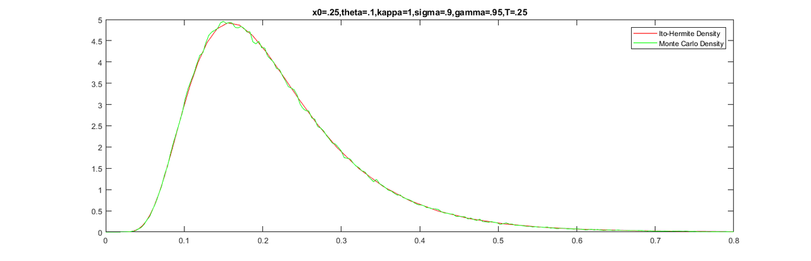
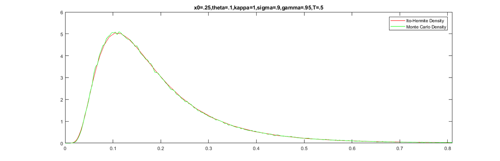
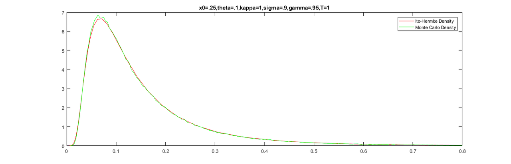
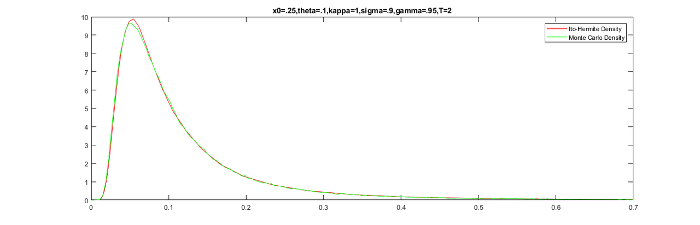
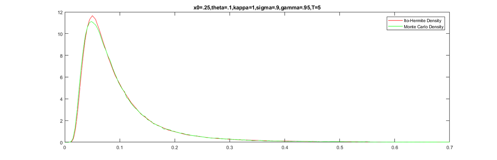

# Breakthrough in the theory of stochastic differential equations and their simulation

**Page 17 of 65** — Posts #801–#850

[← Previous](page_016.md) | [Index](index.md) | [Next →](page_018.md)

---

### #801 — Amin (Topic Author)
*September 1, 2019, 2:34 PM*

**(broken latex: Unbalanced $: 143)**

```latex
Since my work is very close to completion, I would like to explain my method in a more formal way.

Let us consider a non-linear SDE of the form

$dX(t)=\mu_1 X^{\beta_1}(t) dt +\mu_2 X^{\beta_2}(t) dt + \sigma X^{\gamma} dz(t)$

In my work I took a Lamperti transform of the above SDE and defined the new transformed variable as
$w(t)=\frac{X(t)^{(1-\gamma)}}{(1-\gamma)}$ . I did not take$\sigma$ in the denominator of the transformed variable.

Applying Ito change of variable formula on the transformed variable, we get

$dw(t)=d[\frac{X(t)^{(1-\gamma)}}{1-\gamma}]=\mu_1 X(t)^{(\beta_1-\gamma)} dt+ \mu_2 X(t)^{(\beta_2-\gamma)} dt$

$ -.5 \gamma {\sigma}^2 X(t)^{(\gamma-1)} dt +\sigma dz(t)$

Integral form of the above SDE would be written as

$w(t)=\frac{X(t)^{(1-\gamma)}}{1-\gamma}=w(0)+\int_0^t \mu_1 X(s)^{(\beta_1-\gamma)} ds+\int_0^t \mu_2 X(s)^{(\beta_2-\gamma)} ds$

$ -\int_0^t .5 \gamma {\sigma}^2 X(s)^{(\gamma-1)} ds +\int_0^t \sigma dz(s)$

To get a second order Ito-Taylor expansion, we will do a repeated Ito on each of the variable drift term of the above
transformed SDE of$w(t)$

Taking the repeated Ito of the first term in the SDE, we get

$\int_0^t \mu_1 X(s)^{(\beta_1-\gamma)} ds= \mu_1 X(0)^{(\beta_1-\gamma)} \int_0^t ds$

$ + \int_0^t \int_0^s \mu_1(\beta_1-\gamma) X(v)^{(\beta_1-\gamma-1)} (\mu_1 X(v)^{\beta_1} + \mu_2 X(v)^{\beta_2})dv ds$

$+\int_0^t \int_0^s \mu_1(\beta_1-\gamma) X(v)^{(\beta_1-\gamma-1)} \sigma X(v)^{\gamma} dz(v) ds$

$+\int_0^t \int_0^s .5 \mu_1  (\beta_1-\gamma)(\beta_1-\gamma-1) X(v)^{(\beta_1-\gamma-2)} {\sigma}^2 X(v)^{2 \gamma} dv ds$

notice that first term in the above expansion is calculated at initial time zero and rest of the terms are calculated
along the evolution path of the stochastic integrals. We could continue higher order expansion inside the integrals but
if the interval is small we can just stop the expansion and find a very good approximation by substituting the terms
that have to be calculated along the evolution path by their values at time zero. Our above expansion would become

$\int_0^t \mu_1 X(s)^{(\beta_1-\gamma)} ds]= \mu_1 X(0)^{(\beta_1-\gamma)} \int_0^t ds$

$ + \mu_1(\beta_1-\gamma) X(0)^{(\beta_1-\gamma-1)} (\mu_1 X(0)^{\beta_1} + \mu_2 X(0)^{\beta_2}) \int_0^t \int_0^s dv ds$

$+ \mu_1(\beta_1-\gamma) X(0)^{(\beta_1-\gamma-1)} \sigma X(0)^{\gamma} \int_0^t \int_0^s  dz(v) ds$

$+ .5 \mu_1(\beta_1-\gamma)(\beta_1-\gamma-1) X(0)^{(\beta_1-\gamma-2)} {\sigma}^2 X(0)^{2 \gamma} \int_0^t \int_0^s  dv ds$

We know from basic calculus and stochastic calculus that

$\int_0^t \int_0^s dv ds = \frac{t^2}{2} $ and

$\int_0^t \int_0^s dz(v) ds = (1-\frac{1}{\sqrt{3}}) t^{1.5} Z $ where $Z$ is a standard normal.

We have to find repeated Ito of all the three drift terms. There is no further expansion of the volatility terms as it
has no variable coefficients. After the Ito Taylor expansion of the all three drift terms, the expansion of the
transformed SDE becomes

$w(t)=\frac{X(t)^{(1-\gamma)}}{1-\gamma}=w(0)+ \mu_1 X(s)^{(\beta_1-\gamma)} {\Delta t}+ \mu_2 X(s)^{(\beta_2-\gamma)} {\Delta t}$

$ - .5 \gamma {\sigma}^2 X(s)^{(\gamma-1)} {\Delta t} $

$ + (\mu_1(\beta_1-\gamma) X(0)^{(\beta_1-\gamma-1)} +\mu_2(\beta_2-\gamma) X(0)^{(\beta_2-\gamma-1)} -.5\gamma (\gamma-1) X(0)^{(\gamma-2)})$

$* (\mu_1 X(0)^{\beta_1} + \mu_2 X(0)^{\beta_2})  \frac{{\Delta t}^2}{2}$

$+ .5 (\mu_1(\beta_1-\gamma)(\beta_1-\gamma-1) X(0)^{(\beta_1-\gamma-2)} +\mu_2(\beta_2-\gamma)(\beta_2-\gamma-1) X(0)^{(\beta_2-\gamma-2)} -.5\gamma (\gamma-1)(\gamma-2) X(0)^{(\gamma-3)} )$

$*{\sigma}^2 X(0)^{2 \gamma} \frac{{\Delta t}^2}{2}$

$+ \sigma \sqrt{\Delta t} Z$

$+ ( \mu_1(\beta_1-\gamma) X(0)^{(\beta_1-\gamma-1)} +  \mu_2(\beta_2-\gamma) X(0)^{(\beta_2-\gamma-1)}-.5\gamma (\gamma-1) X(0)^{(\gamma-2)}) (\sigma X(0)^{\gamma} ) (1-\frac{1}{\sqrt{3}}) {\Delta t}^{1.5} Z $

We can write the one step differential evolution equation as

$w(t+\Delta t)= w(t)+ \mu_{\Delta t} + \alpha_{\Delta t} Z $

where particularly

$\alpha_{\Delta t}= \sigma \sqrt{\Delta t}+ ( \mu_1(\beta_1-\gamma) X(0)^{(\beta_1-\gamma-1)} +  \mu_2(\beta_2-\gamma) X(0)^{(\beta_2-\gamma-1)}-.5\gamma (\gamma-1) X(0)^{(\gamma-2)}) (\sigma X(0)^{\gamma} ) (1-\frac{1}{\sqrt{3}}) {\Delta t}^{1.5})$

After looking at Ito-Taylor expansion, we proceed towards the main density evolution algorithm that advances the density
over each small time interval in our setting that is different from monte carlo simulation.

I have divided the density into N subdivisions with a value of normal random variable linearly associated with each
subdivision. In my program, these subdivisions are linearly associated with normal RV. Let$Z_n$ be value of normal RV
associated with nth subdivision with roughly$Z_1=-4.0$ and$Z_N=4.0$ . In my current program I have taken$N=46$ covering
the gaussian from -4.5 to +4.5.

I took Lamperti transform of the SDE in original coordinates X and the transformed SDE variable w became very linear
with respect to normal RV which greatly helped in analytics. In fact, in most of the SDEs only first order variance was
of relevance.

I define existing density as starting transformed density at any point$t$ in evolution and it is written as$w(t)$ , and
then a differential term is added for an evolution period$\Delta t$ and then we find density at next step$T=t+\Delta t$
denoted as$w(T)$

In order to calculate the one step evolution of first order variance, we have to calculate the first order Hermite
representation of the existing SDE along nth subdivision or nth point in the grid and also calculate the one step first
order hermite representation of the innovation/differential term. It is very easy to calculate the hermite represntation
of the differential term due to Ito-Taylor expansion of the SDE and there is a huge literature on that. With help of
Ito-Taylor expansion we can easily calculate the evolution in terms of hermite polynomials and thereby decompose the
variance into first order and higher orders based on association with each hermite polynomial of different order. After
taking Lamperti transform, it was usually the first order variance that was significant. But despite taking Lamperti
transform, on each step SDE still evolves slightly non linearly due to non-linearity in drift terms and it was not
straightforward how to represent the existing SDE variable$w(t)$ in terms of hermite polynomials. If we could represent
the existing and differential parts of the SDE variable in terms of hermite polynomials, we could get a representation
of the evolved variable$w_T(n)$ in terms of hermite polynomial.

Hermite representation of existing SDE variable on each point of the evolving grid could be represented as
$w_t(n)=\mu_w+\alpha_t(n)Z(n)$ and hermite representation of the differential term could be written as
$w_{\Delta t}(n)=\mu_{\Delta t}(n)+ \alpha_{\Delta t}(n) Z(n)$ , then representation of evolved SDE at next step
$T=t+\Delta t$ i.e$w_T$ could be written as
$w_T(n)= \mu_{\Delta t}(n)+\mu_w+ \sqrt{{\alpha}^2_t(n)+{\alpha}^2_{\Delta t}(n)} Z(n)$

where $\mu_w$ associated with existing density w(t) is defined as $\mu_w = \int_{-inf}^{+inf} w p(w) dw$

Here$\mu_{\Delta t}(n)$ is the total deterministic contribution from all the drift terms in the SDE for the nth
subdivision for time interval$\Delta t$ .

Again it was very easy to find a Hermite representation of the differential part of SDE due to Ito-Taylor but it was not
simple at all to find a hermite representation of the existing SDE on each step. My contribution came in here as I
noticed that$w(t)$ was very close to scaled Z and it could be possible to omit the step of finding the hermite
representation of the existing SDE and instead use the first order evolution equation for the SDE as

$w_T(n)=\mu_{\Delta t}(n)+\mu_{w} + \sqrt{(w_t(n)-\mu_{w})^2+(\alpha_{\Delta t}(n) Z(n))^2}$

This worked since$w_t$ is reasonably linear with respect to Z due to Lamperti transform and$w_t(n)-\mu_w$ was a valid
proxy for$\alpha_t(n) Z(n)$ .

When I made this first step approximation, things worked perfectly with linear SDEs where$w(t)$ remains linear with$Z$ .
But particularly for mean reverting type SDEs which have multiple terms in the drift and when volatility is high, due to
non-linear dynamics in the drift, a huge quantity of second order derivative of$w(t)$ with respect to$Z$ is introduced
and dealing with the first order is not enough to get good results for the density of mean reverting type SDEs.

Then a recent breakthrough came when I found from my experiments that second order hermite term in the expansion of the
existing SDE$w(t)$ was making a contribution to the SDE evolution. If we denote the hermite representation of$w(t)$ up
to second order as$w_t(n)=\alpha_t(n) Z(n) + \beta_t(n) (Z^2(n)-1)$ .

This contribution from the coefficients of second hermite polynomial to one step evolution of the SDE was empirically
found up to a positive scaling constant$c$ as equal to$ -.5 c \beta_t(n)(Z^2(n)-1) {\sigma}^2(t) \frac{\Delta t}{2}$

Here $\sigma(t)$ is volatility in the noise term of the SDE.

But again all of this was approximate since it is not very simple to find a hermite representation of the existing SDE
and it was particularly difficult to find coefficients of second hermite polynomial accurately. So analogously to my
approximation for coefficients of coefficients of first order hermite polynomials for the existing density, I devised a
similar approximation to coefficients of second order hermite polynomial and used the formula

$\beta_t(n) (Z^2(n)-1) = (w_t(n)-\mu_w)^2- \sigma^2_w$ which is very valid due to high relative linearity of the
transformed variable.

So our contribution from the second order derivative from the surface of w(t) could now be written as

$-.5 c \beta_t(n)(Z^2(n)-1) {\sigma}^2(t) \frac{\Delta t}{2} = -.5 c ((w_t(n)-\mu_w)^2- \sigma^2_w)  {\sigma}^2(t) \frac{\Delta t}{2}$

Here $\sigma^2_w=\int_{-\inf}^{+\inf} (w-\mu_w)^2 p(w) dw$

if there is a contribution from the second order hermite polynomial of differential part of SDE evolution, it would be
added to the above second order contribution from the existing surface w(t) in a squared fashion and resulting second
order addition to one step evolution of the SDE would become as

$\sqrt{(.5 c ((w_t(n)-\mu_w)^2- \sigma^2_w)  {\sigma}^2(t) \frac{\Delta t}{2})^2 + (\beta_{\Delta t}(n) (Z(n)^2-1))^2}$

where$ \beta_{\Delta t} $ are the coefficients of second order hermite polynomial in the Ito-Taylor expansion of the
differential term of the SDE. After the second order correction, the evolution equation for the SDE becomes

$w_T(n)=\mu_{\Delta t}(n)+\mu_{w} + \sqrt{(w_t(n)-\mu_{w})^2+(\alpha_{\Delta t}(n) Z(n))^2}$

$+ \sqrt{(.5 c ((w_t(n)-\mu_w)^2- \sigma^2_w)  {\sigma}^2(t) \frac{\Delta t}{2})^2 + (\beta_{\Delta t}(n) (Z(n)^2-1))^2}$

In our simulations we found that second order contribution from the differential term after taking Lamperti transform
was completely miniscule as compared to the second order contribution from the existing density surface and this
contribution from differential term to the density average never made a difference of more than one basis point (.0001)
in our simulations with high volatility and mean reversion. We write this as

 $\beta_{\Delta t}(n) (Z(n)^2-1)
```

---

### #802 — Amin (Topic Author)
*September 1, 2019, 2:46 PM*

Here is a slightly modified program from previous post 800. It has corrected a mistake that was not making a difference
in the evolution of transformed SDE but could make a difference if one tried to simulate SDE in original variables

.

```
function [] = ItoTaylorDensityMRRecombining14F4Wilmott()
%Copyright Ahsan Amin. Infiniti derivatives Technologies.
%Please fell free to connect on linkedin: linkedin.com/in/ahsan-amin-0a53334
%or skype ahsan.amin2999
%In this program, I am simulating the SDE given as
%dy(t)=mu1 x(t)^beta1 dt + mu2 x(t)^beta2 dt +sigma x(t)^gamma dz(t)
%where mu1=kappa*theta and mu2=-kappa with
%beta1=0 and beta2=1;
%I have not directly simulated the SDE but simulated the transformed
%Bessel process version of the SDE and then changed coordinates to retreive
%the SDE in original coordinates.
%The present program will analytically evolve only the Bessel Process version of the
%SDE in transformed coordinates.
%The present program is meant for mean-reversion SDEs that take two terms
%in non-linear drift. It will work for simpler SDEs but for that you will
%have to turn SecondOC variable, second order correction variable to zero.
%
%For diffusions going into zero, you may see instabilities, I have not
%corrected for that yet in this initial version.
%Heston is still not good as substantial density goes into zero at
%practically realistic vol.
%Heston when density does not hit zero will work perfectly.
%I try volatility power/gamma above .65 0r .70
%gamma=.95 is proxy for lognormal, the best and coveted SV model but
%not used due to lack of tractibility.
%HEston and even smaller gamma will work far better when
%x0=1 and theta=1 as in Interest rate LMM like models with local volatility.
%Very close to zero, heston does not work very well. Whenever substantial
%density goes into zero, model performance deteriorates.
dt=.125/32;   % Simulation time interval.%For diffusions close to zero
             %decrease dt for accuracy.
Tt=32*80;     % Number of simulation levels. Terminal time= Tt*dt; //.125/32*32*16=2 year;
OrderA=2;  %Keep at two.
OrderM=2;  %Keep at two.
dtM=.125/4;%Monte carlo time interval size dtM.
TtM=4*80;%Monte carlo number of simulation intervals.

dNn=.2/1;   % Normal density subdivisions width. would change with number of subdivisions
Nn=46;  % No of normal density subdivisions
NnMidl=23;%One half left from mid of normal density(low)
NnMidh=24;%One half right from the mid of normal density(high)
NnMid=4.0;

x0=.250;   % starting value of SDE
beta1=0.0;   % the first drift term power.
beta2=1.0;   % Second drift term power.
gamma=.95;   % volatility power.
kappa=.950;   %mean reversion parameter.
theta=.10;   %mean reversion target

mu1=1*theta*kappa;   %first drift coefficient.
mu2=-1*kappa;    % Second drift coefficient.
sigma0=.850;%Volatility value
alpha=1;% x^alpha is being expanded. This is currently for monte carlo only.
alpha1=1-gamma;
y(1:Nn)=x0;
w(1:Nn)=x0^(1-gamma)/(1-gamma);
Z(1:Nn)=(((1:Nn)-3.5)*dNn-NnMid);
H4(1:Nn)=Z(1:Nn).^4-6*Z(1:Nn)+3;

ZProb(1)=normcdf(.5*Z(1)+.5*Z(2),0,1)-normcdf(.5*Z(1)+.5*Z(2)-dNn,0,1);
ZProb(Nn)=normcdf(.5*Z(Nn)+.5*Z(Nn-1)+dNn,0,1)-normcdf(.5*Z(Nn)+.5*Z(Nn-1),0,1);

for nn=2:Nn-1
    ZProb(nn)=normcdf(.5*Z(nn)+.5*Z(nn+1),0,1)-normcdf(.5*Z(nn)+.5*Z(nn-1),0,1);
    %Above calculate probability mass in each probability subdivision.
end

 dt2=dt^2/2;
 dt3=dt^3/6.0;
 dtsqrt=sqrt(dt);
 dtonehalf=dt.^1.5;

wnStart=1;
SecondOC(1:Nn)=0;
SecondD(1:Nn)=0.0;
tic

for tt=1:Tt

    yy(wnStart:Nn)=((1-gamma)*w(wnStart:Nn)).^(1/(1-gamma));

    theta1=mu1;
    theta2=mu2;
    theta3=.5*sigma0^2*(-gamma);
    omega1=beta1-gamma;
    omega2=beta2-gamma;
    omega3=gamma-1;

    GG(wnStart:Nn)=theta1*yy(wnStart:Nn).^omega1+theta2*yy(wnStart:Nn).^omega2+theta3*yy(wnStart:Nn).^omega3;
    dGG(wnStart:Nn)=omega1*theta1*yy(wnStart:Nn).^(omega1-1)+omega2*theta2*yy(wnStart:Nn).^(omega2-1)+ ...
        omega3*theta3*yy(wnStart:Nn).^(omega3-1);
    DD(wnStart:Nn)=mu1*yy(wnStart:Nn).^beta1+mu2*yy(wnStart:Nn).^beta2;
    dGG2(wnStart:Nn)=theta1*omega1*(omega1-1).*yy(wnStart:Nn).^(omega1-2)+ ...
        theta2*omega2*(omega2-1).*yy(wnStart:Nn).^(omega2-2)+ ...
        theta3*omega3*(omega3-1).*yy(wnStart:Nn).^(omega3-2);
    QQ(wnStart:Nn)=sigma0^2*yy(wnStart:Nn).^(2*gamma);
    ddGGDD(wnStart:Nn)=mu1*omega1*theta1*(omega1+beta1-1).*yy(wnStart:Nn).^(omega1+beta1-2)+ ...
        mu1*omega2*theta2*(omega2+beta1-1).*yy(wnStart:Nn).^(omega2+beta1-2)+ ...
        mu1*omega3*theta3*(omega3+beta1-1).*yy(wnStart:Nn).^(omega3+beta1-2)+ ...
        mu2*omega1*theta1*(omega1+beta2-1).*yy(wnStart:Nn).^(omega1+beta2-2)+ ...
        mu2*omega2*theta2*(omega2+beta2-1).*yy(wnStart:Nn).^(omega2+beta2-2)+ ...
        mu2*omega3*theta3*(omega3+beta2-1).*yy(wnStart:Nn).^(omega3+beta2-2);
    d2dGGDD(wnStart:Nn)=mu1*omega1*theta1*(omega1+beta1-1).*(omega1+beta1-2).*yy(wnStart:Nn).^(omega1+beta1-3)+ ...
        mu1*omega2*theta2*(omega2+beta1-1).*(omega2+beta1-2).*yy(wnStart:Nn).^(omega2+beta1-3)+ ...
        mu1*omega3*theta3*(omega3+beta1-1).*(omega3+beta1-2).*yy(wnStart:Nn).^(omega3+beta1-3)+ ...
        mu2*omega1*theta1*(omega1+beta2-1).*(omega1+beta2-2).*yy(wnStart:Nn).^(omega1+beta2-3)+ ...
        mu2*omega2*theta2*(omega2+beta2-1).*(omega2+beta2-2).*yy(wnStart:Nn).^(omega2+beta2-3)+ ...
        mu2*omega3*theta3*(omega3+beta2-1).*(omega3+beta2-2).*yy(wnStart:Nn).^(omega3+beta2-3);
    ddGG2QQ(wnStart:Nn)=theta1*sigma0^2.*omega1*(omega1-1).*(omega1+2*gamma-2).*yy(wnStart:Nn).^(omega1+2*gamma-3)+ ...
        sigma0^2*theta2*omega2*(omega2-1).*(omega2+2*gamma-2).*yy(wnStart:Nn).^(omega2+2*gamma-3)+ ...
        sigma0^2*theta3*omega3*(omega3-1).*(omega3+2*gamma-2).*yy(wnStart:Nn).^(omega3+2*gamma-3);
   
d2dGG2QQ(wnStart:Nn)=theta1*sigma0^2.*omega1*(omega1-1).*(omega1+2*gamma-2).*(omega1+2*gamma-3).*yy(wnStart:Nn).^(omega1+2*gamma-4)+
...
        sigma0^2*theta2*omega2*(omega2-1).*(omega2+2*gamma-2).*(omega2+2*gamma-3).*yy(wnStart:Nn).^(omega2+2*gamma-4)+
...
        sigma0^2*theta3*omega3*(omega3-1).*(omega3+2*gamma-2).*(omega3+2*gamma-3).*yy(wnStart:Nn).^(omega3+2*gamma-4);

    VV(wnStart:Nn)=sigma0.*yy(wnStart:Nn).^gamma;
    d_dGG_VV_dyy(wnStart:Nn)= ...
        sigma0.*omega1.*theta1.*(omega1+gamma-1).*yy(wnStart:Nn).^(omega1+gamma-2) + ...
        sigma0.*omega2.*theta2.*(omega2+gamma-1).*yy(wnStart:Nn).^(omega2+gamma-2) + ...
        sigma0.*omega3.*theta3.*(omega3+gamma-1).*yy(wnStart:Nn).^(omega3+gamma-2);

    wMu0dt(wnStart:Nn)=GG(wnStart:Nn)*dt + dGG(wnStart:Nn).*DD(wnStart:Nn).*dt2 + ...
        .5*dGG2(wnStart:Nn).*QQ(wnStart:Nn).*dt2 + ...
        ddGGDD(wnStart:Nn).*DD(wnStart:Nn).*dt3 + ...
        .5*ddGG2QQ(wnStart:Nn).*DD(wnStart:Nn).*dt3 + ...
        .5*d2dGGDD(wnStart:Nn).*QQ(wnStart:Nn).*dt3 + ...
        .25*d2dGG2QQ(wnStart:Nn).*QQ(wnStart:Nn).*dt3;
%    c0(wnStart:Nn)=-1*d_dGG_VV_dyy(wnStart:Nn).*VV(wnStart:Nn).*(1/sqrt(2.0).*(1-sqrt(2.0)/2.0)).*dt.^2.0;
    c1(wnStart:Nn)=sigma0.*dtsqrt+dGG(wnStart:Nn).*VV(wnStart:Nn).*(1-1/sqrt(3.0)).*dtonehalf ;
    c2(wnStart:Nn)=d_dGG_VV_dyy(wnStart:Nn).*VV(wnStart:Nn).*(1/sqrt(2.0).*(1-sqrt(2.0)/2.0)).*dt.^2.0;
%    dw0(wnStart:Nn)=(sigma0.*Z(wnStart:Nn).^1.*dtsqrt+ ...
%        dGG(wnStart:Nn).*VV(wnStart:Nn).*(1-1/sqrt(3.0)).*Z(wnStart:Nn).^1.*dtonehalf + ... %;%+ ...
%        1*d_dGG_VV_dyy(wnStart:Nn).*VV(wnStart:Nn).*(1/sqrt(2.0).*(1-sqrt(2.0)/2.0)).*dt.^2.0.*(Z(wnStart:Nn).^2-1));
    dw(wnStart:Nn)=c1(wnStart:Nn).*Z(wnStart:Nn);% + ...
    d2w(wnStart:Nn)=c2(wnStart:Nn).*(Z(wnStart:Nn).^2-1);
   dw2(wnStart:Nn)=c1(wnStart:Nn).^2.0.*Z(wnStart:Nn).^2;% + ...
   d2w2(wnStart:Nn)= c2(wnStart:Nn).^2.*(Z(wnStart:Nn).^4-2*Z(wnStart:Nn).^2+1);

    w(isnan(w)==1)=0;

    wMu0dt(isnan(wMu0dt)==1)=0;

    wMeanPrev=sum(ZProb(wnStart:Nn).*w(wnStart:Nn));%Calculate the mean.
    w2MeanPrev=sum(ZProb(wnStart:Nn).*(w(wnStart:Nn)-wMeanPrev).^2);
    SOT(wnStart:Nn)=-1/sqrt(2*pi)*.5*((w(wnStart:Nn)-wMeanPrev).^2-w2MeanPrev).*sigma0^2*dt/2;
    w(wnStart:Nn)=wMeanPrev+wMu0dt(wnStart:Nn)+  ...
        (sign(SOT(wnStart:Nn)+d2w(wnStart:Nn))).*...
        sqrt(abs(sign(SOT(wnStart:Nn)).*SOT(wnStart:Nn).^2+ ...
        sign(d2w(wnStart:Nn)).*d2w2(wnStart:Nn)))+ ...
        sign(w(wnStart:Nn)-wMeanPrev+dw(wnStart:Nn)).* ...
        sqrt(abs(sign(w(wnStart:Nn)-wMeanPrev).*(w(wnStart:Nn)-wMeanPrev).^2+ ...
        sign(dw(wnStart:Nn)).*dw2(wnStart:Nn)));

%Calculation of dt-integral starts
D1wl=(11/6*w(NnMidl-2)-3*w(NnMidl-3)+3/2*w(NnMidl-4)-1/3*w(NnMidl-5))/dNn;
    D2wl=(35/12*w(NnMidl-2)	-26/3*w(NnMidl-3)+	19/2*w(NnMidl-4)-14/3*w(NnMidl-5)+11/12*w(NnMidl-6))/dNn.^2;
    DeltaD1w=(w(NnMidh+2)-w(NnMidl-2)-5*D1wl*dNn-5.0*D2wl*dNn.^2.0/1.0)/12.50/dNn;

    wll(NnMidl-1)=w(NnMidl-2)+(.5*(D1wl+D2wl*dNn/1)+.5*(D1wl+D2wl*dNn/1+DeltaD1w))*dNn;
    wll(NnMidl)=wll(NnMidl-1)+(.5*(D1wl+D2wl*dNn/1+1.0*DeltaD1w)+.5*(D1wl+D2wl*dNn/1+2.0*DeltaD1w))*dNn;
    wll(NnMidh)=wll(NnMidl)+(.5*(D1wl+D2wl*dNn/1+2.0*DeltaD1w)+.5*(D1wl+D2wl*dNn/1+3.0*DeltaD1w))*dNn;
    wll(NnMidh+1)=wll(NnMidh)+(.5*(D1wl+D2wl*dNn/1+3.0*DeltaD1w)+.5*(D1wl+D2wl*dNn/1+4.0*DeltaD1w))*dNn;

%
    D1wh=(-11/6*w(NnMidh+2)+3*w(NnMidh+3)-3/2*w(NnMidh+4)+1/3*w(NnMidh+5))/dNn;
    D2wh=(35/12*w(NnMidh+2)	-26/3*w(NnMidh+3)+	19/2*w(NnMidh+4)-14/3*w(NnMidh+5)+11/12*w(NnMidh+6))/dNn.^2;
    DeltaD1w=(w(NnMidh+2)-w(NnMidl-2)-5*D1wh*dNn-5.0*D2wh*dNn.^2.0/1.0)/12.50/dNn;
%

    whh(NnMidh+1)=w(NnMidh+2)-(.5*(D1wh+D2wh*dNn/1)+.5*(D1wh+D2wh*dNn/1+DeltaD1w))*dNn;
    whh(NnMidh)=whh(NnMidh+1)-(.5*(D1wh+D2wh*dNn/1+1*DeltaD1w)+.5*(D1wh+D2wh*dNn/1+2.0*DeltaD1w))*dNn;
    whh(NnMidl)=whh(NnMidh)-(.5*(D1wh+D2wh*dNn/1+2.0*DeltaD1w)+.5*(D1wh+D2wh*dNn/1+3.0*DeltaD1w))*dNn;
    whh(NnMidl-1)=whh(NnMidl)-(.5*(D1wh+D2wh*dNn/1+3.0*DeltaD1w)+.5*(D1wh+D2wh*dNn/1+4.0*DeltaD1w))*dNn;

    w(NnMidh+1)=.5*whh(NnMidh+1)+.5*wll(NnMidh+1);
    w(NnMidh)=.5*whh(NnMidh)+.5*wll(NnMidh);
    w(NnMidl)=.5*whh(NnMidl)+.5*wll(NnMidl);
    w(NnMidl-1)=.5*whh(NnMidl-1)+.5*wll(NnMidl-1);

        w1(1:Nn-1)=w(1:Nn-1);
        w2(1:Nn-1)=w(2:Nn);
        w(w1(:)>w2(:))=0;%Be careful;might not universally hold;

        w(w<0)=0.0;
        for nn=1:Nn
            if(w(nn)<=0)
                wnStart=nn+1;
           end
       end
end

 y_w(1:Nn)=0;
 y_w(wnStart:Nn) = ((1-gamma)*w(wnStart:Nn)).^(1/(1-gamma));
 Dfy_w(wnStart:Nn)=0;
 Dfw(wnStart:Nn)=0;
for nn=wnStart+1:Nn-1
    Dfy_w(nn) = (y_w(nn + 1) - y_w(nn - 1))/(Z(nn + 1) - Z(nn - 1));
    Dfw(nn) = (w(nn + 1) - w(nn - 1))/(Z(nn + 1) - Z(nn - 1));
    %Change of variable derivative for densities
end
fy_w(1:Nn)=0;
fw(1:Nn)=0;
for nn = wnStart:Nn-1
    fy_w(nn) = (normpdf(Z(nn),0, 1))/abs(Dfy_w(nn));%Origianl coordinates density
    fw(nn) = (normpdf(Z(nn),0, 1))/abs(Dfw(nn));
end

toc
str=input('Analytic Values calculated; Press a key to start monte carlo');

sigma11(1:OrderA+1)=0;
mu11(1:OrderA+1)=0;
mu22(1:OrderA+1)=0;
sigma22(1:OrderA+1)=0;
% index 1 correponds to zero level since matlab indexing starts at one.
sigma11(1)=1;
mu11(1)=1;
mu22(1)=1;
sigma22(1)=1;

for k=1:(OrderA+1)
    if sigma0~=0
        sigma11(k)=sigma0^(k-1);
    end
    if mu1 ~= 0
        mu11(k)=mu1^(k-1);
    end
    if mu2 ~= 0
        mu22(k)=mu2^(k-1);
    end
    if sigma0~=0
        sigma22(k)=sigma0^(2*(k-1));
    end
end
Ft(1:TtM+1,1:(OrderA+1),1:(OrderA+1),1:(OrderA+1),1:(OrderA+1))=0; %General time powers on hermite polynomials
Fp(1:(OrderA+1),1:(OrderA+1),1:(OrderA+1),1:(OrderA+1))=0;%General x powers on coefficients of hermite polynomials.
Fp1(1:(OrderA+1),1:(OrderA+1),1:(OrderA+1),1:(OrderA+1))=0;%General x powers for bessel transformed coordinates.
%Pre-compute the time and power exponent values in small multi-dimensional arrays
for k = 0 : (OrderA+1)
    for m = 0:k
        l4 = k - m + 1;
        for n = 0 : m
            l3 = m - n + 1;
            for j = 0:n
                l2 = n - j + 1;
                l1 = j + 1;
                Ft(l1,l2,l3,l4) = dtM^((l1-1) + (l2-1) + (l3-1) + .5* (l4-1));
                Fp(l1,l2,l3,l4) = (alpha + (l1-1) * beta1 + (l2-1) * beta2 + (l3-1) * 2* gamma + (l4-1) * gamma ...
                    - (l1-1) - (l2-1) - 2* (l3-1) - (l4-1));
                Fp1(l1,l2,l3,l4) = (alpha1 + (l1-1) * beta1 + (l2-1) * beta2 + (l3-1) * 2* gamma + (l4-1) * gamma ...
                    - (l1-1) - (l2-1) - 2* (l3-1) - (l4-1));

            end
        end
    end
end
%Below call the program that calculates the Ito-Taylor coeffs.
YCoeff = ItoTaylorCoeffsNew(alpha,beta1,beta2,gamma);
Yq=ItoTaylorCoeffsNew(alpha1,beta1,beta2,gamma);
YqCoeff=Yq/(1-gamma);%These coordinates are divided by (1-gamma)
 %Calculate the density with monte carlo below.
 rng(85109634, 'twister')
 paths=200000;
 YY(1:paths)=x0;  %Original process monte carlo.
 YY2dt(1:paths)=0.0;
 %YY4dt(1:paths)=0.0;
 X(1:paths)=x0^(1-gamma)/(1-gamma);
 Random1(1:paths)=0;
 for tt=1:TtM
     t1=tt*dtM;
     t0=(tt-1)*dtM;
     Random1=randn(size(Random1));
     HermiteP1(1,1:paths)=1;
     HermiteP1(2,1:paths)=Random1(1:paths);
     HermiteP1(3,1:paths)=Random1(1:paths).^2-1;
     YY0=YY;
     YYPrev=YY;
     XX0=X;

     for k = 0 : OrderM
         for m = 0:k
             l4 = k - m + 1;
             for n = 0 : m
                 l3 = m - n + 1;
                 for j = 0:n
                     l2 = n - j + 1;
                     l1 = j + 1;
                     if(l4<=5)

                      X(1:paths)=X(1:paths) + YqCoeff(l1,l2,l3,l4) * ...
                     mu11(l1)*mu22(l2)*sigma22(l3)*sigma11(l4)* ...
                     ((1-gamma)*XX0(1:paths)).^(Fp1(l1,l2,l3,l4)/(1-gamma)) .* ...
                     HermiteP1(l4,1:paths) * Ft(l1,l2,l3,l4);

                     YY(1:paths)=YY(1:paths) + YCoeff(l1,l2,l3,l4) * ...
                     mu11(l1)*mu22(l2)*sigma22(l3)*sigma11(l4)* ...
                     YY0(1:paths).^Fp(l1,l2,l3,l4) .* HermiteP1(l4,1:paths) * Ft(l1,l2,l3,l4);
                 %Above is original coordinates monte carlo equation.
                     end
                 end
             end
         end
     end
 end
 YY(YY<0)=0;
 X(X<0)=0;

 sum(YY(:))/paths %origianl coordinates monte carlo average.
 sum(y_w(wnStart+1:Nn-1).*ZProb(wnStart+1:Nn-1)) %Original process average from coordinates
 theta+(x0-theta)*exp(-kappa*dt*Tt)%Mean reverting SDE original variable true average

 BinSize=.0075/4;%Please change this bin size accordingly. When data range is too small decrease it.
 %When density range is too large increase it.Roughly, When starting point of SDE is
 %1, set at .0075*2; when starting point is x0=.1, set at .0075/4.0;
 MaxCutOff=30;
 [YDensity,IndexOutY,IndexMaxY] = MakeDensityFromSimulation_Infiniti(YY,paths,BinSize,MaxCutOff);
 plot(y_w(wnStart+1:Nn-1),fy_w(wnStart+1:Nn-1),'r',IndexOutY(1:IndexMaxY),YDensity(1:IndexMaxY),'g');
 str=input('red line is density of SDE from orthogonal incrments method, green is monte carlo.');

end
```

---

### #803 — Amin (Topic Author)
*September 6, 2019, 5:26 PM*

For the friends, who have been following the research, there are two new developments that I want to present.

1. Density Moments Defect correcting Hermite Polynomials.

I worked with this idea several years ago for the mean of the distribution but generalized it to higher moments just a
few days ago. I have still not worked with higher moments but this is a very good idea. When the density shape is very
close to the true shape and moments are also quite close to the true value, moment defect correcting Hermite polynomials
can be a wonderful approach. I will explain the idea with the mean first and then generalize to higher moments.

Suppose we know the true mean$\mu_1$ of a density X, and we have a density grid on N points with each point represented
by$X(n)$ .We multiply the density with an expression of the form$a(X(n)-b)$ and place the restrictions that equation for
density sums to one and equation for mean sums to$\mu_1$ .This can be written in equations. Since I used summations in
my program, it can be written as

Equation 1.   $\sum_1^{N} a(X(n)-b) P(X(n))=1.0$ where P(X(n)) is integrated probability mass in nth subdivision.

Equation 2.  $\sum_1^{N} a(X(n)-b) X(n) P(X(n))=\mu_1$

So we have two equations and two unknowns and we could very easily solve for the unknowns 'a' and 'b' . Even first order
correction works wonders since mean is corrected under the constraint that density sums to one. In my implementation, I
did not change the density but updated the density variable as

$X_{Corrected}(n)=a(X(n)-b)X(n)$ . First Mean correcting polynomial is usually a line with miniscule slope increasing
the density on one side of b and decreasing it on the other side of b with the constraint that density still sums to
one. If the defect is small, density remains positive and b is chosen outside of the support of the density. But it
would be better to add 1.0 to the correction polynomial as I have done in generalized example below. After I got the
density scaling coefficients, I did not change the density and kept the density on the original Z grid and only scaled X
as its scaling has exactly the same meanings as changing the amplitude of density.

Generalizing to higher order moment defect correcting hermite polynomimals, we have after including a second order
hermite polynomial that corrects for variance, we get the following three equations which can be algebraically solved
for three unknowns as

Equation 1. $\sum_1^N (1.0+\sigma_c (X(n)-\mu_c) + \kappa_c( (X(n)-\mu_c)^2 - {\sigma}^2_c)) P(X_n)=1$

Equation 2.$\sum_1^N (1.0+\sigma_c (X(n)-\mu_c) + \kappa_c( (X(n)-\mu_c)^2 - {\sigma}^2_c)) X(n) P(X_n)=\mu_1$

Equation 2.$\sum_1^N (1.0+\sigma_c (X(n)-\mu_c) + \kappa_c( (X(n)-\mu_c)^2 - {\sigma}^2_c)) X^2(n) P(X_n)=\mu_2$

Here$\mu_c$ ,$\sigma_c$ and$\kappa_c$ , the coefficients with subscript c are respectively mean, and coefficients of
first and second mean correcting hermite polynomials. And corrected value of X(n) would be

$X_{Corrected}(n)=  (1.0+\sigma_c (X(n)-\mu_c) + \kappa_c( (X(n)-\mu_c)^2 - {\sigma}^2_c)) X(n)$

If we know the moments upto fourth order and we can easily solve the resulting five equations algebraically, we can
write the equations for

mean correction in terms of four hermite polynomijals and make sure first four moments are good. I have done this with
only the mean yet. I will post a program with first order defect correction with graphs on the weekend.

2. Density Construction Algorithm Improvement.

I have been able to get analytic density shapes very close to the true density. Previously analytic density was usually
more peaked in the middle which remained problematic but this problem has decreased to a high degree. I have been able
to get far better density shapes by slightly changing the mean I have used in the one step density simulation algorithm.
Usually mean is higher than median in the Lamperti transformed coordinates but the difference is very small. The
difference is almost zero when second derivative in the density is not significant but the difference is slightly larger
for mean reverting type densities which have a significant second derivative with respect to normal density. setting the
mean at a slightly higher value helps make the shape of density more exact. This new mean can be written as

new mean = true mean + .25*( true mean - median)

This addition to true mean is very small but helps bring the shape of the density closer to true shape especially where
we saw a larger peak, the peak is closer to true value.

I will be putting more worked out code with these two above mentioned improvements over the weekend. I will also be
showing a lot of graph comparisons with true density for a range of values of parameters for the SDEs.

---

### #804 — Amin (Topic Author)
*September 8, 2019, 7:38 AM*

I am writing this post to mention that I have added a 1.0 to moment defect correcting hermite polynomial equations. If
you looked at the equations earlier, please note that I have made a slight change and edited the equations to add a one.

---

### #805 — Amin (Topic Author)
*September 14, 2019, 6:23 PM*

Here are a few graphs showing a comparison between monte carlo density and Ito-Hermite method density. Here the SDE is

X(t+1)=X(t)+kappa(theta-X(t))*dt +sigma * X(t)^gamma *dz(t);   with X(0)=x0; Graphs are self-explanatory. In the next
post, I will give the code used to make these graphs.

The graphs for T>=2 years are slightly off at the peak of the density. This is because I chose some constants by trial
and error and did not have enough time today to perfect the values to complete precision.

First moment is matched by moment matching technique as I had mentioned in a previous post.

[](https://postimg.cc/zyWP3yHz)

[](https://postimg.cc/3yTfG32g)

[](https://postimg.cc/FfVWgwxw)

[](https://postimg.cc/hh5CrL94)

[](https://postimg.cc/PP0RtWxV)

---

### #806 — Amin (Topic Author)
*September 14, 2019, 6:32 PM*

I realized that second hermite polynomial related to existing density not only requires a volatility adjustment, it also
requires a drift adjustment and I had far better results after including a drift adjustment for second hermite. I will
post another updated program in a few days with updated coefficients as the current coefficients were chosen only with a
rough trial and error and needed more work to be determined to perfect precision. I showed the graphs for x0=.25 and
theta =.1. but for interest rate derivatives, the results were more impressive when x0=1 and theta =1 as usually taken
in interest rate derivatives. I will be showing those graphs later. Here is the new code.

```
function [] = ItoHermiteMethodWilmott()
%Copyright Ahsan Amin. Infiniti derivatives Technologies.
%Please fell free to connect on linkedin: linkedin.com/in/ahsan-amin-0a53334
%or skype ahsan.amin2999
%In this program, I am simulating the SDE given as
%dy(t)=mu1 x(t)^beta1 dt + mu2 x(t)^beta2 dt +sigma x(t)^gamma dz(t)
%where mu1=kappa*theta and mu2=-kappa with
%beta1=0 and beta2=1;
%I have not directly simulated the SDE but simulated the transformed
%Bessel process version of the SDE and then changed coordinates to retreive
%the SDE in original coordinates.
%The present program will analytically evolve only the Bessel Process version of the
%SDE in transformed coordinates.
%The present program is meant for mean-reversion SDEs that take two terms
%in non-linear drift. It will work for simpler SDEs but for that you will
%have to turn SecondOC variable, second order correction variable to zero.
%
%For diffusions going into zero, you may see instabilities, I have not
%corrected for that yet in this initial version.
%Heston is still not good as substantial density goes into zero at
%practically realistic vol.
%Heston when density does not hit zero will work perfectly.
%I try volatility power/gamma above .65 0r .70
%gamma=.95 is proxy for lognormal, the best and coveted SV model but
%not used due to lack of tractibility.
%HEston and even smaller gamma will work far better when
%x0=1 and theta=1 as in Interest rate LMM like models with local volatility.
%Very close to zero, heston does not work very well. Whenever substantial
%density goes into zero, model performance deteriorates.
dt=.125/8;   % Simulation time interval.%Fodiffusions close to zero
             %decrease dt for accuracy.
Tt=8*2;     % Number of simulation levels. Terminal time= Tt*dt; //.125/32*32*16=2 year;
OrderA=2;  %Keep at two.
OrderM=2;  %Keep at two.
dtM=.125/4;%Monte carlo time interval size dtM.
TtM=4*2;%Monte carlo number of simulation intervals.

dNn=.2/1;   % Normal density subdivisions width. would change with number of subdivisions
Nn=46;  % No of normal density subdivisions
NnMidl=23;%One half left from mid of normal density(low)
NnMidh=24;%One half right from the mid of normal density(high)
NnMid=4.0;

x0=.250;   % starting value of SDE
beta1=0.0;   % the first drift term power.
beta2=1.0;   % Second drift term power.
gamma=.95;   % volatility power.
kappa=1.0;   %mean reversion parameter.
theta=.10;   %mean reversion target
%MonteTp5dtp03125x0p1Thp1Ka1Gap75Sip8

mu1=1*theta*kappa;   %first drift coefficient.
mu2=-1*kappa;    % Second drift coefficient.
sigma0=.90;%Volatility value
alpha=1;% x^alpha is being expanded. This is currently for monte carlo only.
alpha1=1-gamma;

w(1:Nn)=x0^(1-gamma)/(1-gamma);
Z(1:Nn)=(((1:Nn)-3.5)*dNn-NnMid);

Z
str=input('Look at Z');
ZProb(1)=normcdf(.5*Z(1)+.5*Z(2),0,1)-normcdf(.5*Z(1)+.5*Z(2)-dNn,0,1);
ZProb(Nn)=normcdf(.5*Z(Nn)+.5*Z(Nn-1)+dNn,0,1)-normcdf(.5*Z(Nn)+.5*Z(Nn-1),0,1);

for nn=2:Nn-1
    ZProb(nn)=normcdf(.5*Z(nn)+.5*Z(nn+1),0,1)-normcdf(.5*Z(nn)+.5*Z(nn-1),0,1);
    %Above calculate probability mass in each probability subdivision.
end

 dt2=dt^2/2;
 dt3=dt^3/6.0;
 dtsqrt=sqrt(dt);
 dtonehalf=dt.^1.5;

wnStart=1;
tic

for tt=1:Tt

    yy(wnStart:Nn)=((1-gamma)*w(wnStart:Nn)).^(1/(1-gamma));

    theta1=mu1;
    theta2=mu2;
    theta3=.5*sigma0^2*(-gamma);
    omega1=beta1-gamma;
    omega2=beta2-gamma;
    omega3=gamma-1;

    GG(wnStart:Nn)=theta1*yy(wnStart:Nn).^omega1+theta2*yy(wnStart:Nn).^omega2+theta3*yy(wnStart:Nn).^omega3;
    dGG(wnStart:Nn)=omega1*theta1*yy(wnStart:Nn).^(omega1-1)+omega2*theta2*yy(wnStart:Nn).^(omega2-1)+ ...
        omega3*theta3*yy(wnStart:Nn).^(omega3-1);
    DD(wnStart:Nn)=mu1*yy(wnStart:Nn).^beta1+mu2*yy(wnStart:Nn).^beta2;
    dGG2(wnStart:Nn)=theta1*omega1*(omega1-1).*yy(wnStart:Nn).^(omega1-2)+ ...
        theta2*omega2*(omega2-1).*yy(wnStart:Nn).^(omega2-2)+ ...
        theta3*omega3*(omega3-1).*yy(wnStart:Nn).^(omega3-2);
    QQ(wnStart:Nn)=sigma0^2*yy(wnStart:Nn).^(2*gamma);
    ddGGDD(wnStart:Nn)=mu1*omega1*theta1*(omega1+beta1-1).*yy(wnStart:Nn).^(omega1+beta1-2)+ ...
        mu1*omega2*theta2*(omega2+beta1-1).*yy(wnStart:Nn).^(omega2+beta1-2)+ ...
        mu1*omega3*theta3*(omega3+beta1-1).*yy(wnStart:Nn).^(omega3+beta1-2)+ ...
        mu2*omega1*theta1*(omega1+beta2-1).*yy(wnStart:Nn).^(omega1+beta2-2)+ ...
        mu2*omega2*theta2*(omega2+beta2-1).*yy(wnStart:Nn).^(omega2+beta2-2)+ ...
        mu2*omega3*theta3*(omega3+beta2-1).*yy(wnStart:Nn).^(omega3+beta2-2);
    d2dGGDD(wnStart:Nn)=mu1*omega1*theta1*(omega1+beta1-1).*(omega1+beta1-2).*yy(wnStart:Nn).^(omega1+beta1-3)+ ...
        mu1*omega2*theta2*(omega2+beta1-1).*(omega2+beta1-2).*yy(wnStart:Nn).^(omega2+beta1-3)+ ...
        mu1*omega3*theta3*(omega3+beta1-1).*(omega3+beta1-2).*yy(wnStart:Nn).^(omega3+beta1-3)+ ...
        mu2*omega1*theta1*(omega1+beta2-1).*(omega1+beta2-2).*yy(wnStart:Nn).^(omega1+beta2-3)+ ...
        mu2*omega2*theta2*(omega2+beta2-1).*(omega2+beta2-2).*yy(wnStart:Nn).^(omega2+beta2-3)+ ...
        mu2*omega3*theta3*(omega3+beta2-1).*(omega3+beta2-2).*yy(wnStart:Nn).^(omega3+beta2-3);
    ddGG2QQ(wnStart:Nn)=theta1*sigma0^2.*omega1*(omega1-1).*(omega1+2*gamma-2).*yy(wnStart:Nn).^(omega1+2*gamma-3)+ ...
        sigma0^2*theta2*omega2*(omega2-1).*(omega2+2*gamma-2).*yy(wnStart:Nn).^(omega2+2*gamma-3)+ ...
        sigma0^2*theta3*omega3*(omega3-1).*(omega3+2*gamma-2).*yy(wnStart:Nn).^(omega3+2*gamma-3);
   
d2dGG2QQ(wnStart:Nn)=theta1*sigma0^2.*omega1*(omega1-1).*(omega1+2*gamma-2).*(omega1+2*gamma-3).*yy(wnStart:Nn).^(omega1+2*gamma-4)+
...
        sigma0^2*theta2*omega2*(omega2-1).*(omega2+2*gamma-2).*(omega2+2*gamma-3).*yy(wnStart:Nn).^(omega2+2*gamma-4)+
...
        sigma0^2*theta3*omega3*(omega3-1).*(omega3+2*gamma-2).*(omega3+2*gamma-3).*yy(wnStart:Nn).^(omega3+2*gamma-4);

    VV(wnStart:Nn)=sigma0.*yy(wnStart:Nn).^gamma;
    d_dGG_VV_dyy(wnStart:Nn)= ...
        sigma0.*omega1.*theta1.*(omega1+gamma-1).*yy(wnStart:Nn).^(omega1+gamma-2) + ...
        sigma0.*omega2.*theta2.*(omega2+gamma-1).*yy(wnStart:Nn).^(omega2+gamma-2) + ...
        sigma0.*omega3.*theta3.*(omega3+gamma-1).*yy(wnStart:Nn).^(omega3+gamma-2);

    wMu0dt(wnStart:Nn)=GG(wnStart:Nn)*dt + dGG(wnStart:Nn).*DD(wnStart:Nn).*dt2 + ...
        .5*dGG2(wnStart:Nn).*QQ(wnStart:Nn).*dt2 + ...
        ddGGDD(wnStart:Nn).*DD(wnStart:Nn).*dt3 + ...
        .5*ddGG2QQ(wnStart:Nn).*DD(wnStart:Nn).*dt3 + ...
        .5*d2dGGDD(wnStart:Nn).*QQ(wnStart:Nn).*dt3 + ...
        .25*d2dGG2QQ(wnStart:Nn).*QQ(wnStart:Nn).*dt3;
    %    c0(wnStart:Nn)=-1*d_dGG_VV_dyy(wnStart:Nn).*VV(wnStart:Nn).*(1/sqrt(2.0).*(1-sqrt(2.0)/2.0)).*dt.^2.0;
    c1(wnStart:Nn)=sigma0.*dtsqrt+dGG(wnStart:Nn).*VV(wnStart:Nn).*(1-1/sqrt(3.0)).*dtonehalf;
    c2(wnStart:Nn)=d_dGG_VV_dyy(wnStart:Nn).*VV(wnStart:Nn).*(1/sqrt(2.0).*(1-sqrt(2.0)/2.0)).*dt.^2.0;
%    dw0(wnStart:Nn)=(sigma0.*Z(wnStart:Nn).^1.*dtsqrt+ ...
%        dGG(wnStart:Nn).*VV(wnStart:Nn).*(1-1/sqrt(3.0)).*Z(wnStart:Nn).^1.*dtonehalf + ... %;%+ ...
%        1*d_dGG_VV_dyy(wnStart:Nn).*VV(wnStart:Nn).*(1/sqrt(2.0).*(1-sqrt(2.0)/2.0)).*dt.^2.0.*(Z(wnStart:Nn).^2-1));
    dw(wnStart:Nn)=c1(wnStart:Nn).*Z(wnStart:Nn);% + ...
   dw2(wnStart:Nn)=c1(wnStart:Nn).^2.0.*Z(wnStart:Nn).^2;
%    d2w(wnStart:Nn)=c2(wnStart:Nn).*(Z(wnStart:Nn).^2-1);
%   d2w2(wnStart:Nn)= c2(wnStart:Nn).^2.*(Z(wnStart:Nn).^4-2*Z(wnStart:Nn).^2+1);

    w(isnan(w)==1)=0;

    wMu0dt(isnan(wMu0dt)==1)=0;

    wMeanPrev=sum(ZProb(wnStart:Nn).*w(wnStart:Nn));%Calculate the mean.
    w2MeanPrev=sum(ZProb(wnStart:Nn).*(w(wnStart:Nn)-wMeanPrev).^2);
    %SOT_dz2(wnStart:Nn)=-(1/sqrt(2*pi))*gamma*((w(wnStart:Nn)-wMeanPrev).^2-w2MeanPrev).*c1(wnStart:Nn).^2/2;
    %SOT_mudt(wnStart:Nn)=-(1/sqrt(2*pi))*.25*((w(wnStart:Nn)-wMeanPrev).^2-w2MeanPrev).*wMu0dt(wnStart:Nn);

    SOT_dz2(wnStart:Nn)=-.5*gamma^2*((w(wnStart:Nn)-wMeanPrev).^2-w2MeanPrev).*c1(wnStart:Nn).^2/2;
    SOT_mudt(wnStart:Nn)=-(1/sqrt(2*pi))*.33*((w(wnStart:Nn)-wMeanPrev).^2-w2MeanPrev).*wMu0dt(wnStart:Nn);

    %wPrev=w;
    w(wnStart:Nn)=wMeanPrev+wMu0dt(wnStart:Nn)+  ...
        SOT_dz2(wnStart:Nn)+ ...
        SOT_mudt(wnStart:Nn)+ ...
        sign(w(wnStart:Nn)-wMeanPrev+dw(wnStart:Nn)).* ...
        sqrt(abs(sign(w(wnStart:Nn)-wMeanPrev).*(w(wnStart:Nn)-wMeanPrev).^2+ ...
        sign(dw(wnStart:Nn)).*dw2(wnStart:Nn)));

%Calculation of dt-integral starts
D1wl=(11/6*w(NnMidl-2)-3*w(NnMidl-3)+3/2*w(NnMidl-4)-1/3*w(NnMidl-5))/dNn;
    D2wl=(35/12*w(NnMidl-2) -26/3*w(NnMidl-3)+ 19/2*w(NnMidl-4)-14/3*w(NnMidl-5)+11/12*w(NnMidl-6))/dNn.^2;
    DeltaD1w=(w(NnMidh+2)-w(NnMidl-2)-5*D1wl*dNn-5.0*D2wl*dNn.^2.0/1.0)/12.50/dNn;

    wll(NnMidl-1)=w(NnMidl-2)+(.5*(D1wl+D2wl*dNn/1)+.5*(D1wl+D2wl*dNn/1+DeltaD1w))*dNn;
    wll(NnMidl)=wll(NnMidl-1)+(.5*(D1wl+D2wl*dNn/1+1.0*DeltaD1w)+.5*(D1wl+D2wl*dNn/1+2.0*DeltaD1w))*dNn;
    wll(NnMidh)=wll(NnMidl)+(.5*(D1wl+D2wl*dNn/1+2.0*DeltaD1w)+.5*(D1wl+D2wl*dNn/1+3.0*DeltaD1w))*dNn;
    wll(NnMidh+1)=wll(NnMidh)+(.5*(D1wl+D2wl*dNn/1+3.0*DeltaD1w)+.5*(D1wl+D2wl*dNn/1+4.0*DeltaD1w))*dNn;

%
    D1wh=(-11/6*w(NnMidh+2)+3*w(NnMidh+3)-3/2*w(NnMidh+4)+1/3*w(NnMidh+5))/dNn;
    D2wh=(35/12*w(NnMidh+2) -26/3*w(NnMidh+3)+ 19/2*w(NnMidh+4)-14/3*w(NnMidh+5)+11/12*w(NnMidh+6))/dNn.^2;
    DeltaD1w=(w(NnMidh+2)-w(NnMidl-2)-5*D1wh*dNn-5.0*D2wh*dNn.^2.0/1.0)/12.50/dNn;
%     DeltaD1w=(w(NnMidh+2)-w(NnMidl-1)-4*D1wh*dNn-16.0*D2wh*dNn.^2.0/1.0)/6.0/dNn;

    whh(NnMidh+1)=w(NnMidh+2)-(.5*(D1wh+D2wh*dNn/1)+.5*(D1wh+D2wh*dNn/1+DeltaD1w))*dNn;
    whh(NnMidh)=whh(NnMidh+1)-(.5*(D1wh+D2wh*dNn/1+1*DeltaD1w)+.5*(D1wh+D2wh*dNn/1+2.0*DeltaD1w))*dNn;
    whh(NnMidl)=whh(NnMidh)-(.5*(D1wh+D2wh*dNn/1+2.0*DeltaD1w)+.5*(D1wh+D2wh*dNn/1+3.0*DeltaD1w))*dNn;
    whh(NnMidl-1)=whh(NnMidl)-(.5*(D1wh+D2wh*dNn/1+3.0*DeltaD1w)+.5*(D1wh+D2wh*dNn/1+4.0*DeltaD1w))*dNn;

    w(NnMidh+1)=.5*whh(NnMidh+1)+.5*wll(NnMidh+1);
    w(NnMidh)=.5*whh(NnMidh)+.5*wll(NnMidh);
    w(NnMidl)=.5*whh(NnMidl)+.5*wll(NnMidl);
    w(NnMidl-1)=.5*whh(NnMidl-1)+.5*wll(NnMidl-1);

        w1(1:Nn-1)=w(1:Nn-1);
        w2(1:Nn-1)=w(2:Nn);
        w(w1(:)>w2(:))=0;%Be careful;might not universally hold;

        w(w<0)=0.0;
        for nn=1:Nn
            if(w(nn)<=0)
                wnStart=nn+1;
           end
        end

        %%1st order mean correction. We know the mean in original
        %%coordinates so I shift the density into original coordinates,
        %%apply the mean correction and then transform again into Lamperti
        %%coordinates. Algebra solves two equations in two unknowns.
        %%Equations are Sum_0^N{(Y_w(wnStart:Nn)-Y0)*W0}=1 and the second
        %%equation is Sum_0^N{Y_w(wnStart:Nn).*(Y_w(wnStart:Nn)-Y0)*W0}=u0
        %%Two unknows are Y0 and W0. u0 is known mean.

        u0=theta+(x0-theta)*exp(-kappa*(tt*dt)); %analytic mean of the density
        %If you are not using stochastic volatility, replace above with
        %true mean otherwise results would become garbage.

        Y_w(wnStart:Nn) = ((1-gamma)*w(wnStart:Nn)).^(1/(1-gamma));

        Yn2Pn=sum(Y_w(wnStart:Nn).*Y_w(wnStart:Nn).*ZProb(wnStart:Nn));
        YnPn=sum(Y_w(wnStart:Nn).*ZProb(wnStart:Nn));
        Pn=1.0;%%Sum(ZProb(1:Nn))
        Y0=(Yn2Pn-u0*YnPn)/(YnPn-u0*Pn);

        Y0Pn=Y0*Pn;
        W0=1/(YnPn-Y0Pn);
        YCorrected(wnStart:Nn)=Y_w(wnStart:Nn).*(Y_w(wnStart:Nn)-Y0)*W0;

        wCorrected(wnStart:Nn)=(YCorrected(wnStart:Nn).^(1-gamma))./(1-gamma);

        w(wnStart:Nn)=wCorrected(wnStart:Nn);

end

 y_w(1:Nn)=0;
 y_w(wnStart:Nn) = ((1-gamma)*w(wnStart:Nn)).^(1/(1-gamma));
 Dfy_w(wnStart:Nn)=0;
 Dfw(wnStart:Nn)=0;
for nn=wnStart+1:Nn-1
    Dfy_w(nn) = (y_w(nn + 1) - y_w(nn - 1))/(Z(nn + 1) - Z(nn - 1));
    Dfw(nn) = (w(nn + 1) - w(nn - 1))/(Z(nn + 1) - Z(nn - 1));
    %Change of variable derivative for densities
end
fy_w(1:Nn)=0;
fw(1:Nn)=0;
for nn = wnStart:Nn-1
    fy_w(nn) = (normpdf(Z(nn),0, 1))/abs(Dfy_w(nn));%Origianl coordinates density
    fw(nn) = (normpdf(Z(nn),0, 1))/abs(Dfw(nn));
end

toc
str=input('Analytic Values calculated; Press a key to start monte carlo');

sigma11(1:OrderA+1)=0;
mu11(1:OrderA+1)=0;
mu22(1:OrderA+1)=0;
sigma22(1:OrderA+1)=0;
% index 1 correponds to zero level since matlab indexing starts at one.
sigma11(1)=1;
mu11(1)=1;
mu22(1)=1;
sigma22(1)=1;

for k=1:(OrderA+1)
    if sigma0~=0
        sigma11(k)=sigma0^(k-1);
    end
    if mu1 ~= 0
        mu11(k)=mu1^(k-1);
    end
    if mu2 ~= 0
        mu22(k)=mu2^(k-1);
    end
    if sigma0~=0
        sigma22(k)=sigma0^(2*(k-1));
    end
end
Ft(1:TtM+1,1:(OrderA+1),1:(OrderA+1),1:(OrderA+1),1:(OrderA+1))=0; %General time powers on hermite polynomials
Fp(1:(OrderA+1),1:(OrderA+1),1:(OrderA+1),1:(OrderA+1))=0;%General x powers on coefficients of hermite polynomials.
Fp1(1:(OrderA+1),1:(OrderA+1),1:(OrderA+1),1:(OrderA+1))=0;%General x powers for bessel transformed coordinates.
%Pre-compute the time and power exponent values in small multi-dimensional arrays
for k = 0 : (OrderA+1)
    for m = 0:k
        l4 = k - m + 1;
        for n = 0 : m
            l3 = m - n + 1;
            for j = 0:n
                l2 = n - j + 1;
                l1 = j + 1;
                Ft(l1,l2,l3,l4) = dtM^((l1-1) + (l2-1) + (l3-1) + .5* (l4-1));
                Fp(l1,l2,l3,l4) = (alpha + (l1-1) * beta1 + (l2-1) * beta2 + (l3-1) * 2* gamma + (l4-1) * gamma ...
                    - (l1-1) - (l2-1) - 2* (l3-1) - (l4-1));
                Fp1(l1,l2,l3,l4) = (alpha1 + (l1-1) * beta1 + (l2-1) * beta2 + (l3-1) * 2* gamma + (l4-1) * gamma ...
                    - (l1-1) - (l2-1) - 2* (l3-1) - (l4-1));

            end
        end
    end
end
%Below call the program that calculates the Ito-Taylor coeffs.
YCoeff = ItoTaylorCoeffsNew(alpha,beta1,beta2,gamma);
%Yq=ItoTaylorCoeffsNew(alpha1,beta1,beta2,gamma);
%YqCoeff=Yq/(1-gamma);%These coordinates are divided by (1-gamma)
 %Calculate the density with monte carlo below.
 rng(85109634, 'twister')
 paths=500000;
 YY(1:paths)=x0;  %Original process monte carlo.
% YY2dt(1:paths)=0.0;
 %YY4dt(1:paths)=0.0;
 X(1:paths)=x0^(1-gamma)/(1-gamma);
 Random1(1:paths)=0;
 for tt=1:TtM
 %    t1=tt*dtM;
 %    t0=(tt-1)*dtM;
     Random1=randn(size(Random1));
     HermiteP1(1,1:paths)=1;
     HermiteP1(2,1:paths)=Random1(1:paths);
     HermiteP1(3,1:paths)=Random1(1:paths).^2-1;
     HermiteP1(4,1:paths)=Random1(1:paths).^3-3*Random1(1:paths);
     HermiteP1(5,1:paths)=Random1(1:paths).^4-6*Random1(1:paths).^2+3;
     YY0=YY;
  %   YYPrev=YY;
  %   XX0=X;

     for k = 0 : OrderM
         for m = 0:k
             l4 = k - m + 1;
             for n = 0 : m
                 l3 = m - n + 1;
                 for j = 0:n
                     l2 = n - j + 1;
                     l1 = j + 1;
                     if(l4<=5)

  %                    X(1:paths)=X(1:paths) + YqCoeff(l1,l2,l3,l4) * ...
  %                   mu11(l1)*mu22(l2)*sigma22(l3)*sigma11(l4)* ...
  %                   ((1-gamma)*XX0(1:paths)).^(Fp1(l1,l2,l3,l4)/(1-gamma)) .* ...
  %                   HermiteP1(l4,1:paths) * Ft(l1,l2,l3,l4);

                     YY(1:paths)=YY(1:paths) + YCoeff(l1,l2,l3,l4) * ...
                     mu11(l1)*mu22(l2)*sigma22(l3)*sigma11(l4)* ...
                     YY0(1:paths).^Fp(l1,l2,l3,l4) .* HermiteP1(l4,1:paths) * Ft(l1,l2,l3,l4);
                 %Above is original coordinates monte carlo equation.
                     end
                 end
             end
         end
     end
 end
 YY(YY<0)=0;

 sum(YY(:))/paths %origianl coordinates monte carlo average.
 sum(y_w(wnStart+1:Nn-1).*ZProb(wnStart+1:Nn-1)) %Original process average from coordinates
 theta+(x0-theta)*exp(-kappa*dt*Tt)%Mean reverting SDE original variable true average

 BinSize=.0075/2;%Please change this bin size accordingly. When data range is too small decrease it.
 %When density range is too large increase it.Roughly, When starting point of SDE is
 %x0=1, set at .0075*2; when starting point is x0=.1, set at .0075/2.0;
 MaxCutOff=30;
 [YDensity,IndexOutY,IndexMaxY] = MakeDensityFromSimulation_Infiniti(YY,paths,BinSize,MaxCutOff);
 plot(y_w(wnStart+1:Nn-1),fy_w(wnStart+1:Nn-1),'r',IndexOutY(1:IndexMaxY),YDensity(1:IndexMaxY),'g');
 title('x0=.25,theta=.1,kappa=1,sigma=.9,gamma=.95,T=.25')
 legend({'Ito-Hermite Density','Monte Carlo Density'},'Location','northeast')

 str=input('red line is density of SDE from Ito-Hermite method, green is monte carlo.');

end
```

---

### #807 — Amin (Topic Author)
*September 15, 2019, 6:58 PM*

Here are some more graphs for interest to people in interest rate derivatives. These graphs are for diffusion with
x0=theta=1. with volatility exponent gamma .55, .75 and .95 with various different maturities. There is one graph for
gamma=.45

---

### #808 — Amin (Topic Author)
*September 21, 2019, 10:47 AM*

I am releasing the new version of the mean-reverting diffusions Ito-Hermite density simulation program. Previous version
had a serious problem that when kappa was away from one, the results sharply deteriorated. I have perfectly fixed the
problem and now the program works perfectly well for any combination of kappa and volatility. It works very well for
extremely low and extremely high values of kappa. I will post more graphs in a few hours.This is very close to the last
version and can easily be used in industrial settings.  Here is the program.

```
function [] = ItoHermiteMethodWilmott04()
%Copyright Ahsan Amin. Infiniti derivatives Technologies.
%Please fell free to connect on linkedin: linkedin.com/in/ahsan-amin-0a53334
%or skype ahsan.amin2999
%In this program, I am simulating the SDE given as
%dy(t)=mu1 x(t)^beta1 dt + mu2 x(t)^beta2 dt +sigma x(t)^gamma dz(t)
%where mu1=kappa*theta and mu2=-kappa with
%beta1=0 and beta2=1;
%I have not directly simulated the SDE but simulated the transformed
%Bessel process version of the SDE and then changed coordinates to retreive
%the SDE in original coordinates.
%The present program will analytically evolve only the Bessel Process version of the
%SDE in transformed coordinates.
%The present program is meant for mean-reversion SDEs that take two terms
%in non-linear drift. It will work for simpler SDEs but for that you will
%have to turn SecondOC variable, second order correction variable to zero.
%
%For diffusions going into zero, you may see instabilities, I have not
%corrected for that yet in this initial version.
%Heston is still not good as substantial density goes into zero at
%practically realistic vol.
%Heston when density does not hit zero will work perfectly.
%I try volatility power/gamma above .65 0r .70
%gamma=.95 is proxy for lognormal, the best and coveted SV model but
%not used due to lack of tractibility.
%HEston and even smaller gamma will work far better when
%x0=1 and theta=1 as in Interest rate LMM like models with local volatility.
%Very close to zero, heston does not work very well. Whenever substantial
%density goes into zero, model performance deteriorates.
dt=.125/16;   % Simulation time interval.%Fodiffusions close to zero
             %decrease dt for accuracy.
Tt=16*8;     % Number of simulation levels. Terminal time= Tt*dt; //.125/32*32*16=2 year;
OrderA=2;  %Keep at two.
OrderM=2;  %Keep at two.
dtM=.125/4;%Monte carlo time interval size dtM.
TtM=4*8;%Monte carlo number of simulation intervals.

dNn=.2/1;   % Normal density subdivisions width. would change with number of subdivisions
Nn=50;  % No of normal density subdivisions
NnMidl=25;%One half left from mid of normal density(low)
NnMidh=26;%One half right from the mid of normal density(high)
NnMid=4.0;

x0=1.0;   % starting value of SDE
beta1=0.0;   % the first drift term power.
beta2=1.0;   % Second drift term power.
gamma=.950;   % volatility power.
kappa=2.0;   %mean reversion parameter.
theta=.250;   %mean reversion target
%MonteTp5dtp03125x0p1Thp1Ka1Gap75Sip8

mu1=1*theta*kappa;   %first drift coefficient.
mu2=-1*kappa;    % Second drift coefficient.
sigma0=1.0;%Volatility value
alpha=1;% x^alpha is being expanded. This is currently for monte carlo only.
alpha1=1-gamma;

w(1:Nn)=x0^(1-gamma)/(1-gamma);
Z(1:Nn)=(((1:Nn)-5.5)*dNn-NnMid);

Z
str=input('Look at Z');
ZProb(1)=normcdf(.5*Z(1)+.5*Z(2),0,1)-normcdf(.5*Z(1)+.5*Z(2)-dNn,0,1);
ZProb(Nn)=normcdf(.5*Z(Nn)+.5*Z(Nn-1)+dNn,0,1)-normcdf(.5*Z(Nn)+.5*Z(Nn-1),0,1);

for nn=2:Nn-1
    ZProb(nn)=normcdf(.5*Z(nn)+.5*Z(nn+1),0,1)-normcdf(.5*Z(nn)+.5*Z(nn-1),0,1);
    %Above calculate probability mass in each probability subdivision.
end

 dt2=dt^2/2;
 dt3=dt^3/6.0;
 dtsqrt=sqrt(dt);
 dtonehalf=dt.^1.5;

wnStart=1;%\\\\\\\\\\\\\\\\\\\\\\\\\\\\\\\\\\\\\\\\\\\\\\\\\\\\\\\\\\\\\\\\\\\\\\\\\\\\\\\\\\\\\\\\\\\\\\1;
Coeff2(wnStart:Nn)=0.0;
SOT_mudt(wnStart:Nn)=0.0;
SOT_dz2(wnStart:Nn)=0.0;

tic

for tt=1:Tt

    yy(wnStart:Nn)=((1-gamma)*w(wnStart:Nn)).^(1/(1-gamma));

    theta1=mu1;
    theta2=mu2;
    theta3=.5*sigma0^2*(-gamma);
    omega1=beta1-gamma;
    omega2=beta2-gamma;
    omega3=gamma-1;

    GG(wnStart:Nn)=theta1*yy(wnStart:Nn).^omega1+theta2*yy(wnStart:Nn).^omega2+theta3*yy(wnStart:Nn).^omega3;
    dGG(wnStart:Nn)=omega1*theta1*yy(wnStart:Nn).^(omega1-1)+omega2*theta2*yy(wnStart:Nn).^(omega2-1)+ ...
        omega3*theta3*yy(wnStart:Nn).^(omega3-1);
    DD(wnStart:Nn)=mu1*yy(wnStart:Nn).^beta1+mu2*yy(wnStart:Nn).^beta2;
    dGG2(wnStart:Nn)=theta1*omega1*(omega1-1).*yy(wnStart:Nn).^(omega1-2)+ ...
        theta2*omega2*(omega2-1).*yy(wnStart:Nn).^(omega2-2)+ ...
        theta3*omega3*(omega3-1).*yy(wnStart:Nn).^(omega3-2);
    QQ(wnStart:Nn)=sigma0^2*yy(wnStart:Nn).^(2*gamma);
    ddGGDD(wnStart:Nn)=mu1*omega1*theta1*(omega1+beta1-1).*yy(wnStart:Nn).^(omega1+beta1-2)+ ...
        mu1*omega2*theta2*(omega2+beta1-1).*yy(wnStart:Nn).^(omega2+beta1-2)+ ...
        mu1*omega3*theta3*(omega3+beta1-1).*yy(wnStart:Nn).^(omega3+beta1-2)+ ...
        mu2*omega1*theta1*(omega1+beta2-1).*yy(wnStart:Nn).^(omega1+beta2-2)+ ...
        mu2*omega2*theta2*(omega2+beta2-1).*yy(wnStart:Nn).^(omega2+beta2-2)+ ...
        mu2*omega3*theta3*(omega3+beta2-1).*yy(wnStart:Nn).^(omega3+beta2-2);
    d2dGGDD(wnStart:Nn)=mu1*omega1*theta1*(omega1+beta1-1).*(omega1+beta1-2).*yy(wnStart:Nn).^(omega1+beta1-3)+ ...
        mu1*omega2*theta2*(omega2+beta1-1).*(omega2+beta1-2).*yy(wnStart:Nn).^(omega2+beta1-3)+ ...
        mu1*omega3*theta3*(omega3+beta1-1).*(omega3+beta1-2).*yy(wnStart:Nn).^(omega3+beta1-3)+ ...
        mu2*omega1*theta1*(omega1+beta2-1).*(omega1+beta2-2).*yy(wnStart:Nn).^(omega1+beta2-3)+ ...
        mu2*omega2*theta2*(omega2+beta2-1).*(omega2+beta2-2).*yy(wnStart:Nn).^(omega2+beta2-3)+ ...
        mu2*omega3*theta3*(omega3+beta2-1).*(omega3+beta2-2).*yy(wnStart:Nn).^(omega3+beta2-3);
    ddGG2QQ(wnStart:Nn)=theta1*sigma0^2.*omega1*(omega1-1).*(omega1+2*gamma-2).*yy(wnStart:Nn).^(omega1+2*gamma-3)+ ...
        sigma0^2*theta2*omega2*(omega2-1).*(omega2+2*gamma-2).*yy(wnStart:Nn).^(omega2+2*gamma-3)+ ...
        sigma0^2*theta3*omega3*(omega3-1).*(omega3+2*gamma-2).*yy(wnStart:Nn).^(omega3+2*gamma-3);
   
d2dGG2QQ(wnStart:Nn)=theta1*sigma0^2.*omega1*(omega1-1).*(omega1+2*gamma-2).*(omega1+2*gamma-3).*yy(wnStart:Nn).^(omega1+2*gamma-4)+
...
        sigma0^2*theta2*omega2*(omega2-1).*(omega2+2*gamma-2).*(omega2+2*gamma-3).*yy(wnStart:Nn).^(omega2+2*gamma-4)+
...
        sigma0^2*theta3*omega3*(omega3-1).*(omega3+2*gamma-2).*(omega3+2*gamma-3).*yy(wnStart:Nn).^(omega3+2*gamma-4);

    VV(wnStart:Nn)=sigma0.*yy(wnStart:Nn).^gamma;
    d_dGG_VV_dyy(wnStart:Nn)= ...
        sigma0.*omega1.*theta1.*(omega1+gamma-1).*yy(wnStart:Nn).^(omega1+gamma-2) + ...
        sigma0.*omega2.*theta2.*(omega2+gamma-1).*yy(wnStart:Nn).^(omega2+gamma-2) + ...
        sigma0.*omega3.*theta3.*(omega3+gamma-1).*yy(wnStart:Nn).^(omega3+gamma-2);

    wMu0dt(wnStart:Nn)=GG(wnStart:Nn)*dt + dGG(wnStart:Nn).*DD(wnStart:Nn).*dt2 + ...
        .5*dGG2(wnStart:Nn).*QQ(wnStart:Nn).*dt2 + ...
        ddGGDD(wnStart:Nn).*DD(wnStart:Nn).*dt3 + ...
        .5*ddGG2QQ(wnStart:Nn).*DD(wnStart:Nn).*dt3 + ...
        .5*d2dGGDD(wnStart:Nn).*QQ(wnStart:Nn).*dt3 + ...
        .25*d2dGG2QQ(wnStart:Nn).*QQ(wnStart:Nn).*dt3;
    %    c0(wnStart:Nn)=-1*d_dGG_VV_dyy(wnStart:Nn).*VV(wnStart:Nn).*(1/sqrt(2.0).*(1-sqrt(2.0)/2.0)).*dt.^2.0;
    c1(wnStart:Nn)=sigma0.*dtsqrt+dGG(wnStart:Nn).*VV(wnStart:Nn).*(1-1/sqrt(3.0)).*dtonehalf;
    c2(wnStart:Nn)=d_dGG_VV_dyy(wnStart:Nn).*VV(wnStart:Nn).*(1/sqrt(2.0).*(1-sqrt(2.0)/2.0)).*dt.^2.0;
    dw(wnStart:Nn)=c1(wnStart:Nn).*Z(wnStart:Nn);% + ...
   dw2(wnStart:Nn)=c1(wnStart:Nn).^2.0.*Z(wnStart:Nn).^2;

    w(isnan(w)==1)=0;

    wMu0dt(isnan(wMu0dt)==1)=0;

    wMeanPrev=sum(ZProb(wnStart:Nn).*w(wnStart:Nn));%Calculate the mean.
    w2MeanPrev=sum(ZProb(wnStart:Nn).*(w(wnStart:Nn)-wMeanPrev).^2);

   
 SOT_dz2(wnStart:Nn)=-.5*sqrt(kappa)*gamma^2*((w(wnStart:Nn)-wMeanPrev).^2-w2MeanPrev).*w(wnStart:Nn).^(1-gamma).*c1(wnStart:Nn).^2/2;
    SOT_mudt(wnStart:Nn)=-.125*((w(wnStart:Nn)-wMeanPrev).^2-w2MeanPrev).*wMu0dt(wnStart:Nn);

    w(wnStart:Nn)=wMeanPrev+wMu0dt(wnStart:Nn)+  ...
        +SOT_dz2(wnStart:Nn)+ ...
        +SOT_mudt(wnStart:Nn)+ ...
        sign(w(wnStart:Nn)-wMeanPrev+dw(wnStart:Nn)).* ...
        sqrt(abs(sign(w(wnStart:Nn)-wMeanPrev).*(w(wnStart:Nn)-wMeanPrev).^2+ ...
        sign(dw(wnStart:Nn)).*dw2(wnStart:Nn)));

%Calculation of dt-integral starts
    D1wl=(11/6*w(NnMidl-2)-3*w(NnMidl-3)+3/2*w(NnMidl-4)-1/3*w(NnMidl-5))/dNn;
    D2wl=(35/12*w(NnMidl-2)	-26/3*w(NnMidl-3)+	19/2*w(NnMidl-4)-14/3*w(NnMidl-5)+11/12*w(NnMidl-6))/dNn.^2;
    DeltaD1w=(w(NnMidh+2)-w(NnMidl-2)-5*D1wl*dNn-5.0*D2wl*dNn.^2.0/1.0)/12.50/dNn;

    wll(NnMidl-1)=w(NnMidl-2)+(.5*(D1wl+D2wl*dNn/1)+.5*(D1wl+D2wl*dNn/1+DeltaD1w))*dNn;
    wll(NnMidl)=wll(NnMidl-1)+(.5*(D1wl+D2wl*dNn/1+1.0*DeltaD1w)+.5*(D1wl+D2wl*dNn/1+2.0*DeltaD1w))*dNn;
    wll(NnMidh)=wll(NnMidl)+(.5*(D1wl+D2wl*dNn/1+2.0*DeltaD1w)+.5*(D1wl+D2wl*dNn/1+3.0*DeltaD1w))*dNn;
    wll(NnMidh+1)=wll(NnMidh)+(.5*(D1wl+D2wl*dNn/1+3.0*DeltaD1w)+.5*(D1wl+D2wl*dNn/1+4.0*DeltaD1w))*dNn;

%
    D1wh=(-11/6*w(NnMidh+2)+3*w(NnMidh+3)-3/2*w(NnMidh+4)+1/3*w(NnMidh+5))/dNn;
    D2wh=(35/12*w(NnMidh+2)	-26/3*w(NnMidh+3)+	19/2*w(NnMidh+4)-14/3*w(NnMidh+5)+11/12*w(NnMidh+6))/dNn.^2;
    DeltaD1w=(w(NnMidh+2)-w(NnMidl-2)-5*D1wh*dNn-5.0*D2wh*dNn.^2.0/1.0)/12.50/dNn;
%     DeltaD1w=(w(NnMidh+2)-w(NnMidl-1)-4*D1wh*dNn-16.0*D2wh*dNn.^2.0/1.0)/6.0/dNn;

    whh(NnMidh+1)=w(NnMidh+2)-(.5*(D1wh+D2wh*dNn/1)+.5*(D1wh+D2wh*dNn/1+DeltaD1w))*dNn;
    whh(NnMidh)=whh(NnMidh+1)-(.5*(D1wh+D2wh*dNn/1+1*DeltaD1w)+.5*(D1wh+D2wh*dNn/1+2.0*DeltaD1w))*dNn;
    whh(NnMidl)=whh(NnMidh)-(.5*(D1wh+D2wh*dNn/1+2.0*DeltaD1w)+.5*(D1wh+D2wh*dNn/1+3.0*DeltaD1w))*dNn;
    whh(NnMidl-1)=whh(NnMidl)-(.5*(D1wh+D2wh*dNn/1+3.0*DeltaD1w)+.5*(D1wh+D2wh*dNn/1+4.0*DeltaD1w))*dNn;

    w(NnMidh+1)=.5*whh(NnMidh+1)+.5*wll(NnMidh+1);
    w(NnMidh)=.5*whh(NnMidh)+.5*wll(NnMidh);
    w(NnMidl)=.5*whh(NnMidl)+.5*wll(NnMidl);
    w(NnMidl-1)=.5*whh(NnMidl-1)+.5*wll(NnMidl-1);

        w1(1:Nn-1)=w(1:Nn-1);
        w2(1:Nn-1)=w(2:Nn);
        w(w1(:)>w2(:))=0;%Be careful;might not universally hold;

        w(w=.95)
 BinSize=.0075*2;
 end
 %When density range is too large increase it.Roughly, When starting point of SDE is
 %x0=1, set at .0075*2; when starting point is x0=.1, set at .0075/2.0;
 MaxCutOff=30;
 [YDensity,IndexOutY,IndexMaxY] = MakeDensityFromSimulation_Infiniti(YY,paths,BinSize,MaxCutOff);
 plot(y_w(wnStart+1:Nn-1),fy_w(wnStart+1:Nn-1),'r',IndexOutY(1:IndexMaxY),YDensity(1:IndexMaxY),'g');
 title('x0=1.0,theta=1.0,kappa=1,sigma=.9,gamma=.95,T=.25')
 legend({'Ito-Hermite Density','Monte Carlo Density'},'Location','northeast')

 str=input('red line is density of SDE from Ito-Hermite method, green is monte carlo.');

end
```

---

### #809 — Amin (Topic Author)
*September 22, 2019, 5:32 PM*

Sorry friends there was a slight inadvertent mistake in the previous program. Fixed it here. I am posting the fixed
program. I will soon be posting graphs here as well. Please download this new program.

```
function [] = ItoHermiteMethodWilmott04()
%Copyright Ahsan Amin. Infiniti derivatives Technologies.
%Please fell free to connect on linkedin: linkedin.com/in/ahsan-amin-0a53334
%or skype ahsan.amin2999
%In this program, I am simulating the SDE given as
%dy(t)=mu1 x(t)^beta1 dt + mu2 x(t)^beta2 dt +sigma x(t)^gamma dz(t)
%where mu1=kappa*theta and mu2=-kappa with
%beta1=0 and beta2=1;
%I have not directly simulated the SDE but simulated the transformed
%Bessel process version of the SDE and then changed coordinates to retreive
%the SDE in original coordinates.
%The present program will analytically evolve only the Bessel Process version of the
%SDE in transformed coordinates.
%The present program is meant for mean-reversion SDEs that take two terms
%in non-linear drift. It will work for simpler SDEs but for that you will
%have to turn SecondOC variable, second order correction variable to zero.
%
%For diffusions going into zero, you may see instabilities, I have not
%corrected for that yet in this initial version.
%Heston is still not good as substantial density goes into zero at
%practically realistic vol.
%Heston when density does not hit zero will work perfectly.
%I try volatility power/gamma above .65 0r .70
%gamma=.95 is proxy for lognormal, the best and coveted SV model but
%not used due to lack of tractibility.
%HEston and even smaller gamma will work far better when
%x0=1 and theta=1 as in Interest rate LMM like models with local volatility.
%Very close to zero, heston does not work very well. Whenever substantial
%density goes into zero, model performance deteriorates.
dt=.125/16;   % Simulation time interval.%Fodiffusions close to zero
             %decrease dt for accuracy.
Tt=16*40;     % Number of simulation levels. Terminal time= Tt*dt; //.125/32*32*16=2 year;
OrderA=2;  %Keep at two.
OrderM=2;  %Keep at two.
dtM=.125/4;%Monte carlo time interval size dtM.
TtM=4*40;%Monte carlo number of simulation intervals.

dNn=.2/1;   % Normal density subdivisions width. would change with number of subdivisions
Nn=50;  % No of normal density subdivisions
NnMidl=25;%One half left from mid of normal density(low)
NnMidh=26;%One half right from the mid of normal density(high)
NnMid=4.0;

x0=1.0;   % starting value of SDE
beta1=0.0;   % the first drift term power.
beta2=1.0;   % Second drift term power.
gamma=.950;   % volatility power.
kappa=2.0;   %mean reversion parameter.
theta=.250;   %mean reversion target
%MonteTp5dtp03125x0p1Thp1Ka1Gap75Sip8

mu1=1*theta*kappa;   %first drift coefficient.
mu2=-1*kappa;    % Second drift coefficient.
sigma0=1.10;%Volatility value
alpha=1;% x^alpha is being expanded. This is currently for monte carlo only.
alpha1=1-gamma;

w(1:Nn)=x0^(1-gamma)/(1-gamma);
Z(1:Nn)=(((1:Nn)-5.5)*dNn-NnMid);

Z
str=input('Look at Z');
ZProb(1)=normcdf(.5*Z(1)+.5*Z(2),0,1)-normcdf(.5*Z(1)+.5*Z(2)-dNn,0,1);
ZProb(Nn)=normcdf(.5*Z(Nn)+.5*Z(Nn-1)+dNn,0,1)-normcdf(.5*Z(Nn)+.5*Z(Nn-1),0,1);

for nn=2:Nn-1
    ZProb(nn)=normcdf(.5*Z(nn)+.5*Z(nn+1),0,1)-normcdf(.5*Z(nn)+.5*Z(nn-1),0,1);
    %Above calculate probability mass in each probability subdivision.
end

 dt2=dt^2/2;
 dt3=dt^3/6.0;
 dtsqrt=sqrt(dt);
 dtonehalf=dt.^1.5;

wnStart=1;%\\\\\\\\\\\\\\\\\\\\\\\\\\\\\\\\\\\\\\\\\\\\\\\\\\\\\\\\\\\\\\\\\\\\\\\\\\\\\\\\\\\\\\\\\\\\\\1;
Coeff2(wnStart:Nn)=0.0;
SOT_mudt(wnStart:Nn)=0.0;
SOT_dz2(wnStart:Nn)=0.0;

tic

for tt=1:Tt

    yy(wnStart:Nn)=((1-gamma)*w(wnStart:Nn)).^(1/(1-gamma));

    theta1=mu1;
    theta2=mu2;
    theta3=.5*sigma0^2*(-gamma);
    omega1=beta1-gamma;
    omega2=beta2-gamma;
    omega3=gamma-1;

    GG(wnStart:Nn)=theta1*yy(wnStart:Nn).^omega1+theta2*yy(wnStart:Nn).^omega2+theta3*yy(wnStart:Nn).^omega3;
    dGG(wnStart:Nn)=omega1*theta1*yy(wnStart:Nn).^(omega1-1)+omega2*theta2*yy(wnStart:Nn).^(omega2-1)+ ...
        omega3*theta3*yy(wnStart:Nn).^(omega3-1);
    DD(wnStart:Nn)=mu1*yy(wnStart:Nn).^beta1+mu2*yy(wnStart:Nn).^beta2;
    dGG2(wnStart:Nn)=theta1*omega1*(omega1-1).*yy(wnStart:Nn).^(omega1-2)+ ...
        theta2*omega2*(omega2-1).*yy(wnStart:Nn).^(omega2-2)+ ...
        theta3*omega3*(omega3-1).*yy(wnStart:Nn).^(omega3-2);
    QQ(wnStart:Nn)=sigma0^2*yy(wnStart:Nn).^(2*gamma);
    ddGGDD(wnStart:Nn)=mu1*omega1*theta1*(omega1+beta1-1).*yy(wnStart:Nn).^(omega1+beta1-2)+ ...
        mu1*omega2*theta2*(omega2+beta1-1).*yy(wnStart:Nn).^(omega2+beta1-2)+ ...
        mu1*omega3*theta3*(omega3+beta1-1).*yy(wnStart:Nn).^(omega3+beta1-2)+ ...
        mu2*omega1*theta1*(omega1+beta2-1).*yy(wnStart:Nn).^(omega1+beta2-2)+ ...
        mu2*omega2*theta2*(omega2+beta2-1).*yy(wnStart:Nn).^(omega2+beta2-2)+ ...
        mu2*omega3*theta3*(omega3+beta2-1).*yy(wnStart:Nn).^(omega3+beta2-2);
    d2dGGDD(wnStart:Nn)=mu1*omega1*theta1*(omega1+beta1-1).*(omega1+beta1-2).*yy(wnStart:Nn).^(omega1+beta1-3)+ ...
        mu1*omega2*theta2*(omega2+beta1-1).*(omega2+beta1-2).*yy(wnStart:Nn).^(omega2+beta1-3)+ ...
        mu1*omega3*theta3*(omega3+beta1-1).*(omega3+beta1-2).*yy(wnStart:Nn).^(omega3+beta1-3)+ ...
        mu2*omega1*theta1*(omega1+beta2-1).*(omega1+beta2-2).*yy(wnStart:Nn).^(omega1+beta2-3)+ ...
        mu2*omega2*theta2*(omega2+beta2-1).*(omega2+beta2-2).*yy(wnStart:Nn).^(omega2+beta2-3)+ ...
        mu2*omega3*theta3*(omega3+beta2-1).*(omega3+beta2-2).*yy(wnStart:Nn).^(omega3+beta2-3);
    ddGG2QQ(wnStart:Nn)=theta1*sigma0^2.*omega1*(omega1-1).*(omega1+2*gamma-2).*yy(wnStart:Nn).^(omega1+2*gamma-3)+ ...
        sigma0^2*theta2*omega2*(omega2-1).*(omega2+2*gamma-2).*yy(wnStart:Nn).^(omega2+2*gamma-3)+ ...
        sigma0^2*theta3*omega3*(omega3-1).*(omega3+2*gamma-2).*yy(wnStart:Nn).^(omega3+2*gamma-3);
   
d2dGG2QQ(wnStart:Nn)=theta1*sigma0^2.*omega1*(omega1-1).*(omega1+2*gamma-2).*(omega1+2*gamma-3).*yy(wnStart:Nn).^(omega1+2*gamma-4)+
...
        sigma0^2*theta2*omega2*(omega2-1).*(omega2+2*gamma-2).*(omega2+2*gamma-3).*yy(wnStart:Nn).^(omega2+2*gamma-4)+
...
        sigma0^2*theta3*omega3*(omega3-1).*(omega3+2*gamma-2).*(omega3+2*gamma-3).*yy(wnStart:Nn).^(omega3+2*gamma-4);

    VV(wnStart:Nn)=sigma0.*yy(wnStart:Nn).^gamma;
    d_dGG_VV_dyy(wnStart:Nn)= ...
        sigma0.*omega1.*theta1.*(omega1+gamma-1).*yy(wnStart:Nn).^(omega1+gamma-2) + ...
        sigma0.*omega2.*theta2.*(omega2+gamma-1).*yy(wnStart:Nn).^(omega2+gamma-2) + ...
        sigma0.*omega3.*theta3.*(omega3+gamma-1).*yy(wnStart:Nn).^(omega3+gamma-2);

    wMu0dt(wnStart:Nn)=GG(wnStart:Nn)*dt + dGG(wnStart:Nn).*DD(wnStart:Nn).*dt2 + ...
        .5*dGG2(wnStart:Nn).*QQ(wnStart:Nn).*dt2 + ...
        ddGGDD(wnStart:Nn).*DD(wnStart:Nn).*dt3 + ...
        .5*ddGG2QQ(wnStart:Nn).*DD(wnStart:Nn).*dt3 + ...
        .5*d2dGGDD(wnStart:Nn).*QQ(wnStart:Nn).*dt3 + ...
        .25*d2dGG2QQ(wnStart:Nn).*QQ(wnStart:Nn).*dt3;
    %    c0(wnStart:Nn)=-1*d_dGG_VV_dyy(wnStart:Nn).*VV(wnStart:Nn).*(1/sqrt(2.0).*(1-sqrt(2.0)/2.0)).*dt.^2.0;
    c1(wnStart:Nn)=sigma0.*dtsqrt+dGG(wnStart:Nn).*VV(wnStart:Nn).*(1-1/sqrt(3.0)).*dtonehalf;
    c2(wnStart:Nn)=d_dGG_VV_dyy(wnStart:Nn).*VV(wnStart:Nn).*(1/sqrt(2.0).*(1-sqrt(2.0)/2.0)).*dt.^2.0;
    dw(wnStart:Nn)=c1(wnStart:Nn).*Z(wnStart:Nn);% + ...
   dw2(wnStart:Nn)=c1(wnStart:Nn).^2.0.*Z(wnStart:Nn).^2;

    w(isnan(w)==1)=0;

    wMu0dt(isnan(wMu0dt)==1)=0;

    wMeanPrev=sum(ZProb(wnStart:Nn).*w(wnStart:Nn));%Calculate the mean.
    w2MeanPrev=sum(ZProb(wnStart:Nn).*(w(wnStart:Nn)-wMeanPrev).^2);

    SOT_dz2(wnStart:Nn)=-.5*sqrt(kappa)*gamma^2*((w(wnStart:Nn)-wMeanPrev).^2-w2MeanPrev).*c1(wnStart:Nn).^2/2;

    SOT_mudt(wnStart:Nn)=-.125*((w(wnStart:Nn)-wMeanPrev).^2-w2MeanPrev).*wMu0dt(wnStart:Nn);

    w(wnStart:Nn)=wMeanPrev+wMu0dt(wnStart:Nn)+  ...
        +SOT_dz2(wnStart:Nn)+ ...
        +SOT_mudt(wnStart:Nn)+ ...
        sign(w(wnStart:Nn)-wMeanPrev+dw(wnStart:Nn)).* ...
        sqrt(abs(sign(w(wnStart:Nn)-wMeanPrev).*(w(wnStart:Nn)-wMeanPrev).^2+ ...
        sign(dw(wnStart:Nn)).*dw2(wnStart:Nn)));

%Calculation of dt-integral starts
    D1wl=(11/6*w(NnMidl-2)-3*w(NnMidl-3)+3/2*w(NnMidl-4)-1/3*w(NnMidl-5))/dNn;
    D2wl=(35/12*w(NnMidl-2)	-26/3*w(NnMidl-3)+	19/2*w(NnMidl-4)-14/3*w(NnMidl-5)+11/12*w(NnMidl-6))/dNn.^2;
    DeltaD1w=(w(NnMidh+2)-w(NnMidl-2)-5*D1wl*dNn-5.0*D2wl*dNn.^2.0/1.0)/12.50/dNn;

    wll(NnMidl-1)=w(NnMidl-2)+(.5*(D1wl+D2wl*dNn/1)+.5*(D1wl+D2wl*dNn/1+DeltaD1w))*dNn;
    wll(NnMidl)=wll(NnMidl-1)+(.5*(D1wl+D2wl*dNn/1+1.0*DeltaD1w)+.5*(D1wl+D2wl*dNn/1+2.0*DeltaD1w))*dNn;
    wll(NnMidh)=wll(NnMidl)+(.5*(D1wl+D2wl*dNn/1+2.0*DeltaD1w)+.5*(D1wl+D2wl*dNn/1+3.0*DeltaD1w))*dNn;
    wll(NnMidh+1)=wll(NnMidh)+(.5*(D1wl+D2wl*dNn/1+3.0*DeltaD1w)+.5*(D1wl+D2wl*dNn/1+4.0*DeltaD1w))*dNn;

%
    D1wh=(-11/6*w(NnMidh+2)+3*w(NnMidh+3)-3/2*w(NnMidh+4)+1/3*w(NnMidh+5))/dNn;
    D2wh=(35/12*w(NnMidh+2)	-26/3*w(NnMidh+3)+	19/2*w(NnMidh+4)-14/3*w(NnMidh+5)+11/12*w(NnMidh+6))/dNn.^2;
    DeltaD1w=(w(NnMidh+2)-w(NnMidl-2)-5*D1wh*dNn-5.0*D2wh*dNn.^2.0/1.0)/12.50/dNn;
%     DeltaD1w=(w(NnMidh+2)-w(NnMidl-1)-4*D1wh*dNn-16.0*D2wh*dNn.^2.0/1.0)/6.0/dNn;

    whh(NnMidh+1)=w(NnMidh+2)-(.5*(D1wh+D2wh*dNn/1)+.5*(D1wh+D2wh*dNn/1+DeltaD1w))*dNn;
    whh(NnMidh)=whh(NnMidh+1)-(.5*(D1wh+D2wh*dNn/1+1*DeltaD1w)+.5*(D1wh+D2wh*dNn/1+2.0*DeltaD1w))*dNn;
    whh(NnMidl)=whh(NnMidh)-(.5*(D1wh+D2wh*dNn/1+2.0*DeltaD1w)+.5*(D1wh+D2wh*dNn/1+3.0*DeltaD1w))*dNn;
    whh(NnMidl-1)=whh(NnMidl)-(.5*(D1wh+D2wh*dNn/1+3.0*DeltaD1w)+.5*(D1wh+D2wh*dNn/1+4.0*DeltaD1w))*dNn;

    w(NnMidh+1)=.5*whh(NnMidh+1)+.5*wll(NnMidh+1);
    w(NnMidh)=.5*whh(NnMidh)+.5*wll(NnMidh);
    w(NnMidl)=.5*whh(NnMidl)+.5*wll(NnMidl);
    w(NnMidl-1)=.5*whh(NnMidl-1)+.5*wll(NnMidl-1);

        w1(1:Nn-1)=w(1:Nn-1);
        w2(1:Nn-1)=w(2:Nn);
        w(w1(:)>w2(:))=0;%Be careful;might not universally hold;

        w(w=.95)
 BinSize=.0075*2;
 end
 %When density range is too large increase it.Roughly, When starting point of SDE is
 %x0=1, set at .0075*2; when starting point is x0=.1, set at .0075/2.0;
 MaxCutOff=30;
 [YDensity,IndexOutY,IndexMaxY] = MakeDensityFromSimulation_Infiniti(YY,paths,BinSize,MaxCutOff);
 plot(y_w(wnStart+1:Nn-1),fy_w(wnStart+1:Nn-1),'r',IndexOutY(1:IndexMaxY),YDensity(1:IndexMaxY),'g');
 title('x0=.250,theta=.10,kappa=.2,sigma=.8,gamma=.95,T=2')
 legend({'Ito-Hermite Density','Monte Carlo Density'},'Location','northeast')

 str=input('red line is density of SDE from Ito-Hermite method, green is monte carlo.');

end
```

---

### #810 — Amin (Topic Author)
*October 3, 2019, 1:47 PM*

Sorry Double.

---

### #811 — Amin (Topic Author)
*October 3, 2019, 4:13 PM*

I have quickly done some basic mathematics that can probably be used by friends to solve the fokker planck PDEs. First
we are dealing with densities of SDEs where the density vanishes at zero. We will improve that later to include the case
of densities that reach zero. We suppose that we choose a certain point on the density of SDE and this point evolves in
times so that the CDF of the SDE density remains constant. Let us suppose that we denote the density of SDE as$p(x,t)$
and the CDF as$P(x,t)$ and we denote the time changing constant CDF points as$v(t)$ . We have the following integrals

$\int_0^{v(t)} p(x,t) dx =P(v,t)$

We also know that this point preserves the CDF so that

$\int_0^{v(t)} \frac{\partial p(x,t)}{\partial t} dx=0$

we write a general Fokker planck equation in Lamperti coordinates as

$-\frac{\partial [\mu(x) p(x,t)]}{\partial x} + .5 {\sigma}^2 \frac{\partial ^2 p(x,t)}{\partial x^2} = \frac{\partial p(x,t)}{\partial t}$

we integrate both sides of the partial differential equation from 0 to$v(t)$ which is the constant CDF point(or constant
CDF curve in time)

$- \int_0^{v(t)} \frac{\partial [\mu(x) p(x,t)]}{\partial x} dx+ .5 {\sigma}^2 \int_0^{v(t)} \frac{\partial ^2 p(x,t)}{\partial x^2} dx= \int_0^{v(t)} \frac{\partial p(x,t)}{\partial t}dx$

but$ \int_0^{v(t)} \frac{\partial p(x,t)}{\partial t}dx= \frac {\partial P(v,t)}{\partial t}=0 $ so we are left with the
left hand side of the equation and the right hand side goes to zero and

$- \int_0^{v(t)} \frac{\partial [\mu(x) p(x,t)]}{\partial x} dx+ .5 {\sigma}^2 \int_0^{v(t)} \frac{\partial ^2 p(x,t)}{\partial x^2} dx= 0$

differentiating both sides by t, we get by Leibniz integral rule

$- \frac{\partial [\mu(v) p(v,t)]}{\partial v} \frac{\partial v}{\partial t}- \int_0^{v(t)} \frac{\partial^2 [\mu(x) p(x,t)]}{\partial x \partial t} dx$

$+ .5 {\sigma}^2 \frac{\partial ^2 p(v,t)}{\partial v^2} \frac{\partial v}{\partial t} + .5 {\sigma}^2 \int_0^{v(t)} \frac{\partial ^3 p(x,t)}{\partial x^2 \partial t} dx=0$

It is the$\frac{\partial v}{\partial t}$ that tells us about the evolution of constant CDF points. I believe we can we
very easily and recursively do these integrations going from one constant CDF point to the next constant CDF point and
determining their evolution one by one. By construction, we know the CDF on each of the constant CDF points and its
derivatives can be found by numerical differentiation and the partial differential with respect to t can be calculated
by recursively using the original PDE. I will come back with more experiments in a few days.

---

### #812 — Amin (Topic Author)
*October 6, 2019, 1:53 PM*

I have made some quick notes on solution of fokker planck equation with hermite polynomials. I have not numerically
verified anything so please pardon any errors but the main ideas would stay the same.

Let us suppose we want to solve a general SDE given as

$dX(t)=\mu(X) dt + \sigma(X) dz(t)$

The fokker planck equation of this SDE is given as

$\frac{\partial p(X,t)}{\partial t} = -\frac{\partial [\mu(X) p(X,t)]}{\partial X} + .5 \frac{\partial^2 [{\sigma(X)}^2 p(X,t)]}{\partial X^2}$

First a very brief primer on derivatives of normal and derivatives of the SDE variable.

I denote the standard normal density as p(Z)

We want to convert derivatives of the SDE density of X(t) into derivatives of standard normal density. Here are the main
equations

$p(Z)=\frac{1}{\sqrt{2 \pi}} exp[-.5 Z^2]$

derivatives of standard normal density are given in terms of hermite polynomials.

$\frac{\partial p(Z)}{\partial Z}=-Z p(Z)$

$\frac{\partial^2 p(Z)}{\partial Z^2}=(Z^2-1) p(Z)$

now we want to convert the density of X(t) and its derivatives in terms of density of Z. In the density of X, each value
of X(t) is associated with a particular value of Z through constant CDF points on corresponding densities. So we
calculate the density and derivatives of X(t) in terms of Z.

$p(X)=p(Z) |\frac{\partial Z}{\partial X}|$  This follows from the standard change of variables in a density.

$\frac{\partial p(X)}{\partial X}=\frac{\partial p(Z)}{\partial Z} {(\frac{\partial Z}{\partial X})}^2+p(Z) \frac{\partial^2 Z}{\partial X^2} =-Z p(Z){(\frac{\partial Z}{\partial X})}^2+p(Z) \frac{\partial^2 Z}{\partial X^2} $

$\frac{\partial^2 p(X)}{\partial X^2}=\frac{\partial^2 p(Z)}{\partial Z^2} {(\frac{\partial Z}{\partial X})}^3+3 \frac{\partial p(Z)}{\partial Z} \frac{\partial Z}{\partial X} \frac{\partial^2 Z}{\partial X^2}+p(Z) \frac{\partial^3 Z}{\partial X^3}$

$=(Z^2-1) p(Z) {(\frac{\partial Z}{\partial X})}^3 -3 Z p(Z) \frac{\partial Z}{\partial X} \frac{\partial^2 Z}{\partial X^2} +p(Z) \frac{\partial^3 Z}{\partial X^3}$

Now I write the fokker planck equation after applying the derivatives as

$\frac{\partial p(X,t)}{\partial t} = -\mu(X) \frac{\partial p(X,t)}{\partial X} - \frac{\partial \mu(X)}{\partial X} p(X,t)$

$+({(\frac{\partial \sigma(X)}{\partial X})}^2+\sigma(X) \frac{\partial^2 \sigma(X)}{\partial X^2}) p(X,t)$

$+2 \sigma(X) \frac{\partial \sigma(X)}{\partial X} \frac{\partial p(X,t)}{\partial X}+ .5 {\sigma(X)}^2 \frac{\partial^2 p(X,t)}{\partial X^2}$

Now we write the density of X(t) in terms of density of standard normal Z by substituting from above equations

$\frac{\partial [p(Z) \frac{\partial Z}{\partial X} ]}{\partial t} = -\mu(X) (-Z p(Z){(\frac{\partial Z}{\partial X})}^2+p(Z) \frac{\partial^2 Z}{\partial X^2}) - \frac{\partial \mu(X)}{\partial X} p(Z) |\frac{\partial Z}{\partial X}|$

$+({(\frac{\partial \sigma(X)}{\partial X})}^2+\sigma(X) \frac{\partial^2 \sigma(X)}{\partial X^2}) p(Z) |\frac{\partial Z}{\partial X}|$

$+2 \sigma(X) \frac{\partial \sigma(X)}{\partial X} (-Z p(Z){(\frac{\partial Z}{\partial X})}^2+p(Z) \frac{\partial^2 Z}{\partial X^2})$

$+ .5 {\sigma(X)}^2 ((Z^2-1) p(Z) {(\frac{\partial Z}{\partial X})}^3 -3 Z p(Z) \frac{\partial Z}{\partial X} \frac{\partial^2 Z}{\partial X^2} +p(Z) \frac{\partial^3 Z}{\partial X^3}) $

We see that$p(Z)$ which is a static density is common throughout the equations. We eliminate it and write the new
equation as

$\frac{\partial [ \frac{\partial Z}{\partial X} ]}{\partial t} = \mu(X)  (-Z {(\frac{\partial Z}{\partial X})}^2+ \frac{\partial^2 Z}{\partial X^2}) - \frac{\partial \mu(X)}{\partial X}  |\frac{\partial Z}{\partial X}|$

$+({(\frac{\partial \sigma(X)}{\partial X})}^2+\sigma(X) \frac{\partial^2 \sigma(X)}{\partial X^2}) |\frac{\partial Z}{\partial X}|$

$+2 \sigma(X) \frac{\partial \sigma(X)}{\partial X}  (-Z {(\frac{\partial Z}{\partial X})}^2+ \frac{\partial^2 Z}{\partial X^2})$

$+ .5 {\sigma(X)}^2 ((Z^2-1) {(\frac{\partial Z}{\partial X})}^3 -3 Z  \frac{\partial Z}{\partial X} \frac{\partial^2 Z}{\partial X^2} + \frac{\partial^3 Z}{\partial X^3})$

So we get an explicit equation in terms of hermite polynomials describing how
$\frac{\partial [ \frac{\partial Z}{\partial X} ]}{\partial t}$ is locally expanding/contracting in time. We can easily
use this to write a numerical program for the evolution of constant CDF lines associated with a particular value of Z
ranging from -5 to +5. There can be an infinite amount of analytics that can be done on this form of equation. So we
have effectively eliminated the density and we are now directly dealing with how the density is changing/scaling as a
function of Z.

Please bookmark this thread as I will be coming with more numerical examples and analytic techniques.

I will also be distributing a numerical program based on these analytics. Hope friends enjoyed reading this.

---

### #813 — Amin (Topic Author)
*October 8, 2019, 3:18 PM*

I copy the second last equation from the previous post.

$\frac{\partial [p(Z) \frac{\partial Z}{\partial X} ]}{\partial t} = -\mu(X) (-Z p(Z){(\frac{\partial Z}{\partial X})}^2+p(Z) \frac{\partial^2 Z}{\partial X^2}) - \frac{\partial \mu(X)}{\partial X} p(Z) |\frac{\partial Z}{\partial X}|$

$+({(\frac{\partial \sigma(X)}{\partial X})}^2+\sigma(X) \frac{\partial^2 \sigma(X)}{\partial X^2}) p(Z) |\frac{\partial Z}{\partial X}|$

$+2 \sigma(X) \frac{\partial \sigma(X)}{\partial X} (-Z p(Z){(\frac{\partial Z}{\partial X})}^2+p(Z) \frac{\partial^2 Z}{\partial X^2})$

$+ .5 {\sigma(X)}^2 ((Z^2-1) p(Z) {(\frac{\partial Z}{\partial X})}^3 -3 Z p(Z) \frac{\partial Z}{\partial X} \frac{\partial^2 Z}{\partial X^2} +p(Z) \frac{\partial^3 Z}{\partial X^3}) $

I had not expnded the left hand side derivative with respect to t. This expansion is

$\frac{\partial p(X)}{\partial t}=\frac{\partial [p(Z) \frac{\partial Z}{\partial X}]}{\partial t}= \frac{\partial p(Z)}{\partial Z} {(\frac{\partial Z}{\partial X})}^2 \frac{\partial X}{\partial t}+ p(Z) \frac{\partial^2 Z}{\partial X^2} \frac{\partial X}{\partial t}$

$=-Zp(Z) {(\frac{\partial Z}{\partial X})}^2 \frac{\partial X}{\partial t}+ p(Z) \frac{\partial^2 Z}{\partial X^2} \frac{\partial X}{\partial t}$

putting this expansion on left side of the first equation, we get

$-Zp(Z) {(\frac{\partial Z}{\partial X})}^2 \frac{\partial X}{\partial t}+ p(Z) \frac{\partial^2 Z}{\partial X^2} \frac{\partial X}{\partial t}$

$= -\mu(X) (-Z p(Z){(\frac{\partial Z}{\partial X})}^2+p(Z) \frac{\partial^2 Z}{\partial X^2}) - \frac{\partial \mu(X)}{\partial X} p(Z) |\frac{\partial Z}{\partial X}|$

$+({(\frac{\partial \sigma(X)}{\partial X})}^2+\sigma(X) \frac{\partial^2 \sigma(X)}{\partial X^2}) p(Z) |\frac{\partial Z}{\partial X}|$

$+2 \sigma(X) \frac{\partial \sigma(X)}{\partial X} (-Z p(Z){(\frac{\partial Z}{\partial X})}^2+p(Z) \frac{\partial^2 Z}{\partial X^2})$

$+ .5 {\sigma(X)}^2 ((Z^2-1) p(Z) {(\frac{\partial Z}{\partial X})}^3 -3 Z p(Z) \frac{\partial Z}{\partial X} \frac{\partial^2 Z}{\partial X^2} +p(Z) \frac{\partial^3 Z}{\partial X^3}) $

eliminating $p(Z)$ from the equation we get an explicit formula for evolution of $X(t)$ as

$\frac{\partial X}{\partial t} (-Z {(\frac{\partial Z}{\partial X})}^2 + \frac{\partial^2 Z}{\partial X^2})$

$= -\mu(X) (-Z {(\frac{\partial Z}{\partial X})}^2+ \frac{\partial^2 Z}{\partial X^2}) - \frac{\partial \mu(X)}{\partial X} |\frac{\partial Z}{\partial X}|$

$+({(\frac{\partial \sigma(X)}{\partial X})}^2+\sigma(X) \frac{\partial^2 \sigma(X)}{\partial X^2}) |\frac{\partial Z}{\partial X}|$

$+2 \sigma(X) \frac{\partial \sigma(X)}{\partial X} (-Z {(\frac{\partial Z}{\partial X})}^2+ \frac{\partial^2 Z}{\partial X^2})$

$+ .5 {\sigma(X)}^2 ((Z^2-1) {(\frac{\partial Z}{\partial X})}^3 -3 Z \frac{\partial Z}{\partial X} \frac{\partial^2 Z}{\partial X^2} + \frac{\partial^3 Z}{\partial X^3}) $

Let us apply it on toy problem of brownian motion where these partial derivatives with respect to standard normal are
known. Please pardon me for some formulas as we are not in a formal brownian motion framework. We are in brownian motion
density simulation framework where density is evolving in time along constant CDF lines. Here are some formulas for
these constant CDF lines

$B(t)=\sigma \sqrt{t} Z$

$\frac{\partial B}{\partial Z}=\sigma \sqrt{t}$

$\frac{\partial B}{\partial t}=\frac{\sigma}{2 \sqrt{t}} Z$

$\frac{\partial^2 B}{\partial Z^2}=0$

$\frac{\partial^3 B}{\partial Z^3}=0$

Fokker planck for brownian motion is given as

$\frac{\partial p(X)}{\partial t}=.5 \sigma^2 \frac{\partial^2 p(X)}{\partial X^2}$

expanding both sides in our framework into derivatives with respect to density of standard normal and after eliminating
the density on both sides we get

$\frac{\partial X}{\partial t} (-Z {(\frac{\partial Z}{\partial X})}^2 + \frac{\partial^2 Z}{\partial X^2})$

$= .5 {\sigma}^2 ((Z^2-1) {(\frac{\partial Z}{\partial X})}^3 -3 Z \frac{\partial Z}{\partial X} \frac{\partial^2 Z}{\partial X^2} + \frac{\partial^3 Z}{\partial X^3}) $

substituting the known values of partial derivatives, we get

$\frac{\partial B}{\partial t} (-Z {( \frac{1}{\sigma \sqrt{t}} )}^2 )=.5 {\sigma}^2 ((Z^2-1) {( \frac{1}{\sigma \sqrt{t}} )}^3)$

from which follows

$\frac{\partial B}{\partial t} = \frac{(Z^2-1) }{-Z} .5 {\sigma}^2  {( {\sigma \sqrt{t}} )}^2{( \frac{1}{\sigma \sqrt{t}} )}^3)=\frac{(Z^2-1) }{-Z} .5 \frac{\sigma}{\sqrt{t}}$

I believe$\frac{(Z^2-1) }{-Z}$ approaches Z from the properties of hermite polynomials and normal density(I am looking
on it if it is an error). Then

$\frac{\partial B}{\partial t} = .5 \frac{\sigma}{\sqrt{t}} Z$ and integrating it we retrieve the original equation of
brownian motion along constant CDF lines as

$B(t) = \sigma \sqrt{t} Z$

---

### #814 — Amin (Topic Author)
*October 9, 2019, 3:59 PM*

I think it would be better to expand the diffusions in terms of derivatives with respect to brownian motion instead of
standard normal Because otherwise it is difficult to get something proportional to second hermite polynmial(that is
associated with second derivative of the density of normal) on the left hand side of the fokker planck equation in time
derivative.I am pursuing a strategy to expand the fokker planck in terms of derivatives with respect to brownian motion
and then separate the evolution of each hermite polynomial into independent equations. I will be posting the detailed
equations here in a day or two once I confirm the analytics with some experiments.

---

### #815 — Amin (Topic Author)
*October 10, 2019, 8:32 AM*

Friends, here is the new derivation of solution of Fokker-Planck using the derivatives of X(t) with respect to Brownian
motion.

Let us suppose we want to solve a general SDE given as

$dX(t)=\mu(X) dt + \sigma(X) dz(t)$

The fokker planck equation of this SDE is given as

$\frac{\partial p(X,t)}{\partial t} = -\frac{\partial [\mu(X) p(X,t)]}{\partial X} + .5 \frac{\partial^2 [{\sigma(X)}^2 p(X,t)]}{\partial X^2}$

First a very brief primer on derivatives of Brownian and derivatives of the SDE variable.

I denote the density of Brownian motion as p(B)

We want to convert derivatives of the SDE density of X(t) into derivatives of standard normal density. Here are the main
equations

$p(B(t))=\frac{1}{\sqrt{2 \pi t}} exp[-.5 \frac{{B(t)}^2}{t}]$

derivatives of standard normal density are given in terms of hermite polynomials.

$\frac{\partial p(B(t))}{\partial B(t)}=\frac{-B(t)}{t} p(B(t))$

$\frac{\partial^2 p(B(t))}{\partial {B(t)}^2}=(\frac{{B(t)}^2}{t^2}-\frac{1}{t}) p(B(t))$

$\frac{\partial p(B(t))}{\partial t}=\frac{1}{2} (\frac{{B(t)}^2}{t^2}-\frac{1}{t}) p(B(t))$

now we want to convert the density of X(t) and its derivatives in terms of density of B(t). In the density of X, each
value of X(t) is associated with a particular value of B(t) through constant CDF points on corresponding densities. So
we calculate the density and derivatives of X(t) in terms of B(t).

$p(X)=p(B) |\frac{\partial B}{\partial X}|$  This follows from the standard change of variables in a density.

$\frac{\partial p(X)}{\partial X}=\frac{\partial p(B)}{\partial B} {(\frac{\partial B}{\partial X})}^2+p(B) \frac{\partial^2 B}{\partial X(t)^2} =\frac{-B}{t} p(B){(\frac{\partial B}{\partial X})}^2+p(B) \frac{\partial^2 B}{\partial X^2} $

$\frac{\partial^2 p(X)}{\partial X^2}=\frac{\partial^2 p(B)}{\partial B^2} {(\frac{\partial B}{\partial X})}^3+3 \frac{\partial p(B)}{\partial B} \frac{\partial B}{\partial X} \frac{\partial^2 B}{\partial X^2}+p(B) \frac{\partial^3 B}{\partial X^3}$

$=(\frac{B^2}{t^2}-\frac{1}{t}) p(B) {(\frac{\partial B}{\partial X})}^3 +3 \frac{-B}{t} p(B(t)) \frac{\partial B}{\partial X} \frac{\partial^2 B}{\partial X^2} +p(B) \frac{\partial^3 B}{\partial X^3}$

I have not expnded the left hand side derivative with respect to t. This expansion is

$\frac{\partial p(X)}{\partial t}=\frac{\partial [p(B) \frac{\partial B}{\partial X}]}{\partial t}= \frac{\partial p(B)}{\partial t} (\frac{\partial B}{\partial X}) +\frac{\partial p(B)}{\partial B} \frac{\partial B}{\partial t} {(\frac{\partial B}{\partial X})}$

$+\frac{\partial p(B)}{\partial B} {(\frac{\partial B}{\partial X})}^2 \frac{\partial X}{\partial t}+ p(B) \frac{\partial^2 B}{\partial X^2} \frac{\partial X}{\partial t}$

$=\frac{1}{2}(\frac{B^2}{t^2}-\frac{1}{t}) p(B) +\frac{-B}{t} p(B(t)) \frac{\partial B}{\partial t}{(\frac{\partial B}{\partial X})}$

$+\frac{-B}{t} p(B(t)) {(\frac{\partial B}{\partial X})}^2 \frac{\partial X}{\partial t}+ p(B) \frac{\partial^2 B}{\partial X^2} \frac{\partial X}{\partial t}$

Now I write the fokker planck equation after applying the derivatives as

$\frac{\partial p(X,t)}{\partial t} = -\mu(X) \frac{\partial p(X,t)}{\partial X} - \frac{\partial \mu(X)}{\partial X} p(X,t)$

$+({(\frac{\partial \sigma(X)}{\partial X})}^2+\sigma(X) \frac{\partial^2 \sigma(X)}{\partial X^2}) p(X,t)$

$+2 \sigma(X) \frac{\partial \sigma(X)}{\partial X} \frac{\partial p(X,t)}{\partial X}+ .5 {\sigma(X)}^2 \frac{\partial^2 p(X,t)}{\partial X^2}$

Substituting the equations of derivatives of X(t) in terms of derivatives with respect to brownian motion, we get

$\frac{1}{2}(\frac{B^2}{t^2} {(\frac{\partial B}{\partial X})}-\frac{1}{t}) p(B) +\frac{-B}{t} p(B(t)) \frac{\partial B}{\partial t}{(\frac{\partial B}{\partial X})}$

$+\frac{-B}{t} p(B(t)) {(\frac{\partial B}{\partial X})}^2 \frac{\partial X}{\partial t}+ p(B) \frac{\partial^2 B}{\partial X^2} \frac{\partial X}{\partial t}$

$= -\mu(X) (\frac{-B}{t} p(B){(\frac{\partial B}{\partial X})}^2+p(B) \frac{\partial^2 B}{\partial X^2}) - \frac{\partial \mu(X)}{\partial X} p(B) |\frac{\partial B}{\partial X}|$

$+({(\frac{\partial \sigma(X)}{\partial X})}^2+\sigma(X) \frac{\partial^2 \sigma(X)}{\partial X^2}) p(B) |\frac{\partial B}{\partial X}|$

$+2 \sigma(X) \frac{\partial \sigma(X)}{\partial X} (\frac{-B}{t} p(B){(\frac{\partial B}{\partial X})}^2+p(B) \frac{\partial^2 B}{\partial X^2})$

$+ .5 {\sigma(X)}^2 ((\frac{B^2}{t^2}-\frac{1}{t}) p(B)  {(\frac{\partial B}{\partial X})}^3$

$+3 \frac{-B}{t} p(B) \frac{\partial Z}{\partial X} \frac{\partial^2 B}{\partial X^2} +p(B) \frac{\partial^3 B}{\partial X^3}) $

eliminating $P(B)$ from throughout the equation, we get the new equation

$\frac{1}{2}(\frac{B^2}{t^2}-\frac{1}{t}) {(\frac{\partial B}{\partial X})}+\frac{-B}{t} \frac{\partial B}{\partial t}{(\frac{\partial B}{\partial X})}$

$+\frac{-B}{t} {(\frac{\partial B}{\partial X})}^2 \frac{\partial X}{\partial t}+ \frac{\partial^2 B}{\partial X^2} \frac{\partial X}{\partial t}$

$= -\mu(X) (\frac{-B}{t} {(\frac{\partial B}{\partial X})}^2+ \frac{\partial^2 B}{\partial X^2}) - \frac{\partial \mu(X)}{\partial X} |\frac{\partial B}{\partial X}|$

$+({(\frac{\partial \sigma(X)}{\partial X})}^2+\sigma(X) \frac{\partial^2 \sigma(X)}{\partial X^2}) |\frac{\partial B}{\partial X}|$

$+2 \sigma(X) \frac{\partial \sigma(X)}{\partial X} (\frac{-B}{t} {(\frac{\partial B}{\partial X})}^2+ \frac{\partial^2 B}{\partial X^2})$

$+ .5 {\sigma(X)}^2 ((\frac{B^2}{t^2}-\frac{1}{t})  {(\frac{\partial B}{\partial X})}^3 +3 \frac{-B}{t} \frac{\partial Z}{\partial X} \frac{\partial^2 B}{\partial X^2} +\frac{\partial^3 B}{\partial X^3}) $

We get three different equations for three independent modes of evolution, in terms of 2nd hermite, 1st hermite and
constant from the above equation. These equations are given for three independent modes of evolution associated with
each hermite polynomial. All of these three independent modes are treated independently and results are added to get the
final solution.

$ [{(\frac{\partial B}{\partial X})} - {\sigma(X)}^2{(\frac{\partial B}{\partial X})}^3] (\frac{1}{2}(\frac{B^2}{t^2}-\frac{1}{t}))=M_1(t) $
Equation(1)

$ [\frac{\partial B}{\partial t}{(\frac{\partial B}{\partial X})} + {(\frac{\partial B}{\partial X})}^2 \frac{\partial X}{\partial t}$

$+ \mu(X) ( {(\frac{\partial B}{\partial X})}^2)-2 \sigma(X) \frac{\partial \sigma(X)}{\partial X} {(\frac{\partial B}{\partial X})}^2$

$-.5 {\sigma(X)}^2 (+3 \frac{\partial B}{\partial X} \frac{\partial ^2 B}{\partial X^2}) ] (\frac{-B}{t})=M_2(t)$
Equation(2)

$ \frac{\partial^2 B}{\partial X^2} \frac{\partial X}{\partial t} +\mu(X)  \frac{\partial^2 B}{\partial X^2} + \frac{\partial \mu(X)}{\partial X} |\frac{\partial B}{\partial X}|-({(\frac{\partial \sigma(X)}{\partial X})}^2+\sigma(X) \frac{\partial^2 \sigma(X)}{\partial X^2}) |\frac{\partial B}{\partial X}|$

$-2 \sigma(X) \frac{\partial \sigma(X)}{\partial X} (\frac{\partial^2 B}{\partial X^2})- .5 {\sigma(X)}^2 (\frac{\partial^3 B}{\partial X^3})=M_3(t)$

    Equation(3)

Here the first mode describes the effective value of diffusion that is added/subtracted over the diffusion of brownian
motion. Equation(2)/second mode of evolution describes first order effects which are scaled in relative proportion to
brownian motion and the equation(3)/mode three is higher order effects.

From the second mode of evolution, we get the value for$\frac{\partial X}{\partial t}$ by dividing by
${(\frac{\partial B}{\partial X})}^2$ which is the coefficient of$\frac{\partial X}{\partial t}$ in the equation (2) as

$ \frac{\partial X}{\partial t}=(\frac{\partial B}{\partial t}{(\frac{\partial X}{\partial B})} + \mu(X) -2 \sigma(X) \frac{\partial \sigma(X)}{\partial X}$

$ -.5 {\sigma(X)}^2 (+3 {\frac{\partial B}{\partial X}}^{-1} \frac{\partial ^2 B}{\partial X^2})) $  Equation(4)

We have yet not added the effective diffusion effect from first equation But from above equation

$ X(t+\Delta t)=X(t)+(B(t + \Delta t) -B(t))  {(\frac{\partial X}{\partial B})} + \mu(X) {\Delta t} -2 \sigma(X) \frac{\partial \sigma(X)}{\partial X} {\Delta t}$

$-.5 {\sigma(X)}^2 (+3 {\frac{\partial B}{\partial X}}^{-1} \frac{\partial ^2 B}{\partial X^2}) {\Delta t} $ Equation(5)

 Now we add the diffusion effect from the first mode of evolution to get the right evolution equation along the CDF
lines as

$ X(t+\Delta t)=X(t)+(B(t + \Delta t) -B(t))  {(\frac{\partial X}{\partial B})} + \mu(X) {\Delta t} -2 \sigma(X) \frac{\partial \sigma(X)}{\partial X} {\Delta t}$

$-.5 {\sigma(X)}^2 (+3 {\frac{\partial B}{\partial X}}^{-1} \frac{\partial ^2 B}{\partial X^2}) {\Delta t} + ({(\frac{\partial X}{\partial B})} - {\sigma(X)}^2{(\frac{\partial B}{\partial X})}) (\sqrt{t+\Delta t}-\sqrt{t}) Z $
Equation(6)

here in the above equation $(B(t + \Delta t) -B(t))=Z (\sqrt{t+\Delta t}-\sqrt{t})  $

I have still not added the higher order effects from equation(3)/third mode of evolution in the above evolution scheme. 
I tried the evolution method in equation(6) for evolution of equations in Lamperti coordinates and it perfectly
replicates the exact process as long as it continues but my finite differences were becoming unstable after a little
while as I am not very well versed in the numerical solution of PDEs where people learn everything about finite
differences and their stability.

---

### #816 — Amin (Topic Author)
*October 10, 2019, 11:29 AM*

Sorry double post.

---

### #817 — Amin (Topic Author)
*October 10, 2019, 11:20 PM*

I have updated the exposition. I had wrongly equated all of the three independent modes of evolution equations to zero.
Sorry, I had not prepared any proper notes for the equations and I was  not careful when I wrote the post. These are
three independent modes of evolution dictated by each eigenvector/hermite polynomial and obviously cannot be equated to
zero right away. I have made changes to earlier notes in post 815. Please pardon this error.

---

### #818 — Amin (Topic Author)
*October 11, 2019, 4:43 PM*

Over the weekend, I will present a detailed method about how to calculate the derivatives of the sort
$\frac{\partial B}{\partial w}$ ,$\frac{\partial ^2 B}{\partial w^2}$ and$\frac{\partial ^3 B}{\partial w^3}$
analytically. I have worked over the main idea and I am completing the details. I will again be giving a detailed
exposition with equations.

---

### #819 — Amin (Topic Author)
*October 13, 2019, 3:36 AM*

Friends, I have edited equation 6 in post 815 for time being. I will be coming with detailed solution in 2-3 days with
analytic calculation of derivatives w.r.t brownian motion.

---

### #820 — Amin (Topic Author)
*October 13, 2019, 4:00 PM*

Here are some of my comments on the previous equations and some analogies.

Let us suppose we are given an SDE of the form

$dX(t)=\mu(X) dt + \sigma(X) dz(t)$

The short term solution to the associated fokker planck given by fourier transform is given as

refrence for the above is (  [https://digital.library.adelaide.edu.au ... 02main.pdf](https://digital.library.adelaide.edu.au/dspace/bitstream/2440/56951/8/02main.pdf) ) : page 143

$P(t+\Delta t,y,t,x)=\frac{1}{\sqrt{4 Pi {\sigma(X)}^2 \Delta t }} \exp[-\frac{(y-x-\mu(x) \Delta t +2 \frac{\partial {[\sigma(x)]}^2}{\partial x} \Delta t}{4{\sigma(x)}^2 \Delta t})]$

$* \exp[-\frac{\partial \mu(x)}{\partial x} \Delta t+ \frac{\partial^2 [{\sigma(x)}^2]}{\partial x^2}\Delta t]$

The first exponential in the above line is gaussian exponential. 2nd exponential that is being multiplied and is written
on the next line is change of probability exponential or Feynman-kac exponential.

Our 2nd equation/2nd mode in the previous posts(post 815) corresponds to the numerator of the above gaussian exponential
that is why we equate it(2nd mode/2nd equation)  to zero. Our 1st equation/1st mode in post 815 corresponds to
denominator of the above gaussian exponential(There is some difference that we expanded our FP PDE with respect to
brownain motion and that takes some diffusion out of the denominator into the 2nd equation/2nd mode in post 815.)

Our third mode/third equation on post 815, corresponds to the second exponential written on the next line to gaussian
exponential. This is change of probability/Feynman-Kac exponential.

We could have written a naiive evolution equation from above gaussian exponential as

$y=x+\mu(x) \Delta t -2 \frac{\partial {[\sigma(x)]}^2}{\partial x} \Delta t + \sigma(x) dz(t)$

(The above would correspond to naiive scheme, I have given in post 815 based on equation 1 and 2 or first two modes.)

But then we would need to modify to include the effect of second exponential which is change of probability/Feynman-kac
exponential. Since this Feynamn-Kac exponential multiplies the Gaussian exponential probability, we could easily do it.
Here is how to do that: we want to continue our evolution on the constant CDF lines with respect to Gaussian(or BM)
probability. Our true probability evolution includes both exponentials and is$p(Gaussian)*p(FeynmanKac)$ Suppose our
first derivative with respect to gaussian is given as$\frac{\partial Z}{\partial x}$ so that before evolution we had
$\frac{\partial Z}{\partial x} p(Gaussian)=p(x)$

We first evolve the x according to naiive gaussian scheme and then find new Gaussian
$\frac{\partial Z}{\partial x}(Gaussian)$ and then modify it to find the true value of
$\frac{\partial Z}{\partial x}(true)=\frac{\frac{\partial Z}{\partial x}(Gaussian)}{p(FeynmanKac)}$

I hope to update friends with the progress in a day or two.

---

### #821 — Amin (Topic Author)
*October 14, 2019, 1:43 PM*

An informal update for time being

The right evolution equation along the CDF lines incorporating the effect of first and second mode (1st and 2nd equation
post 815) is given as

$ X(t+\Delta t)=X(t)+(B(t + \Delta t) -B(t))  {(\frac{\partial X}{\partial B})} + \mu(X) {\Delta t} -2 \sigma(X) \frac{\partial \sigma(X)}{\partial X} {\Delta t}$

$-.5 {\sigma(X)}^2 (+3 {\frac{\partial B}{\partial X}}^{-1} \frac{\partial ^2 B}{\partial X^2}) {\Delta t} - ({(\frac{\partial X}{\partial B})} - {\sigma(X)}^2{(\frac{\partial B}{\partial X})}) (B(t + \Delta t) -B(t)) $
(Equation(6) in post 815)

which can be written after simplifying it as

$ X(t+\Delta t)=X(t) + \mu(X) {\Delta t} -2 \sigma(X) \frac{\partial \sigma(X)}{\partial X} {\Delta t}$

$-.5 {\sigma(X)}^2 (+3 {\frac{\partial B}{\partial X}}^{-1} \frac{\partial ^2 B}{\partial X^2}) {\Delta t} + ( {\sigma(X)}^2{(\frac{\partial B}{\partial X})}) (B(t + \Delta t) -B(t)) $

here in the above equation $(B(t + \Delta t) -B(t))=Z (\sqrt{t+\Delta t}-\sqrt{t})  $

Now we are left with incorporating the change of probability effect from third mode(equation 3 in post 815).

---

### #822 — Amin (Topic Author)
*October 15, 2019, 12:34 PM*

I have decided to halt this thread for the time being. For reasons, please look at my thread in off-topic. Post 983.

---

### #823 — Amin (Topic Author)
*October 16, 2019, 3:02 PM*

Today was a slightly better day. I still did not do any work but had some thoughts. Here I put them on paper for
friends.

We are done with diffusion and translation with respect to Z or B(t). We have to take into account the effect of
killing/growth of probability density by Feynman Kac exponential. I have not tested these ideas on a compute program and
they are just to stimulate further thought and help in solution of Fokker-Planck equation. Ok, we can alternatively to
last paragraph of post (), instead change Z/B(t) on each evolution step. Our new probabilty density is

$=p(Gaussian)*p(FKac)=p_{true}$

if Gaussian probability function p(Gaussian) is denoted by$pZ()$ then we could instead simply move our Z grid on each
step so that on new grid the new modified Gaussian probabilities are equal to true probabilities as give by$p_{true}$ as

$Z=pZ^{-1}(p_{true})$ using inverse of normal pdf

but then we will not be moving on a equally spaced constant width Z/B(t) grid and CDF lines would be changing in time.
Something can easily be done to interpolate X back on fixed equally spaced Z grid. I have more thoughts and would share
them as they slightly more mature.

---

### #824 — Amin (Topic Author)
*October 17, 2019, 3:03 PM*

>
> if Gaussian probability function p(Gaussian) is denoted by$pZ()$ then we could instead simply move our Z grid on each
step so that on new grid the new modified Gaussian probabilities are equal to true probabilities as give by$p_{true}$ as
>
> $Z=pZ^{-1}(p_{true})$ using inverse of normal pdf
>
>
Sorry this was a bad idea. The new density has nothing to do with normal density. We could use the inverse CDF though
but then we will have to integrate the product of gaussian and F-Kac probabilities from one end of the density to find
the CDF at a particular point.

I have written code for analytic calculation of first derivative of X with respect to Brownian motion. Tomorrow, I hope
to extend it for higher derivatives and then write a stable density evolution algorithm based on FPE. Once we would not
need finite differences, the solution will become perfectly stable. I hope to be posting an initial version of the
working code in a few days.

---

### #825 — Amin (Topic Author)
*October 21, 2019, 10:54 AM*

Here is the update about new progress. I was unable to work properly for past few days but was able to do slightly
better work over the weekend. About the progress: I am calculating analytical derivatives by repeated differentiation of
the original equation in the case of Lamperti form of fokker-planck first. These derivatives are stable and do not blow
as opposed to finite-difference derivatives.

But very recently I had better ideas for analytical solution of the equation that I want to share with friends. I will
try these ideas myself but hope that other friends might be able to solve the equation using these ideas in case I
cannot do it.

Here are the main thoughts: Once we have eliminated the probability distribution of brownian motion from the
Fokker-Planck equation, we can substitute for X(t) an analytical form in terms of time dependent coefficients and
brownian motion hermite polynomials as

$X(t,B)=a_0(t) + a_1(t) H_1(B) + a_2(t) H_2(B)$  Equation(1)

$\frac{\partial X}{\partial t} =\frac{\partial a_0}{\partial t} +\frac{\partial a_1}{\partial t} H_1(B) +\frac{\partial a_2}{\partial t} H_2(B)$

$\frac{\partial X}{\partial B} = a_1(t) +2 a_2(t) H_1(B)$

$\frac{\partial^2 X}{\partial B^2} = 2 a_2(t)$

Hermite polynomials take this formula that I have used in the above equations:
$\frac{\partial H_n(B)}{\partial B}=n H_{n-1}(B)$

Since a derivative $\frac{\partial^3 B}{\partial X^3}$ exists in the derivation, we may have to modify the equation(1) to contain three hermite polynomials. Using the inverse derivatives form all derivatives of the sort $\frac{\partial^2 B}{\partial X^2}$ and $\frac{\partial^3 B}{\partial X^3}$ can be represented by $\frac{\partial^2 X}{\partial B^2}$ and $\frac{\partial^3 X}{\partial B^3}$ after appropriate modifications. see here: https://en.wikipedia.org/wiki/Inverse_functions_and_differentiation

So basically we can force equation(1) or its modified form into the original PDE after elimination of the probability
density and then try to find the differential equations for the time dependent coefficients of the hermite polynomials
that would solve the PDE in time after making different equations for each hermite polynomial. I will try this and
invite friends to try this as well. If you do succeed, please mention on this forum or email me as well. I will try to
use this approach myself and continue to share more ideas here.

---

### #826 — Amin (Topic Author)
*October 26, 2019, 3:59 PM*

In my previous post, I suggested to expand the SDE variable$X(t)$ as a function of hermite polynomials of the brownain
motion but then I realized that drift and other functions of X(t) are basically non-linear functions and they
non-linearly affect various hermite polynomials in the hermite polynomial expansion of X(t). And then I thought that if
we can expand the drift and other functions of X(t) in terms of hermite polynomials, we would probably not even need to
solve the fokker planck equation at all. Here are some of my more developed thoughts that I want to share with friends
but friends need to think analytically on their own since I have not tested my ideas with experiments and there might be
mistakes in untested ideas. But I hope that there is enough food for thought to share the ideas with friends at this
stage.

The main theme here is to find an analytical expansion of X(t) in terms of hermite polynomials and then find hermite
expressions of$\mu(X)$ and$\sigma(X)$ and then analytically evolve the coefficients of hermite expansion of$X(t)$ over
each time step

First some basics, we are dealing with hermite polynomials in standard normal$Z$ but most of it is directly applicable
to hermite polynomials of broawnian motion$B(t)$ as well.

Differentiation of hermite polynomials      $\frac{d H_{n+1}(Z)}{dZ}=(n+1) H_{n}(Z)$

repeated integrations of integral over normal random variable as

$\int_0^Z dZ_1=Z=H_1(Z)$

$\int_0^Z \int_0^{Z_1} dZ_2 dZ_1=\frac{Z^2-1}{2}=\frac{1}{2} H_2(Z)$

$\int_0^Z \int_0^{Z_1} \int_0^{Z_2} dZ_3 dZ_2 dZ_1=\frac{1}{6} (Z^3-3Z)=\frac{1}{6}H_3(Z)$

and so on.

First of all we will deal with the case of Lamperti form of SDEs since it is lot easier to explain with very little
latexing and lesser equations.

Suppose SDE under consideration is $X(t)=\mu(X) dt + \sigma dB(t)$

When we start the evolution of a density from delta source, the very initial small time step form is essentially a
normal. We can denote the first step evolution as a Hermite form as given by equation
$X(Z)=X_0+\mu(X_0) \Delta t + \sigma \sqrt{\Delta t} Z=X_0+\mu(X_0) \Delta t + \sigma \sqrt{\Delta t} H_1(Z)$

We can write it as $Z=a_0+a_1 H_1(Z)$ where $a_0=X_0+\mu(X_0) \Delta t$ and $a_1=\sigma \sqrt{\Delta t}$

Now when we take the second step in the evolution of SDE, it is more involved since we are not starting from a delta
origin anymore. Obviously we have to add the volatility in a squared fashion to second hermite polynomial but we also
have to represent the drift as a function of hermite polynomials and add it linearly to the existing one step evolved
hermite representation of X(t).

Next we have to learn how to expand functions of X(t) in terms of hermite polynomials once we are given a hermite
representation of X(t) itself. We take$\mu(X)$ as a test function and expand it in terms of hermite polynomials. This
has to follow iterated integrals form of Taylor series as

$\mu(X(Z))=\mu(X(Z_0)) + \int_0^Z \frac{d \mu(X)}{dX} \frac{dX}{dZ} dZ$

Above we have expanded the$\mu(X)$ to one term and evaluating the integral at$X_0=X(Z_0)$ and expanding one step
further, we get

$\mu(X(Z))=\mu(X(Z_0)) + \frac{d \mu(X_0)}{dX} \frac{dX_0}{dZ}  \int_0^Z dZ_1 $

$+ \int_0^Z \int_0^{Z_1} \big[ \frac{d^2 \mu(X)}{dX^2} {(\frac{dX}{dZ})}^2 +\frac{d \mu(X)}{dX} \frac{dX^2}{dZ^2} \big] dZ_2 dZ_1 $

When expanded to thirs hermite polynomial, drift can be written as

$\mu(X(Z))=\mu(X(Z_0)) + \frac{d \mu(X_0)}{dX} \frac{dX_0}{dZ}  \int_0^Z dZ_1 $

$+\big[ \frac{d^2 \mu(X_0)}{dX^2} {(\frac{dX}{dZ})}^2 +\frac{d \mu(X_0)}{dX} \frac{dX^2}{dZ^2} \big]  \int_0^Z \int_0^{Z_1}  dZ_2 dZ_1 $

$+\big[ \frac{d^3 \mu(X_0)}{dX^3} {(\frac{dX}{dZ})}^3+3 \frac{d^2 \mu(X_0)}{dX^2} {(\frac{dX}{dZ})}^2 \frac{d^2 X}{dZ^2}+\frac{d \mu(X_0)}{dX} \frac{dX^3}{dZ^3} \big]  \int_0^Z \int_0^{Z_1} \int_0^{Z_2} dZ_3 dZ_2 dZ_1 + ..... $

which will be equivalent when written in form of hermite polynomials as

$\mu(X(Z))=\mu(X(Z_0)) + \frac{d \mu(X_0)}{dX} \frac{dX_0}{dZ} H_1(Z) $

$+\big[ \frac{d^2 \mu(X_0)}{dX^2} {(\frac{dX}{dZ})}^2 +\frac{d \mu(X_0)}{dX} \frac{dX^2}{dZ^2} \big]  \frac{H_2(Z)}{2} $

$+\big[ \frac{d^3 \mu(X_0)}{dX^3} {(\frac{dX}{dZ})}^3+3 \frac{d^2 \mu(X_0)}{dX^2} {(\frac{dX}{dZ})}^2 \frac{d^2 X}{dZ^2}+\frac{d \mu(X_0)}{dX} \frac{dX^3}{dZ^3} \big] \frac{H_3(Z)}{6} + O (H_4(Z))$

All derivatives in the above are taken at$X=X(Z_0)$ . We have to take enough terms in hermite expansion of functions of
X(t) so as to be able to faithfully follow the true function over the range of Z=-4 to +4. In the above equation we can
see that even though the hermite representation of X(t) can take just one derivative, the hermite representation of
functions of X(t) could be far more complex and could take significantly many more hermite polynomials in expansion.

Continuing after one step evolution of Lamperti SDE given as $X(Z)=a_0+a_1 H_1(Z)$, we get a representation for drift as

$\mu(X(Z))=\mu(X(Z_0)) + \frac{d \mu(X_0)}{dX} a_1 H_1(Z) $

$+\frac{d^2 \mu(X_0)}{dX^2} {a_1}^2   \frac{H_2(Z)}{2}+\frac{d^3 \mu(X_0)}{dX^3} {a_1}^3   \frac{H_3(Z)}{6}$

The above expression for drift could be linearly added by each hermite polynomial to the first one step evolution of
X(t) but first, in case of Lamperti, we would have to add the one step volatility in a squared fashion to first order
hermite polynomial and then linearly add the drift and then move on step by step for new updated representations of
drift and adding them to the previous stage hermite representation of X(t) and also adding volatility in a squared
fashion to first hermite polynomial. Particularly after two steps from the delta origin, the hermite representation of
X(t) would be

$X(Z)=X_0+ \mu(X_0) \Delta t + \mu(X(Z_0)) \Delta t + [ \sigma \sqrt{\Delta t +\Delta t} + \frac{d \mu(X_0)}{dX}  \Delta t \sigma \sqrt{\Delta t}] H_1(Z) $

$+\frac{d^2 \mu(X_0)}{dX^2} {( \sigma \sqrt{\Delta t})}^2  \Delta t  \frac{H_2(Z)}{2}+\frac{d^3 \mu(X_0)}{dX^3} {( \sigma \sqrt{\Delta t})}^3 \Delta t  \frac{H_3(Z)}{6}$

where I have used $a_1=\sigma \sqrt{\Delta t}$

The third step would be even more complicated since third step would get a contribution in expansion of$\mu(X)$ in terms
of hermite polynomials from large number of X(t) expansion hermite terms from step two.

Now we come towards a general evolution algorithm using hermite polynomials. First we take a one step evolution equation
in terms of$\mu(X)$ ,$\sigma(X)$ , and their derivatives with respect to X(t) and hermite polynomials of brownian motion
$B(t)$ . Secondly we find hermite representation of all functions of drift and volatility and their derivatives in terms
of X(t) in the above terms in terms of hermites of normal random variable around$Z=0$ . And then we add all volatility
terms to existing previous step hermite representation of X(t) in a squared fashion and then we add all drift terms in
hermite form to the hermite form of X(t) in a linear fashion.

Lamperti form is very attractive since it would take far smaller no of hermite polynomials in its expansion as its
density remains reasonably similar to normal random variable density and we do not need to expand the volatility in this
case.

I will soon be distributing the worked out code with this evolution scheme and then we move to full fledged solution of
Fokker-Planck equation.

---

### #827 — Amin (Topic Author)
*October 29, 2019, 11:43 AM*

Friends, first please apologize me for writing this post without numerically checking the results. I had some basic
ideas today that I want to share with friends hence the reason for writing this post.

When we are doing an evolution or simulation scheme for the SDEs, we take an estimate of drift over a discrete period of
time and also an estimate of volatility over the same discrete period of time. However many times the dynamics of drift
are non-linear or mean reverting so that there is an instantaneous cancellation or addition to volatility effect and
this instantaneous cancellation/addition is spread over the discrete time period chosen for simulation. Though we have
considered the " discrete effects" because of drift and volatility, we also need to account for the instantaneous
cancellation/addition and its cumulative effect on the "discrete effects" of volatility and drift. If we can calculate
the first order instantaneous derivatives of the drift and volatility "discrete values" in the same currency, all we
need is a correction to "discrete values simulation" equal to integrated values of the difference of first order
instantaneous derivatives of the drift and volatility when calculated in the same currency.

Ok, for that purpose, I calculate a representation of drift and its first derivative in terms of derivatives with
respect to brownian motion. In what follows below, B(t) is brownian motion and Z is standard normal.

We write
$\frac{\partial  \big [\mu(X) dt \big ]}{\partial B(t)} = \frac{\partial \big [\sqrt{(\mu(X) dt)} \sqrt{(\mu(X) dt)} \big ]}{\partial B(t)} = 2 \sqrt{(\mu(X) dt)} \frac{\partial \big [\sqrt{(\mu(X) dt)} \big ]}{\partial B(t)}$

$= 2 \sqrt{(\mu(X) dt)} \frac{\partial \big [\sqrt{(\mu(X) )} \big ]}{\partial Z}$

The above is the first derivative of drift in terms of brownian motion. Since drift starts from zero, this derivative is
not very interesting. When multiplied with brownian motion (as an orthogonal basis) , it will retrieve the drift itself.
Here, We are not particularly interested in drift but its first derivative. For that purpose, we take a second
derivative with respect to brownian motion.

Taking a second derivative with respect to brownian motion ,we get

$\frac{\partial^2  \big [\mu(X) dt \big ]}{\partial {B(t)}^2} =2 {\Big[ \frac{\partial \big [\sqrt{(\mu(X) dt)} \big ]}{\partial B(t)}\Big] }^2+ 2 \sqrt{(\mu(X) dt)} \frac{\partial^2 \big [\sqrt{(\mu(X) dt)} \big ]}{\partial {B(t)}^2}$

which after a few manipulations and adjustment of $\sqrt{dt}$ yields

$\frac{\partial^2  \big [\mu(X) dt \big ]}{\partial {B(t)}^2} =2 {\Big[ \frac{\partial \big [\sqrt{(\mu(X))} \big ]}{\partial Z}\Big] }^2+ 2 \sqrt{(\mu(X))} \frac{\partial^2 \big [\sqrt{(\mu(X))} \big ]}{\partial {Z}^2}$

After expanding in terms of partial derivatives and cancelling we get the following expression for the derivative of
first discrete effect of drift as

$\frac{\partial^2  \big [\mu(X) dt \big ]}{\partial {B(t)}^2} =\frac{\partial \mu(X)}{\partial X} \frac{\partial^2 X}{\partial N^2}+\frac{\partial^2 \mu(X)}{\partial X^2} {(\frac{\partial X}{\partial N})}^2$

Since this derivative is with respect to brownain motion, we can find a representation of its total effect in terms of
hermite orthogonal basis of brownian motion as

$\Big[ \frac{\partial \mu(X)}{\partial X} \frac{\partial^2 X}{\partial N^2}+\frac{\partial^2 \mu(X)}{\partial X^2} {(\frac{\partial X}{\partial N})}^2 \Big] (\frac{{B(t)}^2-t}{2})$

When we are in a lamperti framework, the contribution from higher derivatives of brownian motion in volatility is almost
zero and in that case I believe that it is the above term that has to be added/subtracted with second hermite basis in
our discrete simulation framework to accommodate the integrated effect of integrated instantaneous first derivatives as
I described earlier. I believe it is the above derivative effect that is being added from the mean-reverting/non-linear
drift to the volatility effect instantaneously.

But I might be totally wrong as I have not numerically checked anything but I hope the ideas would be helpful.

I will be posting a full-fledged matlab program with the above effects included and describe here how it works.

---

### #828 — Amin (Topic Author)
*November 2, 2019, 12:41 PM*

>
> An informal update for time being
>
> The right evolution equation along the CDF lines incorporating the effect of first and second mode (1st and 2nd
equation post 815) is given as
>
>
>
>
$ X(t+\Delta t)=X(t)+(B(t + \Delta t) -B(t))  {(\frac{\partial X}{\partial B})} + \mu(X) {\Delta t} -2 \sigma(X) \frac{\partial \sigma(X)}{\partial X} {\Delta t}$
>
>
$-.5 {\sigma(X)}^2 (+3 {\frac{\partial B}{\partial X}}^{-1} \frac{\partial ^2 B}{\partial X^2}) {\Delta t} - ({(\frac{\partial X}{\partial B})} - {\sigma(X)}^2{(\frac{\partial B}{\partial X})}) (B(t + \Delta t) -B(t)) $
(Equation(6) in post 815)
>
>
>
> which can be written after simplifying it as
>
>
>
> $ X(t+\Delta t)=X(t) + \mu(X) {\Delta t} -2 \sigma(X) \frac{\partial \sigma(X)}{\partial X} {\Delta t}$
>
>
$-.5 {\sigma(X)}^2 (+3 {\frac{\partial B}{\partial X}}^{-1} \frac{\partial ^2 B}{\partial X^2}) {\Delta t} + ( {\sigma(X)}^2{(\frac{\partial B}{\partial X})}) (B(t + \Delta t) -B(t)) $
>
>
>
> here in the above equation $(B(t + \Delta t) -B(t))=Z (\sqrt{t+\Delta t}-\sqrt{t})  $
>
> Now we are left with incorporating the change of probability effect from third mode(equation 3 in post 815).
>

After learning more about derivatives of the diffusion SDE variable X(t) with respect to Z and B(t), I am back to
solution with fokker-planck equation. I think evolution of X(t) with respect to B(t) is given as in the above copied
post is the only thing we need to do in a stable fashion. The third mode or change of probability derivative might not
be needed since we do change of probability with respect to gaussian/BM probability distribution numerically in our
previous framework. But a partial differential equation has to solve for this change of probability in its own
calculations as it gives the final result in terms of X(t) probabilities so change of probability work calculations are
embedded in the PDE. We may not need to deal with all the equations in what I called Mode 3/3rd equation or$M_3(t)$ in
post 815. In our previous framework, we are only concerned with how X(t) moves with B(t) and analytical change of
probability as done in many terms of mode 3 is not of much interest to us since we can very easily do a numerical change
of probability derivative at the end of our calculations. In the fokker-planck equation below

$\frac{\partial p(X,t)}{\partial t} = -\mu(X) \frac{\partial p(X,t)}{\partial X} - \frac{\partial \mu(X)}{\partial X} p(X,t)$

$+({(\frac{\partial \sigma(X)}{\partial X})}^2+\sigma(X) \frac{\partial^2 \sigma(X)}{\partial X^2}) p(X,t)$

$+2 \sigma(X) \frac{\partial \sigma(X)}{\partial X} \frac{\partial p(X,t)}{\partial X}+ .5 {\sigma(X)}^2 \frac{\partial^2 p(X,t)}{\partial X^2}$

The following

$- \frac{\partial \mu(X)}{\partial X} p(X,t)+\sigma(X) \frac{\partial^2 \sigma(X)}{\partial X^2}) p(X,t)$ are clearly
change of probability derivatives and may be excluded in caclulations. I am hoping that I might be able to exclude all
of the mode 3/equation 3 in post 815 from my calculations.

As we see this should not be much of a problem but I want a very stable algorithm in which we do not have to numerically
differentiate for higher order derivatives on every step something that makes the algorithm unstable.

After all the understanding we have gained, I hope it will not take more than a week to finalize all this work to
conclusion now.

---

### #829 — Amin (Topic Author)
*November 8, 2019, 11:21 AM*

Friends, my work has been going rather slowly and there were several days that I was totally unable to work. I tried to
solve the equations first by finite differences but my finite difference derivatives break down after a few steps at the
boundary even though I try one-sided derivatives of the same order on the boundary. Since all my work is open, I do not
want to stop other friends from doing work towards a very stable algorithm for fokker-planck equation. Numerical
analysis is not my forte and there are very smart people in stochastics and mathematical finance who can probably very
easily tackle these issues. I have therefore decided to make a brief research note on my work and upload it on SSRN
within 7-10 days on the basic work I did towards solution of Fokker Planck equation and friends who want to do further
work can cite my contribution by giving reference to the research note. In the meantime, I will continue to work towards
a solution of SDEs on the pattern of work I did before for mean-reverting SDEs after incorporating the understanding I
gained from the derivatives of Fokker-planck. But a full-fledged solution can be several weeks away.

I would want friends to do more innovative work but would request them to cite reference to my brief research note that
I will upload on SSRN in next ten days.

---

### #830 — Amin (Topic Author)
*November 13, 2019, 3:32 PM*

I was able to improve my finite differences a little bit to continue them for seven to eight time intervals of
$\Delta t=.125/8$ and then I tried all sort of extreme parameters at different values of SDE starting point very close
to zero and close to one and several other places. I just played with Lamperti-transformed SDE. I was able to precisely
calculate the coefficients and derivatives in the main diffusion term. I was also able to closely calculate the form of
second term in the evolution. About the third term, I still cannot say anything.

$ X(t+\Delta t)=X(t) + \mu(X) {\Delta t}$

$ +  {\sigma(X)}^2 {(\frac{\partial B}{\partial X})}^3/ \big( {(\frac{\partial B}{\partial X})}^2-.25 \frac{\partial^2 B}{\partial X^2} \big) (B(t + \Delta t) -B(t)) $
Diffusion term

$+\frac{1.5}{4} {\sigma(X)}^2 ({\frac{\partial B}{\partial X}} \frac{\partial ^2 B}{\partial X^2})/({\frac{\partial B}{\partial X}}^2) \frac{(Z^2-1)}{2} {\Delta t}$
second term

$ + .5 {\sigma(X)}^2 {(\frac{\partial^3 B}{\partial X^3})} / \big( {(\frac{\partial B}{\partial X})}^2-.25 \frac{\partial^2 B}{\partial X^2} \big) \Delta t$
Third term

In case of Lamperti transformed SDE, I am confident that diffusion term has been 100% perfectly approximated by the form
I have given.

I am reasonably sure that second term is also right as given. It really needs to take a$\frac{(Z^2-1)}{2}$ . There is
absolutely no way the derivatives in the second term can appear in the solution to SDE without multiplication with
$\frac{(Z^2-1)}{2}$ . It has a definitely positive sign.

About the third term, anything I have written is tentative and I cannot say anything at all with certainty since the
third derivative was unstable in my finite differences but I would be confident that this term also takes a second or
third hermite multiplication and possibly cannot appear just with a simple$\Delta t$

I was able to perfectly replicate the true solution to density of SDE in Lamperti coordinates for a small time upto
eight time steps each of$\Delta t=.125/8$ with extreme parameters everywhere (including quite close to zero) with the
given form of second term and diffusion term and neglecting the third term. By extreme parameters, I imply mean
reversion greater than 2.5 and vol greater than 1.5 in original coordinates. I tried these parameters even close to
zero. The results were perfect with benign parameters as well.

However general non-Lamperti form of the SDE has no simple resemblance to this solution form given above. The diffusion
term in Lamperti coordinates just does not simply carry over to the general case in original coordinates as the
diffusion term in original coordinates does not take the second order correction as in the case of Lamperti transformed
SDE given above.

---

### #831 — Amin (Topic Author)
*November 14, 2019, 3:50 AM*

I have made some changes to above post and edited it.

---

### #832 — Cuchulainn
*November 23, 2019, 1:10 PM*

I don't know if the following is interesting, but here goes:

In the early we discussed **Picard iteration** for ODEs. This method is also used to prove existence of SDEs and it
leads to a computational,form using iterated integrals (which I now understand where they come from).

https://arxiv.org/abs/1009.5556

Don't know if it related to your approach, Amin.

---

### #833 — Amin (Topic Author)
*November 23, 2019, 8:05 PM*

Thank you Cuch for the paper. Yes it is definitely related to my work and it was a good read. I will give a more
detailed review later.

I want to tell the friends about progress on my work towards the solution to Fokker-Planck equation. I keep the solution
in a hermite form as following

$X(Z)=a_0(Z) + a_1(Z) H_1(Z) +1/2 a_2(Z) H_2(Z) $

$+1/6  a_3(Z) H_3(Z) +1/24 a_4(Z) H_4(Z)$  Equation(1)

The coarse derivatives can be found as

$\frac{\partial X}{\partial Z} =a_1(Z) +a_2(Z) H_1(Z)+1/2 a_3(Z) H_2(Z) +1/6 a_4(Z) H_3(Z)$

$\frac{\partial^2 X}{\partial Z^2} = a_2(Z)+a_3(Z) H_2(Z) +1/2 a_4(Z) H_2(Z)$

$\frac{\partial^3 X}{\partial Z^3} = a_3(Z) +a_4(Z) H_1(Z)$

To find precise derivatives, we will have to differentiate the coefficients$a_n$ as well. Here is the precise first
derivative

$\frac{\partial X}{\partial Z} =a_1(Z) +a_2(Z) H_1(Z)+1/2 a_3(Z) H_2(Z) +1/6 a_4(Z) H_3(Z)$

$ +\frac{\partial a_1(Z)}{\partial Z}H_1(Z)+.5 \frac{\partial a_2(Z)}{\partial Z} H_2(Z)$

$+1/6 \frac{\partial a_3(Z)}{\partial Z} H_3(Z) +1/24 \frac{\partial a_4(Z)}{\partial Z} H_4(Z)$

and so on for higher derivatives.

I am now doing a relatively much limited role of finite differences in this new approach. I am very sure that we will
actually be able to get a worked out program for the simulation of the SDE in next week to ten days. I will write more
detailed equation early next week.

---

### #834 — Amin (Topic Author)
*November 26, 2019, 7:25 AM*

Tomorrow I will be posting my experimental programs for friends after writing explanation with the code. The first
program is based solely on finite differences but I was able to make ghost points outside the boundary for
finite-difference derivatives. For ghost points, I took divided differences of the grid points on the boundary until
divided differences continued to decrease(akin to decreasing derivatives). Then I extend the divided difference on the
bottom (bottom is chosen at the point where divided differences continued to decrease) and use it to recreate divided
differences next to the divided differences from calculation by adding the bottom most point to divided differences on
the right. This procedure matches upto five or six derivatives for the ghost point and is more robust than anything I
tried but it still does not work well after eight or nine steps in time. But I am confident that people who played with
finite differences and PDEs would certainly be able to extend it to find a valid way of smoothing the derivatives since
really a lot of derivatives have been matched by the divided differences ghost point creation. I hope this program will
be useful.

Second program is more interesting and in this program I have converted everything in the form of hermite polynomials
like mentioned in the previous post. I convert the drift into hermite polynomials and I also convert other terms into
respective hermite polynomials so that solution of the SDE density remains in a hermite form at any given time. But
derivatives in this procedure are only approximate since taking accurate derivatives become unstable but I am sure some
friends would like to find a way around it.

I will be posing these programs tomorrow after making minor changes and adding comments to the code.

---

### #835 — Amin (Topic Author)
*November 27, 2019, 4:32 PM*

I am attaching the program for solution of SDEs in bessel or Lamperti transformed coordinates based on finite
differences. This program in the original form becomes unstable after 8-12 time steps because finite differences on the
boundary become unstable. Otherwise the program works fine and is very accurate. Some approximations suggested continue
to work for larger time intervals. I am attaching the program and its dependent functions. dependent functions for monte
carlo part are not given as they have been uploaded in earlier posts. I will be posting other versions of the program
after a few days.

```
function [] = FokkerPlanckNew02Wilmott()
%Copyright Ahsan Amin. Infiniti derivatives Technologies.
%Please fell free to connect on linkedin: linkedin.com/in/ahsan-amin-0a53334
%or skype ahsan.amin2999
%In this program, I am simulating the SDE given as
%dy(t)=mu1 x(t)^beta1 dt + mu2 x(t)^beta2 dt +sigma x(t)^gamma dz(t)
%I have not directly simulated the SDE but simulated the transformed
%Bessel process/Lamperti transformed version of the SDE and then changed coordinates to retreive
%the SDE in original coordinates.
%The simulation process is given as
%w(t+1)=w(t)+mu(w)dt+sigma0^2 dBdw^3/(dBdw^2-.25*d2Bdw2)*Z*(sqrt(t+dt)-sqrt(t))
%+1.5/4 dBdw * d2Bdw2* (Z^2-1)/2 *sigma0^2*dt.
%I have neglected the third hermite polynomial term with third derivative.
%That neglected term should probably be
%=.5/4*sigma0^2 *d3Bdw3*(Z^3-3*Z)/6 *dt;

dt=.125/8;   % Simulation time interval.%Fodiffusions close to zero
             %decrease dt for accuracy.
Tt=8;     % Number of simulation levels. Terminal time= Tt*dt; //.125/32*32*16=2 year;
%Tt2=0;%12*1-1;
OrderA=2;  %Keep at two.
OrderM=2;  %Keep at two.
dtM=dt;%Monte carlo time interval size dtM.
TtM=Tt;%Monte carlo number of simulation intervals.
x0=1.0;   % starting value of SDE
beta1=0.0;   % the first drift term power.
beta2=1.0;   % Second drift term power.
gamma=.750;   % volatility power.
kappa=1.0;%1.950;   %mean reversion parameter.
theta=1.0;   %mean reversion target
mu1=1*theta*kappa;   %first drift coefficient.
mu2=-1*kappa;    % Second drift coefficient.
sigma0=.840;%Volatility value
alpha=1;% x^alpha is being expanded. This is currently for monte carlo only.
alpha1=1-gamma;

%For most stable grid, I choose 50 subdivisions with dZ=.2
dNn=.20;   % Normal density subdivisions width. would change with number of subdivisions
Nn=50;%120;%  % No of normal density subdivisions
NnMidl=25;%60;%One half left from mid of normal density(low)
NnMidh=26;%61;%One half right from the mid of normal density(high)
NnMid=4.0;
Z(1:Nn)=(((1:Nn)-5.50)*dNn-NnMid);

%In order to choose finer grid with 100 subdivisions with dZ=.1, comment
%the above block and decomment the block below
%dNn=.10;   % Normal density subdivisions width. would change with number of subdivisions
%Nn=100;%120;%  % No of normal density subdivisions
%NnMidl=50;;%One half left from mid of normal density(low)
%NnMidh=51;;%One half right from the mid of normal density(high)
%NnMid=4.0;
%Z(1:Nn)=(((1:Nn)-10.50)*dNn-NnMid);

%In order to choose even finer grid with 200 subdivisions with dZ=.05, comment
%the above block and decomment the block below
%dNn=.05;   % Normal density subdivisions width. would change with number of subdivisions
%Nn=200;%120;%  % No of normal density subdivisions
%NnMidl=100;%One half left from mid of normal density(low)
%NnMidh=101;%One half right from the mid of normal density(high)
%NnMid=4.0;
%Z(1:Nn)=(((1:Nn)-20.50)*dNn-NnMid);

Z
str=input('Look at Z');

ZProb(1)=normcdf(.5*Z(1)+.5*Z(2),0,1)-normcdf(.5*Z(1)+.5*Z(2)-dNn,0,1);
ZProb(Nn)=normcdf(.5*Z(Nn)+.5*Z(Nn-1)+dNn,0,1)-normcdf(.5*Z(Nn)+.5*Z(Nn-1),0,1);

for nn=2:Nn-1
    ZProb(nn)=normcdf(.5*Z(nn)+.5*Z(nn+1),0,1)-normcdf(.5*Z(nn)+.5*Z(nn-1),0,1);
    %Above calculate probability mass in each probability subdivision.
end

w(1:Nn)=x0^(1-gamma)/(1-gamma);
w0=x0^(1-gamma)/(1-gamma);

wnStart=1;%\\\\\\\\\\\\\\\\\\\\\\\\\\\\\\\\\\\\\\\\\\\\\\\\\\\\\\\\\\\\\\\\\\\\\\\\\\\\\\\\\\\\\\\\\\\\\\1;
tic

for tt=1:Tt

    [dwdZ,d2wdZ2] = InterpolateDerivativesDivDiffs(wnStart,Nn,dNn,w,Z);

     dZdw(1:Nn)=1.0./dwdZ(1:Nn);
    d2Zdw2(1:Nn)=-1.*d2wdZ2(1:Nn).*dZdw(1:Nn).^3;%Inverse second derivative formula
    dwdB(1:Nn)=dwdZ(1:Nn)./sqrt((tt-1)*dt);%convert to derivative w.r.t brownian motion

    dBdw(1:Nn)=1.0./dwdB(1:Nn);

   d2wdB2(1:Nn)=0;
   d2Bdw2(1:Nn)=0;
    if(tt>3)
   d2wdB2(1:Nn)=d2wdZ2(1:Nn)./((tt-1)*dt);;%convert to derivative w.r.t brownian motion

    d2Bdw2(1:Nn)=-1.*d2wdB2(1:Nn).*dBdw(1:Nn).^3; %Inverse second derivative formula
    end

    tt
           plot((1:Nn),dBdw(1:Nn),'r');
     str=input('Look at first derivative')

       plot((1:Nn),d2Bdw2(1:Nn),'r');
     str=input('Look at second derivative')

    %end

     [wMu0dt]=CalculateDrift(mu1,mu2,beta1,beta2,gamma,sigma0,w,wnStart,Nn,dt);

    w(isnan(w)==1)=0;

    wMu0dt(isnan(wMu0dt)==1)=0;

  if(tt==1)
      dBdw(wnStart:Nn)=1/sigma0;
  end
   if(tt>=1)

   w(wnStart:Nn)=w(wnStart:Nn)+wMu0dt(wnStart:Nn)+  ...
       +1*1.5/4*sigma0^2.*dBdw(wnStart:Nn).*d2Bdw2(wnStart:Nn)./(dBdw(wnStart:Nn).^2)*dt.*((Z(wnStart:Nn).^2-1)/2).^1+
...
     
 sigma0^2.*dBdw(wnStart:Nn).^3./(dBdw(wnStart:Nn).^2-1*.25*d2Bdw2(wnStart:Nn)).*Z(wnStart:Nn).*(sqrt(tt*dt)-sqrt((tt-1)*dt));%
+ ...

   %%An approximation is below
   %w(wnStart:Nn)=w(wnStart:Nn)+wMu0dt(wnStart:Nn)+  ...
   %   
sigma0^2.*dBdw(wnStart:Nn).^3./(dBdw(wnStart:Nn).^2-0*.25*d2Bdw2(wnStart:Nn)).*Z(wnStart:Nn).*(sqrt(tt*dt)-sqrt((tt-1)*dt));
   %Another approximation is below
   %w(wnStart:Nn)=w(wnStart:Nn)+wMu0dt(wnStart:Nn)+  ...
   %    +1*1.5/4*sigma0^2.*dBdw(wnStart:Nn).*d2Bdw2(wnStart:Nn)./(dBdw(wnStart:Nn).^2)*dt.*((Z(wnStart:Nn).^2-1)/2).^1+
...
   %   
sigma0^2.*dBdw(wnStart:Nn).^3./(dBdw(wnStart:Nn).^2-0*.25*d2Bdw2(wnStart:Nn)).*Z(wnStart:Nn).*(sqrt(tt*dt)-sqrt((tt-1)*dt));

    end
%    if(tt==1)
%
%    w(wnStart:Nn)=w(wnStart:Nn)+wMu0dt(wnStart:Nn)+  ...
%        sigma0.*sqrt(tt*dt).*Z(wnStart:Nn);
%
%    end

    for nn=wnStart:Nn
        if(isnan(w(nn))==1)
            w(nn)=0;
            wnStart=nn+1;
        end
    end

   %     w1(1:Nn-1)=w(1:Nn-1);
   %     w2(1:Nn-1)=w(2:Nn);
   %     w(w1(:)>w2(:))=0;%Be careful;might not universally hold;

        w(w=.95)
 BinSize=.0075*2;
 end

 if(theta>=10)
 BinSize=.075*1;
 end
 if(theta>=50)
 BinSize=.075*5;
 end
 if(theta>=100)
 BinSize=.075*10;
 end
 if(thetaabs(Dmat(nn,1)))&&(EndFlag2==0))
        FinalOrder=nn-1;
        EndFlag2=1;
    end
end
if(FinalOrderabs(Dmat(nn,1)))&&(EndFlag2==0))
        FinalOrder=nn-1;
        EndFlag2=1;
    end
end
if(FinalOrder<1)
    FinalOrder=1;
end
FinalOrder
%Below we construct the boundary ghost point.
XX(FinalOrder)=Dmat(FinalOrder,1)+Dmat(FinalOrder,1)-Dmat(FinalOrder,2);
for nn=FinalOrder-1:-1:1
    XX(nn)=-XX(nn+1).*dNn+Dmat(nn,1);
end

GhostPoint=XX(1);

end

```

---

### #836 — Amin (Topic Author)
*December 5, 2019, 2:26 PM*

I have written a program for two dimensional correlated stochastic volatility models in my framework which I used for 1D
Lamperti transformed SDEs. I am testing the code and comparing it with two dimensional monte carlo. I hope to post a
full-fledged and very general stochastic volatility pricing program within a few days. I hope most friends would like
this new program. Should not be more than a few days to finesse everything.

---

### #837 — Amin (Topic Author)
*December 9, 2019, 11:29 AM*

Friends sorry for the delay. But before we can precisely calculate two dimensional density in a stochastic volatility
framework, we have to first write the program for precise calculation of dt-integrals and dz-integrals from the SDE
evolution. I had earlier presented the idea of Ito-calculus on the SDE grid and even posted a program. Unfortunately I
made several errors in that program. So despite that the original idea was sound, the resulting densities were widely
off.. I have fixed the errors in the previous program. I had earlier made the wrong assumption that transition
probabilities between any two points on the SDE can be copied from the Brownian motion transition probabilities. This
was utterly wrong. I was led to this false conclusion because bessel process and brownian motion densities and their
transition probabilities are very close to each other, at least, at the start of the processes. We have to calculate the
transition densities from the bessel process in order to get precise results. Similarly I have fixed previous errors in
the calculation of effective Z or normal increment between any two points on the SDE density to do Ito-calculus/change
of variable on the SDE density grid. I have removed the errors and now I move towards calculation of all functionals of
the SDE and their evolution on the same grid on which the SDE evolves in time. This is very interesting and helps us
quickly calculate the dt-integrals and dz-integrals along the evolution of the SDE with great precision. Once the
densities of these integrals are handily available, they can be converted into two dimensional process densities quite
easily in several ways. In two to three days, I will be posting the program for calculation of the densities of
functionals of SDE on the same grid on which the SDE is evolving. This is very interesting and I hope most friends would
like this new work.

---

### #838 — Amin (Topic Author)
*December 12, 2019, 6:03 PM*

OK friends, I wrote a different program for solution of densities of 1D SDEs. I took a fixed grid with 700 cells and
pre-calculated transition probabilities and then evolved the SDE. This way you can almost solve for the density of any
SDE. zero remains a minor problem but I will fix that. This grid works for any SDE including SDEs other than mean
reverting types. Now on this grid, we can calculate forward expectation of any function for which we can write Ito
change of variable formula. We then convert expectations of the function into function values and calculate its density.
When density itself is known there is no point in simple Ito change of variable since we can analytically transform the
density at terminal point and convert it into the density of the function of SDE variable. But dt-integrals cannot be
solved by any simple transformation and they are also precisely calculated in my framework on a fixed grid/lattice.
Forward expectation or Ito change of variable in a grid is not previously known in mathematics and it is a new thing. I
have used a large grid but since most of the variables have been pre-calculated for each grid point, there is a main
loop in which a fast computer running in C++ will easily zap the whole thing in 150 ms for SDE and its functionals
though it takes me 2-3 seconds in matlab on my slow laptop.

We can use this quadratic variation in calculation of solution of 2D SDEs. We can also calculate the quadratic
variations related to variance swaps and other variance/vol instruments once the volatility/variance SDE has been
specified. We can easily know what is the expected quadratic variation associated with each point on the terminal
variance density. I also believe that we can find forward expectation of other European type derivatives like swaps on
this lattice but for that we will have to specify proper transition variances. Another application will be finding the
density of the integrated asset for Asian options on a 1D lattice/grid framework.  I will post my code tomorrow or on
Saturday after writing comments and explanations.

Meanwhile, as I have been previously saying that my programs are transported to some people in US, if somebody recently
mentions that they have done the same thing like Ito change of variable formula or forward expectation on a fixed
lattice/grid with transition probabilities, please know that they have seen my programs and that is what they are
talking about. So please beware of the thieves who want to steal my work.

---

### #839 — Amin (Topic Author)
*December 14, 2019, 3:38 PM*

In this program, I am simulating the SDE given as

dyy(t)=mu1 yy(t)^beta1 dt + mu2 yy(t)^beta2 dt +sigma yy(t)^gamma dz(t)

I have not directly simulated the SDE but simulated the transformed  Bessel process version of the SDE.

There is one caveat as I used the process for fast mean reverting SDEs and I specified the mean for such mean reverting
SDEs which is commonly known

but If true mean is not known in original coordinates just comment the appropriate if loop in the program. The program
will work perfectly well for all SDEs away from zero. Just comment the appropriate if loop for other non-mean reverting
type SDEs.

Currently, it uses a mean from mean-reverting SV models. Current mean correction is helpful for processes that go closer
to zero. In the next version, I will calculate true mean for every SDE and then generalize this mean correction aspect
perfectly to all SDEs.

Disclaimer: The program is very general and can be used for any SDE that does not go to zero very fast. this program
works perfectly well for mean reverting

diffusions with high volatility and high drift for x0>=.1 and theta>=.1 and gamma(vol exponent)>.55;I have not checked
for all possible type of SDEs but the above guideline would apply. The program is extremely precise when the SDE process
does not get to zero. Conditions on are more restrictive for the Ito process of the SDE.  I have already made some
corrections to make it better close to zero but due to limited time for this first version, I did not have time to make
it perfect close to zero. It is doable and in the next version, I will make it perfectly well very close to zero.

For the Ito functions on the transition probability grid, first Ito function is f=yy^omega1,and second Ito function
being calculated is fdt=yy^omega1*dt,

So the current program simulates three processes, two Ito processes and one original SDE. Simulation of Ito processes
takes more time than simulating the original SDE process.

For both the Ito processes, the value omega1 has to be greater than .75  when gamma is smaller than .65; when gamma is
grerater than .75, you can choose omega1 close to .5. for gamma=.95 and close, you can choose any value of omega1 since
the  process does not reach zero. The reason is that when gamma is smaller than .65 and omega1 is .5, the bessel process
becomes unstable close to zero.It will be perfectly fixed in the next version but it requires some more work. Very small
instability or inaccuracy becomes explosive in the transition probabilities framework and can make the whole process
inaccurate. I did not work on all possible values of omega1 due to limited time for this first version. Next version
will cover this issue.

I checked the program for one year only. Though I know from a few runs that  original SDE works perfectly fine once it
remains stable for one year and remains away from zero or does not go to zero too fast, Ito processes may lose accuracy
since in this version, I did not use higher order generators for Ito processes so low order generators lose slight
accuracy with time. Next version will fix this problem.

I create a fixed grid of size Nn. The grid is based on bessel/lamperti version of the process.Bessel process very
approximately remains closer to a gaussian process so it also helps in calculating a grid that is relatively uniform in
Z which is the driving noise of the SDE. I calculate the drift and volatility of the SDE and then calculate a Zt(driving
noise) which links the starting point of the SDE to neighboring grid points.

In the program the state dependent drift is called wMu0dt. if w1 is starting point on grid and w2 is final point and
state dependent volatility(defined here as coefficient of Z in expansion of SDE)is dw0(w1),  then
Zt(w1,w2)=(w2-w1-wMu0dt)/dw0(w1);This is the Zt(w1,w2) which will be used for transition probabilities calculation and
later for Ito on the fixed grid as the SDE process moves from w1 to w2. This Zt(w1,w2) is the same as Zt(yy1,yy2)
where w is the bessel process and yy is the process in the original coordinates so Zt remains the same across original
and bessel coordinates.

For the SDE probabilities calculation, I calculate their evolutions from point w1 at time to to w2 at time t+dt as

 P(w2)=Sum(over w1) Pt(w1,w2)*P(w1);

Adding time index explicitly to above equation, we get

P(w2(t+dt))=Sum(over w1(t)) Pt(w1(t),w2(t+dt))*P(w1(t));

Here P(w1) is the occupation probability of point w1 at time t.

And P(w2) is the occupation probability which is being calculated at time t+dt.

Please know that all of these probabilites are integrated probability mass and not raw probabilities. Transition
probabilities and occupation probabilities are calculated to be integrated probability mass over the appropriate grid
intervals. Calculating the drift from bessel version is very accurate but very closer to

zero the bessel version is very inaccurate and relatively unstable so there I use the original coordinates to determine
Zt and associted transition

probabilities. Transition probabilities only depend on Zt (the driving noise). below(and also in the program code) I
have used yy as the SDE process in original coordinates.

When evolving the Ito functionals of the diffusion, we do not evolve their probabilities but evolve thier expectations
for the appropriate grid cells. Since the correct expectation is known at every grid cell, and the probability is known
from the original process, we can calculate the appropriate value for the Ito-process at the terminal time by dividing
the expectaation at that cell by integrated probability mass in that cell.

I have not calculated arbitrary payoffs along the process path since they require a specification of forward variance at
each cell in forward point so you still cannot do swaps or arithmetic addition along the process. with the current
program, You can only evolve a proper Ito process starting at initial time.

Next week I will release another version where forward variance will be specified and all forward coupons and swap type
payoffs could be specified. And arithmetic asian type options would also be doable after proper specification of forward
variance. I simply did not have the time to complete all of this in this initial version.

Here is the main program.

```
function [] = SDEandFunctionalsDensityWilmott()
%Disclaimer: The program is very general and can be used for any SDE that
%does not go to zero.
%this program works perfectly well for mean reverting
%diffusions with high volatility and high drift for x0>=.1
%and theta>=.1 and gamma(vol exponent)>.55;I have not checked for all
%possible type of SDEs but the above guideline would apply. The program is
%extremely precise when the SDE process does not get to zero.
%Conditions on are more restrictive for the Ito process of the SDE.
%I have already made some corrections to make it better close to zero but
%due to limited time for this first version, I did not have time to make it
%perfect close to zero. It is doable and in the next version, I will make
%it perfectly well very close to zero.
%In this program, I am simulating the SDE given as
%dyy(t)=mu1 yy(t)^beta1 dt + mu2 yy(t)^beta2 dt +sigma yy(t)^gamma dz(t)
%I have not directly simulated the SDE but simulated the transformed
%Bessel process version of the SDE and then changed coordinates to retreive
%the SDE in original coordinates.
%The present program will directly simulate only the Bessel Process version of the
%SDE in transformed coordinates.
%There is one caveat as I used the process for fast mean reverting SDEs
%I specified the mean for such mean reverting SDEs which is commonly known
%but If true mean is not known in original coordinates just comment
%the appropriate if loop in the program. The program will work perfectly well for all
%SDEs away from zero. Just comment the appropriate if loop for other SDEs.
%Currently, it uses a mean from mean-reverting SV models. Current mean
%correction is helpful for processes that go closer to zero. In the next
%version, I will calculate true mean for every SDE and then generalize this
%mean correction aspect perfectly to all SDEs.

%For the Ito functions, first Ito function is f=yy^omega1,and second Ito
%function being calculated is fdt=yy^omega1*dt,
%So the current program simulates three processes. Simulation of Ito
%processes takes more time than simulating the original process.
%For both the Ito processes, the value omega1 has to be greater than .75
%when gamma is smaller than .65;
%when gamma is grerater than .75, you can choose omega1 close to .5.
%for gamma=.95 and close, you can choose any value of omega1 since the
%process does not reach zero.
%The reason is that when gamma is smaller than .65 and omega1 is .5, the
%bessel process becomes unstable close to zero.It will be perfectly fixed
%in the next version. Very small instability or inaccuracy becomes explosive
%in the transition probabilities framework and can make the
%whole process inaccurate. I did not work on all possible values of omega1
%due to limited time for this first version. Next version will cover this
%issue.
%I checked the program for one year only. Though I am confident that
%original SDE will work perfectly fine once it remains stable for one year
%and remains away from zero, Ito processes may lose accuracy since in the
%original version, I did not use higher order generators for Ito processes.
%Next version will fix this problem.

%Copyright Ahsan Amin. Infiniti derivatives Technologies.
%Please fell free to connect on linkedin: linkedin.com/in/ahsan-amin-0a53334
%or skype ahsan.amin2999
%I create a fixed grid of size Nn. The grid is based on bessel/lamperti
%version of the process.Bessel process very approximately remains closer to
%a gaussian process so it also helps in calculating a grid that is
%relatively uniform in Z which is the driving noise of the SDE. I calculate
%the drift and volatility of the SDE and then calculate a Zt(driving noise) which links
%the starting point of the SDE to neighboring grid points.
%In the program the state dependent drift is called wMu0dt. if w1 is
%starting point on grid and w2 is final point and state dependent
%volatility(defined here as coefficient of Z in expansion of SDE)is dw0(w1),
%then Zt(w1,w2)=(w2-w1-wMu0dt)/dw0(w1);This is the Zt(w1,w2) which will be used for
%transition probabilities calculation and later for Ito on the fixed grid as the
%SDE process moves from w1 to w2. This Zt(w1,w2) is the same as Zt(yy1,yy2) where
%w is the bessel process and yy is the process in the original coordinates
%so Zt remains the same across original and bessel coordinates.
%For the SDE probabilities calculation, I calculate their evolutions from
%point w1 at time to to w2 at time t+dt as
%P(w2)=Sum(over w1) Pt(w1,w2)*P(w1);
%Adding time to above equation, we get
%P(w2(t+dt))=Sum(over w1(t)) Pt(w1(t),w2(t+dt))*P(w1(t));
%Here P(w1) is the occupation probability of point w1 at time t.
%And P(w2) is the occupation probability which is being calculated at time
%t+dt.
%Please know that all of these probabilites are integrated probability mass
%and not raw probabilities. Transition probabilities and occupation
%probabilities are calculated to be integrated probability mass over the
%appropriate grid intervals.
%Calculating the drift from bessel version is very accurate but very closer to
%zero the bessel version is very inaccurate and relatively unstable so
%there I use the original coordinates to determine Zt and associted transition
%probabilities. Transition probabilities only depend on Zt (the driving noise).
%below(and also in the program code) I have used yy as the SDE process in original coordinates.

%When evolving the Ito functionals of the diffusion, we do not evolve their
%probabilities but evolve thier expectations for the appropriate grid
%cells. Since the correct expectation is known at every grid cell, and the
%probability is known from the original process, we can calculate the
%appropriate value for the Ito-process at the terminal time by dividing the
%expectaation at that cell by integrated probability mass in that cell.
%I have not calculated arbitrary payoffs along the process path since they
%require a specification of forward variance at each cell in forward point
%so you still cannot do swaps or arithmetic addition along the process. You
%can only evolve a proper Ito process starting at initial time.
%Next week I will release another version where forward variance will be
%specified and all forward coupons and swap type payoffs could be
%specified. And arithmetic asian type options would also be doable after proper
%specification of forward variance. I simply did not have the time to
%complete all of this in this initial version.
%I have simulated the dt-integral given as an ito process as
% \int_0^t yy(s)^omega1 ds  %%%here omega1 is power on yy(s)
%for this I used the true dt-formula on each step given as
%\int_t0^t1 yy(s)^omega1 ds=t1* yy(t1)^pmega1- t0* yy(t0)^omega1 - ...
% omega1 * yy(t0)^(omega1-1)*(mu1*yy(t0)^beta1 + mu2*yy(t0)^beta2) *(t1^2-t0^2)/2 -...
% omega1 * yy(t0)^(omega1-1)*(sigma0 *yy(t0)^gamma)* N * (t1^1.5-t0^1.5)/sqrt(3) -...
%.5*omega1*(omega1-1)*sigma0^2*yy(t0)^(omega1+2*gamma-2)*(t1^2-t0^2)/2.0;

%I have used the same simulation formula in monte carlo and my
%transition probabilities framework. I have used original coordinates
%both in monte carlo and transition probabilities framework for calculation
% of dt-integrals.
% REference for the method for path-integrals/dt-integral I used in my
%program is my paper on
% SSRN titled "Solution of Stochastic Volatility Models Using Variance
%Transition Probabilities and Path Integrals"
%https://ssrn.com/abstract=2149231 or
%http://dx.doi.org/10.2139/ssrn.2149231
%For diffusions going into zero, you may see instabilities, I have not
%corrected for that yet in this initial version.

dt=.125/8;   % Simulation time interval.%For diffusions close to zero
             %decrease dt for accuracy.
Tt=8*8;     % Number of simulation levels. Terminal time= Tt*dt; //.125/8*8*8=1 year;
OrderA=2;  %For monte carlo order, Keep at two.
OrderM=2;  %For monte corlo order,Keep at two.OrderM has to be equal to OrderA
            %is the true constraint otherwise you can change the order upto 4.

x0=1;   % starting value of SDE in original coordinates
beta1=0.0;   % the first drift term power.
beta2=1.0;   % Second drift term power.
gamma=.850;   % volatility power.
kappa=1.0;%1.450;   %mean reversion parameter.
theta=1;   %mean reversion target
%Below you can get rid of kappa and theta and freely choose your own values
%for both drift coefficients.
mu1=1*theta*kappa;   % first drift coefficient.
mu2=-1*kappa;    % Second drift coefficient.
sigma0=.950;%Volatility value
omega1=.750; %power on x(t) in dt-integral. This is also the power for the
%process which is evolved using Ito formula on the grid.
%I have tested powers between .65 and 1;
%Omega1 has to be greater than .75 when gamma is smaller than .65;
%when gamma is grerater than .75, you can choose omega1 close to .5.
%The reason is that when gamma is smaller than .65 and omega1 is .5, the
%bessel process becomes unstable close to zero.It will be perfectly fixed
%in the next version. Very small instability or inaccuracy can make the
%whole process inaccurate. I did not work on it due to limited time for
%this first version.

theta1=1;%Keep theta1 at one. It will be applicable in the next version.
%Changing theta1 will give erroneous results.
%I have used omega1 and theta1=1 for Ito process simulation.
%that is that I simulate yy(t)^omega1 as an Ito process of yy(t) of
%the SDE in original coordinates.
%may fail for extrme high or low powers.

alpha=1;% x^alpha is being expanded. This is currently for monte carlo only.
        %Do not change above alpha.

tic
w0=x0^(1-gamma)/(1-gamma);
w0T=w0;
for tt=1:Tt
    w0T=w0T+CalculateDrift(mu1,mu2,beta1,beta2,gamma,sigma0,w0T,1,1,dt);
end
%Above I made an approximate calculation of median of the density in bessel
%coordinates at the terminal time.

wS1=(w0T-sigma0*sqrt(Tt*dt)*3.5);%wS1 means starting point 1 for the bessel
%grid which is kept at 3.5 standard normal deviations below the projected
%median. The argument is that bessel standard deviations are roughly close
%to normal standard deviations.Obviously this does not apply to
%mean-reverting type processes and appropriate integrated volatility could
%be used.
wS2=(w0-sigma0*sqrt(Tt*dt)*3.5);%wS2 second candidate for the starting point of the grid.
if(wS1wE2)
    wE0=wE1;
else
    wE0=wE2;
end

Nn=801; %Total numer of nodes in the grid. hereit is approximate.
dNn0=(wE0-wS0)/(Nn-1);%temporary calculation of grid interval.
Nn1=(w0-wS0)/dNn0;%temporary calculation of the grid size.
%Nn=Nn1;
dNn=(w0-wS0)/floor(1+Nn1);%True grid interval so that grid starting point and the
%SDE origin w0 both lie on the grid.
Nn=floor(1+(wE0-wS0)/dNn);%True grid size clculated again slightly
%different from above temporary grid size.
wE0=wS0+Nn*dNn; %True grid end point
w(1:Nn)=wS0+((1:Nn)-1)*dNn;%Calculate each grid cell centre.
wS(1:Nn)=w(1:Nn)-.5*dNn;%Grid starts;
wE(1:Nn)=w(1:Nn)+.5*dNn;%Grid Ends.

cN=1+ceil(sqrt(dt)*sigma0*5.5/dNn);
%Above cN calculates the 5.5 standard deviations distance for one step
%volatility. This distance will applied so that we do not have to do
%transition probabilities calculation for the entire grid but only from
%below 5.5 SDs to positive 5.5 SDs.
%w0
Nn0=round(1+(w0-wS0)/dNn);%This is the cell associated with delta origin
%that will have occupation probability one at the start.
w(Nn0)
wS0
wE0
str=input('Look at numbers')

yy(1:Nn)=((1-gamma)*w(1:Nn)).^(1/(1-gamma));%Original coordinates for each cell.
fyy(1:Nn)=theta1*yy(1:Nn).^omega1;
%w
b1(1:Nn)=w(1:Nn);
b2(1:Nn)=w(1:Nn);
wnStart=1;
Ns=65;  %Ns is used at the starting-N. This is where I calculate Zt from
        %original coordinates for accuracy. 65 is arbitrary but accurate enough here.

%Below we calculate the drift wMu0dt1 and vol(inclusive of sqrt(dt)) in original coordiates
%This is more accurate for first Ns grid points.
[wMu0dt1,dw01]=CalculateDriftAndVolOriginalCoordinates(mu1,mu2,beta1,beta2,gamma,sigma0,w,1,Nn,dt);
%Below we calculate the drift and vol in bessel coordiates. This is
%precision accurate away from zero.
[wMu0dt2,dw02]=CalculateDriftAndVol(mu1,mu2,beta1,beta2,gamma,sigma0,w,1,Nn,dt);
% wMu0dt(1:Ns)=wMu0dt0(1:Ns);%First Ns points get a drift in original
% wMu0dt(Ns+1:Nn)=wMu0dt1(Ns+1:Nn);
% dw0(1:Ns)=dw01(1:Ns);
% dw0(Ns+1:Nn)=dw02(Ns+1:Nn);
%Below we calculate different coefficients for drift and H1=Z and H2=(Z^2-1).
%For Ito Process of f=theta1*yy(t)^omega1;
[fMu0dt,dfz0,df2z0]=CalculateFunctionDriftAndVol(theta1,omega1,mu1,mu2,beta1,beta2,gamma,sigma0,w,wnStart,Nn,dt);
df2z0(1)=0;
dfz0(1)=dfz0(2);
fMu0dt(1)=fMu0dt(2);

%Below we calculate different coefficients for drift and H1=Z and H2=(Z^2-1).
%For Ito Process of fdt=theta1*yy(t)^omega1*dt;
[fdtMu0dt1,fdtMu0dt2,dfdtz01,df2dtz0]=CalculateFdtDriftAndVol(theta1,omega1,mu1,mu2,beta1,beta2,gamma,sigma0,w,wnStart,Nn,dt);

   Mm=Nn;
   for mm=1:Mm

       if((mm-cN)>=1)
           c1N(mm)=mm-cN;
       else
           c1N(mm)=1;
       end
       %c1N(mm) is the starting point on t+dt grid for
       %point mm on the first grid.This is 5.5 SDs less than w(mm)
       if((mm+cN)Ns)
       Zt(mm,c1N(mm):c2N(mm))=(b2(c1N(mm):c2N(mm))-b1(mm)-1*wMu0dt2(mm))/dw02(mm);
       pt(mm,c1N(mm):c2N(mm))=exp(-.5* Zt(mm,c1N(mm):c2N(mm)).^2)./sqrt(2*pi*dw02(mm).^2).*dNn;
       %In the above we calculate Zt and integrated transition
       %probabilities from bessel coordinates.
       end

       Pn(mm)=sum(pt(mm,c1N(mm):c2N(mm)));%Integrate probability mass on the next target grid that
       %evolved from grid point mm.
       %If true mean is not known in original coordinates just comment
       %the if loop below. Currently, it uses a mean-reverting mean SV models.
        if( (b1(mm)0) )

            pt0(1:c2N(mm))=pt(mm,1:c2N(mm));
            TrueMean=theta+(yy(mm)-theta)*exp(-kappa*(dt));
            ptCorrected0 = CorrectProbAndMean(TrueMean,c1N(mm),c2N(mm),yy,pt0,Pn(mm));
            pt(mm,1:c2N(mm))=ptCorrected0(1:c2N(mm));

            %In this if loop, the transition probabilities are corrected so
            %that sum of next stage target probabilities sum to one and
            %mean equals the process mean at next stage given its evolution
            %from point w(mm).
            %If true mean is not known in original coordinates just comment
            %this if loop.

%     P2n(mm)= sum(pt(mm,c1N(mm):c2N(mm)));
%     P2n(mm)
%    sum(yy(c1N(mm):c2N(mm)).*pt(mm,c1N(mm):c2N(mm)))

%    yy(mm)
%    theta+(yy(mm)-theta)*exp(-kappa*dt)
%    mm
%    str=input('Look at values') ;
        end

     
 dfGenerator(mm,c1N(mm):c2N(mm))=fMu0dt(mm)+dfz0(mm).*Zt(mm,c1N(mm):c2N(mm))+df2z0(mm).*(Zt(mm,c1N(mm):c2N(mm)).^2-1);
       EdfGenerator(mm,c1N(mm):c2N(mm))=dfGenerator(mm,c1N(mm):c2N(mm)).*pt(mm,c1N(mm):c2N(mm));

        dfdtz01H1(mm,c1N(mm):c2N(mm))=dfdtz01(mm).*Zt(mm,c1N(mm):c2N(mm));%*(t2^1.5-t1^1.5)/sqrt(3) ...
       
d2fdtz01H2(mm,c1N(mm):c2N(mm))=df2dtz0(mm).*(Zt(mm,c1N(mm):c2N(mm)).^2-1);%*(t2^2-t1^2)/2).*Pprev(mm).*pt(mm,c1N(mm):c2N(mm));

   end
   Pprev(1:Nn)=0;
   Pprev(Nn0)=1;
   Pnew(1:Nn)=0.0;
   Efprev(1:Nn)=0;
   Efprev(Nn0)=theta1*((1-gamma).*w(Nn0)).^(omega1/(1-gamma));
   Efnew(1:Nn)=0;
   Efdtprev(1:Nn)=0;
   Efdtprev(Nn0)=0;%theta1*((1-gamma).*w(Nn0)).^(omega1/(1-gamma));
   Efdtnew(1:Nn)=0;
   for tt=1:Tt
       t1=(tt-1)*dt;
       t2=tt*dt;
       dt02=(t2^2-t1^2)/2;
       dt03=(t2^1.5-t1^1.5)/sqrt(3);
       for mm=1:Mm-1
           Pnew(c1N(mm):c2N(mm))=Pnew(c1N(mm):c2N(mm))+Pprev(mm).*pt(mm,c1N(mm):c2N(mm));
           %Above is SDE process density simulation that evolves integraed probability.
         
 %Efnew(c1N(mm):c2N(mm))=Efnew(c1N(mm):c2N(mm))+Efprev(mm).*pt(mm,c1N(mm):c2N(mm))+fGenerator(mm,c1N(mm):c2N(mm)).*Pprev(mm).*pt(mm,c1N(mm):c2N(mm));
         
 Efnew(c1N(mm):c2N(mm))=Efnew(c1N(mm):c2N(mm))+Efprev(mm).*pt(mm,c1N(mm):c2N(mm))+EdfGenerator(mm,c1N(mm):c2N(mm)).*Pprev(mm);
           %Above is simulation of expected value of first Ito-process.

           Efdtnew(c1N(mm):c2N(mm))=Efdtnew(c1N(mm):c2N(mm))+Efdtprev(mm).*pt(mm,c1N(mm):c2N(mm))+ ...
               ((-t1*fyy(mm)+t2*fyy(c1N(mm):c2N(mm)))-fdtMu0dt1(mm)*dt02 ...
               -dfdtz01H1(mm,c1N(mm):c2N(mm))*dt03 ...
               -d2fdtz01H2(mm,c1N(mm):c2N(mm))*dt02).*Pprev(mm).*pt(mm,c1N(mm):c2N(mm));
           %Above is simulation of expected value of second dt-ito-integral process.
           %this takes longer since time values are changing on every time
           %level because there is a t in Ito expansion.

       end
       Pprev(1:Nn)=Pnew(1:Nn);
       Efprev(1:Nn)=Efnew(1:Nn);
       Efdtprev(1:Nn)=Efdtnew(1:Nn);
       Pnew(1:Nn)=0;
       Efnew(1:Nn)=0.0;
       Efdtnew(1:Nn)=0.0;
   end
   Pnew=Pprev;
   Efnew=Efprev;
   Efdtnew=Efdtprev;

   %Below we calculate Z(0,1) i.e standard gaussian density associated with
   %the probability mass in the grid. It assigns a Z, standard normal, value
   %to each point in the grid using cumultive probability mapping

   Cprob=0;
   for mm=1:Mm
       Cprob=Cprob+Pnew(mm);
       Zb(mm)=norminv(Cprob,0,1);
   end
   for mm=Nn0:-1:1
       if(Zb(mm)==-Inf)
           Zb(mm)=Zb(mm+1);
       end
   end
   for mm=Nn0:Mm
       if(Zb(mm)==Inf)
           Zb(mm)=Zb(mm-1);
       end
   end
   wmStart=1;
   wmStartFlag=1;
   for mm=1:Mm-1
       if((Zb(mm+1)-Zb(mm))>0  && (wmStartFlag==1))
           wmStart=mm;
           wmStartFlag=0;
       end
   end
   wmEnd=Nn;
   wmEndFlag=1;
   for mm=Mm:-1:2
       if((Zb(mm)-Zb(mm-1))>0  && (wmEndFlag==1))
           wmEnd=mm;
           wmEndFlag=0;
       end
   end

   for mm=wmStart:wmEnd-1
       Z(mm)=.5*Zb(mm+1)+.5*Zb(mm);
   end

fy(wmStart:wmEnd-1)=Efnew(wmStart:wmEnd-1)./Pnew(wmStart:wmEnd-1);
%Convert the expected values in each cell to standard Values after
%associated with the cell after removing the
%integrated probability in the cell.Above for fy ito process.
fydt(wmStart:wmEnd-1)=Efdtnew(wmStart:wmEnd-1)./Pnew(wmStart:wmEnd-1);
%Convert the expected values in each cell to standard Values after
%associated with the cell after removing the
%integrated probability in the cell.Above for fydt ito process.

Dfy_w(wmStart:wmEnd)=0;

Dfy(1:Mm)=0;
Dfydt(1:Mm)=0;
for mm=wmStart+1:wmEnd-2
    Dfy(mm) = (fy(mm + 1) - fy(mm - 1))/(Z(mm + 1) - Z(mm - 1));
    Dfydt(mm) = (fydt(mm + 1) - fydt(mm - 1))/(Z(mm + 1) - Z(mm - 1));
end

ffy(1:Mm)=0;
ffydt(1:Mm)=0;
for mm = wmStart+1:wmEnd-2
    ffy(mm) = (normpdf(Z(mm),0, 1))/abs(Dfy(mm));
    ffydt(mm) = (normpdf(Z(mm),0, 1))/abs(Dfydt(mm));%Origianl coordinates density
end
%fx2dt
%xx2dt
for mm=wmStart+1:wmEnd-2
    Dfy_w(mm) = (yy(mm + 1) - yy(mm - 1))/(Z(mm + 1) - Z(mm - 1));
    %Change of variable derivative for densities
end
fy_w(1:Mm)=0;
for mm = wmStart:wmEnd-1
    fy_w(mm) = (normpdf(Z(mm),0, 1))/abs(Dfy_w(mm));%Origianl coordinates density
end

%P2n
%Zt(1,:)
%pt(1,:)
sum(yy(wmStart+1:wmEnd-2).*Pnew(wmStart+1:wmEnd-2)) %Original process average from coordinates
 theta+(x0-theta)*exp(-kappa*dt*Tt)%Mean reverting SDE original variable true average

toc
str=input('Analytic Values calcuated; Press a key to start monte carlo');

 sigma11(1:OrderA+1)=0;
mu11(1:OrderA+1)=0;
mu22(1:OrderA+1)=0;
sigma22(1:OrderA+1)=0;
% index 1 correponds to zero level since matlab indexing starts at one.
sigma11(1)=1;
mu11(1)=1;
mu22(1)=1;
sigma22(1)=1;

for k=1:(OrderA+1)
    if sigma0~=0
        sigma11(k)=sigma0^(k-1);
    end
    if mu1 ~= 0
        mu11(k)=mu1^(k-1);
    end
    if mu2 ~= 0
        mu22(k)=mu2^(k-1);
    end
    if sigma0~=0
        sigma22(k)=sigma0^(2*(k-1));
    end
end
Ft(1:Tt+1,1:(OrderA+1),1:(OrderA+1),1:(OrderA+1),1:(OrderA+1))=0; %General time powers on hermite polynomials
Fp(1:(OrderA+1),1:(OrderA+1),1:(OrderA+1),1:(OrderA+1))=0;%General x powers on coefficients of hermite polynomials.
%Fp1(1:(OrderA+1),1:(OrderA+1),1:(OrderA+1),1:(OrderA+1))=0;%General x powers for bessel transformed coordinates.
%Pre-compute the time and power exponent values in small multi-dimensional arrays
for k = 0 : (OrderA+1)
    for m = 0:k
        l4 = k - m + 1;
        for n = 0 : m
            l3 = m - n + 1;
            for j = 0:n
                l2 = n - j + 1;
                l1 = j + 1;
                Ft(l1,l2,l3,l4) = dt^((l1-1) + (l2-1) + (l3-1) + .5* (l4-1));
                Fp(l1,l2,l3,l4) = (alpha + (l1-1) * beta1 + (l2-1) * beta2 + (l3-1) * 2* gamma + (l4-1) * gamma ...
                    - (l1-1) - (l2-1) - 2* (l3-1) - (l4-1));
            end
        end
    end
end
%Below call the program that calculates the Ito-Taylor coeffs.
YCoeff = ItoTaylorCoeffsNew(alpha,beta1,beta2,gamma);
 %Calculate the density with monte carlo below.
 rng(85109634, 'twister')
 paths=200000;
 YY(1:paths)=x0;  %Original process monte carlo.
 YY2dt(1:paths)=0.0;
 Random1(1:paths)=0;
 for tt=1:Tt
     t1=tt*dt;
     t0=(tt-1)*dt;
     Random1=randn(size(Random1));
     HermiteP1(1,1:paths)=1;
     HermiteP1(2,1:paths)=Random1(1:paths);
     HermiteP1(3,1:paths)=Random1(1:paths).^2-1;
     YY0=YY;
     YYPrev=YY;
%     YY2dt(1:paths)=YY2dt(1:paths)+.5*theta1*YY(1:paths).^omega1*dt;
%     YY2dt(1:paths)=YY2dt(1:paths)+.5*dt*YYPrev(1:paths).^mp;
     for k = 0 : OrderM
         for m = 0:k
             l4 = k - m + 1;
             for n = 0 : m
                 l3 = m - n + 1;
                 for j = 0:n
                     l2 = n - j + 1;
                     l1 = j + 1;
                     if(l4<=5)

                     YY(1:paths)=YY(1:paths) + YCoeff(l1,l2,l3,l4) * ...
                     mu11(l1)*mu22(l2)*sigma22(l3)*sigma11(l4)* ...
                     YY0(1:paths).^Fp(l1,l2,l3,l4) .* HermiteP1(l4,1:paths) * Ft(l1,l2,l3,l4);
                 %Above is original coordinates monte carlo equation.
                     end
                 end
             end
         end
     end

%     YY2dt(1:paths)=YY2dt(1:paths)+.5*theta1*YY(1:paths).^omega1*dt;

      YY2dt(1:paths)=YY2dt(1:paths)+t1*YY(1:paths).^omega1-t0*YYPrev(1:paths).^omega1- ...
          omega1.*(mu1*YYPrev(1:paths).^(omega1+beta1-1)+mu2*YYPrev(1:paths).^(omega1+beta2-1)).*(t1^2-t0^2)/2.0 - ...
          .5*omega1*(omega1-1).*sigma0^2*YYPrev(1:paths).^(omega1+2*gamma-2).*(t1^2-t0^2)/2 - ...
          omega1*sigma0*YYPrev(1:paths).^(omega1+gamma-1) .*HermiteP1(2,1:paths).*(t1^1.5-t0^1.5)/sqrt(3);

 end
 YY(YY<0)=0;

 fYY2(1:paths)=theta1*YY(1:paths).^omega1;

  sum(fYY2(:))/paths   %dt-integral average from monte carlo
 sum(fy(wmStart+1:wmEnd-2).*Pnew(wmStart+1:wmEnd-2)) %dt-integral from transition
 %probabilities framework.

  sum(YY2dt(:))/paths   %dt-integral average from monte carlo
 sum(fydt(wmStart+1:wmEnd-2).*Pnew(wmStart+1:wmEnd-2)) %dt-integral from transition
 %probabilities framework.

 sum(YY(:))/paths %origianl coordinates monte carlo average.
 sum(yy(wmStart+1:wmEnd-2).*Pnew(wmStart+1:wmEnd-2)) %Original process average from coordinates
 theta+(x0-theta)*exp(-kappa*dt*Tt)%Mean reverting SDE original variable true average

  BinSize=.0075/1;%Please change this bin size accordingly. When data range is too small decrease it.
 %When density range is too large increase it.
 MaxCutOff=30;
 [YDensity,IndexOutY,IndexMaxY] = MakeDensityFromSimulation_Infiniti(YY,paths,BinSize,MaxCutOff);
 plot(yy(wmStart+1:wmEnd-2),fy_w(wmStart+1:wmEnd-2),'r',IndexOutY(1:IndexMaxY),YDensity(1:IndexMaxY),'g');
 str=input('red line is density of SDE from squared orthogonal incrments method, green is monte carlo.');

 BinSize=.0075*2/1;%Please change this bin size accordingly. When data range is too small decrease it.

 MaxCutOff=40;
 [fY2Density,IndexOutfY2,IndexMaxfY2] = MakeDensityFromSimulation_Infiniti(fYY2,paths,BinSize,MaxCutOff);
 plot(fy(wmStart+1:wmEnd-2),ffy(wmStart+1:wmEnd-2),'r',IndexOutfY2(1:IndexMaxfY2),fY2Density(1:IndexMaxfY2),'g');
 str=input('red line is Ito transformed Process from transition probability framework , green is monte carlo.');

 BinSize=.0075*2/1;%Please change this bin size accordingly. When data range is too small decrease it.
 %When density range is too large increase it.
 MaxCutOff=40;
 [Y2dtDensity,IndexOutY2dt,IndexMaxY2dt] = MakeDensityFromSimulation_Infiniti(YY2dt,paths,BinSize,MaxCutOff);
 plot(fydt(wmStart+1:wmEnd-2),ffydt(wmStart+1:wmEnd-2),'r',IndexOutY2dt(1:IndexMaxY2dt),Y2dtDensity(1:IndexMaxY2dt),'g');
 str=input('red line is dt-integral from transition probability framework , green is monte carlo.');

end
```

---

### #840 — Amin (Topic Author)
*December 14, 2019, 4:07 PM*

Here are the dependencies functions of the above program.

```
function [ptCorrected] = CorrectProbAndMean(TrueMean,c1N,c2N,yy,pt,Pn)
       %  u0=theta+(yy(mm)-theta)*exp(-kappa*(dt)); %analytic mean of the density
%         %If you are not using stochastic volatility, replace above with
%         %true mean otherwise results would become garbage.
%
%         %Y_w(wnStart:Nn) = ((1-gamma)*w(wnStart:Nn)).^(1/(1-gamma));
%
        u0=TrueMean;
         Yn2Pn=sum(yy(c1N:c2N).*yy(c1N:c2N).*pt(c1N:c2N));
         YnPn=sum(yy(c1N:c2N).*pt(c1N:c2N));
         Pn0=Pn;%%Sum(ZProb(1:Nn))
         Y0=(Yn2Pn-u0*YnPn)/(YnPn-u0*Pn0);
%
         Y0Pn=Y0*Pn0;
        W0=1/(YnPn-Y0Pn);
 %      W0
 %      Y0
 %      yy(c1N)
 %      yy(c2N)
        if((Y0>=yy(c1N))&&(Y0<yy(c2N)))
             if(W0<0)
                 Y0=yy(c1N)-1;
             else
                 Y0=yy(c2N)+.01;
             end
        end
         Y0Pn=Y0*Pn0;
         W0=1/(YnPn-Y0Pn);
         ptCorrected(c1N:c2N)=pt(c1N:c2N).*(yy(c1N:c2N)-Y0)*W0;

         %sum( ptCorrected(c1N:c2N));
end

%%%%%%%%%%%%%%%%%%%%%%%%%%%%%%%%%%%%%%%%%%%%%%%%%%%%%%%%%%%%%%%%%%%%%%%%%%%%%%%%%%%%%%5
function [YMu0dt,dw0]=CalculateDriftAndVolOriginalCoordinates(mu1,mu2,beta1,beta2,gamma,sigma0,w,wnStart,Nn,dt)

dt0=dt;
dtsqrt=sqrt(dt);
dtonehalf=dt^1.5;
 dt2=dt^2/2;
 dt3=dt^3/6.0;

   theta1=mu1;
    theta2=mu2;
    theta3=0;%.5*sigma0^2*(-gamma);
    omega1=beta1;
    omega2=beta2;
    omega3=0;
 yy(wnStart:Nn)=((1-gamma)*w(wnStart:Nn)).^(1/(1-gamma));

 DD(wnStart:Nn)=mu1*yy(wnStart:Nn).^beta1+mu2*yy(wnStart:Nn).^beta2;
 dDD(wnStart:Nn)=mu1*beta1*yy(wnStart:Nn).^(beta1-1)+mu2*beta2*yy(wnStart:Nn).^(beta2-1);

  f(wnStart:Nn)=theta1*yy(wnStart:Nn).^(omega1)+theta2*yy(wnStart:Nn).^(omega2)+ ...
        theta3*yy(wnStart:Nn).^(omega3);

 df(wnStart:Nn)=omega1*theta1*yy(wnStart:Nn).^(omega1-1)+omega2*theta2*yy(wnStart:Nn).^(omega2-1)+ ...
        omega3*theta3*yy(wnStart:Nn).^(omega3-1);

     d2f(wnStart:Nn)=theta1*omega1*(omega1-1).*yy(wnStart:Nn).^(omega1-2)+ ...
        theta2*omega2*(omega2-1).*yy(wnStart:Nn).^(omega2-2)+ ...
        theta3*omega3*(omega3-1).*yy(wnStart:Nn).^(omega3-2);
    QQ(wnStart:Nn)=sigma0^2*yy(wnStart:Nn).^(2*gamma);
    ddGGDD(wnStart:Nn)=mu1*omega1*theta1*(omega1+beta1-1).*yy(wnStart:Nn).^(omega1+beta1-2)+ ...
        mu1*omega2*theta2*(omega2+beta1-1).*yy(wnStart:Nn).^(omega2+beta1-2)+ ...
        mu1*omega3*theta3*(omega3+beta1-1).*yy(wnStart:Nn).^(omega3+beta1-2)+ ...
        mu2*omega1*theta1*(omega1+beta2-1).*yy(wnStart:Nn).^(omega1+beta2-2)+ ...
        mu2*omega2*theta2*(omega2+beta2-1).*yy(wnStart:Nn).^(omega2+beta2-2)+ ...
        mu2*omega3*theta3*(omega3+beta2-1).*yy(wnStart:Nn).^(omega3+beta2-2);

   d_dfDD(wnStart:Nn)=mu1*omega1*theta1*(omega1+beta1-1).*yy(wnStart:Nn).^(omega1+beta1-2)+ ...
        mu2*omega1*theta1*(omega1+beta2-1).*yy(wnStart:Nn).^(omega1+beta2-2)+ ...
        mu1*omega2*theta2*(omega2+beta1-1).*yy(wnStart:Nn).^(omega2+beta1-2)+ ...
        mu2*omega2*theta2*(omega2+beta2-1).*yy(wnStart:Nn).^(omega2+beta2-2)+ ...
        mu1*omega3*theta3*(omega3+beta1-1).*yy(wnStart:Nn).^(omega3+beta1-2)+ ...
        mu2*omega3*theta3*(omega3+beta2-1).*yy(wnStart:Nn).^(omega3+beta2-2);

    d2_dfDD(wnStart:Nn)=mu1*omega1*theta1*(omega1+beta1-1).*(omega1+beta1-2).*yy(wnStart:Nn).^(omega1+beta1-3)+ ...
        mu1*omega2*theta2*(omega2+beta1-1).*(omega2+beta1-2).*yy(wnStart:Nn).^(omega2+beta1-3)+ ...
        mu1*omega3*theta3*(omega3+beta1-1).*(omega3+beta1-2).*yy(wnStart:Nn).^(omega3+beta1-3)+ ...
        mu2*omega1*theta1*(omega1+beta2-1).*(omega1+beta2-2).*yy(wnStart:Nn).^(omega1+beta2-3)+ ...
        mu2*omega2*theta2*(omega2+beta2-1).*(omega2+beta2-2).*yy(wnStart:Nn).^(omega2+beta2-3)+ ...
        mu2*omega3*theta3*(omega3+beta2-1).*(omega3+beta2-2).*yy(wnStart:Nn).^(omega3+beta2-3);
    d_d2fQQ(wnStart:Nn)=theta1*sigma0^2.*omega1*(omega1-1).*(omega1+2*gamma-2).*yy(wnStart:Nn).^(omega1+2*gamma-3)+ ...
        sigma0^2*theta2*omega2*(omega2-1).*(omega2+2*gamma-2).*yy(wnStart:Nn).^(omega2+2*gamma-3)+ ...
        sigma0^2*theta3*omega3*(omega3-1).*(omega3+2*gamma-2).*yy(wnStart:Nn).^(omega3+2*gamma-3);
   
d2_d2fQQ(wnStart:Nn)=theta1*sigma0^2.*omega1*(omega1-1).*(omega1+2*gamma-2).*(omega1+2*gamma-3).*yy(wnStart:Nn).^(omega1+2*gamma-4)+
...
        sigma0^2*theta2*omega2*(omega2-1).*(omega2+2*gamma-2).*(omega2+2*gamma-3).*yy(wnStart:Nn).^(omega2+2*gamma-4)+
...
        sigma0^2*theta3*omega3*(omega3-1).*(omega3+2*gamma-2).*(omega3+2*gamma-3).*yy(wnStart:Nn).^(omega3+2*gamma-4);

   VV(wnStart:Nn)=sigma0.*yy(wnStart:Nn).^gamma;

   dVV(wnStart:Nn)=sigma0.*gamma*yy(wnStart:Nn).^(gamma-1);
   d2VV(wnStart:Nn)=sigma0.*gamma*(gamma-1)*yy(wnStart:Nn).^(gamma-2);

    YMu0dt(wnStart:Nn)=f(wnStart:Nn)*dt+ ...
        df(wnStart:Nn).*DD(wnStart:Nn)*dt2 + ...
        .5*d2f(wnStart:Nn).*QQ(wnStart:Nn)*dt2+ ...
         d_dfDD(wnStart:Nn).*DD(wnStart:Nn)*dt3 + ...
        .5*d_d2fQQ(wnStart:Nn).*DD(wnStart:Nn)*dt3 + ...
        .5*d2_dfDD(wnStart:Nn).*QQ(wnStart:Nn)*dt3 + ...
        .25*d2_d2fQQ(wnStart:Nn).*QQ(wnStart:Nn)*dt3;

    dw0(1:Nn)=VV(wnStart:Nn).*dtsqrt+ ...
       dVV(wnStart:Nn).*DD(wnStart:Nn)*1/sqrt(3).*dt^1.5+ ...
       .5*d2VV(wnStart:Nn).*QQ(wnStart:Nn)*1/sqrt(3).*dt^1.5+ ...
       d_dfDD(wnStart:Nn).*VV(wnStart:Nn).*(1-1/sqrt(3)).*dt^1.5 + ...
       .5*d_d2fQQ(wnStart:Nn).*VV(wnStart:Nn).*(1-1/sqrt(3)).*dt^1.5;

   %dVV(wnStart:Nn).*VV(wnStart:Nn).*dtsqrt+ ...

   %dw0(1:Nn)=sigma0.*sqrt(dt0);%+dGG(wnStart:Nn).*VV(wnStart:Nn).*(1-1/sqrt(3.0)).*dt0^1.5;

end

%%%%%%%%%%%%%%%%%%%%%%%%%%%%%%%%%%%%%%%%%%%%%%%%%%%%%%%%%%%%%%%%%%%%%%%%%%%%%%%%%%%%%%%%

function
[fMu0dt1,fMu0dt2,dfz01,df2z0]=CalculateFdtDriftAndVol(theta1,omega1,mu1,mu2,beta1,beta2,gamma,sigma0,w,wnStart,Nn,dt)
 dtsqrt=sqrt(dt);
 dtonehalf=dt^1.5;
 dt2=dt^2/2;
 dt3=dt^3/6.0;
    yy(wnStart:Nn)=((1-gamma)*w(wnStart:Nn)).^(1/(1-gamma));
    f(wnStart:Nn)=theta1*yy(wnStart:Nn).^(omega1);
    df(wnStart:Nn)=omega1*theta1*yy(wnStart:Nn).^(omega1-1);
    DD(wnStart:Nn)=mu1*yy(wnStart:Nn).^beta1+mu2*yy(wnStart:Nn).^beta2;
    d2f(wnStart:Nn)=theta1*omega1*(omega1-1).*yy(wnStart:Nn).^(omega1-2);

    QQ(wnStart:Nn)=sigma0^2*yy(wnStart:Nn).^(2*gamma);
    d_dfDD(wnStart:Nn)=mu1*omega1*theta1*(omega1+beta1-1).*yy(wnStart:Nn).^(omega1+beta1-2)+ ...
        mu2*omega1*theta1*(omega1+beta2-1).*yy(wnStart:Nn).^(omega1+beta2-2);
    d2_dfDD(wnStart:Nn)=mu1*omega1*theta1*(omega1+beta1-1).*(omega1+beta1-2).*yy(wnStart:Nn).^(omega1+beta1-3)+ ...
        mu2*omega1*theta1*(omega1+beta2-1).*(omega1+beta2-2).*yy(wnStart:Nn).^(omega1+beta2-3);

    d_d2fQQ(wnStart:Nn)=theta1*sigma0^2.*omega1*(omega1-1).*(omega1+2*gamma-2).*yy(wnStart:Nn).^(omega1+2*gamma-3);

   
d2_d2fQQ(wnStart:Nn)=theta1*sigma0^2.*omega1*(omega1-1).*(omega1+2*gamma-2).*(omega1+2*gamma-3).*yy(wnStart:Nn).^(omega1+2*gamma-4);

    VV(wnStart:Nn)=sigma0.*yy(wnStart:Nn).^gamma;

    d_dfVV(wnStart:Nn)= ...
    sigma0.*omega1.*theta1.*(omega1+gamma-1).*yy(wnStart:Nn).^(omega1+gamma-2);

    d2_dfVV(wnStart:Nn)= ...
    sigma0.*omega1.*theta1.*(omega1+gamma-1).*(omega1+gamma-2).*yy(wnStart:Nn).^(omega1+gamma-3);

    fMu0dt1(wnStart:Nn)=df(wnStart:Nn).*DD(wnStart:Nn) + ...
        .5*d2f(wnStart:Nn).*QQ(wnStart:Nn);%dt+ ...
    fMu0dt2(wnStart:Nn)= d_dfDD(wnStart:Nn).*DD(wnStart:Nn) + ...
        .5*d_d2fQQ(wnStart:Nn).*DD(wnStart:Nn) + ...
        .5*d2_dfDD(wnStart:Nn).*QQ(wnStart:Nn) + ...
        .25*d2_d2fQQ(wnStart:Nn).*QQ(wnStart:Nn);%dt2

   dfz01(1:Nn)=df(wnStart:Nn).*VV(wnStart:Nn);%.*dtsqrt+ ...
   %dfz02(1:Nn)=d_dfVV(wnStart:Nn).*DD(wnStart:Nn)+ ...
   %    .5*d2_dfVV(wnStart:Nn).*QQ(wnStart:Nn)+ ...
   %    d_dfDD(wnStart:Nn).*VV(wnStart:Nn).*(1-1/sqrt(3)) + ...
   %    .5*d_d2fQQ(wnStart:Nn).*VV(wnStart:Nn).*(1-1/sqrt(3));%.*dt^1.5/sqrt(3);

   df2z0(1:Nn)=d_dfVV(wnStart:Nn).*VV(wnStart:Nn);%.*dt/2;

end

%%%%%%%%%%%%%%%%%%%%%%%%%%%%%%%%%%%%%%%%%%%%%%%%%%%%%%%%%%%%%%%%%%%%%%%%%%%%%%%%%%
function [wMu0dt0,dw0]=CalculateDriftAndVolSmall(mu1,mu2,beta1,beta2,gamma,sigma0,w,wnStart,Nn,dt)

dt0=dt;

   theta1=mu1;
    theta2=mu2;
    theta3=.5*sigma0^2*(-gamma);
    omega1=beta1-gamma;
    omega2=beta2-gamma;
    omega3=gamma-1;
 yy(wnStart:Nn)=((1-gamma)*w(wnStart:Nn)).^(1/(1-gamma));

 DD(wnStart:Nn)=mu1*yy(wnStart:Nn).^beta1+mu2*yy(wnStart:Nn).^beta2;
 dDD(wnStart:Nn)=mu1*beta1*yy(wnStart:Nn).^(beta1-1)+mu2*beta2*yy(wnStart:Nn).^(beta2-1);
 yyf(wnStart:Nn)=yy(wnStart:Nn)+DD(wnStart:Nn).*dt0+dDD(wnStart:Nn).*DD(wnStart:Nn)*dt0^2/2;

 wf(wnStart:Nn)=yyf(wnStart:Nn).^(1-gamma)/(1-gamma);

 wMu0dt0(wnStart:Nn)=wf(wnStart:Nn)-w(wnStart:Nn);

   dGG(wnStart:Nn)=omega1*theta1*yy(wnStart:Nn).^(omega1-1)+omega2*theta2*yy(wnStart:Nn).^(omega2-1)+ ...
        omega3*theta3*yy(wnStart:Nn).^(omega3-1);

   VV(wnStart:Nn)=sigma0.*yy(wnStart:Nn).^gamma;

dw0(1:Nn)=sigma0.*sqrt(dt0);%+dGG(wnStart:Nn).*VV(wnStart:Nn).*(1-1/sqrt(3.0)).*dt0^1.5;

end

%%%%%%%%%%%%%%%%%%%%%%%%%%%%%%%%%%%%%%%%%%%%%%%%%%%%%%%%%%%%%%%%%%%%%%%
function
[fMu0dt,dfz0,df2z0]=CalculateFunctionDriftAndVol(theta1,omega1,mu1,mu2,beta1,beta2,gamma,sigma0,w,wnStart,Nn,dt)
 dtsqrt=sqrt(dt);
 dtonehalf=dt^1.5;
 dt2=dt^2/2;
 dt3=dt^3/6.0;
    yy(wnStart:Nn)=((1-gamma)*w(wnStart:Nn)).^(1/(1-gamma));
    f(wnStart:Nn)=theta1*yy(wnStart:Nn).^(omega1);
    df(wnStart:Nn)=omega1*theta1*yy(wnStart:Nn).^(omega1-1);
    DD(wnStart:Nn)=mu1*yy(wnStart:Nn).^beta1+mu2*yy(wnStart:Nn).^beta2;
    d2f(wnStart:Nn)=theta1*omega1*(omega1-1).*yy(wnStart:Nn).^(omega1-2);

    QQ(wnStart:Nn)=sigma0^2*yy(wnStart:Nn).^(2*gamma);
    d_dfDD(wnStart:Nn)=mu1*omega1*theta1*(omega1+beta1-1).*yy(wnStart:Nn).^(omega1+beta1-2)+ ...
        mu2*omega1*theta1*(omega1+beta2-1).*yy(wnStart:Nn).^(omega1+beta2-2);
    d2_dfDD(wnStart:Nn)=mu1*omega1*theta1*(omega1+beta1-1).*(omega1+beta1-2).*yy(wnStart:Nn).^(omega1+beta1-3)+ ...
        mu2*omega1*theta1*(omega1+beta2-1).*(omega1+beta2-2).*yy(wnStart:Nn).^(omega1+beta2-3);

    d_d2fQQ(wnStart:Nn)=theta1*sigma0^2.*omega1*(omega1-1).*(omega1+2*gamma-2).*yy(wnStart:Nn).^(omega1+2*gamma-3);

   
d2_d2fQQ(wnStart:Nn)=theta1*sigma0^2.*omega1*(omega1-1).*(omega1+2*gamma-2).*(omega1+2*gamma-3).*yy(wnStart:Nn).^(omega1+2*gamma-4);

    VV(wnStart:Nn)=sigma0.*yy(wnStart:Nn).^gamma;

    d_dfVV(wnStart:Nn)= ...
    sigma0.*omega1.*theta1.*(omega1+gamma-1).*yy(wnStart:Nn).^(omega1+gamma-2);

    d2_dfVV(wnStart:Nn)= ...
    sigma0.*omega1.*theta1.*(omega1+gamma-1).*(omega1+gamma-2).*yy(wnStart:Nn).^(omega1+gamma-3);

    fMu0dt(wnStart:Nn)=df(wnStart:Nn).*DD(wnStart:Nn).*dt + ...
        .5*d2f(wnStart:Nn).*QQ(wnStart:Nn).*dt+ ...
        d_dfDD(wnStart:Nn).*DD(wnStart:Nn).*dt2 + ...
        .5*d_d2fQQ(wnStart:Nn).*DD(wnStart:Nn).*dt2 + ...
        .5*d2_dfDD(wnStart:Nn).*QQ(wnStart:Nn).*dt2 + ...
        .25*d2_d2fQQ(wnStart:Nn).*QQ(wnStart:Nn).*dt2;

   dfz0(1:Nn)=df(wnStart:Nn).*VV(wnStart:Nn).*dtsqrt+ ...
       d_dfVV(wnStart:Nn).*DD(wnStart:Nn)*1/sqrt(3).*dt^1.5+ ...
       .5*d2_dfVV(wnStart:Nn).*QQ(wnStart:Nn)*1/sqrt(3).*dt^1.5+ ...
       d_dfDD(wnStart:Nn).*VV(wnStart:Nn).*(1-1/sqrt(3)).*dt^1.5 + ...
       .5*d_d2fQQ(wnStart:Nn).*VV(wnStart:Nn).*(1-1/sqrt(3)).*dt^1.5;

   df2z0(1:Nn)=d_dfVV(wnStart:Nn).*VV(wnStart:Nn).*dt/2;

end

%%%%%%%%%%%%%%%%%%%%%%%%%%%%%%%%%%%%%%%%%%%%%%%%%%%%%%%%%%%%%%%%%%%%%%%%%%%%%%%

function [wMu0dt,dw0]=CalculateDriftAndVol(mu1,mu2,beta1,beta2,gamma,sigma0,w,wnStart,Nn,dt)
 dtsqrt=sqrt(dt);
 dtonehalf=dt^1.5;
 dt2=dt^2/2;
 dt3=dt^3/6.0;
    yy(wnStart:Nn)=((1-gamma)*w(wnStart:Nn)).^(1/(1-gamma));
    theta1=mu1;
    theta2=mu2;
    theta3=.5*sigma0^2*(-gamma);
    omega1=beta1-gamma;
    omega2=beta2-gamma;
    omega3=gamma-1;
    GG(wnStart:Nn)=theta1*yy(wnStart:Nn).^omega1+theta2*yy(wnStart:Nn).^omega2+theta3*yy(wnStart:Nn).^omega3;
    dGG(wnStart:Nn)=omega1*theta1*yy(wnStart:Nn).^(omega1-1)+omega2*theta2*yy(wnStart:Nn).^(omega2-1)+ ...
        omega3*theta3*yy(wnStart:Nn).^(omega3-1);
    DD(wnStart:Nn)=mu1*yy(wnStart:Nn).^beta1+mu2*yy(wnStart:Nn).^beta2;
    dGG2(wnStart:Nn)=theta1*omega1*(omega1-1).*yy(wnStart:Nn).^(omega1-2)+ ...
        theta2*omega2*(omega2-1).*yy(wnStart:Nn).^(omega2-2)+ ...
        theta3*omega3*(omega3-1).*yy(wnStart:Nn).^(omega3-2);
    QQ(wnStart:Nn)=sigma0^2*yy(wnStart:Nn).^(2*gamma);
        ddGGDD(wnStart:Nn)=mu1*omega1*theta1*(omega1+beta1-1).*yy(wnStart:Nn).^(omega1+beta1-2)+ ...
        mu1*omega2*theta2*(omega2+beta1-1).*yy(wnStart:Nn).^(omega2+beta1-2)+ ...
        mu1*omega3*theta3*(omega3+beta1-1).*yy(wnStart:Nn).^(omega3+beta1-2)+ ...
        mu2*omega1*theta1*(omega1+beta2-1).*yy(wnStart:Nn).^(omega1+beta2-2)+ ...
        mu2*omega2*theta2*(omega2+beta2-1).*yy(wnStart:Nn).^(omega2+beta2-2)+ ...
        mu2*omega3*theta3*(omega3+beta2-1).*yy(wnStart:Nn).^(omega3+beta2-2);
    d2dGGDD(wnStart:Nn)=mu1*omega1*theta1*(omega1+beta1-1).*(omega1+beta1-2).*yy(wnStart:Nn).^(omega1+beta1-3)+ ...
        mu1*omega2*theta2*(omega2+beta1-1).*(omega2+beta1-2).*yy(wnStart:Nn).^(omega2+beta1-3)+ ...
        mu1*omega3*theta3*(omega3+beta1-1).*(omega3+beta1-2).*yy(wnStart:Nn).^(omega3+beta1-3)+ ...
        mu2*omega1*theta1*(omega1+beta2-1).*(omega1+beta2-2).*yy(wnStart:Nn).^(omega1+beta2-3)+ ...
        mu2*omega2*theta2*(omega2+beta2-1).*(omega2+beta2-2).*yy(wnStart:Nn).^(omega2+beta2-3)+ ...
        mu2*omega3*theta3*(omega3+beta2-1).*(omega3+beta2-2).*yy(wnStart:Nn).^(omega3+beta2-3);
    ddGG2QQ(wnStart:Nn)=theta1*sigma0^2.*omega1*(omega1-1).*(omega1+2*gamma-2).*yy(wnStart:Nn).^(omega1+2*gamma-3)+ ...
        sigma0^2*theta2*omega2*(omega2-1).*(omega2+2*gamma-2).*yy(wnStart:Nn).^(omega2+2*gamma-3)+ ...
        sigma0^2*theta3*omega3*(omega3-1).*(omega3+2*gamma-2).*yy(wnStart:Nn).^(omega3+2*gamma-3);
   
d2dGG2QQ(wnStart:Nn)=theta1*sigma0^2.*omega1*(omega1-1).*(omega1+2*gamma-2).*(omega1+2*gamma-3).*yy(wnStart:Nn).^(omega1+2*gamma-4)+
...
        sigma0^2*theta2*omega2*(omega2-1).*(omega2+2*gamma-2).*(omega2+2*gamma-3).*yy(wnStart:Nn).^(omega2+2*gamma-4)+
...
        sigma0^2*theta3*omega3*(omega3-1).*(omega3+2*gamma-2).*(omega3+2*gamma-3).*yy(wnStart:Nn).^(omega3+2*gamma-4);

    VV(wnStart:Nn)=sigma0.*yy(wnStart:Nn).^gamma;

    wMu0dt(wnStart:Nn)=GG(wnStart:Nn)*dt + dGG(wnStart:Nn).*DD(wnStart:Nn).*dt2 + ...
        .5*dGG2(wnStart:Nn).*QQ(wnStart:Nn).*dt2+ ...
        ddGGDD(wnStart:Nn).*DD(wnStart:Nn).*dt3 + ...
        .5*ddGG2QQ(wnStart:Nn).*DD(wnStart:Nn).*dt3 + ...
        .5*d2dGGDD(wnStart:Nn).*QQ(wnStart:Nn).*dt3 + ...
        .25*d2dGG2QQ(wnStart:Nn).*QQ(wnStart:Nn).*dt3;

   dw0(1:Nn)=sigma0.*dtsqrt;%+dGG(wnStart:Nn).*VV(wnStart:Nn).*(1-1/sqrt(3.0)).*dtonehalf;

end

```

---

### #841 — Amin (Topic Author)
*December 16, 2019, 11:26 AM*

There might be slight error in my transition probabilities calculations though this would not affect the program I have
posted since I was using a small time step. I still have not become exactly sure whether it is an error or not but
decided to mention it before friends.

Let us suppose we are given an SDE of the form

$dX(t)=\mu(X) dt + \sigma(X) dz(t)$

The short term solution to the associated fokker planck given by fourier transform is given as

refrence for the above is (  [https://digital.library.adelaide.edu.au ... 02main.pdf](https://digital.library.adelaide.edu.au/dspace/bitstream/2440/56951/8/02main.pdf) ) : page 143

$P(t+\Delta t,y,t,x)=\frac{1}{\sqrt{4 Pi {\sigma(X)}^2 \Delta t }} \exp[-\frac{(y-x-\mu(x) \Delta t +2 \frac{\partial {[\sigma(x)]}^2}{\partial x} \Delta t}{4{\sigma(x)}^2 \Delta t})]$

$* \exp[-\frac{\partial \mu(x)}{\partial x} \Delta t+ \frac{\partial^2 [{\sigma(x)}^2]}{\partial x^2}\Delta t]$

In my calculations of transition probability of bessel form, I am not using the multiplication
$ \exp[-\frac{\partial \mu(x)}{\partial x} \Delta t]$ . This does not seem to have an effect on time scale I used but
this might be a slight error so I decided to let friends know.

I will release another version of the program in 7-10 days that will be

1. more optimized in terms of the grid.

2. Accurate close to zero.

3. you could do Ito change of variable for arbitrary processes.

4. You could do swap like analytics and calculate density of processes like variance swaps and arithmeric asians by
specifying forward payoffs since I will explain how to take forward variance that is associated with forward payoffs.

---

### #842 — Amin (Topic Author)
*December 16, 2019, 5:15 PM*

>
> There might be slight error in my transition probabilities calculations though this would not affect the program I
have posted since I was using a small time step. I still have not become exactly sure whether it is an error or not but
decided to mention it before friends.
>
>
>
> Let us suppose we are given an SDE of the form
>
>
>
> $dX(t)=\mu(X) dt + \sigma(X) dz(t)$
>
> The short term solution to the associated fokker planck given by fourier transform is given as
>
> refrence for the above is (  [https://digital.library.adelaide.edu.au ... 02main.pdf](https://digital.library.adelaide.edu.au/dspace/bitstream/2440/56951/8/02main.pdf) ) : page 143
>
>
$P(t+\Delta t,y,t,x)=\frac{1}{\sqrt{4 Pi {\sigma(X)}^2 \Delta t }} \exp[-\frac{(y-x-\mu(x) \Delta t +2 \frac{\partial {[\sigma(x)]}^2}{\partial x} \Delta t}{4{\sigma(x)}^2 \Delta t})]$
>
> $* \exp[-\frac{\partial \mu(x)}{\partial x} \Delta t+ \frac{\partial^2 [{\sigma(x)}^2]}{\partial x^2}\Delta t]$
>
>
>
> In my calculations of transition probability of bessel form, I am not using the multiplication
$ \exp[-\frac{\partial \mu(x)}{\partial x} \Delta t]$ . This does not seem to have an effect on time scale I used but
this might be a slight error so I decided to let friends know.
>
> I will release another version of the program in 7-10 days that will be
>
> 1. more optimized in terms of the grid.
>
> 2. Accurate close to zero.
>
> 3. you could do Ito change of variable for arbitrary processes.
>
> 4. You could do swap like analytics and calculate density of processes like variance swaps and arithmeric asians by
specifying forward payoffs since I will explain how to take forward variance that is associated with forward payoffs.
>
Yes, I believe this is an error in the current program. I could use a smaller grid and slightly larger step size and
still got very accurate results. Accuracy for processes getting closer to zero also increased quite a bit. I will make
this minor fix and post a new program after the fix sometime tomorrow.

---

### #843 — Amin (Topic Author)
*December 17, 2019, 1:15 PM*

Well it may not be an error as adding this term decreases accuracy away from zero but adding this term makes things
stable close to zero. Otherwise it just scales the result. My mean correction module does not care about scaling and a
different scaling made my mean-correction function to work better and that is why I was getting better results close to
zero as I mentioned yesterday. The term appears in literature, Might be because the fourier calculations are in forward
coordinates. Anyway, I am not posting the modified program today. I Want to make a lot of changes to make the whole
thing very stable even close to zero and very accurate even for non-mean reverting type but difficult SDEs. So it may be
another two days before I upload a new version.

---

### #844 — lePiddu
*December 18, 2019, 10:51 AM*

Hi Amin,

I noticed you have an enormous amount of posts, also dating back some years.

Can you summarize what you are doing (in a very brief post)? I'm a bit curious but I really do not want read everything.

Thanks  in advance.

---

### #845 — Amin (Topic Author)
*December 19, 2019, 5:01 PM*

Thank you lePiddu. Yes, over this weekend, I will make a brief summary of all the work done and indicate a few most
important posts you need to read to understand everything. Though the thread has become huge, there will only be just a
few things and a small number of posts you need to learn to understand all of this.

Thanks again for the interest.

---

### #846 — Amin (Topic Author)
*December 24, 2019, 8:11 PM*

I have been working to improve the SDE density simulation program on a fixed grid. I have improved the working of the
program close to zero quite significantly. As I had earlier suggested that I would also show how to simulate the
densities of arithmetic path integrals of the functions of the SDE which people might want to use for asian options and
variance swaps and other interest rate instruments. I have worked out the programs for that and I could easily specify
variance associated with the arithmetic path integrals of functions of the form
$\int_0^t \theta * X(t)^{\omega} \Delta t$ where the integral is basically an arithmetic sum. X(t) has its own dynamics
given by the SDE. I have been able to calculate very precise densities of the above arithmetic path integrals for linear
like SDEs with drift. However the densities of mean reverting SDEs though very close are still not exactly calculated
since we have to calculate extra correlations/covariances due to mean reversion but I am sure I will be able to pin down
the arithmetic sums of mean-reverting SDEs in another day. Again I want to verify that density of these arithmetic sum
path integrals are calculated on the same transition probabilities grid on which we calculate the density of the SDE.

Though I hate to mention it, but my programs are delivered to some people in US and they might be getting circulated in
some narrow circles in US. If you come across a program on the above work in past week with someone claiming to have
done it on their own, please know that this must have been slightly doctored copy of my worked out program.

I am very sure that in addition to densities of arithmetic sum path integrals and  swaps with series of forward like
payoffs, we could also calculate densities of derivative instruments with a series of option-like payoffs on the same
transition probabilities grid where we calculate the density of the SDE. And this is all done with forward expectation
on the transition probabilities grid after appropriate specification of variances on each time step.

I will be posting a new and totally updated program on 26th or 27th of December that will calculate the densities of
arithmetic sums and swaps with series of "forward-like payoffs."

I will be explaining everything about the method as I promised in the previous post after posting the program in next 2
days.

---

### #847 — Amin (Topic Author)
*December 26, 2019, 12:29 AM*

Ok friends, here is the latest update that I have been able to solve for the densities of arithmetic path integrals of
the mean reverting SDEs with extreme precision on one dimensional transition probabilities grid. There are minor issues
with some extreme parameters and I would be working on that today(26th Dec) and tomorrow. I will be posting the worked
out programs on 27th or 28th Dec.

---

### #848 — Amin (Topic Author)
*December 27, 2019, 9:41 PM*

Dear friends, the new update on the work is that I have worked out the part of calculation of arithmetic path integrals
of functions of SDE on the transition probabilities grid. The logic is simple: There are four parts of the calculations.

1. we calculate the value of functions in time along the evolution of the SDE and propagate the caculated contributions
with the weights of transition probabilities. This is very simple since the function values can easily be calculated on
a static grid.

2. On each time step, we add the evolved "Ito noise" associated with that function to the arithmetic sum contribution
added at that step. I have shown earlier how to evolve the functions of SDE on a fixed grid. By "Ito noise", I mean the
noise associated with the Ito evolution of the particular function from time zero to the forward time where contribution
to the arithmetic sum or arithmetic path integral is being calculated. This specifies the forward variance.

3. For mean-reverting SDEs, we have to specify the correlations of contribution to "arithmetic path integral" at forward
time with contributions at all previous time intervals and then add a correlation weighted version of the "Ito-noise" to
account for the covariances(or extra variance coming from correlations). This can be calculated very easily on the same
fixed grid.

4. Some running variances are added again in the form of "Ito-noise".

This is very simple once you would become familiar with the simple underlying ideas. I would be posting first interim
version of my program tomorrow (28th Dec in London). I wanted to take a few more days to finesses a few aspects but main
ideas of my program have become very clear so I thought it would be prudent to post an interim version before posting
the final version on 1st or 2nd January. I have told friends earlier that my programs are given to some people in US
everyday and I am very afraid that some of them might distribute slightly modified copies of my program before I do
claiming that they have done the work on their own. I try to do good and exciting research and love to share it with
friends but the idea that somebody else could start claiming my research as their own is very painful. Without pointing
fingers at anyone, I would tell friends that if somebody is distributing or sharing the same programs on densities of
arithmetic path-integrals of functions of SDEs, it cannot be a coincidence and they are showing you altered version of
my work and sharing my ideas. Therefore I have decided to post a worked out interim version of my work tomorrow. I
wanted to post it right now but I have to add comments and it is late here in Pakistan (2:30 am). I seriously want to
add good comments so all interested friends can easily understand the logic of the program so the purpose of posting the
program is fulfilled and that is why I am delaying posting it to tomorrow morning instead of posting a more raw program
without comments right now.

---

### #849 — Amin (Topic Author)
*December 28, 2019, 12:05 PM*

Dear friends I am posting the program for densities of arithmetic sum path integrals of the functions of SDE on a
transition probabilities grid. First I am posting a program for SDEs that take negligible correlations across time. I
thought it would be easier for friends to understand the logic and then extend it to SDEs with mean-reverting drifts
that have very high correlations in time. I will be posting a different program for path integrals of mean reverting
SDEs in a few hours or maximum by tomorrow.

Please try it for SDEs that do not go to zero. Zero is really not a big problem and I have worked on it in a different
module. I will merge it with this program and release a final perfect version in a week. This is an interim version. It
works very well but just has limitations like not going to zero etc.

Description of the program.

This program calculates densities of arithmetic weighted sum of functions of SDE variable or arithmetic weighted path
integrals of  functions of SDE on transition probabilities grid . The restriction in this first program is that you
can find path integrals for only those SDEs that do not have any significant correlation across time. you cannot
calculate path integrals of  Mean reverting type SDEs with this program. you can specify any function
like fy=theta1*yy(t)^omega1; here theta1 is the weight for arithmetic sum and you could use theta1=dt or (delta t) which
is time step size. In the program, I have used the term fy for the function and fyPI for its path integral. You can then
see a graph comparison of densities of function path integrals with monte carlo and transition probabilities framework.

Here is the program.

```
function [] = SDEFunctionArithmeticPathIntegralDensityWilmott01()

%This program calculates densities of arithmetic weighted sum of
%functions of SDE variable or arithmetic weighted path integrals of
%functions of SDE. The restriction in this first program is that you can
%find path integrals for only those SDEs that do not have any significant
%correlation across time. you cannot calculate path integrals of
%Mean reverting type SDEs with this program.
%you can specify any function like
%fy=theta1*yy^omega1; here theta1 is the weight for arithmetic sum and you
%could use theta1=dt or (delta t) which is time step size.
%In the program, I have used the term fy for the function
%and fyPI for its path integral.
%The present program works only for SDEs that have a
%negligible correlation across time. For mean reverting
%type SDEs that have huge correlations across time,this
%program will not work properly.
%this program works perfectly well for non-mean reverting
%diffusions with high volatility and high drift for x0>=.1
%and theta>=.1 and gamma(vol exponent)>.55;I have not checked for all
%possible type of SDEs but the above guideline would apply. The program is
%extremely precise when the SDE process does not get to zero.

%For the Ito functions, first Ito function is fy=yy^omega1,and second Ito
%function being calculated is its path integral
%fyPI=arithmetic Sum over(yy^omega1*dt),
%So the current program simulates three processes. Simulation of Ito
%processes takes more time than simulating the original process.
%For both the Ito processes, the value omega1 has to be greater than .75
%when gamma is smaller than .65;
%when gamma is grerater than .75, you can choose omega1 close to .5.
%for gamma=.95 and close, you can choose any value of omega1 since the
%process does not reach zero.

%Copyright Ahsan Amin. Infiniti derivatives Technologies.
%Please fell free to connect on linkedin: linkedin.com/in/ahsan-amin-0a53334
%or skype ahsan.amin2999
%I create a fixed grid of size Nn. The grid is based on bessel/lamperti
%version of the process.Bessel process very approximately remains closer to
%a gaussian process so it also helps in calculating a grid that is
%relatively uniform in Z which is the driving noise of the SDE. I calculate
%the drift and volatility of the SDE and then calculate a Zt(driving noise) which links
%the starting point of the SDE to neighboring grid points.
%In the program the state dependent drift is called wMu0dt. if w1 is
%starting point on grid and w2 is final point and state dependent
%volatility(defined here as coefficient of Z in expansion of SDE)is dw0(w1),
%then Zt(w1,w2)=(w2-w1-wMu0dt)/dw0(w1);This is the Zt(w1,w2) which will be used for
%transition probabilities calculation and later for Ito on the fixed grid as the
%SDE process moves from w1 to w2. This Zt(w1,w2) is the same as Zt(yy1,yy2) where
%w is the bessel process and yy is the process in the original coordinates
%so Zt remains the same across original and bessel coordinates.
%For the SDE probabilities calculation, I calculate their evolutions from
%point w1 at time to to w2 at time t+dt as
%P(w2)=Sum(over w1) Pt(w1,w2)*P(w1);
%Adding time to above equation, we get
%P(w2(t+dt))=Sum(over w1(t)) Pt(w1(t),w2(t+dt))*P(w1(t));
%Here P(w1) is the occupation probability of point w1 at time t.
%And P(w2) is the occupation probability which is being calculated at time
%t+dt.
%Please know that all of these probabilites are integrated probability mass
%and not raw probabilities. Transition probabilities and occupation
%probabilities are calculated to be integrated probability mass over the
%appropriate grid intervals.
%Calculating the drift from bessel version is very accurate but very closer to
%zero the bessel version is very inaccurate and relatively unstable so
%there I use the original coordinates to determine Zt and associted transition
%probabilities. Transition probabilities only depend on Zt (the driving noise).
%below(and also in the program code) I have used yy as the SDE process in original coordinates.

%When evolving the Ito functionals of the diffusion, we do not evolve their
%probabilities but evolve thier expectations for the appropriate grid
%cells. Since the correct expectation is known at every grid cell, and the
%probability is known from the original process, we can calculate the
%appropriate value for the Ito-process at the terminal time by dividing the
%expectaation at that cell by integrated probability mass in that cell.
%I have not calculated arbitrary payoffs along the process path since they
%require a specification of forward variance at each cell in forward point
%so you still cannot do swaps or arithmetic addition along the process. You
%can only evolve a proper Ito process starting at initial time.

% REference for the method for path-integrals/dt-integral I used in my
%program is my paper on
% SSRN titled "Solution of Stochastic Volatility Models Using Variance
%Transition Probabilities and Path Integrals"
%https://ssrn.com/abstract=2149231 or
%http://dx.doi.org/10.2139/ssrn.2149231
%For diffusions going into zero, you may see instabilities, I have not
%corrected for that yet in this initial version.

dt=.125/8;   % Simulation time interval.%For diffusions close to zero
             %decrease dt for accuracy.
Tt=8*8;     % Number of simulation levels. Terminal time= Tt*dt; //.125/8*8*8=1 year;
OrderA=2;  %For monte carlo order, Keep at two.
OrderM=2;  %For monte corlo order,Keep at two.OrderM has to be equal to OrderA
            %is the true constraint otherwise you can change the order upto 4.

x0=1.0;   % starting value of SDE in original coordinates
beta1=0.0;   % the first drift term power.
beta2=1.0;   % Second drift term power.
gamma=.950;   % volatility power.
kappa=0.0;%1.450;   %mean reversion parameter.
theta=0.0;   %mean reversion target
%Please choose mu1 and mu2 so that there are no correlations in the
%SDE across different times. A single positive drift term easily
%qualifies for SDE with negligible correlations. You can also put both
%terms to zero to calculate path integrals of CEV type SDEs.
%I am specifying just one positive drift term here. You can freely
%choose power exponent for drift beta2 between 0 and 1.
mu1=0;   % first drift coefficient.
mu2=.25;    % Second drift coefficient.
sigma0=.850;%Volatility value

%We calculate arithmetic summation(path integral) of theta1*yy(t)^omega1;
omega1=.650; %power on yy(t) for fy and fyPI.
%I have tested powers between .65 and 1;
theta1=dt;%This is the weight on arithmetic sum in the path integral.
%This is also the multiplier for the function fy. Since calculation of
%fyPI borrows from calculation of fy, this has to be the same for both fy
%and fyPI.

alpha=1;% x^alpha is being expanded. This is currently for monte carlo only.
        %Do not change above alpha.
tic
w0=x0^(1-gamma)/(1-gamma);
w0T=w0;
for tt=1:Tt
    w0T=w0T+CalculateDrift(mu1,mu2,beta1,beta2,gamma,sigma0,w0T,1,1,dt);
end
%Above I made an approximate calculation of median of the density in bessel
%coordinates at the terminal time.

wS1=(w0T-sigma0*sqrt(Tt*dt)*4.0);%wS1 means starting point 1 for the bessel
%grid which is kept at 3.5 standard normal deviations below the projected
%median. The argument is that bessel standard deviations are roughly close
%to normal standard deviations.Obviously this does not apply to
%mean-reverting type processes and appropriate integrated volatility could
%be used.
wS2=(w0-sigma0*sqrt(Tt*dt)*4.0);%wS2 second candidate for the starting point of the grid.
if(wS1wE2)
    wE0=wE1;
else
    wE0=wE2;
end

Nn=600; %Total numer of nodes in the grid. hereit is approximate.
dNn0=(wE0-wS0)/(Nn-1);%temporary calculation of grid interval.
Nn1=(w0-wS0)/dNn0;%temporary calculation of the grid size.
%Nn=Nn1;
dNn=(w0-wS0)/floor(1+Nn1);%True grid interval so that grid starting point and the
%SDE origin w0 both lie on the grid.
Nn=floor(1+(wE0-wS0)/dNn);%True grid size clculated again slightly
%different from above temporary grid size.
wE0=wS0+Nn*dNn; %True grid end point
w(1:Nn)=wS0+((1:Nn)-1)*dNn;%Calculate each grid cell centre.
wS(1:Nn)=w(1:Nn)-.5*dNn;%Grid starts;
wE(1:Nn)=w(1:Nn)+.5*dNn;%Grid Ends.

cN=1+ceil(sqrt(dt)*sigma0*5.5/dNn);
%Above cN calculates the 5.5 standard deviations distance for one step
%volatility. This distance will applied so that we do not have to do
%transition probabilities calculation for the entire grid but only from
%below 5.5 SDs to positive 5.5 SDs.
%w0
Nn0=round(1+(w0-wS0)/dNn);%This is the cell associated with delta origin
%that will have occupation probability one at the start.

yy(1:Nn)=((1-gamma)*w(1:Nn)).^(1/(1-gamma));%Original coordinates for each cell.
fyy(1:Nn)=theta1*yy(1:Nn).^omega1;

b1(1:Nn)=w(1:Nn);
b2(1:Nn)=w(1:Nn);
wnStart=1;
Ns=0;  %Ns is used at the starting-N. This is where I calculate Zt from
        %original coordinates for accuracy. 65 is arbitrary but accurate enough here.

%Below we calculate the drift and vol in bessel coordiates. This is
%precision accurate away from zero.
[wMu0dt2,dwMu0dt2,dw02]=CalculateDriftAndVol(mu1,mu2,beta1,beta2,gamma,sigma0,w,1,Nn,dt);

%Below we calculate different coefficients for drift and H1=Z and H2=(Z^2-1).
%For Ito Process of f=theta1*yy(t)^omega1;
[fMu0dt,dfz0,df2z0]=CalculateFunctionDriftAndVol(theta1,omega1,mu1,mu2,beta1,beta2,gamma,sigma0,w,wnStart,Nn,dt);
df2z0(1)=0;
dfz0(1)=dfz0(2);
fMu0dt(1)=fMu0dt(2);

   Mm=Nn;
   for mm=Mm:-1:1

       if((mm-cN)>=1)
           c1N(mm)=mm-cN;
       else
           c1N(mm)=1;
       end
       %c1N(mm) is the starting point on t+dt grid for
       %point mm on the first grid.This is 5.5 SDs less than w(mm)
       if((mm+cN)0) )
% % % %
% % % %             pt0(1:c2N(mm))=pt(mm,1:c2N(mm));
% % % %             if(mm==6)
% % % %                 pt0(1:c2N(mm))=pt(mm,1:c2N(mm));
% % % %                 Pn(mm)=Pn(mm);
% % % %             end
% % % %             if(mm0  && (wmStartFlag==1))
           wmStart=mm;
           wmStartFlag=0;
       end
   end
   wmEnd=Nn;
   wmEndFlag=1;
   for mm=Mm:-1:2
       if((Zb(mm)-Zb(mm-1))>0  && (wmEndFlag==1))
           wmEnd=mm;
           wmEndFlag=0;
       end
   end

   for mm=wmStart:wmEnd-1
       Z(mm)=.5*Zb(mm+1)+.5*Zb(mm);
   end

fy(wmStart:wmEnd-1)=(Efnew(wmStart:wmEnd-1))./Pnew(wmStart:wmEnd-1);
%Convert the expected values in each cell to standard Values
%associated with the value at each grid cell after removing the
%integrated probability in the cell.Above for fy ito process.
%Convert the expected values in each cell to standard Values
%associated with the grid cell after removing the
%integrated probability in the cell.Above for fy ito process. below
%for arithmetic sum path integral process.
fyPI(wmStart:wmEnd-1)=EfPInew(wmStart:wmEnd-1)./Pnew(wmStart:wmEnd-1);

%below D's (the names of variables starting with D) are
%change of probability derivatives.
Dfy_w(wmStart:wmEnd)=0;
Dfy(1:Mm)=0;
DfyPI(1:Mm)=0;
for mm=wmStart+1:wmEnd-2
    Dfy(mm) = (fy(mm + 1) - fy(mm - 1))/(Z(mm + 1) - Z(mm - 1));
    DfyPI(mm) = (fyPI(mm + 1) - fyPI(mm - 1))/(Z(mm + 1) - Z(mm - 1));
end

%below ffy and ffyPI are respective density amplitudes.
ffy(1:Mm)=0;
ffyPI(1:Mm)=0;
for mm = wmStart+1:wmEnd-2
    ffy(mm) = (normpdf(Z(mm),0, 1))/abs(Dfy(mm));
    ffyPI(mm) = (normpdf(Z(mm),0, 1))/abs(DfyPI(mm));
end
for mm=wmStart+1:wmEnd-2
    Dfy_w(mm) = (yy(mm + 1) - yy(mm - 1))/(Z(mm + 1) - Z(mm - 1));
    %Change of variable derivative for densities
end
fy_w(1:Mm)=0;
for mm = wmStart:wmEnd-1
    fy_w(mm) = (normpdf(Z(mm),0, 1))/abs(Dfy_w(mm));%Origianl coordinates density
end

sum(yy(wmStart+1:wmEnd-2).*Pnew(wmStart+1:wmEnd-2)) %Original process average from coordinates
 theta+(x0-theta)*exp(-kappa*dt*Tt)%Mean reverting SDE original variable true average

toc
str=input('Analytic Values calcuated; Press a key to start monte carlo');

 sigma11(1:OrderA+1)=0;
mu11(1:OrderA+1)=0;
mu22(1:OrderA+1)=0;
sigma22(1:OrderA+1)=0;
% index 1 correponds to zero level since matlab indexing starts at one.
sigma11(1)=1;
mu11(1)=1;
mu22(1)=1;
sigma22(1)=1;

for k=1:(OrderA+1)
    if sigma0~=0
        sigma11(k)=sigma0^(k-1);
    end
    if mu1 ~= 0
        mu11(k)=mu1^(k-1);
    end
    if mu2 ~= 0
        mu22(k)=mu2^(k-1);
    end
    if sigma0~=0
        sigma22(k)=sigma0^(2*(k-1));
    end
end
Ft(1:Tt+1,1:(OrderA+1),1:(OrderA+1),1:(OrderA+1),1:(OrderA+1))=0; %General time powers on hermite polynomials
Fp(1:(OrderA+1),1:(OrderA+1),1:(OrderA+1),1:(OrderA+1))=0;%General x powers on coefficients of hermite polynomials.
%Fp1(1:(OrderA+1),1:(OrderA+1),1:(OrderA+1),1:(OrderA+1))=0;%General x powers for bessel transformed coordinates.
%Pre-compute the time and power exponent values in small multi-dimensional arrays
for k = 0 : (OrderA+1)
    for m = 0:k
        l4 = k - m + 1;
        for n = 0 : m
            l3 = m - n + 1;
            for j = 0:n
                l2 = n - j + 1;
                l1 = j + 1;
                Ft(l1,l2,l3,l4) = dt^((l1-1) + (l2-1) + (l3-1) + .5* (l4-1));
                Fp(l1,l2,l3,l4) = (alpha + (l1-1) * beta1 + (l2-1) * beta2 + (l3-1) * 2* gamma + (l4-1) * gamma ...
                    - (l1-1) - (l2-1) - 2* (l3-1) - (l4-1));
            end
        end
    end
end
%Below call the program that calculates the Ito-Taylor coeffs.
YCoeff = ItoTaylorCoeffsNew(alpha,beta1,beta2,gamma);
 %Calculate the density with monte carlo below.
 rng(85109634, 'twister')
 paths=100000;
 YY(1:paths)=x0;  %Original process monte carlo.
 YYPI(1:paths)=0.0;
 Random1(1:paths)=0;
 for tt=1:Tt
     t1=tt*dt;
     t0=(tt-1)*dt;
     Random1=randn(size(Random1));
     HermiteP1(1,1:paths)=1;
     HermiteP1(2,1:paths)=Random1(1:paths);
     HermiteP1(3,1:paths)=Random1(1:paths).^2-1;
     YY0=YY;
     YYPrev=YY;
     %YYPI which is the arithmetic path integral process with weight
     %equal to theta1 is calculated at start and end of time intervals
     %with a multiple of .5;
     YYPI(1:paths)=YYPI(1:paths)+.5*theta1*YYPrev(1:paths).^omega1;
     for k = 0 : OrderM
         for m = 0:k
             l4 = k - m + 1;
             for n = 0 : m
                 l3 = m - n + 1;
                 for j = 0:n
                     l2 = n - j + 1;
                     l1 = j + 1;
                     if(l4<=5)

                     YY(1:paths)=YY(1:paths) + YCoeff(l1,l2,l3,l4) * ...
                     mu11(l1)*mu22(l2)*sigma22(l3)*sigma11(l4)* ...
                     YY0(1:paths).^Fp(l1,l2,l3,l4) .* HermiteP1(l4,1:paths) * Ft(l1,l2,l3,l4);
                 %Above is original coordinates monte carlo equation.
                     end
                 end
             end
         end
     end

%     YY2dt(1:paths)=YY2dt(1:paths)+.5*theta1*YY(1:paths).^omega1*dt;
     YYPI(1:paths)=YYPI(1:paths)+.5*theta1*YY(1:paths).^omega1;

 end
 YY(YY<0)=0;
 fYY(1:paths)=theta1*YY(1:paths).^omega1;

 sum(fYY(:))/paths
 sum(fy(wmStart+1:wmEnd-2).*Pnew(wmStart+1:wmEnd-2)) %dt-integral from transition
 %probabilities framework.

 sum(YYPI(:))/paths   %dt-integral average from monte carlo
 sum(fyPI(wmStart+1:wmEnd-2).*Pnew(wmStart+1:wmEnd-2)) %dt-integral from transition
 %probabilities framework.

 sum(YY(:))/paths %origianl coordinates monte carlo average.
 sum(yy(wmStart+1:wmEnd-2).*Pnew(wmStart+1:wmEnd-2)) %Original process average from coordinates
 theta+(x0-theta)*exp(-kappa*dt*Tt)%Mean reverting SDE original variable true average

 BinSize=.0075*2;%Please change this bin size accordingly. When data range is too small decrease it.
 %When density range is too large increase it.
 MaxCutOff=40;
 [YYPIDensity,IndexOutYYPI,IndexMaxYYPI] = MakeDensityFromSimulation_Infiniti(YYPI,paths,BinSize,MaxCutOff);
 plot(fyPI(wmStart+1:wmEnd-2),ffyPI(wmStart+1:wmEnd-2),'r',IndexOutYYPI(1:IndexMaxYYPI),YYPIDensity(1:IndexMaxYYPI),'g');
 str=input('red line is arithmetic path integral density from transition probability framework , green is monte
carlo.');

  BinSize=.0075/1;%Please change this bin size accordingly. When data range is too small decrease it.
 %When density range is too large increase it.
 MaxCutOff=30;
 [YDensity,IndexOutY,IndexMaxY] = MakeDensityFromSimulation_Infiniti(YY,paths,BinSize,MaxCutOff);
 plot(yy(wmStart+1:wmEnd-2),fy_w(wmStart+1:wmEnd-2),'r',IndexOutY(1:IndexMaxY),YDensity(1:IndexMaxY),'g');
 str=input('red line is density of SDE from transition probabilities method, green is monte carlo.');

 BinSize=.0075/10;%Please change this bin size accordingly. When data range is too small decrease it.

 MaxCutOff=40;
 [fYYDensity,IndexOutfYY,IndexMaxfYY] = MakeDensityFromSimulation_Infiniti(fYY,paths,BinSize,MaxCutOff);
 plot(fy(wmStart+1:wmEnd-2),ffy(wmStart+1:wmEnd-2),'r',IndexOutfYY(1:IndexMaxfYY),fYYDensity(1:IndexMaxfYY),'g');
 str=input('red line is Ito transformed Process at terminal time from transition probability framework , green is monte
carlo.');

end

```

---

### #850 — Amin (Topic Author)
*December 28, 2019, 12:15 PM*

Here are the dependencies function of the main program in previous post.

```
function [wMu0dt,dwMu0dt,dw0]=CalculateDriftAndVol(mu1,mu2,beta1,beta2,gamma,sigma0,w,wnStart,Nn,dt)
 dtsqrt=sqrt(dt);
 dtonehalf=dt^1.5;
 dt2=dt^2/2;
 dt3=dt^3/6.0;
    yy(wnStart:Nn)=((1-gamma)*w(wnStart:Nn)).^(1/(1-gamma));
    theta1=mu1;
    theta2=mu2;
    theta3=.5*sigma0^2*(-gamma);
    omega1=beta1-gamma;
    omega2=beta2-gamma;
    omega3=gamma-1;
    GG(wnStart:Nn)=theta1*yy(wnStart:Nn).^omega1+theta2*yy(wnStart:Nn).^omega2+theta3*yy(wnStart:Nn).^omega3;
    dGG_dw(wnStart:Nn)=theta1*(1-gamma).^(omega1/(1-gamma))*(omega1/(1-gamma))*w(wnStart:Nn).^(omega1/(1-gamma)-1)+ ...
        theta2*(1-gamma).^(omega2/(1-gamma))*(omega2/(1-gamma))*w(wnStart:Nn).^(omega2/(1-gamma)-1)+ ...
        theta3*(1-gamma).^(omega3/(1-gamma))*(omega3/(1-gamma))*w(wnStart:Nn).^(omega3/(1-gamma)-1);

    dGGDD_dw(wnStart:Nn)= ...
    mu1*omega1*theta1.*(omega1+beta1-1).*((1-gamma).*w(wnStart:Nn)).^((omega1+beta1-1)/(1-gamma)-1)+ ...
    mu1*omega2*theta2.*(omega2+beta1-1).*((1-gamma).*w(wnStart:Nn)).^((omega2+beta1-1)/(1-gamma)-1)+ ...
    mu1*omega3*theta2.*(omega3+beta1-1).*((1-gamma).*w(wnStart:Nn)).^((omega3+beta1-1)/(1-gamma)-1)+ ...
    mu2*omega1*theta1.*(omega1+beta2-1).*((1-gamma).*w(wnStart:Nn)).^((omega1+beta2-1)/(1-gamma)-1)+ ...
    mu2*omega2*theta2.*(omega2+beta2-1).*((1-gamma).*w(wnStart:Nn)).^((omega2+beta2-1)/(1-gamma)-1)+ ...
    mu2*omega3*theta2.*(omega3+beta2-1).*((1-gamma).*w(wnStart:Nn)).^((omega3+beta2-1)/(1-gamma)-1);

    dGG2QQ_dw(wnStart:Nn)= ...
   
theta1*sigma0^2.*omega1*(omega1-1).*(omega1+2*gamma-2).*((1-gamma).*w(wnStart:Nn)).^((omega1+2*gamma-2)/(1-gamma)-1)+
...
   
theta2*sigma0^2.*omega2*(omega2-1).*(omega2+2*gamma-2).*((1-gamma).*w(wnStart:Nn)).^((omega2+2*gamma-2)/(1-gamma)-1)+
...
   
theta3*sigma0^2.*omega3*(omega3-1).*(omega3+2*gamma-2).*((1-gamma).*w(wnStart:Nn)).^((omega3+2*gamma-2)/(1-gamma)-1);

    dGG(wnStart:Nn)=omega1*theta1*yy(wnStart:Nn).^(omega1-1)+omega2*theta2*yy(wnStart:Nn).^(omega2-1)+ ...
        omega3*theta3*yy(wnStart:Nn).^(omega3-1);
    DD(wnStart:Nn)=mu1*yy(wnStart:Nn).^beta1+mu2*yy(wnStart:Nn).^beta2;
    dGG2(wnStart:Nn)=theta1*omega1*(omega1-1).*yy(wnStart:Nn).^(omega1-2)+ ...
        theta2*omega2*(omega2-1).*yy(wnStart:Nn).^(omega2-2)+ ...
        theta3*omega3*(omega3-1).*yy(wnStart:Nn).^(omega3-2);
    QQ(wnStart:Nn)=sigma0^2*yy(wnStart:Nn).^(2*gamma);
    ddGGDD(wnStart:Nn)=mu1*omega1*theta1*(omega1+beta1-1).*yy(wnStart:Nn).^(omega1+beta1-2)+ ...
        mu1*omega2*theta2*(omega2+beta1-1).*yy(wnStart:Nn).^(omega2+beta1-2)+ ...
        mu1*omega3*theta3*(omega3+beta1-1).*yy(wnStart:Nn).^(omega3+beta1-2)+ ...
        mu2*omega1*theta1*(omega1+beta2-1).*yy(wnStart:Nn).^(omega1+beta2-2)+ ...
        mu2*omega2*theta2*(omega2+beta2-1).*yy(wnStart:Nn).^(omega2+beta2-2)+ ...
        mu2*omega3*theta3*(omega3+beta2-1).*yy(wnStart:Nn).^(omega3+beta2-2);
    d2dGGDD(wnStart:Nn)=mu1*omega1*theta1*(omega1+beta1-1).*(omega1+beta1-2).*yy(wnStart:Nn).^(omega1+beta1-3)+ ...
        mu1*omega2*theta2*(omega2+beta1-1).*(omega2+beta1-2).*yy(wnStart:Nn).^(omega2+beta1-3)+ ...
        mu1*omega3*theta3*(omega3+beta1-1).*(omega3+beta1-2).*yy(wnStart:Nn).^(omega3+beta1-3)+ ...
        mu2*omega1*theta1*(omega1+beta2-1).*(omega1+beta2-2).*yy(wnStart:Nn).^(omega1+beta2-3)+ ...
        mu2*omega2*theta2*(omega2+beta2-1).*(omega2+beta2-2).*yy(wnStart:Nn).^(omega2+beta2-3)+ ...
        mu2*omega3*theta3*(omega3+beta2-1).*(omega3+beta2-2).*yy(wnStart:Nn).^(omega3+beta2-3);
    ddGG2QQ(wnStart:Nn)=theta1*sigma0^2.*omega1*(omega1-1).*(omega1+2*gamma-2).*yy(wnStart:Nn).^(omega1+2*gamma-3)+ ...
        sigma0^2*theta2*omega2*(omega2-1).*(omega2+2*gamma-2).*yy(wnStart:Nn).^(omega2+2*gamma-3)+ ...
        sigma0^2*theta3*omega3*(omega3-1).*(omega3+2*gamma-2).*yy(wnStart:Nn).^(omega3+2*gamma-3);
   
d2dGG2QQ(wnStart:Nn)=theta1*sigma0^2.*omega1*(omega1-1).*(omega1+2*gamma-2).*(omega1+2*gamma-3).*yy(wnStart:Nn).^(omega1+2*gamma-4)+
...
        sigma0^2*theta2*omega2*(omega2-1).*(omega2+2*gamma-2).*(omega2+2*gamma-3).*yy(wnStart:Nn).^(omega2+2*gamma-4)+
...
        sigma0^2*theta3*omega3*(omega3-1).*(omega3+2*gamma-2).*(omega3+2*gamma-3).*yy(wnStart:Nn).^(omega3+2*gamma-4);

    VV(wnStart:Nn)=sigma0.*yy(wnStart:Nn).^gamma;

    wMu0dt01(wnStart:Nn)=GG(wnStart:Nn)*dt+ dGG(wnStart:Nn).*DD(wnStart:Nn).*dt2 + ...
        .5*dGG2(wnStart:Nn).*QQ(wnStart:Nn).*dt2+ ...
        ddGGDD(wnStart:Nn).*DD(wnStart:Nn).*dt3 + ...
        .5*ddGG2QQ(wnStart:Nn).*DD(wnStart:Nn).*dt3 + ...
        .5*d2dGGDD(wnStart:Nn).*QQ(wnStart:Nn).*dt3 + ...
        .25*d2dGG2QQ(wnStart:Nn).*QQ(wnStart:Nn).*dt3;
    wMu0dt(wnStart:Nn)=GG(wnStart:Nn)*dt;

    dwMu0dt(wnStart:Nn)=dGG_dw(wnStart:Nn)*dt+dGGDD_dw(wnStart:Nn)*dt2 +...
        .5*dGG2QQ_dw(wnStart:Nn).*dt2;

   dw0(1:Nn)=sigma0.*dtsqrt+1*dGG(wnStart:Nn).*VV(wnStart:Nn).*(1-1/sqrt(3.0)).*dtonehalf;

end

```

Here is the second dependency function

```
function
[fMu0dt,dfz0,df2z0]=CalculateFunctionDriftAndVol(theta1,omega1,mu1,mu2,beta1,beta2,gamma,sigma0,w,wnStart,Nn,dt)
 dtsqrt=sqrt(dt);
 dtonehalf=dt^1.5;
 dt2=dt^2/2;
 dt3=dt^3/6.0;
    yy(wnStart:Nn)=((1-gamma)*w(wnStart:Nn)).^(1/(1-gamma));
    f(wnStart:Nn)=theta1*yy(wnStart:Nn).^(omega1);
    df(wnStart:Nn)=omega1*theta1*yy(wnStart:Nn).^(omega1-1);
    DD(wnStart:Nn)=mu1*yy(wnStart:Nn).^beta1+mu2*yy(wnStart:Nn).^beta2;
    d2f(wnStart:Nn)=theta1*omega1*(omega1-1).*yy(wnStart:Nn).^(omega1-2);

    QQ(wnStart:Nn)=sigma0^2*yy(wnStart:Nn).^(2*gamma);
    d_dfDD(wnStart:Nn)=mu1*omega1*theta1*(omega1+beta1-1).*yy(wnStart:Nn).^(omega1+beta1-2)+ ...
        mu2*omega1*theta1*(omega1+beta2-1).*yy(wnStart:Nn).^(omega1+beta2-2);
    d2_dfDD(wnStart:Nn)=mu1*omega1*theta1*(omega1+beta1-1).*(omega1+beta1-2).*yy(wnStart:Nn).^(omega1+beta1-3)+ ...
        mu2*omega1*theta1*(omega1+beta2-1).*(omega1+beta2-2).*yy(wnStart:Nn).^(omega1+beta2-3);

    d_d2fQQ(wnStart:Nn)=theta1*sigma0^2.*omega1*(omega1-1).*(omega1+2*gamma-2).*yy(wnStart:Nn).^(omega1+2*gamma-3);

   
d2_d2fQQ(wnStart:Nn)=theta1*sigma0^2.*omega1*(omega1-1).*(omega1+2*gamma-2).*(omega1+2*gamma-3).*yy(wnStart:Nn).^(omega1+2*gamma-4);

    VV(wnStart:Nn)=sigma0.*yy(wnStart:Nn).^gamma;
    dVV(wnStart:Nn)=sigma0.*gamma*yy(wnStart:Nn).^(gamma-1);
    d2VV(wnStart:Nn)=sigma0.*gamma*(gamma-1).*yy(wnStart:Nn).^(gamma-2);

    d_dfVV(wnStart:Nn)= ...
    sigma0.*omega1.*theta1.*(omega1+gamma-1).*yy(wnStart:Nn).^(omega1+gamma-2);

    d2_dfVV(wnStart:Nn)= ...
    sigma0.*omega1.*theta1.*(omega1+gamma-1).*(omega1+gamma-2).*yy(wnStart:Nn).^(omega1+gamma-3);
    d3_dfVV(wnStart:Nn)= ...
    sigma0.*omega1.*theta1.*(omega1+gamma-1).*(omega1+gamma-2).*(omega1+gamma-3).*yy(wnStart:Nn).^(omega1+gamma-4);

    fMu0dt(wnStart:Nn)=df(wnStart:Nn).*DD(wnStart:Nn).*dt + ...
        .5*d2f(wnStart:Nn).*QQ(wnStart:Nn).*dt+ ...
        d_dfDD(wnStart:Nn).*DD(wnStart:Nn).*dt2 + ...
        .5*d_d2fQQ(wnStart:Nn).*DD(wnStart:Nn).*dt2 + ...
        .5*d2_dfDD(wnStart:Nn).*QQ(wnStart:Nn).*dt2 + ...
        .25*d2_d2fQQ(wnStart:Nn).*QQ(wnStart:Nn).*dt2;

   dfz0(1:Nn)=df(wnStart:Nn).*VV(wnStart:Nn).*dtsqrt+ ...
       d_dfVV(wnStart:Nn).*DD(wnStart:Nn)*1/sqrt(3).*dt^1.5+ ...
       .5*d2_dfVV(wnStart:Nn).*QQ(wnStart:Nn)*1/sqrt(3).*dt^1.5+ ...
       d_dfDD(wnStart:Nn).*VV(wnStart:Nn).*(1-1/sqrt(3)).*dt^1.5 + ...
       .5*d_d2fQQ(wnStart:Nn).*VV(wnStart:Nn).*(1-1/sqrt(3)).*dt^1.5;

   df2z0(1:Nn)=d_dfVV(wnStart:Nn).*VV(wnStart:Nn).*dt/2+ ...
       (d2_dfVV(wnStart:Nn).*VV(wnStart:Nn)+d_dfVV(wnStart:Nn).*dVV(wnStart:Nn)).* ...
        DD(wnStart:Nn)./sqrt(3)/2/sqrt(2).*dt^2.0+ ...
        .5*(d3_dfVV(wnStart:Nn).*VV(wnStart:Nn)+d2_dfVV(wnStart:Nn).*dVV(wnStart:Nn)+ ...
        d2_dfVV(wnStart:Nn).*dVV(wnStart:Nn)+d_dfVV(wnStart:Nn).*d2VV(wnStart:Nn)).* ...
        QQ(wnStart:Nn)./sqrt(3)/2/sqrt(2).*dt^2.0;

end

```

Here is the monte carlo density generation dependency

```
function [XDensity,IndexOut,IndexMax] = MakeDensityFromSimulation_Infiniti(X,Paths,BinSize,MaxCutOff )
%Processes monte carlo paths to return a series Xdensity as a function of IndexOut. IndexMax is the maximum value of
index.
%

Xmin=0;
Xmax=0;
for p=1:Paths
if(X(p)>MaxCutOff)
X(p)=MaxCutOff;
end
%if(X(p)real(X(p)))
Xmin=real(X(p));
end
if(XmaxIndexMax)
index=IndexMax;
end

XDensity(index)=XDensity(index)+1.0/Paths/BinSize;

end

IndexOut(1:IndexMax)=Xmin+(0:(IndexMax-1))*BinSize;

end

```

Here is the monte carlo simulation coefficients generation dependency program

```
function [Y] = ItoTaylorCoeffsNew(alpha,beta1,beta2,gamma)

%In the coefficient calculation program which calculates Y(l1,l2,l3,l4),
%I have used four levels of looping each for relevant expansion order.
%The first loop takes four values and second loop takes 16 values and
%third loop takes 64 values and so on. And then each coefficient
%term can be individually calculated while carefully accounting
%for path dependence.
%So for example in a nested loop structure
%m1= 1:mDim
% m2=1:mDim
% m3=1:mDim
%    l(m1)=l(m1)+1;
%    l(m2)=l(m2)+1;
%    l(m3)=l(m3)+1;

%in the above looping loop takes values from one to four with one
%indicating the first drift term, two indicating the second drift term
%and three indicating quadratic variation term and
%four indicating the volatility term. And with this looping structure
%we can So in the above looping m1=1 would mean that all terms are
%descendent of first drift term and m2=4 would mean that all terms are
%descendent of first drift term on first expansion order and descendent
%of volatility term on the second order and so we can keep track of path
%dependence perfectly.
%And on each level, we individually calculate the descendent terms. While
%keeping track of path dependence and calculating the coefficients with
%careful path dependence consideration, we update the appropriate element
%in our polynomial like expansion coefficient array

%explaining the part of code
%m1= 1:mDim
% m2=1:mDim
% m3=1:mDim
%    l(m1)=l(m1)+1;
%    l(m2)=l(m2)+1;
%    l(m3)=l(m3)+1;
%Y(l(1)+1,l(2),l(3),l(4))=Y(l(1)+1,l(2),l(3),l(4))+Coeff1st*IntegralCoeff(1,1,1,2);

%Here l(1) denotes l1 but written as l(1) so it can be conveniently
%updated with the loop variable when the loop variable takes value one
%indicating first drift term . And l(2) could be conveniently updated when
%the loop variable takes value equal to two indicating second
%drift term and so on.
%Here is the part of code snippet for that

%for m1=1:mDim
%    l(1)=1;
%    l(2)=1;
%    l(3)=1;
%    l(4)=1;
%    l(m1)=l(m1)+1;
%CoeffDX1 = alpha + (l(1)-1) *beta1 + (l(2)-1) *beta2 + (l(3)-1) *2*gamma + (l(4)-1)*gamma - (l(1)-1) - (l(2)-1) -
2*(l(3)-1) - (l(4)-1);
%    CoeffDX2 = CoeffDX1 - 1;
%    ArrIndex0=m1;
%    ArrIndex=(m1-1)*mDim;
%    Coeff1st=Y1(ArrIndex0)*CoeffDX1;
%    Coeff2nd=Y1(ArrIndex0)*.5*CoeffDX1*CoeffDX2;
%    Y2(1+ArrIndex)=Coeff1st;
%    Y(l(1)+1,l(2),l(3),l(4))=Y(l(1)+1,l(2),l(3),l(4))+Coeff1st*IntegralCoeff(1,1,2,n1(m1));
%    Y2(2+ArrIndex)=Coeff1st;
%    Y(l(1),l(2)+1,l(3),l(4))=Y(l(1),l(2)+1,l(3),l(4))+Coeff1st*IntegralCoeff(1,1,2,n1(m1));
%    Y2(3+ArrIndex)=Coeff2nd;
%    Y(l(1),l(2),l(3)+1,l(4))=Y(l(1),l(2),l(3)+1,l(4))+Coeff2nd*IntegralCoeff(1,1,2,n1(m1));
%    Y2(4+ArrIndex)=Coeff1st;
%    Y(l(1),l(2),l(3),l(4)+1)=Y(l(1),l(2),l(3),l(4)+1)+Coeff1st*IntegralCoeff(1,1,3,n1(m1));

%The first four lines update the array indices according to the parent term.
%And then CoeffDX1 and CoeffDX2 are calculated according to algebraic exponents on parent terms.
%ArrIndex0=m1; calculates the array index of the parent term
%And ArrIndex=(m1-1)*mDim; calculates the array index of the descendent terms
%And coefficient of the drift and volatility descendent terms is
%calculated by multiplying the coefficient of the parent term by
%Coeff1st=Y1(ArrIndex0)*CoeffDX1;
%And coefficient of the quadratic variation descendent terms is
%calculated by multiplying the coefficient of the parent term by
%Coeff2nd=Y1(ArrIndex0)*.5*CoeffDX1*CoeffDX2;
%And then each of the four descendent terms are updated with Coeff1st
%if they are drift or volatility descendent terms or Coeff2nd if
%they are quadratic variation descendent terms.
%Here Y1 indicates the temporary coefficient array with parent terms on
%first level. And Y2 denotes temporary coefficient array with parent terms
%on second level and Y3 indicates temporary coefficient array with parent terms on third level.

[IntegralCoeff,IntegralCoeffdt,IntegralCoeffdz] = ComputeIntegralCoeffs();

n1(1)=2;
n1(2)=2;
n1(3)=2;
n1(4)=3;
%n1(1), n1(2), n1(3) are drift and quadratic variation term variables
%and take a value equal to 2 indicating a dt integral.
%n1(4) is volatility term variable and indicates a dz-integral by taking a
%value of 3.

mDim=4; % four descendent terms in each expansion
Y(1:5,1:5,1:5,1:5)=0;
Y1(1:mDim)=0;
Y2(1:mDim*mDim)=0;
Y3(1:mDim*mDim*mDim)=0;

%First Ito-hermite expansion level starts here. No loops but four
%descendent terms.
l(1)=1;
l(2)=1;
l(3)=1;
l(4)=1;
CoeffDX1 = alpha;
CoeffDX2 = CoeffDX1 - 1;
Coeff1st=CoeffDX1;
Coeff2nd=.5*CoeffDX1*CoeffDX2;

Y1(1)=Coeff1st;
Y(l(1)+1,l(2),l(3),l(4))=Y(l(1)+1,l(2),l(3),l(4))+Coeff1st*IntegralCoeff(1,1,1,2);
Y1(2)=Coeff1st;
Y(l(1),l(2)+1,l(3),l(4))=Y(l(1),l(2)+1,l(3),l(4))+Coeff1st*IntegralCoeff(1,1,1,2);
Y1(3)=Coeff2nd;
Y(l(1),l(2),l(3)+1,l(4))=Y(l(1),l(2),l(3)+1,l(4))+Coeff2nd*IntegralCoeff(1,1,1,2);
Y1(4)=Coeff1st;
Y(l(1),l(2),l(3),l(4)+1)=Y(l(1),l(2),l(3),l(4)+1)+Coeff1st*IntegralCoeff(1,1,1,3);

%Second Ito-hermite expansion level starts. It has a loop over four parent
%terms and there are four descendent terms for each parent term.
%The coefficient terms are then lumped in a polynomial-like expansion
%array of coefficients.
for m1=1:mDim
    l(1)=1;
    l(2)=1;
    l(3)=1;
    l(4)=1;
    l(m1)=l(m1)+1;
    CoeffDX1 = alpha + (l(1)-1) *beta1 + (l(2)-1) *beta2 + (l(3)-1) *2*gamma + (l(4)-1)*gamma ...
                        - (l(1)-1) - (l(2)-1) - 2*(l(3)-1) - (l(4)-1);
    CoeffDX2 = CoeffDX1 - 1;
    ArrIndex0=m1;
    ArrIndex=(m1-1)*mDim;
    Coeff1st=Y1(ArrIndex0)*CoeffDX1;
    Coeff2nd=Y1(ArrIndex0)*.5*CoeffDX1*CoeffDX2;
    Y2(1+ArrIndex)=Coeff1st;
    Y(l(1)+1,l(2),l(3),l(4))=Y(l(1)+1,l(2),l(3),l(4))+Coeff1st*IntegralCoeff(1,1,2,n1(m1));
    Y2(2+ArrIndex)=Coeff1st;
    Y(l(1),l(2)+1,l(3),l(4))=Y(l(1),l(2)+1,l(3),l(4))+Coeff1st*IntegralCoeff(1,1,2,n1(m1));
    Y2(3+ArrIndex)=Coeff2nd;
    Y(l(1),l(2),l(3)+1,l(4))=Y(l(1),l(2),l(3)+1,l(4))+Coeff2nd*IntegralCoeff(1,1,2,n1(m1));
    Y2(4+ArrIndex)=Coeff1st;
    Y(l(1),l(2),l(3),l(4)+1)=Y(l(1),l(2),l(3),l(4)+1)+Coeff1st*IntegralCoeff(1,1,3,n1(m1));
    %Third Ito-hermite expansion level starts and it is a nested loop with
    %a total of sixteen parents and each parent takes four descendent
    %terms.
    for m2=1:mDim
        l(1)=1;
        l(2)=1;
        l(3)=1;
        l(4)=1;
        l(m1)=l(m1)+1;
        l(m2)=l(m2)+1;
        CoeffDX1 = alpha + (l(1)-1) *beta1 + (l(2)-1) *beta2 + (l(3)-1) *2*gamma + (l(4)-1)*gamma ...
                        - (l(1)-1) - (l(2)-1) - 2*(l(3)-1) - (l(4)-1);
        CoeffDX2=CoeffDX1-1;
        ArrIndex0=(m1-1)*mDim+m2;
        ArrIndex=((m1-1)*mDim+(m2-1))*mDim;
        Coeff1st=Y2(ArrIndex0)*CoeffDX1;
        Coeff2nd=Y2(ArrIndex0)*.5*CoeffDX1*CoeffDX2;
        Y3(1+ArrIndex)=Coeff1st;
        Y(l(1)+1,l(2),l(3),l(4))=Y(l(1)+1,l(2),l(3),l(4))+Coeff1st*IntegralCoeff(1,2,n1(m2),n1(m1));
        Y3(2+ArrIndex)=Coeff1st;
        Y(l(1),l(2)+1,l(3),l(4))=Y(l(1),l(2)+1,l(3),l(4))+Coeff1st*IntegralCoeff(1,2,n1(m2),n1(m1));
        Y3(3+ArrIndex)=Coeff2nd;
        Y(l(1),l(2),l(3)+1,l(4))=Y(l(1),l(2),l(3)+1,l(4))+Coeff2nd*IntegralCoeff(1,2,n1(m2),n1(m1));
        Y3(4+ArrIndex)=Coeff1st;
        Y(l(1),l(2),l(3),l(4)+1)=Y(l(1),l(2),l(3),l(4)+1)+Coeff1st*IntegralCoeff(1,3,n1(m2),n1(m1));
        %fourht Ito-hermite expansion level starts and it is a triply-nested loop with
        %a total of sixteen parents and each parent takes four descendent
        %terms. We then lump the terms in a relatively sparse polynomial
        %like expansion coefficient array that has smaller number of
        %non-zero terms.

        for m3=1:mDim
            l(1)=1;
            l(2)=1;
            l(3)=1;
            l(4)=1;
            l(m1)=l(m1)+1;
            l(m2)=l(m2)+1;
            l(m3)=l(m3)+1;
            CoeffDX1 = alpha + (l(1)-1) *beta1 + (l(2)-1) *beta2 + (l(3)-1) *2*gamma + (l(4)-1)*gamma ...
                        - (l(1)-1) - (l(2)-1) - 2*(l(3)-1) - (l(4)-1);
            CoeffDX2=CoeffDX1-1;
            ArrIndex0=((m1-1)*mDim+(m2-1))*mDim+m3;
            %ArrIndex=(((m1-1)*mDim+(m2-1))*mDim+(m3-1))*mDim;
            Coeff1st=Y3(ArrIndex0)*CoeffDX1;
            Coeff2nd=Y3(ArrIndex0)*.5*CoeffDX1*CoeffDX2;
            %Y4(1+ArrIndex)=Coeff1st;
            Y(l(1)+1,l(2),l(3),l(4))=Y(l(1)+1,l(2),l(3),l(4))+Coeff1st*IntegralCoeff(2,n1(m3),n1(m2),n1(m1));
            %Y4(2+ArrIndex)=Coeff1st;
            Y(l(1),l(2)+1,l(3),l(4))=Y(l(1),l(2)+1,l(3),l(4))+Coeff1st*IntegralCoeff(2,n1(m3),n1(m2),n1(m1));
            %Y4(3+ArrIndex)=Coeff2nd;
            Y(l(1),l(2),l(3)+1,l(4))=Y(l(1),l(2),l(3)+1,l(4))+Coeff2nd*IntegralCoeff(2,n1(m3),n1(m2),n1(m1));
            %Y4(4+ArrIndex)=Coeff1st;
            Y(l(1),l(2),l(3),l(4)+1)=Y(l(1),l(2),l(3),l(4)+1)+Coeff1st*IntegralCoeff(3,n1(m3),n1(m2),n1(m1));
         end
    end
end

end

```

This is another monte carlo simulation coefficients generation utility

```
function [IntegralCoeff0,IntegralCoeffdt,IntegralCoeffdz] = ComputeIntegralCoeffs()

IntegralCoeff(1:3,1:3,1:3,1:3)=0;
IntegralCoeffdt(1:3,1:3,1:3,1:3)=0;
IntegralCoeffdz(1:3,1:3,1:3,1:3)=0;

IntegralCoeff0(1:3,1:3,1:3,1:3)=0;

IntegralCoeff0(1,1,1,2)=1;
IntegralCoeff0(1,1,1,3)=1;

IntegralCoeff0(1,1,2,2)=1/2;
IntegralCoeff0(1,1,3,2)=1-1/sqrt(3);
IntegralCoeff0(1,1,2,3)=1/sqrt(3);
IntegralCoeff0(1,1,3,3)=1/2;

IntegralCoeff0(1,2,2,2)=1/6;
IntegralCoeff0(1,3,2,2)=(1-1/sqrt(3))*1/2*(1-1/sqrt(5));
IntegralCoeff0(1,2,3,2)=1/sqrt(3)/2*(1-1/sqrt(5));
IntegralCoeff0(1,3,3,2)=1/2*(1-sqrt(2)/2);
IntegralCoeff0(1,2,2,3)=1/2*1/sqrt(5);
IntegralCoeff0(1,3,2,3)=(1-1/sqrt(3))*1/sqrt(2)*1/2;
IntegralCoeff0(1,2,3,3)=1/sqrt(3)/sqrt(2)*1/(2);
IntegralCoeff0(1,3,3,3)=1/6;

IntegralCoeff0(2,2,2,2)=1/24;
IntegralCoeff0(2,2,3,2)=1/2*1/sqrt(5)*1/3*(1-1/sqrt(7));
IntegralCoeff0(2,3,2,2)=1/sqrt(3)*1/2*(1-1/sqrt(5))*1/3*(1-1/sqrt(7));
IntegralCoeff0(3,2,2,2)=(1-1/sqrt(3))*1/2*(1-1/sqrt(5))*1/3*(1-1/sqrt(7));
IntegralCoeff0(3,3,2,2)=1/2*(1-sqrt(2)/2)*1/2*(1-sqrt(2)/sqrt(6));
IntegralCoeff0(2,3,3,2)=1/sqrt(3)*1/sqrt(2)*1/2*1/2*(1-sqrt(2)/sqrt(6));
IntegralCoeff0(3,2,3,2)=(1-1/sqrt(3))*1/sqrt(2)*1/2*1/2*(1-sqrt(2)/sqrt(6));
IntegralCoeff0(3,3,3,2)=1/6*(1-sqrt(3)/sqrt(5));

IntegralCoeff0(2,2,2,3)=1/6*1/sqrt(7);
IntegralCoeff0(2,2,3,3)=1/2*1/sqrt(5)*1/sqrt(2)*1/sqrt(6);
IntegralCoeff0(2,3,2,3)=1/sqrt(3)*1/2*(1-1/sqrt(5))*1/sqrt(2)*1/sqrt(6);
IntegralCoeff0(3,2,2,3)=(1-1/sqrt(3))*1/2*(1-1/sqrt(5))*1/sqrt(2)*1/sqrt(6);
IntegralCoeff0(3,3,2,3)=1/2*(1-sqrt(2)/2)*1/sqrt(3)*1/sqrt(5);
IntegralCoeff0(2,3,3,3)=1/sqrt(3)*1/sqrt(2)*1/sqrt(4)*1/sqrt(3)*(1/sqrt(5));
IntegralCoeff0(3,2,3,3)=(1-1/sqrt(3))*1/sqrt(2)*1/2*1/sqrt(3)*1/sqrt(5);
IntegralCoeff0(3,3,3,3)=1/24;

%Can also be calculated with algorithm below.
%here IntegralCoeffdt indicates the coefficients of a dt-integral.
%This dt-integral means that you are calculating the Ito-hermite expansion
%of  Integral X(t)^alpha dt with X(t) dynamics given by the SDE
%here IntegralCoeffdz indicates the coefficients of a dz-integral.
%This dz-integral means that you are calculating the Ito-hermite expansion
%of  Integral X(t)^alpha dz(t) with X(t) dynamics given by the SDE

%IntegralCoeff is is associated with expansion of X(t)^alpha.
%IntegralCoeff below is not returned and IntegralCoeff0 manually calculated
%above is returned but both are the same.

l0(1:2)=1;

for m4=1:2
    l0(1)=1;
    l0(2)=1;

    %IntegralCoeff4(m4,1,1,1)=1;
    %IntegralCoeff4(m4,1,1,1)=1;
    %1 is added to m4 since index 1 stands for zero, 2 for one and three
    %for two.
    IntegralCoeff(1,1,1,m4+1)=1;
    l0(m4)=l0(m4)+1;
    IntegralCoeffdt(1,1,1,m4+1)=IntegralCoeff(1,1,1,m4+1)* ...
        1/(l0(1)-1+1)*(1-sqrt(l0(2)-1)/sqrt(2*(l0(1)-1)+(l0(2)-1)+2));
    IntegralCoeffdz(1,1,1,m4+1)= IntegralCoeff(1,1,1,m4+1)* ...
        1/sqrt(l0(2)-1+1)/sqrt(2*(l0(1)-1)+(l0(2)-1)+1);
    for m3=1:2
        l0(1)=1;
        l0(2)=1;
        l0(m4)=l0(m4)+1;

        if(m3==1)
            IntegralCoeff(1,1,m4+1,m3+1)=1/(l0(1)-1+1)*(1-sqrt(l0(2)-1)/sqrt(2*(l0(1)-1)+(l0(2)-1)+2));
        end
        if(m3==2)
            IntegralCoeff(1,1,m4+1,m3+1)= 1/sqrt(l0(2)-1+1)/sqrt(2*(l0(1)-1)+(l0(2)-1)+1);
        end
        l0(m3)=l0(m3)+1;
        %IntegralCoeff(1,1,m4+1,m3+1)=IntegralCoeff4(m4,m3,1,1);
        IntegralCoeffdt(1,1,m4+1,m3+1)=IntegralCoeff(1,1,m4+1,m3+1)* ...
            1/(l0(1)-1+1)*(1-sqrt(l0(2)-1)/sqrt(2*(l0(1)-1)+(l0(2)-1)+2));
        IntegralCoeffdz(1,1,m4+1,m3+1)= IntegralCoeff(1,1,m4+1,m3+1)* ...
            1/sqrt(l0(2)-1+1)/sqrt(2*(l0(1)-1)+(l0(2)-1)+1);
        for m2=1:2
            l0(1)=1;
            l0(2)=1;
            l0(m4)=l0(m4)+1;
            l0(m3)=l0(m3)+1;

            if(m2==1)
               
IntegralCoeff(1,m4+1,m3+1,m2+1)=IntegralCoeff(1,1,m4+1,m3+1)*1/(l0(1)-1+1)*(1-sqrt(l0(2)-1)/sqrt(2*(l0(1)-1)+(l0(2)-1)+2));
            end
            if(m2==2)
                IntegralCoeff(1,m4+1,m3+1,m2+1)=
IntegralCoeff(1,1,m4+1,m3+1)*1/sqrt(l0(2)-1+1)/sqrt(2*(l0(1)-1)+(l0(2)-1)+1);
            end
            l0(m2)=l0(m2)+1;
            %IntegralCoeff(1,m4+1,m3+1,m2+1)=IntegralCoeff4(m4,m3,m2,1);
            IntegralCoeffdt(1,m4+1,m3+1,m2+1)=IntegralCoeff(1,m4+1,m3+1,m2+1)* ...
                1/(l0(1)-1+1)*(1-sqrt(l0(2)-1)/sqrt(2*(l0(1)-1)+(l0(2)-1)+2));
            IntegralCoeffdz(1,m4+1,m3+1,m2+1)= IntegralCoeff(1,m4+1,m3+1,m2+1)* ...
                1/sqrt(l0(2)-1+1)/sqrt(2*(l0(1)-1)+(l0(2)-1)+1);

            for m1=1:2
                l0(1)=1;
                l0(2)=1;
                l0(m4)=l0(m4)+1;
                l0(m3)=l0(m3)+1;
                l0(m2)=l0(m2)+1;
                if(m1==1)
                   
IntegralCoeff(m4+1,m3+1,m2+1,m1+1)=IntegralCoeff(1,m4+1,m3+1,m2+1)*1/(l0(1)-1+1)*(1-sqrt(l0(2)-1)/sqrt(2*(l0(1)-1)+(l0(2)-1)+2));
                end
                if(m1==2)
                    IntegralCoeff(m4+1,m3+1,m2+1,m1+1)=
IntegralCoeff(1,m4+1,m3+1,m2+1)*1/sqrt(l0(2)-1+1)/sqrt(2*(l0(1)-1)+(l0(2)-1)+1);
                end
                l0(m1)=l0(m1)+1;
                %IntegralCoeff(m4+1,m3+1,m2+1,m1+1)=IntegralCoeff4(m4,m3,m2,m1);
                IntegralCoeffdt(m4+1,m3+1,m2+1,m1+1)=IntegralCoeff(m4+1,m3+1,m2+1,m1+1)* ...
                    1/(l0(1)-1+1)*(1-sqrt(l0(2)-1)/sqrt(2*(l0(1)-1)+(l0(2)-1)+2));
                IntegralCoeffdz(m4+1,m3+1,m2+1,m1+1)= IntegralCoeff(m4+1,m3+1,m2+1,m1+1)* ...
                    1/sqrt(l0(2)-1+1)/sqrt(2*(l0(1)-1)+(l0(2)-1)+1);
            end
        end
    end
end

end
```

---

[← Previous](page_016.md) | [Index](index.md) | [Next →](page_018.md)
