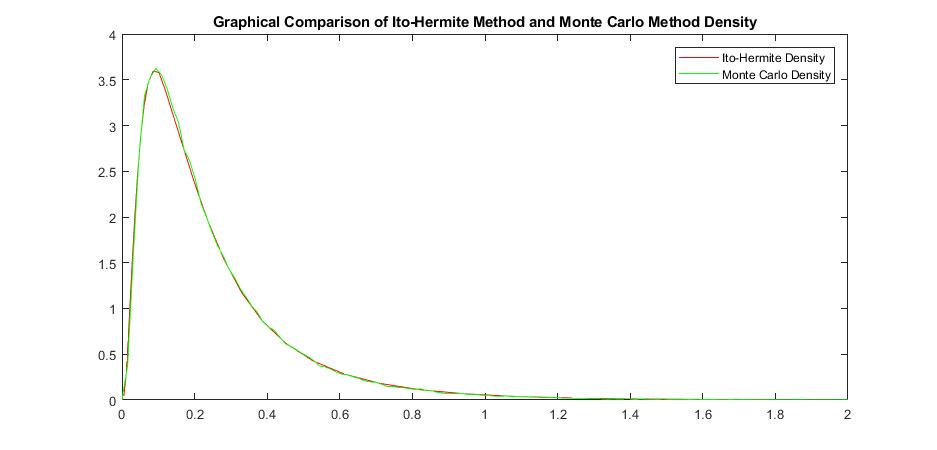

# Breakthrough in the theory of stochastic differential equations and their simulation

**Page 18 of 65** — Posts #851–#900

[← Previous](page_017.md) | [Index](index.md) | [Next →](page_019.md)

---

### #851 — Amin (Topic Author)
*December 30, 2019, 7:51 PM*

>
> Dear friends I am posting the program for densities of arithmetic sum path integrals of the functions of SDE on a
transition probabilities grid. First I am posting a program for SDEs that take negligible correlations across time. I
thought it would be easier for friends to understand the logic and then extend it to SDEs with mean-reverting drifts
that have very high correlations in time. I will be posting a different program for path integrals of mean reverting
SDEs in a few hours or maximum by tomorrow.
Sorry friends, it will take another few days for a fully worked out program for densities of path integrals for
mean-reverting SDEs. I have done most of the work but I want it to be a perfect program and would request friends to
wait for another few days.

---

### #852 — Amin (Topic Author)
*January 4, 2020, 10:42 PM*

Friends, here is the new report of  progress of the research work on densities of arithmetic path integrals of a general
possibly mean reverting SDE. Please first let me describe something about the dynamics of the fixed grid. We update the
expectations of sum of functions along the evolution of the SDE process. But there is a crucial difference with monte
carlo. All the functions calculated midway along the evolution of the SDE process are realized at a different
probability distribution but calculated finally with the terminal probability distribution of the SDE. Being more
concrete, let us consider a four step SDE process with times t0, t1, t2, t3, t4. at these times functions of the SDE are
evaluated with probability distribution p(t1), p(t2), p(t3) and p(t4) but the arithmetic sum is assigned a single
probability p(t4) which is the terminal probability of the SDE. Please note that variance of p(t1), p(t2), p(t3) and
p(t4) all are generally different and usually increasing. This way a function evaluated at t1, when transported to time
t4, its variance roughly decreases by var(t1)/var(t4). Similarly a function evaluated at t2, sees its variance decrease
by var(t2)/var(t4) when it reaches the terminal time. And a function evaluated at time t3, sees its variance decrease by
var(t3)/var(t4) roughly with very slight additional adjustments. a function evaluated at t4, has its variance unchanged
since it was realized at p(t4) and also calculated at p(t4). All the covariances also decrease by the respective
variance ratios as I mentioned. In the previous matlab program for the linear SDEs, I made up for the decreasing
variances by adding additional noise. But for a general SDE, the adjustment is slightly difficult. To overcome this
difficulty, I designed a "quadratic variations generator" which evolves the squared noise process. This is a very little
variance process and its mean at any time is equal to variance of the SDE. So we can easily make the variance adjustment
(by scaling the noise or adding the noise) by simply calculating the present variance of the SDE and one step ahead
variance of the SDE. So that the process keeps the true variance at every step of the SDE due to variance adjustments.

So the research is in very advanced phase and I would be posting a program for mean reverting SDEs in a few days. Sorry
that I had promised to post it earlier but it will still be a few days before friends can find a fully worked out
program on the densities of arithmetic path integrals of functions of mean reverting SDEs on the transition
probabilities grid. I want to thank the friends for this long wait and would be posting the program in a few days.

I will continue the research by working on how to specify swap-like and option-like coupons along  the path evolution of
the asset SDE and keep posting the research.

Please bookmark this thread so we keep exploring new territory in stochastics together.

---

### #853 — Amin (Topic Author)
*January 5, 2020, 8:25 PM*

For friends who like to experiment, when you specify a single pay-off somewhere in forward time on a linear-like SDE, it
can be transported forward on each step by increasing the noise variance by a ratio of (sigma^2 (t+dt))/(sigma^ t).
which simplifies to (t2/t1) =(t1+dt)/t1=1 + dt/t1.

---

### #854 — Amin (Topic Author)
*January 7, 2020, 7:57 PM*

>  But there is a crucial difference with monte carlo. All the functions calculated midway along the evolution of the
SDE process are realized at a different probability distribution but calculated finally with the terminal probability
distribution of the SDE. Being more concrete, let us consider a four step SDE process with times t0, t1, t2, t3, t4. at
these times functions of the SDE are evaluated with probability distribution p(t1), p(t2), p(t3) and p(t4) but the
arithmetic sum is assigned a single probability p(t4) which is the terminal probability of the SDE. Please note that
variance of p(t1), p(t2), p(t3) and p(t4) all are generally different and usually increasing. This way a function
evaluated at t1, when transported to time t4, its variance roughly decreases by var(t1)/var(t4). Similarly a function
evaluated at t2, sees its variance decrease by var(t2)/var(t4) when it reaches the terminal time. And a function
evaluated at time t3, sees its variance decrease by var(t3)/var(t4) roughly with very slight additional adjustments. a
function evaluated at t4, has its variance unchanged since it was realized at p(t4) and also calculated at p(t4). All
the covariances also decrease by the respective variance ratios as I mentioned. In the previous matlab program for the
linear SDEs, I made up for the decreasing variances by adding additional noise.
Considering a simpler version of  the above setup, I will try to explain a bit further in more detail. First of all, we
are evolving the expected values of arithmetic sum of function values along the evolution of SDE. Expected value of
function evaluated at time t1 is approximately given, for each cell, as E[f(X(t1))]=f(X(t1))*P(X(t1)). where f(X(t1)) is
the value of function at a particular grid cell and P(X(t1)) is the integrated probability mass in that particular grid
cell. Problem is that we have to find the conditional value of evolved function at the terminal time which is calculated
by a division by the terminal probability mass. Imagine if there were only two time steps and if there were a single
payoff at time t1. When we calculate its conditional value at time t1, it would have to be calculated with probability
mass at time t1. Now we divide forward transported version of E[f(X(t1))]=f(X(t1))*P(X(t1)) by P(X(t2)). The true
conditional value relevant for the arithmetic sum should be  f(X(t1)) with a variance that is associated with P(X(t1)).
Now doing the division by P(X(t2)) at terminal time scales the variance by Var(X(t1))/Var(X(t2)). In doing one step
forward transport, the f(X(t1)) value also gained some additional variance of sigma^2*dt. So a noise scaling of 
 (Var(X(t2))/Var(X(t1))-sigma^2*dt) should be able to alter the variance so that we could retrieve the right variance of
f(X(t1)) when divided by the forward terminal density P(x(t2)) despite that the expectation at time step t1 that evolved
forward to time step 2 was calculated with density P(X(t1)).

This should not be a problem for non-linear densities where variance evolution could be different in different parts of
the density. We have to consider that probability particles or paths that carry the expectation of functions forward on
average move along CDF subdivisions or standard deviation lines. A particle located at .25 CDF probability mass at time
t1 would on average move to .25 CDF on the next time step t2 or, in other words, move along Z-standard deviation lines.
What we can easily do is to calculate dX(t1)/dZ and also calculate dX(t2)/dZ (this is the same calculation that we do
for change of probability with standard normal) and then multiply E[f(X(t1))] by [dX(t2)/dZ]/[dX(t1)/dZ] for
corresponding values of Z-standard deviation values(we would have to associate appropriate Z-standard deviation values
with respect to density of SDE at time t1 and time t2 for each grid cell) . A total forward transported value that would
keep the forward transported expectation on forward probability P(t2) to retrieve the right value of f(X(t1)) would
require a variance scaling of ([[dX(t2)/dZ]/[dX(t1)/dZ]-sigma^2*dt). This should work very well even for path integrals
of SDEs where variance is changing locally in a different ratio. Multiplying by [[dX(t2)/dZ]/[dX(t1)/dZ] is like
multiplying by ratio of  local variances related to same standard deviations(or same CDF levels) at time step one and
time step 2. Please note that appropriate [dX(t2)/dZ] and [dX(t1)/dZ]  in the ratio are not related by same grid cells,
but they are related by the same level of standard normal Z.

I would again say sorry to friends for the long delay in the release of arithmetic path integrals of mean-reverting and
other general SDEs as I promised. I have been more or less away from work for past two or three days though I have been
thinking about the problem with more clarity. But I am back to work now and it should not be more than two to three days
to the final program.

---

### #855 — Amin (Topic Author)
*January 9, 2020, 7:16 PM*

Since it is standard deviation lines or equi-prob mass lines that preserve the expectation and variance of the
path-integrals, I am working on a fixed grid superimposed with standard deviation lines. It is obvious that we need
enough volatility to keep our expectations of functions evaluated at t1, diffusing at precisely  the same rate as
expansion of the standard deviation lines till the terminal time. If we diffuse with just the right volatility that is
required to keep the expectation remain on the constant deviation lines, we have accomplished our purpose. In other
words, we need enough volatility to remain on constant standard deviation lines. I am too drowsy at the moment but will
try to write my thoughts clearly tomorrow.

---

### #856 — Amin (Topic Author)
*January 10, 2020, 7:05 AM*

Sorry, I was too sleepy last night to express myself clearly and I was being very incoherent. But the true idea that I
had yesterday was that we should freeze the expectations made at earlier times and simply forward transport them along
the Z-standard deviation grid associated with standard normal probability mass. By Z-standard deviation grid, I mean an
expanding or contracting grid where grid cells are divided so that probability mass within each cell remains constant
over time. So if there are payoffs at t1, t2, t3 and t4. We could freeze the expected payoffs at t1, on
expanding/contracting standard deviations grid that preserves the probability mass in them and simply transport the
expectation at t1 to respective cells on standard deviations grid at time t2 if we need to analyze the probability
distribution at time t2 otherwise we could simply transport the frozen expectations to corresponding standard deviations
grid at terminal time t4.

This could work for many types of "payoffs". But it still remains to be seen if the idea would work for all "payoffs".
But I am sure exploring it will help solve the most general problem.

I am trying to superimpose a standard deviations grid on regular fixed grid and trying to learn "calculus" to convert
expectations across two grids.

---

### #857 — Amin (Topic Author)
*January 13, 2020, 4:24 PM*

Here is why the expectation on transition probabilities grid maintains its mean and its variance changes as the
probability density evolves. First of all, let us suppose we have evolved the expectation using appropriate diffusion
till time$t_{1}$ or alternatively calculated it at$t_1$ particular point in time using the grid, this expectation is
given as$E[f(Y(t_{1}))]=f(Y(t_{1}))P(Y(t_{1}))$ . This expectation stops changing even after it continues to evolve to
step$t_2$ after we do not add an appropriate diffusion generator for the next step. At time$t_{2}$ , this expectation
changes to

$E[f(Y_1(t_{2}))]=\frac{E[f(Y(t_{1}))]}{P(Y(t_{2}))} P(Y(t_{2})) =\frac{f(Y(t_{1}))P(Y(t_{1}))}{P(Y(t_{2}))} P(Y(t_{2}))=f(Y(t_{1}))P(Y(t_{1}))$

Here I have used the term$E[f(Y_1(t_{2}))]$ for an expectation that was calculated at time$t_1$ and was diffused/evolved
to time$t_2$ without its appropriate Ito-generator where we needed to calculate the expectation with probability
$P(Y(t_{2}))$ . As we saw in the above calculating the expectation with a different probability did not change its
expectation. However repeating the above step for variance gives us the new equations as (supposing the mean is zero)

$Var[f(Y_1(t_{2}))]={[\frac{E[f(Y(t_{1}))]}{P(Y(t_{2}))}]}^2 P(Y(t_{2}))$

$ ={\frac{[f(Y(t_{1}))P(Y(t_{1}))}{P(Y(t_{2}))}]}^2 P(Y(t_{2}))=f(Y(t_{1}))P(Y(t_{1}))$

$=\frac{[P(Y(t_{1}))}{P(Y(t_{2}))} [{f(Y(t_{1}))]}^2 P(Y(t_{1}))]$

$=K(t_1,t_2)*Var(Y(t_1))$

where$K(t_1,t_2)=\frac{P(Y(t_{1}))}{P(Y(t_{2}))}$ is the one step variance multiplier and true variance is given as
$Var(Y(t_1))={f(Y(t_{1}))}^2 P(Y(t_{1}))$

So the variance of a $t_1$ expectation calculated with time $t_2$ probabilities is given as

$Var[f(Y_1(t_{2}))]=K(t_1,t_2)*Var(Y(t_1))$

---

### #858 — Amin (Topic Author)
*January 17, 2020, 1:41 PM*

Friends, there is more progress on the work regarding densities of arithmetic path integrals of arbitrary SDEs. In our
ito-taylor expnasion of the volatility, some terms are of order sqrt(dt) other are of order dt and even other are of
order dt^1.5. The noise of order sqrt(dt) is transported forward on step by multipliplying the noise with
sqrt(t2/t1)=sqrt((t1+dt)/t1). while noise terms of order dt are transported forward by multiplication
with (t2/t1)=((t1+dt)/t1) and noise terms of order dt^1.5 are transported forward by multiplication with
(t2/t1)^1.5=((t1+dt)^1.5/(t1^1.5); When noises of different order are separately evolved, it is very easy to forward
transport them by appropriate multiplication ratio for relevant "time order" of the noise. This was a very needed
discovery to forward transport the "payoffs" or "data" on our transition probabilities grid for non-linear SDEs. Having
done this, I am very confident that I will very soon be able to write and upload a complete program for the densities of
arithmetic path integrals of functions of arbitrary SDEs. If you try this on your own, please know that sign on
mean-reverting noise terms is negative.

---

### #859 — Amin (Topic Author)
*January 28, 2020, 8:39 AM*

I have been able to concentrate on my research for past few days. While working on the arithmetic path integrals in
transition probabilities framework project, I had some ideas and I was able to find a precise hermite polynomial
representation for a general (existing) density in bessel coordinates. I found an algorithm using which we can easily
convert any general bessel density(that has been arbitrarily evolved in time already) into a hermite polynomial
representation. This was earlier not possible. When I found this algorithm, I digressed from the arithmetic path
integrals project for a bit and decided to switch for a very few days towards the density evolution algorithm using SD
fractions that expand or contract with time. Ok, here is the good news that I was able to refine my earlier algorithm
and make it quite sharply precise for the evolution of densities of the SDEs in SD fractions grid(moving and expanding
grid so as to keep probability mass in each SD fraction constant) framework. Here are the features of the new algorithm.

1. It is far more accurate than the earlier version. The accuracy is excellent everywhere.

2. It is very accurate for mean reverting SDEs  with smaller values of gamma when SDE mean is very close to zero where
the earlier versions were being very inaccurate. For example with gamma=.75 or gamma=.65, the density was far too peaked
as compared to true density when SDE mean was close to zero. This problem has been perfectly corrected in the new
version since we are using an exact hermite representation of the bessel density.

3. The same density evolution algorithm works for mean reverting, partially mean-reverting,  non-mean reverting, zero
mean and all other types of SDE densities. There are no arbitrary multiplications with parameters like gamma or kappa
like I had in the previous version. I am sure that algorithm would work for all possible SDEs that are well behaved
whether mean-reverting or partially mean-reverting or otherwise.

I am testing the algorithm for all possible errors and will be posting it in another two to three days. This new program
became possible only because I was able to find a hermite representation of the arbitrary SDE density in bessel
coordinates. I will be psoting the code here with explanations very soon.

---

### #860 — Amin (Topic Author)
*January 30, 2020, 2:18 PM*

Dear friends, in this current post, I want to describe how to convert an existing density that is in bessel coordinates
into hermite polynomial representation. There could be several ways of doing this. One possible way could follow the
route using the concept of traditional standard deviations but this way does not work everywhere in stochastics when we
are dealing with expansions of SDEs. As we learnt earlier when we were expanding to find higher order terms in the
expansion of SDEs, all the expansions have to be done in terms of the standard gaussian and hermite polynomials. So the
ideas I am going to present are extremely simple but could be quite far-reaching for the stochastics, therefore I
decided to formally explain the ideas in this post.

Suppose we are given an existing density of an SDE w that is in bessel coordinates and we want its expansion in terms of
hermite polynomials. We suppose that the density of w is spread on N discrete grid points. The value of w on nth grid
point is$w(n)$ and the associated value of standard normal on that nth grid point is$Z(n)$ . We associate a value of
volatility$\sigma_{0}(n)$ with each of the n grid points. This$\sigma_{0}(n)$ is calculated simply as

$ \sigma_{0}(n)=\frac{(w(n)-w_{mean})}{(Z(n)-Z_{mean})}$   Equation(1)

Here $Z_{mean}$ is the value of Z mapped on $w_{mean}$

So we can find a first order representation of the SDE variable w as

$w(n)=w_{mean}- \sigma_{0}(n) Z_{mean}+ \sigma_{0}(n) Z(n)$    Equation(2)

In the expansion of bessel SDEs, the mean is very close to median where median is associated with$Z(n)=0$ . We have to
do some extra calculations to account for the difference between expansion from median or mean. I want to just highlight
the expansion method so we suppose for now that difference between$Z_{Mean}$ and$Z_{median}=Z(n_{Median})=0$ is
negligible. We will over come this later.

So we suppose we can write

$w(n)=w_{mean}+ \sigma_{0}(n)  Z(n)$               Equation(3)

but we can also expand state dependent $\sigma_{0}(n)$ around the median expansion point as

$\sigma_{0}(n)=\sigma_{0}(n_{Median})+\int_{Z(n_{Median})}^{Z(n)} \frac{d\sigma_{0}(n)}{dZ(n)} dZ(n)$  Equation(4)

which can be written as

$\sigma_{0}(n)=\sigma_{0}(n_{Median})+\sigma_1(n) Z(n)$  Equation(5)

where
$\sigma_1(n)=\frac{\int_{Z(n_{Median})}^{Z(n)} \frac{d\sigma_{0}(n)}{dZ(n)} dZ(n)}{\int_{Z(n_{Median})}^{Z(n)} dZ(n)}$

In what follows, we use notation $\sigma_{00}= \sigma_{0}(n_{Median})$ for the constant value.

using above equation(5) in equation(3), we can write after a few calculations as

$w(n)=w_{mean}+ \sigma_{00}  Z(n) + \sigma_1(n) (Z(n)^2-1)$ Equation(6)

Now similarly to previous calculations, we expand state dependent $\sigma_{1}(n)$ around the median expansion point as

$\sigma_{1}(n)=\sigma_{1}(n_{Median})+\int_{Z(n_{Median})}^{Z(n)} \frac{d\sigma_{1}(n)}{dZ(n)} dZ(n)$  Equation(7)

which can be written as

$\sigma_{1}(n)=\sigma_{1}(n_{Median})+\sigma_2(n) Z(n)$  Equation(8)

where
$\sigma_2(n)=\frac{\int_{Z(n_{Median})}^{Z(n)} \frac{d\sigma_{1}(n)}{dZ(n)} dZ(n)}{\int_{Z(n_{Median})}^{Z(n)} dZ(n)}$

using the notation $\sigma_{11}= \sigma_{1}(n_{Median})$ we can write after forcing equation(8) in equation (6) as

$w(n)=w_{mean}+ \sigma_{00}  Z(n) + \sigma_{11} (Z(n)^2-1)+ \sigma_2(n) (Z(n)^3-3Z(n))$ Equation(9)

So if we can continue to expand the density into higher hermite polynomials. However the procedure would require care
for accuracy in numerical discrete differentiation and integrations and other errors when values associated with higher
hermite polynomials become incorrect garbage.

Ok, I have not fully developed the ideas yet and these are very recent thoughts but I decided to share them with friends
here to highlight the importance of above expansions.

Let us suppose, we have an SDE of the form in bessel coordinates given as

$dw(t)=\mu(w(t))dt + \sigma dz(t) $

we can expand both$w(t)$ and the term$\mu(w(t))dt$ in terms of hermite polynomials using the above hermite
representation procedure and we could write for example as

$w(t)=\mu_{w}+ a0* Z(n) + a1* ((Z(n)^2-1)$

$+ a2* ((Z(n)^3-3 Z(n)) + a3(n)* (Z(n)^4-6 Z(n)^2+3) $

and similarly for

$drift(t)=\mu_{drift}+ b0* Z(n) + b1* ((Z(n)^2-1)$

$+ b2* ((Z(n)^3-3 Z(n)) + b3(n)* (Z(n)^4-6 Z(n)^2+3) $

where drift(t) represents the term $\mu(w(t))dt$

and use some straightforward way to add across the orthogonal coordinates. Of course there are going to be some slight
complexities but I am sure we can find some quite simple ways of advancing the densities very soon.

I will also, possibly tomorrow, share the very simple program that converts the densities into a hermite polynomial
representation. Over the weekend, I will be sharing a lot of programs also about the SDE density evolution in moving and
expanding constant mass SD fractions. But I think the ideas presented in the above post would have very interesting
implications when adding the two arbitrary SDE densities. Apart from so many other possible applications, we could use
them in hybrid fX/equity/IR models where so many different SDEs are in action together.

---

### #861 — Amin (Topic Author)
*January 31, 2020, 5:25 PM*

This program find hermite representation of the SDE variable w to Second Order as a function of two hermite polynomials.
I will soon be posting another program in a few days that will find the hermite representation to arbitrary order
specified by the user with interesting applications. Lot of interesting stuff is due in next few days. This program
should become easily familiar for friends who have been downloading the earlier programs and understand them.

I expanded the SDE variable w around the mean as mean is usually very convenient but you can expand around median or any
arbitrary point on the SDE grid.

```
function [wMean,Sigma00,Sigma1,Sigma0] = CalculateHermiteRepresentationOfDensityOrderTwo(w,Z,Prob,wnStart,Nn,dNn)

%This program find hermite representation of the SDE variable w to
%Second Order as a function of two hermite polynomials.
%Here wnStart is the starting grid point of the SDE vector
%mostly wnStart=1.
%Please note we are representing SDE Variable w as a function of hermite
%polynomials. It is not the density which can however be found by change of variable
%derivative of w with respect to Z using standard gaussian variable.
%Nn is the index of last density grid point.
%So w(wnStart:Nn) represents the SDE density variable grid.
%  Z(wnStart:Nn) represents the associated value of standard Gaussian on
%  the grid. w and Z can be associated by matching appropriate CDF points
%  on the grid.
%I suppose the grid is uniform in Z and dNn is the spacing between and
% Z(n) and Z(n+1) two points on the grid.
%Prob is the probability mass associated with each point on the grid.

wMean=sum(w(1:Nn).*Prob(1:Nn));  %Calculate the mean. This is in general
%not on the discrete grid of w.

%Below calculate the associated value of ZMean that maps wMean to ZMean.
%Also the grid point index nnMean which is associated with the largest
% w(nn) such that w(nn)wMean) && (w(nn)<=wMean))
        ZMean=Z(nn)+(wMean-w(nn))/(w(nn+1)-w(nn))*(Z(nn+1)-Z(nn));
        nnMean=nn;
    end
end

%Below Calculate the vol associated with each point on the grid
for nn=1:Nn
    Sigma0(nn)=(w(nn)-wMean)./(Z(nn)-ZMean);
 end

%Below calculate the associated Sigma00 which is a single volatility associated with
%the first orthogonal hermite polynomial. We chose this volatility equal to
%volatility at mean since we are expanding around the mean.
%If mean has zero volatility, we will have to find volatility at mean by
%interpolating the volatility at one higher grid point and one lower grid
%point. Volatility at mean must not be zero (unless we have a delta density).
Sigma00=Sigma0(nnMean)*(Z(nnMean+1)-ZMean)./(Z(nnMean+1)-Z(nnMean))+Sigma0(nnMean+1)*(ZMean-Z(nnMean))./(Z(nnMean+1)-Z(nnMean));

%Below calculate the associated first derivative of Sigma0 with respect to
%Z on the grid.
dSigma0dZ(wnStart)=(-3*Sigma0(wnStart)+4*Sigma0(wnStart+1)-1*Sigma0(wnStart+2))/(2*dNn);
dSigma0dZ(wnStart+1:Nn-1)=(-1*Sigma0(wnStart:Nn-2)+1*Sigma0(wnStart+2:Nn))/(2*dNn);
dSigma0dZ(Nn)=(3*Sigma0(Nn)-4*Sigma0(Nn-1)+1*Sigma0(Nn-2))/(2*dNn);

%Following is the operation related to equation(4) in post 860.
SSigma1(nnMean)=0;
for nn=nnMean+1:Nn
        SSigma1(nn)=SSigma1(nn-1)+(.5*dSigma0dZ(nn-1)+.5*dSigma0dZ(nn))*dNn;
end
for nn=nnMean-1:-1:wnStart
        SSigma1(nn)=SSigma1(nn+1)-(.5*dSigma0dZ(nn+1)+.5*dSigma0dZ(nn))*dNn;
end

%Below is the averaging
Sigma1(wnStart:nnMean-1)=SSigma1(wnStart:nnMean-1)./(Z(wnStart:nnMean-1)-Z(nnMean));
Sigma1(nnMean+1:Nn)=SSigma1(nnMean+1:Nn)./(Z(nnMean+1:Nn)-Z(nnMean));
Sigma1(nnMean)=(Sigma1(nnMean-1)+Sigma1(nnMean+1))/2.0;

%Now below we represent the SDE variable w in terms of first two hermite
%polynomials and this associated value of w produced by hermite polynomials
%coefficients is called w1.

 w1(wnStart:Nn)=wMean-Sigma00*ZMean-Sigma1(wnStart:Nn).*(ZMean.^2-1)+ ...
 Sigma00*Z(wnStart:Nn)+ ...
 Sigma1(wnStart:Nn).*(Z(wnStart:Nn).^2-1);

%Below we plot a graphical comparison of the original SDE variable w and
%the variable w1 reproduced from the coefficients of the hermite
%polynomials
 plot(Z(wnStart:Nn),w(wnStart:Nn),'g',Z(wnStart:Nn),w1(wnStart:Nn),'r')
str=input('Look at the graphical comparison of w and w1 as a function of standard gaussian Z');
end
```

---

### #862 — Amin (Topic Author)
*February 1, 2020, 1:06 PM*

I know friends would have liked if I ran the above code with a real example (I was thinking and I realized that).
Hopefully tomorrow I will be uploading my another program for evolution of density of SDEs with moving and expanding SD
fractions framework that I have been talking about earlier in post 859. I have used the above program in post 861 on
every time step in that program that I will post tomorrow. So friends would be able to test the above program with any
possible SDE they like. Please bear with me for another day.

---

### #863 — Amin (Topic Author)
*February 2, 2020, 9:39 AM*

In this program, I am simulating the SDE given as

dy(t)=mu1 x(t)^beta1 dt + mu2 x(t)^beta2 dt +sigma x(t)^gamma dz(t)

I have not directly simulated the SDE but simulated the transformed Bessel process version of the SDE and then changed
coordinates to retreive

the SDE in original coordinates.

In this version, the mean correction has been disabled. If you are simulating standard mean-reverting SV type SDEs,
please enable the mean

correction by uncommenting the appropriate line in the body of code.

you can specify any general mu1 and mu2 and beta1 and beta2. The present program is not perfect but quite very good.

if there is only one term in drift with beta=0, there will be minor errors. This case is yet not covered.

```
function [] = ItoHermiteMethodWilmott08Improved()
%Copyright Ahsan Amin. Infiniti derivatives Technologies.
%Please fell free to connect on linkedin: linkedin.com/in/ahsan-amin-0a53334
%or skype ahsan.amin2999
%In this program, I am simulating the SDE given as
%dy(t)=mu1 x(t)^beta1 dt + mu2 x(t)^beta2 dt +sigma x(t)^gamma dz(t)

%I have not directly simulated the SDE but simulated the transformed
%Bessel process version of the SDE and then changed coordinates to retreive
%the SDE in original coordinates.
%The present program will analytically evolve only the Bessel Process version of the
%SDE in transformed coordinates.
%In this version, the mean correction has been disabled. If you are
%simulating standard mean-reverting SV type SDEs, please enable the mean
%correction by uncommenting the appropriate line in the body of code below.

dt=.125/8;   % Simulation time interval.%Fodiffusions close to zero
             %decrease dt for accuracy.

Tt=8*8;     % Number of simulation levels. Terminal time= Tt*dt; //.125/32*32*16=2 year;
OrderA=2;  %Keep at two.
OrderM=2;  %Keep at two.
%dtM=.125/8;%Monte carlo time interval size dtM.
%TtM=8*8;%Monte carlo number of simulation intervals.
dtM=dt*1;
TtM=Tt/1;

dNn=.2/1;   % Normal density subdivisions width. would change with number of subdivisions
Nn=50;  % No of normal density subdivisions
NnMidl=25;%One half density Subdivision left from mid of normal density(low)
NnMidh=26;%One half density subdivision right from the mid of normal density(high)
NnMid=4.0;

x0=.35;   % starting value of SDE
beta1=0;   % the first drift term power.
beta2=1.0;   % Second drift term power.
gamma=.850;   % volatility power.
kappa=1.250;   %mean reversion parameter.
theta=.1250;   %mean reversion target

%you can specify any general mu1 and mu2 and beta1 and beta2.
%The present program is not perfect but quite good.
%if there is only one term in drift with beta=0, there will be minor
%errors. This case is yet not covered.

mu1=1*theta*kappa;   %first drift coefficient.
mu2=-1*kappa;    % Second drift coefficient.
sigma0=.750;%Volatility value
alpha=1;% x^alpha is being expanded. This is currently for monte carlo only.
alpha1=1-gamma;

w(1:Nn)=x0^(1-gamma)/(1-gamma);
Z(1:Nn)=(((1:Nn)-5.5)*dNn-NnMid);

Z
str=input('Look at Z');
ZProb(1)=normcdf(.5*Z(1)+.5*Z(2),0,1)-normcdf(.5*Z(1)+.5*Z(2)-dNn,0,1);
ZProb(Nn)=normcdf(.5*Z(Nn)+.5*Z(Nn-1)+dNn,0,1)-normcdf(.5*Z(Nn)+.5*Z(Nn-1),0,1);

for nn=2:Nn-1
    ZProb(nn)=normcdf(.5*Z(nn)+.5*Z(nn+1),0,1)-normcdf(.5*Z(nn)+.5*Z(nn-1),0,1);
    %Above calculate probability mass in each probability subdivision.
end

 dt2=dt^2/2;
 dt3=dt^3/6.0;
 dtsqrt=sqrt(dt);
 dtonehalf=dt.^1.5;

wnStart=1;%\\\\\\\\\\\\\\\\\\\\\\\\\\\\\\\\\\\\\\\\\\\\\\\\\\\\\\\\\\\\\\\\\\\\\\\\\\\\\\\\\\\\\\\\\\\\\\1;

tic

for tt=1:Tt

    yy(wnStart:Nn)=((1-gamma)*w(wnStart:Nn)).^(1/(1-gamma));

    theta1=mu1;
    theta2=mu2;
    theta3=.5*sigma0^2*(-gamma);
    omega1=beta1-gamma;
    omega2=beta2-gamma;
    omega3=gamma-1;

    GG(wnStart:Nn)=theta1*yy(wnStart:Nn).^omega1+theta2*yy(wnStart:Nn).^omega2+theta3*yy(wnStart:Nn).^omega3;
    dGG(wnStart:Nn)=omega1*theta1*yy(wnStart:Nn).^(omega1-1)+omega2*theta2*yy(wnStart:Nn).^(omega2-1)+ ...
        omega3*theta3*yy(wnStart:Nn).^(omega3-1);
    DD(wnStart:Nn)=mu1*yy(wnStart:Nn).^beta1+mu2*yy(wnStart:Nn).^beta2;
    dGG2(wnStart:Nn)=theta1*omega1*(omega1-1).*yy(wnStart:Nn).^(omega1-2)+ ...
        theta2*omega2*(omega2-1).*yy(wnStart:Nn).^(omega2-2)+ ...
        theta3*omega3*(omega3-1).*yy(wnStart:Nn).^(omega3-2);
    QQ(wnStart:Nn)=sigma0^2*yy(wnStart:Nn).^(2*gamma);
    ddGGDD(wnStart:Nn)=mu1*omega1*theta1*(omega1+beta1-1).*yy(wnStart:Nn).^(omega1+beta1-2)+ ...
        mu1*omega2*theta2*(omega2+beta1-1).*yy(wnStart:Nn).^(omega2+beta1-2)+ ...
        mu1*omega3*theta3*(omega3+beta1-1).*yy(wnStart:Nn).^(omega3+beta1-2)+ ...
        mu2*omega1*theta1*(omega1+beta2-1).*yy(wnStart:Nn).^(omega1+beta2-2)+ ...
        mu2*omega2*theta2*(omega2+beta2-1).*yy(wnStart:Nn).^(omega2+beta2-2)+ ...
        mu2*omega3*theta3*(omega3+beta2-1).*yy(wnStart:Nn).^(omega3+beta2-2);
    d2dGGDD(wnStart:Nn)=mu1*omega1*theta1*(omega1+beta1-1).*(omega1+beta1-2).*yy(wnStart:Nn).^(omega1+beta1-3)+ ...
        mu1*omega2*theta2*(omega2+beta1-1).*(omega2+beta1-2).*yy(wnStart:Nn).^(omega2+beta1-3)+ ...
        mu1*omega3*theta3*(omega3+beta1-1).*(omega3+beta1-2).*yy(wnStart:Nn).^(omega3+beta1-3)+ ...
        mu2*omega1*theta1*(omega1+beta2-1).*(omega1+beta2-2).*yy(wnStart:Nn).^(omega1+beta2-3)+ ...
        mu2*omega2*theta2*(omega2+beta2-1).*(omega2+beta2-2).*yy(wnStart:Nn).^(omega2+beta2-3)+ ...
        mu2*omega3*theta3*(omega3+beta2-1).*(omega3+beta2-2).*yy(wnStart:Nn).^(omega3+beta2-3);
    ddGG2QQ(wnStart:Nn)=theta1*sigma0^2.*omega1*(omega1-1).*(omega1+2*gamma-2).*yy(wnStart:Nn).^(omega1+2*gamma-3)+ ...
        sigma0^2*theta2*omega2*(omega2-1).*(omega2+2*gamma-2).*yy(wnStart:Nn).^(omega2+2*gamma-3)+ ...
        sigma0^2*theta3*omega3*(omega3-1).*(omega3+2*gamma-2).*yy(wnStart:Nn).^(omega3+2*gamma-3);
   
d2dGG2QQ(wnStart:Nn)=theta1*sigma0^2.*omega1*(omega1-1).*(omega1+2*gamma-2).*(omega1+2*gamma-3).*yy(wnStart:Nn).^(omega1+2*gamma-4)+
...
        sigma0^2*theta2*omega2*(omega2-1).*(omega2+2*gamma-2).*(omega2+2*gamma-3).*yy(wnStart:Nn).^(omega2+2*gamma-4)+
...
        sigma0^2*theta3*omega3*(omega3-1).*(omega3+2*gamma-2).*(omega3+2*gamma-3).*yy(wnStart:Nn).^(omega3+2*gamma-4);

    VV(wnStart:Nn)=sigma0.*yy(wnStart:Nn).^gamma;
    d_dGG_VV_dyy(wnStart:Nn)= ...
        sigma0.*omega1.*theta1.*(omega1+gamma-1).*yy(wnStart:Nn).^(omega1+gamma-2) + ...
        sigma0.*omega2.*theta2.*(omega2+gamma-1).*yy(wnStart:Nn).^(omega2+gamma-2) + ...
        sigma0.*omega3.*theta3.*(omega3+gamma-1).*yy(wnStart:Nn).^(omega3+gamma-2);

    wMu0dt(wnStart:Nn)=GG(wnStart:Nn)*dt + dGG(wnStart:Nn).*DD(wnStart:Nn).*dt2 + ...
        .5*dGG2(wnStart:Nn).*QQ(wnStart:Nn).*dt2 + ...
        ddGGDD(wnStart:Nn).*DD(wnStart:Nn).*dt3 + ...
        .5*ddGG2QQ(wnStart:Nn).*DD(wnStart:Nn).*dt3 + ...
        .5*d2dGGDD(wnStart:Nn).*QQ(wnStart:Nn).*dt3 + ...
        .25*d2dGG2QQ(wnStart:Nn).*QQ(wnStart:Nn).*dt3;
    %    c0(wnStart:Nn)=-1*d_dGG_VV_dyy(wnStart:Nn).*VV(wnStart:Nn).*(1/sqrt(2.0).*(1-sqrt(2.0)/2.0)).*dt.^2.0;
    c1(wnStart:Nn)=sigma0.*dtsqrt+dGG(wnStart:Nn).*VV(wnStart:Nn).*(1-1/sqrt(3.0)).*dtonehalf;
    c2(wnStart:Nn)=d_dGG_VV_dyy(wnStart:Nn).*VV(wnStart:Nn).*(1/sqrt(2.0).*(1-sqrt(2.0)/2.0)).*dt.^2.0;
    dw(wnStart:Nn)=c1(wnStart:Nn).*Z(wnStart:Nn);% + ...
    dw2(wnStart:Nn)=c1(wnStart:Nn).^2.0.*Z(wnStart:Nn).^2;
    w(isnan(w)==1)=0;
    wMu0dt(isnan(wMu0dt)==1)=0;
    wMeanPrev=sum(ZProb(wnStart:Nn).*w(wnStart:Nn));%Calculate the mean.

%%%%%%%%%%%%%%%%%%%%%%%%%%%%%%%%%%%%%%%%%%%%%%%%%%%%%%%%%%%%%%%%%%%%%%%%%%%
%In this code block, we use second hermite representation of the density
%which is used to solve for mean reversion.
%It is the value of Sigma1 below whcih is used later in the main SDE one
%time step update formula.

    if(tt>1)
        [wMean,ZMean,Sigma00,Sigma1,Sigma0] = CalculateHermiteRepresentationOfDensityOrderTwo(w,Z,ZProb,wnStart,Nn,dNn);

        %w1New(wnStart:Nn)=wMean-Sigma00*ZMean-Sigma1(wnStart:Nn).*(ZMean.^2-1)+ ...
        %    Sigma00*Z(wnStart:Nn)+ ...
        %    Sigma1(wnStart:Nn).*(Z(wnStart:Nn).^2-1);
        %Uncomment to see a graph comparison of w constructed from hermite
        %representation and the original w.
        %  plot(Z(wnStart:Nn),w(wnStart:Nn),'g',Z(wnStart:Nn),w1New(wnStart:Nn),'r')
        %  str=input('Look at the graphs--1');
    else
        Sigma1(wnStart:Nn)=0.0;
    end

%%%%%%%%%%%%%%%%%%%%%%%%%%%%%%%%%%%%%%%%%%%%%%%%%%%%%%%%%%%%%%%%%%%%%%%%%%%
   %In this block we determine whether the SDE is mean reverting.
   %This is done, possibly naiively, by taking a derivative of drift at
   %value and if the derivative is negative, we calculate KappaMR which is
   %parameter that determines the strength of mean reversion. KappaMR is
   %used in the main SDE one step update formula.

    yyMean=sum(ZProb(wnStart:Nn).*yy(wnStart:Nn));
    dDriftAtMean=mu1*beta1*yyMean.^(beta1-1)+mu2*beta2*yyMean.^(beta2-1);
    KappaMR(wnStart:Nn)=0;
    if(dDriftAtMeanw2(:))=0;%Be careful;might not universally hold;

        w(w<0)=0.0;
        for nn=1:Nn
            if(w(nn)<=0)
                wnStart=nn+1;
           end
        end

        %%1st order mean correction. We know the mean in original
        %%coordinates so I shift the density into original coordinates,
        %%apply the mean correction and then transform again into Lamperti
        %%coordinates. Algebra solves two equations in two unknowns.
        %%Equations are Sum_0^N{(Y_w(wnStart:Nn)-Y0)*W0}=1 and the second
        %%equation is Sum_0^N{Y_w(wnStart:Nn).*(Y_w(wnStart:Nn)-Y0)*W0}=u0
        %%Two unknows are Y0 and W0. u0 is known mean.

        u0=theta+(x0-theta)*exp(-kappa*(tt*dt)); %analytic mean of the density
        %If you are not using stochastic volatility, replace above with
        %true mean otherwise results would become garbage.

        Y_w(wnStart:Nn) = ((1-gamma)*w(wnStart:Nn)).^(1/(1-gamma));

        Yn2Pn=sum(Y_w(wnStart:Nn).*Y_w(wnStart:Nn).*ZProb(wnStart:Nn));
        YnPn=sum(Y_w(wnStart:Nn).*ZProb(wnStart:Nn));
        Pn=1.0;%%Sum(ZProb(1:Nn))
        Y0=(Yn2Pn-u0*YnPn)/(YnPn-u0*Pn);

        Y0Pn=Y0*Pn;
        W0=1/(YnPn-Y0Pn);
        YCorrected(wnStart:Nn)=Y_w(wnStart:Nn).*(Y_w(wnStart:Nn)-Y0)*W0;
        wCorrected(wnStart:Nn)=(YCorrected(wnStart:Nn).^(1-gamma))./(1-gamma);
   %     w(wnStart:Nn)=wCorrected(wnStart:Nn);

   %I have disabled the mean correction. The above mean correction is only valid for
   %standard mean reverting stochastic volatility type SDEs. To enable mean
   %correction please uncomment the above last line in the block.

end

 y_w(1:Nn)=0;
 y_w(wnStart:Nn) = ((1-gamma)*w(wnStart:Nn)).^(1/(1-gamma));
 Dfy_w(wnStart:Nn)=0;
 Dfw(wnStart:Nn)=0;
for nn=wnStart+1:Nn-1
    Dfy_w(nn) = (y_w(nn + 1) - y_w(nn - 1))/(Z(nn + 1) - Z(nn - 1));
    Dfw(nn) = (w(nn + 1) - w(nn - 1))/(Z(nn + 1) - Z(nn - 1));
    %Change of variable derivative for densities
end
fy_w(1:Nn)=0;
fw(1:Nn)=0;
for nn = wnStart:Nn-1
    fy_w(nn) = (normpdf(Z(nn),0, 1))/abs(Dfy_w(nn));%Origianl coordinates density
    fw(nn) = (normpdf(Z(nn),0, 1))/abs(Dfw(nn));
end

toc
str=input('Analytic Values calculated; Press a key to start monte carlo');

sigma11(1:OrderA+1)=0;
mu11(1:OrderA+1)=0;
mu22(1:OrderA+1)=0;
sigma22(1:OrderA+1)=0;
% index 1 correponds to zero level since matlab indexing starts at one.
sigma11(1)=1;
mu11(1)=1;
mu22(1)=1;
sigma22(1)=1;

for k=1:(OrderA+1)
    if sigma0~=0
        sigma11(k)=sigma0^(k-1);
    end
    if mu1 ~= 0
        mu11(k)=mu1^(k-1);
    end
    if mu2 ~= 0
        mu22(k)=mu2^(k-1);
    end
    if sigma0~=0
        sigma22(k)=sigma0^(2*(k-1));
    end
end
Ft(1:TtM+1,1:(OrderA+1),1:(OrderA+1),1:(OrderA+1),1:(OrderA+1))=0; %General time powers on hermite polynomials
Fp(1:(OrderA+1),1:(OrderA+1),1:(OrderA+1),1:(OrderA+1))=0;%General x powers on coefficients of hermite polynomials.
Fp1(1:(OrderA+1),1:(OrderA+1),1:(OrderA+1),1:(OrderA+1))=0;%General x powers for bessel transformed coordinates.
%Pre-compute the time and power exponent values in small multi-dimensional arrays
for k = 0 : (OrderA+1)
    for m = 0:k
        l4 = k - m + 1;
        for n = 0 : m
            l3 = m - n + 1;
            for j = 0:n
                l2 = n - j + 1;
                l1 = j + 1;
                Ft(l1,l2,l3,l4) = dtM^((l1-1) + (l2-1) + (l3-1) + .5* (l4-1));
                Fp(l1,l2,l3,l4) = (alpha + (l1-1) * beta1 + (l2-1) * beta2 + (l3-1) * 2* gamma + (l4-1) * gamma ...
                    - (l1-1) - (l2-1) - 2* (l3-1) - (l4-1));
                Fp1(l1,l2,l3,l4) = (alpha1 + (l1-1) * beta1 + (l2-1) * beta2 + (l3-1) * 2* gamma + (l4-1) * gamma ...
                    - (l1-1) - (l2-1) - 2* (l3-1) - (l4-1));

            end
        end
    end
end
%Below call the program that calculates the Ito-Taylor coeffs.
YCoeff = ItoTaylorCoeffsNew(alpha,beta1,beta2,gamma);
%Yq=ItoTaylorCoeffsNew(alpha1,beta1,beta2,gamma);
%YqCoeff=Yq/(1-gamma);%These coordinates are divided by (1-gamma)
 %Calculate the density with monte carlo below.
 rng(85109634, 'twister')
 paths=200000;
 YY(1:paths)=x0;  %Original process monte carlo.
% YY2dt(1:paths)=0.0;
 %YY4dt(1:paths)=0.0;
 X(1:paths)=x0^(1-gamma)/(1-gamma);
 Random1(1:paths)=0;
 for tt=1:TtM
 %    t1=tt*dtM;
 %    t0=(tt-1)*dtM;
     Random1=randn(size(Random1));
     HermiteP1(1,1:paths)=1;
     HermiteP1(2,1:paths)=Random1(1:paths);
     HermiteP1(3,1:paths)=Random1(1:paths).^2-1;
     HermiteP1(4,1:paths)=Random1(1:paths).^3-3*Random1(1:paths);
     HermiteP1(5,1:paths)=Random1(1:paths).^4-6*Random1(1:paths).^2+3;
     YY0=YY;
  %   YYPrev=YY;
  %   XX0=X;

     for k = 0 : OrderM
         for m = 0:k
             l4 = k - m + 1;
             for n = 0 : m
                 l3 = m - n + 1;
                 for j = 0:n
                     l2 = n - j + 1;
                     l1 = j + 1;
                     if(l4<=5)

  %                    X(1:paths)=X(1:paths) + YqCoeff(l1,l2,l3,l4) * ...
  %                   mu11(l1)*mu22(l2)*sigma22(l3)*sigma11(l4)* ...
  %                   ((1-gamma)*XX0(1:paths)).^(Fp1(l1,l2,l3,l4)/(1-gamma)) .* ...
  %                   HermiteP1(l4,1:paths) * Ft(l1,l2,l3,l4);

                     YY(1:paths)=YY(1:paths) + YCoeff(l1,l2,l3,l4) * ...
                     mu11(l1)*mu22(l2)*sigma22(l3)*sigma11(l4)* ...
                     YY0(1:paths).^Fp(l1,l2,l3,l4) .* HermiteP1(l4,1:paths) * Ft(l1,l2,l3,l4);
                 %Above is original coordinates monte carlo equation.
                     end
                 end
             end
         end
     end
 end
 YY(YY<0)=0;
 disp('Original process average from monte carlo');
 sum(YY(:))/paths %origianl coordinates monte carlo average.
 disp('Original process average from our simulation');
 sum(y_w(wnStart+1:Nn-1).*ZProb(wnStart+1:Nn-1)) %Original process average from coordinates

 disp('true Mean only applicble to standard SV mean reverting type models otherwise disregard');
 theta+(x0-theta)*exp(-kappa*dt*Tt)%Mean reverting SDE original variable true average

 MaxCutOff=30;
 NoOfBins=500;
 %[YDensity,IndexOutY,IndexMaxY] = MakeDensityFromSimulation_Infiniti(YY,paths,BinSize,MaxCutOff);
 [YDensity,IndexOutY,IndexMaxY] = MakeDensityFromSimulation_Infiniti_NEW(YY,paths,NoOfBins,MaxCutOff );
 plot(y_w(wnStart+1:Nn-1),fy_w(wnStart+1:Nn-1),'r',IndexOutY(1:IndexMaxY),YDensity(1:IndexMaxY),'g');
 title('Graphical Comparison of Ito-Hermite Method and Monte Carlo Method Density')
 legend({'Ito-Hermite Density','Monte Carlo Density'},'Location','northeast')

 str=input('red line is density of SDE from Ito-Hermite method, green is monte carlo.');

end
```

%%%%%%%%%%%%%%%%%%%%%%%%%%%%%%%%%%%%%%%%%%%%%%%

Here are recent dependencies of the program.

```
function [wMean,ZMean,Sigma00,Sigma1,Sigma0] = CalculateHermiteRepresentationOfDensityOrderTwo(w,Z,Prob,wnStart,Nn,dNn)

%This program find hermite representation of the SDE variable w to
%Second Order as a function of two hermite polynomials.
%Here wnStart is the starting grid point of the SDE vector
%mostly wnStart=1.
%Please note we are representing SDE Variable w as a function of hermite
%polynomials. It is not the density which can however be found by change of variable
%derivative of w with respect to Z using standard gaussian variable.
%Nn is the index of last density grid point.
%So w(wnStart:Nn) represents the SDE density variable grid.
%  Z(wnStart:Nn) represents the associated value of standard Gaussian on
%  the grid. w and Z can be associated by matching appropriate CDF points
%  on the grid.
%I suppose the grid is uniform in Z and dNn is the spacing between and
% Z(n) and Z(n+1) two points on the grid.
%Prob is the probability mass associated with each point on the grid.

wMean=sum(w(1:Nn).*Prob(1:Nn))  %Calculate the mean. This is in general
%not on the discrete grid of w.

%Below calculate the associated value of ZMean that maps wMean to ZMean.
%Also the grid point index nnMean which is associated with the largest
% w(nn) such that w(nn)wMean) && (w(nn)<=wMean))
        ZMean=Z(nn)+(wMean-w(nn))/(w(nn+1)-w(nn))*(Z(nn+1)-Z(nn));
        nnMean=nn;
    end
end

%Below Calculate the vol associated with each point on the grid
for nn=1:Nn
    Sigma0(nn)=(w(nn)-wMean)./(Z(nn)-ZMean);
 end

%Below calculate the associated Sigma00 which is a single volatility associated with
%the first orthogonal hermite polynomial. We chose this volatility equal to
%volatility at mean since we are expanding around the mean.
%If mean has zero volatility, we will have to find volatility at mean by
%interpolating the volatility at one higher grid point and one lower grid
%point. Volatility at mean must not be zero (unless we have a delta density).
Sigma00=Sigma0(nnMean)*(Z(nnMean+1)-ZMean)./(Z(nnMean+1)-Z(nnMean))+Sigma0(nnMean+1)*(ZMean-Z(nnMean))./(Z(nnMean+1)-Z(nnMean));

%Below calculate the associated first derivative of Sigma0 with respect to
%Z on the grid.
dSigma0dZ(wnStart)=(-3*Sigma0(wnStart)+4*Sigma0(wnStart+1)-1*Sigma0(wnStart+2))/(2*dNn);
dSigma0dZ(wnStart+1:Nn-1)=(-1*Sigma0(wnStart:Nn-2)+1*Sigma0(wnStart+2:Nn))/(2*dNn);
dSigma0dZ(Nn)=(3*Sigma0(Nn)-4*Sigma0(Nn-1)+1*Sigma0(Nn-2))/(2*dNn);

%Following is the operation related to equation(4) in post 860.
SSigma1(nnMean)=0;
for nn=nnMean+1:Nn
        SSigma1(nn)=SSigma1(nn-1)+(.5*dSigma0dZ(nn-1)+.5*dSigma0dZ(nn))*dNn;
end
for nn=nnMean-1:-1:wnStart
        SSigma1(nn)=SSigma1(nn+1)-(.5*dSigma0dZ(nn+1)+.5*dSigma0dZ(nn))*dNn;
end

%Below is the averaging
Sigma1(wnStart:nnMean-1)=SSigma1(wnStart:nnMean-1)./(Z(wnStart:nnMean-1)-Z(nnMean));
Sigma1(nnMean+1:Nn)=SSigma1(nnMean+1:Nn)./(Z(nnMean+1:Nn)-Z(nnMean));
Sigma1(nnMean)=(Sigma1(nnMean-1)+Sigma1(nnMean+1))/2.0;

%Now below we represent the SDE variable w in terms of first two hermite
%polynomials and this associated value of w produced by hermite polynomials
%coefficients is called w1.

 w1(wnStart:Nn)=wMean-Sigma00*ZMean-Sigma1(wnStart:Nn).*(ZMean.^2-1)+ ...
 Sigma00*Z(wnStart:Nn)+ ...
 Sigma1(wnStart:Nn).*(Z(wnStart:Nn).^2-1);

%Below we plot a graphical comparison of the original SDE variable w and
%the variable w1 reproduced from the coefficients of the hermite
%polynomials
% plot(Z(wnStart:Nn),w(wnStart:Nn),'g',Z(wnStart:Nn),w1(wnStart:Nn),'r')
%str=input('Look at the graphical comparison of w and w1 as a function of standard gaussian Z');
end
```

%%%%%%%%%%%%%%%%%%%%%%%%%%%%%%%%%%%%%%%%%%%%%%%%%%%

2nd recent dependency is given here for graphing

```
function [XDensity,IndexOut,IndexMax] = MakeDensityFromSimulation_Infiniti_NEW(X,Paths,NoOfBins,MaxCutOff )
%Processes monte carlo paths to return a series Xdensity as a function of IndexOut. IndexMax is the maximum value of
index.
%

Xmin=0;
Xmax=0;
for p=1:Paths
if(X(p)>MaxCutOff)
X(p)=MaxCutOff;
end
%if(X(p)real(X(p)))
Xmin=real(X(p));
end
if(XmaxIndexMax)
index=IndexMax;
end

XDensity(index)=XDensity(index)+1.0/Paths/BinSize;

end

IndexOut(1:IndexMax)=Xmin+(0:(IndexMax-1))*BinSize;

end
```

Other dependencies have been already been uploaded in the previous code distribution posts. For example you could look
at recent post 850 for other monte carlo dependencies.

---

### #864 — Amin (Topic Author)
*February 5, 2020, 6:01 AM*

I have been able to drastically improve the previous version of the Ito-Hermite density evolution algorithm that I
posted above a few days ago. I have added the third hermite polynomial correction to the previous program with just
second hermite correction and made a few other minor changes and it works in an excellent fashion. The new program is
just very close to perfect. I will be posting the program later tonight or tomorrow after checking it for some more
time. It now works well for all exponents in drift equation. I am looking forward to sharing the new program by tomorrow
by the latest.

For those friends who would want to ask how I calculated KappaMR in the previous program, I will refer them to post 788
in the same thread. Here I used kappaMR not with the bessel coordinates but with the original coordinates. It works for
all equations mean-reverting or non mean reverting after we have added the third order skew effect hrermite polynomial.
It was not working well for some exponents since for those exponents the effect of skew which was far greater and had
not been added. In the updated new program that I will post tomorrow, I am using the same KappaMR with third hermite
polynomial.

---

### #865 — Amin (Topic Author)
*February 6, 2020, 4:46 AM*

Here is the new program with third hermite polynomial effect added. All the instructions for program in post 863 follow.
This program is quite close to perfect for vols less than 1.0 i.e sigma0

%%%%%%%%%%%%%%%%%%%%%%%%%%%%%%%%%%%%%%%%%%%%%%%%%%%%%%%%%%

Here is the new dependency function code.

```
function [wMean,ZMean,Sigma00,Sigma11,Sigma1,Sigma2,Sigma0,w1,w2] =
CalculateHermiteRepresentationOfDensityOrderThree(w,Z,Prob,wnStart,Nn,dNn,NnMidh,NnMidl)

%This program find hermite representation of the SDE variable w to
%tjird Order as a function of three hermite polynomials.
%This program is not perfectly precise and has very small errors so you
%will have to be careful using it everywhere.
%Here wnStart is the starting grid point of the SDE vector
%mostly wnStart=1.
%Please note we are representing SDE Variable w as a function of hermite
%polynomials. It is not the density which can however be found by change of variable
%derivative of w with respect to Z using standard gaussian variable.
%Nn is the index of last density grid point.
%So w(wnStart:Nn) represents the SDE density variable grid.
%  Z(wnStart:Nn) represents the associated value of standard Gaussian on
%  the grid. w and Z can be associated by matching appropriate CDF points
%  on the grid.
%I suppose the grid is uniform in Z and dNn is the spacing between and
% Z(n) and Z(n+1) two points on the grid.
%Prob is the probability mass associated with each point on the grid.

wMean=sum(w(1:Nn).*Prob(1:Nn))  %Calculate the mean. This is in general
%not on the discrete grid of w.

%Below calculate the associated value of ZMean that maps wMean to ZMean.
%Also the grid point index nnMean which is associated with the largest
% w(nn) such that w(nn)wMean) && (w(nn)<=wMean))
        ZMean=Z(nn)+(wMean-w(nn))/(w(nn+1)-w(nn))*(Z(nn+1)-Z(nn));
        nnMean=nn;
    end
end

%Below Calculate the vol associated with each point on the grid
for nn=1:Nn
    Sigma0(nn)=(w(nn)-wMean)./(Z(nn)-ZMean);
 end

%Below calculate the associated Sigma00 which is a single volatility associated with
%the first orthogonal hermite polynomial. We chose this volatility equal to
%volatility at mean since we are expanding around the mean.
%If mean has zero volatility, we will have to find volatility at mean by
%interpolating the volatility at one higher grid point and one lower grid
%point. Volatility at mean must not be zero (unless we have a delta density).
Sigma00=Sigma0(nnMean)*(Z(nnMean+1)-ZMean)./(Z(nnMean+1)-Z(nnMean))+Sigma0(nnMean+1)*(ZMean-Z(nnMean))./(Z(nnMean+1)-Z(nnMean));

%Below calculate the associated first derivative of Sigma0 with respect to
%Z on the grid.
dSigma0dZ(wnStart)=(-3*Sigma0(wnStart)+4*Sigma0(wnStart+1)-1*Sigma0(wnStart+2))/(2*dNn);
dSigma0dZ(wnStart+1:Nn-1)=(-1*Sigma0(wnStart:Nn-2)+1*Sigma0(wnStart+2:Nn))/(2*dNn);
dSigma0dZ(Nn)=(3*Sigma0(Nn)-4*Sigma0(Nn-1)+1*Sigma0(Nn-2))/(2*dNn);

%Following is the operation related to equation(4) in post 860.
SSigma1(nnMean)=0;
for nn=nnMean+1:Nn
        SSigma1(nn)=SSigma1(nn-1)+(.5*dSigma0dZ(nn-1)+.5*dSigma0dZ(nn))*dNn;
end
for nn=nnMean-1:-1:wnStart
        SSigma1(nn)=SSigma1(nn+1)-(.5*dSigma0dZ(nn+1)+.5*dSigma0dZ(nn))*dNn;
end

%Below is the averaging
Sigma1(wnStart:nnMean-1)=SSigma1(wnStart:nnMean-1)./(Z(wnStart:nnMean-1)-Z(nnMean));
Sigma1(nnMean+1:Nn)=SSigma1(nnMean+1:Nn)./(Z(nnMean+1:Nn)-Z(nnMean));
Sigma1(nnMean)=(Sigma1(nnMean-1)+Sigma1(nnMean+1))/2.0;

Sigma11=Sigma1(nnMean)*(Z(nnMean+1)-ZMean)./(Z(nnMean+1)-Z(nnMean))+Sigma1(nnMean+1)*(ZMean-Z(nnMean))./(Z(nnMean+1)-Z(nnMean));

%Now below we represent the SDE variable w in terms of first two hermite
%polynomials and this associated value of w produced by hermite polynomials
%coefficients is called w1.

 w1(wnStart:Nn)=wMean-Sigma00*ZMean-Sigma1(wnStart:Nn).*(ZMean.^2-1)+ ...
 Sigma00*Z(wnStart:Nn)+ ...
 Sigma1(wnStart:Nn).*(Z(wnStart:Nn).^2-1);

dSigma1dZ(wnStart)=(-3*Sigma1(wnStart)+4*Sigma1(wnStart+1)-1*Sigma1(wnStart+2))/(2*dNn);
dSigma1dZ(wnStart+1:Nn-1)=(-1*Sigma1(wnStart:Nn-2)+1*Sigma1(wnStart+2:Nn))/(2*dNn);
dSigma1dZ(Nn)=(3*Sigma1(Nn)-4*Sigma1(Nn-1)+1*Sigma1(Nn-2))/(2*dNn);

% Sigma2(NnMidh)=dSigma1dZ(NnMidh);
% for nn=NnMidh+1:Nn
%     Sigma2(nn)=(Sigma2(nn-1)*Z(nn-1)+(.5*dSigma1dZ(nn-1)+.5*dSigma1dZ(nn))*dNn)./Z(nn);
% end
% Sigma2(NnMidl)=dSigma1dZ(NnMidl);
% for nn=NnMidl-1:-1:wnStart
%     Sigma2(nn)=(Sigma2(nn+1)*Z(nn+1)-(.5*dSigma1dZ(nn+1)+.5*dSigma1dZ(nn))*dNn)./Z(nn);
% end

SSigma2(nnMean)=0;
for nn=nnMean+1:Nn
        SSigma2(nn)=SSigma2(nn-1)+(.5*dSigma1dZ(nn-1)+.5*dSigma1dZ(nn))*dNn;
end
for nn=nnMean-1:-1:wnStart
        SSigma2(nn)=SSigma2(nn+1)-(.5*dSigma1dZ(nn+1)+.5*dSigma1dZ(nn))*dNn;
end

Sigma2(wnStart:nnMean-1)=SSigma2(wnStart:nnMean-1)./(Z(wnStart:nnMean-1)-Z(nnMean));
Sigma2(nnMean+1:Nn)=SSigma2(nnMean+1:Nn)./(Z(nnMean+1:Nn)-Z(nnMean));
Sigma2(nnMean)=(Sigma2(nnMean-1)+Sigma2(nnMean+1))/2.0;

w2(wnStart:Nn)=wMean-Sigma00*ZMean-Sigma11.*(ZMean.^2-1)+ ...
 3*Sigma2(wnStart:Nn).*(ZMean.^3-3*ZMean) - ...
 3*Sigma2(wnStart:Nn).*Z(wnStart:Nn).*(ZMean.^2-1) + ...
 Sigma00*Z(wnStart:Nn)+ ...
 Sigma11.*(Z(wnStart:Nn).^2-1)+ ...
 0*Sigma2(wnStart:Nn).*(ZMean.^3-3*ZMean) + ...
 Sigma2(wnStart:Nn).*(Z(wnStart:Nn).^3-3*Z(wnStart:Nn));

%Below we plot a graphical comparison of the original SDE variable w and
%the variable w1 reproduced from the coefficients of the hermite
%polynomials
 plot(Z(wnStart:Nn),w(wnStart:Nn),'g',Z(wnStart:Nn),w1(wnStart:Nn),'r',Z(wnStart:Nn),w2(wnStart:Nn),'b')
Sigma00
 str=input('Look at the graphical comparison of w and w1 as a function of standard gaussian Z');
end
```

---

### #866 — Amin (Topic Author)
*February 7, 2020, 5:27 AM*

Sorry friends, there was an inadvertent mistake that stopped the program from running properly. I noticed it only today.
I am re-posting the corrected code. Here is the corrected code and its function.

```
function [] = ItoHermiteMethodWilmott08Improved02Corrected()
%Copyright Ahsan Amin. Infiniti derivatives Technologies.
%Please fell free to connect on linkedin: linkedin.com/in/ahsan-amin-0a53334
%or skype ahsan.amin2999
%In this program, I am simulating the SDE given as
%dy(t)=mu1 x(t)^beta1 dt + mu2 x(t)^beta2 dt +sigma x(t)^gamma dz(t)

%I have not directly simulated the SDE but simulated the transformed
%Bessel process version of the SDE and then changed coordinates to retreive
%the SDE in original coordinates.
%The present program will analytically evolve only the Bessel Process version of the
%SDE in transformed coordinates.
%In this version, the mean correction has been disabled. If you are
%simulating standard mean-reverting SV type SDEs, please enable the mean
%correction by uncommenting the appropriate line in the body of code below.

dt=.125/8;   % Simulation time interval.%Fodiffusions close to zero
             %decrease dt for accuracy.

Tt=8*8;     % Number of simulation levels. Terminal time= Tt*dt; //.125/32*32*16=2 year;
OrderA=2;  %Keep at two.
OrderM=2;  %Keep at two.
%dtM=.125/8;%Monte carlo time interval size dtM.
%TtM=8*8;%Monte carlo number of simulation intervals.
dtM=dt*2;
TtM=Tt/2;

dNn=.2/1;   % Normal density subdivisions width. would change with number of subdivisions
Nn=50;  % No of normal density subdivisions
NnMidl=25;%One half density Subdivision left from mid of normal density(low)
NnMidh=26;%One half density subdivision right from the mid of normal density(high)
NnMid=4.0;

x0=.250;   % starting value of SDE
beta1=0.0;   % the first drift term power.
beta2=1.0;   % Second drift term power.
gamma=.80;   % volatility power.
kappa=1.0;   %mean reversion parameter.
theta=.250;   %mean reversion target

%you can specify any general mu1 and mu2 and beta1 and beta2.
%The present program is not perfect but quite reasonably good.
%if there is only one term in drift with beta=0, there will be minor
%errors. This case is yet not covered.

mu1=+1*theta*kappa;   %first drift coefficient.
mu2=-1*kappa;    % Second drift coefficient.
sigma0=.95;%Volatility value
alpha=1;% x^alpha is being expanded. This is currently for monte carlo only.
alpha1=1-gamma;

w(1:Nn)=x0^(1-gamma)/(1-gamma);
Z(1:Nn)=(((1:Nn)-5.5)*dNn-NnMid);

Z
str=input('Look at Z');
ZProb(1)=normcdf(.5*Z(1)+.5*Z(2),0,1)-normcdf(.5*Z(1)+.5*Z(2)-dNn,0,1);
ZProb(Nn)=normcdf(.5*Z(Nn)+.5*Z(Nn-1)+dNn,0,1)-normcdf(.5*Z(Nn)+.5*Z(Nn-1),0,1);

for nn=2:Nn-1
    ZProb(nn)=normcdf(.5*Z(nn)+.5*Z(nn+1),0,1)-normcdf(.5*Z(nn)+.5*Z(nn-1),0,1);
    %Above calculate probability mass in each probability subdivision.
end

 dt2=dt^2/2;
 dt3=dt^3/6.0;
 dtsqrt=sqrt(dt);
 dtonehalf=dt.^1.5;

wnStart=1;%\\\\\\\\\\\\\\\\\\\\\\\\\\\\\\\\\\\\\\\\\\\\\\\\\\\\\\\\\\\\\\\\\\\\\\\\\\\\\\\\\\\\\\\\\\\\\\1;

tic

for tt=1:Tt

    yy(wnStart:Nn)=((1-gamma)*w(wnStart:Nn)).^(1/(1-gamma));

    theta1=mu1;
    theta2=mu2;
    theta3=.5*sigma0^2*(-gamma);
    omega1=beta1-gamma;
    omega2=beta2-gamma;
    omega3=gamma-1;

    GG(wnStart:Nn)=theta1*yy(wnStart:Nn).^omega1+theta2*yy(wnStart:Nn).^omega2+theta3*yy(wnStart:Nn).^omega3;
    dGG(wnStart:Nn)=omega1*theta1*yy(wnStart:Nn).^(omega1-1)+omega2*theta2*yy(wnStart:Nn).^(omega2-1)+ ...
        omega3*theta3*yy(wnStart:Nn).^(omega3-1);
    DD(wnStart:Nn)=mu1*yy(wnStart:Nn).^beta1+mu2*yy(wnStart:Nn).^beta2;
    dGG2(wnStart:Nn)=theta1*omega1*(omega1-1).*yy(wnStart:Nn).^(omega1-2)+ ...
        theta2*omega2*(omega2-1).*yy(wnStart:Nn).^(omega2-2)+ ...
        theta3*omega3*(omega3-1).*yy(wnStart:Nn).^(omega3-2);
    QQ(wnStart:Nn)=sigma0^2*yy(wnStart:Nn).^(2*gamma);
    ddGGDD(wnStart:Nn)=mu1*omega1*theta1*(omega1+beta1-1).*yy(wnStart:Nn).^(omega1+beta1-2)+ ...
        mu1*omega2*theta2*(omega2+beta1-1).*yy(wnStart:Nn).^(omega2+beta1-2)+ ...
        mu1*omega3*theta3*(omega3+beta1-1).*yy(wnStart:Nn).^(omega3+beta1-2)+ ...
        mu2*omega1*theta1*(omega1+beta2-1).*yy(wnStart:Nn).^(omega1+beta2-2)+ ...
        mu2*omega2*theta2*(omega2+beta2-1).*yy(wnStart:Nn).^(omega2+beta2-2)+ ...
        mu2*omega3*theta3*(omega3+beta2-1).*yy(wnStart:Nn).^(omega3+beta2-2);
    d2dGGDD(wnStart:Nn)=mu1*omega1*theta1*(omega1+beta1-1).*(omega1+beta1-2).*yy(wnStart:Nn).^(omega1+beta1-3)+ ...
        mu1*omega2*theta2*(omega2+beta1-1).*(omega2+beta1-2).*yy(wnStart:Nn).^(omega2+beta1-3)+ ...
        mu1*omega3*theta3*(omega3+beta1-1).*(omega3+beta1-2).*yy(wnStart:Nn).^(omega3+beta1-3)+ ...
        mu2*omega1*theta1*(omega1+beta2-1).*(omega1+beta2-2).*yy(wnStart:Nn).^(omega1+beta2-3)+ ...
        mu2*omega2*theta2*(omega2+beta2-1).*(omega2+beta2-2).*yy(wnStart:Nn).^(omega2+beta2-3)+ ...
        mu2*omega3*theta3*(omega3+beta2-1).*(omega3+beta2-2).*yy(wnStart:Nn).^(omega3+beta2-3);
    ddGG2QQ(wnStart:Nn)=theta1*sigma0^2.*omega1*(omega1-1).*(omega1+2*gamma-2).*yy(wnStart:Nn).^(omega1+2*gamma-3)+ ...
        sigma0^2*theta2*omega2*(omega2-1).*(omega2+2*gamma-2).*yy(wnStart:Nn).^(omega2+2*gamma-3)+ ...
        sigma0^2*theta3*omega3*(omega3-1).*(omega3+2*gamma-2).*yy(wnStart:Nn).^(omega3+2*gamma-3);
   
d2dGG2QQ(wnStart:Nn)=theta1*sigma0^2.*omega1*(omega1-1).*(omega1+2*gamma-2).*(omega1+2*gamma-3).*yy(wnStart:Nn).^(omega1+2*gamma-4)+
...
        sigma0^2*theta2*omega2*(omega2-1).*(omega2+2*gamma-2).*(omega2+2*gamma-3).*yy(wnStart:Nn).^(omega2+2*gamma-4)+
...
        sigma0^2*theta3*omega3*(omega3-1).*(omega3+2*gamma-2).*(omega3+2*gamma-3).*yy(wnStart:Nn).^(omega3+2*gamma-4);

    VV(wnStart:Nn)=sigma0.*yy(wnStart:Nn).^gamma;
    d_dGG_VV_dyy(wnStart:Nn)= ...
        sigma0.*omega1.*theta1.*(omega1+gamma-1).*yy(wnStart:Nn).^(omega1+gamma-2) + ...
        sigma0.*omega2.*theta2.*(omega2+gamma-1).*yy(wnStart:Nn).^(omega2+gamma-2) + ...
        sigma0.*omega3.*theta3.*(omega3+gamma-1).*yy(wnStart:Nn).^(omega3+gamma-2);

    wMu0dt(wnStart:Nn)=GG(wnStart:Nn)*dt + dGG(wnStart:Nn).*DD(wnStart:Nn).*dt2 + ...
        .5*dGG2(wnStart:Nn).*QQ(wnStart:Nn).*dt2 + ...
        ddGGDD(wnStart:Nn).*DD(wnStart:Nn).*dt3 + ...
        .5*ddGG2QQ(wnStart:Nn).*DD(wnStart:Nn).*dt3 + ...
        .5*d2dGGDD(wnStart:Nn).*QQ(wnStart:Nn).*dt3 + ...
        .25*d2dGG2QQ(wnStart:Nn).*QQ(wnStart:Nn).*dt3;
    %    c0(wnStart:Nn)=-1*d_dGG_VV_dyy(wnStart:Nn).*VV(wnStart:Nn).*(1/sqrt(2.0).*(1-sqrt(2.0)/2.0)).*dt.^2.0;
    c1(wnStart:Nn)=sigma0.*dtsqrt+dGG(wnStart:Nn).*VV(wnStart:Nn).*(1-1/sqrt(3.0)).*dtonehalf;
    c2(wnStart:Nn)=d_dGG_VV_dyy(wnStart:Nn).*VV(wnStart:Nn).*(1/sqrt(2.0).*(1-sqrt(2.0)/2.0)).*dt.^2.0;
    dw(wnStart:Nn)=c1(wnStart:Nn).*Z(wnStart:Nn);% + ...
    dw2(wnStart:Nn)=c1(wnStart:Nn).^2.0.*Z(wnStart:Nn).^2;
    w(isnan(w)==1)=0;
    wMu0dt(isnan(wMu0dt)==1)=0;
    wMeanPrev=sum(ZProb(wnStart:Nn).*w(wnStart:Nn));%Calculate the mean.

%%%%%%%%%%%%%%%%%%%%%%%%%%%%%%%%%%%%%%%%%%%%%%%%%%%%%%%%%%%%%%%%%%%%%%%%%%%
%In this code block, we use second hermite representation of the density
%which is used to solve for mean reversion.
%It is the value of Sigma1 below whcih is used later in the main SDE one
%time step update formula.

    if(tt>1)
        [wMean,ZMean,Sigma00,Sigma11,Sigma1,Sigma2,Sigma0,w1New,w2New] =
CalculateHermiteRepresentationOfDensityOrderThree(w,Z,ZProb,wnStart,Nn,dNn,NnMidh,NnMidl);

      %  tt
    else
        Sigma1(wnStart:Nn)=0.0;
        Sigma2(wnStart:Nn)=0.0;
        Sigma11=0.0;
    end

%%%%%%%%%%%%%%%%%%%%%%%%%%%%%%%%%%%%%%%%%%%%%%%%%%%%%%%%%%%%%%%%%%%%%%%%%%%
   %In this block we determine whether the SDE is mean reverting.
   %This is done, possibly naiively, by taking a derivative of drift at
   %value and if the derivative is negative, we calculate KappaMR which is
   %parameter that determines the strength of mean reversion. KappaMR is
   %used in the main SDE one step update formula.

    KappaMR(wnStart:Nn)=0;
    KappaMR(wnStart:Nn)=KappaMR(wnStart:Nn)+mu1*yy(wnStart:Nn).^(beta1-1);
    KappaMR(wnStart:Nn)=KappaMR(wnStart:Nn)+mu2*yy(wnStart:Nn).^(beta2-1);
    KappaMR(wnStart:Nn)=abs(KappaMR(wnStart:Nn));
    %end
    if(ttw2(:))=0;%Be careful;might not universally hold;

        w(w<0)=0.0;
        for nn=1:Nn
            if(w(nn)<=0)
                wnStart=nn+1;
           end
        end

        %%1st order mean correction. We know the mean in original
        %%coordinates so I shift the density into original coordinates,
        %%apply the mean correction and then transform again into Lamperti
        %%coordinates. Algebra solves two equations in two unknowns.
        %%Equations are Sum_0^N{(Y_w(wnStart:Nn)-Y0)*W0}=1 and the second
        %%equation is Sum_0^N{Y_w(wnStart:Nn).*(Y_w(wnStart:Nn)-Y0)*W0}=u0
        %%Two unknows are Y0 and W0. u0 is known mean.

        u0=theta+(x0-theta)*exp(-kappa*(tt*dt)); %analytic mean of the density
        %If you are not using stochastic volatility, replace above with
        %true mean otherwise results would become garbage.

        Y_w(wnStart:Nn) = ((1-gamma)*w(wnStart:Nn)).^(1/(1-gamma));

        Yn2Pn=sum(Y_w(wnStart:Nn).*Y_w(wnStart:Nn).*ZProb(wnStart:Nn));
        YnPn=sum(Y_w(wnStart:Nn).*ZProb(wnStart:Nn));
        Pn=1.0;%%Sum(ZProb(1:Nn))
        Y0=(Yn2Pn-u0*YnPn)/(YnPn-u0*Pn);

        Y0Pn=Y0*Pn;
        W0=1/(YnPn-Y0Pn);
        YCorrected(wnStart:Nn)=Y_w(wnStart:Nn).*(Y_w(wnStart:Nn)-Y0)*W0;
        wCorrected(wnStart:Nn)=(YCorrected(wnStart:Nn).^(1-gamma))./(1-gamma);
    %    w(wnStart:Nn)=wCorrected(wnStart:Nn);

   %I have disabled the mean correction. The above mean correction is only valid for
   %standard mean reverting stochastic volatility type SDEs. To enable mean
   %correction please uncomment the above last line in the block.

end

 y_w(1:Nn)=0;
 y_w(wnStart:Nn) = ((1-gamma)*w(wnStart:Nn)).^(1/(1-gamma));
 Dfy_w(wnStart:Nn)=0;
 Dfw(wnStart:Nn)=0;
for nn=wnStart+1:Nn-1
    Dfy_w(nn) = (y_w(nn + 1) - y_w(nn - 1))/(Z(nn + 1) - Z(nn - 1));
    Dfw(nn) = (w(nn + 1) - w(nn - 1))/(Z(nn + 1) - Z(nn - 1));
    %Change of variable derivative for densities
end
fy_w(1:Nn)=0;
fw(1:Nn)=0;
for nn = wnStart:Nn-1
    fy_w(nn) = (normpdf(Z(nn),0, 1))/abs(Dfy_w(nn));%Origianl coordinates density
    fw(nn) = (normpdf(Z(nn),0, 1))/abs(Dfw(nn));
end

toc
str=input('Analytic Values calculated; Press a key to start monte carlo');

sigma11(1:OrderA+1)=0;
mu11(1:OrderA+1)=0;
mu22(1:OrderA+1)=0;
sigma22(1:OrderA+1)=0;
% index 1 correponds to zero level since matlab indexing starts at one.
sigma11(1)=1;
mu11(1)=1;
mu22(1)=1;
sigma22(1)=1;

for k=1:(OrderA+1)
    if sigma0~=0
        sigma11(k)=sigma0^(k-1);
    end
    if mu1 ~= 0
        mu11(k)=mu1^(k-1);
    end
    if mu2 ~= 0
        mu22(k)=mu2^(k-1);
    end
    if sigma0~=0
        sigma22(k)=sigma0^(2*(k-1));
    end
end
Ft(1:TtM+1,1:(OrderA+1),1:(OrderA+1),1:(OrderA+1),1:(OrderA+1))=0; %General time powers on hermite polynomials
Fp(1:(OrderA+1),1:(OrderA+1),1:(OrderA+1),1:(OrderA+1))=0;%General x powers on coefficients of hermite polynomials.
Fp1(1:(OrderA+1),1:(OrderA+1),1:(OrderA+1),1:(OrderA+1))=0;%General x powers for bessel transformed coordinates.
%Pre-compute the time and power exponent values in small multi-dimensional arrays
for k = 0 : (OrderA+1)
    for m = 0:k
        l4 = k - m + 1;
        for n = 0 : m
            l3 = m - n + 1;
            for j = 0:n
                l2 = n - j + 1;
                l1 = j + 1;
                Ft(l1,l2,l3,l4) = dtM^((l1-1) + (l2-1) + (l3-1) + .5* (l4-1));
                Fp(l1,l2,l3,l4) = (alpha + (l1-1) * beta1 + (l2-1) * beta2 + (l3-1) * 2* gamma + (l4-1) * gamma ...
                    - (l1-1) - (l2-1) - 2* (l3-1) - (l4-1));
                Fp1(l1,l2,l3,l4) = (alpha1 + (l1-1) * beta1 + (l2-1) * beta2 + (l3-1) * 2* gamma + (l4-1) * gamma ...
                    - (l1-1) - (l2-1) - 2* (l3-1) - (l4-1));

            end
        end
    end
end
%Below call the program that calculates the Ito-Taylor coeffs.
YCoeff = ItoTaylorCoeffsNew(alpha,beta1,beta2,gamma);
%Yq=ItoTaylorCoeffsNew(alpha1,beta1,beta2,gamma);
%YqCoeff=Yq/(1-gamma);%These coordinates are divided by (1-gamma)
 %Calculate the density with monte carlo below.
 rng(85109634, 'twister')
 paths=200000;
 YY(1:paths)=x0;  %Original process monte carlo.
% YY2dt(1:paths)=0.0;
 %YY4dt(1:paths)=0.0;
 X(1:paths)=x0^(1-gamma)/(1-gamma);
 Random1(1:paths)=0;
 for tt=1:TtM
 %    t1=tt*dtM;
 %    t0=(tt-1)*dtM;
     Random1=randn(size(Random1));
     HermiteP1(1,1:paths)=1;
     HermiteP1(2,1:paths)=Random1(1:paths);
     HermiteP1(3,1:paths)=Random1(1:paths).^2-1;
     HermiteP1(4,1:paths)=Random1(1:paths).^3-3*Random1(1:paths);
     HermiteP1(5,1:paths)=Random1(1:paths).^4-6*Random1(1:paths).^2+3;
     YY0=YY;
  %   YYPrev=YY;
  %   XX0=X;

     for k = 0 : OrderM
         for m = 0:k
             l4 = k - m + 1;
             for n = 0 : m
                 l3 = m - n + 1;
                 for j = 0:n
                     l2 = n - j + 1;
                     l1 = j + 1;
                     if(l4<=5)

  %                    X(1:paths)=X(1:paths) + YqCoeff(l1,l2,l3,l4) * ...
  %                   mu11(l1)*mu22(l2)*sigma22(l3)*sigma11(l4)* ...
  %                   ((1-gamma)*XX0(1:paths)).^(Fp1(l1,l2,l3,l4)/(1-gamma)) .* ...
  %                   HermiteP1(l4,1:paths) * Ft(l1,l2,l3,l4);

                     YY(1:paths)=YY(1:paths) + YCoeff(l1,l2,l3,l4) * ...
                     mu11(l1)*mu22(l2)*sigma22(l3)*sigma11(l4)* ...
                     YY0(1:paths).^Fp(l1,l2,l3,l4) .* HermiteP1(l4,1:paths) * Ft(l1,l2,l3,l4);
                 %Above is original coordinates monte carlo equation.
                     end
                 end
             end
         end
     end
 end
 YY(YY<0)=0;
 disp('Original process average from monte carlo');
 sum(YY(:))/paths %origianl coordinates monte carlo average.
 disp('Original process average from our simulation');
 sum(y_w(wnStart+1:Nn-1).*ZProb(wnStart+1:Nn-1)) %Original process average from coordinates

 disp('true Mean only applicble to standard SV mean reverting type models otherwise disregard');
 theta+(x0-theta)*exp(-kappa*dt*Tt)%Mean reverting SDE original variable true average

 MaxCutOff=30;
 NoOfBins=500*gamma^2/.25*sigma0;
 %[YDensity,IndexOutY,IndexMaxY] = MakeDensityFromSimulation_Infiniti(YY,paths,BinSize,MaxCutOff);
 [YDensity,IndexOutY,IndexMaxY] = MakeDensityFromSimulation_Infiniti_NEW(YY,paths,NoOfBins,MaxCutOff );
 plot(y_w(wnStart+1:Nn-1),fy_w(wnStart+1:Nn-1),'r',IndexOutY(1:IndexMaxY),YDensity(1:IndexMaxY),'g');
 title('Graphical Comparison of Ito-Hermite Method and Monte Carlo Method Density')
 legend({'Ito-Hermite Density','Monte Carlo Density'},'Location','northeast')

 str=input('red line is density of SDE from Ito-Hermite method, green is monte carlo.');

end
```

%%%%%%%%%%%%%%%%%%%%%%%%%%%%%%%%%%%%%%%%%%%%%%%555

```
function [wMean,ZMean,Sigma00,Sigma11,Sigma1,Sigma2,Sigma0,w1,w2] =
CalculateHermiteRepresentationOfDensityOrderThree(w,Z,Prob,wnStart,Nn,dNn,NnMidh,NnMidl)

%This program find hermite representation of the SDE variable w to
%tjird Order as a function of three hermite polynomials.
%This program is not perfectly precise and has very small errors so you
%will have to be careful using it everywhere.
%Here wnStart is the starting grid point of the SDE vector
%mostly wnStart=1.
%Please note we are representing SDE Variable w as a function of hermite
%polynomials. It is not the density which can however be found by change of variable
%derivative of w with respect to Z using standard gaussian variable.
%Nn is the index of last density grid point.
%So w(wnStart:Nn) represents the SDE density variable grid.
%  Z(wnStart:Nn) represents the associated value of standard Gaussian on
%  the grid. w and Z can be associated by matching appropriate CDF points
%  on the grid.
%I suppose the grid is uniform in Z and dNn is the spacing between and
% Z(n) and Z(n+1) two points on the grid.
%Prob is the probability mass associated with each point on the grid.

wMean=sum(w(1:Nn).*Prob(1:Nn))  %Calculate the mean. This is in general
%not on the discrete grid of w.

%Below calculate the associated value of ZMean that maps wMean to ZMean.
%Also the grid point index nnMean which is associated with the largest
% w(nn) such that w(nn)wMean) && (w(nn)<=wMean))
        ZMean=Z(nn)+(wMean-w(nn))/(w(nn+1)-w(nn))*(Z(nn+1)-Z(nn));
        nnMean=nn;
    end
end

%Below Calculate the vol associated with each point on the grid
for nn=1:Nn
    Sigma0(nn)=(w(nn)-wMean)./(Z(nn)-ZMean);
 end

%Below calculate the associated Sigma00 which is a single volatility associated with
%the first orthogonal hermite polynomial. We chose this volatility equal to
%volatility at mean since we are expanding around the mean.
%If mean has zero volatility, we will have to find volatility at mean by
%interpolating the volatility at one higher grid point and one lower grid
%point. Volatility at mean must not be zero (unless we have a delta density).
Sigma00=Sigma0(nnMean)*(Z(nnMean+1)-ZMean)./(Z(nnMean+1)-Z(nnMean))+Sigma0(nnMean+1)*(ZMean-Z(nnMean))./(Z(nnMean+1)-Z(nnMean));

%Below calculate the associated first derivative of Sigma0 with respect to
%Z on the grid.
dSigma0dZ(wnStart)=(-3*Sigma0(wnStart)+4*Sigma0(wnStart+1)-1*Sigma0(wnStart+2))/(2*dNn);
dSigma0dZ(wnStart+1:Nn-1)=(-1*Sigma0(wnStart:Nn-2)+1*Sigma0(wnStart+2:Nn))/(2*dNn);
dSigma0dZ(Nn)=(3*Sigma0(Nn)-4*Sigma0(Nn-1)+1*Sigma0(Nn-2))/(2*dNn);

%Following is the operation related to equation(4) in post 860.
SSigma1(nnMean)=0;
for nn=nnMean+1:Nn
        SSigma1(nn)=SSigma1(nn-1)+(.5*dSigma0dZ(nn-1)+.5*dSigma0dZ(nn))*dNn;
end
for nn=nnMean-1:-1:wnStart
        SSigma1(nn)=SSigma1(nn+1)-(.5*dSigma0dZ(nn+1)+.5*dSigma0dZ(nn))*dNn;
end

%Below is the averaging
Sigma1(wnStart:nnMean-1)=SSigma1(wnStart:nnMean-1)./(Z(wnStart:nnMean-1)-Z(nnMean));
Sigma1(nnMean+1:Nn)=SSigma1(nnMean+1:Nn)./(Z(nnMean+1:Nn)-Z(nnMean));
Sigma1(nnMean)=(Sigma1(nnMean-1)+Sigma1(nnMean+1))/2.0;

Sigma11=Sigma1(nnMean)*(Z(nnMean+1)-ZMean)./(Z(nnMean+1)-Z(nnMean))+Sigma1(nnMean+1)*(ZMean-Z(nnMean))./(Z(nnMean+1)-Z(nnMean));

%Now below we represent the SDE variable w in terms of first two hermite
%polynomials and this associated value of w produced by hermite polynomials
%coefficients is called w1.

 w1(wnStart:Nn)=wMean-Sigma00*ZMean-Sigma1(wnStart:Nn).*(ZMean.^2-1)+ ...
 Sigma00*Z(wnStart:Nn)+ ...
 Sigma1(wnStart:Nn).*(Z(wnStart:Nn).^2-1);

dSigma1dZ(wnStart)=(-3*Sigma1(wnStart)+4*Sigma1(wnStart+1)-1*Sigma1(wnStart+2))/(2*dNn);
dSigma1dZ(wnStart+1:Nn-1)=(-1*Sigma1(wnStart:Nn-2)+1*Sigma1(wnStart+2:Nn))/(2*dNn);
dSigma1dZ(Nn)=(3*Sigma1(Nn)-4*Sigma1(Nn-1)+1*Sigma1(Nn-2))/(2*dNn);

% Sigma2(NnMidh)=dSigma1dZ(NnMidh);
% for nn=NnMidh+1:Nn
%     Sigma2(nn)=(Sigma2(nn-1)*Z(nn-1)+(.5*dSigma1dZ(nn-1)+.5*dSigma1dZ(nn))*dNn)./Z(nn);
% end
% Sigma2(NnMidl)=dSigma1dZ(NnMidl);
% for nn=NnMidl-1:-1:wnStart
%     Sigma2(nn)=(Sigma2(nn+1)*Z(nn+1)-(.5*dSigma1dZ(nn+1)+.5*dSigma1dZ(nn))*dNn)./Z(nn);
% end

SSigma2(nnMean)=0;
for nn=nnMean+1:Nn
        SSigma2(nn)=SSigma2(nn-1)+(.5*dSigma1dZ(nn-1)+.5*dSigma1dZ(nn))*dNn;
end
for nn=nnMean-1:-1:wnStart
        SSigma2(nn)=SSigma2(nn+1)-(.5*dSigma1dZ(nn+1)+.5*dSigma1dZ(nn))*dNn;
end

Sigma2(wnStart:nnMean-1)=SSigma2(wnStart:nnMean-1)./(Z(wnStart:nnMean-1)-Z(nnMean));
Sigma2(nnMean+1:Nn)=SSigma2(nnMean+1:Nn)./(Z(nnMean+1:Nn)-Z(nnMean));
Sigma2(nnMean)=(Sigma2(nnMean-1)+Sigma2(nnMean+1))/2.0;

w2(wnStart:Nn)=wMean-Sigma00*ZMean-Sigma11.*(ZMean.^2-1)+ ...
 3*Sigma2(wnStart:Nn).*(ZMean.^3-3*ZMean) - ...
 3*Sigma2(wnStart:Nn).*Z(wnStart:Nn).*(ZMean.^2-1) + ...
 Sigma00*Z(wnStart:Nn)+ ...
 Sigma11.*(Z(wnStart:Nn).^2-1)+ ...
 0*Sigma2(wnStart:Nn).*(ZMean.^3-3*ZMean) + ...
 Sigma2(wnStart:Nn).*(Z(wnStart:Nn).^3-3*Z(wnStart:Nn));

%Below we plot a graphical comparison of the original SDE variable w and
%the variable w1 reproduced from the coefficients of the hermite
%polynomials
% plot(Z(wnStart:Nn),w(wnStart:Nn),'g',Z(wnStart:Nn),w1(wnStart:Nn),'r',Z(wnStart:Nn),w2(wnStart:Nn),'b')
%Sigma00
% str=input('Look at the graphical comparison of w and w1 as a function of standard gaussian Z');
end

```

---

### #867 — Amin (Topic Author)
*February 7, 2020, 9:21 AM*

I did some calculations and also played around with the models and I believe that we have to add the effect of "Mean
Reverting exponential" on the existing w(t) curve and it is not to be applied on the noise part(This correction is not
about the effect of exponential on the noise integral part of the equation). So if you replace c1(wnStart:Nn).^2 by dt
and c1(wnStart:Nn).^3 by dt^1.5 in the main update equation where they are multiplying with the respective orthogonal
polynomials, you will get far better results for every volatility level. This is first update and their could be further
changes but making this change will hugely improve results at all volatility levels. Just for clarity here
c1(.)=sigma(.)*sqrt(dt). we do not want to include sigma(.) in the calculations as this effect is about the curve and
not the noise integral part.

Here is what I believe that main update equation should be to third order

w(wnStart:Nn)=wMeanPrev+wMu0dt(wnStart:Nn)+  ...

          sign(w(wnStart:Nn)-wMeanPrev+dw(wnStart:Nn)).* ...

          sqrt(abs(sign(w(wnStart:Nn)-wMeanPrev).*(w(wnStart:Nn)-wMeanPrev).^2+ ...

          sign(dw(wnStart:Nn)).*dw2(wnStart:Nn)))- ...

          sqrt(2*KappaMR(wnStart:Nn)).*(dt).*Sigma1(wnStart:Nn).*(Z(wnStart:Nn).^2-1)+...

          sqrt(2/3).*(KappaMR(wnStart:Nn)).^1.0.*dt.^1.5.*Sigma2(wnStart:Nn).*(Z(wnStart:Nn).^3-3*Z(wnStart:Nn));

I will be posting an update program in a few days but friends can make this correction and get far better results.

Edit: I am attaching the file with above update included.

```
function [] = ItoHermiteMethodWilmott08Improved02Corrected()
%Copyright Ahsan Amin. Infiniti derivatives Technologies.
%Please fell free to connect on linkedin: linkedin.com/in/ahsan-amin-0a53334
%or skype ahsan.amin2999
%In this program, I am simulating the SDE given as
%dy(t)=mu1 x(t)^beta1 dt + mu2 x(t)^beta2 dt +sigma x(t)^gamma dz(t)

%I have not directly simulated the SDE but simulated the transformed
%Bessel process version of the SDE and then changed coordinates to retreive
%the SDE in original coordinates.
%The present program will analytically evolve only the Bessel Process version of the
%SDE in transformed coordinates.
%In this version, the mean correction has been disabled. If you are
%simulating standard mean-reverting SV type SDEs, please enable the mean
%correction by uncommenting the appropriate line in the body of code below.

dt=.125/8;   % Simulation time interval.%Fodiffusions close to zero
             %decrease dt for accuracy.

Tt=8*8;     % Number of simulation levels. Terminal time= Tt*dt; //.125/32*32*16=2 year;
OrderA=2;  %Keep at two.
OrderM=2;  %Keep at two.
%dtM=.125/8;%Monte carlo time interval size dtM.
%TtM=8*8;%Monte carlo number of simulation intervals.
dtM=dt*2;
TtM=Tt/2;

dNn=.2/1;   % Normal density subdivisions width. would change with number of subdivisions
Nn=50;  % No of normal density subdivisions
NnMidl=25;%One half density Subdivision left from mid of normal density(low)
NnMidh=26;%One half density subdivision right from the mid of normal density(high)
NnMid=4.0;

x0=.250;   % starting value of SDE
beta1=0.0;   % the first drift term power.
beta2=1.0;   % Second drift term power.
gamma=.750;   % volatility power.
kappa=1.50;   %mean reversion parameter.
theta=.150;   %mean reversion target

%you can specify any general mu1 and mu2 and beta1 and beta2.
%The present program is not perfect but quite reasonably good.
%if there is only one term in drift with beta=0, there will be minor
%errors. This case is yet not covered.

mu1=+1*theta*kappa;   %first drift coefficient.
mu2=-1*kappa;    % Second drift coefficient.
sigma0=.850;%Volatility value
alpha=1;% x^alpha is being expanded. This is currently for monte carlo only.
alpha1=1-gamma;

w(1:Nn)=x0^(1-gamma)/(1-gamma);
Z(1:Nn)=(((1:Nn)-5.5)*dNn-NnMid);

Z
str=input('Look at Z');
ZProb(1)=normcdf(.5*Z(1)+.5*Z(2),0,1)-normcdf(.5*Z(1)+.5*Z(2)-dNn,0,1);
ZProb(Nn)=normcdf(.5*Z(Nn)+.5*Z(Nn-1)+dNn,0,1)-normcdf(.5*Z(Nn)+.5*Z(Nn-1),0,1);

for nn=2:Nn-1
    ZProb(nn)=normcdf(.5*Z(nn)+.5*Z(nn+1),0,1)-normcdf(.5*Z(nn)+.5*Z(nn-1),0,1);
    %Above calculate probability mass in each probability subdivision.
end

 dt2=dt^2/2;
 dt3=dt^3/6.0;
 dtsqrt=sqrt(dt);
 dtonehalf=dt.^1.5;

wnStart=1;%\\\\\\\\\\\\\\\\\\\\\\\\\\\\\\\\\\\\\\\\\\\\\\\\\\\\\\\\\\\\\\\\\\\\\\\\\\\\\\\\\\\\\\\\\\\\\\1;

tic

for tt=1:Tt

    yy(wnStart:Nn)=((1-gamma)*w(wnStart:Nn)).^(1/(1-gamma));

    theta1=mu1;
    theta2=mu2;
    theta3=.5*sigma0^2*(-gamma);
    omega1=beta1-gamma;
    omega2=beta2-gamma;
    omega3=gamma-1;

    GG(wnStart:Nn)=theta1*yy(wnStart:Nn).^omega1+theta2*yy(wnStart:Nn).^omega2+theta3*yy(wnStart:Nn).^omega3;
    dGG(wnStart:Nn)=omega1*theta1*yy(wnStart:Nn).^(omega1-1)+omega2*theta2*yy(wnStart:Nn).^(omega2-1)+ ...
        omega3*theta3*yy(wnStart:Nn).^(omega3-1);
    DD(wnStart:Nn)=mu1*yy(wnStart:Nn).^beta1+mu2*yy(wnStart:Nn).^beta2;
    dGG2(wnStart:Nn)=theta1*omega1*(omega1-1).*yy(wnStart:Nn).^(omega1-2)+ ...
        theta2*omega2*(omega2-1).*yy(wnStart:Nn).^(omega2-2)+ ...
        theta3*omega3*(omega3-1).*yy(wnStart:Nn).^(omega3-2);
    QQ(wnStart:Nn)=sigma0^2*yy(wnStart:Nn).^(2*gamma);
    ddGGDD(wnStart:Nn)=mu1*omega1*theta1*(omega1+beta1-1).*yy(wnStart:Nn).^(omega1+beta1-2)+ ...
        mu1*omega2*theta2*(omega2+beta1-1).*yy(wnStart:Nn).^(omega2+beta1-2)+ ...
        mu1*omega3*theta3*(omega3+beta1-1).*yy(wnStart:Nn).^(omega3+beta1-2)+ ...
        mu2*omega1*theta1*(omega1+beta2-1).*yy(wnStart:Nn).^(omega1+beta2-2)+ ...
        mu2*omega2*theta2*(omega2+beta2-1).*yy(wnStart:Nn).^(omega2+beta2-2)+ ...
        mu2*omega3*theta3*(omega3+beta2-1).*yy(wnStart:Nn).^(omega3+beta2-2);
    d2dGGDD(wnStart:Nn)=mu1*omega1*theta1*(omega1+beta1-1).*(omega1+beta1-2).*yy(wnStart:Nn).^(omega1+beta1-3)+ ...
        mu1*omega2*theta2*(omega2+beta1-1).*(omega2+beta1-2).*yy(wnStart:Nn).^(omega2+beta1-3)+ ...
        mu1*omega3*theta3*(omega3+beta1-1).*(omega3+beta1-2).*yy(wnStart:Nn).^(omega3+beta1-3)+ ...
        mu2*omega1*theta1*(omega1+beta2-1).*(omega1+beta2-2).*yy(wnStart:Nn).^(omega1+beta2-3)+ ...
        mu2*omega2*theta2*(omega2+beta2-1).*(omega2+beta2-2).*yy(wnStart:Nn).^(omega2+beta2-3)+ ...
        mu2*omega3*theta3*(omega3+beta2-1).*(omega3+beta2-2).*yy(wnStart:Nn).^(omega3+beta2-3);
    ddGG2QQ(wnStart:Nn)=theta1*sigma0^2.*omega1*(omega1-1).*(omega1+2*gamma-2).*yy(wnStart:Nn).^(omega1+2*gamma-3)+ ...
        sigma0^2*theta2*omega2*(omega2-1).*(omega2+2*gamma-2).*yy(wnStart:Nn).^(omega2+2*gamma-3)+ ...
        sigma0^2*theta3*omega3*(omega3-1).*(omega3+2*gamma-2).*yy(wnStart:Nn).^(omega3+2*gamma-3);
   
d2dGG2QQ(wnStart:Nn)=theta1*sigma0^2.*omega1*(omega1-1).*(omega1+2*gamma-2).*(omega1+2*gamma-3).*yy(wnStart:Nn).^(omega1+2*gamma-4)+
...
        sigma0^2*theta2*omega2*(omega2-1).*(omega2+2*gamma-2).*(omega2+2*gamma-3).*yy(wnStart:Nn).^(omega2+2*gamma-4)+
...
        sigma0^2*theta3*omega3*(omega3-1).*(omega3+2*gamma-2).*(omega3+2*gamma-3).*yy(wnStart:Nn).^(omega3+2*gamma-4);

    VV(wnStart:Nn)=sigma0.*yy(wnStart:Nn).^gamma;
    d_dGG_VV_dyy(wnStart:Nn)= ...
        sigma0.*omega1.*theta1.*(omega1+gamma-1).*yy(wnStart:Nn).^(omega1+gamma-2) + ...
        sigma0.*omega2.*theta2.*(omega2+gamma-1).*yy(wnStart:Nn).^(omega2+gamma-2) + ...
        sigma0.*omega3.*theta3.*(omega3+gamma-1).*yy(wnStart:Nn).^(omega3+gamma-2);

    wMu0dt(wnStart:Nn)=GG(wnStart:Nn)*dt + dGG(wnStart:Nn).*DD(wnStart:Nn).*dt2 + ...
        .5*dGG2(wnStart:Nn).*QQ(wnStart:Nn).*dt2 + ...
        ddGGDD(wnStart:Nn).*DD(wnStart:Nn).*dt3 + ...
        .5*ddGG2QQ(wnStart:Nn).*DD(wnStart:Nn).*dt3 + ...
        .5*d2dGGDD(wnStart:Nn).*QQ(wnStart:Nn).*dt3 + ...
        .25*d2dGG2QQ(wnStart:Nn).*QQ(wnStart:Nn).*dt3;
    %    c0(wnStart:Nn)=-1*d_dGG_VV_dyy(wnStart:Nn).*VV(wnStart:Nn).*(1/sqrt(2.0).*(1-sqrt(2.0)/2.0)).*dt.^2.0;
    c1(wnStart:Nn)=sigma0.*dtsqrt+dGG(wnStart:Nn).*VV(wnStart:Nn).*(1-1/sqrt(3.0)).*dtonehalf;
    c2(wnStart:Nn)=d_dGG_VV_dyy(wnStart:Nn).*VV(wnStart:Nn).*(1/sqrt(2.0).*(1-sqrt(2.0)/2.0)).*dt.^2.0;
    dw(wnStart:Nn)=c1(wnStart:Nn).*Z(wnStart:Nn);% + ...
    dw2(wnStart:Nn)=c1(wnStart:Nn).^2.0.*Z(wnStart:Nn).^2;
    w(isnan(w)==1)=0;
    wMu0dt(isnan(wMu0dt)==1)=0;
    wMeanPrev=sum(ZProb(wnStart:Nn).*w(wnStart:Nn));%Calculate the mean.

%%%%%%%%%%%%%%%%%%%%%%%%%%%%%%%%%%%%%%%%%%%%%%%%%%%%%%%%%%%%%%%%%%%%%%%%%%%
%In this code block, we use second hermite representation of the density
%which is used to solve for mean reversion.
%It is the value of Sigma1 below whcih is used later in the main SDE one
%time step update formula.

    if(tt>1)
        [wMean,ZMean,Sigma00,Sigma11,Sigma1,Sigma2,Sigma0,w1New,w2New] =
CalculateHermiteRepresentationOfDensityOrderThree(w,Z,ZProb,wnStart,Nn,dNn,NnMidh,NnMidl);

      %  tt
    else
        Sigma1(wnStart:Nn)=0.0;
        Sigma2(wnStart:Nn)=0.0;
        Sigma11=0.0;
    end

%%%%%%%%%%%%%%%%%%%%%%%%%%%%%%%%%%%%%%%%%%%%%%%%%%%%%%%%%%%%%%%%%%%%%%%%%%%
   %In this block we determine whether the SDE is mean reverting.
   %This is done, possibly naiively, by taking a derivative of drift at
   %value and if the derivative is negative, we calculate KappaMR which is
   %parameter that determines the strength of mean reversion. KappaMR is
   %used in the main SDE one step update formula.

    KappaMR(wnStart:Nn)=0;
    KappaMR(wnStart:Nn)=KappaMR(wnStart:Nn)+mu1*yy(wnStart:Nn).^(beta1-1);
    KappaMR(wnStart:Nn)=KappaMR(wnStart:Nn)+mu2*yy(wnStart:Nn).^(beta2-1);
    KappaMR(wnStart:Nn)=abs(KappaMR(wnStart:Nn));
    %end
    if(ttw2(:))=0;%Be careful;might not universally hold;

        w(w<0)=0.0;
        for nn=1:Nn
            if(w(nn)<=0)
                wnStart=nn+1;
           end
        end

        %%1st order mean correction. We know the mean in original
        %%coordinates so I shift the density into original coordinates,
        %%apply the mean correction and then transform again into Lamperti
        %%coordinates. Algebra solves two equations in two unknowns.
        %%Equations are Sum_0^N{(Y_w(wnStart:Nn)-Y0)*W0}=1 and the second
        %%equation is Sum_0^N{Y_w(wnStart:Nn).*(Y_w(wnStart:Nn)-Y0)*W0}=u0
        %%Two unknows are Y0 and W0. u0 is known mean.

        u0=theta+(x0-theta)*exp(-kappa*(tt*dt)); %analytic mean of the density
        %If you are not using stochastic volatility, replace above with
        %true mean otherwise results would become garbage.

        Y_w(wnStart:Nn) = ((1-gamma)*w(wnStart:Nn)).^(1/(1-gamma));

        Yn2Pn=sum(Y_w(wnStart:Nn).*Y_w(wnStart:Nn).*ZProb(wnStart:Nn));
        YnPn=sum(Y_w(wnStart:Nn).*ZProb(wnStart:Nn));
        Pn=1.0;%%Sum(ZProb(1:Nn))
        Y0=(Yn2Pn-u0*YnPn)/(YnPn-u0*Pn);

        Y0Pn=Y0*Pn;
        W0=1/(YnPn-Y0Pn);
        YCorrected(wnStart:Nn)=Y_w(wnStart:Nn).*(Y_w(wnStart:Nn)-Y0)*W0;
        wCorrected(wnStart:Nn)=(YCorrected(wnStart:Nn).^(1-gamma))./(1-gamma);
    %    w(wnStart:Nn)=wCorrected(wnStart:Nn);

   %I have disabled the mean correction. The above mean correction is only valid for
   %standard mean reverting stochastic volatility type SDEs. To enable mean
   %correction please uncomment the above last line in the block.

end

 y_w(1:Nn)=0;
 y_w(wnStart:Nn) = ((1-gamma)*w(wnStart:Nn)).^(1/(1-gamma));
 Dfy_w(wnStart:Nn)=0;
 Dfw(wnStart:Nn)=0;
for nn=wnStart+1:Nn-1
    Dfy_w(nn) = (y_w(nn + 1) - y_w(nn - 1))/(Z(nn + 1) - Z(nn - 1));
    Dfw(nn) = (w(nn + 1) - w(nn - 1))/(Z(nn + 1) - Z(nn - 1));
    %Change of variable derivative for densities
end
fy_w(1:Nn)=0;
fw(1:Nn)=0;
for nn = wnStart:Nn-1
    fy_w(nn) = (normpdf(Z(nn),0, 1))/abs(Dfy_w(nn));%Origianl coordinates density
    fw(nn) = (normpdf(Z(nn),0, 1))/abs(Dfw(nn));
end

toc
str=input('Analytic Values calculated; Press a key to start monte carlo');

sigma11(1:OrderA+1)=0;
mu11(1:OrderA+1)=0;
mu22(1:OrderA+1)=0;
sigma22(1:OrderA+1)=0;
% index 1 correponds to zero level since matlab indexing starts at one.
sigma11(1)=1;
mu11(1)=1;
mu22(1)=1;
sigma22(1)=1;

for k=1:(OrderA+1)
    if sigma0~=0
        sigma11(k)=sigma0^(k-1);
    end
    if mu1 ~= 0
        mu11(k)=mu1^(k-1);
    end
    if mu2 ~= 0
        mu22(k)=mu2^(k-1);
    end
    if sigma0~=0
        sigma22(k)=sigma0^(2*(k-1));
    end
end
Ft(1:TtM+1,1:(OrderA+1),1:(OrderA+1),1:(OrderA+1),1:(OrderA+1))=0; %General time powers on hermite polynomials
Fp(1:(OrderA+1),1:(OrderA+1),1:(OrderA+1),1:(OrderA+1))=0;%General x powers on coefficients of hermite polynomials.
Fp1(1:(OrderA+1),1:(OrderA+1),1:(OrderA+1),1:(OrderA+1))=0;%General x powers for bessel transformed coordinates.
%Pre-compute the time and power exponent values in small multi-dimensional arrays
for k = 0 : (OrderA+1)
    for m = 0:k
        l4 = k - m + 1;
        for n = 0 : m
            l3 = m - n + 1;
            for j = 0:n
                l2 = n - j + 1;
                l1 = j + 1;
                Ft(l1,l2,l3,l4) = dtM^((l1-1) + (l2-1) + (l3-1) + .5* (l4-1));
                Fp(l1,l2,l3,l4) = (alpha + (l1-1) * beta1 + (l2-1) * beta2 + (l3-1) * 2* gamma + (l4-1) * gamma ...
                    - (l1-1) - (l2-1) - 2* (l3-1) - (l4-1));
                Fp1(l1,l2,l3,l4) = (alpha1 + (l1-1) * beta1 + (l2-1) * beta2 + (l3-1) * 2* gamma + (l4-1) * gamma ...
                    - (l1-1) - (l2-1) - 2* (l3-1) - (l4-1));

            end
        end
    end
end
%Below call the program that calculates the Ito-Taylor coeffs.
YCoeff = ItoTaylorCoeffsNew(alpha,beta1,beta2,gamma);
%Yq=ItoTaylorCoeffsNew(alpha1,beta1,beta2,gamma);
%YqCoeff=Yq/(1-gamma);%These coordinates are divided by (1-gamma)
 %Calculate the density with monte carlo below.
 rng(85109634, 'twister')
 paths=200000;
 YY(1:paths)=x0;  %Original process monte carlo.
% YY2dt(1:paths)=0.0;
 %YY4dt(1:paths)=0.0;
 X(1:paths)=x0^(1-gamma)/(1-gamma);
 Random1(1:paths)=0;
 for tt=1:TtM
 %    t1=tt*dtM;
 %    t0=(tt-1)*dtM;
     Random1=randn(size(Random1));
     HermiteP1(1,1:paths)=1;
     HermiteP1(2,1:paths)=Random1(1:paths);
     HermiteP1(3,1:paths)=Random1(1:paths).^2-1;
     HermiteP1(4,1:paths)=Random1(1:paths).^3-3*Random1(1:paths);
     HermiteP1(5,1:paths)=Random1(1:paths).^4-6*Random1(1:paths).^2+3;
     YY0=YY;
  %   YYPrev=YY;
  %   XX0=X;

     for k = 0 : OrderM
         for m = 0:k
             l4 = k - m + 1;
             for n = 0 : m
                 l3 = m - n + 1;
                 for j = 0:n
                     l2 = n - j + 1;
                     l1 = j + 1;
                     if(l4<=5)

  %                    X(1:paths)=X(1:paths) + YqCoeff(l1,l2,l3,l4) * ...
  %                   mu11(l1)*mu22(l2)*sigma22(l3)*sigma11(l4)* ...
  %                   ((1-gamma)*XX0(1:paths)).^(Fp1(l1,l2,l3,l4)/(1-gamma)) .* ...
  %                   HermiteP1(l4,1:paths) * Ft(l1,l2,l3,l4);

                     YY(1:paths)=YY(1:paths) + YCoeff(l1,l2,l3,l4) * ...
                     mu11(l1)*mu22(l2)*sigma22(l3)*sigma11(l4)* ...
                     YY0(1:paths).^Fp(l1,l2,l3,l4) .* HermiteP1(l4,1:paths) * Ft(l1,l2,l3,l4);
                 %Above is original coordinates monte carlo equation.
                     end
                 end
             end
         end
     end
 end
 YY(YY<0)=0;
 disp('Original process average from monte carlo');
 sum(YY(:))/paths %origianl coordinates monte carlo average.
 disp('Original process average from our simulation');
 sum(y_w(wnStart+1:Nn-1).*ZProb(wnStart+1:Nn-1)) %Original process average from coordinates

 disp('true Mean only applicble to standard SV mean reverting type models otherwise disregard');
 theta+(x0-theta)*exp(-kappa*dt*Tt)%Mean reverting SDE original variable true average

 MaxCutOff=30;
 NoOfBins=500*gamma^2/.25*sigma0;
 %[YDensity,IndexOutY,IndexMaxY] = MakeDensityFromSimulation_Infiniti(YY,paths,BinSize,MaxCutOff);
 [YDensity,IndexOutY,IndexMaxY] = MakeDensityFromSimulation_Infiniti_NEW(YY,paths,NoOfBins,MaxCutOff );
 plot(y_w(wnStart+1:Nn-1),fy_w(wnStart+1:Nn-1),'r',IndexOutY(1:IndexMaxY),YDensity(1:IndexMaxY),'g');
 title('Graphical Comparison of Ito-Hermite Method and Monte Carlo Method Density')
 legend({'Ito-Hermite Density','Monte Carlo Density'},'Location','northeast')

 str=input('red line is density of SDE from Ito-Hermite method, green is monte carlo.');

end
```

---

### #868 — Amin (Topic Author)
*February 9, 2020, 10:59 AM*

Though we have reasonably good results with our exponential integral as calculated in post 788, I was thinking that I
should try and see how the results are with Girsanov integral which is another exponential integral used to convert
noise SDE into SDE with drift. Just in case. So I will be doing that experiment and reporting the results here.

---

### #869 — Amin (Topic Author)
*February 9, 2020, 6:01 PM*

For those friends who are familiar with the program very well, here is the update. I tried two different versions of
KappaMR given here.

KappaMR=mu1*yy^(beta1-gamma)+mu2*yy^(beta2-gamma)-.5*gamma*sigma0^2*yy^(gamma-1)

and

KappaMR=(1-gamma)*(mu1*yy^(beta1-gamma)+mu2*yy^(beta2-gamma)-.5*gamma*sigma0^2*yy^(gamma-1))

You can keep powers on KappaMR, dt and hermite polynomials exactly the same in the last two lines of the density update
equation and play around with the coefficients, you will get very good results with one of the above. Especially close
to zero, the results were thrilling around x0=.05 to x0=.15;

I wanted to complete and post the programs but my programs were corrupted so I just posted this update.

---

### #870 — Amin (Topic Author)
*February 11, 2020, 11:52 AM*

For all the friends who read my threrad, I have been doing research independently on monte carlo simulation methods,
Ito-Taylor  SDE expansions, and other interesting methods of the SDE densities evolution. Recently I also worked on a
technique that is very promising for path integrals simulation and functionals of SDEs. And on the way I also proposed a
method for the solution of the ODEs and systems of ODEs.

I have had reasonable success in my research over past three or four years. But my knowledge about various branches of
mathematics and even stochastics is rather limited. I was never trained as a mathematician and my highest degree is a
masters in Economics though I learnt a lot of mathematics when I did my electrical engineering degree. I did continue to
learn a reasonable lot of mathematics and stochastics when I was working for a Japanese derivatives modeling company.
And then through my independent research. So I have a lot of background in stochastics modeling, and also I have done
some decent work in filtering, parameter estimation and inference. So I have decent knowledge in stochastics and
mathematics but there are really a lot of areas and advanced topics where my knowledge is totally limited.

I wanted to request some seasoned and expert professors in stochastics and mathematics if they would be willing to guide
my research in stochastics, possibly discussing ideas and giving advice and suggesting research directions. If you share
research interests, I hope that it could become a possibly productive effort to contribute to mathematics and
stochastics. I look forward to devoting next few years doing research in stochastics and mathematics. So if you liked my
past research efforts and would like to guide me in the future and share the desire to promote interesting research in
mathematics and stochastics, I would request you to email me or mention here. If friends can mention/email me about some
expert professors who could be willing to guide me and give suggestions, I would love to contact the respected
professors on my own. There is absolutely no involvement of money here and simply just some joint and guided effort to
do interesting research.

I do want to mention that I would want to continue to share my research with public as it evolves just like I have been
doing previously. And I really want to remain based in Pakistan independently.

My email is anan2999(at)yahoo.com

---

### #871 — Amin (Topic Author)
*February 11, 2020, 3:18 PM*

I was thinking about all the possible explanations behind second and third order corrections to the Ito-hermite SDE
evolution algorithm. Ok I have some ideas but please take them with a pinch of salt. I believe that realized volatility
along time for every point on SD-fraction grid is proportional to path integral of the drift along the SD-lines or
constant Z-lines on which the density of w is based. Instantaneous volatility is almost constant and it is path integral
of drift that is affecting the variance evolution along the SD-fraction or constant Z-lines of w which is the SDE
variable in our case in bessel coordinates. In one dimensional case, w is evolving along one axis as a straight line
which expands as a function of time. when w takes just one derivative with respect to Z, we are doing fine and we do not
have to make any correction. However whenever w is convex or concave with respect to Z, and has substantial second or
third derivatives, we have to make some correction to path integral of drift of w along SD-fractions to get appropriate
volatility. We have to remove the effect of higher derivatives with respect to Z in order to find the path integrals of
drift along a straight expanding line?

I will be doing more experiments in coming days on these lines and share with friends.

---

### #872 — Amin (Topic Author)
*February 12, 2020, 9:43 AM*

Some comments before I share my program. In order to update the density we have to add existing density and drift 
independently along the orthogonal coordinates in a squared fashion and then take square root. It would probably also
take care of instability as well.

But in current version, I just played with legacy version and updated it by subtracting squared sum along orthogonal
coordinates. It will be followed by a final version in a few days since we have almost taken our work to conclusion.
This version is also pretty good but it is not final at all as I just hastily prepared it. Ok here is the new code.

```
function [] = ItoHermiteMethodWilmott08MeanCorrected02A()
%Copyright Ahsan Amin. Infiniti derivatives Technologies.
%Please fell free to connect on linkedin: linkedin.com/in/ahsan-amin-0a53334
%or skype ahsan.amin2999
%In this program, I am simulating the SDE given as
%dy(t)=mu1 x(t)^beta1 dt + mu2 x(t)^beta2 dt +sigma x(t)^gamma dz(t)

%I have not directly simulated the SDE but simulated the transformed
%Besse1l process version of the SDE and then changed coordinates to retreive
%the SDE in original coordinates.
%The present program will analytically evolve only the Bessel Process version of the
%SDE in transformed coordinates.
%In this version, the mean correction has been disabled. If you are
%simulating standard mean-reverting SV type SDEs, please enable the mean
%correction by uncommenting the appropriate line in the body of code below.

dt=.125/16;   % Simulation time interval.%Fodiffusions close to zero
             %decrease dt for accuracy.

Tt=16*8;     % Number of simulation levels. Terminal time= Tt*dt; //.125/32*32*16=2 year;
OrderA=2;  %Keep at two.
OrderM=2;  %Keep at two.
%dtM=.125/8;%Monte carlo time interval size dtM.
%TtM=8*8;%Monte carlo number of simulation intervals.
dtM=dt*4;
TtM=Tt/4;

dNn=.2/1;   % Normal density subdivisions width. would change with number of subdivisions
Nn=50;  % No of normal density subdivisions
NnMidl=25;%One half density Subdivision left from mid of normal density(low)
NnMidh=26;%One half density subdivision right from the mid of normal density(high)
NnMid=4.0;

x0=.250;   % starting value of SDE
beta1=0.0;
beta2=1.0;   % Second drift term power.
gamma=.850;   % volatility power.
kappa=1.4850;   %mean reversion parameter.
theta=.1;   %mean reversion target

%you can specify any general mu1 and mu2 and beta1 and beta2.
%The present program is not perfect but quite reasonably good.
%if there is only one term in drift with beta=0, there will be minor
%errors. This case is yet not covered.

mu1=+1*theta*kappa;   %first drift coefficient.
mu2=-1*kappa;    % Second drift coefficient.
sigma0=.850;%Volatility value
alpha=1;% x^alpha is being expanded. This is currently for monte carlo only.
alpha1=1-gamma;

w(1:Nn)=x0^(1-gamma)/(1-gamma);
Z(1:Nn)=(((1:Nn)-5.5)*dNn-NnMid);

Z
str=input('Look at Z');
ZProb(1)=normcdf(.5*Z(1)+.5*Z(2),0,1)-normcdf(.5*Z(1)+.5*Z(2)-dNn,0,1);
ZProb(Nn)=normcdf(.5*Z(Nn)+.5*Z(Nn-1)+dNn,0,1)-normcdf(.5*Z(Nn)+.5*Z(Nn-1),0,1);

for nn=2:Nn-1
    ZProb(nn)=normcdf(.5*Z(nn)+.5*Z(nn+1),0,1)-normcdf(.5*Z(nn)+.5*Z(nn-1),0,1);
    %Above calculate probability mass in each probability subdivision.
end

%%%%%%%%%%%%%%%%%%%%%%%%%%%%%%%%%%%%%%%%%%%%%%%%%%%%%%%%%%%%%%%%%%%%%%%%%%%%%%%%%%%%%%%%%%%%%%

 dt2=dt^2/2;
 dt3=dt^3/6.0;
 dtsqrt=sqrt(dt);
 dtonehalf=dt.^1.5;

wnStart=1;%

tic

for tt=1:Tt

    yy(wnStart:Nn)=((1-gamma)*w(wnStart:Nn)).^(1/(1-gamma));

    theta1=mu1;
    theta2=mu2;
    theta3=.5*sigma0^2*(-gamma);
    omega1=beta1-gamma;
    omega2=beta2-gamma;
    omega3=gamma-1;

    GG(wnStart:Nn)=theta1*yy(wnStart:Nn).^omega1+theta2*yy(wnStart:Nn).^omega2+theta3*yy(wnStart:Nn).^omega3;
    dGG(wnStart:Nn)=omega1*theta1*yy(wnStart:Nn).^(omega1-1)+omega2*theta2*yy(wnStart:Nn).^(omega2-1)+ ...
        omega3*theta3*yy(wnStart:Nn).^(omega3-1);
    DD(wnStart:Nn)=mu1*yy(wnStart:Nn).^beta1+mu2*yy(wnStart:Nn).^beta2;
    dGG2(wnStart:Nn)=theta1*omega1*(omega1-1).*yy(wnStart:Nn).^(omega1-2)+ ...
        theta2*omega2*(omega2-1).*yy(wnStart:Nn).^(omega2-2)+ ...
        theta3*omega3*(omega3-1).*yy(wnStart:Nn).^(omega3-2);
    QQ(wnStart:Nn)=sigma0^2*yy(wnStart:Nn).^(2*gamma);
    ddGGDD(wnStart:Nn)=mu1*omega1*theta1*(omega1+beta1-1).*yy(wnStart:Nn).^(omega1+beta1-2)+ ...
        mu1*omega2*theta2*(omega2+beta1-1).*yy(wnStart:Nn).^(omega2+beta1-2)+ ...
        mu1*omega3*theta3*(omega3+beta1-1).*yy(wnStart:Nn).^(omega3+beta1-2)+ ...
        mu2*omega1*theta1*(omega1+beta2-1).*yy(wnStart:Nn).^(omega1+beta2-2)+ ...
        mu2*omega2*theta2*(omega2+beta2-1).*yy(wnStart:Nn).^(omega2+beta2-2)+ ...
        mu2*omega3*theta3*(omega3+beta2-1).*yy(wnStart:Nn).^(omega3+beta2-2);
    d2dGGDD(wnStart:Nn)=mu1*omega1*theta1*(omega1+beta1-1).*(omega1+beta1-2).*yy(wnStart:Nn).^(omega1+beta1-3)+ ...
        mu1*omega2*theta2*(omega2+beta1-1).*(omega2+beta1-2).*yy(wnStart:Nn).^(omega2+beta1-3)+ ...
        mu1*omega3*theta3*(omega3+beta1-1).*(omega3+beta1-2).*yy(wnStart:Nn).^(omega3+beta1-3)+ ...
        mu2*omega1*theta1*(omega1+beta2-1).*(omega1+beta2-2).*yy(wnStart:Nn).^(omega1+beta2-3)+ ...
        mu2*omega2*theta2*(omega2+beta2-1).*(omega2+beta2-2).*yy(wnStart:Nn).^(omega2+beta2-3)+ ...
        mu2*omega3*theta3*(omega3+beta2-1).*(omega3+beta2-2).*yy(wnStart:Nn).^(omega3+beta2-3);
    ddGG2QQ(wnStart:Nn)=theta1*sigma0^2.*omega1*(omega1-1).*(omega1+2*gamma-2).*yy(wnStart:Nn).^(omega1+2*gamma-3)+ ...
        sigma0^2*theta2*omega2*(omega2-1).*(omega2+2*gamma-2).*yy(wnStart:Nn).^(omega2+2*gamma-3)+ ...
        sigma0^2*theta3*omega3*(omega3-1).*(omega3+2*gamma-2).*yy(wnStart:Nn).^(omega3+2*gamma-3);
   
d2dGG2QQ(wnStart:Nn)=theta1*sigma0^2.*omega1*(omega1-1).*(omega1+2*gamma-2).*(omega1+2*gamma-3).*yy(wnStart:Nn).^(omega1+2*gamma-4)+
...
        sigma0^2*theta2*omega2*(omega2-1).*(omega2+2*gamma-2).*(omega2+2*gamma-3).*yy(wnStart:Nn).^(omega2+2*gamma-4)+
...
        sigma0^2*theta3*omega3*(omega3-1).*(omega3+2*gamma-2).*(omega3+2*gamma-3).*yy(wnStart:Nn).^(omega3+2*gamma-4);

    VV(wnStart:Nn)=sigma0.*yy(wnStart:Nn).^gamma;
    d_dGG_VV_dyy(wnStart:Nn)= ...
        sigma0.*omega1.*theta1.*(omega1+gamma-1).*yy(wnStart:Nn).^(omega1+gamma-2) + ...
        sigma0.*omega2.*theta2.*(omega2+gamma-1).*yy(wnStart:Nn).^(omega2+gamma-2) + ...
        sigma0.*omega3.*theta3.*(omega3+gamma-1).*yy(wnStart:Nn).^(omega3+gamma-2);

    wMu0dt(wnStart:Nn)=GG(wnStart:Nn)*dt + dGG(wnStart:Nn).*DD(wnStart:Nn).*dt2 + ...
        .5*dGG2(wnStart:Nn).*QQ(wnStart:Nn).*dt2 + ...
        ddGGDD(wnStart:Nn).*DD(wnStart:Nn).*dt3 + ...
        .5*ddGG2QQ(wnStart:Nn).*DD(wnStart:Nn).*dt3 + ...
        .5*d2dGGDD(wnStart:Nn).*QQ(wnStart:Nn).*dt3 + ...
        .25*d2dGG2QQ(wnStart:Nn).*QQ(wnStart:Nn).*dt3;
    %    c0(wnStart:Nn)=-1*d_dGG_VV_dyy(wnStart:Nn).*VV(wnStart:Nn).*(1/sqrt(2.0).*(1-sqrt(2.0)/2.0)).*dt.^2.0;
    c1(wnStart:Nn)=sigma0.*dtsqrt+dGG(wnStart:Nn).*VV(wnStart:Nn).*(1-1/sqrt(3.0)).*dtonehalf;
    c2(wnStart:Nn)=d_dGG_VV_dyy(wnStart:Nn).*VV(wnStart:Nn).*(1/sqrt(2.0).*(1-sqrt(2.0)/2.0)).*dt.^2.0;
    dw(wnStart:Nn)=c1(wnStart:Nn).*Z(wnStart:Nn);% + ...
    dw2(wnStart:Nn)=c1(wnStart:Nn).^2.0.*Z(wnStart:Nn).^2;
    w(isnan(w)==1)=0;
    wMu0dt(isnan(wMu0dt)==1)=0;
    wMeanPrev=sum(ZProb(wnStart:Nn).*w(wnStart:Nn));%Calculate the mean.

%%%%%%%%%%%%%%%%%%%%%%%%%%%%%%%%%%%%%%%%%%%%%%%%%%%%%%%%%%%%%%%%%%%%%%%%%%%
%In this code block, we use second hermite representation of the density
%which is used to solve for mean reversion.
%It is the value of Sigma1 below whcih is used later in the main SDE one
%time step update formula.

    if(tt>1)
        [wMean,ZMean,Sigma00,Sigma11,Sigma22,Sigma1,Sigma2,Sigma3,Sigma0,w1New,w2New] =
CalculateHermiteRepresentationOfDensityOrderThree(w,Z,ZProb,wnStart,Nn,dNn,NnMidh,NnMidl);
        [wMu0dtMean,ZMeanM,Sigma00M,Sigma11M,Sigma22M,Sigma1M,Sigma2M,Sigma3M,Sigma0M,wMu0dt1New,wMu0dt2New] =
CalculateHermiteRepresentationOfDensityOrderThree(wMu0dt,Z,ZProb,wnStart,Nn,dNn,NnMidh,NnMidl);

%        Sigma00
%        Sigma11
%        Sigma22
%        Sigma3
%        tt
     % str=input('Look at vols');
    else
        Sigma1(wnStart:Nn)=0.0;
        Sigma2(wnStart:Nn)=0.0;
        Sigma3(wnStart:Nn)=0.0;
        Sigma1M(wnStart:Nn)=0.0;
        Sigma2M(wnStart:Nn)=0.0;
        Sigma11=0.0;
        Sigma11M=0.0;
        Sigma22=0.0;
    end

%This is the main SDE variable one step update equation.

 w(wnStart:Nn)=wMeanPrev+wMu0dt(wnStart:Nn)+  ...
          sign(w(wnStart:Nn)-wMeanPrev+dw(wnStart:Nn)).* ...
          sqrt(abs(sign(w(wnStart:Nn)-wMeanPrev).*(w(wnStart:Nn)-wMeanPrev).^2+ ...
          sign(dw(wnStart:Nn)).*dw2(wnStart:Nn)))- ...
            sqrt(1)*(dt).*sqrt(Sigma11.^2+Sigma11M.^2).*(Z(wnStart:Nn).^2-1)+ ...
            (1/3)*(dt).*sqrt(Sigma2(wnStart:Nn).^2+Sigma2M(wnStart:Nn).^2).*(Z(wnStart:Nn).^3-3*Z(wnStart:Nn));

%%%%%%%%%%%%%%%%%%%%%%%%%%%%%%%%%%%%%%%%%%%%%%%%%%%%%%%%%%%%%%%%%%%%%%%%%%%
%Below are instability correction equations. There is instability in the
% SDE representation equation roughly between -.5 SD to +.5 SD in normal terms.
%Instability correction Algorithm takes two ends that are here given as
%lower end=w(NnMidl-2) and upper end=w(NnMidh+3).
%In the block below the interpolation starts from lower end.
%1st equation is
%wll(NnMidl-1)=w(NnMidl-2)+(D1wl+CTheta*D2wl*dNn/1+.5*DeltaD1w)*dNn;
%Second equation is: wll(NnMidl)=wll(NnMidl-1)+(D1wl+CTheta*D2wl*dNn+1.5*DeltaD1w)*dNn;
%And so on.
%There is a sixth equation that is not written below(since it takes us to
%the upper interpolation point which is already known) which is
%wll(NnMidh+3)=wll(NnMidh+2)+(D1wl+CTheta*D2wl*dNn+5.5*DeltaD1w)*dNn;
%Sum of these six equations add up to the distance between upper and lower
%interpolation points.
%In the sum there are six instances of first derivative which is already
%calculated at the boundary, six instances of second derivative which is also
%already calculated at lower boundary and 18.0 instances of DeltaD1w which is
%unknown. This equation calculates the value of one unit of DeltaD1w addition
%DeltaD1w=(w(NnMidh+3)-w(NnMidl-2)-6*D1wl*dNn-6.0*CTheta*D2wl*dNn.^2.0/1.0)/18.0/dNn;
% I hope to find a better analytical method to tackle this issue. Friends
% are welcome to play with slightly changed related alternatives to the
%above interpolation.
    CTheta=1.0;
    D1wl=(11/6*w(NnMidl-2)-3*w(NnMidl-3)+3/2*w(NnMidl-4)-1/3*w(NnMidl-5))/dNn;
    D2wl=(35/12*w(NnMidl-2) -26/3*w(NnMidl-3)+ 19/2*w(NnMidl-4)-14/3*w(NnMidl-5)+11/12*w(NnMidl-6))/dNn.^2;
    DeltaD1w=(w(NnMidh+3)-w(NnMidl-2)-6*D1wl*dNn-6.0*CTheta*D2wl*dNn.^2.0/1.0)/18.0/dNn;

    wll(NnMidl-1)=w(NnMidl-2)+  (D1wl+CTheta*D2wl*dNn+.5*DeltaD1w)*dNn;
    wll(NnMidl)=wll(NnMidl-1)+  (D1wl+CTheta*D2wl*dNn+1.5*DeltaD1w)*dNn;
    wll(NnMidh)=wll(NnMidl)+    (D1wl+CTheta*D2wl*dNn+2.5*DeltaD1w)*dNn;
    wll(NnMidh+1)=wll(NnMidh)+  (D1wl+CTheta*D2wl*dNn+3.5*DeltaD1w)*dNn;
    wll(NnMidh+2)=wll(NnMidh+1)+(D1wl+CTheta*D2wl*dNn+4.5*DeltaD1w)*dNn;
    %wll(NnMidh+3)=wll(NnMidh+2)+(D1wl+CTheta*D2wl*dNn+5.5*DeltaD1w)*dNn;
%The last equation is not used since point w(NnMidh+3)is given but it is used in
%calculation of distance between two interpolation points. This distance is
%used to determine the value of DeltaD1w.

    D1wh=(-11/6*w(NnMidh+2)+3*w(NnMidh+3)-3/2*w(NnMidh+4)+1/3*w(NnMidh+5))/dNn;
    D2wh=(35/12*w(NnMidh+2) -26/3*w(NnMidh+3)+ 19/2*w(NnMidh+4)-14/3*w(NnMidh+5)+11/12*w(NnMidh+6))/dNn.^2;
    DeltaD1w=(w(NnMidh+3)-w(NnMidl-2)-6*D1wh*dNn-6.0*CTheta*D2wh*dNn.^2.0/1.0)/18.0/dNn;
%     DeltaD1w=(w(NnMidh+2)-w(NnMidl-1)-4*D1wh*dNn-16.0*D2wh*dNn.^2.0/1.0)/6.0/dNn;

    whh(NnMidh+2)=w(NnMidh+3)-(D1wh+CTheta*D2wh*dNn+.5*DeltaD1w)*dNn;
    whh(NnMidh+1)=w(NnMidh+2)-(D1wh+CTheta*D2wh*dNn+1.5* DeltaD1w)*dNn;
    whh(NnMidh)=whh(NnMidh+1)-(D1wh+CTheta*D2wh*dNn+2.5* DeltaD1w)*dNn;
    whh(NnMidl)=whh(NnMidh)-(D1wh+CTheta*D2wh*dNn+3.5* DeltaD1w)*dNn;
    whh(NnMidl-1)=whh(NnMidl)-(D1wh+CTheta*D2wh*dNn+4.5* DeltaD1w)*dNn;

    %whh(NnMidl-2)=whh(NnMidl-1)-(D1wh+CTheta*D2wh*dNn/1+5.5* DeltaD1w)*dNn;

    w(NnMidh+2)=.5*whh(NnMidh+2)+.5*wll(NnMidh+2);
    w(NnMidh+1)=.5*whh(NnMidh+1)+.5*wll(NnMidh+1);
    w(NnMidh)=.5*whh(NnMidh)+.5*wll(NnMidh);
    w(NnMidl)=.5*whh(NnMidl)+.5*wll(NnMidl);
    w(NnMidl-1)=.5*whh(NnMidl-1)+.5*wll(NnMidl-1);

        w1(1:Nn-1)=w(1:Nn-1);
        w2(1:Nn-1)=w(2:Nn);
        w(w1(:)>w2(:))=0;%Be careful;might not universally hold;

        w(w0)=YY1(YY>0);
%                     YY(YY<0)=0;
                 %Above is original coordinates monte carlo equation.
                     end
                 end
             end
         end
     end
     %YY(YY<0)=0;
     YYMean(tt)=YYMean(tt)+sum(YY(1:paths))/paths;
 end
 YY(YY<0)=0;
 disp('Original process average from monte carlo');
 sum(YY(:))/paths %origianl coordinates monte carlo average.
 disp('Original process average from our simulation');
 sum(y_w(wnStart+1:Nn-1).*ZProb(wnStart+1:Nn-1)) %Original process average from coordinates

 disp('true Mean only applicble to standard SV mean reverting type models otherwise disregard');
 theta+(x0-theta)*exp(-kappa*dt*Tt)%Mean reverting SDE original variable true average

 MaxCutOff=30;
 NoOfBins=500*gamma^2/.25*sigma0;
 %[YDensity,IndexOutY,IndexMaxY] = MakeDensityFromSimulation_Infiniti(YY,paths,BinSize,MaxCutOff);
 [YDensity,IndexOutY,IndexMaxY] = MakeDensityFromSimulation_Infiniti_NEW(YY,paths,NoOfBins,MaxCutOff );
 plot(y_w(wnStart+1:Nn-1),fy_w(wnStart+1:Nn-1),'r',IndexOutY(1:IndexMaxY),YDensity(1:IndexMaxY),'g');
 title('Graphical Comparison of Ito-Hermite Method and Monte Carlo Method Density')
 legend({'Ito-Hermite Density','Monte Carlo Density'},'Location','northeast')

 str=input('red line is density of SDE from Ito-Hermite method, green is monte carlo.');

  plot((1:Tt),YYMean(1:Tt),'g',(1:Tt),yyMean(1:Tt),'r',(1:Tt),yyMean0(1:Tt),'b');
end
```

%%%%%%%%%%%%%%%%%%%%%%%%%%%%%%%%%%%%%%%%%%%%%%%%%%%%%%%%%%%

```
function [wMean,ZMean,Sigma00,Sigma11,Sigma22,Sigma1,Sigma2,Sigma3,Sigma0,w1,w2] =
CalculateHermiteRepresentationOfDensityOrderThree(w,Z,Prob,wnStart,Nn,dNn,NnMidh,NnMidl)

%This program find hermite representation of the SDE variable w to
%tjird Order as a function of three hermite polynomials.
%This program is not perfectly precise and has very small errors so you
%will have to be careful using it everywhere.
%Here wnStart is the starting grid point of the SDE vector
%mostly wnStart=1.
%Please note we are representing SDE Variable w as a function of hermite
%polynomials. It is not the density which can however be found by change of variable
%derivative of w with respect to Z using standard gaussian variable.
%Nn is the index of last density grid point.
%So w(wnStart:Nn) represents the SDE density variable grid.
%  Z(wnStart:Nn) represents the associated value of standard Gaussian on
%  the grid. w and Z can be associated by matching appropriate CDF points
%  on the grid.
%I suppose the grid is uniform in Z and dNn is the spacing between and
% Z(n) and Z(n+1) two points on the grid.
%Prob is the probability mass associated with each point on the grid.

wMean=sum(w(wnStart:Nn).*Prob(wnStart:Nn))  %Calculate the mean. This is in general
%not on the discrete grid of w.

%Below calculate the associated value of ZMean that maps wMean to ZMean.
%Also the grid point index nnMean which is associated with the largest
% w(nn) such that w(nn)wMean) && (w(nn)<=wMean))
        ZMean=Z(nn)+(wMean-w(nn))/(w(nn+1)-w(nn))*(Z(nn+1)-Z(nn));
        nnMean=nn;
    end
end

%Below Calculate the vol associated with each point on the grid
for nn=wnStart:Nn
    Sigma0(nn)=(w(nn)-wMean)./(Z(nn)-ZMean);
 end

%Below calculate the associated Sigma00 which is a single volatility associated with
%the first orthogonal hermite polynomial. We chose this volatility equal to
%volatility at mean since we are expanding around the mean.
%If mean has zero volatility, we will have to find volatility at mean by
%interpolating the volatility at one higher grid point and one lower grid
%point. Volatility at mean must not be zero (unless we have a delta density).
Sigma00=Sigma0(nnMean)*(Z(nnMean+1)-ZMean)./(Z(nnMean+1)-Z(nnMean))+Sigma0(nnMean+1)*(ZMean-Z(nnMean))./(Z(nnMean+1)-Z(nnMean));

%Below calculate the associated first derivative of Sigma0 with respect to
%Z on the grid.
dSigma0dZ(wnStart)=(-3*Sigma0(wnStart)+4*Sigma0(wnStart+1)-1*Sigma0(wnStart+2))/(2*dNn);
dSigma0dZ(wnStart+1:Nn-1)=(-1*Sigma0(wnStart:Nn-2)+1*Sigma0(wnStart+2:Nn))/(2*dNn);
dSigma0dZ(Nn)=(3*Sigma0(Nn)-4*Sigma0(Nn-1)+1*Sigma0(Nn-2))/(2*dNn);

%Following is the operation related to equation(4) in post 860.
SSigma1(nnMean)=0;
for nn=nnMean+1:Nn
        SSigma1(nn)=SSigma1(nn-1)+(.5*dSigma0dZ(nn-1)+.5*dSigma0dZ(nn))*dNn;
end
for nn=nnMean-1:-1:wnStart
        SSigma1(nn)=SSigma1(nn+1)-(.5*dSigma0dZ(nn+1)+.5*dSigma0dZ(nn))*dNn;
end

%Below is the averaging
Sigma1(wnStart:nnMean-1)=SSigma1(wnStart:nnMean-1)./(Z(wnStart:nnMean-1)-Z(nnMean));
Sigma1(nnMean+1:Nn)=SSigma1(nnMean+1:Nn)./(Z(nnMean+1:Nn)-Z(nnMean));
Sigma1(nnMean)=(Sigma1(nnMean-1)+Sigma1(nnMean+1))/2.0;

Sigma11=Sigma1(nnMean)*(Z(nnMean+1)-ZMean)./(Z(nnMean+1)-Z(nnMean))+Sigma1(nnMean+1)*(ZMean-Z(nnMean))./(Z(nnMean+1)-Z(nnMean));

%Now below we represent the SDE variable w in terms of first two hermite
%polynomials and this associated value of w produced by hermite polynomials
%coefficients is called w1.

 w1(wnStart:Nn)=wMean-Sigma00*ZMean-Sigma1(wnStart:Nn).*(ZMean.^2-1)+ ...
 Sigma00*Z(wnStart:Nn)+ ...
 Sigma1(wnStart:Nn).*(Z(wnStart:Nn).^2-1);

dSigma1dZ(wnStart)=(-3*Sigma1(wnStart)+4*Sigma1(wnStart+1)-1*Sigma1(wnStart+2))/(2*dNn);
dSigma1dZ(wnStart+1:Nn-1)=(-1*Sigma1(wnStart:Nn-2)+1*Sigma1(wnStart+2:Nn))/(2*dNn);
dSigma1dZ(Nn)=(3*Sigma1(Nn)-4*Sigma1(Nn-1)+1*Sigma1(Nn-2))/(2*dNn);

% Sigma2(NnMidh)=dSigma1dZ(NnMidh);
% for nn=NnMidh+1:Nn
%     Sigma2(nn)=(Sigma2(nn-1)*Z(nn-1)+(.5*dSigma1dZ(nn-1)+.5*dSigma1dZ(nn))*dNn)./Z(nn);
% end
% Sigma2(NnMidl)=dSigma1dZ(NnMidl);
% for nn=NnMidl-1:-1:wnStart
%     Sigma2(nn)=(Sigma2(nn+1)*Z(nn+1)-(.5*dSigma1dZ(nn+1)+.5*dSigma1dZ(nn))*dNn)./Z(nn);
% end

SSigma2(nnMean)=0;
for nn=nnMean+1:Nn
        SSigma2(nn)=SSigma2(nn-1)+(.5*dSigma1dZ(nn-1)+.5*dSigma1dZ(nn))*dNn;
end
for nn=nnMean-1:-1:wnStart
        SSigma2(nn)=SSigma2(nn+1)-(.5*dSigma1dZ(nn+1)+.5*dSigma1dZ(nn))*dNn;
end

Sigma2(wnStart:nnMean-1)=SSigma2(wnStart:nnMean-1)./(Z(wnStart:nnMean-1)-Z(nnMean));
Sigma2(nnMean+1:Nn)=SSigma2(nnMean+1:Nn)./(Z(nnMean+1:Nn)-Z(nnMean));
Sigma2(nnMean)=(Sigma2(nnMean-1)+Sigma2(nnMean+1))/2.0;

%Sigma22=Sigma2(nnMean);
Sigma22=Sigma2(nnMean)*(Z(nnMean+1)-ZMean)./(Z(nnMean+1)-Z(nnMean))+Sigma2(nnMean+1)*(ZMean-Z(nnMean))./(Z(nnMean+1)-Z(nnMean));

dSigma2dZ(wnStart)=(-3*Sigma2(wnStart)+4*Sigma2(wnStart+1)-1*Sigma2(wnStart+2))/(2*dNn);
dSigma2dZ(wnStart+1:Nn-1)=(-1*Sigma2(wnStart:Nn-2)+1*Sigma2(wnStart+2:Nn))/(2*dNn);
dSigma2dZ(Nn)=(3*Sigma2(Nn)-4*Sigma2(Nn-1)+1*Sigma2(Nn-2))/(2*dNn);

SSigma3(nnMean)=0;
for nn=nnMean+1:Nn
        SSigma3(nn)=SSigma3(nn-1)+(.5*dSigma2dZ(nn-1)+.5*dSigma2dZ(nn))*dNn;
end
for nn=nnMean-1:-1:wnStart
        SSigma3(nn)=SSigma3(nn+1)-(.5*dSigma2dZ(nn+1)+.5*dSigma2dZ(nn))*dNn;
end

Sigma3(wnStart:nnMean-1)=SSigma3(wnStart:nnMean-1)./(Z(wnStart:nnMean-1)-Z(nnMean));
Sigma3(nnMean+1:Nn)=SSigma3(nnMean+1:Nn)./(Z(nnMean+1:Nn)-Z(nnMean));
Sigma3(nnMean)=(Sigma3(nnMean-1)+Sigma3(nnMean+1))/2.0;

w2(wnStart:Nn)=wMean-Sigma00*ZMean-Sigma11.*(ZMean.^2-1)+ ...
 3*Sigma2(wnStart:Nn).*(ZMean.^3-3*ZMean) - ...
 3*Sigma2(wnStart:Nn).*Z(wnStart:Nn).*(ZMean.^2-1) + ...
 Sigma00*Z(wnStart:Nn)+ ...
 Sigma11.*(Z(wnStart:Nn).^2-1)+ ...
 0*Sigma2(wnStart:Nn).*(ZMean.^3-3*ZMean) + ...
 Sigma2(wnStart:Nn).*(Z(wnStart:Nn).^3-3*Z(wnStart:Nn));

%Below we plot a graphical comparison of the original SDE variable w and
%the variable w1 reproduced from the coefficients of the hermite
%polynomials
% plot(Z(wnStart:Nn),w(wnStart:Nn),'g',Z(wnStart:Nn),w1(wnStart:Nn),'r',Z(wnStart:Nn),w2(wnStart:Nn),'b')
%Sigma00
% str=input('Look at the graphical comparison of w and w1 as a function of standard gaussian Z');
end

```

---

### #873 — Amin (Topic Author)
*February 17, 2020, 1:28 PM*

Dear friends, I have been thinking about the precise 'cause and effect' that we need to know to get our latest
Ito-hermite algorithm working in which we evolve an expanding and drifting SD fractions grid. We divide this expanding
and drifting SD fractions grid into subdivisions where center of each subdivision is associated/mapped on a fixed value
of standard normal random variable. This SD fractions grid shares the fixed probability mass (even when it evolves) with
the underlying standard normal distribution.

Please let me write the evolution SDE in Bessel transformed coordinates to first order for a general two drift SDE. If
the original SDE is given as

$dy(t)=\mu_1 y^{\beta_1} dt + \mu_2 y^{\beta_2} dt + \sigma y^{\gamma} dz(t)$

Then in transformed coordinates $w=\frac{y^{1-\gamma}}{(1-\gamma)}$ our SDE becomes to first order of expansion

$dw(t)=\mu_1 y^{\beta_1-\gamma} dt + \mu_2 y^{\beta_2-\gamma} dt -.5 \gamma {\sigma}^2 y^{\gamma-1} dt  + \sigma dz(t)$

Our simple algorithm worked very well for CEV type noises and linear drift SDEs. The reason for these lucky cases as I
understand goes as the following. For a proper and perfect algorithm, we needed to calculate the evolution for the
entire SD grid subdivision. In particular, We needed to calculate the grid expansion effect integrated over the entire
SD grid subdivisions. What we did was to calculate a one step projection effect applied to center(which is a single
point) of each subdivision and used ad-hoc techniques that would somehow mimick the integrated grid expansion effect of
entire local SD grid subdivision to improve the originally poor results. Luckily in bessel coordinates diffusion effect
is very strongly linear so diffusion worked very well in our point evolution algorithm and this is one reason why we
could not use the algorithm in original coordinates since in order to handle the SDEs in original coordinates, we would
need to integrate the diffusion effect within each SD grid subdivisions. In the w coordinates the drift value would be
proportional to$ \mu_1 y^{\beta_1-\gamma} dt$ so whenever$\beta_1$ would be very close to$\gamma$ the drift effect would
be very linear and in such cases our point evolution algorithm worked perfectly well.

Especially in case of non-linear drift that has non-linear variance effect in it, a right algorithm must not miss the
drift effect over the entire subdivisions and we would need to integrate the drift effect over the SD grid subdivisions
and use that to modify the point evolution algorithm.

writing our SDE evolution curve as a function of z, we can write as

$dw(z)=\mu_1 y(z)^{\beta_1-\gamma} dt + \mu_2 y(z)^{\beta_2-\gamma} dt -.5 \gamma {\sigma}^2 y(z)^{\gamma-1} dt  + \sigma dz(t)$

In our framework, We need to calculate for for each subdivision the drift effect as below. Here$z_n$ is the value of z
associated with the center of n-th subdivision

$\int_{z_n-.5\Delta z}^{z_n+.5\Delta z} (\mu_1 y(z)^{\beta_1-\gamma} dt + \mu_2 y(z)^{\beta_2-\gamma} dt-.5 \gamma {\sigma}^2 y^{\gamma-1} dt ) dz$

We can easily make this correction by taking a Taylor series expansion of the drift (with respect to$z_n$ around the
center of the subdivision. We might have to take some numerical derivatives here). The first term would be of course the
point value at the center which we were using in our point evolution algorithm. 2nd linear term would probably cancel
around the center of the subdivision when we extend integration on both sides away from the center. However it is the
third term with 2nd order convexity effect that we would need to integrate over each subdivision and then add to point
drift to get modified drift that we would use in the update equation for the particular SD grid subdivision. We can
appreciate that refining the grid in our point evolution algorithm framework would not have helped at all until we
explicitly added the 2nd order derivative terms over each of the subdivisions.

Once it works for drift in bessel transformed case, I suppose we would be able to use similar technique for density
evolution in original coordinates by applying it to diffusion term as well.

I will be coming back in another two or three days with a modified ito-hermite density update algorithm with the above
corrections and present it here.

---

### #874 — Amin (Topic Author)
*February 18, 2020, 3:10 PM*

I have been working how to calculate derivatives of SDE variable w with respect to Z analytically. Earlier I thought of
following the numerical derivatives route but from my past bitter experience these derivatives are extremely bad at the
boundaries and 2nd derivative when calculated numerically almost always makes the evolution equation unstable due to
inaccuracies especially at the boundary. Therefore I decided to see if the derivatives$\frac{\partial w}{\partial Z}$
and$\frac{\partial^2 w}{\partial Z^2}$ could be calculated analytically. If the SDE of w in bessel coordinates is given
as

$dw(t)=\mu(w) dt + \sigma dz(t)$

Then I beileve that we could have heuristically written the evolution equation for the derivative
$\frac{\partial w}{\partial Z}$ along the nth SD-fraction as

$\frac{\partial w_n(t+1)}{\partial Z_n}=\frac{\partial w_n(t)}{\partial Z_n}+ \frac{\partial \mu(w_n)}{\partial w_n} \frac{\partial w_n(t)}{\partial Z_n} \Delta t + \frac{(\sqrt{(w_n-Mean(w))^2 + (\sigma \sqrt{\Delta t} Z_n)^2} - (w_n-Mean(w))}{Z_n}$

The above equation is based on knowledge learnt from our main update equation I have been using to add volatility. We
will have to be careful about signs and I have not added anything about signs in the above. And also we will have the
initial condition at t=0,$\frac{\partial w_n(t=0)}{\partial Z_n}=0$

and also

evolution of second order derivative equation could be written as

$\frac{\partial^2 w_n(t+1)}{\partial {Z_n}^2}=\frac{\partial^2 w_n(t)}{\partial {Z_n}^2}+ \frac{\partial^2 \mu(w_n)}{\partial {w_n}^2} (\frac{\partial w_n(t)}{\partial Z_n})^2 \Delta t + \frac{\partial \mu(w_n)}{\partial {w_n}} (\frac{\partial^2 w_n(t)}{\partial {Z_n}^2}) \Delta t$

At each update step, we would use these derivatives to calculate the drift correction that is needed in order to
integrate the drift over the entire SD-fractions as opposed to point calculations and then use the corrected value of w
in future evolution and derivatives calculation.

I have not tested these equations but would be testing them hopefully tomorrow or possibly later tonight. But decided to
share with friends. There could however possibly be some errors but I hope these equations are right.

---

### #875 — Amin (Topic Author)
*February 19, 2020, 8:07 PM*

Ok friends, here is the new progress. Integrating over the subdivisions does not seem to help at all. But when I
calculated$\frac{\partial \mu(w)}{\partial z}$ and$\frac{\partial^2 \mu(w)}{\partial z^2}$ analytically, and tried
playing to find an optimal value that could give a good fit to the densities, I found that subtracting the following
term greatly improves the fit of the density almost everywhere. Below has to be added to the main SDE variable update
equation.

$-\frac{1}{(\sqrt{2} {\pi}^2)} \big [ \frac{\partial^2 \mu(w)}{\partial w^2} {(\frac{\partial w}{\partial Z})}^2 - \frac{\partial \mu(w)}{\partial w} {(\frac{\partial^2 w}{\partial Z^2})} \big](Z^2-1)$

Shape of the density is universally captured almost everywhere to great accuracy but there is very slight inaccuracy in
the tail. My analytical calculations of$\frac{\partial \mu(w)}{\partial z}$ and$\frac{\partial^2 \mu(w)}{\partial z^2}$
are only approximate and I will try to improve them in coming days. I am posting a program with the above changes
included. I have disabled mean correction but when you would enable mean correction, you would have completely exact fit
to the density.

```
function [] = ItoHermiteMethodWilmott08ANewGood()
%Copyright Ahsan Amin. Infiniti derivatives Technologies.
%Please fell free to connect on linkedin: linkedin.com/in/ahsan-amin-0a53334
%or skype ahsan.amin2999
%In this program, I am simulating the SDE given as
%dy(t)=mu1 x(t)^beta1 dt + mu2 x(t)^beta2 dt +sigma x(t)^gamma dz(t)

%I have not directly simulated the SDE but simulated the transformed
%Besse1l process version of the SDE and then changed coordinates to retreive
%the SDE in original coordinates.
%The present program will analytically evolve only the Bessel Process version of the
%SDE in transformed coordinates.
%In this version, the mean correction has been disabled. If you are
%simulating standard mean-reverting SV type SDEs, please enable the mean
%correction by uncommenting the appropriate line in the body of code below.

dt=.125/16;   % Simulation time interval.%Fodiffusions close to zero
             %decrease dt for accuracy.

Tt=128;%16*16;     % Number of simulation levels. Terminal time= Tt*dt; //.125/32*32*16=2 year;
OrderA=2;  %Keep at two.
OrderM=2;  %Keep at two.
%dtM=.125/8;%Monte carlo time interval size dtM.
%TtM=8*8;%Monte carlo number of simulation intervals.
dtM=dt*4;
TtM=Tt/4;

dNn=.2/1;   % Normal density subdivisions width. would change with number of subdivisions
Nn=50;  % No of normal density subdivisions
NnMidl=25;%One half density Subdivision left from mid of normal density(low)
NnMidh=26;%One half density subdivision right from the mid of normal density(high)
NnMid=4.0;

x0=.1250;   % starting value of SDE
beta1=0.0;
beta2=1.0;   % Second drift term power.
gamma=.850;   % volatility power.
kappa=1.4850;   %mean reversion parameter.
theta=.1250;   %mean reversion target

%you can specify any general mu1 and mu2 and beta1 and beta2.
%The present program is not perfect but quite reasonably good.
%if there is only one term in drift with beta=0, there will be minor
%errors. This case is yet not covered.

mu1=+1*theta*kappa;   %first drift coefficient.
mu2=-1*kappa;    % Second drift coefficient.
sigma0=.80;%Volatility value
alpha=1;% x^alpha is being expanded. This is currently for monte carlo only.
alpha1=1-gamma;

w(1:Nn)=x0^(1-gamma)/(1-gamma);
Z(1:Nn)=(((1:Nn)-5.5)*dNn-NnMid);

Z
str=input('Look at Z');
ZProb(1)=normcdf(.5*Z(1)+.5*Z(2),0,1)-normcdf(.5*Z(1)+.5*Z(2)-dNn,0,1);
ZProb(Nn)=normcdf(.5*Z(Nn)+.5*Z(Nn-1)+dNn,0,1)-normcdf(.5*Z(Nn)+.5*Z(Nn-1),0,1);

for nn=2:Nn-1
    ZProb(nn)=normcdf(.5*Z(nn)+.5*Z(nn+1),0,1)-normcdf(.5*Z(nn)+.5*Z(nn-1),0,1);
    %Above calculate probability mass in each probability subdivision.
end

%%%%%%%%%%%%%%%%%%%%%%%%%%%%%%%%%%%%%%%%%%%%%%%%%%%%%%%%%%%%%%%%%%%%%%%%%%%%%%%%%%%%%%%%%%%%%%

 dt2=dt^2/2;
 dt3=dt^3/6.0;
 dtsqrt=sqrt(dt);
 dtonehalf=dt.^1.5;

wnStart=1;%
d2wdZ2(1:Nn)=0;
dwdZ0(1:Nn)=0;
dwdZ(1:Nn)=0;
dwdZQ(1:Nn)=0;

tic

for tt=1:Tt

    yy(wnStart:Nn)=((1-gamma)*w(wnStart:Nn)).^(1/(1-gamma));

    theta1=mu1;
    theta2=mu2;
    theta3=.5*sigma0^2*(-gamma);
    omega1=beta1-gamma;
    omega2=beta2-gamma;
    omega3=gamma-1;

    GG(wnStart:Nn)=theta1*yy(wnStart:Nn).^omega1+theta2*yy(wnStart:Nn).^omega2+theta3*yy(wnStart:Nn).^omega3;

    dGGdw(wnStart:Nn)=omega1* theta1 *((1-gamma)* w(wnStart:Nn)).^(-1+omega1/(1-gamma))+ ...
        omega2* theta2* ((1-gamma)* w(wnStart:Nn)).^(-1+omega2/(1-gamma))+ ...
        omega3* theta3* ((1-gamma)* w(wnStart:Nn)).^(-1+omega3/(1-gamma));

    d2GGdw2(wnStart:Nn)=(1 - gamma)* omega1* (-1 + omega1/(1 - gamma))* theta1* ((1 - gamma)* ...
        w(wnStart:Nn)).^(-2 + omega1/(1 - gamma)) + ...
        (1 - gamma)* omega2* (-1 + omega2/(1 - gamma))* theta2* ((1 - gamma)* w(wnStart:Nn)).^(-2 + omega2/(1 - gamma))
+ ...
        (1 - gamma)* omega3* (-1 + omega3/(1 - gamma))* theta3* ((1 - gamma)* w(wnStart:Nn)).^(-2 + omega3/(1 - gamma));

    dGG(wnStart:Nn)=omega1*theta1*yy(wnStart:Nn).^(omega1-1)+omega2*theta2*yy(wnStart:Nn).^(omega2-1) + ...
        +omega3*theta3*yy(wnStart:Nn).^(omega3-1);

    ddGGdw(wnStart:Nn)=(-1+omega1)* omega1* theta1* ((1-gamma)* w(wnStart:Nn)).^(-1+(-1+omega1)/(1-gamma))+ ...
        (-1+omega2)* omega2* theta2* ((1-gamma)* w(wnStart:Nn)).^(-1+(-1+omega2)/(1-gamma))+ ...
        (-1+omega3)* omega3* theta3* ((1-gamma)* w(wnStart:Nn)).^(-1+(-1+omega3)/(1-gamma));

     d2dGGdw2(wnStart:Nn)=(1-gamma)* (-1+(-1+omega1)/(1-gamma))* (-1+omega1)* omega1 * ...
         theta1* ((1-gamma)* w(wnStart:Nn)).^(-2+(-1+omega1)/(1-gamma))+ ...
         (1-gamma)* (-1+(-1+omega2)/(1-gamma))* (-1+omega2)* omega2 *theta2* ((1-gamma)*
w(wnStart:Nn)).^(-2+(-1+omega2)/(1-gamma))+ ...
         (1-gamma)* (-1+(-1+omega3)/(1-gamma))* (-1+omega3)* omega3 *theta3* ((1-gamma)*
w(wnStart:Nn)).^(-2+(-1+omega3)/(1-gamma));

    DD(wnStart:Nn)=mu1*yy(wnStart:Nn).^beta1+mu2*yy(wnStart:Nn).^beta2;

    dDDdw(wnStart:Nn)=beta1* mu1* ((1 - gamma)* w(wnStart:Nn)).^(-1 + beta1/(1 - gamma)) + ...
        beta2* mu2* ((1 - gamma)* w(wnStart:Nn)).^(-1 + beta2/(1 - gamma));
    d2DDdw2(wnStart:Nn)=beta1* (-1 + beta1/(1 - gamma))* (1 - gamma)* mu1* ((1 - gamma)* w(wnStart:Nn)).^(-2 + beta1/(1
- gamma)) + ...
        beta2* (-1 + beta2/(1 - gamma))* (1 - gamma)* mu2* ((1 - gamma)* w(wnStart:Nn)).^(-2 + beta2/(1 - gamma));

    dGG2(wnStart:Nn)=theta1*omega1*(omega1-1).*yy(wnStart:Nn).^(omega1-2)+ ...
        theta2*omega2*(omega2-1).*yy(wnStart:Nn).^(omega2-2)+ ...
        theta3*omega3*(omega3-1).*yy(wnStart:Nn).^(omega3-2);

    ddGG2dw(wnStart:Nn)=(-2+omega1)* (-1+omega1)* omega1* theta1 *((1-gamma)*
w(wnStart:Nn)).^(-1+(-2+omega1)/(1-gamma))+ ...
        (-2+omega2)* (-1+omega2)* omega2* theta2* ((1-gamma)* w(wnStart:Nn)).^(-1+(-2+omega2)/(1-gamma))+ ...
        (-2+omega3)* (-1+omega3)* omega3* theta3* ((1-gamma)* w(wnStart:Nn)).^(-1+(-2+omega3)/(1-gamma));

    d2dGG2dw2(wnStart:Nn)=(1 - gamma)* (-1 + (-2 + omega1)/(1 - gamma))* (-2 + omega1)* ...
        (-1 + omega1)* omega1* theta1* ((1 - gamma)* w(wnStart:Nn)).^(-2 + (-2 + omega1)/(1 - gamma)) + ...
        (1 - gamma)* (-1 + (-2 + omega2)/(1 - gamma))* (-2 + omega2)* (-1 + omega2)* omega2 * ...
        theta2* ((1 - gamma)* w(wnStart:Nn)).^(-2 + (-2 + omega2)/(1 - gamma)) + ...
        (1 - gamma)*(-1 + (-2 + omega3)/(1 - gamma))* (-2 + omega3)* (-1 + omega3)* omega3 * ...
        theta3* ((1 - gamma)* w(wnStart:Nn)).^(-2 + (-2 + omega3)/(1 - gamma));

    QQ(wnStart:Nn)=sigma0^2*yy(wnStart:Nn).^(2*gamma);

    dQQdw(wnStart:Nn)=2* gamma* sigma0^2* ((1 - gamma)* w(wnStart:Nn)).^(-1 + (2 *gamma)/(1 - gamma));

    d2QQdw2(wnStart:Nn)=2* (1 - gamma)* gamma* (-1 + (2* gamma)/(1 - gamma)) * ...
        sigma0^2* ((1 - gamma)* w(wnStart:Nn)).^(-2 + (2* gamma)/(1 - gamma));

    ddGGDD(wnStart:Nn)=mu1*omega1*theta1*(omega1+beta1-1).*yy(wnStart:Nn).^(omega1+beta1-2)+ ...
        mu1*omega2*theta2*(omega2+beta1-1).*yy(wnStart:Nn).^(omega2+beta1-2)+ ...
        mu1*omega3*theta3*(omega3+beta1-1).*yy(wnStart:Nn).^(omega3+beta1-2)+ ...
        mu2*omega1*theta1*(omega1+beta2-1).*yy(wnStart:Nn).^(omega1+beta2-2)+ ...
        mu2*omega2*theta2*(omega2+beta2-1).*yy(wnStart:Nn).^(omega2+beta2-2)+ ...
        mu2*omega3*theta3*(omega3+beta2-1).*yy(wnStart:Nn).^(omega3+beta2-2);

    d2dGGDD(wnStart:Nn)=mu1*omega1*theta1*(omega1+beta1-1).*(omega1+beta1-2).*yy(wnStart:Nn).^(omega1+beta1-3)+ ...
        mu1*omega2*theta2*(omega2+beta1-1).*(omega2+beta1-2).*yy(wnStart:Nn).^(omega2+beta1-3)+ ...
        mu1*omega3*theta3*(omega3+beta1-1).*(omega3+beta1-2).*yy(wnStart:Nn).^(omega3+beta1-3)+ ...
        mu2*omega1*theta1*(omega1+beta2-1).*(omega1+beta2-2).*yy(wnStart:Nn).^(omega1+beta2-3)+ ...
        mu2*omega2*theta2*(omega2+beta2-1).*(omega2+beta2-2).*yy(wnStart:Nn).^(omega2+beta2-3)+ ...
        mu2*omega3*theta3*(omega3+beta2-1).*(omega3+beta2-2).*yy(wnStart:Nn).^(omega3+beta2-3);

    ddGG2QQ(wnStart:Nn)=theta1*sigma0^2.*omega1*(omega1-1).*(omega1+2*gamma-2).*yy(wnStart:Nn).^(omega1+2*gamma-3)+ ...
        sigma0^2*theta2*omega2*(omega2-1).*(omega2+2*gamma-2).*yy(wnStart:Nn).^(omega2+2*gamma-3)+ ...
        sigma0^2*theta3*omega3*(omega3-1).*(omega3+2*gamma-2).*yy(wnStart:Nn).^(omega3+2*gamma-3);

   
d2dGG2QQ(wnStart:Nn)=theta1*sigma0^2.*omega1*(omega1-1).*(omega1+2*gamma-2).*(omega1+2*gamma-3).*yy(wnStart:Nn).^(omega1+2*gamma-4)+
...
        sigma0^2*theta2*omega2*(omega2-1).*(omega2+2*gamma-2).*(omega2+2*gamma-3).*yy(wnStart:Nn).^(omega2+2*gamma-4)+
...
        sigma0^2*theta3*omega3*(omega3-1).*(omega3+2*gamma-2).*(omega3+2*gamma-3).*yy(wnStart:Nn).^(omega3+2*gamma-4);

    VV(wnStart:Nn)=sigma0.*yy(wnStart:Nn).^gamma;
    d_dGG_VV_dyy(wnStart:Nn)= ...
        sigma0.*omega1.*theta1.*(omega1+gamma-1).*yy(wnStart:Nn).^(omega1+gamma-2) + ...
        sigma0.*omega2.*theta2.*(omega2+gamma-1).*yy(wnStart:Nn).^(omega2+gamma-2) + ...
        sigma0.*omega3.*theta3.*(omega3+gamma-1).*yy(wnStart:Nn).^(omega3+gamma-2);

    wMu0dt(wnStart:Nn)=GG(wnStart:Nn)*dt + dGG(wnStart:Nn).*DD(wnStart:Nn).*dt2 + ...
        .5*dGG2(wnStart:Nn).*QQ(wnStart:Nn).*dt2 + ...
        ddGGDD(wnStart:Nn).*DD(wnStart:Nn).*dt3 + ...
        .5*ddGG2QQ(wnStart:Nn).*DD(wnStart:Nn).*dt3 + ...
        .5*d2dGGDD(wnStart:Nn).*QQ(wnStart:Nn).*dt3 + ...
        .25*d2dGG2QQ(wnStart:Nn).*QQ(wnStart:Nn).*dt3;
    dwMu0dtdw(wnStart:Nn)=dGGdw(wnStart:Nn)*dt + ddGGdw(wnStart:Nn).*DD(wnStart:Nn).*dt2 + ...
        dGG(wnStart:Nn).*dDDdw(wnStart:Nn).*dt2+ ...
        .5*ddGG2dw(wnStart:Nn).*QQ(wnStart:Nn).*dt2 + ...
        .5*dGG2(wnStart:Nn).*dQQdw(wnStart:Nn).*dt2;
    d2wMu0dtdw2(wnStart:Nn)=d2GGdw2(wnStart:Nn)*dt + d2dGGdw2(wnStart:Nn).*DD(wnStart:Nn).*dt2 + ...
        2*ddGGdw(wnStart:Nn).*dDDdw(wnStart:Nn).*dt2+ ...
        dGG(wnStart:Nn).*d2DDdw2(wnStart:Nn).*dt2+ ...
        .5*d2dGG2dw2(wnStart:Nn).*QQ(wnStart:Nn).*dt2 + ...
        .5*2*ddGG2dw(wnStart:Nn).*dQQdw(wnStart:Nn).*dt2 + ...
        .5*dGG2(wnStart:Nn).*d2QQdw2(wnStart:Nn).*dt2;

    %    c0(wnStart:Nn)=-1*d_dGG_VV_dyy(wnStart:Nn).*VV(wnStart:Nn).*(1/sqrt(2.0).*(1-sqrt(2.0)/2.0)).*dt.^2.0;
    c1(wnStart:Nn)=sigma0.*dtsqrt+dGG(wnStart:Nn).*VV(wnStart:Nn).*(1-1/sqrt(3.0)).*dtonehalf;
    c2(wnStart:Nn)=d_dGG_VV_dyy(wnStart:Nn).*VV(wnStart:Nn).*(1/sqrt(2.0).*(1-sqrt(2.0)/2.0)).*dt.^2.0;
    dw(wnStart:Nn)=c1(wnStart:Nn).*Z(wnStart:Nn);% + ...
    dw2(wnStart:Nn)=c1(wnStart:Nn).^2.0.*Z(wnStart:Nn).^2;
    w(isnan(w)==1)=0;
    wPrev(wnStart:Nn)=w(wnStart:Nn);
    wMu0dt(isnan(wMu0dt)==1)=0;
    wMeanPrev=sum(ZProb(wnStart:Nn).*w(wnStart:Nn));%Calculate the mean.

%%%%%%%%%%%%%%%%%%%%%%%%%%%%%%%%%%%%%%%%%%%%%%%%%%%%%%%%%%%%%%%%%%%%%%%%%%%

%This is the main SDE variable one step update equation.

w(wnStart:Nn)=wMeanPrev+wMu0dt(wnStart:Nn)+ ...
          sign(w(wnStart:Nn)-wMeanPrev+dw(wnStart:Nn)).* ...
          sqrt(abs(sign(w(wnStart:Nn)-wMeanPrev).*(w(wnStart:Nn)-wMeanPrev).^2+ ...
          sign(dw(wnStart:Nn)).*dw2(wnStart:Nn)))- ...
         
1/sqrt(2)/(22/7)^2*(d2wMu0dtdw2(wnStart:Nn).*dwdZ(wnStart:Nn).^2-dwMu0dtdw(wnStart:Nn).*d2wdZ2(wnStart:Nn)).*(Z(wnStart:Nn).^2-1);
wMeanNew=sum(ZProb(wnStart:Nn).*w(wnStart:Nn));

d2wdZ2(wnStart:Nn)=d2wdZ2(wnStart:Nn)+
d2wMu0dtdw2(wnStart:Nn).*dwdZ(wnStart:Nn).^2+dwMu0dtdw(wnStart:Nn).*d2wdZ2(wnStart:Nn);

dwdZ0(wnStart:Nn)=dwdZ0(wnStart:Nn)+ dwMu0dtdw(wnStart:Nn).*dwdZ0(wnStart:Nn)+ ...
    ((sign(wPrev(wnStart:Nn)-wMeanPrev+dw(wnStart:Nn)).* ...
          sqrt(abs(sign(wPrev(wnStart:Nn)-wMeanPrev).*(wPrev(wnStart:Nn)-wMeanPrev).^2+ ...
          sign(dw(wnStart:Nn)).*dw2(wnStart:Nn))))-(wPrev(wnStart:Nn)-wMeanPrev))./Z(wnStart:Nn);

dwdZQ(wnStart:Nn)=((w(wnStart:Nn)-wMeanNew))./Z(wnStart:Nn);

   dwdZN(wnStart+1:Nn-1)=(w(wnStart+2:Nn)-w(wnStart:Nn-2))/(2*dNn);
    dwdZN(wnStart)=
InterpolateOrderN(4,Z(wnStart),Z(wnStart+1),Z(wnStart+2),Z(wnStart+3),Z(wnStart+4),0,dwdZN(wnStart+1),dwdZN(wnStart+2),dwdZN(wnStart+3),dwdZN(wnStart+4),0);
    dwdZN(Nn)=
InterpolateOrderN(4,Z(Nn),Z(Nn-1),Z(Nn-2),Z(Nn-3),Z(Nn-4),0,dwdZN(Nn-1),dwdZN(Nn-2),dwdZN(Nn-3),dwdZN(Nn-4),0);

 dwdZ(wnStart:Nn)=(.5*dwdZ0(wnStart:Nn)+.5*dwdZQ(wnStart:Nn));

%   
plot(Z(wnStart+1:Nn-1),dwdZ(wnStart+1:Nn-1),'k',Z(wnStart+1:Nn-1),dwdZ0(wnStart+1:Nn-1),'r',Z(wnStart+1:Nn-1),dwdZN(wnStart+1:Nn-1),'g',Z(wnStart+1:Nn-1),dwdZQ(wnStart+1:Nn-1),'b');

%    str=input('Look at dwdz');

%%%%%%%%%%%%%%%%%%%%%%%%%%%%%%%%%%%%%%%%%%%%%%%%%%%%%%%%%%%%%%%%%%%%%%%%%%%
%Below are instability correction equations. There is instability in the
% SDE representation equation roughly between -.5 SD to +.5 SD in normal terms.
%Instability correction Algorithm takes two ends that are here given as
%lower end=w(NnMidl-2) and upper end=w(NnMidh+3).
%In the block below the interpolation starts from lower end.
%1st equation is
%wll(NnMidl-1)=w(NnMidl-2)+(D1wl+CTheta*D2wl*dNn/1+.5*DeltaD1w)*dNn;
%Second equation is: wll(NnMidl)=wll(NnMidl-1)+(D1wl+CTheta*D2wl*dNn+1.5*DeltaD1w)*dNn;
%And so on.
%There is a sixth equation that is not written below(since it takes us to
%the upper interpolation point which is already known) which is
%wll(NnMidh+3)=wll(NnMidh+2)+(D1wl+CTheta*D2wl*dNn+5.5*DeltaD1w)*dNn;
%Sum of these six equations add up to the distance between upper and lower
%interpolation points.
%In the sum there are six instances of first derivative which is already
%calculated at the boundary, six instances of second derivative which is also
%already calculated at lower boundary and 18.0 instances of DeltaD1w which is
%unknown. This equation calculates the value of one unit of DeltaD1w addition
%DeltaD1w=(w(NnMidh+3)-w(NnMidl-2)-6*D1wl*dNn-6.0*CTheta*D2wl*dNn.^2.0/1.0)/18.0/dNn;
% I hope to find a better analytical method to tackle this issue. Friends
% are welcome to play with slightly changed related alternatives to the
%above interpolation.
    CTheta=1.0;
    D1wl=(11/6*w(NnMidl-2)-3*w(NnMidl-3)+3/2*w(NnMidl-4)-1/3*w(NnMidl-5))/dNn;
    D2wl=(35/12*w(NnMidl-2) -26/3*w(NnMidl-3)+ 19/2*w(NnMidl-4)-14/3*w(NnMidl-5)+11/12*w(NnMidl-6))/dNn.^2;
    DeltaD1w=(w(NnMidh+3)-w(NnMidl-2)-6*D1wl*dNn-6.0*CTheta*D2wl*dNn.^2.0/1.0)/18.0/dNn;

    wll(NnMidl-1)=w(NnMidl-2)+  (D1wl+CTheta*D2wl*dNn+.5*DeltaD1w)*dNn;
    wll(NnMidl)=wll(NnMidl-1)+  (D1wl+CTheta*D2wl*dNn+1.5*DeltaD1w)*dNn;
    wll(NnMidh)=wll(NnMidl)+    (D1wl+CTheta*D2wl*dNn+2.5*DeltaD1w)*dNn;
    wll(NnMidh+1)=wll(NnMidh)+  (D1wl+CTheta*D2wl*dNn+3.5*DeltaD1w)*dNn;
    wll(NnMidh+2)=wll(NnMidh+1)+(D1wl+CTheta*D2wl*dNn+4.5*DeltaD1w)*dNn;
    %wll(NnMidh+3)=wll(NnMidh+2)+(D1wl+CTheta*D2wl*dNn+5.5*DeltaD1w)*dNn;
%The last equation is not used since point w(NnMidh+3)is given but it is used in
%calculation of distance between two interpolation points. This distance is
%used to determine the value of DeltaD1w.

    D1wh=(-11/6*w(NnMidh+2)+3*w(NnMidh+3)-3/2*w(NnMidh+4)+1/3*w(NnMidh+5))/dNn;
    D2wh=(35/12*w(NnMidh+2) -26/3*w(NnMidh+3)+ 19/2*w(NnMidh+4)-14/3*w(NnMidh+5)+11/12*w(NnMidh+6))/dNn.^2;
    DeltaD1w=(w(NnMidh+3)-w(NnMidl-2)-6*D1wh*dNn-6.0*CTheta*D2wh*dNn.^2.0/1.0)/18.0/dNn;
%     DeltaD1w=(w(NnMidh+2)-w(NnMidl-1)-4*D1wh*dNn-16.0*D2wh*dNn.^2.0/1.0)/6.0/dNn;

    whh(NnMidh+2)=w(NnMidh+3)-(D1wh+CTheta*D2wh*dNn+.5*DeltaD1w)*dNn;
    whh(NnMidh+1)=w(NnMidh+2)-(D1wh+CTheta*D2wh*dNn+1.5* DeltaD1w)*dNn;
    whh(NnMidh)=whh(NnMidh+1)-(D1wh+CTheta*D2wh*dNn+2.5* DeltaD1w)*dNn;
    whh(NnMidl)=whh(NnMidh)-(D1wh+CTheta*D2wh*dNn+3.5* DeltaD1w)*dNn;
    whh(NnMidl-1)=whh(NnMidl)-(D1wh+CTheta*D2wh*dNn+4.5* DeltaD1w)*dNn;

    %whh(NnMidl-2)=whh(NnMidl-1)-(D1wh+CTheta*D2wh*dNn/1+5.5* DeltaD1w)*dNn;

    w(NnMidh+2)=.5*whh(NnMidh+2)+.5*wll(NnMidh+2);
    w(NnMidh+1)=.5*whh(NnMidh+1)+.5*wll(NnMidh+1);
    w(NnMidh)=.5*whh(NnMidh)+.5*wll(NnMidh);
    w(NnMidl)=.5*whh(NnMidl)+.5*wll(NnMidl);
    w(NnMidl-1)=.5*whh(NnMidl-1)+.5*wll(NnMidl-1);

        w1(1:Nn-1)=w(1:Nn-1);
        w2(1:Nn-1)=w(2:Nn);
        w(w1(:)>w2(:))=0;%Be careful;might not universally hold;

        w(w0)=YY1(YY>0);
%                     YY(YY<0)=0;
                 %Above is original coordinates monte carlo equation.
                     end
                 end
             end
         end
     end
     %YY(YY<0)=0;
     YYMean(tt)=YYMean(tt)+sum(YY(1:paths))/paths;
 end
 YY(YY<0)=0;
 disp('Original process average from monte carlo');
 sum(YY(:))/paths %origianl coordinates monte carlo average.
 disp('Original process average from our simulation');
 sum(y_w(wnStart+1:Nn-1).*ZProb(wnStart+1:Nn-1)) %Original process average from coordinates

 disp('true Mean only applicble to standard SV mean reverting type models otherwise disregard');
 theta+(x0-theta)*exp(-kappa*dt*Tt)%Mean reverting SDE original variable true average

 MaxCutOff=30;
 NoOfBins=round(500*gamma^2*1*sigma0);
 %[YDensity,IndexOutY,IndexMaxY] = MakeDensityFromSimulation_Infiniti(YY,paths,BinSize,MaxCutOff);
 [YDensity,IndexOutY,IndexMaxY] = MakeDensityFromSimulation_Infiniti_NEW(YY,paths,NoOfBins,MaxCutOff );
 plot(y_w(wnStart+1:Nn-1),fy_w(wnStart+1:Nn-1),'r',IndexOutY(1:IndexMaxY),YDensity(1:IndexMaxY),'g');
 title('Graphical Comparison of Ito-Hermite Method and Monte Carlo Method Density')
 legend({'Ito-Hermite Density','Monte Carlo Density'},'Location','northeast')

 str=input('red line is density of SDE from Ito-Hermite method, green is monte carlo.');

end
```

The program requires this new dependency function

```
function [y0] = InterpolateOrderN(N,x0,x1,x2,x3,x4,x5,y1,y2,y3,y4,y5)

if(N==5)
y0=(x0-x2)*(x0-x3)*(x0-x4)*(x0-x5)/((x1-x2).*(x1-x3).*(x1-x4).*(x1-x5))*y1+ ...
   (x0-x1)*(x0-x3)*(x0-x4)*(x0-x5)/((x2-x1).*(x2-x3).*(x2-x4).*(x2-x5))*y2+ ...
   (x0-x1)*(x0-x2)*(x0-x4)*(x0-x5)/((x3-x1).*(x3-x2).*(x3-x4).*(x3-x5))*y3+ ...
   (x0-x1)*(x0-x2)*(x0-x3)*(x0-x5)/((x4-x1).*(x4-x2).*(x4-x3).*(x4-x5))*y4+ ...
   (x0-x1)*(x0-x2)*(x0-x3)*(x0-x4)/((x5-x1).*(x5-x2).*(x5-x3).*(x5-x4))*y5;
end
if(N==4)
y0=(x0-x2)*(x0-x3)*(x0-x4)/((x1-x2).*(x1-x3).*(x1-x4))*y1+ ...
   (x0-x1)*(x0-x3)*(x0-x4)/((x2-x1).*(x2-x3).*(x2-x4))*y2+ ...
   (x0-x1)*(x0-x2)*(x0-x4)/((x3-x1).*(x3-x2).*(x3-x4))*y3+ ...
   (x0-x1)*(x0-x2)*(x0-x3)/((x4-x1).*(x4-x2).*(x4-x3))*y4;
end
if(N==3)
y0=(x0-x2)*(x0-x3)/((x1-x2).*(x1-x3))*y1+ ...
   (x0-x1)*(x0-x3)/((x2-x1).*(x2-x3))*y2+ ...
   (x0-x1)*(x0-x2)/((x3-x1).*(x3-x2))*y3;
end
if(N==2)
y0=(x0-x2)/((x1-x2))*y1+ ...
   (x0-x1)/((x2-x1))*y2;
end

%y0=(x0-x3)/(x2-x3)*y2+(x0-x2)/(x3-x2)*y3;

end
```

---

### #876 — Amin (Topic Author)
*February 19, 2020, 9:23 PM*

Here is the graph output comparison of true density with Ito-Hermite method density with parameters as in the posted
program.

$\Delta t=.125/16, Tt=128,T=1, x_0=.1250, \beta_1=0.0, \beta_2=1.0, \kappa=1.4850,\theta=.125,\sigma=.8,\gamma=.85$

[](https://postimages.org/)

---

### #877 — Amin (Topic Author)
*February 21, 2020, 4:18 AM*

While I will continue to work for a genuinely better analytical approximation of derivatives of w with respect to Z.
Here is something very simple that improves the above derivatives quite a bit.

please replace the line of code

dwdZ(wnStart:Nn)=(.5*dwdZ0(wnStart:Nn)+.5*dwdZQ(wnStart:Nn));

with the following two lines of code

dwdZ(wnStart:NnMidl)=(.4*dwdZ0(wnStart:NnMidl)+.6*dwdZQ(wnStart:NnMidl));

dwdZ(NnMidh:Nn)=(.6*dwdZ0(NnMidh:Nn)+.4*dwdZQ(NnMidh:Nn));

and you will have somewhat better results.

---

### #878 — Amin (Topic Author)
*February 24, 2020, 3:38 PM*

Friends here is the progress on new work. The above algorithm works fine for evolving the densities of SDEs from Z=-5 to
Z=1.0 (even in this region I made a slight improvement); However Z>1.0 takes a distortion in tail proportional to total
effective volatility of the SDE. I have been working on ways to correct the right tail. I have had very good progress
and I hope withing 2-3 days, I will have an algorithm that will find the density of SDEs to great accuracy with
calculated mean of the evolved density within a few basis points of the true mean even for high volatilities. I hope to
post the new program within a few days.

---

### #879 — Amin (Topic Author)
*February 28, 2020, 6:03 PM*

Dear friends it will still be several days before a completely worked out algorithm for the evolution of SDEs using
Ito-Hermite method could be available. In the meantime, I decided to share some thoughts with the friends about the
intuition of how drift contributes to variance in transformed Bessel/Lamperti coordinates. Let us suppose we have a
general SDE with two drift terms given as

$dy(t)=\mu_1 y(t)^{\beta_1} dt + \mu_2 y(t)^{\beta_2} dt + \sigma y(t)^{\gamma} dz(t)$

To avoid confusion, I want to mention that original SDE variable is$y(t)$ and its transformed version is given as
$w(t)=\frac{y(t)^{(1-\gamma)}}{(1-\gamma)}$

and evolution of $w(t)$ is given as

$dw(t)=\mu_1 y(t)^{\beta_1-\gamma} dt + \mu_2 y(t)^{\beta_2-\gamma} dt -.5 \gamma {\sigma}^2  y(t)^{\gamma-1} dt+ \sigma dz(t)$

Please note that noise term in the transformed SDE of w(t) is linear but it is the drift that is making a contribution
to variance and it is the higher order contribution effect of drift that makes the transformed SDE density different
from normal density. The first three dt terms in the above transformed SDE are what I refer to drift in my comments
below and denote as$\mu(t)$ in following. Here are a few observations

1. In our framework of SD fractions based on a particular value of standard normal Z, if the drift of any SD fraction is
different from the drift of the mean SD-fraction, it will make a contribution to local variance of the SDE. Only when
drift of all SD-fractions are identically the same as the drift of the mean SD-fraction that there will be no
contribution from the drift to local variance of the SDE. Since the diffusion term is linear of first order all
non-linearity/effects of higher order in the variance of density are caused by different local drift along the density
or along each SD-fraction(with unique value of Z associated with each SD-fraction/subdivision) in our framework.

2. To conceptually understand the effect of drift on variance, let us suppose that
$\frac{\partial \mu(t)}{\partial Z}=constant$ and other higher derivatives of$\mu(t)$ with respect to Z along
SD-fractions are equal to zero, such a drift will make an equal and constant first order contribution to local variance
all along the SDE (or in our case make a constant contribution to variance of each SD-fraction associated with different
particular value of Z). And since the contribution of diffusion term is also linear of first order, and the drift term
also contributes to diffusion/variance only in first linear order, higher order hermite polynomials will be zero and our
density of w(t) will be very close to scaled density of Z, the normal random variable.

3. since diffusion term is linear of first order in SDE of w(t) and does not directly affect the higher order variance,
the higher order variance effects in the density of w(t) are caused by higher order derivatives of drift with respect to
Z along the SD-fractions. These derivatives are given as$\frac{\partial^2 \mu(t)}{\partial Z^2}$ ,
$\frac{\partial^3 \mu(t)}{\partial Z^3}$ and so on. If we could easily calculate these derivatives, we could calculate
the effect of drift by adding the derivatives of drift (with respect to Z) to the existing density after multiplying
each higher order derivative of drift with hermite polynomial of the same degree(and accounting for appropriate scaling
coefficients).

Please also notice that it was second order derivatives of drift with respect to Z that were able to make a better fit
to the density in my last program when added after multiplication with 2nd order hermite polynomial.

---

### #880 — Amin (Topic Author)
*March 1, 2020, 11:44 AM*

Dear friends, my work is still not complete and still may take a few days. But here is the line of research I have taken
to correct the SDE densities and the ideas I am currently working on. We added a term with second derivative of drift
with respect to Z and it worked extremely well but the tail remained problematic. Now, I believe there need to be
possibly one or both first and third order correction terms with corresponding first and third order derivatives of
drift with respect to Z and multiplied with appropriate hermite polynomials. And this is what I am currently working
with to fix the program. I hope to be able to complete the work in a few days.

Previously I had taken a different approach but it did not seem to work well into time after a few years so I had to
abandon that.

---

### #881 — Amin (Topic Author)
*March 2, 2020, 5:33 PM*

I have not been able to work very well for past two days but I was still able to determine that it is the third
derivative correction that has to be further after the second derivative correction(as given in the previous program).
After the third derivative correction, we can get very exact density if the mean is known and mean correction could be
applied. I would be posting this program in two to three days after testing it well. Though shape of the density and fit
is quite excellent for most SDEs even if the mean correction is not applied but the density mean in such cases could be
slightly off from true mean. After posting the new program in 2-3 days, I will continue work on precision calculation of
derivatives of drift with Z,  and exact mean for every SDE. There is still a long list of things that still remain to be
done like, for example, introducing transition probabilities framework on the SD-fractions grid and work on arithmetic
path integrals of SDEs using the SD-fractions and transition probabilities together. I would also want to extend the
work to two dimensional SDEs for asset pricing with stochastic volatility. So I hope to add a lot of material to this
thread in coming weeks and months.

---

### #882 — Amin (Topic Author)
*March 4, 2020, 8:14 PM*

Friends, it will still be a few days before I could post a final program. But there is some good progress and I am
posting an informal update here. I am writing the term that seems to work well to correct the density though I expect
some further minor changes in this term but I am sure the final correction will be some variation on the same theme I am
posting here now. For friends who want to play with the program on their own here is the term you need to add to main
density update equation.

---------------------------------------------------------------------------------------------------------------

-.225*yyMean.^(-2+2*gamma)/(22/7)^2.*sign(CTerm(wnStart:Nn)).*sqrt(abs(CTerm(wnStart:Nn))).*H1Zero0(wnStart:Nn).*sqrt(dt)

In the above term CTerm is defined as

CTerm(wnStart:Nn)=(d2wMu0dtdw2(wnStart:Nn).*dwdZ(wnStart:Nn).^2 - dwMu0dtdw(wnStart:Nn).*d2wdZ2(wnStart:Nn));

and H1Zero0(wnStart:Nn) is defined as

H1Zero0(1:Nn)=0;

H1Zero0(NnMidh:Nn)=Z(NnMidh:Nn);

and yyMean is defined as

yyMean=sum(yy(wnStart:Nn).*ZProb(wnStart:Nn));

------------------------------------------------------------------------------------------------------------

Please note that H1Zero0 is first hermite polynomial defined only in positive half domain and zero in negative domain.
May be after skew is added, the first hermite polynomial here could be defined both for positive and negative domains.
But I am very sure that the above is the right term and authentic final correction would be a slight variation on the
same theme.  If you add the above term and then apply(enable) mean correction, you will be able to simulate the density
almost really perfectly.

---

### #883 — Amin (Topic Author)
*March 5, 2020, 5:11 AM*

>
> While I will continue to work for a genuinely better analytical approximation of derivatives of w with respect to Z.
Here is something very simple that improves the above derivatives quite a bit.
>
>
>
> please replace the line of code
>
> dwdZ(wnStart:Nn)=(.5*dwdZ0(wnStart:Nn)+.5*dwdZQ(wnStart:Nn));
>
> with the following two lines of code
>
> dwdZ(wnStart:NnMidl)=(.4*dwdZ0(wnStart:NnMidl)+.6*dwdZQ(wnStart:NnMidl));
>
> dwdZ(NnMidh:Nn)=(.6*dwdZ0(NnMidh:Nn)+.4*dwdZQ(NnMidh:Nn));
>
>
>
> and you will have somewhat better results.
>
Sorry that I failed to update with some changes. Right after the above change, please add these lines of code to your
program as this will make dwdZ nice and smooth in the middle.

dwdZ(NnMidl-2)=6/7*dwdZ(NnMidl-3)+1/7*dwdZ(NnMidh+3);

 dwdZ(NnMidl-1)=5/7*dwdZ(NnMidl-3)+2/7*dwdZ(NnMidh+3);

 dwdZ(NnMidl)=  4/7*dwdZ(NnMidl-3)+3/7*dwdZ(NnMidh+3);

 dwdZ(NnMidh)=  3/7*dwdZ(NnMidl-3)+4/7*dwdZ(NnMidh+3);

 dwdZ(NnMidh+1)=2/7*dwdZ(NnMidl-3)+5/7*dwdZ(NnMidh+3);

 dwdZ(NnMidh+2)=1/7*dwdZ(NnMidl-3)+6/7*dwdZ(NnMidh+3);

I will come up with a reworked and better version of derivatives  dwdZ and d2wdZ2 in a few days.

---

### #884 — Amin (Topic Author)
*March 7, 2020, 11:56 AM*

Post deleted. I will come back with a reworked program in a few days.

---

### #885 — Amin (Topic Author)
*March 8, 2020, 11:04 PM*

I was thinking of trying something on the lines of the following equation for the main update equation

$ w(t+\Delta t)=\mu_w +[ \mu(t) \Delta t - .5 \frac{\partial^2 \mu(t) \Delta t}{\partial Z^2}  H_2(Z)] + \sqrt{(([w(t)-.5 \frac{\partial^2 w(t)}{\partial Z^2} H_2(Z)]-\mu_w )^2 + (\Delta w)^2)}$

$+ .5 \sqrt{(( \frac{\partial^2 w(t)}{\partial Z^2})^2 + ( \frac{\partial^2 \mu(t) \Delta t}{\partial Z^2})^2)}  H_2(Z) $

This is just a rough hypothesis at the moment but I will try this and its variants tomorrow. I decided  to share it as a
food for thought for friends so they could try their own variants if they find something appropriate in this idea. I
will share the results with friends how it goes tomorrow.

---

### #886 — Amin (Topic Author)
*March 10, 2020, 3:49 PM*

>
> I was thinking of trying something on the lines of the following equation for the main update equation
>
>
>
>
$ w(t+\Delta t)=\mu_w +[ \mu(t) \Delta t - .5 \frac{\partial^2 \mu(t) \Delta t}{\partial Z^2}  H_2(Z)] + \sqrt{(([w(t)-.5 \frac{\partial^2 w(t)}{\partial Z^2} H_2(Z)]-\mu_w )^2 + (\Delta w)^2)}$
>
>
$+ .5 \sqrt{(( \frac{\partial^2 w(t)}{\partial Z^2})^2 + ( \frac{\partial^2 \mu(t) \Delta t}{\partial Z^2})^2)}  H_2(Z) $
>
>
>
> This is just a rough hypothesis at the moment but I will try this and its variants tomorrow. I decided  to share it as
a food for thought for friends so they could try their own variants if they find something appropriate in this idea. I
will share the results with friends how it goes tomorrow.
>

Sorry friends for the last erroneous post though the basic ideas were right. It was very late at night when I wrote the
post and I had not thought everything carefully. But Here I developed the ideas further and more correctly and I write
them with equations.

First of all, we really have to find a decomposition of our w(t) in terms of hermite polynomials. I have tried to find a
scheme to do that and the idea behind the scheme is that we put together the first order effects due to first derivative
in terms of coefficients of Z, the first hermite polynomial and lump the rest of the effect into second hermite
polynomials. We could have gone to third derivative but, as a start, I decided to keep the representation to first two
hermite polynomials. Besides going to third hermite polynomial would require a sufficiently precise analytic calculation
of second derivative of w with respect to Z which would not be required if we keep the representation to just two
hermite polynomials. If we can work well with two hermite polymials, the loss of accuracy from not including the third
hermite polynomial would probably be quite small.

Here is a typical representation of $w_n$ associated with $Z_n$ in our setup.

$w_n=c_0 + c_{n1} Z_n + c_{n2} ({Z_n}^2-1)$

We start finding this representation from$Z=0$ outwards on both sides. First of all, I define how we calculate the
coefficient of first hermite polynomial since this is the most important part, though quite simple. In this part, we add
together the effect of first derivative outwards starting from Z=0. Here is how I do it. This procedure can slightly
change depending upon how the grid is defined.

I want to mention that entire grid $w_n$ as a function of $ Z_n$ is already given to us.

At Z=0, we do not need to define $ c_{n1}=c_{01}$ which is the coefficient of first hermite polynomial at Z=0.

at n=1, where $Z_n=Z_1=\Delta Z$, we use the formula

$c_{11}=(\frac{dw}{dZ}(Z_0) \frac{\Delta Z}{2} + \frac{dw}{dZ}(Z_1) \frac{\Delta Z}{2} )/{\Delta Z}$

$=(\frac{1}{2} \frac{dw}{dZ}(Z_0)  +\frac{1}{2} \frac{dw}{dZ}(Z_1) )$

Similarly at n=2 where $Z_n=Z_2$ we calculate the coefficients as

$c_{21}=(c_{11} Z_1 + \frac{dw}{dZ}(Z_1) \frac{\Delta Z}{2} + \frac{dw}{dZ}(Z_2) \frac{\Delta Z}{2} )/{(Z_2 - Z_0)}$

where $(Z_2 - Z_0)=Z_2$ in above since $Z_0=0$

for the n+1 th point in positive Z direction, we will use the formula

$c_{(n+1)1}=(c_{n1} Z_n + \frac{dw}{dZ}(Z_n) \frac{\Delta Z}{2} + \frac{dw}{dZ}(Z_{(n+1)}) \frac{\Delta Z}{2} )/{(Z_{(n+1)} - Z_0)}$

In a very similar way, we can find coefficients of first order hermite polynomials in negative Z direction with negative
indices. For example we could write the equation for coefficients of first hermite polynomial in negative Z part as

$c_{-(n+1)1}=(c_{-n1} Z_{-n} - \frac{dw}{dZ}(Z_{-n}) \frac{\Delta Z}{2} - \frac{dw}{dZ}(Z_{-(n+1)}) \frac{\Delta Z}{2} )/{(Z_{-(n+1)} - Z_0)}$

So we have calculated the coefficients with first order effect which require the knowledge of first derivatives across
the grid. Now we turn to calculation of constant coefficient and the coefficients of the 2nd hermite polynomial. For
this we consider the mid three points$w_1, w_0, w_{-1}$ associated with$Z_1, Z_0, Z_{-1}$

We have

$w_0=w(Z_0)=c_0+c_{01} Z_0 +c_{02} ({Z_0}^2-1)=c_0 -c_{02}$

$w_1=w(Z_1)=c_0+c_{11} Z_1 +c_{12} ({Z_1}^2-1)$

$w_{-1}=w(Z_{-1})=c_0+c_{-11} Z_{-1} +c_{-12} ({Z_{-1}}^2-1)$

For the second hermite polynomial coefficents, we put together all the residual effect after the first order effect in
terms of coefficients of second hermite polynomial as this would not require the calculation of second derivative
something which can become hard to calculate analytically with precision.

We write the following three equations for three unknowns in the middle three grid points of w as

$c_{12}=((w_1 - w_0 ) - c_{11} Z_1 - c_{02})/({Z_1}^2-1)$

$c_{-12}=((w_{-1} - w_0 ) - c_{-11} Z_{-1} - c_{02})/({Z_{-1}}^2-1)$

and

$c_{02}=\frac{1}{2} c_{12} + \frac{1}{2} c_{-12}$      since we expect enough linearity in coefficients

The above are three simple equations in three unknowns. And then we can find

$c_0=w_0+c_{02}$

 Coefficients of second hermite polynomial associated with a general nth grid point would be calculated as

$c_{n2}=((w_n - w_0 ) + c_{n1} Z_n + c_{02})/({Z_n}^2-1)$

The above procedure will turn unstable close to Z=1 where we easily can interpolate the coefficients since second order
hermite polynomial coefficients are independent of values of these coefficients at previous grid points in our set up.

After finding a general representation of a grid point in terms of first two hermite polynomials as

$w_n=c_0 + c_{n1} Z_n + c_{n2} ({Z_n}^2-1)$

we can find out the hermite representation of drift using a similar procedure and represent the drift as a function of
hermite polynomials

$\mu_n(t)=d_0 + d_{n1} Z_n + d_{n2} ({Z_n}^2-1)$

where  $\mu_n(t)$ is the value of drift associated with the nth grid point where $Z_n$ is the associated value of Z.

In what follows I have supposed that mean of the distribution w(t) can be represented as

$w_m=c_0 + c_{m1} Z_n + c_{m2} ({Z_m}^2-1)$

here$Z_m$ is the value of Z associated with the mean of the distribution and$w_m$ represents the mean of the
distribution itself.

Then we can write our update equation as

$ w(t+\Delta t)=\mu_w +d_0 + \sqrt{((c_{n1} Z_n-c_{m1} Z_m )^2+ (d_{n1} Z_n)^2 + (\Delta w)^2)}$

$+ \sqrt{(( c_{n2} (Z_n^2-1)-c_{m2} (Z_m^2-1) )^2 + ( d_{n2} (Z_n^2-1))^2)} $

where$\Delta w$ represents the volatility effect which is quite close to linear as we have been using in our update
equation earlier.

The above version of the equation might be slightly wrong and I have not thought very carefully about it yet. I wrote it
like this since we are calculating variance from the mean and not from Z=0. Second hermite squared addition might
possibly be calculated from zero as

$ w(t+\Delta t)=\mu_w +d_0 + \sqrt{((c_{n1} Z_n-c_{m1} Z_m )^2+ (d_{n1} Z_n)^2 + (\Delta w)^2)}$

$+ \sqrt{(( c_{n2} (Z_n^2-1) )^2 + ( d_{n2} (Z_n^2-1))^2)} $

while carefully accounting for signs of each term in the equation as we have previously done in the older set up.

Also I think that instability at zero might be because at Z=0 and very close to zero, our previous set up assumes an
approximation of the form

$w_0=w(Z_0)=c_0+c_{01} Z_0 =c_0$

and misses the contribution from second hermite polynomial and the right equation should be

$w_0=w(Z_0)=c_0+c_{01} Z_0 +c_{02} ({Z_0}^2-1)=c_0 -c_{02}$

which would alter the dynamics a slight bit close to zero also because $c_{02}$ increases with time.

Another possibility could be that derivatives of drift are really not contributing in a squared fashion in the update
but even then our new update equation would change and it would be given as below since second hermite contribution in
our linearized lamperti/bessel form is extremely miniscule.

$ w(t+\Delta t)=\mu_w +\mu(t) + \sqrt{((c_{n1} Z_n-c_{m1} Z_m )^2+ (\Delta w)^2)}$

$+ c_{n2} (Z_n^2-1)  $

In next few days, I will be experimenting with above form of solution and report the analysis and post new program.

---

### #887 — Amin (Topic Author)
*March 11, 2020, 8:41 PM*

There were minor errors in notation in previous post that I corrected. Here is another change I made but first I copy a
small part of previous post

> For the second hermite polynomial coefficents, we put together all the residual effect after the first order effect in
terms of coefficients of second hermite polynomial as this would not require the calculation of second derivative
something which can become hard to calculate analytically with precision.
>
> We write the following three equations for three unknowns in the middle three grid points of w as
>
>
>
> $c_{12}=((w_1 - w_0 ) - c_{11} Z_1 - c_{02})/({Z_1}^2-1)$
>
> $c_{-12}=((w_{-1} - w_0 ) - c_{-11} Z_{-1} - c_{02})/({Z_{-1}}^2-1)$
>
> and
>
> $c_{02}=\frac{1}{2} c_{12} + \frac{1}{2} c_{-12}$      since we expect enough linearity in coefficients
>
> The above are three simple equations in three unknowns. And then we can find
>
> $c_0=w_0+c_{02}$
>
>  Coefficients of second hermite polynomial associated with a general nth grid point would be calculated as
>
> $c_{n2}=((w_n - w_0 ) + c_{n1} Z_n + c_{02})/({Z_n}^2-1)$

In the above, instead of

$c_{02}=\frac{1}{2} c_{12} + \frac{1}{2} c_{-12}$

I used

$c_{02}=.5 \frac{\partial^2 w}{\partial Z^2} |^{Z=0} $

I am posting the program for this decomposition into hermite polynomials here. But with disclaimer that I have not
extensively tested the program so it is only for friends who are doing research on this.

```
function [C0,C1,C2,w0,C20,wMean,ZMean,nnMean] = CalculateHermitesOrderTwo(w,Z,Prob,wnStart,Nn,dNn,NnMidh,NnMidl)

%Mean is calculated and returned but it has nothing to do with calculation
%of hermite coefficients. It is for future use.
%--------------------------------------------------------------------
wMean=sum(w(wnStart:Nn).*Prob(wnStart:Nn));  %Calculate the mean. This is in general

ZMean=(w(NnMidh)+w(NnMidl))/2.0;
nnMean=NnMidl;
for nn=wnStart:Nn-1
    if( (w(nn+1)>wMean) && (w(nn)<=wMean))
        ZMean=Z(nn)+(wMean-w(nn))/(w(nn+1)-w(nn))*(Z(nn+1)-Z(nn));
        nnMean=nn;
    end
end
%-------------------------------------------------------------------------
%Below hermite coefficients calculation starts. InterpolateOrderN is a
%program that interpolates the values of w0 at Z=0 since in our set up grid
%points are located at Z(NnMidl)=-.1 and Z(NnMidh)=.1 and there are no grid
%points at Z=0.

Z0=0;
w0= InterpolateOrderN(4,Z0,Z(NnMidh),Z(NnMidh+1),Z(NnMidl),Z(NnMidl-1),0,w(NnMidh),w(NnMidh+1),w(NnMidl),w(NnMidl-1),0);
dwdZ0=(w(NnMidh)-w(NnMidl))./dNn;
d2wdZ20 = (-1*w(NnMidl-1)+81*w(NnMidl)-160*w0+81*w(NnMidh)-1*w(NnMidh+1))/(72*(.5*dNn)^2);

%Calculate first hermite polynomial coefficients C1 below.
dwdZ(wnStart)=(-3*w(wnStart)+4*w(wnStart+1)-1*w(wnStart+2))/(2*dNn);
dwdZ(wnStart+1:Nn-1)=(-1*w(wnStart:Nn-2)+1*w(wnStart+2:Nn))/(2*dNn);
dwdZ(Nn)=(3*w(Nn)-4*w(Nn-1)+1*w(Nn-2))/(2*dNn);

C1(wnStart:Nn)=0;
C1(NnMidh)=.5*dwdZ0+.5*dwdZ(NnMidh);
for nn=NnMidh+1:Nn
        C1(nn)=(C1(nn-1).*Z(nn-1)+(.5*dwdZ(nn-1)+.5*dwdZ(nn))*dNn)./Z(nn);
end
C1(NnMidl)=.5*dwdZ0+.5*dwdZ(NnMidl);
for nn=NnMidl-1:-1:wnStart
        C1(nn)=(C1(nn+1).*Z(nn+1)-(.5*dwdZ(nn+1)+.5*dwdZ(nn))*dNn)./Z(nn);
end

%Calculate second hermite coefficients below. Here C20 are coefficients of
%second hermite polynomial at Z=0
C20=.5*d2wdZ20;
C0=w0+C20;

for nn=NnMidh:Nn
    C2(nn)=((w(nn)-w0)-C1(nn).*Z(nn)-C20)./(Z(nn).^2-1);
end
for nn=NnMidl:-1:wnStart
    C2(nn)=((w(nn)-w0)-C1(nn).*Z(nn)-C20)./(Z(nn).^2-1);
end

w2(wnStart:Nn)=C0+C1(wnStart:Nn).*Z(wnStart:Nn)+C2(wnStart:Nn).*(Z(wnStart:Nn).^2-1);

%Below we plot a graphical comparison of the original SDE variable w and
%the variable w1 reproduced from the coefficients of the hermite
%polynomials
 plot(Z(wnStart:Nn),w(wnStart:Nn),'g',Z(wnStart:Nn),w2(wnStart:Nn),'r')
%Sigma00

C1
C2
C0
 str=input('Look at the graphical comparison of w and w1 as a function of standard gaussian Z');
end
```

Here is a dependency function that you will need for the above program.

```
function [y0] = InterpolateOrderN(N,x0,x1,x2,x3,x4,x5,y1,y2,y3,y4,y5)

if(N==5)
y0=(x0-x2)*(x0-x3)*(x0-x4)*(x0-x5)/((x1-x2).*(x1-x3).*(x1-x4).*(x1-x5))*y1+ ...
   (x0-x1)*(x0-x3)*(x0-x4)*(x0-x5)/((x2-x1).*(x2-x3).*(x2-x4).*(x2-x5))*y2+ ...
   (x0-x1)*(x0-x2)*(x0-x4)*(x0-x5)/((x3-x1).*(x3-x2).*(x3-x4).*(x3-x5))*y3+ ...
   (x0-x1)*(x0-x2)*(x0-x3)*(x0-x5)/((x4-x1).*(x4-x2).*(x4-x3).*(x4-x5))*y4+ ...
   (x0-x1)*(x0-x2)*(x0-x3)*(x0-x4)/((x5-x1).*(x5-x2).*(x5-x3).*(x5-x4))*y5;
end
if(N==4)
y0=(x0-x2)*(x0-x3)*(x0-x4)/((x1-x2).*(x1-x3).*(x1-x4))*y1+ ...
   (x0-x1)*(x0-x3)*(x0-x4)/((x2-x1).*(x2-x3).*(x2-x4))*y2+ ...
   (x0-x1)*(x0-x2)*(x0-x4)/((x3-x1).*(x3-x2).*(x3-x4))*y3+ ...
   (x0-x1)*(x0-x2)*(x0-x3)/((x4-x1).*(x4-x2).*(x4-x3))*y4;
end
if(N==3)
y0=(x0-x2)*(x0-x3)/((x1-x2).*(x1-x3))*y1+ ...
   (x0-x1)*(x0-x3)/((x2-x1).*(x2-x3))*y2+ ...
   (x0-x1)*(x0-x2)/((x3-x1).*(x3-x2))*y3;
end
if(N==2)
y0=(x0-x2)/((x1-x2))*y1+ ...
   (x0-x1)/((x2-x1))*y2;
end

%y0=(x0-x3)/(x2-x3)*y2+(x0-x2)/(x3-x2)*y3;

end
```

---

### #888 — Amin (Topic Author)
*March 12, 2020, 8:47 PM*

Here is a new program with different hermite effects separated from each other. I want to extend my hermite
representation to third order from the current second order and I am very sure that the new program will work extremely
well after that. The program has a simplified structure and first hermite is added in a squared fashion to first hermite
and 2nd hermite is added in a squared fashion to 2nd hermite as these effects have been successfully separated (there is
still a fudge term with a fudge constant mentioned in the program.)

Here is the simplified new program.

```
function [TrueMean,ItoHermiteMean,MCMean] = ItoHermiteMethodWilmott08ANewGood0440Q2(x0,theta,kappa,gamma,sigma0,T)

%Copyright Ahsan Amin. Infiniti derivatives Technologies.
%Please fell free to connect on linkedin: linkedin.com/in/ahsan-amin-0a53334
%or skype ahsan.amin2999
%In this program, I am simulating the SDE given as
%dy(t)=mu1 x(t)^beta1 dt + mu2 x(t)^beta2 dt +sigma x(t)^gamma dz(t)

%I have not directly simulated the SDE but simulated the transformed
%Besse1l process version of the SDE and then changed coordinates to retreive
%the SDE in original coo
%rdinates.
%The present program will analytically evolve only the Bessel Process version of the
%SDE in transformed coordinates.
%In this version, the mean correction has been disabled. If you are
%simulating standard mean-reverting SV type SDEs, please enable the mean
%correction by uncommenting the appropriate line in the body of code below.

dt=.125/16;   % Simulation time interval.%Fodiffusions close to zero
             %decrease dt for accuracy.
%T=5;
Tt=128*T;%16*16;     % Number of simulation levels. Terminal time= Tt*dt; //.125/32*32*16=2 year;
OrderA=2;  %Keep at two.
OrderM=2;  %Keep at two.
%dtM=.125/8;%Monte carlo time interval size dtM.
%TtM=8*8;%Monte carlo number of simulation intervals.
dtM=dt*2;
TtM=Tt/2;

dNn=.2/1;   % Normal density subdivisions width. would change with number of subdivisions
Nn=48;  % No of normal density subdivisions
NnMidl=25;%One half density Subdivision left from mid of normal density(low)
NnMidh=26;%One half density subdivision right from the mid of normal density(high)
NnMid=4.0;

%theta=mu1/(-mu2);
%kappa=-mu2;

%x0=.25;   % starting value of SDE
beta1=0.0;
beta2=1.0;   % Second drift term power.
%gamma=.95;%50;   % volatility power.
%kappa=.5;   %mean reversion parameter.
%theta=.075;%mean reversion target

%you can specify any general mu1 and mu2 and beta1 and beta2.
%The present program is not perfect but quite reasonably good.
%if there is only one term in drift with beta=0, there will be minor
%errors. This case is yet not covered.

mu1=+1*theta*kappa;   %first drift coefficient.
mu2=-1*kappa;    % Second drift coefficient.
%sigma0=1.0;%Volatility value
alpha=1;% x^alpha is being expanded. This is currently for monte carlo only.
alpha1=1-gamma;

w(1:Nn)=x0^(1-gamma)/(1-gamma);
q(1:Nn)=x0^(1-gamma)/(1-gamma);
Z(1:Nn)=(((1:Nn)-5.5)*dNn-NnMid);

Z
str=input('Look at Z');
ZProb(1)=normcdf(.5*Z(1)+.5*Z(2),0,1)-normcdf(.5*Z(1)+.5*Z(2)-dNn,0,1);
ZProb(Nn)=normcdf(.5*Z(Nn)+.5*Z(Nn-1)+dNn,0,1)-normcdf(.5*Z(Nn)+.5*Z(Nn-1),0,1);

for nn=2:Nn-1
    ZProb(nn)=normcdf(.5*Z(nn)+.5*Z(nn+1),0,1)-normcdf(.5*Z(nn)+.5*Z(nn-1),0,1);
    %Above calculate probability mass in each probability subdivision.
end

%%%%%%%%%%%%%%%%%%%%%%%%%%%%%%%%%%%%%%%%%%%%%%%%%%%%%%%%%%%%%%%%%%%%%%%%%%%%%%%%%%%%%%%%%%%%%%

wnStart=1;%
d2wdZ2(1:Nn)=0;
dwdZ(1:Nn)=0;
yy(wnStart:Nn)=((1-gamma)*w(wnStart:Nn)).^(1/(1-gamma));
tic

for tt=1:Tt

     yy(wnStart:Nn)=((1-gamma)*w(wnStart:Nn)).^(1/(1-gamma));
    [wMu0dt,dwMu0dtdw,d2wMu0dtdw2,c1,c2] =
CalculateDriftAndDerivatives(w,wnStart,Nn,mu1,mu2,beta1,beta2,sigma0,gamma,dt);

    dw(wnStart:Nn)=c1(wnStart:Nn).*Z(wnStart:Nn) ;% ...
    dw2(wnStart:Nn)=dw(wnStart:Nn).^2;
    d2w(wnStart:Nn)=c2(wnStart:Nn).*(Z(wnStart:Nn).^2-1);

    w(isnan(w)==1)=0;

    wMu0dt(isnan(wMu0dt)==1)=0;
    wMeanPrev=sum(ZProb(wnStart:Nn).*w(wnStart:Nn));%Calculate the mean.

%%%%%%%%%%%%%%%%%%%%%%%%%%%%%%%%%%%%%%%%%%%%%%%%%%%%%%%%%%%%%%%%%%%%%%%%%%%

[wMean,ZMean,Sigma00,Sigma11,Sigma22,Sigma33,Sigma1,Sigma2,Sigma3,Sigma0,w1New,w2New,nnMean] =
CalculateHermiteRepresentationOfDensityOrderThree(w,Z,ZProb,wnStart,Nn,dNn,NnMidh,NnMidl);

d2wdZ2(wnStart:Nn)=d2wdZ2(wnStart:Nn)+
d2wMu0dtdw2(wnStart:Nn).*dwdZ(wnStart:Nn).^2+dwMu0dtdw(wnStart:Nn).*d2wdZ2(wnStart:Nn);%+ ...

dwdZ(wnStart:Nn)=(Sigma00)+Sigma1(wnStart:Nn).*2.*Z(wnStart:Nn);

%dwdZN(wnStart+1:Nn-1)=(w(wnStart+2:Nn)-w(wnStart:Nn-2))/(2*dNn);
%dwdZN(wnStart)=
InterpolateOrderN(4,Z(wnStart),Z(wnStart+1),Z(wnStart+2),Z(wnStart+3),Z(wnStart+4),0,dwdZN(wnStart+1),dwdZN(wnStart+2),dwdZN(wnStart+3),dwdZN(wnStart+4),0);

H2(wnStart:Nn)=(Z(wnStart:Nn).^2-1);

CTerm(wnStart:Nn)=(d2wMu0dtdw2(wnStart:Nn).*dwdZ(wnStart:Nn).^2 - ...
          dwMu0dtdw(wnStart:Nn).*d2wdZ2(wnStart:Nn));

Correction1(wnStart:Nn)=-1/sqrt(2)/(22/7)^2.*CTerm(wnStart:Nn).*H2(wnStart:Nn);

if(tt==1)
w(wnStart:Nn)=wMeanPrev+wMu0dt(wnStart:Nn)+ ...
          sign(w(wnStart:Nn)-wMeanPrev+dw(wnStart:Nn)).* ...
          sqrt(abs(sign(w(wnStart:Nn)-wMeanPrev).*(w(wnStart:Nn)-wMeanPrev).^2+ ...
          sign(dw(wnStart:Nn)).*dw2(wnStart:Nn)));
end
if(tt>1)

     [C0,C1,C2,w0,C20,wMean,ZMean,nnMean,Cm1,Cm2] = CalculateHermitesOrderTwo(w,Z,ZProb,wnStart,Nn,dNn,NnMidh,NnMidl);
     %Below is hermite decomposition of w
     %w(wnStart:Nn)=C0+C1(wnStart:Nn).*Z(wnStart:Nn)+C2(wnStart:Nn).*(Z(wnStart:Nn).^2-1);
     %Below is hermite decomposition of wMean with associated ZMean.
     %wMean=C0+Cm1.*ZMean+Cm2.*(ZMean^2-1);

     [mC0,mC1,mC2,mw0,mC20] = CalculateHermitesOrderTwoWithoutMean(wMu0dt,Z,ZProb,wnStart,Nn,dNn,NnMidh,NnMidl);
     %Below is hermite decomposition of drift
     %wMu0dt(wnStart:Nn)=mC0+mC1(wnStart:Nn).*Z(wnStart:Nn)+mC2(wnStart:Nn).*(Z(wnStart:Nn).^2-1);

     CFudge=.5/pi^2; %Fudge constant

 w(wnStart:Nn)=wMeanPrev+wMu0dt(wnStart:Nn)+ ...
         sign(C1(wnStart:Nn).*Z(wnStart:Nn)-Cm1.*ZMean+dw(wnStart:Nn)).* ...
         sqrt(abs(sign(C1(wnStart:Nn).*Z(wnStart:Nn)-Cm1.*ZMean).*(C1(wnStart:Nn).*Z(wnStart:Nn)-Cm1.*ZMean).^2+ ...
         sign(dw(wnStart:Nn)).*dw2(wnStart:Nn)))+ ...
       
 sign(C2(wnStart:Nn).*(Z(wnStart:Nn).^2-1)-Cm2.*(ZMean.^2-1)+d2w(wnStart:Nn)+sqrt(CFudge)*mC2(wnStart:Nn).*(Z(wnStart:Nn).^2-1)).*
...
       
 sqrt(abs(sign(C2(wnStart:Nn).*(Z(wnStart:Nn).^2-1)-Cm2.*(ZMean.^2-1)).*(C2(wnStart:Nn).*(Z(wnStart:Nn).^2-1)-Cm2.*(ZMean.^2-1)).^2-
...
         sign(d2w(wnStart:Nn)).*d2w(wnStart:Nn).^2 + ...
         CFudge*sign(mC2(wnStart:Nn).*(Z(wnStart:Nn).^2-1)).*(mC2(wnStart:Nn).*(Z(wnStart:Nn).^2-1)).^2))+...
         Correction1(wnStart:Nn);

end

%%%%%%%%%%%%%%%%%%%%%%%%%%%%%%%%%%%%%%%%%%%%%%%%%%%%%%%%%%%%%%%%%%%%%%%%%%%
%Below are instability correction equations. There is instability in the
% SDE representation equation roughly between -.5 SD to +.5 SD in normal terms.
%Instability correction Algorithm takes two ends that are here given as
%lower end=w(NnMidl-2) and upper end=w(NnMidh+3).
%In the block below the interpolation starts from lower end.
%1st equation is
%wll(NnMidl-1)=w(NnMidl-2)+(D1wl+CTheta*D2wl*dNn/1+.5*DeltaD1w)*dNn;
%Second equation is: wll(NnMidl)=wll(NnMidl-1)+(D1wl+CTheta*D2wl*dNn+1.5*DeltaD1w)*dNn;
%And so on.
%There is a sixth equation that is not written below(since it takes us to
%the upper interpolation point which is already known) which is
%wll(NnMidh+3)=wll(NnMidh+2)+(D1wl+CTheta*D2wl*dNn+5.5*DeltaD1w)*dNn;
%Sum of these six equations add up to the distance between upper and lower
%interpolation points.
%In the sum there are six instances of first derivative which is already
%calculated at the boundary, six instances of second derivative which is also
%already calculated at lower boundary and 18.0 instances of DeltaD1w which is
%unknown. This equation calculates the value of one unit of DeltaD1w addition
%DeltaD1w=(w(NnMidh+3)-w(NnMidl-2)-6*D1wl*dNn-6.0*CTheta*D2wl*dNn.^2.0/1.0)/18.0/dNn;
% I hope to find a better analytical method to tackle this issue. Friends
% are welcome to play with slightly changed related alternatives to the
%above interpolation.
    CTheta=1.0;
    D1wl=(11/6*w(NnMidl-2)-3*w(NnMidl-3)+3/2*w(NnMidl-4)-1/3*w(NnMidl-5))/dNn;
    D2wl=(35/12*w(NnMidl-2) -26/3*w(NnMidl-3)+ 19/2*w(NnMidl-4)-14/3*w(NnMidl-5)+11/12*w(NnMidl-6))/dNn.^2;
    DeltaD1w=(w(NnMidh+3)-w(NnMidl-2)-6*D1wl*dNn-6.0*CTheta*D2wl*dNn.^2.0/1.0)/18.0/dNn;

    wll(NnMidl-1)=w(NnMidl-2)+  (D1wl+CTheta*D2wl*dNn+.5*DeltaD1w)*dNn;
    wll(NnMidl)=wll(NnMidl-1)+  (D1wl+CTheta*D2wl*dNn+1.5*DeltaD1w)*dNn;
    wll(NnMidh)=wll(NnMidl)+    (D1wl+CTheta*D2wl*dNn+2.5*DeltaD1w)*dNn;
    wll(NnMidh+1)=wll(NnMidh)+  (D1wl+CTheta*D2wl*dNn+3.5*DeltaD1w)*dNn;
    wll(NnMidh+2)=wll(NnMidh+1)+(D1wl+CTheta*D2wl*dNn+4.5*DeltaD1w)*dNn;
    %wll(NnMidh+3)=wll(NnMidh+2)+(D1wl+CTheta*D2wl*dNn+5.5*DeltaD1w)*dNn;
%The last equation is not used since point w(NnMidh+3)is given but it is used in
%calculation of distance between two interpolation points. This distance is
%used to determine the value of DeltaD1w.

    D1wh=(-11/6*w(NnMidh+2)+3*w(NnMidh+3)-3/2*w(NnMidh+4)+1/3*w(NnMidh+5))/dNn;
    D2wh=(35/12*w(NnMidh+2) -26/3*w(NnMidh+3)+ 19/2*w(NnMidh+4)-14/3*w(NnMidh+5)+11/12*w(NnMidh+6))/dNn.^2;
    DeltaD1w=(w(NnMidh+3)-w(NnMidl-2)-6*D1wh*dNn-6.0*CTheta*D2wh*dNn.^2.0/1.0)/18.0/dNn;
%     DeltaD1w=(w(NnMidh+2)-w(NnMidl-1)-4*D1wh*dNn-16.0*D2wh*dNn.^2.0/1.0)/6.0/dNn;

    whh(NnMidh+2)=w(NnMidh+3)-(D1wh+CTheta*D2wh*dNn+.5*DeltaD1w)*dNn;
    whh(NnMidh+1)=w(NnMidh+2)-(D1wh+CTheta*D2wh*dNn+1.5* DeltaD1w)*dNn;
    whh(NnMidh)=whh(NnMidh+1)-(D1wh+CTheta*D2wh*dNn+2.5* DeltaD1w)*dNn;
    whh(NnMidl)=whh(NnMidh)-(D1wh+CTheta*D2wh*dNn+3.5* DeltaD1w)*dNn;
    whh(NnMidl-1)=whh(NnMidl)-(D1wh+CTheta*D2wh*dNn+4.5* DeltaD1w)*dNn;

    %whh(NnMidl-2)=whh(NnMidl-1)-(D1wh+CTheta*D2wh*dNn/1+5.5* DeltaD1w)*dNn;

%
     w(NnMidh+2)=.5*whh(NnMidh+2)+.5*wll(NnMidh+2);
     w(NnMidh+1)=.5*whh(NnMidh+1)+.5*wll(NnMidh+1);
     w(NnMidh)=.5*whh(NnMidh)+.5*wll(NnMidh);
     w(NnMidl)=.5*whh(NnMidl)+.5*wll(NnMidl);
     w(NnMidl-1)=.5*whh(NnMidl-1)+.5*wll(NnMidl-1);

        w1(1:Nn-1)=w(1:Nn-1);
        w2(1:Nn-1)=w(2:Nn);
        w(w1(:)>w2(:))=0;%Be careful;might not universally hold;

        w(w0)=YY1(YY>0);
%                     YY(YY<0)=0;
                 %Above is original coordinates monte carlo equation.
                     end
                 end
             end
         end
     end
     %YY(YY<0)=0;
     YYMean(tt)=YYMean(tt)+sum(YY(1:paths))/paths;
 end
 YY(YY<0)=0;
 disp('Original process average from monte carlo');
 MCMean=sum(YY(:))/paths %origianl coordinates monte carlo average.
 disp('Original process average from our simulation');
 ItoHermiteMean=sum(y_w(wnStart+1:Nn-1).*ZProb(wnStart+1:Nn-1)) %Original process average from coordinates

 disp('true Mean only applicble to standard SV mean reverting type models otherwise disregard');
 TrueMean=theta+(x0-theta)*exp(-kappa*dt*Tt)%Mean reverting SDE original variable true average

% T11Mean=sum(T11(wnStart:Nn).*ZProb(wnStart:Nn));
% T21Mean=sum(T21(wnStart:Nn).*ZProb(wnStart:Nn));
% T31Mean=sum(T31(wnStart:Nn).*ZProb(wnStart:Nn));

 MaxCutOff=30;
 NoOfBins=round(500*gamma^2*1*sigma0);
 %[YDensity,IndexOutY,IndexMaxY] = MakeDensityFromSimulation_Infiniti(YY,paths,BinSize,MaxCutOff);
 [YDensity,IndexOutY,IndexMaxY] = MakeDensityFromSimulation_Infiniti_NEW(YY,paths,NoOfBins,MaxCutOff );
 plot(y_w(wnStart+1:Nn-1),fy_w(wnStart+1:Nn-1),'r',IndexOutY(1:IndexMaxY),YDensity(1:IndexMaxY),'g');
 %plot(y_w(wnStart+1:Nn-1),fy_w(wnStart+1:Nn-1),'r',IndexOutY(1:IndexMaxY),YDensity(1:IndexMaxY),'g',Z(wnStart+1:Nn-1),fy_w(wnStart+1:Nn-1),'b');
 title('Graphical Comparison of Ito-Hermite Method and Monte Carlo Method Density')
 legend({'Ito-Hermite Density','Monte Carlo Density'},'Location','northeast')

 str=input('red line is density of SDE from Ito-Hermite method, green is monte carlo.');

end
```

Here are several dependency programs. First function.

```
function [wMu0dt,dwMu0dtdw,d2wMu0dtdw2,c1,c2] =
CalculateDriftAndDerivatives(w,wnStart,Nn,mu1,mu2,beta1,beta2,sigma0,gamma,dt)

 dt2=dt^2/2;
 dt3=dt^3/6.0;
 dtsqrt=sqrt(dt);
 dtonehalf=dt.^1.5;
    yy(wnStart:Nn)=((1-gamma)*w(wnStart:Nn)).^(1/(1-gamma));

    theta1=mu1;
    theta2=mu2;
    theta3=.5*sigma0^2*(-gamma);
    omega1=beta1-gamma;
    omega2=beta2-gamma;
    omega3=gamma-1;

    GG(wnStart:Nn)=theta1*yy(wnStart:Nn).^omega1+theta2*yy(wnStart:Nn).^omega2+theta3*yy(wnStart:Nn).^omega3;

    dGGdw(wnStart:Nn)=omega1* theta1 *((1-gamma)* w(wnStart:Nn)).^(-1+omega1/(1-gamma))+ ...
        omega2* theta2* ((1-gamma)* w(wnStart:Nn)).^(-1+omega2/(1-gamma))+ ...
        omega3* theta3* ((1-gamma)* w(wnStart:Nn)).^(-1+omega3/(1-gamma));

    d2GGdw2(wnStart:Nn)=(1 - gamma)* omega1* (-1 + omega1/(1 - gamma))* theta1* ((1 - gamma)* ...
        w(wnStart:Nn)).^(-2 + omega1/(1 - gamma)) + ...
        (1 - gamma)* omega2* (-1 + omega2/(1 - gamma))* theta2* ((1 - gamma)* w(wnStart:Nn)).^(-2 + omega2/(1 - gamma))
+ ...
        (1 - gamma)* omega3* (-1 + omega3/(1 - gamma))* theta3* ((1 - gamma)* w(wnStart:Nn)).^(-2 + omega3/(1 - gamma));

     d3GGdw3(wnStart:Nn)=(1-gamma)^2* omega1* (-2+omega1/(1-gamma))* (-1+omega1/(1-gamma))* theta1* ...
         ((1-gamma)* w(wnStart:Nn)).^(-3+omega1/(1-gamma))+ ...
         (1-gamma)^2* omega2* (-2+omega2/(1-gamma))* (-1+omega2/(1-gamma))* theta2* ((1-gamma)*
w(wnStart:Nn)).^(-3+omega2/(1-gamma))+ ...
         (1-gamma)^2* omega3* (-2+omega3/(1-gamma))* (-1+omega3/(1-gamma))* theta3* ((1-gamma)*
w(wnStart:Nn)).^(-3+omega3/(1-gamma));

    dGG(wnStart:Nn)=omega1*theta1*yy(wnStart:Nn).^(omega1-1)+omega2*theta2*yy(wnStart:Nn).^(omega2-1) + ...
        +omega3*theta3*yy(wnStart:Nn).^(omega3-1);

    ddGGdw(wnStart:Nn)=(-1+omega1)* omega1* theta1* ((1-gamma)* w(wnStart:Nn)).^(-1+(-1+omega1)/(1-gamma))+ ...
        (-1+omega2)* omega2* theta2* ((1-gamma)* w(wnStart:Nn)).^(-1+(-1+omega2)/(1-gamma))+ ...
        (-1+omega3)* omega3* theta3* ((1-gamma)* w(wnStart:Nn)).^(-1+(-1+omega3)/(1-gamma));

     d2dGGdw2(wnStart:Nn)=(1-gamma)* (-1+(-1+omega1)/(1-gamma))* (-1+omega1)* omega1 * ...
         theta1* ((1-gamma)* w(wnStart:Nn)).^(-2+(-1+omega1)/(1-gamma))+ ...
         (1-gamma)* (-1+(-1+omega2)/(1-gamma))* (-1+omega2)* omega2 *theta2* ((1-gamma)*
w(wnStart:Nn)).^(-2+(-1+omega2)/(1-gamma))+ ...
         (1-gamma)* (-1+(-1+omega3)/(1-gamma))* (-1+omega3)* omega3 *theta3* ((1-gamma)*
w(wnStart:Nn)).^(-2+(-1+omega3)/(1-gamma));

     d3dGGdw3(wnStart:Nn)=(1 - gamma)^2* (-2 + (-1 + omega1)/(1 - gamma))* (-1 + (-1 + omega1)/(1 - gamma))* ...
         (-1 + omega1)* omega1* theta1* ((1 - gamma)* w(wnStart:Nn)).^(-3 + (-1 + omega1)/(1 - gamma)) + ...
         (1 - gamma)^2 *(-2 + (-1 + omega2)/(1 - gamma))* (-1 + (-1 + omega2)/(1 - gamma))* (-1 + omega2)* ...
         omega2* theta2* ((1 - gamma)* w(wnStart:Nn)).^(-3 + (-1 + omega2)/(1 - gamma)) + ...
         (1 - gamma)^2* (-2 + (-1 + omega3)/(1 - gamma))* (-1 + (-1 + omega3)/(1 - gamma))* (-1 + omega3)* ...
         omega3* theta3* ((1 - gamma)* w(wnStart:Nn)).^(-3 + (-1 + omega3)/(1 - gamma));

    DD(wnStart:Nn)=mu1*yy(wnStart:Nn).^beta1+mu2*yy(wnStart:Nn).^beta2;

    dDDdw(wnStart:Nn)=beta1* mu1* ((1 - gamma)* w(wnStart:Nn)).^(-1 + beta1/(1 - gamma)) + ...
        beta2* mu2* ((1 - gamma)* w(wnStart:Nn)).^(-1 + beta2/(1 - gamma));
    d2DDdw2(wnStart:Nn)=beta1* (-1 + beta1/(1 - gamma))* (1 - gamma)* mu1* ((1 - gamma)* w(wnStart:Nn)).^(-2 + beta1/(1
- gamma)) + ...
        beta2* (-1 + beta2/(1 - gamma))* (1 - gamma)* mu2* ((1 - gamma)* w(wnStart:Nn)).^(-2 + beta2/(1 - gamma));

    dGG2(wnStart:Nn)=theta1*omega1*(omega1-1).*yy(wnStart:Nn).^(omega1-2)+ ...
        theta2*omega2*(omega2-1).*yy(wnStart:Nn).^(omega2-2)+ ...
       theta3*omega3*(omega3-1).*yy(wnStart:Nn).^(omega3-2);

    ddGG2dw(wnStart:Nn)=(-2+omega1)* (-1+omega1)* omega1* theta1 *((1-gamma)*
w(wnStart:Nn)).^(-1+(-2+omega1)/(1-gamma))+ ...
        (-2+omega2)* (-1+omega2)* omega2* theta2* ((1-gamma)* w(wnStart:Nn)).^(-1+(-2+omega2)/(1-gamma))+ ...
        (-2+omega3)* (-1+omega3)* omega3* theta3* ((1-gamma)* w(wnStart:Nn)).^(-1+(-2+omega3)/(1-gamma));

    d2dGG2dw2(wnStart:Nn)=(1 - gamma)* (-1 + (-2 + omega1)/(1 - gamma))* (-2 + omega1)* ...
        (-1 + omega1)* omega1* theta1* ((1 - gamma)* w(wnStart:Nn)).^(-2 + (-2 + omega1)/(1 - gamma)) + ...
        (1 - gamma)* (-1 + (-2 + omega2)/(1 - gamma))* (-2 + omega2)* (-1 + omega2)* omega2 * ...
        theta2* ((1 - gamma)* w(wnStart:Nn)).^(-2 + (-2 + omega2)/(1 - gamma)) + ...
        (1 - gamma)*(-1 + (-2 + omega3)/(1 - gamma))* (-2 + omega3)* (-1 + omega3)* omega3 * ...
        theta3* ((1 - gamma)* w(wnStart:Nn)).^(-2 + (-2 + omega3)/(1 - gamma));

    QQ(wnStart:Nn)=sigma0^2*yy(wnStart:Nn).^(2*gamma);

    dQQdw(wnStart:Nn)=2* gamma* sigma0^2* ((1 - gamma)* w(wnStart:Nn)).^(-1 + (2 *gamma)/(1 - gamma));

    d2QQdw2(wnStart:Nn)=2* (1 - gamma)* gamma* (-1 + (2* gamma)/(1 - gamma)) * ...
        sigma0^2* ((1 - gamma)* w(wnStart:Nn)).^(-2 + (2* gamma)/(1 - gamma));

    ddGGDD(wnStart:Nn)=mu1*omega1*theta1*(omega1+beta1-1).*yy(wnStart:Nn).^(omega1+beta1-2)+ ...
        mu1*omega2*theta2*(omega2+beta1-1).*yy(wnStart:Nn).^(omega2+beta1-2)+ ...
        mu1*omega3*theta3*(omega3+beta1-1).*yy(wnStart:Nn).^(omega3+beta1-2)+ ...
        mu2*omega1*theta1*(omega1+beta2-1).*yy(wnStart:Nn).^(omega1+beta2-2)+ ...
        mu2*omega2*theta2*(omega2+beta2-1).*yy(wnStart:Nn).^(omega2+beta2-2)+ ...
        mu2*omega3*theta3*(omega3+beta2-1).*yy(wnStart:Nn).^(omega3+beta2-2);

    d2dGGDD(wnStart:Nn)=mu1*omega1*theta1*(omega1+beta1-1).*(omega1+beta1-2).*yy(wnStart:Nn).^(omega1+beta1-3)+ ...
        mu1*omega2*theta2*(omega2+beta1-1).*(omega2+beta1-2).*yy(wnStart:Nn).^(omega2+beta1-3)+ ...
        mu1*omega3*theta3*(omega3+beta1-1).*(omega3+beta1-2).*yy(wnStart:Nn).^(omega3+beta1-3)+ ...
        mu2*omega1*theta1*(omega1+beta2-1).*(omega1+beta2-2).*yy(wnStart:Nn).^(omega1+beta2-3)+ ...
        mu2*omega2*theta2*(omega2+beta2-1).*(omega2+beta2-2).*yy(wnStart:Nn).^(omega2+beta2-3)+ ...
        mu2*omega3*theta3*(omega3+beta2-1).*(omega3+beta2-2).*yy(wnStart:Nn).^(omega3+beta2-3);

    ddGG2QQ(wnStart:Nn)=theta1*sigma0^2.*omega1*(omega1-1).*(omega1+2*gamma-2).*yy(wnStart:Nn).^(omega1+2*gamma-3)+ ...
        sigma0^2*theta2*omega2*(omega2-1).*(omega2+2*gamma-2).*yy(wnStart:Nn).^(omega2+2*gamma-3)+ ...
        sigma0^2*theta3*omega3*(omega3-1).*(omega3+2*gamma-2).*yy(wnStart:Nn).^(omega3+2*gamma-3);

   
d2dGG2QQ(wnStart:Nn)=theta1*sigma0^2.*omega1*(omega1-1).*(omega1+2*gamma-2).*(omega1+2*gamma-3).*yy(wnStart:Nn).^(omega1+2*gamma-4)+
...
        sigma0^2*theta2*omega2*(omega2-1).*(omega2+2*gamma-2).*(omega2+2*gamma-3).*yy(wnStart:Nn).^(omega2+2*gamma-4)+
...
        sigma0^2*theta3*omega3*(omega3-1).*(omega3+2*gamma-2).*(omega3+2*gamma-3).*yy(wnStart:Nn).^(omega3+2*gamma-4);

    VV(wnStart:Nn)=sigma0.*yy(wnStart:Nn).^gamma;
    d_dGG_VV_dyy(wnStart:Nn)= ...
        sigma0.*omega1.*theta1.*(omega1+gamma-1).*yy(wnStart:Nn).^(omega1+gamma-2) + ...
        sigma0.*omega2.*theta2.*(omega2+gamma-1).*yy(wnStart:Nn).^(omega2+gamma-2) + ...
        sigma0.*omega3.*theta3.*(omega3+gamma-1).*yy(wnStart:Nn).^(omega3+gamma-2);

    wMu0dt(wnStart:Nn)=GG(wnStart:Nn)*dt + dGG(wnStart:Nn).*DD(wnStart:Nn).*dt2 + ...
        .5*dGG2(wnStart:Nn).*QQ(wnStart:Nn).*dt2 + ...
        ddGGDD(wnStart:Nn).*DD(wnStart:Nn).*dt3 + ...
        .5*ddGG2QQ(wnStart:Nn).*DD(wnStart:Nn).*dt3 + ...
        .5*d2dGGDD(wnStart:Nn).*QQ(wnStart:Nn).*dt3 + ...
        .25*d2dGG2QQ(wnStart:Nn).*QQ(wnStart:Nn).*dt3;
    dwMu0dtdw(wnStart:Nn)=dGGdw(wnStart:Nn)*dt + ddGGdw(wnStart:Nn).*DD(wnStart:Nn).*dt2 + ...
        dGG(wnStart:Nn).*dDDdw(wnStart:Nn).*dt2+ ...
        .5*ddGG2dw(wnStart:Nn).*QQ(wnStart:Nn).*dt2 + ...
        .5*dGG2(wnStart:Nn).*dQQdw(wnStart:Nn).*dt2;
    d2wMu0dtdw2(wnStart:Nn)=d2GGdw2(wnStart:Nn)*dt + d2dGGdw2(wnStart:Nn).*DD(wnStart:Nn).*dt2 + ...
        2*ddGGdw(wnStart:Nn).*dDDdw(wnStart:Nn).*dt2+ ...
        dGG(wnStart:Nn).*d2DDdw2(wnStart:Nn).*dt2+ ...
        .5*d2dGG2dw2(wnStart:Nn).*QQ(wnStart:Nn).*dt2 + ...
        .5*2*ddGG2dw(wnStart:Nn).*dQQdw(wnStart:Nn).*dt2 + ...
        .5*dGG2(wnStart:Nn).*d2QQdw2(wnStart:Nn).*dt2;

    d3wMu0dtdw3(wnStart:Nn)=d3GGdw3(wnStart:Nn)*dt;

    %    c0(wnStart:Nn)=-1*d_dGG_VV_dyy(wnStart:Nn).*VV(wnStart:Nn).*(1/sqrt(2.0).*(1-sqrt(2.0)/2.0)).*dt.^2.0;
    c1(wnStart:Nn)=sigma0.*dtsqrt+dGG(wnStart:Nn).*VV(wnStart:Nn).*(1-1/sqrt(3.0)).*dtonehalf;
    c2(wnStart:Nn)=d_dGG_VV_dyy(wnStart:Nn).*VV(wnStart:Nn).*(1/sqrt(2.0).*(1-sqrt(2.0)/2.0)).*dt.^2.0;
%    dw(wnStart:Nn)=c1(wnStart:Nn).*Z(wnStart:Nn);% + ...
%    dw2(wnStart:Nn)=c1(wnStart:Nn).^2.0.*Z(wnStart:Nn).^2;

end
```

Here is the 2nd function required.

```
function [C0,C1,C2,w0,C20,wMean,ZMean,nnMean,Cm1,Cm2] = CalculateHermitesOrderTwo(w,Z,Prob,wnStart,Nn,dNn,NnMidh,NnMidl)

%-------------------------------------------------------------------------
%Below hermite coefficients calculation starts. InterpolateOrderN is a
%program that interpolates the values of w0 at Z=0 since in our set up grid
%points are located at Z(NnMidl)=-.1 and Z(NnMidh)=.1 and there are no grid
%points at Z=0.

Z0=0;
w0= InterpolateOrderN(4,Z0,Z(NnMidh),Z(NnMidh+1),Z(NnMidl),Z(NnMidl-1),0,w(NnMidh),w(NnMidh+1),w(NnMidl),w(NnMidl-1),0);
dwdZ0=(w(NnMidh)-w(NnMidl))./dNn;
d2wdZ20 = (-1*w(NnMidl-1)+81*w(NnMidl)-160*w0+81*w(NnMidh)-1*w(NnMidh+1))/(72*(.5*dNn)^2);

%Calculate first hermite polynomial coefficients C1 below.
dwdZ(wnStart)=(-3*w(wnStart)+4*w(wnStart+1)-1*w(wnStart+2))/(2*dNn);
dwdZ(wnStart+1:Nn-1)=(-1*w(wnStart:Nn-2)+1*w(wnStart+2:Nn))/(2*dNn);
dwdZ(Nn)=(3*w(Nn)-4*w(Nn-1)+1*w(Nn-2))/(2*dNn);

C1(wnStart:Nn)=0;
C1(NnMidh)=.5*dwdZ0+.5*dwdZ(NnMidh);
for nn=NnMidh+1:Nn
        C1(nn)=(C1(nn-1).*Z(nn-1)+(.5*dwdZ(nn-1)+.5*dwdZ(nn))*dNn)./Z(nn);
end
C1(NnMidl)=.5*dwdZ0+.5*dwdZ(NnMidl);
for nn=NnMidl-1:-1:wnStart
        C1(nn)=(C1(nn+1).*Z(nn+1)-(.5*dwdZ(nn+1)+.5*dwdZ(nn))*dNn)./Z(nn);
end

%Calculate second hermite coefficients below. Here C20 are coefficients of
%second hermite polynomial at Z=0
C20=.5*d2wdZ20;
C0=w0+C20;

for nn=NnMidh:Nn
    C2(nn)=((w(nn)-w0)-C1(nn).*Z(nn)-C20)./(Z(nn).^2-1);
end
for nn=NnMidl:-1:wnStart
    C2(nn)=((w(nn)-w0)-C1(nn).*Z(nn)-C20)./(Z(nn).^2-1);
end

w2(wnStart:Nn)=C0+C1(wnStart:Nn).*Z(wnStart:Nn)+C2(wnStart:Nn).*(Z(wnStart:Nn).^2-1);

%Mean is calculated and returned but it has nothing to do with calculation
%of hermite coefficients. It is for future use.
%--------------------------------------------------------------------
wMean=sum(w(wnStart:Nn).*Prob(wnStart:Nn));  %Calculate the mean. This is in general

%nnMean=NnMidl;
%for nn=wnStart:Nn-1
%    if( (w(nn+1)>wMean) && (w(nn)wMean) && (w(nn)wMean) && (w(nn)=abs(wMean-w(nnMean+1)))

ZMean=
InterpolateOrderN(5,wMean,w(nnMean-1),w(nnMean),w(nnMean+1),w(nnMean+2),w(nnMean+3),Z(nnMean-1),Z(nnMean),Z(nnMean+1),Z(nnMean+2),Z(nnMean+3));
end

if ((ZMean>=0)&&(ZMeandNn/4)&&(ZMeanZ(NnMidh))
    if(ZMeanZ(nnMean)+dNn/2)
        Cm1=(C1(nnMean).*Z(nnMean)+dwdZ(nnMean).*dNn/2+dwdZ(nnMean+1).*(ZMean-Z(nnMean)-dNn/2))./ZMean;
    end
end

if ((ZMean-dNn/4))
    Cm1=dwdZ0;
end
if ((ZMean-dNn/2))
    Cm1=(dwdZ0*-dNn/4+(ZMean+dNn/4)*dwdZ(NnMidl))/ZMean;
end

if(ZMeanZ(nnMean+1)-dNn/2)
        Cm1=(C1(nnMean+1).*Z(nnMean+1)+dwdZ(nnMean).*(ZMean-Z(nnMean+1)))./ZMean;
    end
    if(ZMean<Z(nnMean)-dNn/2)
        Cm1=(C1(nnMean+1).*Z(nnMean+1)+dwdZ(nnMean+1).*-dNn/2+dwdZ(nnMean).*(ZMean-Z(nnMean+1)+dNn/2))./ZMean;
    end
end

Cm2=((wMean-w0)-Cm1.*ZMean-C20)./(ZMean.^2-1);

%Below we plot a graphical comparison of the original SDE variable w and
%the variable w1 reproduced from the coefficients of the hermite
%polynomials
% plot(Z(wnStart:Nn),w(wnStart:Nn),'g',Z(wnStart:Nn),w2(wnStart:Nn),'r')
%Sigma00

C1
C2
C0
% str=input('Look at the graphical comparison of w and w1 as a function of standard gaussian Z');
end
```

Here is the third required function.

```
function [C0,C1,C2,w0,C20] = CalculateHermitesOrderTwoWithoutMean(w,Z,Prob,wnStart,Nn,dNn,NnMidh,NnMidl)

%-------------------------------------------------------------------------
%Below hermite coefficients calculation starts. InterpolateOrderN is a
%program that interpolates the values of w0 at Z=0 since in our set up grid
%points are located at Z(NnMidl)=-.1 and Z(NnMidh)=.1 and there are no grid
%points at Z=0.

Z0=0;
w0= InterpolateOrderN(4,Z0,Z(NnMidh),Z(NnMidh+1),Z(NnMidl),Z(NnMidl-1),0,w(NnMidh),w(NnMidh+1),w(NnMidl),w(NnMidl-1),0);
dwdZ0=(w(NnMidh)-w(NnMidl))./dNn;
d2wdZ20 = (-1*w(NnMidl-1)+81*w(NnMidl)-160*w0+81*w(NnMidh)-1*w(NnMidh+1))/(72*(.5*dNn)^2);

%Calculate first hermite polynomial coefficients C1 below.
dwdZ(wnStart)=(-3*w(wnStart)+4*w(wnStart+1)-1*w(wnStart+2))/(2*dNn);
dwdZ(wnStart+1:Nn-1)=(-1*w(wnStart:Nn-2)+1*w(wnStart+2:Nn))/(2*dNn);
dwdZ(Nn)=(3*w(Nn)-4*w(Nn-1)+1*w(Nn-2))/(2*dNn);

C1(wnStart:Nn)=0;
C1(NnMidh)=.5*dwdZ0+.5*dwdZ(NnMidh);
for nn=NnMidh+1:Nn
        C1(nn)=(C1(nn-1).*Z(nn-1)+(.5*dwdZ(nn-1)+.5*dwdZ(nn))*dNn)./Z(nn);
end
C1(NnMidl)=.5*dwdZ0+.5*dwdZ(NnMidl);
for nn=NnMidl-1:-1:wnStart
        C1(nn)=(C1(nn+1).*Z(nn+1)-(.5*dwdZ(nn+1)+.5*dwdZ(nn))*dNn)./Z(nn);
end

%Calculate second hermite coefficients below. Here C20 are coefficients of
%second hermite polynomial at Z=0
C20=.5*d2wdZ20;
C0=w0+C20;

for nn=NnMidh:Nn
    C2(nn)=((w(nn)-w0)-C1(nn).*Z(nn)-C20)./(Z(nn).^2-1);
end
for nn=NnMidl:-1:wnStart
    C2(nn)=((w(nn)-w0)-C1(nn).*Z(nn)-C20)./(Z(nn).^2-1);
end

w2(wnStart:Nn)=C0+C1(wnStart:Nn).*Z(wnStart:Nn)+C2(wnStart:Nn).*(Z(wnStart:Nn).^2-1);

%Mean is calculated and returned but it has nothing to do with calculation
%of hermite coefficients. It is for future use.
%--------------------------------------------------------------------
%wMean=sum(w(wnStart:Nn).*Prob(wnStart:Nn));  %Calculate the mean. This is in general

%nnMean=NnMidl;
%for nn=wnStart:Nn-1
%    if( (w(nn+1)>wMean) && (w(nn)<=wMean))
%        %ZMean=Z(nn)+(wMean-w(nn))/(w(nn+1)-w(nn))*(Z(nn+1)-Z(nn));
%        nnMean=nn;
%    end
%end

%Below we plot a graphical comparison of the original SDE variable w and
%the variable w1 reproduced from the coefficients of the hermite
%polynomials
% plot(Z(wnStart:Nn),w(wnStart:Nn),'g',Z(wnStart:Nn),w2(wnStart:Nn),'r')
%Sigma00

C1
C2
C0
% str=input('Look at the graphical comparison of w and w1 as a function of standard gaussian Z');
end
```

Here is the 4th required function.

```
function [wMean,ZMean,Sigma00,Sigma11,Sigma22,Sigma33,Sigma1,Sigma2,Sigma3,Sigma0,w1,w2,nnMean] =
CalculateHermiteRepresentationOfDensityOrderThree(w,Z,Prob,wnStart,Nn,dNn,NnMidh,NnMidl)

%This program find hermite representation of the SDE variable w to
%tjird Order as a function of three hermite polynomials.
%This program is not perfectly precise and has very small errors so you
%will have to be careful using it everywhere.
%Here wnStart is the starting grid point of the SDE vector
%mostly wnStart=1.
%Please note we are representing SDE Variable w as a function of hermite
%polynomials. It is not the density which can however be found by change of variable
%derivative of w with respect to Z using standard gaussian variable.
%Nn is the index of last density grid point.
%So w(wnStart:Nn) represents the SDE density variable grid.
%  Z(wnStart:Nn) represents the associated value of standard Gaussian on
%  the grid. w and Z can be associated by matching appropriate CDF points
%  on the grid.
%I suppose the grid is uniform in Z and dNn is the spacing between and
% Z(n) and Z(n+1) two points on the grid.
%Prob is the probability mass associated with each point on the grid.

wMean=sum(w(wnStart:Nn).*Prob(wnStart:Nn));  %Calculate the mean. This is in general
%not on the discrete grid of w.

%Below calculate the associated value of ZMean that maps wMean to ZMean.
%Also the grid point index nnMean which is associated with the largest
% w(nn) such that w(nn)wMean) && (w(nn)<=wMean))
        ZMean=Z(nn)+(wMean-w(nn))/(w(nn+1)-w(nn))*(Z(nn+1)-Z(nn));
        nnMean=nn;
    end
end

%Below Calculate the vol associated with each point on the grid
for nn=wnStart:Nn
    Sigma0(nn)=(w(nn)-wMean)./(Z(nn)-ZMean);
 end

%Below calculate the associated Sigma00 which is a single volatility associated with
%the first orthogonal hermite polynomial. We chose this volatility equal to
%volatility at mean since we are expanding around the mean.
%If mean has zero volatility, we will have to find volatility at mean by
%interpolating the volatility at one higher grid point and one lower grid
%point. Volatility at mean must not be zero (unless we have a delta density).
Sigma00=Sigma0(nnMean)*(Z(nnMean+1)-ZMean)./(Z(nnMean+1)-Z(nnMean))+Sigma0(nnMean+1)*(ZMean-Z(nnMean))./(Z(nnMean+1)-Z(nnMean));

%Below calculate the associated first derivative of Sigma0 with respect to
%Z on the grid.
dSigma0dZ(wnStart)=(-3*Sigma0(wnStart)+4*Sigma0(wnStart+1)-1*Sigma0(wnStart+2))/(2*dNn);
dSigma0dZ(wnStart+1:Nn-1)=(-1*Sigma0(wnStart:Nn-2)+1*Sigma0(wnStart+2:Nn))/(2*dNn);
dSigma0dZ(Nn)=(3*Sigma0(Nn)-4*Sigma0(Nn-1)+1*Sigma0(Nn-2))/(2*dNn);

%Following is the operation related to equation(4) in post 860.
SSigma1(nnMean)=0;
for nn=nnMean+1:Nn
        SSigma1(nn)=SSigma1(nn-1)+(.5*dSigma0dZ(nn-1)+.5*dSigma0dZ(nn))*dNn;
end
for nn=nnMean-1:-1:wnStart
        SSigma1(nn)=SSigma1(nn+1)-(.5*dSigma0dZ(nn+1)+.5*dSigma0dZ(nn))*dNn;
end

%Below is the averaging
Sigma1(wnStart:nnMean-1)=SSigma1(wnStart:nnMean-1)./(Z(wnStart:nnMean-1)-Z(nnMean));
Sigma1(nnMean+1:Nn)=SSigma1(nnMean+1:Nn)./(Z(nnMean+1:Nn)-Z(nnMean));
Sigma1(nnMean)=(Sigma1(nnMean-1)+Sigma1(nnMean+1))/2.0;

Sigma11=Sigma1(nnMean)*(Z(nnMean+1)-ZMean)./(Z(nnMean+1)-Z(nnMean))+Sigma1(nnMean+1)*(ZMean-Z(nnMean))./(Z(nnMean+1)-Z(nnMean));

%Now below we represent the SDE variable w in terms of first two hermite
%polynomials and this associated value of w produced by hermite polynomials
%coefficients is called w1.

% w1(wnStart:Nn)=wMean-Sigma00*ZMean-Sigma1(wnStart:Nn).*(ZMean.^2-1)+ ...
% Sigma00*Z(wnStart:Nn)+ ...
% Sigma1(wnStart:Nn).*(Z(wnStart:Nn).^2-1);

w0(wnStart:Nn)=wMean-Sigma0(wnStart:Nn)*ZMean+Sigma0(wnStart:Nn).*Z(wnStart:Nn);

w1(wnStart:Nn)=wMean-Sigma00*ZMean-Sigma1(wnStart:Nn).*(ZMean.^2-1)+ ...
 -Sigma1(wnStart:Nn).*Z(wnStart:Nn).*ZMean+ ...
 Sigma00*Z(wnStart:Nn)+ ...
 Sigma1(wnStart:Nn).*(Z(wnStart:Nn).^2-1);

w2(wnStart:Nn)=wMean-Sigma00*ZMean-Sigma1(wnStart:Nn).*(ZMean.^2-1)+ ...
 -2*Sigma1(wnStart:Nn).*(Z(wnStart:Nn)-ZMean).*ZMean+ ...
 Sigma00*Z(wnStart:Nn)+ ...
 Sigma1(wnStart:Nn).*(Z(wnStart:Nn).^2-1);

dSigma1dZ(wnStart)=(-3*Sigma1(wnStart)+4*Sigma1(wnStart+1)-1*Sigma1(wnStart+2))/(2*dNn);
dSigma1dZ(wnStart+1:Nn-1)=(-1*Sigma1(wnStart:Nn-2)+1*Sigma1(wnStart+2:Nn))/(2*dNn);
dSigma1dZ(Nn)=(3*Sigma1(Nn)-4*Sigma1(Nn-1)+1*Sigma1(Nn-2))/(2*dNn);

% Sigma2(NnMidh)=dSigma1dZ(NnMidh);
% for nn=NnMidh+1:Nn
%     Sigma2(nn)=(Sigma2(nn-1)*Z(nn-1)+(.5*dSigma1dZ(nn-1)+.5*dSigma1dZ(nn))*dNn)./Z(nn);
% end
% Sigma2(NnMidl)=dSigma1dZ(NnMidl);
% for nn=NnMidl-1:-1:wnStart
%     Sigma2(nn)=(Sigma2(nn+1)*Z(nn+1)-(.5*dSigma1dZ(nn+1)+.5*dSigma1dZ(nn))*dNn)./Z(nn);
% end

SSigma2(nnMean)=0;
for nn=nnMean+1:Nn
        SSigma2(nn)=SSigma2(nn-1)+(.5*dSigma1dZ(nn-1)+.5*dSigma1dZ(nn))*dNn;
end
for nn=nnMean-1:-1:wnStart
        SSigma2(nn)=SSigma2(nn+1)-(.5*dSigma1dZ(nn+1)+.5*dSigma1dZ(nn))*dNn;
end

Sigma2(wnStart:nnMean-1)=SSigma2(wnStart:nnMean-1)./(Z(wnStart:nnMean-1)-Z(nnMean));
Sigma2(nnMean+1:Nn)=SSigma2(nnMean+1:Nn)./(Z(nnMean+1:Nn)-Z(nnMean));
Sigma2(nnMean)=(Sigma2(nnMean-1)+Sigma2(nnMean+1))/2.0;

%Sigma22=Sigma2(nnMean);
Sigma22=Sigma2(nnMean)*(Z(nnMean+1)-ZMean)./(Z(nnMean+1)-Z(nnMean))+Sigma2(nnMean+1)*(ZMean-Z(nnMean))./(Z(nnMean+1)-Z(nnMean));

dSigma2dZ(wnStart)=(-3*Sigma2(wnStart)+4*Sigma2(wnStart+1)-1*Sigma2(wnStart+2))/(2*dNn);
dSigma2dZ(wnStart+1:Nn-1)=(-1*Sigma2(wnStart:Nn-2)+1*Sigma2(wnStart+2:Nn))/(2*dNn);
dSigma2dZ(Nn)=(3*Sigma2(Nn)-4*Sigma2(Nn-1)+1*Sigma2(Nn-2))/(2*dNn);

SSigma3(nnMean)=0;
for nn=nnMean+1:Nn
        SSigma3(nn)=SSigma3(nn-1)+(.5*dSigma2dZ(nn-1)+.5*dSigma2dZ(nn))*dNn;
end
for nn=nnMean-1:-1:wnStart
        SSigma3(nn)=SSigma3(nn+1)-(.5*dSigma2dZ(nn+1)+.5*dSigma2dZ(nn))*dNn;
end

Sigma3(wnStart:nnMean-1)=SSigma3(wnStart:nnMean-1)./(Z(wnStart:nnMean-1)-Z(nnMean));
Sigma3(nnMean+1:Nn)=SSigma3(nnMean+1:Nn)./(Z(nnMean+1:Nn)-Z(nnMean));
Sigma3(nnMean)=(Sigma3(nnMean-1)+Sigma3(nnMean+1))/2.0;

Sigma33=Sigma3(nnMean)*(Z(nnMean+1)-ZMean)./(Z(nnMean+1)-Z(nnMean))+Sigma3(nnMean+1)*(ZMean-Z(nnMean))./(Z(nnMean+1)-Z(nnMean));

% w2(wnStart:Nn)=wMean-Sigma00*ZMean-Sigma11.*(ZMean.^2-1)- ...
%  Sigma2(wnStart:Nn).*(ZMean.^3-3*ZMean) - ...
%  0*3*Sigma2(wnStart:Nn).*Z(wnStart:Nn).*(ZMean.^2-1) + ...
%  Sigma00*Z(wnStart:Nn)+ ...
%  Sigma11.*(Z(wnStart:Nn).^2-1)+ ...
%  Sigma2(wnStart:Nn).*(Z(wnStart:Nn).^3-3*Z(wnStart:Nn));

%Below we plot a graphical comparison of the original SDE variable w and
%the variable w1 reproduced from the coefficients of the hermite
%polynomials
%
plot(Z(wnStart:Nn),w(wnStart:Nn),'g',Z(wnStart:Nn),w1(wnStart:Nn),'r',Z(wnStart:Nn),w2(wnStart:Nn),'b',Z(wnStart:Nn),w0(wnStart:Nn),'k')
%Sigma00
% str=input('Look at the graphical comparison of w and w1 as a function of standard gaussian Z');
end
```

Here is another small function required

```
function [y0] = InterpolateOrderN(N,x0,x1,x2,x3,x4,x5,y1,y2,y3,y4,y5)

if(N==5)
y0=(x0-x2)*(x0-x3)*(x0-x4)*(x0-x5)/((x1-x2).*(x1-x3).*(x1-x4).*(x1-x5))*y1+ ...
   (x0-x1)*(x0-x3)*(x0-x4)*(x0-x5)/((x2-x1).*(x2-x3).*(x2-x4).*(x2-x5))*y2+ ...
   (x0-x1)*(x0-x2)*(x0-x4)*(x0-x5)/((x3-x1).*(x3-x2).*(x3-x4).*(x3-x5))*y3+ ...
   (x0-x1)*(x0-x2)*(x0-x3)*(x0-x5)/((x4-x1).*(x4-x2).*(x4-x3).*(x4-x5))*y4+ ...
   (x0-x1)*(x0-x2)*(x0-x3)*(x0-x4)/((x5-x1).*(x5-x2).*(x5-x3).*(x5-x4))*y5;
end
if(N==4)
y0=(x0-x2)*(x0-x3)*(x0-x4)/((x1-x2).*(x1-x3).*(x1-x4))*y1+ ...
   (x0-x1)*(x0-x3)*(x0-x4)/((x2-x1).*(x2-x3).*(x2-x4))*y2+ ...
   (x0-x1)*(x0-x2)*(x0-x4)/((x3-x1).*(x3-x2).*(x3-x4))*y3+ ...
   (x0-x1)*(x0-x2)*(x0-x3)/((x4-x1).*(x4-x2).*(x4-x3))*y4;
end
if(N==3)
y0=(x0-x2)*(x0-x3)/((x1-x2).*(x1-x3))*y1+ ...
   (x0-x1)*(x0-x3)/((x2-x1).*(x2-x3))*y2+ ...
   (x0-x1)*(x0-x2)/((x3-x1).*(x3-x2))*y3;
end
if(N==2)
y0=(x0-x2)/((x1-x2))*y1+ ...
   (x0-x1)/((x2-x1))*y2;
end

%y0=(x0-x3)/(x2-x3)*y2+(x0-x2)/(x3-x2)*y3;

end
```

I am not including the dependent functions for Monte carlo as they are the same as I have already previously posted.

---

### #889 — Amin (Topic Author)
*March 13, 2020, 5:08 PM*

Here is a new version of the program that calculates hermite representation. It is still not extended to order three but
it has better interpolations and better calculations of derivatives. With this new program that effect of instability in
the middle of the density has sharply decreased but it still does remain for higher values of beta after .5 years. At
T=.5 years, the effect of instability is extremely small but for higher values of beta, it is visible in the graph and
is non-negligible. I will try to post another version with third order hermites probably sometime later tonight. Here is
improved version with two hermite polynomials.

In order to see how the instability has decreased, you can run the previous program with this improved function and make
fudge constant before the main update equation equal to zero to see the effect of instability after commenting the
instability correction part of the program.

```
function [C0,C1,C2,w0,C20,wMean,ZMean,nnMean,Cm1,Cm2] = CalculateHermitesOrderTwo(w,Z,Prob,wnStart,Nn,dNn,NnMidh,NnMidl)

%-------------------------------------------------------------------------
%Below hermite coefficients calculation starts. InterpolateOrderN is a
%program that interpolates the values of w0 at Z=0 since in our set up grid
%points are located at Z(NnMidl)=-.1 and Z(NnMidh)=.1 and there are no grid
%points at Z=0.

Z0=0;
%w0=
InterpolateOrderN(4,Z0,Z(NnMidh),Z(NnMidh+1),Z(NnMidl),Z(NnMidl-1),0,w(NnMidh),w(NnMidh+1),w(NnMidl),w(NnMidl-1),0);
w0=
InterpolateOrderN6(6,Z0,Z(NnMidh+2),Z(NnMidh+1),Z(NnMidh),Z(NnMidl),Z(NnMidl-1),Z(NnMidl-2),w(NnMidh+2),w(NnMidh+1),w(NnMidh),w(NnMidl),w(NnMidl-1),w(NnMidl-2));
%dwdZ0=(w(NnMidh)-w(NnMidl))./dNn;
%dwdZ0= (1*w(NnMidl-1)-27*w(NnMidl)+27*w(NnMidh)-1*w(NnMidh+1))/(48*(.5*dNn));
dwdZ0 = (-9*w(NnMidl-2)+125*w(NnMidl-1)-2250*w(NnMidl)+2250*w(NnMidh)-125*w(NnMidh+1)+9*w(NnMidh+2))/(3840*(.5*dNn));
%d2wdZ20 = (-1*w(NnMidl-1)+81*w(NnMidl)-160*w0+81*w(NnMidh)-1*w(NnMidh+1))/(72*(.5*dNn)^2);
%d2wdZ20 = (-1*w(NnMidl-1)+81*w(NnMidl)-160*w0+81*w(NnMidh)-1*w(NnMidh+1))/(72*(.5*dNn)^2)
d2wdZ20 = (-5*w(NnMidl-2)+39*w(NnMidl-1)-34*w(NnMidl)-34*w(NnMidh)+39*w(NnMidh+1)-5*w(NnMidh+2))/(192*(.5*dNn)^2);

%d4wdZ40 =
(-3*w(NnMidl-2)+65*w(NnMidl-1)-510*w(NnMidl)+896*w0-510*w(NnMidh)+65*w(NnMidh+1)-3*w(NnMidh+2))/(240*(.5*dNn)^2)

d4wdZ40 = (1*w(NnMidl-2)-3*w(NnMidl-1)+2*w(NnMidl)+2*w(NnMidh)-3*w(NnMidh+1)+1*w(NnMidh+2))/(32*(.5*dNn)^2);

%str=input('Look at derivatives at zero');

%Calculate first hermite polynomial coefficients C1 below.
dwdZ(wnStart)=(-3*w(wnStart)+4*w(wnStart+1)-1*w(wnStart+2))/(2*dNn);
dwdZ(wnStart+1:Nn-1)=(-1*w(wnStart:Nn-2)+1*w(wnStart+2:Nn))/(2*dNn);
dwdZ(Nn)=(3*w(Nn)-4*w(Nn-1)+1*w(Nn-2))/(2*dNn);
dwdZ(wnStart+2:Nn-2)=
(1*w(wnStart:Nn-4)-8*w(wnStart+1:Nn-3)+0*w(wnStart+2:Nn-2)+8*w(wnStart+3:Nn-1)-1*w(wnStart+4:Nn))/(12*dNn);

CSum(wnStart:Nn)=0.0;
C1(wnStart:Nn)=0;
C1(NnMidh)=.5*dwdZ0+.5*dwdZ(NnMidh);
CSum(NnMidh)=C1(NnMidh).*Z(NnMidh);
for nn=NnMidh+1:Nn
        CSum(nn)=(C1(nn-1).*Z(nn-1)+(.5*dwdZ(nn-1)+.5*dwdZ(nn))*dNn);
        C1(nn)=CSum(nn)./Z(nn);
end
C1(NnMidl)=.5*dwdZ0+.5*dwdZ(NnMidl);
CSum(NnMidl)=C1(NnMidl).*Z(NnMidl);
for nn=NnMidl-1:-1:wnStart
        CSum(nn)=(C1(nn+1).*Z(nn+1)-(.5*dwdZ(nn+1)+.5*dwdZ(nn))*dNn);
        C1(nn)=CSum(nn)./Z(nn);
end

%Calculate second hermite coefficients below. Here C20 are coefficients of
%second hermite polynomial at Z=0
C20=.5*d2wdZ20;
C40=1/24*d4wdZ40;
C0=w0+C20-0*3*C40;

for nn=NnMidh:Nn
    C2(nn)=((w(nn)-w0)-C1(nn).*Z(nn)-C20)./(Z(nn).^2-1);
end
for nn=NnMidl:-1:wnStart
    C2(nn)=((w(nn)-w0)-C1(nn).*Z(nn)-C20)./(Z(nn).^2-1);
end

w2(wnStart:Nn)=C0+C1(wnStart:Nn).*Z(wnStart:Nn)+C2(wnStart:Nn).*(Z(wnStart:Nn).^2-1);

%Mean is calculated and returned but it has nothing to do with calculation
%of hermite coefficients. It is for future use.
%--------------------------------------------------------------------
wMean=sum(w(wnStart:Nn).*Prob(wnStart:Nn));  %Calculate the mean. This is in general

%nnMean=NnMidl;
%for nn=wnStart:Nn-1
%    if( (w(nn+1)>wMean) && (w(nn)wMean) && (w(nn)wMean) && (w(nn)=abs(wMean-w(nnMean+1)))

 ZMean=
InterpolateOrderN(5,wMean,w(nnMean-1),w(nnMean),w(nnMean+1),w(nnMean+2),w(nnMean+3),Z(nnMean-1),Z(nnMean),Z(nnMean+1),Z(nnMean+2),Z(nnMean+3));
 CSum=InterpolateOrderN(5,wMean,w(nnMean-1),w(nnMean),w(nnMean+1),w(nnMean+2),w(nnMean+3),CSum(nnMean-1),CSum(nnMean),CSum(nnMean+1),CSum(nnMean+2),CSum(nnMean+3));
 end
%ZMean=InterpolateOrderN(4,wMean,w(nnMean-1),w(nnMean),w(nnMean+1),w(nnMean+2),0,Z(nnMean-1),Z(nnMean),Z(nnMean+1),Z(nnMean+2),0);
%CSum=InterpolateOrderN(4,wMean,w(nnMean-1),w(nnMean),w(nnMean+1),w(nnMean+2),0,CSum(nnMean-1),CSum(nnMean),CSum(nnMean+1),CSum(nnMean+2),0);

Cm1=CSum./ZMean;

% if ((ZMean>=0)&&(ZMeandNn/4)&&(ZMeanZ(NnMidh))
%     if(ZMeanZ(nnMean)+dNn/2)
%         Cm1=(C1(nnMean).*Z(nnMean)+dwdZ(nnMean).*dNn/2+dwdZ(nnMean+1).*(ZMean-Z(nnMean)-dNn/2))./ZMean;
%     end
% end
%
% if ((ZMean-dNn/4))
%     Cm1=dwdZ0;
% end
% if ((ZMean-dNn/2))
%     Cm1=(dwdZ0*-dNn/4+(ZMean+dNn/4)*dwdZ(NnMidl))/ZMean;
% end
%
% if(ZMeanZ(nnMean+1)-dNn/2)
%         Cm1=(C1(nnMean+1).*Z(nnMean+1)+dwdZ(nnMean).*(ZMean-Z(nnMean+1)))./ZMean;
%     end
%     if(ZMean<Z(nnMean)-dNn/2)
%         Cm1=(C1(nnMean+1).*Z(nnMean+1)+dwdZ(nnMean+1).*-dNn/2+dwdZ(nnMean).*(ZMean-Z(nnMean+1)+dNn/2))./ZMean;
%     end
% end

Cm2=((wMean-w0)-Cm1.*ZMean-C20)./(ZMean.^2-1);

%Below we plot a graphical comparison of the original SDE variable w and
%the variable w1 reproduced from the coefficients of the hermite
%polynomials
% plot(Z(wnStart:Nn),w(wnStart:Nn),'g',Z(wnStart:Nn),w2(wnStart:Nn),'r')
%Sigma00

C1
C2
C0
% str=input('Look at the graphical comparison of w and w1 as a function of standard gaussian Z');
end
```

You will also need the following matlab function.

```
function [y0] = InterpolateOrderN6(N,x0,x1,x2,x3,x4,x5,x6,y1,y2,y3,y4,y5,y6)

if(N==6)
y0=(x0-x2)*(x0-x3)*(x0-x4)*(x0-x5)*(x0-x6)/((x1-x2).*(x1-x3).*(x1-x4).*(x1-x5).*(x1-x6))*y1+ ...
   (x0-x1)*(x0-x3)*(x0-x4)*(x0-x5)*(x0-x6)/((x2-x1).*(x2-x3).*(x2-x4).*(x2-x5).*(x2-x6))*y2+ ...
   (x0-x1)*(x0-x2)*(x0-x4)*(x0-x5)*(x0-x6)/((x3-x1).*(x3-x2).*(x3-x4).*(x3-x5).*(x3-x6))*y3+ ...
   (x0-x1)*(x0-x2)*(x0-x3)*(x0-x5)*(x0-x6)/((x4-x1).*(x4-x2).*(x4-x3).*(x4-x5).*(x4-x6))*y4+ ...
   (x0-x1)*(x0-x2)*(x0-x3)*(x0-x4)*(x0-x6)/((x5-x1).*(x5-x2).*(x5-x3).*(x5-x4).*(x5-x6))*y5+ ...
   (x0-x1)*(x0-x2)*(x0-x3)*(x0-x4)*(x0-x5)/((x6-x1).*(x6-x2).*(x6-x3).*(x6-x4).*(x6-x5))*y6;
end

if(N==5)
y0=(x0-x2)*(x0-x3)*(x0-x4)*(x0-x5)/((x1-x2).*(x1-x3).*(x1-x4).*(x1-x5))*y1+ ...
   (x0-x1)*(x0-x3)*(x0-x4)*(x0-x5)/((x2-x1).*(x2-x3).*(x2-x4).*(x2-x5))*y2+ ...
   (x0-x1)*(x0-x2)*(x0-x4)*(x0-x5)/((x3-x1).*(x3-x2).*(x3-x4).*(x3-x5))*y3+ ...
   (x0-x1)*(x0-x2)*(x0-x3)*(x0-x5)/((x4-x1).*(x4-x2).*(x4-x3).*(x4-x5))*y4+ ...
   (x0-x1)*(x0-x2)*(x0-x3)*(x0-x4)/((x5-x1).*(x5-x2).*(x5-x3).*(x5-x4))*y5;
end
if(N==4)
y0=(x0-x2)*(x0-x3)*(x0-x4)/((x1-x2).*(x1-x3).*(x1-x4))*y1+ ...
   (x0-x1)*(x0-x3)*(x0-x4)/((x2-x1).*(x2-x3).*(x2-x4))*y2+ ...
   (x0-x1)*(x0-x2)*(x0-x4)/((x3-x1).*(x3-x2).*(x3-x4))*y3+ ...
   (x0-x1)*(x0-x2)*(x0-x3)/((x4-x1).*(x4-x2).*(x4-x3))*y4;
end
if(N==3)
y0=(x0-x2)*(x0-x3)/((x1-x2).*(x1-x3))*y1+ ...
   (x0-x1)*(x0-x3)/((x2-x1).*(x2-x3))*y2+ ...
   (x0-x1)*(x0-x2)/((x3-x1).*(x3-x2))*y3;
end
if(N==2)
y0=(x0-x2)/((x1-x2))*y1+ ...
   (x0-x1)/((x2-x1))*y2;
end

%y0=(x0-x3)/(x2-x3)*y2+(x0-x2)/(x3-x2)*y3;

end
```

---

### #890 — Amin (Topic Author)
*March 13, 2020, 10:37 PM*

Here is a new version of the program that calculates hermite representation to third order. The first two polynomials
should be good as they are based on derivatives and the residual effect is lumped in the third hermite polynomial so it
is not guaranteed to be precise but is meant to recover the value of w on all grid points. It should be straightforward
to extend the procedure to third and higher polynomials if the numerical derivatives remain stable.

Here is the code.

```
function [C0,C1,C2,C3,w0,C20,wMean,ZMean,nnMean,Cm1,Cm2,Cm3] =
CalculateHermitesOrderThree(w,Z,Prob,wnStart,Nn,dNn,NnMidh,NnMidl)

%-------------------------------------------------------------------------
%Below hermite coefficients calculation starts. InterpolateOrderN is a
%program that interpolates the values of w0 at Z=0 since in our set up grid
%points are located at Z(NnMidl)=-.1 and Z(NnMidh)=.1 and there are no grid
%points at Z=0.

Z0=0;
%w0=
InterpolateOrderN(4,Z0,Z(NnMidh),Z(NnMidh+1),Z(NnMidl),Z(NnMidl-1),0,w(NnMidh),w(NnMidh+1),w(NnMidl),w(NnMidl-1),0);
w0=
InterpolateOrderN6(6,Z0,Z(NnMidh+2),Z(NnMidh+1),Z(NnMidh),Z(NnMidl),Z(NnMidl-1),Z(NnMidl-2),w(NnMidh+2),w(NnMidh+1),w(NnMidh),w(NnMidl),w(NnMidl-1),w(NnMidl-2));
%dwdZ0=(w(NnMidh)-w(NnMidl))./dNn;
%dwdZ0= (1*w(NnMidl-1)-27*w(NnMidl)+27*w(NnMidh)-1*w(NnMidh+1))/(48*(.5*dNn));
dwdZ0 = (-9*w(NnMidl-2)+125*w(NnMidl-1)-2250*w(NnMidl)+2250*w(NnMidh)-125*w(NnMidh+1)+9*w(NnMidh+2))/(3840*(.5*dNn));
%d2wdZ20 = (-1*w(NnMidl-1)+81*w(NnMidl)-160*w0+81*w(NnMidh)-1*w(NnMidh+1))/(72*(.5*dNn)^2);
%d2wdZ20 = (-1*w(NnMidl-1)+81*w(NnMidl)-160*w0+81*w(NnMidh)-1*w(NnMidh+1))/(72*(.5*dNn)^2)
d2wdZ20 = (-5*w(NnMidl-2)+39*w(NnMidl-1)-34*w(NnMidl)-34*w(NnMidh)+39*w(NnMidh+1)-5*w(NnMidh+2))/(192*(.5*dNn)^2);

%d4wdZ40 =
(-3*w(NnMidl-2)+65*w(NnMidl-1)-510*w(NnMidl)+896*w0-510*w(NnMidh)+65*w(NnMidh+1)-3*w(NnMidh+2))/(240*(.5*dNn)^2)

d4wdZ40 = (1*w(NnMidl-2)-3*w(NnMidl-1)+2*w(NnMidl)+2*w(NnMidh)-3*w(NnMidh+1)+1*w(NnMidh+2))/(32*(.5*dNn)^2);

%str=input('Look at derivatives at zero');

%Calculate first hermite polynomial coefficients C1 below.
dwdZ(wnStart)=(-3*w(wnStart)+4*w(wnStart+1)-1*w(wnStart+2))/(2*dNn);
dwdZ(wnStart+1:Nn-1)=(-1*w(wnStart:Nn-2)+1*w(wnStart+2:Nn))/(2*dNn);
dwdZ(Nn)=(3*w(Nn)-4*w(Nn-1)+1*w(Nn-2))/(2*dNn);
dwdZ(wnStart+2:Nn-2)=
(1*w(wnStart:Nn-4)-8*w(wnStart+1:Nn-3)+0*w(wnStart+2:Nn-2)+8*w(wnStart+3:Nn-1)-1*w(wnStart+4:Nn))/(12*dNn);

CSum(wnStart:Nn)=0.0;
C1(wnStart:Nn)=0;
C1(NnMidh)=.5*dwdZ0+.5*dwdZ(NnMidh);
CSum(NnMidh)=C1(NnMidh).*Z(NnMidh);
for nn=NnMidh+1:Nn
        CSum(nn)=(C1(nn-1).*Z(nn-1)+(.5*dwdZ(nn-1)+.5*dwdZ(nn))*dNn);
        C1(nn)=CSum(nn)./Z(nn);
end
C1(NnMidl)=.5*dwdZ0+.5*dwdZ(NnMidl);
CSum(NnMidl)=C1(NnMidl).*Z(NnMidl);
for nn=NnMidl-1:-1:wnStart
        CSum(nn)=(C1(nn+1).*Z(nn+1)-(.5*dwdZ(nn+1)+.5*dwdZ(nn))*dNn);
        C1(nn)=CSum(nn)./Z(nn);
end

%Calculate second hermite coefficients below. Here C20 are coefficients of
%second hermite polynomial at Z=0
C20=.5*d2wdZ20;
C40=1*1/24*d4wdZ40;
C0=w0+C20-3*C40;

[dwdZ,d2wdZ2,d3wdZ3,d4wdZ4] = First4Derivatives2ndOrderEqSpaced(wnStart,Nn,dNn,w,Z);
d2wdZ2(wnStart+2:Nn-2)=
(-1*w(wnStart:Nn-4)+16*w(wnStart+1:Nn-3)-30*w(wnStart+2:Nn-2)+16*w(wnStart+3:Nn-1)-1*w(wnStart+4:Nn))/(12*dNn^2);

C2Sum1(wnStart:Nn)=0.0;
C2(wnStart:Nn)=0;
C2Sum1(NnMidh)=d2wdZ20*dNn/4+d2wdZ2(NnMidh)*dNn/4;
C2(NnMidh)=(0*dNn/4 + C2Sum1(NnMidh)*dNn/4)/Z(NnMidh).^2;
for nn=NnMidh+1:Nn
        C2Sum1(nn)=C2Sum1(nn-1)+(d2wdZ2(nn-1)+d2wdZ2(nn))*dNn/2;
        C2(nn)=(C2Sum1(nn-1)*dNn/2+C2Sum1(nn)*dNn/2)./(Z(nn).^2);
end

C2Sum1(NnMidl)=d2wdZ20*dNn/4+d2wdZ2(NnMidl)*dNn/4;
C2(NnMidl)=(0*dNn/4 + C2Sum1(NnMidl)*dNn/4)/Z(NnMidl)^2;
for nn=NnMidl-1:-1:wnStart
        C2Sum1(nn)=C2Sum1(nn+1)+(d2wdZ2(nn+1)+d2wdZ2(nn))*dNn/2;
        C2(nn)=(C2Sum1(nn+1)*dNn/2+C2Sum1(nn)*dNn/2)./(Z(nn).^2);
end

for nn=NnMidh:Nn
    C3(nn)=((w(nn)-w0)-C1(nn).*Z(nn)-C2(nn).*(Z(nn)^2-1)-C20+3*C40)./(Z(nn).^3-3*Z(nn));
end
for nn=NnMidl:-1:wnStart
    C3(nn)=((w(nn)-w0)-C1(nn).*Z(nn)-C2(nn).*(Z(nn)^2-1)-C20+3*C40)./(Z(nn).^3-3*Z(nn));
end

w2(wnStart:Nn)=C0+C1(wnStart:Nn).*Z(wnStart:Nn)+C2(wnStart:Nn).*(Z(wnStart:Nn).^2-1)+C3(wnStart:Nn).*(Z(wnStart:Nn).^3-3*Z(wnStart:Nn));

%Mean is calculated and returned but it has nothing to do with calculation
%of hermite coefficients. It is for future use.
%--------------------------------------------------------------------
wMean=sum(w(wnStart:Nn).*Prob(wnStart:Nn));  %Calculate the mean. This is in general

%nnMean=NnMidl;
%for nn=wnStart:Nn-1
%    if( (w(nn+1)>wMean) && (w(nn)wMean) && (w(nn)wMean) && (w(nn)=abs(wMean-w(nnMean+1)))

 ZMean=
InterpolateOrderN(5,wMean,w(nnMean-1),w(nnMean),w(nnMean+1),w(nnMean+2),w(nnMean+3),Z(nnMean-1),Z(nnMean),Z(nnMean+1),Z(nnMean+2),Z(nnMean+3));
 CSum=InterpolateOrderN(5,wMean,w(nnMean-1),w(nnMean),w(nnMean+1),w(nnMean+2),w(nnMean+3),CSum(nnMean-1),CSum(nnMean),CSum(nnMean+1),CSum(nnMean+2),CSum(nnMean+3));
 %Cm1=InterpolateOrderN(5,wMean,w(nnMean-1),w(nnMean),w(nnMean+1),w(nnMean+2),w(nnMean+3),C1(nnMean-1),C1(nnMean),C1(nnMean+1),C1(nnMean+2),C1(nnMean+3));
 Cm2=InterpolateOrderN(5,wMean,w(nnMean-1),w(nnMean),w(nnMean+1),w(nnMean+2),w(nnMean+3),C2(nnMean-1),C2(nnMean),C2(nnMean+1),C2(nnMean+2),C2(nnMean+3));
 end
%ZMean=InterpolateOrderN(4,wMean,w(nnMean-1),w(nnMean),w(nnMean+1),w(nnMean+2),0,Z(nnMean-1),Z(nnMean),Z(nnMean+1),Z(nnMean+2),0);
%CSum=InterpolateOrderN(4,wMean,w(nnMean-1),w(nnMean),w(nnMean+1),w(nnMean+2),0,CSum(nnMean-1),CSum(nnMean),CSum(nnMean+1),CSum(nnMean+2),0);

Cm1=CSum./ZMean;

% if ((ZMean>=0)&&(ZMeandNn/4)&&(ZMeanZ(NnMidh))
%     if(ZMeanZ(nnMean)+dNn/2)
%         Cm1=(C1(nnMean).*Z(nnMean)+dwdZ(nnMean).*dNn/2+dwdZ(nnMean+1).*(ZMean-Z(nnMean)-dNn/2))./ZMean;
%     end
% end
%
% if ((ZMean-dNn/4))
%     Cm1=dwdZ0;
% end
% if ((ZMean-dNn/2))
%     Cm1=(dwdZ0*-dNn/4+(ZMean+dNn/4)*dwdZ(NnMidl))/ZMean;
% end
%
% if(ZMeanZ(nnMean+1)-dNn/2)
%         Cm1=(C1(nnMean+1).*Z(nnMean+1)+dwdZ(nnMean).*(ZMean-Z(nnMean+1)))./ZMean;
%     end
%     if(ZMean<Z(nnMean)-dNn/2)
%         Cm1=(C1(nnMean+1).*Z(nnMean+1)+dwdZ(nnMean+1).*-dNn/2+dwdZ(nnMean).*(ZMean-Z(nnMean+1)+dNn/2))./ZMean;
%     end
% end

Cm3=((wMean-w0)-Cm1.*ZMean-Cm2.*(ZMean.^2-1)-C20+3*C40)./(ZMean.^3-3*ZMean);

%Below we plot a graphical comparison of the original SDE variable w and
%the variable w1 reproduced from the coefficients of the hermite
%polynomials
% plot(Z(wnStart:Nn),w(wnStart:Nn),'g',Z(wnStart:Nn),w2(wnStart:Nn),'r')
%Sigma00

C1
C2
C0
% str=input('Look at the graphical comparison of w and w1 as a function of standard gaussian Z');
end

```

You will need the following function.

```
function [dwdZ,d2wdZ2,d3wdZ3,d4wdZ4] = First4Derivatives2ndOrderEqSpaced(wnStart,Nn,dNn,w,Z)

 d4wdZ4(wnStart)=(3*w(wnStart)-14*w(wnStart+1)+26*w(wnStart+2)-24*w(wnStart+3)+11*w(wnStart+4)-2*w(wnStart+5))/(dNn.^4);
 d4wdZ4(wnStart+1)=(2*w(wnStart)-9*w(wnStart+1)+16*w(wnStart+2)-14*w(wnStart+3)+6*w(wnStart+4)-1*w(wnStart+5))/(dNn.^4);
 d4wdZ4(wnStart+2:Nn-2)=(1*w(wnStart:Nn-4)-4*w(wnStart+1:Nn-3)+6*w(wnStart+2:Nn-2)-4*w(wnStart+3:Nn-1)+1*w(wnStart+4:Nn))/(dNn.^4);
 d4wdZ4(Nn-1)=(2*w(Nn)-9*w(Nn-1)+16*w(Nn-2)-14*w(Nn-3)+6*w(Nn-4)-1*w(Nn-5))/(dNn.^4);
 d4wdZ4(Nn)=(3*w(Nn)-14*w(Nn-1)+26*w(Nn-2)-24*w(Nn-3)+11*w(Nn-4)-2*w(Nn-5))/(dNn.^4);

 d3wdZ3(wnStart)=(-5*w(wnStart)+18*w(wnStart+1)-24*w(wnStart+2)+14*w(wnStart+3)-3*w(wnStart+4))/(2*dNn.^3);
 d3wdZ3(wnStart+1)=(-3*w(wnStart)+10*w(wnStart+1)-12*w(wnStart+2)+6*w(wnStart+3)-1*w(wnStart+4))/(2*dNn.^3);
 d3wdZ3(wnStart+2:Nn-2)=(-1*w(wnStart:Nn-4)+2*w(wnStart+1:Nn-3)+0*w(wnStart+2:Nn-2)-2*w(wnStart+3:Nn-1)+1*w(wnStart+4:Nn))/(2*dNn.^3);
 d3wdZ3(Nn-1)=(3*w(Nn)-10*w(Nn-1)+12*w(Nn-2)-6*w(Nn-3)+1*w(Nn-4))/(2*dNn.^3);
 d3wdZ3(Nn)=(5*w(Nn)-18*w(Nn-1)+24*w(Nn-2)-14*w(Nn-3)+3*w(Nn-4))/(2*dNn.^3);

 d2wdZ2(wnStart)=(2*w(wnStart)-5*w(wnStart+1)+4*w(wnStart+2)-1*w(wnStart+3))/(dNn.^2);
 d2wdZ2(wnStart+1:Nn-1)=(w(wnStart:Nn-2)-2*w(wnStart+1:Nn-1)+1*w(wnStart+2:Nn))/(dNn.^2);
 d2wdZ2(Nn)=(2*w(Nn)-5*w(Nn-1)+4*w(Nn-2)-1*w(Nn-3))/(dNn.^2);

 dwdZ(wnStart)=(-3*w(wnStart)+4*w(wnStart+1)-1*w(wnStart+2))/(2*dNn);
 dwdZ(wnStart+1:Nn-1)=(-1*w(wnStart:Nn-2)+1*w(wnStart+2:Nn))/(2*dNn);
 dwdZ(Nn)=(3*w(Nn)-4*w(Nn-1)+1*w(Nn-2))/(2*dNn);

end

```

---

### #891 — Amin (Topic Author)
*March 14, 2020, 5:54 PM*

I have completely re-worked the structure of the program. I have removed looping from monte carlo and written all terms
in a serial fashion both for 2nd order and fourth order monte carlo. I have also re-worked the part that calculates the
drift, its derivatives and volatility in terms of hermite polynomials. With the new structure, you can easily know about
the contribution to drift and volatility from a certain derivative as the indexing is based on derivatives of drift and
volatility. Here is the new program

```
function [TrueMean,ItoHermiteMean,MCMean] = ItoHermiteMethodWilmott08Q40(x0,theta,kappa,gamma,sigma0,T)

%Copyright Ahsan Amin. Infiniti derivatives Technologies.
%Please fell free to connect on linkedin: linkedin.com/in/ahsan-amin-0a53334
%or skype ahsan.amin2999
%In this program, I am simulating the SDE given as
%dy(t)=mu1 x(t)^beta1 dt + mu2 x(t)^beta2 dt +sigma x(t)^gamma dz(t)

%I have not directly simulated the SDE but simulated the transformed
%Besse1l process version of the SDE and then changed coordinates to retreive
%the SDE in original coo
%rdinates.
%The present program will analytically evolve only the Bessel Process version of the
%SDE in transformed coordinates.
%In this version, the mean correction has been disabled. If you are
%simulating standard mean-reverting SV type SDEs, please enable the mean
%correction by uncommenting the appropriate line in the body of code below.

dt=.125/16;   % Simulation time interval.%Fodiffusions close to zero
             %decrease dt for accuracy.
%T=5;
Tt=128*T;%16*16;     % Number of simulation levels. Terminal time= Tt*dt; //.125/32*32*16=2 year;
OrderA=4;  %
OrderM=4;  %
%dtM=.125/8;%Monte carlo time interval size dtM.
%TtM=8*8;%Monte carlo number of simulation intervals.
dtM=dt*2;
TtM=Tt/2;

dNn=.2/1;   % Normal density subdivisions width. would change with number of subdivisions
Nn=48;  % No of normal density subdivisions
NnMidl=25;%One half density Subdivision left from mid of normal density(low)
NnMidh=26;%One half density subdivision right from the mid of normal density(high)
NnMid=4.0;

%theta=mu1/(-mu2);
%kappa=-mu2;

%x0=.25;   % starting value of SDE
beta1=0.0;
beta2=1.0;   % Second drift term power.
%gamma=.95;%50;   % volatility power.
%kappa=.5;   %mean reversion parameter.
%theta=.075;%mean reversion target

%you can specify any general mu1 and mu2 and beta1 and beta2.
%The present program is not perfect but quite reasonably good.
%if there is only one term in drift with beta=0, there will be minor
%errors. This case is yet not covered.

mu1=+1*theta*kappa;   %first drift coefficient.
mu2=-1*kappa;    % Second drift coefficient.
%sigma0=1.0;%Volatility value
alpha=1;% x^alpha is being expanded. This is currently for monte carlo only.
alpha1=1-gamma;

w(1:Nn)=x0^(1-gamma)/(1-gamma);

Z(1:Nn)=(((1:Nn)-5.5)*dNn-NnMid);

Z
str=input('Look at Z');
ZProb(1)=normcdf(.5*Z(1)+.5*Z(2),0,1)-normcdf(.5*Z(1)+.5*Z(2)-dNn,0,1);
ZProb(Nn)=normcdf(.5*Z(Nn)+.5*Z(Nn-1)+dNn,0,1)-normcdf(.5*Z(Nn)+.5*Z(Nn-1),0,1);

for nn=2:Nn-1
    ZProb(nn)=normcdf(.5*Z(nn)+.5*Z(nn+1),0,1)-normcdf(.5*Z(nn)+.5*Z(nn-1),0,1);
    %Above calculate probability mass in each probability subdivision.
end

%%%%%%%%%%%%%%%%%%%%%%%%%%%%%%%%%%%%%%%%%%%%%%%%%%%%%%%%%%%%%%%%%%%%%%%%%%%%%%%%%%%%%%%%%%%%%%

sigma11(1:OrderA+1)=0;
mu11(1:OrderA+1)=0;
mu22(1:OrderA+1)=0;
sigma22(1:OrderA+1)=0;
% index 1 correponds to zero level since matlab indexing starts at one.
sigma11(1)=1;
mu11(1)=1;
mu22(1)=1;
sigma22(1)=1;

for k=1:(OrderA+1)
    if sigma0~=0
        sigma11(k)=sigma0^(k-1);
    end
    if mu1 ~= 0
        mu11(k)=mu1^(k-1);
    end
    if mu2 ~= 0
        mu22(k)=mu2^(k-1);
    end
    if sigma0~=0
        sigma22(k)=sigma0^(2*(k-1));
    end
end
%Ft(1:TtM+1,1:(OrderA+1),1:(OrderA+1),1:(OrderA+1),1:(OrderA+1))=0; %General time powers on hermite polynomials
Fp(1:(OrderA+1),1:(OrderA+1),1:(OrderA+1),1:(OrderA+1))=0;%General x powers on coefficients of hermite polynomials.
Fp1(1:(OrderA+1),1:(OrderA+1),1:(OrderA+1),1:(OrderA+1))=0;%General x powers for bessel transformed coordinates.

%YCoeff0 and YCoeff are coefficents for original coordinates monte carlo.
%YqCoeff0 and YqCoeff are bessel/lamperti version monte carlo.

YCoeff0(1:(OrderA+1),1:(OrderA+1),1:(OrderA+1),1:(OrderA+1))=0;
YqCoeff0(1:(OrderA+1),1:(OrderA+1),1:(OrderA+1),1:(OrderA+1))=0;
%Pre-compute the time and power exponent values in small multi-dimensional arrays
YCoeff = ItoTaylorCoeffsNew(alpha,beta1,beta2,gamma); %expand y^alpha where alpha=1;
YqCoeff = ItoTaylorCoeffsNew(alpha1,beta1,beta2,gamma);%expand y^alpha1 where alpha1=(1-gamma)
YqCoeff=YqCoeff/(1-gamma); %Transformed coordinates coefficients have to be
%further divided by (1-gamma)

for k = 0 : (OrderA)
    for m = 0:k
        l4 = k - m + 1;
        for n = 0 : m
            l3 = m - n + 1;
            for j = 0:n
                l2 = n - j + 1;
                l1 = j + 1;
                %Ft(l1,l2,l3,l4) = dtM^((l1-1) + (l2-1) + (l3-1) + .5* (l4-1));
                Fp(l1,l2,l3,l4) = (alpha + (l1-1) * beta1 + (l2-1) * beta2 + (l3-1) * 2* gamma + (l4-1) * gamma ...
                    - (l1-1) - (l2-1) - 2* (l3-1) - (l4-1));
                Fp1(l1,l2,l3,l4) = (alpha1 + (l1-1) * beta1 + (l2-1) * beta2 + (l3-1) * 2* gamma + (l4-1) * gamma ...
                    - (l1-1) - (l2-1) - 2* (l3-1) - (l4-1));

                YCoeff0(l1,l2,l3,l4) =YCoeff(l1,l2,l3,l4).*mu11(l1).*mu22(l2).*sigma22(l3).*sigma11(l4);
                YqCoeff0(l1,l2,l3,l4) =YqCoeff(l1,l2,l3,l4).*mu11(l1).*mu22(l2).*sigma22(l3).*sigma11(l4);

            end
        end
    end
end

%%%%%%%%%%%%%%%%%%%%%%%%%%%%%%%%%%%%%%%%%%%%%%%%%%%%%%%%%%%%%%%%%%%%%%%%%%%%%%%%%%%%%%%%%%%%%%
wnStart=1;%
d2wdZ2(1:Nn)=0;
dwdZ(1:Nn)=0;
yy(wnStart:Nn)=((1-gamma)*w(wnStart:Nn)).^(1/(1-gamma));
tic

for tt=1:Tt

     yy(wnStart:Nn)=((1-gamma)*w(wnStart:Nn)).^(1/(1-gamma));
    %[wMu0dt,dwMu0dtdw,d2wMu0dtdw2,c1,c2] =
CalculateDriftAndDerivatives(w,wnStart,Nn,mu1,mu2,beta1,beta2,sigma0,gamma,dt);
    [wMu0dt,dwMu0dtdw,d2wMu0dtdw2,c1,c2,c3,c4] = CalculateDriftAndVolOrder4(w,wnStart,Nn,YqCoeff0,Fp1,gamma,dt)

    dw(wnStart:Nn)=c1(wnStart:Nn).*Z(wnStart:Nn) ;% ...
    dw2(wnStart:Nn)=dw(wnStart:Nn).^2;
    d2w(wnStart:Nn)=c2(wnStart:Nn).*(Z(wnStart:Nn).^2-1);
    d3w(wnStart:Nn)=c3(wnStart:Nn).*(Z(wnStart:Nn).^3-3*Z(wnStart:Nn));
    w(isnan(w)==1)=0;
    wMu0dt(isnan(wMu0dt)==1)=0;
    wMeanPrev=sum(ZProb(wnStart:Nn).*w(wnStart:Nn));%Calculate the mean.

%%%%%%%%%%%%%%%%%%%%%%%%%%%%%%%%%%%%%%%%%%%%%%%%%%%%%%%%%%%%%%%%%%%%%%%%%%%

[w0,Sigma00,Sigma11,Sigma22,Sigma33,Sigma1,Sigma2,Sigma3,Sigma0] =
CalculateHermiteRepresentationOfDensityOrderThreeNew(w,Z,wnStart,Nn,dNn,NnMidh,NnMidl);
d2wdZ2(wnStart:Nn)=d2wdZ2(wnStart:Nn)+
d2wMu0dtdw2(wnStart:Nn).*dwdZ(wnStart:Nn).^2+dwMu0dtdw(wnStart:Nn).*d2wdZ2(wnStart:Nn);%+ ...
dwdZ(wnStart:Nn)=(Sigma00)+Sigma1(wnStart:Nn).*2.*Z(wnStart:Nn);

%dwdZN(wnStart+1:Nn-1)=(w(wnStart+2:Nn)-w(wnStart:Nn-2))/(2*dNn);
%dwdZN(wnStart)=
InterpolateOrderN(4,Z(wnStart),Z(wnStart+1),Z(wnStart+2),Z(wnStart+3),Z(wnStart+4),0,dwdZN(wnStart+1),dwdZN(wnStart+2),dwdZN(wnStart+3),dwdZN(wnStart+4),0);

H2(wnStart:Nn)=(Z(wnStart:Nn).^2-1);
CTerm(wnStart:Nn)=(d2wMu0dtdw2(wnStart:Nn).*dwdZ(wnStart:Nn).^2 - ...
          1*dwMu0dtdw(wnStart:Nn).*d2wdZ2(wnStart:Nn));
Correction1(wnStart:Nn)=-sqrt(3)/2/(22/7)^2.*CTerm(wnStart:Nn).*H2(wnStart:Nn);

if(tt==1)
w(wnStart:Nn)=wMeanPrev+wMu0dt(wnStart:Nn)+ ...
          sign(w(wnStart:Nn)-wMeanPrev+dw(wnStart:Nn)).* ...
          sqrt(abs(sign(w(wnStart:Nn)-wMeanPrev).*(w(wnStart:Nn)-wMeanPrev).^2+ ...
          sign(dw(wnStart:Nn)).*dw2(wnStart:Nn)));
end
if(tt>1)

     [C0,C1,C2,C3,w0,C20,wMean,ZMean,nnMean,Cm1,Cm2,Cm3] =
CalculateHermitesOrderThree(w,Z,ZProb,wnStart,Nn,dNn,NnMidh,NnMidl);

     %Below is hermite decomposition of w
     %w(wnStart:Nn)=C0+C1(wnStart:Nn).*Z(wnStart:Nn)+C2(wnStart:Nn).*(Z(wnStart:Nn).^2-1);
     %Below is hermite decomposition of wMean with associated ZMean.
     %wMean=C0+Cm1.*ZMean+Cm2.*(ZMean^2-1);

     %[mC0,mC1,mC2,mw0,mC20] = CalculateHermitesOrderTwoWithoutMean(wMu0dt,Z,ZProb,wnStart,Nn,dNn,NnMidh,NnMidl);
     [mC0,mC1,mC2,mC3,Mu0,mC20,MuMean] =
CalculateHermitesOrderThreeWithoutMean(wMu0dt,Z,ZProb,wnStart,Nn,dNn,NnMidh,NnMidl)
     %Below is hermite decomposition of drift
     %wMu0dt(wnStart:Nn)=mC0+mC1(wnStart:Nn).*Z(wnStart:Nn)+mC2(wnStart:Nn).*(Z(wnStart:Nn).^2-1);
    %Correction1(wnStart:Nn)=-1/sqrt(1)/(22/7)^1.*mC2(wnStart:Nn).*H2(wnStart:Nn);

 w(wnStart:Nn)=wMeanPrev+mC0+mC1(wnStart:Nn).*Z(wnStart:Nn)+mC2(wnStart:Nn).*(Z(wnStart:Nn).^2-1)+mC3(wnStart:Nn).*(Z(wnStart:Nn).^3-3*Z(wnStart:Nn))+
...
         sign(C1(wnStart:Nn).*Z(wnStart:Nn)-Cm1.*ZMean+dw(wnStart:Nn)).* ...
         sqrt(abs(sign(C1(wnStart:Nn).*Z(wnStart:Nn)-Cm1.*ZMean).*(C1(wnStart:Nn).*Z(wnStart:Nn)-Cm1.*ZMean).^2+ ...
         sign(dw(wnStart:Nn)).*dw2(wnStart:Nn)))+ ...
         sign(C2(wnStart:Nn).*(Z(wnStart:Nn).^2-1)-Cm2.*(ZMean.^2-1)+d2w(wnStart:Nn)).* ...
       
 sqrt(abs(sign(C2(wnStart:Nn).*(Z(wnStart:Nn).^2-1)-Cm2.*(ZMean.^2-1)).*(C2(wnStart:Nn).*(Z(wnStart:Nn).^2-1)-Cm2.*(ZMean.^2-1)).^2+
...
         sign(d2w(wnStart:Nn)).*d2w(wnStart:Nn).^2)) + ...
         sign(C3(wnStart:Nn).*(Z(wnStart:Nn).^3-3*Z(wnStart:Nn))-Cm3.*(ZMean.^3-3*ZMean)+d3w(wnStart:Nn)).* ...
         sqrt(abs((C3(wnStart:Nn).*(Z(wnStart:Nn).^3-3*Z(wnStart:Nn))-Cm3.*(ZMean.^3-3*ZMean)).^2+ ...
         sign(d3w(wnStart:Nn)).*d3w(wnStart:Nn).^2))+ ...
         Correction1(wnStart:Nn);

end

%%%%%%%%%%%%%%%%%%%%%%%%%%%%%%%%%%%%%%%%%%%%%%%%%%%%%%%%%%%%%%%%%%%%%%%%%%%
%Below are instability correction equations. There is instability in the
% SDE representation equation roughly between -.5 SD to +.5 SD in normal terms.
%Instability correction Algorithm takes two ends that are here given as
%lower end=w(NnMidl-2) and upper end=w(NnMidh+3).
%In the block below the interpolation starts from lower end.
%1st equation is
%wll(NnMidl-1)=w(NnMidl-2)+(D1wl+CTheta*D2wl*dNn/1+.5*DeltaD1w)*dNn;
%Second equation is: wll(NnMidl)=wll(NnMidl-1)+(D1wl+CTheta*D2wl*dNn+1.5*DeltaD1w)*dNn;
%And so on.
%There is a sixth equation that is not written below(since it takes us to
%the upper interpolation point which is already known) which is
%wll(NnMidh+3)=wll(NnMidh+2)+(D1wl+CTheta*D2wl*dNn+5.5*DeltaD1w)*dNn;
%Sum of these six equations add up to the distance between upper and lower
%interpolation points.
%In the sum there are six instances of first derivative which is already
%calculated at the boundary, six instances of second derivative which is also
%already calculated at lower boundary and 18.0 instances of DeltaD1w which is
%unknown. This equation calculates the value of one unit of DeltaD1w addition
%DeltaD1w=(w(NnMidh+3)-w(NnMidl-2)-6*D1wl*dNn-6.0*CTheta*D2wl*dNn.^2.0/1.0)/18.0/dNn;
% I hope to find a better analytical method to tackle this issue. Friends
% are welcome to play with slightly changed related alternatives to the
%above interpolation.
    CTheta=1.0;
    D1wl=(11/6*w(NnMidl-2)-3*w(NnMidl-3)+3/2*w(NnMidl-4)-1/3*w(NnMidl-5))/dNn;
    D2wl=(35/12*w(NnMidl-2) -26/3*w(NnMidl-3)+ 19/2*w(NnMidl-4)-14/3*w(NnMidl-5)+11/12*w(NnMidl-6))/dNn.^2;
    DeltaD1w=(w(NnMidh+3)-w(NnMidl-2)-6*D1wl*dNn-6.0*CTheta*D2wl*dNn.^2.0/1.0)/18.0/dNn;

    wll(NnMidl-1)=w(NnMidl-2)+  (D1wl+CTheta*D2wl*dNn+.5*DeltaD1w)*dNn;
    wll(NnMidl)=wll(NnMidl-1)+  (D1wl+CTheta*D2wl*dNn+1.5*DeltaD1w)*dNn;
    wll(NnMidh)=wll(NnMidl)+    (D1wl+CTheta*D2wl*dNn+2.5*DeltaD1w)*dNn;
    wll(NnMidh+1)=wll(NnMidh)+  (D1wl+CTheta*D2wl*dNn+3.5*DeltaD1w)*dNn;
    wll(NnMidh+2)=wll(NnMidh+1)+(D1wl+CTheta*D2wl*dNn+4.5*DeltaD1w)*dNn;
    %wll(NnMidh+3)=wll(NnMidh+2)+(D1wl+CTheta*D2wl*dNn+5.5*DeltaD1w)*dNn;
%The last equation is not used since point w(NnMidh+3)is given but it is used in
%calculation of distance between two interpolation points. This distance is
%used to determine the value of DeltaD1w.

    D1wh=(-11/6*w(NnMidh+3)+3*w(NnMidh+4)-3/2*w(NnMidh+5)+1/3*w(NnMidh+6))/dNn;
    D2wh=(35/12*w(NnMidh+3) -26/3*w(NnMidh+4)+ 19/2*w(NnMidh+5)-14/3*w(NnMidh+6)+11/12*w(NnMidh+7))/dNn.^2;
    DeltaD1w=(w(NnMidh+3)-w(NnMidl-2)-6*D1wh*dNn-6.0*CTheta*D2wh*dNn.^2.0/1.0)/18.0/dNn;
%     DeltaD1w=(w(NnMidh+2)-w(NnMidl-1)-4*D1wh*dNn-16.0*D2wh*dNn.^2.0/1.0)/6.0/dNn;

    whh(NnMidh+2)=w(NnMidh+3)-(D1wh+CTheta*D2wh*dNn+.5*DeltaD1w)*dNn;
    whh(NnMidh+1)=w(NnMidh+2)-(D1wh+CTheta*D2wh*dNn+1.5* DeltaD1w)*dNn;
    whh(NnMidh)=whh(NnMidh+1)-(D1wh+CTheta*D2wh*dNn+2.5* DeltaD1w)*dNn;
    whh(NnMidl)=whh(NnMidh)-(D1wh+CTheta*D2wh*dNn+3.5* DeltaD1w)*dNn;
    whh(NnMidl-1)=whh(NnMidl)-(D1wh+CTheta*D2wh*dNn+4.5* DeltaD1w)*dNn;

    %whh(NnMidl-2)=whh(NnMidl-1)-(D1wh+CTheta*D2wh*dNn/1+5.5* DeltaD1w)*dNn;

%
     w(NnMidh+2)=.5*whh(NnMidh+2)+.5*wll(NnMidh+2);
     w(NnMidh+1)=.5*whh(NnMidh+1)+.5*wll(NnMidh+1);
     w(NnMidh)=.5*whh(NnMidh)+.5*wll(NnMidh);
     w(NnMidl)=.5*whh(NnMidl)+.5*wll(NnMidl);
     w(NnMidl-1)=.5*whh(NnMidl-1)+.5*wll(NnMidl-1);

        w1(1:Nn-1)=w(1:Nn-1);
        w2(1:Nn-1)=w(2:Nn);
        w(w1(:)>w2(:))=0;%Be careful;might not universally hold;

        w(w<0)=0.0;
        for nn=1:Nn
            if(w(nn)<=0)
                wnStart=nn+1;
           end
        end

        %%1st order mean correction. We know the mean in original
        %%coordinates so I shift the density into original coordinates,
        %%apply the mean correction and then transform again into Lamperti
        %%coordinates. Algebra solves two equations in two unknowns.
        %%Equations are Sum_0^N{(Y_w(wnStart:Nn)-Y0)*W0}=1 and the second
        %%equation is Sum_0^N{Y_w(wnStart:Nn).*(Y_w(wnStart:Nn)-Y0)*W0}=u0
        %%Two unknows are Y0 and W0. u0 is known mean.
        tt;
        u0=theta+(x0-theta)*exp(-kappa*(tt*dt)); %analytic mean of the density

        %If you are not using stochastic volatility, replace above with
        %true mean otherwise results would become garbage.

        Y_w(wnStart:Nn) = ((1-gamma)*w(wnStart:Nn)).^(1/(1-gamma));

        Yn2Pn=sum(Y_w(wnStart:Nn).*Y_w(wnStart:Nn).*ZProb(wnStart:Nn));
        YnPn=sum(Y_w(wnStart:Nn).*ZProb(wnStart:Nn));
        Pn=1.0;%%Sum(ZProb(1:Nn))
        Y0=(Yn2Pn-u0*YnPn)/(YnPn-u0*Pn);

        Y0Pn=Y0*Pn;
        W0=1/(YnPn-Y0Pn);
        YCorrected(wnStart:Nn)=Y_w(wnStart:Nn).*(Y_w(wnStart:Nn)-Y0)*W0;
        wCorrected(wnStart:Nn)=(YCorrected(wnStart:Nn).^(1-gamma))./(1-gamma);
   %     w(wnStart:Nn)=wCorrected(wnStart:Nn);

   %I have disabled the mean correction. The above mean correction is only valid for
   %standard mean reverting stochastic volatility type SDEs. To enable mean
   %correction please uncomment the above last line in the block.

end

 y_w(1:Nn)=0;
 y_w(wnStart:Nn) = ((1-gamma)*w(wnStart:Nn)).^(1/(1-gamma));
 Dfy_w(wnStart:Nn)=0;
 Dfw(wnStart:Nn)=0;
for nn=wnStart+1:Nn-1
    Dfy_w(nn) = (y_w(nn + 1) - y_w(nn - 1))/(Z(nn + 1) - Z(nn - 1));
    Dfw(nn) = (w(nn + 1) - w(nn - 1))/(Z(nn + 1) - Z(nn - 1));
    %Change of variable derivative for densities
end
fy_w(1:Nn)=0;
fw(1:Nn)=0;
for nn = wnStart:Nn-1
    fy_w(nn) = (normpdf(Z(nn),0, 1))/abs(Dfy_w(nn));%Origianl coordinates density
    fw(nn) = (normpdf(Z(nn),0, 1))/abs(Dfw(nn));
end

toc
%str=input('Analytic Values calculated; Press a key to start monte carlo');

 rng(29079137, 'twister')
 paths=100000;
 YY(1:paths)=x0;  %Original process monte carlo.
 Random1(1:paths)=0;
 YYMean(1:TtM)=0;
 for tt=1:TtM
     Random1=randn(size(Random1));
     HermiteP1(1,1:paths)=1;
     HermiteP1(2,1:paths)=Random1(1:paths);
     HermiteP1(3,1:paths)=Random1(1:paths).^2-1;
     HermiteP1(4,1:paths)=Random1(1:paths).^3-3*Random1(1:paths);
     HermiteP1(5,1:paths)=Random1(1:paths).^4-6*Random1(1:paths).^2+3;

     YY(1:paths)=YY(1:paths) + ...
      (YCoeff0(1,1,2,1).*YY(1:paths).^Fp(1,1,2,1)+ ...
      YCoeff0(1,2,1,1).*YY(1:paths).^Fp(1,2,1,1)+ ...
      YCoeff0(2,1,1,1).*YY(1:paths).^Fp(2,1,1,1))*dtM + ...
      (YCoeff0(1,1,3,1).*YY(1:paths).^Fp(1,1,3,1)+ ...
      YCoeff0(1,2,2,1).*YY(1:paths).^Fp(1,2,2,1)+ ...
      YCoeff0(2,1,2,1).*YY(1:paths).^Fp(2,1,2,1)+ ...
      YCoeff0(1,3,1,1).*YY(1:paths).^Fp(1,3,1,1)+ ...
      YCoeff0(2,2,1,1).*YY(1:paths).^Fp(2,2,1,1)+ ...
      YCoeff0(3,1,1,1).*YY(1:paths).^Fp(3,1,1,1))*dtM^2 + ...
      ((YCoeff0(1,1,1,2).*YY(1:paths).^Fp(1,1,1,2).*sqrt(dtM))+ ...
    (YCoeff0(1,1,2,2).*YY(1:paths).^Fp(1,1,2,2)+ ...
    YCoeff0(1,2,1,2).*YY(1:paths).^Fp(1,2,1,2)+ ...
    YCoeff0(2,1,1,2).*YY(1:paths).^Fp(2,1,1,2)).*dtM^1.5) .*HermiteP1(2,1:paths) + ...
    ((YCoeff0(1,1,1,3).*YY(1:paths).^Fp(1,1,1,3) *dtM) + ...
    (YCoeff0(1,1,2,3).*YY(1:paths).^Fp(1,1,2,3)+ ...
    YCoeff0(1,2,1,3).*YY(1:paths).^Fp(1,2,1,3)+ ...
    YCoeff0(2,1,1,3).*YY(1:paths).^Fp(2,1,1,3)).*dtM^2).*HermiteP1(3,1:paths) + ...
    ((YCoeff0(1,1,1,4).*YY(1:paths).^Fp(1,1,1,4)*dtM^1.5 )).*HermiteP1(4,1:paths) + ...
    (YCoeff0(1,1,1,5).*YY(1:paths).^Fp(1,1,1,5)*dtM^2.0).*HermiteP1(5,1:paths);

%Uncomment for fourth order monte carlo

%
%   YY(1:paths)=YY(1:paths) + ...
%       (YCoeff0(1,1,2,1).*YY(1:paths).^Fp(1,1,2,1)+YCoeff0(1,2,1,1).*YY(1:paths).^Fp(1,2,1,1)+ ...
%       YCoeff0(2,1,1,1).*YY(1:paths).^Fp(2,1,1,1))*dtM + ...
%       (YCoeff0(1,1,3,1).*YY(1:paths).^Fp(1,1,3,1)+YCoeff0(1,2,2,1).*YY(1:paths).^Fp(1,2,2,1)+ ...
%       YCoeff0(2,1,2,1).*YY(1:paths).^Fp(2,1,2,1)+YCoeff0(1,3,1,1).*YY(1:paths).^Fp(1,3,1,1)+ ...
%       YCoeff0(2,2,1,1).*YY(1:paths).^Fp(2,2,1,1)+YCoeff0(3,1,1,1).*YY(1:paths).^Fp(3,1,1,1))*dtM^2 + ...
%       (YCoeff0(1,1,4,1).*YY(1:paths).^Fp(1,1,4,1)+YCoeff0(1,2,3,1).*YY(1:paths).^Fp(1,2,3,1)+ ...
%       YCoeff0(2,1,3,1).*YY(1:paths).^Fp(2,1,3,1)+YCoeff0(1,3,2,1).*YY(1:paths).^Fp(1,3,2,1)+ ...
%       YCoeff0(2,2,2,1).*YY(1:paths).^Fp(2,2,2,1)+YCoeff0(3,1,2,1).*YY(1:paths).^Fp(3,1,2,1)+ ...
%       YCoeff0(1,4,1,1).*YY(1:paths).^Fp(1,4,1,1)+YCoeff0(2,3,1,1).*YY(1:paths).^Fp(2,3,1,1)+ ...
%       YCoeff0(3,2,1,1).*YY(1:paths).^Fp(3,2,1,1)+YCoeff0(4,1,1,1).*YY(1:paths).^Fp(4,1,1,1))*dtM^3 + ...
%        (YCoeff0(1,1,5,1).*YY(1:paths).^Fp(1,1,5,1)+YCoeff0(1,2,4,1).*yy(1:paths).^Fp(1,2,4,1)+ ...
%     YCoeff0(2,1,4,1).*YY(1:paths).^Fp(2,1,4,1)+YCoeff0(2,1,1,1).*yy(1:paths).^Fp(2,1,1,1)+ ...
%      YCoeff0(2,2,3,1).*YY(1:paths).^Fp(2,2,3,1)+ ...
%      YCoeff0(3,1,3,1).*YY(1:paths).^Fp(3,1,3,1)+YCoeff0(1,4,2,1).*YY(1:paths).^Fp(1,4,2,1)+ ...
%      YCoeff0(2,3,2,1).*YY(1:paths).^Fp(2,3,2,1)+YCoeff0(3,2,2,1).*YY(1:paths).^Fp(3,2,2,1)+ ...
%      YCoeff0(4,1,2,1).*YY(1:paths).^Fp(4,1,2,1)+YCoeff0(1,5,1,1).*YY(1:paths).^Fp(1,5,1,1)+ ...
%      YCoeff0(2,4,1,1).*YY(1:paths).^Fp(2,4,1,1)+ ...
%      YCoeff0(3,3,1,1).*YY(1:paths).^Fp(3,3,1,1)+YCoeff0(4,2,1,1).*YY(1:paths).^Fp(4,2,1,1)+ ...
%      YCoeff0(5,1,1,1).*YY(1:paths).^Fp(5,1,1,1))*dtM^4+ ...
%       ((YCoeff0(1,1,1,2).*YY(1:paths).^Fp(1,1,1,2).*sqrt(dtM))+ ...
%     (YCoeff0(1,1,2,2).*YY(1:paths).^Fp(1,1,2,2)+YCoeff0(1,2,1,2).*YY(1:paths).^Fp(1,2,1,2)+ ...
%     YCoeff0(2,1,1,2).*YY(1:paths).^Fp(2,1,1,2)).*dtM^1.5+ ...
%     (YCoeff0(1,1,3,2).*YY(1:paths).^Fp(1,1,3,2)+YCoeff0(1,2,2,2).*YY(1:paths).^Fp(1,2,2,2)+ ...
%     YCoeff0(2,1,2,2).*YY(1:paths).^Fp(2,1,2,2)+YCoeff0(1,3,1,2).*YY(1:paths).^Fp(1,3,1,2)+ ...
%     YCoeff0(2,2,1,2).*YY(1:paths).^Fp(2,2,1,2)+YCoeff0(3,1,1,2).*YY(1:paths).^Fp(3,1,1,2)).*dtM^2.5+ ...
%     (YCoeff0(1,1,4,2).*YY(1:paths).^Fp(1,1,4,2)+YCoeff0(1,2,3,2).*YY(1:paths).^Fp(1,2,3,2)+ ...
%     YCoeff0(2,1,3,2).*YY(1:paths).^Fp(2,1,3,2)+YCoeff0(1,3,2,2).*YY(1:paths).^Fp(1,3,2,2)+ ...
%     YCoeff0(2,2,2,2).*YY(1:paths).^Fp(2,2,2,2)+ YCoeff0(3,1,2,2).*YY(1:paths).^Fp(3,1,2,2)+ ...
%     YCoeff0(1,4,1,2).*YY(1:paths).^Fp(1,4,1,2)+YCoeff0(2,3,1,2).*YY(1:paths).^Fp(2,3,1,2)+ ...
%     YCoeff0(3,2,1,2).*YY(1:paths).^Fp(3,2,1,2)+YCoeff0(4,1,1,2).*YY(1:paths).^Fp(4,1,1,2)).*dtM^3.5)
.*HermiteP1(2,1:paths) + ...
%     ((YCoeff0(1,1,1,3).*YY(1:paths).^Fp(1,1,1,3) *dtM) + ...
%     (YCoeff0(1,1,2,3).*YY(1:paths).^Fp(1,1,2,3)+YCoeff0(1,2,1,3).*YY(1:paths).^Fp(1,2,1,3)+ ...
%     YCoeff0(2,1,1,3).*YY(1:paths).^Fp(2,1,1,3)).*dtM^2+ ...
%     (YCoeff0(1,1,3,3).*YY(1:paths).^Fp(1,1,3,3)+YCoeff0(1,2,2,3).*YY(1:paths).^Fp(1,2,2,3)+ ...
%     YCoeff0(2,1,2,3).*YY(1:paths).^Fp(2,1,2,3) + YCoeff0(1,3,1,3).*YY(1:paths).^Fp(1,3,1,3)+ ...
%   
 YCoeff0(2,2,1,3).*YY(1:paths).^Fp(2,2,1,3)+YCoeff0(3,1,1,3).*YY(1:paths).^Fp(3,1,1,3)).*dtM^3).*HermiteP1(3,1:paths) +
...
%     ((YCoeff0(1,1,1,4).*YY(1:paths).^Fp(1,1,1,4)*dtM^1.5 )+ ...
%     (YCoeff0(1,1,2,4).*YY(1:paths).^Fp(1,1,2,4)+YCoeff0(1,2,1,4).*YY(1:paths).^Fp(1,2,1,4)+ ...
%     YCoeff0(2,1,1,4).*YY(1:paths).^Fp(2,1,1,4))*dtM^2.5).*HermiteP1(4,1:paths) + ...
%     (YCoeff0(1,1,1,5).*YY(1:paths).^Fp(1,1,1,5)*dtM^2.0).*HermiteP1(5,1:paths);
%

     YYMean(tt)=YYMean(tt)+sum(YY(1:paths))/paths;
 end
 YY(YY<0)=0;
 disp('Original process average from monte carlo');
 MCMean=sum(YY(:))/paths %origianl coordinates monte carlo average.
 disp('Original process average from our simulation');
 ItoHermiteMean=sum(y_w(wnStart+1:Nn-1).*ZProb(wnStart+1:Nn-1)) %Original process average from coordinates

 disp('true Mean only applicble to standard SV mean reverting type models otherwise disregard');
 TrueMean=theta+(x0-theta)*exp(-kappa*dt*Tt)%Mean reverting SDE original variable true average

 MaxCutOff=30;
 NoOfBins=round(500*gamma^2*1*sigma0);
 [YDensity,IndexOutY,IndexMaxY] = MakeDensityFromSimulation_Infiniti_NEW(YY,paths,NoOfBins,MaxCutOff );
 plot(y_w(wnStart+1:Nn-1),fy_w(wnStart+1:Nn-1),'r',IndexOutY(1:IndexMaxY),YDensity(1:IndexMaxY),'g');
 %plot(y_w(wnStart+1:Nn-1),fy_w(wnStart+1:Nn-1),'r',IndexOutY(1:IndexMaxY),YDensity(1:IndexMaxY),'g',Z(wnStart+1:Nn-1),fy_w(wnStart+1:Nn-1),'b');
 title('Graphical Comparison of Ito-Hermite Method and Monte Carlo Method Density')
 legend({'Ito-Hermite Density','Monte Carlo Density'},'Location','northeast')

 str=input('red line is density of SDE from Ito-Hermite method, green is monte carlo.');

end

```

Here is the new function for calculation of drift, its derivatives and volatility in terms of hermites. It is named
order4 but it is actually order dt^3 upto four hermite polynomials.

```
function [wMu0dt,dwMu0dtdw,d2wMu0dtdw2,c1,c2,c3,c4] = CalculateDriftAndVolOrder4(w,wnStart,Nn,YqCoeff0,Fp1,gamma,dt)

yy(wnStart:Nn)=((1-gamma)*w(wnStart:Nn)).^(1/(1-gamma));

Fp2=Fp1/(1-gamma);

wMu0dt(wnStart:Nn)=(YqCoeff0(1,1,2,1).*yy(wnStart:Nn).^Fp1(1,1,2,1)+ ...
    YqCoeff0(1,2,1,1).*yy(wnStart:Nn).^Fp1(1,2,1,1)+ ...
    YqCoeff0(2,1,1,1).*yy(wnStart:Nn).^Fp1(2,1,1,1))*dt + ...
    (YqCoeff0(1,1,3,1).*yy(wnStart:Nn).^Fp1(1,1,3,1)+ ...
    YqCoeff0(1,2,2,1).*yy(wnStart:Nn).^Fp1(1,2,2,1)+ ...
    YqCoeff0(2,1,2,1).*yy(wnStart:Nn).^Fp1(2,1,2,1)+ ...
    YqCoeff0(1,3,1,1).*yy(wnStart:Nn).^Fp1(1,3,1,1)+ ...
    YqCoeff0(2,2,1,1).*yy(wnStart:Nn).^Fp1(2,2,1,1)+ ...
    YqCoeff0(3,1,1,1).*yy(wnStart:Nn).^Fp1(3,1,1,1))*dt^2 + ...
    (YqCoeff0(1,1,4,1).*yy(wnStart:Nn).^Fp1(1,1,4,1)+ ...
    YqCoeff0(1,2,3,1).*yy(wnStart:Nn).^Fp1(1,2,3,1)+ ...
    YqCoeff0(2,1,3,1).*yy(wnStart:Nn).^Fp1(2,1,3,1)+ ...
    YqCoeff0(1,3,2,1).*yy(wnStart:Nn).^Fp1(1,3,2,1)+ ...
    YqCoeff0(2,2,2,1).*yy(wnStart:Nn).^Fp1(2,2,2,1)+ ...
    YqCoeff0(3,1,2,1).*yy(wnStart:Nn).^Fp1(3,1,2,1)+ ...
    YqCoeff0(1,4,1,1).*yy(wnStart:Nn).^Fp1(1,4,1,1)+ ...
    YqCoeff0(2,3,1,1).*yy(wnStart:Nn).^Fp1(2,3,1,1)+ ...
    YqCoeff0(3,2,1,1).*yy(wnStart:Nn).^Fp1(3,2,1,1)+ ...
    YqCoeff0(4,1,1,1).*yy(wnStart:Nn).^Fp1(4,1,1,1))*dt^3;

dwMu0dtdw(wnStart:Nn)=(YqCoeff0(1,1,2,1).*Fp1(1,1,2,1).*((1-gamma).*w(wnStart:Nn)).^(-1+Fp2(1,1,2,1))+ ...
    YqCoeff0(1,2,1,1).*Fp1(1,2,1,1).*((1-gamma).*w(wnStart:Nn)).^(-1+Fp2(1,2,1,1))+ ...
    YqCoeff0(2,1,1,1).*Fp1(2,1,1,1).*((1-gamma).*w(wnStart:Nn)).^(-1+Fp2(2,1,1,1)))*dt + ...
    (YqCoeff0(1,1,3,1).*Fp1(1,1,3,1).*((1-gamma).*w(wnStart:Nn)).^(-1+Fp2(1,1,3,1))+ ...
    YqCoeff0(1,2,2,1).*Fp1(1,2,2,1).*((1-gamma).*w(wnStart:Nn)).^(-1+Fp2(1,2,2,1))+ ...
    YqCoeff0(2,1,2,1).*Fp1(2,1,2,1).*((1-gamma).*w(wnStart:Nn)).^(-1+Fp2(2,1,2,1))+ ...
    YqCoeff0(1,3,1,1).*Fp1(1,3,1,1).*((1-gamma).*w(wnStart:Nn)).^(-1+Fp2(1,3,1,1))+ ...
    YqCoeff0(2,2,1,1).*Fp1(2,2,1,1).*((1-gamma).*w(wnStart:Nn)).^(-1+Fp2(2,2,1,1))+ ...
    YqCoeff0(3,1,1,1).*Fp1(3,1,1,1).*((1-gamma).*w(wnStart:Nn)).^(-1+Fp2(3,1,1,1)))*dt^2 + ...
    (YqCoeff0(1,1,4,1).*Fp1(1,1,4,1).*((1-gamma).*w(wnStart:Nn)).^(-1+Fp2(1,1,4,1))+ ...
    YqCoeff0(1,2,3,1).*Fp1(1,2,3,1).*((1-gamma).*w(wnStart:Nn)).^(-1+Fp2(1,2,3,1))+ ...
    YqCoeff0(2,1,3,1).*Fp1(2,1,3,1).*((1-gamma).*w(wnStart:Nn)).^(-1+Fp2(2,1,3,1))+ ...
    YqCoeff0(1,3,2,1).*Fp1(1,3,2,1).*((1-gamma).*w(wnStart:Nn)).^(-1+Fp2(1,3,2,1))+ ...
    YqCoeff0(2,2,2,1).*Fp1(2,2,2,1).*((1-gamma).*w(wnStart:Nn)).^(-1+Fp2(2,2,2,1))+ ...
    YqCoeff0(3,1,2,1).*Fp1(3,1,2,1).*((1-gamma).*w(wnStart:Nn)).^(-1+Fp2(3,1,2,1))+ ...
    YqCoeff0(1,4,1,1).*Fp1(1,4,1,1).*((1-gamma).*w(wnStart:Nn)).^(-1+Fp2(1,4,1,1))+ ...
    YqCoeff0(2,3,1,1).*Fp1(2,3,1,1).*((1-gamma).*w(wnStart:Nn)).^(-1+Fp2(2,3,1,1))+ ...
    YqCoeff0(3,2,1,1).*Fp1(3,2,1,1).*((1-gamma).*w(wnStart:Nn)).^(-1+Fp2(3,2,1,1))+ ...
    YqCoeff0(4,1,1,1).*Fp1(4,1,1,1).*((1-gamma).*w(wnStart:Nn)).^(-1+Fp2(4,1,1,1)))*dt^3;

d2wMu0dtdw2(wnStart:Nn)=(1-gamma).*((YqCoeff0(1,1,2,1).*Fp1(1,1,2,1).*(-1+Fp2(1,1,2,1)).*((1-gamma).*w(wnStart:Nn)).^(-2+Fp2(1,1,2,1))+
...
    YqCoeff0(1,2,1,1).*Fp1(1,2,1,1).*(-1+Fp2(1,2,1,1)).*((1-gamma).*w(wnStart:Nn)).^(-2+Fp2(1,2,1,1))+ ...
    YqCoeff0(2,1,1,1).*Fp1(2,1,1,1).*(-1+Fp2(2,1,1,1)).*((1-gamma).*w(wnStart:Nn)).^(-2+Fp2(2,1,1,1)))*dt + ...
    (YqCoeff0(1,1,3,1).*Fp1(1,1,3,1).*(-1+Fp2(1,1,3,1)).*((1-gamma).*w(wnStart:Nn)).^(-2+Fp2(1,1,3,1))+ ...
    YqCoeff0(1,2,2,1).*Fp1(1,2,2,1).*(-1+Fp2(1,2,2,1)).*((1-gamma).*w(wnStart:Nn)).^(-2+Fp2(1,2,2,1))+ ...
    YqCoeff0(2,1,2,1).*Fp1(2,1,2,1).*(-1+Fp2(2,1,2,1)).*((1-gamma).*w(wnStart:Nn)).^(-2+Fp2(2,1,2,1))+ ...
    YqCoeff0(1,3,1,1).*Fp1(1,3,1,1).*(-1+Fp2(1,3,1,1)).*((1-gamma).*w(wnStart:Nn)).^(-2+Fp2(1,3,1,1))+ ...
    YqCoeff0(2,2,1,1).*Fp1(2,2,1,1).*(-1+Fp2(2,2,1,1)).*((1-gamma).*w(wnStart:Nn)).^(-2+Fp2(2,2,1,1))+ ...
    YqCoeff0(3,1,1,1).*Fp1(3,1,1,1).*(-1+Fp2(3,1,1,1)).*((1-gamma).*w(wnStart:Nn)).^(-2+Fp2(3,1,1,1)))*dt^2 + ...
    (YqCoeff0(1,1,4,1).*Fp1(1,1,4,1).*(-1+Fp2(1,1,4,1)).*((1-gamma).*w(wnStart:Nn)).^(-2+Fp2(1,1,4,1))+ ...
    YqCoeff0(1,2,3,1).*Fp1(1,2,3,1).*(-1+Fp2(1,2,3,1)).*((1-gamma).*w(wnStart:Nn)).^(-2+Fp2(1,2,3,1))+ ...
    YqCoeff0(2,1,3,1).*Fp1(2,1,3,1).*(-1+Fp2(2,1,3,1)).*((1-gamma).*w(wnStart:Nn)).^(-2+Fp2(2,1,3,1))+ ...
    YqCoeff0(1,3,2,1).*Fp1(1,3,2,1).*(-1+Fp2(1,3,2,1)).*((1-gamma).*w(wnStart:Nn)).^(-2+Fp2(1,3,2,1))+ ...
    YqCoeff0(2,2,2,1).*Fp1(2,2,2,1).*(-1+Fp2(2,2,2,1)).*((1-gamma).*w(wnStart:Nn)).^(-2+Fp2(2,2,2,1))+ ...
    YqCoeff0(3,1,2,1).*Fp1(3,1,2,1).*(-1+Fp2(3,1,2,1)).*((1-gamma).*w(wnStart:Nn)).^(-2+Fp2(3,1,2,1))+ ...
    YqCoeff0(1,4,1,1).*Fp1(1,4,1,1).*(-1+Fp2(1,4,1,1)).*((1-gamma).*w(wnStart:Nn)).^(-2+Fp2(1,4,1,1))+ ...
    YqCoeff0(2,3,1,1).*Fp1(2,3,1,1).*(-1+Fp2(2,3,1,1)).*((1-gamma).*w(wnStart:Nn)).^(-2+Fp2(2,3,1,1))+ ...
    YqCoeff0(3,2,1,1).*Fp1(3,2,1,1).*(-1+Fp2(3,2,1,1)).*((1-gamma).*w(wnStart:Nn)).^(-2+Fp2(3,2,1,1))+ ...
    YqCoeff0(4,1,1,1).*Fp1(4,1,1,1).*(-1+Fp2(4,1,1,1)).*((1-gamma).*w(wnStart:Nn)).^(-2+Fp2(4,1,1,1)))*dt^3);

c1(wnStart:Nn)=YqCoeff0(1,1,1,2).*yy(wnStart:Nn).^Fp1(1,1,1,2).*sqrt(dt)+ ...
    (YqCoeff0(1,1,2,2).*yy(wnStart:Nn).^Fp1(1,1,2,2)+YqCoeff0(1,2,1,2).*yy(wnStart:Nn).^Fp1(1,2,1,2)+ ...
    YqCoeff0(2,1,1,2).*yy(wnStart:Nn).^Fp1(2,1,1,2)).*dt^1.5+ ...
    (YqCoeff0(1,1,3,2).*yy(wnStart:Nn).^Fp1(1,1,3,2)+YqCoeff0(1,2,2,2).*yy(wnStart:Nn).^Fp1(1,2,2,2)+ ...
    YqCoeff0(2,1,2,2).*yy(wnStart:Nn).^Fp1(2,1,2,2)+YqCoeff0(1,3,1,2).*yy(wnStart:Nn).^Fp1(1,3,1,2)+ ...
    YqCoeff0(2,2,1,2).*yy(wnStart:Nn).^Fp1(2,2,1,2)+YqCoeff0(3,1,1,2).*yy(wnStart:Nn).^Fp1(3,1,1,2)).*dt^2.5;

c2(wnStart:Nn)=YqCoeff0(1,1,1,3).*yy(wnStart:Nn).^Fp1(1,1,1,3) *dt + ...
    (YqCoeff0(1,1,2,3).*yy(wnStart:Nn).^Fp1(1,1,2,3)+YqCoeff0(1,2,1,3).*yy(wnStart:Nn).^Fp1(1,2,1,3)+ ...
    YqCoeff0(2,1,1,3).*yy(wnStart:Nn).^Fp1(2,1,1,3)).*dt^2+ ...
    (YqCoeff0(1,1,3,3).*yy(wnStart:Nn).^Fp1(1,1,3,3)+YqCoeff0(1,2,2,3).*yy(wnStart:Nn).^Fp1(1,2,2,3)+ ...
    YqCoeff0(2,1,2,3).*yy(wnStart:Nn).^Fp1(2,1,2,3) + YqCoeff0(1,3,1,3).*yy(wnStart:Nn).^Fp1(1,3,1,3)+ ...
    YqCoeff0(2,2,1,3).*yy(wnStart:Nn).^Fp1(2,2,1,3)+YqCoeff0(3,1,1,3).*yy(wnStart:Nn).^Fp1(3,1,1,3)).*dt^3;

c3(wnStart:Nn)=YqCoeff0(1,1,1,4).*yy(wnStart:Nn).^Fp1(1,1,1,4)*dt^1.5 + ...
    (YqCoeff0(1,1,2,4).*yy(wnStart:Nn).^Fp1(1,1,2,4)+YqCoeff0(1,2,1,4).*yy(wnStart:Nn).^Fp1(1,2,1,4)+ ...
    YqCoeff0(2,1,1,4).*yy(wnStart:Nn).^Fp1(2,1,1,4))*dt^2.5;

c4(wnStart:Nn)=YqCoeff0(1,1,1,5).*yy(wnStart:Nn).^Fp1(1,1,1,5)*dt^2.0;

end
```

Here is another re-worked function that you will need.

```
function [w0,Sigma00,Sigma11,Sigma22,Sigma33,Sigma1,Sigma2,Sigma3,Sigma0] =
CalculateHermiteRepresentationOfDensityOrderThreeNew(w,Z,wnStart,Nn,dNn,NnMidh,NnMidl)

%This program find hermite representation of the SDE variable w to
%tjird Order as a function of three hermite polynomials.
%This program is not perfectly precise and has very small errors so you
%will have to be careful using it everywhere.
%Here wnStart is the starting grid point of the SDE vector
%mostly wnStart=1.
%Please note we are representing SDE Variable w as a function of hermite
%polynomials. It is not the density which can however be found by change of variable
%derivative of w with respect to Z using standard gaussian variable.
%Nn is the index of last density grid point.
%So w(wnStart:Nn) represents the SDE density variable grid.
%  Z(wnStart:Nn) represents the associated value of standard Gaussian on
%  the grid. w and Z can be associated by matching appropriate CDF points
%  on the grid.
%I suppose the grid is uniform in Z and dNn is the spacing between and
% Z(n) and Z(n+1) two points on the grid.

Z0=0;
w0=
InterpolateOrderN6(6,Z0,Z(NnMidh+2),Z(NnMidh+1),Z(NnMidh),Z(NnMidl),Z(NnMidl-1),Z(NnMidl-2),w(NnMidh+2),w(NnMidh+1),w(NnMidh),w(NnMidl),w(NnMidl-1),w(NnMidl-2));

%Below Calculate the vol associated with each point on the grid
for nn=wnStart:Nn
    Sigma0(nn)=(w(nn)-w0)./(Z(nn)-Z0);
 end

%Below calculate the associated Sigma00 which is a single volatility associated with
%the first orthogonal hermite polynomial.

Sigma00=
InterpolateOrderN(4,Z0,Z(NnMidh+1),Z(NnMidh),Z(NnMidl),Z(NnMidl-1),0,Sigma0(NnMidh+1),Sigma0(NnMidh),Sigma0(NnMidl),Sigma0(NnMidl-1),0);

%Below calculate the associated first derivative of Sigma0 with respect to
%Z on the grid.
dSigma0dZ(wnStart)=(-3*Sigma0(wnStart)+4*Sigma0(wnStart+1)-1*Sigma0(wnStart+2))/(2*dNn);
dSigma0dZ(wnStart+1:Nn-1)=(-1*Sigma0(wnStart:Nn-2)+1*Sigma0(wnStart+2:Nn))/(2*dNn);
dSigma0dZ(Nn)=(3*Sigma0(Nn)-4*Sigma0(Nn-1)+1*Sigma0(Nn-2))/(2*dNn);
dSigma0dZ(wnStart+2:Nn-2)=
(1*Sigma0(wnStart:Nn-4)-8*Sigma0(wnStart+1:Nn-3)+0*Sigma0(wnStart+2:Nn-2)+8*Sigma0(wnStart+3:Nn-1)-1*Sigma0(wnStart+4:Nn))/(12*dNn);
dSigma0dZ0 =
(-9*Sigma0(NnMidl-2)+125*Sigma0(NnMidl-1)-2250*Sigma0(NnMidl)+2250*Sigma0(NnMidh)-125*Sigma0(NnMidh+1)+9*Sigma0(NnMidh+2))/(3840*(.5*dNn));

%Following is the operation related to equation(4) in post 860.
SSigma1(NnMidh)=(.5*dSigma0dZ0+.5*dSigma0dZ(NnMidh))*dNn/2;
for nn=NnMidh+1:Nn
        SSigma1(nn)=SSigma1(nn-1)+(.5*dSigma0dZ(nn-1)+.5*dSigma0dZ(nn))*dNn;
end

SSigma1(NnMidl)=-(.5*dSigma0dZ0+.5*dSigma0dZ(NnMidl))*dNn/2;
for nn=NnMidl-1:-1:wnStart
        SSigma1(nn)=SSigma1(nn+1)-(.5*dSigma0dZ(nn+1)+.5*dSigma0dZ(nn))*dNn;
end

Sigma1(wnStart:Nn)=SSigma1(wnStart:Nn)./Z(wnStart:Nn);

Sigma11=
InterpolateOrderN6(6,Z0,Z(NnMidh+2),Z(NnMidh+1),Z(NnMidh),Z(NnMidl),Z(NnMidl-1),Z(NnMidl-2),Sigma1(NnMidh+2),Sigma1(NnMidh+1),Sigma1(NnMidh),Sigma1(NnMidl),Sigma1(NnMidl-1),Sigma1(NnMidl-2));

%Now below we represent the SDE variable w in terms of first two hermite[/font][/size]
%polynomials and this associated value of w produced by hermite polynomials
%coefficients is called w1.

% w1(wnStart:Nn)=wMean-Sigma00*ZMean-Sigma1(wnStart:Nn).*(ZMean.^2-1)+ ...
% Sigma00*Z(wnStart:Nn)+ ...
% Sigma1(wnStart:Nn).*(Z(wnStart:Nn).^2-1);

w0(wnStart:Nn)=w0+Sigma0(wnStart:Nn).*Z(wnStart:Nn);

w1=w0;
w2=w0;
%w1(wnStart:Nn)=w0+ Sigma00*Z(wnStart:Nn)+ ...
% Sigma1(wnStart:Nn).*(Z(wnStart:Nn).^2-1);

%w2(wnStart:Nn)=w0+Sigma00*Z(wnStart:Nn)+ ...
% Sigma1(wnStart:Nn).*(Z(wnStart:Nn).^2-1);

dSigma1dZ(wnStart)=(-3*Sigma1(wnStart)+4*Sigma1(wnStart+1)-1*Sigma1(wnStart+2))/(2*dNn);
dSigma1dZ(wnStart+1:Nn-1)=(-1*Sigma1(wnStart:Nn-2)+1*Sigma1(wnStart+2:Nn))/(2*dNn);
dSigma1dZ(Nn)=(3*Sigma1(Nn)-4*Sigma1(Nn-1)+1*Sigma1(Nn-2))/(2*dNn);

dSigma1dZ0 =
(-9*Sigma1(NnMidl-2)+125*Sigma1(NnMidl-1)-2250*Sigma1(NnMidl)+2250*Sigma1(NnMidh)-125*Sigma1(NnMidh+1)+9*Sigma1(NnMidh+2))/(3840*(.5*dNn));

SSigma2(NnMidh)=(.5*dSigma1dZ0+.5*dSigma1dZ(NnMidh))*dNn/2;
for nn=NnMidh+1:Nn
        SSigma2(nn)=SSigma2(nn-1)+(.5*dSigma1dZ(nn-1)+.5*dSigma1dZ(nn))*dNn;
end
SSigma2(NnMidl)=-(.5*dSigma1dZ0+.5*dSigma1dZ(NnMidl))*dNn/2;
for nn=NnMidl-1:-1:wnStart
        SSigma2(nn)=SSigma2(nn+1)-(.5*dSigma1dZ(nn+1)+.5*dSigma1dZ(nn))*dNn;
end

Sigma2(wnStart:Nn)=SSigma2(wnStart:Nn)./Z(wnStart:Nn);

Sigma22=
InterpolateOrderN6(6,Z0,Z(NnMidh+2),Z(NnMidh+1),Z(NnMidh),Z(NnMidl),Z(NnMidl-1),Z(NnMidl-2),Sigma2(NnMidh+2),Sigma2(NnMidh+1),Sigma2(NnMidh),Sigma2(NnMidl),Sigma2(NnMidl-1),Sigma2(NnMidl-2));

dSigma2dZ(wnStart)=(-3*Sigma2(wnStart)+4*Sigma2(wnStart+1)-1*Sigma2(wnStart+2))/(2*dNn);
dSigma2dZ(wnStart+1:Nn-1)=(-1*Sigma2(wnStart:Nn-2)+1*Sigma2(wnStart+2:Nn))/(2*dNn);
dSigma2dZ(Nn)=(3*Sigma2(Nn)-4*Sigma2(Nn-1)+1*Sigma2(Nn-2))/(2*dNn);

dSigma2dZ0 =
(-9*Sigma2(NnMidl-2)+125*Sigma2(NnMidl-1)-2250*Sigma2(NnMidl)+2250*Sigma2(NnMidh)-125*Sigma2(NnMidh+1)+9*Sigma2(NnMidh+2))/(3840*(.5*dNn));

SSigma3(NnMidh)=(.5*dSigma2dZ0+.5*dSigma2dZ(NnMidh))*dNn/2;
for nn=NnMidh+1:Nn
        SSigma3(nn)=SSigma3(nn-1)+(.5*dSigma2dZ(nn-1)+.5*dSigma2dZ(nn))*dNn;
end
SSigma3(NnMidl)=-(.5*dSigma2dZ0+.5*dSigma2dZ(NnMidl))*dNn/2;
for nn=NnMidl-1:-1:wnStart
        SSigma3(nn)=SSigma3(nn+1)-(.5*dSigma2dZ(nn+1)+.5*dSigma2dZ(nn))*dNn;
end

Sigma3(wnStart:Nn)=SSigma3(wnStart:Nn)./Z(wnStart:Nn);

Sigma33=
InterpolateOrderN6(6,Z0,Z(NnMidh+2),Z(NnMidh+1),Z(NnMidh),Z(NnMidl),Z(NnMidl-1),Z(NnMidl-2),Sigma3(NnMidh+2),Sigma3(NnMidh+1),Sigma3(NnMidh),Sigma3(NnMidl),Sigma3(NnMidl-1),Sigma3(NnMidl-2));

end
```

Here is another function

```
function [C0,C1,C2,C3,w0,C20,wMean,ZMean,nnMean,Cm1,Cm2,Cm3] =
CalculateHermitesOrderThree(w,Z,Prob,wnStart,Nn,dNn,NnMidh,NnMidl)

%-------------------------------------------------------------------------
%Below hermite coefficients calculation starts. InterpolateOrderN is a
%program that interpolates the values of w0 at Z=0 since in our set up grid
%points are located at Z(NnMidl)=-.1 and Z(NnMidh)=.1 and there are no grid
%points at Z=0.

Z0=0;
%w0=
InterpolateOrderN(4,Z0,Z(NnMidh),Z(NnMidh+1),Z(NnMidl),Z(NnMidl-1),0,w(NnMidh),w(NnMidh+1),w(NnMidl),w(NnMidl-1),0);
w0=
InterpolateOrderN6(6,Z0,Z(NnMidh+2),Z(NnMidh+1),Z(NnMidh),Z(NnMidl),Z(NnMidl-1),Z(NnMidl-2),w(NnMidh+2),w(NnMidh+1),w(NnMidh),w(NnMidl),w(NnMidl-1),w(NnMidl-2));
%dwdZ0=(w(NnMidh)-w(NnMidl))./dNn;
%dwdZ0= (1*w(NnMidl-1)-27*w(NnMidl)+27*w(NnMidh)-1*w(NnMidh+1))/(48*(.5*dNn));
dwdZ0 = (-9*w(NnMidl-2)+125*w(NnMidl-1)-2250*w(NnMidl)+2250*w(NnMidh)-125*w(NnMidh+1)+9*w(NnMidh+2))/(3840*(.5*dNn));
%d2wdZ20 = (-1*w(NnMidl-1)+81*w(NnMidl)-160*w0+81*w(NnMidh)-1*w(NnMidh+1))/(72*(.5*dNn)^2);
%d2wdZ20 = (-1*w(NnMidl-1)+81*w(NnMidl)-160*w0+81*w(NnMidh)-1*w(NnMidh+1))/(72*(.5*dNn)^2)
d2wdZ20 = (-5*w(NnMidl-2)+39*w(NnMidl-1)-34*w(NnMidl)-34*w(NnMidh)+39*w(NnMidh+1)-5*w(NnMidh+2))/(192*(.5*dNn)^2);

%d4wdZ40 =
(-3*w(NnMidl-2)+65*w(NnMidl-1)-510*w(NnMidl)+896*w0-510*w(NnMidh)+65*w(NnMidh+1)-3*w(NnMidh+2))/(240*(.5*dNn)^2)

d4wdZ40 = (1*w(NnMidl-2)-3*w(NnMidl-1)+2*w(NnMidl)+2*w(NnMidh)-3*w(NnMidh+1)+1*w(NnMidh+2))/(32*(.5*dNn)^2);

%str=input('Look at derivatives at zero');

%Calculate first hermite polynomial coefficients C1 below.
dwdZ(wnStart)=(-3*w(wnStart)+4*w(wnStart+1)-1*w(wnStart+2))/(2*dNn);
dwdZ(wnStart+1:Nn-1)=(-1*w(wnStart:Nn-2)+1*w(wnStart+2:Nn))/(2*dNn);
dwdZ(Nn)=(3*w(Nn)-4*w(Nn-1)+1*w(Nn-2))/(2*dNn);
dwdZ(wnStart+2:Nn-2)=
(1*w(wnStart:Nn-4)-8*w(wnStart+1:Nn-3)+0*w(wnStart+2:Nn-2)+8*w(wnStart+3:Nn-1)-1*w(wnStart+4:Nn))/(12*dNn);

CSum(wnStart:Nn)=0.0;
C1(wnStart:Nn)=0;
C1(NnMidh)=.5*dwdZ0+.5*dwdZ(NnMidh);
CSum(NnMidh)=C1(NnMidh).*Z(NnMidh);
for nn=NnMidh+1:Nn
        CSum(nn)=(C1(nn-1).*Z(nn-1)+(.5*dwdZ(nn-1)+.5*dwdZ(nn))*dNn);
        C1(nn)=CSum(nn)./Z(nn);
end
C1(NnMidl)=.5*dwdZ0+.5*dwdZ(NnMidl);
CSum(NnMidl)=C1(NnMidl).*Z(NnMidl);
for nn=NnMidl-1:-1:wnStart
        CSum(nn)=(C1(nn+1).*Z(nn+1)-(.5*dwdZ(nn+1)+.5*dwdZ(nn))*dNn);
        C1(nn)=CSum(nn)./Z(nn);
end

%Calculate second hermite coefficients below. Here C20 are coefficients of
%second hermite polynomial at Z=0
C20=.5*d2wdZ20;
C40=1*1/24*d4wdZ40;
C0=w0+C20-3*C40;

[dwdZ,d2wdZ2,d3wdZ3,d4wdZ4] = First4Derivatives2ndOrderEqSpaced(wnStart,Nn,dNn,w,Z);
d2wdZ2(wnStart+2:Nn-2)=
(-1*w(wnStart:Nn-4)+16*w(wnStart+1:Nn-3)-30*w(wnStart+2:Nn-2)+16*w(wnStart+3:Nn-1)-1*w(wnStart+4:Nn))/(12*dNn^2);

C2Sum1(wnStart:Nn)=0.0;
C2(wnStart:Nn)=0;
C2Sum1(NnMidh)=d2wdZ20*dNn/4+d2wdZ2(NnMidh)*dNn/4;
C2(NnMidh)=(0*dNn/4 + C2Sum1(NnMidh)*dNn/4)/Z(NnMidh).^2;
for nn=NnMidh+1:Nn
        C2Sum1(nn)=C2Sum1(nn-1)+(d2wdZ2(nn-1)+d2wdZ2(nn))*dNn/2;
        C2(nn)=(C2Sum1(nn-1)*dNn/2+C2Sum1(nn)*dNn/2)./(Z(nn).^2);
end

C2Sum1(NnMidl)=d2wdZ20*dNn/4+d2wdZ2(NnMidl)*dNn/4;
C2(NnMidl)=(0*dNn/4 + C2Sum1(NnMidl)*dNn/4)/Z(NnMidl)^2;
for nn=NnMidl-1:-1:wnStart
        C2Sum1(nn)=C2Sum1(nn+1)+(d2wdZ2(nn+1)+d2wdZ2(nn))*dNn/2;
        C2(nn)=(C2Sum1(nn+1)*dNn/2+C2Sum1(nn)*dNn/2)./(Z(nn).^2);
end

for nn=NnMidh:Nn
    C3(nn)=((w(nn)-w0)-C1(nn).*Z(nn)-C2(nn).*(Z(nn)^2-1)-C20+3*C40)./(Z(nn).^3-3*Z(nn));
end
for nn=NnMidl:-1:wnStart
    C3(nn)=((w(nn)-w0)-C1(nn).*Z(nn)-C2(nn).*(Z(nn)^2-1)-C20+3*C40)./(Z(nn).^3-3*Z(nn));
end

w2(wnStart:Nn)=C0+C1(wnStart:Nn).*Z(wnStart:Nn)+C2(wnStart:Nn).*(Z(wnStart:Nn).^2-1)+C3(wnStart:Nn).*(Z(wnStart:Nn).^3-3*Z(wnStart:Nn));

%Mean is calculated and returned but it has nothing to do with calculation
%of hermite coefficients. It is for future use.
%--------------------------------------------------------------------
wMean=sum(w(wnStart:Nn).*Prob(wnStart:Nn));  %Calculate the mean. This is in general

%nnMean=NnMidl;
%for nn=wnStart:Nn-1
%    if( (w(nn+1)>wMean) && (w(nn)wMean) && (w(nn)wMean) && (w(nn)=abs(wMean-w(nnMean+1)))

 ZMean=
InterpolateOrderN(5,wMean,w(nnMean-1),w(nnMean),w(nnMean+1),w(nnMean+2),w(nnMean+3),Z(nnMean-1),Z(nnMean),Z(nnMean+1),Z(nnMean+2),Z(nnMean+3));
 CSum=InterpolateOrderN(5,wMean,w(nnMean-1),w(nnMean),w(nnMean+1),w(nnMean+2),w(nnMean+3),CSum(nnMean-1),CSum(nnMean),CSum(nnMean+1),CSum(nnMean+2),CSum(nnMean+3));
 %Cm1=InterpolateOrderN(5,wMean,w(nnMean-1),w(nnMean),w(nnMean+1),w(nnMean+2),w(nnMean+3),C1(nnMean-1),C1(nnMean),C1(nnMean+1),C1(nnMean+2),C1(nnMean+3));
 Cm2=InterpolateOrderN(5,wMean,w(nnMean-1),w(nnMean),w(nnMean+1),w(nnMean+2),w(nnMean+3),C2(nnMean-1),C2(nnMean),C2(nnMean+1),C2(nnMean+2),C2(nnMean+3));
 end
%ZMean=InterpolateOrderN(4,wMean,w(nnMean-1),w(nnMean),w(nnMean+1),w(nnMean+2),0,Z(nnMean-1),Z(nnMean),Z(nnMean+1),Z(nnMean+2),0);
%CSum=InterpolateOrderN(4,wMean,w(nnMean-1),w(nnMean),w(nnMean+1),w(nnMean+2),0,CSum(nnMean-1),CSum(nnMean),CSum(nnMean+1),CSum(nnMean+2),0);

Cm1=CSum./ZMean;

% if ((ZMean>=0)&&(ZMeandNn/4)&&(ZMeanZ(NnMidh))
%     if(ZMeanZ(nnMean)+dNn/2)
%         Cm1=(C1(nnMean).*Z(nnMean)+dwdZ(nnMean).*dNn/2+dwdZ(nnMean+1).*(ZMean-Z(nnMean)-dNn/2))./ZMean;
%     end
% end
%
% if ((ZMean-dNn/4))
%     Cm1=dwdZ0;
% end
% if ((ZMean-dNn/2))
%     Cm1=(dwdZ0*-dNn/4+(ZMean+dNn/4)*dwdZ(NnMidl))/ZMean;
% end
%
% if(ZMeanZ(nnMean+1)-dNn/2)
%         Cm1=(C1(nnMean+1).*Z(nnMean+1)+dwdZ(nnMean).*(ZMean-Z(nnMean+1)))./ZMean;
%     end
%     if(ZMean<Z(nnMean)-dNn/2)
%         Cm1=(C1(nnMean+1).*Z(nnMean+1)+dwdZ(nnMean+1).*-dNn/2+dwdZ(nnMean).*(ZMean-Z(nnMean+1)+dNn/2))./ZMean;
%     end
% end

Cm3=((wMean-w0)-Cm1.*ZMean-Cm2.*(ZMean.^2-1)-C20+3*C40)./(ZMean.^3-3*ZMean);

%Below we plot a graphical comparison of the original SDE variable w and
%the variable w1 reproduced from the coefficients of the hermite
%polynomials
% plot(Z(wnStart:Nn),w(wnStart:Nn),'g',Z(wnStart:Nn),w2(wnStart:Nn),'r')
%Sigma00

C1
C2
C0
% str=input('Look at the graphical comparison of w and w1 as a function of standard gaussian Z');
end

```

---

### #892 — Amin (Topic Author)
*March 16, 2020, 12:39 PM*

Since in my previous post, I have given a re-worked version of the code for higher order monte carlo simulations of
SDEs, I will like to point out the relevant posts in this thread.

First of all, I started in this thread when I was working on analytics about SDEs and I discovered (on my own, though I
am sure other mathematicians must have known about it) a special integral form of Taylor series which I called method of
iterated integrals in which a dependent variable of (that is dependent on) one or more independent variables is expanded
in terms of successive integrals of derivatives evaluated at an initial value of independent variables to get the value
of the dependent variable in the neighborhood(in terms of independent variables) of the starting values of the
independent variables. When I wrote it the expansion equation for the SDE in my notes, I knew that it will surely solve
the SDEs to higher order and I started this thread. I still did not know all the details that were required to
completely solve the problem.

Here is my post#37 on May 2nd 2016 where I first wrote the proper equations in a formal way on this forum.

>
> **Amin:**
>
>
>
> Cuch, here you could see why those integrals are helpful. I have tried to explain in simple terms.We take a general
stochastic differential equation.$x(t)=x(0)+\int _0^t\mu (x(s)) \text{ds}+\int _0^t\sigma (x(s)) \text{dz}(s)$
Eq(1)Where$\mu\text{(x(s))}$ and$\text{ }\sigma\text{(x(s))}$ are x dependent functions and are stochastic due to
stochastic nature of x. It is unfortunate that when we use the above notation, we always substitute$\mu\text{(x(0))}$
for$\mu\text{(x(s))}$ and$\text{ }\sigma\text{(x(0))}$ for$\text{ }\sigma\text{(x(s))}$ as is standard in monte carlo
and other numerical analysis and little effort has been made to understand the time dependent nature and evolution of
$\mu\text{(x(s))}$ and$\text{ }\sigma\text{(x(s))}$ in between the simulation intervals. As I earlier said that
\mu\text{(x(s))} and$\text{ }\sigma\text{(x(s))}$ are functions that depend on x and are stochastic due to stochastic
nature of x. We define the evolution of these functions as
$\mu (x(s))=\mu (x(0))+\int _0^s \frac{\partial \mu (x(v))}{\partial x}\mu (x(v))\text{dv}+\int _0^s \frac{\partial \mu (x(v))}{\partial x}\sigma (x(v))\text{dz}(v)+.5\int _0^s \frac{\partial ^2\mu (x(v))}{\partial x^2}\sigma ^2(x(v)) \text{dv}$
Eq(2)
$\sigma (x(s))=\sigma (x(0))+\int _0^s \frac{\partial \sigma (x(v))}{\partial x}\mu (x(v))\text{dv}+\int _0^s \frac{\partial \sigma (x(v))}{\partial x}\sigma (x(v))\text{dz}(v)+.5\int _0^s \frac{\partial ^2\sigma (x(v))}{\partial x^2}\sigma ^2(x(v)) \text{dv}$
Eq(3)We can easily make the observation that x dependent terms in the above integrals from 0 to s could be expanded by
application of Ito formula into a time zero term and several other time dependent terms. We substitute equations 2 and 3
in Eq(1) to get
$x(t)=x(0)+\int _0^t\left(\mu (x(0))+\int _0^s \frac{\partial \mu (x(v))}{\partial x}\mu (x(v))\text{dv}+\int _0^s \frac{\partial \mu (x(v))}{\partial x}\sigma (x(v))\text{dz}(v)+.5\int _0^s \frac{\partial ^2\mu (x(v))}{\partial x^2}.\sigma ^2(x(v)) \text{dv}\right) \text{ds}+$
$\int _0^t\left(\sigma (x(0))+\int _0^s \frac{\partial \sigma (x(v))}{\partial x}\mu (x(v))\text{dv}+\int _0^s \frac{\partial \sigma (x(v))}{\partial x}\sigma (x(v))\text{dz}(v)+.5\int _0^s \frac{\partial ^2\sigma (x(v))}{\partial x^2}\sigma ^2(x(v)) \text{dv}\right) \text{dz}(s)$
Eq(4)Simplifying, we get
$x(t)=x(0)+\int _0^t\mu (x(0))\text{ds}+\int _0^t\int _0^s \frac{\partial \mu (x(v))}{\partial x}\mu (x(v))\text{dvds}+\int _0^t\int _0^s \frac{\partial \mu (x(v))}{\partial x}\sigma (x(v))\text{dz}(v)\text{ds}+.5\int _0^t\int _0^s \frac{\partial ^2\mu (x(v))}{\partial x^2}\left.\sigma ^2(x(v)) \text{dv}\right) \text{ds}+\int _0^t\sigma (x(0))\text{dz}(s)+\int _0^t\int _0^s \frac{\partial \sigma (x(v))}{\partial x}\mu (x(v))\text{dvdz}(s)$
$+\int _0^t\int _0^s \frac{\partial \sigma (x(v))}{\partial x}\sigma (x(v))\text{dz}(v)\text{dz}(s)+.5\int _0^t\int _0^s \frac{\partial ^2\sigma (x(v))}{\partial x^2}\sigma ^2(x(v)) \text{dv}\text{dz}(s)$
Eq(5) In the expression above only two single integrals$\int _0^t\mu (x(0))\text{ds}$ and
$\int _0^t\sigma (x(0))\text{dz}(s)$ depend upon time zero value of x and the rest of the double integrals all depend
upon forward time dependent values and have to be expanded again similarly and this process could continue until
derivatives existed(though we would generally always stop at third or fourth level if we could atain desired precision).
We expand just the first double integral in Eq(5) further as an example
$\int _0^t\int _0^s \frac{\partial \mu (x(v))}{\partial x}\mu (x(v))\text{dvds}=\int _0^t\int _0^s \frac{\partial \mu (x(0))}{\partial x}\mu (x(0))\text{dvds}+\int _0^t\int _0^s\int _0^v\frac{\partial }{\partial x} \left[\frac{\partial \mu (x(u))}{\partial x}\mu (x(u))\right]\mu (x(u))\text{dudvds}$
$+\int _0^t\int _0^s\int _0^v\frac{\partial }{\partial x} \left[\frac{\partial \mu (x(u))}{\partial x}\mu (x(u))\right]\sigma (x(u))\text{dz}(u)\text{dvds}+\int _0^t\int _0^s\int _0^v.5\frac{\partial ^2}{\partial x^2} \left[\frac{\partial \mu (x(u))}{\partial x}\mu (x(u))\right]\sigma ^2(x(u))\text{dudvds}$
Eq(6)We could continue further but if further derivatives continue to exist, we have to ultimately truncate the
expansion at some level and we could simply substitute time zero values of drift and volatility for forward time
dependent values of drift and volatility. If we decide to stop the expansion at second level, we could write from Eq(5)
(Please notice that 2nd equality in equation below is approximate equality)
$x(t)=x(0)+\int _0^t\mu (x(0))\text{ds}+\int _0^t\int _0^s \frac{\partial \mu (x(v))}{\partial x}\mu (x(v))\text{dvds}+\int _0^t\int _0^s \frac{\partial \mu (x(v))}{\partial x}\sigma (x(v))\text{dz}(v)\text{ds}+.5\int _0^t\int _0^s \frac{\partial ^2\mu (x(v))}{\partial x^2}\left.\sigma ^2(x(v)) \text{dv}\right) \text{ds}$
$+\int _0^t\sigma (x(0))\text{dz}(s)+\int _0^t\int _0^s \frac{\partial \sigma (x(v))}{\partial x}\mu (x(v))\text{dvdz}(s)+\int _0^t\int _0^s \frac{\partial \sigma (x(v))}{\partial x}\sigma (x(v))\text{dz}(v)\text{dz}(s)+.5\int _0^t\int _0^s \frac{\partial ^2\sigma (x(v))}{\partial x^2}\sigma ^2(x(v)) \text{dv}\text{dz}(s)$
$=x(0)+\int _0^t\mu (x(0))\text{ds}+\int _0^t\int _0^s \frac{\partial \mu (x(0))}{\partial x}\mu (x(0))\text{dvds}+\int _0^t\int _0^s \frac{\partial \mu (x(0))}{\partial x}\sigma (x(0))\text{dz}(v)\text{ds}+.5\int _0^t\int _0^s \frac{\partial ^2\mu (x(0))}{\partial x^2}\left.\sigma ^2(x(0)) \text{dv}\right) \text{ds}$
$+\int _0^t\sigma (x(0))\text{dz}(s)+\int _0^t\int _0^s \frac{\partial \sigma (x(0))}{\partial x}\mu (x(0))\text{dvdz}(s)+\int _0^t\int _0^s \frac{\partial \sigma (x(0))}{\partial x}\sigma (x(0))\text{dz}(v)\text{dz}(s)+.5\int _0^t\int _0^s \frac{\partial ^2\sigma (x(0))}{\partial x^2}\sigma ^2(x(0)) \text{dv}\text{dz}(s)$
$=x(0)+\mu (x(0))\int _0^t\text{ds}+\frac{\partial \mu (x(0))}{\partial x}\mu (x(0))\int _0^t\int _0^s \text{dvds}+\frac{\partial \mu (x(0))}{\partial x}\sigma (x(0))\int _0^t\int _0^s \text{dz}(v)\text{ds}+.5\frac{\partial ^2\mu (x(0))}{\partial x^2}\sigma ^2(x(0)) \int _0^t\int _0^s  \text{dv} \text{ds}$
$+\sigma (x(0))\int _0^t\text{dz}(s)+\frac{\partial \sigma (x(0))}{\partial x}\mu (x(0))\int _0^t\int _0^s \text{dvdz}(s)+\frac{\partial \sigma (x(0))}{\partial x}\sigma (x(0))\int _0^t\int _0^s \text{dz}(v)\text{dz}(s)+.5\frac{\partial ^2\sigma (x(0))}{\partial x^2}\sigma ^2(x(0))\int _0^t\int _0^s\text{dv}\text{dz}(s)$
In case we wanted to go to fourth or hififth or even higher level, we could have continued the repeated expansion and
finally replaced forward values at their time zero values but If we only wanted to continue to third level, we could
have truncated the further series and replaced forward values by their time zero values and could have included
integrals of the kind from Eq(6). Please recall that when we wrote Eq(6), we expanded just one integral and other
integral terms have to be similarly expanded.(Please notice that 2nd equality in equation below is approximate equality)
$\int _0^t\int _0^s \frac{\partial \mu (x(v))}{\partial x}\mu (x(v))\text{dvds}$
$=\int _0^t\int _0^s \frac{\partial \mu (x(0))}{\partial x}\mu (x(0))\text{dvds}+\int _0^t\int _0^s\int _0^v\frac{\partial }{\partial x} \left[\frac{\partial \mu (x(u))}{\partial x}\mu (x(u))\right]\mu (x(u))\text{dudvds}+\int _0^t\int _0^s\int _0^v\frac{\partial }{\partial x} \left[\frac{\partial \mu (x(u))}{\partial x}\mu (x(u))\right]\sigma (x(u))\text{dz}(u)\text{dvds}+\int _0^t\int _0^s\int _0^v.5\frac{\partial ^2}{\partial x^2} \left[\frac{\partial \mu (x(u))}{\partial x}\mu (x(u))\right]\sigma ^2(x(u))\text{dudvds}$
$=\frac{\partial \mu (x(0))}{\partial x}\mu (x(0))\int _0^t\int _0^s \text{dvds}+\frac{\partial }{\partial x} \left[\frac{\partial \mu (x(0))}{\partial x}\mu (x(0))\right]\mu (x(0))\int _0^t\int _0^s\int _0^v\text{dudvds}+\frac{\partial }{\partial x} \left[\frac{\partial \mu (x(0))}{\partial x}\mu (x(0))\right]\sigma (x(0))\int _0^t\int _0^s\int _0^v\text{dz}(u)\text{dvds}+.5\frac{\partial ^2}{\partial x^2} \left[\frac{\partial \mu (x(0))}{\partial x}\mu (x(0))\right]\sigma ^2(x(0))\int _0^t\int _0^s\int _0^v\text{dudvds}$
Cuch, here is the answer to your question in an earlier post why these integrals are helpful. As you can see in the
above equation, once we have taken initial time zero values of x dependent coefficients, the integrals to be evaluated
are of the kind$\int _0^t\int _0^s\int _0^v\text{dudvds}$ ,$\int _0^t\int _0^s\int _0^v\text{dz}(u)\text{dvds}$ ,
$\int _0^t\int _0^s\int _0^v\text{dz}(u)\text{dz}(v)\text{ds}$ and
$\int _0^t\int _0^s\int _0^v\text{dz}(u)\text{dz}(v)\text{dz}(s)$ which I mentioned how to evaluate in a previous post
using ito isometry and simple hermite polynomials.
.

.

I was working to develop this into perfectly concrete formulas for simulation but I was forcefully hospitalized on totally flimsy excuses because our army on behest of foreign agencies forced psychiatrists to declare me mentally ill and detain me. It really obstructed my research and I was not able to work properly for a while. After I was released from detention of several weeks, I decided to first solve the problem of solution of ODEs as it was relatively easier and I knew my method was equally applicable to ODEs. Here is the link to paper I completed on ODEs. https://papers.ssrn.com/sol3/papers.cfm?abstract_id=2872598

I wanted to post the paper on arXiV and was able to secure sponsorship. On my account, I first noticed that status of
the paper was "submitted" but then status changed to rejected after two days. Here is the abstract of the ODEs paper.

> Abstract
>
>
>
> Our goal is to give a very simple, effective and intuitive algorithm for the solution of initial value problem of ODEs
of 1st and arbitrary higher order with general i.e. constant, variable or nonlinear coefficients and the systems of
these ordinary differential equations. We find an expansion of the differential equation/function to get an infinite
series containing iterated integrals evaluated solely at initial values of the dependent variables in the ordinary
differential equation. Our series represents the true series expansion of the closed form solution of the ordinary
differential equation. The method can also be used easily for general 2nd and higher order ordinary differential
equations. We explain with examples the steps to solution of initial value problems of 1st order ordinary differential
equations and later follow with more examples for linear and non-linear 2nd order and third order ODEs. We have given
mathematica code for the solution of nth order ordinary differential equations and show with examples how to use the
general code on 1st, 2nd and third order ordinary differential equations. We also give mathematica code for the solution
of systems of a large number of general ordinary differential equations each of arbitrary order. We give an example
showing the ease with which our method calculates the solution of system of three non-linear second order ordinary
differential equations.

 Here is a relevant post#208 written on Tue Dec 20, 2016 2:23 pm that explains in simple terms the ideas behind the
application of the method to ODEs and SDEs.

>
> Another question: OP started with SDE, now it's a discussion on ODE.  What's the link?
The method I have proposed is a general way to solve integrals that involve functions of dependent variables and
one(possibly more) independent variable where the dependence structure is given as dictated by the ODE or SDE itself.
Solution of ordinary differential equations can be written as a deterministic integral while the solution of stochastic
differential equations can be written as a stochastic integral. Both deterministic and stochastic integrals can be
solved by the method of iterated integrals. We also know that solution to drift of an SDE is given by an ODE which is
solved just like we solved the ODEs in my paper(Most are very simple). In the solution to stochastic integrals, we have
iterated integrals some/all of which can be stochastic or deterministic or a mix of both. The method originated while I
was working on SDEs hence I started out with the current name of the thread. Obviously solution to drift of an SDE is
given by solution to an ODE.

After I completed the above paper, I was again detained in a mental hospital despite that I was very perfectly healthy
because bribes were given to people in authority in Pakistan and psychiatrists would declare me mentally ill despite
that I was thoroughly composed, perfectly sane and never even spoke to anyone in a louder voice . After I was released
from several weeks of detention, I started doing my work again and slowly resumed my research.

Here is nother post#208 written on Thu Nov 23, 2017 10:48 am where I explained the idea again

> **Amin:
>
> **
>
>
>
> Suppose we want to solve the following general SDE
>
>
>
> $\text{dX} (\tau) = \mu  (X(\tau)) \text{d}\tau+ \sigma(X(\tau))  \text{dz}( \tau)  $  Equation(1)
>
>
>
> The formal solution of the above SDE is given as
>
> $X(t)=X(t_0)+\int_{t_0}^t \mu (X(\tau)) \, d\tau+\int _{t_0}^t\sigma(X(\tau))  dz(\tau )$  Equation(2)
>
>
>
> We want to solve both integrand terms in above equation as
>
> $ \mu (X(\tau))=\mu (X(t_0))+\int_{t_0}^\tau d\mu (X(s))$   Equation(3)
>
> and
>
> $ \sigma (X(\tau))=\sigma (X(t_0))+\int_{t_0}^\tau d\sigma (X(s))$  Equation(4)
>
> When we substitute above equation(3) and equation(4) in equation(2), we get
>
>
>
> $X(t)=X(t_0)+\int_{t_0}^t \mu (X(t_0)) \, d\tau+\int_{t_0}^t \int_{t_0}^\tau d\mu (X(s)) d\tau $
>
> $+\int _{t_0}^t\sigma(X(t_0))  dz(\tau )+\int _{t_0}^t \int_{t_0}^\tau d\sigma (X(s)) dz(\tau )$  Equation(5)
>
>
>
> From Ito expansion of $d\mu (X(s)) $ and $d\sigma (X(s)) $, we know that
>
>
$d\mu  (X(s))=\frac{\partial }{\partial X}[\mu ( X(s))]\mu (X(s)) \text{ds}+\frac{\partial }{\partial X}[\mu  (X(s))]\sigma (X(s)) \text{dz(s)}$
>
> $+0.5 \frac{\partial ^2[\mu  ( X(s))]}{\partial X^2} \sigma ( X(s))^2\text{ds}$ Equation(6)
>
>
>
> and
>
>
$d\sigma ( X(s))=\frac{\partial }{\partial X}[\sigma ( X(s))]\mu (X(s)) \text{ds}+\frac{\partial }{\partial X}[\sigma  (X(s))]\sigma (X(s)) \text{dz(s)}$
>
> $+0.5 \frac{\partial ^2[\sigma  ( X(s))]}{\partial X^2} \sigma ( X(s))^2\text{ds}$  Equation(7)
>
>
>
> We substitute equation (6) and Equation(7) in equation(5)
>
>
>
> $X(t)=X(t_0)+\int_{t_0}^t \mu (X(t_0)) \, d\tau$
>
>
$+\int_{t_0}^t \int_{t_0}^\tau \frac{\partial }{\partial X}[\mu ( X(s))]\mu (X(s)) \text{ds} d\tau+\int_{t_0}^t \int_{t_0}^\tau \frac{\partial }{\partial X}[\mu  (X(s))]\sigma (X(s)) \text{dz(s)} d\tau$
>
> $+\int_{t_0}^t \int_{t_0}^\tau 0.5 \frac{\partial ^2[\mu ( X(s))]}{\partial X^2} \sigma ( X(s))^2\text{ds} d\tau$
>
> $+\int _{t_0}^t\sigma(X(t_0))  dz(\tau )$
>
> $+\int _{t_0}^t \int_{t_0}^\tau \frac{\partial }{\partial X}[\sigma ( X(s))]\mu (X(s)) \text{ds} dz(\tau )$
>
> $+\int _{t_0}^t \int_{t_0}^\tau \frac{\partial }{\partial X}[\sigma ( X(s))]\sigma (X(s)) dz(s ) dz(\tau )$
>
>
$+\int_{t_0}^t \int_{t_0}^\tau 0.5 \frac{\partial ^2[\sigma ( X(s))]}{\partial X^2} \sigma ( X(s))^2\text{ds} dz(\tau )$
Equation(8)
>
> In a further order expansion, we evaluate terms at time 's' at$t_0$ and add a third order integral. I am not showing
the third order integral but up to second order, we will have
>
>
>
> $X(t)=X(t_0)+\int_{t_0}^t \mu (X(t_0)) \, d\tau$
>
>
$+\int_{t_0}^t \int_{t_0}^\tau \frac{\partial }{\partial X}[\mu ( X(t_0))]\mu (X(t_0)) \text{ds} d\tau+\int_{t_0}^t \int_{t_0}^\tau \frac{\partial }{\partial X}[\mu  (X(t_0))]\sigma (X(t_0)) \text{dz(s)} d\tau$
>
> $+\int_{t_0}^t \int_{t_0}^\tau 0.5 \frac{\partial ^2[\mu ( X(t_0))]}{\partial X^2} \sigma ( X(t_0))^2\text{ds} d\tau$
>
> $+\int _{t_0}^t\sigma(X(t_0))  dz(\tau )$
>
> $+\int _{t_0}^t \int_{t_0}^\tau \frac{\partial }{\partial X}[\sigma ( X(t_0))]\mu (X(t_0)) \text{ds} dz(\tau )$
>
> $+\int _{t_0}^t \int_{t_0}^\tau \frac{\partial }{\partial X}[\sigma ( X(t_0))]\sigma (X(t_0)) dz(s ) dz(\tau )$
>
>
$+\int_{t_0}^t \int_{t_0}^\tau 0.5 \frac{\partial ^2[\sigma ( X(t_0))]}{\partial X^2} \sigma ( X(t_0))^2\text{ds} dz(\tau )$
Equation(9)
>
>
>
> Since all the terms are evaluated at $t_0$, they are constants and we can write the above integrals as
>
> $X(t)=X(t_0)+\mu (X(t_0)) \int_{t_0}^t   d\tau$
>
> $+\frac{\partial }{\partial X}[\mu ( X(t_0))]\mu (X(t_0)) \int_{t_0}^t \int_{t_0}^\tau  \text{ds} d\tau$
>
> $+ \frac{\partial }{\partial X}[\mu  (X(t_0))]\sigma (X(t_0)) \int_{t_0}^t \int_{t_0}^\tau \text{dz(s)} d\tau$
>
> $+0.5 \frac{\partial ^2[\mu ( X(t_0))]}{\partial X^2} \sigma ( X(t_0))^2 \int_{t_0}^t \int_{t_0}^\tau \text{ds} d\tau$
>
> $+\sigma(X(t_0))  \int _{t_0}^t dz(\tau )$
>
> $+\frac{\partial }{\partial X}[\sigma ( X(t_0))]\mu (X(t_0)) \int _{t_0}^t \int_{t_0}^\tau  \text{ds} dz(\tau )$
>
> $+\frac{\partial }{\partial X}[\sigma ( X(t_0))]\sigma (X(t_0))\int _{t_0}^t \int_{t_0}^\tau  dz(s ) dz(\tau )$
>
>
$+0.5 \frac{\partial ^2[\sigma ( X(t_0))]}{\partial X^2} \sigma ( X(t_0))^2\int_{t_0}^t \int_{t_0}^\tau  \text{ds} dz(\tau )$
Equation(10)
>
>
>
> The integrals of the kind$\int_{t_0}^t \int_{t_0}^\tau  \text{ds} d\tau$ ,
$\int_{t_0}^t \int_{t_0}^\tau \text{dz(s)} d\tau$ and$\int _{t_0}^t \int_{t_0}^\tau  dz(s ) dz(\tau )$ and other higher
order integrals can be very easily analytically solved for monte carlo. These integrals also commute. I will post a
monte carlo simulation code for CEV and lognormal process based on the above logic in a few days.
>
>
>
> If you like my above posts, I am looking for consulting and contract work and you could contact me for that at my
email anan2999(at)yahoo(dot)com
>

In the above post I mentioned that I can solve iterated dz and dt integrals which was not true(as I know now). I very
embarassingly thought that these integrals commute but they really do not.

On Sun Mar 04, 2018 11:43 am, I made post#645 below when I posted the paper on monte carlo of SDEs on SSRN. here is the link to my paper: https://papers.ssrn.com/sol3/papers.cfm?abstract_id=3133959   I want to tell friends that I was on very high medication and I was not able to work very clearly. Still the equation in the paper explain the idea behind higher order monte carlo very well but the paper still has the mistake that I assumed that dz and dt integrals commute. This is an error in the paper that I really did not know at that time. Apart from this error, the ideas in the paper are fine.

> **Amin:**
>
> Here I uploaded my paper https://papers.ssrn.com/sol3/papers.cfm?abstract_id=3133959
>
> The title is: Method of Iterated Integrals for Solution of Stochastic Integrals with Applications to Monte Carlo
Simulation of Stochastic Differential Equations.
>
> Abstract:
>
> In this article we suggest a new method for solutions of stochastic integrals where the dynamics of the variables in
integrand are given by some stochastic differential equation.  We also propose numerical simulation of stochastic
differential equations which is based on iterated integrals method employing Ito change of variable expansion of the
drift and volatility function of the SDE. We repeatedly apply the Ito change of variable formula or Ito product rule to
integrand and find its higher order derivatives and later we find the contribution from these higher order derivatives
to the integrand using higher order iterated integrals. First order derivatives of the integrand, for example, would
employ second order iterated integrals to find their contribution to the solution. We evaluate these iterated integrals
terms at the initial time of the simulation along with the solution of the stochastic integrals which is found in terms
of Hermite polynomials and variance of the integrals. We apply the method of iterated integrals to simulation of various
stochastic differential equations. We find that the accuracy of simulation sharply increases using the method of
iterated integral as compared to naïve and simple monte carlo simulation methods.

It was only later when I realized that I had made an error and dz and dt type integrals do not commute after I had run
high order simulations and my results were not good. Here is a post#689 I made on Sun May 06, 2018 5:48 pm acknowledging
the error in my work.

> **Amin:**
>
> I will take a few more days to complete the paper but here are a few formulas for friends. Here I give the general
algorithm for the type of integrals where only dz and dt integrals follow each other in any order. Like many other
possibilities, one four order repeated integral with two dz uncertainties could be
$\int _0^t \sigma\text{dz}(s)\int _0^s\text{du}\int _0^u\text{dv}\int _0^v\sigma  \text{dz}(w)$ The value of the above
kind of integrals, as long as there is no explicit t, does not depend upon the sequence order(whether dz integral comes
first or dt integral comes first does not change the value of the total integrals) so variance can be easily calculated
by Ito Isometry. The order of hermite polynomial depends upon the number of normal uncertainties so is equal to number
of dz integrals. Here is the simple formula to calculate the hermite polynomial representation of the integrals which
equals$ H_n(N)*\frac{\sqrt{\text{Variance}}}{\sqrt{n!}}$ here n, which is the order of hermite polynomials, equals the
number of normal uncertainties. I will give a few examples
$\int _0^t \sigma\text{dz}(s)\int _0^s\text{du}=H_1(N)\frac{\sigma\text{t}^{1.5}}{\sqrt{1!}\sqrt{3}}$
$\int _0^t \sigma\text{dz}(s)\int _0^s\sigma\text{dz}(u)=H_2(N)\frac{\sigma ^2t}{\sqrt{2!}\sqrt{2}}$
$\int _0^t \sigma\text{dz}(s)\int _0^s\text{du}\int _0^u\sigma\text{dz}(v)=\int _0^t \sigma\text{dz}(s)\int _0^s\sigma\text{dz}(u)\int _0^u\text{dv}=\int _0^t \text{ds}\int _0^s\sigma\text{dz}(u)\int _0^u\sigma\text{dz}(v)=H_2(N)\frac{\sigma ^2t^2}{\sqrt{2!}\sqrt{12}}$
$\int _0^t \sigma\text{dz}(s)\int _0^s\text{du}\int _0^u\text{dv}=\int _0^t \text{ds}\int _0^s\sigma\text{dz}(u)\int _0^u\text{dv}=\int _0^t \text{ds}\int _0^s\text{du}\int _0^u\sigma\text{dz}(v)=H_1(N)\frac{\sigma ^2t^{2.5}}{\sqrt{1!}\sqrt{20}}$
$\int _0^t \sigma\text{dz}(s)\int _0^s\sigma\text{dz}(u)\int _0^u\sigma\text{dz}(v)=H_3(N)\frac{\sigma ^3t^{1.5}}{\sqrt{3!}\sqrt{6}}$
Fourth order and higher integrals can be evaluated to perfect precision using this method so I am not giving examples
for that.
Ok friends, I believe that this is an error and all integrals do not commute. I will soon be posting a new program to
calculate these integrals in a nice algorithmic fashion. But just want to warn friends that this is a mistake and will
put the results slightly off.

Calculation of coefficients of stochastic integrals in an algorithmic fashion is perfectly fine but variance and
calculations of related stochastic integrals is slightly off in many cases.

I thought about the ideas again and I was able to think of a parallel between$\int Zdt = tZ - \int t dz$ and
$\int H_n dt = t H_n - \int t nH_{n-1} dz$ and that is how I solved the stochastic integrals. Here is a post#690 I made
after four days on Thu May 10, 2018 10:38 pm

> I was able to find these very nice recursions for integrals of products of time powers and hermite polynomials of
various orders. Using this I get very perfect match when I expand using Ito-Taylor the powers of lognormal and time
integrals of squared lognormal etc. I will soon be posting new matlab and mathematica programs with the corrections made
for integrals. And calculations are no more complex than what we did before. But for friends who would be interested,
these are the recursions for various stochastic integrals of hermite polynomials and their time products. With these
recursions, we can very easily calculate all the stochastic integrals that arise in Ito-Taylor expansions whatever the
order of integrals.
>
>
>
> \int_0^t s^m H_n (z(s)) ds = t^(m+1)H_n (z(t))/( m+1)(1-sqrt(n)/sqrt(2m+n+2))
>
>
>
> \int _0^t s^m H_n(z(s)) dz(s)=t^m H_(n+1)(z(t))/sqrt(n+1)/sqrt(2m+n+1)
>
>
>
> Here H_n(z(t)) is hermite polynomial of degree n and H_(n+1)(z(t)) is hermite polynomial of degree n+1.

Here is another past where I latexed the integrals. This post # 693 was written on Fri May 11, 2018 6:08 pm,

> Here I have latexed the update formulas for stochastic integrals
>
>
>
> $\int_0^t s^m H_{n}(z(s)) ds = \frac {t^{m+1} H_{n}(z(t))}{(m+1)} (1 - \frac {\sqrt{n}}{\sqrt{(2m+n+2)}}) $
>
>
>
> $\int_0^t s^m H_{n}(z(s)) dz(s)= \frac {t^m H_{n+1}(z(t))}{ \sqrt{(n+1)} \sqrt{(2m+n+1)}} $

Here is a post # 696, I made a few days later on  Sun May 13, 2018 8:08 pm,

> **Amin:**
>
> I have two questions so as to have clarity about my contribution to literature.
>
>
>
> a) Has somebody systematically solved these stochastic integrals that I wrote in post 693  before? I was reading some
recent research papers and I noticed that authors did first few integrals with hand with a lot of effort. Would like to
know if there is any reference about these integrals. Can somebody help with the literature review here? Of course,
would be good to claim ownership if I have done them first so as to obviate the possibility of others claiming the same
thing. But surely some expert literature review would be helpful. I believe any stochastic integral of Brownian motion
can be solved with the equations in post 693.
>
>
>
> b) Also I mostly see applications of Ito-Taylor expansions to monte carlo simulations of SDEs in almost all of the
research papers. I have presented a framework in this thread to analytically calculate the density of SDEs and their
stochastic integrals  and relate these derived densities to density of standard normal random variable. Have some other
people done that before?
>
>
>
> I also see some contribution in writing a simple algorithm to calculate the Ito-Taylor coefficients in an efficient
manner without resorting to symbolic computing but that is probably more basic. But I believe there is enough original
material now to put together a very good research paper after throwing in some interesting , useful and practical
examples that are based on analytic solution of densities of stochastic integrals of SDEs and their applications to
mathematical finance.
>
>
>
> And I made a lot of errors on the way. Thanks to all friends for pardoning and overlooking the mistakes.

At this time I had completed all the basic theoretical work for higher order monte carlo of SDEs and I was posting
simple examples of higher order monte carlo.

Here in post# 697 written on Tue May 15, 2018 6:29 pm , I explained how to use the above recursion formulas for solution
of iterated stochastic integrals.

> **Amin:**
> Here I have latexed the update formulas for stochastic integrals
>
>
>
> $\int_0^t s^m H_{n}(z(s)) ds = \frac {t^{m+1} H_{n}(z(t))}{(m+1)} (1 - \frac {\sqrt{n}}{\sqrt{(2m+n+2)}}) $
>
>
>
> $\int_0^t s^m H_{n}(z(s)) dz(s)= \frac {t^m H_{n+1}(z(t))}{ \sqrt{(n+1)} \sqrt{(2m+n+1)}} $
As I suggested, we can calculate most stochastic integrals using this update. Let us suppose, we want to calculate

$\int_0^t z(s)^4 ds$  Equation(1)

Here is the way to go. We have to do it in terms of hermite polynomials.

fourth hermite polynomial representation of Brownian motion goes like

$H_4(z(t)) = z(t)^4 -6 t z(t)^2 +3 t^2 $  Eq(2)

and second hermite polynomial is

$H_2(z(t)) = z(t)^2 - t $  Eq(3)

and we know from the quoted post

$\int_0^t H_4(z(s)) ds = t H_4(z(t)) (1- \frac{2}{\sqrt{6}} ) $  Eq(4)

so from Eq(2) and Eq(4)

$\int_0^t z(s)^4 ds = t H_4(z(t)) (1 - \frac{2}{\sqrt{6}} ) + 6 \int_0^t s z(s)^2 ds - 3 \int_0^t s^2 ds $ Eq(5)

In order to solve the second term, we take the second hermite polynomial and use the formula in quotes to calculate that

$\int_0^t s H_2(z(s)) ds = \frac{t^2 H_2(z(t))}{2} (1 - \frac{\sqrt{2}}{\sqrt{6}} ) $  Eq(6)

so

$\int_0^t s z(s)^2 ds = \frac{t^2 H_2(z(t))}{2} ( 1 - \frac{\sqrt{2}}{\sqrt{6}} ) + \int_0^t s^2 ds $  Eq(7)

and we substitute Eq(7) in Eq(5) to get

$\int_0^t z(s)^4 ds = t H_4(z(t)) ( 1 - \frac{2}{\sqrt{6}} ) + 3 t^2 H_2(z(t)) ( 1 - \frac{\sqrt{2}}{\sqrt{6}} ) + 3 \int_0^t s^2 ds $

so

$\int_0^t z(s)^4 ds = t H_4(z(t)) (1- \frac{2}{\sqrt{6}} ) + 3 t^2 H_2(z(t)) ( 1 - \frac{\sqrt{2}}{\sqrt{6}} ) + t^3 $

and we could take$t^3$ common and have a representation in terms of standard normal. And then you can easily simulate
the density of$\int_0^t z(s)^4 ds$ or analytically calculate and plot its density.
Here is another post#736 written on Mon Jul 02, 2018 10:56 am in which I have given the functions to calculate
Ito-Taylor coefficients for monte carlo. This is exactly the same function that I have been distributing as a dependency
of monte carlo simulations for more than year and a half now. In this program there are two main functions. One
is ItoTaylorCoeffsNew which calculates the coefficients for monte carlo simulation for each different stochastic
differential equation with two drift terms. There is another  sub-function  ComputeIntegralCoeffs that calculates the
coefficients associated with iterated stochastic integrals of hermite polynomials using the same algorithm that I gave
in post 689 and 693 as the coefficients that are evaluated at starting time are assumed as constant multipliers for
these integrals. I have also tried to explain the algorithm behind above two functions in this post 736. Here is the
post

Edit:I resume this post into the next post since it has exceeded maximum characters allowable.

---

### #893 — Amin (Topic Author)
*March 16, 2020, 2:54 PM*

Here I resume the previous post.

Here is another post#736 written on Mon Jul 02, 2018 10:56 am in which I have given the functions to calculate
Ito-Taylor coefficients for monte carlo. This is exactly the same function that I have been distributing as a dependency
of monte carlo simulations for more than year and a half now. In this program there are two main functions. One
is ItoTaylorCoeffsNew which calculates the coefficients for monte carlo simulation for each different stochastic
differential equation with two drift terms. There is another  sub-function  ComputeIntegralCoeffs that calculates the
coefficients associated with iterated stochastic integrals of hermite polynomials using the same algorithm that I gave
in post 689 and 693 as the coefficients that are evaluated at starting time are assumed as constant multipliers for
these integrals. I have also tried to explain the algorithm behind above two functions in this post 736. Here is the
post

>
> The program has the right algorithm for linear-like SDEs but my algorithm using  sqrt(1/T) *N  for each step of normal
density evolution probably does not seem to hold for very non-linear SDEslike stoch vol SDEs.
>
> But I am giving the simulation algorithm in the hope that it would be helpful to provide a simple framework for people
to experiment on their own and try their ideas where Ito-Taylor coefficients and simulation program has been calculated
and normal variance structure or hermite polynomial type might have to be altered. My first thought would be that trying
Brownian motion based hermite polynomials (orthogonal hermite polynomials that take Brownian motion variance) might
really fix the problem with very non-linear SDEs and I hope that this simulation framework would be helpful for people
to try brownian motion based hermite polynomials and other ideas they have. And it would be easier for many people to
slightly change the existing program and try the ideas they have.
>
> I have not been able to work for past few weeks for many reasons and would love to try many of these ideas on my own.
But, of course, my personal inability to work must not stop other friends from working on their research ideas. And I
would request friends to give me credit for the original basic work I have already done and would absolutely welcome all
good research from other friends.
>
>
>
> Here is the basic program explanation.
>
> In the expansion of X(t)^alpha
>
> With SDE
>
> dX(t)=mu1 * X(t)^beta1 dt + mu2* X(t)^beta2 dt + sigma * X(t)^gamma dz(t)
>
> The first order expansion of X^alpha with the above SDE is
>
> X(t+1)^alpha= X(t)^alpha +alpha* X(t)^(alpha-1) * mu1 * X(t)^beta1 *dt
>
> +alpha*X(t)^(alpha-1) * mu2 * X(t)^beta2*dt
>
> + .5* alpha *(alpha-1)* X(t)^(alpha-2) * sigma^2 * X(t)^(2*gamma) *dt
>
> + alpha * X(t)^(alpha-1) * sigma * X(t)^gamma *dz(t)
>
> In my program, for the above four term expansion, I use a four dimensional array notation that shows the order of
differentiation on each of these four types of terms. So if l1 represents drift one, l2 represents drift two and l3
represents quadratic variation term and l4 represents volatility term, we can use the notation Y(l1,l2,l3,l4) for the
coefficients of expansion of the above term. So in the above first order expansion
>
> Y(1,0,0,0)=alpha * mu1
>
> Y(0,1,0,0)=alpha *mu2
>
> Y(0,0,1,0)=.5* alpha *(alpha-1)* sigma^2
>
> Y(0,0,0,1)= alpha * sigma
>
>
>
> For higher orders of expansion, we will have to carefully compute the coefficients separately and then lump them
together in Y according to array indices. Once we have done that, we can write one term of the general expansion as
>
> Y(l1,l2,l3,l4) * x^(alpha+l1 * beta1 +l2* beta2 +l3* 2* gamma +l4 * gamma
>
>  - l1 -l2 - 2*l3 -l4) * HermiteP(l4) * dt^(l1 + l2 +l3 + .5*l4);
>
>
>
> In my program, since matlab does not take indices starting from zero, I have slightly adjusted the above notation.  In
the density simulation program, we pre-compute everything but we have to calculate the part of above expression where
power of x is evaluated.
>
> If we have four terms in Ito-hermite SDE expansion at first order, In every next level, each of the four terms would
take four descendent terms and there will be sixteen terms on second level, and on third level there will be 64
descendent terms and 256 descendent terms on fourth level. However we can reduce the number of terms in Ito-hermite
expansion to number of terms in polynomial expansion. For example Ito-hermite expansion of SDE with four terms on first
order can be reduced to the number of terms in expansion of a polynomial with four terms on each level. To do this, we
will have to pre-calculate the Coefficients carefully and the lump them together as in a multinomial like expansion.
>
> Again the above array Y(l1,l2,l3,l4) is relatively sparse and does not take all possible indices. Just like in
polynomial expansion, on a certain expansion order, it takes only indices so that sum of indices goes to expansion
order. For example on second order, only those indices could be found such that l1+l2+l3+l4=2. And similarly for third
ito-hermite expansion level only those indices would be populated such that l1+l2+l3+l4=3.
>
> In order to do that I have done simple loops in a fashion shown below
>
>
>
> for k = 0 : (Order4)
>
>     for m = 0:k
>
>         l4 = k - m;
>
>         for n = 0 : m
>
>             l3 = m - n;
>
>             for j = 0:n
>
>                 l2 = n - j;
>
>                 l1 = j;
>
> First loop variable is for expansion order. And then rest of the loop variables take values such that their sum equals
the expansion order. When we would add a fifth term in the SDE expansion for example, we will have to add another loop
variable with the same logic that sum of loop variables equal to expansion order. In my matlab program, I have given
offset to l4, l2,l3, l1 since array indices cannot start at zero.
>
>
>
> In the coefficient calculation program which calculates Y(l1,l2,l3,l4), I have used four levels of looping each for
relevant expansion order. The first loop takes four values and second loop takes 16 values and third loop takes 64
values and so on. And then each coefficient term can be individually calculated while carefully accounting for path
dependence.
>
>
>
> So for example in a nested loop structure
>
>
>
>      m1= 1:mDim
>
>             m2=1:mDim
>
>                    m3=1:mDim
>
>
>
>                     l(m1)=l(m1)+1;
>
>                     l(m2)=l(m2)+1;
>
>                     l(m3)=l(m3)+1;
>
>          Y(l(1)+1,l(2),l(3),l(4))=Y(l(1)+1,l(2),l(3),l(4))+Coeff1st*IntegralCoeff(1,1,1,2);
>
>
>
>
>
> in the above looping loop takes values from one to four with one indicating the first drift term, two indicating the
second drift term and three indicating quadratic variation term and four indicating the volatility term. And with this
looping structure we can
>
> So in the above looping m1=1 would mean that all terms are descendent of first drift term and m2=4 would mean that all
terms are descendent of first drift term on first expansion order and descendent of volatility term on the second order
and so we can keep track of path dependence perfectly.
>
>
>
> And on each level, we individually calculate the descendent terms. While keeping track of path dependence and
calculating the coefficients with careful path dependence consideration, we update the appropriate element in our
polynomial like expansion coefficientarray .Here l(1) denotes l1 but written as l(1) so it can be conveniently updated
with the loop variable when the loop variable takes value one indicating first drift term . And l(2) could be
conveniently updated when the loop variable takes value equal to two indicating second drift term and so on.
>
>
>
> Here is the part of code snippet for that
>
>
>
> form1=1:mDim
>
> l(1)=1;
>
> l(2)=1;
>
> l(3)=1;
>
> l(4)=1;
>
> l(m1)=l(m1)+1;
>
> CoeffDX1 = alpha + (l(1)-1) *beta1 + (l(2)-1) *beta2 + (l(3)-1) *2*gamma + (l(4)-1)*gamma - (l(1)-1) - (l(2)-1) -
2*(l(3)-1) - (l(4)-1);
>
>     CoeffDX2 = CoeffDX1 - 1;
>
>     ArrIndex0=m1;
>
> ArrIndex=(m1-1)*mDim;
>
>     Coeff1st=Y1(ArrIndex0)*CoeffDX1;
>
>     Coeff2nd=Y1(ArrIndex0)*.5*CoeffDX1*CoeffDX2;
>
> Y2(1+ArrIndex)=Coeff1st;
>
>     Y(l(1)+1,l(2),l(3),l(4))=Y(l(1)+1,l(2),l(3),l(4))+Coeff1st*IntegralCoeff(1,1,2,n1(m1));
>
> Y2(2+ArrIndex)=Coeff1st;
>
>     Y(l(1),l(2)+1,l(3),l(4))=Y(l(1),l(2)+1,l(3),l(4))+Coeff1st*IntegralCoeff(1,1,2,n1(m1));
>
> Y2(3+ArrIndex)=Coeff2nd;
>
>     Y(l(1),l(2),l(3)+1,l(4))=Y(l(1),l(2),l(3)+1,l(4))+Coeff2nd*IntegralCoeff(1,1,2,n1(m1));
>
> Y2(4+ArrIndex)=Coeff1st;
>
>     Y(l(1),l(2),l(3),l(4)+1)=Y(l(1),l(2),l(3),l(4)+1)+Coeff1st*IntegralCoeff(1,1,3,n1(m1));
>
>
>
>
>
> The first four lines update the array indices according to the parent term. And then CoeffDX1 and CoeffDX2 are
calculated according to algebraic exponents on parent terms.
>
> ArrIndex0=m1;calculates the array index of the parent term
>
> And
>
> ArrIndex=(m1-1)*mDim;calculates the array index of the descendent terms
>
>
>
> And coefficient of the drift and volatility descendent terms is calculated by multiplying the coefficient of the
parent term by
>
> Coeff1st=Y1(ArrIndex0)*CoeffDX1;
>
>
>
> And coefficient of the quadratic variation descendent terms is calculated by multiplying the coefficient of the parent
term by
>
>
>
> Coeff2nd=Y1(ArrIndex0)*.5*CoeffDX1*CoeffDX2;
>
>
>
> And then each of the four descendent terms are updated with Coeff1st if they are drift or volatility descendent terms
or Coeff2nd if they are quadratic variation descendent terms.
>
> Here Y1 indicates the temporary coefficient array with parent terms on first level. And Y2 denotes temporary
coefficient array with parent terms on second level and Y3 indicates temporary coefficient array with parent terms on
third level.
>
>
>
> Here is the main simulation Code after the coefficients have been calculated
>
> ```
> function [] = ItoTaylorDensitySimulation()
>
>
> % In the expansion of X^alpha
> % With SDE
> % dX(t)=mu1 * X(t)^beta1 dt + mu2* X(t)^beta2 dt + sigma * X(t)^gamma dz(t)
> % The first order expansion of X^alpha with the above SDE is
> % X(t+1)^alpha= X(t)^alpha +alpha* X(t)^(alpha-1) * mu1 * X(t)^beta1 *dt
> % +alpha* X(t)^(alpha-1) * mu2 * X(t)^beta2 *dt
> % + .5* alpha *(alpha-1)* X(t)^(alpha-2) * sigma^2 * X(t)^(2*gamma) *dt
> % + alpha * X(t)^(alpha-1) * sigma * X(t)^gamma *dz(t)
>
> % In my program, for the above four term expansion, I use a four dimensional
> %array notation that shows the order of differentiation on each of these
> %four types of terms. So if l1 represents drift one, l2 represents drift
> %two and l3 represents quadratic variation term and l4 represents
> %volatility term, we can use the notation Y(l1,l2,l3,l4) for the
> %coefficients of expansion of the above term. So in the above first order expansion
>
> % Y(1,0,0,0)= alpha * mu1
> % Y(0,1,0,0)=alpha *mu2
> % Y(0,0,1,0)= .5* alpha *(alpha-1)* sigma^2
> % Y(0,0,0,1)= alpha * sigma
> %
> % For higher orders of expansion, we will have to carefully compute the
> %coefficients separately based on path dependence and then lump them
> %together in Y according to array indices. Once we have done that,
> %we can write one term of the general expansion as
>
> % Y(l1,l2,l3,l4) * x^(alpha+l1 * beta1 +l2* beta2 +l3* 2* gamma +l4 * gamma
> %  - l1 -l2 - 2*l3 -l4) * HermiteP(l4) * dt^(l1 + l2 +l3 + .5*l4);
> %
> % In my program, since matlab does not take indices starting from zero,
> %I have slightly adjusted the above notation.
> %In the density simulation program, we pre-compute all coefficients and values
> %needed in simulation but we have to calculate the part of above
> %expression where power of x is evaluated.
> % If we have four terms in Ito-hermite SDE expansion at first order,
> %In every next level, each of the four terms would take four descendent
> %terms and there will be sixteen terms on second level, and on third level
> %there will be 64 descendent terms and 256 descendent terms on fourth level.
> %However we can reduce the number of terms in Ito-hermite expansion to
> %number of terms in polynomial expansion. For example Ito-hermite expansion
> %of SDE with four terms on first order can be reduced to the number of
> %terms in expansion of a polynomial with four terms on each level.
> %To do this, we will have to pre-calculate the Coefficients carefully and
> %the lump them together as in a polynomial like expansion.
> % Again the above array Y(l1,l2,l3,l4) is relatively sparse and
> %does not take all possible indices. Just like in polynomial expansion,
> %on a certain expansion order, it takes only indices so that sum of indices
> %goes to expansion order. For example on second order, only those indices
> %could be found such that l1+l2+l3+l4=2. And similarly for third ito-hermite
> %expansion level only those indices would be populated such that l1+l2+l3+l4=3.
> % In order to do that I have done simple loops in a fashion shown below
> %
> % for k = 0 : (Order4)
> %     for m = 0:k
> %         l4 = k - m;
> %         for n = 0 : m
> %             l3 = m - n;
> %             for j = 0:n
> %                 l2 = n - j;
> %                 l1 = j;
> % First loop variable is for expansion order. And then rest of the loop
> %variables take values such that their sum equals the expansion order.
> %When we would add a fifth term in the SDE expansion for example,
> %we will have to add another loop variable with the same logic that
> %sum of loop variables equal to expansion order. In my matlab program,
> %I have given offset to l4, l2,l3, l1 since array indices cannot start at zero.
>
>
> Order4=4;  %expansion order
> Nn=161;    % No of normal density subdivisions
> dNn=.05;   % Normal density width. would change with number of subdivisions
> dt=.250;   % Simulation time interval.
> Tt=2;      % simulation level. Terminal time= Tt*dt;
> x0=.250;   % starting value of SDE
>
>
> alpha=1;   % x^alpha is being expanded
> beta1=0;   % the first drift term power.
> beta2=1;   % Second drift term power.
> gamma=1;   % volatility power.
> mu1=.25;   % first drift coefficient.
> mu2=-1;    % Second drift coefficient.
> sigma0=.750;%Volatility value
>
> for nn=1:Nn
>     x(nn)=x0;
> end
>
> for nn=1:Nn
>     Z(nn)=((nn-1)*dNn-4.0)*1/sqrt(Tt);
>
> end
>
> ZProb(1)=normcdf(.5*Z(1)+.5*Z(2),0,1/sqrt(Tt));
> ZProb(Nn)=1-normcdf(.5*Z(Nn)+.5*Z(Nn-1),0,1/sqrt(Tt));
> for nn=2:Nn-1
>     ZProb(nn)=normcdf(.5*Z(nn)+.5*Z(nn+1),0,1/sqrt(Tt))-normcdf(.5*Z(nn)+.5*Z(nn-1),0,1/sqrt(Tt));
> end
>
> %ZProb contains probaility mass in each cell.
>
> % Pre-compute the hermite polynomilas associated with each subdivision of
> % normal.
> for nn=1:Nn
>         HermiteP(1,nn)=1;
>         HermiteP(2,nn)=Z(nn);
>         HermiteP(3,nn)=Z(nn)^2-1;
>         HermiteP(4,nn)=Z(nn)^3-3*Z(nn);
>         HermiteP(5,nn)=Z(nn)^4-6*Z(nn)^2+3;
> end
>
> %These sigma11, mu11, mu22, sigma22 can be lumped with Y(l1,l2,l3,l4) but I
> %kept them separate for a general program where these values could change
> %on every step while exponents on x in each term would remain same in
> %pre-calcualted Y(l1,l2,l3,l4)
>
> sigma11(1:Order4+1)=0;
> mu11(1:Order4+1)=0;
> mu22(1:Order4+1)=0;
> sigma22(1:Order4+1)=0;
>
> % index 1 correponds to zero level since matlab indexing starts at one.
> sigma11(1)=1;
> mu11(1)=1;
> mu22(1)=1;
> sigma22(1)=1;
>
> for k=1:(Order4+1)
>     if sigma0~=0
>         sigma11(k)=sigma0^(k-1);
>     end
>     if mu1 ~= 0
>         mu11(k)=mu1^(k-1);
>     end
>     if mu2 ~= 0
>         mu22(k)=mu2^(k-1);
>     end
>     if sigma0~=0
>         sigma22(k)=sigma0^(2*(k-1));
>     end
> end
>
> Ft(1:Tt+1,1:(Order4+1),1:(Order4+1),1:(Order4+1),1:(Order4+1))=0;
> Fp(1:(Order4+1),1:(Order4+1),1:(Order4+1),1:(Order4+1))=0;
>
> %Pre-compute the time and power exponent values in small multi-dimensional arrays
>
> for k = 0 : (Order4)
>     for m = 0:k
>         l4 = k - m + 1;
>         for n = 0 : m
>             l3 = m - n + 1;
>             for j = 0:n
>                 l2 = n - j + 1;
>                 l1 = j + 1;
>                 Ft(l1,l2,l3,l4) = dt^((l1-1) + (l2-1) + (l3-1) + .5* (l4-1));
>                 Fp(l1,l2,l3,l4) = (alpha + (l1-1) * beta1 + (l2-1) * beta2 + (l3-1) * 2* gamma + (l4-1) * gamma ...
>                     - (l1-1) - (l2-1) - 2* (l3-1) - (l4-1));
>             end
>         end
>     end
> end
>
> %Below call the program that calculates the Ito-Taylor coeffs.
>
> Y = ItoTaylorCoeffsNew(alpha,beta1,beta2,gamma);
> %YdtCoeff= ItoTaylorCoeffsNew(alphadt,beta1,beta2,gamma);
> %YdzCoeff= ItoTaylorCoeffsNew(alphadz,beta1,beta2,gamma);
> Y(1,1,1,1)=0;
>
> for tt=1:Tt
>     for nn=1:Nn
>         x1(nn)=x(nn);
>         for k = 0 : Order4
>             for m = 0:k
>                 l4 = k - m + 1;
>                 for n = 0 : m
>                     l3 = m - n + 1;
>                     for j = 0:n
>                         l2 = n - j + 1;
>                         l1 = j + 1;
>                         x1(nn)=x1(nn) + Y(l1,l2,l3,l4) * ...
>                             mu11(l1)*mu22(l2)*sigma22(l3)*sigma11(l4)* ...
>                             x(nn)^Fp(l1,l2,l3,l4) * HermiteP(l4,nn) * Ft(l1,l2,l3,l4);
>                     end
>                 end
>             end
>         end
>     x(nn)=x1(nn);
>     x(nn)
>     end
> end
>
>
>
> for nn=1:Nn
>     B(nn)=((nn-1)*dNn-4.0);
> end
>
> for nn=2:Nn-1
>     Dfx(nn) = (x(nn + 1) - x(nn - 1))/(B(nn + 1) - B(nn - 1));
> end
> fx(1:Nn)=0;
> for nn = 2:Nn-1
>     fx(nn) = normpdf(B(nn),0, 1)/abs(Dfx(nn));
> end
>
>
> %x
>
> %Ft(1,1,1,2)
> %Calculate the density with monte carlo below.
>
> dt0=dt/8;
> paths=100000;
> X(1:paths)=x0;
> Random1(1:paths)=0;
> for tt=1:Tt*8
>     Random1=randn(size(Random1));
>     X(1:paths)=X(1:paths)+ mu1* X(1:paths).^beta1 *dt0 + ...
>         mu2 * X(1:paths).^beta2*dt0 + ...
>         sigma0 * X(1:paths).^gamma .* Random1(1:paths) *sqrt(dt0) + ...
>         mu1^2 * beta1* X(1:paths).^(2*beta1-1) *  dt0^2/2.0 + ...
>         mu2^2 * beta2 * X(1:paths).^(2*beta2-1) * dt0^2/2 + ...
>         mu1*mu2* beta1* X(1:paths).^(beta1+beta2-1) *dt0^2/2.0 + ...
>         mu1*mu2* beta2* X(1:paths).^(beta1+beta2-1) *dt0^2/2.0 + ...
>         sigma0^2 * gamma * X(1:paths).^(2*gamma-1) .* dt0/2.0 .* (Random1(1:paths).^2-1) + ...
>         mu1 * sigma0 *gamma* X(1:paths).^(beta1+gamma-1) .* sqrt(1/3) .* dt0^1.5 .* Random1(1:paths) + ...
>         mu2 * sigma0 *gamma* X(1:paths).^(beta2+gamma-1) .* sqrt(1/3) .* dt0^1.5 .* Random1(1:paths) + ...
>         sigma0 * mu1 *beta1* X(1:paths).^(beta1+gamma-1) .* (1-sqrt(1/3)) .* dt0^1.5 .* Random1(1:paths) + ...
>         sigma0 * mu2.*beta2* X(1:paths).^(beta2+gamma-1) .* (1-sqrt(1/3)) .* dt0^1.5 .* Random1(1:paths);
> end
>
> sum(X(:))/paths   %monte carlo average
> sum(x(:).*ZProb(:))  % Ito-Taylor density average(good enough but slightly approximate)
>
> BinSize=.00125;
> MaxCutOff=20;
> [XDensity,IndexOutX,IndexMaxX] = MakeDensityFromSimulation_Infiniti(X,paths,BinSize,MaxCutOff);
> plot(x(2:Nn-1),fx(2:Nn-1),'r',IndexOutX(1:IndexMaxX),XDensity(1:IndexMaxX),'g');
>
> end
>
>
> ```
>
>
> Here is the Coefficient calculation program
>
> ```
> function [Y] = ItoTaylorCoeffsNew(alpha,beta1,beta2,gamma)
>
>
> %In the coefficient calculation program which calculates Y(l1,l2,l3,l4),
> %I have used four levels of looping each for relevant expansion order.
> %The first loop takes four values and second loop takes 16 values and
> %third loop takes 64 values and so on. And then each coefficient
> %term can be individually calculated while carefully accounting
> %for path dependence.
> %So for example in a nested loop structure
> %m1= 1:mDim
> % m2=1:mDim
> % m3=1:mDim
> %    l(m1)=l(m1)+1;
> %    l(m2)=l(m2)+1;
> %    l(m3)=l(m3)+1;
>
> %in the above looping loop takes values from one to four with one
> %indicating the first drift term, two indicating the second drift term
> %and three indicating quadratic variation term and
> %four indicating the volatility term. And with this looping structure
> %we can So in the above looping m1=1 would mean that all terms are
> %descendent of first drift term and m2=4 would mean that all terms are
> %descendent of first drift term on first expansion order and descendent
> %of volatility term on the second order and so we can keep track of path
> %dependence perfectly.
> %And on each level, we individually calculate the descendent terms. While
> %keeping track of path dependence and calculating the coefficients with
> %careful path dependence consideration, we update the appropriate element
> %in our polynomial like expansion coefficient array
>
> %explaining the part of code
> %m1= 1:mDim
> % m2=1:mDim
> % m3=1:mDim
> %    l(m1)=l(m1)+1;
> %    l(m2)=l(m2)+1;
> %    l(m3)=l(m3)+1;
> %Y(l(1)+1,l(2),l(3),l(4))=Y(l(1)+1,l(2),l(3),l(4))+Coeff1st*IntegralCoeff(1,1,1,2);
>
> %Here l(1) denotes l1 but written as l(1) so it can be conveniently
> %updated with the loop variable when the loop variable takes value one
> %indicating first drift term . And l(2) could be conveniently updated when
> %the loop variable takes value equal to two indicating second
> %drift term and so on.
> %Here is the part of code snippet for that
>
> %for m1=1:mDim
> %    l(1)=1;
> %    l(2)=1;
> %    l(3)=1;
> %    l(4)=1;
> %    l(m1)=l(m1)+1;
> %CoeffDX1 = alpha + (l(1)-1) *beta1 + (l(2)-1) *beta2 + (l(3)-1) *2*gamma + (l(4)-1)*gamma - (l(1)-1) - (l(2)-1) -
2*(l(3)-1) - (l(4)-1);
> %    CoeffDX2 = CoeffDX1 - 1;
> %    ArrIndex0=m1;
> %    ArrIndex=(m1-1)*mDim;
> %    Coeff1st=Y1(ArrIndex0)*CoeffDX1;
> %    Coeff2nd=Y1(ArrIndex0)*.5*CoeffDX1*CoeffDX2;
> %    Y2(1+ArrIndex)=Coeff1st;
> %    Y(l(1)+1,l(2),l(3),l(4))=Y(l(1)+1,l(2),l(3),l(4))+Coeff1st*IntegralCoeff(1,1,2,n1(m1));
> %    Y2(2+ArrIndex)=Coeff1st;
> %    Y(l(1),l(2)+1,l(3),l(4))=Y(l(1),l(2)+1,l(3),l(4))+Coeff1st*IntegralCoeff(1,1,2,n1(m1));
> %    Y2(3+ArrIndex)=Coeff2nd;
> %    Y(l(1),l(2),l(3)+1,l(4))=Y(l(1),l(2),l(3)+1,l(4))+Coeff2nd*IntegralCoeff(1,1,2,n1(m1));
> %    Y2(4+ArrIndex)=Coeff1st;
> %    Y(l(1),l(2),l(3),l(4)+1)=Y(l(1),l(2),l(3),l(4)+1)+Coeff1st*IntegralCoeff(1,1,3,n1(m1));
>
>
> %The first four lines update the array indices according to the parent term.
> %And then CoeffDX1 and CoeffDX2 are calculated according to algebraic exponents on parent terms.
> %ArrIndex0=m1; calculates the array index of the parent term
> %And ArrIndex=(m1-1)*mDim; calculates the array index of the descendent terms
> %And coefficient of the drift and volatility descendent terms is
> %calculated by multiplying the coefficient of the parent term by
> %Coeff1st=Y1(ArrIndex0)*CoeffDX1;
> %And coefficient of the quadratic variation descendent terms is
> %calculated by multiplying the coefficient of the parent term by
> %Coeff2nd=Y1(ArrIndex0)*.5*CoeffDX1*CoeffDX2;
> %And then each of the four descendent terms are updated with Coeff1st
> %if they are drift or volatility descendent terms or Coeff2nd if
> %they are quadratic variation descendent terms.
> %Here Y1 indicates the temporary coefficient array with parent terms on
> %first level. And Y2 denotes temporary coefficient array with parent terms
> %on second level and Y3 indicates temporary coefficient array with parent terms on third level.
>
> [IntegralCoeff,IntegralCoeffdt,IntegralCoeffdz] = ComputeIntegralCoeffs();
>
> n1(1)=2;
> n1(2)=2;
> n1(3)=2;
> n1(4)=3;
> %n1(1), n1(2), n1(3) are drift and quadratic variation term variables
> %and take a value equal to 2 indicating a dt integral.
> %n1(4) is volatility term variable and indicates a dz-integral by taking a
> %value of 3.
>
> mDim=4; % four descendent terms in each expansion
> Y(1:5,1:5,1:5,1:5)=0;
> Y1(1:mDim)=0;
> Y2(1:mDim*mDim)=0;
> Y3(1:mDim*mDim*mDim)=0;
>
>
> %First Ito-hermite expansion level starts here. No loops but four
> %descendent terms.
> l(1)=1;
> l(2)=1;
> l(3)=1;
> l(4)=1;
> CoeffDX1 = alpha;
> CoeffDX2 = CoeffDX1 - 1;
> Coeff1st=CoeffDX1;
> Coeff2nd=.5*CoeffDX1*CoeffDX2;
>
> Y1(1)=Coeff1st;
> Y(l(1)+1,l(2),l(3),l(4))=Y(l(1)+1,l(2),l(3),l(4))+Coeff1st*IntegralCoeff(1,1,1,2);
> Y1(2)=Coeff1st;
> Y(l(1),l(2)+1,l(3),l(4))=Y(l(1),l(2)+1,l(3),l(4))+Coeff1st*IntegralCoeff(1,1,1,2);
> Y1(3)=Coeff2nd;
> Y(l(1),l(2),l(3)+1,l(4))=Y(l(1),l(2),l(3)+1,l(4))+Coeff2nd*IntegralCoeff(1,1,1,2);
> Y1(4)=Coeff1st;
> Y(l(1),l(2),l(3),l(4)+1)=Y(l(1),l(2),l(3),l(4)+1)+Coeff1st*IntegralCoeff(1,1,1,3);
>
> %Second Ito-hermite expansion level starts. It has a loop over four parent
> %terms and there are four descendent terms for each parent term.
> %The coefficient terms are then lumped in a polynomial-like expansion
> %array of coefficients.
> for m1=1:mDim
>     l(1)=1;
>     l(2)=1;
>     l(3)=1;
>     l(4)=1;
>     l(m1)=l(m1)+1;
>     CoeffDX1 = alpha + (l(1)-1) *beta1 + (l(2)-1) *beta2 + (l(3)-1) *2*gamma + (l(4)-1)*gamma ...
>                         - (l(1)-1) - (l(2)-1) - 2*(l(3)-1) - (l(4)-1);
>     CoeffDX2 = CoeffDX1 - 1;
>     ArrIndex0=m1;
>     ArrIndex=(m1-1)*mDim;
>     Coeff1st=Y1(ArrIndex0)*CoeffDX1;
>     Coeff2nd=Y1(ArrIndex0)*.5*CoeffDX1*CoeffDX2;
>     Y2(1+ArrIndex)=Coeff1st;
>     Y(l(1)+1,l(2),l(3),l(4))=Y(l(1)+1,l(2),l(3),l(4))+Coeff1st*IntegralCoeff(1,1,2,n1(m1));
>     Y2(2+ArrIndex)=Coeff1st;
>     Y(l(1),l(2)+1,l(3),l(4))=Y(l(1),l(2)+1,l(3),l(4))+Coeff1st*IntegralCoeff(1,1,2,n1(m1));
>     Y2(3+ArrIndex)=Coeff2nd;
>     Y(l(1),l(2),l(3)+1,l(4))=Y(l(1),l(2),l(3)+1,l(4))+Coeff2nd*IntegralCoeff(1,1,2,n1(m1));
>     Y2(4+ArrIndex)=Coeff1st;
>     Y(l(1),l(2),l(3),l(4)+1)=Y(l(1),l(2),l(3),l(4)+1)+Coeff1st*IntegralCoeff(1,1,3,n1(m1));
>     %Third Ito-hermite expansion level starts and it is a nested loop with
>     %a total of sixteen parents and each parent takes four descendent
>     %terms.
>     for m2=1:mDim
>         l(1)=1;
>         l(2)=1;
>         l(3)=1;
>         l(4)=1;
>         l(m1)=l(m1)+1;
>         l(m2)=l(m2)+1;
>         CoeffDX1 = alpha + (l(1)-1) *beta1 + (l(2)-1) *beta2 + (l(3)-1) *2*gamma + (l(4)-1)*gamma ...
>                         - (l(1)-1) - (l(2)-1) - 2*(l(3)-1) - (l(4)-1);
>         CoeffDX2=CoeffDX1-1;
>         ArrIndex0=(m1-1)*mDim+m2;
>         ArrIndex=((m1-1)*mDim+(m2-1))*mDim;
>         Coeff1st=Y2(ArrIndex0)*CoeffDX1;
>         Coeff2nd=Y2(ArrIndex0)*.5*CoeffDX1*CoeffDX2;
>         Y3(1+ArrIndex)=Coeff1st;
>         Y(l(1)+1,l(2),l(3),l(4))=Y(l(1)+1,l(2),l(3),l(4))+Coeff1st*IntegralCoeff(1,2,n1(m2),n1(m1));
>         Y3(2+ArrIndex)=Coeff1st;
>         Y(l(1),l(2)+1,l(3),l(4))=Y(l(1),l(2)+1,l(3),l(4))+Coeff1st*IntegralCoeff(1,2,n1(m2),n1(m1));
>         Y3(3+ArrIndex)=Coeff2nd;
>         Y(l(1),l(2),l(3)+1,l(4))=Y(l(1),l(2),l(3)+1,l(4))+Coeff2nd*IntegralCoeff(1,2,n1(m2),n1(m1));
>         Y3(4+ArrIndex)=Coeff1st;
>         Y(l(1),l(2),l(3),l(4)+1)=Y(l(1),l(2),l(3),l(4)+1)+Coeff1st*IntegralCoeff(1,3,n1(m2),n1(m1));
>         %fourht Ito-hermite expansion level starts and it is a triply-nested loop with
>         %a total of sixteen parents and each parent takes four descendent
>         %terms. We then lump the terms in a relatively sparse polynomial
>         %like expansion coefficient array that has smaller number of
>         %non-zero terms.
>
>         for m3=1:mDim
>             l(1)=1;
>             l(2)=1;
>             l(3)=1;
>             l(4)=1;
>             l(m1)=l(m1)+1;
>             l(m2)=l(m2)+1;
>             l(m3)=l(m3)+1;
>             CoeffDX1 = alpha + (l(1)-1) *beta1 + (l(2)-1) *beta2 + (l(3)-1) *2*gamma + (l(4)-1)*gamma ...
>                         - (l(1)-1) - (l(2)-1) - 2*(l(3)-1) - (l(4)-1);
>             CoeffDX2=CoeffDX1-1;
>             ArrIndex0=((m1-1)*mDim+(m2-1))*mDim+m3;
>             %ArrIndex=(((m1-1)*mDim+(m2-1))*mDim+(m3-1))*mDim;
>             Coeff1st=Y3(ArrIndex0)*CoeffDX1;
>             Coeff2nd=Y3(ArrIndex0)*.5*CoeffDX1*CoeffDX2;
>             %Y4(1+ArrIndex)=Coeff1st;
>             Y(l(1)+1,l(2),l(3),l(4))=Y(l(1)+1,l(2),l(3),l(4))+Coeff1st*IntegralCoeff(2,n1(m3),n1(m2),n1(m1));
>             %Y4(2+ArrIndex)=Coeff1st;
>             Y(l(1),l(2)+1,l(3),l(4))=Y(l(1),l(2)+1,l(3),l(4))+Coeff1st*IntegralCoeff(2,n1(m3),n1(m2),n1(m1));
>             %Y4(3+ArrIndex)=Coeff2nd;
>             Y(l(1),l(2),l(3)+1,l(4))=Y(l(1),l(2),l(3)+1,l(4))+Coeff2nd*IntegralCoeff(2,n1(m3),n1(m2),n1(m1));
>             %Y4(4+ArrIndex)=Coeff1st;
>             Y(l(1),l(2),l(3),l(4)+1)=Y(l(1),l(2),l(3),l(4)+1)+Coeff1st*IntegralCoeff(3,n1(m3),n1(m2),n1(m1));
>          end
>     end
> end
> end
> ```
>
>
> Here is the stochastic integrals calculation program
>
> ```
> function [IntegralCoeff0,IntegralCoeffdt,IntegralCoeffdz] = ComputeIntegralCoeffs()
>
>
> IntegralCoeff(1:3,1:3,1:3,1:3)=0;
> IntegralCoeffdt(1:3,1:3,1:3,1:3)=0;
> IntegralCoeffdz(1:3,1:3,1:3,1:3)=0;
>
> IntegralCoeff0(1:3,1:3,1:3,1:3)=0;
>
> IntegralCoeff0(1,1,1,2)=1;
> IntegralCoeff0(1,1,1,3)=1;
>
> IntegralCoeff0(1,1,2,2)=1/2;
> IntegralCoeff0(1,1,3,2)=1-1/sqrt(3);
> IntegralCoeff0(1,1,2,3)=1/sqrt(3);
> IntegralCoeff0(1,1,3,3)=1/2;
>
> IntegralCoeff0(1,2,2,2)=1/6;
> IntegralCoeff0(1,3,2,2)=(1-1/sqrt(3))*1/2*(1-1/sqrt(5));
> IntegralCoeff0(1,2,3,2)=1/sqrt(3)/2*(1-1/sqrt(5));
> IntegralCoeff0(1,3,3,2)=1/2*(1-sqrt(2)/2);
> IntegralCoeff0(1,2,2,3)=1/2*1/sqrt(5);
> IntegralCoeff0(1,3,2,3)=(1-1/sqrt(3))*1/sqrt(2)*1/2;
> IntegralCoeff0(1,2,3,3)=1/sqrt(3)/sqrt(2)*1/sqrt(4);
> IntegralCoeff0(1,3,3,3)=1/6;
>
> IntegralCoeff0(2,2,2,2)=1/24;
> IntegralCoeff0(2,2,3,2)=1/2*1/sqrt(5)*1/3*(1-1/sqrt(7));
> IntegralCoeff0(2,3,2,2)=1/sqrt(3)*1/2*(1-1/sqrt(5))*1/3*(1-1/sqrt(7));
> IntegralCoeff0(3,2,2,2)=(1-1/sqrt(3))*1/2*(1-1/sqrt(5))*1/3*(1-1/sqrt(7));
> IntegralCoeff0(3,3,2,2)=1/2*(1-sqrt(2)/2)*1/2*(1-sqrt(2)/sqrt(6));
> IntegralCoeff0(2,3,3,2)=1/sqrt(3)*1/sqrt(2)*1/2*1/2*(1-sqrt(2)/sqrt(6));
> IntegralCoeff0(3,2,3,2)=(1-1/sqrt(3))*1/sqrt(2)*1/2*1/2*(1-sqrt(2)/sqrt(6));
> IntegralCoeff0(3,3,3,2)=1/6*(1-sqrt(3)/sqrt(5));
>
> IntegralCoeff0(2,2,2,3)=1/6*1/sqrt(7);
> IntegralCoeff0(2,2,3,3)=1/2*1/sqrt(5)*1/sqrt(2)*1/sqrt(6);
> IntegralCoeff0(2,3,2,3)=1/sqrt(3)*1/2*(1-1/sqrt(5))*1/sqrt(2)*1/sqrt(6);
> IntegralCoeff0(3,2,2,3)=(1-1/sqrt(3))*1/2*(1-1/sqrt(5))*1/sqrt(2)*1/sqrt(6);
> IntegralCoeff0(3,3,2,3)=1/2*(1-sqrt(2)/2)*1/sqrt(3)*1/sqrt(5);
> IntegralCoeff0(2,3,3,3)=1/sqrt(3)*1/sqrt(2)*1/sqrt(4)*1/sqrt(3)*(1/sqrt(5));
> IntegralCoeff0(3,2,3,3)=(1-1/sqrt(3))*1/sqrt(2)*1/2*1/sqrt(3)*1/sqrt(5);
> IntegralCoeff0(3,3,3,3)=1/24;
>
>
> %Can also be calculated with algorithm below.
> %here IntegralCoeffdt indicates the coefficients of a dt-integral.
> %This dt-integral means that you are calculating the Ito-hermite expansion
> %of  Integral X(t)^alpha dt with X(t) dynamics given by the SDE
> %here IntegralCoeffdz indicates the coefficients of a dz-integral.
> %This dz-integral means that you are calculating the Ito-hermite expansion
> %of  Integral X(t)^alpha dz(t) with X(t) dynamics given by the SDE
>
> %IntegralCoeff is is associated with expansion of X(t)^alpha.
> %IntegralCoeff below is not returned and IntegralCoeff0 manually calculated
> %above is returned but both are the same.
>
> l0(1:2)=1;
>
> for m4=1:2
>     l0(1)=1;
>     l0(2)=1;
>
>     %IntegralCoeff4(m4,1,1,1)=1;
>     %IntegralCoeff4(m4,1,1,1)=1;
>     %1 is added to m4 since index 1 stands for zero, 2 for one and three
>     %for two.
>     IntegralCoeff(1,1,1,m4+1)=1;
>     l0(m4)=l0(m4)+1;
>     IntegralCoeffdt(1,1,1,m4+1)=IntegralCoeff(1,1,1,m4+1)* ...
>         1/(l0(1)-1+1)*(1-sqrt(l0(2)-1)/sqrt(2*(l0(1)-1)+(l0(2)-1)+2));
>     IntegralCoeffdz(1,1,1,m4+1)= IntegralCoeff(1,1,1,m4+1)* ...
>         1/sqrt(l0(2)-1+1)/sqrt(2*(l0(1)-1)+(l0(2)-1)+1);
>     for m3=1:2
>         l0(1)=1;
>         l0(2)=1;
>         l0(m4)=l0(m4)+1;
>
>         if(m3==1)
>             IntegralCoeff(1,1,m4+1,m3+1)=1/(l0(1)-1+1)*(1-sqrt(l0(2)-1)/sqrt(2*(l0(1)-1)+(l0(2)-1)+2));
>         end
>         if(m3==2)
>             IntegralCoeff(1,1,m4+1,m3+1)= 1/sqrt(l0(2)-1+1)/sqrt(2*(l0(1)-1)+(l0(2)-1)+1);
>         end
>         l0(m3)=l0(m3)+1;
>         %IntegralCoeff(1,1,m4+1,m3+1)=IntegralCoeff4(m4,m3,1,1);
>         IntegralCoeffdt(1,1,m4+1,m3+1)=IntegralCoeff(1,1,m4+1,m3+1)* ...
>             1/(l0(1)-1+1)*(1-sqrt(l0(2)-1)/sqrt(2*(l0(1)-1)+(l0(2)-1)+2));
>         IntegralCoeffdz(1,1,m4+1,m3+1)= IntegralCoeff(1,1,m4+1,m3+1)* ...
>             1/sqrt(l0(2)-1+1)/sqrt(2*(l0(1)-1)+(l0(2)-1)+1);
>         for m2=1:2
>             l0(1)=1;
>             l0(2)=1;
>             l0(m4)=l0(m4)+1;
>             l0(m3)=l0(m3)+1;
>
>             if(m2==1)
>                
IntegralCoeff(1,m4+1,m3+1,m2+1)=IntegralCoeff(1,1,m4+1,m3+1)*1/(l0(1)-1+1)*(1-sqrt(l0(2)-1)/sqrt(2*(l0(1)-1)+(l0(2)-1)+2));
>             end
>             if(m2==2)
>                 IntegralCoeff(1,m4+1,m3+1,m2+1)=
IntegralCoeff(1,1,m4+1,m3+1)*1/sqrt(l0(2)-1+1)/sqrt(2*(l0(1)-1)+(l0(2)-1)+1);
>             end
>             l0(m2)=l0(m2)+1;
>             %IntegralCoeff(1,m4+1,m3+1,m2+1)=IntegralCoeff4(m4,m3,m2,1);
>             IntegralCoeffdt(1,m4+1,m3+1,m2+1)=IntegralCoeff(1,m4+1,m3+1,m2+1)* ...
>                 1/(l0(1)-1+1)*(1-sqrt(l0(2)-1)/sqrt(2*(l0(1)-1)+(l0(2)-1)+2));
>             IntegralCoeffdz(1,m4+1,m3+1,m2+1)= IntegralCoeff(1,m4+1,m3+1,m2+1)* ...
>                 1/sqrt(l0(2)-1+1)/sqrt(2*(l0(1)-1)+(l0(2)-1)+1);
>
>             for m1=1:2
>                 l0(1)=1;
>                 l0(2)=1;
>                 l0(m4)=l0(m4)+1;
>                 l0(m3)=l0(m3)+1;
>                 l0(m2)=l0(m2)+1;
>                 if(m1==1)
>                    
IntegralCoeff(m4+1,m3+1,m2+1,m1+1)=IntegralCoeff(1,m4+1,m3+1,m2+1)*1/(l0(1)-1+1)*(1-sqrt(l0(2)-1)/sqrt(2*(l0(1)-1)+(l0(2)-1)+2));
>                 end
>                 if(m1==2)
>                     IntegralCoeff(m4+1,m3+1,m2+1,m1+1)=
IntegralCoeff(1,m4+1,m3+1,m2+1)*1/sqrt(l0(2)-1+1)/sqrt(2*(l0(1)-1)+(l0(2)-1)+1);
>                 end
>                 l0(m1)=l0(m1)+1;
>                 %IntegralCoeff(m4+1,m3+1,m2+1,m1+1)=IntegralCoeff4(m4,m3,m2,m1);
>                 IntegralCoeffdt(m4+1,m3+1,m2+1,m1+1)=IntegralCoeff(m4+1,m3+1,m2+1,m1+1)* ...
>                     1/(l0(1)-1+1)*(1-sqrt(l0(2)-1)/sqrt(2*(l0(1)-1)+(l0(2)-1)+2));
>                 IntegralCoeffdz(m4+1,m3+1,m2+1,m1+1)= IntegralCoeff(m4+1,m3+1,m2+1,m1+1)* ...
>                     1/sqrt(l0(2)-1+1)/sqrt(2*(l0(1)-1)+(l0(2)-1)+1);
>             end
>         end
>     end
> end
> end
> ```
>
>
> ```
> function [XDensity,IndexOut,IndexMax] = MakeDensityFromSimulation_Infiniti(X,Paths,BinSize,MaxCutOff )
> %Processes monte carlo paths to return a series Xdensity as a function of IndexOut. IndexMax is the maximum value of
index.
> %
> Xmin=0;
> Xmax=0;
> for p=1:Paths
> if(X(p)>MaxCutOff)
> X(p)=MaxCutOff;
> end
> if(Xmin>real(X(p)))
> Xmin=real(X(p));
> end
> if(XmaxIndexMax)
> index=IndexMax;
> end
>
> XDensity(index)=XDensity(index)+1.0/Paths/BinSize;
>
> end
>
> IndexOut(1:IndexMax)=Xmin+(0:(IndexMax-1))*BinSize;
>
> end
>
> ```
>
>

A few days after I wrote the above post, I was forcefully detained again for several weeks since I had started doing
good research. During past twenty two years, I have been detained forcefully more than twenty times. Whenever my
research or work progresses, I am detained again and again.

Here in post 775, written on Sun Nov 04, 2018 7:48 pm, I distributed the programs   ItoTaylorCoeffsNew
and   ComputeIntegralCoeffs again. Here is the post

> Sorry, I missed many supporting matlab files for the program in post 773. I am posting them here.
>
> Code: [Select all](https://forum.wilmott.com/viewtopic.php?f=4&t=99702&start=765#)
>
>
>
> ```
> function [Y] = ItoTaylorCoeffsNew(alpha,beta1,beta2,gamma)
>
> %In the coefficient calculation program which calculates Y(l1,l2,l3,l4),
> %I have used four levels of looping each for relevant expansion order.
> %The first loop takes four values and second loop takes 16 values and
> %third loop takes 64 values and so on. And then each coefficient
> %term can be individually calculated while carefully accounting
> %for path dependence.
> %So for example in a nested loop structure
> %m1= 1:mDim
> %  m2=1:mDim
> %  m3=1:mDim
> %    l(m1)=l(m1)+1;
> %    l(m2)=l(m2)+1;
> %    l(m3)=l(m3)+1;
> %in the above looping loop takes values from one to four with one
> %indicating the first drift term, two indicating the second drift term
> %and three indicating quadratic variation term and
> %four indicating the volatility term. And with this looping structure
> %we can So in the above looping m1=1 would mean that all terms are
> %descendent of first drift term and m2=4 would mean that all terms are
> %descendent of first drift term on first expansion order and descendent
> %of volatility term on the second order and so we can keep track of path
> %dependence perfectly.
> %And on each level, we individually calculate the descendent terms. While
> %keeping track of path dependence and calculating the coefficients with
> %careful path dependence consideration, we update the appropriate element
> %in our polynomial like expansion coefficient array
> %explaining the part of code
> %m1= 1:mDim
> % m2=1:mDim
> %  m3=1:mDim
> %    l(m1)=l(m1)+1;
> %    l(m2)=l(m2)+1;
> %    l(m3)=l(m3)+1;
> %Y(l(1)+1,l(2),l(3),l(4))=Y(l(1)+1,l(2),l(3),l(4))+Coeff1st*IntegralCoeff(1,1,1,2);
> %Here l(1) denotes l1 but written as l(1) so it can be conveniently
> %updated with the loop variable when the loop variable takes value one
> %indicating first drift term . And l(2) could be conveniently updated when
> %the loop variable takes value equal to two indicating second
> %drift term and so on.
> %Here is the part of code snippet for that
> %for m1=1:mDim
> %    l(1)=1;
> %    l(2)=1;
> %    l(3)=1;
> %    l(4)=1;
> %    l(m1)=l(m1)+1;
> %CoeffDX1 = alpha + (l(1)-1) *beta1 + (l(2)-1) *beta2 + (l(3)-1) *2*gamma + (l(4)-1)*gamma - (l(1)-1) - (l(2)-1) -
2*(l(3)-1) - (l(4)-1);
> %    CoeffDX2 = CoeffDX1 - 1;
> %    ArrIndex0=m1;
> %    ArrIndex=(m1-1)*mDim;
> %    Coeff1st=Y1(ArrIndex0)*CoeffDX1;
> %    Coeff2nd=Y1(ArrIndex0)*.5*CoeffDX1*CoeffDX2;
> %    Y2(1+ArrIndex)=Coeff1st;
> %    Y(l(1)+1,l(2),l(3),l(4))=Y(l(1)+1,l(2),l(3),l(4))+Coeff1st*IntegralCoeff(1,1,2,n1(m1));
> %    Y2(2+ArrIndex)=Coeff1st;
> %    Y(l(1),l(2)+1,l(3),l(4))=Y(l(1),l(2)+1,l(3),l(4))+Coeff1st*IntegralCoeff(1,1,2,n1(m1));
> %    Y2(3+ArrIndex)=Coeff2nd;
> %    Y(l(1),l(2),l(3)+1,l(4))=Y(l(1),l(2),l(3)+1,l(4))+Coeff2nd*IntegralCoeff(1,1,2,n1(m1));
> %    Y2(4+ArrIndex)=Coeff1st;
> %    Y(l(1),l(2),l(3),l(4)+1)=Y(l(1),l(2),l(3),l(4)+1)+Coeff1st*IntegralCoeff(1,1,3,n1(m1));
>
> %The first four lines update the array indices according to the parent term.
> %And then CoeffDX1 and CoeffDX2 are calculated according to algebraic exponents on parent terms.
> %ArrIndex0=m1; calculates the array index of the parent term
> %And ArrIndex=(m1-1)*mDim; calculates the array index of the descendent terms
> %And coefficient of the drift and volatility descendent terms is
> %calculated by multiplying the coefficient of the parent term by
> %Coeff1st=Y1(ArrIndex0)*CoeffDX1;
> %And coefficient of the quadratic variation descendent terms is
> %calculated by multiplying the coefficient of the parent term by
> %Coeff2nd=Y1(ArrIndex0)*.5*CoeffDX1*CoeffDX2;
> %And then each of the four descendent terms are updated with Coeff1st
> %if they are drift or volatility descendent terms or Coeff2nd if
> %they are quadratic variation descendent terms.
> %Here Y1 indicates the temporary coefficient array with parent terms on
> %first level. And Y2 denotes temporary coefficient array with parent terms
> %on second level and Y3 indicates temporary coefficient array with parent terms on third level.
> [IntegralCoeff,IntegralCoeffdt,IntegralCoeffdz] = ComputeIntegralCoeffs();
> n1(1)=2;
> n1(2)=2;
> n1(3)=2;
> n1(4)=3;
> %n1(1), n1(2), n1(3) are drift and quadratic variation term variables
> %and take a value equal to 2 indicating a dt integral.
> %n1(4) is volatility term variable and indicates a dz-integral by taking a
> %value of 3.
> mDim=4; % four descendent terms in each expansion
> Y(1:5,1:5,1:5,1:5)=0;
> Y1(1:mDim)=0;
> Y2(1:mDim*mDim)=0;
> Y3(1:mDim*mDim*mDim)=0;
>
> %First Ito-hermite expansion level starts here. No loops but four
> %descendent terms.
> l(1)=1;
> l(2)=1;
> l(3)=1;
> l(4)=1;
> CoeffDX1 = alpha;
> CoeffDX2 = CoeffDX1 - 1;
> Coeff1st=CoeffDX1;
> Coeff2nd=.5*CoeffDX1*CoeffDX2;
> Y1(1)=Coeff1st;
> Y(l(1)+1,l(2),l(3),l(4))=Y(l(1)+1,l(2),l(3),l(4))+Coeff1st*IntegralCoeff(1,1,1,2);
> Y1(2)=Coeff1st;
> Y(l(1),l(2)+1,l(3),l(4))=Y(l(1),l(2)+1,l(3),l(4))+Coeff1st*IntegralCoeff(1,1,1,2);
> Y1(3)=Coeff2nd;
> Y(l(1),l(2),l(3)+1,l(4))=Y(l(1),l(2),l(3)+1,l(4))+Coeff2nd*IntegralCoeff(1,1,1,2);
> Y1(4)=Coeff1st;
> Y(l(1),l(2),l(3),l(4)+1)=Y(l(1),l(2),l(3),l(4)+1)+Coeff1st*IntegralCoeff(1,1,1,3);
> %Second Ito-hermite expansion level starts. It has a loop over four parent
> %terms and there are four descendent terms for each parent term.
> %The coefficient terms are then lumped in a polynomial-like expansion
> %array of coefficients.
> for m1=1:mDim
>     l(1)=1;
>     l(2)=1;
>     l(3)=1;
>     l(4)=1;
>     l(m1)=l(m1)+1;
>     CoeffDX1 = alpha + (l(1)-1) *beta1 + (l(2)-1) *beta2 + (l(3)-1) *2*gamma + (l(4)-1)*gamma ...
>                         - (l(1)-1) - (l(2)-1) - 2*(l(3)-1) - (l(4)-1);
>     CoeffDX2 = CoeffDX1 - 1;
>     ArrIndex0=m1;
>     ArrIndex=(m1-1)*mDim;
>     Coeff1st=Y1(ArrIndex0)*CoeffDX1;
>     Coeff2nd=Y1(ArrIndex0)*.5*CoeffDX1*CoeffDX2;
>     Y2(1+ArrIndex)=Coeff1st;
>     Y(l(1)+1,l(2),l(3),l(4))=Y(l(1)+1,l(2),l(3),l(4))+Coeff1st*IntegralCoeff(1,1,2,n1(m1));
>     Y2(2+ArrIndex)=Coeff1st;
>     Y(l(1),l(2)+1,l(3),l(4))=Y(l(1),l(2)+1,l(3),l(4))+Coeff1st*IntegralCoeff(1,1,2,n1(m1));
>     Y2(3+ArrIndex)=Coeff2nd;
>     Y(l(1),l(2),l(3)+1,l(4))=Y(l(1),l(2),l(3)+1,l(4))+Coeff2nd*IntegralCoeff(1,1,2,n1(m1));
>     Y2(4+ArrIndex)=Coeff1st;
>     Y(l(1),l(2),l(3),l(4)+1)=Y(l(1),l(2),l(3),l(4)+1)+Coeff1st*IntegralCoeff(1,1,3,n1(m1));
>     %Third Ito-hermite expansion level starts and it is a nested loop with
>     %a total of sixteen parents and each parent takes four descendent
>     %terms.
>     for m2=1:mDim
>         l(1)=1;
>         l(2)=1;
>         l(3)=1;
>         l(4)=1;
>         l(m1)=l(m1)+1;
>         l(m2)=l(m2)+1;
>         CoeffDX1 = alpha + (l(1)-1) *beta1 + (l(2)-1) *beta2 + (l(3)-1) *2*gamma + (l(4)-1)*gamma ...
>                         - (l(1)-1) - (l(2)-1) - 2*(l(3)-1) - (l(4)-1);
>         CoeffDX2=CoeffDX1-1;
>         ArrIndex0=(m1-1)*mDim+m2;
>         ArrIndex=((m1-1)*mDim+(m2-1))*mDim;
>         Coeff1st=Y2(ArrIndex0)*CoeffDX1;
>         Coeff2nd=Y2(ArrIndex0)*.5*CoeffDX1*CoeffDX2;
>         Y3(1+ArrIndex)=Coeff1st;
>         Y(l(1)+1,l(2),l(3),l(4))=Y(l(1)+1,l(2),l(3),l(4))+Coeff1st*IntegralCoeff(1,2,n1(m2),n1(m1));
>         Y3(2+ArrIndex)=Coeff1st;
>         Y(l(1),l(2)+1,l(3),l(4))=Y(l(1),l(2)+1,l(3),l(4))+Coeff1st*IntegralCoeff(1,2,n1(m2),n1(m1));
>         Y3(3+ArrIndex)=Coeff2nd;
>         Y(l(1),l(2),l(3)+1,l(4))=Y(l(1),l(2),l(3)+1,l(4))+Coeff2nd*IntegralCoeff(1,2,n1(m2),n1(m1));
>         Y3(4+ArrIndex)=Coeff1st;
>         Y(l(1),l(2),l(3),l(4)+1)=Y(l(1),l(2),l(3),l(4)+1)+Coeff1st*IntegralCoeff(1,3,n1(m2),n1(m1));
>         %fourht Ito-hermite expansion level starts and it is a triply-nested loop with
>         %a total of sixteen parents and each parent takes four descendent
>         %terms. We then lump the terms in a relatively sparse polynomial
>         %like expansion coefficient array that has smaller number of
>         %non-zero terms.
>         for m3=1:mDim
>             l(1)=1;
>             l(2)=1;
>             l(3)=1;
>             l(4)=1;
>             l(m1)=l(m1)+1;
>             l(m2)=l(m2)+1;
>             l(m3)=l(m3)+1;
>             CoeffDX1 = alpha + (l(1)-1) *beta1 + (l(2)-1) *beta2 + (l(3)-1) *2*gamma + (l(4)-1)*gamma ...
>                         - (l(1)-1) - (l(2)-1) - 2*(l(3)-1) - (l(4)-1);
>             CoeffDX2=CoeffDX1-1;
>             ArrIndex0=((m1-1)*mDim+(m2-1))*mDim+m3;
>             %ArrIndex=(((m1-1)*mDim+(m2-1))*mDim+(m3-1))*mDim;
>             Coeff1st=Y3(ArrIndex0)*CoeffDX1;
>             Coeff2nd=Y3(ArrIndex0)*.5*CoeffDX1*CoeffDX2;
>             %Y4(1+ArrIndex)=Coeff1st;
>             Y(l(1)+1,l(2),l(3),l(4))=Y(l(1)+1,l(2),l(3),l(4))+Coeff1st*IntegralCoeff(2,n1(m3),n1(m2),n1(m1));
>             %Y4(2+ArrIndex)=Coeff1st;
>             Y(l(1),l(2)+1,l(3),l(4))=Y(l(1),l(2)+1,l(3),l(4))+Coeff1st*IntegralCoeff(2,n1(m3),n1(m2),n1(m1));
>             %Y4(3+ArrIndex)=Coeff2nd;
>             Y(l(1),l(2),l(3)+1,l(4))=Y(l(1),l(2),l(3)+1,l(4))+Coeff2nd*IntegralCoeff(2,n1(m3),n1(m2),n1(m1));
>             %Y4(4+ArrIndex)=Coeff1st;
>             Y(l(1),l(2),l(3),l(4)+1)=Y(l(1),l(2),l(3),l(4)+1)+Coeff1st*IntegralCoeff(3,n1(m3),n1(m2),n1(m1));
>          end
>     end
> end
>
>
>
> end
>
> ```
>
>
>
> Here is the second supporting file.
>
>
> ```
> function [IntegralCoeff0,IntegralCoeffdt,IntegralCoeffdz] = ComputeIntegralCoeffs()
>
> IntegralCoeff(1:3,1:3,1:3,1:3)=0;
> IntegralCoeffdt(1:3,1:3,1:3,1:3)=0;
> IntegralCoeffdz(1:3,1:3,1:3,1:3)=0;
> IntegralCoeff0(1:3,1:3,1:3,1:3)=0;
> IntegralCoeff0(1,1,1,2)=1;
> IntegralCoeff0(1,1,1,3)=1;
> IntegralCoeff0(1,1,2,2)=1/2;
> IntegralCoeff0(1,1,3,2)=1-1/sqrt(3);
> IntegralCoeff0(1,1,2,3)=1/sqrt(3);
> IntegralCoeff0(1,1,3,3)=1/2;
> IntegralCoeff0(1,2,2,2)=1/6;
> IntegralCoeff0(1,3,2,2)=(1-1/sqrt(3))*1/2*(1-1/sqrt(5));
> IntegralCoeff0(1,2,3,2)=1/sqrt(3)/2*(1-1/sqrt(5));
> IntegralCoeff0(1,3,3,2)=1/2*(1-sqrt(2)/2);
> IntegralCoeff0(1,2,2,3)=1/2*1/sqrt(5);
> IntegralCoeff0(1,3,2,3)=(1-1/sqrt(3))*1/sqrt(2)*1/2;
> IntegralCoeff0(1,2,3,3)=1/sqrt(3)/sqrt(2)*1/(2);
> IntegralCoeff0(1,3,3,3)=1/6;
> IntegralCoeff0(2,2,2,2)=1/24;
> IntegralCoeff0(2,2,3,2)=1/2*1/sqrt(5)*1/3*(1-1/sqrt(7));
> IntegralCoeff0(2,3,2,2)=1/sqrt(3)*1/2*(1-1/sqrt(5))*1/3*(1-1/sqrt(7));
> IntegralCoeff0(3,2,2,2)=(1-1/sqrt(3))*1/2*(1-1/sqrt(5))*1/3*(1-1/sqrt(7));
> IntegralCoeff0(3,3,2,2)=1/2*(1-sqrt(2)/2)*1/2*(1-sqrt(2)/sqrt(6));
> IntegralCoeff0(2,3,3,2)=1/sqrt(3)*1/sqrt(2)*1/2*1/2*(1-sqrt(2)/sqrt(6));
> IntegralCoeff0(3,2,3,2)=(1-1/sqrt(3))*1/sqrt(2)*1/2*1/2*(1-sqrt(2)/sqrt(6));
> IntegralCoeff0(3,3,3,2)=1/6*(1-sqrt(3)/sqrt(5));
> IntegralCoeff0(2,2,2,3)=1/6*1/sqrt(7);
> IntegralCoeff0(2,2,3,3)=1/2*1/sqrt(5)*1/sqrt(2)*1/sqrt(6);
> IntegralCoeff0(2,3,2,3)=1/sqrt(3)*1/2*(1-1/sqrt(5))*1/sqrt(2)*1/sqrt(6);
> IntegralCoeff0(3,2,2,3)=(1-1/sqrt(3))*1/2*(1-1/sqrt(5))*1/sqrt(2)*1/sqrt(6);
> IntegralCoeff0(3,3,2,3)=1/2*(1-sqrt(2)/2)*1/sqrt(3)*1/sqrt(5);
> IntegralCoeff0(2,3,3,3)=1/sqrt(3)*1/sqrt(2)*1/sqrt(4)*1/sqrt(3)*(1/sqrt(5));
> IntegralCoeff0(3,2,3,3)=(1-1/sqrt(3))*1/sqrt(2)*1/2*1/sqrt(3)*1/sqrt(5);
> IntegralCoeff0(3,3,3,3)=1/24;
>
> %Can also be calculated with algorithm below.
> %here IntegralCoeffdt indicates the coefficients of a dt-integral.
> %This dt-integral means that you are calculating the Ito-hermite expansion
> %of  Integral X(t)^alpha dt with X(t) dynamics given by the SDE
> %here IntegralCoeffdz indicates the coefficients of a dz-integral.
> %This dz-integral means that you are calculating the Ito-hermite expansion
> %of  Integral X(t)^alpha dz(t) with X(t) dynamics given by the SDE
> %IntegralCoeff is is associated with expansion of X(t)^alpha.
> %IntegralCoeff below is not returned and IntegralCoeff0 manually calculated
> %above is returned but both are the same.
> l0(1:2)=1;
> for m4=1:2
>     l0(1)=1;
>     l0(2)=1;
>
>     %IntegralCoeff4(m4,1,1,1)=1;
>     %IntegralCoeff4(m4,1,1,1)=1;
>     %1 is added to m4 since index 1 stands for zero, 2 for one and three
>     %for two.
>     IntegralCoeff(1,1,1,m4+1)=1;
>     l0(m4)=l0(m4)+1;
>     IntegralCoeffdt(1,1,1,m4+1)=IntegralCoeff(1,1,1,m4+1)* ...
>         1/(l0(1)-1+1)*(1-sqrt(l0(2)-1)/sqrt(2*(l0(1)-1)+(l0(2)-1)+2));
>     IntegralCoeffdz(1,1,1,m4+1)= IntegralCoeff(1,1,1,m4+1)* ...
>         1/sqrt(l0(2)-1+1)/sqrt(2*(l0(1)-1)+(l0(2)-1)+1);
>     for m3=1:2
>         l0(1)=1;
>         l0(2)=1;
>         l0(m4)=l0(m4)+1;
>
>         if(m3==1)
>             IntegralCoeff(1,1,m4+1,m3+1)=1/(l0(1)-1+1)*(1-sqrt(l0(2)-1)/sqrt(2*(l0(1)-1)+(l0(2)-1)+2));
>         end
>         if(m3==2)
>             IntegralCoeff(1,1,m4+1,m3+1)= 1/sqrt(l0(2)-1+1)/sqrt(2*(l0(1)-1)+(l0(2)-1)+1);
>         end
>         l0(m3)=l0(m3)+1;
>         %IntegralCoeff(1,1,m4+1,m3+1)=IntegralCoeff4(m4,m3,1,1);
>         IntegralCoeffdt(1,1,m4+1,m3+1)=IntegralCoeff(1,1,m4+1,m3+1)* ...
>             1/(l0(1)-1+1)*(1-sqrt(l0(2)-1)/sqrt(2*(l0(1)-1)+(l0(2)-1)+2));
>         IntegralCoeffdz(1,1,m4+1,m3+1)= IntegralCoeff(1,1,m4+1,m3+1)* ...
>             1/sqrt(l0(2)-1+1)/sqrt(2*(l0(1)-1)+(l0(2)-1)+1);
>         for m2=1:2
>             l0(1)=1;
>             l0(2)=1;
>             l0(m4)=l0(m4)+1;
>             l0(m3)=l0(m3)+1;
>
>             if(m2==1)
>                
IntegralCoeff(1,m4+1,m3+1,m2+1)=IntegralCoeff(1,1,m4+1,m3+1)*1/(l0(1)-1+1)*(1-sqrt(l0(2)-1)/sqrt(2*(l0(1)-1)+(l0(2)-1)+2));
>             end
>             if(m2==2)
>                 IntegralCoeff(1,m4+1,m3+1,m2+1)=
IntegralCoeff(1,1,m4+1,m3+1)*1/sqrt(l0(2)-1+1)/sqrt(2*(l0(1)-1)+(l0(2)-1)+1);
>             end
>             l0(m2)=l0(m2)+1;
>             %IntegralCoeff(1,m4+1,m3+1,m2+1)=IntegralCoeff4(m4,m3,m2,1);
>             IntegralCoeffdt(1,m4+1,m3+1,m2+1)=IntegralCoeff(1,m4+1,m3+1,m2+1)* ...
>                 1/(l0(1)-1+1)*(1-sqrt(l0(2)-1)/sqrt(2*(l0(1)-1)+(l0(2)-1)+2));
>             IntegralCoeffdz(1,m4+1,m3+1,m2+1)= IntegralCoeff(1,m4+1,m3+1,m2+1)* ...
>                 1/sqrt(l0(2)-1+1)/sqrt(2*(l0(1)-1)+(l0(2)-1)+1);
>             for m1=1:2
>                 l0(1)=1;
>                 l0(2)=1;
>                 l0(m4)=l0(m4)+1;
>                 l0(m3)=l0(m3)+1;
>                 l0(m2)=l0(m2)+1;
>                 if(m1==1)
>                    
IntegralCoeff(m4+1,m3+1,m2+1,m1+1)=IntegralCoeff(1,m4+1,m3+1,m2+1)*1/(l0(1)-1+1)*(1-sqrt(l0(2)-1)/sqrt(2*(l0(1)-1)+(l0(2)-1)+2));
>                 end
>                 if(m1==2)
>                     IntegralCoeff(m4+1,m3+1,m2+1,m1+1)=
IntegralCoeff(1,m4+1,m3+1,m2+1)*1/sqrt(l0(2)-1+1)/sqrt(2*(l0(1)-1)+(l0(2)-1)+1);
>                 end
>                 l0(m1)=l0(m1)+1;
>                 %IntegralCoeff(m4+1,m3+1,m2+1,m1+1)=IntegralCoeff4(m4,m3,m2,m1);
>                 IntegralCoeffdt(m4+1,m3+1,m2+1,m1+1)=IntegralCoeff(m4+1,m3+1,m2+1,m1+1)* ...
>                     1/(l0(1)-1+1)*(1-sqrt(l0(2)-1)/sqrt(2*(l0(1)-1)+(l0(2)-1)+2));
>                 IntegralCoeffdz(m4+1,m3+1,m2+1,m1+1)= IntegralCoeff(m4+1,m3+1,m2+1,m1+1)* ...
>                     1/sqrt(l0(2)-1+1)/sqrt(2*(l0(1)-1)+(l0(2)-1)+1);
>             end
>         end
>     end
> end
> end
> ```
>
>
>
>  And here is the graphing from monte carlo file.
>
>
> ```
> function [XDensity,IndexOut,IndexMax] = MakeDensityFromSimulation_Infiniti(X,Paths,BinSize,MaxCutOff )
> %Processes monte carlo paths to return a series Xdensity as a function of IndexOut. IndexMax is the maximum value of
index.
> %
>
> Xmin=0;
> Xmax=0;
> for p=1:Paths
> if(X(p)>MaxCutOff)
> X(p)=MaxCutOff;
> end
> if(X(p)real(X(p)))
> Xmin=real(X(p));
> end
> if(XmaxIndexMax)
> index=IndexMax;
> end
> XDensity(index)=XDensity(index)+1.0/Paths/BinSize;
> end
> IndexOut(1:IndexMax)=Xmin+(0:(IndexMax-1))*BinSize;
> end
> ```
>
>
>
>
In post 782, I have distributed the I distributed the functions   ItoTaylorCoeffsNew and   ComputeIntegralCoeffs again.
I am not copying the post here. These functions were distributed several times again in several posts during past one
and a half year.

At the end of my post, I would like to mention for friends that Ito-Taylor expansion theory of SDEs was originally
developed by Dr. Eckhard Platen and Dr. Wolfgang Wagner. Here are two first original papers in this area.

1. A Generalized Taylor Formula for Solutions of Stochastic Equations. By Eckhard Platen.

2. On a Taylor Formula for a Class of Ito Processes. By Eckhard Platen and Wolfgang Wagner.

Though it is popularly called Ito-Taylor expansion, it has also been called Platen and Wagner formula at many places in
the literature acknowledging the original work of Platen and Wagner.

---

### #894 — Amin (Topic Author)
*March 16, 2020, 3:05 PM*

I have been previously distributing the functions  ItoTaylorCoeffsNew which calculates the coefficients for monte carlo
simulation for each different stochastic differential equation with two drift terms and its 
sub-function  ComputeIntegralCoeffs. These functions expand the coefficients for Ito-Taylor monte carlo to four
successive derivatives. I have another higher order version of this function which I never distributed before. I am
sharing it for friends in case they would like even higher order for special problems. This would work exactly with the
older monte carlo program but you will have to specify in monte carlo part OrderA=8 or OrderM=8. Here is the program. I
do hope this program reaches friends exactly and is not altered on internet as I have not distributed it before.

```
function [IntegralCoeff] = ComputeIntegralCoeffsOrder8()

IntegralCoeff(1:3,1:3,1:3,1:3,1:3,1:3,1:3,1:3)=0;
%IntegralCoeffdt(1:3,1:3,1:3,1:3)=0;
%IntegralCoeffdz(1:3,1:3,1:3,1:3)=0;

IntegralCoeff0(1:3,1:3,1:3,1:3)=0;

IntegralCoeff0(1,1,1,2)=1;
IntegralCoeff0(1,1,1,3)=1;

IntegralCoeff0(1,1,2,2)=1/2;
IntegralCoeff0(1,1,3,2)=1-1/sqrt(3);
IntegralCoeff0(1,1,2,3)=1/sqrt(3);
IntegralCoeff0(1,1,3,3)=1/2;

IntegralCoeff0(1,2,2,2)=1/6;
IntegralCoeff0(1,3,2,2)=(1-1/sqrt(3))*1/2*(1-1/sqrt(5));
IntegralCoeff0(1,2,3,2)=1/sqrt(3)/2*(1-1/sqrt(5));
IntegralCoeff0(1,3,3,2)=1/2*(1-sqrt(2)/2);
IntegralCoeff0(1,2,2,3)=1/2*1/sqrt(5);
IntegralCoeff0(1,3,2,3)=(1-1/sqrt(3))*1/sqrt(2)*1/2;
IntegralCoeff0(1,2,3,3)=1/sqrt(3)/sqrt(2)*1/(2);
IntegralCoeff0(1,3,3,3)=1/6;

IntegralCoeff0(2,2,2,2)=1/24;
IntegralCoeff0(2,2,3,2)=1/2*1/sqrt(5)*1/3*(1-1/sqrt(7));
IntegralCoeff0(2,3,2,2)=1/sqrt(3)*1/2*(1-1/sqrt(5))*1/3*(1-1/sqrt(7));
IntegralCoeff0(3,2,2,2)=(1-1/sqrt(3))*1/2*(1-1/sqrt(5))*1/3*(1-1/sqrt(7));
IntegralCoeff0(3,3,2,2)=1/2*(1-sqrt(2)/2)*1/2*(1-sqrt(2)/sqrt(6));
IntegralCoeff0(2,3,3,2)=1/sqrt(3)*1/sqrt(2)*1/2*1/2*(1-sqrt(2)/sqrt(6));
IntegralCoeff0(3,2,3,2)=(1-1/sqrt(3))*1/sqrt(2)*1/2*1/2*(1-sqrt(2)/sqrt(6));
IntegralCoeff0(3,3,3,2)=1/6*(1-sqrt(3)/sqrt(5));

IntegralCoeff0(2,2,2,3)=1/6*1/sqrt(7);
IntegralCoeff0(2,2,3,3)=1/2*1/sqrt(5)*1/sqrt(2)*1/sqrt(6);
IntegralCoeff0(2,3,2,3)=1/sqrt(3)*1/2*(1-1/sqrt(5))*1/sqrt(2)*1/sqrt(6);
IntegralCoeff0(3,2,2,3)=(1-1/sqrt(3))*1/2*(1-1/sqrt(5))*1/sqrt(2)*1/sqrt(6);
IntegralCoeff0(3,3,2,3)=1/2*(1-sqrt(2)/2)*1/sqrt(3)*1/sqrt(5);
IntegralCoeff0(2,3,3,3)=1/sqrt(3)*1/sqrt(2)*1/sqrt(4)*1/sqrt(3)*(1/sqrt(5));
IntegralCoeff0(3,2,3,3)=(1-1/sqrt(3))*1/sqrt(2)*1/2*1/sqrt(3)*1/sqrt(5);
IntegralCoeff0(3,3,3,3)=1/24;

%Can also be calculated with algorithm below.
%here IntegralCoeffdt indicates the coefficients of a dt-integral.
%This dt-integral means that you are calculating the Ito-hermite expansion
%of  Integral X(t)^alpha dt with X(t) dynamics given by the SDE
%here IntegralCoeffdz indicates the coefficients of a dz-integral.
%This dz-integral means that you are calculating the Ito-hermite expansion
%of  Integral X(t)^alpha dz(t) with X(t) dynamics given by the SDE

%IntegralCoeff is is associated with expansion of X(t)^alpha.
%IntegralCoeff below is not returned and IntegralCoeff0 manually calculated
%above is returned but both are the same.

l0(1:2)=1;

for m8=1:2
    l0(1)=1;
    l0(2)=1;

    %IntegralCoeff4(m4,1,1,1)=1;
    %IntegralCoeff4(m4,1,1,1)=1;
    %1 is added to m8 since index 1 stands for zero, 2 for one and three
    %for two.
    IntegralCoeff(1,1,1,1,1,1,1,m8+1)=1;
    for m7=1:2
        l0(1)=1;
        l0(2)=1;
        l0(m8)=l0(m8)+1;

        if(m7==1)
            IntegralCoeff(1,1,1,1,1,1,m8+1,m7+1)=1/(l0(1)-1+1)*(1-sqrt(l0(2)-1)/sqrt(2*(l0(1)-1)+(l0(2)-1)+2));
        end
        if(m7==2)
            IntegralCoeff(1,1,1,1,1,1,m8+1,m7+1)= 1/sqrt(l0(2)-1+1)/sqrt(2*(l0(1)-1)+(l0(2)-1)+1);
        end
        for m6=1:2
            l0(1)=1;
            l0(2)=1;
            l0(m8)=l0(m8)+1;
            l0(m7)=l0(m7)+1;

            if(m6==1)
               
IntegralCoeff(1,1,1,1,1,m8+1,m7+1,m6+1)=IntegralCoeff(1,1,1,1,1,1,m8+1,m7+1)*1/(l0(1)-1+1)*(1-sqrt(l0(2)-1)/sqrt(2*(l0(1)-1)+(l0(2)-1)+2));
            end
            if(m6==2)
               
IntegralCoeff(1,1,1,1,1,m8+1,m7+1,m6+1)=IntegralCoeff(1,1,1,1,1,1,m8+1,m7+1)*1/sqrt(l0(2)-1+1)/sqrt(2*(l0(1)-1)+(l0(2)-1)+1);
            end

            for m5=1:2
                l0(1)=1;
                l0(2)=1;
                l0(m8)=l0(m8)+1;
                l0(m7)=l0(m7)+1;
                l0(m6)=l0(m6)+1;
                if(m5==1)
                   
IntegralCoeff(1,1,1,1,m8+1,m7+1,m6+1,m5+1)=IntegralCoeff(1,1,1,1,1,m8+1,m7+1,m6+1)*1/(l0(1)-1+1)*(1-sqrt(l0(2)-1)/sqrt(2*(l0(1)-1)+(l0(2)-1)+2));
                end
                if(m5==2)
                   
IntegralCoeff(1,1,1,1,m8+1,m7+1,m6+1,m5+1)=IntegralCoeff(1,1,1,1,1,m8+1,m7+1,m6+1)*1/sqrt(l0(2)-1+1)/sqrt(2*(l0(1)-1)+(l0(2)-1)+1);
                end
                for m4=1:2
                    l0(1)=1;
                    l0(2)=1;
                    l0(m8)=l0(m8)+1;
                    l0(m7)=l0(m7)+1;
                    l0(m6)=l0(m6)+1;
                    l0(m5)=l0(m5)+1;
                    if(m4==1)
                       
IntegralCoeff(1,1,1,m8+1,m7+1,m6+1,m5+1,m4+1)=IntegralCoeff(1,1,1,1,m8+1,m7+1,m6+1,m5+1)*1/(l0(1)-1+1)*(1-sqrt(l0(2)-1)/sqrt(2*(l0(1)-1)+(l0(2)-1)+2));
                    end
                    if(m4==2)
                       
IntegralCoeff(1,1,1,m8+1,m7+1,m6+1,m5+1,m4+1)=IntegralCoeff(1,1,1,1,m8+1,m7+1,m6+1,m5+1)*1/sqrt(l0(2)-1+1)/sqrt(2*(l0(1)-1)+(l0(2)-1)+1);
                    end
                    for m3=1:2
                        l0(1)=1;
                        l0(2)=1;
                        l0(m8)=l0(m8)+1;
                        l0(m7)=l0(m7)+1;
                        l0(m6)=l0(m6)+1;
                        l0(m5)=l0(m5)+1;
                        l0(m4)=l0(m4)+1;
                        if(m3==1)
                           
IntegralCoeff(1,1,m8+1,m7+1,m6+1,m5+1,m4+1,m3+1)=IntegralCoeff(1,1,1,m8+1,m7+1,m6+1,m5+1,m4+1)*1/(l0(1)-1+1)*(1-sqrt(l0(2)-1)/sqrt(2*(l0(1)-1)+(l0(2)-1)+2));
                        end
                        if(m3==2)
                           
IntegralCoeff(1,1,m8+1,m7+1,m6+1,m5+1,m4+1,m3+1)=IntegralCoeff(1,1,1,m8+1,m7+1,m6+1,m5+1,m4+1)*1/sqrt(l0(2)-1+1)/sqrt(2*(l0(1)-1)+(l0(2)-1)+1);
                        end
                        for m2=1:2
                            l0(1)=1;
                            l0(2)=1;
                            l0(m8)=l0(m8)+1;
                            l0(m7)=l0(m7)+1;
                            l0(m6)=l0(m6)+1;
                            l0(m5)=l0(m5)+1;
                            l0(m4)=l0(m4)+1;
                            l0(m3)=l0(m3)+1;
                            if(m2==1)
                               
IntegralCoeff(1,m8+1,m7+1,m6+1,m5+1,m4+1,m3+1,m2+1)=IntegralCoeff(1,1,m8+1,m7+1,m6+1,m5+1,m4+1,m3+1)*1/(l0(1)-1+1)*(1-sqrt(l0(2)-1)/sqrt(2*(l0(1)-1)+(l0(2)-1)+2));
                            end
                            if(m2==2)
                               
IntegralCoeff(1,m8+1,m7+1,m6+1,m5+1,m4+1,m3+1,m2+1)=IntegralCoeff(1,1,m8+1,m7+1,m6+1,m5+1,m4+1,m3+1)*1/sqrt(l0(2)-1+1)/sqrt(2*(l0(1)-1)+(l0(2)-1)+1);
                            end
                            for m1=1:2
                                l0(1)=1;
                                l0(2)=1;
                                l0(m8)=l0(m8)+1;
                                l0(m7)=l0(m7)+1;
                                l0(m6)=l0(m6)+1;
                                l0(m5)=l0(m5)+1;
                                l0(m4)=l0(m4)+1;
                                l0(m3)=l0(m3)+1;
                                l0(m2)=l0(m2)+1;
                                if(m1==1)
                                   
IntegralCoeff(m8+1,m7+1,m6+1,m5+1,m4+1,m3+1,m2+1,m1+1)=IntegralCoeff(1,m8+1,m7+1,m6+1,m5+1,m4+1,m3+1,m2+1)*1/(l0(1)-1+1)*(1-sqrt(l0(2)-1)/sqrt(2*(l0(1)-1)+(l0(2)-1)+2));
                                end
                                if(m1==2)
                                   
IntegralCoeff(m8+1,m7+1,m6+1,m5+1,m4+1,m3+1,m2+1,m1+1)=IntegralCoeff(1,m8+1,m7+1,m6+1,m5+1,m4+1,m3+1,m2+1)*1/sqrt(l0(2)-1+1)/sqrt(2*(l0(1)-1)+(l0(2)-1)+1);
                                end
                            end
                        end
                    end
                end
            end

        end
    end
end
end

```

Here is the second function which computes the eighth order coefficients.

```
function [Y] = ItoTaylorCoeffsNewOrder8(alpha,beta1,beta2,gamma)

%In the coefficient calculation program which calculates Y(l1,l2,l3,l4),
%I have used four levels of looping each for relevant expansion order.
%The first loop takes four values and second loop takes 16 values and
%third loop takes 64 values and so on. And then each coefficient
%term can be individually calculated while carefully accounting
%for path dependence.
%So for example in a nested loop structure
%m1= 1:mDim
% 	m2=1:mDim
%		m3=1:mDim
%    l(m1)=l(m1)+1;
%    l(m2)=l(m2)+1;
%    l(m3)=l(m3)+1;

%in the above looping loop takes values from one to four with one
%indicating the first drift term, two indicating the second drift term
%and three indicating quadratic variation term and
%four indicating the volatility term. And with this looping structure
%we can So in the above looping m1=1 would mean that all terms are
%descendent of first drift term and m2=4 would mean that all terms are
%descendent of first drift term on first expansion order and descendent
%of volatility term on the second order and so we can keep track of path
%dependence perfectly.
%And on each level, we individually calculate the descendent terms. While
%keeping track of path dependence and calculating the coefficients with
%careful path dependence consideration, we update the appropriate element
%in our polynomial like expansion coefficient array

%explaining the part of code
%m1= 1:mDim
%	m2=1:mDim
%		m3=1:mDim
%    l(m1)=l(m1)+1;
%    l(m2)=l(m2)+1;
%    l(m3)=l(m3)+1;
%Y(l(1)+1,l(2),l(3),l(4))=Y(l(1)+1,l(2),l(3),l(4))+Coeff1st*IntegralCoeff(1,1,1,2);

%Here l(1) denotes l1 but written as l(1) so it can be conveniently
%updated with the loop variable when the loop variable takes value one
%indicating first drift term . And l(2) could be conveniently updated when
%the loop variable takes value equal to two indicating second
%drift term and so on.
%Here is the part of code snippet for that

%for m1=1:mDim
%    l(1)=1;
%    l(2)=1;
%    l(3)=1;
%    l(4)=1;
%    l(m1)=l(m1)+1;
%CoeffDX1 = alpha + (l(1)-1) *beta1 + (l(2)-1) *beta2 + (l(3)-1) *2*gamma + (l(4)-1)*gamma - (l(1)-1) - (l(2)-1) -
2*(l(3)-1) - (l(4)-1);
%    CoeffDX2 = CoeffDX1 - 1;
%    ArrIndex0=m1;
%    ArrIndex=(m1-1)*mDim;
%    Coeff1st=Y1(ArrIndex0)*CoeffDX1;
%    Coeff2nd=Y1(ArrIndex0)*.5*CoeffDX1*CoeffDX2;
%    Y2(1+ArrIndex)=Coeff1st;
%    Y(l(1)+1,l(2),l(3),l(4))=Y(l(1)+1,l(2),l(3),l(4))+Coeff1st*IntegralCoeff(1,1,2,n1(m1));
%    Y2(2+ArrIndex)=Coeff1st;
%    Y(l(1),l(2)+1,l(3),l(4))=Y(l(1),l(2)+1,l(3),l(4))+Coeff1st*IntegralCoeff(1,1,2,n1(m1));
%    Y2(3+ArrIndex)=Coeff2nd;
%    Y(l(1),l(2),l(3)+1,l(4))=Y(l(1),l(2),l(3)+1,l(4))+Coeff2nd*IntegralCoeff(1,1,2,n1(m1));
%    Y2(4+ArrIndex)=Coeff1st;
%    Y(l(1),l(2),l(3),l(4)+1)=Y(l(1),l(2),l(3),l(4)+1)+Coeff1st*IntegralCoeff(1,1,3,n1(m1));

%The first four lines update the array indices according to the parent term.
%And then CoeffDX1 and CoeffDX2 are calculated according to algebraic exponents on parent terms.
%ArrIndex0=m1; calculates the array index of the parent term
%And ArrIndex=(m1-1)*mDim; calculates the array index of the descendent terms
%And coefficient of the drift and volatility descendent terms is
%calculated by multiplying the coefficient of the parent term by
%Coeff1st=Y1(ArrIndex0)*CoeffDX1;
%And coefficient of the quadratic variation descendent terms is
%calculated by multiplying the coefficient of the parent term by
%Coeff2nd=Y1(ArrIndex0)*.5*CoeffDX1*CoeffDX2;
%And then each of the four descendent terms are updated with Coeff1st
%if they are drift or volatility descendent terms or Coeff2nd if
%they are quadratic variation descendent terms.
%Here Y1 indicates the temporary coefficient array with parent terms on
%first level. And Y2 denotes temporary coefficient array with parent terms
%on second level and Y3 indicates temporary coefficient array with parent terms on third level.

[IntegralCoeff] = ComputeIntegralCoeffsOrder8();

n1(1)=2;
n1(2)=2;
n1(3)=2;
n1(4)=3;
%n1(1), n1(2), n1(3) are drift and quadratic variation term variables
%and take a value equal to 2 indicating a dt integral.
%n1(4) is volatility term variable and indicates a dz-integral by taking a
%value of 3.

mDim=4; % four descendent terms in each expansion
Y(1:9,1:9,1:9,1:9)=0;
Y1(1:mDim)=0;
Y2(1:mDim*mDim)=0;
Y3(1:mDim*mDim*mDim)=0;
Y4(1:mDim*mDim*mDim*mDim)=0;
Y5(1:mDim*mDim*mDim*mDim*mDim)=0;
Y6(1:mDim*mDim*mDim*mDim*mDim*mDim)=0;
Y7(1:mDim*mDim*mDim*mDim*mDim*mDim*mDim)=0;

%First Ito-hermite expansion level starts here. No loops but four
%descendent terms.
l(1)=1;
l(2)=1;
l(3)=1;
l(4)=1;
CoeffDX1 = alpha;
CoeffDX2 = CoeffDX1 - 1;
Coeff1st=CoeffDX1;
Coeff2nd=.5*CoeffDX1*CoeffDX2;

Y1(1)=Coeff1st;
Y(l(1)+1,l(2),l(3),l(4))=Y(l(1)+1,l(2),l(3),l(4))+Coeff1st*IntegralCoeff(1,1,1,1,1,1,1,2);
Y1(2)=Coeff1st;
Y(l(1),l(2)+1,l(3),l(4))=Y(l(1),l(2)+1,l(3),l(4))+Coeff1st*IntegralCoeff(1,1,1,1,1,1,1,2);
Y1(3)=Coeff2nd;
Y(l(1),l(2),l(3)+1,l(4))=Y(l(1),l(2),l(3)+1,l(4))+Coeff2nd*IntegralCoeff(1,1,1,1,1,1,1,2);
Y1(4)=Coeff1st;
Y(l(1),l(2),l(3),l(4)+1)=Y(l(1),l(2),l(3),l(4)+1)+Coeff1st*IntegralCoeff(1,1,1,1,1,1,1,3);

%Second Ito-hermite expansion level starts. It has a loop over four parent
%terms and there are four descendent terms for each parent term.
%The coefficient terms are then lumped in a polynomial-like expansion
%array of coefficients.
for m1=1:mDim
    l(1)=1;
    l(2)=1;
    l(3)=1;
    l(4)=1;
    l(m1)=l(m1)+1;
    CoeffDX1 = alpha + (l(1)-1) *beta1 + (l(2)-1) *beta2 + (l(3)-1) *2*gamma + (l(4)-1)*gamma ...
                        - (l(1)-1) - (l(2)-1) - 2*(l(3)-1) - (l(4)-1);
    CoeffDX2 = CoeffDX1 - 1;
    ArrIndex0=m1;
    ArrIndex=(m1-1)*mDim;
    Coeff1st=Y1(ArrIndex0)*CoeffDX1;
    Coeff2nd=Y1(ArrIndex0)*.5*CoeffDX1*CoeffDX2;
    Y2(1+ArrIndex)=Coeff1st;
    Y(l(1)+1,l(2),l(3),l(4))=Y(l(1)+1,l(2),l(3),l(4))+Coeff1st*IntegralCoeff(1,1,1,1,1,1,2,n1(m1));
    Y2(2+ArrIndex)=Coeff1st;
    Y(l(1),l(2)+1,l(3),l(4))=Y(l(1),l(2)+1,l(3),l(4))+Coeff1st*IntegralCoeff(1,1,1,1,1,1,2,n1(m1));
    Y2(3+ArrIndex)=Coeff2nd;
    Y(l(1),l(2),l(3)+1,l(4))=Y(l(1),l(2),l(3)+1,l(4))+Coeff2nd*IntegralCoeff(1,1,1,1,1,1,2,n1(m1));
    Y2(4+ArrIndex)=Coeff1st;
    Y(l(1),l(2),l(3),l(4)+1)=Y(l(1),l(2),l(3),l(4)+1)+Coeff1st*IntegralCoeff(1,1,1,1,1,1,3,n1(m1));
    %Third Ito-hermite expansion level starts and it is a nested loop with
    %a total of sixteen parents and each parent takes four descendent
    %terms.
    for m2=1:mDim
        l(1)=1;
        l(2)=1;
        l(3)=1;
        l(4)=1;
        l(m1)=l(m1)+1;
        l(m2)=l(m2)+1;
        CoeffDX1 = alpha + (l(1)-1) *beta1 + (l(2)-1) *beta2 + (l(3)-1) *2*gamma + (l(4)-1)*gamma ...
                        - (l(1)-1) - (l(2)-1) - 2*(l(3)-1) - (l(4)-1);
        CoeffDX2=CoeffDX1-1;
        ArrIndex0=(m1-1)*mDim+m2;
        ArrIndex=((m1-1)*mDim+(m2-1))*mDim;
        Coeff1st=Y2(ArrIndex0)*CoeffDX1;
        Coeff2nd=Y2(ArrIndex0)*.5*CoeffDX1*CoeffDX2;
        Y3(1+ArrIndex)=Coeff1st;
        Y(l(1)+1,l(2),l(3),l(4))=Y(l(1)+1,l(2),l(3),l(4))+Coeff1st*IntegralCoeff(1,1,1,1,1,2,n1(m2),n1(m1));
        Y3(2+ArrIndex)=Coeff1st;
        Y(l(1),l(2)+1,l(3),l(4))=Y(l(1),l(2)+1,l(3),l(4))+Coeff1st*IntegralCoeff(1,1,1,1,1,2,n1(m2),n1(m1));
        Y3(3+ArrIndex)=Coeff2nd;
        Y(l(1),l(2),l(3)+1,l(4))=Y(l(1),l(2),l(3)+1,l(4))+Coeff2nd*IntegralCoeff(1,1,1,1,1,2,n1(m2),n1(m1));
        Y3(4+ArrIndex)=Coeff1st;
        Y(l(1),l(2),l(3),l(4)+1)=Y(l(1),l(2),l(3),l(4)+1)+Coeff1st*IntegralCoeff(1,1,1,1,1,3,n1(m2),n1(m1));
        %fourht Ito-hermite expansion level starts and it is a triply-nested loop with
        %a total of sixteen parents and each parent takes four descendent
        %terms. We then lump the terms in a relatively sparse polynomial
        %like expansion coefficient array that has smaller number of
        %non-zero terms.

        for m3=1:mDim
            l(1)=1;
            l(2)=1;
            l(3)=1;
            l(4)=1;
            l(m1)=l(m1)+1;
            l(m2)=l(m2)+1;
            l(m3)=l(m3)+1;
            CoeffDX1 = alpha + (l(1)-1) *beta1 + (l(2)-1) *beta2 + (l(3)-1) *2*gamma + (l(4)-1)*gamma ...
                        - (l(1)-1) - (l(2)-1) - 2*(l(3)-1) - (l(4)-1);
            CoeffDX2=CoeffDX1-1;
            ArrIndex0=((m1-1)*mDim+(m2-1))*mDim+m3;
            ArrIndex=(((m1-1)*mDim+(m2-1))*mDim+(m3-1))*mDim;
            Coeff1st=Y3(ArrIndex0)*CoeffDX1;
            Coeff2nd=Y3(ArrIndex0)*.5*CoeffDX1*CoeffDX2;
            Y4(1+ArrIndex)=Coeff1st;
            Y(l(1)+1,l(2),l(3),l(4))=Y(l(1)+1,l(2),l(3),l(4))+Coeff1st*IntegralCoeff(1,1,1,1,2,n1(m3),n1(m2),n1(m1));
            Y4(2+ArrIndex)=Coeff1st;
            Y(l(1),l(2)+1,l(3),l(4))=Y(l(1),l(2)+1,l(3),l(4))+Coeff1st*IntegralCoeff(1,1,1,1,2,n1(m3),n1(m2),n1(m1));
            Y4(3+ArrIndex)=Coeff2nd;
            Y(l(1),l(2),l(3)+1,l(4))=Y(l(1),l(2),l(3)+1,l(4))+Coeff2nd*IntegralCoeff(1,1,1,1,2,n1(m3),n1(m2),n1(m1));
            Y4(4+ArrIndex)=Coeff1st;
            Y(l(1),l(2),l(3),l(4)+1)=Y(l(1),l(2),l(3),l(4)+1)+Coeff1st*IntegralCoeff(1,1,1,1,3,n1(m3),n1(m2),n1(m1));
            for m4=1:mDim
                l(1)=1;
                l(2)=1;
                l(3)=1;
                l(4)=1;
                l(m1)=l(m1)+1;
                l(m2)=l(m2)+1;
                l(m3)=l(m3)+1;
                l(m4)=l(m4)+1;
                CoeffDX1 = alpha + (l(1)-1) *beta1 + (l(2)-1) *beta2 + (l(3)-1) *2*gamma + (l(4)-1)*gamma ...
                        - (l(1)-1) - (l(2)-1) - 2*(l(3)-1) - (l(4)-1);
                CoeffDX2=CoeffDX1-1;

                ArrIndex0=(((m1-1)*mDim+(m2-1))*mDim+(m3-1))*mDim+m4;
                ArrIndex=((((m1-1)*mDim+(m2-1))*mDim+(m3-1))*mDim+(m4-1))*mDim;

                Coeff1st=Y4(ArrIndex0)*CoeffDX1;
                Coeff2nd=Y4(ArrIndex0)*.5*CoeffDX1*CoeffDX2;
                Y5(1+ArrIndex)=Coeff1st;
               
Y(l(1)+1,l(2),l(3),l(4))=Y(l(1)+1,l(2),l(3),l(4))+Coeff1st*IntegralCoeff(1,1,1,2,n1(m4),n1(m3),n1(m2),n1(m1));
                Y5(2+ArrIndex)=Coeff1st;
               
Y(l(1),l(2)+1,l(3),l(4))=Y(l(1),l(2)+1,l(3),l(4))+Coeff1st*IntegralCoeff(1,1,1,2,n1(m4),n1(m3),n1(m2),n1(m1));
                Y5(3+ArrIndex)=Coeff2nd;
               
Y(l(1),l(2),l(3)+1,l(4))=Y(l(1),l(2),l(3)+1,l(4))+Coeff2nd*IntegralCoeff(1,1,1,2,n1(m4),n1(m3),n1(m2),n1(m1));
                Y5(4+ArrIndex)=Coeff1st;
               
Y(l(1),l(2),l(3),l(4)+1)=Y(l(1),l(2),l(3),l(4)+1)+Coeff1st*IntegralCoeff(1,1,1,3,n1(m4),n1(m3),n1(m2),n1(m1));
                for m5=1:mDim
                    l(1)=1;
                    l(2)=1;
                    l(3)=1;
                    l(4)=1;
                    l(m1)=l(m1)+1;
                    l(m2)=l(m2)+1;
                    l(m3)=l(m3)+1;
                    l(m4)=l(m4)+1;
                    l(m5)=l(m5)+1;
                    CoeffDX1 = alpha + (l(1)-1) *beta1 + (l(2)-1) *beta2 + (l(3)-1) *2*gamma + (l(4)-1)*gamma ...
                        - (l(1)-1) - (l(2)-1) - 2*(l(3)-1) - (l(4)-1);
                    CoeffDX2=CoeffDX1-1;

                    ArrIndex0=((((m1-1)*mDim+(m2-1))*mDim+(m3-1))*mDim+(m4-1))*mDim+m5;
                    ArrIndex=(((((m1-1)*mDim+(m2-1))*mDim+(m3-1))*mDim+(m4-1))*mDim+(m5-1))*mDim;

                    Coeff1st=Y5(ArrIndex0)*CoeffDX1;
                    Coeff2nd=Y5(ArrIndex0)*.5*CoeffDX1*CoeffDX2;
                    Y6(1+ArrIndex)=Coeff1st;
                   
Y(l(1)+1,l(2),l(3),l(4))=Y(l(1)+1,l(2),l(3),l(4))+Coeff1st*IntegralCoeff(1,1,2,n1(m5),n1(m4),n1(m3),n1(m2),n1(m1));
                    Y6(2+ArrIndex)=Coeff1st;
                   
Y(l(1),l(2)+1,l(3),l(4))=Y(l(1),l(2)+1,l(3),l(4))+Coeff1st*IntegralCoeff(1,1,2,n1(m5),n1(m4),n1(m3),n1(m2),n1(m1));
                    Y6(3+ArrIndex)=Coeff2nd;
                   
Y(l(1),l(2),l(3)+1,l(4))=Y(l(1),l(2),l(3)+1,l(4))+Coeff2nd*IntegralCoeff(1,1,2,n1(m5),n1(m4),n1(m3),n1(m2),n1(m1));
                    Y6(4+ArrIndex)=Coeff1st;
                   
Y(l(1),l(2),l(3),l(4)+1)=Y(l(1),l(2),l(3),l(4)+1)+Coeff1st*IntegralCoeff(1,1,3,n1(m5),n1(m4),n1(m3),n1(m2),n1(m1));
                    for m6=1:mDim
                        l(1)=1;
                        l(2)=1;
                        l(3)=1;
                        l(4)=1;
                        l(m1)=l(m1)+1;
                        l(m2)=l(m2)+1;
                        l(m3)=l(m3)+1;
                        l(m4)=l(m4)+1;
                        l(m5)=l(m5)+1;
                        l(m6)=l(m6)+1;
                        CoeffDX1 = alpha + (l(1)-1) *beta1 + (l(2)-1) *beta2 + (l(3)-1) *2*gamma + (l(4)-1)*gamma ...
                            - (l(1)-1) - (l(2)-1) - 2*(l(3)-1) - (l(4)-1);
                        CoeffDX2=CoeffDX1-1;

                        ArrIndex0=(((((m1-1)*mDim+(m2-1))*mDim+(m3-1))*mDim+(m4-1))*mDim+(m5-1))*mDim+m6;
                        ArrIndex=((((((m1-1)*mDim+(m2-1))*mDim+(m3-1))*mDim+(m4-1))*mDim+(m5-1))*mDim+(m6-1))*mDim;

                        Coeff1st=Y6(ArrIndex0)*CoeffDX1;
                        Coeff2nd=Y6(ArrIndex0)*.5*CoeffDX1*CoeffDX2;
                        Y7(1+ArrIndex)=Coeff1st;
                       
Y(l(1)+1,l(2),l(3),l(4))=Y(l(1)+1,l(2),l(3),l(4))+Coeff1st*IntegralCoeff(1,2,n1(m6),n1(m5),n1(m4),n1(m3),n1(m2),n1(m1));
                        Y7(2+ArrIndex)=Coeff1st;
                       
Y(l(1),l(2)+1,l(3),l(4))=Y(l(1),l(2)+1,l(3),l(4))+Coeff1st*IntegralCoeff(1,2,n1(m6),n1(m5),n1(m4),n1(m3),n1(m2),n1(m1));
                        Y7(3+ArrIndex)=Coeff2nd;
                       
Y(l(1),l(2),l(3)+1,l(4))=Y(l(1),l(2),l(3)+1,l(4))+Coeff2nd*IntegralCoeff(1,2,n1(m6),n1(m5),n1(m4),n1(m3),n1(m2),n1(m1));
                        Y7(4+ArrIndex)=Coeff1st;
                       
Y(l(1),l(2),l(3),l(4)+1)=Y(l(1),l(2),l(3),l(4)+1)+Coeff1st*IntegralCoeff(1,3,n1(m6),n1(m5),n1(m4),n1(m3),n1(m2),n1(m1));
                        for m7=1:mDim
                            l(1)=1;
                            l(2)=1;
                            l(3)=1;
                            l(4)=1;
                            l(m1)=l(m1)+1;
                            l(m2)=l(m2)+1;
                            l(m3)=l(m3)+1;
                            l(m4)=l(m4)+1;
                            l(m5)=l(m5)+1;
                            l(m6)=l(m6)+1;
                            l(m7)=l(m7)+1;
                            CoeffDX1 = alpha + (l(1)-1) *beta1 + (l(2)-1) *beta2 + (l(3)-1) *2*gamma + (l(4)-1)*gamma
...
                                - (l(1)-1) - (l(2)-1) - 2*(l(3)-1) - (l(4)-1);
                            CoeffDX2=CoeffDX1-1;

                           
ArrIndex0=((((((m1-1)*mDim+(m2-1))*mDim+(m3-1))*mDim+(m4-1))*mDim+(m5-1))*mDim+(m6-1))*mDim+m7;
                           
ArrIndex=(((((((m1-1)*mDim+(m2-1))*mDim+(m3-1))*mDim+(m4-1))*mDim+(m5-1))*mDim+(m6-1))*mDim+(m7-1))*mDim;

                            Coeff1st=Y7(ArrIndex0)*CoeffDX1;
                            Coeff2nd=Y7(ArrIndex0)*.5*CoeffDX1*CoeffDX2;
                            %Y8(1+ArrIndex)=Coeff1st;
                           
Y(l(1)+1,l(2),l(3),l(4))=Y(l(1)+1,l(2),l(3),l(4))+Coeff1st*IntegralCoeff(2,n1(m7),n1(m6),n1(m5),n1(m4),n1(m3),n1(m2),n1(m1));
                            %Y8(2+ArrIndex)=Coeff1st;
                           
Y(l(1),l(2)+1,l(3),l(4))=Y(l(1),l(2)+1,l(3),l(4))+Coeff1st*IntegralCoeff(2,n1(m7),n1(m6),n1(m5),n1(m4),n1(m3),n1(m2),n1(m1));
                            %Y8(3+ArrIndex)=Coeff2nd;
                           
Y(l(1),l(2),l(3)+1,l(4))=Y(l(1),l(2),l(3)+1,l(4))+Coeff2nd*IntegralCoeff(2,n1(m7),n1(m6),n1(m5),n1(m4),n1(m3),n1(m2),n1(m1));
                            %Y8(4+ArrIndex)=Coeff1st;
                           
Y(l(1),l(2),l(3),l(4)+1)=Y(l(1),l(2),l(3),l(4)+1)+Coeff1st*IntegralCoeff(3,n1(m7),n1(m6),n1(m5),n1(m4),n1(m3),n1(m2),n1(m1));
                        end
                    end
                end
            end

         end
    end
end

end

```

---

### #895 — Amin (Topic Author)
*March 17, 2020, 2:45 PM*

Though I have worked previously with SDEs that have no explicit time dependence, the method is equally applicable to
SDEs that have an explicit time dependence in the drift or volatility but the calculation of iterated integrals becomes
relatively tedious sometimes though it can still be easily done. I will give an example of SDE with a time exponential
in volatility term and show how to expand its solution to higher order.  Here is an SDE with time exponential in
volatility term

$dx(t)=\mu(x) dt + \exp(-\kappa t) \sigma(x) dz(t)$

This SDE can easily be expanded to 2nd order as

$x(t)=x_0 + \int_0^t  \mu(x_0) d \tau + \int_0^t  \exp(-\kappa \tau) \sigma(x_0) d z(\tau) $

$+ \int_0^t \int_0^{\tau}  \frac{d\mu(x_0)}{dx} \mu(x_0) ds d \tau$

$+ \int_0^t \int_0^{\tau}  \frac{d\mu(x_0)}{dx} \exp(-\kappa s) \sigma(x_0) dz(s) d \tau$

$+ \int_0^t  \int_0^{\tau}  \exp(-\kappa \tau) \frac{d\sigma(x_0)}{dx} \mu(x_0) ds dz(\tau) $

$+ \int_0^t  \int_0^{\tau}  \exp(-\kappa \tau) \frac{d\sigma(x_0)}{dx}  \exp(-\kappa s) \sigma(x_0) dz(s) dz(\tau) $

$+.5 \int_0^t \int_0^{\tau}  \frac{d^2\mu(x_0)}{dx^2} {(\exp(-\kappa s) \sigma(x_0))}^2 ds d \tau$

$+.5 \int_0^t \int_0^{\tau}  \exp(-\kappa \tau)  \frac{d^2\sigma(x_0)}{dx^2} {(\exp(-\kappa s) \sigma(x_0))}^2 ds dz( \tau)$

+ higher order terms

If you want to know how I expanded into the above solution terms, you will have to look at my paper on ODEs here where I have used this technique as time dependence is a very regular feature in ODEs. Here is the paper: https://papers.ssrn.com/sol3/papers.cfm?abstract_id=2872598

if we take the constant values evaluated at initial point out of integrals then the equations become

$x(t)=x_0 +\mu(x_0) \int_0^t   d \tau + \sigma(x_0) \int_0^t  \exp(-\kappa \tau)  d z(\tau) $

$+\frac{d\mu(x_0)}{dx} \mu(x_0)  \int_0^t \int_0^{\tau}   ds d \tau$

$+\frac{d\mu(x_0)}{dx}  \sigma(x_0) \int_0^t \int_0^{\tau}   \exp(-\kappa s)  dz(s) d \tau$

$+\frac{d\sigma(x_0)}{dx} \mu(x_0)  \int_0^t  \int_0^{\tau}  \exp(-\kappa \tau)  ds dz(\tau) $

$+\frac{d\sigma(x_0)}{dx}   \sigma(x_0) \int_0^t  \int_0^{\tau}  \exp(-\kappa \tau)  \exp(-\kappa s) dz(s) dz(\tau) $

$+.5 \frac{d^2\mu(x_0)}{dx^2} {\sigma(x_0)}^2 \int_0^t \int_0^{\tau}   \exp(-2 \kappa s)  ds d \tau$

$+.5 \frac{d^2\sigma(x_0)}{dx^2}  {\sigma(x_0)}^2 \int_0^t \int_0^{\tau}  \exp(-\kappa \tau)  \exp(-2 \kappa s)  ds dz( \tau)$

+ higher order terms

So we are left with solving the stochastic integrals with time exponential terms. The integrals in first three terms are
straightforward.

The integral in fourth term is not straightforward at all but we can still do it. Here is the integral

$ \int_0^t \int_0^{\tau}   \exp(-\kappa s)  dz(s) d \tau$

To solve this integral, we will have to first convert the exponential into its Taylor series and then integrate each
Taylor term one by one.

This can be written as

$ \int_0^t \int_0^{\tau}   dz(s) d \tau-\kappa \int_0^t \int_0^{\tau}  s  dz(s) d \tau+.5 {\kappa}^2 \int_0^t \int_0^{\tau} s^2  dz(s) d \tau$

$-1/6 {\kappa}^3  \int_0^t \int_0^{\tau}  s^3  dz(s) d \tau +1/24 {\kappa}^4 \int_0^t \int_0^{\tau}  s^4  dz(s) d \tau$

each of the above integrals can be solved by our hermite iterated integral update formulas given below

$\int_0^t s^m H_{n}(z(s)) dz(s)= \frac {t^m H_{n+1}(z(t))}{ \sqrt{(n+1)} \sqrt{(2m+n+1)}} $

$\int_0^t s^m H_{n}(z(s)) ds = \frac {t^{m+1} H_{n}(z(t))}{(m+1)} (1 - \frac {\sqrt{n}}{\sqrt{(2m+n+2)}}) $

Then we come to solution of fifth integral given below

$+\frac{d\sigma(x_0)}{dx} \mu(x_0)  \int_0^t  \int_0^{\tau}  \exp(-\kappa \tau)  ds dz(\tau) $

The above integral can easily be solved by solving the inner integral using calculus and then using Ito isometry for
outer integral. The solutionof inner integral gives us$\tau \exp(-\kappa \tau)$ and then we get the solution of variance
from Ito-isometry as

$\int_0^t {\tau}^2 \exp(-2 \kappa \tau) d\tau= (1+\exp(-2 \kappa t) (-1 - 2 \kappa t (1+\kappa t)))/(4 {\kappa}^3)$

We could have also solved the above integral after converting exponential into taylor form and integrating using our
iterated integral update formulas but that would probably be unnecessary here.

And the sixth integral is

$\int_0^t  \int_0^{\tau}  \exp(-\kappa \tau)  \exp(-\kappa s) dz(s) dz(\tau) $

This integral can also be solved by repeated application of Ito-isometry just like we solved simple iterated stochastic
integrals.

solution of variance from inner integral would give us

$\frac{1}{2 \kappa} (1-\exp(-2 \kappa \tau) ) \exp(-2 \kappa \tau)$

and its  integral again would give us the variance

$\exp(-2 \kappa t) {Sinh(\kappa t)}^2/(2 {\kappa}^2)$

Seventh and eighth quadratic terms integrals can also be easily solved by the same method.

In a similar fashion, we can have an exponential or some other explicit time function also in the drift or both in
volatility and drift and we could easily solve those stochastic differential equations

So we can basically solve many many other stochastic differential equations with explicit time dependence with this
method but some stochastic integrals could only be solved if we can find a taylor series representation of the time
dependent part of the term.

---

### #896 — Amin (Topic Author)
*March 19, 2020, 9:13 AM*

In post 892 above, I have explained my contribution to the simulation of Stochastic differential equations( and very
briefly to ordinary differential equations) with timeline of different posts. I want to request friends to be kind and
please give me credit for my work. Even if there is no proper formal paper, please cite the appropriate Wilmott posts
with my name. The whole work has been floating informally on internet for a long time and I am sure several people might
have rediscovered some of these things on their own after getting partial information from internet or other sources. If
you know someone like that please inform them of my work and ask them to give me credit for my work. I absolutely
welcome friends who would like to do or who would already have done more advanced work after this but I would still
request them to give me credit for my research.

Since my formal mathematics background is rather limited, I would also request other intelligent friends to more
rigorously formalize the ideas I used in the solution of Ordinary differential equations (using a method that is a
cousin of Taylor series) and point out any further extensions and applications of the method. Can it somehow
intelligently be applied to PDEs?

Also please tell your friends who work with ordinary differential equations about my paper on ODEs. Here is the link to
my paper

https://papers.ssrn.com/sol3/papers.cfm?abstract_id=2872598

---

### #897 — Amin (Topic Author)
*March 19, 2020, 3:19 PM*

>
> Though I have worked previously with SDEs that have no explicit time dependence, the method is equally applicable to
SDEs that have an explicit time dependence in the drift or volatility but the calculation of iterated integrals becomes
relatively tedious sometimes though it can still be easily done. I will give an example of SDE with a time exponential
in volatility term and show how to expand its solution to higher order.  Here is an SDE with time exponential in
volatility term
>
>
>
> $dx(t)=\mu(x) dt + \exp(-\kappa t) \sigma(x) dz(t)$
>
>
>
> This SDE can easily be expanded to 2nd order as
>
>
>
> $x(t)=x_0 + \int_0^t  \mu(x_0) d \tau + \int_0^t  \exp(-\kappa \tau) \sigma(x_0) d z(\tau) $
>
> $+ \int_0^t \int_0^{\tau}  \frac{d\mu(x_0)}{dx} \mu(x_0) ds d \tau$
>
> $+ \int_0^t \int_0^{\tau}  \frac{d\mu(x_0)}{dx} \exp(-\kappa s) \sigma(x_0) dz(s) d \tau$
>
> $+ \int_0^t  \int_0^{\tau}  \exp(-\kappa \tau) \frac{d\sigma(x_0)}{dx} \mu(x_0) ds dz(\tau) $
>
> $+ \int_0^t  \int_0^{\tau}  \exp(-\kappa \tau) \frac{d\sigma(x_0)}{dx}  \exp(-\kappa s) \sigma(x_0) dz(s) dz(\tau) $
>
> $+.5 \int_0^t \int_0^{\tau}  \frac{d^2\mu(x_0)}{dx^2} {(\exp(-\kappa s) \sigma(x_0))}^2 ds d \tau$
>
>
$+.5 \int_0^t \int_0^{\tau}  \exp(-\kappa \tau)  \frac{d^2\sigma(x_0)}{dx^2} {(\exp(-\kappa s) \sigma(x_0))}^2 ds dz( \tau)$
>
> + higher order terms
>
>
>
> If you want to know how I expanded into the above solution terms, you will have to look at my paper on ODEs here where I have used this technique as time dependence is a very regular feature in ODEs. Here is the paper: https://papers.ssrn.com/sol3/papers.cfm?abstract_id=2872598
>
>
>
> if we take the constant values evaluated at initial point out of integrals then the equations become
>
>
>
> $x(t)=x_0 +\mu(x_0) \int_0^t   d \tau + \sigma(x_0) \int_0^t  \exp(-\kappa \tau)  d z(\tau) $
>
> $+\frac{d\mu(x_0)}{dx} \mu(x_0)  \int_0^t \int_0^{\tau}   ds d \tau$
>
> $+\frac{d\mu(x_0)}{dx}  \sigma(x_0) \int_0^t \int_0^{\tau}   \exp(-\kappa s)  dz(s) d \tau$
>
> $+\frac{d\sigma(x_0)}{dx} \mu(x_0)  \int_0^t  \int_0^{\tau}  \exp(-\kappa \tau)  ds dz(\tau) $
>
> $+\frac{d\sigma(x_0)}{dx}   \sigma(x_0) \int_0^t  \int_0^{\tau}  \exp(-\kappa \tau)  \exp(-\kappa s) dz(s) dz(\tau) $
>
> $+.5 \frac{d^2\mu(x_0)}{dx^2} {\sigma(x_0)}^2 \int_0^t \int_0^{\tau}   \exp(-2 \kappa s)  ds d \tau$
>
>
$+.5 \frac{d^2\sigma(x_0)}{dx^2}  {\sigma(x_0)}^2 \int_0^t \int_0^{\tau}  \exp(-\kappa \tau)  \exp(-2 \kappa s)  ds dz( \tau)$
>
> + higher order terms
>
>
>
> So we are left with solving the stochastic integrals with time exponential terms. The integrals in first three terms
are straightforward.
>
> The integral in fourth term is not straightforward at all but we can still do it. Here is the integral
>
> $ \int_0^t \int_0^{\tau}   \exp(-\kappa s)  dz(s) d \tau$
>
> To solve this integral, we will have to first convert the exponential into its Taylor series and then integrate each
Taylor term one by one.
>
> This can be written as
>
>
$ \int_0^t \int_0^{\tau}   dz(s) d \tau-\kappa \int_0^t \int_0^{\tau}  s  dz(s) d \tau+.5 {\kappa}^2 \int_0^t \int_0^{\tau} s^2  dz(s) d \tau$
>
>$-1/6 {\kappa}^3  \int_0^t \int_0^{\tau}  s^3  dz(s) d \tau +1/24 {\kappa}^4 \int_0^t \int_0^{\tau}  s^4  dz(s) d \tau$
>
> each of the above integrals can be solved by our hermite iterated integral update formulas given below
>
>
>
> $\int_0^t s^m H_{n}(z(s)) dz(s)= \frac {t^m H_{n+1}(z(t))}{ \sqrt{(n+1)} \sqrt{(2m+n+1)}} $
>
> $\int_0^t s^m H_{n}(z(s)) ds = \frac {t^{m+1} H_{n}(z(t))}{(m+1)} (1 - \frac {\sqrt{n}}{\sqrt{(2m+n+2)}}) $
>
>
>
> Then we come to solution of fifth integral given below
>
> $+\frac{d\sigma(x_0)}{dx} \mu(x_0)  \int_0^t  \int_0^{\tau}  \exp(-\kappa \tau)  ds dz(\tau) $
>
>
>
> The above integral can easily be solved by solving the inner integral using calculus and then using Ito isometry for
outer integral. The solutionof inner integral gives us$\tau \exp(-\kappa \tau)$ and then we get the solution of variance
from Ito-isometry as
>
> $\int_0^t {\tau}^2 \exp(-2 \kappa \tau) d\tau= (1+\exp(-2 \kappa t) (-1 - 2 \kappa t (1+\kappa t)))/(4 {\kappa}^3)$
>
> We could have also solved the above integral after converting exponential into taylor form and integrating using our
iterated integral update formulas but that would probably be unnecessary here.
>
> And the sixth integral is
>
> $\int_0^t  \int_0^{\tau}  \exp(-\kappa \tau)  \exp(-\kappa s) dz(s) dz(\tau) $
>
>
>
> This integral can also be solved by repeated application of Ito-isometry just like we solved simple iterated
stochastic integrals.
>
> solution of variance from inner integral would give us
>
> $\frac{1}{2 \kappa} (1-\exp(-2 \kappa \tau) ) \exp(-2 \kappa \tau)$
>
> and its  integral again would give us the variance
>
> $\exp(-2 \kappa t) {Sinh(\kappa t)}^2/(2 {\kappa}^2)$
>
>
>
> Seventh and eighth quadratic terms integrals can also be easily solved by the same method.
>
>
>
> In a similar fashion, we can have an exponential or some other explicit time function also in the drift or both in
volatility and drift and we could easily solve those stochastic differential equations
>
> So we can basically solve many many other stochastic differential equations with explicit time dependence with this
method but some stochastic integrals could only be solved if we can find a taylor series representation of the time
dependent part of the term.
>

Here I copy this part from the above post

The integral in fourth term is not straightforward at all but we can still do it. Here is the integral

$ \int_0^t \int_0^{\tau}   \exp(-\kappa s)  dz(s) d \tau$

To solve this integral, we will have to first convert the exponential into its Taylor series and then integrate each
Taylor term one by one.

This can be written as

$ \int_0^t \int_0^{\tau}   dz(s) d \tau-\kappa \int_0^t \int_0^{\tau}  s  dz(s) d \tau+.5 {\kappa}^2 \int_0^t \int_0^{\tau} s^2  dz(s) d \tau$

$-1/6 {\kappa}^3  \int_0^t \int_0^{\tau}  s^3  dz(s) d \tau +1/24 {\kappa}^4 \int_0^t \int_0^{\tau}  s^4  dz(s) d \tau$

each of the above integrals can be solved by our hermite iterated integral update formulas given below

$\int_0^t s^m H_{n}(z(s)) dz(s)= \frac {t^m H_{n+1}(z(t))}{ \sqrt{(n+1)} \sqrt{(2m+n+1)}} $

$\int_0^t s^m H_{n}(z(s)) ds = \frac {t^{m+1} H_{n}(z(t))}{(m+1)} (1 - \frac {\sqrt{n}}{\sqrt{(2m+n+2)}}) $

So I am writing this post as it can be an interesting small project for a graduate student to find the solution of above
integral by converting exponential into taylor series and then using hermite iterated integral update formulas and once
the solution has been found, it would be interesting to see if there is some other analytic way to solve these integrals
as a single term especially if the series answer could again be reconstructed in the form of an exponential. And if
there is some analytic way to do that then it could probably be broadened/applied to time functions other than the
exponentials.

Though not related to above integrals, Another very interesting research possibility could be if we could somehow take a
different power of time other than the square-root in dz(t) in the SDE.

---

### #898 — Amin (Topic Author)
*March 20, 2020, 3:58 AM*

Since I think it would be nice and valuable, I have decided to write a very general program with explicitly time
dependent coefficients. There is no conceptual problems in that and it is purely a work in developing a good algorithm
with already defined concepts. Here is what a general SDE would look like in integral form

$x(T)=x_0 + g_1(T) \int_0^T f_1(t) \mu_1 x(t)^{\beta_1} dt + g_2(T) \int_0^T f_2(t) \mu_2 x(t)^{\beta_2} dt$

$+  g_3(T) \int_0^T f_3(t) \sigma(t) x(t)^{\gamma} dz(t)$

all of the explicit time functions will be defined by their Taylor series and the user will have to provide a general
series formula in terms of coefficients and power of nth term of the Taylor/power series(In other words, you will have
to define a general nth term of the series expansion of each time function) and you will also be able to control the
order of the series expansion of the time functions meaning how many terms to include in each time function power/Taylor
series for calculations of stochastic integral expansions. And then monte carlo simulation coefficients could be
calculated  to fourth order of expansion in terms of x-derivatives of drift and volatility terms and then converted to
Ito-Taylor coefficients. If every thing goes well, I hope to complete the program in a week including checking it
carefully and then post it here on my Wilmott thread.

---

### #899 — Amin (Topic Author)
*March 22, 2020, 3:05 PM*

> The integral in fourth term is not straightforward at all but we can still do it. Here is the integral
>
> $ \int_0^t \int_0^{\tau}   \exp(-\kappa s)  dz(s) d \tau$
>
> To solve this integral, we will have to first convert the exponential into its Taylor series and then integrate each
Taylor term one by one.
>
> This can be written as
>
>
$ \int_0^t \int_0^{\tau}   dz(s) d \tau-\kappa \int_0^t \int_0^{\tau}  s  dz(s) d \tau+.5 {\kappa}^2 \int_0^t \int_0^{\tau} s^2  dz(s) d \tau$
>
>$-1/6 {\kappa}^3  \int_0^t \int_0^{\tau}  s^3  dz(s) d \tau +1/24 {\kappa}^4 \int_0^t \int_0^{\tau}  s^4  dz(s) d \tau$
>
> each of the above integrals can be solved by our hermite iterated integral update formulas given below
>
>
>
> $\int_0^t s^m H_{n}(z(s)) dz(s)= \frac {t^m H_{n+1}(z(t))}{ \sqrt{(n+1)} \sqrt{(2m+n+1)}} $
>
> $\int_0^t s^m H_{n}(z(s)) ds = \frac {t^{m+1} H_{n}(z(t))}{(m+1)} (1 - \frac {\sqrt{n}}{\sqrt{(2m+n+2)}}) $
>
>

Sorry friends, the above single term update formula cannot be applied to the above series expansion where we have a
collection of terms. This is because the update formula depends upon calculation of variance and the variance when
calculated term by term does not match with correct variance calculated by squaring the whole expression. I was not
careful when I wrote the formula. But I have calculated nice recursions for this formula when applied to collection of a
term as in a series. My work towards the explicit time dependent SDE simulation project is going well and I hope to
present the worked out programs in a few days. Again I have taken path of power series/Taylor series for the time
functions in the SDE. Initial requirement is that these time functions should have a power series where different terms
have integer powers on time. After the experience with this work, it might later be possible to have even non-integer
powers but as a start, I am sticking with it. I will also allow users to choose relative time or absolute time for time
functions. If nth monte carlo time step starts at time$t_n$ relative time means$t-t_n$ (that resets at the start of
every time interval) as opposed to absolute time which would be$t$ as running time over all intervals.

---

### #900 — Amin (Topic Author)
*March 23, 2020, 4:26 PM*

This is for friends who want to solve the mean reverting stochastic volatility type equations with Ito-hermite method of
moving and expanding/contracting grid. When we have the equation given as

$dx(t)=\kappa (\theta - x(t)) dt + \sigma x^{\gamma} dz(t) $

We used a transformed version of the above equation and simulated the dynamics of
$w(t)=\frac{x(t)^{1-\gamma}}{(1-\gamma)}$ . In original coordinates the dynamics of evolution of w(t) are given as

$dw(t)=\kappa \theta x^{-\gamma} dt - \kappa x^{1-\gamma} dt -.5 \gamma {\sigma}^2 x^{(\gamma-1)} dt + \sigma dz(t)$

Just like for mean reverting equations in original coordinates, we can try a suitable choice of exponential and decrease
the number of drift terms from three to only two. And we know that our Ito-hermite method works remarkably well when
there are only two terms in the drift. So here is the new process we simulate

$d[\exp(\kappa(1-\gamma) t) w(t)]=d[\exp(\kappa(1-\gamma) t) \frac{x(t)^{1-\gamma}}{(1-\gamma)}]$

$=\exp(\kappa(1-\gamma) t) [\kappa \theta x^{-\gamma} dt - \kappa x^{1-\gamma} dt -.5 \gamma {\sigma}^2 x^{(\gamma-1)} dt + \sigma dz(t)]$

$+\exp(\kappa(1-\gamma) t) \kappa x^{1-\gamma} dt$

once we cancel the identical terms with opposite signs, we get the equation

$d[\exp(\kappa(1-\gamma) t) w(t)]$

$=\exp(\kappa(1-\gamma) t) [\kappa \theta x^{-\gamma} dt -.5 \gamma {\sigma}^2 x^{(\gamma-1)} dt + \sigma dz(t)]$

solving the above equation in proper integral form, we get

$w(t)=\exp(-\kappa(1-\gamma) t) w(0)$

$+\exp(-\kappa(1-\gamma) t) \int_0^t \exp(\kappa(1-\gamma) s) [\kappa \theta x^{-\gamma} -.5 \gamma {\sigma}^2 x^{(\gamma-1)}] ds$

$+\exp(-\kappa(1-\gamma) t) \int_0^t  \exp(\kappa(1-\gamma) s) \sigma dz(s)$

So we have decreased the number of drift terms from three to two in exchange for time dependence in the SDE. If we could
solve for time exactly, I hope, we will be able to get very exact solution of the above type of mean reverting SDEs.

As I am trying to complete the program for monte carlo simulation of explicit time dependent SDEs, once I post that
program in a few days, I will come back to integrating the above solution dynamics in our Ito-hermite framework for the
solution of above mean reverting SDEs.

---

[← Previous](page_017.md) | [Index](index.md) | [Next →](page_019.md)
