# Breakthrough in the theory of stochastic differential equations and their simulation

**Page 19 of 65** — Posts #901–#950

[← Previous](page_018.md) | [Index](index.md) | [Next →](page_020.md)

---

### #901 — Amin (Topic Author)
*March 24, 2020, 4:26 PM*

I had some thoughts about precise calculation of drift of the SDEs for simulation in Ito-hermite framework. Proper
calculation of drift is not a huge problem when we are dealing with monte carlo simulations but in Ito-hermite method of
moving and expanding/contracting grid, any inexactness in proper calculation of drift leads to loss of accuracy. I
thought of using Girsanov's theorem for proper calculation of drift of the SDEs. This is slightly different from the use
of Girsanov for change of drift usually employed in simulations in Finance.

Let us consider a very simple example of a very basic SDE with constant drift and constant volatility. Here is the SDE

$dX(t)=\mu dt + \sigma dz(t)$,$ X(0)=x$

Suppose $P$ is the probability density/measure  associated with the above SDE at time t. Let us consider another SDE

$dY(t)=\sigma dz(t)$,$ Y(0)=x$

We further Suppose $Q$ is the probability density/measure associated with the second SDE without drift at time t.

Under some regular assumptions, we know that change of probabilty Radon-Nikodym derivative between two
densities/measures at time t is given as

$M_t=\exp[\int_0^t \frac{\mu}{\sigma} dz(s) - .5 \int_0^t {(\frac{\mu}{\sigma})}^2 ds]$

or $\frac{dP}{dQ}=M_t$

or in other words

$\int f(X) dP =\int f(X) \frac{dP}{dQ} dQ$

We can in fact construct the density of SDE with drift after Multiplying the Girsanov exponential with the density of
simpler driftless SDE.

If we look at the Girsanov exponential, it is closely related to exponential generating function of hermite polynomials
and it can be expanded just like the hermite exponential generating function as

$\exp(z(t) -.5 t )=\sum_{n=0}^{\infty} \frac{H_n(t)}{n!}$

where $H_n(t)$ are brownian motion hermite polynomials of nth degree.

Once we expand the Girsanov exponential associated with our constant drift SDE, we get

$M_t=\exp[\int_0^t \frac{\mu}{\sigma} dz(s) - .5 \int_0^t {(\frac{\mu}{\sigma})}^2 ds]=\sum_{n=0}^{\infty} {(\frac{\mu}{\sigma})}^n \frac{H_n(t)}{n!}$

In context of Ito-hermite framework, Please note that for a constant drift SDE where drift makes an equal contribution
along every grid subdivision, the coefficients of hermite polynomials in the above equation are constant along the grid.

Let us consider  a general SDE with two variable drift terms and a simple driving brownian motion

$dX(t)=\mu_1 X^{\beta_1} dt + \mu_2 X^{\beta_2} dt + \sigma dz(t)$

In order to convert the above SDE into an SDE without drift(i.e into simple scaled brownian motion as in our case here),
the change of probability Radon-Nikodym derivative that will convert the above SDE with variable drift into another
simple brownian noise SDE will be given by Girsanov exponential as

$M_t=\exp[-\int_0^t \frac{(\mu_1 X^{\beta_1} + \mu_2 X^{\beta_2})}{\sigma} dz(s) - .5 \int_0^t {(\frac{(\mu_1 X^{\beta_1} + \mu_2 X^{\beta_2})}{\sigma})}^2 ds]$

In our Ito-hermite framework, since we have a very small time step, the above exponentials would be re-calculated
starting from time zero for every interval and should not be extremely difficult to evaluate.

The above exponential can also be decomposed using exponential generating function into hermite polynomials though we
will have to make more detailed calculations for that purpose. We can write

$M_t=\exp[-\int_0^t \frac{(\mu_1 X^{\beta_1} + \mu_2 X^{\beta_2})}{\sigma} dz(s) - .5 \int_0^t {(\frac{(\mu_1 X^{\beta_1} + \mu_2 X^{\beta_2})}{\sigma})}^2 ds]$

$=\sum_{n=0}^{\infty} C_n \frac{H_n(t)}{n!}$

Where we have to obtain the coefficients$C_n$ in above equation after detailed calculations. In general, for a variable
drift SDE, these coefficients will be quite different for each grid subdivision in our Ito-hermite framework. In our
first basic example of constant drift SDE,$C_n={(\frac{\mu}{\sigma})}^n$ but in constant drift case, these coefficients
are constant along the grid with$\frac{\partial C_n}{\partial Z}=0$

I believe it is the derivatives of the above coefficients(with respect to Z associated with each subdivision) for each
hermite polynomial$C_n$ along the grid that determine how drift changes along the Ito-hermite expanding/contracting grid
subdivisions. We can represent the above mentioned derivatives of coefficients of nth hermite polynomial symbolically as
$\frac{\partial C_n}{\partial Z}$ which are calculated along each subdivision in our Ito-hermite grid. We can find the
drift at$Z=0$ in our Ito-hermite grid and then reconstruct the drift in other grid points using the derivatives of the
hermite polynomials in the expansion of the Girsanov exponential. I believe this will be very slightly different and
possibly more precise as compared to the direct calculation of drift we have pursued in our Ito-hermite framework and in
monte carlo simulations.

I will come back to experiments with these ideas after I have completed the program for the calculation of simulation
coefficients for explicitly time dependent SDEs. Here is the progress on the explicit time dependent SDEs project. As I
had mentioned, I have chosen the path of representation of time functions in the form of their Taylor series. Until now
I have been dealing with taylor series of exponential function. I have written programs for calculation of variance and
other stocahstic integrals. After calculation of variance, I re-convert the variance series back into "volatility
series" by taking the square-root of the power series. Square root of a power series usually does not exist if the first
few terms of the power series are zero which is mostly the case for the variance series but I just take some required
powers of t common out of the series so that leading term is non-zero positive and then we can take the square-root of
the variance series to convert it into a volatility series and use it again for higher order calculations of stochastic
integrals and this works very well for the exponential functions in the drift and volatility. I hope to complete the
program in a few days and then will come back to experiments with Ito-hermite method.

---

### #902 — Amin (Topic Author)
*March 25, 2020, 11:37 AM*

>
> I had some thoughts about precise calculation of drift of the SDEs for simulation in Ito-hermite framework. Proper
calculation of drift is not a huge problem when we are dealing with monte carlo simulations but in Ito-hermite method of
moving and expanding/contracting grid, any inexactness in proper calculation of drift leads to loss of accuracy. I
thought of using Girsanov's theorem for proper calculation of drift of the SDEs. This is slightly different from the use
of Girsanov for change of drift usually employed in simulations in Finance.
>
> Let us consider a very simple example of a very basic SDE with constant drift and constant volatility. Here is the SDE
>
>
>
> $dX(t)=\mu dt + \sigma dz(t)$,$ X(0)=x$
>
> Suppose $P$ is the probability density/measure  associated with the above SDE at time t. Let us consider another SDE
>
> $dY(t)=\sigma dz(t)$,$ Y(0)=x$
>
> We further Suppose $Q$ is the probability density/measure associated with the second SDE without drift at time t.
>
> Under some regular assumptions, we know that change of probabilty Radon-Nikodym derivative between two
densities/measures at time t is given as
>
> $M_t=\exp[\int_0^t \frac{\mu}{\sigma} dz(s) - .5 \int_0^t {(\frac{\mu}{\sigma})}^2 ds]$
>
> or $\frac{dP}{dQ}=M_t$
>
> or in other words
>
> $\int f(X) dP =\int f(X) \frac{dP}{dQ} dQ$
>
>
>
> We can in fact construct the density of SDE with drift after Multiplying the Girsanov exponential with the density of
simpler driftless SDE.
>
> If we look at the Girsanov exponential, it is closely related to exponential generating function of hermite
polynomials and it can be expanded just like the hermite exponential generating function as
>
> $\exp(z(t) -.5 t )=\sum_{n=0}^{\infty} \frac{H_n(t)}{n!}$
>
> where $H_n(t)$ are brownian motion hermite polynomials of nth degree.
>
> Once we expand the Girsanov exponential associated with our constant drift SDE, we get
>
>
$M_t=\exp[\int_0^t \frac{\mu}{\sigma} dz(s) - .5 \int_0^t {(\frac{\mu}{\sigma})}^2 ds]=\sum_{n=0}^{\infty} {(\frac{\mu}{\sigma})}^n \frac{H_n(t)}{n!}$
>
> In context of Ito-hermite framework, Please note that for a constant drift SDE where drift makes an equal contribution
along every grid subdivision, the coefficients of hermite polynomials in the above equation are constant along the grid.
>
> Let us consider  a general SDE with two variable drift terms and a simple driving brownian motion
>
> $dX(t)=\mu_1 X^{\beta_1} dt + \mu_2 X^{\beta_2} dt + \sigma dz(t)$
>
> In order to convert the above SDE into an SDE without drift(i.e into simple scaled brownian motion as in our case
here), the change of probability Radon-Nikodym derivative that will convert the above SDE with variable drift into
another simple brownian noise SDE will be given by Girsanov exponential as
>
>
>
>
$M_t=\exp[-\int_0^t \frac{(\mu_1 X^{\beta_1} + \mu_2 X^{\beta_2})}{\sigma} dz(s) - .5 \int_0^t {(\frac{(\mu_1 X^{\beta_1} + \mu_2 X^{\beta_2})}{\sigma})}^2 ds]$
>
> In our Ito-hermite framework, since we have a very small time step, the above exponentials would be re-calculated
starting from time zero for every interval and should not be extremely difficult to evaluate.
>
> The above exponential can also be decomposed using exponential generating function into hermite polynomials though we
will have to make more detailed calculations for that purpose. We can write
>
>
$M_t=\exp[-\int_0^t \frac{(\mu_1 X^{\beta_1} + \mu_2 X^{\beta_2})}{\sigma} dz(s) - .5 \int_0^t {(\frac{(\mu_1 X^{\beta_1} + \mu_2 X^{\beta_2})}{\sigma})}^2 ds]$
>
> $=\sum_{n=0}^{\infty} C_n \frac{H_n(t)}{n!}$
>
> Where we have to obtain the coefficients$C_n$ in above equation after detailed calculations. In general, for a
variable drift SDE, these coefficients will be quite different for each grid subdivision in our Ito-hermite framework.
In our first basic example of constant drift SDE,$C_n={(\frac{\mu}{\sigma})}^n$ but in constant drift case, these
coefficients are constant along the grid with$\frac{\partial C_n}{\partial Z}=0$
>
> I believe it is the derivatives of the above coefficients(with respect to Z associated with each subdivision) for each
hermite polynomial$C_n$ along the grid that determine how drift changes along the Ito-hermite expanding/contracting grid
subdivisions. We can represent the above mentioned derivatives of coefficients of nth hermite polynomial symbolically as
$\frac{\partial C_n}{\partial Z}$ which are calculated along each subdivision in our Ito-hermite grid. We can find the
drift at$Z=0$ in our Ito-hermite grid and then reconstruct the drift in other grid points using the derivatives of the
hermite polynomials in the expansion of the Girsanov exponential. I believe this will be very slightly different and
possibly more precise as compared to the direct calculation of drift we have pursued in our Ito-hermite framework and in
monte carlo simulations.
>
> I will come back to experiments with these ideas after I have completed the program for the calculation of simulation
coefficients for explicitly time dependent SDEs. Here is the progress on the explicit time dependent SDEs project. As I
had mentioned, I have chosen the path of representation of time functions in the form of their Taylor series. Until now
I have been dealing with taylor series of exponential function. I have written programs for calculation of variance and
other stocahstic integrals. After calculation of variance, I re-convert the variance series back into "volatility
series" by taking the square-root of the power series. Square root of a power series usually does not exist if the first
few terms of the power series are zero which is mostly the case for the variance series but I just take some required
powers of t common out of the series so that leading term is non-zero positive and then we can take the square-root of
the variance series to convert it into a volatility series and use it again for higher order calculations of stochastic
integrals and this works very well for the exponential functions in the drift and volatility. I hope to complete the
program in a few days and then will come back to experiments with Ito-hermite method.
>

Borrowing from the above message, I quote the lines below

[Quote]Once we expand the Girsanov exponential associated with our constant drift SDE, we get

$M_t=\exp[\int_0^t \frac{\mu}{\sigma} dz(s) - .5 \int_0^t {(\frac{\mu}{\sigma})}^2 ds]=\sum_{n=0}^{\infty} {(\frac{\mu}{\sigma})}^n \frac{H_n(t)}{n!}$
[Unquote]

As we see that the Girsanove exponential in the constant drift SDE has coefficients of hermite polynomials (I absorbed
sqrt(t) and its powers in the hermite polynomials and called them Brownain motion hermite polynomials but powers of
sqrt(t)  also has to be considered multiples of coefficients and we have to use standard normal hermite polynomials)
which are simple powers of a constant expression. We can think of these coefficients on standard normal hermite
polynomials as local moments. In our constant drift case, all local moments are powers of each other and hence there is
just first local cumulant and all higher local cumulants are zero. we have to convert above local moments of Girsanov
drift exponential into local cumulants and then add then properly calculate the coefficients of hermite polynomials that
have to be added to the diffusion in order to add the effect of drift in the existing distribution. In our constant
drift case, there is no second cumulant in the Girsanov exponential so it does not effect the variance and only adds a
constant drift to the SDE.

So again we can calculate the Girsanov exponential for the drift of an SDE with several drift terms especially when our
diffusion is scaled normal. And then we can expand the Girsanov exponential into hermite polynomials and its
coefficietns (which are local moments of the drift distribution) and then we can convert these local moments into
cumulants and properly calculate the coefficients of the hermite polynoamials that have to be added to the existing
distribution after accounting for the effect of linear diffusion as in our Ito-hermite framework.

---

### #903 — Amin (Topic Author)
*March 25, 2020, 1:31 PM*

Here is a link to a very good paper explaining some ideas in my post in more detail in context of moments, cumulants and hermite representation. Link to the paper is here: http://web.ist.utl.pt/~berberan/data/115.pdf

And this would also be helpful.

https://en.wikipedia.org/wiki/Edgeworth_series

The above links are helpful but I would myself want to try to do something on the lines of converting "local moments"
into "local cumulants" and then into a "local hermite representation". By local moments and local representation I mean
something that would be different for each subdivision in out Ito-hermite framework.

---

### #904 — Amin (Topic Author)
*March 26, 2020, 6:45 PM*

I did some work on Ito-hermite program and now it works very well with mean correction. I have still not made the change
for mean reverting SDEs that cancel a term but introduce time dependent coefficients with time exponentials but the
program is extremely good when mean is known. When the mean of the SDE is known, program is almost absolutely perfect.
You can very easily use the program to work with general two-drift terms SDEs but the current command-line version works
with mean reversion type equations and you have to specify kappa, theta, vol and terminal time. But you can easily
uncomment the general program structure with two drift terms. The program will work extremely well when mean is
analytically known and you will have to specify the mean.

Here is the code for the Ito-hermite program. I have also posted code for the new functions ( actually they are the same
as I posted when I posted Ito-hermite program last time) but I am not posting the old monte carlo simulations
coefficient calculation programs as I have previously posted them many times.

```
function [TrueMean,ItoHermiteMean,MCMean] = ItoHermiteWilmottMeanCorrected04(x0,theta,kappa,gamma,sigma0,T)

%Copyright Ahsan Amin. Infiniti derivatives Technologies.
%Please fell free to connect on linkedin: linkedin.com/in/ahsan-amin-0a53334
%or skype ahsan.amin2999
%In this program, I am simulating the SDE given as
%dy(t)=mu1 x(t)^beta1 dt + mu2 x(t)^beta2 dt +sigma x(t)^gamma dz(t)

%I have not directly simulated the SDE but simulated the transformed
%Besse1l process version of the SDE and then changed coordinates to retreive
%the SDE in original coo
%rdinates.
%The present program will analytically evolve only the Bessel Process version of the
%SDE in transformed coordinates.
%In this version, the mean correction has been disabled. If you are
%simulating standard mean-reverting SV type SDEs, please enable the mean
%correction by uncommenting the appropriate line in the body of code below.

dt=.125/16;   % Simulation time interval.%Fodiffusions close to zero
             %decrease dt for accuracy.
%T=5;
Tt=128*T;%16*16;     % Number of simulation levels. Terminal time= Tt*dt; //.125/32*32*16=2 year;
OrderA=4;  %
OrderM=4;  %
%dtM=.125/8;%Monte carlo time interval size dtM.
%TtM=8*8;%Monte carlo number of simulation intervals.
dtM=dt*2;
TtM=Tt/2;

dNn=.2/1;   % Normal density subdivisions width. would change with number of subdivisions
Nn=48;  % No of normal density subdivisions
NnMidl=25;%One half density Subdivision left from mid of normal density(low)
NnMidh=26;%One half density subdivision right from the mid of normal density(high)
NnMid=4.0;

%theta=mu1/(-mu2);
%kappa=-mu2;

%x0=.25;   % starting value of SDE
beta1=0.0;
beta2=1.0;   % Second drift term power.
%gamma=.95;%50;   % volatility power.
%kappa=.5;   %mean reversion parameter.
%theta=.075;%mean reversion target

%you can specify any general mu1 and mu2 and beta1 and beta2.
%The present program is not perfect but quite reasonably good.
%if there is only one term in drift with beta=0, there will be minor
%errors. This case is yet not covered.

mu1=+1*theta*kappa;   %first drift coefficient.
mu2=-1*kappa;    % Second drift coefficient.
%sigma0=1.0;%Volatility value
alpha=1;% x^alpha is being expanded. This is currently for monte carlo only.
alpha1=1-gamma;

w(1:Nn)=x0^(1-gamma)/(1-gamma);

Z(1:Nn)=(((1:Nn)-5.5)*dNn-NnMid);

Z
str=input('Look at Z');
ZProb(1)=normcdf(.5*Z(1)+.5*Z(2),0,1)-normcdf(.5*Z(1)+.5*Z(2)-dNn,0,1);
ZProb(Nn)=normcdf(.5*Z(Nn)+.5*Z(Nn-1)+dNn,0,1)-normcdf(.5*Z(Nn)+.5*Z(Nn-1),0,1);

for nn=2:Nn-1
    ZProb(nn)=normcdf(.5*Z(nn)+.5*Z(nn+1),0,1)-normcdf(.5*Z(nn)+.5*Z(nn-1),0,1);
    %Above calculate probability mass in each probability subdivision.
end

%%%%%%%%%%%%%%%%%%%%%%%%%%%%%%%%%%%%%%%%%%%%%%%%%%%%%%%%%%%%%%%%%%%%%%%%%%%%%%%%%%%%%%%%%%%%%%

sigma11(1:OrderA+1)=0;
mu11(1:OrderA+1)=0;
mu22(1:OrderA+1)=0;
sigma22(1:OrderA+1)=0;
% index 1 correponds to zero level since matlab indexing starts at one.
sigma11(1)=1;
mu11(1)=1;
mu22(1)=1;
sigma22(1)=1;

for k=1:(OrderA+1)
    if sigma0~=0
        sigma11(k)=sigma0^(k-1);
    end
    if mu1 ~= 0
        mu11(k)=mu1^(k-1);
    end
    if mu2 ~= 0
        mu22(k)=mu2^(k-1);
    end
    if sigma0~=0
        sigma22(k)=sigma0^(2*(k-1));
    end
end
%Ft(1:TtM+1,1:(OrderA+1),1:(OrderA+1),1:(OrderA+1),1:(OrderA+1))=0; %General time powers on hermite polynomials
Fp(1:(OrderA+1),1:(OrderA+1),1:(OrderA+1),1:(OrderA+1))=0;%General x powers on coefficients of hermite polynomials.
Fp1(1:(OrderA+1),1:(OrderA+1),1:(OrderA+1),1:(OrderA+1))=0;%General x powers for bessel transformed coordinates.

%YCoeff0 and YCoeff are coefficents for original coordinates monte carlo.
%YqCoeff0 and YqCoeff are bessel/lamperti version monte carlo.

YCoeff0(1:(OrderA+1),1:(OrderA+1),1:(OrderA+1),1:(OrderA+1))=0;
YqCoeff0(1:(OrderA+1),1:(OrderA+1),1:(OrderA+1),1:(OrderA+1))=0;
%Pre-compute the time and power exponent values in small multi-dimensional arrays
YCoeff = ItoTaylorCoeffsNew(alpha,beta1,beta2,gamma); %expand y^alpha where alpha=1;
YqCoeff = ItoTaylorCoeffsNew(alpha1,beta1,beta2,gamma);%expand y^alpha1 where alpha1=(1-gamma)
YqCoeff=YqCoeff/(1-gamma); %Transformed coordinates coefficients have to be
%further divided by (1-gamma)

for k = 0 : (OrderA)
    for m = 0:k
        l4 = k - m + 1;
        for n = 0 : m
            l3 = m - n + 1;
            for j = 0:n
                l2 = n - j + 1;
                l1 = j + 1;
                %Ft(l1,l2,l3,l4) = dtM^((l1-1) + (l2-1) + (l3-1) + .5* (l4-1));
                Fp(l1,l2,l3,l4) = (alpha + (l1-1) * beta1 + (l2-1) * beta2 + (l3-1) * 2* gamma + (l4-1) * gamma ...
                    - (l1-1) - (l2-1) - 2* (l3-1) - (l4-1));
                Fp1(l1,l2,l3,l4) = (alpha1 + (l1-1) * beta1 + (l2-1) * beta2 + (l3-1) * 2* gamma + (l4-1) * gamma ...
                    - (l1-1) - (l2-1) - 2* (l3-1) - (l4-1));

                YCoeff0(l1,l2,l3,l4) =YCoeff(l1,l2,l3,l4).*mu11(l1).*mu22(l2).*sigma22(l3).*sigma11(l4);
                YqCoeff0(l1,l2,l3,l4) =YqCoeff(l1,l2,l3,l4).*mu11(l1).*mu22(l2).*sigma22(l3).*sigma11(l4);
            end
        end
    end
end

%%%%%%%%%%%%%%%%%%%%%%%%%%%%%%%%%%%%%%%%%%%%%%%%%%%%%%%%%%%%%%%%%%%%%%%%%%%%%%%%%%%%%%%%%%%%%%
wnStart=1;%
d2wdZ2(1:Nn)=0;
dwdZ(1:Nn)=0;
yy(wnStart:Nn)=((1-gamma)*w(wnStart:Nn)).^(1/(1-gamma));
tic

for tt=1:Tt

     yy(wnStart:Nn)=((1-gamma)*w(wnStart:Nn)).^(1/(1-gamma));

    [wMu0dt,dwMu0dtdw,d2wMu0dtdw2,d3wMu0dtdw3,c1,c2,c3,c4] =
CalculateDriftAndVolOrder4(w,wnStart,Nn,YqCoeff0,Fp1,gamma,dt);

    dw(wnStart:Nn)=c1(wnStart:Nn).*Z(wnStart:Nn) ;% ...
    dw2(wnStart:Nn)=dw(wnStart:Nn).^2;
   % d2w(wnStart:Nn)=c2(wnStart:Nn).*(Z(wnStart:Nn).^2-1);
   % d3w(wnStart:Nn)=c3(wnStart:Nn).*(Z(wnStart:Nn).^3-3*Z(wnStart:Nn));
    w(isnan(w)==1)=0;
    wMu0dt(isnan(wMu0dt)==1)=0;
    wMeanPrev=sum(ZProb(wnStart:Nn).*w(wnStart:Nn));%Calculate the mean.

%%%%%%%%%%%%%%%%%%%%%%%%%%%%%%%%%%%%%%%%%%%%%%%%%%%%%%%%%%%%%%%%%%%%%%%%%%%

[w0,Sigma00,Sigma11,Sigma22,Sigma33,Sigma1,Sigma2,Sigma3,Sigma0] =
CalculateHermiteRepresentationOfDensityOrderThreeNew(w,Z,wnStart,Nn,dNn,NnMidh,NnMidl);
d2wdZ2(wnStart:Nn)=d2wdZ2(wnStart:Nn)+
d2wMu0dtdw2(wnStart:Nn).*dwdZ(wnStart:Nn).^2+dwMu0dtdw(wnStart:Nn).*d2wdZ2(wnStart:Nn);%+ ...
dwdZ(wnStart:Nn)=(Sigma00)+Sigma1(wnStart:Nn).*2.*Z(wnStart:Nn);

H2(wnStart:Nn)=(Z(wnStart:Nn).^2-1);
CTerm(wnStart:Nn)=(.5*d2wMu0dtdw2(wnStart:Nn).*dwdZ(wnStart:Nn).^2 - ...
          1*dwMu0dtdw(wnStart:Nn).*d2wdZ2(wnStart:Nn));
Correction1(wnStart:Nn)=-sqrt(2/3)/(22/7)^2.*CTerm(wnStart:Nn).*H2(wnStart:Nn);
Correction0(wnStart:Nn)=-sqrt(2/3)/(22/7)^2.*(d2wdZ2(wnStart:Nn)-.25*dwdZ(wnStart:Nn).^2).*H2(wnStart:Nn);

if(tt==1)
w(wnStart:Nn)=wMeanPrev+wMu0dt(wnStart:Nn)+ ...
          sign(w(wnStart:Nn)-wMeanPrev+dw(wnStart:Nn)).* ...
          sqrt(abs(sign(w(wnStart:Nn)-wMeanPrev).*(w(wnStart:Nn)-wMeanPrev).^2+ ...
          sign(dw(wnStart:Nn)).*dw2(wnStart:Nn)));
end
if(tt>1)

   w(wnStart:Nn)=wMeanPrev+wMu0dt(wnStart:Nn)+ ...
       sign(w(wnStart:Nn)-wMeanPrev+dw(wnStart:Nn)).* ...
           sqrt(abs(sign(w(wnStart:Nn)-wMeanPrev).*(w(wnStart:Nn)-wMeanPrev).^2+ ...
           sign(dw(wnStart:Nn)).*dw2(wnStart:Nn)))+ ...
           +dt *Correction0(wnStart:Nn) + ...
          Correction1(wnStart:Nn);

end

%%%%%%%%%%%%%%%%%%%%%%%%%%%%%%%%%%%%%%%%%%%%%%%%%%%%%%%%%%%%%%%%%%%%%%%%%%%
%Below are instability correction equations. There is instability in the
% SDE representation equation roughly between -.5 SD to +.5 SD in normal terms.
%Instability correction Algorithm takes two ends that are here given as
%lower end=w(NnMidl-2) and upper end=w(NnMidh+3).
%In the block below the interpolation starts from lower end.
%1st equation is
%wll(NnMidl-1)=w(NnMidl-2)+(D1wl+CTheta*D2wl*dNn/1+.5*DeltaD1w)*dNn;
%Second equation is: wll(NnMidl)=wll(NnMidl-1)+(D1wl+CTheta*D2wl*dNn+1.5*DeltaD1w)*dNn;
%And so on.
%There is a sixth equation that is not written below(since it takes us to
%the upper interpolation point which is already known) which is
%wll(NnMidh+3)=wll(NnMidh+2)+(D1wl+CTheta*D2wl*dNn+5.5*DeltaD1w)*dNn;
%Sum of these six equations add up to the distance between upper and lower
%interpolation points.
%In the sum there are six instances of first derivative which is already
%calculated at the boundary, six instances of second derivative which is also
%already calculated at lower boundary and 18.0 instances of DeltaD1w which is
%unknown. This equation calculates the value of one unit of DeltaD1w addition
%DeltaD1w=(w(NnMidh+3)-w(NnMidl-2)-6*D1wl*dNn-6.0*CTheta*D2wl*dNn.^2.0/1.0)/18.0/dNn;
% I hope to find a better analytical method to tackle this issue. Friends
% are welcome to play with slightly changed related alternatives to the
%above interpolation.
    CTheta=1.0;
    D1wl=(11/6*w(NnMidl-2)-3*w(NnMidl-3)+3/2*w(NnMidl-4)-1/3*w(NnMidl-5))/dNn;
    D2wl=(35/12*w(NnMidl-2) -26/3*w(NnMidl-3)+ 19/2*w(NnMidl-4)-14/3*w(NnMidl-5)+11/12*w(NnMidl-6))/dNn.^2;
    DeltaD1w=(w(NnMidh+3)-w(NnMidl-2)-6*D1wl*dNn-6.0*CTheta*D2wl*dNn.^2.0/1.0)/18.0/dNn;

    wll(NnMidl-1)=w(NnMidl-2)+  (D1wl+CTheta*D2wl*dNn+.5*DeltaD1w)*dNn;
    wll(NnMidl)=wll(NnMidl-1)+  (D1wl+CTheta*D2wl*dNn+1.5*DeltaD1w)*dNn;
    wll(NnMidh)=wll(NnMidl)+    (D1wl+CTheta*D2wl*dNn+2.5*DeltaD1w)*dNn;
    wll(NnMidh+1)=wll(NnMidh)+  (D1wl+CTheta*D2wl*dNn+3.5*DeltaD1w)*dNn;
    wll(NnMidh+2)=wll(NnMidh+1)+(D1wl+CTheta*D2wl*dNn+4.5*DeltaD1w)*dNn;
    %wll(NnMidh+3)=wll(NnMidh+2)+(D1wl+CTheta*D2wl*dNn+5.5*DeltaD1w)*dNn;
%The last equation is not used since point w(NnMidh+3)is given but it is used in
%calculation of distance between two interpolation points. This distance is
%used to determine the value of DeltaD1w.

    D1wh=(-11/6*w(NnMidh+3)+3*w(NnMidh+4)-3/2*w(NnMidh+5)+1/3*w(NnMidh+6))/dNn;
    D2wh=(35/12*w(NnMidh+3) -26/3*w(NnMidh+4)+ 19/2*w(NnMidh+5)-14/3*w(NnMidh+6)+11/12*w(NnMidh+7))/dNn.^2;
    DeltaD1w=(w(NnMidh+3)-w(NnMidl-2)-6*D1wh*dNn-6.0*CTheta*D2wh*dNn.^2.0/1.0)/18.0/dNn;
%     DeltaD1w=(w(NnMidh+2)-w(NnMidl-1)-4*D1wh*dNn-16.0*D2wh*dNn.^2.0/1.0)/6.0/dNn;

    whh(NnMidh+2)=w(NnMidh+3)-(D1wh+CTheta*D2wh*dNn+.5*DeltaD1w)*dNn;
    whh(NnMidh+1)=w(NnMidh+2)-(D1wh+CTheta*D2wh*dNn+1.5* DeltaD1w)*dNn;
    whh(NnMidh)=whh(NnMidh+1)-(D1wh+CTheta*D2wh*dNn+2.5* DeltaD1w)*dNn;
    whh(NnMidl)=whh(NnMidh)-(D1wh+CTheta*D2wh*dNn+3.5* DeltaD1w)*dNn;
    whh(NnMidl-1)=whh(NnMidl)-(D1wh+CTheta*D2wh*dNn+4.5* DeltaD1w)*dNn;

    %whh(NnMidl-2)=whh(NnMidl-1)-(D1wh+CTheta*D2wh*dNn/1+5.5* DeltaD1w)*dNn;

%
     w(NnMidh+2)=.5*whh(NnMidh+2)+.5*wll(NnMidh+2);
     w(NnMidh+1)=.5*whh(NnMidh+1)+.5*wll(NnMidh+1);
     w(NnMidh)=.5*whh(NnMidh)+.5*wll(NnMidh);
     w(NnMidl)=.5*whh(NnMidl)+.5*wll(NnMidl);
     w(NnMidl-1)=.5*whh(NnMidl-1)+.5*wll(NnMidl-1);

 %       w1(1:Nn-1)=w(1:Nn-1);
 %       w2(1:Nn-1)=w(2:Nn);

        w1(1:Nn-2)=w(1:Nn-2);
        w2(1:Nn-2)=w(2:Nn-1);
        w3(1:Nn-2)=w(3:Nn);
        w(w1(:)>w2(:))=w2(w1(:)>w2(:))-.25*(w3(w1(:)>w2(:))-w2(w1(:)>w2(:)));
  %      w(w1(:)>w2(:))=0;%Be careful;might not universally hold;

        w(w<0)=0.0;
        for nn=1:Nn
            if(w(nn)<=0)
                wnStart=nn+1;
           end
        end

        %%1st order mean correction. We know the mean in original
        %%coordinates so I shift the density into original coordinates,
        %%apply the mean correction and then transform again into Lamperti
        %%coordinates. Algebra solves two equations in two unknowns.
        %%Equations are Sum_0^N{(Y_w(wnStart:Nn)-Y0)*W0}=1 and the second
        %%equation is Sum_0^N{Y_w(wnStart:Nn).*(Y_w(wnStart:Nn)-Y0)*W0}=u0
        %%Two unknows are Y0 and W0. u0 is known mean.
        tt;
        u0=theta+(x0-theta)*exp(-kappa*(tt*dt)); %analytic mean of the density

        %If you are not using stochastic volatility, replace above with
        %true mean otherwise results would become garbage.

        Y_w(wnStart:Nn) = ((1-gamma)*w(wnStart:Nn)).^(1/(1-gamma));

        Yn2Pn=sum(Y_w(wnStart:Nn).*Y_w(wnStart:Nn).*ZProb(wnStart:Nn));
        YnPn=sum(Y_w(wnStart:Nn).*ZProb(wnStart:Nn));
        Pn=1.0;%%Sum(ZProb(1:Nn))
        Y0=(Yn2Pn-u0*YnPn)/(YnPn-u0*Pn);

        Y0Pn=Y0*Pn;
        W0=1/(YnPn-Y0Pn);
        YCorrected(wnStart:Nn)=Y_w(wnStart:Nn).*(Y_w(wnStart:Nn)-Y0)*W0;
        wCorrected(wnStart:Nn)=(YCorrected(wnStart:Nn).^(1-gamma))./(1-gamma);
        w(wnStart:Nn)=wCorrected(wnStart:Nn);

   %I have disabled the mean correction. The above mean correction is only valid for
   %standard mean reverting stochastic volatility type SDEs. To enable mean
   %correction please uncomment the above last line in the block.

end

 y_w(1:Nn)=0;
 y_w(wnStart:Nn) = ((1-gamma)*w(wnStart:Nn)).^(1/(1-gamma));
 Dfy_w(wnStart:Nn)=0;
 Dfw(wnStart:Nn)=0;
for nn=wnStart+1:Nn-1
    Dfy_w(nn) = (y_w(nn + 1) - y_w(nn - 1))/(Z(nn + 1) - Z(nn - 1));
    Dfw(nn) = (w(nn + 1) - w(nn - 1))/(Z(nn + 1) - Z(nn - 1));
    %Change of variable derivative for densities
end
fy_w(1:Nn)=0;
fw(1:Nn)=0;
for nn = wnStart:Nn-1
    fy_w(nn) = (normpdf(Z(nn),0, 1))/abs(Dfy_w(nn));%Origianl coordinates density
    fw(nn) = (normpdf(Z(nn),0, 1))/abs(Dfw(nn));
end

toc
%str=input('Analytic Values calculated; Press a key to start monte carlo');

 rng(29079137, 'twister')
 paths=100000;
 YY(1:paths)=x0;  %Original process monte carlo.
 Random1(1:paths)=0;
 YYMean(1:TtM)=0;
 for tt=1:TtM
     Random1=randn(size(Random1));
     HermiteP1(1,1:paths)=1;
     HermiteP1(2,1:paths)=Random1(1:paths);
     HermiteP1(3,1:paths)=Random1(1:paths).^2-1;
     HermiteP1(4,1:paths)=Random1(1:paths).^3-3*Random1(1:paths);
     HermiteP1(5,1:paths)=Random1(1:paths).^4-6*Random1(1:paths).^2+3;

     YY(1:paths)=YY(1:paths) + ...
      (YCoeff0(1,1,2,1).*YY(1:paths).^Fp(1,1,2,1)+ ...
      YCoeff0(1,2,1,1).*YY(1:paths).^Fp(1,2,1,1)+ ...
      YCoeff0(2,1,1,1).*YY(1:paths).^Fp(2,1,1,1))*dtM + ...
      (YCoeff0(1,1,3,1).*YY(1:paths).^Fp(1,1,3,1)+ ...
      YCoeff0(1,2,2,1).*YY(1:paths).^Fp(1,2,2,1)+ ...
      YCoeff0(2,1,2,1).*YY(1:paths).^Fp(2,1,2,1)+ ...
      YCoeff0(1,3,1,1).*YY(1:paths).^Fp(1,3,1,1)+ ...
      YCoeff0(2,2,1,1).*YY(1:paths).^Fp(2,2,1,1)+ ...
      YCoeff0(3,1,1,1).*YY(1:paths).^Fp(3,1,1,1))*dtM^2 + ...
      ((YCoeff0(1,1,1,2).*YY(1:paths).^Fp(1,1,1,2).*sqrt(dtM))+ ...
    (YCoeff0(1,1,2,2).*YY(1:paths).^Fp(1,1,2,2)+ ...
    YCoeff0(1,2,1,2).*YY(1:paths).^Fp(1,2,1,2)+ ...
    YCoeff0(2,1,1,2).*YY(1:paths).^Fp(2,1,1,2)).*dtM^1.5) .*HermiteP1(2,1:paths) + ...
    ((YCoeff0(1,1,1,3).*YY(1:paths).^Fp(1,1,1,3) *dtM) + ...
    (YCoeff0(1,1,2,3).*YY(1:paths).^Fp(1,1,2,3)+ ...
    YCoeff0(1,2,1,3).*YY(1:paths).^Fp(1,2,1,3)+ ...
    YCoeff0(2,1,1,3).*YY(1:paths).^Fp(2,1,1,3)).*dtM^2).*HermiteP1(3,1:paths) + ...
    ((YCoeff0(1,1,1,4).*YY(1:paths).^Fp(1,1,1,4)*dtM^1.5 )).*HermiteP1(4,1:paths) + ...
    (YCoeff0(1,1,1,5).*YY(1:paths).^Fp(1,1,1,5)*dtM^2.0).*HermiteP1(5,1:paths);

%Uncomment for fourth order monte carlo

%
%   YY(1:paths)=YY(1:paths) + ...
%       (YCoeff0(1,1,2,1).*YY(1:paths).^Fp(1,1,2,1)+YCoeff0(1,2,1,1).*YY(1:paths).^Fp(1,2,1,1)+ ...
%       YCoeff0(2,1,1,1).*YY(1:paths).^Fp(2,1,1,1))*dtM + ...
%       (YCoeff0(1,1,3,1).*YY(1:paths).^Fp(1,1,3,1)+YCoeff0(1,2,2,1).*YY(1:paths).^Fp(1,2,2,1)+ ...
%       YCoeff0(2,1,2,1).*YY(1:paths).^Fp(2,1,2,1)+YCoeff0(1,3,1,1).*YY(1:paths).^Fp(1,3,1,1)+ ...
%       YCoeff0(2,2,1,1).*YY(1:paths).^Fp(2,2,1,1)+YCoeff0(3,1,1,1).*YY(1:paths).^Fp(3,1,1,1))*dtM^2 + ...
%       (YCoeff0(1,1,4,1).*YY(1:paths).^Fp(1,1,4,1)+YCoeff0(1,2,3,1).*YY(1:paths).^Fp(1,2,3,1)+ ...
%       YCoeff0(2,1,3,1).*YY(1:paths).^Fp(2,1,3,1)+YCoeff0(1,3,2,1).*YY(1:paths).^Fp(1,3,2,1)+ ...
%       YCoeff0(2,2,2,1).*YY(1:paths).^Fp(2,2,2,1)+YCoeff0(3,1,2,1).*YY(1:paths).^Fp(3,1,2,1)+ ...
%       YCoeff0(1,4,1,1).*YY(1:paths).^Fp(1,4,1,1)+YCoeff0(2,3,1,1).*YY(1:paths).^Fp(2,3,1,1)+ ...
%       YCoeff0(3,2,1,1).*YY(1:paths).^Fp(3,2,1,1)+YCoeff0(4,1,1,1).*YY(1:paths).^Fp(4,1,1,1))*dtM^3 + ...
%        (YCoeff0(1,1,5,1).*YY(1:paths).^Fp(1,1,5,1)+YCoeff0(1,2,4,1).*yy(1:paths).^Fp(1,2,4,1)+ ...
%     YCoeff0(2,1,4,1).*YY(1:paths).^Fp(2,1,4,1)+YCoeff0(2,1,1,1).*yy(1:paths).^Fp(2,1,1,1)+ ...
%      YCoeff0(2,2,3,1).*YY(1:paths).^Fp(2,2,3,1)+ ...
%      YCoeff0(3,1,3,1).*YY(1:paths).^Fp(3,1,3,1)+YCoeff0(1,4,2,1).*YY(1:paths).^Fp(1,4,2,1)+ ...
%      YCoeff0(2,3,2,1).*YY(1:paths).^Fp(2,3,2,1)+YCoeff0(3,2,2,1).*YY(1:paths).^Fp(3,2,2,1)+ ...
%      YCoeff0(4,1,2,1).*YY(1:paths).^Fp(4,1,2,1)+YCoeff0(1,5,1,1).*YY(1:paths).^Fp(1,5,1,1)+ ...
%      YCoeff0(2,4,1,1).*YY(1:paths).^Fp(2,4,1,1)+ ...
%      YCoeff0(3,3,1,1).*YY(1:paths).^Fp(3,3,1,1)+YCoeff0(4,2,1,1).*YY(1:paths).^Fp(4,2,1,1)+ ...
%      YCoeff0(5,1,1,1).*YY(1:paths).^Fp(5,1,1,1))*dtM^4+ ...
%       ((YCoeff0(1,1,1,2).*YY(1:paths).^Fp(1,1,1,2).*sqrt(dtM))+ ...
%     (YCoeff0(1,1,2,2).*YY(1:paths).^Fp(1,1,2,2)+YCoeff0(1,2,1,2).*YY(1:paths).^Fp(1,2,1,2)+ ...
%     YCoeff0(2,1,1,2).*YY(1:paths).^Fp(2,1,1,2)).*dtM^1.5+ ...
%     (YCoeff0(1,1,3,2).*YY(1:paths).^Fp(1,1,3,2)+YCoeff0(1,2,2,2).*YY(1:paths).^Fp(1,2,2,2)+ ...
%     YCoeff0(2,1,2,2).*YY(1:paths).^Fp(2,1,2,2)+YCoeff0(1,3,1,2).*YY(1:paths).^Fp(1,3,1,2)+ ...
%     YCoeff0(2,2,1,2).*YY(1:paths).^Fp(2,2,1,2)+YCoeff0(3,1,1,2).*YY(1:paths).^Fp(3,1,1,2)).*dtM^2.5+ ...
%     (YCoeff0(1,1,4,2).*YY(1:paths).^Fp(1,1,4,2)+YCoeff0(1,2,3,2).*YY(1:paths).^Fp(1,2,3,2)+ ...
%     YCoeff0(2,1,3,2).*YY(1:paths).^Fp(2,1,3,2)+YCoeff0(1,3,2,2).*YY(1:paths).^Fp(1,3,2,2)+ ...
%     YCoeff0(2,2,2,2).*YY(1:paths).^Fp(2,2,2,2)+ YCoeff0(3,1,2,2).*YY(1:paths).^Fp(3,1,2,2)+ ...
%     YCoeff0(1,4,1,2).*YY(1:paths).^Fp(1,4,1,2)+YCoeff0(2,3,1,2).*YY(1:paths).^Fp(2,3,1,2)+ ...
%     YCoeff0(3,2,1,2).*YY(1:paths).^Fp(3,2,1,2)+YCoeff0(4,1,1,2).*YY(1:paths).^Fp(4,1,1,2)).*dtM^3.5)
.*HermiteP1(2,1:paths) + ...
%     ((YCoeff0(1,1,1,3).*YY(1:paths).^Fp(1,1,1,3) *dtM) + ...
%     (YCoeff0(1,1,2,3).*YY(1:paths).^Fp(1,1,2,3)+YCoeff0(1,2,1,3).*YY(1:paths).^Fp(1,2,1,3)+ ...
%     YCoeff0(2,1,1,3).*YY(1:paths).^Fp(2,1,1,3)).*dtM^2+ ...
%     (YCoeff0(1,1,3,3).*YY(1:paths).^Fp(1,1,3,3)+YCoeff0(1,2,2,3).*YY(1:paths).^Fp(1,2,2,3)+ ...
%     YCoeff0(2,1,2,3).*YY(1:paths).^Fp(2,1,2,3) + YCoeff0(1,3,1,3).*YY(1:paths).^Fp(1,3,1,3)+ ...
%   
 YCoeff0(2,2,1,3).*YY(1:paths).^Fp(2,2,1,3)+YCoeff0(3,1,1,3).*YY(1:paths).^Fp(3,1,1,3)).*dtM^3).*HermiteP1(3,1:paths) +
...
%     ((YCoeff0(1,1,1,4).*YY(1:paths).^Fp(1,1,1,4)*dtM^1.5 )+ ...
%     (YCoeff0(1,1,2,4).*YY(1:paths).^Fp(1,1,2,4)+YCoeff0(1,2,1,4).*YY(1:paths).^Fp(1,2,1,4)+ ...
%     YCoeff0(2,1,1,4).*YY(1:paths).^Fp(2,1,1,4))*dtM^2.5).*HermiteP1(4,1:paths) + ...
%     (YCoeff0(1,1,1,5).*YY(1:paths).^Fp(1,1,1,5)*dtM^2.0).*HermiteP1(5,1:paths);
%

     YYMean(tt)=YYMean(tt)+sum(YY(1:paths))/paths;
 end
 YY(YY<0)=0;
 disp('Original process average from monte carlo');
 MCMean=sum(YY(:))/paths %origianl coordinates monte carlo average.
 disp('Original process average from our simulation');
 ItoHermiteMean=sum(y_w(wnStart+1:Nn-1).*ZProb(wnStart+1:Nn-1)) %Original process average from coordinates

 disp('true Mean only applicble to standard SV mean reverting type models otherwise disregard');
 TrueMean=theta+(x0-theta)*exp(-kappa*dt*Tt)%Mean reverting SDE original variable true average

 MaxCutOff=30;
 NoOfBins=round(500*gamma^2*4*sigma0);
 [YDensity,IndexOutY,IndexMaxY] = MakeDensityFromSimulation_Infiniti_NEW(YY,paths,NoOfBins,MaxCutOff );
 plot(y_w(wnStart+1:Nn-1),fy_w(wnStart+1:Nn-1),'r',IndexOutY(1:IndexMaxY),YDensity(1:IndexMaxY),'g');
 %plot(y_w(wnStart+1:Nn-1),fy_w(wnStart+1:Nn-1),'r',IndexOutY(1:IndexMaxY),YDensity(1:IndexMaxY),'g',Z(wnStart+1:Nn-1),fy_w(wnStart+1:Nn-1),'b');
 title('Graphical Comparison of Ito-Hermite Method and Monte Carlo Method Density')
 legend({'Ito-Hermite Density','Monte Carlo Density'},'Location','northeast')

 str=input('red line is density of SDE from Ito-Hermite method, green is monte carlo.');

end

```

Here is another program you will need to run this program.

```
function [w0,Sigma00,Sigma11,Sigma22,Sigma33,Sigma1,Sigma2,Sigma3,Sigma0] =
CalculateHermiteRepresentationOfDensityOrderThreeNew(w,Z,wnStart,Nn,dNn,NnMidh,NnMidl)

%This program find hermite representation of the SDE variable w to
%tjird Order as a function of three hermite polynomials.
%This program is not perfectly precise and has very small errors so you
%will have to be careful using it everywhere.
%Here wnStart is the starting grid point of the SDE vector
%mostly wnStart=1.
%Please note we are representing SDE Variable w as a function of hermite
%polynomials. It is not the density which can however be found by change of variable
%derivative of w with respect to Z using standard gaussian variable.
%Nn is the index of last density grid point.
%So w(wnStart:Nn) represents the SDE density variable grid.
%  Z(wnStart:Nn) represents the associated value of standard Gaussian on
%  the grid. w and Z can be associated by matching appropriate CDF points
%  on the grid.
%I suppose the grid is uniform in Z and dNn is the spacing between and
% Z(n) and Z(n+1) two points on the grid.

Z0=0;
w0=
InterpolateOrderN6(6,Z0,Z(NnMidh+2),Z(NnMidh+1),Z(NnMidh),Z(NnMidl),Z(NnMidl-1),Z(NnMidl-2),w(NnMidh+2),w(NnMidh+1),w(NnMidh),w(NnMidl),w(NnMidl-1),w(NnMidl-2));

%Below Calculate the vol associated with each point on the grid
for nn=wnStart:Nn
    Sigma0(nn)=(w(nn)-w0)./(Z(nn)-Z0);
 end

%Below calculate the associated Sigma00 which is a single volatility associated with
%the first orthogonal hermite polynomial.

Sigma00=
InterpolateOrderN(4,Z0,Z(NnMidh+1),Z(NnMidh),Z(NnMidl),Z(NnMidl-1),0,Sigma0(NnMidh+1),Sigma0(NnMidh),Sigma0(NnMidl),Sigma0(NnMidl-1),0);

%Below calculate the associated first derivative of Sigma0 with respect to
%Z on the grid.
dSigma0dZ(wnStart)=(-3*Sigma0(wnStart)+4*Sigma0(wnStart+1)-1*Sigma0(wnStart+2))/(2*dNn);
dSigma0dZ(wnStart+1:Nn-1)=(-1*Sigma0(wnStart:Nn-2)+1*Sigma0(wnStart+2:Nn))/(2*dNn);
dSigma0dZ(Nn)=(3*Sigma0(Nn)-4*Sigma0(Nn-1)+1*Sigma0(Nn-2))/(2*dNn);
dSigma0dZ(wnStart+2:Nn-2)=
(1*Sigma0(wnStart:Nn-4)-8*Sigma0(wnStart+1:Nn-3)+0*Sigma0(wnStart+2:Nn-2)+8*Sigma0(wnStart+3:Nn-1)-1*Sigma0(wnStart+4:Nn))/(12*dNn);
dSigma0dZ0 =
(-9*Sigma0(NnMidl-2)+125*Sigma0(NnMidl-1)-2250*Sigma0(NnMidl)+2250*Sigma0(NnMidh)-125*Sigma0(NnMidh+1)+9*Sigma0(NnMidh+2))/(3840*(.5*dNn));

%Following is the operation related to equation(4) in post 860.
SSigma1(NnMidh)=(.5*dSigma0dZ0+.5*dSigma0dZ(NnMidh))*dNn/2;
for nn=NnMidh+1:Nn
        SSigma1(nn)=SSigma1(nn-1)+(.5*dSigma0dZ(nn-1)+.5*dSigma0dZ(nn))*dNn;
end

SSigma1(NnMidl)=-(.5*dSigma0dZ0+.5*dSigma0dZ(NnMidl))*dNn/2;
for nn=NnMidl-1:-1:wnStart
        SSigma1(nn)=SSigma1(nn+1)-(.5*dSigma0dZ(nn+1)+.5*dSigma0dZ(nn))*dNn;
end

Sigma1(wnStart:Nn)=SSigma1(wnStart:Nn)./Z(wnStart:Nn);

Sigma11=
InterpolateOrderN6(6,Z0,Z(NnMidh+2),Z(NnMidh+1),Z(NnMidh),Z(NnMidl),Z(NnMidl-1),Z(NnMidl-2),Sigma1(NnMidh+2),Sigma1(NnMidh+1),Sigma1(NnMidh),Sigma1(NnMidl),Sigma1(NnMidl-1),Sigma1(NnMidl-2));

%Now below we represent the SDE variable w in terms of first two hermite[/font][/size]
%polynomials and this associated value of w produced by hermite polynomials
%coefficients is called w1.

% w1(wnStart:Nn)=wMean-Sigma00*ZMean-Sigma1(wnStart:Nn).*(ZMean.^2-1)+ ...
% Sigma00*Z(wnStart:Nn)+ ...
% Sigma1(wnStart:Nn).*(Z(wnStart:Nn).^2-1);

w0(wnStart:Nn)=w0+Sigma0(wnStart:Nn).*Z(wnStart:Nn);

w1=w0;
w2=w0;
%w1(wnStart:Nn)=w0+ Sigma00*Z(wnStart:Nn)+ ...
% Sigma1(wnStart:Nn).*(Z(wnStart:Nn).^2-1);

%w2(wnStart:Nn)=w0+Sigma00*Z(wnStart:Nn)+ ...
% Sigma1(wnStart:Nn).*(Z(wnStart:Nn).^2-1);

dSigma1dZ(wnStart)=(-3*Sigma1(wnStart)+4*Sigma1(wnStart+1)-1*Sigma1(wnStart+2))/(2*dNn);
dSigma1dZ(wnStart+1:Nn-1)=(-1*Sigma1(wnStart:Nn-2)+1*Sigma1(wnStart+2:Nn))/(2*dNn);
dSigma1dZ(Nn)=(3*Sigma1(Nn)-4*Sigma1(Nn-1)+1*Sigma1(Nn-2))/(2*dNn);

dSigma1dZ0 =
(-9*Sigma1(NnMidl-2)+125*Sigma1(NnMidl-1)-2250*Sigma1(NnMidl)+2250*Sigma1(NnMidh)-125*Sigma1(NnMidh+1)+9*Sigma1(NnMidh+2))/(3840*(.5*dNn));

SSigma2(NnMidh)=(.5*dSigma1dZ0+.5*dSigma1dZ(NnMidh))*dNn/2;
for nn=NnMidh+1:Nn
        SSigma2(nn)=SSigma2(nn-1)+(.5*dSigma1dZ(nn-1)+.5*dSigma1dZ(nn))*dNn;
end
SSigma2(NnMidl)=-(.5*dSigma1dZ0+.5*dSigma1dZ(NnMidl))*dNn/2;
for nn=NnMidl-1:-1:wnStart
        SSigma2(nn)=SSigma2(nn+1)-(.5*dSigma1dZ(nn+1)+.5*dSigma1dZ(nn))*dNn;
end

Sigma2(wnStart:Nn)=SSigma2(wnStart:Nn)./Z(wnStart:Nn);

Sigma22=
InterpolateOrderN6(6,Z0,Z(NnMidh+2),Z(NnMidh+1),Z(NnMidh),Z(NnMidl),Z(NnMidl-1),Z(NnMidl-2),Sigma2(NnMidh+2),Sigma2(NnMidh+1),Sigma2(NnMidh),Sigma2(NnMidl),Sigma2(NnMidl-1),Sigma2(NnMidl-2));

dSigma2dZ(wnStart)=(-3*Sigma2(wnStart)+4*Sigma2(wnStart+1)-1*Sigma2(wnStart+2))/(2*dNn);
dSigma2dZ(wnStart+1:Nn-1)=(-1*Sigma2(wnStart:Nn-2)+1*Sigma2(wnStart+2:Nn))/(2*dNn);
dSigma2dZ(Nn)=(3*Sigma2(Nn)-4*Sigma2(Nn-1)+1*Sigma2(Nn-2))/(2*dNn);

dSigma2dZ0 =
(-9*Sigma2(NnMidl-2)+125*Sigma2(NnMidl-1)-2250*Sigma2(NnMidl)+2250*Sigma2(NnMidh)-125*Sigma2(NnMidh+1)+9*Sigma2(NnMidh+2))/(3840*(.5*dNn));

SSigma3(NnMidh)=(.5*dSigma2dZ0+.5*dSigma2dZ(NnMidh))*dNn/2;
for nn=NnMidh+1:Nn
        SSigma3(nn)=SSigma3(nn-1)+(.5*dSigma2dZ(nn-1)+.5*dSigma2dZ(nn))*dNn;
end
SSigma3(NnMidl)=-(.5*dSigma2dZ0+.5*dSigma2dZ(NnMidl))*dNn/2;
for nn=NnMidl-1:-1:wnStart
        SSigma3(nn)=SSigma3(nn+1)-(.5*dSigma2dZ(nn+1)+.5*dSigma2dZ(nn))*dNn;
end

Sigma3(wnStart:Nn)=SSigma3(wnStart:Nn)./Z(wnStart:Nn);

Sigma33=
InterpolateOrderN6(6,Z0,Z(NnMidh+2),Z(NnMidh+1),Z(NnMidh),Z(NnMidl),Z(NnMidl-1),Z(NnMidl-2),Sigma3(NnMidh+2),Sigma3(NnMidh+1),Sigma3(NnMidh),Sigma3(NnMidl),Sigma3(NnMidl-1),Sigma3(NnMidl-2));

end
```

And you will need this drift and volatility calculation program

```
function [wMu0dt,dwMu0dtdw,d2wMu0dtdw2,d3wMu0dtdw3,c1,c2,c3,c4] =
CalculateDriftAndVolOrder4(w,wnStart,Nn,YqCoeff0,Fp1,gamma,dt)

yy(wnStart:Nn)=((1-gamma)*w(wnStart:Nn)).^(1/(1-gamma));

Fp2=Fp1/(1-gamma);

wMu0dt(wnStart:Nn)=(YqCoeff0(1,1,2,1).*yy(wnStart:Nn).^Fp1(1,1,2,1)+ ...
    YqCoeff0(1,2,1,1).*yy(wnStart:Nn).^Fp1(1,2,1,1)+ ...
    YqCoeff0(2,1,1,1).*yy(wnStart:Nn).^Fp1(2,1,1,1))*dt + ...
    (YqCoeff0(1,1,3,1).*yy(wnStart:Nn).^Fp1(1,1,3,1)+ ...
    YqCoeff0(1,2,2,1).*yy(wnStart:Nn).^Fp1(1,2,2,1)+ ...
    YqCoeff0(2,1,2,1).*yy(wnStart:Nn).^Fp1(2,1,2,1)+ ...
    YqCoeff0(1,3,1,1).*yy(wnStart:Nn).^Fp1(1,3,1,1)+ ...
    YqCoeff0(2,2,1,1).*yy(wnStart:Nn).^Fp1(2,2,1,1)+ ...
    YqCoeff0(3,1,1,1).*yy(wnStart:Nn).^Fp1(3,1,1,1))*dt^2 + ...
    (YqCoeff0(1,1,4,1).*yy(wnStart:Nn).^Fp1(1,1,4,1)+ ...
    YqCoeff0(1,2,3,1).*yy(wnStart:Nn).^Fp1(1,2,3,1)+ ...
    YqCoeff0(2,1,3,1).*yy(wnStart:Nn).^Fp1(2,1,3,1)+ ...
    YqCoeff0(1,3,2,1).*yy(wnStart:Nn).^Fp1(1,3,2,1)+ ...
    YqCoeff0(2,2,2,1).*yy(wnStart:Nn).^Fp1(2,2,2,1)+ ...
    YqCoeff0(3,1,2,1).*yy(wnStart:Nn).^Fp1(3,1,2,1)+ ...
    YqCoeff0(1,4,1,1).*yy(wnStart:Nn).^Fp1(1,4,1,1)+ ...
    YqCoeff0(2,3,1,1).*yy(wnStart:Nn).^Fp1(2,3,1,1)+ ...
    YqCoeff0(3,2,1,1).*yy(wnStart:Nn).^Fp1(3,2,1,1)+ ...
    YqCoeff0(4,1,1,1).*yy(wnStart:Nn).^Fp1(4,1,1,1))*dt^3;

dwMu0dtdw(wnStart:Nn)=(YqCoeff0(1,1,2,1).*Fp1(1,1,2,1).*((1-gamma).*w(wnStart:Nn)).^(-1+Fp2(1,1,2,1))+ ...
    YqCoeff0(1,2,1,1).*Fp1(1,2,1,1).*((1-gamma).*w(wnStart:Nn)).^(-1+Fp2(1,2,1,1))+ ...
    YqCoeff0(2,1,1,1).*Fp1(2,1,1,1).*((1-gamma).*w(wnStart:Nn)).^(-1+Fp2(2,1,1,1)))*dt + ...
    (YqCoeff0(1,1,3,1).*Fp1(1,1,3,1).*((1-gamma).*w(wnStart:Nn)).^(-1+Fp2(1,1,3,1))+ ...
    YqCoeff0(1,2,2,1).*Fp1(1,2,2,1).*((1-gamma).*w(wnStart:Nn)).^(-1+Fp2(1,2,2,1))+ ...
    YqCoeff0(2,1,2,1).*Fp1(2,1,2,1).*((1-gamma).*w(wnStart:Nn)).^(-1+Fp2(2,1,2,1))+ ...
    YqCoeff0(1,3,1,1).*Fp1(1,3,1,1).*((1-gamma).*w(wnStart:Nn)).^(-1+Fp2(1,3,1,1))+ ...
    YqCoeff0(2,2,1,1).*Fp1(2,2,1,1).*((1-gamma).*w(wnStart:Nn)).^(-1+Fp2(2,2,1,1))+ ...
    YqCoeff0(3,1,1,1).*Fp1(3,1,1,1).*((1-gamma).*w(wnStart:Nn)).^(-1+Fp2(3,1,1,1)))*dt^2 + ...
    (YqCoeff0(1,1,4,1).*Fp1(1,1,4,1).*((1-gamma).*w(wnStart:Nn)).^(-1+Fp2(1,1,4,1))+ ...
    YqCoeff0(1,2,3,1).*Fp1(1,2,3,1).*((1-gamma).*w(wnStart:Nn)).^(-1+Fp2(1,2,3,1))+ ...
    YqCoeff0(2,1,3,1).*Fp1(2,1,3,1).*((1-gamma).*w(wnStart:Nn)).^(-1+Fp2(2,1,3,1))+ ...
    YqCoeff0(1,3,2,1).*Fp1(1,3,2,1).*((1-gamma).*w(wnStart:Nn)).^(-1+Fp2(1,3,2,1))+ ...
    YqCoeff0(2,2,2,1).*Fp1(2,2,2,1).*((1-gamma).*w(wnStart:Nn)).^(-1+Fp2(2,2,2,1))+ ...
    YqCoeff0(3,1,2,1).*Fp1(3,1,2,1).*((1-gamma).*w(wnStart:Nn)).^(-1+Fp2(3,1,2,1))+ ...
    YqCoeff0(1,4,1,1).*Fp1(1,4,1,1).*((1-gamma).*w(wnStart:Nn)).^(-1+Fp2(1,4,1,1))+ ...
    YqCoeff0(2,3,1,1).*Fp1(2,3,1,1).*((1-gamma).*w(wnStart:Nn)).^(-1+Fp2(2,3,1,1))+ ...
    YqCoeff0(3,2,1,1).*Fp1(3,2,1,1).*((1-gamma).*w(wnStart:Nn)).^(-1+Fp2(3,2,1,1))+ ...
    YqCoeff0(4,1,1,1).*Fp1(4,1,1,1).*((1-gamma).*w(wnStart:Nn)).^(-1+Fp2(4,1,1,1)))*dt^3;

d2wMu0dtdw2(wnStart:Nn)=(1-gamma).*((YqCoeff0(1,1,2,1).*Fp1(1,1,2,1).*(-1+Fp2(1,1,2,1)).*((1-gamma).*w(wnStart:Nn)).^(-2+Fp2(1,1,2,1))+
...
    YqCoeff0(1,2,1,1).*Fp1(1,2,1,1).*(-1+Fp2(1,2,1,1)).*((1-gamma).*w(wnStart:Nn)).^(-2+Fp2(1,2,1,1))+ ...
    YqCoeff0(2,1,1,1).*Fp1(2,1,1,1).*(-1+Fp2(2,1,1,1)).*((1-gamma).*w(wnStart:Nn)).^(-2+Fp2(2,1,1,1)))*dt + ...
    (YqCoeff0(1,1,3,1).*Fp1(1,1,3,1).*(-1+Fp2(1,1,3,1)).*((1-gamma).*w(wnStart:Nn)).^(-2+Fp2(1,1,3,1))+ ...
    YqCoeff0(1,2,2,1).*Fp1(1,2,2,1).*(-1+Fp2(1,2,2,1)).*((1-gamma).*w(wnStart:Nn)).^(-2+Fp2(1,2,2,1))+ ...
    YqCoeff0(2,1,2,1).*Fp1(2,1,2,1).*(-1+Fp2(2,1,2,1)).*((1-gamma).*w(wnStart:Nn)).^(-2+Fp2(2,1,2,1))+ ...
    YqCoeff0(1,3,1,1).*Fp1(1,3,1,1).*(-1+Fp2(1,3,1,1)).*((1-gamma).*w(wnStart:Nn)).^(-2+Fp2(1,3,1,1))+ ...
    YqCoeff0(2,2,1,1).*Fp1(2,2,1,1).*(-1+Fp2(2,2,1,1)).*((1-gamma).*w(wnStart:Nn)).^(-2+Fp2(2,2,1,1))+ ...
    YqCoeff0(3,1,1,1).*Fp1(3,1,1,1).*(-1+Fp2(3,1,1,1)).*((1-gamma).*w(wnStart:Nn)).^(-2+Fp2(3,1,1,1)))*dt^2 + ...
    (YqCoeff0(1,1,4,1).*Fp1(1,1,4,1).*(-1+Fp2(1,1,4,1)).*((1-gamma).*w(wnStart:Nn)).^(-2+Fp2(1,1,4,1))+ ...
    YqCoeff0(1,2,3,1).*Fp1(1,2,3,1).*(-1+Fp2(1,2,3,1)).*((1-gamma).*w(wnStart:Nn)).^(-2+Fp2(1,2,3,1))+ ...
    YqCoeff0(2,1,3,1).*Fp1(2,1,3,1).*(-1+Fp2(2,1,3,1)).*((1-gamma).*w(wnStart:Nn)).^(-2+Fp2(2,1,3,1))+ ...
    YqCoeff0(1,3,2,1).*Fp1(1,3,2,1).*(-1+Fp2(1,3,2,1)).*((1-gamma).*w(wnStart:Nn)).^(-2+Fp2(1,3,2,1))+ ...
    YqCoeff0(2,2,2,1).*Fp1(2,2,2,1).*(-1+Fp2(2,2,2,1)).*((1-gamma).*w(wnStart:Nn)).^(-2+Fp2(2,2,2,1))+ ...
    YqCoeff0(3,1,2,1).*Fp1(3,1,2,1).*(-1+Fp2(3,1,2,1)).*((1-gamma).*w(wnStart:Nn)).^(-2+Fp2(3,1,2,1))+ ...
    YqCoeff0(1,4,1,1).*Fp1(1,4,1,1).*(-1+Fp2(1,4,1,1)).*((1-gamma).*w(wnStart:Nn)).^(-2+Fp2(1,4,1,1))+ ...
    YqCoeff0(2,3,1,1).*Fp1(2,3,1,1).*(-1+Fp2(2,3,1,1)).*((1-gamma).*w(wnStart:Nn)).^(-2+Fp2(2,3,1,1))+ ...
    YqCoeff0(3,2,1,1).*Fp1(3,2,1,1).*(-1+Fp2(3,2,1,1)).*((1-gamma).*w(wnStart:Nn)).^(-2+Fp2(3,2,1,1))+ ...
    YqCoeff0(4,1,1,1).*Fp1(4,1,1,1).*(-1+Fp2(4,1,1,1)).*((1-gamma).*w(wnStart:Nn)).^(-2+Fp2(4,1,1,1)))*dt^3);

d3wMu0dtdw3(wnStart:Nn)=(1-gamma)^2.*((YqCoeff0(1,1,2,1).*Fp1(1,1,2,1).*(-1+Fp2(1,1,2,1)).*(-2+Fp2(1,1,2,1)).*((1-gamma).*w(wnStart:Nn)).^(-3+Fp2(1,1,2,1))+
...
   
YqCoeff0(1,2,1,1).*Fp1(1,2,1,1).*(-1+Fp2(1,2,1,1)).*(-2+Fp2(1,2,1,1)).*((1-gamma).*w(wnStart:Nn)).^(-3+Fp2(1,2,1,1))+
...
   
YqCoeff0(2,1,1,1).*Fp1(2,1,1,1).*(-1+Fp2(2,1,1,1)).*(-2+Fp2(2,1,1,1)).*((1-gamma).*w(wnStart:Nn)).^(-3+Fp2(2,1,1,1)))*dt
+ ...
   
(YqCoeff0(1,1,3,1).*Fp1(1,1,3,1).*(-1+Fp2(1,1,3,1)).*(-2+Fp2(1,1,3,1)).*((1-gamma).*w(wnStart:Nn)).^(-3+Fp2(1,1,3,1))+
...
   
YqCoeff0(1,2,2,1).*Fp1(1,2,2,1).*(-1+Fp2(1,2,2,1)).*(-2+Fp2(1,2,2,1)).*((1-gamma).*w(wnStart:Nn)).^(-3+Fp2(1,2,2,1))+
...
   
YqCoeff0(2,1,2,1).*Fp1(2,1,2,1).*(-1+Fp2(2,1,2,1)).*(-2+Fp2(2,1,2,1)).*((1-gamma).*w(wnStart:Nn)).^(-3+Fp2(2,1,2,1))+
...
   
YqCoeff0(1,3,1,1).*Fp1(1,3,1,1).*(-1+Fp2(1,3,1,1)).*(-2+Fp2(1,3,1,1)).*((1-gamma).*w(wnStart:Nn)).^(-3+Fp2(1,3,1,1))+
...
   
YqCoeff0(2,2,1,1).*Fp1(2,2,1,1).*(-1+Fp2(2,2,1,1)).*(-2+Fp2(2,2,1,1)).*((1-gamma).*w(wnStart:Nn)).^(-3+Fp2(2,2,1,1))+
...
   
YqCoeff0(3,1,1,1).*Fp1(3,1,1,1).*(-1+Fp2(3,1,1,1)).*(-2+Fp2(3,1,1,1)).*((1-gamma).*w(wnStart:Nn)).^(-3+Fp2(3,1,1,1)))*dt^2
+ ...
   
(YqCoeff0(1,1,4,1).*Fp1(1,1,4,1).*(-1+Fp2(1,1,4,1)).*(-2+Fp2(1,1,4,1)).*((1-gamma).*w(wnStart:Nn)).^(-3+Fp2(1,1,4,1))+
...
   
YqCoeff0(1,2,3,1).*Fp1(1,2,3,1).*(-1+Fp2(1,2,3,1)).*(-2+Fp2(1,2,3,1)).*((1-gamma).*w(wnStart:Nn)).^(-3+Fp2(1,2,3,1))+
...
   
YqCoeff0(2,1,3,1).*Fp1(2,1,3,1).*(-1+Fp2(2,1,3,1)).*(-2+Fp2(2,1,3,1)).*((1-gamma).*w(wnStart:Nn)).^(-3+Fp2(2,1,3,1))+
...
   
YqCoeff0(1,3,2,1).*Fp1(1,3,2,1).*(-1+Fp2(1,3,2,1)).*(-2+Fp2(1,3,2,1)).*((1-gamma).*w(wnStart:Nn)).^(-3+Fp2(1,3,2,1))+
...
   
YqCoeff0(2,2,2,1).*Fp1(2,2,2,1).*(-1+Fp2(2,2,2,1)).*(-2+Fp2(2,2,2,1)).*((1-gamma).*w(wnStart:Nn)).^(-3+Fp2(2,2,2,1))+
...
   
YqCoeff0(3,1,2,1).*Fp1(3,1,2,1).*(-1+Fp2(3,1,2,1)).*(-2+Fp2(3,1,2,1)).*((1-gamma).*w(wnStart:Nn)).^(-3+Fp2(3,1,2,1))+
...
   
YqCoeff0(1,4,1,1).*Fp1(1,4,1,1).*(-1+Fp2(1,4,1,1)).*(-2+Fp2(1,4,1,1)).*((1-gamma).*w(wnStart:Nn)).^(-3+Fp2(1,4,1,1))+
...
   
YqCoeff0(2,3,1,1).*Fp1(2,3,1,1).*(-1+Fp2(2,3,1,1)).*(-2+Fp2(2,3,1,1)).*((1-gamma).*w(wnStart:Nn)).^(-3+Fp2(2,3,1,1))+
...
   
YqCoeff0(3,2,1,1).*Fp1(3,2,1,1).*(-1+Fp2(3,2,1,1)).*(-2+Fp2(3,2,1,1)).*((1-gamma).*w(wnStart:Nn)).^(-3+Fp2(3,2,1,1))+
...
   
YqCoeff0(4,1,1,1).*Fp1(4,1,1,1).*(-1+Fp2(4,1,1,1)).*(-2+Fp2(4,1,1,1)).*((1-gamma).*w(wnStart:Nn)).^(-3+Fp2(4,1,1,1)))*dt^3);

c1(wnStart:Nn)=YqCoeff0(1,1,1,2).*yy(wnStart:Nn).^Fp1(1,1,1,2).*sqrt(dt)+ ...
    (YqCoeff0(1,1,2,2).*yy(wnStart:Nn).^Fp1(1,1,2,2)+YqCoeff0(1,2,1,2).*yy(wnStart:Nn).^Fp1(1,2,1,2)+ ...
    YqCoeff0(2,1,1,2).*yy(wnStart:Nn).^Fp1(2,1,1,2)).*dt^1.5+ ...
    (YqCoeff0(1,1,3,2).*yy(wnStart:Nn).^Fp1(1,1,3,2)+YqCoeff0(1,2,2,2).*yy(wnStart:Nn).^Fp1(1,2,2,2)+ ...
    YqCoeff0(2,1,2,2).*yy(wnStart:Nn).^Fp1(2,1,2,2)+YqCoeff0(1,3,1,2).*yy(wnStart:Nn).^Fp1(1,3,1,2)+ ...
    YqCoeff0(2,2,1,2).*yy(wnStart:Nn).^Fp1(2,2,1,2)+YqCoeff0(3,1,1,2).*yy(wnStart:Nn).^Fp1(3,1,1,2)).*dt^2.5;

c2(wnStart:Nn)=YqCoeff0(1,1,1,3).*yy(wnStart:Nn).^Fp1(1,1,1,3) *dt + ...
    (YqCoeff0(1,1,2,3).*yy(wnStart:Nn).^Fp1(1,1,2,3)+YqCoeff0(1,2,1,3).*yy(wnStart:Nn).^Fp1(1,2,1,3)+ ...
    YqCoeff0(2,1,1,3).*yy(wnStart:Nn).^Fp1(2,1,1,3)).*dt^2+ ...
    (YqCoeff0(1,1,3,3).*yy(wnStart:Nn).^Fp1(1,1,3,3)+YqCoeff0(1,2,2,3).*yy(wnStart:Nn).^Fp1(1,2,2,3)+ ...
    YqCoeff0(2,1,2,3).*yy(wnStart:Nn).^Fp1(2,1,2,3) + YqCoeff0(1,3,1,3).*yy(wnStart:Nn).^Fp1(1,3,1,3)+ ...
    YqCoeff0(2,2,1,3).*yy(wnStart:Nn).^Fp1(2,2,1,3)+YqCoeff0(3,1,1,3).*yy(wnStart:Nn).^Fp1(3,1,1,3)).*dt^3;

c3(wnStart:Nn)=YqCoeff0(1,1,1,4).*yy(wnStart:Nn).^Fp1(1,1,1,4)*dt^1.5 + ...
    (YqCoeff0(1,1,2,4).*yy(wnStart:Nn).^Fp1(1,1,2,4)+YqCoeff0(1,2,1,4).*yy(wnStart:Nn).^Fp1(1,2,1,4)+ ...
    YqCoeff0(2,1,1,4).*yy(wnStart:Nn).^Fp1(2,1,1,4))*dt^2.5;

c4(wnStart:Nn)=YqCoeff0(1,1,1,5).*yy(wnStart:Nn).^Fp1(1,1,1,5)*dt^2.0;

end
```

when you run this program on command line with following parameters

[TrueMean,ItoHermiteMean,MCMean] = ItoHermiteWilmottMeanCorrected04(.1,.4,1.0,.95,1,4)

you will get Ito-hermite mean=0.394460900874346

and MC Mean=0.392725376643723

---

### #905 — Amin (Topic Author)
*March 28, 2020, 9:10 PM*

Friends, the last Ito-hermite density simulation program I posted had minor problems as density was getting clipped at
the start for smaller volatility exponents when sigma was high. I have improved it to a great extent and now it works
much better. Though gamma=.5 still remains problematic close to zero, we get very good results with gamma>.65 even close
to zero with reasonable volatility. It is a much improved program as the problem of density being clipped at the start
has become very insignificant now.

To improve the program, I have multiplied the correction terms with scaled normal exponential and it improves the
analytic density on both extremes as the density being clipped becomes very little and the problem of huge volatility on
positive normal extreme also greatly decreases. Now you can probably also try numerical derivatives which were being
unstable earlier since they were not multiplied with normal exponential. Though I have yet not tried numerical
derivatives(FD derivatives), I invite friends to experiment with them.

Though when mean is known, the results are very good even now, I am very sure, once we tackle the mean reverting type
SDEs with time dependent exponential multiplication method that reduces one term in the drift, we will get very
excellent results.

Here is the new version of the program.

```
function [TrueMean,ItoHermiteMean,MCMean] = ItoHermiteWilmottMeanCorrected04(x0,theta,kappa,gamma,sigma0,T)

%Copyright Ahsan Amin. Infiniti derivatives Technologies.
%Please fell free to connect on linkedin: linkedin.com/in/ahsan-amin-0a53334
%or skype ahsan.amin2999
%In this program, I am simulating the SDE given as
%dy(t)=mu1 x(t)^beta1 dt + mu2 x(t)^beta2 dt +sigma x(t)^gamma dz(t)

%I have not directly simulated the SDE but simulated the transformed
%Besse1l process version of the SDE and then changed coordinates to retreive
%the SDE in original coo
%rdinates.
%The present program will analytically evolve only the Bessel Process version of the
%SDE in transformed coordinates.
%In this version, the mean correction has been disabled. If you are
%simulating standard mean-reverting SV type SDEs, please enable the mean
%correction by uncommenting the appropriate line in the body of code below.

dt=.125/16;   % Simulation time interval.%Fodiffusions close to zero
             %decrease dt for accuracy.
%T=5;
Tt=128*T;%16*16;     % Number of simulation levels. Terminal time= Tt*dt; //.125/32*32*16=2 year;
OrderA=4;  %
OrderM=4;  %
%dtM=.125/8;%Monte carlo time interval size dtM.
%TtM=8*8;%Monte carlo number of simulation intervals.
dtM=dt*2;
TtM=Tt/2;

dNn=.2/1;   % Normal density subdivisions width. would change with number of subdivisions
Nn=48;  % No of normal density subdivisions
NnMidl=25;%One half density Subdivision left from mid of normal density(low)
NnMidh=26;%One half density subdivision right from the mid of normal density(high)
NnMid=4.0;

%theta=mu1/(-mu2);
%kappa=-mu2;

%x0=.25;   % starting value of SDE
beta1=0.0;
beta2=1.0;   % Second drift term power.
%gamma=.95;%50;   % volatility power.
%kappa=.5;   %mean reversion parameter.
%theta=.075;%mean reversion target

%you can specify any general mu1 and mu2 and beta1 and beta2.
%The present program is not perfect but quite reasonably good.
%if there is only one term in drift with beta=0, there will be minor
%errors. This case is yet not covered.

mu1=+1*theta*kappa;   %first drift coefficient.
mu2=-1*kappa;    % Second drift coefficient.
%sigma0=1.0;%Volatility value
alpha=1;% x^alpha is being expanded. This is currently for monte carlo only.
alpha1=1-gamma;

w(1:Nn)=x0^(1-gamma)/(1-gamma);

Z(1:Nn)=(((1:Nn)-5.5)*dNn-NnMid);

Z
str=input('Look at Z');
ZProb(1)=normcdf(.5*Z(1)+.5*Z(2),0,1)-normcdf(.5*Z(1)+.5*Z(2)-dNn,0,1);
ZProb(Nn)=normcdf(.5*Z(Nn)+.5*Z(Nn-1)+dNn,0,1)-normcdf(.5*Z(Nn)+.5*Z(Nn-1),0,1);

for nn=2:Nn-1
    ZProb(nn)=normcdf(.5*Z(nn)+.5*Z(nn+1),0,1)-normcdf(.5*Z(nn)+.5*Z(nn-1),0,1);
    %Above calculate probability mass in each probability subdivision.
end

%%%%%%%%%%%%%%%%%%%%%%%%%%%%%%%%%%%%%%%%%%%%%%%%%%%%%%%%%%%%%%%%%%%%%%%%%%%%%%%%%%%%%%%%%%%%%%

sigma11(1:OrderA+1)=0;
mu11(1:OrderA+1)=0;
mu22(1:OrderA+1)=0;
sigma22(1:OrderA+1)=0;
% index 1 correponds to zero level since matlab indexing starts at one.
sigma11(1)=1;
mu11(1)=1;
mu22(1)=1;
sigma22(1)=1;

for k=1:(OrderA+1)
    if sigma0~=0
        sigma11(k)=sigma0^(k-1);
    end
    if mu1 ~= 0
        mu11(k)=mu1^(k-1);
    end
    if mu2 ~= 0
        mu22(k)=mu2^(k-1);
    end
    if sigma0~=0
        sigma22(k)=sigma0^(2*(k-1));
    end
end
%Ft(1:TtM+1,1:(OrderA+1),1:(OrderA+1),1:(OrderA+1),1:(OrderA+1))=0; %General time powers on hermite polynomials
Fp(1:(OrderA+1),1:(OrderA+1),1:(OrderA+1),1:(OrderA+1))=0;%General x powers on coefficients of hermite polynomials.
Fp1(1:(OrderA+1),1:(OrderA+1),1:(OrderA+1),1:(OrderA+1))=0;%General x powers for bessel transformed coordinates.

%YCoeff0 and YCoeff are coefficents for original coordinates monte carlo.
%YqCoeff0 and YqCoeff are bessel/lamperti version monte carlo.

YCoeff0(1:(OrderA+1),1:(OrderA+1),1:(OrderA+1),1:(OrderA+1))=0;
YqCoeff0(1:(OrderA+1),1:(OrderA+1),1:(OrderA+1),1:(OrderA+1))=0;
%Pre-compute the time and power exponent values in small multi-dimensional arrays
YCoeff = ItoTaylorCoeffsNew(alpha,beta1,beta2,gamma); %expand y^alpha where alpha=1;
YqCoeff = ItoTaylorCoeffsNew(alpha1,beta1,beta2,gamma);%expand y^alpha1 where alpha1=(1-gamma)
YqCoeff=YqCoeff/(1-gamma); %Transformed coordinates coefficients have to be
%further divided by (1-gamma)

for k = 0 : (OrderA)
    for m = 0:k
        l4 = k - m + 1;
        for n = 0 : m
            l3 = m - n + 1;
            for j = 0:n
                l2 = n - j + 1;
                l1 = j + 1;
                %Ft(l1,l2,l3,l4) = dtM^((l1-1) + (l2-1) + (l3-1) + .5* (l4-1));
                Fp(l1,l2,l3,l4) = (alpha + (l1-1) * beta1 + (l2-1) * beta2 + (l3-1) * 2* gamma + (l4-1) * gamma ...
                    - (l1-1) - (l2-1) - 2* (l3-1) - (l4-1));
                Fp1(l1,l2,l3,l4) = (alpha1 + (l1-1) * beta1 + (l2-1) * beta2 + (l3-1) * 2* gamma + (l4-1) * gamma ...
                    - (l1-1) - (l2-1) - 2* (l3-1) - (l4-1));

                YCoeff0(l1,l2,l3,l4) =YCoeff(l1,l2,l3,l4).*mu11(l1).*mu22(l2).*sigma22(l3).*sigma11(l4);
                YqCoeff0(l1,l2,l3,l4) =YqCoeff(l1,l2,l3,l4).*mu11(l1).*mu22(l2).*sigma22(l3).*sigma11(l4);
            end
        end
    end
end

%%%%%%%%%%%%%%%%%%%%%%%%%%%%%%%%%%%%%%%%%%%%%%%%%%%%%%%%%%%%%%%%%%%%%%%%%%%%%%%%%%%%%%%%%%%%%%
wnStart=1;%
d2wdZ2(1:Nn)=0;
dwdZ(1:Nn)=0;
yy(wnStart:Nn)=((1-gamma)*w(wnStart:Nn)).^(1/(1-gamma));
tic

for tt=1:Tt

     yy(wnStart:Nn)=((1-gamma)*w(wnStart:Nn)).^(1/(1-gamma));

    [wMu0dt,dwMu0dtdw,d2wMu0dtdw2,d3wMu0dtdw3,c1,c2,c3,c4] =
CalculateDriftAndVolOrder4(w,wnStart,Nn,YqCoeff0,Fp1,gamma,dt);

    dw(wnStart:Nn)=c1(wnStart:Nn).*Z(wnStart:Nn) ;% ...
    dw2(wnStart:Nn)=dw(wnStart:Nn).^2;
   % d2w(wnStart:Nn)=c2(wnStart:Nn).*(Z(wnStart:Nn).^2-1);
   % d3w(wnStart:Nn)=c3(wnStart:Nn).*(Z(wnStart:Nn).^3-3*Z(wnStart:Nn));
    w(isnan(w)==1)=0;
    wMu0dt(isnan(wMu0dt)==1)=0;
    wMeanPrev=sum(ZProb(wnStart:Nn).*w(wnStart:Nn));%Calculate the mean.

%%%%%%%%%%%%%%%%%%%%%%%%%%%%%%%%%%%%%%%%%%%%%%%%%%%%%%%%%%%%%%%%%%%%%%%%%%%

[w0,Sigma00,Sigma11,Sigma22,Sigma33,Sigma1,Sigma2,Sigma3,Sigma0] =
CalculateHermiteRepresentationOfDensityOrderThreeNew(w,Z,wnStart,Nn,dNn,NnMidh,NnMidl);
d2wdZ2(wnStart:Nn)=d2wdZ2(wnStart:Nn)+
d2wMu0dtdw2(wnStart:Nn).*dwdZ(wnStart:Nn).^2+dwMu0dtdw(wnStart:Nn).*d2wdZ2(wnStart:Nn);%+ ...

ExpDamp(wnStart:Nn)=1.0;
ExpDamp(wnStart:NnMidl)=exp(-.025*Z(wnStart:NnMidl).^2);

dwdZ(wnStart:Nn)=(Sigma00)+Sigma1(wnStart:Nn).*2.*Z(wnStart:Nn);%.*ExpDamp(wnStart:Nn);

H2(wnStart:Nn)=(Z(wnStart:Nn).^2-1);
CTerm(wnStart:Nn)=(.5*d2wMu0dtdw2(wnStart:Nn).*dwdZ(wnStart:Nn).^2 - ...
          1*dwMu0dtdw(wnStart:Nn).*d2wdZ2(wnStart:Nn));
Correction1(wnStart:Nn)=-sqrt(2/3)/(22/7)^2.*CTerm(wnStart:Nn).*H2(wnStart:Nn);
Correction0(wnStart:Nn)=-sqrt(2/3)/(22/7)^2.*(d2wdZ2(wnStart:Nn)-.25*dwdZ(wnStart:Nn).^2).*H2(wnStart:Nn);

if(tt==1)
w(wnStart:Nn)=wMeanPrev+wMu0dt(wnStart:Nn)+ ...
          sign(w(wnStart:Nn)-wMeanPrev+dw(wnStart:Nn)).* ...
          sqrt(abs(sign(w(wnStart:Nn)-wMeanPrev).*(w(wnStart:Nn)-wMeanPrev).^2+ ...
          sign(dw(wnStart:Nn)).*dw2(wnStart:Nn)));
end
if(tt>1)

   w(wnStart:Nn)=wMeanPrev+wMu0dt(wnStart:Nn)+ ...
       sign(w(wnStart:Nn)-wMeanPrev+dw(wnStart:Nn)).* ...
           sqrt(abs(sign(w(wnStart:Nn)-wMeanPrev).*(w(wnStart:Nn)-wMeanPrev).^2+ ...
           sign(dw(wnStart:Nn)).*dw2(wnStart:Nn)))+ ...
           +dt *Correction0(wnStart:Nn).*exp(-.5*(1-gamma)*sigma0.^2.*Z(wnStart:Nn).^2) + ...
          Correction1(wnStart:Nn).*exp(-.5*(1-gamma)*sigma0.^2.*Z(wnStart:Nn).^2);

end

%%%%%%%%%%%%%%%%%%%%%%%%%%%%%%%%%%%%%%%%%%%%%%%%%%%%%%%%%%%%%%%%%%%%%%%%%%%
%Below are instability correction equations. There is instability in the
% SDE representation equation roughly between -.5 SD to +.5 SD in normal terms.
%Instability correction Algorithm takes two ends that are here given as
%lower end=w(NnMidl-2) and upper end=w(NnMidh+3).
%In the block below the interpolation starts from lower end.
%1st equation is
%wll(NnMidl-1)=w(NnMidl-2)+(D1wl+CTheta*D2wl*dNn/1+.5*DeltaD1w)*dNn;
%Second equation is: wll(NnMidl)=wll(NnMidl-1)+(D1wl+CTheta*D2wl*dNn+1.5*DeltaD1w)*dNn;
%And so on.
%There is a sixth equation that is not written below(since it takes us to
%the upper interpolation point which is already known) which is
%wll(NnMidh+3)=wll(NnMidh+2)+(D1wl+CTheta*D2wl*dNn+5.5*DeltaD1w)*dNn;
%Sum of these six equations add up to the distance between upper and lower
%interpolation points.
%In the sum there are six instances of first derivative which is already
%calculated at the boundary, six instances of second derivative which is also
%already calculated at lower boundary and 18.0 instances of DeltaD1w which is
%unknown. This equation calculates the value of one unit of DeltaD1w addition
%DeltaD1w=(w(NnMidh+3)-w(NnMidl-2)-6*D1wl*dNn-6.0*CTheta*D2wl*dNn.^2.0/1.0)/18.0/dNn;
% I hope to find a better analytical method to tackle this issue. Friends
% are welcome to play with slightly changed related alternatives to the
%above interpolation.
    CTheta=1.0;
    D1wl=(11/6*w(NnMidl-2)-3*w(NnMidl-3)+3/2*w(NnMidl-4)-1/3*w(NnMidl-5))/dNn;
    D2wl=(35/12*w(NnMidl-2) -26/3*w(NnMidl-3)+ 19/2*w(NnMidl-4)-14/3*w(NnMidl-5)+11/12*w(NnMidl-6))/dNn.^2;
    DeltaD1w=(w(NnMidh+3)-w(NnMidl-2)-6*D1wl*dNn-6.0*CTheta*D2wl*dNn.^2.0/1.0)/18.0/dNn;

    wll(NnMidl-1)=w(NnMidl-2)+  (D1wl+CTheta*D2wl*dNn+.5*DeltaD1w)*dNn;
    wll(NnMidl)=wll(NnMidl-1)+  (D1wl+CTheta*D2wl*dNn+1.5*DeltaD1w)*dNn;
    wll(NnMidh)=wll(NnMidl)+    (D1wl+CTheta*D2wl*dNn+2.5*DeltaD1w)*dNn;
    wll(NnMidh+1)=wll(NnMidh)+  (D1wl+CTheta*D2wl*dNn+3.5*DeltaD1w)*dNn;
    wll(NnMidh+2)=wll(NnMidh+1)+(D1wl+CTheta*D2wl*dNn+4.5*DeltaD1w)*dNn;
    %wll(NnMidh+3)=wll(NnMidh+2)+(D1wl+CTheta*D2wl*dNn+5.5*DeltaD1w)*dNn;
%The last equation is not used since point w(NnMidh+3)is given but it is used in
%calculation of distance between two interpolation points. This distance is
%used to determine the value of DeltaD1w.

    D1wh=(-11/6*w(NnMidh+3)+3*w(NnMidh+4)-3/2*w(NnMidh+5)+1/3*w(NnMidh+6))/dNn;
    D2wh=(35/12*w(NnMidh+3) -26/3*w(NnMidh+4)+ 19/2*w(NnMidh+5)-14/3*w(NnMidh+6)+11/12*w(NnMidh+7))/dNn.^2;
    DeltaD1w=(w(NnMidh+3)-w(NnMidl-2)-6*D1wh*dNn-6.0*CTheta*D2wh*dNn.^2.0/1.0)/18.0/dNn;
%     DeltaD1w=(w(NnMidh+2)-w(NnMidl-1)-4*D1wh*dNn-16.0*D2wh*dNn.^2.0/1.0)/6.0/dNn;

    whh(NnMidh+2)=w(NnMidh+3)-(D1wh+CTheta*D2wh*dNn+.5*DeltaD1w)*dNn;
    whh(NnMidh+1)=w(NnMidh+2)-(D1wh+CTheta*D2wh*dNn+1.5* DeltaD1w)*dNn;
    whh(NnMidh)=whh(NnMidh+1)-(D1wh+CTheta*D2wh*dNn+2.5* DeltaD1w)*dNn;
    whh(NnMidl)=whh(NnMidh)-(D1wh+CTheta*D2wh*dNn+3.5* DeltaD1w)*dNn;
    whh(NnMidl-1)=whh(NnMidl)-(D1wh+CTheta*D2wh*dNn+4.5* DeltaD1w)*dNn;

    %whh(NnMidl-2)=whh(NnMidl-1)-(D1wh+CTheta*D2wh*dNn/1+5.5* DeltaD1w)*dNn;

%
     w(NnMidh+2)=.5*whh(NnMidh+2)+.5*wll(NnMidh+2);
     w(NnMidh+1)=.5*whh(NnMidh+1)+.5*wll(NnMidh+1);
     w(NnMidh)=.5*whh(NnMidh)+.5*wll(NnMidh);
     w(NnMidl)=.5*whh(NnMidl)+.5*wll(NnMidl);
     w(NnMidl-1)=.5*whh(NnMidl-1)+.5*wll(NnMidl-1);

        w1(1:Nn-1)=w(1:Nn-1);
        w2(1:Nn-1)=w(2:Nn);

%         w1(1:Nn-2)=w(1:Nn-2);
%         w2(1:Nn-2)=w(2:Nn-1);
%         w3(1:Nn-2)=w(3:Nn);
%         w(w1(:)>w2(:))=w2(w1(:)>w2(:))-.25*(w3(w1(:)>w2(:))-w2(w1(:)>w2(:)));
        w(w1(:)>w2(:))=0;%Be careful;might not universally hold;

        w(w<0)=0.0;
        for nn=1:Nn
            if(w(nn)<=0)
                wnStart=nn+1;
           end
        end

        %%1st order mean correction. We know the mean in original
        %%coordinates so I shift the density into original coordinates,
        %%apply the mean correction and then transform again into Lamperti
        %%coordinates. Algebra solves two equations in two unknowns.
        %%Equations are Sum_0^N{(Y_w(wnStart:Nn)-Y0)*W0}=1 and the second
        %%equation is Sum_0^N{Y_w(wnStart:Nn).*(Y_w(wnStart:Nn)-Y0)*W0}=u0
        %%Two unknows are Y0 and W0. u0 is known mean.
        tt;
        u0=theta+(x0-theta)*exp(-kappa*(tt*dt)); %analytic mean of the density

        %If you are not using stochastic volatility, replace above with
        %true mean otherwise results would become garbage.

        Y_w(wnStart:Nn) = ((1-gamma)*w(wnStart:Nn)).^(1/(1-gamma));

        Yn2Pn=sum(Y_w(wnStart:Nn).*Y_w(wnStart:Nn).*ZProb(wnStart:Nn));
        YnPn=sum(Y_w(wnStart:Nn).*ZProb(wnStart:Nn));
        Pn=1.0;%%Sum(ZProb(1:Nn))
        Y0=(Yn2Pn-u0*YnPn)/(YnPn-u0*Pn);

        Y0Pn=Y0*Pn;
        W0=1/(YnPn-Y0Pn);
        YCorrected(wnStart:Nn)=Y_w(wnStart:Nn).*(Y_w(wnStart:Nn)-Y0)*W0;
        wCorrected(wnStart:Nn)=(YCorrected(wnStart:Nn).^(1-gamma))./(1-gamma);
        w(wnStart:Nn)=wCorrected(wnStart:Nn);

   %I have disabled the mean correction. The above mean correction is only valid for
   %standard mean reverting stochastic volatility type SDEs. To enable mean
   %correction please uncomment the above last line in the block.

end

 y_w(1:Nn)=0;
 y_w(wnStart:Nn) = ((1-gamma)*w(wnStart:Nn)).^(1/(1-gamma));
 Dfy_w(wnStart:Nn)=0;
 Dfw(wnStart:Nn)=0;
for nn=wnStart+1:Nn-1
    Dfy_w(nn) = (y_w(nn + 1) - y_w(nn - 1))/(Z(nn + 1) - Z(nn - 1));
    Dfw(nn) = (w(nn + 1) - w(nn - 1))/(Z(nn + 1) - Z(nn - 1));
    %Change of variable derivative for densities
end
fy_w(1:Nn)=0;
fw(1:Nn)=0;
for nn = wnStart:Nn-1
    fy_w(nn) = (normpdf(Z(nn),0, 1))/abs(Dfy_w(nn));%Origianl coordinates density
    fw(nn) = (normpdf(Z(nn),0, 1))/abs(Dfw(nn));
end

toc
%str=input('Analytic Values calculated; Press a key to start monte carlo');

 rng(29079137, 'twister')
 paths=100000;
 YY(1:paths)=x0;  %Original process monte carlo.
 Random1(1:paths)=0;
 YYMean(1:TtM)=0;
 for tt=1:TtM
     Random1=randn(size(Random1));
     HermiteP1(1,1:paths)=1;
     HermiteP1(2,1:paths)=Random1(1:paths);
     HermiteP1(3,1:paths)=Random1(1:paths).^2-1;
     HermiteP1(4,1:paths)=Random1(1:paths).^3-3*Random1(1:paths);
     HermiteP1(5,1:paths)=Random1(1:paths).^4-6*Random1(1:paths).^2+3;

     YY(1:paths)=YY(1:paths) + ...
      (YCoeff0(1,1,2,1).*YY(1:paths).^Fp(1,1,2,1)+ ...
      YCoeff0(1,2,1,1).*YY(1:paths).^Fp(1,2,1,1)+ ...
      YCoeff0(2,1,1,1).*YY(1:paths).^Fp(2,1,1,1))*dtM + ...
      (YCoeff0(1,1,3,1).*YY(1:paths).^Fp(1,1,3,1)+ ...
      YCoeff0(1,2,2,1).*YY(1:paths).^Fp(1,2,2,1)+ ...
      YCoeff0(2,1,2,1).*YY(1:paths).^Fp(2,1,2,1)+ ...
      YCoeff0(1,3,1,1).*YY(1:paths).^Fp(1,3,1,1)+ ...
      YCoeff0(2,2,1,1).*YY(1:paths).^Fp(2,2,1,1)+ ...
      YCoeff0(3,1,1,1).*YY(1:paths).^Fp(3,1,1,1))*dtM^2 + ...
      ((YCoeff0(1,1,1,2).*YY(1:paths).^Fp(1,1,1,2).*sqrt(dtM))+ ...
    (YCoeff0(1,1,2,2).*YY(1:paths).^Fp(1,1,2,2)+ ...
    YCoeff0(1,2,1,2).*YY(1:paths).^Fp(1,2,1,2)+ ...
    YCoeff0(2,1,1,2).*YY(1:paths).^Fp(2,1,1,2)).*dtM^1.5) .*HermiteP1(2,1:paths) + ...
    ((YCoeff0(1,1,1,3).*YY(1:paths).^Fp(1,1,1,3) *dtM) + ...
    (YCoeff0(1,1,2,3).*YY(1:paths).^Fp(1,1,2,3)+ ...
    YCoeff0(1,2,1,3).*YY(1:paths).^Fp(1,2,1,3)+ ...
    YCoeff0(2,1,1,3).*YY(1:paths).^Fp(2,1,1,3)).*dtM^2).*HermiteP1(3,1:paths) + ...
    ((YCoeff0(1,1,1,4).*YY(1:paths).^Fp(1,1,1,4)*dtM^1.5 )).*HermiteP1(4,1:paths) + ...
    (YCoeff0(1,1,1,5).*YY(1:paths).^Fp(1,1,1,5)*dtM^2.0).*HermiteP1(5,1:paths);

%Uncomment for fourth order monte carlo

%
%   YY(1:paths)=YY(1:paths) + ...
%       (YCoeff0(1,1,2,1).*YY(1:paths).^Fp(1,1,2,1)+YCoeff0(1,2,1,1).*YY(1:paths).^Fp(1,2,1,1)+ ...
%       YCoeff0(2,1,1,1).*YY(1:paths).^Fp(2,1,1,1))*dtM + ...
%       (YCoeff0(1,1,3,1).*YY(1:paths).^Fp(1,1,3,1)+YCoeff0(1,2,2,1).*YY(1:paths).^Fp(1,2,2,1)+ ...
%       YCoeff0(2,1,2,1).*YY(1:paths).^Fp(2,1,2,1)+YCoeff0(1,3,1,1).*YY(1:paths).^Fp(1,3,1,1)+ ...
%       YCoeff0(2,2,1,1).*YY(1:paths).^Fp(2,2,1,1)+YCoeff0(3,1,1,1).*YY(1:paths).^Fp(3,1,1,1))*dtM^2 + ...
%       (YCoeff0(1,1,4,1).*YY(1:paths).^Fp(1,1,4,1)+YCoeff0(1,2,3,1).*YY(1:paths).^Fp(1,2,3,1)+ ...
%       YCoeff0(2,1,3,1).*YY(1:paths).^Fp(2,1,3,1)+YCoeff0(1,3,2,1).*YY(1:paths).^Fp(1,3,2,1)+ ...
%       YCoeff0(2,2,2,1).*YY(1:paths).^Fp(2,2,2,1)+YCoeff0(3,1,2,1).*YY(1:paths).^Fp(3,1,2,1)+ ...
%       YCoeff0(1,4,1,1).*YY(1:paths).^Fp(1,4,1,1)+YCoeff0(2,3,1,1).*YY(1:paths).^Fp(2,3,1,1)+ ...
%       YCoeff0(3,2,1,1).*YY(1:paths).^Fp(3,2,1,1)+YCoeff0(4,1,1,1).*YY(1:paths).^Fp(4,1,1,1))*dtM^3 + ...
%        (YCoeff0(1,1,5,1).*YY(1:paths).^Fp(1,1,5,1)+YCoeff0(1,2,4,1).*yy(1:paths).^Fp(1,2,4,1)+ ...
%     YCoeff0(2,1,4,1).*YY(1:paths).^Fp(2,1,4,1)+YCoeff0(2,1,1,1).*yy(1:paths).^Fp(2,1,1,1)+ ...
%      YCoeff0(2,2,3,1).*YY(1:paths).^Fp(2,2,3,1)+ ...
%      YCoeff0(3,1,3,1).*YY(1:paths).^Fp(3,1,3,1)+YCoeff0(1,4,2,1).*YY(1:paths).^Fp(1,4,2,1)+ ...
%      YCoeff0(2,3,2,1).*YY(1:paths).^Fp(2,3,2,1)+YCoeff0(3,2,2,1).*YY(1:paths).^Fp(3,2,2,1)+ ...
%      YCoeff0(4,1,2,1).*YY(1:paths).^Fp(4,1,2,1)+YCoeff0(1,5,1,1).*YY(1:paths).^Fp(1,5,1,1)+ ...
%      YCoeff0(2,4,1,1).*YY(1:paths).^Fp(2,4,1,1)+ ...
%      YCoeff0(3,3,1,1).*YY(1:paths).^Fp(3,3,1,1)+YCoeff0(4,2,1,1).*YY(1:paths).^Fp(4,2,1,1)+ ...
%      YCoeff0(5,1,1,1).*YY(1:paths).^Fp(5,1,1,1))*dtM^4+ ...
%       ((YCoeff0(1,1,1,2).*YY(1:paths).^Fp(1,1,1,2).*sqrt(dtM))+ ...
%     (YCoeff0(1,1,2,2).*YY(1:paths).^Fp(1,1,2,2)+YCoeff0(1,2,1,2).*YY(1:paths).^Fp(1,2,1,2)+ ...
%     YCoeff0(2,1,1,2).*YY(1:paths).^Fp(2,1,1,2)).*dtM^1.5+ ...
%     (YCoeff0(1,1,3,2).*YY(1:paths).^Fp(1,1,3,2)+YCoeff0(1,2,2,2).*YY(1:paths).^Fp(1,2,2,2)+ ...
%     YCoeff0(2,1,2,2).*YY(1:paths).^Fp(2,1,2,2)+YCoeff0(1,3,1,2).*YY(1:paths).^Fp(1,3,1,2)+ ...
%     YCoeff0(2,2,1,2).*YY(1:paths).^Fp(2,2,1,2)+YCoeff0(3,1,1,2).*YY(1:paths).^Fp(3,1,1,2)).*dtM^2.5+ ...
%     (YCoeff0(1,1,4,2).*YY(1:paths).^Fp(1,1,4,2)+YCoeff0(1,2,3,2).*YY(1:paths).^Fp(1,2,3,2)+ ...
%     YCoeff0(2,1,3,2).*YY(1:paths).^Fp(2,1,3,2)+YCoeff0(1,3,2,2).*YY(1:paths).^Fp(1,3,2,2)+ ...
%     YCoeff0(2,2,2,2).*YY(1:paths).^Fp(2,2,2,2)+ YCoeff0(3,1,2,2).*YY(1:paths).^Fp(3,1,2,2)+ ...
%     YCoeff0(1,4,1,2).*YY(1:paths).^Fp(1,4,1,2)+YCoeff0(2,3,1,2).*YY(1:paths).^Fp(2,3,1,2)+ ...
%     YCoeff0(3,2,1,2).*YY(1:paths).^Fp(3,2,1,2)+YCoeff0(4,1,1,2).*YY(1:paths).^Fp(4,1,1,2)).*dtM^3.5)
.*HermiteP1(2,1:paths) + ...
%     ((YCoeff0(1,1,1,3).*YY(1:paths).^Fp(1,1,1,3) *dtM) + ...
%     (YCoeff0(1,1,2,3).*YY(1:paths).^Fp(1,1,2,3)+YCoeff0(1,2,1,3).*YY(1:paths).^Fp(1,2,1,3)+ ...
%     YCoeff0(2,1,1,3).*YY(1:paths).^Fp(2,1,1,3)).*dtM^2+ ...
%     (YCoeff0(1,1,3,3).*YY(1:paths).^Fp(1,1,3,3)+YCoeff0(1,2,2,3).*YY(1:paths).^Fp(1,2,2,3)+ ...
%     YCoeff0(2,1,2,3).*YY(1:paths).^Fp(2,1,2,3) + YCoeff0(1,3,1,3).*YY(1:paths).^Fp(1,3,1,3)+ ...
%   
 YCoeff0(2,2,1,3).*YY(1:paths).^Fp(2,2,1,3)+YCoeff0(3,1,1,3).*YY(1:paths).^Fp(3,1,1,3)).*dtM^3).*HermiteP1(3,1:paths) +
...
%     ((YCoeff0(1,1,1,4).*YY(1:paths).^Fp(1,1,1,4)*dtM^1.5 )+ ...
%     (YCoeff0(1,1,2,4).*YY(1:paths).^Fp(1,1,2,4)+YCoeff0(1,2,1,4).*YY(1:paths).^Fp(1,2,1,4)+ ...
%     YCoeff0(2,1,1,4).*YY(1:paths).^Fp(2,1,1,4))*dtM^2.5).*HermiteP1(4,1:paths) + ...
%     (YCoeff0(1,1,1,5).*YY(1:paths).^Fp(1,1,1,5)*dtM^2.0).*HermiteP1(5,1:paths);
%

     YYMean(tt)=YYMean(tt)+sum(YY(1:paths))/paths;
 end
 YY(YY<0)=0;
 disp('Original process average from monte carlo');
 MCMean=sum(YY(:))/paths %origianl coordinates monte carlo average.
 disp('Original process average from our simulation');
 ItoHermiteMean=sum(y_w(wnStart+1:Nn-1).*ZProb(wnStart+1:Nn-1)) %Original process average from coordinates

 disp('true Mean only applicble to standard SV mean reverting type models otherwise disregard');
 TrueMean=theta+(x0-theta)*exp(-kappa*dt*Tt)%Mean reverting SDE original variable true average

 MaxCutOff=30;
 NoOfBins=round(500*gamma^2*4*sigma0);
 [YDensity,IndexOutY,IndexMaxY] = MakeDensityFromSimulation_Infiniti_NEW(YY,paths,NoOfBins,MaxCutOff );
 plot(y_w(wnStart+1:Nn-1),fy_w(wnStart+1:Nn-1),'r',IndexOutY(1:IndexMaxY),YDensity(1:IndexMaxY),'g');
 %plot(y_w(wnStart+1:Nn-1),fy_w(wnStart+1:Nn-1),'r',IndexOutY(1:IndexMaxY),YDensity(1:IndexMaxY),'g',Z(wnStart+1:Nn-1),fy_w(wnStart+1:Nn-1),'b');
 title('Graphical Comparison of Ito-Hermite Method and Monte Carlo Method Density')
 legend({'Ito-Hermite Density','Monte Carlo Density'},'Location','northeast')

 str=input('red line is density of SDE from Ito-Hermite method, green is monte carlo.');

end

```

Here is the check on the program. When you run it with the following parameters on command line

[TrueMean,ItoHermiteMean,MCMean] = ItoHermiteWilmottMeanCorrected08(.2,.2,1,.75,.8,1)

you will get the following results:

ItoHermiteMean = 0.199990607186250

MCMean = 0.200351914578059

---

### #906 — Amin (Topic Author)
*March 28, 2020, 9:37 PM*

Here is the graph associated with the output of the parameters I posted in previous post. The parameters aer

x0=.2

theta=.2

kappa=1

gamma=.75

sigma=.8

T=1.0

Here is the graph

[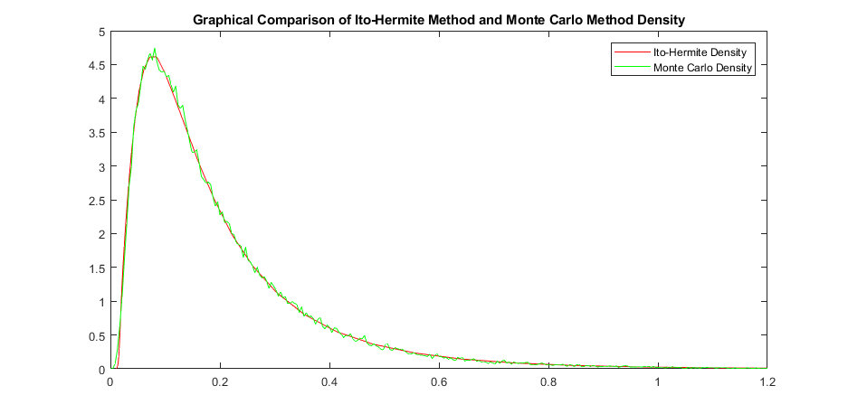](https://postimages.org/)

---

### #907 — Amin (Topic Author)
*March 29, 2020, 12:31 AM*

I am uploading graphical comparison of Ito-hermite density and monte carlo density for 12 different cases. The
comparison has been done with the program in post 905. I have removed the portion of the graph where our density becomes
indistinguishable from x-axis to focus on the main body of the density. You can very easily change the above program for
any general SDE with two drift terms. Here is the  SDE

$dX(t)=\kappa (\theta - X(t)) dt + \sigma X(t)^{\gamma} dz(t), X(0)=x0$

I will be further improving the program in next few days and update here so you would be able to download the new
program in a few days.

Please note that all the Ito-hermite densities shown in graphs below came from mean-corrected algorithm which ensures
that mean of the Ito-hermite density is precisely the same as analytic mean of the density so tail that is not shown in
many graphs is also extremely exact.

The parameters in the SDE are shown on the title of each graph.

[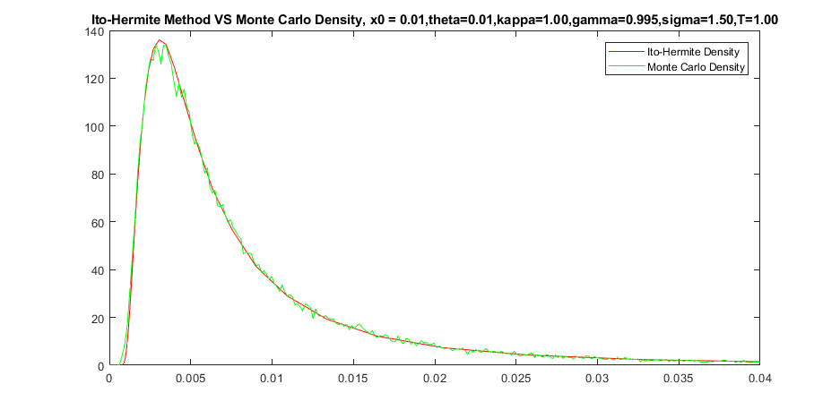](https://postimages.org/)

[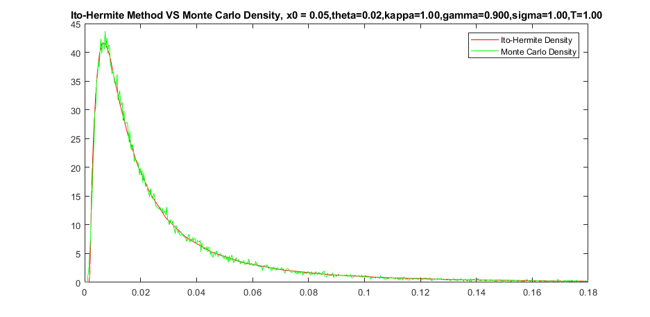](https://postimages.org/)

[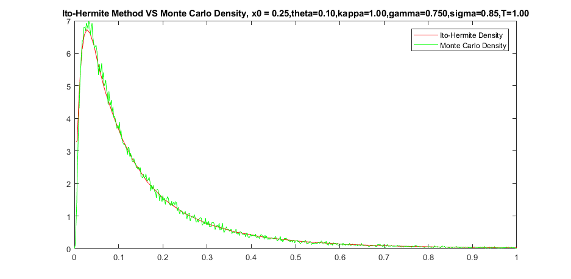](https://postimages.org/)

[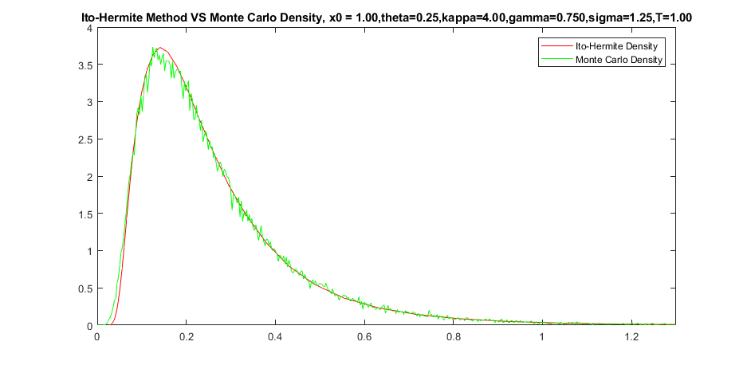](https://postimages.org/)

[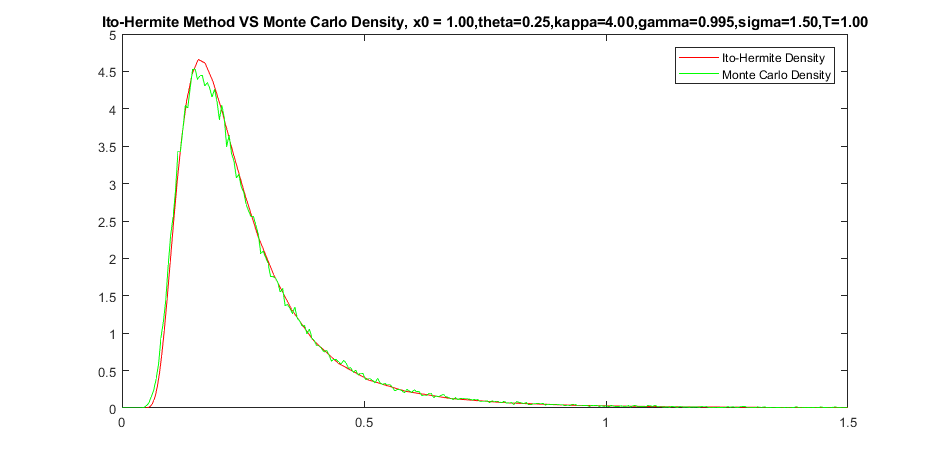](https://postimages.org/)

[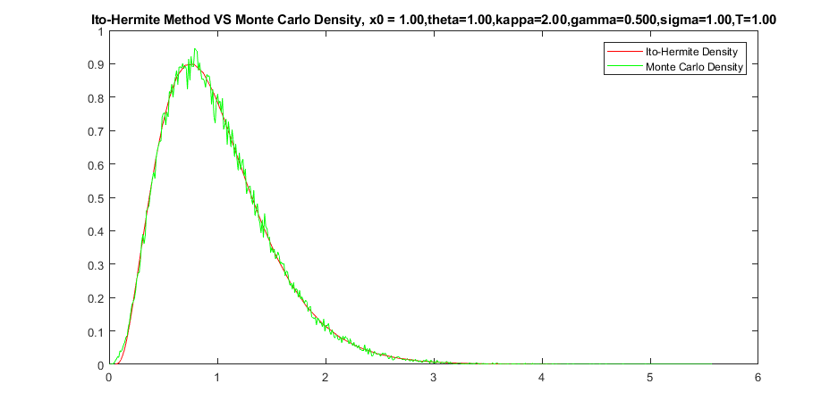](https://postimages.org/)

[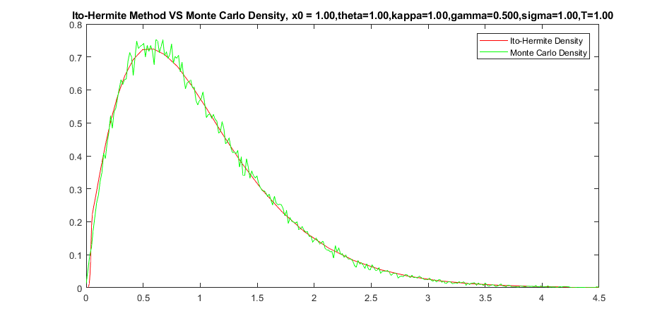](https://postimages.org/)

[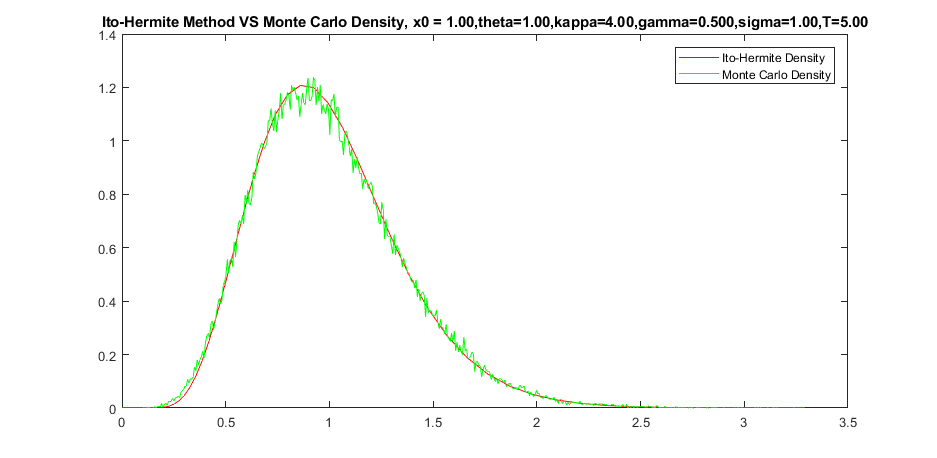](https://postimages.org/)

[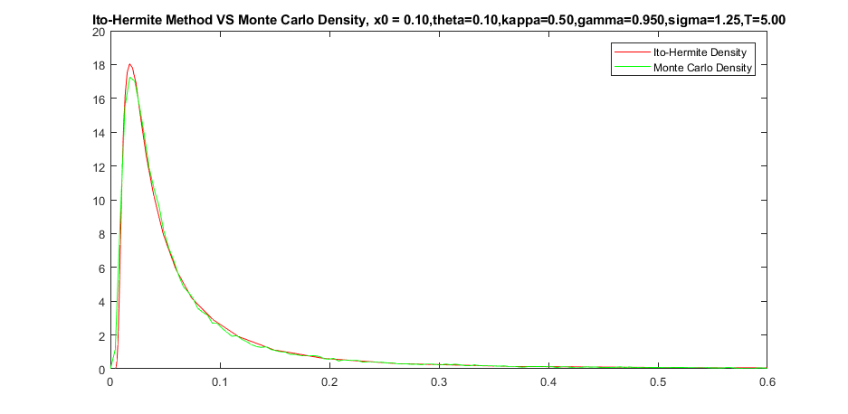](https://postimages.org/)

[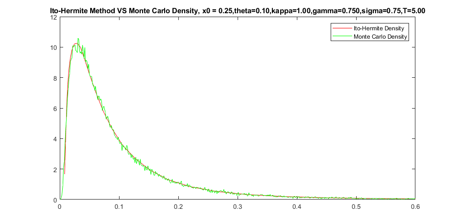](https://postimages.org/)

[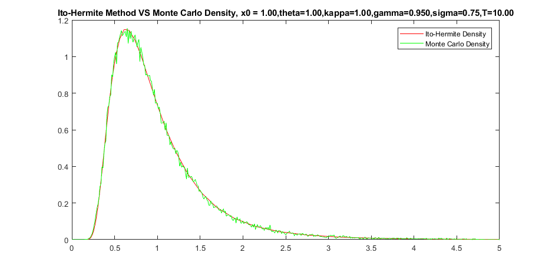](https://postimages.org/)

[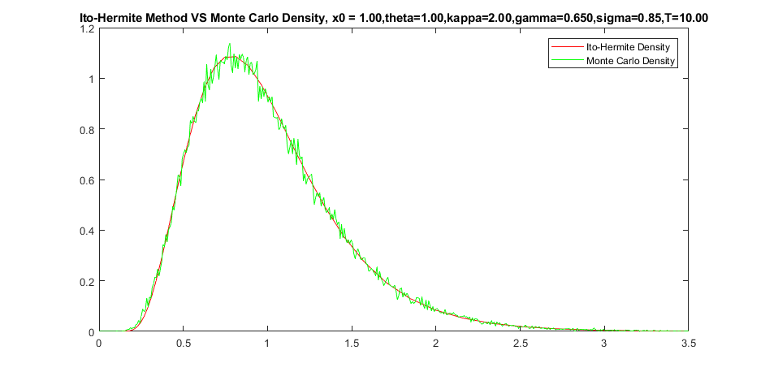](https://postimages.org/)

---

### #908 — Amin (Topic Author)
*March 29, 2020, 7:45 PM*

>
> This is for friends who want to solve the mean reverting stochastic volatility type equations with Ito-hermite method
of moving and expanding/contracting grid. When we have the equation given as
>
>
>
> $dx(t)=\kappa (\theta - x(t)) dt + \sigma x^{\gamma} dz(t) $
>
>
>
> We used a transformed version of the above equation and simulated the dynamics of
$w(t)=\frac{x(t)^{1-\gamma}}{(1-\gamma)}$ . In original coordinates the dynamics of evolution of w(t) are given as
>
>
>
> $dw(t)=\kappa \theta x^{-\gamma} dt - \kappa x^{1-\gamma} dt -.5 \gamma {\sigma}^2 x^{(\gamma-1)} dt + \sigma dz(t)$
>
>
>
> Just like for mean reverting equations in original coordinates, we can try a suitable choice of exponential and
decrease the number of drift terms from three to only two. And we know that our Ito-hermite method works remarkably well
when there are only two terms in the drift. So here is the new process we simulate
>
>
>
> $d[\exp(\kappa(1-\gamma) t) w(t)]=d[\exp(\kappa(1-\gamma) t) \frac{x(t)^{1-\gamma}}{(1-\gamma)}]$
>
>
$=\exp(\kappa(1-\gamma) t) [\kappa \theta x^{-\gamma} dt - \kappa x^{1-\gamma} dt -.5 \gamma {\sigma}^2 x^{(\gamma-1)} dt + \sigma dz(t)]$
>
> $+\exp(\kappa(1-\gamma) t) \kappa x^{1-\gamma} dt$
>
> once we cancel the identical terms with opposite signs, we get the equation
>
> $d[\exp(\kappa(1-\gamma) t) w(t)]$
>
> $=\exp(\kappa(1-\gamma) t) [\kappa \theta x^{-\gamma} dt -.5 \gamma {\sigma}^2 x^{(\gamma-1)} dt + \sigma dz(t)]$
>
> solving the above equation in proper integral form, we get
>
> $w(t)=\exp(-\kappa(1-\gamma) t) w(0)$
>
>
$+\exp(-\kappa(1-\gamma) t) \int_0^t \exp(\kappa(1-\gamma) s) [\kappa \theta x^{-\gamma} -.5 \gamma {\sigma}^2 x^{(\gamma-1)}] ds$
>
> $+\exp(-\kappa(1-\gamma) t) \int_0^t  \exp(\kappa(1-\gamma) s) \sigma dz(s)$
>
>
>
> So we have decreased the number of drift terms from three to two in exchange for time dependence in the SDE. If we
could solve for time exactly, I hope, we will be able to get very exact solution of the above type of mean reverting
SDEs.
>
> As I am trying to complete the program for monte carlo simulation of explicit time dependent SDEs, once I post that
program in a few days, I will come back to integrating the above solution dynamics in our Ito-hermite framework for the
solution of above mean reverting SDEs.
>

I have used the above technique to solve the mean reverting SDEs in Ito-hermite density simulation method framework. It
is an improvement over the previous program. I will make further improvements in the update equation in a few days.

The program below will work only with mean-reverting type SDEs where the method of multiplication with the exponential
as given in the quoted post is applicable. I have also used mean-correction.

Please note that mu1=kappa*theta, beta1=0 and mu2=-kappa, beta2=1.0 in our mean reverting type SDEs. For the above
mean-reverting type

sdes. Since there is time dependence in the above method, I calculated the integrals with exponentials in them.

Here is the  new code.

```
function [TrueMean,ItoHermiteMean,MCMean] = ItoHermiteWilmottMeanCorrected08Exponential(x0,theta,kappa,gamma,sigma0,T)

%Copyright Ahsan Amin. Infiniti derivatives Technologies.
%Please fell free to connect on linkedin: linkedin.com/in/ahsan-amin-0a53334
%or skype ahsan.amin2999
%In this program, I am simulating the SDE given as
%dx(t)=kappa*(theta dt -x dt) +sigma x(t)^gamma dz(t)

%I have not directly simulated the SDE but simulated the transformed
%Besse1l process version of the SDE and then changed coordinates to retreive
%the SDE in original coo
%rdinates.
%The present program will analytically evolve only the Bessel Process version of the
%SDE in transformed coordinates.

dt=.125/16;   % Simulation time interval.%Fodiffusions close to zero
             %decrease dt for accuracy.
%T=5;
Tt=128*T;%16*16;     % Number of simulation levels. Terminal time= Tt*dt; //.125/32*32*16=2 year;
OrderA=4;  %
OrderM=4;  %
%dtM=.125/8;%Monte carlo time interval size dtM.
%TtM=8*8;%Monte carlo number of simulation intervals.
dtM=dt*2;
TtM=Tt/2;

dNn=.2/1;   % Normal density subdivisions width. would change with number of subdivisions
Nn=48;  % No of normal density subdivisions
NnMidl=25;%One half density Subdivision left from mid of normal density(low)
NnMidh=26;%One half density subdivision right from the mid of normal density(high)
NnMid=4.0;

%theta=mu1/(-mu2);
%kappa=-mu2;

%x0=.25;   % starting value of SDE
beta1=0.0;
beta2=1.0;   % Second drift term power.
%gamma=.95;%50;   % volatility power.
%kappa=.5;   %mean reversion parameter.
%theta=.075;%mean reversion target

%you can specify any general mu1 and mu2 and beta1 and beta2.
%The present program is not perfect but quite reasonably good.
%if there is only one term in drift with beta=0, there will be minor
%errors. This case is yet not covered.

mu1=+1*theta*kappa;   %first drift coefficient.
mu2=-1*kappa;    % Second drift coefficient.
%sigma0=1.0;%Volatility value
alpha=1;% x^alpha is being expanded. This is currently for monte carlo only.
alpha1=1-gamma;

w(1:Nn)=x0^(1-gamma)/(1-gamma);

Z(1:Nn)=(((1:Nn)-5.5)*dNn-NnMid);

Z
str=input('Look at Z');
ZProb(1)=normcdf(.5*Z(1)+.5*Z(2),0,1)-normcdf(.5*Z(1)+.5*Z(2)-dNn,0,1);
ZProb(Nn)=normcdf(.5*Z(Nn)+.5*Z(Nn-1)+dNn,0,1)-normcdf(.5*Z(Nn)+.5*Z(Nn-1),0,1);

for nn=2:Nn-1
    ZProb(nn)=normcdf(.5*Z(nn)+.5*Z(nn+1),0,1)-normcdf(.5*Z(nn)+.5*Z(nn-1),0,1);
    %Above calculate probability mass in each probability subdivision.
end

%%%%%%%%%%%%%%%%%%%%%%%%%%%%%%%%%%%%%%%%%%%%%%%%%%%%%%%%%%%%%%%%%%%%%%%%%%%%%%%%%%%%%%%%%%%%%%

sigma11(1:OrderA+1)=0;
mu11(1:OrderA+1)=0;
mu22(1:OrderA+1)=0;
sigma22(1:OrderA+1)=0;
% index 1 correponds to zero level since matlab indexing starts at one.
sigma11(1)=1;
mu11(1)=1;
mu22(1)=1;
sigma22(1)=1;

for k=1:(OrderA+1)
    if sigma0~=0
        sigma11(k)=sigma0^(k-1);
    end
    if mu1 ~= 0
        mu11(k)=mu1^(k-1);
    end
    if mu2 ~= 0
        mu22(k)=mu2^(k-1);
    end
    if sigma0~=0
        sigma22(k)=sigma0^(2*(k-1));
    end
end
%Ft(1:TtM+1,1:(OrderA+1),1:(OrderA+1),1:(OrderA+1),1:(OrderA+1))=0; %General time powers on hermite polynomials
Fp(1:(OrderA+1),1:(OrderA+1),1:(OrderA+1),1:(OrderA+1))=0;%General x powers on coefficients of hermite polynomials.
Fp1(1:(OrderA+1),1:(OrderA+1),1:(OrderA+1),1:(OrderA+1))=0;%General x powers for bessel transformed coordinates.

%YCoeff0 and YCoeff are coefficents for original coordinates monte carlo.
%YqCoeff0 and YqCoeff are bessel/lamperti version monte carlo.

YCoeff0(1:(OrderA+1),1:(OrderA+1),1:(OrderA+1),1:(OrderA+1))=0;
YqCoeff0(1:(OrderA+1),1:(OrderA+1),1:(OrderA+1),1:(OrderA+1))=0;
%Pre-compute the time and power exponent values in small multi-dimensional arrays
YCoeff = ItoTaylorCoeffsNew(alpha,beta1,beta2,gamma); %expand y^alpha where alpha=1;
YqCoeff = ItoTaylorCoeffsNew(alpha1,beta1,beta2,gamma);%expand y^alpha1 where alpha1=(1-gamma)
YqCoeff=YqCoeff/(1-gamma); %Transformed coordinates coefficients have to be
%further divided by (1-gamma)
YqCoeffExp= ItoTaylorCoeffsNewO2Exp(alpha1,beta1,beta2,gamma);
YqCoeffExp=YqCoeffExp/(1-gamma);

Order2=2;
for k = 0 : (Order2)
    for m = 0:k
        l4 = k - m + 1;
        for n = 0 : m
            l3 = m - n + 1;
            for j = 0:n
                l2 = n - j + 1;
                l1 = j + 1;
                Fp1Exp(l1,l2,l3,l4) = (alpha1 + (l1-1) * beta1 + (l2-1) * beta2 + (l3-1) * 2* gamma + (l4-1) * gamma ...
                    - (l1-1) - (l2-1) - 2* (l3-1) - (l4-1));
                YqCoeffExp0(l1,l2,l3,l4) =YqCoeffExp(l1,l2,l3,l4).*mu11(l1).*mu22(l2).*sigma22(l3).*sigma11(l4);
            end
        end
    end
end

for k = 0 : (OrderA)
    for m = 0:k
        l4 = k - m + 1;
        for n = 0 : m
            l3 = m - n + 1;
            for j = 0:n
                l2 = n - j + 1;
                l1 = j + 1;
                %Ft(l1,l2,l3,l4) = dtM^((l1-1) + (l2-1) + (l3-1) + .5* (l4-1));
                Fp(l1,l2,l3,l4) = (alpha + (l1-1) * beta1 + (l2-1) * beta2 + (l3-1) * 2* gamma + (l4-1) * gamma ...
                    - (l1-1) - (l2-1) - 2* (l3-1) - (l4-1));
                Fp1(l1,l2,l3,l4) = (alpha1 + (l1-1) * beta1 + (l2-1) * beta2 + (l3-1) * 2* gamma + (l4-1) * gamma ...
                    - (l1-1) - (l2-1) - 2* (l3-1) - (l4-1));

                YCoeff0(l1,l2,l3,l4) =YCoeff(l1,l2,l3,l4).*mu11(l1).*mu22(l2).*sigma22(l3).*sigma11(l4);
                YqCoeff0(l1,l2,l3,l4) =YqCoeff(l1,l2,l3,l4).*mu11(l1).*mu22(l2).*sigma22(l3).*sigma11(l4);

            end
        end
    end
end

%%%%%%%%%%%%%%%%%%%%%%%%%%%%%%%%%%%%%%%%%%%%%%%%%%%%%%%%%%%%%%%%%%%%%%%%%%%%%%%%%%%%%%%%%%%%%%
wnStart=1;%
d2wdZ2(1:Nn)=0;
dwdZ(1:Nn)=0;
yy(wnStart:Nn)=((1-gamma)*w(wnStart:Nn)).^(1/(1-gamma));
tic

for tt=1:Tt

    kappa2=kappa*(1-gamma);
     yy(wnStart:Nn)=((1-gamma)*w(wnStart:Nn)).^(1/(1-gamma));

%    [wMu0dt1,dwMu0dtdw1,d2wMu0dtdw21,d3wMu0dtdw31,c11,c21,c31,c41] =
CalculateDriftAndVolOrder4(w,wnStart,Nn,YqCoeff0,Fp1,gamma,dt);

    [wMu0dt,dwMu0dtdw,d2wMu0dtdw2,d3wMu0dtdw3,c1,c2,c3,c4] =
CalculateDriftAndVolOrderLowExponential(w,wnStart,Nn,YqCoeffExp0,Fp1Exp,gamma,dt,kappa2);

    dw(wnStart:Nn)=c1(wnStart:Nn).*Z(wnStart:Nn) ;% ...
    dw2(wnStart:Nn)=dw(wnStart:Nn).^2;
   % d2w(wnStart:Nn)=c2(wnStart:Nn).*(Z(wnStart:Nn).^2-1);
   % d3w(wnStart:Nn)=c3(wnStart:Nn).*(Z(wnStart:Nn).^3-3*Z(wnStart:Nn));
    w(isnan(w)==1)=0;
    wMu0dt(isnan(wMu0dt)==1)=0;
    wMeanPrev=sum(ZProb(wnStart:Nn).*w(wnStart:Nn));%Calculate the mean.

%%%%%%%%%%%%%%%%%%%%%%%%%%%%%%%%%%%%%%%%%%%%%%%%%%%%%%%%%%%%%%%%%%%%%%%%%%%

[w0,Sigma00,Sigma11,Sigma22,Sigma33,Sigma1,Sigma2,Sigma3,Sigma0] =
CalculateHermiteRepresentationOfDensityOrderThreeNew(w,Z,wnStart,Nn,dNn,NnMidh,NnMidl);
d2wdZ2(wnStart:Nn)=d2wdZ2(wnStart:Nn)+
d2wMu0dtdw2(wnStart:Nn).*dwdZ(wnStart:Nn).^2+dwMu0dtdw(wnStart:Nn).*d2wdZ2(wnStart:Nn);%+ ...

dwdZ(wnStart:Nn)=(Sigma00)+Sigma1(wnStart:Nn).*2.*Z(wnStart:Nn);%.*ExpDamp(wnStart:Nn);

H2(wnStart:Nn)=(Z(wnStart:Nn).^2-1);
CTerm(wnStart:Nn)=(.5*d2wMu0dtdw2(wnStart:Nn).*dwdZ(wnStart:Nn).^2 - ...
          1*dwMu0dtdw(wnStart:Nn).*d2wdZ2(wnStart:Nn));
Correction1(wnStart:Nn)=-sqrt(2/3)/(22/7)^2.*CTerm(wnStart:Nn).*H2(wnStart:Nn);
Correction0(wnStart:Nn)=-sqrt(2/3)/(22/7)^2.*(d2wdZ2(wnStart:Nn)-.25*dwdZ(wnStart:Nn).^2).*H2(wnStart:Nn);

if(tt==1)
w(wnStart:Nn)=wMeanPrev+exp(-kappa2*dt).*(wMu0dt(wnStart:Nn)+ ...
          sign(exp(kappa2*dt).*(w(wnStart:Nn)-wMeanPrev)+dw(wnStart:Nn)).* ...
          sqrt(abs(sign(w(wnStart:Nn)-wMeanPrev).*exp(2*kappa2*dt).*(w(wnStart:Nn)-wMeanPrev).^2+ ...
          sign(dw(wnStart:Nn)).*dw2(wnStart:Nn))));
end
if(tt>1)

   w(wnStart:Nn)=wMeanPrev+exp(-kappa2*dt).*(wMu0dt(wnStart:Nn)+ ...
       sign(exp(kappa2*dt).*(w(wnStart:Nn)-wMeanPrev)+dw(wnStart:Nn)).* ...
           sqrt(abs(sign(w(wnStart:Nn)-wMeanPrev).*exp(2*kappa2*dt).*(w(wnStart:Nn)-wMeanPrev).^2+ ...
           sign(dw(wnStart:Nn)).*dw2(wnStart:Nn))))+ ...
           +dt *Correction0(wnStart:Nn).*exp(-.5*(1-gamma)*sigma0.^2.*Z(wnStart:Nn).^2) + ...
          Correction1(wnStart:Nn).*exp(-.5*(1-gamma)*sigma0.^2.*Z(wnStart:Nn).^2);

end

%%%%%%%%%%%%%%%%%%%%%%%%%%%%%%%%%%%%%%%%%%%%%%%%%%%%%%%%%%%%%%%%%%%%%%%%%%%
%Below are instability correction equations. There is instability in the
% SDE representation equation roughly between -.5 SD to +.5 SD in normal terms.
%Instability correction Algorithm takes two ends that are here given as
%lower end=w(NnMidl-2) and upper end=w(NnMidh+3).
%In the block below the interpolation starts from lower end.
%1st equation is
%wll(NnMidl-1)=w(NnMidl-2)+(D1wl+CTheta*D2wl*dNn/1+.5*DeltaD1w)*dNn;
%Second equation is: wll(NnMidl)=wll(NnMidl-1)+(D1wl+CTheta*D2wl*dNn+1.5*DeltaD1w)*dNn;
%And so on.
%There is a sixth equation that is not written below(since it takes us to
%the upper interpolation point which is already known) which is
%wll(NnMidh+3)=wll(NnMidh+2)+(D1wl+CTheta*D2wl*dNn+5.5*DeltaD1w)*dNn;
%Sum of these six equations add up to the distance between upper and lower
%interpolation points.
%In the sum there are six instances of first derivative which is already
%calculated at the boundary, six instances of second derivative which is also
%already calculated at lower boundary and 18.0 instances of DeltaD1w which is
%unknown. This equation calculates the value of one unit of DeltaD1w addition
%DeltaD1w=(w(NnMidh+3)-w(NnMidl-2)-6*D1wl*dNn-6.0*CTheta*D2wl*dNn.^2.0/1.0)/18.0/dNn;
% I hope to find a better analytical method to tackle this issue. Friends
% are welcome to play with slightly changed related alternatives to the
%above interpolation.
    CTheta=1.0;
    D1wl=(11/6*w(NnMidl-2)-3*w(NnMidl-3)+3/2*w(NnMidl-4)-1/3*w(NnMidl-5))/dNn;
    D2wl=(35/12*w(NnMidl-2) -26/3*w(NnMidl-3)+ 19/2*w(NnMidl-4)-14/3*w(NnMidl-5)+11/12*w(NnMidl-6))/dNn.^2;
    DeltaD1w=(w(NnMidh+3)-w(NnMidl-2)-6*D1wl*dNn-6.0*CTheta*D2wl*dNn.^2.0/1.0)/18.0/dNn;

    wll(NnMidl-1)=w(NnMidl-2)+  (D1wl+CTheta*D2wl*dNn+.5*DeltaD1w)*dNn;
    wll(NnMidl)=wll(NnMidl-1)+  (D1wl+CTheta*D2wl*dNn+1.5*DeltaD1w)*dNn;
    wll(NnMidh)=wll(NnMidl)+    (D1wl+CTheta*D2wl*dNn+2.5*DeltaD1w)*dNn;
    wll(NnMidh+1)=wll(NnMidh)+  (D1wl+CTheta*D2wl*dNn+3.5*DeltaD1w)*dNn;
    wll(NnMidh+2)=wll(NnMidh+1)+(D1wl+CTheta*D2wl*dNn+4.5*DeltaD1w)*dNn;
    %wll(NnMidh+3)=wll(NnMidh+2)+(D1wl+CTheta*D2wl*dNn+5.5*DeltaD1w)*dNn;
%The last equation is not used since point w(NnMidh+3)is given but it is used in
%calculation of distance between two interpolation points. This distance is
%used to determine the value of DeltaD1w.

    D1wh=(-11/6*w(NnMidh+3)+3*w(NnMidh+4)-3/2*w(NnMidh+5)+1/3*w(NnMidh+6))/dNn;
    D2wh=(35/12*w(NnMidh+3) -26/3*w(NnMidh+4)+ 19/2*w(NnMidh+5)-14/3*w(NnMidh+6)+11/12*w(NnMidh+7))/dNn.^2;
    DeltaD1w=(w(NnMidh+3)-w(NnMidl-2)-6*D1wh*dNn-6.0*CTheta*D2wh*dNn.^2.0/1.0)/18.0/dNn;
%     DeltaD1w=(w(NnMidh+2)-w(NnMidl-1)-4*D1wh*dNn-16.0*D2wh*dNn.^2.0/1.0)/6.0/dNn;

    whh(NnMidh+2)=w(NnMidh+3)-(D1wh+CTheta*D2wh*dNn+.5*DeltaD1w)*dNn;
    whh(NnMidh+1)=w(NnMidh+2)-(D1wh+CTheta*D2wh*dNn+1.5* DeltaD1w)*dNn;
    whh(NnMidh)=whh(NnMidh+1)-(D1wh+CTheta*D2wh*dNn+2.5* DeltaD1w)*dNn;
    whh(NnMidl)=whh(NnMidh)-(D1wh+CTheta*D2wh*dNn+3.5* DeltaD1w)*dNn;
    whh(NnMidl-1)=whh(NnMidl)-(D1wh+CTheta*D2wh*dNn+4.5* DeltaD1w)*dNn;

    %whh(NnMidl-2)=whh(NnMidl-1)-(D1wh+CTheta*D2wh*dNn/1+5.5* DeltaD1w)*dNn;

%
     w(NnMidh+2)=.5*whh(NnMidh+2)+.5*wll(NnMidh+2);
     w(NnMidh+1)=.5*whh(NnMidh+1)+.5*wll(NnMidh+1);
     w(NnMidh)=.5*whh(NnMidh)+.5*wll(NnMidh);
     w(NnMidl)=.5*whh(NnMidl)+.5*wll(NnMidl);
     w(NnMidl-1)=.5*whh(NnMidl-1)+.5*wll(NnMidl-1);

        w1(1:Nn-1)=w(1:Nn-1);
        w2(1:Nn-1)=w(2:Nn);

%         w1(1:Nn-2)=w(1:Nn-2);
%         w2(1:Nn-2)=w(2:Nn-1);
%         w3(1:Nn-2)=w(3:Nn);
%         w(w1(:)>w2(:))=w2(w1(:)>w2(:))-.25*(w3(w1(:)>w2(:))-w2(w1(:)>w2(:)));
        w(w1(:)>w2(:))=0;%Be careful;might not universally hold;

        w(w<0)=0.0;
        for nn=1:Nn
            if(w(nn)<=0)
                wnStart=nn+1;
           end
        end

        %%1st order mean correction. We know the mean in original
        %%coordinates so I shift the density into original coordinates,
        %%apply the mean correction and then transform again into Lamperti
        %%coordinates. Algebra solves two equations in two unknowns.
        %%Equations are Sum_0^N{(Y_w(wnStart:Nn)-Y0)*W0}=1 and the second
        %%equation is Sum_0^N{Y_w(wnStart:Nn).*(Y_w(wnStart:Nn)-Y0)*W0}=u0
        %%Two unknows are Y0 and W0. u0 is known mean.
        tt;
        u0=theta+(x0-theta)*exp(-kappa*(tt*dt)); %analytic mean of the density

        %If you are not using stochastic volatility, replace above with
        %true mean otherwise results would become garbage.

        Y_w(wnStart:Nn) = ((1-gamma)*w(wnStart:Nn)).^(1/(1-gamma));

        Yn2Pn=sum(Y_w(wnStart:Nn).*Y_w(wnStart:Nn).*ZProb(wnStart:Nn));
        YnPn=sum(Y_w(wnStart:Nn).*ZProb(wnStart:Nn));
        Pn=1.0;%%Sum(ZProb(1:Nn))
        Y0=(Yn2Pn-u0*YnPn)/(YnPn-u0*Pn);

        Y0Pn=Y0*Pn;
        W0=1/(YnPn-Y0Pn);
        YCorrected(wnStart:Nn)=Y_w(wnStart:Nn).*(Y_w(wnStart:Nn)-Y0)*W0;
        wCorrected(wnStart:Nn)=(YCorrected(wnStart:Nn).^(1-gamma))./(1-gamma);
        w(wnStart:Nn)=wCorrected(wnStart:Nn);

   %I have disabled the mean correction. The above mean correction is only valid for
   %standard mean reverting stochastic volatility type SDEs. To enable mean
   %correction please uncomment the above last line in the block.

end

 y_w(1:Nn)=0;
 y_w(wnStart:Nn) = ((1-gamma)*w(wnStart:Nn)).^(1/(1-gamma));
 Dfy_w(wnStart:Nn)=0;
 Dfw(wnStart:Nn)=0;
for nn=wnStart+1:Nn-1
    Dfy_w(nn) = (y_w(nn + 1) - y_w(nn - 1))/(Z(nn + 1) - Z(nn - 1));
    Dfw(nn) = (w(nn + 1) - w(nn - 1))/(Z(nn + 1) - Z(nn - 1));
    %Change of variable derivative for densities
end
fy_w(1:Nn)=0;
fw(1:Nn)=0;
for nn = wnStart:Nn-1
    fy_w(nn) = (normpdf(Z(nn),0, 1))/abs(Dfy_w(nn));%Origianl coordinates density
    fw(nn) = (normpdf(Z(nn),0, 1))/abs(Dfw(nn));
end

toc
%str=input('Analytic Values calculated; Press a key to start monte carlo');

 rng(29079137, 'twister')
 paths=100000;
 YY(1:paths)=x0;  %Original process monte carlo.
 Random1(1:paths)=0;
 YYMean(1:TtM)=0;
 for tt=1:TtM
     Random1=randn(size(Random1));
     HermiteP1(1,1:paths)=1;
     HermiteP1(2,1:paths)=Random1(1:paths);
     HermiteP1(3,1:paths)=Random1(1:paths).^2-1;
     HermiteP1(4,1:paths)=Random1(1:paths).^3-3*Random1(1:paths);
     HermiteP1(5,1:paths)=Random1(1:paths).^4-6*Random1(1:paths).^2+3;

     YY(1:paths)=YY(1:paths) + ...
      (YCoeff0(1,1,2,1).*YY(1:paths).^Fp(1,1,2,1)+ ...
      YCoeff0(1,2,1,1).*YY(1:paths).^Fp(1,2,1,1)+ ...
      YCoeff0(2,1,1,1).*YY(1:paths).^Fp(2,1,1,1))*dtM + ...
      (YCoeff0(1,1,3,1).*YY(1:paths).^Fp(1,1,3,1)+ ...
      YCoeff0(1,2,2,1).*YY(1:paths).^Fp(1,2,2,1)+ ...
      YCoeff0(2,1,2,1).*YY(1:paths).^Fp(2,1,2,1)+ ...
      YCoeff0(1,3,1,1).*YY(1:paths).^Fp(1,3,1,1)+ ...
      YCoeff0(2,2,1,1).*YY(1:paths).^Fp(2,2,1,1)+ ...
      YCoeff0(3,1,1,1).*YY(1:paths).^Fp(3,1,1,1))*dtM^2 + ...
      ((YCoeff0(1,1,1,2).*YY(1:paths).^Fp(1,1,1,2).*sqrt(dtM))+ ...
    (YCoeff0(1,1,2,2).*YY(1:paths).^Fp(1,1,2,2)+ ...
    YCoeff0(1,2,1,2).*YY(1:paths).^Fp(1,2,1,2)+ ...
    YCoeff0(2,1,1,2).*YY(1:paths).^Fp(2,1,1,2)).*dtM^1.5) .*HermiteP1(2,1:paths) + ...
    ((YCoeff0(1,1,1,3).*YY(1:paths).^Fp(1,1,1,3) *dtM) + ...
    (YCoeff0(1,1,2,3).*YY(1:paths).^Fp(1,1,2,3)+ ...
    YCoeff0(1,2,1,3).*YY(1:paths).^Fp(1,2,1,3)+ ...
    YCoeff0(2,1,1,3).*YY(1:paths).^Fp(2,1,1,3)).*dtM^2).*HermiteP1(3,1:paths) + ...
    ((YCoeff0(1,1,1,4).*YY(1:paths).^Fp(1,1,1,4)*dtM^1.5 )).*HermiteP1(4,1:paths) + ...
    (YCoeff0(1,1,1,5).*YY(1:paths).^Fp(1,1,1,5)*dtM^2.0).*HermiteP1(5,1:paths);

%Uncomment for fourth order monte carlo

%
%   YY(1:paths)=YY(1:paths) + ...
%       (YCoeff0(1,1,2,1).*YY(1:paths).^Fp(1,1,2,1)+YCoeff0(1,2,1,1).*YY(1:paths).^Fp(1,2,1,1)+ ...
%       YCoeff0(2,1,1,1).*YY(1:paths).^Fp(2,1,1,1))*dtM + ...
%       (YCoeff0(1,1,3,1).*YY(1:paths).^Fp(1,1,3,1)+YCoeff0(1,2,2,1).*YY(1:paths).^Fp(1,2,2,1)+ ...
%       YCoeff0(2,1,2,1).*YY(1:paths).^Fp(2,1,2,1)+YCoeff0(1,3,1,1).*YY(1:paths).^Fp(1,3,1,1)+ ...
%       YCoeff0(2,2,1,1).*YY(1:paths).^Fp(2,2,1,1)+YCoeff0(3,1,1,1).*YY(1:paths).^Fp(3,1,1,1))*dtM^2 + ...
%       (YCoeff0(1,1,4,1).*YY(1:paths).^Fp(1,1,4,1)+YCoeff0(1,2,3,1).*YY(1:paths).^Fp(1,2,3,1)+ ...
%       YCoeff0(2,1,3,1).*YY(1:paths).^Fp(2,1,3,1)+YCoeff0(1,3,2,1).*YY(1:paths).^Fp(1,3,2,1)+ ...
%       YCoeff0(2,2,2,1).*YY(1:paths).^Fp(2,2,2,1)+YCoeff0(3,1,2,1).*YY(1:paths).^Fp(3,1,2,1)+ ...
%       YCoeff0(1,4,1,1).*YY(1:paths).^Fp(1,4,1,1)+YCoeff0(2,3,1,1).*YY(1:paths).^Fp(2,3,1,1)+ ...
%       YCoeff0(3,2,1,1).*YY(1:paths).^Fp(3,2,1,1)+YCoeff0(4,1,1,1).*YY(1:paths).^Fp(4,1,1,1))*dtM^3 + ...
%        (YCoeff0(1,1,5,1).*YY(1:paths).^Fp(1,1,5,1)+YCoeff0(1,2,4,1).*yy(1:paths).^Fp(1,2,4,1)+ ...
%     YCoeff0(2,1,4,1).*YY(1:paths).^Fp(2,1,4,1)+YCoeff0(2,1,1,1).*yy(1:paths).^Fp(2,1,1,1)+ ...
%      YCoeff0(2,2,3,1).*YY(1:paths).^Fp(2,2,3,1)+ ...
%      YCoeff0(3,1,3,1).*YY(1:paths).^Fp(3,1,3,1)+YCoeff0(1,4,2,1).*YY(1:paths).^Fp(1,4,2,1)+ ...
%      YCoeff0(2,3,2,1).*YY(1:paths).^Fp(2,3,2,1)+YCoeff0(3,2,2,1).*YY(1:paths).^Fp(3,2,2,1)+ ...
%      YCoeff0(4,1,2,1).*YY(1:paths).^Fp(4,1,2,1)+YCoeff0(1,5,1,1).*YY(1:paths).^Fp(1,5,1,1)+ ...
%      YCoeff0(2,4,1,1).*YY(1:paths).^Fp(2,4,1,1)+ ...
%      YCoeff0(3,3,1,1).*YY(1:paths).^Fp(3,3,1,1)+YCoeff0(4,2,1,1).*YY(1:paths).^Fp(4,2,1,1)+ ...
%      YCoeff0(5,1,1,1).*YY(1:paths).^Fp(5,1,1,1))*dtM^4+ ...
%       ((YCoeff0(1,1,1,2).*YY(1:paths).^Fp(1,1,1,2).*sqrt(dtM))+ ...
%     (YCoeff0(1,1,2,2).*YY(1:paths).^Fp(1,1,2,2)+YCoeff0(1,2,1,2).*YY(1:paths).^Fp(1,2,1,2)+ ...
%     YCoeff0(2,1,1,2).*YY(1:paths).^Fp(2,1,1,2)).*dtM^1.5+ ...
%     (YCoeff0(1,1,3,2).*YY(1:paths).^Fp(1,1,3,2)+YCoeff0(1,2,2,2).*YY(1:paths).^Fp(1,2,2,2)+ ...
%     YCoeff0(2,1,2,2).*YY(1:paths).^Fp(2,1,2,2)+YCoeff0(1,3,1,2).*YY(1:paths).^Fp(1,3,1,2)+ ...
%     YCoeff0(2,2,1,2).*YY(1:paths).^Fp(2,2,1,2)+YCoeff0(3,1,1,2).*YY(1:paths).^Fp(3,1,1,2)).*dtM^2.5+ ...
%     (YCoeff0(1,1,4,2).*YY(1:paths).^Fp(1,1,4,2)+YCoeff0(1,2,3,2).*YY(1:paths).^Fp(1,2,3,2)+ ...
%     YCoeff0(2,1,3,2).*YY(1:paths).^Fp(2,1,3,2)+YCoeff0(1,3,2,2).*YY(1:paths).^Fp(1,3,2,2)+ ...
%     YCoeff0(2,2,2,2).*YY(1:paths).^Fp(2,2,2,2)+ YCoeff0(3,1,2,2).*YY(1:paths).^Fp(3,1,2,2)+ ...
%     YCoeff0(1,4,1,2).*YY(1:paths).^Fp(1,4,1,2)+YCoeff0(2,3,1,2).*YY(1:paths).^Fp(2,3,1,2)+ ...
%     YCoeff0(3,2,1,2).*YY(1:paths).^Fp(3,2,1,2)+YCoeff0(4,1,1,2).*YY(1:paths).^Fp(4,1,1,2)).*dtM^3.5)
.*HermiteP1(2,1:paths) + ...
%     ((YCoeff0(1,1,1,3).*YY(1:paths).^Fp(1,1,1,3) *dtM) + ...
%     (YCoeff0(1,1,2,3).*YY(1:paths).^Fp(1,1,2,3)+YCoeff0(1,2,1,3).*YY(1:paths).^Fp(1,2,1,3)+ ...
%     YCoeff0(2,1,1,3).*YY(1:paths).^Fp(2,1,1,3)).*dtM^2+ ...
%     (YCoeff0(1,1,3,3).*YY(1:paths).^Fp(1,1,3,3)+YCoeff0(1,2,2,3).*YY(1:paths).^Fp(1,2,2,3)+ ...
%     YCoeff0(2,1,2,3).*YY(1:paths).^Fp(2,1,2,3) + YCoeff0(1,3,1,3).*YY(1:paths).^Fp(1,3,1,3)+ ...
%   
 YCoeff0(2,2,1,3).*YY(1:paths).^Fp(2,2,1,3)+YCoeff0(3,1,1,3).*YY(1:paths).^Fp(3,1,1,3)).*dtM^3).*HermiteP1(3,1:paths) +
...
%     ((YCoeff0(1,1,1,4).*YY(1:paths).^Fp(1,1,1,4)*dtM^1.5 )+ ...
%     (YCoeff0(1,1,2,4).*YY(1:paths).^Fp(1,1,2,4)+YCoeff0(1,2,1,4).*YY(1:paths).^Fp(1,2,1,4)+ ...
%     YCoeff0(2,1,1,4).*YY(1:paths).^Fp(2,1,1,4))*dtM^2.5).*HermiteP1(4,1:paths) + ...
%     (YCoeff0(1,1,1,5).*YY(1:paths).^Fp(1,1,1,5)*dtM^2.0).*HermiteP1(5,1:paths);
%

     YYMean(tt)=YYMean(tt)+sum(YY(1:paths))/paths;
 end
 YY(YY<0)=0;
 disp('Original process average from monte carlo');
 MCMean=sum(YY(:))/paths %origianl coordinates monte carlo average.
 disp('Original process average from our simulation');
 ItoHermiteMean=sum(y_w(wnStart+1:Nn-1).*ZProb(wnStart+1:Nn-1)) %Original process average from coordinates

 disp('true Mean only applicble to standard SV mean reverting type models otherwise disregard');
 TrueMean=theta+(x0-theta)*exp(-kappa*dt*Tt)%Mean reverting SDE original variable true average

 MaxCutOff=30;
 NoOfBins=round(500*gamma^2*4*sigma0);
 [YDensity,IndexOutY,IndexMaxY] = MakeDensityFromSimulation_Infiniti_NEW(YY,paths,NoOfBins,MaxCutOff );
 plot(y_w(wnStart+1:Nn-1),fy_w(wnStart+1:Nn-1),'r',IndexOutY(1:IndexMaxY),YDensity(1:IndexMaxY),'g');
 %plot(y_w(wnStart+1:Nn-1),fy_w(wnStart+1:Nn-1),'r',IndexOutY(1:IndexMaxY),YDensity(1:IndexMaxY),'g',Z(wnStart+1:Nn-1),fy_w(wnStart+1:Nn-1),'b');

 title(sprintf('Ito-Hermite Method VS Monte Carlo Density, x0 =
%.2f,theta=%.2f,kappa=%.2f,gamma=%.3f,sigma=%.2f,T=%.2f', x0,theta,kappa,gamma,sigma0,T));%,sprintf('theta= %f', theta),
sprintf('kappa = %f', kappa),sprintf('sigma = %f', sigma0),sprintf('T = %f', T));

 %title('text',sprintf('x0 = %f', x0),sprintf('theta= %f', theta), sprintf('kappa = %f', kappa),sprintf('sigma = %f',
sigma0),sprintf('T = %f', T))
 %xlabel(a)
 %title('Graphical Comparison of Ito-Hermite Method and Monte Carlo Method Density')
 legend({'Ito-Hermite Density','Monte Carlo Density'},'Location','northeast')

 str=input('red line is density of SDE from Ito-Hermite method, green is monte carlo.');

end

```

Here is the first dependeny of the above program

```
function [Y] = ItoTaylorCoeffsNewO2Exp(alpha,beta1,beta2,gamma)

%In the coefficient calculation program which calculates Y(l1,l2,l3,l4),
%I have used four levels of looping each for relevant expansion order.
%The first loop takes four values and second loop takes 16 values and
%third loop takes 64 values and so on. And then each coefficient
%term can be individually calculated while carefully accounting
%for path dependence.
%So for example in a nested loop structure
%m1= 1:mDim
% m2=1:mDim
% m3=1:mDim
%    l(m1)=l(m1)+1;
%    l(m2)=l(m2)+1;
%    l(m3)=l(m3)+1;

%in the above looping loop takes values from one to four with one
%indicating the first drift term, two indicating the second drift term
%and three indicating quadratic variation term and
%four indicating the volatility term. And with this looping structure
%we can So in the above looping m1=1 would mean that all terms are
%descendent of first drift term and m2=4 would mean that all terms are
%descendent of first drift term on first expansion order and descendent
%of volatility term on the second order and so we can keep track of path
%dependence perfectly.
%And on each level, we individually calculate the descendent terms. While
%keeping track of path dependence and calculating the coefficients with
%careful path dependence consideration, we update the appropriate element
%in our polynomial like expansion coefficient array

%explaining the part of code
%m1= 1:mDim
% m2=1:mDim
% m3=1:mDim
%    l(m1)=l(m1)+1;
%    l(m2)=l(m2)+1;
%    l(m3)=l(m3)+1;
%Y(l(1)+1,l(2),l(3),l(4))=Y(l(1)+1,l(2),l(3),l(4))+Coeff1st*IntegralCoeff(1,1,1,2);

%Here l(1) denotes l1 but written as l(1) so it can be conveniently
%updated with the loop variable when the loop variable takes value one
%indicating first drift term . And l(2) could be conveniently updated when
%the loop variable takes value equal to two indicating second
%drift term and so on.
%Here is the part of code snippet for that

%for m1=1:mDim
%    l(1)=1;
%    l(2)=1;
%    l(3)=1;
%    l(4)=1;
%    l(m1)=l(m1)+1;
%CoeffDX1 = alpha + (l(1)-1) *beta1 + (l(2)-1) *beta2 + (l(3)-1) *2*gamma + (l(4)-1)*gamma - (l(1)-1) - (l(2)-1) -
2*(l(3)-1) - (l(4)-1);
%    CoeffDX2 = CoeffDX1 - 1;
%    ArrIndex0=m1;
%    ArrIndex=(m1-1)*mDim;
%    Coeff1st=Y1(ArrIndex0)*CoeffDX1;
%    Coeff2nd=Y1(ArrIndex0)*.5*CoeffDX1*CoeffDX2;
%    Y2(1+ArrIndex)=Coeff1st;
%    Y(l(1)+1,l(2),l(3),l(4))=Y(l(1)+1,l(2),l(3),l(4))+Coeff1st*IntegralCoeff(1,1,2,n1(m1));
%    Y2(2+ArrIndex)=Coeff1st;
%    Y(l(1),l(2)+1,l(3),l(4))=Y(l(1),l(2)+1,l(3),l(4))+Coeff1st*IntegralCoeff(1,1,2,n1(m1));
%    Y2(3+ArrIndex)=Coeff2nd;
%    Y(l(1),l(2),l(3)+1,l(4))=Y(l(1),l(2),l(3)+1,l(4))+Coeff2nd*IntegralCoeff(1,1,2,n1(m1));
%    Y2(4+ArrIndex)=Coeff1st;
%    Y(l(1),l(2),l(3),l(4)+1)=Y(l(1),l(2),l(3),l(4)+1)+Coeff1st*IntegralCoeff(1,1,3,n1(m1));

%The first four lines update the array indices according to the parent term.
%And then CoeffDX1 and CoeffDX2 are calculated according to algebraic exponents on parent terms.
%ArrIndex0=m1; calculates the array index of the parent term
%And ArrIndex=(m1-1)*mDim; calculates the array index of the descendent terms
%And coefficient of the drift and volatility descendent terms is
%calculated by multiplying the coefficient of the parent term by
%Coeff1st=Y1(ArrIndex0)*CoeffDX1;
%And coefficient of the quadratic variation descendent terms is
%calculated by multiplying the coefficient of the parent term by
%Coeff2nd=Y1(ArrIndex0)*.5*CoeffDX1*CoeffDX2;
%And then each of the four descendent terms are updated with Coeff1st
%if they are drift or volatility descendent terms or Coeff2nd if
%they are quadratic variation descendent terms.
%Here Y1 indicates the temporary coefficient array with parent terms on
%first level. And Y2 denotes temporary coefficient array with parent terms
%on second level and Y3 indicates temporary coefficient array with parent terms on third level.

%[IntegralCoeff,IntegralCoeffdt,IntegralCoeffdz] = ComputeIntegralCoeffs();

n1(1)=2;
n1(2)=2;
n1(3)=2;
n1(4)=3;
%n1(1), n1(2), n1(3) are drift and quadratic variation term variables
%and take a value equal to 2 indicating a dt integral.
%n1(4) is volatility term variable and indicates a dz-integral by taking a
%value of 3.

mDim=4; % four descendent terms in each expansion
Y(1:3,1:3,1:3,1:3)=0;
Y1(1:mDim)=0;
%Y2(1:mDim*mDim)=0;
%Y3(1:mDim*mDim*mDim)=0;

%First Ito-hermite expansion level starts here. No loops but four
%descendent terms.
l(1)=1;
l(2)=1;
l(3)=1;
l(4)=1;
CoeffDX1 = alpha;
CoeffDX2 = CoeffDX1 - 1;
Coeff1st=CoeffDX1;
Coeff2nd=.5*CoeffDX1*CoeffDX2;

Y1(1)=Coeff1st;
Y(l(1)+1,l(2),l(3),l(4))=Y(l(1)+1,l(2),l(3),l(4))+Coeff1st;
Y1(2)=Coeff1st;
Y(l(1),l(2)+1,l(3),l(4))=Y(l(1),l(2)+1,l(3),l(4))+Coeff1st;
Y1(3)=Coeff2nd;
Y(l(1),l(2),l(3)+1,l(4))=Y(l(1),l(2),l(3)+1,l(4))+Coeff2nd;
Y1(4)=Coeff1st;
Y(l(1),l(2),l(3),l(4)+1)=Y(l(1),l(2),l(3),l(4)+1)+Coeff1st;

%Second Ito-hermite expansion level starts. It has a loop over four parent
%terms and there are four descendent terms for each parent term.
%The coefficient terms are then lumped in a polynomial-like expansion
%array of coefficients.
for m1=1:mDim
    l(1)=1;
    l(2)=1;
    l(3)=1;
    l(4)=1;
    l(m1)=l(m1)+1;
    CoeffDX1 = alpha + (l(1)-1) *beta1 + (l(2)-1) *beta2 + (l(3)-1) *2*gamma + (l(4)-1)*gamma ...
                        - (l(1)-1) - (l(2)-1) - 2*(l(3)-1) - (l(4)-1);
    CoeffDX2 = CoeffDX1 - 1;
    ArrIndex0=m1;

    Coeff1st=Y1(ArrIndex0)*CoeffDX1;
    Coeff2nd=Y1(ArrIndex0)*.5*CoeffDX1*CoeffDX2;

    Y(l(1)+1,l(2),l(3),l(4))=Y(l(1)+1,l(2),l(3),l(4))+Coeff1st;
    Y(l(1),l(2)+1,l(3),l(4))=Y(l(1),l(2)+1,l(3),l(4))+Coeff1st;
    Y(l(1),l(2),l(3)+1,l(4))=Y(l(1),l(2),l(3)+1,l(4))+Coeff2nd;
    Y(l(1),l(2),l(3),l(4)+1)=Y(l(1),l(2),l(3),l(4)+1)+Coeff1st;
end
end
```

Please run the program on command line with the following command line arguments

[TrueMean,ItoHermiteMean,MCMean] = ItoHermiteWilmottMeanCorrected08Exponential(.10,.10,1,.75,.9,3)

and expect the output as

ItoHermiteMean =0.099992643048797;

MCMean =0.099441733129894

---

### #909 — Amin (Topic Author)
*March 29, 2020, 9:16 PM*

Sorry one of the sub-functions required to run the main program that I posted above had a slight error. I am posting it
again here and I am removing it from previous post.

```
function [wMu0dt,dwMu0dtdw,d2wMu0dtdw2,d3wMu0dtdw3,c1,c2,c3,c4] =
CalculateDriftAndVolOrderLowExponential(w,wnStart,Nn,YqCoeff0,Fp1,gamma,dt,kappa)

yy(wnStart:Nn)=((1-gamma)*w(wnStart:Nn)).^(1/(1-gamma));

Fp2=Fp1/(1-gamma);

dt1=(exp(kappa*dt)-1)/kappa;
dt2=(1 + exp(kappa* dt)* (-1 + kappa* dt))/kappa^2;

wMu0dt(wnStart:Nn)=(YqCoeff0(1,1,2,1).*yy(wnStart:Nn).^Fp1(1,1,2,1)+ ...
    YqCoeff0(1,2,1,1).*yy(wnStart:Nn).^Fp1(1,2,1,1)+ ...
    YqCoeff0(2,1,1,1).*yy(wnStart:Nn).^Fp1(2,1,1,1))*dt1 + ...
    (YqCoeff0(1,1,3,1).*yy(wnStart:Nn).^Fp1(1,1,3,1)+ ...
    YqCoeff0(1,2,2,1).*yy(wnStart:Nn).^Fp1(1,2,2,1)+ ...
    YqCoeff0(2,1,2,1).*yy(wnStart:Nn).^Fp1(2,1,2,1)+ ...
    YqCoeff0(1,3,1,1).*yy(wnStart:Nn).^Fp1(1,3,1,1)+ ...
    YqCoeff0(2,2,1,1).*yy(wnStart:Nn).^Fp1(2,2,1,1)+ ...
     YqCoeff0(3,1,1,1).*yy(wnStart:Nn).^Fp1(3,1,1,1))*dt2;
%     (YqCoeff0(1,1,4,1).*yy(wnStart:Nn).^Fp1(1,1,4,1)+ ...
%     YqCoeff0(1,2,3,1).*yy(wnStart:Nn).^Fp1(1,2,3,1)+ ...
%     YqCoeff0(2,1,3,1).*yy(wnStart:Nn).^Fp1(2,1,3,1)+ ...
%     YqCoeff0(1,3,2,1).*yy(wnStart:Nn).^Fp1(1,3,2,1)+ ...
%     YqCoeff0(2,2,2,1).*yy(wnStart:Nn).^Fp1(2,2,2,1)+ ...
%     YqCoeff0(3,1,2,1).*yy(wnStart:Nn).^Fp1(3,1,2,1)+ ...
%     YqCoeff0(1,4,1,1).*yy(wnStart:Nn).^Fp1(1,4,1,1)+ ...
%     YqCoeff0(2,3,1,1).*yy(wnStart:Nn).^Fp1(2,3,1,1)+ ...
%     YqCoeff0(3,2,1,1).*yy(wnStart:Nn).^Fp1(3,2,1,1)+ ...
%     YqCoeff0(4,1,1,1).*yy(wnStart:Nn).^Fp1(4,1,1,1))*dt^3;

dwMu0dtdw(wnStart:Nn)=(YqCoeff0(1,1,2,1).*Fp1(1,1,2,1).*((1-gamma).*w(wnStart:Nn)).^(-1+Fp2(1,1,2,1))+ ...
    YqCoeff0(1,2,1,1).*Fp1(1,2,1,1).*((1-gamma).*w(wnStart:Nn)).^(-1+Fp2(1,2,1,1))+ ...
    YqCoeff0(2,1,1,1).*Fp1(2,1,1,1).*((1-gamma).*w(wnStart:Nn)).^(-1+Fp2(2,1,1,1)))*dt1 + ...
    (YqCoeff0(1,1,3,1).*Fp1(1,1,3,1).*((1-gamma).*w(wnStart:Nn)).^(-1+Fp2(1,1,3,1))+ ...
    YqCoeff0(1,2,2,1).*Fp1(1,2,2,1).*((1-gamma).*w(wnStart:Nn)).^(-1+Fp2(1,2,2,1))+ ...
    YqCoeff0(2,1,2,1).*Fp1(2,1,2,1).*((1-gamma).*w(wnStart:Nn)).^(-1+Fp2(2,1,2,1))+ ...
    YqCoeff0(1,3,1,1).*Fp1(1,3,1,1).*((1-gamma).*w(wnStart:Nn)).^(-1+Fp2(1,3,1,1))+ ...
    YqCoeff0(2,2,1,1).*Fp1(2,2,1,1).*((1-gamma).*w(wnStart:Nn)).^(-1+Fp2(2,2,1,1))+ ...
    YqCoeff0(3,1,1,1).*Fp1(3,1,1,1).*((1-gamma).*w(wnStart:Nn)).^(-1+Fp2(3,1,1,1)))*dt2;% + ...
%     (YqCoeff0(1,1,4,1).*Fp1(1,1,4,1).*((1-gamma).*w(wnStart:Nn)).^(-1+Fp2(1,1,4,1))+ ...
%     YqCoeff0(1,2,3,1).*Fp1(1,2,3,1).*((1-gamma).*w(wnStart:Nn)).^(-1+Fp2(1,2,3,1))+ ...
%     YqCoeff0(2,1,3,1).*Fp1(2,1,3,1).*((1-gamma).*w(wnStart:Nn)).^(-1+Fp2(2,1,3,1))+ ...
%     YqCoeff0(1,3,2,1).*Fp1(1,3,2,1).*((1-gamma).*w(wnStart:Nn)).^(-1+Fp2(1,3,2,1))+ ...
%     YqCoeff0(2,2,2,1).*Fp1(2,2,2,1).*((1-gamma).*w(wnStart:Nn)).^(-1+Fp2(2,2,2,1))+ ...
%     YqCoeff0(3,1,2,1).*Fp1(3,1,2,1).*((1-gamma).*w(wnStart:Nn)).^(-1+Fp2(3,1,2,1))+ ...
%     YqCoeff0(1,4,1,1).*Fp1(1,4,1,1).*((1-gamma).*w(wnStart:Nn)).^(-1+Fp2(1,4,1,1))+ ...
%     YqCoeff0(2,3,1,1).*Fp1(2,3,1,1).*((1-gamma).*w(wnStart:Nn)).^(-1+Fp2(2,3,1,1))+ ...
%     YqCoeff0(3,2,1,1).*Fp1(3,2,1,1).*((1-gamma).*w(wnStart:Nn)).^(-1+Fp2(3,2,1,1))+ ...
%     YqCoeff0(4,1,1,1).*Fp1(4,1,1,1).*((1-gamma).*w(wnStart:Nn)).^(-1+Fp2(4,1,1,1)))*dt^3;

d2wMu0dtdw2(wnStart:Nn)=(1-gamma).*((YqCoeff0(1,1,2,1).*Fp1(1,1,2,1).*(-1+Fp2(1,1,2,1)).*((1-gamma).*w(wnStart:Nn)).^(-2+Fp2(1,1,2,1))+
...
    YqCoeff0(1,2,1,1).*Fp1(1,2,1,1).*(-1+Fp2(1,2,1,1)).*((1-gamma).*w(wnStart:Nn)).^(-2+Fp2(1,2,1,1))+ ...
    YqCoeff0(2,1,1,1).*Fp1(2,1,1,1).*(-1+Fp2(2,1,1,1)).*((1-gamma).*w(wnStart:Nn)).^(-2+Fp2(2,1,1,1)))*dt1 + ...
    (YqCoeff0(1,1,3,1).*Fp1(1,1,3,1).*(-1+Fp2(1,1,3,1)).*((1-gamma).*w(wnStart:Nn)).^(-2+Fp2(1,1,3,1))+ ...
    YqCoeff0(1,2,2,1).*Fp1(1,2,2,1).*(-1+Fp2(1,2,2,1)).*((1-gamma).*w(wnStart:Nn)).^(-2+Fp2(1,2,2,1))+ ...
    YqCoeff0(2,1,2,1).*Fp1(2,1,2,1).*(-1+Fp2(2,1,2,1)).*((1-gamma).*w(wnStart:Nn)).^(-2+Fp2(2,1,2,1))+ ...
    YqCoeff0(1,3,1,1).*Fp1(1,3,1,1).*(-1+Fp2(1,3,1,1)).*((1-gamma).*w(wnStart:Nn)).^(-2+Fp2(1,3,1,1))+ ...
    YqCoeff0(2,2,1,1).*Fp1(2,2,1,1).*(-1+Fp2(2,2,1,1)).*((1-gamma).*w(wnStart:Nn)).^(-2+Fp2(2,2,1,1))+ ...
    YqCoeff0(3,1,1,1).*Fp1(3,1,1,1).*(-1+Fp2(3,1,1,1)).*((1-gamma).*w(wnStart:Nn)).^(-2+Fp2(3,1,1,1)))*dt2);% + ...
%     (YqCoeff0(1,1,4,1).*Fp1(1,1,4,1).*(-1+Fp2(1,1,4,1)).*((1-gamma).*w(wnStart:Nn)).^(-2+Fp2(1,1,4,1))+ ...
%     YqCoeff0(1,2,3,1).*Fp1(1,2,3,1).*(-1+Fp2(1,2,3,1)).*((1-gamma).*w(wnStart:Nn)).^(-2+Fp2(1,2,3,1))+ ...
%     YqCoeff0(2,1,3,1).*Fp1(2,1,3,1).*(-1+Fp2(2,1,3,1)).*((1-gamma).*w(wnStart:Nn)).^(-2+Fp2(2,1,3,1))+ ...
%     YqCoeff0(1,3,2,1).*Fp1(1,3,2,1).*(-1+Fp2(1,3,2,1)).*((1-gamma).*w(wnStart:Nn)).^(-2+Fp2(1,3,2,1))+ ...
%     YqCoeff0(2,2,2,1).*Fp1(2,2,2,1).*(-1+Fp2(2,2,2,1)).*((1-gamma).*w(wnStart:Nn)).^(-2+Fp2(2,2,2,1))+ ...
%     YqCoeff0(3,1,2,1).*Fp1(3,1,2,1).*(-1+Fp2(3,1,2,1)).*((1-gamma).*w(wnStart:Nn)).^(-2+Fp2(3,1,2,1))+ ...
%     YqCoeff0(1,4,1,1).*Fp1(1,4,1,1).*(-1+Fp2(1,4,1,1)).*((1-gamma).*w(wnStart:Nn)).^(-2+Fp2(1,4,1,1))+ ...
%     YqCoeff0(2,3,1,1).*Fp1(2,3,1,1).*(-1+Fp2(2,3,1,1)).*((1-gamma).*w(wnStart:Nn)).^(-2+Fp2(2,3,1,1))+ ...
%     YqCoeff0(3,2,1,1).*Fp1(3,2,1,1).*(-1+Fp2(3,2,1,1)).*((1-gamma).*w(wnStart:Nn)).^(-2+Fp2(3,2,1,1))+ ...
%     YqCoeff0(4,1,1,1).*Fp1(4,1,1,1).*(-1+Fp2(4,1,1,1)).*((1-gamma).*w(wnStart:Nn)).^(-2+Fp2(4,1,1,1)))*dt^3);
%

d3wMu0dtdw3(wnStart:Nn)=(1-gamma)^2.*((YqCoeff0(1,1,2,1).*Fp1(1,1,2,1).*(-1+Fp2(1,1,2,1)).*(-2+Fp2(1,1,2,1)).*((1-gamma).*w(wnStart:Nn)).^(-3+Fp2(1,1,2,1))+
...
   
YqCoeff0(1,2,1,1).*Fp1(1,2,1,1).*(-1+Fp2(1,2,1,1)).*(-2+Fp2(1,2,1,1)).*((1-gamma).*w(wnStart:Nn)).^(-3+Fp2(1,2,1,1))+
...
   
YqCoeff0(2,1,1,1).*Fp1(2,1,1,1).*(-1+Fp2(2,1,1,1)).*(-2+Fp2(2,1,1,1)).*((1-gamma).*w(wnStart:Nn)).^(-3+Fp2(2,1,1,1)))*dt1
+ ...
   
(YqCoeff0(1,1,3,1).*Fp1(1,1,3,1).*(-1+Fp2(1,1,3,1)).*(-2+Fp2(1,1,3,1)).*((1-gamma).*w(wnStart:Nn)).^(-3+Fp2(1,1,3,1))+
...
   
YqCoeff0(1,2,2,1).*Fp1(1,2,2,1).*(-1+Fp2(1,2,2,1)).*(-2+Fp2(1,2,2,1)).*((1-gamma).*w(wnStart:Nn)).^(-3+Fp2(1,2,2,1))+
...
   
YqCoeff0(2,1,2,1).*Fp1(2,1,2,1).*(-1+Fp2(2,1,2,1)).*(-2+Fp2(2,1,2,1)).*((1-gamma).*w(wnStart:Nn)).^(-3+Fp2(2,1,2,1))+
...
   
YqCoeff0(1,3,1,1).*Fp1(1,3,1,1).*(-1+Fp2(1,3,1,1)).*(-2+Fp2(1,3,1,1)).*((1-gamma).*w(wnStart:Nn)).^(-3+Fp2(1,3,1,1))+
...
   
YqCoeff0(2,2,1,1).*Fp1(2,2,1,1).*(-1+Fp2(2,2,1,1)).*(-2+Fp2(2,2,1,1)).*((1-gamma).*w(wnStart:Nn)).^(-3+Fp2(2,2,1,1))+
...
   
YqCoeff0(3,1,1,1).*Fp1(3,1,1,1).*(-1+Fp2(3,1,1,1)).*(-2+Fp2(3,1,1,1)).*((1-gamma).*w(wnStart:Nn)).^(-3+Fp2(3,1,1,1)))*dt2);%
+ ...
%   
 (YqCoeff0(1,1,4,1).*Fp1(1,1,4,1).*(-1+Fp2(1,1,4,1)).*(-2+Fp2(1,1,4,1)).*((1-gamma).*w(wnStart:Nn)).^(-3+Fp2(1,1,4,1))+
...
%   
 YqCoeff0(1,2,3,1).*Fp1(1,2,3,1).*(-1+Fp2(1,2,3,1)).*(-2+Fp2(1,2,3,1)).*((1-gamma).*w(wnStart:Nn)).^(-3+Fp2(1,2,3,1))+
...
%   
 YqCoeff0(2,1,3,1).*Fp1(2,1,3,1).*(-1+Fp2(2,1,3,1)).*(-2+Fp2(2,1,3,1)).*((1-gamma).*w(wnStart:Nn)).^(-3+Fp2(2,1,3,1))+
...
%   
 YqCoeff0(1,3,2,1).*Fp1(1,3,2,1).*(-1+Fp2(1,3,2,1)).*(-2+Fp2(1,3,2,1)).*((1-gamma).*w(wnStart:Nn)).^(-3+Fp2(1,3,2,1))+
...
%   
 YqCoeff0(2,2,2,1).*Fp1(2,2,2,1).*(-1+Fp2(2,2,2,1)).*(-2+Fp2(2,2,2,1)).*((1-gamma).*w(wnStart:Nn)).^(-3+Fp2(2,2,2,1))+
...
%   
 YqCoeff0(3,1,2,1).*Fp1(3,1,2,1).*(-1+Fp2(3,1,2,1)).*(-2+Fp2(3,1,2,1)).*((1-gamma).*w(wnStart:Nn)).^(-3+Fp2(3,1,2,1))+
...
%   
 YqCoeff0(1,4,1,1).*Fp1(1,4,1,1).*(-1+Fp2(1,4,1,1)).*(-2+Fp2(1,4,1,1)).*((1-gamma).*w(wnStart:Nn)).^(-3+Fp2(1,4,1,1))+
...
%   
 YqCoeff0(2,3,1,1).*Fp1(2,3,1,1).*(-1+Fp2(2,3,1,1)).*(-2+Fp2(2,3,1,1)).*((1-gamma).*w(wnStart:Nn)).^(-3+Fp2(2,3,1,1))+
...
%   
 YqCoeff0(3,2,1,1).*Fp1(3,2,1,1).*(-1+Fp2(3,2,1,1)).*(-2+Fp2(3,2,1,1)).*((1-gamma).*w(wnStart:Nn)).^(-3+Fp2(3,2,1,1))+
...
%   
 YqCoeff0(4,1,1,1).*Fp1(4,1,1,1).*(-1+Fp2(4,1,1,1)).*(-2+Fp2(4,1,1,1)).*((1-gamma).*w(wnStart:Nn)).^(-3+Fp2(4,1,1,1)))*dt^3);

%b0=1;
%b1=A/2;
%b2=5/24*A^2;
%b3=1/16*A^3;
%b4=.01371*A^4;

%d1=1.0;
%d2=.75;
%d3=.40277;
%d4=.1718;
%d5=.06106;

%ExpIntegral=dt^1.5*(.4226+.4252*kappa*dt+.2554*kappa^2*dt^2+.1178*kappa^3*dt^3+.04312*kappa^4*dt^4);
ExpIntegral=dt^1.5*((1+kappa*dt/2+kappa^2*dt^2/6+kappa^3*dt^3/24+kappa^4*dt^4/120)- ...
    sqrt(1/3+kappa*dt/4+7/60*kappa^2*dt^2+1/24*kappa^3*dt^3+31/2520*kappa^4*dt^4+1/360*kappa^5*dt^5));

c1(wnStart:Nn)=YqCoeff0(1,1,1,2).*yy(wnStart:Nn).^Fp1(1,1,1,2).*sqrt((exp(2*kappa*dt)-1)/(2*kappa))+ ...
    (YqCoeff0(1,1,2,2).*yy(wnStart:Nn).^Fp1(1,1,2,2)+YqCoeff0(1,2,1,2).*yy(wnStart:Nn).^Fp1(1,2,1,2)+ ...
    YqCoeff0(2,1,1,2).*yy(wnStart:Nn).^Fp1(2,1,1,2)).*ExpIntegral;%+ ...
    %(YqCoeff0(1,1,3,2).*yy(wnStart:Nn).^Fp1(1,1,3,2)+YqCoeff0(1,2,2,2).*yy(wnStart:Nn).^Fp1(1,2,2,2)+ ...
    %YqCoeff0(2,1,2,2).*yy(wnStart:Nn).^Fp1(2,1,2,2)+YqCoeff0(1,3,1,2).*yy(wnStart:Nn).^Fp1(1,3,1,2)+ ...
    %YqCoeff0(2,2,1,2).*yy(wnStart:Nn).^Fp1(2,2,1,2)+YqCoeff0(3,1,1,2).*yy(wnStart:Nn).^Fp1(3,1,1,2)).*dt^2.5;

c2(wnStart:Nn)=0.0;%YqCoeff0(1,1,1,3).*yy(wnStart:Nn).^Fp1(1,1,1,3) *dt + ...
  %  (YqCoeff0(1,1,2,3).*yy(wnStart:Nn).^Fp1(1,1,2,3)+YqCoeff0(1,2,1,3).*yy(wnStart:Nn).^Fp1(1,2,1,3)+ ...
  %  YqCoeff0(2,1,1,3).*yy(wnStart:Nn).^Fp1(2,1,1,3)).*dt^2+ ...
  %  (YqCoeff0(1,1,3,3).*yy(wnStart:Nn).^Fp1(1,1,3,3)+YqCoeff0(1,2,2,3).*yy(wnStart:Nn).^Fp1(1,2,2,3)+ ...
  %  YqCoeff0(2,1,2,3).*yy(wnStart:Nn).^Fp1(2,1,2,3) + YqCoeff0(1,3,1,3).*yy(wnStart:Nn).^Fp1(1,3,1,3)+ ...
  %  YqCoeff0(2,2,1,3).*yy(wnStart:Nn).^Fp1(2,2,1,3)+YqCoeff0(3,1,1,3).*yy(wnStart:Nn).^Fp1(3,1,1,3)).*dt^3;

c3(wnStart:Nn)=0.0;%YqCoeff0(1,1,1,4).*yy(wnStart:Nn).^Fp1(1,1,1,4)*dt^1.5 + ...
 %   (YqCoeff0(1,1,2,4).*yy(wnStart:Nn).^Fp1(1,1,2,4)+YqCoeff0(1,2,1,4).*yy(wnStart:Nn).^Fp1(1,2,1,4)+ ...
 %   YqCoeff0(2,1,1,4).*yy(wnStart:Nn).^Fp1(2,1,1,4))*dt^2.5;

c4(wnStart:Nn)=0.0;%YqCoeff0(1,1,1,5).*yy(wnStart:Nn).^Fp1(1,1,1,5)*dt^2.0;

end
```

With this new function, When you run the program on command line with the following command

[TrueMean,ItoHermiteMean,MCMean] = ItoHermiteWilmottMeanCorrected08Exponential(.10,.10,1,.75,.9,5)

you will get the results

ItoHermiteMean =0.099992618140914

MCMean =0.099758917684717

---

### #910 — Amin (Topic Author)
*March 30, 2020, 10:28 PM*

In the previous version of the program that I uploaded yesterday, there was quite a bit of improvement and the density
was not getting clipped at the start but the performance of the algorithm still deteriorated when volatility increased
beyond normal limits. I worked on it and improved the program and now it works quite well for reasonably high
volatilities. For very high volatilities, the performance still does deteriorate as we move towards gamma=.5 but even
the case of gamma=.5 is quite better than before especially away from zero. I am showing some graphs that I made with
new version of the program and all of these graphs have parameters chosen to be relatively high volatility. I am posting
the graphs and I will attach the new Ito-hermite program with the next post in a few minutes.

[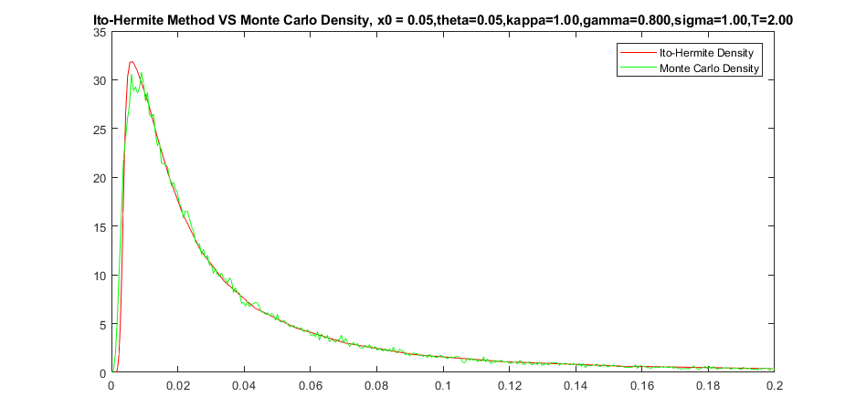](https://postimages.org/)

In the graph below x0=.001, and theta=.001 but I had specified only two digit precision in the graph title so that graph
shows the x0=.00 and theta=.00. Since I have already uploaded the image on a hosting site, instead of making the graph
again, I am making the correction about it here for the friends.

[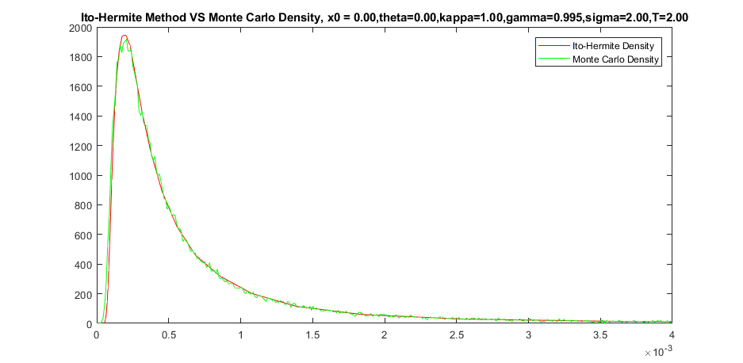](https://postimages.org/)

[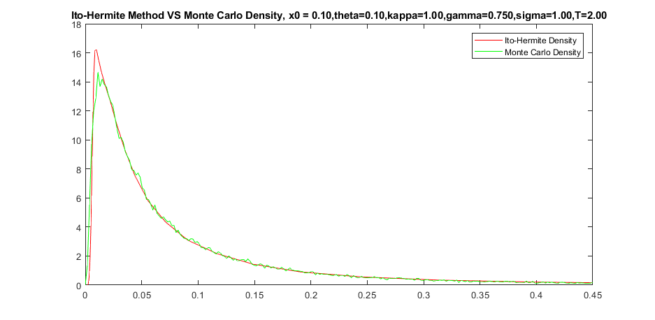](https://postimages.org/)

[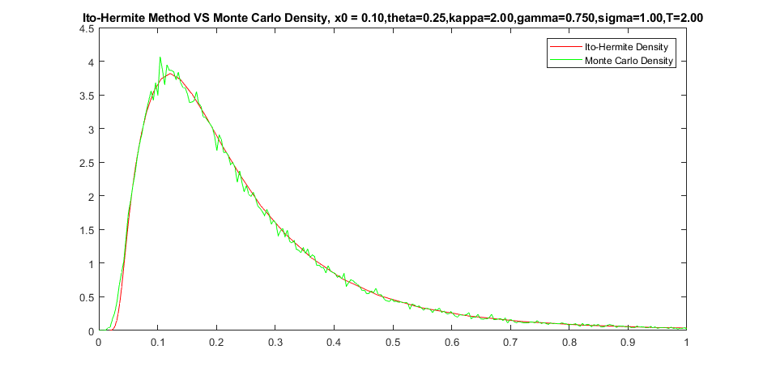](https://postimages.org/)

[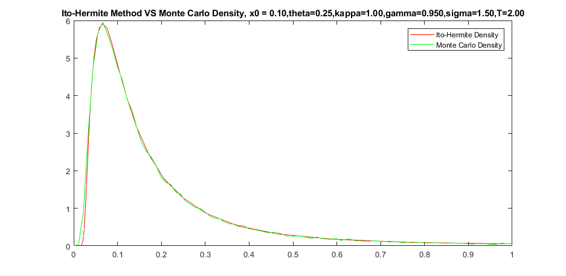](https://postimages.org/)

[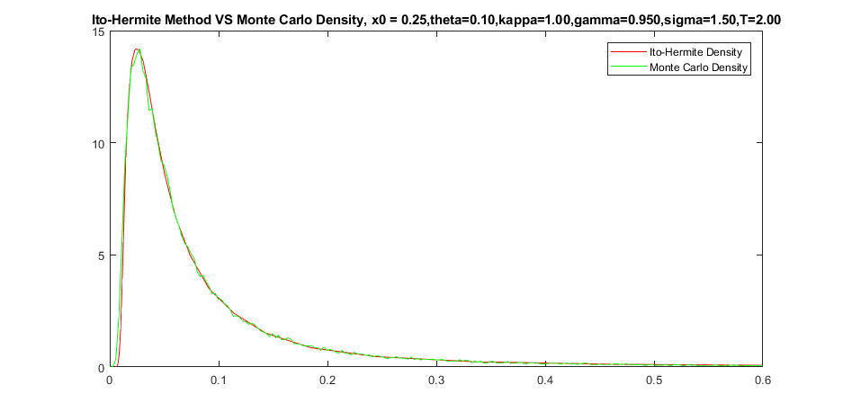](https://postimages.org/)

[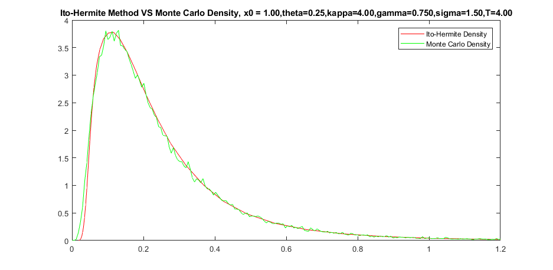](https://postimages.org/)

[](https://postimages.org/)

[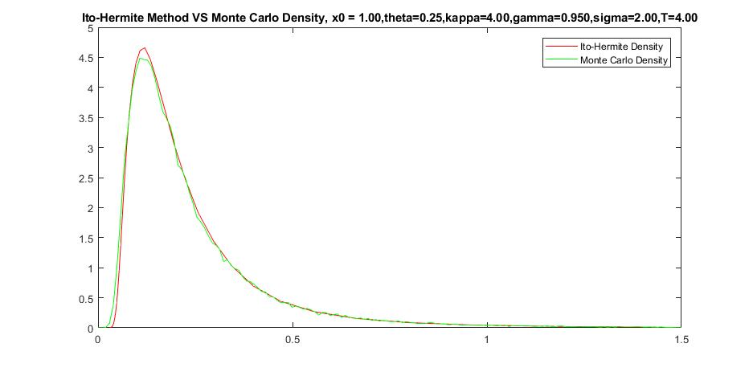](https://postimages.org/)

[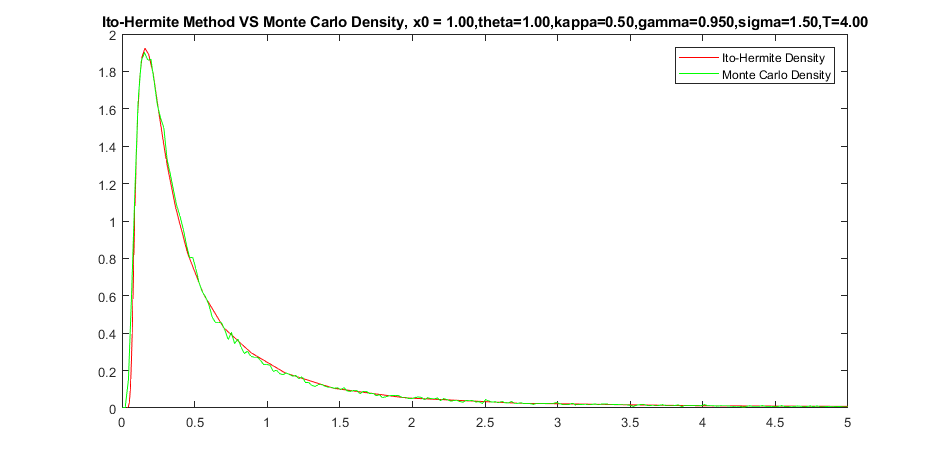](https://postimages.org/)

[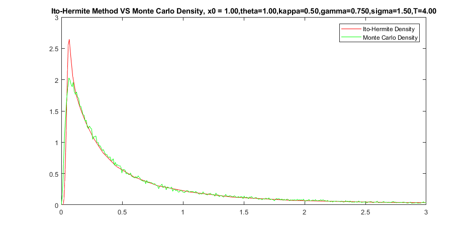](https://postimages.org/)

[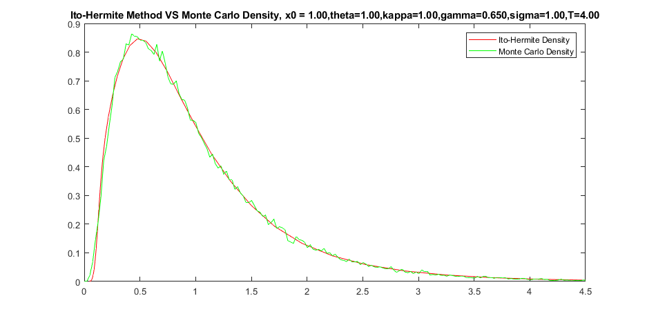](https://postimages.org/)

[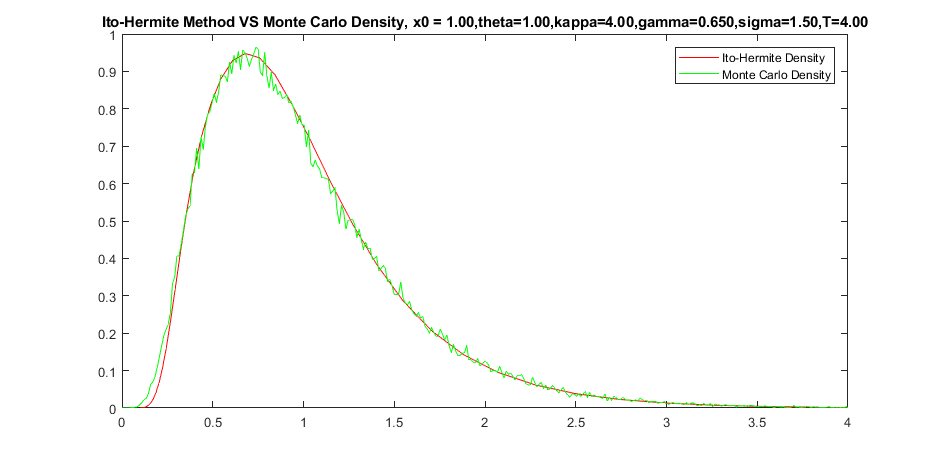](https://postimages.org/)

---

### #911 — Amin (Topic Author)
*March 30, 2020, 10:52 PM*

Here is the new improved version of Ito-Hermite program for simulating the densities of SDEs. This program works only
with mean reverting equations using mean-correction algorithm. But when the mean is known, the update equation of the
general SDE has to be modified in a very similar manner using correction terms that I have used in this program. The
correction terms in the main update equation are the same for mean-reverting SDEs and other different SDEs. Here is the
main body of the program that will work with older dependent sub-functions that I have already attached with previous
posts.

```
function [TrueMean,ItoHermiteMean,MCMean] = ItoHermiteWilmottMeanCorrected08Exponential02(x0,theta,kappa,gamma,sigma0,T)

%Copyright Ahsan Amin. Infiniti derivatives Technologies.
%Please fell free to connect on linkedin: linkedin.com/in/ahsan-amin-0a53334
%or skype ahsan.amin2999
%In this program, I am simulating the SDE given as
%dx(t)=kappa*(theta dt -x dt) +sigma x(t)^gamma dz(t)

%I have not directly simulated the SDE but simulated the transformed
%Besse1l process version of the SDE and then changed coordinates to retreive
%the SDE in original coo
%rdinates.
%The present program will analytically evolve only the Bessel Process version of the
%SDE in transformed coordinates.

dt=.125/16;   % Simulation time interval.%Fodiffusions close to zero
             %decrease dt for accuracy.
%T=5;
Tt=128*T;%16*16;     % Number of simulation levels. Terminal time= Tt*dt; //.125/32*32*16=2 year;
OrderA=4;  %
OrderM=4;  %
%dtM=.125/8;%Monte carlo time interval size dtM.
%TtM=8*8;%Monte carlo number of simulation intervals.
dtM=dt*2;
TtM=Tt/2;

dNn=.2/1;   % Normal density subdivisions width. would change with number of subdivisions
Nn=48;  % No of normal density subdivisions
NnMidl=25;%One half density Subdivision left from mid of normal density(low)
NnMidh=26;%One half density subdivision right from the mid of normal density(high)
NnMid=4.0;

%theta=mu1/(-mu2);
%kappa=-mu2;

%x0=.25;   % starting value of SDE
beta1=0.0;
beta2=1.0;   % Second drift term power.
%gamma=.95;%50;   % volatility power.
%kappa=.5;   %mean reversion parameter.
%theta=.075;%mean reversion target

%you can specify any general mu1 and mu2 and beta1 and beta2.
%The present program is not perfect but quite reasonably good.
%if there is only one term in drift with beta=0, there will be minor
%errors. This case is yet not covered.

mu1=+1*theta*kappa;   %first drift coefficient.
mu2=-1*kappa;    % Second drift coefficient.
%sigma0=1.0;%Volatility value
alpha=1;% x^alpha is being expanded. This is currently for monte carlo only.
alpha1=1-gamma;

w(1:Nn)=x0^(1-gamma)/(1-gamma);

Z(1:Nn)=(((1:Nn)-5.5)*dNn-NnMid);

Z
str=input('Look at Z');
ZProb(1)=normcdf(.5*Z(1)+.5*Z(2),0,1)-normcdf(.5*Z(1)+.5*Z(2)-dNn,0,1);
ZProb(Nn)=normcdf(.5*Z(Nn)+.5*Z(Nn-1)+dNn,0,1)-normcdf(.5*Z(Nn)+.5*Z(Nn-1),0,1);

for nn=2:Nn-1
    ZProb(nn)=normcdf(.5*Z(nn)+.5*Z(nn+1),0,1)-normcdf(.5*Z(nn)+.5*Z(nn-1),0,1);
    %Above calculate probability mass in each probability subdivision.
end

%%%%%%%%%%%%%%%%%%%%%%%%%%%%%%%%%%%%%%%%%%%%%%%%%%%%%%%%%%%%%%%%%%%%%%%%%%%%%%%%%%%%%%%%%%%%%%

sigma11(1:OrderA+1)=0;
mu11(1:OrderA+1)=0;
mu22(1:OrderA+1)=0;
sigma22(1:OrderA+1)=0;
% index 1 correponds to zero level since matlab indexing starts at one.
sigma11(1)=1;
mu11(1)=1;
mu22(1)=1;
sigma22(1)=1;

for k=1:(OrderA+1)
    if sigma0~=0
        sigma11(k)=sigma0^(k-1);
    end
    if mu1 ~= 0
        mu11(k)=mu1^(k-1);
    end
    if mu2 ~= 0
        mu22(k)=mu2^(k-1);
    end
    if sigma0~=0
        sigma22(k)=sigma0^(2*(k-1));
    end
end
%Ft(1:TtM+1,1:(OrderA+1),1:(OrderA+1),1:(OrderA+1),1:(OrderA+1))=0; %General time powers on hermite polynomials
Fp(1:(OrderA+1),1:(OrderA+1),1:(OrderA+1),1:(OrderA+1))=0;%General x powers on coefficients of hermite polynomials.
Fp1(1:(OrderA+1),1:(OrderA+1),1:(OrderA+1),1:(OrderA+1))=0;%General x powers for bessel transformed coordinates.

%YCoeff0 and YCoeff are coefficents for original coordinates monte carlo.
%YqCoeff0 and YqCoeff are bessel/lamperti version monte carlo.

YCoeff0(1:(OrderA+1),1:(OrderA+1),1:(OrderA+1),1:(OrderA+1))=0;
YqCoeff0(1:(OrderA+1),1:(OrderA+1),1:(OrderA+1),1:(OrderA+1))=0;
%Pre-compute the time and power exponent values in small multi-dimensional arrays
YCoeff = ItoTaylorCoeffsNew(alpha,beta1,beta2,gamma); %expand y^alpha where alpha=1;
YqCoeff = ItoTaylorCoeffsNew(alpha1,beta1,beta2,gamma);%expand y^alpha1 where alpha1=(1-gamma)
YqCoeff=YqCoeff/(1-gamma); %Transformed coordinates coefficients have to be
%further divided by (1-gamma)
YqCoeffExp= ItoTaylorCoeffsNewO2Exp(alpha1,beta1,beta2,gamma);
YqCoeffExp=YqCoeffExp/(1-gamma);

Order2=2;
for k = 0 : (Order2)
    for m = 0:k
        l4 = k - m + 1;
        for n = 0 : m
            l3 = m - n + 1;
            for j = 0:n
                l2 = n - j + 1;
                l1 = j + 1;
                Fp1Exp(l1,l2,l3,l4) = (alpha1 + (l1-1) * beta1 + (l2-1) * beta2 + (l3-1) * 2* gamma + (l4-1) * gamma ...
                    - (l1-1) - (l2-1) - 2* (l3-1) - (l4-1));
                YqCoeffExp0(l1,l2,l3,l4) =YqCoeffExp(l1,l2,l3,l4).*mu11(l1).*mu22(l2).*sigma22(l3).*sigma11(l4);
            end
        end
    end
end

for k = 0 : (OrderA)
    for m = 0:k
        l4 = k - m + 1;
        for n = 0 : m
            l3 = m - n + 1;
            for j = 0:n
                l2 = n - j + 1;
                l1 = j + 1;
                %Ft(l1,l2,l3,l4) = dtM^((l1-1) + (l2-1) + (l3-1) + .5* (l4-1));
                Fp(l1,l2,l3,l4) = (alpha + (l1-1) * beta1 + (l2-1) * beta2 + (l3-1) * 2* gamma + (l4-1) * gamma ...
                    - (l1-1) - (l2-1) - 2* (l3-1) - (l4-1));
                Fp1(l1,l2,l3,l4) = (alpha1 + (l1-1) * beta1 + (l2-1) * beta2 + (l3-1) * 2* gamma + (l4-1) * gamma ...
                    - (l1-1) - (l2-1) - 2* (l3-1) - (l4-1));

                YCoeff0(l1,l2,l3,l4) =YCoeff(l1,l2,l3,l4).*mu11(l1).*mu22(l2).*sigma22(l3).*sigma11(l4);
                YqCoeff0(l1,l2,l3,l4) =YqCoeff(l1,l2,l3,l4).*mu11(l1).*mu22(l2).*sigma22(l3).*sigma11(l4);

            end
        end
    end
end

%%%%%%%%%%%%%%%%%%%%%%%%%%%%%%%%%%%%%%%%%%%%%%%%%%%%%%%%%%%%%%%%%%%%%%%%%%%%%%%%%%%%%%%%%%%%%%
wnStart=1;%
d2wdZ2(1:Nn)=0;
dwdZ(1:Nn)=0;
yy(wnStart:Nn)=((1-gamma)*w(wnStart:Nn)).^(1/(1-gamma));
tic

for tt=1:Tt

    kappa2=kappa*(1-gamma);
     yy(wnStart:Nn)=((1-gamma)*w(wnStart:Nn)).^(1/(1-gamma));

%    [wMu0dt1,dwMu0dtdw1,d2wMu0dtdw21,d3wMu0dtdw31,c11,c21,c31,c41] =
CalculateDriftAndVolOrder4(w,wnStart,Nn,YqCoeff0,Fp1,gamma,dt);

    [wMu0dt,dwMu0dtdw,d2wMu0dtdw2,d3wMu0dtdw3,c1,c2,c3,c4] =
CalculateDriftAndVolOrderLowExponential(w,wnStart,Nn,YqCoeffExp0,Fp1Exp,gamma,dt,kappa2);

    dw(wnStart:Nn)=c1(wnStart:Nn).*Z(wnStart:Nn) ;% ...
    dw2(wnStart:Nn)=dw(wnStart:Nn).^2;
   % d2w(wnStart:Nn)=c2(wnStart:Nn).*(Z(wnStart:Nn).^2-1);
   % d3w(wnStart:Nn)=c3(wnStart:Nn).*(Z(wnStart:Nn).^3-3*Z(wnStart:Nn));
    w(isnan(w)==1)=0;
    wMu0dt(isnan(wMu0dt)==1)=0;
    wMeanPrev=sum(ZProb(wnStart:Nn).*w(wnStart:Nn));%Calculate the mean.

%%%%%%%%%%%%%%%%%%%%%%%%%%%%%%%%%%%%%%%%%%%%%%%%%%%%%%%%%%%%%%%%%%%%%%%%%%%

[w0,Sigma00,Sigma11,Sigma22,Sigma33,Sigma1,Sigma2,Sigma3,Sigma0] =
CalculateHermiteRepresentationOfDensityOrderThreeNew(w,Z,wnStart,Nn,dNn,NnMidh,NnMidl);
d2wdZ2(wnStart:Nn)=d2wdZ2(wnStart:Nn)+
d2wMu0dtdw2(wnStart:Nn).*dwdZ(wnStart:Nn).^2+dwMu0dtdw(wnStart:Nn).*d2wdZ2(wnStart:Nn);%+ ...

dwdZ(wnStart:Nn)=(Sigma00)+Sigma1(wnStart:Nn).*2.*Z(wnStart:Nn);%.*ExpDamp(wnStart:Nn);

H2(wnStart:Nn)=(Z(wnStart:Nn).^2-1);
CTerm(wnStart:Nn)=(.5*d2wMu0dtdw2(wnStart:Nn).*dwdZ(wnStart:Nn).^2 - ...
          1*dwMu0dtdw(wnStart:Nn).*d2wdZ2(wnStart:Nn));

Correction1(wnStart:Nn)=-(1+gamma^2.*(1-gamma)*sigma0^2)*sqrt(3/4)/(22/7)^2.*CTerm(wnStart:Nn).*H2(wnStart:Nn);
Correction0(wnStart:Nn)=-(1+gamma^2.*(1-gamma)*sigma0^2)*sqrt(3/4)/(22/7)^2.*(d2wdZ2(wnStart:Nn)-.5*dwdZ(wnStart:Nn).^2).*H2(wnStart:Nn);

if(tt==1)
w(wnStart:Nn)=wMeanPrev+exp(-kappa2*dt).*(wMu0dt(wnStart:Nn)+ ...
          sign(exp(kappa2*dt).*(w(wnStart:Nn)-wMeanPrev)+dw(wnStart:Nn)).* ...
          sqrt(abs(sign(w(wnStart:Nn)-wMeanPrev).*exp(2*kappa2*dt).*(w(wnStart:Nn)-wMeanPrev).^2+ ...
          sign(dw(wnStart:Nn)).*dw2(wnStart:Nn))));
end
if(tt>1)

     w(wnStart:Nn)=wMeanPrev+exp(-kappa2*dt).*(wMu0dt(wnStart:Nn)+ ...
        sign(exp(kappa2*dt).*(w(wnStart:Nn)-wMeanPrev)+dw(wnStart:Nn)).* ...
            sqrt(abs(sign(w(wnStart:Nn)-wMeanPrev).*exp(2*kappa2*dt).*(w(wnStart:Nn)-wMeanPrev).^2+ ...
            sign(dw(wnStart:Nn)).*dw2(wnStart:Nn))))+ ...
            +dt *Correction0(wnStart:Nn).*exp(-.5*(1-gamma)*sigma0.^2.*Z(wnStart:Nn).^2) + ...
           Correction1(wnStart:Nn).*exp(-.5*(1-gamma)*sigma0.^2.*Z(wnStart:Nn).^2);

end

%%%%%%%%%%%%%%%%%%%%%%%%%%%%%%%%%%%%%%%%%%%%%%%%%%%%%%%%%%%%%%%%%%%%%%%%%%%
%Below are instability correction equations. There is instability in the
% SDE representation equation roughly between -.5 SD to +.5 SD in normal terms.
%Instability correction Algorithm takes two ends that are here given as
%lower end=w(NnMidl-2) and upper end=w(NnMidh+3).
%In the block below the interpolation starts from lower end.
%1st equation is
%wll(NnMidl-1)=w(NnMidl-2)+(D1wl+CTheta*D2wl*dNn/1+.5*DeltaD1w)*dNn;
%Second equation is: wll(NnMidl)=wll(NnMidl-1)+(D1wl+CTheta*D2wl*dNn+1.5*DeltaD1w)*dNn;
%And so on.
%There is a sixth equation that is not written below(since it takes us to
%the upper interpolation point which is already known) which is
%wll(NnMidh+3)=wll(NnMidh+2)+(D1wl+CTheta*D2wl*dNn+5.5*DeltaD1w)*dNn;
%Sum of these six equations add up to the distance between upper and lower
%interpolation points.
%In the sum there are six instances of first derivative which is already
%calculated at the boundary, six instances of second derivative which is also
%already calculated at lower boundary and 18.0 instances of DeltaD1w which is
%unknown. This equation calculates the value of one unit of DeltaD1w addition
%DeltaD1w=(w(NnMidh+3)-w(NnMidl-2)-6*D1wl*dNn-6.0*CTheta*D2wl*dNn.^2.0/1.0)/18.0/dNn;
% I hope to find a better analytical method to tackle this issue. Friends
% are welcome to play with slightly changed related alternatives to the
%above interpolation.
    CTheta=1.0;
    D1wl=(11/6*w(NnMidl-2)-3*w(NnMidl-3)+3/2*w(NnMidl-4)-1/3*w(NnMidl-5))/dNn;
    D2wl=(35/12*w(NnMidl-2) -26/3*w(NnMidl-3)+ 19/2*w(NnMidl-4)-14/3*w(NnMidl-5)+11/12*w(NnMidl-6))/dNn.^2;
    DeltaD1w=(w(NnMidh+3)-w(NnMidl-2)-6*D1wl*dNn-6.0*CTheta*D2wl*dNn.^2.0/1.0)/18.0/dNn;

    wll(NnMidl-1)=w(NnMidl-2)+  (D1wl+CTheta*D2wl*dNn+.5*DeltaD1w)*dNn;
    wll(NnMidl)=wll(NnMidl-1)+  (D1wl+CTheta*D2wl*dNn+1.5*DeltaD1w)*dNn;
    wll(NnMidh)=wll(NnMidl)+    (D1wl+CTheta*D2wl*dNn+2.5*DeltaD1w)*dNn;
    wll(NnMidh+1)=wll(NnMidh)+  (D1wl+CTheta*D2wl*dNn+3.5*DeltaD1w)*dNn;
    wll(NnMidh+2)=wll(NnMidh+1)+(D1wl+CTheta*D2wl*dNn+4.5*DeltaD1w)*dNn;
    %wll(NnMidh+3)=wll(NnMidh+2)+(D1wl+CTheta*D2wl*dNn+5.5*DeltaD1w)*dNn;
%The last equation is not used since point w(NnMidh+3)is given but it is used in
%calculation of distance between two interpolation points. This distance is
%used to determine the value of DeltaD1w.

    D1wh=(-11/6*w(NnMidh+3)+3*w(NnMidh+4)-3/2*w(NnMidh+5)+1/3*w(NnMidh+6))/dNn;
    D2wh=(35/12*w(NnMidh+3) -26/3*w(NnMidh+4)+ 19/2*w(NnMidh+5)-14/3*w(NnMidh+6)+11/12*w(NnMidh+7))/dNn.^2;
    DeltaD1w=(w(NnMidh+3)-w(NnMidl-2)-6*D1wh*dNn-6.0*CTheta*D2wh*dNn.^2.0/1.0)/18.0/dNn;
%     DeltaD1w=(w(NnMidh+2)-w(NnMidl-1)-4*D1wh*dNn-16.0*D2wh*dNn.^2.0/1.0)/6.0/dNn;

    whh(NnMidh+2)=w(NnMidh+3)-(D1wh+CTheta*D2wh*dNn+.5*DeltaD1w)*dNn;
    whh(NnMidh+1)=w(NnMidh+2)-(D1wh+CTheta*D2wh*dNn+1.5* DeltaD1w)*dNn;
    whh(NnMidh)=whh(NnMidh+1)-(D1wh+CTheta*D2wh*dNn+2.5* DeltaD1w)*dNn;
    whh(NnMidl)=whh(NnMidh)-(D1wh+CTheta*D2wh*dNn+3.5* DeltaD1w)*dNn;
    whh(NnMidl-1)=whh(NnMidl)-(D1wh+CTheta*D2wh*dNn+4.5* DeltaD1w)*dNn;

    %whh(NnMidl-2)=whh(NnMidl-1)-(D1wh+CTheta*D2wh*dNn/1+5.5* DeltaD1w)*dNn;

%
      w(NnMidh+2)=.5*whh(NnMidh+2)+.5*wll(NnMidh+2);
      w(NnMidh+1)=.5*whh(NnMidh+1)+.5*wll(NnMidh+1);
      w(NnMidh)=.5*whh(NnMidh)+.5*wll(NnMidh);
      w(NnMidl)=.5*whh(NnMidl)+.5*wll(NnMidl);
      w(NnMidl-1)=.5*whh(NnMidl-1)+.5*wll(NnMidl-1);

        w1(1:Nn-1)=w(1:Nn-1);
        w2(1:Nn-1)=w(2:Nn);

%         w1(1:Nn-2)=w(1:Nn-2);
%         w2(1:Nn-2)=w(2:Nn-1);
%         w3(1:Nn-2)=w(3:Nn);
%         w(w1(:)>w2(:))=w2(w1(:)>w2(:))-.25*(w3(w1(:)>w2(:))-w2(w1(:)>w2(:)));
        w(w1(:)>w2(:))=0;%Be careful;might not universally hold;

        w(w<0)=0.0;
        for nn=1:Nn
            if(w(nn)<=0)
                wnStart=nn+1;
           end
        end

        %%1st order mean correction. We know the mean in original
        %%coordinates so I shift the density into original coordinates,
        %%apply the mean correction and then transform again into Lamperti
        %%coordinates. Algebra solves two equations in two unknowns.
        %%Equations are Sum_0^N{(Y_w(wnStart:Nn)-Y0)*W0}=1 and the second
        %%equation is Sum_0^N{Y_w(wnStart:Nn).*(Y_w(wnStart:Nn)-Y0)*W0}=u0
        %%Two unknows are Y0 and W0. u0 is known mean.
        tt;
        u0=theta+(x0-theta)*exp(-kappa*(tt*dt)); %analytic mean of the density

        %If you are not using stochastic volatility, replace above with
        %true mean otherwise results would become garbage.

        Y_w(wnStart:Nn) = ((1-gamma)*w(wnStart:Nn)).^(1/(1-gamma));

        Yn2Pn=sum(Y_w(wnStart:Nn).*Y_w(wnStart:Nn).*ZProb(wnStart:Nn));
        YnPn=sum(Y_w(wnStart:Nn).*ZProb(wnStart:Nn));
        Pn=1.0;%%Sum(ZProb(1:Nn))
        Y0=(Yn2Pn-u0*YnPn)/(YnPn-u0*Pn);

        Y0Pn=Y0*Pn;
        W0=1/(YnPn-Y0Pn);
        YCorrected(wnStart:Nn)=Y_w(wnStart:Nn).*(Y_w(wnStart:Nn)-Y0)*W0;
        wCorrected(wnStart:Nn)=(YCorrected(wnStart:Nn).^(1-gamma))./(1-gamma);
       w(wnStart:Nn)=wCorrected(wnStart:Nn);

   %I have disabled the mean correction. The above mean correction is only valid for
   %standard mean reverting stochastic volatility type SDEs. To enable mean
   %correction please uncomment the above last line in the block.

end

 y_w(1:Nn)=0;
 y_w(wnStart:Nn) = ((1-gamma)*w(wnStart:Nn)).^(1/(1-gamma));
 Dfy_w(wnStart:Nn)=0;
 Dfw(wnStart:Nn)=0;
for nn=wnStart+1:Nn-1
    Dfy_w(nn) = (y_w(nn + 1) - y_w(nn - 1))/(Z(nn + 1) - Z(nn - 1));
    Dfw(nn) = (w(nn + 1) - w(nn - 1))/(Z(nn + 1) - Z(nn - 1));
    %Change of variable derivative for densities
end
fy_w(1:Nn)=0;
fw(1:Nn)=0;
for nn = wnStart:Nn-1
    fy_w(nn) = (normpdf(Z(nn),0, 1))/abs(Dfy_w(nn));%Origianl coordinates density
    fw(nn) = (normpdf(Z(nn),0, 1))/abs(Dfw(nn));
end

toc
%str=input('Analytic Values calculated; Press a key to start monte carlo');

 rng(29079137, 'twister')
 paths=100000;
 YY(1:paths)=x0;  %Original process monte carlo.
 Random1(1:paths)=0;
 YYMean(1:TtM)=0;
 for tt=1:TtM
     Random1=randn(size(Random1));
     HermiteP1(1,1:paths)=1;
     HermiteP1(2,1:paths)=Random1(1:paths);
     HermiteP1(3,1:paths)=Random1(1:paths).^2-1;
     HermiteP1(4,1:paths)=Random1(1:paths).^3-3*Random1(1:paths);
     HermiteP1(5,1:paths)=Random1(1:paths).^4-6*Random1(1:paths).^2+3;

     YY(1:paths)=YY(1:paths) + ...
      (YCoeff0(1,1,2,1).*YY(1:paths).^Fp(1,1,2,1)+ ...
      YCoeff0(1,2,1,1).*YY(1:paths).^Fp(1,2,1,1)+ ...
      YCoeff0(2,1,1,1).*YY(1:paths).^Fp(2,1,1,1))*dtM + ...
      (YCoeff0(1,1,3,1).*YY(1:paths).^Fp(1,1,3,1)+ ...
      YCoeff0(1,2,2,1).*YY(1:paths).^Fp(1,2,2,1)+ ...
      YCoeff0(2,1,2,1).*YY(1:paths).^Fp(2,1,2,1)+ ...
      YCoeff0(1,3,1,1).*YY(1:paths).^Fp(1,3,1,1)+ ...
      YCoeff0(2,2,1,1).*YY(1:paths).^Fp(2,2,1,1)+ ...
      YCoeff0(3,1,1,1).*YY(1:paths).^Fp(3,1,1,1))*dtM^2 + ...
      ((YCoeff0(1,1,1,2).*YY(1:paths).^Fp(1,1,1,2).*sqrt(dtM))+ ...
    (YCoeff0(1,1,2,2).*YY(1:paths).^Fp(1,1,2,2)+ ...
    YCoeff0(1,2,1,2).*YY(1:paths).^Fp(1,2,1,2)+ ...
    YCoeff0(2,1,1,2).*YY(1:paths).^Fp(2,1,1,2)).*dtM^1.5) .*HermiteP1(2,1:paths) + ...
    ((YCoeff0(1,1,1,3).*YY(1:paths).^Fp(1,1,1,3) *dtM) + ...
    (YCoeff0(1,1,2,3).*YY(1:paths).^Fp(1,1,2,3)+ ...
    YCoeff0(1,2,1,3).*YY(1:paths).^Fp(1,2,1,3)+ ...
    YCoeff0(2,1,1,3).*YY(1:paths).^Fp(2,1,1,3)).*dtM^2).*HermiteP1(3,1:paths) + ...
    ((YCoeff0(1,1,1,4).*YY(1:paths).^Fp(1,1,1,4)*dtM^1.5 )).*HermiteP1(4,1:paths) + ...
    (YCoeff0(1,1,1,5).*YY(1:paths).^Fp(1,1,1,5)*dtM^2.0).*HermiteP1(5,1:paths);

%Uncomment for fourth order monte carlo

%
%   YY(1:paths)=YY(1:paths) + ...
%       (YCoeff0(1,1,2,1).*YY(1:paths).^Fp(1,1,2,1)+YCoeff0(1,2,1,1).*YY(1:paths).^Fp(1,2,1,1)+ ...
%       YCoeff0(2,1,1,1).*YY(1:paths).^Fp(2,1,1,1))*dtM + ...
%       (YCoeff0(1,1,3,1).*YY(1:paths).^Fp(1,1,3,1)+YCoeff0(1,2,2,1).*YY(1:paths).^Fp(1,2,2,1)+ ...
%       YCoeff0(2,1,2,1).*YY(1:paths).^Fp(2,1,2,1)+YCoeff0(1,3,1,1).*YY(1:paths).^Fp(1,3,1,1)+ ...
%       YCoeff0(2,2,1,1).*YY(1:paths).^Fp(2,2,1,1)+YCoeff0(3,1,1,1).*YY(1:paths).^Fp(3,1,1,1))*dtM^2 + ...
%       (YCoeff0(1,1,4,1).*YY(1:paths).^Fp(1,1,4,1)+YCoeff0(1,2,3,1).*YY(1:paths).^Fp(1,2,3,1)+ ...
%       YCoeff0(2,1,3,1).*YY(1:paths).^Fp(2,1,3,1)+YCoeff0(1,3,2,1).*YY(1:paths).^Fp(1,3,2,1)+ ...
%       YCoeff0(2,2,2,1).*YY(1:paths).^Fp(2,2,2,1)+YCoeff0(3,1,2,1).*YY(1:paths).^Fp(3,1,2,1)+ ...
%       YCoeff0(1,4,1,1).*YY(1:paths).^Fp(1,4,1,1)+YCoeff0(2,3,1,1).*YY(1:paths).^Fp(2,3,1,1)+ ...
%       YCoeff0(3,2,1,1).*YY(1:paths).^Fp(3,2,1,1)+YCoeff0(4,1,1,1).*YY(1:paths).^Fp(4,1,1,1))*dtM^3 + ...
%        (YCoeff0(1,1,5,1).*YY(1:paths).^Fp(1,1,5,1)+YCoeff0(1,2,4,1).*yy(1:paths).^Fp(1,2,4,1)+ ...
%     YCoeff0(2,1,4,1).*YY(1:paths).^Fp(2,1,4,1)+YCoeff0(2,1,1,1).*yy(1:paths).^Fp(2,1,1,1)+ ...
%      YCoeff0(2,2,3,1).*YY(1:paths).^Fp(2,2,3,1)+ ...
%      YCoeff0(3,1,3,1).*YY(1:paths).^Fp(3,1,3,1)+YCoeff0(1,4,2,1).*YY(1:paths).^Fp(1,4,2,1)+ ...
%      YCoeff0(2,3,2,1).*YY(1:paths).^Fp(2,3,2,1)+YCoeff0(3,2,2,1).*YY(1:paths).^Fp(3,2,2,1)+ ...
%      YCoeff0(4,1,2,1).*YY(1:paths).^Fp(4,1,2,1)+YCoeff0(1,5,1,1).*YY(1:paths).^Fp(1,5,1,1)+ ...
%      YCoeff0(2,4,1,1).*YY(1:paths).^Fp(2,4,1,1)+ ...
%      YCoeff0(3,3,1,1).*YY(1:paths).^Fp(3,3,1,1)+YCoeff0(4,2,1,1).*YY(1:paths).^Fp(4,2,1,1)+ ...
%      YCoeff0(5,1,1,1).*YY(1:paths).^Fp(5,1,1,1))*dtM^4+ ...
%       ((YCoeff0(1,1,1,2).*YY(1:paths).^Fp(1,1,1,2).*sqrt(dtM))+ ...
%     (YCoeff0(1,1,2,2).*YY(1:paths).^Fp(1,1,2,2)+YCoeff0(1,2,1,2).*YY(1:paths).^Fp(1,2,1,2)+ ...
%     YCoeff0(2,1,1,2).*YY(1:paths).^Fp(2,1,1,2)).*dtM^1.5+ ...
%     (YCoeff0(1,1,3,2).*YY(1:paths).^Fp(1,1,3,2)+YCoeff0(1,2,2,2).*YY(1:paths).^Fp(1,2,2,2)+ ...
%     YCoeff0(2,1,2,2).*YY(1:paths).^Fp(2,1,2,2)+YCoeff0(1,3,1,2).*YY(1:paths).^Fp(1,3,1,2)+ ...
%     YCoeff0(2,2,1,2).*YY(1:paths).^Fp(2,2,1,2)+YCoeff0(3,1,1,2).*YY(1:paths).^Fp(3,1,1,2)).*dtM^2.5+ ...
%     (YCoeff0(1,1,4,2).*YY(1:paths).^Fp(1,1,4,2)+YCoeff0(1,2,3,2).*YY(1:paths).^Fp(1,2,3,2)+ ...
%     YCoeff0(2,1,3,2).*YY(1:paths).^Fp(2,1,3,2)+YCoeff0(1,3,2,2).*YY(1:paths).^Fp(1,3,2,2)+ ...
%     YCoeff0(2,2,2,2).*YY(1:paths).^Fp(2,2,2,2)+ YCoeff0(3,1,2,2).*YY(1:paths).^Fp(3,1,2,2)+ ...
%     YCoeff0(1,4,1,2).*YY(1:paths).^Fp(1,4,1,2)+YCoeff0(2,3,1,2).*YY(1:paths).^Fp(2,3,1,2)+ ...
%     YCoeff0(3,2,1,2).*YY(1:paths).^Fp(3,2,1,2)+YCoeff0(4,1,1,2).*YY(1:paths).^Fp(4,1,1,2)).*dtM^3.5)
.*HermiteP1(2,1:paths) + ...
%     ((YCoeff0(1,1,1,3).*YY(1:paths).^Fp(1,1,1,3) *dtM) + ...
%     (YCoeff0(1,1,2,3).*YY(1:paths).^Fp(1,1,2,3)+YCoeff0(1,2,1,3).*YY(1:paths).^Fp(1,2,1,3)+ ...
%     YCoeff0(2,1,1,3).*YY(1:paths).^Fp(2,1,1,3)).*dtM^2+ ...
%     (YCoeff0(1,1,3,3).*YY(1:paths).^Fp(1,1,3,3)+YCoeff0(1,2,2,3).*YY(1:paths).^Fp(1,2,2,3)+ ...
%     YCoeff0(2,1,2,3).*YY(1:paths).^Fp(2,1,2,3) + YCoeff0(1,3,1,3).*YY(1:paths).^Fp(1,3,1,3)+ ...
%   
 YCoeff0(2,2,1,3).*YY(1:paths).^Fp(2,2,1,3)+YCoeff0(3,1,1,3).*YY(1:paths).^Fp(3,1,1,3)).*dtM^3).*HermiteP1(3,1:paths) +
...
%     ((YCoeff0(1,1,1,4).*YY(1:paths).^Fp(1,1,1,4)*dtM^1.5 )+ ...
%     (YCoeff0(1,1,2,4).*YY(1:paths).^Fp(1,1,2,4)+YCoeff0(1,2,1,4).*YY(1:paths).^Fp(1,2,1,4)+ ...
%     YCoeff0(2,1,1,4).*YY(1:paths).^Fp(2,1,1,4))*dtM^2.5).*HermiteP1(4,1:paths) + ...
%     (YCoeff0(1,1,1,5).*YY(1:paths).^Fp(1,1,1,5)*dtM^2.0).*HermiteP1(5,1:paths);
%

     YYMean(tt)=YYMean(tt)+sum(YY(1:paths))/paths;
 end
 YY(YY<0)=0;
 disp('Original process average from monte carlo');
 MCMean=sum(YY(:))/paths %origianl coordinates monte carlo average.
 disp('Original process average from our simulation');
 ItoHermiteMean=sum(y_w(wnStart+1:Nn-1).*ZProb(wnStart+1:Nn-1)) %Original process average from coordinates

 disp('true Mean only applicble to standard SV mean reverting type models otherwise disregard');
 TrueMean=theta+(x0-theta)*exp(-kappa*dt*Tt)%Mean reverting SDE original variable true average

 MaxCutOff=30;
 NoOfBins=round(200*gamma^2*5*sigma0);
 [YDensity,IndexOutY,IndexMaxY] = MakeDensityFromSimulation_Infiniti_NEW(YY,paths,NoOfBins,MaxCutOff );
 plot(y_w(wnStart+1:Nn-1),fy_w(wnStart+1:Nn-1),'r',IndexOutY(1:IndexMaxY),YDensity(1:IndexMaxY),'g');
 %plot(y_w(wnStart+1:Nn-1),fy_w(wnStart+1:Nn-1),'r',IndexOutY(1:IndexMaxY),YDensity(1:IndexMaxY),'g',Z(wnStart+1:Nn-1),fy_w(wnStart+1:Nn-1),'b');

 title(sprintf('Ito-Hermite Method VS Monte Carlo Density, x0 =
%.2f,theta=%.2f,kappa=%.2f,gamma=%.3f,sigma=%.2f,T=%.2f', x0,theta,kappa,gamma,sigma0,T));%,sprintf('theta= %f', theta),
sprintf('kappa = %f', kappa),sprintf('sigma = %f', sigma0),sprintf('T = %f', T));

 %title('text',sprintf('x0 = %f', x0),sprintf('theta= %f', theta), sprintf('kappa = %f', kappa),sprintf('sigma = %f',
sigma0),sprintf('T = %f', T))
 %xlabel(a)
 %title('Graphical Comparison of Ito-Hermite Method and Monte Carlo Method Density')
 legend({'Ito-Hermite Density','Monte Carlo Density'},'Location','northeast')

 str=input('red line is density of SDE from Ito-Hermite method, green is monte carlo.');

end
```

When you run the program with the following parametrs

ItoHermiteWilmottMeanCorrected08Exponential02(1.0,1.0,4,.65,1.5,4)

you should get output as

MCMean =0.999723371171040

ItoHermiteMean =0.999978998469931

Though the algorithm is quite good now but there is still need for improvement especially for smaller exponents towards
gamma=.5 and I will try to come up with a better and more improved version of the program in a few days.

---

### #912 — Amin (Topic Author)
*March 31, 2020, 1:19 PM*

First some background

We suppose we have a mean reverting stochastic volatility type equation(without loss of generality any equation with two
or more terms in drift can be solved like this but I wanted a concrete example of the SDE that I am using)  with
Ito-hermite method of moving and expanding/contracting grid. When we have the equation given as

$dx(t)=\kappa (\theta - x(t)) dt + \sigma x^{\gamma} dz(t) $

We used a transformed version of the above equation and simulated the dynamics of
$w(t)=\frac{x(t)^{1-\gamma}}{(1-\gamma)}$ . In original coordinates the dynamics of evolution of w(t) are given as

$dw(t)=\kappa \theta x^{-\gamma} dt - \kappa x^{1-\gamma} dt -.5 \gamma {\sigma}^2 x^{(\gamma-1)} dt + \sigma dz(t)$

In the equations that follow, I use the term $\mu$ for

$\mu=\int_0^{\Delta t} \big[\kappa \theta x^{-\gamma} dt - \kappa x^{1-\gamma} dt -.5 \gamma {\sigma}^2 x^{(\gamma-1)}\big] ds$

including its higher order expansion integrals. Please note that the term$\mu$ and also its higher derivatives like
$\frac{\partial \mu}{\partial w}$ include the effect of multiplication of${\Delta t}$ as it has been integrated.

For the friends who would like to know more and try doing related research on their own, here is what I added as
correction that has improved the Ito-hermite density simulation algorithm. The correction term related to 2nd hermite
has the form

$C_1 \Big [ \big[ \frac{\partial^2 w}{\partial Z^2} {\Delta t}-\frac{\partial \mu}{\partial w}\frac{\partial^2 w}{\partial Z^2} \big]-.5 \big[ (\frac{\partial w}{\partial Z})^2 {\Delta t}-\frac{\partial^2 \mu}{\partial w^2}(\frac{\partial w}{\partial Z})^2 \big] \Big]  H_2(Z) f_2(Z)  $

where

$f_2(Z)=\gamma (1+ (1-\gamma) {\sigma}^2) \exp(-.5(1-\gamma){\sigma}^2 Z^2)$

and $C_1=\frac{1}{{\pi}^2}$ is the constant used in the above equation and $H_2(Z)$ is the second hermite polynomial .

EDIT:[ The above equation is a small change from yesterday's program]

This greatly improves the density simulation algorithm for mean-reverting and other difficult SDEs as I showed in the
graphs and program posted yesterday but there are still some places where density remains problematic especially at high
volatilities, close to zero or when volatility exponent$\gamma$ (gamma) is close to .5 and sometimes also in the tail.

Therefore I have started to try higher hermite corrections and postulated a form as given below

$C_2 \Big [ \big[ \frac{\partial^3 w}{\partial Z^3} {\Delta t} -\frac{\partial \mu}{\partial w}\frac{\partial^3 w}{\partial Z^3} \big]-1/3 \big[ (\frac{\partial w}{\partial Z})^3 {\Delta t} -\frac{\partial^3 \mu}{\partial w^3}(\frac{\partial w}{\partial Z})^3 \big]$

$-2/3 \big[ (\frac{\partial w}{\partial Z})^2 \frac{\partial^2 w}{\partial Z^2} {\Delta t}-\frac{\partial^2 \mu}{\partial w^2}(\frac{\partial w}{\partial Z})^2 \frac{\partial^2 w}{\partial Z^2} \big] \Big]  H_3(Z) f_3(Z)  $

where

$f_3(Z)={\gamma}^2* (1+  (1-\gamma)^{1.5} {\sigma}^3) \exp(-.5(1-\gamma){\sigma}^2 Z^2)$

and $C_2$ is another constant and $H_3(Z)$ is the third hermite polynomial.

In initial experiments, it gives good results and further imrovements in the Ito-hermite algorithm when I just used the
term

$-1/3 C_2 \big[ (\frac{\partial w}{\partial Z})^3 {\Delta t} -\frac{\partial^3 \mu}{\partial w^3}(\frac{\partial w}{\partial Z})^3 \big] H_3(Z) f_3(Z)$

since this would usually be the term with the largest effect.

But I will also including other terms in more detailed experiments and I also want to include the effect of fourth
hermite polynomial calculated just like I calculated the effect of third hermite polynomial above.

It will take another two to three days to work with the program to find approximate coefficients and other changes in
the program to appropriately add the effect of third and fourth order polynomial corrections.

In a few hours, I may post another matlab program with  several derivatives calculated so other friends could also play
around with the program and make small changes to coefficients and other things to find the optimal algorithm. I am sure
most friends would be at home and it would be a nice way to spend time for friends who are familiar with the program and
would want to play with the algorithm on their own.

---

### #913 — Amin (Topic Author)
*March 31, 2020, 3:58 PM*

> In a few hours, I may post another matlab program with  several derivatives calculated so other friends could also
play around with the program and make small changes to coefficients and other things to find the optimal algorithm. I am
sure most friends would be at home and it would be a nice way to spend time for friends who are familiar with the
program and would want to play with the algorithm on their own.

Here is the slightly updated version of the program. Important thing is that there is a new sub-function that calculates
$\frac{d^4\mu}{dw^4}$ which was not available in the previous sub-function so that friends can play with correction
terms of fourth hermite polynomials.$\frac{d^3 w}{dZ^3}$ and$\frac{d^4w}{dZ^4}$ would generally not be available and
might have to be calculated numerically but you could start with third and fourth hermite correction terms that only
depend on$\frac{dw}{dZ}$ and$\frac{d^2 w}{dZ^2}$ because they will have the major effect. Here is the new function.
Please note that I have used in the second hermite correction term the following equation (slightly modified from
yesterday's program)

$C_1 \Big [ \big[ \frac{\partial^2 w}{\partial Z^2} {\Delta t}-\frac{\partial \mu}{\partial w}\frac{\partial^2 w}{\partial Z^2} \big]-.5 \big[ (\frac{\partial w}{\partial Z})^2 {\Delta t}-\frac{\partial^2 \mu}{\partial w^2}(\frac{\partial w}{\partial Z})^2 \big] \Big]  H_2(Z) f_2(Z)  $

where

$f_2(Z)=\gamma (1+ (1-\gamma) {\sigma}^2) \exp(-.5(1-\gamma){\sigma}^2 Z^2)$

and $C_1=\frac{1}{{\pi}^2}$

while in the program I posted yesterday with graphs, I had used

$f_2(Z)= (1+{\gamma}^2 (1-\gamma) {\sigma}^2) \exp(-.5(1-\gamma){\sigma}^2 Z^2)$

This new change in$f_2(Z)$ further improves the Ito-hermite algorithm (I noticed that a lot of densities were still
getting clipped at zero but that has further improved with this new correction in$f_2(Z)$ )

```
function [TrueMean,ItoHermiteMean,MCMean] =
ItoHermiteWilmottMeanCorrected08Exponential02Gamma(x0,theta,kappa,gamma,sigma0,T)

%Copyright Ahsan Amin. Infiniti derivatives Technologies.
%Please fell free to connect on linkedin: linkedin.com/in/ahsan-amin-0a53334
%or skype ahsan.amin2999
%In this program, I am simulating the SDE given as
%dx(t)=kappa*(theta dt -x dt) +sigma x(t)^gamma dz(t)

%I have not directly simulated the SDE but simulated the transformed
%Besse1l process version of the SDE and then changed coordinates to retreive
%the SDE in original coo
%rdinates.
%The present program will analytically evolve only the Bessel Process version of the
%SDE in transformed coordinates.

dt=.125/16;   % Simulation time interval.%Fodiffusions close to zero
             %decrease dt for accuracy.
%T=5;
Tt=128*T;%16*16;     % Number of simulation levels. Terminal time= Tt*dt; //.125/32*32*16=2 year;
OrderA=4;  %
OrderM=4;  %
%dtM=.125/8;%Monte carlo time interval size dtM.
%TtM=8*8;%Monte carlo number of simulation intervals.
dtM=dt*2;
TtM=Tt/2;

dNn=.2/1;   % Normal density subdivisions width. would change with number of subdivisions
Nn=48;  % No of normal density subdivisions
NnMidl=25;%One half density Subdivision left from mid of normal density(low)
NnMidh=26;%One half density subdivision right from the mid of normal density(high)
NnMid=4.0;

%theta=mu1/(-mu2);
%kappa=-mu2;

%x0=.25;   % starting value of SDE
beta1=0.0;
beta2=1.0;   % Second drift term power.
%gamma=.95;%50;   % volatility power.
%kappa=.5;   %mean reversion parameter.
%theta=.075;%mean reversion target

%you can specify any general mu1 and mu2 and beta1 and beta2.
%The present program is not perfect but quite reasonably good.
%if there is only one term in drift with beta=0, there will be minor
%errors. This case is yet not covered.

mu1=+1*theta*kappa;   %first drift coefficient.
mu2=-1*kappa;    % Second drift coefficient.
%sigma0=1.0;%Volatility value
alpha=1;% x^alpha is being expanded. This is currently for monte carlo only.
alpha1=1-gamma;

w(1:Nn)=x0^(1-gamma)/(1-gamma);

Z(1:Nn)=(((1:Nn)-5.5)*dNn-NnMid);

Z
str=input('Look at Z');
ZProb(1)=normcdf(.5*Z(1)+.5*Z(2),0,1)-normcdf(.5*Z(1)+.5*Z(2)-dNn,0,1);
ZProb(Nn)=normcdf(.5*Z(Nn)+.5*Z(Nn-1)+dNn,0,1)-normcdf(.5*Z(Nn)+.5*Z(Nn-1),0,1);

for nn=2:Nn-1
    ZProb(nn)=normcdf(.5*Z(nn)+.5*Z(nn+1),0,1)-normcdf(.5*Z(nn)+.5*Z(nn-1),0,1);
    %Above calculate probability mass in each probability subdivision.
end

%%%%%%%%%%%%%%%%%%%%%%%%%%%%%%%%%%%%%%%%%%%%%%%%%%%%%%%%%%%%%%%%%%%%%%%%%%%%%%%%%%%%%%%%%%%%%%

sigma11(1:OrderA+1)=0;
mu11(1:OrderA+1)=0;
mu22(1:OrderA+1)=0;
sigma22(1:OrderA+1)=0;
% index 1 correponds to zero level since matlab indexing starts at one.
sigma11(1)=1;
mu11(1)=1;
mu22(1)=1;
sigma22(1)=1;

for k=1:(OrderA+1)
    if sigma0~=0
        sigma11(k)=sigma0^(k-1);
    end
    if mu1 ~= 0
        mu11(k)=mu1^(k-1);
    end
    if mu2 ~= 0
        mu22(k)=mu2^(k-1);
    end
    if sigma0~=0
        sigma22(k)=sigma0^(2*(k-1));
    end
end
%Ft(1:TtM+1,1:(OrderA+1),1:(OrderA+1),1:(OrderA+1),1:(OrderA+1))=0; %General time powers on hermite polynomials
Fp(1:(OrderA+1),1:(OrderA+1),1:(OrderA+1),1:(OrderA+1))=0;%General x powers on coefficients of hermite polynomials.
Fp1(1:(OrderA+1),1:(OrderA+1),1:(OrderA+1),1:(OrderA+1))=0;%General x powers for bessel transformed coordinates.

%YCoeff0 and YCoeff are coefficents for original coordinates monte carlo.
%YqCoeff0 and YqCoeff are bessel/lamperti version monte carlo.

YCoeff0(1:(OrderA+1),1:(OrderA+1),1:(OrderA+1),1:(OrderA+1))=0;
YqCoeff0(1:(OrderA+1),1:(OrderA+1),1:(OrderA+1),1:(OrderA+1))=0;
%Pre-compute the time and power exponent values in small multi-dimensional arrays
YCoeff = ItoTaylorCoeffsNew(alpha,beta1,beta2,gamma); %expand y^alpha where alpha=1;
YqCoeff = ItoTaylorCoeffsNew(alpha1,beta1,beta2,gamma);%expand y^alpha1 where alpha1=(1-gamma)
YqCoeff=YqCoeff/(1-gamma); %Transformed coordinates coefficients have to be
%further divided by (1-gamma)
YqCoeffExp= ItoTaylorCoeffsNewO2Exp(alpha1,beta1,beta2,gamma);
YqCoeffExp=YqCoeffExp/(1-gamma);

Order2=2;
for k = 0 : (Order2)
    for m = 0:k
        l4 = k - m + 1;
        for n = 0 : m
            l3 = m - n + 1;
            for j = 0:n
                l2 = n - j + 1;
                l1 = j + 1;
                Fp1Exp(l1,l2,l3,l4) = (alpha1 + (l1-1) * beta1 + (l2-1) * beta2 + (l3-1) * 2* gamma + (l4-1) * gamma ...
                    - (l1-1) - (l2-1) - 2* (l3-1) - (l4-1));
                YqCoeffExp0(l1,l2,l3,l4) =YqCoeffExp(l1,l2,l3,l4).*mu11(l1).*mu22(l2).*sigma22(l3).*sigma11(l4);
            end
        end
    end
end

for k = 0 : (OrderA)
    for m = 0:k
        l4 = k - m + 1;
        for n = 0 : m
            l3 = m - n + 1;
            for j = 0:n
                l2 = n - j + 1;
                l1 = j + 1;
                %Ft(l1,l2,l3,l4) = dtM^((l1-1) + (l2-1) + (l3-1) + .5* (l4-1));
                Fp(l1,l2,l3,l4) = (alpha + (l1-1) * beta1 + (l2-1) * beta2 + (l3-1) * 2* gamma + (l4-1) * gamma ...
                    - (l1-1) - (l2-1) - 2* (l3-1) - (l4-1));
                Fp1(l1,l2,l3,l4) = (alpha1 + (l1-1) * beta1 + (l2-1) * beta2 + (l3-1) * 2* gamma + (l4-1) * gamma ...
                    - (l1-1) - (l2-1) - 2* (l3-1) - (l4-1));

                YCoeff0(l1,l2,l3,l4) =YCoeff(l1,l2,l3,l4).*mu11(l1).*mu22(l2).*sigma22(l3).*sigma11(l4);
                YqCoeff0(l1,l2,l3,l4) =YqCoeff(l1,l2,l3,l4).*mu11(l1).*mu22(l2).*sigma22(l3).*sigma11(l4);

            end
        end
    end
end

%%%%%%%%%%%%%%%%%%%%%%%%%%%%%%%%%%%%%%%%%%%%%%%%%%%%%%%%%%%%%%%%%%%%%%%%%%%%%%%%%%%%%%%%%%%%%%
wnStart=1;%
d2wdZ2(1:Nn)=0;
dwdZ(1:Nn)=0;
yy(wnStart:Nn)=((1-gamma)*w(wnStart:Nn)).^(1/(1-gamma));
tic

for tt=1:Tt

    kappa2=kappa*(1-gamma);
     yy(wnStart:Nn)=((1-gamma)*w(wnStart:Nn)).^(1/(1-gamma));

%    [wMu0dt1,dwMu0dtdw1,d2wMu0dtdw21,d3wMu0dtdw31,c11,c21,c31,c41] =
CalculateDriftAndVolOrder4(w,wnStart,Nn,YqCoeff0,Fp1,gamma,dt);

    %[wMu0dt,dwMu0dtdw,d2wMu0dtdw2,d3wMu0dtdw3,c1,c2,c3,c4] =
CalculateDriftAndVolOrderLowExponential(w,wnStart,Nn,YqCoeffExp0,Fp1Exp,gamma,dt,kappa2);

    [wMu0dt,dwMu0dtdw,d2wMu0dtdw2,d3wMu0dtdw3,d4wMu0dtdw4,c1,c2,c3,c4] =
CalculateDriftAndVolOrderLowExponentialNew(w,wnStart,Nn,YqCoeff0,Fp1,gamma,dt,kappa);

    dw(wnStart:Nn)=c1(wnStart:Nn).*Z(wnStart:Nn) ;% ...
    dw2(wnStart:Nn)=dw(wnStart:Nn).^2;
   % d2w(wnStart:Nn)=c2(wnStart:Nn).*(Z(wnStart:Nn).^2-1);
   % d3w(wnStart:Nn)=c3(wnStart:Nn).*(Z(wnStart:Nn).^3-3*Z(wnStart:Nn));
    w(isnan(w)==1)=0;
    wMu0dt(isnan(wMu0dt)==1)=0;
    wMeanPrev=sum(ZProb(wnStart:Nn).*w(wnStart:Nn));%Calculate the mean.

%%%%%%%%%%%%%%%%%%%%%%%%%%%%%%%%%%%%%%%%%%%%%%%%%%%%%%%%%%%%%%%%%%%%%%%%%%%

[w0,Sigma00,Sigma11,Sigma22,Sigma33,Sigma1,Sigma2,Sigma3,Sigma0] =
CalculateHermiteRepresentationOfDensityOrderThreeNew(w,Z,wnStart,Nn,dNn,NnMidh,NnMidl);
d2wdZ2(wnStart:Nn)=d2wdZ2(wnStart:Nn)+
d2wMu0dtdw2(wnStart:Nn).*dwdZ(wnStart:Nn).^2+dwMu0dtdw(wnStart:Nn).*d2wdZ2(wnStart:Nn);%+ ...

dwdZ(wnStart:Nn)=(Sigma00)+Sigma1(wnStart:Nn).*2.*Z(wnStart:Nn);%.*ExpDamp(wnStart:Nn);

H2(wnStart:Nn)=(Z(wnStart:Nn).^2-1);
H3(wnStart:Nn)=(Z(wnStart:Nn).^3-3*Z(wnStart:Nn));
H4(wnStart:Nn)=(Z(wnStart:Nn).^4-6*Z(wnStart:Nn).^2+3);
CTerm(wnStart:Nn)=(.5*d2wMu0dtdw2(wnStart:Nn).*dwdZ(wnStart:Nn).^2 - ...
          1*dwMu0dtdw(wnStart:Nn).*d2wdZ2(wnStart:Nn));

Correction1(wnStart:Nn)=-gamma*(1+(1-gamma)*sigma0^2)*sqrt(3/4)/(22/7)^2.*CTerm(wnStart:Nn).*H2(wnStart:Nn);
Correction0(wnStart:Nn)=-gamma*(1+(1-gamma)*sigma0^2)*sqrt(3/4)/(22/7)^2.*(d2wdZ2(wnStart:Nn)-.5*dwdZ(wnStart:Nn).^2).*H2(wnStart:Nn);

if(tt==1)
w(wnStart:Nn)=wMeanPrev+exp(-kappa2*dt).*(wMu0dt(wnStart:Nn)+ ...
          sign(exp(kappa2*dt).*(w(wnStart:Nn)-wMeanPrev)+dw(wnStart:Nn)).* ...
          sqrt(abs(sign(w(wnStart:Nn)-wMeanPrev).*exp(2*kappa2*dt).*(w(wnStart:Nn)-wMeanPrev).^2+ ...
          sign(dw(wnStart:Nn)).*dw2(wnStart:Nn))));
end
if(tt>1)

     w(wnStart:Nn)=wMeanPrev+exp(-kappa2*dt).*(wMu0dt(wnStart:Nn)+ ...
        sign(exp(kappa2*dt).*(w(wnStart:Nn)-wMeanPrev)+dw(wnStart:Nn)).* ...
            sqrt(abs(sign(w(wnStart:Nn)-wMeanPrev).*exp(2*kappa2*dt).*(w(wnStart:Nn)-wMeanPrev).^2+ ...
            sign(dw(wnStart:Nn)).*dw2(wnStart:Nn))))+ ...
            +dt *Correction0(wnStart:Nn).*exp(-.5*(1-gamma)*sigma0.^2.*Z(wnStart:Nn).^2) + ...
           Correction1(wnStart:Nn).*exp(-.5*(1-gamma)*sigma0.^2.*Z(wnStart:Nn).^2);

end

%%%%%%%%%%%%%%%%%%%%%%%%%%%%%%%%%%%%%%%%%%%%%%%%%%%%%%%%%%%%%%%%%%%%%%%%%%%
%Below are instability correction equations. There is instability in the
% SDE representation equation roughly between -.5 SD to +.5 SD in normal terms.
%Instability correction Algorithm takes two ends that are here given as
%lower end=w(NnMidl-2) and upper end=w(NnMidh+3).
%In the block below the interpolation starts from lower end.
%1st equation is
%wll(NnMidl-1)=w(NnMidl-2)+(D1wl+CTheta*D2wl*dNn/1+.5*DeltaD1w)*dNn;
%Second equation is: wll(NnMidl)=wll(NnMidl-1)+(D1wl+CTheta*D2wl*dNn+1.5*DeltaD1w)*dNn;
%And so on.
%There is a sixth equation that is not written below(since it takes us to
%the upper interpolation point which is already known) which is
%wll(NnMidh+3)=wll(NnMidh+2)+(D1wl+CTheta*D2wl*dNn+5.5*DeltaD1w)*dNn;
%Sum of these six equations add up to the distance between upper and lower
%interpolation points.
%In the sum there are six instances of first derivative which is already
%calculated at the boundary, six instances of second derivative which is also
%already calculated at lower boundary and 18.0 instances of DeltaD1w which is
%unknown. This equation calculates the value of one unit of DeltaD1w addition
%DeltaD1w=(w(NnMidh+3)-w(NnMidl-2)-6*D1wl*dNn-6.0*CTheta*D2wl*dNn.^2.0/1.0)/18.0/dNn;
% I hope to find a better analytical method to tackle this issue. Friends
% are welcome to play with slightly changed related alternatives to the
%above interpolation.
    CTheta=1.0;
    D1wl=(11/6*w(NnMidl-2)-3*w(NnMidl-3)+3/2*w(NnMidl-4)-1/3*w(NnMidl-5))/dNn;
    D2wl=(35/12*w(NnMidl-2) -26/3*w(NnMidl-3)+ 19/2*w(NnMidl-4)-14/3*w(NnMidl-5)+11/12*w(NnMidl-6))/dNn.^2;
    DeltaD1w=(w(NnMidh+3)-w(NnMidl-2)-6*D1wl*dNn-6.0*CTheta*D2wl*dNn.^2.0/1.0)/18.0/dNn;

    wll(NnMidl-1)=w(NnMidl-2)+  (D1wl+CTheta*D2wl*dNn+.5*DeltaD1w)*dNn;
    wll(NnMidl)=wll(NnMidl-1)+  (D1wl+CTheta*D2wl*dNn+1.5*DeltaD1w)*dNn;
    wll(NnMidh)=wll(NnMidl)+    (D1wl+CTheta*D2wl*dNn+2.5*DeltaD1w)*dNn;
    wll(NnMidh+1)=wll(NnMidh)+  (D1wl+CTheta*D2wl*dNn+3.5*DeltaD1w)*dNn;
    wll(NnMidh+2)=wll(NnMidh+1)+(D1wl+CTheta*D2wl*dNn+4.5*DeltaD1w)*dNn;
    %wll(NnMidh+3)=wll(NnMidh+2)+(D1wl+CTheta*D2wl*dNn+5.5*DeltaD1w)*dNn;
%The last equation is not used since point w(NnMidh+3)is given but it is used in
%calculation of distance between two interpolation points. This distance is
%used to determine the value of DeltaD1w.

    D1wh=(-11/6*w(NnMidh+3)+3*w(NnMidh+4)-3/2*w(NnMidh+5)+1/3*w(NnMidh+6))/dNn;
    D2wh=(35/12*w(NnMidh+3) -26/3*w(NnMidh+4)+ 19/2*w(NnMidh+5)-14/3*w(NnMidh+6)+11/12*w(NnMidh+7))/dNn.^2;
    DeltaD1w=(w(NnMidh+3)-w(NnMidl-2)-6*D1wh*dNn-6.0*CTheta*D2wh*dNn.^2.0/1.0)/18.0/dNn;
%     DeltaD1w=(w(NnMidh+2)-w(NnMidl-1)-4*D1wh*dNn-16.0*D2wh*dNn.^2.0/1.0)/6.0/dNn;

    whh(NnMidh+2)=w(NnMidh+3)-(D1wh+CTheta*D2wh*dNn+.5*DeltaD1w)*dNn;
    whh(NnMidh+1)=w(NnMidh+2)-(D1wh+CTheta*D2wh*dNn+1.5* DeltaD1w)*dNn;
    whh(NnMidh)=whh(NnMidh+1)-(D1wh+CTheta*D2wh*dNn+2.5* DeltaD1w)*dNn;
    whh(NnMidl)=whh(NnMidh)-(D1wh+CTheta*D2wh*dNn+3.5* DeltaD1w)*dNn;
    whh(NnMidl-1)=whh(NnMidl)-(D1wh+CTheta*D2wh*dNn+4.5* DeltaD1w)*dNn;

    %whh(NnMidl-2)=whh(NnMidl-1)-(D1wh+CTheta*D2wh*dNn/1+5.5* DeltaD1w)*dNn;

%
      w(NnMidh+2)=.5*whh(NnMidh+2)+.5*wll(NnMidh+2);
      w(NnMidh+1)=.5*whh(NnMidh+1)+.5*wll(NnMidh+1);
      w(NnMidh)=.5*whh(NnMidh)+.5*wll(NnMidh);
      w(NnMidl)=.5*whh(NnMidl)+.5*wll(NnMidl);
      w(NnMidl-1)=.5*whh(NnMidl-1)+.5*wll(NnMidl-1);

        w1(1:Nn-1)=w(1:Nn-1);
        w2(1:Nn-1)=w(2:Nn);

%         w1(1:Nn-2)=w(1:Nn-2);
%         w2(1:Nn-2)=w(2:Nn-1);
%         w3(1:Nn-2)=w(3:Nn);
%         w(w1(:)>w2(:))=w2(w1(:)>w2(:))-.25*(w3(w1(:)>w2(:))-w2(w1(:)>w2(:)));
        w(w1(:)>w2(:))=0;%Be careful;might not universally hold;

        w(w<0)=0.0;
        for nn=1:Nn
            if(w(nn)<=0)
                wnStart=nn+1;
           end
        end

        %%1st order mean correction. We know the mean in original
        %%coordinates so I shift the density into original coordinates,
        %%apply the mean correction and then transform again into Lamperti
        %%coordinates. Algebra solves two equations in two unknowns.
        %%Equations are Sum_0^N{(Y_w(wnStart:Nn)-Y0)*W0}=1 and the second
        %%equation is Sum_0^N{Y_w(wnStart:Nn).*(Y_w(wnStart:Nn)-Y0)*W0}=u0
        %%Two unknows are Y0 and W0. u0 is known mean.
        tt;
        u0=theta+(x0-theta)*exp(-kappa*(tt*dt)); %analytic mean of the density

        %If you are not using stochastic volatility, replace above with
        %true mean otherwise results would become garbage.

        Y_w(wnStart:Nn) = ((1-gamma)*w(wnStart:Nn)).^(1/(1-gamma));

        Yn2Pn=sum(Y_w(wnStart:Nn).*Y_w(wnStart:Nn).*ZProb(wnStart:Nn));
        YnPn=sum(Y_w(wnStart:Nn).*ZProb(wnStart:Nn));
        Pn=1.0;%%Sum(ZProb(1:Nn))
        Y0=(Yn2Pn-u0*YnPn)/(YnPn-u0*Pn);

        Y0Pn=Y0*Pn;
        W0=1/(YnPn-Y0Pn);
        YCorrected(wnStart:Nn)=Y_w(wnStart:Nn).*(Y_w(wnStart:Nn)-Y0)*W0;
        wCorrected(wnStart:Nn)=(YCorrected(wnStart:Nn).^(1-gamma))./(1-gamma);
       w(wnStart:Nn)=wCorrected(wnStart:Nn);

   %I have disabled the mean correction. The above mean correction is only valid for
   %standard mean reverting stochastic volatility type SDEs. To enable mean
   %correction please uncomment the above last line in the block.

end

 y_w(1:Nn)=0;
 y_w(wnStart:Nn) = ((1-gamma)*w(wnStart:Nn)).^(1/(1-gamma));
 Dfy_w(wnStart:Nn)=0;
 Dfw(wnStart:Nn)=0;
for nn=wnStart+1:Nn-1
    Dfy_w(nn) = (y_w(nn + 1) - y_w(nn - 1))/(Z(nn + 1) - Z(nn - 1));
    Dfw(nn) = (w(nn + 1) - w(nn - 1))/(Z(nn + 1) - Z(nn - 1));
    %Change of variable derivative for densities
end
fy_w(1:Nn)=0;
fw(1:Nn)=0;
for nn = wnStart:Nn-1
    fy_w(nn) = (normpdf(Z(nn),0, 1))/abs(Dfy_w(nn));%Origianl coordinates density
    fw(nn) = (normpdf(Z(nn),0, 1))/abs(Dfw(nn));
end

toc
%str=input('Analytic Values calculated; Press a key to start monte carlo');

 rng(29079137, 'twister')
 paths=100000;
 YY(1:paths)=x0;  %Original process monte carlo.
 Random1(1:paths)=0;
 YYMean(1:TtM)=0;
 for tt=1:TtM
     Random1=randn(size(Random1));
     HermiteP1(1,1:paths)=1;
     HermiteP1(2,1:paths)=Random1(1:paths);
     HermiteP1(3,1:paths)=Random1(1:paths).^2-1;
     HermiteP1(4,1:paths)=Random1(1:paths).^3-3*Random1(1:paths);
     HermiteP1(5,1:paths)=Random1(1:paths).^4-6*Random1(1:paths).^2+3;

     YY(1:paths)=YY(1:paths) + ...
      (YCoeff0(1,1,2,1).*YY(1:paths).^Fp(1,1,2,1)+ ...
      YCoeff0(1,2,1,1).*YY(1:paths).^Fp(1,2,1,1)+ ...
      YCoeff0(2,1,1,1).*YY(1:paths).^Fp(2,1,1,1))*dtM + ...
      (YCoeff0(1,1,3,1).*YY(1:paths).^Fp(1,1,3,1)+ ...
      YCoeff0(1,2,2,1).*YY(1:paths).^Fp(1,2,2,1)+ ...
      YCoeff0(2,1,2,1).*YY(1:paths).^Fp(2,1,2,1)+ ...
      YCoeff0(1,3,1,1).*YY(1:paths).^Fp(1,3,1,1)+ ...
      YCoeff0(2,2,1,1).*YY(1:paths).^Fp(2,2,1,1)+ ...
      YCoeff0(3,1,1,1).*YY(1:paths).^Fp(3,1,1,1))*dtM^2 + ...
      ((YCoeff0(1,1,1,2).*YY(1:paths).^Fp(1,1,1,2).*sqrt(dtM))+ ...
    (YCoeff0(1,1,2,2).*YY(1:paths).^Fp(1,1,2,2)+ ...
    YCoeff0(1,2,1,2).*YY(1:paths).^Fp(1,2,1,2)+ ...
    YCoeff0(2,1,1,2).*YY(1:paths).^Fp(2,1,1,2)).*dtM^1.5) .*HermiteP1(2,1:paths) + ...
    ((YCoeff0(1,1,1,3).*YY(1:paths).^Fp(1,1,1,3) *dtM) + ...
    (YCoeff0(1,1,2,3).*YY(1:paths).^Fp(1,1,2,3)+ ...
    YCoeff0(1,2,1,3).*YY(1:paths).^Fp(1,2,1,3)+ ...
    YCoeff0(2,1,1,3).*YY(1:paths).^Fp(2,1,1,3)).*dtM^2).*HermiteP1(3,1:paths) + ...
    ((YCoeff0(1,1,1,4).*YY(1:paths).^Fp(1,1,1,4)*dtM^1.5 )).*HermiteP1(4,1:paths) + ...
    (YCoeff0(1,1,1,5).*YY(1:paths).^Fp(1,1,1,5)*dtM^2.0).*HermiteP1(5,1:paths);

%Uncomment for fourth order monte carlo

%
%   YY(1:paths)=YY(1:paths) + ...
%       (YCoeff0(1,1,2,1).*YY(1:paths).^Fp(1,1,2,1)+YCoeff0(1,2,1,1).*YY(1:paths).^Fp(1,2,1,1)+ ...
%       YCoeff0(2,1,1,1).*YY(1:paths).^Fp(2,1,1,1))*dtM + ...
%       (YCoeff0(1,1,3,1).*YY(1:paths).^Fp(1,1,3,1)+YCoeff0(1,2,2,1).*YY(1:paths).^Fp(1,2,2,1)+ ...
%       YCoeff0(2,1,2,1).*YY(1:paths).^Fp(2,1,2,1)+YCoeff0(1,3,1,1).*YY(1:paths).^Fp(1,3,1,1)+ ...
%       YCoeff0(2,2,1,1).*YY(1:paths).^Fp(2,2,1,1)+YCoeff0(3,1,1,1).*YY(1:paths).^Fp(3,1,1,1))*dtM^2 + ...
%       (YCoeff0(1,1,4,1).*YY(1:paths).^Fp(1,1,4,1)+YCoeff0(1,2,3,1).*YY(1:paths).^Fp(1,2,3,1)+ ...
%       YCoeff0(2,1,3,1).*YY(1:paths).^Fp(2,1,3,1)+YCoeff0(1,3,2,1).*YY(1:paths).^Fp(1,3,2,1)+ ...
%       YCoeff0(2,2,2,1).*YY(1:paths).^Fp(2,2,2,1)+YCoeff0(3,1,2,1).*YY(1:paths).^Fp(3,1,2,1)+ ...
%       YCoeff0(1,4,1,1).*YY(1:paths).^Fp(1,4,1,1)+YCoeff0(2,3,1,1).*YY(1:paths).^Fp(2,3,1,1)+ ...
%       YCoeff0(3,2,1,1).*YY(1:paths).^Fp(3,2,1,1)+YCoeff0(4,1,1,1).*YY(1:paths).^Fp(4,1,1,1))*dtM^3 + ...
%        (YCoeff0(1,1,5,1).*YY(1:paths).^Fp(1,1,5,1)+YCoeff0(1,2,4,1).*yy(1:paths).^Fp(1,2,4,1)+ ...
%     YCoeff0(2,1,4,1).*YY(1:paths).^Fp(2,1,4,1)+YCoeff0(2,1,1,1).*yy(1:paths).^Fp(2,1,1,1)+ ...
%      YCoeff0(2,2,3,1).*YY(1:paths).^Fp(2,2,3,1)+ ...
%      YCoeff0(3,1,3,1).*YY(1:paths).^Fp(3,1,3,1)+YCoeff0(1,4,2,1).*YY(1:paths).^Fp(1,4,2,1)+ ...
%      YCoeff0(2,3,2,1).*YY(1:paths).^Fp(2,3,2,1)+YCoeff0(3,2,2,1).*YY(1:paths).^Fp(3,2,2,1)+ ...
%      YCoeff0(4,1,2,1).*YY(1:paths).^Fp(4,1,2,1)+YCoeff0(1,5,1,1).*YY(1:paths).^Fp(1,5,1,1)+ ...
%      YCoeff0(2,4,1,1).*YY(1:paths).^Fp(2,4,1,1)+ ...
%      YCoeff0(3,3,1,1).*YY(1:paths).^Fp(3,3,1,1)+YCoeff0(4,2,1,1).*YY(1:paths).^Fp(4,2,1,1)+ ...
%      YCoeff0(5,1,1,1).*YY(1:paths).^Fp(5,1,1,1))*dtM^4+ ...
%       ((YCoeff0(1,1,1,2).*YY(1:paths).^Fp(1,1,1,2).*sqrt(dtM))+ ...
%     (YCoeff0(1,1,2,2).*YY(1:paths).^Fp(1,1,2,2)+YCoeff0(1,2,1,2).*YY(1:paths).^Fp(1,2,1,2)+ ...
%     YCoeff0(2,1,1,2).*YY(1:paths).^Fp(2,1,1,2)).*dtM^1.5+ ...
%     (YCoeff0(1,1,3,2).*YY(1:paths).^Fp(1,1,3,2)+YCoeff0(1,2,2,2).*YY(1:paths).^Fp(1,2,2,2)+ ...
%     YCoeff0(2,1,2,2).*YY(1:paths).^Fp(2,1,2,2)+YCoeff0(1,3,1,2).*YY(1:paths).^Fp(1,3,1,2)+ ...
%     YCoeff0(2,2,1,2).*YY(1:paths).^Fp(2,2,1,2)+YCoeff0(3,1,1,2).*YY(1:paths).^Fp(3,1,1,2)).*dtM^2.5+ ...
%     (YCoeff0(1,1,4,2).*YY(1:paths).^Fp(1,1,4,2)+YCoeff0(1,2,3,2).*YY(1:paths).^Fp(1,2,3,2)+ ...
%     YCoeff0(2,1,3,2).*YY(1:paths).^Fp(2,1,3,2)+YCoeff0(1,3,2,2).*YY(1:paths).^Fp(1,3,2,2)+ ...
%     YCoeff0(2,2,2,2).*YY(1:paths).^Fp(2,2,2,2)+ YCoeff0(3,1,2,2).*YY(1:paths).^Fp(3,1,2,2)+ ...
%     YCoeff0(1,4,1,2).*YY(1:paths).^Fp(1,4,1,2)+YCoeff0(2,3,1,2).*YY(1:paths).^Fp(2,3,1,2)+ ...
%     YCoeff0(3,2,1,2).*YY(1:paths).^Fp(3,2,1,2)+YCoeff0(4,1,1,2).*YY(1:paths).^Fp(4,1,1,2)).*dtM^3.5)
.*HermiteP1(2,1:paths) + ...
%     ((YCoeff0(1,1,1,3).*YY(1:paths).^Fp(1,1,1,3) *dtM) + ...
%     (YCoeff0(1,1,2,3).*YY(1:paths).^Fp(1,1,2,3)+YCoeff0(1,2,1,3).*YY(1:paths).^Fp(1,2,1,3)+ ...
%     YCoeff0(2,1,1,3).*YY(1:paths).^Fp(2,1,1,3)).*dtM^2+ ...
%     (YCoeff0(1,1,3,3).*YY(1:paths).^Fp(1,1,3,3)+YCoeff0(1,2,2,3).*YY(1:paths).^Fp(1,2,2,3)+ ...
%     YCoeff0(2,1,2,3).*YY(1:paths).^Fp(2,1,2,3) + YCoeff0(1,3,1,3).*YY(1:paths).^Fp(1,3,1,3)+ ...
%   
 YCoeff0(2,2,1,3).*YY(1:paths).^Fp(2,2,1,3)+YCoeff0(3,1,1,3).*YY(1:paths).^Fp(3,1,1,3)).*dtM^3).*HermiteP1(3,1:paths) +
...
%     ((YCoeff0(1,1,1,4).*YY(1:paths).^Fp(1,1,1,4)*dtM^1.5 )+ ...
%     (YCoeff0(1,1,2,4).*YY(1:paths).^Fp(1,1,2,4)+YCoeff0(1,2,1,4).*YY(1:paths).^Fp(1,2,1,4)+ ...
%     YCoeff0(2,1,1,4).*YY(1:paths).^Fp(2,1,1,4))*dtM^2.5).*HermiteP1(4,1:paths) + ...
%     (YCoeff0(1,1,1,5).*YY(1:paths).^Fp(1,1,1,5)*dtM^2.0).*HermiteP1(5,1:paths);
%

     YYMean(tt)=YYMean(tt)+sum(YY(1:paths))/paths;
 end
 YY(YY<0)=0;
 disp('Original process average from monte carlo');
 MCMean=sum(YY(:))/paths %origianl coordinates monte carlo average.
 disp('Original process average from our simulation');
 ItoHermiteMean=sum(y_w(wnStart+1:Nn-1).*ZProb(wnStart+1:Nn-1)) %Original process average from coordinates

 disp('true Mean only applicble to standard SV mean reverting type models otherwise disregard');
 TrueMean=theta+(x0-theta)*exp(-kappa*dt*Tt)%Mean reverting SDE original variable true average

 MaxCutOff=30;
 NoOfBins=round(200*gamma^2*8*sigma0);
 [YDensity,IndexOutY,IndexMaxY] = MakeDensityFromSimulation_Infiniti_NEW(YY,paths,NoOfBins,MaxCutOff );
 plot(y_w(wnStart+1:Nn-1),fy_w(wnStart+1:Nn-1),'r',IndexOutY(1:IndexMaxY),YDensity(1:IndexMaxY),'g');
 %plot(y_w(wnStart+1:Nn-1),fy_w(wnStart+1:Nn-1),'r',IndexOutY(1:IndexMaxY),YDensity(1:IndexMaxY),'g',Z(wnStart+1:Nn-1),fy_w(wnStart+1:Nn-1),'b');

 title(sprintf('Ito-Hermite Method VS Monte Carlo Density, x0 =
%.2f,theta=%.2f,kappa=%.2f,gamma=%.3f,sigma=%.2f,T=%.2f', x0,theta,kappa,gamma,sigma0,T));%,sprintf('theta= %f', theta),
sprintf('kappa = %f', kappa),sprintf('sigma = %f', sigma0),sprintf('T = %f', T));

 %title('text',sprintf('x0 = %f', x0),sprintf('theta= %f', theta), sprintf('kappa = %f', kappa),sprintf('sigma = %f',
sigma0),sprintf('T = %f', T))
 %xlabel(a)
 %title('Graphical Comparison of Ito-Hermite Method and Monte Carlo Method Density')
 legend({'Ito-Hermite Density','Monte Carlo Density'},'Location','northeast')

 str=input('red line is density of SDE from Ito-Hermite method, green is monte carlo.');

end

```

Here is the other new sub-function that you will need for the fourth derivative of drift $\mu$

```
function [wMu0dt,dwMu0dtdw,d2wMu0dtdw2,d3wMu0dtdw3,d4wMu0dtdw4,c1,c2,c3,c4] =
CalculateDriftAndVolOrderLowExponentialNew(w,wnStart,Nn,YqCoeff0,Fp1,gamma,dt,kappa)

yy(wnStart:Nn)=((1-gamma)*w(wnStart:Nn)).^(1/(1-gamma));

Fp2=Fp1/(1-gamma);

dt1=(exp(kappa*dt)-1)/kappa;
dt2=(1 + exp(kappa* dt)* (-1 + kappa* dt))/kappa^2;

wMu0dt(wnStart:Nn)=(YqCoeff0(1,1,2,1).*yy(wnStart:Nn).^Fp1(1,1,2,1)+ ...
    YqCoeff0(1,2,1,1).*yy(wnStart:Nn).^Fp1(1,2,1,1)+ ...
    YqCoeff0(2,1,1,1).*yy(wnStart:Nn).^Fp1(2,1,1,1))*dt1 + ...
    (YqCoeff0(1,1,3,1).*yy(wnStart:Nn).^Fp1(1,1,3,1)+ ...
    YqCoeff0(1,2,2,1).*yy(wnStart:Nn).^Fp1(1,2,2,1)+ ...
    YqCoeff0(2,1,2,1).*yy(wnStart:Nn).^Fp1(2,1,2,1)+ ...
    YqCoeff0(1,3,1,1).*yy(wnStart:Nn).^Fp1(1,3,1,1)+ ...
    YqCoeff0(2,2,1,1).*yy(wnStart:Nn).^Fp1(2,2,1,1)+ ...
     YqCoeff0(3,1,1,1).*yy(wnStart:Nn).^Fp1(3,1,1,1))*dt2;
%     (YqCoeff0(1,1,4,1).*yy(wnStart:Nn).^Fp1(1,1,4,1)+ ...
%     YqCoeff0(1,2,3,1).*yy(wnStart:Nn).^Fp1(1,2,3,1)+ ...
%     YqCoeff0(2,1,3,1).*yy(wnStart:Nn).^Fp1(2,1,3,1)+ ...
%     YqCoeff0(1,3,2,1).*yy(wnStart:Nn).^Fp1(1,3,2,1)+ ...
%     YqCoeff0(2,2,2,1).*yy(wnStart:Nn).^Fp1(2,2,2,1)+ ...
%     YqCoeff0(3,1,2,1).*yy(wnStart:Nn).^Fp1(3,1,2,1)+ ...
%     YqCoeff0(1,4,1,1).*yy(wnStart:Nn).^Fp1(1,4,1,1)+ ...
%     YqCoeff0(2,3,1,1).*yy(wnStart:Nn).^Fp1(2,3,1,1)+ ...
%     YqCoeff0(3,2,1,1).*yy(wnStart:Nn).^Fp1(3,2,1,1)+ ...
%     YqCoeff0(4,1,1,1).*yy(wnStart:Nn).^Fp1(4,1,1,1))*dt^3;

dwMu0dtdw(wnStart:Nn)=(YqCoeff0(1,1,2,1).*Fp1(1,1,2,1).*((1-gamma).*w(wnStart:Nn)).^(-1+Fp2(1,1,2,1))+ ...
    YqCoeff0(1,2,1,1).*Fp1(1,2,1,1).*((1-gamma).*w(wnStart:Nn)).^(-1+Fp2(1,2,1,1))+ ...
    YqCoeff0(2,1,1,1).*Fp1(2,1,1,1).*((1-gamma).*w(wnStart:Nn)).^(-1+Fp2(2,1,1,1)))*dt1 + ...
    (YqCoeff0(1,1,3,1).*Fp1(1,1,3,1).*((1-gamma).*w(wnStart:Nn)).^(-1+Fp2(1,1,3,1))+ ...
    YqCoeff0(1,2,2,1).*Fp1(1,2,2,1).*((1-gamma).*w(wnStart:Nn)).^(-1+Fp2(1,2,2,1))+ ...
    YqCoeff0(2,1,2,1).*Fp1(2,1,2,1).*((1-gamma).*w(wnStart:Nn)).^(-1+Fp2(2,1,2,1))+ ...
    YqCoeff0(1,3,1,1).*Fp1(1,3,1,1).*((1-gamma).*w(wnStart:Nn)).^(-1+Fp2(1,3,1,1))+ ...
    YqCoeff0(2,2,1,1).*Fp1(2,2,1,1).*((1-gamma).*w(wnStart:Nn)).^(-1+Fp2(2,2,1,1))+ ...
    YqCoeff0(3,1,1,1).*Fp1(3,1,1,1).*((1-gamma).*w(wnStart:Nn)).^(-1+Fp2(3,1,1,1)))*dt2;% + ...
%     (YqCoeff0(1,1,4,1).*Fp1(1,1,4,1).*((1-gamma).*w(wnStart:Nn)).^(-1+Fp2(1,1,4,1))+ ...
%     YqCoeff0(1,2,3,1).*Fp1(1,2,3,1).*((1-gamma).*w(wnStart:Nn)).^(-1+Fp2(1,2,3,1))+ ...
%     YqCoeff0(2,1,3,1).*Fp1(2,1,3,1).*((1-gamma).*w(wnStart:Nn)).^(-1+Fp2(2,1,3,1))+ ...
%     YqCoeff0(1,3,2,1).*Fp1(1,3,2,1).*((1-gamma).*w(wnStart:Nn)).^(-1+Fp2(1,3,2,1))+ ...
%     YqCoeff0(2,2,2,1).*Fp1(2,2,2,1).*((1-gamma).*w(wnStart:Nn)).^(-1+Fp2(2,2,2,1))+ ...
%     YqCoeff0(3,1,2,1).*Fp1(3,1,2,1).*((1-gamma).*w(wnStart:Nn)).^(-1+Fp2(3,1,2,1))+ ...
%     YqCoeff0(1,4,1,1).*Fp1(1,4,1,1).*((1-gamma).*w(wnStart:Nn)).^(-1+Fp2(1,4,1,1))+ ...
%     YqCoeff0(2,3,1,1).*Fp1(2,3,1,1).*((1-gamma).*w(wnStart:Nn)).^(-1+Fp2(2,3,1,1))+ ...
%     YqCoeff0(3,2,1,1).*Fp1(3,2,1,1).*((1-gamma).*w(wnStart:Nn)).^(-1+Fp2(3,2,1,1))+ ...
%     YqCoeff0(4,1,1,1).*Fp1(4,1,1,1).*((1-gamma).*w(wnStart:Nn)).^(-1+Fp2(4,1,1,1)))*dt^3;

d2wMu0dtdw2(wnStart:Nn)=(1-gamma).*((YqCoeff0(1,1,2,1).*Fp1(1,1,2,1).*(-1+Fp2(1,1,2,1)).*((1-gamma).*w(wnStart:Nn)).^(-2+Fp2(1,1,2,1))+
...
    YqCoeff0(1,2,1,1).*Fp1(1,2,1,1).*(-1+Fp2(1,2,1,1)).*((1-gamma).*w(wnStart:Nn)).^(-2+Fp2(1,2,1,1))+ ...
    YqCoeff0(2,1,1,1).*Fp1(2,1,1,1).*(-1+Fp2(2,1,1,1)).*((1-gamma).*w(wnStart:Nn)).^(-2+Fp2(2,1,1,1)))*dt1 + ...
    (YqCoeff0(1,1,3,1).*Fp1(1,1,3,1).*(-1+Fp2(1,1,3,1)).*((1-gamma).*w(wnStart:Nn)).^(-2+Fp2(1,1,3,1))+ ...
    YqCoeff0(1,2,2,1).*Fp1(1,2,2,1).*(-1+Fp2(1,2,2,1)).*((1-gamma).*w(wnStart:Nn)).^(-2+Fp2(1,2,2,1))+ ...
    YqCoeff0(2,1,2,1).*Fp1(2,1,2,1).*(-1+Fp2(2,1,2,1)).*((1-gamma).*w(wnStart:Nn)).^(-2+Fp2(2,1,2,1))+ ...
    YqCoeff0(1,3,1,1).*Fp1(1,3,1,1).*(-1+Fp2(1,3,1,1)).*((1-gamma).*w(wnStart:Nn)).^(-2+Fp2(1,3,1,1))+ ...
    YqCoeff0(2,2,1,1).*Fp1(2,2,1,1).*(-1+Fp2(2,2,1,1)).*((1-gamma).*w(wnStart:Nn)).^(-2+Fp2(2,2,1,1))+ ...
    YqCoeff0(3,1,1,1).*Fp1(3,1,1,1).*(-1+Fp2(3,1,1,1)).*((1-gamma).*w(wnStart:Nn)).^(-2+Fp2(3,1,1,1)))*dt2);% + ...
%     (YqCoeff0(1,1,4,1).*Fp1(1,1,4,1).*(-1+Fp2(1,1,4,1)).*((1-gamma).*w(wnStart:Nn)).^(-2+Fp2(1,1,4,1))+ ...
%     YqCoeff0(1,2,3,1).*Fp1(1,2,3,1).*(-1+Fp2(1,2,3,1)).*((1-gamma).*w(wnStart:Nn)).^(-2+Fp2(1,2,3,1))+ ...
%     YqCoeff0(2,1,3,1).*Fp1(2,1,3,1).*(-1+Fp2(2,1,3,1)).*((1-gamma).*w(wnStart:Nn)).^(-2+Fp2(2,1,3,1))+ ...
%     YqCoeff0(1,3,2,1).*Fp1(1,3,2,1).*(-1+Fp2(1,3,2,1)).*((1-gamma).*w(wnStart:Nn)).^(-2+Fp2(1,3,2,1))+ ...
%     YqCoeff0(2,2,2,1).*Fp1(2,2,2,1).*(-1+Fp2(2,2,2,1)).*((1-gamma).*w(wnStart:Nn)).^(-2+Fp2(2,2,2,1))+ ...
%     YqCoeff0(3,1,2,1).*Fp1(3,1,2,1).*(-1+Fp2(3,1,2,1)).*((1-gamma).*w(wnStart:Nn)).^(-2+Fp2(3,1,2,1))+ ...
%     YqCoeff0(1,4,1,1).*Fp1(1,4,1,1).*(-1+Fp2(1,4,1,1)).*((1-gamma).*w(wnStart:Nn)).^(-2+Fp2(1,4,1,1))+ ...
%     YqCoeff0(2,3,1,1).*Fp1(2,3,1,1).*(-1+Fp2(2,3,1,1)).*((1-gamma).*w(wnStart:Nn)).^(-2+Fp2(2,3,1,1))+ ...
%     YqCoeff0(3,2,1,1).*Fp1(3,2,1,1).*(-1+Fp2(3,2,1,1)).*((1-gamma).*w(wnStart:Nn)).^(-2+Fp2(3,2,1,1))+ ...
%     YqCoeff0(4,1,1,1).*Fp1(4,1,1,1).*(-1+Fp2(4,1,1,1)).*((1-gamma).*w(wnStart:Nn)).^(-2+Fp2(4,1,1,1)))*dt^3);
%

d3wMu0dtdw3(wnStart:Nn)=(1-gamma)^2.*((YqCoeff0(1,1,2,1).*Fp1(1,1,2,1).*(-1+Fp2(1,1,2,1)).*(-2+Fp2(1,1,2,1)).*((1-gamma).*w(wnStart:Nn)).^(-3+Fp2(1,1,2,1))+
...
   
YqCoeff0(1,2,1,1).*Fp1(1,2,1,1).*(-1+Fp2(1,2,1,1)).*(-2+Fp2(1,2,1,1)).*((1-gamma).*w(wnStart:Nn)).^(-3+Fp2(1,2,1,1))+
...
   
YqCoeff0(2,1,1,1).*Fp1(2,1,1,1).*(-1+Fp2(2,1,1,1)).*(-2+Fp2(2,1,1,1)).*((1-gamma).*w(wnStart:Nn)).^(-3+Fp2(2,1,1,1)))*dt1
+ ...
   
(YqCoeff0(1,1,3,1).*Fp1(1,1,3,1).*(-1+Fp2(1,1,3,1)).*(-2+Fp2(1,1,3,1)).*((1-gamma).*w(wnStart:Nn)).^(-3+Fp2(1,1,3,1))+
...
   
YqCoeff0(1,2,2,1).*Fp1(1,2,2,1).*(-1+Fp2(1,2,2,1)).*(-2+Fp2(1,2,2,1)).*((1-gamma).*w(wnStart:Nn)).^(-3+Fp2(1,2,2,1))+
...
   
YqCoeff0(2,1,2,1).*Fp1(2,1,2,1).*(-1+Fp2(2,1,2,1)).*(-2+Fp2(2,1,2,1)).*((1-gamma).*w(wnStart:Nn)).^(-3+Fp2(2,1,2,1))+
...
   
YqCoeff0(1,3,1,1).*Fp1(1,3,1,1).*(-1+Fp2(1,3,1,1)).*(-2+Fp2(1,3,1,1)).*((1-gamma).*w(wnStart:Nn)).^(-3+Fp2(1,3,1,1))+
...
   
YqCoeff0(2,2,1,1).*Fp1(2,2,1,1).*(-1+Fp2(2,2,1,1)).*(-2+Fp2(2,2,1,1)).*((1-gamma).*w(wnStart:Nn)).^(-3+Fp2(2,2,1,1))+
...
   
YqCoeff0(3,1,1,1).*Fp1(3,1,1,1).*(-1+Fp2(3,1,1,1)).*(-2+Fp2(3,1,1,1)).*((1-gamma).*w(wnStart:Nn)).^(-3+Fp2(3,1,1,1)))*dt2);%
+ ...
%   
 (YqCoeff0(1,1,4,1).*Fp1(1,1,4,1).*(-1+Fp2(1,1,4,1)).*(-2+Fp2(1,1,4,1)).*((1-gamma).*w(wnStart:Nn)).^(-3+Fp2(1,1,4,1))+
...
%   
 YqCoeff0(1,2,3,1).*Fp1(1,2,3,1).*(-1+Fp2(1,2,3,1)).*(-2+Fp2(1,2,3,1)).*((1-gamma).*w(wnStart:Nn)).^(-3+Fp2(1,2,3,1))+
...
%   
 YqCoeff0(2,1,3,1).*Fp1(2,1,3,1).*(-1+Fp2(2,1,3,1)).*(-2+Fp2(2,1,3,1)).*((1-gamma).*w(wnStart:Nn)).^(-3+Fp2(2,1,3,1))+
...
%   
 YqCoeff0(1,3,2,1).*Fp1(1,3,2,1).*(-1+Fp2(1,3,2,1)).*(-2+Fp2(1,3,2,1)).*((1-gamma).*w(wnStart:Nn)).^(-3+Fp2(1,3,2,1))+
...
%   
 YqCoeff0(2,2,2,1).*Fp1(2,2,2,1).*(-1+Fp2(2,2,2,1)).*(-2+Fp2(2,2,2,1)).*((1-gamma).*w(wnStart:Nn)).^(-3+Fp2(2,2,2,1))+
...
%   
 YqCoeff0(3,1,2,1).*Fp1(3,1,2,1).*(-1+Fp2(3,1,2,1)).*(-2+Fp2(3,1,2,1)).*((1-gamma).*w(wnStart:Nn)).^(-3+Fp2(3,1,2,1))+
...
%   
 YqCoeff0(1,4,1,1).*Fp1(1,4,1,1).*(-1+Fp2(1,4,1,1)).*(-2+Fp2(1,4,1,1)).*((1-gamma).*w(wnStart:Nn)).^(-3+Fp2(1,4,1,1))+
...
%   
 YqCoeff0(2,3,1,1).*Fp1(2,3,1,1).*(-1+Fp2(2,3,1,1)).*(-2+Fp2(2,3,1,1)).*((1-gamma).*w(wnStart:Nn)).^(-3+Fp2(2,3,1,1))+
...
%   
 YqCoeff0(3,2,1,1).*Fp1(3,2,1,1).*(-1+Fp2(3,2,1,1)).*(-2+Fp2(3,2,1,1)).*((1-gamma).*w(wnStart:Nn)).^(-3+Fp2(3,2,1,1))+
...
%   
 YqCoeff0(4,1,1,1).*Fp1(4,1,1,1).*(-1+Fp2(4,1,1,1)).*(-2+Fp2(4,1,1,1)).*((1-gamma).*w(wnStart:Nn)).^(-3+Fp2(4,1,1,1)))*dt^3);

d4wMu0dtdw4(wnStart:Nn)=(1-gamma)^3.*((YqCoeff0(1,1,2,1).*Fp1(1,1,2,1).*(-1+Fp2(1,1,2,1)).*(-2+Fp2(1,1,2,1)).*(-3+Fp2(1,1,2,1)).*((1-gamma).*w(wnStart:Nn)).^(-4+Fp2(1,1,2,1))+
...
   
YqCoeff0(1,2,1,1).*Fp1(1,2,1,1).*(-1+Fp2(1,2,1,1)).*(-2+Fp2(1,2,1,1)).*(-3+Fp2(1,2,1,1)).*((1-gamma).*w(wnStart:Nn)).^(-4+Fp2(1,2,1,1))+
...
   
YqCoeff0(2,1,1,1).*Fp1(2,1,1,1).*(-1+Fp2(2,1,1,1)).*(-2+Fp2(2,1,1,1)).*(-3+Fp2(2,1,1,1)).*((1-gamma).*w(wnStart:Nn)).^(-4+Fp2(2,1,1,1)))*dt1
+ ...
   
(YqCoeff0(1,1,3,1).*Fp1(1,1,3,1).*(-1+Fp2(1,1,3,1)).*(-2+Fp2(1,1,3,1)).*(-3+Fp2(1,1,3,1)).*((1-gamma).*w(wnStart:Nn)).^(-4+Fp2(1,1,3,1))+
...
   
YqCoeff0(1,2,2,1).*Fp1(1,2,2,1).*(-1+Fp2(1,2,2,1)).*(-2+Fp2(1,2,2,1)).*(-3+Fp2(1,2,2,1)).*((1-gamma).*w(wnStart:Nn)).^(-4+Fp2(1,2,2,1))+
...
   
YqCoeff0(2,1,2,1).*Fp1(2,1,2,1).*(-1+Fp2(2,1,2,1)).*(-2+Fp2(2,1,2,1)).*(-3+Fp2(2,1,2,1)).*((1-gamma).*w(wnStart:Nn)).^(-4+Fp2(2,1,2,1))+
...
   
YqCoeff0(1,3,1,1).*Fp1(1,3,1,1).*(-1+Fp2(1,3,1,1)).*(-2+Fp2(1,3,1,1)).*(-3+Fp2(1,3,1,1)).*((1-gamma).*w(wnStart:Nn)).^(-4+Fp2(1,3,1,1))+
...
   
YqCoeff0(2,2,1,1).*Fp1(2,2,1,1).*(-1+Fp2(2,2,1,1)).*(-2+Fp2(2,2,1,1)).*(-3+Fp2(2,2,1,1)).*((1-gamma).*w(wnStart:Nn)).^(-4+Fp2(2,2,1,1))+
...
   
YqCoeff0(3,1,1,1).*Fp1(3,1,1,1).*(-1+Fp2(3,1,1,1)).*(-2+Fp2(3,1,1,1)).*(-3+Fp2(3,1,1,1)).*((1-gamma).*w(wnStart:Nn)).^(-4+Fp2(3,1,1,1)))*dt2);%
+ ...

%b0=1;
%b1=A/2;
%b2=5/24*A^2;
%b3=1/16*A^3;
%b4=.01371*A^4;

%d1=1.0;
%d2=.75;
%d3=.40277;
%d4=.1718;
%d5=.06106;

%ExpIntegral=dt^1.5*(.4226+.4252*kappa*dt+.2554*kappa^2*dt^2+.1178*kappa^3*dt^3+.04312*kappa^4*dt^4);
ExpIntegral=dt^1.5*((1+kappa*dt/2+kappa^2*dt^2/6+kappa^3*dt^3/24+kappa^4*dt^4/120)- ...
    sqrt(1/3+kappa*dt/4+7/60*kappa^2*dt^2+1/24*kappa^3*dt^3+31/2520*kappa^4*dt^4+1/360*kappa^5*dt^5));

c1(wnStart:Nn)=YqCoeff0(1,1,1,2).*yy(wnStart:Nn).^Fp1(1,1,1,2).*sqrt((exp(2*kappa*dt)-1)/(2*kappa))+ ...
    (YqCoeff0(1,1,2,2).*yy(wnStart:Nn).^Fp1(1,1,2,2)+YqCoeff0(1,2,1,2).*yy(wnStart:Nn).^Fp1(1,2,1,2)+ ...
    YqCoeff0(2,1,1,2).*yy(wnStart:Nn).^Fp1(2,1,1,2)).*ExpIntegral;%+ ...
    %(YqCoeff0(1,1,3,2).*yy(wnStart:Nn).^Fp1(1,1,3,2)+YqCoeff0(1,2,2,2).*yy(wnStart:Nn).^Fp1(1,2,2,2)+ ...
    %YqCoeff0(2,1,2,2).*yy(wnStart:Nn).^Fp1(2,1,2,2)+YqCoeff0(1,3,1,2).*yy(wnStart:Nn).^Fp1(1,3,1,2)+ ...
    %YqCoeff0(2,2,1,2).*yy(wnStart:Nn).^Fp1(2,2,1,2)+YqCoeff0(3,1,1,2).*yy(wnStart:Nn).^Fp1(3,1,1,2)).*dt^2.5;

c2(wnStart:Nn)=0.0;%YqCoeff0(1,1,1,3).*yy(wnStart:Nn).^Fp1(1,1,1,3) *dt + ...
  %  (YqCoeff0(1,1,2,3).*yy(wnStart:Nn).^Fp1(1,1,2,3)+YqCoeff0(1,2,1,3).*yy(wnStart:Nn).^Fp1(1,2,1,3)+ ...
  %  YqCoeff0(2,1,1,3).*yy(wnStart:Nn).^Fp1(2,1,1,3)).*dt^2+ ...
  %  (YqCoeff0(1,1,3,3).*yy(wnStart:Nn).^Fp1(1,1,3,3)+YqCoeff0(1,2,2,3).*yy(wnStart:Nn).^Fp1(1,2,2,3)+ ...
  %  YqCoeff0(2,1,2,3).*yy(wnStart:Nn).^Fp1(2,1,2,3) + YqCoeff0(1,3,1,3).*yy(wnStart:Nn).^Fp1(1,3,1,3)+ ...
  %  YqCoeff0(2,2,1,3).*yy(wnStart:Nn).^Fp1(2,2,1,3)+YqCoeff0(3,1,1,3).*yy(wnStart:Nn).^Fp1(3,1,1,3)).*dt^3;

c3(wnStart:Nn)=0.0;%YqCoeff0(1,1,1,4).*yy(wnStart:Nn).^Fp1(1,1,1,4)*dt^1.5 + ...
 %   (YqCoeff0(1,1,2,4).*yy(wnStart:Nn).^Fp1(1,1,2,4)+YqCoeff0(1,2,1,4).*yy(wnStart:Nn).^Fp1(1,2,1,4)+ ...
 %   YqCoeff0(2,1,1,4).*yy(wnStart:Nn).^Fp1(2,1,1,4))*dt^2.5;

c4(wnStart:Nn)=0.0;%YqCoeff0(1,1,1,5).*yy(wnStart:Nn).^Fp1(1,1,1,5)*dt^2.0;

end
```

Check: Run the program with the following parameters

ItoHermiteWilmottMeanCorrected08Exponential40(.25,.25,1,.65,.7,2)

ItoHermiteMean =0.249989792737747

MCMean =0.249235115749485

[Edit]

In the body of above main program, please change

Correction1(wnStart:Nn)=-gamma.*(1+(1-gamma)*sigma0^2)*sqrt(3/4)/(22/7)^2.*CTerm(wnStart:Nn).*H2(wnStart:Nn);

Correction0(wnStart:Nn)=-gamma.*(1+(1-gamma)*sigma0^2)*sqrt(3/4)/(22/7)^2.*(d2wdZ2(wnStart:Nn)-.5*dwdZ(wnStart:Nn).^2).*H2(wnStart:Nn);

To the following lines

Correction1(wnStart:Nn)=-gamma.*(1+(1-gamma)*sigma0^2)/(22/7)^2.*CTerm(wnStart:Nn).*H2(wnStart:Nn);

Correction0(wnStart:Nn)=-gamma.*(1+(1-gamma)*sigma0^2)/(22/7)^2.*(d2wdZ2(wnStart:Nn)-.5*dwdZ(wnStart:Nn).^2).*H2(wnStart:Nn);

i.e remove multiplication with *sqrt(3/4)

With this correction, you can verify that in the following correction term

$C_1 \Big [ \big[ \frac{\partial^2 w}{\partial Z^2} {\Delta t}-\frac{\partial \mu}{\partial w}\frac{\partial^2 w}{\partial Z^2} \big]-.5 \big[ (\frac{\partial w}{\partial Z})^2 {\Delta t}-\frac{\partial^2 \mu}{\partial w^2}(\frac{\partial w}{\partial Z})^2 \big] \Big]  H_2(Z) f_2(Z)  $

The value of $C_1$ is given as

$C_1=\frac{1}{{\pi}^2}$

and then check the following command

ItoHermiteWilmottMeanCorrected08Exponential40(.15,.15,1,.75,1,2)

to get

ItoHermiteMean =0.149989483848326

and

MCMean =0.149757391449352

---

### #914 — Amin (Topic Author)
*March 31, 2020, 7:25 PM*

Sorry friends for this mistake but in the last program I posted the following line has serious error.

The program has the line

    [wMu0dt,dwMu0dtdw,d2wMu0dtdw2,d3wMu0dtdw3,d4wMu0dtdw4,c1,c2,c3,c4] =
CalculateDriftAndVolOrderLowExponentialNew(w,wnStart,Nn,YqCoeff0,Fp1,gamma,dt,kappa);

but the actual line should be

    [wMu0dt,dwMu0dtdw,d2wMu0dtdw2,d3wMu0dtdw3,d4wMu0dtdw4,c1,c2,c3,c4] =
CalculateDriftAndVolOrderLowExponentialNew(w,wnStart,Nn,YqCoeff0,Fp1,gamma,dt,kappa2);

This is a function to calculate the drift and volatility and it receceives kappa2 as argument which is different from
kappa. The value of

kappa2= kappa*(1-gamma) and this is kappa for exponential that is used to cancel one term in the solution of SDE (and
different from the kappa in the original SDE equation). unfortunately in the very last program, I failed to change kappa
value to kappa2 in the input arguments and it uses kappa of original SDE equation which is very wrong. This was not a
problem in the program I posted yesterday and this mistake is only in the program I posted today. I would request
friends to fix this line in the program. And sorry again for any time that was wasted due to this error.

And we have to roll back to previous days value of correction terms since the new values were checked with the wrong
program that took the value of kappa where I needed to use the value of kappa2.

Now the right value of correction terms would be

$C_1 \Big [ \big[ \frac{\partial^2 w}{\partial Z^2} {\Delta t}-\frac{\partial \mu}{\partial w}\frac{\partial^2 w}{\partial Z^2} \big]-.5 \big[ (\frac{\partial w}{\partial Z})^2 {\Delta t}-\frac{\partial^2 \mu}{\partial w^2}(\frac{\partial w}{\partial Z})^2 \big] \Big]  H_2(Z) f_2(Z)  $

where

$f_2(Z)= (1+{\gamma}^2 (1-\gamma) {\sigma}^2) \exp(-.5(1-\gamma){\sigma}^2 Z^2)$

and $C_1=\frac{\sqrt{3/4}}{{\pi}^2}$

These are the values I used in the program that I posted yesterday night.

If there is any change in the parameter values on my side, I will let friends know in another post.

---

### #915 — Amin (Topic Author)
*April 2, 2020, 10:55 PM*

Dear friends, I was trying to think how to derive the proper equations for the evolution of density in Ito-hermite
method. I was able to find some other interesting equations that I decided to share here with friends.

Before I write the main equations, I want to mention that this idea is based on equivalence between two densities. I
take one density that is standard normal called Z (could also be taken as brownian motion) and then I try to find the
evolution of a particular point on the density of SDE variable X(t,Z) and this particular point is related to a specific
fixed value of Z which is already known. Z is a static density that does not change with time at all.

I will write a few equations first that we will use later in the main derivation. Here are the equations

$P(Z)=P(X,t) |{\frac{\partial X}{\partial Z}}|$   Follows from change of variable formula for densities.

$\frac{\partial P(X,t)}{\partial X}= \frac{\partial p(Z)}{\partial Z} (\frac{\partial Z}{\partial X})^2$

$\frac{d}{dt} \big[ {\frac{\partial X}{\partial Z}} \big]=\frac{\partial}{\partial X}\big[ {\frac{\partial X}{\partial Z}} \big] \frac{\partial X}{\partial t}$

$=-{(\frac{\partial X}{\partial Z})}^2 \frac{\partial^2 Z}{\partial X^2} \frac{\partial X}{\partial t}$

$\frac{\partial P(X,t)}{\partial t} = f(X)$ where f(X) is the fokker planck equation.

Now we come towards the main equation derivation(which might as well possibly be wrong)

Since standard normal is a static density and it does not change with time, we can write

$\frac{d}{dt}[p(Z)]=0$

since we can write densities in terms of each other using change of variable formula, we can write

$\frac{d}{dt}[p(X,t)\frac{\partial X}{\partial Z}]=0$

taking the derivatives, we can expand the above equation as

$\big [ \frac{\partial p(X,t)}{\partial t}+\frac{\partial p(X,t)}{\partial X}\frac{\partial X}{\partial t}  ]\frac{\partial X}{\partial Z} $

$-p(X,t){(\frac{\partial X}{\partial Z})}^2 \frac{\partial^2 Z}{\partial X^2} \frac{\partial X}{\partial t}=0$

using

$P(Z)=P(X,t) |{\frac{\partial X}{\partial Z}}|$

$\frac{\partial P(X,t)}{\partial X}= \frac{\partial p(Z)}{\partial Z} (\frac{\partial Z}{\partial X})^2$

and $\frac{\partial P(X,t)}{\partial t} = f(X)$

in the above equation ,we get

$\frac{\partial X(Z,t)}{\partial t} =\frac{ \frac{\partial p(X,t)}{\partial t}}{ \big[ (p(Z) \frac{\partial^2 Z}{\partial X^2}+ Z p(Z) ({\frac{\partial Z}{\partial X}})^2\big]}$

using the above equation, we can probably solve every SDE so that we can solve for evolution of X as a function of Z and
t. More detailed post and notes tomorrow.

---

### #916 — Amin (Topic Author)
*April 3, 2020, 9:50 AM*

>
> Dear friends, I was trying to think how to derive the proper equations for the evolution of density in Ito-hermite
method. I was able to find some other interesting equations that I decided to share here with friends.
>
> Before I write the main equations, I want to mention that this idea is based on equivalence between two densities. I
take one density that is standard normal called Z (could also be taken as brownian motion) and then I try to find the
evolution of a particular point on the density of SDE variable X(t,Z) and this particular point is related to a specific
fixed value of Z which is already known. Z is a static density that does not change with time at all.
>
> I will write a few equations first that we will use later in the main derivation. Here are the equations
>
>
>
> $P(Z)=P(X,t) |{\frac{\partial X}{\partial Z}}|$   Follows from change of variable formula for densities.
>
> $\frac{\partial P(X,t)}{\partial X}= \frac{\partial p(Z)}{\partial Z} (\frac{\partial Z}{\partial X})^2$
>
>
>
>
$\frac{d}{dt} \big[ {\frac{\partial X}{\partial Z}} \big]=\frac{\partial}{\partial X}\big[ {\frac{\partial X}{\partial Z}} \big] \frac{\partial X}{\partial t}$
>
> $=-{(\frac{\partial X}{\partial Z})}^2 \frac{\partial^2 Z}{\partial X^2} \frac{\partial X}{\partial t}$
>
>
>
> $\frac{\partial P(X,t)}{\partial t} = f(X)$ where f(X) is the fokker planck equation.
>
>
>
> Now we come towards the main equation derivation(which might as well possibly be wrong)
>
>
>
> Since standard normal is a static density and it does not change with time, we can write
>
>
>
> $\frac{d}{dt}[p(Z)]=0$
>
> since we can write densities in terms of each other using change of variable formula, we can write
>
> $\frac{d}{dt}[p(X,t)\frac{\partial X}{\partial Z}]=0$
>
> taking the derivatives, we can expand the above equation as
>
>
$\big [ \frac{\partial p(X,t)}{\partial t}+\frac{\partial p(X,t)}{\partial X}\frac{\partial X}{\partial t}  ]\frac{\partial X}{\partial Z} $
>
> $-p(X,t){(\frac{\partial X}{\partial Z})}^2 \frac{\partial^2 Z}{\partial X^2} \frac{\partial X}{\partial t}=0$
>
>
>
> using
>
> $P(Z)=P(X,t) |{\frac{\partial X}{\partial Z}}|$
>
> $\frac{\partial P(X,t)}{\partial X}= \frac{\partial p(Z)}{\partial Z} (\frac{\partial Z}{\partial X})^2$
>
> and $\frac{\partial P(X,t)}{\partial t} = f(X)$
>
> in the above equation ,we get
>
>
$\frac{\partial X(Z,t)}{\partial t} =\frac{ \frac{\partial p(X,t)}{\partial t}}{ \big[ (p(Z) \frac{\partial^2 Z}{\partial X^2}+ Z p(Z) ({\frac{\partial Z}{\partial X}})^2\big]}$
>
>
>
> using the above equation, we can probably solve every SDE so that we can solve for evolution of X as a function of Z
and t. More detailed post and notes tomorrow.
>

Sorry It was too late yesterday when I wrote the above post and it took me more than one and a half hour to write it and
I slept and woke up several times on my desk in between. So I resume yesterday's post.

copying from the above post we have

$\frac{\partial X(Z,t)}{\partial t} =\frac{ \frac{\partial p(X,t)}{\partial t}}{ \big[ (p(Z) \frac{\partial^2 Z}{\partial X^2}+ Z p(Z) ({\frac{\partial Z}{\partial X}})^2\big]}$

where $\frac{\partial p(X,t)}{\partial t}$ is the fokker planck equation for the related SDE.

We can use the change of variable formula in fokker-planck again to get rid of the densities and get an evolution
equation solely in terms of Z and SDE variable X(Z,t). Suppose the structure of fokker planck is given as

$\frac{\partial p(X,t)}{\partial t}=a(X,t) + b(X,t) p(X,t) + c(X,t) \frac{\partial p(X,t)}{\partial X} + d(X,t) \frac{\partial^2 p(X,t)}{\partial X^2}$

when we have$a(X,t)=0$ we can eliminate the densities from the equation by converting p(X,t) into p(Z) and cancelling
the p(Z) in the equation. using the following formulas, we get

$p(X)=p(Z) |\frac{\partial Z}{\partial X}|$  This follows from the standard change of variables in a density.

$\frac{\partial p(X)}{\partial X}=\frac{\partial p(Z)}{\partial Z} {(\frac{\partial Z}{\partial X})}^2+p(Z) \frac{\partial^2 Z}{\partial X^2} =-Z p(Z){(\frac{\partial Z}{\partial X})}^2+p(Z) \frac{\partial^2 Z}{\partial X^2} $

$\frac{\partial^2 p(X)}{\partial X^2}=\frac{\partial^2 p(Z)}{\partial Z^2} {(\frac{\partial Z}{\partial X})}^3+3 \frac{\partial p(Z)}{\partial Z} \frac{\partial Z}{\partial X} \frac{\partial^2 Z}{\partial X^2}+p(Z) \frac{\partial^3 Z}{\partial X^3}$

$=(Z^2-1) p(Z) {(\frac{\partial Z}{\partial X})}^3 -3 Z p(Z) \frac{\partial Z}{\partial X} \frac{\partial^2 Z}{\partial X^2} +p(Z) \frac{\partial^3 Z}{\partial X^3}$

$\frac{\partial p(X,t)}{\partial t}= b(X,t) p(Z) |\frac{\partial Z}{\partial X}| + c(X,t) \big[-Z p(Z){(\frac{\partial Z}{\partial X})}^2+p(Z) \frac{\partial^2 Z}{\partial X^2}\big]$

$+ d(X,t) \big[ (Z^2-1) p(Z) {(\frac{\partial Z}{\partial X})}^3 -3 Z p(Z) \frac{\partial Z}{\partial X} \frac{\partial^2 Z}{\partial X^2} +p(Z) \frac{\partial^3 Z}{\partial X^3}  \big]$

putting the above value of fokker planck in the first equation and cancelling p(Z) we get

$\frac{\partial X(Z,t)}{\partial t} =\frac{  b(X,t) |\frac{\partial Z}{\partial X}| + c(X,t) \big[-Z {(\frac{\partial Z}{\partial X})}^2+ \frac{\partial^2 Z}{\partial X^2}\big] + d(X,t) \big[ (Z^2-1) {(\frac{\partial Z}{\partial X})}^3 -3 Z \frac{\partial Z}{\partial X} \frac{\partial^2 Z}{\partial X^2} + \frac{\partial^3 Z}{\partial X^3}  \big]}{ \big[ \frac{\partial^2 Z}{\partial X^2}+ Z ({\frac{\partial Z}{\partial X}})^2\big]}$

Please be careful with signs as I might have missed some absolute in change of probability derivatives.

In order to work out a proper evolution equation, We can take the value of Z and its derivatives
$\frac{\partial Z}{\partial X}$ and$\frac{\partial^2 Z}{\partial X^2}$ and$\frac{\partial Z^3}{\partial X^3}$ as
constant at start of the time step and expand the integrals of the kind like$\int_0^t b(X,s) H_n(Z) ds$ ,
$\int_0^t c(X,s)H_n(Z) ds$ and$\int_0^t d(X,s) H_n(Z) ds$ for a particular value of Z related to each grid point using
stochastics just like we did for monte carlo simulations and then form a valid evolution equation. In the above
integrals$H_n(Z)$ is a standard normal hermite polynomial of nth degree.

These are very basic thoughts that I just worked out quickly and there is also some possibility that we might have to
use the equivalence relation with brownian motion density instead of standard normal density but if required doing the
same exercise on brownian motion should also be straightforward.

I will be doing my experiments and coming out with a more detailed post in a day.

Again since I recently did this and never numerically tried it there is a chance that we might have to use brownian
motion density instead of standard normal density but that should also be straightforward.

---

### #917 — Amin (Topic Author)
*April 4, 2020, 8:50 AM*

Dear friends, the method proposed in previous post to solve for the densities of SDEs by doing a change of variable with
static density of standard normal will work for other SDEs only if it works for the simplest SDE which is that of
brownian motion. And doing it for brownian motion SDE will give us insights about how to solve more complicated SDEs
since mathematics there can become very tedious and knowing basic principles towards solution of brownian motion SDE
will be very helpful. Therefore I tried to solve the brownian motion SDE with this method and it does work. Here are the
details.

In what follows, we use the notation $B(t)$ for standard brownian motion and $Z$ for standard normal.

The fokker planck equation for Brownian motion is given as

$\frac{\partial P(B,t)}{\partial t}=.5 \frac{\partial ^2 P(B,t)}{\partial B^2}$  Equation(1)

and we apply time derivative on static standard normal density as

$\frac{d}{dt}[P(Z)]=0$     Equation(2)

Changing to standard brownian motion density inside the brackets by application of change of variable formula

$\frac{d}{dt}[P(B,t)|\frac{\partial B(t)}{\partial Z}|]=0$    Equation(3)

applying the time derivative to equation (3), we get the equation

$[\frac{\partial P(B,t)}{\partial t} +\frac{\partial P(B,t)}{\partial B}\frac{\partial B(t)}{\partial t}]\frac{\partial B(t)}{\partial Z} $

$-  P(B,t) (\frac{\partial B(t)}{\partial Z})^2 \frac{\partial^2 Z}{\partial B^2} \frac{\partial B(t)}{\partial t} =0$
Equation(4)

I have removed absolute signs since the derivative between brownian motion and standard normal will be positive.

We put the expression for standard brownian fokker-planck equation from equation(1) to above equation (4)

$[.5 \frac{\partial^2 P(B,t)}{\partial B^2} +\frac{\partial P(B,t)}{\partial B}\frac{\partial B(t)}{\partial t}]\frac{\partial B(t)}{\partial Z} $

$-  P(B,t) (\frac{\partial B(t)}{\partial Z})^2 \frac{\partial^2 Z}{\partial B^2} \frac{\partial B(t)}{\partial t} =0$
Equation(5)

now we want to convert the derivatives$ \frac{\partial^2 P(B,t)}{\partial B^2}$ ,$ \frac{\partial P(B,t)}{\partial B}$
and$P(B,t)$ again to standard normal density so that we can cancel the densities from our equation.

We use the following equations

$P(B,t)=P(Z)\frac{\partial Z}{\partial B}$

$\frac{\partial P(B,t)}{\partial B}=\frac{\partial P(Z)}{\partial Z}{(\frac{\partial Z}{\partial B})}^2+p(Z)\frac{\partial^2 Z}{\partial B^2}$

$=P(Z)[-Z{(\frac{\partial Z}{\partial B})}^2+\frac{\partial^2 Z}{\partial B^2}]$

$\frac{\partial^2 P(B,t)}{\partial B^2}=\frac{\partial^2 P(Z)}{\partial Z^2}{(\frac{\partial Z}{\partial B})}^3+3 \frac{\partial P(Z)}{\partial Z}\frac{\partial Z}{\partial B} \frac{\partial^2 Z}{\partial B^2}+p(Z)\frac{\partial^3 Z}{\partial B^3}$

$=p(Z)[(Z^2-1) {(\frac{\partial Z}{\partial B})}^3-3 Z \frac{\partial Z}{\partial B} \frac{\partial^2 Z}{\partial B^2}+\frac{\partial^3 Z}{\partial B^3}]$

where I have used

$\frac{\partial^2 P(Z)}{\partial Z^2}=(Z^2-1)p(Z)$ and

$\frac{\partial P(Z)}{\partial Z}=-Z P(Z)$ which are derivatives of standard normal density.

After applying the above formulas in previous equation(5) and cancelling P(Z) that is common throughout, we get

$[.5 [(Z^2-1) {(\frac{\partial Z}{\partial B})}^3-3 Z \frac{\partial Z}{\partial B} \frac{\partial^2 Z}{\partial B^2}+\frac{\partial^3 Z}{\partial B^3}]\frac{\partial B(t)}{\partial Z} $

$+[-Z{(\frac{\partial Z}{\partial B})}^2+\frac{\partial^2 Z}{\partial B^2}]\frac{\partial B(t)}{\partial t}\frac{\partial B(t)}{\partial Z} $

$- (\frac{\partial B(t)}{\partial Z})^2 \frac{\partial^2 Z}{\partial B^2} \frac{\partial B(t)}{\partial t} =0$
Equation(6)

For general solution of SDEs, we will have to find out the derivatives like$\frac{\partial B(t)}{\partial Z}$ and
$\frac{\partial^2 B(t)}{\partial Z^2}$ and the third derivative using finite differences or some other analytic
procedure. But in case of brownian motion, we know these derivatives and apply them in the above equation

$\frac{\partial B(t)}{\partial Z}=\sqrt{t}$

$\frac{\partial^2 B(t)}{\partial Z^2}=0$

$\frac{\partial^3 B(t)}{\partial Z^3}=0$

and now our above equation (6)  becomes

$.5 (Z^2-1) \frac{\partial Z}{\partial B}-Z \frac{\partial B(t)}{\partial t}=0 $ Equation(7)

But $\frac{\partial Z}{\partial B}=\frac{1}{\sqrt{t}}$   and $Z \sqrt{t}=B(t)$

So we get from Equation(7)

$.5 (Z^2-1) -Z \sqrt{t} \frac{\partial B(t)}{\partial t}=0 $

$=.5 (Z^2-1) -B(t) \frac{\partial B(t)}{\partial t}=0 $

taking dt to the other side of the equation(i.e multiply by dt.), we get

$B(t)dB(t)= .5 (Z^2-1) dt$

or

$B(t)dB(t)+.5 dt = .5 Z^2 dt$

The expression on the left can be solved(by integration on both sides) to get

${B(t)}^2=Z^2 t$ or in general

${B(t_2)}^2={B(t_1)}^2+Z^2 \int_{t_1}^{t_2} ds$   Equation(8)

Of course we will have to take care of signs on Z when taking root on the above formula.

So we can solve for Brownian motion with this method and the good thing is that we learnt that we will have to do some
mathematical manipulation of the equations to solve the general SDE and turn the solution expression into squared form
and this seems to be very helpful that we know in advance that complicated SDEs will also have to be solved for squared
expressions.

---

### #918 — Amin (Topic Author)
*April 4, 2020, 8:04 PM*

>
> Dear friends, I was trying to think how to derive the proper equations for the evolution of density in Ito-hermite
method. I was able to find some other interesting equations that I decided to share here with friends.
>
> Before I write the main equations, I want to mention that this idea is based on equivalence between two densities. I
take one density that is standard normal called Z (could also be taken as brownian motion) and then I try to find the
evolution of a particular point on the density of SDE variable X(t,Z) and this particular point is related to a specific
fixed value of Z which is already known. Z is a static density that does not change with time at all.
>
> I will write a few equations first that we will use later in the main derivation. Here are the equations
>
>
>
> $P(Z)=P(X,t) |{\frac{\partial X}{\partial Z}}|$   Follows from change of variable formula for densities.
>
> $\frac{\partial P(X,t)}{\partial X}= \frac{\partial p(Z)}{\partial Z} (\frac{\partial Z}{\partial X})^2$
>
>
>
>
$\frac{d}{dt} \big[ {\frac{\partial X}{\partial Z}} \big]=\frac{\partial}{\partial X}\big[ {\frac{\partial X}{\partial Z}} \big] \frac{\partial X}{\partial t}$
>
> $=-{(\frac{\partial X}{\partial Z})}^2 \frac{\partial^2 Z}{\partial X^2} \frac{\partial X}{\partial t}$
>
>
>
> $\frac{\partial P(X,t)}{\partial t} = f(X)$ where f(X) is the fokker planck equation.
>
>
>
> Now we come towards the main equation derivation(which might as well possibly be wrong)
>
>
>
> Since standard normal is a static density and it does not change with time, we can write
>
>
>
> $\frac{d}{dt}[p(Z)]=0$
>
> since we can write densities in terms of each other using change of variable formula, we can write
>
> $\frac{d}{dt}[p(X,t)\frac{\partial X}{\partial Z}]=0$
>
> taking the derivatives, we can expand the above equation as
>
>
$\big [ \frac{\partial p(X,t)}{\partial t}+\frac{\partial p(X,t)}{\partial X}\frac{\partial X}{\partial t}  ]\frac{\partial X}{\partial Z} $
>
> $-p(X,t){(\frac{\partial X}{\partial Z})}^2 \frac{\partial^2 Z}{\partial X^2} \frac{\partial X}{\partial t}=0$
>
>
>
> using
>
> $P(Z)=P(X,t) |{\frac{\partial X}{\partial Z}}|$
>
> $\frac{\partial P(X,t)}{\partial X}= \frac{\partial p(Z)}{\partial Z} (\frac{\partial Z}{\partial X})^2$
>
> and $\frac{\partial P(X,t)}{\partial t} = f(X)$
>
> in the above equation ,we get
>
>
$\frac{\partial X(Z,t)}{\partial t} =\frac{ \frac{\partial p(X,t)}{\partial t}}{ \big[ (p(Z) \frac{\partial^2 Z}{\partial X^2}+ Z p(Z) ({\frac{\partial Z}{\partial X}})^2\big]}$
>
>
>
> using the above equation, we can probably solve every SDE so that we can solve for evolution of X as a function of Z
and t. More detailed post and notes tomorrow.
>

Sorry It was too late yesterday when I wrote the above post and it took me more than one and a half hour to write it and
I slept and woke up several times on my desk in between. So I resume yesterday's post.

copying from the above post we have

$\frac{\partial X(Z,t)}{\partial t} =\frac{ \frac{\partial p(X,t)}{\partial t}}{ \big[ (p(Z) \frac{\partial^2 Z}{\partial X^2}+ Z p(Z) ({\frac{\partial Z}{\partial X}})^2\big]}$

where $\frac{\partial p(X,t)}{\partial t}$ is the fokker planck equation for the related SDE.

We can use the change of variable formula in fokker-planck again to get rid of the densities and get an evolution
equation solely in terms of Z and SDE variable X(Z,t). Suppose the structure of fokker planck is given as

$\frac{\partial p(X,t)}{\partial t}=a(X,t) + b(X,t) p(X,t) + c(X,t) \frac{\partial p(X,t)}{\partial X} + d(X,t) \frac{\partial^2 p(X,t)}{\partial X^2}$

when we have$a(X,t)=0$ we can eliminate the densities from the equation by converting p(X,t) into p(Z) and cancelling
the p(Z) in the equation. using the following formulas, we get

$p(X)=p(Z) |\frac{\partial Z}{\partial X}|$  This follows from the standard change of variables in a density.

$\frac{\partial p(X)}{\partial X}=\frac{\partial p(Z)}{\partial Z} {(\frac{\partial Z}{\partial X})}^2+p(Z) \frac{\partial^2 Z}{\partial X^2} =-Z p(Z){(\frac{\partial Z}{\partial X})}^2+p(Z) \frac{\partial^2 Z}{\partial X^2} $

$\frac{\partial^2 p(X)}{\partial X^2}=\frac{\partial^2 p(Z)}{\partial Z^2} {(\frac{\partial Z}{\partial X})}^3+3 \frac{\partial p(Z)}{\partial Z} \frac{\partial Z}{\partial X} \frac{\partial^2 Z}{\partial X^2}+p(Z) \frac{\partial^3 Z}{\partial X^3}$

$=(Z^2-1) p(Z) {(\frac{\partial Z}{\partial X})}^3 -3 Z p(Z) \frac{\partial Z}{\partial X} \frac{\partial^2 Z}{\partial X^2} +p(Z) \frac{\partial^3 Z}{\partial X^3}$

$\frac{\partial p(X,t)}{\partial t}= b(X,t) p(Z) |\frac{\partial Z}{\partial X}| + c(X,t) \big[-Z p(Z){(\frac{\partial Z}{\partial X})}^2+p(Z) \frac{\partial^2 Z}{\partial X^2}\big]$

$+ d(X,t) \big[ (Z^2-1) p(Z) {(\frac{\partial Z}{\partial X})}^3 -3 Z p(Z) \frac{\partial Z}{\partial X} \frac{\partial^2 Z}{\partial X^2} +p(Z) \frac{\partial^3 Z}{\partial X^3}  \big]$

putting the above value of fokker planck in the first equation and cancelling p(Z) we get

$\frac{\partial X(Z,t)}{\partial t} =\frac{  b(X,t) |\frac{\partial Z}{\partial X}| + c(X,t) \big[-Z {(\frac{\partial Z}{\partial X})}^2+ \frac{\partial^2 Z}{\partial X^2}\big] + d(X,t) \big[ (Z^2-1) {(\frac{\partial Z}{\partial X})}^3 -3 Z \frac{\partial Z}{\partial X} \frac{\partial^2 Z}{\partial X^2} + \frac{\partial^3 Z}{\partial X^3}  \big]}{ \big[ \frac{\partial^2 Z}{\partial X^2}+ Z ({\frac{\partial Z}{\partial X}})^2\big]}$

Please be careful with signs as I might have missed some absolute in change of probability derivatives.

In order to work out a proper evolution equation, We can take the value of Z and its derivatives
$\frac{\partial Z}{\partial X}$ and$\frac{\partial^2 Z}{\partial X^2}$ and$\frac{\partial Z^3}{\partial X^3}$ as
constant at start of the time step and expand the integrals of the kind like$\int_0^t b(X,s) H_n(Z) ds$ ,
$\int_0^t c(X,s)H_n(Z) ds$ and$\int_0^t d(X,s) H_n(Z) ds$ for a particular value of Z related to each grid point using
stochastics just like we did for monte carlo simulations and then form a valid evolution equation. In the above
integrals$H_n(Z)$ is a standard normal hermite polynomial of nth degree.

These are very basic thoughts that I just worked out quickly and there is also some possibility that we might have to
use the equivalence relation with brownian motion density instead of standard normal density but if required doing the
same exercise on brownian motion should also be straightforward.

I will be doing my experiments and coming out with a more detailed post in a day.

Again since I recently did this and never numerically tried it there is a chance that we might have to use brownian
motion density instead of standard normal density but that should also be straightforward.
Though the solution of brownian motion density from fokker-planck turned out to be very simple, the solution of general
SDEs should not be very difficult.

As I gave the general expression for the "pre-solution" form which is

$\frac{d X(Z,t)}{dt} =\frac{  b(X,t) |\frac{\partial Z}{\partial X}| + c(X,t) \big[-Z {(\frac{\partial Z}{\partial X})}^2+ \frac{\partial^2 Z}{\partial X^2}\big] + d(X,t) \big[ (Z^2-1) {(\frac{\partial Z}{\partial X})}^3 -3 Z \frac{\partial Z}{\partial X} \frac{\partial^2 Z}{\partial X^2} + \frac{\partial^3 Z}{\partial X^3}  \big]}{ \big[ \frac{\partial^2 Z}{\partial X^2}+ Z ({\frac{\partial Z}{\partial X}})^2\big]}$

I suppose we have calculated all required derivatives numerically or analytically. Then the above equation can be
written as

$\frac{dX(Z,t)}{dt}{ \big[ \frac{\partial^2 Z}{\partial X^2}+ Z ({\frac{\partial Z}{\partial X}})^2\big]}$

$=  b(X,t) |\frac{\partial Z}{\partial X}| + c(X,t) \big[-Z {(\frac{\partial Z}{\partial X})}^2+ \frac{\partial^2 Z}{\partial X^2}\big]$

$ + d(X,t) \big[ (Z^2-1) {(\frac{\partial Z}{\partial X})}^3 -3 Z \frac{\partial Z}{\partial X} \frac{\partial^2 Z}{\partial X^2} + \frac{\partial^3 Z}{\partial X^3}  \big]$

Please note that in our Ito-hermite expanding contracting grid framework, each point on the grid takes a constant value
of Z so in X(t,Z) the value of X changes as a function of time and Z remains constant throughout the time evolution of
the grid.

We want to change the right hand side of the equation so that after multiplication by dt and taking it to right hand
side of previous equation, we have on left hand side of the equation

$dX(Z,t)\big[ \frac{\partial^2 Z}{\partial X^2}+ Z ({\frac{\partial Z}{\partial X}})^2 \big]$

$= d\big [C_0 {X(Z,t)}^2 + C_1 X(Z,t) \big]$

please note that$C_0$ and$C_1$ though different for every point on the X-grid and therefore depends upon X(Z) in a
cross-sectional way, it has no role to play in time evolution dynamics as it is not an explicit function of X. Both are
like constants that are different for each point on the grid.

We expand

$= d\big [C_0 {X(Z,t)}^2 + C_1 X(Z,t) \big]$

$=C_0 [2 X dX + ] + C_1 dX $ here zero in subscript$g_0$ means that it has no role to play in time evolution and depends
upon initial cross-sectional value of X.

Now equating first terms of  relevant equations

$dX(Z,t)  Z ({\frac{\partial Z}{\partial X}})^2=C_0 2 X dX(Z,t)$

meaning

$C_0=\frac{Z ({\frac{\partial Z}{\partial X}})^2}{2 X(Z) }$

and then we equate

$ [C_0  + C_1 dX(Z,t)]=dX(Z,t) \frac{\partial^2 Z}{\partial X^2}$

which would after a little algebra give us the value of $C_1$

so after integration our solution of the equation becomes

$\int d\big [C_0 {X(Z,t)}^2 + C_1 X(Z,t) \big] $

$=\int_0^t \Big[ b(X,t) |\frac{\partial Z}{\partial X}| + c(X,t) \big[-Z {(\frac{\partial Z}{\partial X})}^2+ \frac{\partial^2 Z}{\partial X^2}\big]$

$ + d(X,t) \big[ (Z^2-1) {(\frac{\partial Z}{\partial X})}^3 -3 Z \frac{\partial Z}{\partial X} \frac{\partial^2 Z}{\partial X^2} + \frac{\partial^3 Z}{\partial X^3}  \big] \Big ] ds$

which can probably be solved after a bit of effort as left side is a complete integral though we will have to do further
manipulations on the line of solution of ODEs to get a valid numerical answer.

I will come up with more numerical experiments in a day or two.

---

### #919 — Amin (Topic Author)
*April 5, 2020, 4:34 PM*

I will be writing a formal paper on the solution of densities of SDEs using my proposed way to solve the fokker-planck
equation. Since so many work has already been done, work on the paper should not take more than 10-14 days and I will be
updating this thread with numerical material almost everyday. I hope to publish the paper in Wilmott magazine since I
have been writing here for so long and Paul was so kind to let me continue this thread despite so many errors I made in
the past.

For the sake of reference of friends, I tried to solve the fokker-planck equation several months ago in October 2019 and
almost nailed it but I when I tried to test the equations for brownian motion, I failed to complete the total
differential of square of brownian motion and therefore thought that there might be some error and it is the "complete
differential of square of brownian motion part" that I completed now. You do not have to take the time derivative of
normal density as I did in past few posts written very recently. You can try the change of density variable
derivatives(with respect to standard normal density) directly in fokker-planck to arrive at exactly the same equations
and that is what I had done in early October 2019.   In October last year I was being given antipsychotic injections
regularly and therefore I was not able to think very clearly and I really want to thank those friends who pressed on
mind control agencies to be better and I was able to get off antipsychotic injections and do better work and became able
to suggest the solution to FP equation by making a complete differential as in the simple case of brownian motion and
later for general equations.

Here are two posts that I wrote and I copy them here for friends where I had done all the work to solve FP equation in
October last year(2019)

Here is my post written on Sun Oct 06, 2019 1:53 pm this is post 812 on this thread. Here is the post link: https://forum.wilmott.com/viewtopic.php?f=4&t=99702&start=810#p849953

> **Amin:**
>
> I have made some quick notes on solution of fokker planck equation with hermite polynomials. I have not numerically
verified anything so please pardon any errors but the main ideas would stay the same.
>
>
>
> Let us suppose we want to solve a general SDE given as
>
> $dX(t)=\mu(X) dt + \sigma(X) dz(t)$
>
> The fokker planck equation of this SDE is given as
>
>
$\frac{\partial p(X,t)}{\partial t} = -\frac{\partial [\mu(X) p(X,t)]}{\partial X} + .5 \frac{\partial^2 [{\sigma(X)}^2 p(X,t)]}{\partial X^2}$
>
>
>
> First a very brief primer on derivatives of normal and derivatives of the SDE variable.
>
> I denote the standard normal density as p(Z)
>
> We want to convert derivatives of the SDE density of X(t) into derivatives of standard normal density. Here are the
main equations
>
> $p(Z)=\frac{1}{\sqrt{2 \pi}} exp[-.5 Z^2]$
>
> derivatives of standard normal density are given in terms of hermite polynomials.
>
> $\frac{\partial p(Z)}{\partial Z}=-Z p(Z)$
>
> $\frac{\partial^2 p(Z)}{\partial Z^2}=(Z^2-1) p(Z)$
>
> now we want to convert the density of X(t) and its derivatives in terms of density of Z. In the density of X, each
value of X(t) is associated with a particular value of Z through constant CDF points on corresponding densities. So we
calculate the density and derivatives of X(t) in terms of Z.
>
> $p(X)=p(Z) |\frac{\partial Z}{\partial X}|$  This follows from the standard change of variables in a density.
>
>
$\frac{\partial p(X)}{\partial X}=\frac{\partial p(Z)}{\partial Z} {(\frac{\partial Z}{\partial X})}^2+p(Z) \frac{\partial^2 Z}{\partial X^2} =-Z p(Z){(\frac{\partial Z}{\partial X})}^2+p(Z) \frac{\partial^2 Z}{\partial X^2} $
>
>
$\frac{\partial^2 p(X)}{\partial X^2}=\frac{\partial^2 p(Z)}{\partial Z^2} {(\frac{\partial Z}{\partial X})}^3+3 \frac{\partial p(Z)}{\partial Z} \frac{\partial Z}{\partial X} \frac{\partial^2 Z}{\partial X^2}+p(Z) \frac{\partial^3 Z}{\partial X^3}$
>
>
$=(Z^2-1) p(Z) {(\frac{\partial Z}{\partial X})}^3 -3 Z p(Z) \frac{\partial Z}{\partial X} \frac{\partial^2 Z}{\partial X^2} +p(Z) \frac{\partial^3 Z}{\partial X^3}$
>
>
>
> Now I write the fokker planck equation after applying the derivatives as
>
>
$\frac{\partial p(X,t)}{\partial t} = -\mu(X) \frac{\partial p(X,t)}{\partial X} - \frac{\partial \mu(X)}{\partial X} p(X,t)$
>
> $+({(\frac{\partial \sigma(X)}{\partial X})}^2+\sigma(X) \frac{\partial^2 \sigma(X)}{\partial X^2}) p(X,t)$
>
>
$+2 \sigma(X) \frac{\partial \sigma(X)}{\partial X} \frac{\partial p(X,t)}{\partial X}+ .5 {\sigma(X)}^2 \frac{\partial^2 p(X,t)}{\partial X^2}$
>
>
>
> Now we write the density of X(t) in terms of density of standard normal Z by substituting from above equations
>
>
>
>
$\frac{\partial [p(Z) \frac{\partial Z}{\partial X} ]}{\partial t} = -\mu(X) (-Z p(Z){(\frac{\partial Z}{\partial X})}^2+p(Z) \frac{\partial^2 Z}{\partial X^2}) - \frac{\partial \mu(X)}{\partial X} p(Z) |\frac{\partial Z}{\partial X}|$
>
>
$+({(\frac{\partial \sigma(X)}{\partial X})}^2+\sigma(X) \frac{\partial^2 \sigma(X)}{\partial X^2}) p(Z) |\frac{\partial Z}{\partial X}|$
>
>
$+2 \sigma(X) \frac{\partial \sigma(X)}{\partial X} (-Z p(Z){(\frac{\partial Z}{\partial X})}^2+p(Z) \frac{\partial^2 Z}{\partial X^2})$
>
>
$+ .5 {\sigma(X)}^2 ((Z^2-1) p(Z) {(\frac{\partial Z}{\partial X})}^3 -3 Z p(Z) \frac{\partial Z}{\partial X} \frac{\partial^2 Z}{\partial X^2} +p(Z) \frac{\partial^3 Z}{\partial X^3}) $
>
>
>
> We see that$p(Z)$ which is a static density is common throughout the equations. We eliminate it and write the new
equation as
>
>
>
>
$\frac{\partial [ \frac{\partial Z}{\partial X} ]}{\partial t} = \mu(X)  (-Z {(\frac{\partial Z}{\partial X})}^2+ \frac{\partial^2 Z}{\partial X^2}) - \frac{\partial \mu(X)}{\partial X}  |\frac{\partial Z}{\partial X}|$
>
>
$+({(\frac{\partial \sigma(X)}{\partial X})}^2+\sigma(X) \frac{\partial^2 \sigma(X)}{\partial X^2}) |\frac{\partial Z}{\partial X}|$
>
>
$+2 \sigma(X) \frac{\partial \sigma(X)}{\partial X}  (-Z {(\frac{\partial Z}{\partial X})}^2+ \frac{\partial^2 Z}{\partial X^2})$
>
>
$+ .5 {\sigma(X)}^2 ((Z^2-1) {(\frac{\partial Z}{\partial X})}^3 -3 Z  \frac{\partial Z}{\partial X} \frac{\partial^2 Z}{\partial X^2} + \frac{\partial^3 Z}{\partial X^3})$
>
>
>
> So we get an explicit equation in terms of hermite polynomials describing how
$\frac{\partial [ \frac{\partial Z}{\partial X} ]}{\partial t}$ is locally expanding/contracting in time. We can easily
use this to write a numerical program for the evolution of constant CDF lines associated with a particular value of Z
ranging from -5 to +5. There can be an infinite amount of analytics that can be done on this form of equation. So we
have effectively eliminated the density and we are now directly dealing with how the density is changing/scaling as a
function of Z.
>
> Please bookmark this thread as I will be coming with more numerical examples and analytic techniques.
>
> I will also be distributing a numerical program based on these analytics. Hope friends enjoyed reading this.
And here is where I tried to find the solution for brownian motion from the above equations but failed to complete the last step to form a complete differential of the square of brownian motion and therefore did not know what to make of the solution. This post No. 813 was written on  Tue Oct 08, 2019 3:18 pm. Here is the address to the post: https://forum.wilmott.com/viewtopic.php?f=4&t=99702&start=810#p850017

Since I was not being able to make acomplete differential of square of brownian motion, I made several silly mistakes
(please be kind and pardon the mistakes) to somehow equate the equations and then dropped the idea since it did not seem
to work(as I failed to make a complete differential on the left)

> I copy the second last equation from the previous post.
>
>
>
>
$\frac{\partial [p(Z) \frac{\partial Z}{\partial X} ]}{\partial t} = -\mu(X) (-Z p(Z){(\frac{\partial Z}{\partial X})}^2+p(Z) \frac{\partial^2 Z}{\partial X^2}) - \frac{\partial \mu(X)}{\partial X} p(Z) |\frac{\partial Z}{\partial X}|$
>
>
$+({(\frac{\partial \sigma(X)}{\partial X})}^2+\sigma(X) \frac{\partial^2 \sigma(X)}{\partial X^2}) p(Z) |\frac{\partial Z}{\partial X}|$
>
>
$+2 \sigma(X) \frac{\partial \sigma(X)}{\partial X} (-Z p(Z){(\frac{\partial Z}{\partial X})}^2+p(Z) \frac{\partial^2 Z}{\partial X^2})$
>
>
$+ .5 {\sigma(X)}^2 ((Z^2-1) p(Z) {(\frac{\partial Z}{\partial X})}^3 -3 Z p(Z) \frac{\partial Z}{\partial X} \frac{\partial^2 Z}{\partial X^2} +p(Z) \frac{\partial^3 Z}{\partial X^3}) $
>
>
>
> I had not expnded the left hand side derivative with respect to t. This expansion is
>
>
$\frac{\partial p(X)}{\partial t}=\frac{\partial [p(Z) \frac{\partial Z}{\partial X}]}{\partial t}= \frac{\partial p(Z)}{\partial Z} {(\frac{\partial Z}{\partial X})}^2 \frac{\partial X}{\partial t}+ p(Z) \frac{\partial^2 Z}{\partial X^2} \frac{\partial X}{\partial t}$
>
>
$=-Zp(Z) {(\frac{\partial Z}{\partial X})}^2 \frac{\partial X}{\partial t}+ p(Z) \frac{\partial^2 Z}{\partial X^2} \frac{\partial X}{\partial t}$
>
>
>
> putting this expansion on left side of the first equation, we get
>
>
$-Zp(Z) {(\frac{\partial Z}{\partial X})}^2 \frac{\partial X}{\partial t}+ p(Z) \frac{\partial^2 Z}{\partial X^2} \frac{\partial X}{\partial t}$
>
>
$= -\mu(X) (-Z p(Z){(\frac{\partial Z}{\partial X})}^2+p(Z) \frac{\partial^2 Z}{\partial X^2}) - \frac{\partial \mu(X)}{\partial X} p(Z) |\frac{\partial Z}{\partial X}|$
>
>
$+({(\frac{\partial \sigma(X)}{\partial X})}^2+\sigma(X) \frac{\partial^2 \sigma(X)}{\partial X^2}) p(Z) |\frac{\partial Z}{\partial X}|$
>
>
$+2 \sigma(X) \frac{\partial \sigma(X)}{\partial X} (-Z p(Z){(\frac{\partial Z}{\partial X})}^2+p(Z) \frac{\partial^2 Z}{\partial X^2})$
>
>
$+ .5 {\sigma(X)}^2 ((Z^2-1) p(Z) {(\frac{\partial Z}{\partial X})}^3 -3 Z p(Z) \frac{\partial Z}{\partial X} \frac{\partial^2 Z}{\partial X^2} +p(Z) \frac{\partial^3 Z}{\partial X^3}) $
>
>
>
> eliminating $p(Z)$ from the equation we get an explicit formula for evolution of $X(t)$ as
>
>
>
> $\frac{\partial X}{\partial t} (-Z {(\frac{\partial Z}{\partial X})}^2 + \frac{\partial^2 Z}{\partial X^2})$
>
>
$= -\mu(X) (-Z {(\frac{\partial Z}{\partial X})}^2+ \frac{\partial^2 Z}{\partial X^2}) - \frac{\partial \mu(X)}{\partial X} |\frac{\partial Z}{\partial X}|$
>
>
$+({(\frac{\partial \sigma(X)}{\partial X})}^2+\sigma(X) \frac{\partial^2 \sigma(X)}{\partial X^2}) |\frac{\partial Z}{\partial X}|$
>
>
$+2 \sigma(X) \frac{\partial \sigma(X)}{\partial X} (-Z {(\frac{\partial Z}{\partial X})}^2+ \frac{\partial^2 Z}{\partial X^2})$
>
>
$+ .5 {\sigma(X)}^2 ((Z^2-1) {(\frac{\partial Z}{\partial X})}^3 -3 Z \frac{\partial Z}{\partial X} \frac{\partial^2 Z}{\partial X^2} + \frac{\partial^3 Z}{\partial X^3}) $
>
>
>
> Let us apply it on toy problem of brownian motion where these partial derivatives with respect to standard normal are
known. Please pardon me for some formulas as we are not in a formal brownian motion framework. We are in brownian motion
density simulation framework where density is evolving in time along constant CDF lines. Here are some formulas for
these constant CDF lines
>
> $B(t)=\sigma \sqrt{t} Z$
>
> $\frac{\partial B}{\partial Z}=\sigma \sqrt{t}$
>
> $\frac{\partial B}{\partial t}=\frac{\sigma}{2 \sqrt{t}} Z$
>
> $\frac{\partial^2 B}{\partial Z^2}=0$
>
> $\frac{\partial^3 B}{\partial Z^3}=0$
>
>
>
> Fokker planck for brownian motion is given as
>
> $\frac{\partial p(X)}{\partial t}=.5 \sigma^2 \frac{\partial^2 p(X)}{\partial X^2}$
>
> expanding both sides in our framework into derivatives with respect to density of standard normal and after
eliminating the density on both sides we get
>
> $\frac{\partial X}{\partial t} (-Z {(\frac{\partial Z}{\partial X})}^2 + \frac{\partial^2 Z}{\partial X^2})$
>
>
$= .5 {\sigma}^2 ((Z^2-1) {(\frac{\partial Z}{\partial X})}^3 -3 Z \frac{\partial Z}{\partial X} \frac{\partial^2 Z}{\partial X^2} + \frac{\partial^3 Z}{\partial X^3}) $
>
>
>
> substituting the known values of partial derivatives, we get
>
>
>
>
$\frac{\partial B}{\partial t} (-Z {( \frac{1}{\sigma \sqrt{t}} )}^2 )=.5 {\sigma}^2 ((Z^2-1) {( \frac{1}{\sigma \sqrt{t}} )}^3)$
>
> from which follows
>
>
$\frac{\partial B}{\partial t} = \frac{(Z^2-1) }{-Z} .5 {\sigma}^2  {( {\sigma \sqrt{t}} )}^2{( \frac{1}{\sigma \sqrt{t}} )}^3)=\frac{(Z^2-1) }{-Z} .5 \frac{\sigma}{\sqrt{t}}$
>
> I believe$\frac{(Z^2-1) }{-Z}$ approaches Z from the properties of hermite polynomials and normal density(I am looking
on it if it is an error). Then
>
>$\frac{\partial B}{\partial t} = .5 \frac{\sigma}{\sqrt{t}} Z$ and integrating it we retrieve the original equation of
brownian motion along constant CDF lines as
>
> $B(t) = \sigma \sqrt{t} Z$

---

### #920 — Amin (Topic Author)
*April 5, 2020, 7:48 PM*

Here I re-did the calculations to solve the fokker-planck in Lamperti coordinates. I will post a numerical program in
another day possibly tomorrow.

We have the equation from previous posts that we workd out and I copy it here in terms of SDE of w in lamperti
coordinates

$\frac{dw}{dt}[Z {(\frac{\partial Z}{\partial w})}^2 + \frac{\partial Z^2}{\partial w^2}]$

$=-\mu(w)[-Z {(\frac{\partial Z}{\partial w})}^2 + \frac{\partial Z^2}{\partial w^2}] -\frac{\partial \mu(w)}{\partial w}{(\frac{\partial Z}{\partial w})}$

$+.5 {\sigma}^2 \big[ (Z^2-1) {(\frac{\partial Z}{\partial w})}^3-3 Z {(\frac{\partial Z}{\partial w})} {(\frac{\partial^2 Z}{\partial w^2})}+{(\frac{\partial Z^3}{\partial w^3})}$

We multiply both sides of the equation by${(\frac{\partial w}{\partial Z})}^3$ and taking dt to the RHS of the equation,
we get

${dw}[Z {(\frac{\partial w}{\partial Z})} +{(\frac{\partial w}{\partial Z})}^3 \frac{\partial Z^2}{\partial w^2}]$

$=\Big[-\mu(w)[-Z {(\frac{\partial w}{\partial Z})} + {(\frac{\partial w}{\partial Z})}^3 \frac{\partial Z^2}{\partial w^2}] -\frac{\partial \mu(w)}{\partial w}{(\frac{\partial w}{\partial Z})}^2$

$+.5 {\sigma}^2 \big[ (Z^2-1)-3 Z{(\frac{\partial w}{\partial Z})}^2 {(\frac{\partial^2 Z}{\partial w^2})}+{(\frac{\partial w}{\partial Z})}^3 {(\frac{\partial Z^3}{\partial w^3})}] \Big] dt$

Manipulating to make the left hand side a complete integral, we first write

$w(Z)=[Z {(\frac{\partial w}{\partial Z})} + {(\frac{\partial w}{\partial Z})}^3 \frac{\partial Z^2}{\partial w^2}]-C_0(Z)$

which means

$[Z {(\frac{\partial w}{\partial Z})} + {(\frac{\partial w}{\partial Z})}^3 \frac{\partial Z^2}{\partial w^2}]=w(Z) + C_0(Z)$

where w(Z) means that w is different on different grid points as a function of Z and for every individual grid point the
value of Z remains constant.

 putting the above expression in the LHS of fokker-planck equation, we get

$dw[w(Z) + C_0(Z)]$

$=\Big[-\mu(w)[-Z {(\frac{\partial w}{\partial Z})} + {(\frac{\partial w}{\partial Z})}^3 \frac{\partial Z^2}{\partial w^2}] -\frac{\partial \mu(w)}{\partial w}{(\frac{\partial w}{\partial Z})}^2$

$+.5 {\sigma}^2 \big[ (Z^2-1)-3 Z{(\frac{\partial w}{\partial Z})}^2 {(\frac{\partial^2 Z}{\partial w^2})}+{(\frac{\partial w}{\partial Z})}^3 {(\frac{\partial Z^3}{\partial w^3})}\big] \Big]dt $

Now the left hand side is still not a complete integral since we still need to add quadratic variations in Lamperti
coordinates$.5 {\sigma}^2 dt$ for square of w. We notice that in the RHS, the$.5 {\sigma}^2 dt$ part in term
$.5 {\sigma}^2 (Z^2-1) dt$ has the precisely right quadratic variations for$.5 w^2$ in lamperti coordinates and shift
the$.5 {\sigma}^2 dt$ part to the left hand side of the equation and leave$.5 {\sigma}^2 Z^2 dt$ on the RHS as such and

doing that we get

$w(Z)dw+.5{\sigma}^2 dt + C_0(Z)dw$

$=\Big[-\mu(w)[-Z {(\frac{\partial w}{\partial Z})} + {(\frac{\partial w}{\partial Z})}^3 \frac{\partial Z^2}{\partial w^2}] -\frac{\partial \mu(w)}{\partial w}{(\frac{\partial w}{\partial Z})}^2$

$+.5 {\sigma}^2 \big[ (Z^2)-3 Z{(\frac{\partial w}{\partial Z})}^2 {(\frac{\partial^2 Z}{\partial w^2})}+{(\frac{\partial w}{\partial Z})}^3 {(\frac{\partial Z^3}{\partial w^3})}\big] \Big]dt$

Now the left hand side is a complete integral as

$d[.5 w^2 + C_0 w] =\Big[-\mu(w)[-Z {(\frac{\partial w}{\partial Z})} + {(\frac{\partial w}{\partial Z})}^3 \frac{\partial Z^2}{\partial w^2}] -\frac{\partial \mu(w)}{\partial w}{(\frac{\partial w}{\partial Z})}^2$

$+.5 {\sigma}^2 \big[ (Z^2)-3 Z{(\frac{\partial w}{\partial Z})}^2 {(\frac{\partial^2 Z}{\partial w^2})}+{(\frac{\partial w}{\partial Z})}^3 {(\frac{\partial Z^3}{\partial w^3})}\big] \Big]dt$

And then we get the solution as

$.5 {w(t_1)}^2 + C_0 w(t_1) =.5 {w(t_0)}^2 + C_0 w(t_0)$

$+ \int_{t_0}^{t_1} \Big[ -\mu(w) [-Z {(\frac{\partial w}{\partial Z})} + {(\frac{\partial w}{\partial Z})}^3\frac{\partial^2 Z}{\partial w^2}]$

$ -\frac{\partial \mu(w)}{\partial w}{(\frac{\partial w}{\partial Z})}^2$

$+.5 {\sigma}^2 \big[ (Z^2)-3 Z{(\frac{\partial w}{\partial Z})}^2 {(\frac{\partial^2 Z}{\partial w^2})}+{(\frac{\partial w}{\partial Z})}^3 {(\frac{\partial Z^3}{\partial w^3})}\big] \Big]ds$

---

### #921 — Amin (Topic Author)
*April 6, 2020, 1:02 PM*

I am writing about progress in my work. As I showed in previous posts copied from October 2019, I have developed this
approach to solve the fokker-planck equation. I do not keep any research secret and distribute it with friends
regularly. Many of the people working with Statistics and probability theory have brilliant minds both in academia and
industry. But I will request friends to let me take this research on Fokker-planck towards conclusion and a formal
paper. I would certainly love other friends doing research but I hope that they quote my initial effort and resulting
formal paper which might be out in a few weeks.

Coming back to research work, the significant progress in yesterday's work was that we came to know that second hermite
polynomial contains exactly the right quadratic variations for square of the diffusion but the form of solution I
obtained might still not work as I came to know when I did numerical experiments today.

For the right solution form, we will have to look again at the simplest diffusion i.e the diffusion of brownian motion
with drift. Previously I looked at brownian motion with centre at origin and that was very instructive and gave us the
idea that FP equations can indeed be solved by this method.

Now we look at brownian motion that takes a starting value different from origin. I am not going to write the complete
solution but it can only be solved in the form if we take squared difference from the mean.

Here is the second equation from top in yesterday's post.

${dw}[Z {(\frac{\partial w}{\partial Z})} +{(\frac{\partial w}{\partial Z})}^3 \frac{\partial Z^2}{\partial w^2}]$

$=\Big[-\mu_t(w)[Z {(\frac{\partial w}{\partial Z})} + {(\frac{\partial w}{\partial Z})}^3 \frac{\partial Z^2}{\partial w^2}] -\frac{\partial \mu_t(w)}{\partial w}{(\frac{\partial w}{\partial Z})}^2$

$+.5 {\sigma}^2 \big[ (Z^2-1)-3 Z{(\frac{\partial w}{\partial Z})}^2 {(\frac{\partial^2 Z}{\partial w^2})}+{(\frac{\partial w}{\partial Z})}^3 {(\frac{\partial Z^3}{\partial w^3})}] \Big] dt$

Please note that in following$\mu_{B}$ is mean of the density and$\mu_t$ is drift of the stochastic differential
equation.

First thing to observe is that$Z {\frac{\partial w}{\partial Z}}$ on LHS of above equation which in case of brownian
motion is equal to$Z {\frac{\partial B}{\partial Z}}=\sigma \sqrt{t}Z =[B(t)-\mu_{B}]$ .

And second observation is that there is no other possible way to solve for brownian motion that does not originate from
zero (but has no time drift )than the following equations

$(B(t_1)-\mu_{B})^2 = (B(t_0)-\mu_{B})^2 + {\sigma}^2 Z^2 dt$

Please note that this very simple example perfectly agrees with Ito-hermite method where the above would be solved as

$B(t_1) = \mu_{B} + \sqrt{ (B(t_0)-\mu_{B})^2 + {\sigma}^2 Z^2 dt}$ and we had paid special care to signs.

And then we notice that Brownian motion with constand drift $\mu_t$ would have to be solved as

$(B(t_1)-\mu_{B}-\mu_t dt)^2 = (B(t_0)-\mu_{B})^2 + {\sigma}^2 Z^2 dt$

which perfectly agrees with out Ito-hermite method as the solution of brownian motion with drift there was

$B(t_1) = \mu_{B} +\mu_{t} dt + \sqrt{ (B(t_0)-\mu_{B})^2 + {\sigma}^2 Z^2 dt}$

Please note that these are initial informal notes that point towards the shape of the final formal solution but many of
these things will slightly change in the coming days and in the final work. These are yet not the final equations or
formal solution. There is a good possibility that$\mu_w$ in final formal solution will be slightly different and agree
with the terms in Fokker-planck equation. These notes are only for motivation towards the formal solution.

---

### #922 — Amin (Topic Author)
*April 7, 2020, 7:30 AM*

In order to make a more informed attempt at the proper solution of fokker-planck equation, we look at the short term
solution that comes from fourier transform.

Let us suppose we are given an SDE of the form

$dX(t)=\mu(X) dt + \sigma(X) dz(t)$

The short term solution to the associated fokker planck given by fourier transform is given as

refrence for the above is (  [https://digital.library.adelaide.edu.au ... 02main.pdf](https://digital.library.adelaide.edu.au/dspace/bitstream/2440/56951/8/02main.pdf) ) : page 143

$P(t+\Delta t,y,t,x)=\frac{1}{\sqrt{4 Pi {\sigma(X)}^2 \Delta t }} \exp[-\frac{{(y-x-\mu(x) \Delta t +2 \frac{\partial {[\sigma(x)]}^2}{\partial x} \Delta t)}^2}{4{\sigma(x)}^2 \Delta t}]$

$* \exp[-\frac{\partial \mu(x)}{\partial x} \Delta t+ \frac{\partial^2 [{\sigma(x)}^2]}{\partial x^2}\Delta t]$

We can from the above formula easily infer which terms would have to go into a square-form and which terms would be
added linearly. Every term inside the square on the above density would have to be added in a squared fashion with
volatility. And the terms that are outside the square on second exponential would have to be added linearly. For people
who are not familiar with previous work I did on Ito-hermite, please note that we are not in the above direct density
framework. Informally you can know that by removing the normal density from the equation, we are dealing directly with
terms on the exponential solution of FP equation, in a rough sense to take guidance about the proper formal solution in
our framework.

We will have to be careful with expansion of second derivative term of fokker-planck (in Lamperti/Bessel form) since in
the following term

${\sigma}^2 \Big[ Z^2-3 Z{(\frac{\partial w}{\partial Z})}^2 {(\frac{\partial^2 Z}{\partial w^2})}+{(\frac{\partial w}{\partial Z})}^3 {(\frac{\partial Z^3}{\partial w^3})}] \Big] dt $

it is only

${\sigma}^2 Z^2 dt$

that would probably appear in squared form and other terms might have to be added later outside the squared expression.
When a term in Fokker-planck of the SDE is expanded into multiple terms due to change of density derivatives, the above
fourier transform guidance to include the terms inside squared complete differential expression will work for the first
principal term only. just like in the above expansion of$.5 {\sigma}^2 \frac{d^2 P}{dw^2}$ the following terms are
derived

${\sigma}^2 \Big[ Z^2-3 Z{(\frac{\partial w}{\partial Z})}^2 {(\frac{\partial^2 Z}{\partial w^2})}+{(\frac{\partial w}{\partial Z})}^3 {(\frac{\partial Z^3}{\partial w^3})}] \Big] dt $
while only${\sigma}^2 Z^2 dt$ would probably appear in squared complete differential and rest of the terms will be
manipulated and later added like our corrections in Ito-hermite algorithm. And I expect that case with drift is also
similar.

I will come back with more experiments in another day or probably later today.

---

### #923 — Amin (Topic Author)
*April 7, 2020, 4:51 PM*

It seems that the terms that do not go inside the square and are not added in a squared fashion cannot be added
directly. These terms have to be multiplied with

$\frac{1}{{(2 \pi)}^2}$ first and then added. I tried adding the following term

$-\frac{\partial \mu_t(w)}{\partial w}{(\frac{\partial w}{\partial Z})}^2$ after multiplying it with
$\frac{1}{{(2 \pi)}^2}$

and added

$-\frac{1}{{(2 \pi)}^2} \frac{\partial \mu_t(w)}{\partial w}{(\frac{\partial w}{\partial Z})}^2$

to the existing Ito-hermite program that I posted last time and it seemed to remarkably improve the mean without mean
correction while preserving the original good shape of the density. Please note that previous corrections to Ito-hermite
program were also multiplied by$\frac{1}{{(2 \pi)}^2}$

If you add any of the terms(that do not appear inside complete squared differential) directly in Ito-hermite density
evolution, it will right away blow the program.

I am working on a new version of Ito-hermite density evolution program taking guidance from the Fokker-planck
derivatives and hope to post it in a day.

---

### #924 — Amin (Topic Author)
*April 7, 2020, 9:59 PM*

In order to experiment with terms and to determine the exact solution of Fokker-planck, I tried to play with different
terms that are not included in squared form. And without any detailed mathematical anlaysis, I tried some of those terms
obtained from previous intermediate solution of fokker-planck equation. And I realized that simulation of densities of
several SDEs especially improved in the tail and I got much better mean with mean-correction disabled. As I mentioned in
previous post, every term that is not included in the squared form had to be scaled by$\frac{1}{{(2 \pi)}^2}$ . I am
including the program and I hope that it would be very helpful for other friends who are working on this or similar
research.

```
function [TrueMean,ItoHermiteMean,MCMean] = ItoHermiteWilmottMeanCorrected080FP(x0,theta,kappa,gamma,sigma0,T)

%Copyright Ahsan Amin. Infiniti derivatives Technologies.
%Please fell free to connect on linkedin: linkedin.com/in/ahsan-amin-0a53334
%or skype ahsan.amin2999
%In this program, I am simulating the SDE given as
%dy(t)=mu1 x(t)^beta1 dt + mu2 x(t)^beta2 dt +sigma x(t)^gamma dz(t)

%I have not directly simulated the SDE but simulated the transformed
%Besse1l process version of the SDE and then changed coordinates to retreive
%the SDE in original coo
%rdinates.
%The present program will analytically evolve only the Bessel Process version of the
%SDE in transformed coordinates.
%In this version, the mean correction has been disabled. If you are
%simulating standard mean-reverting SV type SDEs, please enable the mean
%correction by uncommenting the appropriate line in the body of code below.

dt=.125/16;   % Simulation time interval.%Fodiffusions close to zero
             %decrease dt for accuracy.
Tt=128*T;%16*16;     % Number of simulation levels. Terminal time= Tt*dt; //.125/32*32*16=2 year;
OrderA=4;  %
OrderM=4;  %
%dtM=.125/8;%Monte carlo time interval size dtM.
%TtM=8*8;%Monte carlo number of simulation intervals.
dtM=dt*1;
TtM=Tt/1;

dNn=.2/1;   % Normal density subdivisions width. would change with number of subdivisions
Nn=48;  % No of normal density subdivisions
NnMidl=25;%One half density Subdivision left from mid of normal density(low)
NnMidh=26;%One half density subdivision right from the mid of normal density(high)
NnMid=4.0;

%theta=mu1/(-mu2);
%kappa=-mu2;

%x0=.25;   % starting value of SDE
beta1=0.0;
beta2=1.0;   % Second drift term power.
%gamma=.95;%50;   % volatility power.
%kappa=.5;   %mean reversion parameter.
%theta=.075;%mean reversion target

%you can specify any general mu1 and mu2 and beta1 and beta2.
%The present program is not perfect but quite reasonably good.
%if there is only one term in drift with beta=0, there will be minor
%errors. This case is yet not covered.

mu1=+1*theta*kappa;   %first drift coefficient.
mu2=-1*kappa;    % Second drift coefficient.
%sigma0=1.0;%Volatility value
alpha=1;% x^alpha is being expanded. This is currently for monte carlo only.
alpha1=1-gamma;

w(1:Nn)=x0^(1-gamma)/(1-gamma);

Z(1:Nn)=(((1:Nn)-5.5)*dNn-NnMid);

Z
str=input('Look at Z');
ZProb(1)=normcdf(.5*Z(1)+.5*Z(2),0,1)-normcdf(.5*Z(1)+.5*Z(2)-dNn,0,1);
ZProb(Nn)=normcdf(.5*Z(Nn)+.5*Z(Nn-1)+dNn,0,1)-normcdf(.5*Z(Nn)+.5*Z(Nn-1),0,1);

for nn=2:Nn-1
    ZProb(nn)=normcdf(.5*Z(nn)+.5*Z(nn+1),0,1)-normcdf(.5*Z(nn)+.5*Z(nn-1),0,1);
    %Above calculate probability mass in each probability subdivision.
end

%%%%%%%%%%%%%%%%%%%%%%%%%%%%%%%%%%%%%%%%%%%%%%%%%%%%%%%%%%%%%%%%%%%%%%%%%%%%%%%%%%%%%%%%%%%%%%

sigma11(1:OrderA+1)=0;
mu11(1:OrderA+1)=0;
mu22(1:OrderA+1)=0;
sigma22(1:OrderA+1)=0;
% index 1 correponds to zero level since matlab indexing starts at one.
sigma11(1)=1;
mu11(1)=1;
mu22(1)=1;
sigma22(1)=1;

for k=1:(OrderA+1)
    if sigma0~=0
        sigma11(k)=sigma0^(k-1);
    end
    if mu1 ~= 0
        mu11(k)=mu1^(k-1);
    end
    if mu2 ~= 0
        mu22(k)=mu2^(k-1);
    end
    if sigma0~=0
        sigma22(k)=sigma0^(2*(k-1));
    end
end
%Ft(1:TtM+1,1:(OrderA+1),1:(OrderA+1),1:(OrderA+1),1:(OrderA+1))=0; %General time powers on hermite polynomials
Fp(1:(OrderA+1),1:(OrderA+1),1:(OrderA+1),1:(OrderA+1))=0;%General x powers on coefficients of hermite polynomials.
Fp1(1:(OrderA+1),1:(OrderA+1),1:(OrderA+1),1:(OrderA+1))=0;%General x powers for bessel transformed coordinates.

%YCoeff0 and YCoeff are coefficents for original coordinates monte carlo.
%YqCoeff0 and YqCoeff are bessel/lamperti version monte carlo.

YCoeff0(1:(OrderA+1),1:(OrderA+1),1:(OrderA+1),1:(OrderA+1))=0;
YqCoeff0(1:(OrderA+1),1:(OrderA+1),1:(OrderA+1),1:(OrderA+1))=0;
%Pre-compute the time and power exponent values in small multi-dimensional arrays
YCoeff = ItoTaylorCoeffsNew(alpha,beta1,beta2,gamma); %expand y^alpha where alpha=1;
YqCoeff = ItoTaylorCoeffsNew(alpha1,beta1,beta2,gamma);%expand y^alpha1 where alpha1=(1-gamma)
YqCoeff=YqCoeff/(1-gamma); %Transformed coordinates coefficients have to be
%further divided by (1-gamma)

for k = 0 : (OrderA)
    for m = 0:k
        l4 = k - m + 1;
        for n = 0 : m
            l3 = m - n + 1;
            for j = 0:n
                l2 = n - j + 1;
                l1 = j + 1;
                %Ft(l1,l2,l3,l4) = dtM^((l1-1) + (l2-1) + (l3-1) + .5* (l4-1));
                Fp(l1,l2,l3,l4) = (alpha + (l1-1) * beta1 + (l2-1) * beta2 + (l3-1) * 2* gamma + (l4-1) * gamma ...
                    - (l1-1) - (l2-1) - 2* (l3-1) - (l4-1));
                Fp1(l1,l2,l3,l4) = (alpha1 + (l1-1) * beta1 + (l2-1) * beta2 + (l3-1) * 2* gamma + (l4-1) * gamma ...
                    - (l1-1) - (l2-1) - 2* (l3-1) - (l4-1));

                YCoeff0(l1,l2,l3,l4) =YCoeff(l1,l2,l3,l4).*mu11(l1).*mu22(l2).*sigma22(l3).*sigma11(l4);
                YqCoeff0(l1,l2,l3,l4) =YqCoeff(l1,l2,l3,l4).*mu11(l1).*mu22(l2).*sigma22(l3).*sigma11(l4);
            end
        end
    end
end

%%%%%%%%%%%%%%%%%%%%%%%%%%%%%%%%%%%%%%%%%%%%%%%%%%%%%%%%%%%%%%%%%%%%%%%%%%%%%%%%%%%%%%%%%%%%%%
wnStart=1;%
d2wdZ2(1:Nn)=0;
dwdZ(1:Nn)=0;
yy(wnStart:Nn)=((1-gamma)*w(wnStart:Nn)).^(1/(1-gamma));
tic

for tt=1:Tt

     yy(wnStart:Nn)=((1-gamma)*w(wnStart:Nn)).^(1/(1-gamma));

    [wMu0dt,dwMu0dtdw,d2wMu0dtdw2,d3wMu0dtdw3,c1,c2,c3,c4] =
CalculateDriftAndVolOrder4(w,wnStart,Nn,YqCoeff0,Fp1,gamma,dt);

    dw(wnStart:Nn)=c1(wnStart:Nn).*Z(wnStart:Nn) ;% ...
    dw2(wnStart:Nn)=dw(wnStart:Nn).^2;
   % d2w(wnStart:Nn)=c2(wnStart:Nn).*(Z(wnStart:Nn).^2-1);
   % d3w(wnStart:Nn)=c3(wnStart:Nn).*(Z(wnStart:Nn).^3-3*Z(wnStart:Nn));
    w(isnan(w)==1)=0;
    wMu0dt(isnan(wMu0dt)==1)=0;
    wMeanPrev=sum(ZProb(wnStart:Nn).*w(wnStart:Nn));%Calculate the mean.

%%%%%%%%%%%%%%%%%%%%%%%%%%%%%%%%%%%%%%%%%%%%%%%%%%%%%%%%%%%%%%%%%%%%%%%%%%%

[w0,Sigma00,Sigma11,Sigma22,Sigma33,Sigma1,Sigma2,Sigma3,Sigma0] =
CalculateHermiteRepresentationOfDensityOrderThreeNew(w,Z,wnStart,Nn,dNn,NnMidh,NnMidl);
d2wdZ2(wnStart:Nn)=d2wdZ2(wnStart:Nn)+
d2wMu0dtdw2(wnStart:Nn).*dwdZ(wnStart:Nn).^2+dwMu0dtdw(wnStart:Nn).*d2wdZ2(wnStart:Nn);%+ ...

dwdZ(wnStart:Nn)=(Sigma00)+Sigma1(wnStart:Nn).*2.*Z(wnStart:Nn);%.*ExpDamp(wnStart:Nn);

H2(wnStart:Nn)=(Z(wnStart:Nn).^2-1);
H3(wnStart:Nn)=(Z(wnStart:Nn).^3-3*Z(wnStart:Nn));
H4(wnStart:Nn)=(Z(wnStart:Nn).^4-6*Z(wnStart:Nn).^2+3);
CTerm(wnStart:Nn)=(.5*d2wMu0dtdw2(wnStart:Nn).*dwdZ(wnStart:Nn).^2 - ...
          1*dwMu0dtdw(wnStart:Nn).*d2wdZ2(wnStart:Nn));

%Saved last
%Correction1(wnStart:Nn)=-1*sqrt(gamma)*(1+gamma*(1-gamma)*sigma0^2)*sqrt(8/8)/(22/7)^2.*CTerm(wnStart:Nn).*H2(wnStart:Nn);
%Correction0(wnStart:Nn)=-1*sqrt(gamma)*(1+(gamma)*(1-gamma)*sigma0^2)*sqrt(8/8)/(22/7)^2.*dt.*(d2wdZ2(wnStart:Nn)-.5*dwdZ(wnStart:Nn).^2).*H2(wnStart:Nn);

Correction1(wnStart:Nn)=-(1+gamma^2.*(1-gamma)*sigma0^2)/(22/7)^2.*CTerm(wnStart:Nn).*H2(wnStart:Nn);
Correction0(wnStart:Nn)=-(1+gamma^2.*(1-gamma)*sigma0^2)/(22/7)^2.*dt*(d2wdZ2(wnStart:Nn)-.5*dwdZ(wnStart:Nn).^2).*H2(wnStart:Nn);

if(tt==1)
w(wnStart:Nn)=wMeanPrev+wMu0dt(wnStart:Nn)+ ...
          sign(w(wnStart:Nn)-wMeanPrev+dw(wnStart:Nn)).* ...
          sqrt(abs(sign(w(wnStart:Nn)-wMeanPrev).*(w(wnStart:Nn)-wMeanPrev).^2+ ...
          sign(dw(wnStart:Nn)).*dw2(wnStart:Nn)));
end

%[dwdZ,d2wdZ2,d3wdZ3,d4wdZ4] = First4Derivatives2ndOrderEqSpaced(wnStart,Nn,dNn,w,Z);
dZdw(wnStart:Nn)=1.0./dwdZ(wnStart:Nn);
d2Zdw2(wnStart:Nn)=-1.*d2wdZ2(wnStart:Nn).*dZdw(wnStart:Nn).^3;
%d3Zdw3(1:Nn)=-d3wdZ3(1:Nn).*dZdw(1:Nn).^4+3*d2wdZ2(1:Nn).^2.*dZdw(1:Nn).^5;

if(tt>1)

    fw0(wnStart:Nn)=exp(-.5*(1-gamma)*sigma0.^2.*Z(wnStart:Nn).^2);

  %  dw(wnStart:Nn)=sigma0*sqrt(dt).*Z(wnStart:Nn);
  %  dw2(wnStart:Nn)=sigma0^2*dt*Z(wnStart:Nn).^2;

       w(wnStart:Nn)=wMeanPrev+wMu0dt(wnStart:Nn)+ ...
        sign(w(wnStart:Nn)-wMeanPrev+dw(wnStart:Nn)).* ...
            sqrt(abs(sign(w(wnStart:Nn)-wMeanPrev).*(w(wnStart:Nn)-wMeanPrev).^2+ ...
            sign(dw(wnStart:Nn)).*dw2(wnStart:Nn)))+ ...
            +1/(2*pi)^2*dwMu0dtdw(wnStart:Nn).*dwdZ(wnStart:Nn).^2+ ...
            -1/(2*pi)^2*wMu0dt(wnStart:Nn).*d2wdZ2(wnStart:Nn)+ ...
            +1/(2*pi)^2*wMu0dt(wnStart:Nn).*Z(wnStart:Nn).*dwdZ(wnStart:Nn)+ ...
            1*Correction1(wnStart:Nn).*fw0(wnStart:Nn) + ...
            1*Correction0(wnStart:Nn).*fw0(wnStart:Nn) - ...
            .5/(2*pi)^2*3*Z(wnStart:Nn).^1.*dZdw(wnStart:Nn).*d2wdZ2(wnStart:Nn)*sigma0^2.*dt;%.*fw0(wnStart:Nn);

end

%%%%%%%%%%%%%%%%%%%%%%%%%%%%%%%%%%%%%%%%%%%%%%%%%%%%%%%%%%%%%%%%%%%%%%%%%%%
%Below are instability correction equations. There is instability in the
% SDE representation equation roughly between -.5 SD to +.5 SD in normal terms.
%Instability correction Algorithm takes two ends that are here given as
%lower end=w(NnMidl-2) and upper end=w(NnMidh+3).
%In the block below the interpolation starts from lower end.
%1st equation is
%wll(NnMidl-1)=w(NnMidl-2)+(D1wl+CTheta*D2wl*dNn/1+.5*DeltaD1w)*dNn;
%Second equation is: wll(NnMidl)=wll(NnMidl-1)+(D1wl+CTheta*D2wl*dNn+1.5*DeltaD1w)*dNn;
%And so on.
%There is a sixth equation that is not written below(since it takes us to
%the upper interpolation point which is already known) which is
%wll(NnMidh+3)=wll(NnMidh+2)+(D1wl+CTheta*D2wl*dNn+5.5*DeltaD1w)*dNn;
%Sum of these six equations add up to the distance between upper and lower
%interpolation points.
%In the sum there are six instances of first derivative which is already
%calculated at the boundary, six instances of second derivative which is also
%already calculated at lower boundary and 18.0 instances of DeltaD1w which is
%unknown. This equation calculates the value of one unit of DeltaD1w addition
%DeltaD1w=(w(NnMidh+3)-w(NnMidl-2)-6*D1wl*dNn-6.0*CTheta*D2wl*dNn.^2.0/1.0)/18.0/dNn;
% I hope to find a better analytical method to tackle this issue. Friends
% are welcome to play with slightly changed related alternatives to the
%above interpolation.
    CTheta=1.0;
    D1wl=(11/6*w(NnMidl-2)-3*w(NnMidl-3)+3/2*w(NnMidl-4)-1/3*w(NnMidl-5))/dNn;
    D2wl=(35/12*w(NnMidl-2) -26/3*w(NnMidl-3)+ 19/2*w(NnMidl-4)-14/3*w(NnMidl-5)+11/12*w(NnMidl-6))/dNn.^2;
    DeltaD1w=(w(NnMidh+3)-w(NnMidl-2)-6*D1wl*dNn-6.0*CTheta*D2wl*dNn.^2.0/1.0)/18.0/dNn;

    wll(NnMidl-1)=w(NnMidl-2)+  (D1wl+CTheta*D2wl*dNn+.5*DeltaD1w)*dNn;
    wll(NnMidl)=wll(NnMidl-1)+  (D1wl+CTheta*D2wl*dNn+1.5*DeltaD1w)*dNn;
    wll(NnMidh)=wll(NnMidl)+    (D1wl+CTheta*D2wl*dNn+2.5*DeltaD1w)*dNn;
    wll(NnMidh+1)=wll(NnMidh)+  (D1wl+CTheta*D2wl*dNn+3.5*DeltaD1w)*dNn;
    wll(NnMidh+2)=wll(NnMidh+1)+(D1wl+CTheta*D2wl*dNn+4.5*DeltaD1w)*dNn;
    %wll(NnMidh+3)=wll(NnMidh+2)+(D1wl+CTheta*D2wl*dNn+5.5*DeltaD1w)*dNn;
%The last equation is not used since point w(NnMidh+3)is given but it is used in
%calculation of distance between two interpolation points. This distance is
%used to determine the value of DeltaD1w.

    D1wh=(-11/6*w(NnMidh+3)+3*w(NnMidh+4)-3/2*w(NnMidh+5)+1/3*w(NnMidh+6))/dNn;
    D2wh=(35/12*w(NnMidh+3) -26/3*w(NnMidh+4)+ 19/2*w(NnMidh+5)-14/3*w(NnMidh+6)+11/12*w(NnMidh+7))/dNn.^2;
    DeltaD1w=(w(NnMidh+3)-w(NnMidl-2)-6*D1wh*dNn-6.0*CTheta*D2wh*dNn.^2.0/1.0)/18.0/dNn;
%     DeltaD1w=(w(NnMidh+2)-w(NnMidl-1)-4*D1wh*dNn-16.0*D2wh*dNn.^2.0/1.0)/6.0/dNn;

    whh(NnMidh+2)=w(NnMidh+3)-(D1wh+CTheta*D2wh*dNn+.5*DeltaD1w)*dNn;
    whh(NnMidh+1)=w(NnMidh+2)-(D1wh+CTheta*D2wh*dNn+1.5* DeltaD1w)*dNn;
    whh(NnMidh)=whh(NnMidh+1)-(D1wh+CTheta*D2wh*dNn+2.5* DeltaD1w)*dNn;
    whh(NnMidl)=whh(NnMidh)-(D1wh+CTheta*D2wh*dNn+3.5* DeltaD1w)*dNn;
    whh(NnMidl-1)=whh(NnMidl)-(D1wh+CTheta*D2wh*dNn+4.5* DeltaD1w)*dNn;

    %whh(NnMidl-2)=whh(NnMidl-1)-(D1wh+CTheta*D2wh*dNn/1+5.5* DeltaD1w)*dNn;

%
      w(NnMidh+2)=.5*whh(NnMidh+2)+.5*wll(NnMidh+2);
      w(NnMidh+1)=.5*whh(NnMidh+1)+.5*wll(NnMidh+1);
      w(NnMidh)=.5*whh(NnMidh)+.5*wll(NnMidh);
      w(NnMidl)=.5*whh(NnMidl)+.5*wll(NnMidl);
      w(NnMidl-1)=.5*whh(NnMidl-1)+.5*wll(NnMidl-1);

        w1(1:Nn-1)=w(1:Nn-1);
        w2(1:Nn-1)=w(2:Nn);

%         w1(1:Nn-2)=w(1:Nn-2);
%         w2(1:Nn-2)=w(2:Nn-1);
%         w3(1:Nn-2)=w(3:Nn);
%         w(w1(:)>w2(:))=w2(w1(:)>w2(:))-.25*(w3(w1(:)>w2(:))-w2(w1(:)>w2(:)));

%w(w1(:)>w2(:))=0;%Be careful;might not universally hold;

        w(w<0)=0.0;
        for nn=1:Nn
            if(w(nn)<=0)
                wnStart=nn+1;
           end
        end

        %%1st order mean correction. We know the mean in original
        %%coordinates so I shift the density into original coordinates,
        %%apply the mean correction and then transform again into Lamperti
        %%coordinates. Algebra solves two equations in two unknowns.
        %%Equations are Sum_0^N{(Y_w(wnStart:Nn)-Y0)*W0}=1 and the second
        %%equation is Sum_0^N{Y_w(wnStart:Nn).*(Y_w(wnStart:Nn)-Y0)*W0}=u0
        %%Two unknows are Y0 and W0. u0 is known mean.
        tt;
        u0=theta+(x0-theta)*exp(-kappa*(tt*dt)); %analytic mean of the density

        %If you are not using stochastic volatility, replace above with
        %true mean otherwise results would become garbage.

        Y_w(wnStart:Nn) = ((1-gamma)*w(wnStart:Nn)).^(1/(1-gamma));

        Yn2Pn=sum(Y_w(wnStart:Nn).*Y_w(wnStart:Nn).*ZProb(wnStart:Nn));
        YnPn=sum(Y_w(wnStart:Nn).*ZProb(wnStart:Nn));
        Pn=1.0;%%Sum(ZProb(1:Nn))
        Y0=(Yn2Pn-u0*YnPn)/(YnPn-u0*Pn);

        Y0Pn=Y0*Pn;
        W0=1/(YnPn-Y0Pn);
        YCorrected(wnStart:Nn)=Y_w(wnStart:Nn).*(Y_w(wnStart:Nn)-Y0)*W0;
        wCorrected(wnStart:Nn)=(YCorrected(wnStart:Nn).^(1-gamma))./(1-gamma);
        w(wnStart:Nn)=wCorrected(wnStart:Nn);

   %I have disabled the mean correction. The above mean correction is only valid for
   %standard mean reverting stochastic volatility type SDEs. To enable mean
   %correction please uncomment the above last line in the block.

end

 y_w(1:Nn)=0;
 y_w(wnStart:Nn) = ((1-gamma)*w(wnStart:Nn)).^(1/(1-gamma));
 Dfy_w(wnStart:Nn)=0;
 Dfw(wnStart:Nn)=0;
for nn=wnStart+1:Nn-1
    Dfy_w(nn) = (y_w(nn + 1) - y_w(nn - 1))/(Z(nn + 1) - Z(nn - 1));
    Dfw(nn) = (w(nn + 1) - w(nn - 1))/(Z(nn + 1) - Z(nn - 1));
    %Change of variable derivative for densities
end
fy_w(1:Nn)=0;
fw(1:Nn)=0;
for nn = wnStart:Nn-1
    fy_w(nn) = (normpdf(Z(nn),0, 1))/abs(Dfy_w(nn));%Origianl coordinates density
    fw(nn) = (normpdf(Z(nn),0, 1))/abs(Dfw(nn));
end

toc
%str=input('Analytic Values calculated; Press a key to start monte carlo');

 rng(29079137, 'twister')
 paths=100000;
 YY(1:paths)=x0;  %Original process monte carlo.
 Random1(1:paths)=0;
 YYMean(1:TtM)=0;
 for tt=1:TtM
     Random1=randn(size(Random1));
     HermiteP1(1,1:paths)=1;
     HermiteP1(2,1:paths)=Random1(1:paths);
     HermiteP1(3,1:paths)=Random1(1:paths).^2-1;
     HermiteP1(4,1:paths)=Random1(1:paths).^3-3*Random1(1:paths);
     HermiteP1(5,1:paths)=Random1(1:paths).^4-6*Random1(1:paths).^2+3;

     YY(1:paths)=YY(1:paths) + ...
      (YCoeff0(1,1,2,1).*YY(1:paths).^Fp(1,1,2,1)+ ...
      YCoeff0(1,2,1,1).*YY(1:paths).^Fp(1,2,1,1)+ ...
      YCoeff0(2,1,1,1).*YY(1:paths).^Fp(2,1,1,1))*dtM + ...
      (YCoeff0(1,1,3,1).*YY(1:paths).^Fp(1,1,3,1)+ ...
      YCoeff0(1,2,2,1).*YY(1:paths).^Fp(1,2,2,1)+ ...
      YCoeff0(2,1,2,1).*YY(1:paths).^Fp(2,1,2,1)+ ...
      YCoeff0(1,3,1,1).*YY(1:paths).^Fp(1,3,1,1)+ ...
      YCoeff0(2,2,1,1).*YY(1:paths).^Fp(2,2,1,1)+ ...
      YCoeff0(3,1,1,1).*YY(1:paths).^Fp(3,1,1,1))*dtM^2 + ...
      ((YCoeff0(1,1,1,2).*YY(1:paths).^Fp(1,1,1,2).*sqrt(dtM))+ ...
    (YCoeff0(1,1,2,2).*YY(1:paths).^Fp(1,1,2,2)+ ...
    YCoeff0(1,2,1,2).*YY(1:paths).^Fp(1,2,1,2)+ ...
    YCoeff0(2,1,1,2).*YY(1:paths).^Fp(2,1,1,2)).*dtM^1.5) .*HermiteP1(2,1:paths) + ...
    ((YCoeff0(1,1,1,3).*YY(1:paths).^Fp(1,1,1,3) *dtM) + ...
    (YCoeff0(1,1,2,3).*YY(1:paths).^Fp(1,1,2,3)+ ...
    YCoeff0(1,2,1,3).*YY(1:paths).^Fp(1,2,1,3)+ ...
    YCoeff0(2,1,1,3).*YY(1:paths).^Fp(2,1,1,3)).*dtM^2).*HermiteP1(3,1:paths) + ...
    ((YCoeff0(1,1,1,4).*YY(1:paths).^Fp(1,1,1,4)*dtM^1.5 )).*HermiteP1(4,1:paths) + ...
    (YCoeff0(1,1,1,5).*YY(1:paths).^Fp(1,1,1,5)*dtM^2.0).*HermiteP1(5,1:paths);

%Uncomment for fourth order monte carlo

%
%   YY(1:paths)=YY(1:paths) + ...
%       (YCoeff0(1,1,2,1).*YY(1:paths).^Fp(1,1,2,1)+YCoeff0(1,2,1,1).*YY(1:paths).^Fp(1,2,1,1)+ ...
%       YCoeff0(2,1,1,1).*YY(1:paths).^Fp(2,1,1,1))*dtM + ...
%       (YCoeff0(1,1,3,1).*YY(1:paths).^Fp(1,1,3,1)+YCoeff0(1,2,2,1).*YY(1:paths).^Fp(1,2,2,1)+ ...
%       YCoeff0(2,1,2,1).*YY(1:paths).^Fp(2,1,2,1)+YCoeff0(1,3,1,1).*YY(1:paths).^Fp(1,3,1,1)+ ...
%       YCoeff0(2,2,1,1).*YY(1:paths).^Fp(2,2,1,1)+YCoeff0(3,1,1,1).*YY(1:paths).^Fp(3,1,1,1))*dtM^2 + ...
%       (YCoeff0(1,1,4,1).*YY(1:paths).^Fp(1,1,4,1)+YCoeff0(1,2,3,1).*YY(1:paths).^Fp(1,2,3,1)+ ...
%       YCoeff0(2,1,3,1).*YY(1:paths).^Fp(2,1,3,1)+YCoeff0(1,3,2,1).*YY(1:paths).^Fp(1,3,2,1)+ ...
%       YCoeff0(2,2,2,1).*YY(1:paths).^Fp(2,2,2,1)+YCoeff0(3,1,2,1).*YY(1:paths).^Fp(3,1,2,1)+ ...
%       YCoeff0(1,4,1,1).*YY(1:paths).^Fp(1,4,1,1)+YCoeff0(2,3,1,1).*YY(1:paths).^Fp(2,3,1,1)+ ...
%       YCoeff0(3,2,1,1).*YY(1:paths).^Fp(3,2,1,1)+YCoeff0(4,1,1,1).*YY(1:paths).^Fp(4,1,1,1))*dtM^3 + ...
%        (YCoeff0(1,1,5,1).*YY(1:paths).^Fp(1,1,5,1)+YCoeff0(1,2,4,1).*yy(1:paths).^Fp(1,2,4,1)+ ...
%     YCoeff0(2,1,4,1).*YY(1:paths).^Fp(2,1,4,1)+YCoeff0(2,1,1,1).*yy(1:paths).^Fp(2,1,1,1)+ ...
%      YCoeff0(2,2,3,1).*YY(1:paths).^Fp(2,2,3,1)+ ...
%      YCoeff0(3,1,3,1).*YY(1:paths).^Fp(3,1,3,1)+YCoeff0(1,4,2,1).*YY(1:paths).^Fp(1,4,2,1)+ ...
%      YCoeff0(2,3,2,1).*YY(1:paths).^Fp(2,3,2,1)+YCoeff0(3,2,2,1).*YY(1:paths).^Fp(3,2,2,1)+ ...
%      YCoeff0(4,1,2,1).*YY(1:paths).^Fp(4,1,2,1)+YCoeff0(1,5,1,1).*YY(1:paths).^Fp(1,5,1,1)+ ...
%      YCoeff0(2,4,1,1).*YY(1:paths).^Fp(2,4,1,1)+ ...
%      YCoeff0(3,3,1,1).*YY(1:paths).^Fp(3,3,1,1)+YCoeff0(4,2,1,1).*YY(1:paths).^Fp(4,2,1,1)+ ...
%      YCoeff0(5,1,1,1).*YY(1:paths).^Fp(5,1,1,1))*dtM^4+ ...
%       ((YCoeff0(1,1,1,2).*YY(1:paths).^Fp(1,1,1,2).*sqrt(dtM))+ ...
%     (YCoeff0(1,1,2,2).*YY(1:paths).^Fp(1,1,2,2)+YCoeff0(1,2,1,2).*YY(1:paths).^Fp(1,2,1,2)+ ...
%     YCoeff0(2,1,1,2).*YY(1:paths).^Fp(2,1,1,2)).*dtM^1.5+ ...
%     (YCoeff0(1,1,3,2).*YY(1:paths).^Fp(1,1,3,2)+YCoeff0(1,2,2,2).*YY(1:paths).^Fp(1,2,2,2)+ ...
%     YCoeff0(2,1,2,2).*YY(1:paths).^Fp(2,1,2,2)+YCoeff0(1,3,1,2).*YY(1:paths).^Fp(1,3,1,2)+ ...
%     YCoeff0(2,2,1,2).*YY(1:paths).^Fp(2,2,1,2)+YCoeff0(3,1,1,2).*YY(1:paths).^Fp(3,1,1,2)).*dtM^2.5+ ...
%     (YCoeff0(1,1,4,2).*YY(1:paths).^Fp(1,1,4,2)+YCoeff0(1,2,3,2).*YY(1:paths).^Fp(1,2,3,2)+ ...
%     YCoeff0(2,1,3,2).*YY(1:paths).^Fp(2,1,3,2)+YCoeff0(1,3,2,2).*YY(1:paths).^Fp(1,3,2,2)+ ...
%     YCoeff0(2,2,2,2).*YY(1:paths).^Fp(2,2,2,2)+ YCoeff0(3,1,2,2).*YY(1:paths).^Fp(3,1,2,2)+ ...
%     YCoeff0(1,4,1,2).*YY(1:paths).^Fp(1,4,1,2)+YCoeff0(2,3,1,2).*YY(1:paths).^Fp(2,3,1,2)+ ...
%     YCoeff0(3,2,1,2).*YY(1:paths).^Fp(3,2,1,2)+YCoeff0(4,1,1,2).*YY(1:paths).^Fp(4,1,1,2)).*dtM^3.5)
.*HermiteP1(2,1:paths) + ...
%     ((YCoeff0(1,1,1,3).*YY(1:paths).^Fp(1,1,1,3) *dtM) + ...
%     (YCoeff0(1,1,2,3).*YY(1:paths).^Fp(1,1,2,3)+YCoeff0(1,2,1,3).*YY(1:paths).^Fp(1,2,1,3)+ ...
%     YCoeff0(2,1,1,3).*YY(1:paths).^Fp(2,1,1,3)).*dtM^2+ ...
%     (YCoeff0(1,1,3,3).*YY(1:paths).^Fp(1,1,3,3)+YCoeff0(1,2,2,3).*YY(1:paths).^Fp(1,2,2,3)+ ...
%     YCoeff0(2,1,2,3).*YY(1:paths).^Fp(2,1,2,3) + YCoeff0(1,3,1,3).*YY(1:paths).^Fp(1,3,1,3)+ ...
%   
 YCoeff0(2,2,1,3).*YY(1:paths).^Fp(2,2,1,3)+YCoeff0(3,1,1,3).*YY(1:paths).^Fp(3,1,1,3)).*dtM^3).*HermiteP1(3,1:paths) +
...
%     ((YCoeff0(1,1,1,4).*YY(1:paths).^Fp(1,1,1,4)*dtM^1.5 )+ ...
%     (YCoeff0(1,1,2,4).*YY(1:paths).^Fp(1,1,2,4)+YCoeff0(1,2,1,4).*YY(1:paths).^Fp(1,2,1,4)+ ...
%     YCoeff0(2,1,1,4).*YY(1:paths).^Fp(2,1,1,4))*dtM^2.5).*HermiteP1(4,1:paths) + ...
%     (YCoeff0(1,1,1,5).*YY(1:paths).^Fp(1,1,1,5)*dtM^2.0).*HermiteP1(5,1:paths);
%

     YYMean(tt)=YYMean(tt)+sum(YY(1:paths))/paths;
 end
 YY(YY<0)=0;
 disp('Original process average from monte carlo');
 MCMean=sum(YY(:))/paths %origianl coordinates monte carlo average.
 disp('Original process average from our simulation');
 ItoHermiteMean=sum(y_w(wnStart+1:Nn-1).*ZProb(wnStart+1:Nn-1)) %Original process average from coordinates

 disp('true Mean only applicble to standard SV mean reverting type models otherwise disregard');
 TrueMean=theta+(x0-theta)*exp(-kappa*dt*Tt)%Mean reverting SDE original variable true average

 MaxCutOff=30;
 NoOfBins=round(500*gamma^2*1*sigma0);%Decrease the number of bins if the graph is too rough and increase if too
straight lines.
 [YDensity,IndexOutY,IndexMaxY] = MakeDensityFromSimulation_Infiniti_NEW(YY,paths,NoOfBins,MaxCutOff );
 plot(y_w(wnStart+1:Nn-1),fy_w(wnStart+1:Nn-1),'r',IndexOutY(1:IndexMaxY),YDensity(1:IndexMaxY),'g');
 %plot(y_w(wnStart+1:Nn-1),fy_w(wnStart+1:Nn-1),'r',IndexOutY(1:IndexMaxY),YDensity(1:IndexMaxY),'g',Z(wnStart+1:Nn-1),fy_w(wnStart+1:Nn-1),'b');

 title(sprintf('Ito-Hermite Method VS Monte Carlo Density, x0 =
%.2f,theta=%.2f,kappa=%.2f,gamma=%.3f,sigma=%.2f,T=%.2f', x0,theta,kappa,gamma,sigma0,T));%,sprintf('theta= %f', theta),
sprintf('kappa = %f', kappa),sprintf('sigma = %f', sigma0),sprintf('T = %f', T));

 %title('text',sprintf('x0 = %f', x0),sprintf('theta= %f', theta), sprintf('kappa = %f', kappa),sprintf('sigma = %f',
sigma0),sprintf('T = %f', T))
 %xlabel(a)
 %title('Graphical Comparison of Ito-Hermite Method and Monte Carlo Method Density')
 legend({'Ito-Hermite Density','Monte Carlo Density'},'Location','northeast')

 str=input('red line is density of SDE from Ito-Hermite method, green is monte carlo.');

end

```

when you run the program with the following command,

ItoHermiteWilmottMeanCorrected080FP(1,1,1,.85,1,2)

here is the result from the program

ItoHermiteMean =0.999932367147095

One last thing about graphs in my program. When the monte carlo simulation density graphs are too rough, please decrease
the variable NoOfBins  in the above program and when the graphs are too straight lines, increase the variable NoOfBins.
I have also indicated it in the program.

---

### #925 — Amin (Topic Author)
*April 8, 2020, 6:30 AM*

Sorry friends, a quick update about yesterday's post. I believe that multiplier in terms that are not in the squared
form is not$\frac{1}{{(2 \pi)}^2}$ . It should rather probably be another$4 \Delta t$ on top of first time integration.
Here is the main update equation changed so can just plug it in the previous program and run it.

C_f=4*dt;

w(wnStart:Nn)=wMeanPrev+wMu0dt(wnStart:Nn)+ ...

sign(w(wnStart:Nn)-wMeanPrev+dw(wnStart:Nn)).* ...

sqrt(abs(sign(w(wnStart:Nn)-wMeanPrev).*(w(wnStart:Nn)-wMeanPrev).^2+ ...

sign(dw(wnStart:Nn)).*dw2(wnStart:Nn)))+ ...

+C_f*dwMu0dtdw(wnStart:Nn).*dwdZ(wnStart:Nn).^2+ ...

-C_f*wMu0dt(wnStart:Nn).*d2wdZ2(wnStart:Nn)+ ...

+C_f*wMu0dt(wnStart:Nn).*Z(wnStart:Nn).*dwdZ(wnStart:Nn)+ ...

 1*Correction1(wnStart:Nn).*fw0(wnStart:Nn) + ...

 1*Correction0(wnStart:Nn).*fw0(wnStart:Nn) - ...

 C_f*.5*3*Z(wnStart:Nn).^1.*dZdw(wnStart:Nn).*d2wdZ2(wnStart:Nn)*sigma0^2.*dt;

also attached as code

```
C_f=4*dt;
       w(wnStart:Nn)=wMeanPrev+wMu0dt(wnStart:Nn)+ ...
        sign(w(wnStart:Nn)-wMeanPrev+dw(wnStart:Nn)).* ...
            sqrt(abs(sign(w(wnStart:Nn)-wMeanPrev).*(w(wnStart:Nn)-wMeanPrev).^2+ ...
            sign(dw(wnStart:Nn)).*dw2(wnStart:Nn)))+ ...
            +C_f*dwMu0dtdw(wnStart:Nn).*dwdZ(wnStart:Nn).^2+ ...
            -C_f*wMu0dt(wnStart:Nn).*d2wdZ2(wnStart:Nn)+ ...
            +C_f*wMu0dt(wnStart:Nn).*Z(wnStart:Nn).*dwdZ(wnStart:Nn)+ ...
            1*Correction1(wnStart:Nn).*fw0(wnStart:Nn) + ...
            1*Correction0(wnStart:Nn).*fw0(wnStart:Nn) - ...
            C_f*.5*3*Z(wnStart:Nn).^1.*dZdw(wnStart:Nn).*d2wdZ2(wnStart:Nn)*sigma0^2.*dt;
```

---

### #926 — Amin (Topic Author)
*April 8, 2020, 4:30 PM*

Friends, I had been working with the older program and tried to improve it and came back to a new version of the density
simulation program based totally on fokker-planck derivatives. I completed the square for the solution of FP equation in
bessel/Lamperti coordinates and I am trying to work out all the details of the numerical algorithm based totally on the
derivatives derived from the solution of the FP equations and hope to post the new program in another day or two if
things go well.

---

### #927 — Amin (Topic Author)
*April 8, 2020, 7:57 PM*

Though densities are different and more complicated, consider this following simple expression and its application to
more complex SDEs.

If $B_t$ is brownian motion with volatility $\sigma$ the interesting expression is

$d\big[ \frac{{(B_t - B_0)}^2}{{\sigma}^2 \Delta t} - Z^2 \big] =0$

and consider its applications to more complicated SDEs.

---

### #928 — Amin (Topic Author)
*April 9, 2020, 2:56 PM*

I have previously asked friends on this forum to let me take this work on fokker-planck and densities of SDEs towards
conclusion but I think there are many friends who can do this work far better than I can. And therefore I will ask those
friends who are experts in this domain or have strong interest in this area to openly share and publish any related
research and not wait for anything like a formal research paper from me as I had earlier asked. I would still request
friends to please give me credit for whatever work I have presented on Wilmott forum. I will continue to do further
research, keep posting it on Wilmott forum and might even write a paper but I would still want friends to go ahead with
their research and not wait for me to present any formal research work.

---

### #929 — Amin (Topic Author)
*April 10, 2020, 6:53 PM*

Dear friends I made some notes about simulation of SDEs using Ito-hermite method. In order to simulate the SDEs with
this method, first we have to calculate the complete differential of square of terms as they appear inside the normal
exponential. I will start with a general SDE in Lamperti form. Here is the form of the SDE

$dw_s=\mu(w_s) ds + \sigma dZ(s)$   Equation(1)

Let us suppose$\zeta_w$ is the mean of density when we want to calculate the one time step ahead value of$w_t$ to
calculate the density.

First of all we want to calculate the differential and later we will go to fokker-planck

$\int_0^t d\Big[ {(w_s -\zeta_w - \int_0^s \mu(w_v) dv )}^2 \Big] = {\sigma}^2 Z^2 \Delta t $     Equation(2)

Let us suppose that we indicate the integral of drift by uppercase letter as

$M_t=\int_0^t \mu(w_s) ds$   Equation(3)

Expanding the left side in the equation(2), we get

$ \int_0^t d\Big[ {({w_s}^2+ {\zeta_w}^2 + {M_s}^2 - 2 w_s \zeta_w -2 w_s M_s + 2 \zeta_w M_s )} \Big]  $

applying the differential we get

$\int_0^t \Big[ 2w_s dw_s +{\sigma}^2 ds +2 M_s dM_s - 2  \zeta_w dw_s -2 d[w_s M_s] + 2 \zeta_w dM_s \Big]  $

The first integral given as

$\int_0^t \Big[ 2w_s dw_s +{\sigma}^2 ds \Big]$ is straightforward. The only two integrals that are relatively difficult
are calculated below

$\int_0^t M_s dM_s$

In order to calculate the above integral, we first calculate

$M_s=\int_0^s \mu(w_v) dv$

$dM_s= \mu(w_s) ds$

$M_s= \mu(w_0) \int_0^s dv +  \frac{\partial \mu(w_0)}{\partial w}  \mu(w_0)  \int_0^s \int_0^v du dv + \frac{\partial \mu(w_0)}{\partial w}  \sigma  \int_0^s \int_0^v dz(u) dv + .5 \frac{\partial^2 \mu(w_0)}{\partial w^2}  {\sigma}^2  \int_0^s \int_0^v du dv$

$=\mu(w_0) s + \frac{\partial \mu(w_0)}{\partial w}  \mu(w_0)  \frac{s^2}{2} +  \frac{\partial \mu(w_0)}{\partial w}  \sigma  (1-\frac{1}{\sqrt{3}}) s z(s) $

$+ .5 \frac{\partial^2 \mu(w_0)}{\partial w^2}  {\sigma}^2  \frac{s^2}{2}$

Now

$\int_0^t M_s dM_s= \int_0^t\Big[ \mu(w_0) s + \frac{\partial \mu(w_0)}{\partial w}  \mu(w_0)  \frac{s^2}{2} +  \frac{\partial \mu(w_0)}{\partial w}  \sigma  (1-\frac{1}{\sqrt{3}}) s z(s) $

$+ .5 \frac{\partial^2 \mu(w_0)}{\partial w^2}  {\sigma}^2  \frac{s^2}{2} \Big ] dMs$

$= \int_0^t\Big[ {\mu(w_0)}^2 s ds+ \frac{\partial \mu(w_0)}{\partial w}  {\mu(w_0)}^2  \frac{s^2}{2} ds+  \frac{\partial \mu(w_0)}{\partial w} \mu(w_0) \sigma  (1-\frac{1}{\sqrt{3}}) s z(s) ds$

$+ .5 \frac{\partial^2 \mu(w_0)}{\partial w^2} \mu(w_0) {\sigma}^2  \frac{s^2}{2} ds \Big ]$

$=  {\mu(w_0)}^2 \frac{t^2}{2}+ \frac{\partial \mu(w_0)}{\partial w}  {\mu(w_0)}^2  \frac{t^3}{6}+  \frac{\partial \mu(w_0)}{\partial w} \mu(w_0) \sigma  (1-\frac{1}{\sqrt{3}}) \frac{1}{2} (1-\frac{1}{\sqrt{5}}) t^2 z(s)$

$+ .5 \frac{\partial^2 \mu(w_0)}{\partial w^2} \mu(w_0) {\sigma}^2  \frac{t^3}{6}$

The other difficult and more important integral is calculated as

$= \int_0^t d[w_s M_s]=  \int_0^t M_s dw_s +w_s dM_s$

We substitute the value of $M_s$ from above equation No.  into the above equation as

$=  \int_0^t \Big[ \big[ \mu(w_0) s + \frac{\partial \mu(w_0)}{\partial w}  \mu(w_0)  \frac{s^2}{2} +  \frac{\partial \mu(w_0)}{\partial w}  \sigma  (1-\frac{1}{\sqrt{3}}) s z(s) $

$+ .5 \frac{\partial^2 \mu(w_0)}{\partial w^2}  {\sigma}^2  \frac{s^2}{2} \big] \big[\mu(w_0) ds + \sigma dz(s) \big] $

$ +w_0 \mu(w_0) ds + w_0 \frac{\partial \mu(w_0)}{\partial w}  \mu(w_0) s ds + w_0 \frac{\partial \mu(w_0)}{\partial w}  \sigma z(s) ds$

$+w_0 .5 \frac{\partial^2 \mu(w_0)}{\partial w^2}  {\sigma}^2 s ds \Big]$

$=  \Big[ \big[ {\mu(w_0)}^2  \frac {t^2}{2} + \frac{\partial \mu(w_0)}{\partial w}  {\mu(w_0)}^2  \frac{t^3}{6}$

$+\frac{\partial \mu(w_0)}{\partial w} \sigma (1-\frac{1}{\sqrt{3}}) \frac{1}{2} (1-\frac{1}{\sqrt{5}}) t^2 z(t)$

$+ .5 \frac{\partial^2 \mu(w_0)}{\partial w^2} \mu(w_0) {\sigma}^2  \frac{t^3}{6} \big] $

$ + \big[ {\mu(w_0)} \sigma  (1-\frac {1}{\sqrt{3}}) t z(t) + \frac{\partial \mu(w_0)}{\partial w}  {\mu(w_0)} .5 t^2 z(t)/\sqrt{2}/\sqrt{6} $

$+\frac{\partial \mu(w_0)}{\partial w} \sigma (1-\frac{1}{\sqrt{3}})  \frac{t ({z(t)}^2-1)}{2\sqrt{2}}$

$+ .5 \frac{\partial^2 \mu(w_0)}{\partial w^2} \mu(w_0) {\sigma}^2  \frac{t^2 z(t)}{\sqrt{2}}{\sqrt{6}} \big]  $

$ +w_0 \mu(w_0) t + w_0 \frac{\partial \mu(w_0)}{\partial w}  \mu(w_0) \frac{t^2}{2} + w_0 \frac{\partial \mu(w_0)}{\partial w}  \sigma (1-\frac{1}{\sqrt{3}}) t z(t)$

$+w_0 .5 \frac{\partial^2 \mu(w_0)}{\partial w^2}  {\sigma}^2 \frac{t^2}{2} \Big]$

---

### #930 — Amin (Topic Author)
*April 11, 2020, 10:32 AM*

Dear friends, when I wrote the post last night, it was already very late and by the time I completed the post I was
barely awake and I had already slept briefly multiple times on my desk so I was unable to correct every mistake. In the
expansion of second term in the integral$\int_0^t d[w_s M_s]=  \int_0^t \big[ M_s dw_s +w_s dM_s \big] $ , I did not
properly expand$w_s$ and just used$w_0$ in its place and a proper expansion would require replacing$w_s$ by

$ w_0+ \mu(w_0) s + \sigma dz(s)$  and then solving the resulting integrals after multiplication with $dM_s$

This would not be important to mention but there are some second order terms that we would miss if we do not expand this
integral properly.

>
> The other difficult and more important integral is calculated as
>
> $= \int_0^t d[w_s M_s]=  \int_0^t M_s dw_s +w_s dM_s$
>
> We substitute the value of $M_s$ from above equation No.  into the above equation as
>
>
$=  \int_0^t \Big[ \big[ \mu(w_0) s + \frac{\partial \mu(w_0)}{\partial w}  \mu(w_0)  \frac{s^2}{2} +  \frac{\partial \mu(w_0)}{\partial w}  \sigma  (1-\frac{1}{\sqrt{3}}) s z(s) $
>
>$+ .5 \frac{\partial^2 \mu(w_0)}{\partial w^2}  {\sigma}^2  \frac{s^2}{2} \big] \big[\mu(w_0) ds + \sigma dz(s) \big] $
>
>
$ +w_0 \mu(w_0) ds + w_0 \frac{\partial \mu(w_0)}{\partial w}  \mu(w_0) s ds + w_0 \frac{\partial \mu(w_0)}{\partial w}  \sigma z(s) ds$
>
> $+w_0 .5 \frac{\partial^2 \mu(w_0)}{\partial w^2}  {\sigma}^2 s ds \Big]$
>
> $=  \Big[ \big[ {\mu(w_0)}^2  \frac {t^2}{2} + \frac{\partial \mu(w_0)}{\partial w}  {\mu(w_0)}^2  \frac{t^3}{6}$
>
> $+\frac{\partial \mu(w_0)}{\partial w} \sigma (1-\frac{1}{\sqrt{3}}) \frac{1}{2} (1-\frac{1}{\sqrt{5}}) t^2 z(t)$
>
> $+ .5 \frac{\partial^2 \mu(w_0)}{\partial w^2} \mu(w_0) {\sigma}^2  \frac{t^3}{6} \big] $
>
>
$ + \big[ {\mu(w_0)} \sigma  (1-\frac {1}{\sqrt{3}}) t z(t) + \frac{\partial \mu(w_0)}{\partial w}  {\mu(w_0)} .5 t^2 z(t)/\sqrt{2}/\sqrt{6} $
>
> $+\frac{\partial \mu(w_0)}{\partial w} \sigma (1-\frac{1}{\sqrt{3}})  \frac{t ({z(t)}^2-1)}{2\sqrt{2}}$
>
> $+ .5 \frac{\partial^2 \mu(w_0)}{\partial w^2} \mu(w_0) {\sigma}^2  \frac{t^2 z(t)}{\sqrt{2}}{\sqrt{6}} \big]  $
>
>
$ +w_0 \mu(w_0) t + w_0 \frac{\partial \mu(w_0)}{\partial w}  \mu(w_0) \frac{t^2}{2} + w_0 \frac{\partial \mu(w_0)}{\partial w}  \sigma (1-\frac{1}{\sqrt{3}}) t z(t)$
>
> $+w_0 .5 \frac{\partial^2 \mu(w_0)}{\partial w^2}  {\sigma}^2 \frac{t^2}{2} \Big]$

---

### #931 — Amin (Topic Author)
*April 11, 2020, 12:20 PM*

First of all we want to calculate the differential below and later we will go to fokker-planck

$\int_0^t d\Big[ {(w_s -\zeta_w - \int_0^s \mu(w_v) dv )}^2 \Big] = {\sigma}^2 Z^2 \Delta t $     Equation(2)

Before we go full-fledged towards fokker-planck, we want to solve the above integral properly. I gave a strategy to
solve the above integral in previous two posts. One minor problem that can possibly affect accuracy is that the solution
to above integral in not in forward coordinates at time t. We would like to make a few changes to take that into
account. We write the time t term on the LHS side as

$\int_0^t d\Big[ {(w_s -\zeta_w - \int_0^s \mu(w_v) dv )}^2 \Big] $

We want to convert the above integral into another related integral as

$\int_0^t d\Big[ {(w_s -\zeta_w - \int_0^s \mu(w_v) dv )}^2 \Big]$

$=\int_0^t d\Big[ {(w_s -\zeta_w -  \mu(w_s) s )}^2 \Big] + G(w_0,t) $

Both integrals are closely related in higher order terms but the advantage is that now all the values in the new
integral are in forward time t coordinates plus a small value. And initial values of both integrals are exactly the
same. So we could probably try a solution in the form as

$\int_0^t d\Big[ {(w_s -\zeta_w -  \mu(w_s) s )}^2 \Big] + G(w_0,t) ={\sigma}^2 Z^2 \Delta t$

so we can have

${(w_t -\zeta_w -  \mu(w_t) t )}^2 ={(w_t -\zeta_w )}^2  - G(w_0,t) + {\sigma}^2 Z^2 \Delta t$

 Edit: This is still preliminary but I still went ahead and posted it but I expect a few more changes in a day or later
tonight.

---

### #932 — Amin (Topic Author)
*April 12, 2020, 8:14 PM*

In the fokker-planck derivatives equations, drift and dw terms have identical derivatives. Writing just the relevant
terms

$dw(Z \frac{\partial w}{\partial Z} + {(\frac{\partial w}{\partial Z})}^3 \frac{\partial^2 Z}{\partial w^2}) + \mu(w(t)) dt (Z \frac{\partial w}{\partial Z} - {(\frac{\partial w}{\partial Z})}^3 \frac{\partial^2 Z}{\partial w^2})$

I just wanted to comment about the second derivative term and omit the first derivative term with
$Z \frac{\partial w}{\partial Z} $

$dw({(\frac{\partial w}{\partial Z})}^3 \frac{\partial^2 Z}{\partial w^2})+ \mu(w(t)) dt ( - {(\frac{\partial w}{\partial Z})}^3 \frac{\partial^2 Z}{\partial w^2})$

The above term probably has to be seen as

$\big[ dw- \mu(w(t)) dt \big]({(\frac{\partial w}{\partial Z})}^3 \frac{\partial^2 Z}{\partial w^2})$

from the SDE we know that $\big[ dw- \mu(w(t)) dt \big]=\sigma dZ(t)$

So the above derivative has to be considered as

$\big[ dw- \mu(w(t)) dt \big]({(\frac{\partial w}{\partial Z})}^3 \frac{\partial^2 Z}{\partial w^2})$

$=\big[ \sigma dZ(t)]({(\frac{\partial w}{\partial Z})}^3 \frac{\partial^2 Z}{\partial w^2})$

$=\big[ \sigma dZ(t)](- \frac{\partial^2 w}{\partial Z^2})$

I am still not completely sure how the above derivative will exactly appear in Ito-hermite equations but I tried adding

$=\big[.25 {\sigma}^2 (Z^2-1) dt](- \frac{\partial^2 w}{\partial Z^2})$

with great results though this last equation is still not final.

---

### #933 — Amin (Topic Author)
*April 12, 2020, 11:04 PM*

Post in progress.

---

### #934 — Amin (Topic Author)
*April 12, 2020, 11:06 PM*

I am posting this preliminary program that is based on Fokker-planck derivatives ( I am still using the distance from
mean and have not modified that part yet.) and since it seems to work quite well, I decided to post it. It is really not
a final program and will undergo several changes in next few days. But as it is a good program based on FP equation
derivatives and gives a very good mean in most cases without mean correction and has excellent match to density, I am
posting it for friends.

```
function [TrueMean,ItoHermiteMean,MCMean] = ItoHermiteWilmottMeanCorrected080FP08(x0,theta,kappa,gamma,sigma0,T)

%Copyright Ahsan Amin. Infiniti derivatives Technologies.
%Please fell free to connect on linkedin: linkedin.com/in/ahsan-amin-0a53334
%or skype ahsan.amin2999
%In this program, I am simulating the SDE given as
%dy(t)=mu1 x(t)^beta1 dt + mu2 x(t)^beta2 dt +sigma x(t)^gamma dz(t)

%I have not directly simulated the SDE but simulated the transformed
%Besse1l process version of the SDE and then changed coordinates to retreive
%the SDE in original coo
%rdinates.
%The present program will analytically evolve only the Bessel Process version of the
%SDE in transformed coordinates.
%In this version, the mean correction has been disabled. If you are
%simulating standard mean-reverting SV type SDEs, please enable the mean
%correction by uncommenting the appropriate line in the body of code below.

dt=.125/16;   % Simulation time interval.%Fodiffusions close to zero
             %decrease dt for accuracy.
Tt=128*T;%16*16;     % Number of simulation levels. Terminal time= Tt*dt; //.125/32*32*16=2 year;
OrderA=4;  %
OrderM=4;  %
%dtM=.125/8;%Monte carlo time interval size dtM.
%TtM=8*8;%Monte carlo number of simulation intervals.
dtM=dt*1;
TtM=Tt/1;

dNn=.2/1;   % Normal density subdivisions width. would change with number of subdivisions
Nn=48;  % No of normal density subdivisions
NnMidl=25;%One half density Subdivision left from mid of normal density(low)
NnMidh=26;%One half density subdivision right from the mid of normal density(high)
NnMid=4.0;

%theta=mu1/(-mu2);
%kappa=-mu2;

%x0=.25;   % starting value of SDE
beta1=0.0;
beta2=1.0;   % Second drift term power.
%gamma=.95;%50;   % volatility power.
%kappa=.5;   %mean reversion parameter.
%theta=.075;%mean reversion target

%you can specify any general mu1 and mu2 and beta1 and beta2.
%The present program is not perfect but quite reasonably good.
%if there is only one term in drift with beta=0, there will be minor
%errors. This case is yet not covered.

mu1=+1*theta*kappa;   %first drift coefficient.
mu2=-1*kappa;    % Second drift coefficient.
%sigma0=1.0;%Volatility value
alpha=1;% x^alpha is being expanded. This is currently for monte carlo only.
alpha1=1-gamma;

w(1:Nn)=x0^(1-gamma)/(1-gamma);

Z(1:Nn)=(((1:Nn)-5.5)*dNn-NnMid);

Z
str=input('Look at Z');
ZProb(1)=normcdf(.5*Z(1)+.5*Z(2),0,1)-normcdf(.5*Z(1)+.5*Z(2)-dNn,0,1);
ZProb(Nn)=normcdf(.5*Z(Nn)+.5*Z(Nn-1)+dNn,0,1)-normcdf(.5*Z(Nn)+.5*Z(Nn-1),0,1);

for nn=2:Nn-1
    ZProb(nn)=normcdf(.5*Z(nn)+.5*Z(nn+1),0,1)-normcdf(.5*Z(nn)+.5*Z(nn-1),0,1);
    %Above calculate probability mass in each probability subdivision.
end

%%%%%%%%%%%%%%%%%%%%%%%%%%%%%%%%%%%%%%%%%%%%%%%%%%%%%%%%%%%%%%%%%%%%%%%%%%%%%%%%%%%%%%%%%%%%%%

sigma11(1:OrderA+1)=0;
mu11(1:OrderA+1)=0;
mu22(1:OrderA+1)=0;
sigma22(1:OrderA+1)=0;
% index 1 correponds to zero level since matlab indexing starts at one.
sigma11(1)=1;
mu11(1)=1;
mu22(1)=1;
sigma22(1)=1;

for k=1:(OrderA+1)
    if sigma0~=0
        sigma11(k)=sigma0^(k-1);
    end
    if mu1 ~= 0
        mu11(k)=mu1^(k-1);
    end
    if mu2 ~= 0
        mu22(k)=mu2^(k-1);
    end
    if sigma0~=0
        sigma22(k)=sigma0^(2*(k-1));
    end
end
%Ft(1:TtM+1,1:(OrderA+1),1:(OrderA+1),1:(OrderA+1),1:(OrderA+1))=0; %General time powers on hermite polynomials
Fp(1:(OrderA+1),1:(OrderA+1),1:(OrderA+1),1:(OrderA+1))=0;%General x powers on coefficients of hermite polynomials.
Fp1(1:(OrderA+1),1:(OrderA+1),1:(OrderA+1),1:(OrderA+1))=0;%General x powers for bessel transformed coordinates.

%YCoeff0 and YCoeff are coefficents for original coordinates monte carlo.
%YqCoeff0 and YqCoeff are bessel/lamperti version monte carlo.

YCoeff0(1:(OrderA+1),1:(OrderA+1),1:(OrderA+1),1:(OrderA+1))=0;
YqCoeff0(1:(OrderA+1),1:(OrderA+1),1:(OrderA+1),1:(OrderA+1))=0;
%Pre-compute the time and power exponent values in small multi-dimensional arrays
YCoeff = ItoTaylorCoeffsNew(alpha,beta1,beta2,gamma); %expand y^alpha where alpha=1;
YqCoeff = ItoTaylorCoeffsNew(alpha1,beta1,beta2,gamma);%expand y^alpha1 where alpha1=(1-gamma)
YqCoeff=YqCoeff/(1-gamma); %Transformed coordinates coefficients have to be
%further divided by (1-gamma)

for k = 0 : (OrderA)
    for m = 0:k
        l4 = k - m + 1;
        for n = 0 : m
            l3 = m - n + 1;
            for j = 0:n
                l2 = n - j + 1;
                l1 = j + 1;
                %Ft(l1,l2,l3,l4) = dtM^((l1-1) + (l2-1) + (l3-1) + .5* (l4-1));
                Fp(l1,l2,l3,l4) = (alpha + (l1-1) * beta1 + (l2-1) * beta2 + (l3-1) * 2* gamma + (l4-1) * gamma ...
                    - (l1-1) - (l2-1) - 2* (l3-1) - (l4-1));
                Fp1(l1,l2,l3,l4) = (alpha1 + (l1-1) * beta1 + (l2-1) * beta2 + (l3-1) * 2* gamma + (l4-1) * gamma ...
                    - (l1-1) - (l2-1) - 2* (l3-1) - (l4-1));

                YCoeff0(l1,l2,l3,l4) =YCoeff(l1,l2,l3,l4).*mu11(l1).*mu22(l2).*sigma22(l3).*sigma11(l4);
                YqCoeff0(l1,l2,l3,l4) =YqCoeff(l1,l2,l3,l4).*mu11(l1).*mu22(l2).*sigma22(l3).*sigma11(l4);
            end
        end
    end
end

%%%%%%%%%%%%%%%%%%%%%%%%%%%%%%%%%%%%%%%%%%%%%%%%%%%%%%%%%%%%%%%%%%%%%%%%%%%%%%%%%%%%%%%%%%%%%%
wnStart=1;%
d2wdZ2(1:Nn)=0;
dwdZ(1:Nn)=0;
yy(wnStart:Nn)=((1-gamma)*w(wnStart:Nn)).^(1/(1-gamma));
tic

for tt=1:Tt

     yy(wnStart:Nn)=((1-gamma)*w(wnStart:Nn)).^(1/(1-gamma));

    [wMu0dt,dwMu0dtdw,d2wMu0dtdw2,d3wMu0dtdw3,c1,c2,c3,c4] =
CalculateDriftAndVolOrder4(w,wnStart,Nn,YqCoeff0,Fp1,gamma,dt);

    dw(wnStart:Nn)=c1(wnStart:Nn).*Z(wnStart:Nn) ;% ...
    dw2(wnStart:Nn)=dw(wnStart:Nn).^2;
    w(isnan(w)==1)=0;
    wMu0dt(isnan(wMu0dt)==1)=0;
    wMeanPrev=sum(ZProb(wnStart:Nn).*w(wnStart:Nn));%Calculate the mean.

%%%%%%%%%%%%%%%%%%%%%%%%%%%%%%%%%%%%%%%%%%%%%%%%%%%%%%%%%%%%%%%%%%%%%%%%%%%

[w0,Sigma00,Sigma11,Sigma22,Sigma33,Sigma1,Sigma2,Sigma3,Sigma0] =
CalculateHermiteRepresentationOfDensityOrderThreeNew(w,Z,wnStart,Nn,dNn,NnMidh,NnMidl);
d2wdZ2(wnStart:Nn)=d2wdZ2(wnStart:Nn)+
d2wMu0dtdw2(wnStart:Nn).*dwdZ(wnStart:Nn).^2+dwMu0dtdw(wnStart:Nn).*d2wdZ2(wnStart:Nn);%+ ...

dwdZ(wnStart:Nn)=(Sigma00)+Sigma1(wnStart:Nn).*2.*Z(wnStart:Nn);%.*ExpDamp(wnStart:Nn);

if(tt==1)
w(wnStart:Nn)=wMeanPrev+wMu0dt(wnStart:Nn)+ ...
          sign(w(wnStart:Nn)-wMeanPrev+dw(wnStart:Nn)).* ...
          sqrt(abs(sign(w(wnStart:Nn)-wMeanPrev).*(w(wnStart:Nn)-wMeanPrev).^2+ ...
          sign(dw(wnStart:Nn)).*dw2(wnStart:Nn)));
end

[dwdZ,d2wdZ2A,d3wdZ3,d4wdZ4] = First4Derivatives2ndOrderEqSpaced(wnStart,Nn,dNn,w,Z);
dZdw(wnStart:Nn)=1.0./dwdZ(wnStart:Nn);

if(tt>1)

    dw(wnStart:Nn)=sigma0*sqrt(dt).*Z(wnStart:Nn);
    dw2(wnStart:Nn)=sigma0^2*dt*Z(wnStart:Nn).^2;

  %u0(wnStart:Nn)=w(wnStart:Nn)-Z(wnStart:Nn).*dwdZ(wnStart:Nn);
  signT1(wnStart:Nn)=sign(-3*Z(wnStart:Nn).^1.*dZdw(wnStart:Nn).*d2wdZ2(wnStart:Nn)*sigma0^2.*dt);%%.* ...
      %sqrt(abs(3*Z(wnStart:Nn).^1.*dZdw(wnStart:Nn).*d2wdZ2(wnStart:Nn)*sigma0^2.*dt*sigma0^2*dt^2));
  T1(wnStart:Nn)=sqrt(abs(3*Z(wnStart:Nn).^1.*dZdw(wnStart:Nn).*d2wdZ2(wnStart:Nn)*sigma0^2.*dt));

  u0(wnStart:Nn)=wMeanPrev;

  w(wnStart:Nn)=u0(wnStart:Nn)+wMu0dt(wnStart:Nn)+ ...
            sign(w(wnStart:Nn)-u0(wnStart:Nn)+dw(wnStart:Nn)+2.*sqrt(dt)*signT1(wnStart:Nn).*T1(wnStart:Nn)).* ...
            sqrt(abs(sign(w(wnStart:Nn)-u0(wnStart:Nn)).*(w(wnStart:Nn)-u0(wnStart:Nn)).^2+ ...
            sign(dw(wnStart:Nn)).*dw2(wnStart:Nn)+ ...
            4*dt*signT1(wnStart:Nn).*T1(wnStart:Nn).^2))+ ...
            4*dt*dwMu0dtdw(wnStart:Nn).*dwdZ(wnStart:Nn).^2- ...
            .25.*d2wdZ2(wnStart:Nn).*sigma0.^2.*dt.*(Z(wnStart:Nn).^2-1);

end

%%%%%%%%%%%%%%%%%%%%%%%%%%%%%%%%%%%%%%%%%%%%%%%%%%%%%%%%%%%%%%%%%%%%%%%%%%%
%Below are instability correction equations. There is instability in the
% SDE representation equation roughly between -.5 SD to +.5 SD in normal terms.
%Instability correction Algorithm takes two ends that are here given as
%lower end=w(NnMidl-2) and upper end=w(NnMidh+3).
%In the block below the interpolation starts from lower end.
%1st equation is
%wll(NnMidl-1)=w(NnMidl-2)+(D1wl+CTheta*D2wl*dNn/1+.5*DeltaD1w)*dNn;
%Second equation is: wll(NnMidl)=wll(NnMidl-1)+(D1wl+CTheta*D2wl*dNn+1.5*DeltaD1w)*dNn;
%And so on.
%There is a sixth equation that is not written below(since it takes us to
%the upper interpolation point which is already known) which is
%wll(NnMidh+3)=wll(NnMidh+2)+(D1wl+CTheta*D2wl*dNn+5.5*DeltaD1w)*dNn;
%Sum of these six equations add up to the distance between upper and lower
%interpolation points.
%In the sum there are six instances of first derivative which is already
%calculated at the boundary, six instances of second derivative which is also
%already calculated at lower boundary and 18.0 instances of DeltaD1w which is
%unknown. This equation calculates the value of one unit of DeltaD1w addition
%DeltaD1w=(w(NnMidh+3)-w(NnMidl-2)-6*D1wl*dNn-6.0*CTheta*D2wl*dNn.^2.0/1.0)/18.0/dNn;
% I hope to find a better analytical method to tackle this issue. Friends
% are welcome to play with slightly changed related alternatives to the
%above interpolation.
    CTheta=1.0;
    D1wl=(11/6*w(NnMidl-2)-3*w(NnMidl-3)+3/2*w(NnMidl-4)-1/3*w(NnMidl-5))/dNn;
    D2wl=(35/12*w(NnMidl-2) -26/3*w(NnMidl-3)+ 19/2*w(NnMidl-4)-14/3*w(NnMidl-5)+11/12*w(NnMidl-6))/dNn.^2;
    DeltaD1w=(w(NnMidh+3)-w(NnMidl-2)-6*D1wl*dNn-6.0*CTheta*D2wl*dNn.^2.0/1.0)/18.0/dNn;

    wll(NnMidl-1)=w(NnMidl-2)+  (D1wl+CTheta*D2wl*dNn+.5*DeltaD1w)*dNn;
    wll(NnMidl)=wll(NnMidl-1)+  (D1wl+CTheta*D2wl*dNn+1.5*DeltaD1w)*dNn;
    wll(NnMidh)=wll(NnMidl)+    (D1wl+CTheta*D2wl*dNn+2.5*DeltaD1w)*dNn;
    wll(NnMidh+1)=wll(NnMidh)+  (D1wl+CTheta*D2wl*dNn+3.5*DeltaD1w)*dNn;
    wll(NnMidh+2)=wll(NnMidh+1)+(D1wl+CTheta*D2wl*dNn+4.5*DeltaD1w)*dNn;
    %wll(NnMidh+3)=wll(NnMidh+2)+(D1wl+CTheta*D2wl*dNn+5.5*DeltaD1w)*dNn;
%The last equation is not used since point w(NnMidh+3)is given but it is used in
%calculation of distance between two interpolation points. This distance is
%used to determine the value of DeltaD1w.

    D1wh=(-11/6*w(NnMidh+3)+3*w(NnMidh+4)-3/2*w(NnMidh+5)+1/3*w(NnMidh+6))/dNn;
    D2wh=(35/12*w(NnMidh+3) -26/3*w(NnMidh+4)+ 19/2*w(NnMidh+5)-14/3*w(NnMidh+6)+11/12*w(NnMidh+7))/dNn.^2;
    DeltaD1w=(w(NnMidh+3)-w(NnMidl-2)-6*D1wh*dNn-6.0*CTheta*D2wh*dNn.^2.0/1.0)/18.0/dNn;
%     DeltaD1w=(w(NnMidh+2)-w(NnMidl-1)-4*D1wh*dNn-16.0*D2wh*dNn.^2.0/1.0)/6.0/dNn;

    whh(NnMidh+2)=w(NnMidh+3)-(D1wh+CTheta*D2wh*dNn+.5*DeltaD1w)*dNn;
    whh(NnMidh+1)=w(NnMidh+2)-(D1wh+CTheta*D2wh*dNn+1.5* DeltaD1w)*dNn;
    whh(NnMidh)=whh(NnMidh+1)-(D1wh+CTheta*D2wh*dNn+2.5* DeltaD1w)*dNn;
    whh(NnMidl)=whh(NnMidh)-(D1wh+CTheta*D2wh*dNn+3.5* DeltaD1w)*dNn;
    whh(NnMidl-1)=whh(NnMidl)-(D1wh+CTheta*D2wh*dNn+4.5* DeltaD1w)*dNn;

    %whh(NnMidl-2)=whh(NnMidl-1)-(D1wh+CTheta*D2wh*dNn/1+5.5* DeltaD1w)*dNn;

%
      w(NnMidh+2)=.5*whh(NnMidh+2)+.5*wll(NnMidh+2);
      w(NnMidh+1)=.5*whh(NnMidh+1)+.5*wll(NnMidh+1);
      w(NnMidh)=.5*whh(NnMidh)+.5*wll(NnMidh);
      w(NnMidl)=.5*whh(NnMidl)+.5*wll(NnMidl);
      w(NnMidl-1)=.5*whh(NnMidl-1)+.5*wll(NnMidl-1);

        w1(1:Nn-1)=w(1:Nn-1);
        w2(1:Nn-1)=w(2:Nn);

%         w1(1:Nn-2)=w(1:Nn-2);
%         w2(1:Nn-2)=w(2:Nn-1);
%         w3(1:Nn-2)=w(3:Nn);
%         w(w1(:)>w2(:))=w2(w1(:)>w2(:))-.25*(w3(w1(:)>w2(:))-w2(w1(:)>w2(:)));

%w(w1(:)>w2(:))=0;%Be careful;might not universally hold;

        w(w<0)=0.0;
        for nn=1:Nn
            if(w(nn)<=0)
                wnStart=nn+1;
           end
        end

        %%1st order mean correction. We know the mean in original
        %%coordinates so I shift the density into original coordinates,
        %%apply the mean correction and then transform again into Lamperti
        %%coordinates. Algebra solves two equations in two unknowns.
        %%Equations are Sum_0^N{(Y_w(wnStart:Nn)-Y0)*W0}=1 and the second
        %%equation is Sum_0^N{Y_w(wnStart:Nn).*(Y_w(wnStart:Nn)-Y0)*W0}=u0
        %%Two unknows are Y0 and W0. u0 is known mean.
        tt;
        u0=theta+(x0-theta)*exp(-kappa*(tt*dt)); %analytic mean of the density

        %If you are not using stochastic volatility, replace above with
        %true mean otherwise results would become garbage.

        Y_w(wnStart:Nn) = ((1-gamma)*w(wnStart:Nn)).^(1/(1-gamma));

        Yn2Pn=sum(Y_w(wnStart:Nn).*Y_w(wnStart:Nn).*ZProb(wnStart:Nn));
        YnPn=sum(Y_w(wnStart:Nn).*ZProb(wnStart:Nn));
        Pn=1.0;%%Sum(ZProb(1:Nn))
        Y0=(Yn2Pn-u0*YnPn)/(YnPn-u0*Pn);

        Y0Pn=Y0*Pn;
        W0=1/(YnPn-Y0Pn);
        YCorrected(wnStart:Nn)=Y_w(wnStart:Nn).*(Y_w(wnStart:Nn)-Y0)*W0;
        wCorrected(wnStart:Nn)=(YCorrected(wnStart:Nn).^(1-gamma))./(1-gamma);
    %    w(wnStart:Nn)=wCorrected(wnStart:Nn);

   %I have disabled the mean correction. The above mean correction is only valid for
   %standard mean reverting stochastic volatility type SDEs. To enable mean
   %correction please uncomment the above last line in the block.

end

 y_w(1:Nn)=0;
 y_w(wnStart:Nn) = ((1-gamma)*w(wnStart:Nn)).^(1/(1-gamma));
 Dfy_w(wnStart:Nn)=0;
 Dfw(wnStart:Nn)=0;
for nn=wnStart+1:Nn-1
    Dfy_w(nn) = (y_w(nn + 1) - y_w(nn - 1))/(Z(nn + 1) - Z(nn - 1));
    Dfw(nn) = (w(nn + 1) - w(nn - 1))/(Z(nn + 1) - Z(nn - 1));
    %Change of variable derivative for densities
end
fy_w(1:Nn)=0;
fw(1:Nn)=0;
for nn = wnStart:Nn-1
    fy_w(nn) = (normpdf(Z(nn),0, 1))/abs(Dfy_w(nn));%Origianl coordinates density
    fw(nn) = (normpdf(Z(nn),0, 1))/abs(Dfw(nn));
end

toc
%str=input('Analytic Values calculated; Press a key to start monte carlo');

 rng(29079137, 'twister')
 paths=100000;
 YY(1:paths)=x0;  %Original process monte carlo.
 Random1(1:paths)=0;
 YYMean(1:TtM)=0;
 for tt=1:TtM
     Random1=randn(size(Random1));
     HermiteP1(1,1:paths)=1;
     HermiteP1(2,1:paths)=Random1(1:paths);
     HermiteP1(3,1:paths)=Random1(1:paths).^2-1;
     HermiteP1(4,1:paths)=Random1(1:paths).^3-3*Random1(1:paths);
     HermiteP1(5,1:paths)=Random1(1:paths).^4-6*Random1(1:paths).^2+3;

     YY(1:paths)=YY(1:paths) + ...
      (YCoeff0(1,1,2,1).*YY(1:paths).^Fp(1,1,2,1)+ ...
      YCoeff0(1,2,1,1).*YY(1:paths).^Fp(1,2,1,1)+ ...
      YCoeff0(2,1,1,1).*YY(1:paths).^Fp(2,1,1,1))*dtM + ...
      (YCoeff0(1,1,3,1).*YY(1:paths).^Fp(1,1,3,1)+ ...
      YCoeff0(1,2,2,1).*YY(1:paths).^Fp(1,2,2,1)+ ...
      YCoeff0(2,1,2,1).*YY(1:paths).^Fp(2,1,2,1)+ ...
      YCoeff0(1,3,1,1).*YY(1:paths).^Fp(1,3,1,1)+ ...
      YCoeff0(2,2,1,1).*YY(1:paths).^Fp(2,2,1,1)+ ...
      YCoeff0(3,1,1,1).*YY(1:paths).^Fp(3,1,1,1))*dtM^2 + ...
      ((YCoeff0(1,1,1,2).*YY(1:paths).^Fp(1,1,1,2).*sqrt(dtM))+ ...
    (YCoeff0(1,1,2,2).*YY(1:paths).^Fp(1,1,2,2)+ ...
    YCoeff0(1,2,1,2).*YY(1:paths).^Fp(1,2,1,2)+ ...
    YCoeff0(2,1,1,2).*YY(1:paths).^Fp(2,1,1,2)).*dtM^1.5) .*HermiteP1(2,1:paths) + ...
    ((YCoeff0(1,1,1,3).*YY(1:paths).^Fp(1,1,1,3) *dtM) + ...
    (YCoeff0(1,1,2,3).*YY(1:paths).^Fp(1,1,2,3)+ ...
    YCoeff0(1,2,1,3).*YY(1:paths).^Fp(1,2,1,3)+ ...
    YCoeff0(2,1,1,3).*YY(1:paths).^Fp(2,1,1,3)).*dtM^2).*HermiteP1(3,1:paths) + ...
    ((YCoeff0(1,1,1,4).*YY(1:paths).^Fp(1,1,1,4)*dtM^1.5 )).*HermiteP1(4,1:paths) + ...
    (YCoeff0(1,1,1,5).*YY(1:paths).^Fp(1,1,1,5)*dtM^2.0).*HermiteP1(5,1:paths);

%Uncomment for fourth order monte carlo

%
%   YY(1:paths)=YY(1:paths) + ...
%       (YCoeff0(1,1,2,1).*YY(1:paths).^Fp(1,1,2,1)+YCoeff0(1,2,1,1).*YY(1:paths).^Fp(1,2,1,1)+ ...
%       YCoeff0(2,1,1,1).*YY(1:paths).^Fp(2,1,1,1))*dtM + ...
%       (YCoeff0(1,1,3,1).*YY(1:paths).^Fp(1,1,3,1)+YCoeff0(1,2,2,1).*YY(1:paths).^Fp(1,2,2,1)+ ...
%       YCoeff0(2,1,2,1).*YY(1:paths).^Fp(2,1,2,1)+YCoeff0(1,3,1,1).*YY(1:paths).^Fp(1,3,1,1)+ ...
%       YCoeff0(2,2,1,1).*YY(1:paths).^Fp(2,2,1,1)+YCoeff0(3,1,1,1).*YY(1:paths).^Fp(3,1,1,1))*dtM^2 + ...
%       (YCoeff0(1,1,4,1).*YY(1:paths).^Fp(1,1,4,1)+YCoeff0(1,2,3,1).*YY(1:paths).^Fp(1,2,3,1)+ ...
%       YCoeff0(2,1,3,1).*YY(1:paths).^Fp(2,1,3,1)+YCoeff0(1,3,2,1).*YY(1:paths).^Fp(1,3,2,1)+ ...
%       YCoeff0(2,2,2,1).*YY(1:paths).^Fp(2,2,2,1)+YCoeff0(3,1,2,1).*YY(1:paths).^Fp(3,1,2,1)+ ...
%       YCoeff0(1,4,1,1).*YY(1:paths).^Fp(1,4,1,1)+YCoeff0(2,3,1,1).*YY(1:paths).^Fp(2,3,1,1)+ ...
%       YCoeff0(3,2,1,1).*YY(1:paths).^Fp(3,2,1,1)+YCoeff0(4,1,1,1).*YY(1:paths).^Fp(4,1,1,1))*dtM^3 + ...
%        (YCoeff0(1,1,5,1).*YY(1:paths).^Fp(1,1,5,1)+YCoeff0(1,2,4,1).*yy(1:paths).^Fp(1,2,4,1)+ ...
%     YCoeff0(2,1,4,1).*YY(1:paths).^Fp(2,1,4,1)+YCoeff0(2,1,1,1).*yy(1:paths).^Fp(2,1,1,1)+ ...
%      YCoeff0(2,2,3,1).*YY(1:paths).^Fp(2,2,3,1)+ ...
%      YCoeff0(3,1,3,1).*YY(1:paths).^Fp(3,1,3,1)+YCoeff0(1,4,2,1).*YY(1:paths).^Fp(1,4,2,1)+ ...
%      YCoeff0(2,3,2,1).*YY(1:paths).^Fp(2,3,2,1)+YCoeff0(3,2,2,1).*YY(1:paths).^Fp(3,2,2,1)+ ...
%      YCoeff0(4,1,2,1).*YY(1:paths).^Fp(4,1,2,1)+YCoeff0(1,5,1,1).*YY(1:paths).^Fp(1,5,1,1)+ ...
%      YCoeff0(2,4,1,1).*YY(1:paths).^Fp(2,4,1,1)+ ...
%      YCoeff0(3,3,1,1).*YY(1:paths).^Fp(3,3,1,1)+YCoeff0(4,2,1,1).*YY(1:paths).^Fp(4,2,1,1)+ ...
%      YCoeff0(5,1,1,1).*YY(1:paths).^Fp(5,1,1,1))*dtM^4+ ...
%       ((YCoeff0(1,1,1,2).*YY(1:paths).^Fp(1,1,1,2).*sqrt(dtM))+ ...
%     (YCoeff0(1,1,2,2).*YY(1:paths).^Fp(1,1,2,2)+YCoeff0(1,2,1,2).*YY(1:paths).^Fp(1,2,1,2)+ ...
%     YCoeff0(2,1,1,2).*YY(1:paths).^Fp(2,1,1,2)).*dtM^1.5+ ...
%     (YCoeff0(1,1,3,2).*YY(1:paths).^Fp(1,1,3,2)+YCoeff0(1,2,2,2).*YY(1:paths).^Fp(1,2,2,2)+ ...
%     YCoeff0(2,1,2,2).*YY(1:paths).^Fp(2,1,2,2)+YCoeff0(1,3,1,2).*YY(1:paths).^Fp(1,3,1,2)+ ...
%     YCoeff0(2,2,1,2).*YY(1:paths).^Fp(2,2,1,2)+YCoeff0(3,1,1,2).*YY(1:paths).^Fp(3,1,1,2)).*dtM^2.5+ ...
%     (YCoeff0(1,1,4,2).*YY(1:paths).^Fp(1,1,4,2)+YCoeff0(1,2,3,2).*YY(1:paths).^Fp(1,2,3,2)+ ...
%     YCoeff0(2,1,3,2).*YY(1:paths).^Fp(2,1,3,2)+YCoeff0(1,3,2,2).*YY(1:paths).^Fp(1,3,2,2)+ ...
%     YCoeff0(2,2,2,2).*YY(1:paths).^Fp(2,2,2,2)+ YCoeff0(3,1,2,2).*YY(1:paths).^Fp(3,1,2,2)+ ...
%     YCoeff0(1,4,1,2).*YY(1:paths).^Fp(1,4,1,2)+YCoeff0(2,3,1,2).*YY(1:paths).^Fp(2,3,1,2)+ ...
%     YCoeff0(3,2,1,2).*YY(1:paths).^Fp(3,2,1,2)+YCoeff0(4,1,1,2).*YY(1:paths).^Fp(4,1,1,2)).*dtM^3.5)
.*HermiteP1(2,1:paths) + ...
%     ((YCoeff0(1,1,1,3).*YY(1:paths).^Fp(1,1,1,3) *dtM) + ...
%     (YCoeff0(1,1,2,3).*YY(1:paths).^Fp(1,1,2,3)+YCoeff0(1,2,1,3).*YY(1:paths).^Fp(1,2,1,3)+ ...
%     YCoeff0(2,1,1,3).*YY(1:paths).^Fp(2,1,1,3)).*dtM^2+ ...
%     (YCoeff0(1,1,3,3).*YY(1:paths).^Fp(1,1,3,3)+YCoeff0(1,2,2,3).*YY(1:paths).^Fp(1,2,2,3)+ ...
%     YCoeff0(2,1,2,3).*YY(1:paths).^Fp(2,1,2,3) + YCoeff0(1,3,1,3).*YY(1:paths).^Fp(1,3,1,3)+ ...
%   
 YCoeff0(2,2,1,3).*YY(1:paths).^Fp(2,2,1,3)+YCoeff0(3,1,1,3).*YY(1:paths).^Fp(3,1,1,3)).*dtM^3).*HermiteP1(3,1:paths) +
...
%     ((YCoeff0(1,1,1,4).*YY(1:paths).^Fp(1,1,1,4)*dtM^1.5 )+ ...
%     (YCoeff0(1,1,2,4).*YY(1:paths).^Fp(1,1,2,4)+YCoeff0(1,2,1,4).*YY(1:paths).^Fp(1,2,1,4)+ ...
%     YCoeff0(2,1,1,4).*YY(1:paths).^Fp(2,1,1,4))*dtM^2.5).*HermiteP1(4,1:paths) + ...
%     (YCoeff0(1,1,1,5).*YY(1:paths).^Fp(1,1,1,5)*dtM^2.0).*HermiteP1(5,1:paths);
%

     YYMean(tt)=YYMean(tt)+sum(YY(1:paths))/paths;
 end
 YY(YY<0)=0;
 disp('Original process average from monte carlo');
 MCMean=sum(YY(:))/paths %origianl coordinates monte carlo average.
 disp('Original process average from our simulation');
 ItoHermiteMean=sum(y_w(wnStart+1:Nn-1).*ZProb(wnStart+1:Nn-1)) %Original process average from coordinates

 disp('true Mean only applicble to standard SV mean reverting type models otherwise disregard');
 TrueMean=theta+(x0-theta)*exp(-kappa*dt*Tt)%Mean reverting SDE original variable true average

 MaxCutOff=30;
 NoOfBins=round(500*gamma^2*2*sigma0);%Decrease the number of bins if the graph is too
 [YDensity,IndexOutY,IndexMaxY] = MakeDensityFromSimulation_Infiniti_NEW(YY,paths,NoOfBins,MaxCutOff );
 plot(y_w(wnStart+1:Nn-1),fy_w(wnStart+1:Nn-1),'r',IndexOutY(1:IndexMaxY),YDensity(1:IndexMaxY),'g');
 %plot(y_w(wnStart+1:Nn-1),fy_w(wnStart+1:Nn-1),'r',IndexOutY(1:IndexMaxY),YDensity(1:IndexMaxY),'g',Z(wnStart+1:Nn-1),fy_w(wnStart+1:Nn-1),'b');

 title(sprintf('Ito-Hermite Method VS Monte Carlo Density, x0 =
%.2f,theta=%.2f,kappa=%.2f,gamma=%.3f,sigma=%.2f,T=%.2f', x0,theta,kappa,gamma,sigma0,T));%,sprintf('theta= %f', theta),
sprintf('kappa = %f', kappa),sprintf('sigma = %f', sigma0),sprintf('T = %f', T));

 %title('text',sprintf('x0 = %f', x0),sprintf('theta= %f', theta), sprintf('kappa = %f', kappa),sprintf('sigma = %f',
sigma0),sprintf('T = %f', T))
 %xlabel(a)
 %title('Graphical Comparison of Ito-Hermite Method and Monte Carlo Method Density')
 legend({'Ito-Hermite Density','Monte Carlo Density'},'Location','northeast')

 str=input('red line is density of SDE from Ito-Hermite method, green is monte carlo.');

end

```

when you will run the program by using the parameters as

ItoHermiteWilmottMeanCorrected080FP08(1,1,1,.75,1,2)

you will get the result as

ItoHermiteMean = 1.001290326250597

---

### #935 — Amin (Topic Author)
*April 16, 2020, 9:02 PM*

>
> First of all we want to calculate the differential below and later we will go to fokker-planck
>
>
>
> $\int_0^t d\Big[ {(w_s -\zeta_w - \int_0^s \mu(w_v) dv )}^2 \Big] = {\sigma}^2 Z^2 \Delta t $     Equation(2)
>
>
>
> Before we go full-fledged towards fokker-planck, we want to solve the above integral properly. I gave a strategy to
solve the above integral in previous two posts. One minor problem that can possibly affect accuracy is that the solution
to above integral in not in forward coordinates at time t. We would like to make a few changes to take that into
account. We write the time t term on the LHS side as
>
> $\int_0^t d\Big[ {(w_s -\zeta_w - \int_0^s \mu(w_v) dv )}^2 \Big] $
>
>
>
> We want to convert the above integral into another related integral as
>
> $\int_0^t d\Big[ {(w_s -\zeta_w - \int_0^s \mu(w_v) dv )}^2 \Big]$
>
> $=\int_0^t d\Big[ {(w_s -\zeta_w -  \mu(w_s) s )}^2 \Big] + G(w_0,t) $
>
> Both integrals are closely related in higher order terms but the advantage is that now all the values in the new
integral are in forward time t coordinates plus a small value. And initial values of both integrals are exactly the
same. So we could probably try a solution in the form as
>
>
>
> $\int_0^t d\Big[ {(w_s -\zeta_w -  \mu(w_s) s )}^2 \Big] + G(w_0,t) ={\sigma}^2 Z^2 \Delta t$
>
> so we can have
>
> ${(w_t -\zeta_w -  \mu(w_t) t )}^2 ={(w_t -\zeta_w )}^2  - G(w_0,t) + {\sigma}^2 Z^2 \Delta t$
>
>
>
>  Edit: This is still preliminary but I still went ahead and posted it but I expect a few more changes in a day or
later tonight.
>
I copied the above post for reference and notation.

I still have not carefully verified this but had the idea that may be we can calculate analytical derivatives
$\frac{\partial w}{\partial Z}$ (and higher order derivatives) of w(t) by differentiating the squared form of equation
(and its other variants)

$\int_0^t d\Big[ {(w_s -\zeta_w - \int_0^s \mu(w_v) dv )}^2 \Big] = {\sigma}^2 Z^2 \Delta t $     Equation(2)

possibly as

$\frac{\partial}{\partial Z}\Big[{(w_t -\zeta_w - \int_0^t \mu(w_v) dv )}^2 \Big] = \frac{\partial}{\partial Z}\Big[{(w_0 -\zeta_w )}^2 \Big] $

$+ \frac{\partial}{\partial Z}\Big[{\sigma}^2 Z^2 \Delta t \Big] $

and then solving for $\frac{\partial w_t}{\partial Z}$

I am really not sure but it may possibly lead to accurate analytical versions of second and third order derivatives.

---

### #936 — Amin (Topic Author)
*June 24, 2020, 12:56 PM*

Friends I was detained in a psychiatric facility for past one month and was discharged today. Though I had been trying
to not do any mathematics in the days before I was detained since I was afraid that they would possibly block my
neurotransmitters for mathematics if they get to know them. However when I was detained, I tried to think of some
mathematical problems very briefly without giving any special time to them. I did not have my computer on me either so I
could not do any advanced work and just had some basic foresight about the problems. I will give details of my detention
later in my post on the persecution blog.

I am sharing these ideas for friends who have similar research interests and would want them to freely pursue the ideas
(as these ideas require a lot of work before getting into the form of appropriate algorithms) and develop them but would
want to request them to make their research public once they achieve success in their research effort.

First I will want to give an idea about what I mean by Ito-Taylor solution of SDEs. Basically this is the technique I
used for monte carlo simulation of the SDEs but many times Ito-Taylor based analytic solutions could be valid for
several years for simpler diffusions with one drift term as I had earlier shown in this thread with a matlab program.
For more involved diffusions with two or more drift terms like the ones we encounter in mean reverting stochastic
volatility models, we could still have analytic solutions out to half a year or even more especially when we use time
exponential based version of the mean reverting stochastic volatility equations that have more accuracy when properly
expanded.

I was thinking that for the solution of Fokker-planck equation, we could use an Ito-Taylor like expression consisting of
hermite polynomials of suitable order with suitable unknown coefficients and force this polynomial into FP equation and
then use something like method of undetermined coefficients to determine the true value of unknown coefficients that
satisfy the FP equation. Of course this is easier said than done and friends would have to make a lot of interesting
modifications and changes but I was still thinking that this could possibly be a way to solve the FP equation given that
Ito-Taylor solution like expression should actually be compatible with solution of FP equation after the probability
part has already been removed from the FP equation as we earlier discussed in this thread.

Another idea was about finding out a proper density once Ito-Taylor solution has been derived for a limited time(not
necessarily by FP equation but as we have done for monte carlo simulations). Interesting part is that this density is
valid for both dz-integrals and dt-integrals. Suppose some Ito-Taylor solution is given as

$X(T)=f(Z,T)$   where Z is a standard normal and Z(t) is standard brownian motion in explanation below.

Suppose we can solve the above high order polynomial for Z and get a solution expression in the form

$Z=g(X,T)$

The above step would require finding roots of the high order polynomial and possibly different roots might be valid for
different ranges to give a continuous solution of the above last equation and these complications would have to be
properly worked out.

Then if the density of standard normal is denoted by $p(Z)$, the density of diffusion X could be written as

$p(g(X,T))$  where we would have to use appropriate scaling for $\frac{dZ}{dX}$

We can easily do it for density of a simple dt-integrals$X(T)=\int_0^T Z(t)dt$ by first finding the Ito-Taylor expansion
of$\int_0^T Z(t)dt$ which is given as

 $X(T)=\int_0^T Z(t)dt=(1-1/\sqrt{3})[Z T^{1.5}]$ giving us the solution

$Z=\frac{X(T)}{((1-1/\sqrt{3})T^{1.5})}$

which when substituted in p(Z) would give us the density solution for X(T) as

$p(X)=\frac{1}{(1-1/\sqrt{3})\sqrt{2 \pi T^3}}exp(-.5 {(\frac{X}{(1-1/\sqrt{3})T^{1.5}})}^2)$

Similar technique can surely be used for far more difficult diffusions, dt-integrals and dz-integrals but of course
other considerations like appropriate root-finding that gives a continuous solution would have to be properly worked
out,

Another idea was for Ito-Taylor solution mean that could be used to project the mean of the SDEs. For example in
transition probabilities framework, we found the mean by projecting mean at each node and then weighting each mean with
probability mass at each node and then adding all of the weighted means. But in Ito-Taylor expansion, all the hermite
polynomials with different coefficients have zero mean and we need to consider only the pure drift and pure quadratic
variation parts and concentrating on pure mean and pure quadratic variations could give us better accuracy and some more
research could give us ideas where to truncate the quadratic variation part especially close to zero for accuracy.
Removing the zero mean hermite polynomials would give us better accuracy since usually our grid would be sparse and
non-symmetric where including these hermite polynomials in our mean calculations could add to inaccuracies.

Another idea I was thinking was about addition of densities which is done basically by convolution of two densities.
Since solution expression for Ito-Taylor form is already known in terms of weighted sum of hermite polynomials, we could
probably find a way where we could pre-solve the expressions for convolution of hermite polynomial based part of the
densities(which is fixed for a certain polynomial order of both densities) and then just multiply them with appropriate
weights to find the summation density. But this will have to be properly worked out.

Another idea was about inference of SDEs. When we have some data where we want to fit an SDE, we could throw a trial SDE
and solve for the value of standard normal random number that fits the data and the SDE. And then make a density out of
all the data and trial SDE fitted standard normal random numbers. The closest this fitted standard normal density is to
the true standard normal density, the better the fit of the trial SDE would be to the data. For example if we do monte
carlo with a known SDE and generate data, our fitted standard normal would be the same as the driving standard normal
which are already known at simulation time and when we plot those driving standard normals, they will give us a true
standard normal distribution since true distribution is identical with the already known driving SDE. This is basically
an optimization problem in which we successively throw trial SDEs so that our trail SDE and data-fitted standard normals
approach a true standard normal distribution.

I had these ideas while in detention and mind control guys were not happy when I had these these ideas and I seriously
think that my thinking about these ideas prolonged my detention.

---

### #937 — Amin (Topic Author)
*June 24, 2020, 4:19 PM*

> Removing the zero mean hermite polynomials would give us better accuracy since usually our grid would be sparse and
non-symmetric where including these hermite polynomials in our mean calculations could add to inaccuracies

Sorry for bad use of the word sparse. What I basically meant was that the transition probabilities grid  would
usually have large spacing.

---

### #938 — Amin (Topic Author)
*June 25, 2020, 10:13 AM*

Friends, I have been playing with my Ito-hermite version of SDE density evolution program. Earlier programs were good
with the main body of the distribution but off in the right tail even with mean correction. But I have been able to make
some changes to the earlier algorithm so it works great even deep in the tail when mean correction is used. I have been
trying the program with the same mean reverting stochastic volatility type equations yet but I am sure it will work
great with general stochastic differential equations when mean correction could be used. I will be posting the matlab
program later today or probably tomorrow after making a few more minor changes.

---

### #939 — Amin (Topic Author)
*June 25, 2020, 4:25 PM*

I am posting a few graphs of mean reverting SV type SDE densities with my new version of SDE density evolution program.
I have posted a graph for each SDE density focusing on the main body of the SDE density followed by another graph
focusing on the tail of the same SDE density. SDE parameters are shown on the title of the graph. Tail is very well
captured by this new program but it is probably 98% perfect but still extremely good. I have used density
mean-correction technique for these densities. I will be posting the matlab program in a few hours. Here are the graphs.

[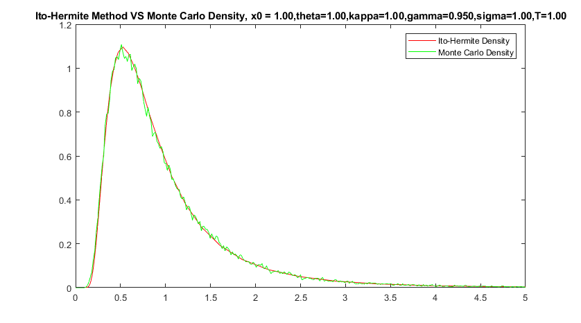](https://postimages.org/)

[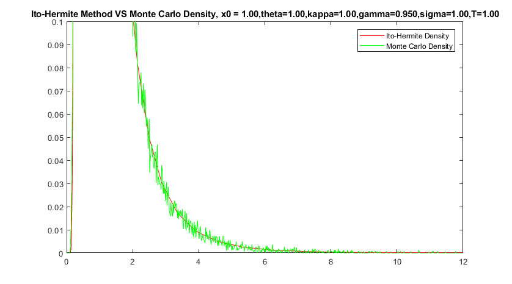](https://postimages.org/)

[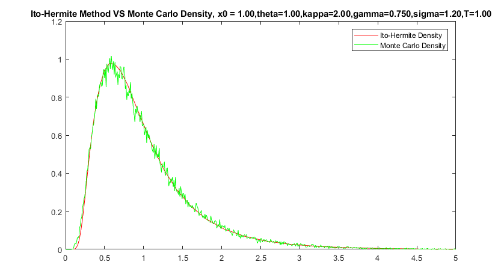](https://postimages.org/)

[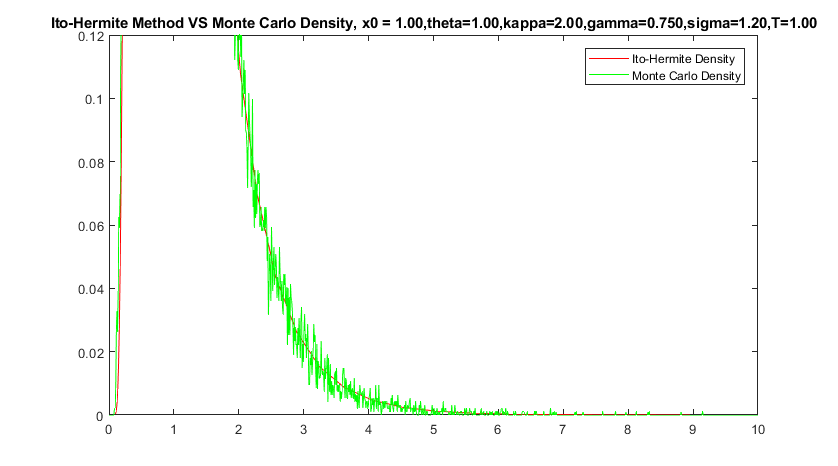](https://postimages.org/)

[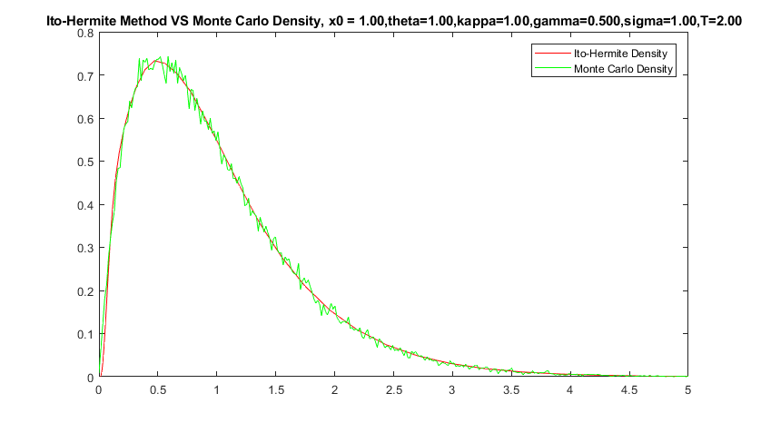](https://postimages.org/)

[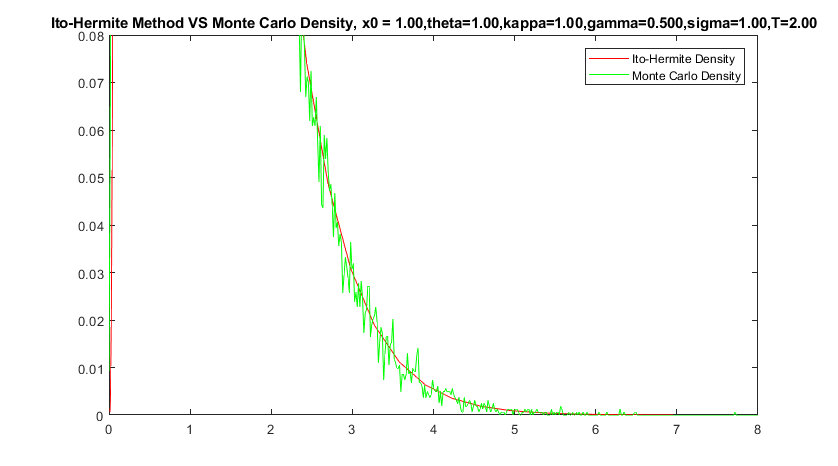](https://postimages.org/)

[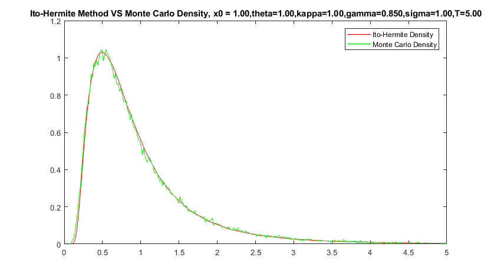](https://postimages.org/)

[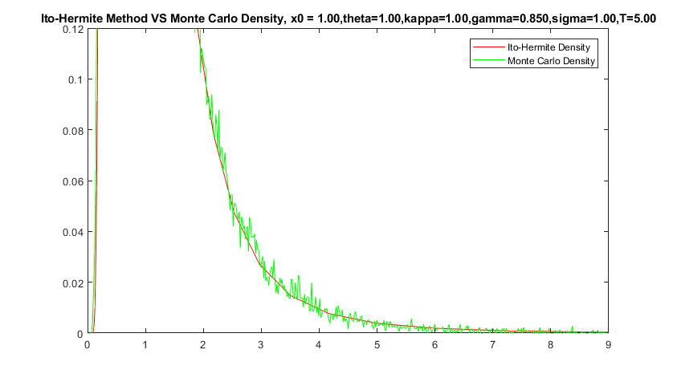](https://postimages.org/)

[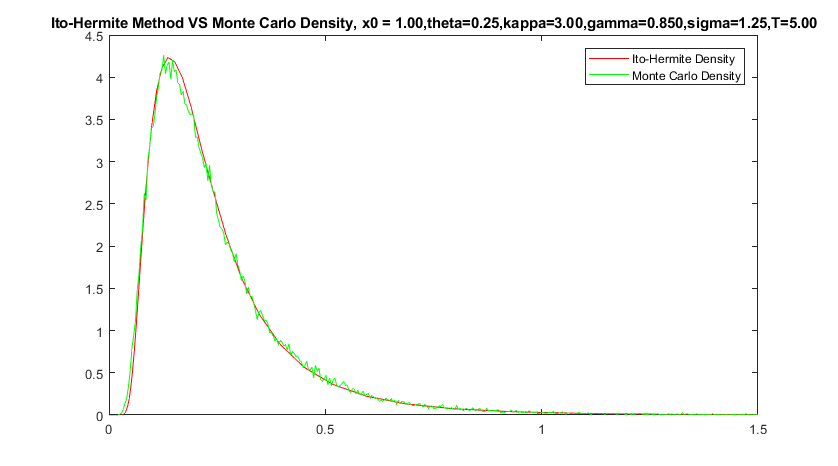](https://postimages.org/)

[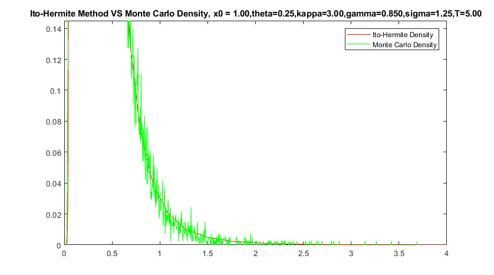](https://postimages.org/)

[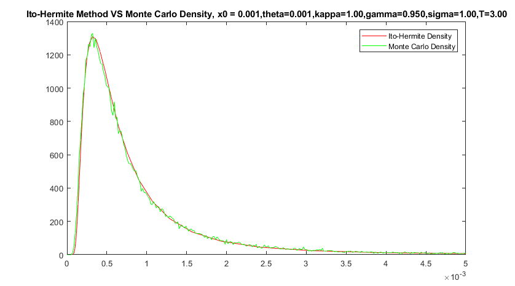](https://postimages.org/)

[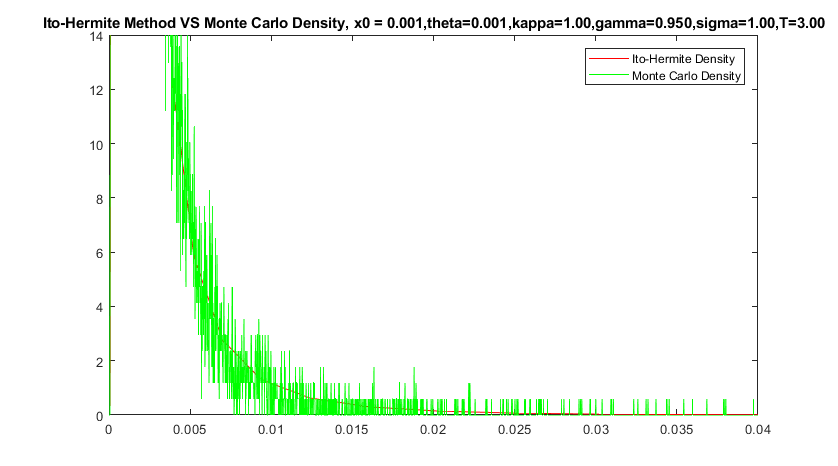](https://postimages.org/)

[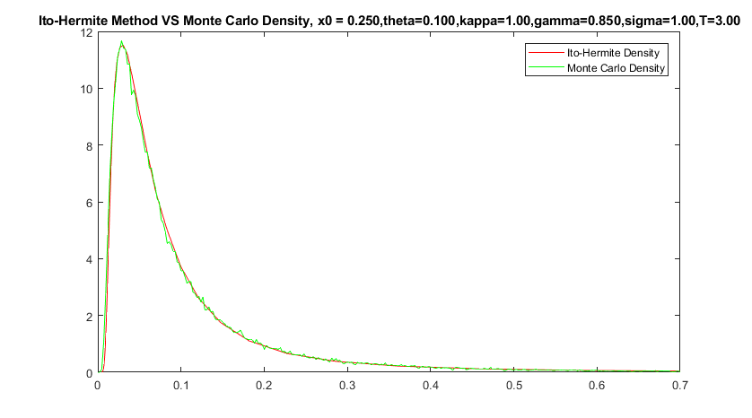](https://postimages.org/)

[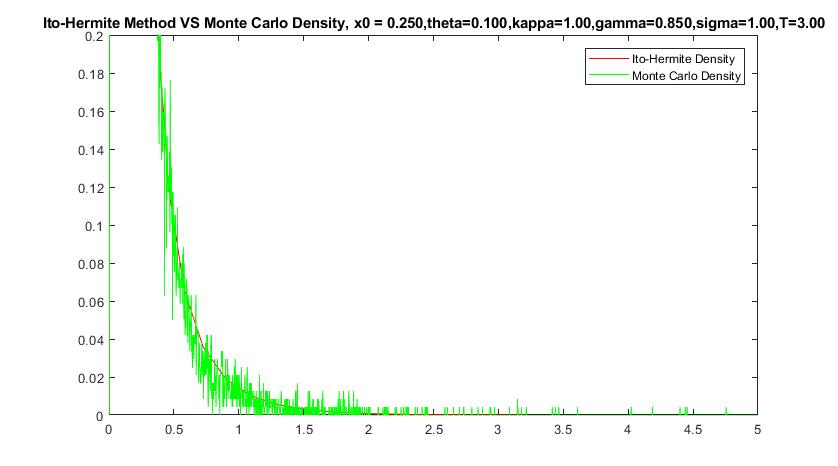](https://postimages.org/)

[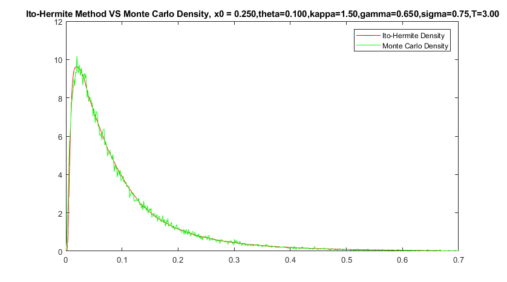](https://postimages.org/)

[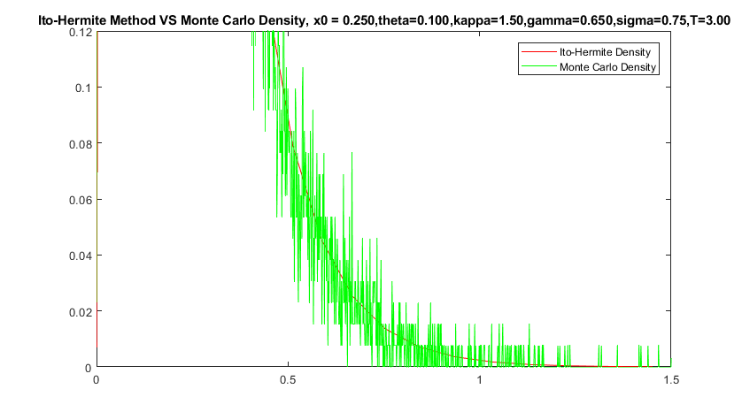](https://postimages.org/)

[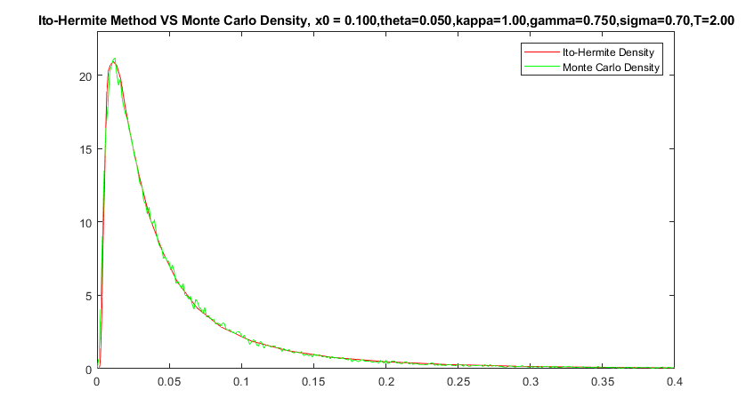](https://postimages.org/)

[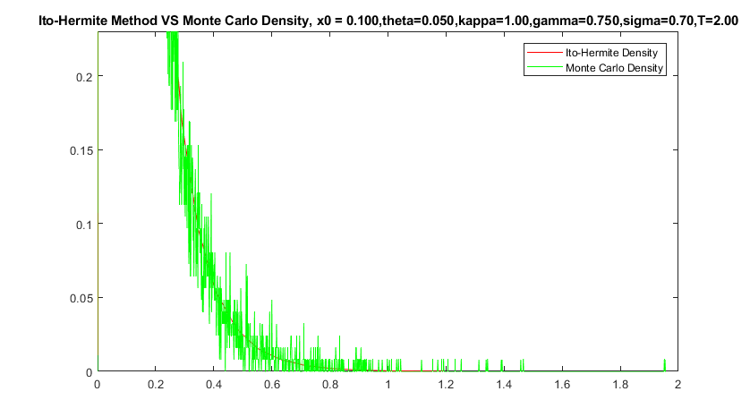](https://postimages.org/)

[](https://postimg.cc/vxZhxpgS)

---

### #940 — Amin (Topic Author)
*June 25, 2020, 5:54 PM*

Here I am posting the new improved program that I used to create the above graphs. I continued to change NoOfBins
parameter used for graphing. Here is the new program.

```
function [TrueMean,ItoHermiteMean,MCMean] = ItoHermiteWilmottMeanCorrected04WNew02(x0,theta,kappa,gamma,sigma0,T)

%Copyright Ahsan Amin. Infiniti derivatives Technologies.
%Please fell free to connect on linkedin: linkedin.com/in/ahsan-amin-0a53334
%or skype ahsan.amin2999
%In this program, I am simulating the SDE given as
%dy(t)=mu1 x(t)^beta1 dt + mu2 x(t)^beta2 dt +sigma x(t)^gamma dz(t)

%I have not directly simulated the SDE but simulated the transformed
%Besse1l process version of the SDE and then changed coordinates to retreive
%the SDE in original coo
%rdinates.
%The present program will analytically evolve only the Bessel Process version of the
%SDE in transformed coordinates.

dt=.125/16;   % Simulation time interval.%Fodiffusions close to zero
             %decrease dt for accuracy.
%T=5;
Tt=128*T;%16*16;     % Number of simulation levels. Terminal time= Tt*dt; //.125/32*32*16=2 year;
OrderA=4;  %
OrderM=4;  %
%dtM=.125/8;%Monte carlo time interval size dtM.
%TtM=8*8;%Monte carlo number of simulation intervals.
dtM=dt*2;
TtM=Tt/2;

dNn=.2/1;   % Normal density subdivisions width. would change with number of subdivisions
Nn=48;  % No of normal density subdivisions
NnMidl=25;%One half density Subdivision left from mid of normal density(low)
NnMidh=26;%One half density subdivision right from the mid of normal density(high)
NnMid=4.0;

%theta=mu1/(-mu2);
%kappa=-mu2;

%x0=.25;   % starting value of SDE
beta1=0.0;
beta2=1.0;   % Second drift term power.
%gamma=.95;%50;   % volatility power.
%kappa=.5;   %mean reversion parameter.
%theta=.075;%mean reversion target

%you can specify any general mu1 and mu2 and beta1 and beta2.
%The present program is not perfect but quite reasonably good.
%if there is only one term in drift with beta=0, there will be minor
%errors. This case is yet not covered.

mu1=+1*theta*kappa;   %first drift coefficient.
mu2=-1*kappa;    % Second drift coefficient.
%sigma0=1.0;%Volatility value
alpha=1;% x^alpha is being expanded. This is currently for monte carlo only.
alpha1=1-gamma;

w(1:Nn)=x0^(1-gamma)/(1-gamma);

Z(1:Nn)=(((1:Nn)-5.5)*dNn-NnMid);

Z
str=input('Look at Z');
ZProb(1)=normcdf(.5*Z(1)+.5*Z(2),0,1)-normcdf(.5*Z(1)+.5*Z(2)-dNn,0,1);
ZProb(Nn)=normcdf(.5*Z(Nn)+.5*Z(Nn-1)+dNn,0,1)-normcdf(.5*Z(Nn)+.5*Z(Nn-1),0,1);

for nn=2:Nn-1
    ZProb(nn)=normcdf(.5*Z(nn)+.5*Z(nn+1),0,1)-normcdf(.5*Z(nn)+.5*Z(nn-1),0,1);
    %Above calculate probability mass in each probability subdivision.
end

%%%%%%%%%%%%%%%%%%%%%%%%%%%%%%%%%%%%%%%%%%%%%%%%%%%%%%%%%%%%%%%%%%%%%%%%%%%%%%%%%%%%%%%%%%%%%%

sigma11(1:OrderA+1)=0;
mu11(1:OrderA+1)=0;
mu22(1:OrderA+1)=0;
sigma22(1:OrderA+1)=0;
% index 1 correponds to zero level since matlab indexing starts at one.
sigma11(1)=1;
mu11(1)=1;
mu22(1)=1;
sigma22(1)=1;

for k=1:(OrderA+1)
    if sigma0~=0
        sigma11(k)=sigma0^(k-1);
    end
    if mu1 ~= 0
        mu11(k)=mu1^(k-1);
    end
    if mu2 ~= 0
        mu22(k)=mu2^(k-1);
    end
    if sigma0~=0
        sigma22(k)=sigma0^(2*(k-1));
    end
end
%Ft(1:TtM+1,1:(OrderA+1),1:(OrderA+1),1:(OrderA+1),1:(OrderA+1))=0; %General time powers on hermite polynomials
Fp(1:(OrderA+1),1:(OrderA+1),1:(OrderA+1),1:(OrderA+1))=0;%General x powers on coefficients of hermite polynomials.
Fp1(1:(OrderA+1),1:(OrderA+1),1:(OrderA+1),1:(OrderA+1))=0;%General x powers for bessel transformed coordinates.

%YCoeff0 and YCoeff are coefficents for original coordinates monte carlo.
%YqCoeff0 and YqCoeff are bessel/lamperti version monte carlo.

YCoeff0(1:(OrderA+1),1:(OrderA+1),1:(OrderA+1),1:(OrderA+1))=0;
YqCoeff0(1:(OrderA+1),1:(OrderA+1),1:(OrderA+1),1:(OrderA+1))=0;
%Pre-compute the time and power exponent values in small multi-dimensional arrays
YCoeff = ItoTaylorCoeffsNew(alpha,beta1,beta2,gamma); %expand y^alpha where alpha=1;
YqCoeff = ItoTaylorCoeffsNew(alpha1,beta1,beta2,gamma);%expand y^alpha1 where alpha1=(1-gamma)
YqCoeff=YqCoeff/(1-gamma); %Transformed coordinates coefficients have to be
%further divided by (1-gamma)

for k = 0 : (OrderA)
    for m = 0:k
        l4 = k - m + 1;
        for n = 0 : m
            l3 = m - n + 1;
            for j = 0:n
                l2 = n - j + 1;
                l1 = j + 1;
                %Ft(l1,l2,l3,l4) = dtM^((l1-1) + (l2-1) + (l3-1) + .5* (l4-1));
                Fp(l1,l2,l3,l4) = (alpha + (l1-1) * beta1 + (l2-1) * beta2 + (l3-1) * 2* gamma + (l4-1) * gamma ...
                    - (l1-1) - (l2-1) - 2* (l3-1) - (l4-1));
                Fp1(l1,l2,l3,l4) = (alpha1 + (l1-1) * beta1 + (l2-1) * beta2 + (l3-1) * 2* gamma + (l4-1) * gamma ...
                    - (l1-1) - (l2-1) - 2* (l3-1) - (l4-1));

                YCoeff0(l1,l2,l3,l4) =YCoeff(l1,l2,l3,l4).*mu11(l1).*mu22(l2).*sigma22(l3).*sigma11(l4);
                YqCoeff0(l1,l2,l3,l4) =YqCoeff(l1,l2,l3,l4).*mu11(l1).*mu22(l2).*sigma22(l3).*sigma11(l4);
            end
        end
    end
end

%%%%%%%%%%%%%%%%%%%%%%%%%%%%%%%%%%%%%%%%%%%%%%%%%%%%%%%%%%%%%%%%%%%%%%%%%%%%%%%%%%%%%%%%%%%%%%
wnStart=1;%
d2wdZ2(1:Nn)=0;
dwdZ(1:Nn)=0;
yy(wnStart:Nn)=((1-gamma)*w(wnStart:Nn)).^(1/(1-gamma));
tic

for tt=1:Tt

     yy(wnStart:Nn)=((1-gamma)*w(wnStart:Nn)).^(1/(1-gamma));

    [wMu0dt,dwMu0dtdw,d2wMu0dtdw2,d3wMu0dtdw3,c1,c2,c3,c4] =
CalculateDriftAndVolOrder4(w,wnStart,Nn,YqCoeff0,Fp1,gamma,dt);

    dw(wnStart:Nn)=c1(wnStart:Nn).*Z(wnStart:Nn) ;% ...
    dw2(wnStart:Nn)=dw(wnStart:Nn).^2;
   % d2w(wnStart:Nn)=c2(wnStart:Nn).*(Z(wnStart:Nn).^2-1);
   % d3w(wnStart:Nn)=c3(wnStart:Nn).*(Z(wnStart:Nn).^3-3*Z(wnStart:Nn));
    w(isnan(w)==1)=0;
    wMu0dt(isnan(wMu0dt)==1)=0;
    wMeanPrev=sum(ZProb(wnStart:Nn).*w(wnStart:Nn));%Calculate the mean.

%%%%%%%%%%%%%%%%%%%%%%%%%%%%%%%%%%%%%%%%%%%%%%%%%%%%%%%%%%%%%%%%%%%%%%%%%%%

[w0,Sigma00,Sigma11,Sigma22,Sigma33,Sigma1,Sigma2,Sigma3,Sigma0] =
CalculateHermiteRepresentationOfDensityOrderThreeNew(w,Z,wnStart,Nn,dNn,NnMidh,NnMidl);
d2wdZ2(wnStart:Nn)=d2wdZ2(wnStart:Nn)+
d2wMu0dtdw2(wnStart:Nn).*dwdZ(wnStart:Nn).^2+dwMu0dtdw(wnStart:Nn).*d2wdZ2(wnStart:Nn);%+ ...

[dwdZ,d2wdZ2A,d3wdZ3,d4wdZ4] = First4Derivatives2ndOrderEqSpaced(wnStart,Nn,dNn,w,Z);
dZdw(wnStart:Nn)=1.0./dwdZ(wnStart:Nn);

H2(wnStart:Nn)=(Z(wnStart:Nn).^2-1);
% CTerm(wnStart:Nn)=(.5*d2wMu0dtdw2(wnStart:Nn).*dwdZ(wnStart:Nn).^2 - ...
%           1*dwMu0dtdw(wnStart:Nn).*d2wdZ2(wnStart:Nn));
% Correction1(wnStart:Nn)=-sqrt(2/3)/(22/7)^2.*CTerm(wnStart:Nn).*H2(wnStart:Nn);
% Correction0(wnStart:Nn)=-sqrt(2/3)/(22/7)^2.*(d2wdZ2(wnStart:Nn)-.25*dwdZ(wnStart:Nn).^2).*H2(wnStart:Nn);

CTerm(wnStart:Nn)=(.25*d2wMu0dtdw2(wnStart:Nn).*dwdZ(wnStart:Nn).^2.*Z(wnStart:Nn)/4.0 - ...
          1*dwMu0dtdw(wnStart:Nn).*d2wdZ2(wnStart:Nn));
Correction1(wnStart:Nn)=-.925/(22/7)^2.*CTerm(wnStart:Nn).*H2(wnStart:Nn);
Correction0(wnStart:Nn)=-.925/(22/7)^2.*(d2wdZ2(wnStart:Nn)-.25*dwdZ(wnStart:Nn).^2.*Z(wnStart:Nn)/4.0).*H2(wnStart:Nn);

if(tt==1)
w(wnStart:Nn)=wMeanPrev+wMu0dt(wnStart:Nn)+ ...
          sign(w(wnStart:Nn)-wMeanPrev+dw(wnStart:Nn)).* ...
          sqrt(abs(sign(w(wnStart:Nn)-wMeanPrev).*(w(wnStart:Nn)-wMeanPrev).^2+ ...
          sign(dw(wnStart:Nn)).*dw2(wnStart:Nn)));
end
if(tt>1)

    dw(wnStart:Nn)=sigma0*sqrt(dt).*Z(wnStart:Nn);
    dw2(wnStart:Nn)=sigma0^2*dt*Z(wnStart:Nn).^2;

  %u0(wnStart:Nn)=w(wnStart:Nn)-Z(wnStart:Nn).*dwdZ(wnStart:Nn);
  signT1(wnStart:Nn)=sign(-3*Z(wnStart:Nn).^1.*dZdw(wnStart:Nn).*d2wdZ2(wnStart:Nn)*sigma0^2.*dt);%%.* ...
      %sqrt(abs(3*Z(wnStart:Nn).^1.*dZdw(wnStart:Nn).*d2wdZ2(wnStart:Nn)*sigma0^2.*dt*sigma0^2*dt^2));
  T1(wnStart:Nn)=sqrt(abs(3*Z(wnStart:Nn).^1.*dZdw(wnStart:Nn).*d2wdZ2(wnStart:Nn)*sigma0^2.*dt));

  u0(wnStart:Nn)=wMeanPrev;

   w(wnStart:Nn)=u0(wnStart:Nn)+wMu0dt(wnStart:Nn)+ ...
            sign(w(wnStart:Nn)-u0(wnStart:Nn)+dw(wnStart:Nn)+sqrt(3).*sqrt(dt)*signT1(wnStart:Nn).*T1(wnStart:Nn)).* ...
            sqrt(abs(sign(w(wnStart:Nn)-u0(wnStart:Nn)).*(w(wnStart:Nn)-u0(wnStart:Nn)).^2+ ...
            sign(dw(wnStart:Nn)).*dw2(wnStart:Nn)+ ...
            3*dt*signT1(wnStart:Nn).*T1(wnStart:Nn).^2))+ ...
            4*dt*dwMu0dtdw(wnStart:Nn).*dwdZ(wnStart:Nn).^2.*Z(wnStart:Nn)+ ...
            +dt *Correction0(wnStart:Nn).*exp(-.5*(1-gamma)*sigma0.^2.*Z(wnStart:Nn).^2) + ...
            Correction1(wnStart:Nn).*exp(-.5*(1-gamma)*sigma0.^2.*Z(wnStart:Nn).^2);

end

%%%%%%%%%%%%%%%%%%%%%%%%%%%%%%%%%%%%%%%%%%%%%%%%%%%%%%%%%%%%%%%%%%%%%%%%%%%
%Below are instability correction equations. There is instability in the
% SDE representation equation roughly between -.5 SD to +.5 SD in normal terms.
%Instability correction Algorithm takes two ends that are here given as
%lower end=w(NnMidl-2) and upper end=w(NnMidh+3).
%In the block below the interpolation starts from lower end.
%1st equation is
%wll(NnMidl-1)=w(NnMidl-2)+(D1wl+CTheta*D2wl*dNn/1+.5*DeltaD1w)*dNn;
%Second equation is: wll(NnMidl)=wll(NnMidl-1)+(D1wl+CTheta*D2wl*dNn+1.5*DeltaD1w)*dNn;
%And so on.
%There is a sixth equation that is not written below(since it takes us to
%the upper interpolation point which is already known) which is
%wll(NnMidh+3)=wll(NnMidh+2)+(D1wl+CTheta*D2wl*dNn+5.5*DeltaD1w)*dNn;
%Sum of these six equations add up to the distance between upper and lower
%interpolation points.
%In the sum there are six instances of first derivative which is already
%calculated at the boundary, six instances of second derivative which is also
%already calculated at lower boundary and 18.0 instances of DeltaD1w which is
%unknown. This equation calculates the value of one unit of DeltaD1w addition
%DeltaD1w=(w(NnMidh+3)-w(NnMidl-2)-6*D1wl*dNn-6.0*CTheta*D2wl*dNn.^2.0/1.0)/18.0/dNn;
% I hope to find a better analytical method to tackle this issue. Friends
% are welcome to play with slightly changed related alternatives to the
%above interpolation.
    CTheta=1.0;
    D1wl=(11/6*w(NnMidl-2)-3*w(NnMidl-3)+3/2*w(NnMidl-4)-1/3*w(NnMidl-5))/dNn;
    D2wl=(35/12*w(NnMidl-2) -26/3*w(NnMidl-3)+ 19/2*w(NnMidl-4)-14/3*w(NnMidl-5)+11/12*w(NnMidl-6))/dNn.^2;
    DeltaD1w=(w(NnMidh+3)-w(NnMidl-2)-6*D1wl*dNn-6.0*CTheta*D2wl*dNn.^2.0/1.0)/18.0/dNn;

    wll(NnMidl-1)=w(NnMidl-2)+  (D1wl+CTheta*D2wl*dNn+.5*DeltaD1w)*dNn;
    wll(NnMidl)=wll(NnMidl-1)+  (D1wl+CTheta*D2wl*dNn+1.5*DeltaD1w)*dNn;
    wll(NnMidh)=wll(NnMidl)+    (D1wl+CTheta*D2wl*dNn+2.5*DeltaD1w)*dNn;
    wll(NnMidh+1)=wll(NnMidh)+  (D1wl+CTheta*D2wl*dNn+3.5*DeltaD1w)*dNn;
    wll(NnMidh+2)=wll(NnMidh+1)+(D1wl+CTheta*D2wl*dNn+4.5*DeltaD1w)*dNn;
    %wll(NnMidh+3)=wll(NnMidh+2)+(D1wl+CTheta*D2wl*dNn+5.5*DeltaD1w)*dNn;
%The last equation is not used since point w(NnMidh+3)is given but it is used in
%calculation of distance between two interpolation points. This distance is
%used to determine the value of DeltaD1w.

    D1wh=(-11/6*w(NnMidh+3)+3*w(NnMidh+4)-3/2*w(NnMidh+5)+1/3*w(NnMidh+6))/dNn;
    D2wh=(35/12*w(NnMidh+3) -26/3*w(NnMidh+4)+ 19/2*w(NnMidh+5)-14/3*w(NnMidh+6)+11/12*w(NnMidh+7))/dNn.^2;
    DeltaD1w=(w(NnMidh+3)-w(NnMidl-2)-6*D1wh*dNn-6.0*CTheta*D2wh*dNn.^2.0/1.0)/18.0/dNn;
%     DeltaD1w=(w(NnMidh+2)-w(NnMidl-1)-4*D1wh*dNn-16.0*D2wh*dNn.^2.0/1.0)/6.0/dNn;

    whh(NnMidh+2)=w(NnMidh+3)-(D1wh+CTheta*D2wh*dNn+.5*DeltaD1w)*dNn;
    whh(NnMidh+1)=w(NnMidh+2)-(D1wh+CTheta*D2wh*dNn+1.5* DeltaD1w)*dNn;
    whh(NnMidh)=whh(NnMidh+1)-(D1wh+CTheta*D2wh*dNn+2.5* DeltaD1w)*dNn;
    whh(NnMidl)=whh(NnMidh)-(D1wh+CTheta*D2wh*dNn+3.5* DeltaD1w)*dNn;
    whh(NnMidl-1)=whh(NnMidl)-(D1wh+CTheta*D2wh*dNn+4.5* DeltaD1w)*dNn;

    %whh(NnMidl-2)=whh(NnMidl-1)-(D1wh+CTheta*D2wh*dNn/1+5.5* DeltaD1w)*dNn;

%
     w(NnMidh+2)=.5*whh(NnMidh+2)+.5*wll(NnMidh+2);
     w(NnMidh+1)=.5*whh(NnMidh+1)+.5*wll(NnMidh+1);
     w(NnMidh)=.5*whh(NnMidh)+.5*wll(NnMidh);
     w(NnMidl)=.5*whh(NnMidl)+.5*wll(NnMidl);
     w(NnMidl-1)=.5*whh(NnMidl-1)+.5*wll(NnMidl-1);

        w1(1:Nn-1)=w(1:Nn-1);
        w2(1:Nn-1)=w(2:Nn);

%         w1(1:Nn-2)=w(1:Nn-2);
%         w2(1:Nn-2)=w(2:Nn-1);
%         w3(1:Nn-2)=w(3:Nn);
%         w(w1(:)>w2(:))=w2(w1(:)>w2(:))-.25*(w3(w1(:)>w2(:))-w2(w1(:)>w2(:)));
        w(w1(:)>w2(:))=0;%Be careful;might not universally hold;

        w(w<0)=0.0;
        for nn=1:Nn
            if(w(nn)<=0)
                wnStart=nn+1;
           end
        end

        %%1st order mean correction. We know the mean in original
        %%coordinates so I shift the density into original coordinates,
        %%apply the mean correction and then transform again into Lamperti
        %%coordinates. Algebra solves two equations in two unknowns.
        %%Equations are Sum_0^N{(Y_w(wnStart:Nn)-Y0)*W0}=1 and the second
        %%equation is Sum_0^N{Y_w(wnStart:Nn).*(Y_w(wnStart:Nn)-Y0)*W0}=u0
        %%Two unknows are Y0 and W0. u0 is known mean.
        tt;
        u0=theta+(x0-theta)*exp(-kappa*(tt*dt)); %analytic mean of the density

        %If you are not using stochastic volatility, replace above with
        %true mean otherwise results would become garbage.

        Y_w(wnStart:Nn) = ((1-gamma)*w(wnStart:Nn)).^(1/(1-gamma));

        Yn2Pn=sum(Y_w(wnStart:Nn).*Y_w(wnStart:Nn).*ZProb(wnStart:Nn));
        YnPn=sum(Y_w(wnStart:Nn).*ZProb(wnStart:Nn));
        Pn=1.0;%%Sum(ZProb(1:Nn))
        Y0=(Yn2Pn-u0*YnPn)/(YnPn-u0*Pn);

        Y0Pn=Y0*Pn;
        W0=1/(YnPn-Y0Pn);
        YCorrected(wnStart:Nn)=Y_w(wnStart:Nn).*(Y_w(wnStart:Nn)-Y0)*W0;
        wCorrected(wnStart:Nn)=(YCorrected(wnStart:Nn).^(1-gamma))./(1-gamma);
        w(wnStart:Nn)=wCorrected(wnStart:Nn);

   %The above mean correction is only valid for
   %standard mean reverting stochastic volatility type SDEs.

end

 y_w(1:Nn)=0;
 y_w(wnStart:Nn) = ((1-gamma)*w(wnStart:Nn)).^(1/(1-gamma));
 Dfy_w(wnStart:Nn)=0;
 Dfw(wnStart:Nn)=0;
for nn=wnStart+1:Nn-1
    Dfy_w(nn) = (y_w(nn + 1) - y_w(nn - 1))/(Z(nn + 1) - Z(nn - 1));
    Dfw(nn) = (w(nn + 1) - w(nn - 1))/(Z(nn + 1) - Z(nn - 1));
    %Change of variable derivative for densities
end
fy_w(1:Nn)=0;
fw(1:Nn)=0;
for nn = wnStart:Nn-1
    fy_w(nn) = (normpdf(Z(nn),0, 1))/abs(Dfy_w(nn));%Origianl coordinates density
    fw(nn) = (normpdf(Z(nn),0, 1))/abs(Dfw(nn));
end

toc
%str=input('Analytic Values calculated; Press a key to start monte carlo');

 rng(29079137, 'twister')
 paths=100000;
 YY(1:paths)=x0;  %Original process monte carlo.
 Random1(1:paths)=0;
 YYMean(1:TtM)=0;
 for tt=1:TtM
     Random1=randn(size(Random1));
     HermiteP1(1,1:paths)=1;
     HermiteP1(2,1:paths)=Random1(1:paths);
     HermiteP1(3,1:paths)=Random1(1:paths).^2-1;
     HermiteP1(4,1:paths)=Random1(1:paths).^3-3*Random1(1:paths);
     HermiteP1(5,1:paths)=Random1(1:paths).^4-6*Random1(1:paths).^2+3;

     YY(1:paths)=YY(1:paths) + ...
      (YCoeff0(1,1,2,1).*YY(1:paths).^Fp(1,1,2,1)+ ...
      YCoeff0(1,2,1,1).*YY(1:paths).^Fp(1,2,1,1)+ ...
      YCoeff0(2,1,1,1).*YY(1:paths).^Fp(2,1,1,1))*dtM + ...
      (YCoeff0(1,1,3,1).*YY(1:paths).^Fp(1,1,3,1)+ ...
      YCoeff0(1,2,2,1).*YY(1:paths).^Fp(1,2,2,1)+ ...
      YCoeff0(2,1,2,1).*YY(1:paths).^Fp(2,1,2,1)+ ...
      YCoeff0(1,3,1,1).*YY(1:paths).^Fp(1,3,1,1)+ ...
      YCoeff0(2,2,1,1).*YY(1:paths).^Fp(2,2,1,1)+ ...
      YCoeff0(3,1,1,1).*YY(1:paths).^Fp(3,1,1,1))*dtM^2 + ...
      ((YCoeff0(1,1,1,2).*YY(1:paths).^Fp(1,1,1,2).*sqrt(dtM))+ ...
    (YCoeff0(1,1,2,2).*YY(1:paths).^Fp(1,1,2,2)+ ...
    YCoeff0(1,2,1,2).*YY(1:paths).^Fp(1,2,1,2)+ ...
    YCoeff0(2,1,1,2).*YY(1:paths).^Fp(2,1,1,2)).*dtM^1.5) .*HermiteP1(2,1:paths) + ...
    ((YCoeff0(1,1,1,3).*YY(1:paths).^Fp(1,1,1,3) *dtM) + ...
    (YCoeff0(1,1,2,3).*YY(1:paths).^Fp(1,1,2,3)+ ...
    YCoeff0(1,2,1,3).*YY(1:paths).^Fp(1,2,1,3)+ ...
    YCoeff0(2,1,1,3).*YY(1:paths).^Fp(2,1,1,3)).*dtM^2).*HermiteP1(3,1:paths) + ...
    ((YCoeff0(1,1,1,4).*YY(1:paths).^Fp(1,1,1,4)*dtM^1.5 )).*HermiteP1(4,1:paths) + ...
    (YCoeff0(1,1,1,5).*YY(1:paths).^Fp(1,1,1,5)*dtM^2.0).*HermiteP1(5,1:paths);

%Uncomment for fourth order monte carlo

%
%   YY(1:paths)=YY(1:paths) + ...
%       (YCoeff0(1,1,2,1).*YY(1:paths).^Fp(1,1,2,1)+YCoeff0(1,2,1,1).*YY(1:paths).^Fp(1,2,1,1)+ ...
%       YCoeff0(2,1,1,1).*YY(1:paths).^Fp(2,1,1,1))*dtM + ...
%       (YCoeff0(1,1,3,1).*YY(1:paths).^Fp(1,1,3,1)+YCoeff0(1,2,2,1).*YY(1:paths).^Fp(1,2,2,1)+ ...
%       YCoeff0(2,1,2,1).*YY(1:paths).^Fp(2,1,2,1)+YCoeff0(1,3,1,1).*YY(1:paths).^Fp(1,3,1,1)+ ...
%       YCoeff0(2,2,1,1).*YY(1:paths).^Fp(2,2,1,1)+YCoeff0(3,1,1,1).*YY(1:paths).^Fp(3,1,1,1))*dtM^2 + ...
%       (YCoeff0(1,1,4,1).*YY(1:paths).^Fp(1,1,4,1)+YCoeff0(1,2,3,1).*YY(1:paths).^Fp(1,2,3,1)+ ...
%       YCoeff0(2,1,3,1).*YY(1:paths).^Fp(2,1,3,1)+YCoeff0(1,3,2,1).*YY(1:paths).^Fp(1,3,2,1)+ ...
%       YCoeff0(2,2,2,1).*YY(1:paths).^Fp(2,2,2,1)+YCoeff0(3,1,2,1).*YY(1:paths).^Fp(3,1,2,1)+ ...
%       YCoeff0(1,4,1,1).*YY(1:paths).^Fp(1,4,1,1)+YCoeff0(2,3,1,1).*YY(1:paths).^Fp(2,3,1,1)+ ...
%       YCoeff0(3,2,1,1).*YY(1:paths).^Fp(3,2,1,1)+YCoeff0(4,1,1,1).*YY(1:paths).^Fp(4,1,1,1))*dtM^3 + ...
%        (YCoeff0(1,1,5,1).*YY(1:paths).^Fp(1,1,5,1)+YCoeff0(1,2,4,1).*yy(1:paths).^Fp(1,2,4,1)+ ...
%     YCoeff0(2,1,4,1).*YY(1:paths).^Fp(2,1,4,1)+YCoeff0(2,1,1,1).*yy(1:paths).^Fp(2,1,1,1)+ ...
%      YCoeff0(2,2,3,1).*YY(1:paths).^Fp(2,2,3,1)+ ...
%      YCoeff0(3,1,3,1).*YY(1:paths).^Fp(3,1,3,1)+YCoeff0(1,4,2,1).*YY(1:paths).^Fp(1,4,2,1)+ ...
%      YCoeff0(2,3,2,1).*YY(1:paths).^Fp(2,3,2,1)+YCoeff0(3,2,2,1).*YY(1:paths).^Fp(3,2,2,1)+ ...
%      YCoeff0(4,1,2,1).*YY(1:paths).^Fp(4,1,2,1)+YCoeff0(1,5,1,1).*YY(1:paths).^Fp(1,5,1,1)+ ...
%      YCoeff0(2,4,1,1).*YY(1:paths).^Fp(2,4,1,1)+ ...
%      YCoeff0(3,3,1,1).*YY(1:paths).^Fp(3,3,1,1)+YCoeff0(4,2,1,1).*YY(1:paths).^Fp(4,2,1,1)+ ...
%      YCoeff0(5,1,1,1).*YY(1:paths).^Fp(5,1,1,1))*dtM^4+ ...
%       ((YCoeff0(1,1,1,2).*YY(1:paths).^Fp(1,1,1,2).*sqrt(dtM))+ ...
%     (YCoeff0(1,1,2,2).*YY(1:paths).^Fp(1,1,2,2)+YCoeff0(1,2,1,2).*YY(1:paths).^Fp(1,2,1,2)+ ...
%     YCoeff0(2,1,1,2).*YY(1:paths).^Fp(2,1,1,2)).*dtM^1.5+ ...
%     (YCoeff0(1,1,3,2).*YY(1:paths).^Fp(1,1,3,2)+YCoeff0(1,2,2,2).*YY(1:paths).^Fp(1,2,2,2)+ ...
%     YCoeff0(2,1,2,2).*YY(1:paths).^Fp(2,1,2,2)+YCoeff0(1,3,1,2).*YY(1:paths).^Fp(1,3,1,2)+ ...
%     YCoeff0(2,2,1,2).*YY(1:paths).^Fp(2,2,1,2)+YCoeff0(3,1,1,2).*YY(1:paths).^Fp(3,1,1,2)).*dtM^2.5+ ...
%     (YCoeff0(1,1,4,2).*YY(1:paths).^Fp(1,1,4,2)+YCoeff0(1,2,3,2).*YY(1:paths).^Fp(1,2,3,2)+ ...
%     YCoeff0(2,1,3,2).*YY(1:paths).^Fp(2,1,3,2)+YCoeff0(1,3,2,2).*YY(1:paths).^Fp(1,3,2,2)+ ...
%     YCoeff0(2,2,2,2).*YY(1:paths).^Fp(2,2,2,2)+ YCoeff0(3,1,2,2).*YY(1:paths).^Fp(3,1,2,2)+ ...
%     YCoeff0(1,4,1,2).*YY(1:paths).^Fp(1,4,1,2)+YCoeff0(2,3,1,2).*YY(1:paths).^Fp(2,3,1,2)+ ...
%     YCoeff0(3,2,1,2).*YY(1:paths).^Fp(3,2,1,2)+YCoeff0(4,1,1,2).*YY(1:paths).^Fp(4,1,1,2)).*dtM^3.5)
.*HermiteP1(2,1:paths) + ...
%     ((YCoeff0(1,1,1,3).*YY(1:paths).^Fp(1,1,1,3) *dtM) + ...
%     (YCoeff0(1,1,2,3).*YY(1:paths).^Fp(1,1,2,3)+YCoeff0(1,2,1,3).*YY(1:paths).^Fp(1,2,1,3)+ ...
%     YCoeff0(2,1,1,3).*YY(1:paths).^Fp(2,1,1,3)).*dtM^2+ ...
%     (YCoeff0(1,1,3,3).*YY(1:paths).^Fp(1,1,3,3)+YCoeff0(1,2,2,3).*YY(1:paths).^Fp(1,2,2,3)+ ...
%     YCoeff0(2,1,2,3).*YY(1:paths).^Fp(2,1,2,3) + YCoeff0(1,3,1,3).*YY(1:paths).^Fp(1,3,1,3)+ ...
%   
 YCoeff0(2,2,1,3).*YY(1:paths).^Fp(2,2,1,3)+YCoeff0(3,1,1,3).*YY(1:paths).^Fp(3,1,1,3)).*dtM^3).*HermiteP1(3,1:paths) +
...
%     ((YCoeff0(1,1,1,4).*YY(1:paths).^Fp(1,1,1,4)*dtM^1.5 )+ ...
%     (YCoeff0(1,1,2,4).*YY(1:paths).^Fp(1,1,2,4)+YCoeff0(1,2,1,4).*YY(1:paths).^Fp(1,2,1,4)+ ...
%     YCoeff0(2,1,1,4).*YY(1:paths).^Fp(2,1,1,4))*dtM^2.5).*HermiteP1(4,1:paths) + ...
%     (YCoeff0(1,1,1,5).*YY(1:paths).^Fp(1,1,1,5)*dtM^2.0).*HermiteP1(5,1:paths);
%

     YYMean(tt)=YYMean(tt)+sum(YY(1:paths))/paths;
 end
 YY(YY<0)=0;
 disp('Original process average from monte carlo');
 MCMean=sum(YY(:))/paths %origianl coordinates monte carlo average.
 disp('Original process average from our simulation');
 ItoHermiteMean=sum(y_w(wnStart+1:Nn-1).*ZProb(wnStart+1:Nn-1)) %Original process average from coordinates

 disp('true Mean only applicble to standard SV mean reverting type models otherwise disregard');
 TrueMean=theta+(x0-theta)*exp(-kappa*dt*Tt)%Mean reverting SDE original variable true average

 MaxCutOff=30;
 NoOfBins=round(1000*gamma^2*4*sigma0);
 [YDensity,IndexOutY,IndexMaxY] = MakeDensityFromSimulation_Infiniti_NEW(YY,paths,NoOfBins,MaxCutOff );
 plot(y_w(wnStart+1:Nn-1),fy_w(wnStart+1:Nn-1),'r',IndexOutY(1:IndexMaxY),YDensity(1:IndexMaxY),'g');

 title(sprintf('Ito-Hermite Method VS Monte Carlo Density, x0 =
%.3f,theta=%.3f,kappa=%.2f,gamma=%.3f,sigma=%.2f,T=%.2f', x0,theta,kappa,gamma,sigma0,T));%,sprintf('theta= %f', theta),
sprintf('kappa = %f', kappa),sprintf('sigma = %f', sigma0),sprintf('T = %f', T));
 legend({'Ito-Hermite Density','Monte Carlo Density'},'Location','northeast')

 str=input('red line is density of SDE from Ito-Hermite method, green is monte carlo.');

end
```

The above program when run with the following line of code(these are parameters of the last graph.)

ItoHermiteWilmottMeanCorrected04WNew02(.1,.05,1.0,.75,.7,2.0)

will result in following last output:

Original process average from monte carlo

MCMean =

   0.056659206709890

Original process average from our simulation

ItoHermiteMean =

   0.056762486183782

true Mean only applicble to standard SV mean reverting type models otherwise disregard

TrueMean =

   0.056766764161831

IndexMax =

        1576

red line is density of SDE from Ito-Hermite method, green is monte carlo.

ans =

   0.056766764161831

---

### #941 — Amin (Topic Author)
*June 26, 2020, 3:30 AM*

Please replace the terms in posted program with these new terms:

CTerm(wnStart:Nn)=(.25*d2wMu0dtdw2(wnStart:Nn).*dwdZ(wnStart:Nn).^1.*Z(wnStart:Nn)/sqrt(2.0) - ...

          1*dwMu0dtdw(wnStart:Nn).*d2wdZ2(wnStart:Nn));

Correction1(wnStart:Nn)=-.925/(22/7)^2.*CTerm(wnStart:Nn).*H2(wnStart:Nn);

Correction0(wnStart:Nn)=-.925/(22/7)^2.*(d2wdZ2(wnStart:Nn)-.25*dwdZ(wnStart:Nn).^1.*Z(wnStart:Nn)/sqrt(2.0)).*H2(wnStart:Nn);

Edit: Please just disregard this post. I will come back with more details later.

---

### #942 — Amin (Topic Author)
*June 27, 2020, 3:57 AM*

I am posting a different program which is also very good. But wonderful thing is that in this program most derivatives
are almost the same as the ones analytically calculated as in post 920. I have added extra multiplication with second or
first hermite polynomial and scaling constant is still arbitrary but body of derivatives terms(apart from extra
multiplication with hermite polynomials and scaling and another exponential multiplication) are exactly as different
terms in analytic solution of FP equation as in post 920. It is still not a final program but I decided to share it.

```
function [TrueMean,ItoHermiteMean,y_w,fy_w,wnStart] =
ItoHermiteWilmottMeanCorrected080FP08WA02F(x0,theta,kappa,gamma,sigma0,T)

%Copyright Ahsan Amin. Infiniti derivatives Technologies.
%Please fell free to connect on linkedin: linkedin.com/in/ahsan-amin-0a53334
%or skype ahsan.amin2999
%In this program, I am simulating the SDE given as
%dy(t)=mu1 x(t)^beta1 dt + mu2 x(t)^beta2 dt +sigma x(t)^gamma dz(t)

%I have not directly simulated the SDE but simulated the transformed
%Besse1l process version of the SDE and then changed coordinates to retreive
%the SDE in original coo
%rdinates.
%The present program will analytically evolve only the Bessel Process version of the
%SDE in transformed coordinates.
%In this version, the mean correction has been disabled. If you are
%simulating standard mean-reverting SV type SDEs, please enable the mean
%correction by uncommenting the appropriate line in the body of code below.

dt=.125/16;   % Simulation time interval.%Fodiffusions close to zero
             %decrease dt for accuracy.
Tt=128*T;%16*16;     % Number of simulation levels. Terminal time= Tt*dt; //.125/32*32*16=2 year;
OrderA=4;  %
OrderM=4;  %
%dtM=.125/8;%Monte carlo time interval size dtM.
%TtM=8*8;%Monte carlo number of simulation intervals.
dtM=dt*1;
TtM=Tt/1;

dNn=.2/1;   % Normal density subdivisions width. would change with number of subdivisions
Nn=50;  % No of normal density subdivisions
NnMidl=25;%One half density Subdivision left from mid of normal density(low)
NnMidh=26;%One half density subdivision right from the mid of normal density(high)
NnMid=4.0;

%theta=mu1/(-mu2);
%kappa=-mu2;

%x0=.25;   % starting value of SDE
beta1=0.0;
beta2=1.0;   % Second drift term power.
%gamma=.95;%50;   % volatility power.
%kappa=.5;   %mean reversion parameter.
%theta=.075;%mean reversion target

%you can specify any general mu1 and mu2 and beta1 and beta2.
%The present program is not perfect but quite reasonably good.
%if there is only one term in drift with beta=0, there will be minor
%errors. This case is yet not covered.

mu1=+1*theta*kappa;   %first drift coefficient.
mu2=-1*kappa;    % Second drift coefficient.
%sigma0=1.0;%Volatility value
alpha=1;% x^alpha is being expanded. This is currently for monte carlo only.
alpha1=1-gamma;

w(1:Nn)=x0^(1-gamma)/(1-gamma);

Z(1:Nn)=(((1:Nn)-5.5)*dNn-NnMid);

Z
str=input('Look at Z');
ZProb(1)=normcdf(.5*Z(1)+.5*Z(2),0,1)-normcdf(.5*Z(1)+.5*Z(2)-dNn,0,1);
ZProb(Nn)=normcdf(.5*Z(Nn)+.5*Z(Nn-1)+dNn,0,1)-normcdf(.5*Z(Nn)+.5*Z(Nn-1),0,1);

for nn=2:Nn-1
    ZProb(nn)=normcdf(.5*Z(nn)+.5*Z(nn+1),0,1)-normcdf(.5*Z(nn)+.5*Z(nn-1),0,1);
    %Above calculate probability mass in each probability subdivision.
end

%%%%%%%%%%%%%%%%%%%%%%%%%%%%%%%%%%%%%%%%%%%%%%%%%%%%%%%%%%%%%%%%%%%%%%%%%%%%%%%%%%%%%%%%%%%%%%

sigma11(1:OrderA+1)=0;
mu11(1:OrderA+1)=0;
mu22(1:OrderA+1)=0;
sigma22(1:OrderA+1)=0;
% index 1 correponds to zero level since matlab indexing starts at one.
sigma11(1)=1;
mu11(1)=1;
mu22(1)=1;
sigma22(1)=1;

for k=1:(OrderA+1)
    if sigma0~=0
        sigma11(k)=sigma0^(k-1);
    end
    if mu1 ~= 0
        mu11(k)=mu1^(k-1);
    end
    if mu2 ~= 0
        mu22(k)=mu2^(k-1);
    end
    if sigma0~=0
        sigma22(k)=sigma0^(2*(k-1));
    end
end
%Ft(1:TtM+1,1:(OrderA+1),1:(OrderA+1),1:(OrderA+1),1:(OrderA+1))=0; %General time powers on hermite polynomials
Fp(1:(OrderA+1),1:(OrderA+1),1:(OrderA+1),1:(OrderA+1))=0;%General x powers on coefficients of hermite polynomials.
Fp1(1:(OrderA+1),1:(OrderA+1),1:(OrderA+1),1:(OrderA+1))=0;%General x powers for bessel transformed coordinates.

%YCoeff0 and YCoeff are coefficents for original coordinates monte carlo.
%YqCoeff0 and YqCoeff are bessel/lamperti version monte carlo.

YCoeff0(1:(OrderA+1),1:(OrderA+1),1:(OrderA+1),1:(OrderA+1))=0;
YqCoeff0(1:(OrderA+1),1:(OrderA+1),1:(OrderA+1),1:(OrderA+1))=0;
%Pre-compute the time and power exponent values in small multi-dimensional arrays
YCoeff = ItoTaylorCoeffsNew(alpha,beta1,beta2,gamma); %expand y^alpha where alpha=1;
YqCoeff = ItoTaylorCoeffsNew(alpha1,beta1,beta2,gamma);%expand y^alpha1 where alpha1=(1-gamma)
YqCoeff=YqCoeff/(1-gamma); %Transformed coordinates coefficients have to be
%further divided by (1-gamma)

for k = 0 : (OrderA)
    for m = 0:k
        l4 = k - m + 1;
        for n = 0 : m
            l3 = m - n + 1;
            for j = 0:n
                l2 = n - j + 1;
                l1 = j + 1;
                %Ft(l1,l2,l3,l4) = dtM^((l1-1) + (l2-1) + (l3-1) + .5* (l4-1));
                Fp(l1,l2,l3,l4) = (alpha + (l1-1) * beta1 + (l2-1) * beta2 + (l3-1) * 2* gamma + (l4-1) * gamma ...
                    - (l1-1) - (l2-1) - 2* (l3-1) - (l4-1));
                Fp1(l1,l2,l3,l4) = (alpha1 + (l1-1) * beta1 + (l2-1) * beta2 + (l3-1) * 2* gamma + (l4-1) * gamma ...
                    - (l1-1) - (l2-1) - 2* (l3-1) - (l4-1));

                YCoeff0(l1,l2,l3,l4) =YCoeff(l1,l2,l3,l4).*mu11(l1).*mu22(l2).*sigma22(l3).*sigma11(l4);
                YqCoeff0(l1,l2,l3,l4) =YqCoeff(l1,l2,l3,l4).*mu11(l1).*mu22(l2).*sigma22(l3).*sigma11(l4);
            end
        end
    end
end

%%%%%%%%%%%%%%%%%%%%%%%%%%%%%%%%%%%%%%%%%%%%%%%%%%%%%%%%%%%%%%%%%%%%%%%%%%%%%%%%%%%%%%%%%%%%%%
wnStart=1;%
d2wdZ2(1:Nn)=0;
dwdZ(1:Nn)=0;
yy(wnStart:Nn)=((1-gamma)*w(wnStart:Nn)).^(1/(1-gamma));
tic

for tt=1:Tt

     yy(wnStart:Nn)=((1-gamma)*w(wnStart:Nn)).^(1/(1-gamma));

    [wMu0dt,dwMu0dtdw,d2wMu0dtdw2,d3wMu0dtdw3,c1,c2,c3,c4] =
CalculateDriftAndVolOrder4(w,wnStart,Nn,YqCoeff0,Fp1,gamma,dt);

    dw(wnStart:Nn)=c1(wnStart:Nn).*Z(wnStart:Nn) ;% ...
    dw2(wnStart:Nn)=dw(wnStart:Nn).^2;
    w(isnan(w)==1)=0;
    wMu0dt(isnan(wMu0dt)==1)=0;
    wMeanPrev=sum(ZProb(wnStart:Nn).*w(wnStart:Nn));%Calculate the mean.

%%%%%%%%%%%%%%%%%%%%%%%%%%%%%%%%%%%%%%%%%%%%%%%%%%%%%%%%%%%%%%%%%%%%%%%%%%%

[w0,Sigma00,Sigma11,Sigma22,Sigma33,Sigma1,Sigma2,Sigma3,Sigma0] =
CalculateHermiteRepresentationOfDensityOrderThreeNew(w,Z,wnStart,Nn,dNn,NnMidh,NnMidl);
d2wdZ2(wnStart:Nn)=d2wdZ2(wnStart:Nn)+
d2wMu0dtdw2(wnStart:Nn).*dwdZ(wnStart:Nn).^2+dwMu0dtdw(wnStart:Nn).*d2wdZ2(wnStart:Nn);%+ ...

[dwdZ,d2wdZ2A,d3wdZ3,d4wdZ4] = First4Derivatives2ndOrderEqSpaced(wnStart,Nn,dNn,w,Z);
dZdw(wnStart:Nn)=1.0./dwdZ(wnStart:Nn);

H2(wnStart:Nn)=(Z(wnStart:Nn).^2-1);
% CTerm(wnStart:Nn)=(.5*d2wMu0dtdw2(wnStart:Nn).*dwdZ(wnStart:Nn).^2 - ...
%           1*dwMu0dtdw(wnStart:Nn).*d2wdZ2(wnStart:Nn));
% Correction1(wnStart:Nn)=-sqrt(2/3)/(22/7)^2.*CTerm(wnStart:Nn).*H2(wnStart:Nn);
% Correction0(wnStart:Nn)=-sqrt(2/3)/(22/7)^2.*(d2wdZ2(wnStart:Nn)-.25*dwdZ(wnStart:Nn).^2).*H2(wnStart:Nn);

CTerm(wnStart:Nn)=wMu0dt(wnStart:Nn).*(dwdZ(wnStart:Nn).*(Z(wnStart:Nn))/4.0 - d2wdZ2(wnStart:Nn));
Correction1(wnStart:Nn)=.5/(22/7)^2.*CTerm(wnStart:Nn).*H2(wnStart:Nn);
Correction0(wnStart:Nn)=-2.0/(22/7)^2.*(d2wdZ2(wnStart:Nn)-1*dwdZ(wnStart:Nn).*(Z(wnStart:Nn))/4.0).*H2(wnStart:Nn);

if(tt==1)
w(wnStart:Nn)=wMeanPrev+wMu0dt(wnStart:Nn)+ ...
          sign(w(wnStart:Nn)-wMeanPrev+dw(wnStart:Nn)).* ...
          sqrt(abs(sign(w(wnStart:Nn)-wMeanPrev).*(w(wnStart:Nn)-wMeanPrev).^2+ ...
          sign(dw(wnStart:Nn)).*dw2(wnStart:Nn)));
end
if(tt>1)

%
%
%    w(wnStart:Nn)=wMeanPrev+wMu0dt(wnStart:Nn)+ ...
%        sign(w(wnStart:Nn)-wMeanPrev+dw(wnStart:Nn)).* ...
%            sqrt(abs(sign(w(wnStart:Nn)-wMeanPrev).*(w(wnStart:Nn)-wMeanPrev).^2+ ...
%            sign(dw(wnStart:Nn)).*dw2(wnStart:Nn)))+ ...
%            +dt *Correction0(wnStart:Nn).*exp(-.5*(1-gamma)*sigma0.^2.*Z(wnStart:Nn).^2) + ...
%           Correction1(wnStart:Nn).*exp(-.5*(1-gamma)*sigma0.^2.*Z(wnStart:Nn).^2);
%
%

    dw(wnStart:Nn)=sigma0*sqrt(dt).*Z(wnStart:Nn);
    dw2(wnStart:Nn)=sigma0^2*dt*Z(wnStart:Nn).^2;

  %u0(wnStart:Nn)=w(wnStart:Nn)-Z(wnStart:Nn).*dwdZ(wnStart:Nn);
  signT1(wnStart:Nn)=sign(-3*Z(wnStart:Nn).^1.*dZdw(wnStart:Nn).*d2wdZ2(wnStart:Nn)*sigma0^2.*dt);%%.* ...
      %sqrt(abs(3*Z(wnStart:Nn).^1.*dZdw(wnStart:Nn).*d2wdZ2(wnStart:Nn)*sigma0^2.*dt*sigma0^2*dt^2));
  T1(wnStart:Nn)=sqrt(abs(3*Z(wnStart:Nn).^1.*dZdw(wnStart:Nn).*d2wdZ2(wnStart:Nn)*sigma0^2.*dt));

  u0(wnStart:Nn)=wMeanPrev;

  w(wnStart:Nn)=u0(wnStart:Nn)+wMu0dt(wnStart:Nn)+ ...
            sign(w(wnStart:Nn)-u0(wnStart:Nn)+dw(wnStart:Nn)+0*sqrt(2).*sqrt(dt)*signT1(wnStart:Nn).*T1(wnStart:Nn)).*
...
            sqrt(abs(sign(w(wnStart:Nn)-u0(wnStart:Nn)).*(w(wnStart:Nn)-u0(wnStart:Nn)).^2+ ...
            sign(dw(wnStart:Nn)).*dw2(wnStart:Nn)+ ...
            0*2*dt*signT1(wnStart:Nn).*T1(wnStart:Nn).^2))- ...
            2*dt*dwMu0dtdw(wnStart:Nn).*dwdZ(wnStart:Nn).^2.*H2(wnStart:Nn)- ...
            dt*signT1(wnStart:Nn).*T1(wnStart:Nn).^2.*Z(wnStart:Nn).^1+ ...
            +dt *Correction0(wnStart:Nn).*exp(-.5*(1-gamma)*sigma0.^2.*Z(wnStart:Nn).^2) + ...
            +Correction1(wnStart:Nn).*exp(-.5*(1-gamma)*sigma0.^2.*Z(wnStart:Nn).^2);

end

%%%%%%%%%%%%%%%%%%%%%%%%%%%%%%%%%%%%%%%%%%%%%%%%%%%%%%%%%%%%%%%%%%%%%%%%%%%
%Below are instability correction equations. There is instability in the
% SDE representation equation roughly between -.5 SD to +.5 SD in normal terms.
%Instability correction Algorithm takes two ends that are here given as
%lower end=w(NnMidl-2) and upper end=w(NnMidh+3).
%In the block below the interpolation starts from lower end.
%1st equation is
%wll(NnMidl-1)=w(NnMidl-2)+(D1wl+CTheta*D2wl*dNn/1+.5*DeltaD1w)*dNn;
%Second equation is: wll(NnMidl)=wll(NnMidl-1)+(D1wl+CTheta*D2wl*dNn+1.5*DeltaD1w)*dNn;
%And so on.
%There is a sixth equation that is not written below(since it takes us to
%the upper interpolation point which is already known) which is
%wll(NnMidh+3)=wll(NnMidh+2)+(D1wl+CTheta*D2wl*dNn+5.5*DeltaD1w)*dNn;
%Sum of these six equations add up to the distance between upper and lower
%interpolation points.
%In the sum there are six instances of first derivative which is already
%calculated at the boundary, six instances of second derivative which is also
%already calculated at lower boundary and 18.0 instances of DeltaD1w which is
%unknown. This equation calculates the value of one unit of DeltaD1w addition
%DeltaD1w=(w(NnMidh+3)-w(NnMidl-2)-6*D1wl*dNn-6.0*CTheta*D2wl*dNn.^2.0/1.0)/18.0/dNn;
% I hope to find a better analytical method to tackle this issue. Friends
% are welcome to play with slightly changed related alternatives to the
%above interpolation.
    CTheta=1.0;
    D1wl=(11/6*w(NnMidl-2)-3*w(NnMidl-3)+3/2*w(NnMidl-4)-1/3*w(NnMidl-5))/dNn;
    D2wl=(35/12*w(NnMidl-2) -26/3*w(NnMidl-3)+ 19/2*w(NnMidl-4)-14/3*w(NnMidl-5)+11/12*w(NnMidl-6))/dNn.^2;
    DeltaD1w=(w(NnMidh+3)-w(NnMidl-2)-6*D1wl*dNn-6.0*CTheta*D2wl*dNn.^2.0/1.0)/18.0/dNn;

    wll(NnMidl-1)=w(NnMidl-2)+  (D1wl+CTheta*D2wl*dNn+.5*DeltaD1w)*dNn;
    wll(NnMidl)=wll(NnMidl-1)+  (D1wl+CTheta*D2wl*dNn+1.5*DeltaD1w)*dNn;
    wll(NnMidh)=wll(NnMidl)+    (D1wl+CTheta*D2wl*dNn+2.5*DeltaD1w)*dNn;
    wll(NnMidh+1)=wll(NnMidh)+  (D1wl+CTheta*D2wl*dNn+3.5*DeltaD1w)*dNn;
    wll(NnMidh+2)=wll(NnMidh+1)+(D1wl+CTheta*D2wl*dNn+4.5*DeltaD1w)*dNn;
    %wll(NnMidh+3)=wll(NnMidh+2)+(D1wl+CTheta*D2wl*dNn+5.5*DeltaD1w)*dNn;
%The last equation is not used since point w(NnMidh+3)is given but it is used in
%calculation of distance between two interpolation points. This distance is
%used to determine the value of DeltaD1w.

    D1wh=(-11/6*w(NnMidh+3)+3*w(NnMidh+4)-3/2*w(NnMidh+5)+1/3*w(NnMidh+6))/dNn;
    D2wh=(35/12*w(NnMidh+3) -26/3*w(NnMidh+4)+ 19/2*w(NnMidh+5)-14/3*w(NnMidh+6)+11/12*w(NnMidh+7))/dNn.^2;
    DeltaD1w=(w(NnMidh+3)-w(NnMidl-2)-6*D1wh*dNn-6.0*CTheta*D2wh*dNn.^2.0/1.0)/18.0/dNn;
%     DeltaD1w=(w(NnMidh+2)-w(NnMidl-1)-4*D1wh*dNn-16.0*D2wh*dNn.^2.0/1.0)/6.0/dNn;

    whh(NnMidh+2)=w(NnMidh+3)-(D1wh+CTheta*D2wh*dNn+.5*DeltaD1w)*dNn;
    whh(NnMidh+1)=w(NnMidh+2)-(D1wh+CTheta*D2wh*dNn+1.5* DeltaD1w)*dNn;
    whh(NnMidh)=whh(NnMidh+1)-(D1wh+CTheta*D2wh*dNn+2.5* DeltaD1w)*dNn;
    whh(NnMidl)=whh(NnMidh)-(D1wh+CTheta*D2wh*dNn+3.5* DeltaD1w)*dNn;
    whh(NnMidl-1)=whh(NnMidl)-(D1wh+CTheta*D2wh*dNn+4.5* DeltaD1w)*dNn;

    %whh(NnMidl-2)=whh(NnMidl-1)-(D1wh+CTheta*D2wh*dNn/1+5.5* DeltaD1w)*dNn;

%
      w(NnMidh+2)=.5*whh(NnMidh+2)+.5*wll(NnMidh+2);
      w(NnMidh+1)=.5*whh(NnMidh+1)+.5*wll(NnMidh+1);
      w(NnMidh)=.5*whh(NnMidh)+.5*wll(NnMidh);
      w(NnMidl)=.5*whh(NnMidl)+.5*wll(NnMidl);
      w(NnMidl-1)=.5*whh(NnMidl-1)+.5*wll(NnMidl-1);

        w1(1:Nn-1)=w(1:Nn-1);
        w2(1:Nn-1)=w(2:Nn);

%         w1(1:Nn-2)=w(1:Nn-2);
%         w2(1:Nn-2)=w(2:Nn-1);
%         w3(1:Nn-2)=w(3:Nn);
%         w(w1(:)>w2(:))=w2(w1(:)>w2(:))-.25*(w3(w1(:)>w2(:))-w2(w1(:)>w2(:)));

%w(w1(:)>w2(:))=0;%Be careful;might not universally hold;

        w(w<0)=0.0;
        for nn=1:Nn
            if(w(nn)<=0)
                wnStart=nn+1;
           end
        end

        %%1st order mean correction. We know the mean in original
        %%coordinates so I shift the density into original coordinates,
        %%apply the mean correction and then transform again into Lamperti
        %%coordinates. Algebra solves two equations in two unknowns.
        %%Equations are Sum_0^N{(Y_w(wnStart:Nn)-Y0)*W0}=1 and the second
        %%equation is Sum_0^N{Y_w(wnStart:Nn).*(Y_w(wnStart:Nn)-Y0)*W0}=u0
        %%Two unknows are Y0 and W0. u0 is known mean.
        tt;
        u0=theta+(x0-theta)*exp(-kappa*(tt*dt)); %analytic mean of the density

        %If you are not using stochastic volatility, replace above with
        %true mean otherwise results would become garbage.

        Y_w(wnStart:Nn) = ((1-gamma)*w(wnStart:Nn)).^(1/(1-gamma));

        Yn2Pn=sum(Y_w(wnStart:Nn).*Y_w(wnStart:Nn).*ZProb(wnStart:Nn));
        YnPn=sum(Y_w(wnStart:Nn).*ZProb(wnStart:Nn));
        Pn=1.0;%%Sum(ZProb(1:Nn))
        Y0=(Yn2Pn-u0*YnPn)/(YnPn-u0*Pn);

        Y0Pn=Y0*Pn;
        W0=1/(YnPn-Y0Pn);
        YCorrected(wnStart:Nn)=Y_w(wnStart:Nn).*(Y_w(wnStart:Nn)-Y0)*W0;
        wCorrected(wnStart:Nn)=(YCorrected(wnStart:Nn).^(1-gamma))./(1-gamma);
        w(wnStart:Nn)=wCorrected(wnStart:Nn);

   %I have disabled the mean correction. The above mean correction is only valid for
   %standard mean reverting stochastic volatility type SDEs. To enable mean
   %correction please uncomment the above last line in the block.

end

 y_w(1:Nn)=0;
 y_w(wnStart:Nn) = ((1-gamma)*w(wnStart:Nn)).^(1/(1-gamma));
 Dfy_w(wnStart:Nn)=0;
 Dfw(wnStart:Nn)=0;
for nn=wnStart+1:Nn-1
    Dfy_w(nn) = (y_w(nn + 1) - y_w(nn - 1))/(Z(nn + 1) - Z(nn - 1));
    Dfw(nn) = (w(nn + 1) - w(nn - 1))/(Z(nn + 1) - Z(nn - 1));
    %Change of variable derivative for densities
end
fy_w(1:Nn)=0;
fw(1:Nn)=0;
for nn = wnStart:Nn-1
    fy_w(nn) = (normpdf(Z(nn),0, 1))/abs(Dfy_w(nn));%Origianl coordinates density
    fw(nn) = (normpdf(Z(nn),0, 1))/abs(Dfw(nn));
end

toc

ItoHermiteMean=sum(y_w(wnStart+1:Nn-1).*ZProb(wnStart+1:Nn-1)) %Original process average from coordinates

 disp('true Mean only applicble to standard SV mean reverting type models otherwise disregard');
 TrueMean=theta+(x0-theta)*exp(-kappa*dt*Tt)%Mean reverting SDE original variable true average

 rng(29079137, 'twister')
 paths=100000;
 YY(1:paths)=x0;  %Original process monte carlo.
 Random1(1:paths)=0;
 YYMean(1:TtM)=0;
 for tt=1:TtM
     Random1=randn(size(Random1));
     HermiteP1(1,1:paths)=1;
     HermiteP1(2,1:paths)=Random1(1:paths);
     HermiteP1(3,1:paths)=Random1(1:paths).^2-1;
     HermiteP1(4,1:paths)=Random1(1:paths).^3-3*Random1(1:paths);
     HermiteP1(5,1:paths)=Random1(1:paths).^4-6*Random1(1:paths).^2+3;

     YY(1:paths)=YY(1:paths) + ...
      (YCoeff0(1,1,2,1).*YY(1:paths).^Fp(1,1,2,1)+ ...
      YCoeff0(1,2,1,1).*YY(1:paths).^Fp(1,2,1,1)+ ...
      YCoeff0(2,1,1,1).*YY(1:paths).^Fp(2,1,1,1))*dtM + ...
      (YCoeff0(1,1,3,1).*YY(1:paths).^Fp(1,1,3,1)+ ...
      YCoeff0(1,2,2,1).*YY(1:paths).^Fp(1,2,2,1)+ ...
      YCoeff0(2,1,2,1).*YY(1:paths).^Fp(2,1,2,1)+ ...
      YCoeff0(1,3,1,1).*YY(1:paths).^Fp(1,3,1,1)+ ...
      YCoeff0(2,2,1,1).*YY(1:paths).^Fp(2,2,1,1)+ ...
      YCoeff0(3,1,1,1).*YY(1:paths).^Fp(3,1,1,1))*dtM^2 + ...
      ((YCoeff0(1,1,1,2).*YY(1:paths).^Fp(1,1,1,2).*sqrt(dtM))+ ...
    (YCoeff0(1,1,2,2).*YY(1:paths).^Fp(1,1,2,2)+ ...
    YCoeff0(1,2,1,2).*YY(1:paths).^Fp(1,2,1,2)+ ...
    YCoeff0(2,1,1,2).*YY(1:paths).^Fp(2,1,1,2)).*dtM^1.5) .*HermiteP1(2,1:paths) + ...
    ((YCoeff0(1,1,1,3).*YY(1:paths).^Fp(1,1,1,3) *dtM) + ...
    (YCoeff0(1,1,2,3).*YY(1:paths).^Fp(1,1,2,3)+ ...
    YCoeff0(1,2,1,3).*YY(1:paths).^Fp(1,2,1,3)+ ...
    YCoeff0(2,1,1,3).*YY(1:paths).^Fp(2,1,1,3)).*dtM^2).*HermiteP1(3,1:paths) + ...
    ((YCoeff0(1,1,1,4).*YY(1:paths).^Fp(1,1,1,4)*dtM^1.5 )).*HermiteP1(4,1:paths) + ...
    (YCoeff0(1,1,1,5).*YY(1:paths).^Fp(1,1,1,5)*dtM^2.0).*HermiteP1(5,1:paths);

%Uncomment for fourth order monte carlo

%
%   YY(1:paths)=YY(1:paths) + ...
%       (YCoeff0(1,1,2,1).*YY(1:paths).^Fp(1,1,2,1)+YCoeff0(1,2,1,1).*YY(1:paths).^Fp(1,2,1,1)+ ...
%       YCoeff0(2,1,1,1).*YY(1:paths).^Fp(2,1,1,1))*dtM + ...
%       (YCoeff0(1,1,3,1).*YY(1:paths).^Fp(1,1,3,1)+YCoeff0(1,2,2,1).*YY(1:paths).^Fp(1,2,2,1)+ ...
%       YCoeff0(2,1,2,1).*YY(1:paths).^Fp(2,1,2,1)+YCoeff0(1,3,1,1).*YY(1:paths).^Fp(1,3,1,1)+ ...
%       YCoeff0(2,2,1,1).*YY(1:paths).^Fp(2,2,1,1)+YCoeff0(3,1,1,1).*YY(1:paths).^Fp(3,1,1,1))*dtM^2 + ...
%       (YCoeff0(1,1,4,1).*YY(1:paths).^Fp(1,1,4,1)+YCoeff0(1,2,3,1).*YY(1:paths).^Fp(1,2,3,1)+ ...
%       YCoeff0(2,1,3,1).*YY(1:paths).^Fp(2,1,3,1)+YCoeff0(1,3,2,1).*YY(1:paths).^Fp(1,3,2,1)+ ...
%       YCoeff0(2,2,2,1).*YY(1:paths).^Fp(2,2,2,1)+YCoeff0(3,1,2,1).*YY(1:paths).^Fp(3,1,2,1)+ ...
%       YCoeff0(1,4,1,1).*YY(1:paths).^Fp(1,4,1,1)+YCoeff0(2,3,1,1).*YY(1:paths).^Fp(2,3,1,1)+ ...
%       YCoeff0(3,2,1,1).*YY(1:paths).^Fp(3,2,1,1)+YCoeff0(4,1,1,1).*YY(1:paths).^Fp(4,1,1,1))*dtM^3 + ...
%        (YCoeff0(1,1,5,1).*YY(1:paths).^Fp(1,1,5,1)+YCoeff0(1,2,4,1).*yy(1:paths).^Fp(1,2,4,1)+ ...
%     YCoeff0(2,1,4,1).*YY(1:paths).^Fp(2,1,4,1)+YCoeff0(2,1,1,1).*yy(1:paths).^Fp(2,1,1,1)+ ...
%      YCoeff0(2,2,3,1).*YY(1:paths).^Fp(2,2,3,1)+ ...
%      YCoeff0(3,1,3,1).*YY(1:paths).^Fp(3,1,3,1)+YCoeff0(1,4,2,1).*YY(1:paths).^Fp(1,4,2,1)+ ...
%      YCoeff0(2,3,2,1).*YY(1:paths).^Fp(2,3,2,1)+YCoeff0(3,2,2,1).*YY(1:paths).^Fp(3,2,2,1)+ ...
%      YCoeff0(4,1,2,1).*YY(1:paths).^Fp(4,1,2,1)+YCoeff0(1,5,1,1).*YY(1:paths).^Fp(1,5,1,1)+ ...
%      YCoeff0(2,4,1,1).*YY(1:paths).^Fp(2,4,1,1)+ ...
%      YCoeff0(3,3,1,1).*YY(1:paths).^Fp(3,3,1,1)+YCoeff0(4,2,1,1).*YY(1:paths).^Fp(4,2,1,1)+ ...
%      YCoeff0(5,1,1,1).*YY(1:paths).^Fp(5,1,1,1))*dtM^4+ ...
%       ((YCoeff0(1,1,1,2).*YY(1:paths).^Fp(1,1,1,2).*sqrt(dtM))+ ...
%     (YCoeff0(1,1,2,2).*YY(1:paths).^Fp(1,1,2,2)+YCoeff0(1,2,1,2).*YY(1:paths).^Fp(1,2,1,2)+ ...
%     YCoeff0(2,1,1,2).*YY(1:paths).^Fp(2,1,1,2)).*dtM^1.5+ ...
%     (YCoeff0(1,1,3,2).*YY(1:paths).^Fp(1,1,3,2)+YCoeff0(1,2,2,2).*YY(1:paths).^Fp(1,2,2,2)+ ...
%     YCoeff0(2,1,2,2).*YY(1:paths).^Fp(2,1,2,2)+YCoeff0(1,3,1,2).*YY(1:paths).^Fp(1,3,1,2)+ ...
%     YCoeff0(2,2,1,2).*YY(1:paths).^Fp(2,2,1,2)+YCoeff0(3,1,1,2).*YY(1:paths).^Fp(3,1,1,2)).*dtM^2.5+ ...
%     (YCoeff0(1,1,4,2).*YY(1:paths).^Fp(1,1,4,2)+YCoeff0(1,2,3,2).*YY(1:paths).^Fp(1,2,3,2)+ ...
%     YCoeff0(2,1,3,2).*YY(1:paths).^Fp(2,1,3,2)+YCoeff0(1,3,2,2).*YY(1:paths).^Fp(1,3,2,2)+ ...
%     YCoeff0(2,2,2,2).*YY(1:paths).^Fp(2,2,2,2)+ YCoeff0(3,1,2,2).*YY(1:paths).^Fp(3,1,2,2)+ ...
%     YCoeff0(1,4,1,2).*YY(1:paths).^Fp(1,4,1,2)+YCoeff0(2,3,1,2).*YY(1:paths).^Fp(2,3,1,2)+ ...
%     YCoeff0(3,2,1,2).*YY(1:paths).^Fp(3,2,1,2)+YCoeff0(4,1,1,2).*YY(1:paths).^Fp(4,1,1,2)).*dtM^3.5)
.*HermiteP1(2,1:paths) + ...
%     ((YCoeff0(1,1,1,3).*YY(1:paths).^Fp(1,1,1,3) *dtM) + ...
%     (YCoeff0(1,1,2,3).*YY(1:paths).^Fp(1,1,2,3)+YCoeff0(1,2,1,3).*YY(1:paths).^Fp(1,2,1,3)+ ...
%     YCoeff0(2,1,1,3).*YY(1:paths).^Fp(2,1,1,3)).*dtM^2+ ...
%     (YCoeff0(1,1,3,3).*YY(1:paths).^Fp(1,1,3,3)+YCoeff0(1,2,2,3).*YY(1:paths).^Fp(1,2,2,3)+ ...
%     YCoeff0(2,1,2,3).*YY(1:paths).^Fp(2,1,2,3) + YCoeff0(1,3,1,3).*YY(1:paths).^Fp(1,3,1,3)+ ...
%   
 YCoeff0(2,2,1,3).*YY(1:paths).^Fp(2,2,1,3)+YCoeff0(3,1,1,3).*YY(1:paths).^Fp(3,1,1,3)).*dtM^3).*HermiteP1(3,1:paths) +
...
%     ((YCoeff0(1,1,1,4).*YY(1:paths).^Fp(1,1,1,4)*dtM^1.5 )+ ...
%     (YCoeff0(1,1,2,4).*YY(1:paths).^Fp(1,1,2,4)+YCoeff0(1,2,1,4).*YY(1:paths).^Fp(1,2,1,4)+ ...
%     YCoeff0(2,1,1,4).*YY(1:paths).^Fp(2,1,1,4))*dtM^2.5).*HermiteP1(4,1:paths) + ...
%     (YCoeff0(1,1,1,5).*YY(1:paths).^Fp(1,1,1,5)*dtM^2.0).*HermiteP1(5,1:paths);
%

     YYMean(tt)=YYMean(tt)+sum(YY(1:paths))/paths;
 end
 YY(YY<0)=0;
 disp('Original process average from monte carlo');
 MCMean=sum(YY(:))/paths %origianl coordinates monte carlo average.
 disp('Original process average from our simulation');
 ItoHermiteMean=sum(y_w(wnStart+1:Nn-1).*ZProb(wnStart+1:Nn-1)) %Original process average from coordinates

 disp('true Mean only applicble to standard SV mean reverting type models otherwise disregard');
 TrueMean=theta+(x0-theta)*exp(-kappa*dt*Tt)%Mean reverting SDE original variable true average

 MaxCutOff=30;
 NoOfBins=round(500*gamma^2*2*sigma0);%Decrease the number of bins if the graph is too
 [YDensity,IndexOutY,IndexMaxY] = MakeDensityFromSimulation_Infiniti_NEW(YY,paths,NoOfBins,MaxCutOff );
 plot(y_w(wnStart+1:Nn-1),fy_w(wnStart+1:Nn-1),'r',IndexOutY(1:IndexMaxY),YDensity(1:IndexMaxY),'g');
 %plot(y_w(wnStart+1:Nn-1),fy_w(wnStart+1:Nn-1),'r',IndexOutY(1:IndexMaxY),YDensity(1:IndexMaxY),'g',Z(wnStart+1:Nn-1),fy_w(wnStart+1:Nn-1),'b');

 title(sprintf('Ito-Hermite Method VS Monte Carlo Density, x0 =
%.2f,theta=%.2f,kappa=%.2f,gamma=%.3f,sigma=%.2f,T=%.2f', x0,theta,kappa,gamma,sigma0,T));%,sprintf('theta= %f', theta),
sprintf('kappa = %f', kappa),sprintf('sigma = %f', sigma0),sprintf('T = %f', T));

 %title('text',sprintf('x0 = %f', x0),sprintf('theta= %f', theta), sprintf('kappa = %f', kappa),sprintf('sigma = %f',
sigma0),sprintf('T = %f', T))
 %xlabel(a)
 %title('Graphical Comparison of Ito-Hermite Method and Monte Carlo Method Density')
 legend({'Ito-Hermite Density','Monte Carlo Density'},'Location','northeast')

 str=input('red line is density of SDE from Ito-Hermite method, green is monte carlo.');

end
```

here is the output of this program with command

ItoHermiteWilmottMeanCorrected080FP08WA02F(1,1,.7,.65,1,2).

Last Output:

MCMean =

   0.995543768507918

Original process average from our simulation

ItoHermiteMean =

   0.999994005675058

Here is the graph output of the program with above parameters.

[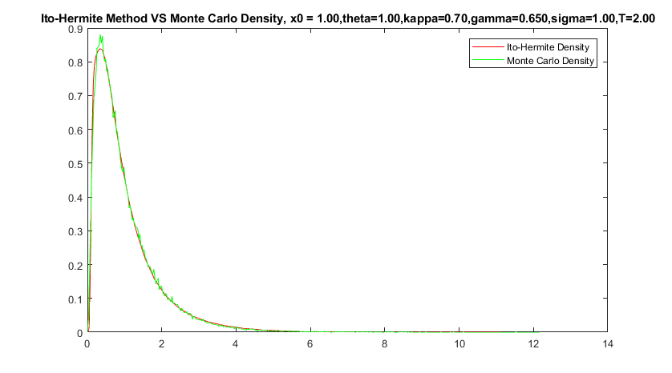](https://postimages.org/)

---

### #943 — Amin (Topic Author)
*July 1, 2020, 1:59 PM*

I have been trying to mould the evolution equation for Fokker-planck PDE into a form that new evolution equation does
not depend upon distance from the mean of the SDE distribution but rather depends upon distance from the next/adjacent
grid point so we can use local derivatives for the evolution equation everywhere. I have had good success in devising
the new basic framework for short time(with distances and derivatives from adjacent points) when second derivatives are
not large and now I would be adding the effect of second derivatives in this new evolution equation. I will also be
posting the program with simple analytics behind it by tomorrow.

---

### #944 — Amin (Topic Author)
*July 2, 2020, 11:40 AM*

In my earlier Ito-hermite evolution equations, the barebone (part of the solution equation that depended only on first
derivatives without including the effect of second and higher derivatives) solution of general SDEs was borrowed from
brownian motion solution equation. Brownian motion solution equation had a constant first derivative (dB/dZ) but for
general SDEs, the first derivative is never constant and using brownian motion barebone created extra errors and there
were problems for finding a general solution after adding the effects of second derivatives since even the first
derivatives solution part was off its true values. I did some simple analysis so that we could properly capture the
effect of first derivatives in the solution of Fokker-planck equation. I still have not worked on adding the effects of
second order derivatives but the results of solution with first order derivatives are quite encouraging. This was a
major problem in the previous attempts at solution of FPE that first order solution was off and then adding effects of
second order derivatives would not be able to give us a good result.

Here I write the brownian motion based barebone solution and then describe the new correct first order bare bone
solution and then later show how I derived the correct first order derivatives based barebone solution.

Brownain motion solution is given by the equations below as

$d[(B(t)-\mu_B - \mu(t)dt )^2]={\sigma}^2 Z^2 \Delta t$

from which we derived the evolution equation as

$(B(t_1)-\mu_B - \mu(t)dt )^2=(B(t_0)-\mu_B)^2 + {\sigma}^2 Z^2 \Delta t$

We based our barebone first order solution for FPE of Bessel form SDEs on the above evolution equation for brownian
motion as

$(w(t_1)-\mu_w - \mu(t)dt )^2=(w(t_0)-\mu_w)^2 + {\sigma}^2 Z^2 \Delta t$

But since first order derivative is not constant, the above equation is not valid for first order derivatives effect for
solution of FPE of general SDEs even when we are not accounting for the second order derivatives. I believe that
appropriate equation that properly accounts for first order derivatives should be given as( I will derive it after
writing the equation here)

$d[(w_n(t)-w_{n-1}(t)+Z_{n-1} \frac{dw_n}{dZ_n} - \mu(t)dt )^2]={\sigma}^2 Z^2 \Delta t$

In my matlab program, I wrote the barebone(including only the effect of first order derivatives) evolution equation
based on the above equation as

$(w_n(t_1)-w_{n-1}(t_0)+Z_{n-1} \frac{dw_n}{dZ_n}(t_0) - \mu(t)dt )^2$

$=(w_n(t_0)-w_{n-1}(t_0)+Z_{n-1} \frac{dw_n}{dZ_n}(t_0))^2 + {\sigma}^2 Z^2 \Delta t$

further resulting in solution equation

$w_n(t_1)=w_{n-1}(t_0)-Z_{n-1} \frac{dw_n}{dZ_n}(t_0) + \mu(t)dt$

$ +\sqrt{(w_n(t_0)-w_{n-1}(t_0)+Z_{n-1} \frac{dw_n}{dZ_n}(t_0))^2 + {\sigma}^2 Z^2 \Delta t}$

We start calculating the above solution away from median on both sides. The above equation is valid for points to the
right of median and the following equation is valid for points to the left of the median.

$w_n(t_1)=w_{n+1}(t_0)-Z_{n+1} \frac{dw_n}{dZ_n}(t_0) + \mu(t)dt$

$ +\sqrt{(w_n(t_0)-w_{n+1}(t_0)+Z_{n+1} \frac{dw_n}{dZ_n}(t_0))^2 + {\sigma}^2 Z^2 \Delta t}$

I have not been able to do extensive experiments but I believe that we can iteratively solve the equation and might want
to take$w_{n-1}(t_1)$ or$w_{n+1}(t_1)$ instead of$w_{n-1}(t_0)$ or$w_{n+1}(t_0)$ in the first term of RHS of solution
i.e use the updated value of adjacent grid point.

Here is how I solved for the above equation.

First of all we have the first derivative term in FP equation given as$Z\frac{dw}{dZ}$ . In case of constant first
derivative, we used the equation

$Z \frac{dw}{dZ}=Z_n \frac{(w_n-w_0)}{Z_n}$

but for general SDE, the true Finite difference derivatives approximation equation at nth grid point should be

$Z \frac{dw}{dZ}=Z_n \frac{(w_n-w_{n-1})}{(Z_n-Z_{n-1})}$

We want to write the above true approximation in terms of sum of brownian motion approximation and another yet unknown
term$T_1$ as

$Z_n \frac{(w_n-w_{n-1})}{(Z_n-Z_{n-1})}=Z_n \frac{(w_n-w_0)}{Z_n}+T_1$

we use $\Delta w=w_n-w_{n-1}$ and $\Delta Z=Z_n-Z_{n-1}$

solving for $T_1$, we get

$T_1= \frac{(-Z_n w_{n-1} + Z_{n-1} w_n + Z_n w_0 -Z_{n-1} w_0)}{\Delta Z}$

In the above, we substitute $Z_n=Z_{n-1}+\Delta Z$ and $w_n=w_{n-1}+\Delta w$

and simplify to get the solution

$T_1= -w_{n-1} + Z_{n-1} \frac{\Delta w}{\Delta Z} + w_0$

now please recall the previous equation

$Z_n \frac{(w_n-w_{n-1})}{(Z_n-Z_{n-1})}=Z_n \frac{(w_n-w_0)}{Z_n}+T_1$

and substitute the newly calculated value of $T_1$ on RHS to get

$Z \frac{dw}{dZ}=Z_n \frac{(w_n-w_{n-1})}{(Z_n-Z_{n-1})}=Z_n \frac{(w_n-w_0)}{Z_n} -w_{n-1} + Z_{n-1} \frac{\Delta w}{\Delta Z} + w_0$

$=w_n-w_{n-1}+Z_{n-1} \frac{dw}{dZ}$

which is what I have used in the barebone first derivatives based solution of the SDE density as given by FP equation.

The above calculations lead to the equations below that I have written again after copying from before as

$(w_n(t_1)-w_{n-1}(t_0)+Z_{n-1} \frac{dw_n}{dZ_n}(t_0) - \mu(t)dt )^2$

$=(w_n(t_0)-w_{n-1}(t_0)+Z_{n-1} \frac{dw_n}{dZ_n}(t_0))^2 + {\sigma}^2 Z^2 \Delta t$

further resulting in solution equation

$w_n(t_1)=w_{n-1}(t_0)-Z_{n-1} \frac{dw_n}{dZ_n}(t_0) + \mu(t)dt$

$ +\sqrt{(w_n(t_0)-w_{n-1}(t_0)+Z_{n-1} \frac{dw_n}{dZ_n}(t_0))^2 + {\sigma}^2 Z^2 \Delta t}$

We still have to do some work to appropriately add the effect of second and third derivatives terms. But the above
solution works very well as long as 2nd order derivative is negligible for small times or low mean reversion values or
for simple CEV type noises.

I will be posting a matlab program in a little bit in the next post.

---

### #945 — Amin (Topic Author)
*July 2, 2020, 1:24 PM*

Here is the matlab program for the above barebone first order solution of FPE.

```
function [TrueMean,ItoHermiteMean,y_w,fy_w,wnStart] = FPERevisited02()

%Copyright Ahsan Amin. Infiniti derivatives Technologies.
%Please fell free to connect on linkedin: linkedin.com/in/ahsan-amin-0a53334
%or skype ahsan.amin2999
%In this program, I am simulating the SDE given as
%dy(t)=mu1 x(t)^beta1 dt + mu2 x(t)^beta2 dt +sigma x(t)^gamma dz(t)

%I have not directly simulated the SDE but simulated the transformed
%Besse1l process version of the SDE and then changed coordinates to retreive
%the SDE in original coo
%rdinates.
%The present program will analytically evolve only the Bessel Process version of the
%SDE in transformed coordinates.
%In this version, the mean correction has been disabled. If you are
%simulating standard mean-reverting SV type SDEs, please enable the mean
%correction by uncommenting the appropriate line in the body of code below.

dt=.125/16;   % Simulation time interval.%Fodiffusions close to zero
             %decrease dt for accuracy.
Tt=64;%16*16;     % Number of simulation levels. Terminal time= Tt*dt; //.125/32*32*16=2 year;
T=Tt*dt;
OrderA=4;  %
OrderM=4;  %
%dtM=.125/8;%Monte carlo time interval size dtM.
%TtM=8*8;%Monte carlo number of simulation intervals.
dtM=dt*1;
TtM=Tt/1;

dNn=.2/1;   % Normal density subdivisions width. would change with number of subdivisions
Nn=50;  % No of normal density subdivisions
NnMidl=25;%One half density Subdivision left from mid of normal density(low)
NnMidh=26;%One half density subdivision right from the mid of normal density(high)
NnMid=4.0;

%theta=mu1/(-mu2);
%kappa=-mu2;

x0=1;   % starting value of SDE
beta1=0.0;
beta2=1.0;   % Second drift term power.
gamma=.65;%50;   % volatility power.
kappa=.50;   %mean reversion parameter.
theta=1.0;%mean reversion target

%you can specify any general mu1 and mu2 and beta1 and beta2.
%The present program is not perfect but quite reasonably good.
%if there is only one term in drift with beta=0, there will be minor
%errors. This case is yet not covered.

mu1=+1*theta*kappa;   %first drift coefficient.
mu2=-1*kappa;    % Second drift coefficient.
%mu1=0;
%mu2=0;
sigma0=1.0;%Volatility value
alpha=1;% x^alpha is being expanded. This is currently for monte carlo only.
alpha1=1-gamma;

w(1:Nn)=x0^(1-gamma)/(1-gamma);

Z(1:Nn)=(((1:Nn)-5.5)*dNn-NnMid);

Z
str=input('Look at Z');
ZProb(1)=normcdf(.5*Z(1)+.5*Z(2),0,1)-normcdf(.5*Z(1)+.5*Z(2)-dNn,0,1);
ZProb(Nn)=normcdf(.5*Z(Nn)+.5*Z(Nn-1)+dNn,0,1)-normcdf(.5*Z(Nn)+.5*Z(Nn-1),0,1);

for nn=2:Nn-1
    ZProb(nn)=normcdf(.5*Z(nn)+.5*Z(nn+1),0,1)-normcdf(.5*Z(nn)+.5*Z(nn-1),0,1);
    %Above calculate probability mass in each probability subdivision.
end

%%%%%%%%%%%%%%%%%%%%%%%%%%%%%%%%%%%%%%%%%%%%%%%%%%%%%%%%%%%%%%%%%%%%%%%%%%%%%%%%%%%%%%%%%%%%%%

sigma11(1:OrderA+1)=0;
mu11(1:OrderA+1)=0;
mu22(1:OrderA+1)=0;
sigma22(1:OrderA+1)=0;
% index 1 correponds to zero level since matlab indexing starts at one.
sigma11(1)=1;
mu11(1)=1;
mu22(1)=1;
sigma22(1)=1;

for k=1:(OrderA+1)
    if sigma0~=0
        sigma11(k)=sigma0^(k-1);
    end
    if mu1 ~= 0
        mu11(k)=mu1^(k-1);
    end
    if mu2 ~= 0
        mu22(k)=mu2^(k-1);
    end
    if sigma0~=0
        sigma22(k)=sigma0^(2*(k-1));
    end
end
%Ft(1:TtM+1,1:(OrderA+1),1:(OrderA+1),1:(OrderA+1),1:(OrderA+1))=0; %General time powers on hermite polynomials
Fp(1:(OrderA+1),1:(OrderA+1),1:(OrderA+1),1:(OrderA+1))=0;%General x powers on coefficients of hermite polynomials.
Fp1(1:(OrderA+1),1:(OrderA+1),1:(OrderA+1),1:(OrderA+1))=0;%General x powers for bessel transformed coordinates.

%YCoeff0 and YCoeff are coefficents for original coordinates monte carlo.
%YqCoeff0 and YqCoeff are bessel/lamperti version monte carlo.

YCoeff0(1:(OrderA+1),1:(OrderA+1),1:(OrderA+1),1:(OrderA+1))=0;
YqCoeff0(1:(OrderA+1),1:(OrderA+1),1:(OrderA+1),1:(OrderA+1))=0;
%Pre-compute the time and power exponent values in small multi-dimensional arrays
YCoeff = ItoTaylorCoeffsNew(alpha,beta1,beta2,gamma); %expand y^alpha where alpha=1;
YqCoeff = ItoTaylorCoeffsNew(alpha1,beta1,beta2,gamma);%expand y^alpha1 where alpha1=(1-gamma)
YqCoeff=YqCoeff/(1-gamma); %Transformed coordinates coefficients have to be
%further divided by (1-gamma)

for k = 0 : (OrderA)
    for m = 0:k
        l4 = k - m + 1;
        for n = 0 : m
            l3 = m - n + 1;
            for j = 0:n
                l2 = n - j + 1;
                l1 = j + 1;
                %Ft(l1,l2,l3,l4) = dtM^((l1-1) + (l2-1) + (l3-1) + .5* (l4-1));
                Fp(l1,l2,l3,l4) = (alpha + (l1-1) * beta1 + (l2-1) * beta2 + (l3-1) * 2* gamma + (l4-1) * gamma ...
                    - (l1-1) - (l2-1) - 2* (l3-1) - (l4-1));
                Fp1(l1,l2,l3,l4) = (alpha1 + (l1-1) * beta1 + (l2-1) * beta2 + (l3-1) * 2* gamma + (l4-1) * gamma ...
                    - (l1-1) - (l2-1) - 2* (l3-1) - (l4-1));

                YCoeff0(l1,l2,l3,l4) =YCoeff(l1,l2,l3,l4).*mu11(l1).*mu22(l2).*sigma22(l3).*sigma11(l4);
                YqCoeff0(l1,l2,l3,l4) =YqCoeff(l1,l2,l3,l4).*mu11(l1).*mu22(l2).*sigma22(l3).*sigma11(l4);
            end
        end
    end
end

%%%%%%%%%%%%%%%%%%%%%%%%%%%%%%%%%%%%%%%%%%%%%%%%%%%%%%%%%%%%%%%%%%%%%%%%%%%%%%%%%%%%%%%%%%%%%%
wnStart=1;%
d2wdZ2(1:Nn)=0;
dwdZ(1:Nn)=0;
yy(wnStart:Nn)=((1-gamma)*w(wnStart:Nn)).^(1/(1-gamma));
tic

for tt=1:Tt

     yy(wnStart:Nn)=((1-gamma)*w(wnStart:Nn)).^(1/(1-gamma));

    [wMu0dt,dwMu0dtdw,d2wMu0dtdw2,d3wMu0dtdw3,c1,c2,c3,c4] =
CalculateDriftAndVolOrder4(w,wnStart,Nn,YqCoeff0,Fp1,gamma,dt);

    wPrev=w;
    dw(wnStart:Nn)=c1(wnStart:Nn).*Z(wnStart:Nn) ;% ...
    dw2(wnStart:Nn)=dw(wnStart:Nn).^2;
    w(isnan(w)==1)=0;
    wMu0dt(isnan(wMu0dt)==1)=0;
    wMeanPrev=sum(ZProb(wnStart:Nn).*w(wnStart:Nn));%Calculate the mean.

%%%%%%%%%%%%%%%%%%%%%%%%%%%%%%%%%%%%%%%%%%%%%%%%%%%%%%%%%%%%%%%%%%%%%%%%%%%

[w0,Sigma00,Sigma11,Sigma22,Sigma33,Sigma1,Sigma2,Sigma3,Sigma0] =
CalculateHermiteRepresentationOfDensityOrderThreeNew(w,Z,wnStart,Nn,dNn,NnMidh,NnMidl);
d2wdZ2(wnStart:Nn)=d2wdZ2(wnStart:Nn)+
d2wMu0dtdw2(wnStart:Nn).*dwdZ(wnStart:Nn).^2+dwMu0dtdw(wnStart:Nn).*d2wdZ2(wnStart:Nn);%+ ...

[dwdZ,d2wdZ2A,d3wdZ3,d4wdZ4] = First4Derivatives2ndOrderEqSpaced(wnStart,Nn,dNn,w,Z);
dZdw(wnStart:Nn)=1.0./dwdZ(wnStart:Nn);

H2(wnStart:Nn)=(Z(wnStart:Nn).^2-1);

%CTerm(wnStart:Nn)=wMu0dt(wnStart:Nn).*(dwdZ(wnStart:Nn).*(Z(wnStart:Nn))/4.0 - d2wdZ2(wnStart:Nn));
%Correction1(wnStart:Nn)=.5/(22/7)^2.*CTerm(wnStart:Nn).*H2(wnStart:Nn);
%Correction0(wnStart:Nn)=-2.0/(22/7)^2.*(d2wdZ2(wnStart:Nn)-1*dwdZ(wnStart:Nn).*(Z(wnStart:Nn))/4.0).*H2(wnStart:Nn);

if(tt==1)
w(wnStart:Nn)=wMeanPrev+wMu0dt(wnStart:Nn)+ ...
          sign(w(wnStart:Nn)-wMeanPrev+dw(wnStart:Nn)).* ...
          sqrt(abs(sign(w(wnStart:Nn)-wMeanPrev).*(w(wnStart:Nn)-wMeanPrev).^2+ ...
          sign(dw(wnStart:Nn)).*dw2(wnStart:Nn)));
end
if(tt>1)

    dw(wnStart:Nn)=sigma0*sqrt(dt).*Z(wnStart:Nn);
    dw2(wnStart:Nn)=sigma0^2*dt*Z(wnStart:Nn).^2;

  %u0(wnStart:Nn)=w(wnStart:Nn)-Z(wnStart:Nn).*dwdZ(wnStart:Nn);
  %signT1(wnStart:Nn)=sign(-3*Z(wnStart:Nn).^1.*dZdw(wnStart:Nn).*d2wdZ2(wnStart:Nn)*sigma0^2.*dt);%%.* ...
      %sqrt(abs(3*Z(wnStart:Nn).^1.*dZdw(wnStart:Nn).*d2wdZ2(wnStart:Nn)*sigma0^2.*dt*sigma0^2*dt^2));
  %T1(wnStart:Nn)=sqrt(abs(3*Z(wnStart:Nn).^1.*dZdw(wnStart:Nn).*d2wdZ2(wnStart:Nn)*sigma0^2.*dt));

  %w_Z0=.5*w(NnMidh)+.5*w(NnMidl);
  %[y0] = InterpolateOrderN6(N,x0,x1,x2,x3,x4,x5,x6,y1,y2,y3,y4,y5,y6)
  [w_Z0] =
InterpolateOrderN6(6,0,Z(NnMidh),Z(NnMidh+1),Z(NnMidh+2),Z(NnMidl),Z(NnMidl-1),Z(NnMidl-2),w(NnMidh),w(NnMidh+1),w(NnMidh+2),w(NnMidl),w(NnMidl-1),w(NnMidl-2));

  % w_Z0 is the value of w associated with Z=0 or median of the density.
  % w_Z0 is not associated with any grid point so it is interpolated from grid
  % points on both sides as above. There is no grid point at median.

% We start finding adjacent points away from median on both sides of
% the median of SDE density.
% w(NnMidh) (h for high; sorry for bad names) is the first grid point just right of
% median and associated adjacent point is w(Z=0) i.e value of w associated
% with the median.
% w(NnMidl) ( l for low) is the first grid point left of median and associated
% adjacent point is again the value of w associated with median.
% For w(NnMidh+1), adjacent grid point is w(NnMidh)
% For w(NnMidl-1), adjacent grid point is w(NnMidl)
% and so on for both sides further away from median.
  wAdjacent(NnMidh)=w_Z0;
  wAdjacent(NnMidl)=w_Z0;
  wAdjacent(NnMidl-1:-1:wnStart)=w(NnMidl:-1:wnStart+1);
  wAdjacent(NnMidh+1:Nn)=w(NnMidh:Nn-1);

  ZAdjacent(NnMidh)=0;
  ZAdjacent(NnMidl)=0;
  ZAdjacent(NnMidl-1:-1:wnStart)=Z(NnMidl:-1:wnStart+1);
  ZAdjacent(NnMidh+1:Nn)=Z(NnMidh:Nn-1);

  w(wnStart:Nn)=wAdjacent(wnStart:Nn)-dwdZ(wnStart:Nn).*ZAdjacent(wnStart:Nn)+wMu0dt(wnStart:Nn)+ ...
            sign(w(wnStart:Nn)-wAdjacent(wnStart:Nn)+dwdZ(wnStart:Nn).*ZAdjacent(wnStart:Nn)+dw(wnStart:Nn)).* ...
            sqrt(abs(sign(w(wnStart:Nn)-wAdjacent(wnStart:Nn)+dwdZ(wnStart:Nn).*ZAdjacent(wnStart:Nn)).* ...
            (w(wnStart:Nn)-wAdjacent(wnStart:Nn)+dwdZ(wnStart:Nn).*ZAdjacent(wnStart:Nn)).^2+ ...
            sign(+dw(wnStart:Nn)).*dw2(wnStart:Nn)));

end

%%%%%%%%%%%%%%%%%%%%%%%%%%%%%%%%%%%%%%%%%%%%%%%%%%%%%%%%%%%%%%%%%%%%%%%%%%%
%Below are instability correction equations. There is instability in the
% SDE representation equation roughly between -.5 SD to +.5 SD in normal terms.
%Instability correction Algorithm takes two ends that are here given as
%lower end=w(NnMidl-2) and upper end=w(NnMidh+3).
%In the block below the interpolation starts from lower end.
%1st equation is
%wll(NnMidl-1)=w(NnMidl-2)+(D1wl+CTheta*D2wl*dNn/1+.5*DeltaD1w)*dNn;
%Second equation is: wll(NnMidl)=wll(NnMidl-1)+(D1wl+CTheta*D2wl*dNn+1.5*DeltaD1w)*dNn;
%And so on.
%There is a sixth equation that is not written below(since it takes us to
%the upper interpolation point which is already known) which is
%wll(NnMidh+3)=wll(NnMidh+2)+(D1wl+CTheta*D2wl*dNn+5.5*DeltaD1w)*dNn;
%Sum of these six equations add up to the distance between upper and lower
%interpolation points.
%In the sum there are six instances of first derivative which is already
%calculated at the boundary, six instances of second derivative which is also
%already calculated at lower boundary and 18.0 instances of DeltaD1w which is
%unknown. This equation calculates the value of one unit of DeltaD1w addition
%DeltaD1w=(w(NnMidh+3)-w(NnMidl-2)-6*D1wl*dNn-6.0*CTheta*D2wl*dNn.^2.0/1.0)/18.0/dNn;
% I hope to find a better analytical method to tackle this issue. Friends
% are welcome to play with slightly changed related alternatives to the
%above interpolation.
    CTheta=1.0;
    D1wl=(11/6*w(NnMidl-2)-3*w(NnMidl-3)+3/2*w(NnMidl-4)-1/3*w(NnMidl-5))/dNn;
    D2wl=(35/12*w(NnMidl-2) -26/3*w(NnMidl-3)+ 19/2*w(NnMidl-4)-14/3*w(NnMidl-5)+11/12*w(NnMidl-6))/dNn.^2;
    DeltaD1w=(w(NnMidh+3)-w(NnMidl-2)-6*D1wl*dNn-6.0*CTheta*D2wl*dNn.^2.0/1.0)/18.0/dNn;

    wll(NnMidl-1)=w(NnMidl-2)+  (D1wl+CTheta*D2wl*dNn+.5*DeltaD1w)*dNn;
    wll(NnMidl)=wll(NnMidl-1)+  (D1wl+CTheta*D2wl*dNn+1.5*DeltaD1w)*dNn;
    wll(NnMidh)=wll(NnMidl)+    (D1wl+CTheta*D2wl*dNn+2.5*DeltaD1w)*dNn;
    wll(NnMidh+1)=wll(NnMidh)+  (D1wl+CTheta*D2wl*dNn+3.5*DeltaD1w)*dNn;
    wll(NnMidh+2)=wll(NnMidh+1)+(D1wl+CTheta*D2wl*dNn+4.5*DeltaD1w)*dNn;
    %wll(NnMidh+3)=wll(NnMidh+2)+(D1wl+CTheta*D2wl*dNn+5.5*DeltaD1w)*dNn;
%The last equation is not used since point w(NnMidh+3)is given but it is used in
%calculation of distance between two interpolation points. This distance is
%used to determine the value of DeltaD1w.

    D1wh=(-11/6*w(NnMidh+3)+3*w(NnMidh+4)-3/2*w(NnMidh+5)+1/3*w(NnMidh+6))/dNn;
    D2wh=(35/12*w(NnMidh+3) -26/3*w(NnMidh+4)+ 19/2*w(NnMidh+5)-14/3*w(NnMidh+6)+11/12*w(NnMidh+7))/dNn.^2;
    DeltaD1w=(w(NnMidh+3)-w(NnMidl-2)-6*D1wh*dNn-6.0*CTheta*D2wh*dNn.^2.0/1.0)/18.0/dNn;
%     DeltaD1w=(w(NnMidh+2)-w(NnMidl-1)-4*D1wh*dNn-16.0*D2wh*dNn.^2.0/1.0)/6.0/dNn;

    whh(NnMidh+2)=w(NnMidh+3)-(D1wh+CTheta*D2wh*dNn+.5*DeltaD1w)*dNn;
    whh(NnMidh+1)=w(NnMidh+2)-(D1wh+CTheta*D2wh*dNn+1.5* DeltaD1w)*dNn;
    whh(NnMidh)=whh(NnMidh+1)-(D1wh+CTheta*D2wh*dNn+2.5* DeltaD1w)*dNn;
    whh(NnMidl)=whh(NnMidh)-(D1wh+CTheta*D2wh*dNn+3.5* DeltaD1w)*dNn;
    whh(NnMidl-1)=whh(NnMidl)-(D1wh+CTheta*D2wh*dNn+4.5* DeltaD1w)*dNn;

    %whh(NnMidl-2)=whh(NnMidl-1)-(D1wh+CTheta*D2wh*dNn/1+5.5* DeltaD1w)*dNn;

%
      w(NnMidh+2)=.5*whh(NnMidh+2)+.5*wll(NnMidh+2);
      w(NnMidh+1)=.5*whh(NnMidh+1)+.5*wll(NnMidh+1);
      w(NnMidh)=.5*whh(NnMidh)+.5*wll(NnMidh);
      w(NnMidl)=.5*whh(NnMidl)+.5*wll(NnMidl);
      w(NnMidl-1)=.5*whh(NnMidl-1)+.5*wll(NnMidl-1);

        w1(1:Nn-1)=w(1:Nn-1);
        w2(1:Nn-1)=w(2:Nn);

%         w1(1:Nn-2)=w(1:Nn-2);
%         w2(1:Nn-2)=w(2:Nn-1);
%         w3(1:Nn-2)=w(3:Nn);
%         w(w1(:)>w2(:))=w2(w1(:)>w2(:))-.25*(w3(w1(:)>w2(:))-w2(w1(:)>w2(:)));

%w(w1(:)>w2(:))=0;%Be careful;might not universally hold;

        w(w<0)=0.0;
        for nn=1:Nn
            if(w(nn)<=0)
                wnStart=nn+1;
           end
        end

        %%1st order mean correction. We know the mean in original
        %%coordinates so I shift the density into original coordinates,
        %%apply the mean correction and then transform again into Lamperti
        %%coordinates. Algebra solves two equations in two unknowns.
        %%Equations are Sum_0^N{(Y_w(wnStart:Nn)-Y0)*W0}=1 and the second
        %%equation is Sum_0^N{Y_w(wnStart:Nn).*(Y_w(wnStart:Nn)-Y0)*W0}=u0
        %%Two unknows are Y0 and W0. u0 is known mean.
        tt;
        u0=theta+(x0-theta)*exp(-kappa*(tt*dt)); %analytic mean of the density

        %If you are not using stochastic volatility, replace above with
        %true mean otherwise results would become garbage.

        Y_w(wnStart:Nn) = ((1-gamma)*w(wnStart:Nn)).^(1/(1-gamma));

        Yn2Pn=sum(Y_w(wnStart:Nn).*Y_w(wnStart:Nn).*ZProb(wnStart:Nn));
        YnPn=sum(Y_w(wnStart:Nn).*ZProb(wnStart:Nn));
        Pn=1.0;%%Sum(ZProb(1:Nn))
        Y0=(Yn2Pn-u0*YnPn)/(YnPn-u0*Pn);

        Y0Pn=Y0*Pn;
        W0=1/(YnPn-Y0Pn);
        YCorrected(wnStart:Nn)=Y_w(wnStart:Nn).*(Y_w(wnStart:Nn)-Y0)*W0;
        wCorrected(wnStart:Nn)=(YCorrected(wnStart:Nn).^(1-gamma))./(1-gamma);
        w(wnStart:Nn)=wCorrected(wnStart:Nn);

   %I have disabled the mean correction. The above mean correction is only valid for
   %standard mean reverting stochastic volatility type SDEs. To enable mean
   %correction please uncomment the above last line in the block.

end

 y_w(1:Nn)=0;
 y_w(wnStart:Nn) = ((1-gamma)*w(wnStart:Nn)).^(1/(1-gamma));
 Dfy_w(wnStart:Nn)=0;
 Dfw(wnStart:Nn)=0;
for nn=wnStart+1:Nn-1
    Dfy_w(nn) = (y_w(nn + 1) - y_w(nn - 1))/(Z(nn + 1) - Z(nn - 1));
    Dfw(nn) = (w(nn + 1) - w(nn - 1))/(Z(nn + 1) - Z(nn - 1));
    %Change of variable derivative for densities
end
fy_w(1:Nn)=0;
fw(1:Nn)=0;
for nn = wnStart:Nn-1
    fy_w(nn) = (normpdf(Z(nn),0, 1))/abs(Dfy_w(nn));%Origianl coordinates density
    fw(nn) = (normpdf(Z(nn),0, 1))/abs(Dfw(nn));
end

toc

ItoHermiteMean=sum(y_w(wnStart+1:Nn-1).*ZProb(wnStart+1:Nn-1)) %Original process average from coordinates

 disp('true Mean only applicble to standard SV mean reverting type models otherwise disregard');
 TrueMean=theta+(x0-theta)*exp(-kappa*dt*Tt)%Mean reverting SDE original variable true average

 rng(29079137, 'twister')
 paths=100000;
 YY(1:paths)=x0;  %Original process monte carlo.
 Random1(1:paths)=0;
 YYMean(1:TtM)=0;
 for tt=1:TtM
     Random1=randn(size(Random1));
     HermiteP1(1,1:paths)=1;
     HermiteP1(2,1:paths)=Random1(1:paths);
     HermiteP1(3,1:paths)=Random1(1:paths).^2-1;
     HermiteP1(4,1:paths)=Random1(1:paths).^3-3*Random1(1:paths);
     HermiteP1(5,1:paths)=Random1(1:paths).^4-6*Random1(1:paths).^2+3;

     YY(1:paths)=YY(1:paths) + ...
      (YCoeff0(1,1,2,1).*YY(1:paths).^Fp(1,1,2,1)+ ...
      YCoeff0(1,2,1,1).*YY(1:paths).^Fp(1,2,1,1)+ ...
      YCoeff0(2,1,1,1).*YY(1:paths).^Fp(2,1,1,1))*dtM + ...
      (YCoeff0(1,1,3,1).*YY(1:paths).^Fp(1,1,3,1)+ ...
      YCoeff0(1,2,2,1).*YY(1:paths).^Fp(1,2,2,1)+ ...
      YCoeff0(2,1,2,1).*YY(1:paths).^Fp(2,1,2,1)+ ...
      YCoeff0(1,3,1,1).*YY(1:paths).^Fp(1,3,1,1)+ ...
      YCoeff0(2,2,1,1).*YY(1:paths).^Fp(2,2,1,1)+ ...
      YCoeff0(3,1,1,1).*YY(1:paths).^Fp(3,1,1,1))*dtM^2 + ...
      ((YCoeff0(1,1,1,2).*YY(1:paths).^Fp(1,1,1,2).*sqrt(dtM))+ ...
    (YCoeff0(1,1,2,2).*YY(1:paths).^Fp(1,1,2,2)+ ...
    YCoeff0(1,2,1,2).*YY(1:paths).^Fp(1,2,1,2)+ ...
    YCoeff0(2,1,1,2).*YY(1:paths).^Fp(2,1,1,2)).*dtM^1.5) .*HermiteP1(2,1:paths) + ...
    ((YCoeff0(1,1,1,3).*YY(1:paths).^Fp(1,1,1,3) *dtM) + ...
    (YCoeff0(1,1,2,3).*YY(1:paths).^Fp(1,1,2,3)+ ...
    YCoeff0(1,2,1,3).*YY(1:paths).^Fp(1,2,1,3)+ ...
    YCoeff0(2,1,1,3).*YY(1:paths).^Fp(2,1,1,3)).*dtM^2).*HermiteP1(3,1:paths) + ...
    ((YCoeff0(1,1,1,4).*YY(1:paths).^Fp(1,1,1,4)*dtM^1.5 )).*HermiteP1(4,1:paths) + ...
    (YCoeff0(1,1,1,5).*YY(1:paths).^Fp(1,1,1,5)*dtM^2.0).*HermiteP1(5,1:paths);

%Uncomment for fourth order monte carlo

%
%   YY(1:paths)=YY(1:paths) + ...
%       (YCoeff0(1,1,2,1).*YY(1:paths).^Fp(1,1,2,1)+YCoeff0(1,2,1,1).*YY(1:paths).^Fp(1,2,1,1)+ ...
%       YCoeff0(2,1,1,1).*YY(1:paths).^Fp(2,1,1,1))*dtM + ...
%       (YCoeff0(1,1,3,1).*YY(1:paths).^Fp(1,1,3,1)+YCoeff0(1,2,2,1).*YY(1:paths).^Fp(1,2,2,1)+ ...
%       YCoeff0(2,1,2,1).*YY(1:paths).^Fp(2,1,2,1)+YCoeff0(1,3,1,1).*YY(1:paths).^Fp(1,3,1,1)+ ...
%       YCoeff0(2,2,1,1).*YY(1:paths).^Fp(2,2,1,1)+YCoeff0(3,1,1,1).*YY(1:paths).^Fp(3,1,1,1))*dtM^2 + ...
%       (YCoeff0(1,1,4,1).*YY(1:paths).^Fp(1,1,4,1)+YCoeff0(1,2,3,1).*YY(1:paths).^Fp(1,2,3,1)+ ...
%       YCoeff0(2,1,3,1).*YY(1:paths).^Fp(2,1,3,1)+YCoeff0(1,3,2,1).*YY(1:paths).^Fp(1,3,2,1)+ ...
%       YCoeff0(2,2,2,1).*YY(1:paths).^Fp(2,2,2,1)+YCoeff0(3,1,2,1).*YY(1:paths).^Fp(3,1,2,1)+ ...
%       YCoeff0(1,4,1,1).*YY(1:paths).^Fp(1,4,1,1)+YCoeff0(2,3,1,1).*YY(1:paths).^Fp(2,3,1,1)+ ...
%       YCoeff0(3,2,1,1).*YY(1:paths).^Fp(3,2,1,1)+YCoeff0(4,1,1,1).*YY(1:paths).^Fp(4,1,1,1))*dtM^3 + ...
%        (YCoeff0(1,1,5,1).*YY(1:paths).^Fp(1,1,5,1)+YCoeff0(1,2,4,1).*yy(1:paths).^Fp(1,2,4,1)+ ...
%     YCoeff0(2,1,4,1).*YY(1:paths).^Fp(2,1,4,1)+YCoeff0(2,1,1,1).*yy(1:paths).^Fp(2,1,1,1)+ ...
%      YCoeff0(2,2,3,1).*YY(1:paths).^Fp(2,2,3,1)+ ...
%      YCoeff0(3,1,3,1).*YY(1:paths).^Fp(3,1,3,1)+YCoeff0(1,4,2,1).*YY(1:paths).^Fp(1,4,2,1)+ ...
%      YCoeff0(2,3,2,1).*YY(1:paths).^Fp(2,3,2,1)+YCoeff0(3,2,2,1).*YY(1:paths).^Fp(3,2,2,1)+ ...
%      YCoeff0(4,1,2,1).*YY(1:paths).^Fp(4,1,2,1)+YCoeff0(1,5,1,1).*YY(1:paths).^Fp(1,5,1,1)+ ...
%      YCoeff0(2,4,1,1).*YY(1:paths).^Fp(2,4,1,1)+ ...
%      YCoeff0(3,3,1,1).*YY(1:paths).^Fp(3,3,1,1)+YCoeff0(4,2,1,1).*YY(1:paths).^Fp(4,2,1,1)+ ...
%      YCoeff0(5,1,1,1).*YY(1:paths).^Fp(5,1,1,1))*dtM^4+ ...
%       ((YCoeff0(1,1,1,2).*YY(1:paths).^Fp(1,1,1,2).*sqrt(dtM))+ ...
%     (YCoeff0(1,1,2,2).*YY(1:paths).^Fp(1,1,2,2)+YCoeff0(1,2,1,2).*YY(1:paths).^Fp(1,2,1,2)+ ...
%     YCoeff0(2,1,1,2).*YY(1:paths).^Fp(2,1,1,2)).*dtM^1.5+ ...
%     (YCoeff0(1,1,3,2).*YY(1:paths).^Fp(1,1,3,2)+YCoeff0(1,2,2,2).*YY(1:paths).^Fp(1,2,2,2)+ ...
%     YCoeff0(2,1,2,2).*YY(1:paths).^Fp(2,1,2,2)+YCoeff0(1,3,1,2).*YY(1:paths).^Fp(1,3,1,2)+ ...
%     YCoeff0(2,2,1,2).*YY(1:paths).^Fp(2,2,1,2)+YCoeff0(3,1,1,2).*YY(1:paths).^Fp(3,1,1,2)).*dtM^2.5+ ...
%     (YCoeff0(1,1,4,2).*YY(1:paths).^Fp(1,1,4,2)+YCoeff0(1,2,3,2).*YY(1:paths).^Fp(1,2,3,2)+ ...
%     YCoeff0(2,1,3,2).*YY(1:paths).^Fp(2,1,3,2)+YCoeff0(1,3,2,2).*YY(1:paths).^Fp(1,3,2,2)+ ...
%     YCoeff0(2,2,2,2).*YY(1:paths).^Fp(2,2,2,2)+ YCoeff0(3,1,2,2).*YY(1:paths).^Fp(3,1,2,2)+ ...
%     YCoeff0(1,4,1,2).*YY(1:paths).^Fp(1,4,1,2)+YCoeff0(2,3,1,2).*YY(1:paths).^Fp(2,3,1,2)+ ...
%     YCoeff0(3,2,1,2).*YY(1:paths).^Fp(3,2,1,2)+YCoeff0(4,1,1,2).*YY(1:paths).^Fp(4,1,1,2)).*dtM^3.5)
.*HermiteP1(2,1:paths) + ...
%     ((YCoeff0(1,1,1,3).*YY(1:paths).^Fp(1,1,1,3) *dtM) + ...
%     (YCoeff0(1,1,2,3).*YY(1:paths).^Fp(1,1,2,3)+YCoeff0(1,2,1,3).*YY(1:paths).^Fp(1,2,1,3)+ ...
%     YCoeff0(2,1,1,3).*YY(1:paths).^Fp(2,1,1,3)).*dtM^2+ ...
%     (YCoeff0(1,1,3,3).*YY(1:paths).^Fp(1,1,3,3)+YCoeff0(1,2,2,3).*YY(1:paths).^Fp(1,2,2,3)+ ...
%     YCoeff0(2,1,2,3).*YY(1:paths).^Fp(2,1,2,3) + YCoeff0(1,3,1,3).*YY(1:paths).^Fp(1,3,1,3)+ ...
%   
 YCoeff0(2,2,1,3).*YY(1:paths).^Fp(2,2,1,3)+YCoeff0(3,1,1,3).*YY(1:paths).^Fp(3,1,1,3)).*dtM^3).*HermiteP1(3,1:paths) +
...
%     ((YCoeff0(1,1,1,4).*YY(1:paths).^Fp(1,1,1,4)*dtM^1.5 )+ ...
%     (YCoeff0(1,1,2,4).*YY(1:paths).^Fp(1,1,2,4)+YCoeff0(1,2,1,4).*YY(1:paths).^Fp(1,2,1,4)+ ...
%     YCoeff0(2,1,1,4).*YY(1:paths).^Fp(2,1,1,4))*dtM^2.5).*HermiteP1(4,1:paths) + ...
%     (YCoeff0(1,1,1,5).*YY(1:paths).^Fp(1,1,1,5)*dtM^2.0).*HermiteP1(5,1:paths);
%

     YYMean(tt)=YYMean(tt)+sum(YY(1:paths))/paths;
 end
 YY(YY<0)=0;
 disp('Original process average from monte carlo');
 MCMean=sum(YY(:))/paths %origianl coordinates monte carlo average.
 disp('Original process average from our simulation');
 ItoHermiteMean=sum(y_w(wnStart+1:Nn-1).*ZProb(wnStart+1:Nn-1)) %Original process average from coordinates

 disp('true Mean only applicble to standard SV mean reverting type models otherwise disregard');
 TrueMean=theta+(x0-theta)*exp(-kappa*dt*Tt)%Mean reverting SDE original variable true average

 MaxCutOff=30;
 NoOfBins=round(500*gamma^2*2*sigma0);%Decrease the number of bins if the graph is too
 [YDensity,IndexOutY,IndexMaxY] = MakeDensityFromSimulation_Infiniti_NEW(YY,paths,NoOfBins,MaxCutOff );
 plot(y_w(wnStart+1:Nn-1),fy_w(wnStart+1:Nn-1),'r',IndexOutY(1:IndexMaxY),YDensity(1:IndexMaxY),'g');
 %plot(y_w(wnStart+1:Nn-1),fy_w(wnStart+1:Nn-1),'r',IndexOutY(1:IndexMaxY),YDensity(1:IndexMaxY),'g',Z(wnStart+1:Nn-1),fy_w(wnStart+1:Nn-1),'b');

 title(sprintf('Ito-Hermite Method VS Monte Carlo Density, x0 =
%.2f,theta=%.2f,kappa=%.2f,gamma=%.3f,sigma=%.2f,T=%.2f', x0,theta,kappa,gamma,sigma0,T));%,sprintf('theta= %f', theta),
sprintf('kappa = %f', kappa),sprintf('sigma = %f', sigma0),sprintf('T = %f', T));

 %title('text',sprintf('x0 = %f', x0),sprintf('theta= %f', theta), sprintf('kappa = %f', kappa),sprintf('sigma = %f',
sigma0),sprintf('T = %f', T))
 %xlabel(a)
 %title('Graphical Comparison of Ito-Hermite Method and Monte Carlo Method Density')
 legend({'Ito-Hermite Density','Monte Carlo Density'},'Location','northeast')

 str=input('red line is density of SDE from Ito-Hermite method, green is monte carlo.');

end
```

Here is output of the program with hard-coded parameters.

MCMean =

   1.000103151236431

Original process average from our simulation

ItoHermiteMean =

   0.999995633018249

true Mean only applicble to standard SV mean reverting type models otherwise disregard

TrueMean =

     1

IndexMax =

   424

---

### #946 — Amin (Topic Author)
*July 2, 2020, 2:32 PM*

Please read the last two posts on previous page since they have far more significance than this post.

Sorry, I forgot to post this dependency function for the program in previous post.

```
function [y0] = InterpolateOrderN6(N,x0,x1,x2,x3,x4,x5,x6,y1,y2,y3,y4,y5,y6)

if(N==6)
y0=(x0-x2)*(x0-x3)*(x0-x4)*(x0-x5)*(x0-x6)/((x1-x2).*(x1-x3).*(x1-x4).*(x1-x5).*(x1-x6))*y1+ ...
   (x0-x1)*(x0-x3)*(x0-x4)*(x0-x5)*(x0-x6)/((x2-x1).*(x2-x3).*(x2-x4).*(x2-x5).*(x2-x6))*y2+ ...
   (x0-x1)*(x0-x2)*(x0-x4)*(x0-x5)*(x0-x6)/((x3-x1).*(x3-x2).*(x3-x4).*(x3-x5).*(x3-x6))*y3+ ...
   (x0-x1)*(x0-x2)*(x0-x3)*(x0-x5)*(x0-x6)/((x4-x1).*(x4-x2).*(x4-x3).*(x4-x5).*(x4-x6))*y4+ ...
   (x0-x1)*(x0-x2)*(x0-x3)*(x0-x4)*(x0-x6)/((x5-x1).*(x5-x2).*(x5-x3).*(x5-x4).*(x5-x6))*y5+ ...
   (x0-x1)*(x0-x2)*(x0-x3)*(x0-x4)*(x0-x5)/((x6-x1).*(x6-x2).*(x6-x3).*(x6-x4).*(x6-x5))*y6;
end

if(N==5)
y0=(x0-x2)*(x0-x3)*(x0-x4)*(x0-x5)/((x1-x2).*(x1-x3).*(x1-x4).*(x1-x5))*y1+ ...
   (x0-x1)*(x0-x3)*(x0-x4)*(x0-x5)/((x2-x1).*(x2-x3).*(x2-x4).*(x2-x5))*y2+ ...
   (x0-x1)*(x0-x2)*(x0-x4)*(x0-x5)/((x3-x1).*(x3-x2).*(x3-x4).*(x3-x5))*y3+ ...
   (x0-x1)*(x0-x2)*(x0-x3)*(x0-x5)/((x4-x1).*(x4-x2).*(x4-x3).*(x4-x5))*y4+ ...
   (x0-x1)*(x0-x2)*(x0-x3)*(x0-x4)/((x5-x1).*(x5-x2).*(x5-x3).*(x5-x4))*y5;
end
if(N==4)
y0=(x0-x2)*(x0-x3)*(x0-x4)/((x1-x2).*(x1-x3).*(x1-x4))*y1+ ...
   (x0-x1)*(x0-x3)*(x0-x4)/((x2-x1).*(x2-x3).*(x2-x4))*y2+ ...
   (x0-x1)*(x0-x2)*(x0-x4)/((x3-x1).*(x3-x2).*(x3-x4))*y3+ ...
   (x0-x1)*(x0-x2)*(x0-x3)/((x4-x1).*(x4-x2).*(x4-x3))*y4;
end
if(N==3)
y0=(x0-x2)*(x0-x3)/((x1-x2).*(x1-x3))*y1+ ...
   (x0-x1)*(x0-x3)/((x2-x1).*(x2-x3))*y2+ ...
   (x0-x1)*(x0-x2)/((x3-x1).*(x3-x2))*y3;
end
if(N==2)
y0=(x0-x2)/((x1-x2))*y1+ ...
   (x0-x1)/((x2-x1))*y2;
end

%y0=(x0-x3)/(x2-x3)*y2+(x0-x2)/(x3-x2)*y3;

end
```

---

### #947 — Amin (Topic Author)
*July 4, 2020, 11:05 AM*

I want to make this addition to my past few posts in recent days about appropriate calculations of barebone(first
derivatives solution) solution to fokker-planck equation. What I wrote in previous few posts was the right calculation
of first derivatives using adjacent "backward finite difference derivatives". We can do a very similar calculation with
adjacent "forward finite difference derivatives" and then average both adjacent forward and adjacent backward
calculations inside the squared expressions on both sides of the equation. This should possibly make the solution more
accurate. I have yet not done this in matlab and hopefully try it today and then post a program with these calculations
tomorrow. I hope it will add to accuracy.

---

### #948 — Amin (Topic Author)
*July 8, 2020, 3:16 AM*

Sorry for the delay in my post. I am not posting a new program but I would describe how I solved the equation using both
forward and backward differences. It is very simple. I just solved the whole barebone equation with forward differences
and then solved the whole barebone equation with backward differences and then averaged the two values to update w. 
Some of my equations were occasionally being unstable at the boundary and therefore, many times, I would just replace
forward and backward derivatives with central derivatives.

I am working on the program and hope to post a new program in a few days.

---

### #949 — Amin (Topic Author)
*July 8, 2020, 1:16 PM*

I am quickly posting this code which is based on derivatives derived from the analytic solution of Fokker-Planck
equation. I works reasonably well only and accuracy deteriorates as value of kappa increases to larger values but this
is only intermediate code before the final version. I will get an antipsychotic injection tomorrow and do not know if I
will be able to work for many days after that.

Edit: I have just been injected a minute ago. Doctor sent a special guy from his psychiatric facility who brought his
own injection. I already had talked to my mother that I will get an injection tomorrow and she agreed. But in that case
I would buy an injection from market and a special injection with mind control chemicals could not be given to me.
Doctor sent a special guy who brought his own injection so that an injection with MC chemicals could be given and it was
impossible for me to refuse after the guy was already in our home with the injection. Please protest against these
obvious wrongdoings by evil people in American defense and their cronies in Pakistan Army who receive tens of millions
of dollars in bribes.

```
function [TrueMean,ItoHermiteMean,y_w,fy_w,wnStart] = FPERevisited044A()

%Copyright Ahsan Amin. Infiniti derivatives Technologies.
%Please fell free to connect on linkedin: linkedin.com/in/ahsan-amin-0a53334
%or skype ahsan.amin2999
%In this program, I am simulating the SDE given as
%dy(t)=mu1 x(t)^beta1 dt + mu2 x(t)^beta2 dt +sigma x(t)^gamma dz(t)

%I have not directly simulated the SDE but simulated the transformed
%Besse1l process version of the SDE and then changed coordinates to retreive
%the SDE in original coo
%rdinates.
%The present program will analytically evolve only the Bessel Process version of the
%SDE in transformed coordinates.
%In this version, the mean correction has been disabled. If you are
%simulating standard mean-reverting SV type SDEs, please enable the mean
%correction by uncommenting the appropriate line in the body of code below.

dt=.125/16;   % Simulation time interval.%Fodiffusions close to zero
             %decrease dt for accuracy.
Tt=128;%16*16;     % Number of simulation levels. Terminal time= Tt*dt; //.125/32*32*16=2 year;
T=Tt*dt;
OrderA=4;  %
OrderM=4;  %
%dtM=.125/8;%Monte carlo time interval size dtM.
%TtM=8*8;%Monte carlo number of simulation intervals.
dtM=dt*1;
TtM=Tt/1;

dNn=.2/1;   % Normal density subdivisions width. would change with number of subdivisions
Nn=50;  % No of normal density subdivisions
NnMidl=25;%One half density Subdivision left from mid of normal density(low)
NnMidh=26;%One half density subdivision right from the mid of normal density(high)
NnMid=4.0;

%theta=mu1/(-mu2);
%kappa=-mu2;

x0=.50;   % starting value of SDE
beta1=0.0;
beta2=1.0;   % Second drift term power.
gamma=.75;%50;   % volatility power.
kappa=.850;%.950;   %mean reversion parameter.
theta=.10;%mean reversion target
sigma0=.850;%Volatility value

%you can specify any general mu1 and mu2 and beta1 and beta2.
%The present program is not perfect but quite reasonably good.
%if there is only one term in drift with beta=0, there will be minor
%errors. This case is yet not covered.

mu1=+1*theta*kappa;   %first drift coefficient.
mu2=-1*kappa;    % Second drift coefficient.
%mu1=0;
%mu2=0;

alpha=1;% x^alpha is being expanded. This is currently for monte carlo only.
alpha1=1-gamma;

w(1:Nn)=x0^(1-gamma)/(1-gamma);

Z(1:Nn)=(((1:Nn)-5.5)*dNn-NnMid);

Z
str=input('Look at Z');
ZProb(1)=normcdf(.5*Z(1)+.5*Z(2),0,1)-normcdf(.5*Z(1)+.5*Z(2)-dNn,0,1);
ZProb(Nn)=normcdf(.5*Z(Nn)+.5*Z(Nn-1)+dNn,0,1)-normcdf(.5*Z(Nn)+.5*Z(Nn-1),0,1);

for nn=2:Nn-1
    ZProb(nn)=normcdf(.5*Z(nn)+.5*Z(nn+1),0,1)-normcdf(.5*Z(nn)+.5*Z(nn-1),0,1);
    %Above calculate probability mass in each probability subdivision.
end

%%%%%%%%%%%%%%%%%%%%%%%%%%%%%%%%%%%%%%%%%%%%%%%%%%%%%%%%%%%%%%%%%%%%%%%%%%%%%%%%%%%%%%%%%%%%%%

sigma11(1:OrderA+1)=0;
mu11(1:OrderA+1)=0;
mu22(1:OrderA+1)=0;
sigma22(1:OrderA+1)=0;
% index 1 correponds to zero level since matlab indexing starts at one.
sigma11(1)=1;
mu11(1)=1;
mu22(1)=1;
sigma22(1)=1;

for k=1:(OrderA+1)
    if sigma0~=0
        sigma11(k)=sigma0^(k-1);
    end
    if mu1 ~= 0
        mu11(k)=mu1^(k-1);
    end
    if mu2 ~= 0
        mu22(k)=mu2^(k-1);
    end
    if sigma0~=0
        sigma22(k)=sigma0^(2*(k-1));
    end
end
%Ft(1:TtM+1,1:(OrderA+1),1:(OrderA+1),1:(OrderA+1),1:(OrderA+1))=0; %General time powers on hermite polynomials
Fp(1:(OrderA+1),1:(OrderA+1),1:(OrderA+1),1:(OrderA+1))=0;%General x powers on coefficients of hermite polynomials.
Fp1(1:(OrderA+1),1:(OrderA+1),1:(OrderA+1),1:(OrderA+1))=0;%General x powers for bessel transformed coordinates.

%YCoeff0 and YCoeff are coefficents for original coordinates monte carlo.
%YqCoeff0 and YqCoeff are bessel/lamperti version monte carlo.

YCoeff0(1:(OrderA+1),1:(OrderA+1),1:(OrderA+1),1:(OrderA+1))=0;
YqCoeff0(1:(OrderA+1),1:(OrderA+1),1:(OrderA+1),1:(OrderA+1))=0;
%Pre-compute the time and power exponent values in small multi-dimensional arrays
YCoeff = ItoTaylorCoeffsNew(alpha,beta1,beta2,gamma); %expand y^alpha where alpha=1;
YqCoeff = ItoTaylorCoeffsNew(alpha1,beta1,beta2,gamma);%expand y^alpha1 where alpha1=(1-gamma)
YqCoeff=YqCoeff/(1-gamma); %Transformed coordinates coefficients have to be
%further divided by (1-gamma)

for k = 0 : (OrderA)
    for m = 0:k
        l4 = k - m + 1;
        for n = 0 : m
            l3 = m - n + 1;
            for j = 0:n
                l2 = n - j + 1;
                l1 = j + 1;
                %Ft(l1,l2,l3,l4) = dtM^((l1-1) + (l2-1) + (l3-1) + .5* (l4-1));
                Fp(l1,l2,l3,l4) = (alpha + (l1-1) * beta1 + (l2-1) * beta2 + (l3-1) * 2* gamma + (l4-1) * gamma ...
                    - (l1-1) - (l2-1) - 2* (l3-1) - (l4-1));
                Fp1(l1,l2,l3,l4) = (alpha1 + (l1-1) * beta1 + (l2-1) * beta2 + (l3-1) * 2* gamma + (l4-1) * gamma ...
                    - (l1-1) - (l2-1) - 2* (l3-1) - (l4-1));

                YCoeff0(l1,l2,l3,l4) =YCoeff(l1,l2,l3,l4).*mu11(l1).*mu22(l2).*sigma22(l3).*sigma11(l4);
                YqCoeff0(l1,l2,l3,l4) =YqCoeff(l1,l2,l3,l4).*mu11(l1).*mu22(l2).*sigma22(l3).*sigma11(l4);
            end
        end
    end
end

%%%%%%%%%%%%%%%%%%%%%%%%%%%%%%%%%%%%%%%%%%%%%%%%%%%%%%%%%%%%%%%%%%%%%%%%%%%%%%%%%%%%%%%%%%%%%%
wnStart=1;%
d2wdZ2(1:Nn)=0;
dwdZ(1:Nn)=0;
yy(wnStart:Nn)=((1-gamma)*w(wnStart:Nn)).^(1/(1-gamma));
tic

for tt=1:Tt

     yy(wnStart:Nn)=((1-gamma)*w(wnStart:Nn)).^(1/(1-gamma));

    [wMu0dt,dwMu0dtdw,d2wMu0dtdw2,d3wMu0dtdw3,c1,c2,c3,c4] =
CalculateDriftAndVolOrder4(w,wnStart,Nn,YqCoeff0,Fp1,gamma,dt);

    wPrev=w;
    dw(wnStart:Nn)=c1(wnStart:Nn).*Z(wnStart:Nn) ;% ...
    dw2(wnStart:Nn)=dw(wnStart:Nn).^2;
    w(isnan(w)==1)=0;
    wMu0dt(isnan(wMu0dt)==1)=0;
    wMeanPrev=sum(ZProb(wnStart:Nn).*w(wnStart:Nn));%Calculate the mean.

%%%%%%%%%%%%%%%%%%%%%%%%%%%%%%%%%%%%%%%%%%%%%%%%%%%%%%%%%%%%%%%%%%%%%%%%%%%

%[w0,Sigma00,Sigma11,Sigma22,Sigma33,Sigma1,Sigma2,Sigma3,Sigma0] =
CalculateHermiteRepresentationOfDensityOrderThreeNew(w,Z,wnStart,Nn,dNn,NnMidh,NnMidl);
d2wdZ2(wnStart:Nn)=d2wdZ2(wnStart:Nn)+
d2wMu0dtdw2(wnStart:Nn).*dwdZ(wnStart:Nn).^2+dwMu0dtdw(wnStart:Nn).*d2wdZ2(wnStart:Nn);%+ ...

[dwdZ,d2wdZ2A,d3wdZ3,d4wdZ4] = First4Derivatives2ndOrderEqSpaced(wnStart,Nn,dNn,w,Z);
dZdw(wnStart:Nn)=1.0./dwdZ(wnStart:Nn);

H2(wnStart:Nn)=(Z(wnStart:Nn).^2-1);

CTerm(wnStart:Nn)=(.25*d2wMu0dtdw2(wnStart:Nn).*dwdZ(wnStart:Nn).^2.*Z(wnStart:Nn)/4.0 - ...
          1*dwMu0dtdw(wnStart:Nn).*d2wdZ2(wnStart:Nn));
Correction1(wnStart:Nn)=-.925/(22/7)^2.*CTerm(wnStart:Nn).*H2(wnStart:Nn);
Correction0(wnStart:Nn)=-.925/(22/7)^2.*(d2wdZ2(wnStart:Nn)-.25*dwdZ(wnStart:Nn).^2.*Z(wnStart:Nn)/4.0).*H2(wnStart:Nn);

%CTerm(wnStart:Nn)=wMu0dt(wnStart:Nn).*(dwdZ(wnStart:Nn).*(Z(wnStart:Nn))/4.0 - d2wdZ2(wnStart:Nn));
%Correction1(wnStart:Nn)=.5/(22/7)^2.*CTerm(wnStart:Nn).*H2(wnStart:Nn);
%Correction0(wnStart:Nn)=-2.0/(22/7)^2.*(d2wdZ2(wnStart:Nn)-1*dwdZ(wnStart:Nn).*(Z(wnStart:Nn))/4.0).*H2(wnStart:Nn);

CTerm(wnStart:Nn)=wMu0dt(wnStart:Nn).*(dwdZ(wnStart:Nn).*(Z(wnStart:Nn))/4.0 - d2wdZ2(wnStart:Nn));
Correction1(wnStart:Nn)=.5/(22/7)^2.*CTerm(wnStart:Nn).*H2(wnStart:Nn);
Correction0(wnStart:Nn)=-2.0/(22/7)^2.*(d2wdZ2(wnStart:Nn)-1*dwdZ(wnStart:Nn).*(Z(wnStart:Nn))/4.0).*H2(wnStart:Nn);

if(tt==1)
w(wnStart:Nn)=wMeanPrev+wMu0dt(wnStart:Nn)+ ...
          sign(w(wnStart:Nn)-wMeanPrev+dw(wnStart:Nn)).* ...
          sqrt(abs(sign(w(wnStart:Nn)-wMeanPrev).*(w(wnStart:Nn)-wMeanPrev).^2+ ...
          sign(dw(wnStart:Nn)).*dw2(wnStart:Nn)));
end
if(tt>1)

  %u0(wnStart:Nn)=w(wnStart:Nn)-Z(wnStart:Nn).*dwdZ(wnStart:Nn);
%  signT1(wnStart:Nn)=sign(-3*Z(wnStart:Nn).^1.*dZdw(wnStart:Nn).*d2wdZ2(wnStart:Nn)*sigma0^2.*dt);%%.* ...
      %sqrt(abs(3*Z(wnStart:Nn).^1.*dZdw(wnStart:Nn).*d2wdZ2(wnStart:Nn)*sigma0^2.*dt*sigma0^2*dt^2));
%  T1(wnStart:Nn)=(abs(3*Z(wnStart:Nn).^1.*dZdw(wnStart:Nn).*d2wdZ2(wnStart:Nn)*sigma0^2.*dt));

  signT1(wnStart:Nn)=sign(-3*Z(wnStart:Nn).^1.*dZdw(wnStart:Nn).*d2wdZ2(wnStart:Nn)*sigma0^2.*dt);%%.* ...
      %sqrt(abs(3*Z(wnStart:Nn).^1.*dZdw(wnStart:Nn).*d2wdZ2(wnStart:Nn)*sigma0^2.*dt*sigma0^2*dt^2));
  T1(wnStart:Nn)=sqrt(abs(3*Z(wnStart:Nn).^1.*dZdw(wnStart:Nn).*d2wdZ2(wnStart:Nn)*sigma0^2.*dt));

  signT2(wnStart:Nn)=sign(dwMu0dtdw(wnStart:Nn).*dwdZ(wnStart:Nn).^2);%%.* ...
      %sqrt(abs(3*Z(wnStart:Nn).^1.*dZdw(wnStart:Nn).*d2wdZ2(wnStart:Nn)*sigma0^2.*dt*sigma0^2*dt^2));
  T2(wnStart:Nn)=sqrt(abs(dwMu0dtdw(wnStart:Nn).*dwdZ(wnStart:Nn).^2));

    dw(wnStart:Nn)=sigma0*sqrt(dt).*Z(wnStart:Nn);
    dw2(wnStart:Nn)=sigma0^2*dt*Z(wnStart:Nn).^2;

  %u0(wnStart:Nn)=w(wnStart:Nn)-Z(wnStart:Nn).*dwdZ(wnStart:Nn);
  %signT1(wnStart:Nn)=sign(-3*Z(wnStart:Nn).^1.*dZdw(wnStart:Nn).*d2wdZ2(wnStart:Nn)*sigma0^2.*dt);%%.* ...
      %sqrt(abs(3*Z(wnStart:Nn).^1.*dZdw(wnStart:Nn).*d2wdZ2(wnStart:Nn)*sigma0^2.*dt*sigma0^2*dt^2));
  %T1(wnStart:Nn)=sqrt(abs(3*Z(wnStart:Nn).^1.*dZdw(wnStart:Nn).*d2wdZ2(wnStart:Nn)*sigma0^2.*dt));

  %w_Z0=.5*w(NnMidh)+.5*w(NnMidl);
  %[y0] = InterpolateOrderN6(N,x0,x1,x2,x3,x4,x5,x6,y1,y2,y3,y4,y5,y6)
  [wMedian] =
InterpolateOrderN6(6,0,Z(NnMidh),Z(NnMidh+1),Z(NnMidh+2),Z(NnMidl),Z(NnMidl-1),Z(NnMidl-2),w(NnMidh),w(NnMidh+1),w(NnMidh+2),w(NnMidl),w(NnMidl-1),w(NnMidl-2));

  % w_Z0 is the value of w associated with Z=0 or median of the density.
  % w_Z0 is not associated with any grid point so it is interpolated from grid
  % points on both sides as above. There is no grid point at median.

% We start finding adjacent points away from median on both sides of
% the median of SDE density.
% w(NnMidh) (h for high; sorry for bad names) is the first grid point just right of
% median and associated adjacent point is w(Z=0) i.e value of w associated
% with the median.
% w(NnMidl) ( l for low) is the first grid point left of median and associated
% adjacent point is again the value of w associated with median.
% For w(NnMidh+1), adjacent grid point is w(NnMidh)
% For w(NnMidl-1), adjacent grid point is w(NnMidl)
% and so on for both sides further away from median.

  wAdjacentB(wnStart:Nn)=0;
  wAdjacentF(wnStart:Nn)=0;
  ZAdjacentB(wnStart:Nn)=0;
  ZAdjacentF(wnStart:Nn)=0;
  dwdZB(wnStart:Nn)=0;
  dwdZF(wnStart:Nn)=0;

  wAdjacentB(NnMidh)=wMedian;
  wAdjacentB(NnMidl)=wMedian;
  wAdjacentB(NnMidl-1:-1:wnStart)=w(NnMidl:-1:wnStart+1);
  wAdjacentB(NnMidh+1:Nn)=w(NnMidh:Nn-1);

  ZAdjacentB(NnMidh)=0;
  ZAdjacentB(NnMidl)=0;
  ZAdjacentB(NnMidl-1:-1:wnStart)=Z(NnMidl:-1:wnStart+1);
  ZAdjacentB(NnMidh+1:Nn)=Z(NnMidh:Nn-1);

  dwdZB(NnMidh)=(w(NnMidh)-wMedian)/(.5*dNn);
  dwdZB(NnMidl)=(w(NnMidl)-wMedian)/(-.5*dNn);
  dwdZB(NnMidl-1:-1:wnStart)=(w(NnMidl-1:-1:wnStart)-w(NnMidl:-1:wnStart+1))/(-dNn);
  dwdZB(NnMidh+1:Nn)=(w(NnMidh+1:Nn)-w(NnMidh:Nn-1))/dNn;

  %wAdjacentF(NnMidh)=w(NnMidh+1);
  %wAdjacentF(NnMidl)=w(NnMidl-1);
  wAdjacentF(NnMidl:-1:wnStart+1)=w(NnMidl-1:-1:wnStart);
  wAdjacentF(NnMidh:Nn-1)=w(NnMidh+1:Nn);

  %ZAdjacentF(NnMidh)=0;
  %ZAdjacentF(NnMidl)=0;
  ZAdjacentF(NnMidl:-1:wnStart+1)=Z(NnMidl-1:-1:wnStart);
  ZAdjacentF(NnMidh:Nn-1)=Z(NnMidh+1:Nn);
  ZAdjacentF(wnStart)=0;
  ZAdjacentF(Nn)=0;

  %dwdZF(NnMidh)=(w(NnMidh)-wMedian)/(.5*dNn);
  %dwdZF(NnMidl)=(w(NnMidl)-wMedian)/(-.5*dNn);
  dwdZF(NnMidl:-1:wnStart+1)=(w(NnMidl-1:-1:wnStart)-w(NnMidl:-1:wnStart+1))/(-dNn);
  dwdZF(NnMidh:Nn-1)=(w(NnMidh+1:Nn)-w(NnMidh:Nn-1))/dNn;

  dwdZB=dwdZ;
  dwdZF=dwdZ;

  wB(wnStart:Nn)=(wAdjacentB(wnStart:Nn)-dwdZB(wnStart:Nn).*ZAdjacentB(wnStart:Nn)+ ...
            wMu0dt(wnStart:Nn)+sqrt(.5)*d2wdZ2(wnStart:Nn))+ ...
            sign(w(wnStart:Nn)-wAdjacentB(wnStart:Nn)+dwdZB(wnStart:Nn).*ZAdjacentB(wnStart:Nn)+ ...
            -sqrt(dt).^1*signT1(wnStart:Nn).*T1(wnStart:Nn)+ ...
            sqrt(4*dt).^1*signT2(wnStart:Nn).*T2(wnStart:Nn)+ ...
            -sqrt(.5)*d2wdZ2(wnStart:Nn)+dw(wnStart:Nn)).* ...
            sqrt(abs(sign(w(wnStart:Nn)-wAdjacentB(wnStart:Nn)+dwdZB(wnStart:Nn).*ZAdjacentB(wnStart:Nn)+ ...
            -sqrt(.5)*d2wdZ2(wnStart:Nn)).* ...
            (w(wnStart:Nn)-wAdjacentB(wnStart:Nn)+dwdZB(wnStart:Nn).*ZAdjacentB(wnStart:Nn)+ ...
            -sqrt(.5)*d2wdZ2(wnStart:Nn)).^2+ ...
            sign(+dw(wnStart:Nn)).*dw2(wnStart:Nn)- ...
            (dt).*signT1(wnStart:Nn).*T1(wnStart:Nn).^2 + ...
            4.*(dt).*signT2(wnStart:Nn).*T2(wnStart:Nn).^2));%+ ...

wF(wnStart+1:Nn-1)=(wAdjacentF(wnStart+1:Nn-1)-dwdZF(wnStart+1:Nn-1).*ZAdjacentF(wnStart+1:Nn-1)+ ...
             wMu0dt(wnStart+1:Nn-1)+sqrt(.5)*d2wdZ2(wnStart+1:Nn-1))+ ...
             sign(w(wnStart+1:Nn-1)-wAdjacentF(wnStart+1:Nn-1)+dwdZF(wnStart+1:Nn-1).*ZAdjacentF(wnStart+1:Nn-1)+ ...
             -sqrt(dt).^1*signT1(wnStart+1:Nn-1).*T1(wnStart+1:Nn-1)+ ...
             sqrt(4*dt).^1*signT2(wnStart+1:Nn-1).*T2(wnStart+1:Nn-1)+ ...
             -sqrt(.5)*d2wdZ2(wnStart+1:Nn-1)+dw(wnStart+1:Nn-1)).* ...
           
 sqrt(abs(sign(w(wnStart+1:Nn-1)-wAdjacentF(wnStart+1:Nn-1)+dwdZF(wnStart+1:Nn-1).*ZAdjacentF(wnStart+1:Nn-1)+ ...
             -sqrt(.5)*d2wdZ2(wnStart+1:Nn-1)).* ...
             (w(wnStart+1:Nn-1)-wAdjacentF(wnStart+1:Nn-1)+dwdZF(wnStart+1:Nn-1).*ZAdjacentF(wnStart+1:Nn-1)+ ...
             -sqrt(.5)*d2wdZ2(wnStart+1:Nn-1)).^2 + ...
             sign(+dw(wnStart+1:Nn-1)).*dw2(wnStart+1:Nn-1)- ...
             (dt).^1*signT1(wnStart+1:Nn-1).*T1(wnStart+1:Nn-1).^2 + ...
             4*(dt)*signT2(wnStart+1:Nn-1).*T2(wnStart+1:Nn-1).^2));%+ ...

        w1(wnStart)=wB(wnStart);
        w1(Nn)=wB(Nn);
        w1(wnStart+1:Nn-1)=.5*wF(wnStart+1:Nn-1)+.5*wB(wnStart+1:Nn-1);

        w=w1;

       
w(wnStart:Nn)=w(wnStart:Nn)+sqrt(2)*(.75-gamma).*(d2wdZ2(wnStart:Nn)-.25*dwdZ(wnStart:Nn).^2).*H2(wnStart:Nn)*sigma0^2*dt;

end

%%%%%%%%%%%%%%%%%%%%%%%%%%%%%%%%%%%%%%%%%%%%%%%%%%%%%%%%%%%%%%%%%%%%%%%%%%%
%Below are instability correction equations. There is instability in the
% SDE representation equation roughly between -.5 SD to +.5 SD in normal terms.
%Instability correction Algorithm takes two ends that are here given as
%lower end=w(NnMidl-2) and upper end=w(NnMidh+3).
%In the block below the interpolation starts from lower end.
%1st equation is
%wll(NnMidl-1)=w(NnMidl-2)+(D1wl+CTheta*D2wl*dNn/1+.5*DeltaD1w)*dNn;
%Second equation is: wll(NnMidl)=wll(NnMidl-1)+(D1wl+CTheta*D2wl*dNn+1.5*DeltaD1w)*dNn;
%And so on.
%There is a sixth equation that is not written below(since it takes us to
%the upper interpolation point which is already known) which is
%wll(NnMidh+3)=wll(NnMidh+2)+(D1wl+CTheta*D2wl*dNn+5.5*DeltaD1w)*dNn;
%Sum of these six equations add up to the distance between upper and lower
%interpolation points.
%In the sum there are six instances of first derivative which is already
%calculated at the boundary, six instances of second derivative which is also
%already calculated at lower boundary and 18.0 instances of DeltaD1w which is
%unknown. This equation calculates the value of one unit of DeltaD1w addition
%DeltaD1w=(w(NnMidh+3)-w(NnMidl-2)-6*D1wl*dNn-6.0*CTheta*D2wl*dNn.^2.0/1.0)/18.0/dNn;
% I hope to find a better analytical method to tackle this issue. Friends
% are welcome to play with slightly changed related alternatives to the
%above interpolation.
    CTheta=.66;
    D1wl=(11/6*w(NnMidl-2)-3*w(NnMidl-3)+3/2*w(NnMidl-4)-1/3*w(NnMidl-5))/dNn;
    D2wl=(35/12*w(NnMidl-2) -26/3*w(NnMidl-3)+ 19/2*w(NnMidl-4)-14/3*w(NnMidl-5)+11/12*w(NnMidl-6))/dNn.^2;
    DeltaD1w=(w(NnMidh+3)-w(NnMidl-2)-6*D1wl*dNn-6.0*CTheta*D2wl*dNn.^2.0/1.0)/18.0/dNn;

    wll(NnMidl-1)=w(NnMidl-2)+  (D1wl+CTheta*D2wl*dNn+.5*DeltaD1w)*dNn;
    wll(NnMidl)=wll(NnMidl-1)+  (D1wl+CTheta*D2wl*dNn+1.5*DeltaD1w)*dNn;
    wll(NnMidh)=wll(NnMidl)+    (D1wl+CTheta*D2wl*dNn+2.5*DeltaD1w)*dNn;
    wll(NnMidh+1)=wll(NnMidh)+  (D1wl+CTheta*D2wl*dNn+3.5*DeltaD1w)*dNn;
    wll(NnMidh+2)=wll(NnMidh+1)+(D1wl+CTheta*D2wl*dNn+4.5*DeltaD1w)*dNn;
    %wll(NnMidh+3)=wll(NnMidh+2)+(D1wl+CTheta*D2wl*dNn+5.5*DeltaD1w)*dNn;
%The last equation is not used since point w(NnMidh+3)is given but it is used in
%calculation of distance between two interpolation points. This distance is
%used to determine the value of DeltaD1w.

    D1wh=(-11/6*w(NnMidh+3)+3*w(NnMidh+4)-3/2*w(NnMidh+5)+1/3*w(NnMidh+6))/dNn;
    D2wh=(35/12*w(NnMidh+3) -26/3*w(NnMidh+4)+ 19/2*w(NnMidh+5)-14/3*w(NnMidh+6)+11/12*w(NnMidh+7))/dNn.^2;
    DeltaD1w=(w(NnMidh+3)-w(NnMidl-2)-6*D1wh*dNn-6.0*CTheta*D2wh*dNn.^2.0/1.0)/18.0/dNn;
%     DeltaD1w=(w(NnMidh+2)-w(NnMidl-1)-4*D1wh*dNn-16.0*D2wh*dNn.^2.0/1.0)/6.0/dNn;

    whh(NnMidh+2)=w(NnMidh+3)-(D1wh+CTheta*D2wh*dNn+.5*DeltaD1w)*dNn;
    whh(NnMidh+1)=w(NnMidh+2)-(D1wh+CTheta*D2wh*dNn+1.5* DeltaD1w)*dNn;
    whh(NnMidh)=whh(NnMidh+1)-(D1wh+CTheta*D2wh*dNn+2.5* DeltaD1w)*dNn;
    whh(NnMidl)=whh(NnMidh)-(D1wh+CTheta*D2wh*dNn+3.5* DeltaD1w)*dNn;
    whh(NnMidl-1)=whh(NnMidl)-(D1wh+CTheta*D2wh*dNn+4.5* DeltaD1w)*dNn;

    %whh(NnMidl-2)=whh(NnMidl-1)-(D1wh+CTheta*D2wh*dNn/1+5.5* DeltaD1w)*dNn;

%
       w(NnMidh+2)=.5*whh(NnMidh+2)+.5*wll(NnMidh+2);
       w(NnMidh+1)=.5*whh(NnMidh+1)+.5*wll(NnMidh+1);
       w(NnMidh)=.5*whh(NnMidh)+.5*wll(NnMidh);
       w(NnMidl)=.5*whh(NnMidl)+.5*wll(NnMidl);
       w(NnMidl-1)=.5*whh(NnMidl-1)+.5*wll(NnMidl-1);

        w1(1:Nn-1)=w(1:Nn-1);
        w2(1:Nn-1)=w(2:Nn);

%         w1(1:Nn-2)=w(1:Nn-2);
%         w2(1:Nn-2)=w(2:Nn-1);
%         w3(1:Nn-2)=w(3:Nn);
%         w(w1(:)>w2(:))=w2(w1(:)>w2(:))-.25*(w3(w1(:)>w2(:))-w2(w1(:)>w2(:)));

%w(w1(:)>w2(:))=0;%Be careful;might not universally hold;

        w(w<0)=0.0;
        for nn=1:Nn
            if(w(nn)<=0)
                wnStart=nn+1;
           end
        end

        %%1st order mean correction. We know the mean in original
        %%coordinates so I shift the density into original coordinates,
        %%apply the mean correction and then transform again into Lamperti
        %%coordinates. Algebra solves two equations in two unknowns.
        %%Equations are Sum_0^N{(Y_w(wnStart:Nn)-Y0)*W0}=1 and the second
        %%equation is Sum_0^N{Y_w(wnStart:Nn).*(Y_w(wnStart:Nn)-Y0)*W0}=u0
        %%Two unknows are Y0 and W0. u0 is known mean.
        tt;
        u0=theta+(x0-theta)*exp(-kappa*(tt*dt)); %analytic mean of the density

        %If you are not using stochastic volatility, replace above with
        %true mean otherwise results would become garbage.

        Y_w(wnStart:Nn) = ((1-gamma)*w(wnStart:Nn)).^(1/(1-gamma));

        Yn2Pn=sum(Y_w(wnStart:Nn).*Y_w(wnStart:Nn).*ZProb(wnStart:Nn));
        YnPn=sum(Y_w(wnStart:Nn).*ZProb(wnStart:Nn));
        Pn=1.0;%%Sum(ZProb(1:Nn))
        Y0=(Yn2Pn-u0*YnPn)/(YnPn-u0*Pn);

        Y0Pn=Y0*Pn;
        W0=1/(YnPn-Y0Pn);
        YCorrected(wnStart:Nn)=Y_w(wnStart:Nn).*(Y_w(wnStart:Nn)-Y0)*W0;
        wCorrected(wnStart:Nn)=(YCorrected(wnStart:Nn).^(1-gamma))./(1-gamma);
        w(wnStart:Nn)=wCorrected(wnStart:Nn);

   %I have disabled the mean correction. The above mean correction is only valid for
   %standard mean reverting stochastic volatility type SDEs. To enable mean
   %correction please uncomment the above last line in the block.

end

 y_w(1:Nn)=0;
 y_w(wnStart:Nn) = ((1-gamma)*w(wnStart:Nn)).^(1/(1-gamma));
 Dfy_w(wnStart:Nn)=0;
 Dfw(wnStart:Nn)=0;
for nn=wnStart+1:Nn-1
    Dfy_w(nn) = (y_w(nn + 1) - y_w(nn - 1))/(Z(nn + 1) - Z(nn - 1));
    Dfw(nn) = (w(nn + 1) - w(nn - 1))/(Z(nn + 1) - Z(nn - 1));
    %Change of variable derivative for densities
end
fy_w(1:Nn)=0;
fw(1:Nn)=0;
for nn = wnStart:Nn-1
    fy_w(nn) = (normpdf(Z(nn),0, 1))/abs(Dfy_w(nn));%Origianl coordinates density
    fw(nn) = (normpdf(Z(nn),0, 1))/abs(Dfw(nn));
end

toc

ItoHermiteMean=sum(y_w(wnStart+1:Nn-1).*ZProb(wnStart+1:Nn-1)) %Original process average from coordinates

 disp('true Mean only applicble to standard SV mean reverting type models otherwise disregard');
 TrueMean=theta+(x0-theta)*exp(-kappa*dt*Tt)%Mean reverting SDE original variable true average

 rng(29079137, 'twister')
 paths=100000;
 YY(1:paths)=x0;  %Original process monte carlo.
 Random1(1:paths)=0;
 YYMean(1:TtM)=0;
 for tt=1:TtM
     Random1=randn(size(Random1));
     HermiteP1(1,1:paths)=1;
     HermiteP1(2,1:paths)=Random1(1:paths);
     HermiteP1(3,1:paths)=Random1(1:paths).^2-1;
     HermiteP1(4,1:paths)=Random1(1:paths).^3-3*Random1(1:paths);
     HermiteP1(5,1:paths)=Random1(1:paths).^4-6*Random1(1:paths).^2+3;

     YY(1:paths)=YY(1:paths) + ...
      (YCoeff0(1,1,2,1).*YY(1:paths).^Fp(1,1,2,1)+ ...
      YCoeff0(1,2,1,1).*YY(1:paths).^Fp(1,2,1,1)+ ...
      YCoeff0(2,1,1,1).*YY(1:paths).^Fp(2,1,1,1))*dtM + ...
      (YCoeff0(1,1,3,1).*YY(1:paths).^Fp(1,1,3,1)+ ...
      YCoeff0(1,2,2,1).*YY(1:paths).^Fp(1,2,2,1)+ ...
      YCoeff0(2,1,2,1).*YY(1:paths).^Fp(2,1,2,1)+ ...
      YCoeff0(1,3,1,1).*YY(1:paths).^Fp(1,3,1,1)+ ...
      YCoeff0(2,2,1,1).*YY(1:paths).^Fp(2,2,1,1)+ ...
      YCoeff0(3,1,1,1).*YY(1:paths).^Fp(3,1,1,1))*dtM^2 + ...
      ((YCoeff0(1,1,1,2).*YY(1:paths).^Fp(1,1,1,2).*sqrt(dtM))+ ...
    (YCoeff0(1,1,2,2).*YY(1:paths).^Fp(1,1,2,2)+ ...
    YCoeff0(1,2,1,2).*YY(1:paths).^Fp(1,2,1,2)+ ...
    YCoeff0(2,1,1,2).*YY(1:paths).^Fp(2,1,1,2)).*dtM^1.5) .*HermiteP1(2,1:paths) + ...
    ((YCoeff0(1,1,1,3).*YY(1:paths).^Fp(1,1,1,3) *dtM) + ...
    (YCoeff0(1,1,2,3).*YY(1:paths).^Fp(1,1,2,3)+ ...
    YCoeff0(1,2,1,3).*YY(1:paths).^Fp(1,2,1,3)+ ...
    YCoeff0(2,1,1,3).*YY(1:paths).^Fp(2,1,1,3)).*dtM^2).*HermiteP1(3,1:paths) + ...
    ((YCoeff0(1,1,1,4).*YY(1:paths).^Fp(1,1,1,4)*dtM^1.5 )).*HermiteP1(4,1:paths) + ...
    (YCoeff0(1,1,1,5).*YY(1:paths).^Fp(1,1,1,5)*dtM^2.0).*HermiteP1(5,1:paths);

%Uncomment for fourth order monte carlo

%
%   YY(1:paths)=YY(1:paths) + ...
%       (YCoeff0(1,1,2,1).*YY(1:paths).^Fp(1,1,2,1)+YCoeff0(1,2,1,1).*YY(1:paths).^Fp(1,2,1,1)+ ...
%       YCoeff0(2,1,1,1).*YY(1:paths).^Fp(2,1,1,1))*dtM + ...
%       (YCoeff0(1,1,3,1).*YY(1:paths).^Fp(1,1,3,1)+YCoeff0(1,2,2,1).*YY(1:paths).^Fp(1,2,2,1)+ ...
%       YCoeff0(2,1,2,1).*YY(1:paths).^Fp(2,1,2,1)+YCoeff0(1,3,1,1).*YY(1:paths).^Fp(1,3,1,1)+ ...
%       YCoeff0(2,2,1,1).*YY(1:paths).^Fp(2,2,1,1)+YCoeff0(3,1,1,1).*YY(1:paths).^Fp(3,1,1,1))*dtM^2 + ...
%       (YCoeff0(1,1,4,1).*YY(1:paths).^Fp(1,1,4,1)+YCoeff0(1,2,3,1).*YY(1:paths).^Fp(1,2,3,1)+ ...
%       YCoeff0(2,1,3,1).*YY(1:paths).^Fp(2,1,3,1)+YCoeff0(1,3,2,1).*YY(1:paths).^Fp(1,3,2,1)+ ...
%       YCoeff0(2,2,2,1).*YY(1:paths).^Fp(2,2,2,1)+YCoeff0(3,1,2,1).*YY(1:paths).^Fp(3,1,2,1)+ ...
%       YCoeff0(1,4,1,1).*YY(1:paths).^Fp(1,4,1,1)+YCoeff0(2,3,1,1).*YY(1:paths).^Fp(2,3,1,1)+ ...
%       YCoeff0(3,2,1,1).*YY(1:paths).^Fp(3,2,1,1)+YCoeff0(4,1,1,1).*YY(1:paths).^Fp(4,1,1,1))*dtM^3 + ...
%        (YCoeff0(1,1,5,1).*YY(1:paths).^Fp(1,1,5,1)+YCoeff0(1,2,4,1).*yy(1:paths).^Fp(1,2,4,1)+ ...
%     YCoeff0(2,1,4,1).*YY(1:paths).^Fp(2,1,4,1)+YCoeff0(2,1,1,1).*yy(1:paths).^Fp(2,1,1,1)+ ...
%      YCoeff0(2,2,3,1).*YY(1:paths).^Fp(2,2,3,1)+ ...
%      YCoeff0(3,1,3,1).*YY(1:paths).^Fp(3,1,3,1)+YCoeff0(1,4,2,1).*YY(1:paths).^Fp(1,4,2,1)+ ...
%      YCoeff0(2,3,2,1).*YY(1:paths).^Fp(2,3,2,1)+YCoeff0(3,2,2,1).*YY(1:paths).^Fp(3,2,2,1)+ ...
%      YCoeff0(4,1,2,1).*YY(1:paths).^Fp(4,1,2,1)+YCoeff0(1,5,1,1).*YY(1:paths).^Fp(1,5,1,1)+ ...
%      YCoeff0(2,4,1,1).*YY(1:paths).^Fp(2,4,1,1)+ ...
%      YCoeff0(3,3,1,1).*YY(1:paths).^Fp(3,3,1,1)+YCoeff0(4,2,1,1).*YY(1:paths).^Fp(4,2,1,1)+ ...
%      YCoeff0(5,1,1,1).*YY(1:paths).^Fp(5,1,1,1))*dtM^4+ ...
%       ((YCoeff0(1,1,1,2).*YY(1:paths).^Fp(1,1,1,2).*sqrt(dtM))+ ...
%     (YCoeff0(1,1,2,2).*YY(1:paths).^Fp(1,1,2,2)+YCoeff0(1,2,1,2).*YY(1:paths).^Fp(1,2,1,2)+ ...
%     YCoeff0(2,1,1,2).*YY(1:paths).^Fp(2,1,1,2)).*dtM^1.5+ ...
%     (YCoeff0(1,1,3,2).*YY(1:paths).^Fp(1,1,3,2)+YCoeff0(1,2,2,2).*YY(1:paths).^Fp(1,2,2,2)+ ...
%     YCoeff0(2,1,2,2).*YY(1:paths).^Fp(2,1,2,2)+YCoeff0(1,3,1,2).*YY(1:paths).^Fp(1,3,1,2)+ ...
%     YCoeff0(2,2,1,2).*YY(1:paths).^Fp(2,2,1,2)+YCoeff0(3,1,1,2).*YY(1:paths).^Fp(3,1,1,2)).*dtM^2.5+ ...
%     (YCoeff0(1,1,4,2).*YY(1:paths).^Fp(1,1,4,2)+YCoeff0(1,2,3,2).*YY(1:paths).^Fp(1,2,3,2)+ ...
%     YCoeff0(2,1,3,2).*YY(1:paths).^Fp(2,1,3,2)+YCoeff0(1,3,2,2).*YY(1:paths).^Fp(1,3,2,2)+ ...
%     YCoeff0(2,2,2,2).*YY(1:paths).^Fp(2,2,2,2)+ YCoeff0(3,1,2,2).*YY(1:paths).^Fp(3,1,2,2)+ ...
%     YCoeff0(1,4,1,2).*YY(1:paths).^Fp(1,4,1,2)+YCoeff0(2,3,1,2).*YY(1:paths).^Fp(2,3,1,2)+ ...
%     YCoeff0(3,2,1,2).*YY(1:paths).^Fp(3,2,1,2)+YCoeff0(4,1,1,2).*YY(1:paths).^Fp(4,1,1,2)).*dtM^3.5)
.*HermiteP1(2,1:paths) + ...
%     ((YCoeff0(1,1,1,3).*YY(1:paths).^Fp(1,1,1,3) *dtM) + ...
%     (YCoeff0(1,1,2,3).*YY(1:paths).^Fp(1,1,2,3)+YCoeff0(1,2,1,3).*YY(1:paths).^Fp(1,2,1,3)+ ...
%     YCoeff0(2,1,1,3).*YY(1:paths).^Fp(2,1,1,3)).*dtM^2+ ...
%     (YCoeff0(1,1,3,3).*YY(1:paths).^Fp(1,1,3,3)+YCoeff0(1,2,2,3).*YY(1:paths).^Fp(1,2,2,3)+ ...
%     YCoeff0(2,1,2,3).*YY(1:paths).^Fp(2,1,2,3) + YCoeff0(1,3,1,3).*YY(1:paths).^Fp(1,3,1,3)+ ...
%   
 YCoeff0(2,2,1,3).*YY(1:paths).^Fp(2,2,1,3)+YCoeff0(3,1,1,3).*YY(1:paths).^Fp(3,1,1,3)).*dtM^3).*HermiteP1(3,1:paths) +
...
%     ((YCoeff0(1,1,1,4).*YY(1:paths).^Fp(1,1,1,4)*dtM^1.5 )+ ...
%     (YCoeff0(1,1,2,4).*YY(1:paths).^Fp(1,1,2,4)+YCoeff0(1,2,1,4).*YY(1:paths).^Fp(1,2,1,4)+ ...
%     YCoeff0(2,1,1,4).*YY(1:paths).^Fp(2,1,1,4))*dtM^2.5).*HermiteP1(4,1:paths) + ...
%     (YCoeff0(1,1,1,5).*YY(1:paths).^Fp(1,1,1,5)*dtM^2.0).*HermiteP1(5,1:paths);
%

     YYMean(tt)=YYMean(tt)+sum(YY(1:paths))/paths;
 end
 YY(YY<0)=0;
 disp('Original process average from monte carlo');
 MCMean=sum(YY(:))/paths %origianl coordinates monte carlo average.
 disp('Original process average from our simulation');
 ItoHermiteMean=sum(y_w(wnStart+1:Nn-1).*ZProb(wnStart+1:Nn-1)) %Original process average from coordinates

 disp('true Mean only applicble to standard SV mean reverting type models otherwise disregard');
 TrueMean=theta+(x0-theta)*exp(-kappa*dt*Tt)%Mean reverting SDE original variable true average

 MaxCutOff=30;
 NoOfBins=round(300*gamma^2*4*sigma0);%Decrease the number of bins if the graph is too
 [YDensity,IndexOutY,IndexMaxY] = MakeDensityFromSimulation_Infiniti_NEW(YY,paths,NoOfBins,MaxCutOff );
 plot(y_w(wnStart+1:Nn-1),fy_w(wnStart+1:Nn-1),'r',IndexOutY(1:IndexMaxY),YDensity(1:IndexMaxY),'g');
 %plot(y_w(wnStart+1:Nn-1),fy_w(wnStart+1:Nn-1),'r',IndexOutY(1:IndexMaxY),YDensity(1:IndexMaxY),'g',Z(wnStart+1:Nn-1),fy_w(wnStart+1:Nn-1),'b');

 title(sprintf('Ito-Hermite Method VS Monte Carlo Density, x0 =
%.2f,theta=%.2f,kappa=%.2f,gamma=%.3f,sigma=%.2f,T=%.2f', x0,theta,kappa,gamma,sigma0,T));%,sprintf('theta= %f', theta),
sprintf('kappa = %f', kappa),sprintf('sigma = %f', sigma0),sprintf('T = %f', T));

 %title('text',sprintf('x0 = %f', x0),sprintf('theta= %f', theta), sprintf('kappa = %f', kappa),sprintf('sigma = %f',
sigma0),sprintf('T = %f', T))
 %xlabel(a)
 %title('Graphical Comparison of Ito-Hermite Method and Monte Carlo Method Density')
 legend({'Ito-Hermite Density','Monte Carlo Density'},'Location','northeast')

 str=input('red line is density of SDE from Ito-Hermite method, green is monte carlo.');

end
```

Here is the output of the hard coded parameters.

Original process average from monte carlo

MCMean =

   0.270321416687029

Original process average from our simulation

ItoHermiteMean =

   0.270962577442225

true Mean only applicble to standard SV mean reverting type models otherwise disregard

TrueMean =

   0.270965972779491

IndexMax =

   575

red line is density of SDE from Ito-Hermite method, green is monte carlo.ans =

   0.270965972779491

Here is the graph output of the above code with hardcoded parameters.

[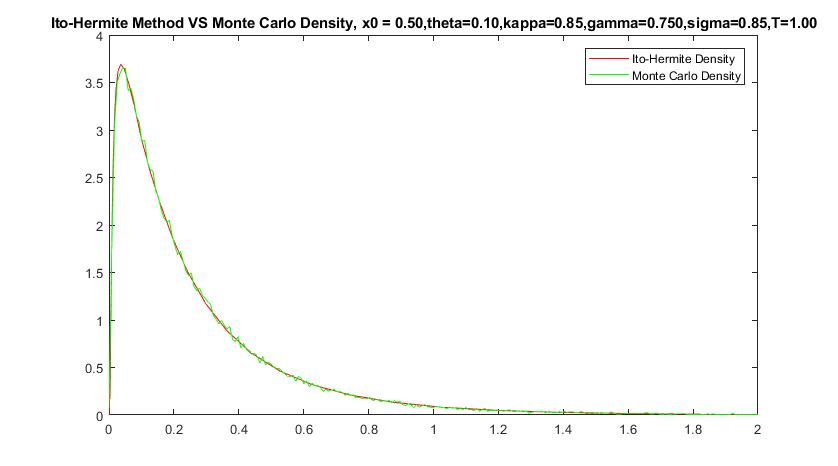](https://postimages.org/)

---

### #950 — Amin (Topic Author)
*July 13, 2020, 9:44 AM*

>
> Dear friends I made some notes about simulation of SDEs using Ito-hermite method. In order to simulate the SDEs with
this method, first we have to calculate the complete differential of square of terms as they appear inside the normal
exponential. I will start with a general SDE in Lamperti form. Here is the form of the SDE
>
> $dw_s=\mu(w_s) ds + \sigma dZ(s)$   Equation(1)
>
>
>
> Let us suppose$\zeta_w$ is the mean of density when we want to calculate the one time step ahead value of$w_t$ to
calculate the density.
>
> First of all we want to calculate the differential and later we will go to fokker-planck
>
>
>
> $\int_0^t d\Big[ {(w_s -\zeta_w - \int_0^s \mu(w_v) dv )}^2 \Big] = {\sigma}^2 Z^2 \Delta t $     Equation(2)
>
>
>
> Let us suppose that we indicate the integral of drift by uppercase letter as
>
> $M_t=\int_0^t \mu(w_s) ds$   Equation(3)
>
>
>
> Expanding the left side in the equation(2), we get
>
>
>
> $ \int_0^t d\Big[ {({w_s}^2+ {\zeta_w}^2 + {M_s}^2 - 2 w_s \zeta_w -2 w_s M_s + 2 \zeta_w M_s )} \Big]  $
>
>
>
> applying the differential we get
>
>
>
> $\int_0^t \Big[ 2w_s dw_s +{\sigma}^2 ds +2 M_s dM_s - 2  \zeta_w dw_s -2 d[w_s M_s] + 2 \zeta_w dM_s \Big]  $
>
> The first integral given as
>
>$\int_0^t \Big[ 2w_s dw_s +{\sigma}^2 ds \Big]$ is straightforward. The only two integrals that are relatively
difficult are calculated below
>
>
>
> $\int_0^t M_s dM_s$
>
> In order to calculate the above integral, we first calculate
>
> $M_s=\int_0^s \mu(w_v) dv$
>
> $dM_s= \mu(w_s) ds$
>
>
$M_s= \mu(w_0) \int_0^s dv +  \frac{\partial \mu(w_0)}{\partial w}  \mu(w_0)  \int_0^s \int_0^v du dv + \frac{\partial \mu(w_0)}{\partial w}  \sigma  \int_0^s \int_0^v dz(u) dv + .5 \frac{\partial^2 \mu(w_0)}{\partial w^2}  {\sigma}^2  \int_0^s \int_0^v du dv$
>
>
$=\mu(w_0) s + \frac{\partial \mu(w_0)}{\partial w}  \mu(w_0)  \frac{s^2}{2} +  \frac{\partial \mu(w_0)}{\partial w}  \sigma  (1-\frac{1}{\sqrt{3}}) s z(s) $
>
> $+ .5 \frac{\partial^2 \mu(w_0)}{\partial w^2}  {\sigma}^2  \frac{s^2}{2}$
>
>
>
> Now
>
>
$\int_0^t M_s dM_s= \int_0^t\Big[ \mu(w_0) s + \frac{\partial \mu(w_0)}{\partial w}  \mu(w_0)  \frac{s^2}{2} +  \frac{\partial \mu(w_0)}{\partial w}  \sigma  (1-\frac{1}{\sqrt{3}}) s z(s) $
>
> $+ .5 \frac{\partial^2 \mu(w_0)}{\partial w^2}  {\sigma}^2  \frac{s^2}{2} \Big ] dMs$
>
>
$= \int_0^t\Big[ {\mu(w_0)}^2 s ds+ \frac{\partial \mu(w_0)}{\partial w}  {\mu(w_0)}^2  \frac{s^2}{2} ds+  \frac{\partial \mu(w_0)}{\partial w} \mu(w_0) \sigma  (1-\frac{1}{\sqrt{3}}) s z(s) ds$
>
> $+ .5 \frac{\partial^2 \mu(w_0)}{\partial w^2} \mu(w_0) {\sigma}^2  \frac{s^2}{2} ds \Big ]$
>
>
$=  {\mu(w_0)}^2 \frac{t^2}{2}+ \frac{\partial \mu(w_0)}{\partial w}  {\mu(w_0)}^2  \frac{t^3}{6}+  \frac{\partial \mu(w_0)}{\partial w} \mu(w_0) \sigma  (1-\frac{1}{\sqrt{3}}) \frac{1}{2} (1-\frac{1}{\sqrt{5}}) t^2 z(s)$
>
> $+ .5 \frac{\partial^2 \mu(w_0)}{\partial w^2} \mu(w_0) {\sigma}^2  \frac{t^3}{6}$
>
>
>
> The other difficult and more important integral is calculated as
>
> $= \int_0^t d[w_s M_s]=  \int_0^t M_s dw_s +w_s dM_s$
>
> We substitute the value of $M_s$ from above equation No.  into the above equation as
>
>
$=  \int_0^t \Big[ \big[ \mu(w_0) s + \frac{\partial \mu(w_0)}{\partial w}  \mu(w_0)  \frac{s^2}{2} +  \frac{\partial \mu(w_0)}{\partial w}  \sigma  (1-\frac{1}{\sqrt{3}}) s z(s) $
>
>$+ .5 \frac{\partial^2 \mu(w_0)}{\partial w^2}  {\sigma}^2  \frac{s^2}{2} \big] \big[\mu(w_0) ds + \sigma dz(s) \big] $
>
>
$ +w_0 \mu(w_0) ds + w_0 \frac{\partial \mu(w_0)}{\partial w}  \mu(w_0) s ds + w_0 \frac{\partial \mu(w_0)}{\partial w}  \sigma z(s) ds$
>
> $+w_0 .5 \frac{\partial^2 \mu(w_0)}{\partial w^2}  {\sigma}^2 s ds \Big]$
>
> $=  \Big[ \big[ {\mu(w_0)}^2  \frac {t^2}{2} + \frac{\partial \mu(w_0)}{\partial w}  {\mu(w_0)}^2  \frac{t^3}{6}$
>
> $+\frac{\partial \mu(w_0)}{\partial w} \sigma (1-\frac{1}{\sqrt{3}}) \frac{1}{2} (1-\frac{1}{\sqrt{5}}) t^2 z(t)$
>
> $+ .5 \frac{\partial^2 \mu(w_0)}{\partial w^2} \mu(w_0) {\sigma}^2  \frac{t^3}{6} \big] $
>
>
$ + \big[ {\mu(w_0)} \sigma  (1-\frac {1}{\sqrt{3}}) t z(t) + \frac{\partial \mu(w_0)}{\partial w}  {\mu(w_0)} .5 t^2 z(t)/\sqrt{2}/\sqrt{6} $
>
> $+\frac{\partial \mu(w_0)}{\partial w} \sigma (1-\frac{1}{\sqrt{3}})  \frac{t ({z(t)}^2-1)}{2\sqrt{2}}$
>
> $+ .5 \frac{\partial^2 \mu(w_0)}{\partial w^2} \mu(w_0) {\sigma}^2  \frac{t^2 z(t)}{\sqrt{2}}{\sqrt{6}} \big]  $
>
>
$ +w_0 \mu(w_0) t + w_0 \frac{\partial \mu(w_0)}{\partial w}  \mu(w_0) \frac{t^2}{2} + w_0 \frac{\partial \mu(w_0)}{\partial w}  \sigma (1-\frac{1}{\sqrt{3}}) t z(t)$
>
> $+w_0 .5 \frac{\partial^2 \mu(w_0)}{\partial w^2}  {\sigma}^2 \frac{t^2}{2} \Big]$
>

Just like I did in the copied post, I believe that we have to complete the square with our "adjacent terms" version of
the equations. I will do some basic analysis for that. Please note that I have changed the notation somewhat from the
copied post.

$\int_0^t d\Big[ {(w_n(s) -w_{n-1}(s) +Z_{n-1}\frac{dw}{dZ}- \int_0^s \mu(w(v)) dv )}^2 \Big] = {\sigma}^2 Z^2 \Delta t $
Equation(2)

I want to use the notation $\Delta w = w_n(s) -w_{n-1}(s)$

and therefore $\frac{d[\Delta w]}{dZ} = \frac{dw_n(s)}{dZ} -\frac{dw_{n-1}(s)}{dZ}$

and we can do change of variable analysis on  $\Delta w $ as

$d[\Delta w] = \frac{d[\Delta w]}{dZ} \frac{dZ}{dw} dw(s)$

$ + .5  (\frac{d[\Delta^2 w]}{dZ^2} {(\frac{dZ}{dw})}^2+  \frac{d[\Delta w]}{dZ} \frac{d^2 Z}{dw^2}) [dw(s)]^2 $

using the above we can easily do Ito Change of variable for product terms in the square like

$d[{\Delta w} Z_{n-1}\frac{dw}{dZ}]$

and

$d[{\Delta w} \int_0^s \mu(w(v)) dv ]$

and

$ d[Z_{n-1}\frac{dw}{dZ} \int_0^s \mu(w(v)) dv]$

---

[← Previous](page_018.md) | [Index](index.md) | [Next →](page_020.md)
