# Breakthrough in the theory of stochastic differential equations and their simulation

**Page 20 of 65** — Posts #951–#1000

[← Previous](page_019.md) | [Index](index.md) | [Next →](page_021.md)

---

### #951 — Amin (Topic Author)
*July 17, 2020, 4:21 PM*

I have not been able to make much progress on solution to FP equation. It is difficult to work when I am under effect of
injections with mind control chemicals in them. I have decided to take a break from work on FPE and decided to complete
my work on path integrals on transition probabilities grid. I have some very good ideas and I hope that I would be able
to calculate arithmetic path integrals, dz-integrals and dt-integrals for general SDEs on transition probabilities grid.
I really hope that this should be straightforward now with new ideas I have. There have been some more understanding
about how mean of general SDEs should evolve and we could also incorporate that in the transition probabilities
simulation framework for stochastic differential equations. I hope to start posting new programs in a few days.

---

### #952 — Amin (Topic Author)
*July 21, 2020, 6:12 PM*

I have been continuing work on both solution of FPE project and path-integrals on transition probabilities grid project.
Here is some success on FPE project: I was able to take two sided derivatives in a single evolution equation for SDEs in
their FPE solution. I was also able to take both first and second numerical derivatives in the calculations. Second
numerical derivative was difficult since it was oscillatory due to interpolation issues that made the whole calculations
unstable but for a large number of cases I have been able to make it work. And now for a huge number of cases out to
several years and with a large range of mean reversion parameter, I have been able to get very precise solution for the
densities of the mean reverting SDEs. I will be posting the code for FPE solution on this forum tomorrow.

---

### #953 — Amin (Topic Author)
*July 21, 2020, 7:23 PM*

Here is the new program for solution to Fokker-planck equation for SDEs.

```
function [TrueMean,ItoHermiteMean,y_w,fy_w,wnStart] = FPERevisited04Wilmott()

%Copyright Ahsan Amin. Infiniti derivatives Technologies.
%Please fell free to connect on linkedin: linkedin.com/in/ahsan-amin-0a53334
%or skype ahsan.amin2999
%In this program, I am simulating the SDE given as
%dy(t)=mu1 x(t)^beta1 dt + mu2 x(t)^beta2 dt +sigma x(t)^gamma dz(t)

%I have not directly simulated the SDE but simulated the transformed
%Besse1l process version of the SDE and then changed coordinates to retreive
%the SDE in original coo
%rdinates.
%The present program will analytically evolve only the Bessel Process version of the
%SDE in transformed coordinates.
%In this version, the mean correction has been disabled. If you are
%simulating standard mean-reverting SV type SDEs, please enable the mean
%correction by uncommenting the appropriate line in the body of code below.

dt=.125/16;   % Simulation time interval.%Fodiffusions close to zero
             %decrease dt for accuracy.
Tt=128*8/4;%16*16;     % Number of simulation levels. Terminal time= Tt*dt; //.125/32*32*16=2 year;
T=Tt*dt;
OrderA=4;  %
OrderM=4;  %
%dtM=.125/8;%Monte carlo time interval size dtM.
%TtM=8*8;%Monte carlo number of simulation intervals.
dtM=dt*4;
TtM=Tt/4;

dNn=.2/1;   % Normal density subdivisions width. would change with number of subdivisions
Nn=50;  % No of normal density subdivisions
NnMidl=25;%One half density Subdivision left from mid of normal density(low)
NnMidh=26;%One half density subdivision right from the mid of normal density(high)
NnMid=4.0;

%theta=mu1/(-mu2);
%kappa=-mu2;

x0=1.0;   % starting value of SDE
beta1=0.0;
beta2=1.0;   % Second drift term power.
gamma=.95;%50;   % volatility power.
kappa=1.250;%.950;   %mean reversion parameter.
theta=1.0;%mean reversion target
sigma0=.80;%Volatility value

%you can specify any general mu1 and mu2 and beta1 and beta2.
%The present program is not perfect but quite reasonably good.
%if there is only one term in drift with beta=0, there will be minor
%errors. This case is yet not covered.

mu1=+1*theta*kappa;   %first drift coefficient.
mu2=-1*kappa;    % Second drift coefficient.
%mu1=0;
%mu2=0;

alpha=1;% x^alpha is being expanded. This is currently for monte carlo only.
alpha1=1-gamma;

w(1:Nn)=x0^(1-gamma)/(1-gamma);

Z(1:Nn)=(((1:Nn)-5.5)*dNn-NnMid);

Z
str=input('Look at Z');
ZProb(1)=normcdf(.5*Z(1)+.5*Z(2),0,1)-normcdf(.5*Z(1)+.5*Z(2)-dNn,0,1);
ZProb(Nn)=normcdf(.5*Z(Nn)+.5*Z(Nn-1)+dNn,0,1)-normcdf(.5*Z(Nn)+.5*Z(Nn-1),0,1);

for nn=2:Nn-1
    ZProb(nn)=normcdf(.5*Z(nn)+.5*Z(nn+1),0,1)-normcdf(.5*Z(nn)+.5*Z(nn-1),0,1);
    %Above calculate probability mass in each probability subdivision.
end

%%%%%%%%%%%%%%%%%%%%%%%%%%%%%%%%%%%%%%%%%%%%%%%%%%%%%%%%%%%%%%%%%%%%%%%%%%%%%%%%%%%%%%%%%%%%%%

sigma11(1:OrderA+1)=0;
mu11(1:OrderA+1)=0;
mu22(1:OrderA+1)=0;
sigma22(1:OrderA+1)=0;
% index 1 correponds to zero level since matlab indexing starts at one.
sigma11(1)=1;
mu11(1)=1;
mu22(1)=1;
sigma22(1)=1;

for k=1:(OrderA+1)
    if sigma0~=0
        sigma11(k)=sigma0^(k-1);
    end
    if mu1 ~= 0
        mu11(k)=mu1^(k-1);
    end
    if mu2 ~= 0
        mu22(k)=mu2^(k-1);
    end
    if sigma0~=0
        sigma22(k)=sigma0^(2*(k-1));
    end
end
%Ft(1:TtM+1,1:(OrderA+1),1:(OrderA+1),1:(OrderA+1),1:(OrderA+1))=0; %General time powers on hermite polynomials
Fp(1:(OrderA+1),1:(OrderA+1),1:(OrderA+1),1:(OrderA+1))=0;%General x powers on coefficients of hermite polynomials.
Fp1(1:(OrderA+1),1:(OrderA+1),1:(OrderA+1),1:(OrderA+1))=0;%General x powers for bessel transformed coordinates.

%YCoeff0 and YCoeff are coefficents for original coordinates monte carlo.
%YqCoeff0 and YqCoeff are bessel/lamperti version monte carlo.

YCoeff0(1:(OrderA+1),1:(OrderA+1),1:(OrderA+1),1:(OrderA+1))=0;
YqCoeff0(1:(OrderA+1),1:(OrderA+1),1:(OrderA+1),1:(OrderA+1))=0;
%Pre-compute the time and power exponent values in small multi-dimensional arrays
YCoeff = ItoTaylorCoeffsNew(alpha,beta1,beta2,gamma); %expand y^alpha where alpha=1;
YqCoeff = ItoTaylorCoeffsNew(alpha1,beta1,beta2,gamma);%expand y^alpha1 where alpha1=(1-gamma)
YqCoeff=YqCoeff/(1-gamma); %Transformed coordinates coefficients have to be
%further divided by (1-gamma)

for k = 0 : (OrderA)
    for m = 0:k
        l4 = k - m + 1;
        for n = 0 : m
            l3 = m - n + 1;
            for j = 0:n
                l2 = n - j + 1;
                l1 = j + 1;
                %Ft(l1,l2,l3,l4) = dtM^((l1-1) + (l2-1) + (l3-1) + .5* (l4-1));
                Fp(l1,l2,l3,l4) = (alpha + (l1-1) * beta1 + (l2-1) * beta2 + (l3-1) * 2* gamma + (l4-1) * gamma ...
                    - (l1-1) - (l2-1) - 2* (l3-1) - (l4-1));
                Fp1(l1,l2,l3,l4) = (alpha1 + (l1-1) * beta1 + (l2-1) * beta2 + (l3-1) * 2* gamma + (l4-1) * gamma ...
                    - (l1-1) - (l2-1) - 2* (l3-1) - (l4-1));

                YCoeff0(l1,l2,l3,l4) =YCoeff(l1,l2,l3,l4).*mu11(l1).*mu22(l2).*sigma22(l3).*sigma11(l4);
                YqCoeff0(l1,l2,l3,l4) =YqCoeff(l1,l2,l3,l4).*mu11(l1).*mu22(l2).*sigma22(l3).*sigma11(l4);
            end
        end
    end
end

%%%%%%%%%%%%%%%%%%%%%%%%%%%%%%%%%%%%%%%%%%%%%%%%%%%%%%%%%%%%%%%%%%%%%%%%%%%%%%%%%%%%%%%%%%%%%%
wnStart=1;%
d2wdZ2(1:Nn)=0;
d2wdZ2A(1:Nn)=0;
d2wdZ2B(1:Nn)=0;
d2wdZ2C(1:Nn)=0;
dwdZ(1:Nn)=0;
yy(wnStart:Nn)=((1-gamma)*w(wnStart:Nn)).^(1/(1-gamma));
tic

for tt=1:Tt

     yy(wnStart:Nn)=((1-gamma)*w(wnStart:Nn)).^(1/(1-gamma));

    [wMu0dt,dwMu0dtdw,d2wMu0dtdw2,d3wMu0dtdw3,c1,c2,c3,c4] =
CalculateDriftAndVolOrder4(w,wnStart,Nn,YqCoeff0,Fp1,gamma,dt);

    wPrev=w;
    dw(wnStart:Nn)=c1(wnStart:Nn).*Z(wnStart:Nn) ;% ...
    dw2(wnStart:Nn)=dw(wnStart:Nn).^2;
    w(isnan(w)==1)=0;
    wMu0dt(isnan(wMu0dt)==1)=0;
    wMeanPrev=sum(ZProb(wnStart:Nn).*w(wnStart:Nn));%Calculate the mean.

%%%%%%%%%%%%%%%%%%%%%%%%%%%%%%%%%%%%%%%%%%%%%%%%%%%%%%%%%%%%%%%%%%%%%%%%%%%

d2wdZ2(wnStart:Nn)=d2wdZ2(wnStart:Nn)+
d2wMu0dtdw2(wnStart:Nn).*dwdZ(wnStart:Nn).^2+dwMu0dtdw(wnStart:Nn).*d2wdZ2(wnStart:Nn)+.33*(Z(wnStart:Nn)).*sigma0^2*dt^2;;%+
...

[dwdZ,d2wdZ2A] = First2Derivatives2ndOrderEqSpaced(wnStart,Nn,dNn,w,Z);

if (tt>64)
d2wdZ2=d2wdZ2A;
d2wdZ2(21:29)=d2wdZ2(20)*(30-(21:29))/10+d2wdZ2(30)*((21:29)-20)/10;
end
%If the calculation of the program blows, it means that above calculated
%derivative is unstable or bad. Plese replace with your favourite method of
%calculating this second derivative.

%plot((wnStart:Nn),d2wdZ2,'r',(wnStart:Nn),d2wdZ2A,'g');

%str=input('Look at comparison of d2wdZ2');

dZdw(wnStart:Nn)=1.0./dwdZ(wnStart:Nn);
H2(wnStart:Nn)=(Z(wnStart:Nn).^2-1);

if(tt==1)
w(wnStart:Nn)=wMeanPrev+wMu0dt(wnStart:Nn)+ ...
          sign(w(wnStart:Nn)-wMeanPrev+dw(wnStart:Nn)).* ...
          sqrt(abs(sign(w(wnStart:Nn)-wMeanPrev).*(w(wnStart:Nn)-wMeanPrev).^2+ ...
          sign(dw(wnStart:Nn)).*dw2(wnStart:Nn)));
end
if(tt>1)

    dw(wnStart:Nn)=sigma0*sqrt(dt).*Z(wnStart:Nn);
    dw2(wnStart:Nn)=sigma0^2*dt*Z(wnStart:Nn).^2;

  [wS] = InterpolateOrderN6(6,Z(1)-dNn,Z(1),Z(2),Z(3),Z(4),Z(5),Z(6),w(1),w(2),w(3),w(4),w(5),w(6));
  [wE] =
InterpolateOrderN6(6,Z(Nn)+dNn,Z(Nn),Z(Nn-1),Z(Nn-2),Z(Nn-3),Z(Nn-4),Z(Nn-5),w(Nn),w(Nn-1),w(Nn-2),w(Nn-3),w(Nn-4),w(Nn-5));

  %wS in point interpolated to the left of the grid.
  %wE in point interpolated to the right of the grid.

  wAdjacentB(wnStart:Nn)=0;
  wAdjacentF(wnStart:Nn)=0;
  ZAdjacentB(wnStart:Nn)=0;
  ZAdjacentF(wnStart:Nn)=0;
  dwdZB(wnStart:Nn)=0;
  dwdZF(wnStart:Nn)=0;

  wAdjacentB(wnStart+1:Nn)=w(wnStart:Nn-1);
  wAdjacentB(wnStart)=wS;
  ZAdjacentB(wnStart+1:Nn)=Z(wnStart:Nn-1);
  ZAdjacentB(wnStart)=Z(wnStart)-dNn;
  dwdZB(wnStart:Nn)=(w(wnStart:Nn)-wAdjacentB(wnStart:Nn))/(dNn);

  wAdjacentF(wnStart:Nn-1)=w(wnStart+1:Nn);
  wAdjacentF(Nn)=wE;
  ZAdjacentF(wnStart:Nn-1)=Z(wnStart+1:Nn);
  ZAdjacentF(Nn)=Z(Nn)+dNn;
  dwdZF(wnStart:Nn)=(w(wnStart:Nn)-wAdjacentF(wnStart:Nn))/(-dNn);

  C11=.707;
  C22=8*dt;%
  C33=8*dt;%

 
w(wnStart:Nn)=wMu0dt(wnStart:Nn)+((.5*wAdjacentB(wnStart:Nn)+.5*wAdjacentF(wnStart:Nn)-.5*dwdZB(wnStart:Nn).*ZAdjacentB(wnStart:Nn)-.5*dwdZF(wnStart:Nn).*ZAdjacentF(wnStart:Nn)+
...
            C11*d2wdZ2(wnStart:Nn))+ ...
           
sign(w(wnStart:Nn)-.5*wAdjacentB(wnStart:Nn)-.5*wAdjacentF(wnStart:Nn)+.5*dwdZB(wnStart:Nn).*ZAdjacentB(wnStart:Nn)+.5*dwdZF(wnStart:Nn).*ZAdjacentF(wnStart:Nn)+
...
            -C11*d2wdZ2(wnStart:Nn)+dw(wnStart:Nn)).* ...
           
sqrt(abs(sign(w(wnStart:Nn)-.5*wAdjacentB(wnStart:Nn)-.5*wAdjacentF(wnStart:Nn)+.5*dwdZB(wnStart:Nn).*ZAdjacentB(wnStart:Nn)+.5*dwdZF(wnStart:Nn).*ZAdjacentF(wnStart:Nn)+
...
            -C11*d2wdZ2(wnStart:Nn)).* ...
           
(w(wnStart:Nn)-.5*wAdjacentB(wnStart:Nn)-.5*wAdjacentF(wnStart:Nn)+.5*dwdZB(wnStart:Nn).*ZAdjacentB(wnStart:Nn)+.5*dwdZF(wnStart:Nn).*ZAdjacentF(wnStart:Nn)+
...
            -C11*d2wdZ2(wnStart:Nn)).^2+ ...
            sign(+dw(wnStart:Nn)).*dw2(wnStart:Nn))))+ ...
            -C33.*dwMu0dtdw(wnStart:Nn).*dwdZ(wnStart:Nn).^2 + ...
            +C22.*3*Z(wnStart:Nn).^1.*dZdw(wnStart:Nn).*d2wdZ2(wnStart:Nn)*sigma0^2.*dt ;

end

%%%%%%%%%%%%%%%%%%%%%%%%%%%%%%%%%%%%%%%%%%%%%%%%%%%%%%%%%%%%%%%%%%%%%%%%%%%
%Below are instability correction equations. There is instability in the
% SDE representation equation roughly between -.5 SD to +.5 SD in normal terms.
%Instability correction Algorithm takes two ends that are here given as
%lower end=w(NnMidl-2) and upper end=w(NnMidh+3).
%In the block below the interpolation starts from lower end.
%1st equation is
%wll(NnMidl-1)=w(NnMidl-2)+(D1wl+CTheta*D2wl*dNn/1+.5*DeltaD1w)*dNn;
%Second equation is: wll(NnMidl)=wll(NnMidl-1)+(D1wl+CTheta*D2wl*dNn+1.5*DeltaD1w)*dNn;
%And so on.
%There is a sixth equation that is not written below(since it takes us to
%the upper interpolation point which is already known) which is
%wll(NnMidh+3)=wll(NnMidh+2)+(D1wl+CTheta*D2wl*dNn+5.5*DeltaD1w)*dNn;
%Sum of these six equations add up to the distance between upper and lower
%interpolation points.
%In the sum there are six instances of first derivative which is already
%calculated at the boundary, six instances of second derivative which is also
%already calculated at lower boundary and 18.0 instances of DeltaD1w which is
%unknown. This equation calculates the value of one unit of DeltaD1w addition
%DeltaD1w=(w(NnMidh+3)-w(NnMidl-2)-6*D1wl*dNn-6.0*CTheta*D2wl*dNn.^2.0/1.0)/18.0/dNn;
% I hope to find a better analytical method to tackle this issue. Friends
% are welcome to play with slightly changed related alternatives to the
%above interpolation.
    CTheta=.866;
    D1wl=(11/6*w(NnMidl-2)-3*w(NnMidl-3)+3/2*w(NnMidl-4)-1/3*w(NnMidl-5))/dNn;
    D2wl=(35/12*w(NnMidl-2) -26/3*w(NnMidl-3)+ 19/2*w(NnMidl-4)-14/3*w(NnMidl-5)+11/12*w(NnMidl-6))/dNn.^2;
    DeltaD1w=(w(NnMidh+3)-w(NnMidl-2)-6*D1wl*dNn-6.0*CTheta*D2wl*dNn.^2.0/1.0)/18.0/dNn;

    wll(NnMidl-1)=w(NnMidl-2)+  (D1wl+CTheta*D2wl*dNn+.5*DeltaD1w)*dNn;
    wll(NnMidl)=wll(NnMidl-1)+  (D1wl+CTheta*D2wl*dNn+1.5*DeltaD1w)*dNn;
    wll(NnMidh)=wll(NnMidl)+    (D1wl+CTheta*D2wl*dNn+2.5*DeltaD1w)*dNn;
    wll(NnMidh+1)=wll(NnMidh)+  (D1wl+CTheta*D2wl*dNn+3.5*DeltaD1w)*dNn;
    wll(NnMidh+2)=wll(NnMidh+1)+(D1wl+CTheta*D2wl*dNn+4.5*DeltaD1w)*dNn;
    %wll(NnMidh+3)=wll(NnMidh+2)+(D1wl+CTheta*D2wl*dNn+5.5*DeltaD1w)*dNn;
%The last equation is not used since point w(NnMidh+3)is given but it is used in
%calculation of distance between two interpolation points. This distance is
%used to determine the value of DeltaD1w.

    D1wh=(-11/6*w(NnMidh+3)+3*w(NnMidh+4)-3/2*w(NnMidh+5)+1/3*w(NnMidh+6))/dNn;
    D2wh=(35/12*w(NnMidh+3) -26/3*w(NnMidh+4)+ 19/2*w(NnMidh+5)-14/3*w(NnMidh+6)+11/12*w(NnMidh+7))/dNn.^2;
    DeltaD1w=(w(NnMidh+3)-w(NnMidl-2)-6*D1wh*dNn-6.0*CTheta*D2wh*dNn.^2.0/1.0)/18.0/dNn;
%     DeltaD1w=(w(NnMidh+2)-w(NnMidl-1)-4*D1wh*dNn-16.0*D2wh*dNn.^2.0/1.0)/6.0/dNn;

    whh(NnMidh+2)=w(NnMidh+3)-(D1wh+CTheta*D2wh*dNn+.5*DeltaD1w)*dNn;
    whh(NnMidh+1)=w(NnMidh+2)-(D1wh+CTheta*D2wh*dNn+1.5* DeltaD1w)*dNn;
    whh(NnMidh)=whh(NnMidh+1)-(D1wh+CTheta*D2wh*dNn+2.5* DeltaD1w)*dNn;
    whh(NnMidl)=whh(NnMidh)-(D1wh+CTheta*D2wh*dNn+3.5* DeltaD1w)*dNn;
    whh(NnMidl-1)=whh(NnMidl)-(D1wh+CTheta*D2wh*dNn+4.5* DeltaD1w)*dNn;

    %whh(NnMidl-2)=whh(NnMidl-1)-(D1wh+CTheta*D2wh*dNn/1+5.5* DeltaD1w)*dNn;

%
        w(NnMidh+2)=.5*whh(NnMidh+2)+.5*wll(NnMidh+2);
        w(NnMidh+1)=.5*whh(NnMidh+1)+.5*wll(NnMidh+1);
        w(NnMidh)=.5*whh(NnMidh)+.5*wll(NnMidh);
        w(NnMidl)=.5*whh(NnMidl)+.5*wll(NnMidl);
        w(NnMidl-1)=.5*whh(NnMidl-1)+.5*wll(NnMidl-1);

        w1(1:Nn-1)=w(1:Nn-1);
        w2(1:Nn-1)=w(2:Nn);

%         w1(1:Nn-2)=w(1:Nn-2);
%         w2(1:Nn-2)=w(2:Nn-1);
%         w3(1:Nn-2)=w(3:Nn);
%         w(w1(:)>w2(:))=w2(w1(:)>w2(:))-.25*(w3(w1(:)>w2(:))-w2(w1(:)>w2(:)));

%w(w1(:)>w2(:))=0;%Be careful;might not universally hold;

        w(w<0)=0.0;
        for nn=1:Nn
            if(w(nn)<=0)
                wnStart=nn+1;
           end
        end

        %%1st order mean correction. We know the mean in original
        %%coordinates so I shift the density into original coordinates,
        %%apply the mean correction and then transform again into Lamperti
        %%coordinates. Algebra solves two equations in two unknowns.
        %%Equations are Sum_0^N{(Y_w(wnStart:Nn)-Y0)*W0}=1 and the second
        %%equation is Sum_0^N{Y_w(wnStart:Nn).*(Y_w(wnStart:Nn)-Y0)*W0}=u0
        %%Two unknows are Y0 and W0. u0 is known mean.
        tt;
        u0=theta+(x0-theta)*exp(-kappa*(tt*dt)); %analytic mean of the density

        %If you are not using stochastic volatility, replace above with
        %true mean otherwise results would become garbage.

        Y_w(wnStart:Nn) = ((1-gamma)*w(wnStart:Nn)).^(1/(1-gamma));

        Yn2Pn=sum(Y_w(wnStart:Nn).*Y_w(wnStart:Nn).*ZProb(wnStart:Nn));
        YnPn=sum(Y_w(wnStart:Nn).*ZProb(wnStart:Nn));
        Pn=1.0;%%Sum(ZProb(1:Nn))
        Y0=(Yn2Pn-u0*YnPn)/(YnPn-u0*Pn);

        Y0Pn=Y0*Pn;
        W0=1/(YnPn-Y0Pn);
        YCorrected(wnStart:Nn)=Y_w(wnStart:Nn).*(Y_w(wnStart:Nn)-Y0)*W0;
        wCorrected(wnStart:Nn)=(YCorrected(wnStart:Nn).^(1-gamma))./(1-gamma);
        w(wnStart:Nn)=wCorrected(wnStart:Nn);

   %I have disabled the mean correction. The above mean correction is only valid for
   %standard mean reverting stochastic volatility type SDEs. To enable mean
   %correction please uncomment the above last line in the block.

end

 y_w(1:Nn)=0;
 y_w(wnStart:Nn) = ((1-gamma)*w(wnStart:Nn)).^(1/(1-gamma));
 Dfy_w(wnStart:Nn)=0;
 Dfw(wnStart:Nn)=0;
for nn=wnStart+1:Nn-1
    Dfy_w(nn) = (y_w(nn + 1) - y_w(nn - 1))/(Z(nn + 1) - Z(nn - 1));
    Dfw(nn) = (w(nn + 1) - w(nn - 1))/(Z(nn + 1) - Z(nn - 1));
    %Change of variable derivative for densities
end
fy_w(1:Nn)=0;
fw(1:Nn)=0;
for nn = wnStart:Nn-1
    fy_w(nn) = (normpdf(Z(nn),0, 1))/abs(Dfy_w(nn));%Origianl coordinates density
    fw(nn) = (normpdf(Z(nn),0, 1))/abs(Dfw(nn));
end

toc

ItoHermiteMean=sum(y_w(wnStart+1:Nn-1).*ZProb(wnStart+1:Nn-1)) %Original process average from coordinates

 disp('true Mean only applicble to standard SV mean reverting type models otherwise disregard');
 TrueMean=theta+(x0-theta)*exp(-kappa*dt*Tt)%Mean reverting SDE original variable true average

 rng(29079137, 'twister')
 paths=100000;
 YY(1:paths)=x0;  %Original process monte carlo.
 Random1(1:paths)=0;
 YYMean(1:TtM)=0;
 for tt=1:TtM
     Random1=randn(size(Random1));
     HermiteP1(1,1:paths)=1;
     HermiteP1(2,1:paths)=Random1(1:paths);
     HermiteP1(3,1:paths)=Random1(1:paths).^2-1;
     HermiteP1(4,1:paths)=Random1(1:paths).^3-3*Random1(1:paths);
     HermiteP1(5,1:paths)=Random1(1:paths).^4-6*Random1(1:paths).^2+3;

     YY(1:paths)=YY(1:paths) + ...
      (YCoeff0(1,1,2,1).*YY(1:paths).^Fp(1,1,2,1)+ ...
      YCoeff0(1,2,1,1).*YY(1:paths).^Fp(1,2,1,1)+ ...
      YCoeff0(2,1,1,1).*YY(1:paths).^Fp(2,1,1,1))*dtM + ...
      (YCoeff0(1,1,3,1).*YY(1:paths).^Fp(1,1,3,1)+ ...
      YCoeff0(1,2,2,1).*YY(1:paths).^Fp(1,2,2,1)+ ...
      YCoeff0(2,1,2,1).*YY(1:paths).^Fp(2,1,2,1)+ ...
      YCoeff0(1,3,1,1).*YY(1:paths).^Fp(1,3,1,1)+ ...
      YCoeff0(2,2,1,1).*YY(1:paths).^Fp(2,2,1,1)+ ...
      YCoeff0(3,1,1,1).*YY(1:paths).^Fp(3,1,1,1))*dtM^2 + ...
      ((YCoeff0(1,1,1,2).*YY(1:paths).^Fp(1,1,1,2).*sqrt(dtM))+ ...
    (YCoeff0(1,1,2,2).*YY(1:paths).^Fp(1,1,2,2)+ ...
    YCoeff0(1,2,1,2).*YY(1:paths).^Fp(1,2,1,2)+ ...
    YCoeff0(2,1,1,2).*YY(1:paths).^Fp(2,1,1,2)).*dtM^1.5) .*HermiteP1(2,1:paths) + ...
    ((YCoeff0(1,1,1,3).*YY(1:paths).^Fp(1,1,1,3) *dtM) + ...
    (YCoeff0(1,1,2,3).*YY(1:paths).^Fp(1,1,2,3)+ ...
    YCoeff0(1,2,1,3).*YY(1:paths).^Fp(1,2,1,3)+ ...
    YCoeff0(2,1,1,3).*YY(1:paths).^Fp(2,1,1,3)).*dtM^2).*HermiteP1(3,1:paths) + ...
    ((YCoeff0(1,1,1,4).*YY(1:paths).^Fp(1,1,1,4)*dtM^1.5 )).*HermiteP1(4,1:paths) + ...
    (YCoeff0(1,1,1,5).*YY(1:paths).^Fp(1,1,1,5)*dtM^2.0).*HermiteP1(5,1:paths);

%Uncomment for fourth order monte carlo

%
%   YY(1:paths)=YY(1:paths) + ...
%       (YCoeff0(1,1,2,1).*YY(1:paths).^Fp(1,1,2,1)+YCoeff0(1,2,1,1).*YY(1:paths).^Fp(1,2,1,1)+ ...
%       YCoeff0(2,1,1,1).*YY(1:paths).^Fp(2,1,1,1))*dtM + ...
%       (YCoeff0(1,1,3,1).*YY(1:paths).^Fp(1,1,3,1)+YCoeff0(1,2,2,1).*YY(1:paths).^Fp(1,2,2,1)+ ...
%       YCoeff0(2,1,2,1).*YY(1:paths).^Fp(2,1,2,1)+YCoeff0(1,3,1,1).*YY(1:paths).^Fp(1,3,1,1)+ ...
%       YCoeff0(2,2,1,1).*YY(1:paths).^Fp(2,2,1,1)+YCoeff0(3,1,1,1).*YY(1:paths).^Fp(3,1,1,1))*dtM^2 + ...
%       (YCoeff0(1,1,4,1).*YY(1:paths).^Fp(1,1,4,1)+YCoeff0(1,2,3,1).*YY(1:paths).^Fp(1,2,3,1)+ ...
%       YCoeff0(2,1,3,1).*YY(1:paths).^Fp(2,1,3,1)+YCoeff0(1,3,2,1).*YY(1:paths).^Fp(1,3,2,1)+ ...
%       YCoeff0(2,2,2,1).*YY(1:paths).^Fp(2,2,2,1)+YCoeff0(3,1,2,1).*YY(1:paths).^Fp(3,1,2,1)+ ...
%       YCoeff0(1,4,1,1).*YY(1:paths).^Fp(1,4,1,1)+YCoeff0(2,3,1,1).*YY(1:paths).^Fp(2,3,1,1)+ ...
%       YCoeff0(3,2,1,1).*YY(1:paths).^Fp(3,2,1,1)+YCoeff0(4,1,1,1).*YY(1:paths).^Fp(4,1,1,1))*dtM^3 + ...
%        (YCoeff0(1,1,5,1).*YY(1:paths).^Fp(1,1,5,1)+YCoeff0(1,2,4,1).*yy(1:paths).^Fp(1,2,4,1)+ ...
%     YCoeff0(2,1,4,1).*YY(1:paths).^Fp(2,1,4,1)+YCoeff0(2,1,1,1).*yy(1:paths).^Fp(2,1,1,1)+ ...
%      YCoeff0(2,2,3,1).*YY(1:paths).^Fp(2,2,3,1)+ ...
%      YCoeff0(3,1,3,1).*YY(1:paths).^Fp(3,1,3,1)+YCoeff0(1,4,2,1).*YY(1:paths).^Fp(1,4,2,1)+ ...
%      YCoeff0(2,3,2,1).*YY(1:paths).^Fp(2,3,2,1)+YCoeff0(3,2,2,1).*YY(1:paths).^Fp(3,2,2,1)+ ...
%      YCoeff0(4,1,2,1).*YY(1:paths).^Fp(4,1,2,1)+YCoeff0(1,5,1,1).*YY(1:paths).^Fp(1,5,1,1)+ ...
%      YCoeff0(2,4,1,1).*YY(1:paths).^Fp(2,4,1,1)+ ...
%      YCoeff0(3,3,1,1).*YY(1:paths).^Fp(3,3,1,1)+YCoeff0(4,2,1,1).*YY(1:paths).^Fp(4,2,1,1)+ ...
%      YCoeff0(5,1,1,1).*YY(1:paths).^Fp(5,1,1,1))*dtM^4+ ...
%       ((YCoeff0(1,1,1,2).*YY(1:paths).^Fp(1,1,1,2).*sqrt(dtM))+ ...
%     (YCoeff0(1,1,2,2).*YY(1:paths).^Fp(1,1,2,2)+YCoeff0(1,2,1,2).*YY(1:paths).^Fp(1,2,1,2)+ ...
%     YCoeff0(2,1,1,2).*YY(1:paths).^Fp(2,1,1,2)).*dtM^1.5+ ...
%     (YCoeff0(1,1,3,2).*YY(1:paths).^Fp(1,1,3,2)+YCoeff0(1,2,2,2).*YY(1:paths).^Fp(1,2,2,2)+ ...
%     YCoeff0(2,1,2,2).*YY(1:paths).^Fp(2,1,2,2)+YCoeff0(1,3,1,2).*YY(1:paths).^Fp(1,3,1,2)+ ...
%     YCoeff0(2,2,1,2).*YY(1:paths).^Fp(2,2,1,2)+YCoeff0(3,1,1,2).*YY(1:paths).^Fp(3,1,1,2)).*dtM^2.5+ ...
%     (YCoeff0(1,1,4,2).*YY(1:paths).^Fp(1,1,4,2)+YCoeff0(1,2,3,2).*YY(1:paths).^Fp(1,2,3,2)+ ...
%     YCoeff0(2,1,3,2).*YY(1:paths).^Fp(2,1,3,2)+YCoeff0(1,3,2,2).*YY(1:paths).^Fp(1,3,2,2)+ ...
%     YCoeff0(2,2,2,2).*YY(1:paths).^Fp(2,2,2,2)+ YCoeff0(3,1,2,2).*YY(1:paths).^Fp(3,1,2,2)+ ...
%     YCoeff0(1,4,1,2).*YY(1:paths).^Fp(1,4,1,2)+YCoeff0(2,3,1,2).*YY(1:paths).^Fp(2,3,1,2)+ ...
%     YCoeff0(3,2,1,2).*YY(1:paths).^Fp(3,2,1,2)+YCoeff0(4,1,1,2).*YY(1:paths).^Fp(4,1,1,2)).*dtM^3.5)
.*HermiteP1(2,1:paths) + ...
%     ((YCoeff0(1,1,1,3).*YY(1:paths).^Fp(1,1,1,3) *dtM) + ...
%     (YCoeff0(1,1,2,3).*YY(1:paths).^Fp(1,1,2,3)+YCoeff0(1,2,1,3).*YY(1:paths).^Fp(1,2,1,3)+ ...
%     YCoeff0(2,1,1,3).*YY(1:paths).^Fp(2,1,1,3)).*dtM^2+ ...
%     (YCoeff0(1,1,3,3).*YY(1:paths).^Fp(1,1,3,3)+YCoeff0(1,2,2,3).*YY(1:paths).^Fp(1,2,2,3)+ ...
%     YCoeff0(2,1,2,3).*YY(1:paths).^Fp(2,1,2,3) + YCoeff0(1,3,1,3).*YY(1:paths).^Fp(1,3,1,3)+ ...
%   
 YCoeff0(2,2,1,3).*YY(1:paths).^Fp(2,2,1,3)+YCoeff0(3,1,1,3).*YY(1:paths).^Fp(3,1,1,3)).*dtM^3).*HermiteP1(3,1:paths) +
...
%     ((YCoeff0(1,1,1,4).*YY(1:paths).^Fp(1,1,1,4)*dtM^1.5 )+ ...
%     (YCoeff0(1,1,2,4).*YY(1:paths).^Fp(1,1,2,4)+YCoeff0(1,2,1,4).*YY(1:paths).^Fp(1,2,1,4)+ ...
%     YCoeff0(2,1,1,4).*YY(1:paths).^Fp(2,1,1,4))*dtM^2.5).*HermiteP1(4,1:paths) + ...
%     (YCoeff0(1,1,1,5).*YY(1:paths).^Fp(1,1,1,5)*dtM^2.0).*HermiteP1(5,1:paths);
%

     YYMean(tt)=YYMean(tt)+sum(YY(1:paths))/paths;
 end
 YY(YY<0)=0;
 disp('Original process average from monte carlo');
 MCMean=sum(YY(:))/paths %origianl coordinates monte carlo average.
 disp('Original process average from our simulation');
 ItoHermiteMean=sum(y_w(wnStart+1:Nn-1).*ZProb(wnStart+1:Nn-1)) %Original process average from coordinates

 disp('true Mean only applicble to standard SV mean reverting type models otherwise disregard');
 TrueMean=theta+(x0-theta)*exp(-kappa*dt*Tt)%Mean reverting SDE original variable true average

 MaxCutOff=30;
 NoOfBins=round(300*gamma^2*4*sigma0);%Decrease the number of bins if the graph is too
 [YDensity,IndexOutY,IndexMaxY] = MakeDensityFromSimulation_Infiniti_NEW(YY,paths,NoOfBins,MaxCutOff );
 plot(y_w(wnStart+1:Nn-1),fy_w(wnStart+1:Nn-1),'r',IndexOutY(1:IndexMaxY),YDensity(1:IndexMaxY),'g');
 %plot(y_w(wnStart+1:Nn-1),fy_w(wnStart+1:Nn-1),'r',IndexOutY(1:IndexMaxY),YDensity(1:IndexMaxY),'g',Z(wnStart+1:Nn-1),fy_w(wnStart+1:Nn-1),'b');

 title(sprintf('Ito-Hermite Method VS Monte Carlo Density, x0 =
%.2f,theta=%.2f,kappa=%.2f,gamma=%.3f,sigma=%.2f,T=%.2f', x0,theta,kappa,gamma,sigma0,T));%,sprintf('theta= %f', theta),
sprintf('kappa = %f', kappa),sprintf('sigma = %f', sigma0),sprintf('T = %f', T));

 %title('text',sprintf('x0 = %f', x0),sprintf('theta= %f', theta), sprintf('kappa = %f', kappa),sprintf('sigma = %f',
sigma0),sprintf('T = %f', T))
 %xlabel(a)
 %title('Graphical Comparison of Ito-Hermite Method and Monte Carlo Method Density')
 legend({'Ito-Hermite Density','Monte Carlo Density'},'Location','northeast')

 str=input('red line is density of SDE from Ito-Hermite method, green is monte carlo.');

end
```

One new supporting function is here:

```
function [dwdZ,d2wdZ2] = First2Derivatives2ndOrderEqSpaced(wnStart,Nn,dNn,w,Z)

 [wS] =
InterpolateOrderN6(5,Z(wnStart)-dNn,Z(wnStart),Z(wnStart+1),Z(wnStart+2),Z(wnStart+3),Z(wnStart+4),Z(wnStart+5),w(wnStart),w(wnStart+1),w(wnStart+2),w(wnStart+3),w(wnStart+4),w(wnStart+5));
 [wE] =
InterpolateOrderN6(5,Z(Nn)+dNn,Z(Nn),Z(Nn-1),Z(Nn-2),Z(Nn-3),Z(Nn-4),Z(Nn-5),w(Nn),w(Nn-1),w(Nn-2),w(Nn-3),w(Nn-4),w(Nn-5));

 d2wdZ2(wnStart)=(wS-2*w(wnStart)+w(wnStart+1))/(dNn.^2);
 d2wdZ2(wnStart+1:Nn-1)=(w(wnStart:Nn-2)-2*w(wnStart+1:Nn-1)+1*w(wnStart+2:Nn))/(dNn.^2);
 d2wdZ2(Nn)=(wE-2*w(Nn)+w(Nn-1))/(dNn.^2);

 dwdZ(wnStart)=(-1*wS+1*w(wnStart+1))/(2*dNn);
 dwdZ(wnStart+1:Nn-1)=(-1*w(wnStart:Nn-2)+1*w(wnStart+2:Nn))/(2*dNn);
 dwdZ(Nn)=(wE-w(Nn-1))/(2*dNn);

end

```

Here is the output of the program:

Original process average from monte carlo

MCMean =

   1.001882559716443

Original process average from our simulation

ItoHermiteMean =

   0.999990867727656

true Mean only applicble to standard SV mean reverting type models otherwise disregard

TrueMean =

     1

IndexMax =

   867

Here is the output graph after rescaling.

[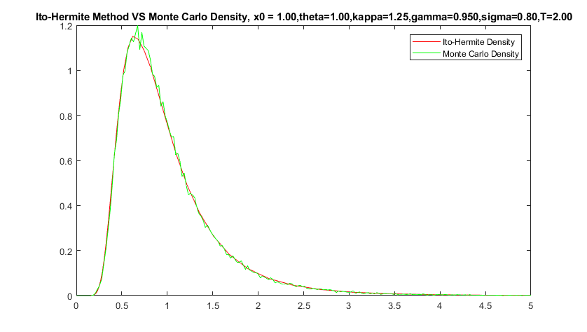](https://postimages.org/)

---

### #954 — Amin (Topic Author)
*July 22, 2020, 4:50 AM*

>
> if (tt>64)
>
> d2wdZ2=d2wdZ2A;
>
> d2wdZ2(21:29)=d2wdZ2(20)*(30-(21:29))/10+d2wdZ2(30)*((21:29)-20)/10;
>
> end

In my program, I used the above line of code which means that after 64 time intervals, replace my approximate analytical
second derivative with interpolated numerical second derivative (d2wdZ2A, middle nine values are interpolated where we
have more instability effect). I waited till 64 time intervals before replacing the second derivative so that numerical
derivative becomes stable enough and the whole equation does not blow. This wait for 64 time intervals is very arbitrary
and you could replace after 32 time intervals(or some other interval numbers value) and see if the solution remains
stable(and you will see great improvement in solution for high mean reversions if solution remains stable). If exact
second derivative is used everywhere, the solution will be far better.

Especially if you simulate the above solution for half year with high mean reversion and get bad results, try switching
to numerical derivative after tt=32 or earlier if possible.

---

### #955 — Amin (Topic Author)
*July 23, 2020, 9:14 AM*

In the following program, I have made only three changes.

1) I have replaced in the following

if (tt>64)

d2wdZ2=d2wdZ2A;

d2wdZ2(21:29)=d2wdZ2(20)*(30-(21:29))/10+d2wdZ2(30)*((21:29)-20)/10;

end

with

f (tt>32)

d2wdZ2=d2wdZ2A;

d2wdZ2(21:29)=d2wdZ2(20)*(30-(21:29))/10+d2wdZ2(30)*((21:29)-20)/10;

end

2) and replaced following line

C33=8*dt;

with

C33=8*1.414*dt;

3) and replaced interpolation parameter

CTheta=.66;

with

CTheta=0;

I notice that density is exact as long as we follow exact numerical second derivative. Towards the right of the peak,
the density is slightly inexact and that is because I am linearly interpolating numerical second derivative in that
area. IF we can faithfully reproduce the second derivative, the solution of the fokker-planck equation will be exact
with this method now even though we have not included the effect of third derivative at all yet. If the following
program blows, it means that numerical second derivative has become unstable and my method to make numerical second
derivative stable has failed. If you can make sure that your numerical second derivative is stable, you can get the
program to run perfectly. But there will usually very slight and very negligible inaccuracy effect from not including
third derivative.

Important thing is that all derivatives are from analytical derivatives of Fokker-planck equation that we obtained when
we did a change of SDE density with normal density in an earlier post and I have not added any single fudge term at all
in this solution.

Here I am posting the code with above changes.

```
function [TrueMean,ItoHermiteMean,y_w,fy_w,wnStart] = FPERevisited04Wilmott02()

%Copyright Ahsan Amin. Infiniti derivatives Technologies.
%Please fell free to connect on linkedin: linkedin.com/in/ahsan-amin-0a53334
%or skype ahsan.amin2999
%In this program, I am simulating the SDE given as
%dy(t)=mu1 x(t)^beta1 dt + mu2 x(t)^beta2 dt +sigma x(t)^gamma dz(t)

%I have not directly simulated the SDE but simulated the transformed
%Besse1l process version of the SDE and then changed coordinates to retreive
%the SDE in original coo
%rdinates.
%The present program will analytically evolve only the Bessel Process version of the
%SDE in transformed coordinates.
%In this version, the mean correction has been disabled. If you are
%simulating standard mean-reverting SV type SDEs, please enable the mean
%correction by uncommenting the appropriate line in the body of code below.

dt=.125/16;   % Simulation time interval.%Fodiffusions close to zero
             %decrease dt for accuracy.
Tt=128*12/4;%16*16;     % Number of simulation levels. Terminal time= Tt*dt; //.125/32*32*16=2 year;
T=Tt*dt;
OrderA=4;  %
OrderM=4;  %
%dtM=.125/8;%Monte carlo time interval size dtM.
%TtM=8*8;%Monte carlo number of simulation intervals.
dtM=dt*4;
TtM=Tt/4;

dNn=.2/1;   % Normal density subdivisions width. would change with number of subdivisions
Nn=50;  % No of normal density subdivisions
NnMidl=25;%One half density Subdivision left from mid of normal density(low)
NnMidh=26;%One half density subdivision right from the mid of normal density(high)
NnMid=4.0;

%theta=mu1/(-mu2);
%kappa=-mu2;

x0=1.0;   % starting value of SDE
beta1=0.0;
beta2=1.0;   % Second drift term power.
gamma=.55;%50;   % volatility power.
kappa=2.50;%.950;   %mean reversion parameter.
theta=1.0;%mean reversion target
sigma0=.80;%Volatility value

%you can specify any general mu1 and mu2 and beta1 and beta2.
%The present program is not perfect but quite reasonably good.
%if there is only one term in drift with beta=0, there will be minor
%errors. This case is yet not covered.

mu1=+1*theta*kappa;   %first drift coefficient.
mu2=-1*kappa;    % Second drift coefficient.
%mu1=0;
%mu2=0;

alpha=1;% x^alpha is being expanded. This is currently for monte carlo only.
alpha1=1-gamma;

w(1:Nn)=x0^(1-gamma)/(1-gamma);

Z(1:Nn)=(((1:Nn)-5.5)*dNn-NnMid);

Z
str=input('Look at Z');
ZProb(1)=normcdf(.5*Z(1)+.5*Z(2),0,1)-normcdf(.5*Z(1)+.5*Z(2)-dNn,0,1);
ZProb(Nn)=normcdf(.5*Z(Nn)+.5*Z(Nn-1)+dNn,0,1)-normcdf(.5*Z(Nn)+.5*Z(Nn-1),0,1);

for nn=2:Nn-1
    ZProb(nn)=normcdf(.5*Z(nn)+.5*Z(nn+1),0,1)-normcdf(.5*Z(nn)+.5*Z(nn-1),0,1);
    %Above calculate probability mass in each probability subdivision.
end

%%%%%%%%%%%%%%%%%%%%%%%%%%%%%%%%%%%%%%%%%%%%%%%%%%%%%%%%%%%%%%%%%%%%%%%%%%%%%%%%%%%%%%%%%%%%%%

sigma11(1:OrderA+1)=0;
mu11(1:OrderA+1)=0;
mu22(1:OrderA+1)=0;
sigma22(1:OrderA+1)=0;
% index 1 correponds to zero level since matlab indexing starts at one.
sigma11(1)=1;
mu11(1)=1;
mu22(1)=1;
sigma22(1)=1;

for k=1:(OrderA+1)
    if sigma0~=0
        sigma11(k)=sigma0^(k-1);
    end
    if mu1 ~= 0
        mu11(k)=mu1^(k-1);
    end
    if mu2 ~= 0
        mu22(k)=mu2^(k-1);
    end
    if sigma0~=0
        sigma22(k)=sigma0^(2*(k-1));
    end
end
%Ft(1:TtM+1,1:(OrderA+1),1:(OrderA+1),1:(OrderA+1),1:(OrderA+1))=0; %General time powers on hermite polynomials
Fp(1:(OrderA+1),1:(OrderA+1),1:(OrderA+1),1:(OrderA+1))=0;%General x powers on coefficients of hermite polynomials.
Fp1(1:(OrderA+1),1:(OrderA+1),1:(OrderA+1),1:(OrderA+1))=0;%General x powers for bessel transformed coordinates.

%YCoeff0 and YCoeff are coefficents for original coordinates monte carlo.
%YqCoeff0 and YqCoeff are bessel/lamperti version monte carlo.

YCoeff0(1:(OrderA+1),1:(OrderA+1),1:(OrderA+1),1:(OrderA+1))=0;
YqCoeff0(1:(OrderA+1),1:(OrderA+1),1:(OrderA+1),1:(OrderA+1))=0;
%Pre-compute the time and power exponent values in small multi-dimensional arrays
YCoeff = ItoTaylorCoeffsNew(alpha,beta1,beta2,gamma); %expand y^alpha where alpha=1;
YqCoeff = ItoTaylorCoeffsNew(alpha1,beta1,beta2,gamma);%expand y^alpha1 where alpha1=(1-gamma)
YqCoeff=YqCoeff/(1-gamma); %Transformed coordinates coefficients have to be
%further divided by (1-gamma)

for k = 0 : (OrderA)
    for m = 0:k
        l4 = k - m + 1;
        for n = 0 : m
            l3 = m - n + 1;
            for j = 0:n
                l2 = n - j + 1;
                l1 = j + 1;
                %Ft(l1,l2,l3,l4) = dtM^((l1-1) + (l2-1) + (l3-1) + .5* (l4-1));
                Fp(l1,l2,l3,l4) = (alpha + (l1-1) * beta1 + (l2-1) * beta2 + (l3-1) * 2* gamma + (l4-1) * gamma ...
                    - (l1-1) - (l2-1) - 2* (l3-1) - (l4-1));
                Fp1(l1,l2,l3,l4) = (alpha1 + (l1-1) * beta1 + (l2-1) * beta2 + (l3-1) * 2* gamma + (l4-1) * gamma ...
                    - (l1-1) - (l2-1) - 2* (l3-1) - (l4-1));

                YCoeff0(l1,l2,l3,l4) =YCoeff(l1,l2,l3,l4).*mu11(l1).*mu22(l2).*sigma22(l3).*sigma11(l4);
                YqCoeff0(l1,l2,l3,l4) =YqCoeff(l1,l2,l3,l4).*mu11(l1).*mu22(l2).*sigma22(l3).*sigma11(l4);
            end
        end
    end
end

%%%%%%%%%%%%%%%%%%%%%%%%%%%%%%%%%%%%%%%%%%%%%%%%%%%%%%%%%%%%%%%%%%%%%%%%%%%%%%%%%%%%%%%%%%%%%%
wnStart=1;%
d2wdZ2(1:Nn)=0;
d2wdZ2A(1:Nn)=0;
d2wdZ2B(1:Nn)=0;
d2wdZ2C(1:Nn)=0;
dwdZ(1:Nn)=0;
yy(wnStart:Nn)=((1-gamma)*w(wnStart:Nn)).^(1/(1-gamma));
tic

for tt=1:Tt

     yy(wnStart:Nn)=((1-gamma)*w(wnStart:Nn)).^(1/(1-gamma));

    [wMu0dt,dwMu0dtdw,d2wMu0dtdw2,d3wMu0dtdw3,c1,c2,c3,c4] =
CalculateDriftAndVolOrder4(w,wnStart,Nn,YqCoeff0,Fp1,gamma,dt);

    wPrev=w;
    dw(wnStart:Nn)=c1(wnStart:Nn).*Z(wnStart:Nn) ;% ...
    dw2(wnStart:Nn)=dw(wnStart:Nn).^2;
    w(isnan(w)==1)=0;
    wMu0dt(isnan(wMu0dt)==1)=0;
    wMeanPrev=sum(ZProb(wnStart:Nn).*w(wnStart:Nn));%Calculate the mean.

%%%%%%%%%%%%%%%%%%%%%%%%%%%%%%%%%%%%%%%%%%%%%%%%%%%%%%%%%%%%%%%%%%%%%%%%%%%

d2wdZ2(wnStart:Nn)=d2wdZ2(wnStart:Nn)+
d2wMu0dtdw2(wnStart:Nn).*dwdZ(wnStart:Nn).^2+dwMu0dtdw(wnStart:Nn).*d2wdZ2(wnStart:Nn)+.33*(Z(wnStart:Nn)).*sigma0^2*dt^2;;%+
...

[dwdZ,d2wdZ2A] = First2Derivatives2ndOrderEqSpaced(wnStart,Nn,dNn,w,Z);

if (tt>32)
d2wdZ2=d2wdZ2A;
d2wdZ2(21:29)=d2wdZ2(20)*(30-(21:29))/10+d2wdZ2(30)*((21:29)-20)/10;
end
%If the calculation of the program blows, it means that above calculated
%derivative is unstable or bad. Plese replace with your favourite method of
%calculating this second derivative.

plot((wnStart:Nn),d2wdZ2,'r',(wnStart:Nn),d2wdZ2A,'g');
tt
str=input('Look at comparison of d2wdZ2. Interpolation starts after tt==32');

dZdw(wnStart:Nn)=1.0./dwdZ(wnStart:Nn);
H2(wnStart:Nn)=(Z(wnStart:Nn).^2-1);

if(tt==1)
w(wnStart:Nn)=wMeanPrev+wMu0dt(wnStart:Nn)+ ...
          sign(w(wnStart:Nn)-wMeanPrev+dw(wnStart:Nn)).* ...
          sqrt(abs(sign(w(wnStart:Nn)-wMeanPrev).*(w(wnStart:Nn)-wMeanPrev).^2+ ...
          sign(dw(wnStart:Nn)).*dw2(wnStart:Nn)));
end
if(tt>1)

    dw(wnStart:Nn)=sigma0*sqrt(dt).*Z(wnStart:Nn);
    dw2(wnStart:Nn)=sigma0^2*dt*Z(wnStart:Nn).^2;

  [wS] = InterpolateOrderN6(6,Z(1)-dNn,Z(1),Z(2),Z(3),Z(4),Z(5),Z(6),w(1),w(2),w(3),w(4),w(5),w(6));
  [wE] =
InterpolateOrderN6(6,Z(Nn)+dNn,Z(Nn),Z(Nn-1),Z(Nn-2),Z(Nn-3),Z(Nn-4),Z(Nn-5),w(Nn),w(Nn-1),w(Nn-2),w(Nn-3),w(Nn-4),w(Nn-5));

  %wS in point interpolated to the left of the grid.
  %wE in point interpolated to the right of the grid.

  wAdjacentB(wnStart:Nn)=0;
  wAdjacentF(wnStart:Nn)=0;
  ZAdjacentB(wnStart:Nn)=0;
  ZAdjacentF(wnStart:Nn)=0;
  dwdZB(wnStart:Nn)=0;
  dwdZF(wnStart:Nn)=0;

  wAdjacentB(wnStart+1:Nn)=w(wnStart:Nn-1);
  wAdjacentB(wnStart)=wS;
  ZAdjacentB(wnStart+1:Nn)=Z(wnStart:Nn-1);
  ZAdjacentB(wnStart)=Z(wnStart)-dNn;
  dwdZB(wnStart:Nn)=(w(wnStart:Nn)-wAdjacentB(wnStart:Nn))/(dNn);

  wAdjacentF(wnStart:Nn-1)=w(wnStart+1:Nn);
  wAdjacentF(Nn)=wE;
  ZAdjacentF(wnStart:Nn-1)=Z(wnStart+1:Nn);
  ZAdjacentF(Nn)=Z(Nn)+dNn;
  dwdZF(wnStart:Nn)=(w(wnStart:Nn)-wAdjacentF(wnStart:Nn))/(-dNn);

  C11=.707;
  C22=8*dt;%
  C33=8*1.414*dt;%

 
w(wnStart:Nn)=wMu0dt(wnStart:Nn)+((.5*wAdjacentB(wnStart:Nn)+.5*wAdjacentF(wnStart:Nn)-.5*dwdZB(wnStart:Nn).*ZAdjacentB(wnStart:Nn)-.5*dwdZF(wnStart:Nn).*ZAdjacentF(wnStart:Nn)+
...
            C11*d2wdZ2(wnStart:Nn))+ ...
           
sign(w(wnStart:Nn)-.5*wAdjacentB(wnStart:Nn)-.5*wAdjacentF(wnStart:Nn)+.5*dwdZB(wnStart:Nn).*ZAdjacentB(wnStart:Nn)+.5*dwdZF(wnStart:Nn).*ZAdjacentF(wnStart:Nn)+
...
            -C11*d2wdZ2(wnStart:Nn)+dw(wnStart:Nn)).* ...
           
sqrt(abs(sign(w(wnStart:Nn)-.5*wAdjacentB(wnStart:Nn)-.5*wAdjacentF(wnStart:Nn)+.5*dwdZB(wnStart:Nn).*ZAdjacentB(wnStart:Nn)+.5*dwdZF(wnStart:Nn).*ZAdjacentF(wnStart:Nn)+
...
            -C11*d2wdZ2(wnStart:Nn)).* ...
           
(w(wnStart:Nn)-.5*wAdjacentB(wnStart:Nn)-.5*wAdjacentF(wnStart:Nn)+.5*dwdZB(wnStart:Nn).*ZAdjacentB(wnStart:Nn)+.5*dwdZF(wnStart:Nn).*ZAdjacentF(wnStart:Nn)+
...
            -C11*d2wdZ2(wnStart:Nn)).^2+ ...
            sign(+dw(wnStart:Nn)).*dw2(wnStart:Nn))))+ ...
            -C33.*dwMu0dtdw(wnStart:Nn).*dwdZ(wnStart:Nn).^2 + ...
            +C22.*3*Z(wnStart:Nn).^1.*dZdw(wnStart:Nn).*d2wdZ2(wnStart:Nn)*sigma0^2.*dt ;

end

%%%%%%%%%%%%%%%%%%%%%%%%%%%%%%%%%%%%%%%%%%%%%%%%%%%%%%%%%%%%%%%%%%%%%%%%%%%
%Below are instability correction equations. There is instability in the
% SDE representation equation roughly between -.5 SD to +.5 SD in normal terms.
%Instability correction Algorithm takes two ends that are here given as
%lower end=w(NnMidl-2) and upper end=w(NnMidh+3).
%In the block below the interpolation starts from lower end.
%1st equation is
%wll(NnMidl-1)=w(NnMidl-2)+(D1wl+CTheta*D2wl*dNn/1+.5*DeltaD1w)*dNn;
%Second equation is: wll(NnMidl)=wll(NnMidl-1)+(D1wl+CTheta*D2wl*dNn+1.5*DeltaD1w)*dNn;
%And so on.
%There is a sixth equation that is not written below(since it takes us to
%the upper interpolation point which is already known) which is
%wll(NnMidh+3)=wll(NnMidh+2)+(D1wl+CTheta*D2wl*dNn+5.5*DeltaD1w)*dNn;
%Sum of these six equations add up to the distance between upper and lower
%interpolation points.
%In the sum there are six instances of first derivative which is already
%calculated at the boundary, six instances of second derivative which is also
%already calculated at lower boundary and 18.0 instances of DeltaD1w which is
%unknown. This equation calculates the value of one unit of DeltaD1w addition
%DeltaD1w=(w(NnMidh+3)-w(NnMidl-2)-6*D1wl*dNn-6.0*CTheta*D2wl*dNn.^2.0/1.0)/18.0/dNn;
% I hope to find a better analytical method to tackle this issue. Friends
% are welcome to play with slightly changed related alternatives to the
%above interpolation.
    CTheta=0;
    D1wl=(11/6*w(NnMidl-2)-3*w(NnMidl-3)+3/2*w(NnMidl-4)-1/3*w(NnMidl-5))/dNn;
    D2wl=(35/12*w(NnMidl-2) -26/3*w(NnMidl-3)+ 19/2*w(NnMidl-4)-14/3*w(NnMidl-5)+11/12*w(NnMidl-6))/dNn.^2;
    DeltaD1w=(w(NnMidh+3)-w(NnMidl-2)-6*D1wl*dNn-6.0*CTheta*D2wl*dNn.^2.0/1.0)/18.0/dNn;

    wll(NnMidl-1)=w(NnMidl-2)+  (D1wl+CTheta*D2wl*dNn+.5*DeltaD1w)*dNn;
    wll(NnMidl)=wll(NnMidl-1)+  (D1wl+CTheta*D2wl*dNn+1.5*DeltaD1w)*dNn;
    wll(NnMidh)=wll(NnMidl)+    (D1wl+CTheta*D2wl*dNn+2.5*DeltaD1w)*dNn;
    wll(NnMidh+1)=wll(NnMidh)+  (D1wl+CTheta*D2wl*dNn+3.5*DeltaD1w)*dNn;
    wll(NnMidh+2)=wll(NnMidh+1)+(D1wl+CTheta*D2wl*dNn+4.5*DeltaD1w)*dNn;
    %wll(NnMidh+3)=wll(NnMidh+2)+(D1wl+CTheta*D2wl*dNn+5.5*DeltaD1w)*dNn;
%The last equation is not used since point w(NnMidh+3)is given but it is used in
%calculation of distance between two interpolation points. This distance is
%used to determine the value of DeltaD1w.

    D1wh=(-11/6*w(NnMidh+3)+3*w(NnMidh+4)-3/2*w(NnMidh+5)+1/3*w(NnMidh+6))/dNn;
    D2wh=(35/12*w(NnMidh+3) -26/3*w(NnMidh+4)+ 19/2*w(NnMidh+5)-14/3*w(NnMidh+6)+11/12*w(NnMidh+7))/dNn.^2;
    DeltaD1w=(w(NnMidh+3)-w(NnMidl-2)-6*D1wh*dNn-6.0*CTheta*D2wh*dNn.^2.0/1.0)/18.0/dNn;
%     DeltaD1w=(w(NnMidh+2)-w(NnMidl-1)-4*D1wh*dNn-16.0*D2wh*dNn.^2.0/1.0)/6.0/dNn;

    whh(NnMidh+2)=w(NnMidh+3)-(D1wh+CTheta*D2wh*dNn+.5*DeltaD1w)*dNn;
    whh(NnMidh+1)=w(NnMidh+2)-(D1wh+CTheta*D2wh*dNn+1.5* DeltaD1w)*dNn;
    whh(NnMidh)=whh(NnMidh+1)-(D1wh+CTheta*D2wh*dNn+2.5* DeltaD1w)*dNn;
    whh(NnMidl)=whh(NnMidh)-(D1wh+CTheta*D2wh*dNn+3.5* DeltaD1w)*dNn;
    whh(NnMidl-1)=whh(NnMidl)-(D1wh+CTheta*D2wh*dNn+4.5* DeltaD1w)*dNn;

    %whh(NnMidl-2)=whh(NnMidl-1)-(D1wh+CTheta*D2wh*dNn/1+5.5* DeltaD1w)*dNn;

%
        w(NnMidh+2)=.5*whh(NnMidh+2)+.5*wll(NnMidh+2);
        w(NnMidh+1)=.5*whh(NnMidh+1)+.5*wll(NnMidh+1);
        w(NnMidh)=.5*whh(NnMidh)+.5*wll(NnMidh);
        w(NnMidl)=.5*whh(NnMidl)+.5*wll(NnMidl);
        w(NnMidl-1)=.5*whh(NnMidl-1)+.5*wll(NnMidl-1);

        w1(1:Nn-1)=w(1:Nn-1);
        w2(1:Nn-1)=w(2:Nn);

%         w1(1:Nn-2)=w(1:Nn-2);
%         w2(1:Nn-2)=w(2:Nn-1);
%         w3(1:Nn-2)=w(3:Nn);
%         w(w1(:)>w2(:))=w2(w1(:)>w2(:))-.25*(w3(w1(:)>w2(:))-w2(w1(:)>w2(:)));

%w(w1(:)>w2(:))=0;%Be careful;might not universally hold;

        w(w<0)=0.0;
        for nn=1:Nn
            if(w(nn)<=0)
                wnStart=nn+1;
           end
        end

        %%1st order mean correction. We know the mean in original
        %%coordinates so I shift the density into original coordinates,
        %%apply the mean correction and then transform again into Lamperti
        %%coordinates. Algebra solves two equations in two unknowns.
        %%Equations are Sum_0^N{(Y_w(wnStart:Nn)-Y0)*W0}=1 and the second
        %%equation is Sum_0^N{Y_w(wnStart:Nn).*(Y_w(wnStart:Nn)-Y0)*W0}=u0
        %%Two unknows are Y0 and W0. u0 is known mean.
        tt;
        u0=theta+(x0-theta)*exp(-kappa*(tt*dt)); %analytic mean of the density

        %If you are not using stochastic volatility, replace above with
        %true mean otherwise results would become garbage.

        Y_w(wnStart:Nn) = ((1-gamma)*w(wnStart:Nn)).^(1/(1-gamma));

        Yn2Pn=sum(Y_w(wnStart:Nn).*Y_w(wnStart:Nn).*ZProb(wnStart:Nn));
        YnPn=sum(Y_w(wnStart:Nn).*ZProb(wnStart:Nn));
        Pn=1.0;%%Sum(ZProb(1:Nn))
        Y0=(Yn2Pn-u0*YnPn)/(YnPn-u0*Pn);

        Y0Pn=Y0*Pn;
        W0=1/(YnPn-Y0Pn);
        YCorrected(wnStart:Nn)=Y_w(wnStart:Nn).*(Y_w(wnStart:Nn)-Y0)*W0;
        wCorrected(wnStart:Nn)=(YCorrected(wnStart:Nn).^(1-gamma))./(1-gamma);
        w(wnStart:Nn)=wCorrected(wnStart:Nn);

   %I have disabled the mean correction. The above mean correction is only valid for
   %standard mean reverting stochastic volatility type SDEs. To enable mean
   %correction please uncomment the above last line in the block.

end

 y_w(1:Nn)=0;
 y_w(wnStart:Nn) = ((1-gamma)*w(wnStart:Nn)).^(1/(1-gamma));
 Dfy_w(wnStart:Nn)=0;
 Dfw(wnStart:Nn)=0;
for nn=wnStart+1:Nn-1
    Dfy_w(nn) = (y_w(nn + 1) - y_w(nn - 1))/(Z(nn + 1) - Z(nn - 1));
    Dfw(nn) = (w(nn + 1) - w(nn - 1))/(Z(nn + 1) - Z(nn - 1));
    %Change of variable derivative for densities
end
fy_w(1:Nn)=0;
fw(1:Nn)=0;
for nn = wnStart:Nn-1
    fy_w(nn) = (normpdf(Z(nn),0, 1))/abs(Dfy_w(nn));%Origianl coordinates density
    fw(nn) = (normpdf(Z(nn),0, 1))/abs(Dfw(nn));
end

toc

ItoHermiteMean=sum(y_w(wnStart+1:Nn-1).*ZProb(wnStart+1:Nn-1)) %Original process average from coordinates

 disp('true Mean only applicble to standard SV mean reverting type models otherwise disregard');
 TrueMean=theta+(x0-theta)*exp(-kappa*dt*Tt)%Mean reverting SDE original variable true average

 rng(29079137, 'twister')
 paths=100000;
 YY(1:paths)=x0;  %Original process monte carlo.
 Random1(1:paths)=0;
 YYMean(1:TtM)=0;
 for tt=1:TtM
     Random1=randn(size(Random1));
     HermiteP1(1,1:paths)=1;
     HermiteP1(2,1:paths)=Random1(1:paths);
     HermiteP1(3,1:paths)=Random1(1:paths).^2-1;
     HermiteP1(4,1:paths)=Random1(1:paths).^3-3*Random1(1:paths);
     HermiteP1(5,1:paths)=Random1(1:paths).^4-6*Random1(1:paths).^2+3;

     YY(1:paths)=YY(1:paths) + ...
      (YCoeff0(1,1,2,1).*YY(1:paths).^Fp(1,1,2,1)+ ...
      YCoeff0(1,2,1,1).*YY(1:paths).^Fp(1,2,1,1)+ ...
      YCoeff0(2,1,1,1).*YY(1:paths).^Fp(2,1,1,1))*dtM + ...
      (YCoeff0(1,1,3,1).*YY(1:paths).^Fp(1,1,3,1)+ ...
      YCoeff0(1,2,2,1).*YY(1:paths).^Fp(1,2,2,1)+ ...
      YCoeff0(2,1,2,1).*YY(1:paths).^Fp(2,1,2,1)+ ...
      YCoeff0(1,3,1,1).*YY(1:paths).^Fp(1,3,1,1)+ ...
      YCoeff0(2,2,1,1).*YY(1:paths).^Fp(2,2,1,1)+ ...
      YCoeff0(3,1,1,1).*YY(1:paths).^Fp(3,1,1,1))*dtM^2 + ...
      ((YCoeff0(1,1,1,2).*YY(1:paths).^Fp(1,1,1,2).*sqrt(dtM))+ ...
    (YCoeff0(1,1,2,2).*YY(1:paths).^Fp(1,1,2,2)+ ...
    YCoeff0(1,2,1,2).*YY(1:paths).^Fp(1,2,1,2)+ ...
    YCoeff0(2,1,1,2).*YY(1:paths).^Fp(2,1,1,2)).*dtM^1.5) .*HermiteP1(2,1:paths) + ...
    ((YCoeff0(1,1,1,3).*YY(1:paths).^Fp(1,1,1,3) *dtM) + ...
    (YCoeff0(1,1,2,3).*YY(1:paths).^Fp(1,1,2,3)+ ...
    YCoeff0(1,2,1,3).*YY(1:paths).^Fp(1,2,1,3)+ ...
    YCoeff0(2,1,1,3).*YY(1:paths).^Fp(2,1,1,3)).*dtM^2).*HermiteP1(3,1:paths) + ...
    ((YCoeff0(1,1,1,4).*YY(1:paths).^Fp(1,1,1,4)*dtM^1.5 )).*HermiteP1(4,1:paths) + ...
    (YCoeff0(1,1,1,5).*YY(1:paths).^Fp(1,1,1,5)*dtM^2.0).*HermiteP1(5,1:paths);

%Uncomment for fourth order monte carlo

%
%   YY(1:paths)=YY(1:paths) + ...
%       (YCoeff0(1,1,2,1).*YY(1:paths).^Fp(1,1,2,1)+YCoeff0(1,2,1,1).*YY(1:paths).^Fp(1,2,1,1)+ ...
%       YCoeff0(2,1,1,1).*YY(1:paths).^Fp(2,1,1,1))*dtM + ...
%       (YCoeff0(1,1,3,1).*YY(1:paths).^Fp(1,1,3,1)+YCoeff0(1,2,2,1).*YY(1:paths).^Fp(1,2,2,1)+ ...
%       YCoeff0(2,1,2,1).*YY(1:paths).^Fp(2,1,2,1)+YCoeff0(1,3,1,1).*YY(1:paths).^Fp(1,3,1,1)+ ...
%       YCoeff0(2,2,1,1).*YY(1:paths).^Fp(2,2,1,1)+YCoeff0(3,1,1,1).*YY(1:paths).^Fp(3,1,1,1))*dtM^2 + ...
%       (YCoeff0(1,1,4,1).*YY(1:paths).^Fp(1,1,4,1)+YCoeff0(1,2,3,1).*YY(1:paths).^Fp(1,2,3,1)+ ...
%       YCoeff0(2,1,3,1).*YY(1:paths).^Fp(2,1,3,1)+YCoeff0(1,3,2,1).*YY(1:paths).^Fp(1,3,2,1)+ ...
%       YCoeff0(2,2,2,1).*YY(1:paths).^Fp(2,2,2,1)+YCoeff0(3,1,2,1).*YY(1:paths).^Fp(3,1,2,1)+ ...
%       YCoeff0(1,4,1,1).*YY(1:paths).^Fp(1,4,1,1)+YCoeff0(2,3,1,1).*YY(1:paths).^Fp(2,3,1,1)+ ...
%       YCoeff0(3,2,1,1).*YY(1:paths).^Fp(3,2,1,1)+YCoeff0(4,1,1,1).*YY(1:paths).^Fp(4,1,1,1))*dtM^3 + ...
%        (YCoeff0(1,1,5,1).*YY(1:paths).^Fp(1,1,5,1)+YCoeff0(1,2,4,1).*yy(1:paths).^Fp(1,2,4,1)+ ...
%     YCoeff0(2,1,4,1).*YY(1:paths).^Fp(2,1,4,1)+YCoeff0(2,1,1,1).*yy(1:paths).^Fp(2,1,1,1)+ ...
%      YCoeff0(2,2,3,1).*YY(1:paths).^Fp(2,2,3,1)+ ...
%      YCoeff0(3,1,3,1).*YY(1:paths).^Fp(3,1,3,1)+YCoeff0(1,4,2,1).*YY(1:paths).^Fp(1,4,2,1)+ ...
%      YCoeff0(2,3,2,1).*YY(1:paths).^Fp(2,3,2,1)+YCoeff0(3,2,2,1).*YY(1:paths).^Fp(3,2,2,1)+ ...
%      YCoeff0(4,1,2,1).*YY(1:paths).^Fp(4,1,2,1)+YCoeff0(1,5,1,1).*YY(1:paths).^Fp(1,5,1,1)+ ...
%      YCoeff0(2,4,1,1).*YY(1:paths).^Fp(2,4,1,1)+ ...
%      YCoeff0(3,3,1,1).*YY(1:paths).^Fp(3,3,1,1)+YCoeff0(4,2,1,1).*YY(1:paths).^Fp(4,2,1,1)+ ...
%      YCoeff0(5,1,1,1).*YY(1:paths).^Fp(5,1,1,1))*dtM^4+ ...
%       ((YCoeff0(1,1,1,2).*YY(1:paths).^Fp(1,1,1,2).*sqrt(dtM))+ ...
%     (YCoeff0(1,1,2,2).*YY(1:paths).^Fp(1,1,2,2)+YCoeff0(1,2,1,2).*YY(1:paths).^Fp(1,2,1,2)+ ...
%     YCoeff0(2,1,1,2).*YY(1:paths).^Fp(2,1,1,2)).*dtM^1.5+ ...
%     (YCoeff0(1,1,3,2).*YY(1:paths).^Fp(1,1,3,2)+YCoeff0(1,2,2,2).*YY(1:paths).^Fp(1,2,2,2)+ ...
%     YCoeff0(2,1,2,2).*YY(1:paths).^Fp(2,1,2,2)+YCoeff0(1,3,1,2).*YY(1:paths).^Fp(1,3,1,2)+ ...
%     YCoeff0(2,2,1,2).*YY(1:paths).^Fp(2,2,1,2)+YCoeff0(3,1,1,2).*YY(1:paths).^Fp(3,1,1,2)).*dtM^2.5+ ...
%     (YCoeff0(1,1,4,2).*YY(1:paths).^Fp(1,1,4,2)+YCoeff0(1,2,3,2).*YY(1:paths).^Fp(1,2,3,2)+ ...
%     YCoeff0(2,1,3,2).*YY(1:paths).^Fp(2,1,3,2)+YCoeff0(1,3,2,2).*YY(1:paths).^Fp(1,3,2,2)+ ...
%     YCoeff0(2,2,2,2).*YY(1:paths).^Fp(2,2,2,2)+ YCoeff0(3,1,2,2).*YY(1:paths).^Fp(3,1,2,2)+ ...
%     YCoeff0(1,4,1,2).*YY(1:paths).^Fp(1,4,1,2)+YCoeff0(2,3,1,2).*YY(1:paths).^Fp(2,3,1,2)+ ...
%     YCoeff0(3,2,1,2).*YY(1:paths).^Fp(3,2,1,2)+YCoeff0(4,1,1,2).*YY(1:paths).^Fp(4,1,1,2)).*dtM^3.5)
.*HermiteP1(2,1:paths) + ...
%     ((YCoeff0(1,1,1,3).*YY(1:paths).^Fp(1,1,1,3) *dtM) + ...
%     (YCoeff0(1,1,2,3).*YY(1:paths).^Fp(1,1,2,3)+YCoeff0(1,2,1,3).*YY(1:paths).^Fp(1,2,1,3)+ ...
%     YCoeff0(2,1,1,3).*YY(1:paths).^Fp(2,1,1,3)).*dtM^2+ ...
%     (YCoeff0(1,1,3,3).*YY(1:paths).^Fp(1,1,3,3)+YCoeff0(1,2,2,3).*YY(1:paths).^Fp(1,2,2,3)+ ...
%     YCoeff0(2,1,2,3).*YY(1:paths).^Fp(2,1,2,3) + YCoeff0(1,3,1,3).*YY(1:paths).^Fp(1,3,1,3)+ ...
%   
 YCoeff0(2,2,1,3).*YY(1:paths).^Fp(2,2,1,3)+YCoeff0(3,1,1,3).*YY(1:paths).^Fp(3,1,1,3)).*dtM^3).*HermiteP1(3,1:paths) +
...
%     ((YCoeff0(1,1,1,4).*YY(1:paths).^Fp(1,1,1,4)*dtM^1.5 )+ ...
%     (YCoeff0(1,1,2,4).*YY(1:paths).^Fp(1,1,2,4)+YCoeff0(1,2,1,4).*YY(1:paths).^Fp(1,2,1,4)+ ...
%     YCoeff0(2,1,1,4).*YY(1:paths).^Fp(2,1,1,4))*dtM^2.5).*HermiteP1(4,1:paths) + ...
%     (YCoeff0(1,1,1,5).*YY(1:paths).^Fp(1,1,1,5)*dtM^2.0).*HermiteP1(5,1:paths);
%

     YYMean(tt)=YYMean(tt)+sum(YY(1:paths))/paths;
 end
 YY(YY<0)=0;
 disp('Original process average from monte carlo');
 MCMean=sum(YY(:))/paths %origianl coordinates monte carlo average.
 disp('Original process average from our simulation');
 ItoHermiteMean=sum(y_w(wnStart+1:Nn-1).*ZProb(wnStart+1:Nn-1)) %Original process average from coordinates

 disp('true Mean only applicble to standard SV mean reverting type models otherwise disregard');
 TrueMean=theta+(x0-theta)*exp(-kappa*dt*Tt)%Mean reverting SDE original variable true average

 MaxCutOff=30;
 NoOfBins=round(300*gamma^2*4*sigma0);%Decrease the number of bins if the graph is too
 [YDensity,IndexOutY,IndexMaxY] = MakeDensityFromSimulation_Infiniti_NEW(YY,paths,NoOfBins,MaxCutOff );
 plot(y_w(wnStart+1:Nn-1),fy_w(wnStart+1:Nn-1),'r',IndexOutY(1:IndexMaxY),YDensity(1:IndexMaxY),'g');
 %plot(y_w(wnStart+1:Nn-1),fy_w(wnStart+1:Nn-1),'r',IndexOutY(1:IndexMaxY),YDensity(1:IndexMaxY),'g',Z(wnStart+1:Nn-1),fy_w(wnStart+1:Nn-1),'b');

 title(sprintf('Ito-Hermite Method VS Monte Carlo Density, x0 =
%.2f,theta=%.2f,kappa=%.2f,gamma=%.3f,sigma=%.2f,T=%.2f', x0,theta,kappa,gamma,sigma0,T));%,sprintf('theta= %f', theta),
sprintf('kappa = %f', kappa),sprintf('sigma = %f', sigma0),sprintf('T = %f', T));

 %title('text',sprintf('x0 = %f', x0),sprintf('theta= %f', theta), sprintf('kappa = %f', kappa),sprintf('sigma = %f',
sigma0),sprintf('T = %f', T))
 %xlabel(a)
 %title('Graphical Comparison of Ito-Hermite Method and Monte Carlo Method Density')
 legend({'Ito-Hermite Density','Monte Carlo Density'},'Location','northeast')

 str=input('red line is density of SDE from Ito-Hermite method, green is monte carlo.');

end
```

Here is the last output with this method.

Original process average from monte carlo

MCMean =

   0.998946438546209

Original process average from our simulation

ItoHermiteMean =

   0.999998003732751

true Mean only applicble to standard SV mean reverting type models otherwise disregard

TrueMean =

     1

IndexMax =

   291

red line is density of SDE from Ito-Hermite method, green is monte carlo.

[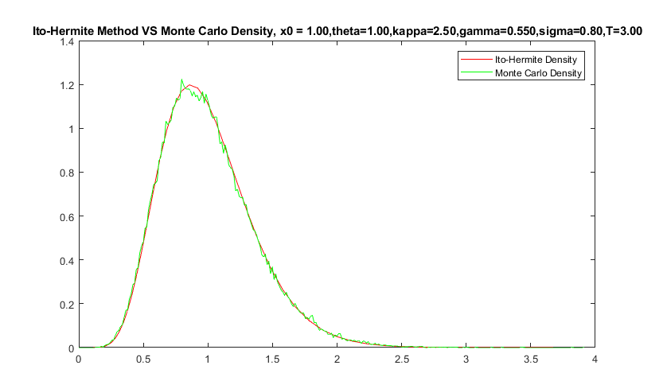](https://postimages.org/)

---

### #956 — Amin (Topic Author)
*July 23, 2020, 10:05 AM*

This is another graph from program in previous post.

[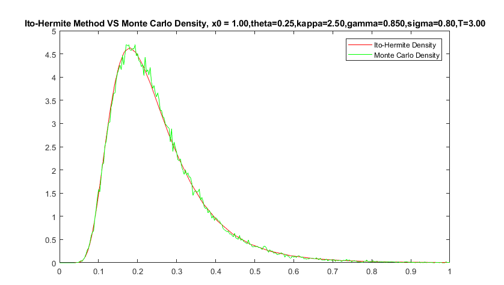](https://postimages.org/)

Another density. Parameters are in graph title.

[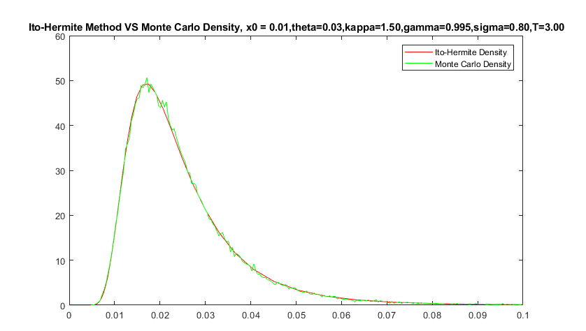](https://postimages.org/)

[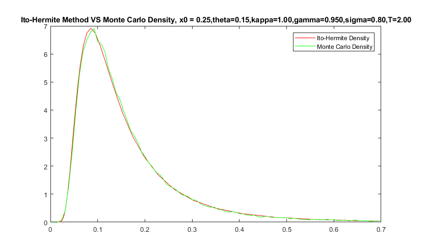](https://postimages.org/)

Again mostly If the program in previous post blows, it means that numerical second derivative has become unstable and my
method to make numerical second derivative stable has failed.

---

### #957 — Amin (Topic Author)
*July 24, 2020, 12:48 PM*

Post in progress.

I have recast exactly the same analytics in a 'special explicit form'. By 'special explicit form', I mean that now the
evolution equation is of the form

$w_n(t+1)=w_n(t)+G(w(t),t)$  while earlier evolution equation was of the form  $w_n(t+1)=H(w(t),t)$

$w_n(t)$ appears at the start of equation's RHS and $w_n(t)$ disappears from the square-root part in RHS.

It is exactly the same analytics and will give precisely the same result as in old equation(as in the last program
posted) but I recast in a new (here called 'special explicit') form. I have posted the new program. I will be explaining
how I recast the old equation in this new form in a few hours.

```
function [TrueMean,ItoHermiteMean,y_w,fy_w,wnStart] = FPERevisited04Wilmott04()

%Copyright Ahsan Amin. Infiniti derivatives Technologies.
%Please fell free to connect on linkedin: linkedin.com/in/ahsan-amin-0a53334
%or skype ahsan.amin2999
%In this program, I am simulating the SDE given as
%dy(t)=mu1 x(t)^beta1 dt + mu2 x(t)^beta2 dt +sigma x(t)^gamma dz(t)

%I have not directly simulated the SDE but simulated the transformed
%Besse1l process version of the SDE and then changed coordinates to retreive
%the SDE in original coo
%rdinates.
%The present program will analytically evolve only the Bessel Process version of the
%SDE in transformed coordinates.
%In this version, the mean correction has been disabled. If you are
%simulating standard mean-reverting SV type SDEs, please enable the mean
%correction by uncommenting the appropriate line in the body of code below.

dt=.125/16;   % Simulation time interval.%Fodiffusions close to zero
             %decrease dt for accuracy.
Tt=128*8/4;%16*16;     % Number of simulation levels. Terminal time= Tt*dt; //.125/32*32*16=2 year;
T=Tt*dt;
OrderA=4;  %
OrderM=4;  %
%dtM=.125/8;%Monte carlo time interval size dtM.
%TtM=8*8;%Monte carlo number of simulation intervals.
dtM=dt*4;
TtM=Tt/4;

dNn=.2/1;   % Normal density subdivisions width. would change with number of subdivisions
Nn=50;  % No of normal density subdivisions
NnMidl=25;%One half density Subdivision left from mid of normal density(low)
NnMidh=26;%One half density subdivision right from the mid of normal density(high)
NnMid=4.0;

%theta=mu1/(-mu2);
%kappa=-mu2;

x0=1.0;   % starting value of SDE
beta1=0.0;
beta2=1.0;   % Second drift term power.
gamma=.85;%50;   % volatility power.
kappa=1.0;%.950;   %mean reversion parameter.
theta=1.0;%mean reversion target
sigma0=.80;%Volatility value

%you can specify any general mu1 and mu2 and beta1 and beta2.
%The present program is not perfect but quite reasonably good.
%if there is only one term in drift with beta=0, there will be minor
%errors. This case is yet not covered.

mu1=+1*theta*kappa;   %first drift coefficient.
mu2=-1*kappa;    % Second drift coefficient.
%mu1=0;
%mu2=0;

alpha=1;% x^alpha is being expanded. This is currently for monte carlo only.
alpha1=1-gamma;

w(1:Nn)=x0^(1-gamma)/(1-gamma);

Z(1:Nn)=(((1:Nn)-5.5)*dNn-NnMid);

Z
str=input('Look at Z');
ZProb(1)=normcdf(.5*Z(1)+.5*Z(2),0,1)-normcdf(.5*Z(1)+.5*Z(2)-dNn,0,1);
ZProb(Nn)=normcdf(.5*Z(Nn)+.5*Z(Nn-1)+dNn,0,1)-normcdf(.5*Z(Nn)+.5*Z(Nn-1),0,1);

for nn=2:Nn-1
    ZProb(nn)=normcdf(.5*Z(nn)+.5*Z(nn+1),0,1)-normcdf(.5*Z(nn)+.5*Z(nn-1),0,1);
    %Above calculate probability mass in each probability subdivision.
end

%%%%%%%%%%%%%%%%%%%%%%%%%%%%%%%%%%%%%%%%%%%%%%%%%%%%%%%%%%%%%%%%%%%%%%%%%%%%%%%%%%%%%%%%%%%%%%

sigma11(1:OrderA+1)=0;
mu11(1:OrderA+1)=0;
mu22(1:OrderA+1)=0;
sigma22(1:OrderA+1)=0;
% index 1 correponds to zero level since matlab indexing starts at one.
sigma11(1)=1;
mu11(1)=1;
mu22(1)=1;
sigma22(1)=1;

for k=1:(OrderA+1)
    if sigma0~=0
        sigma11(k)=sigma0^(k-1);
    end
    if mu1 ~= 0
        mu11(k)=mu1^(k-1);
    end
    if mu2 ~= 0
        mu22(k)=mu2^(k-1);
    end
    if sigma0~=0
        sigma22(k)=sigma0^(2*(k-1));
    end
end
%Ft(1:TtM+1,1:(OrderA+1),1:(OrderA+1),1:(OrderA+1),1:(OrderA+1))=0; %General time powers on hermite polynomials
Fp(1:(OrderA+1),1:(OrderA+1),1:(OrderA+1),1:(OrderA+1))=0;%General x powers on coefficients of hermite polynomials.
Fp1(1:(OrderA+1),1:(OrderA+1),1:(OrderA+1),1:(OrderA+1))=0;%General x powers for bessel transformed coordinates.

%YCoeff0 and YCoeff are coefficents for original coordinates monte carlo.
%YqCoeff0 and YqCoeff are bessel/lamperti version monte carlo.

YCoeff0(1:(OrderA+1),1:(OrderA+1),1:(OrderA+1),1:(OrderA+1))=0;
YqCoeff0(1:(OrderA+1),1:(OrderA+1),1:(OrderA+1),1:(OrderA+1))=0;
%Pre-compute the time and power exponent values in small multi-dimensional arrays
YCoeff = ItoTaylorCoeffsNew(alpha,beta1,beta2,gamma); %expand y^alpha where alpha=1;
YqCoeff = ItoTaylorCoeffsNew(alpha1,beta1,beta2,gamma);%expand y^alpha1 where alpha1=(1-gamma)
YqCoeff=YqCoeff/(1-gamma); %Transformed coordinates coefficients have to be
%further divided by (1-gamma)

for k = 0 : (OrderA)
    for m = 0:k
        l4 = k - m + 1;
        for n = 0 : m
            l3 = m - n + 1;
            for j = 0:n
                l2 = n - j + 1;
                l1 = j + 1;
                %Ft(l1,l2,l3,l4) = dtM^((l1-1) + (l2-1) + (l3-1) + .5* (l4-1));
                Fp(l1,l2,l3,l4) = (alpha + (l1-1) * beta1 + (l2-1) * beta2 + (l3-1) * 2* gamma + (l4-1) * gamma ...
                    - (l1-1) - (l2-1) - 2* (l3-1) - (l4-1));
                Fp1(l1,l2,l3,l4) = (alpha1 + (l1-1) * beta1 + (l2-1) * beta2 + (l3-1) * 2* gamma + (l4-1) * gamma ...
                    - (l1-1) - (l2-1) - 2* (l3-1) - (l4-1));

                YCoeff0(l1,l2,l3,l4) =YCoeff(l1,l2,l3,l4).*mu11(l1).*mu22(l2).*sigma22(l3).*sigma11(l4);
                YqCoeff0(l1,l2,l3,l4) =YqCoeff(l1,l2,l3,l4).*mu11(l1).*mu22(l2).*sigma22(l3).*sigma11(l4);
            end
        end
    end
end

%%%%%%%%%%%%%%%%%%%%%%%%%%%%%%%%%%%%%%%%%%%%%%%%%%%%%%%%%%%%%%%%%%%%%%%%%%%%%%%%%%%%%%%%%%%%%%
wnStart=1;%
d2wdZ2(1:Nn)=0;
d2wdZ2A(1:Nn)=0;
d2wdZ2B(1:Nn)=0;
d2wdZ2C(1:Nn)=0;
dwdZ(1:Nn)=0;
yy(wnStart:Nn)=((1-gamma)*w(wnStart:Nn)).^(1/(1-gamma));
tic

for tt=1:Tt

     yy(wnStart:Nn)=((1-gamma)*w(wnStart:Nn)).^(1/(1-gamma));

    [wMu0dt,dwMu0dtdw,d2wMu0dtdw2,d3wMu0dtdw3,c1,c2,c3,c4] =
CalculateDriftAndVolOrder4(w,wnStart,Nn,YqCoeff0,Fp1,gamma,dt);

    wPrev=w;
    dw(wnStart:Nn)=c1(wnStart:Nn).*Z(wnStart:Nn) ;% ...
    dw2(wnStart:Nn)=dw(wnStart:Nn).^2;
    w(isnan(w)==1)=0;
    wMu0dt(isnan(wMu0dt)==1)=0;
    wMeanPrev=sum(ZProb(wnStart:Nn).*w(wnStart:Nn));%Calculate the mean.

%%%%%%%%%%%%%%%%%%%%%%%%%%%%%%%%%%%%%%%%%%%%%%%%%%%%%%%%%%%%%%%%%%%%%%%%%%%

d2wdZ2(wnStart:Nn)=d2wdZ2(wnStart:Nn)+
d2wMu0dtdw2(wnStart:Nn).*dwdZ(wnStart:Nn).^2+dwMu0dtdw(wnStart:Nn).*d2wdZ2(wnStart:Nn)+.33*(Z(wnStart:Nn)).*sigma0^2*dt^2;;%+
...

[dwdZ,d2wdZ2A] = First2Derivatives2ndOrderEqSpaced(wnStart,Nn,dNn,w,Z);

if (tt>24)
d2wdZ2=d2wdZ2A;
d2wdZ2(21:29)=d2wdZ2(20)*(30-(21:29))/10+d2wdZ2(30)*((21:29)-20)/10;
%d2wdZ2(22:29)=d2wdZ2(21)*(30-(22:29))/9+d2wdZ2(28)*((23:27)-22)/5;
end
%If the calculation of the program blows, it means that above calculated
%derivative is unstable or bad. Plese replace with your favourite method of
%calculating this second derivative.

%plot((wnStart:Nn),d2wdZ2,'r',(wnStart:Nn),d2wdZ2A,'g');
%tt
%str=input('Look at comparison of d2wdZ2. Interpolation starts after tt=32');

dZdw(wnStart:Nn)=1.0./dwdZ(wnStart:Nn);
H2(wnStart:Nn)=(Z(wnStart:Nn).^2-1);

if(tt==1)
w(wnStart:Nn)=wMeanPrev+wMu0dt(wnStart:Nn)+ ...
          sign(w(wnStart:Nn)-wMeanPrev+dw(wnStart:Nn)).* ...
          sqrt(abs(sign(w(wnStart:Nn)-wMeanPrev).*(w(wnStart:Nn)-wMeanPrev).^2+ ...
          sign(dw(wnStart:Nn)).*dw2(wnStart:Nn)));
end
if(tt>1)

    dw(wnStart:Nn)=sigma0*sqrt(dt).*Z(wnStart:Nn);
    dw2(wnStart:Nn)=sigma0^2*dt*Z(wnStart:Nn).^2;

  [wS] = InterpolateOrderN6(6,Z(1)-dNn,Z(1),Z(2),Z(3),Z(4),Z(5),Z(6),w(1),w(2),w(3),w(4),w(5),w(6));
  [wE] =
InterpolateOrderN6(6,Z(Nn)+dNn,Z(Nn),Z(Nn-1),Z(Nn-2),Z(Nn-3),Z(Nn-4),Z(Nn-5),w(Nn),w(Nn-1),w(Nn-2),w(Nn-3),w(Nn-4),w(Nn-5));

  %wS in point interpolated to the left of the grid.
  %wE in point interpolated to the right of the grid.

  wAdjacentB(wnStart:Nn)=0;
  wAdjacentF(wnStart:Nn)=0;
  ZAdjacentB(wnStart:Nn)=0;
  ZAdjacentF(wnStart:Nn)=0;
  dwdZB(wnStart:Nn)=0;
  dwdZF(wnStart:Nn)=0;

  wAdjacentB(wnStart+1:Nn)=w(wnStart:Nn-1);
  wAdjacentB(wnStart)=wS;
  ZAdjacentB(wnStart+1:Nn)=Z(wnStart:Nn-1);
  ZAdjacentB(wnStart)=Z(wnStart)-dNn;
  dwdZB(wnStart:Nn)=(w(wnStart:Nn)-wAdjacentB(wnStart:Nn))/(dNn);

  wAdjacentF(wnStart:Nn-1)=w(wnStart+1:Nn);
  wAdjacentF(Nn)=wE;
  ZAdjacentF(wnStart:Nn-1)=Z(wnStart+1:Nn);
  ZAdjacentF(Nn)=Z(Nn)+dNn;
  dwdZF(wnStart:Nn)=(w(wnStart:Nn)-wAdjacentF(wnStart:Nn))/(-dNn);

 
DeltaZwDeltaZ(wnStart:Nn)=(ZAdjacentF(wnStart:Nn).*wAdjacentF(wnStart:Nn)-ZAdjacentB(wnStart:Nn).*wAdjacentB(wnStart:Nn))/(2*dNn);

  C11=.707;
  C22=8*dt;%
  C33=8*1.414*dt;%

% 
 w(wnStart:Nn)=wMu0dt(wnStart:Nn)+((.5*wAdjacentB(wnStart:Nn)+w(wnStart:Nn)+.5*wAdjacentF(wnStart:Nn)-.5*dZwdZ(wnStart:Nn)+
...
%             C11*d2wdZ2(wnStart:Nn))+ ...
%             sign(w(wnStart:Nn)-.5*wAdjacentB(wnStart:Nn)-.5*wAdjacentF(wnStart:Nn)+.5*dZwdZ(wnStart:Nn)+ ...
%             -C11*d2wdZ2(wnStart:Nn)+dw(wnStart:Nn)).* ...
%             sqrt(abs(sign(w(wnStart:Nn)-.5*wAdjacentB(wnStart:Nn)-.5*wAdjacentF(wnStart:Nn)+.5*dZwdZ(wnStart:Nn)+ ...
%             -C11*d2wdZ2(wnStart:Nn)).* ...
%             (w(wnStart:Nn)-.5*wAdjacentB(wnStart:Nn)-.5*wAdjacentF(wnStart:Nn)+.5*dZwdZ(wnStart:Nn)+ ...
%             -C11*d2wdZ2(wnStart:Nn)).^2+ ...
%             sign(+dw(wnStart:Nn)).*dw2(wnStart:Nn))))+ ...
%             -C33.*dwMu0dtdw(wnStart:Nn).*dwdZ(wnStart:Nn).^2 + ...
%             +C22.*3*Z(wnStart:Nn).^1.*dZdw(wnStart:Nn).*d2wdZ2(wnStart:Nn)*sigma0^2.*dt ;

  Term0(wnStart:Nn)=.5*wAdjacentB(wnStart:Nn)+.5*wAdjacentF(wnStart:Nn)-DeltaZwDeltaZ(wnStart:Nn);

  w(wnStart:Nn)=w(wnStart:Nn)+wMu0dt(wnStart:Nn)+((Term0(wnStart:Nn)+C11*d2wdZ2(wnStart:Nn))+ ...
            sign(-Term0(wnStart:Nn)-C11*d2wdZ2(wnStart:Nn)+dw(wnStart:Nn)).* ...
            sqrt(abs(sign(-Term0(wnStart:Nn)-C11*d2wdZ2(wnStart:Nn)).* ...
            (-Term0(wnStart:Nn)-C11*d2wdZ2(wnStart:Nn)).^2+ ...
            sign(+dw(wnStart:Nn)).*dw2(wnStart:Nn))))+ ...
            -C33.*dwMu0dtdw(wnStart:Nn).*dwdZ(wnStart:Nn).^2 + ...
            +C22.*3*Z(wnStart:Nn).^1.*dZdw(wnStart:Nn).*d2wdZ2(wnStart:Nn)*sigma0^2.*dt;

end

%%%%%%%%%%%%%%%%%%%%%%%%%%%%%%%%%%%%%%%%%%%%%%%%%%%%%%%%%%%%%%%%%%%%%%%%%%%
%Below are instability correction equations. There is instability in the
% SDE representation equation roughly between -.5 SD to +.5 SD in normal terms.
%Instability correction Algorithm takes two ends that are here given as
%lower end=w(NnMidl-2) and upper end=w(NnMidh+3).
%In the block below the interpolation starts from lower end.
%1st equation is
%wll(NnMidl-1)=w(NnMidl-2)+(D1wl+CTheta*D2wl*dNn/1+.5*DeltaD1w)*dNn;
%Second equation is: wll(NnMidl)=wll(NnMidl-1)+(D1wl+CTheta*D2wl*dNn+1.5*DeltaD1w)*dNn;
%And so on.
%There is a sixth equation that is not written below(since it takes us to
%the upper interpolation point which is already known) which is
%wll(NnMidh+3)=wll(NnMidh+2)+(D1wl+CTheta*D2wl*dNn+5.5*DeltaD1w)*dNn;
%Sum of these six equations add up to the distance between upper and lower
%interpolation points.
%In the sum there are six instances of first derivative which is already
%calculated at the boundary, six instances of second derivative which is also
%already calculated at lower boundary and 18.0 instances of DeltaD1w which is
%unknown. This equation calculates the value of one unit of DeltaD1w addition
%DeltaD1w=(w(NnMidh+3)-w(NnMidl-2)-6*D1wl*dNn-6.0*CTheta*D2wl*dNn.^2.0/1.0)/18.0/dNn;
% I hope to find a better analytical method to tackle this issue. Friends
% are welcome to play with slightly changed related alternatives to the
%above interpolation.
    CTheta=0;
    D1wl=(11/6*w(NnMidl-2)-3*w(NnMidl-3)+3/2*w(NnMidl-4)-1/3*w(NnMidl-5))/dNn;
    D2wl=(35/12*w(NnMidl-2) -26/3*w(NnMidl-3)+ 19/2*w(NnMidl-4)-14/3*w(NnMidl-5)+11/12*w(NnMidl-6))/dNn.^2;
    DeltaD1w=(w(NnMidh+3)-w(NnMidl-2)-6*D1wl*dNn-6.0*CTheta*D2wl*dNn.^2.0/1.0)/18.0/dNn;

    wll(NnMidl-1)=w(NnMidl-2)+  (D1wl+CTheta*D2wl*dNn+.5*DeltaD1w)*dNn;
    wll(NnMidl)=wll(NnMidl-1)+  (D1wl+CTheta*D2wl*dNn+1.5*DeltaD1w)*dNn;
    wll(NnMidh)=wll(NnMidl)+    (D1wl+CTheta*D2wl*dNn+2.5*DeltaD1w)*dNn;
    wll(NnMidh+1)=wll(NnMidh)+  (D1wl+CTheta*D2wl*dNn+3.5*DeltaD1w)*dNn;
    wll(NnMidh+2)=wll(NnMidh+1)+(D1wl+CTheta*D2wl*dNn+4.5*DeltaD1w)*dNn;
    %wll(NnMidh+3)=wll(NnMidh+2)+(D1wl+CTheta*D2wl*dNn+5.5*DeltaD1w)*dNn;
%The last equation is not used since point w(NnMidh+3)is given but it is used in
%calculation of distance between two interpolation points. This distance is
%used to determine the value of DeltaD1w.

    D1wh=(-11/6*w(NnMidh+3)+3*w(NnMidh+4)-3/2*w(NnMidh+5)+1/3*w(NnMidh+6))/dNn;
    D2wh=(35/12*w(NnMidh+3) -26/3*w(NnMidh+4)+ 19/2*w(NnMidh+5)-14/3*w(NnMidh+6)+11/12*w(NnMidh+7))/dNn.^2;
    DeltaD1w=(w(NnMidh+3)-w(NnMidl-2)-6*D1wh*dNn-6.0*CTheta*D2wh*dNn.^2.0/1.0)/18.0/dNn;
%     DeltaD1w=(w(NnMidh+2)-w(NnMidl-1)-4*D1wh*dNn-16.0*D2wh*dNn.^2.0/1.0)/6.0/dNn;

    whh(NnMidh+2)=w(NnMidh+3)-(D1wh+CTheta*D2wh*dNn+.5*DeltaD1w)*dNn;
    whh(NnMidh+1)=w(NnMidh+2)-(D1wh+CTheta*D2wh*dNn+1.5* DeltaD1w)*dNn;
    whh(NnMidh)=whh(NnMidh+1)-(D1wh+CTheta*D2wh*dNn+2.5* DeltaD1w)*dNn;
    whh(NnMidl)=whh(NnMidh)-(D1wh+CTheta*D2wh*dNn+3.5* DeltaD1w)*dNn;
    whh(NnMidl-1)=whh(NnMidl)-(D1wh+CTheta*D2wh*dNn+4.5* DeltaD1w)*dNn;

    %whh(NnMidl-2)=whh(NnMidl-1)-(D1wh+CTheta*D2wh*dNn/1+5.5* DeltaD1w)*dNn;

        w(NnMidh+2)=.5*whh(NnMidh+2)+.5*wll(NnMidh+2);
        w(NnMidh+1)=.5*whh(NnMidh+1)+.5*wll(NnMidh+1);
        w(NnMidh)=.5*whh(NnMidh)+.5*wll(NnMidh);
        w(NnMidl)=.5*whh(NnMidl)+.5*wll(NnMidl);
        w(NnMidl-1)=.5*whh(NnMidl-1)+.5*wll(NnMidl-1);

        w1(1:Nn-1)=w(1:Nn-1);
        w2(1:Nn-1)=w(2:Nn);

%         w1(1:Nn-2)=w(1:Nn-2);
%         w2(1:Nn-2)=w(2:Nn-1);
%         w3(1:Nn-2)=w(3:Nn);
%         w(w1(:)>w2(:))=w2(w1(:)>w2(:))-.25*(w3(w1(:)>w2(:))-w2(w1(:)>w2(:)));

%w(w1(:)>w2(:))=0;%Be careful;might not universally hold;

        w(w<0)=0.0;
        for nn=1:Nn
            if(w(nn)<=0)
                wnStart=nn+1;
           end
        end

        %%1st order mean correction. We know the mean in original
        %%coordinates so I shift the density into original coordinates,
        %%apply the mean correction and then transform again into Lamperti
        %%coordinates. Algebra solves two equations in two unknowns.
        %%Equations are Sum_0^N{(Y_w(wnStart:Nn)-Y0)*W0}=1 and the second
        %%equation is Sum_0^N{Y_w(wnStart:Nn).*(Y_w(wnStart:Nn)-Y0)*W0}=u0
        %%Two unknows are Y0 and W0. u0 is known mean.
        tt;
        u0=theta+(x0-theta)*exp(-kappa*(tt*dt)); %analytic mean of the density

        %If you are not using stochastic volatility, replace above with
        %true mean otherwise results would become garbage.

        Y_w(wnStart:Nn) = ((1-gamma)*w(wnStart:Nn)).^(1/(1-gamma));

        Yn2Pn=sum(Y_w(wnStart:Nn).*Y_w(wnStart:Nn).*ZProb(wnStart:Nn));
        YnPn=sum(Y_w(wnStart:Nn).*ZProb(wnStart:Nn));
        Pn=1.0;%%Sum(ZProb(1:Nn))
        Y0=(Yn2Pn-u0*YnPn)/(YnPn-u0*Pn);

        Y0Pn=Y0*Pn;
        W0=1/(YnPn-Y0Pn);
        YCorrected(wnStart:Nn)=Y_w(wnStart:Nn).*(Y_w(wnStart:Nn)-Y0)*W0;
        wCorrected(wnStart:Nn)=(YCorrected(wnStart:Nn).^(1-gamma))./(1-gamma);
        w(wnStart:Nn)=wCorrected(wnStart:Nn);

   %I have disabled the mean correction. The above mean correction is only valid for
   %standard mean reverting stochastic volatility type SDEs. To enable mean
   %correction please uncomment the above last line in the block.

end

 y_w(1:Nn)=0;
 y_w(wnStart:Nn) = ((1-gamma)*w(wnStart:Nn)).^(1/(1-gamma));
 Dfy_w(wnStart:Nn)=0;
 Dfw(wnStart:Nn)=0;
for nn=wnStart+1:Nn-1
    Dfy_w(nn) = (y_w(nn + 1) - y_w(nn - 1))/(Z(nn + 1) - Z(nn - 1));
    Dfw(nn) = (w(nn + 1) - w(nn - 1))/(Z(nn + 1) - Z(nn - 1));
    %Change of variable derivative for densities
end
fy_w(1:Nn)=0;
fw(1:Nn)=0;
for nn = wnStart:Nn-1
    fy_w(nn) = (normpdf(Z(nn),0, 1))/abs(Dfy_w(nn));%Origianl coordinates density
    fw(nn) = (normpdf(Z(nn),0, 1))/abs(Dfw(nn));
end

toc

ItoHermiteMean=sum(y_w(wnStart+1:Nn-1).*ZProb(wnStart+1:Nn-1)) %Original process average from coordinates

 disp('true Mean only applicble to standard SV mean reverting type models otherwise disregard');
 TrueMean=theta+(x0-theta)*exp(-kappa*dt*Tt)%Mean reverting SDE original variable true average

 rng(29079137, 'twister')
 paths=100000;
 YY(1:paths)=x0;  %Original process monte carlo.
 Random1(1:paths)=0;
 YYMean(1:TtM)=0;
 for tt=1:TtM
     Random1=randn(size(Random1));
     HermiteP1(1,1:paths)=1;
     HermiteP1(2,1:paths)=Random1(1:paths);
     HermiteP1(3,1:paths)=Random1(1:paths).^2-1;
     HermiteP1(4,1:paths)=Random1(1:paths).^3-3*Random1(1:paths);
     HermiteP1(5,1:paths)=Random1(1:paths).^4-6*Random1(1:paths).^2+3;

     YY(1:paths)=YY(1:paths) + ...
      (YCoeff0(1,1,2,1).*YY(1:paths).^Fp(1,1,2,1)+ ...
      YCoeff0(1,2,1,1).*YY(1:paths).^Fp(1,2,1,1)+ ...
      YCoeff0(2,1,1,1).*YY(1:paths).^Fp(2,1,1,1))*dtM + ...
      (YCoeff0(1,1,3,1).*YY(1:paths).^Fp(1,1,3,1)+ ...
      YCoeff0(1,2,2,1).*YY(1:paths).^Fp(1,2,2,1)+ ...
      YCoeff0(2,1,2,1).*YY(1:paths).^Fp(2,1,2,1)+ ...
      YCoeff0(1,3,1,1).*YY(1:paths).^Fp(1,3,1,1)+ ...
      YCoeff0(2,2,1,1).*YY(1:paths).^Fp(2,2,1,1)+ ...
      YCoeff0(3,1,1,1).*YY(1:paths).^Fp(3,1,1,1))*dtM^2 + ...
      ((YCoeff0(1,1,1,2).*YY(1:paths).^Fp(1,1,1,2).*sqrt(dtM))+ ...
    (YCoeff0(1,1,2,2).*YY(1:paths).^Fp(1,1,2,2)+ ...
    YCoeff0(1,2,1,2).*YY(1:paths).^Fp(1,2,1,2)+ ...
    YCoeff0(2,1,1,2).*YY(1:paths).^Fp(2,1,1,2)).*dtM^1.5) .*HermiteP1(2,1:paths) + ...
    ((YCoeff0(1,1,1,3).*YY(1:paths).^Fp(1,1,1,3) *dtM) + ...
    (YCoeff0(1,1,2,3).*YY(1:paths).^Fp(1,1,2,3)+ ...
    YCoeff0(1,2,1,3).*YY(1:paths).^Fp(1,2,1,3)+ ...
    YCoeff0(2,1,1,3).*YY(1:paths).^Fp(2,1,1,3)).*dtM^2).*HermiteP1(3,1:paths) + ...
    ((YCoeff0(1,1,1,4).*YY(1:paths).^Fp(1,1,1,4)*dtM^1.5 )).*HermiteP1(4,1:paths) + ...
    (YCoeff0(1,1,1,5).*YY(1:paths).^Fp(1,1,1,5)*dtM^2.0).*HermiteP1(5,1:paths);

%Uncomment for fourth order monte carlo

%
%   YY(1:paths)=YY(1:paths) + ...
%       (YCoeff0(1,1,2,1).*YY(1:paths).^Fp(1,1,2,1)+YCoeff0(1,2,1,1).*YY(1:paths).^Fp(1,2,1,1)+ ...
%       YCoeff0(2,1,1,1).*YY(1:paths).^Fp(2,1,1,1))*dtM + ...
%       (YCoeff0(1,1,3,1).*YY(1:paths).^Fp(1,1,3,1)+YCoeff0(1,2,2,1).*YY(1:paths).^Fp(1,2,2,1)+ ...
%       YCoeff0(2,1,2,1).*YY(1:paths).^Fp(2,1,2,1)+YCoeff0(1,3,1,1).*YY(1:paths).^Fp(1,3,1,1)+ ...
%       YCoeff0(2,2,1,1).*YY(1:paths).^Fp(2,2,1,1)+YCoeff0(3,1,1,1).*YY(1:paths).^Fp(3,1,1,1))*dtM^2 + ...
%       (YCoeff0(1,1,4,1).*YY(1:paths).^Fp(1,1,4,1)+YCoeff0(1,2,3,1).*YY(1:paths).^Fp(1,2,3,1)+ ...
%       YCoeff0(2,1,3,1).*YY(1:paths).^Fp(2,1,3,1)+YCoeff0(1,3,2,1).*YY(1:paths).^Fp(1,3,2,1)+ ...
%       YCoeff0(2,2,2,1).*YY(1:paths).^Fp(2,2,2,1)+YCoeff0(3,1,2,1).*YY(1:paths).^Fp(3,1,2,1)+ ...
%       YCoeff0(1,4,1,1).*YY(1:paths).^Fp(1,4,1,1)+YCoeff0(2,3,1,1).*YY(1:paths).^Fp(2,3,1,1)+ ...
%       YCoeff0(3,2,1,1).*YY(1:paths).^Fp(3,2,1,1)+YCoeff0(4,1,1,1).*YY(1:paths).^Fp(4,1,1,1))*dtM^3 + ...
%        (YCoeff0(1,1,5,1).*YY(1:paths).^Fp(1,1,5,1)+YCoeff0(1,2,4,1).*yy(1:paths).^Fp(1,2,4,1)+ ...
%     YCoeff0(2,1,4,1).*YY(1:paths).^Fp(2,1,4,1)+YCoeff0(2,1,1,1).*yy(1:paths).^Fp(2,1,1,1)+ ...
%      YCoeff0(2,2,3,1).*YY(1:paths).^Fp(2,2,3,1)+ ...
%      YCoeff0(3,1,3,1).*YY(1:paths).^Fp(3,1,3,1)+YCoeff0(1,4,2,1).*YY(1:paths).^Fp(1,4,2,1)+ ...
%      YCoeff0(2,3,2,1).*YY(1:paths).^Fp(2,3,2,1)+YCoeff0(3,2,2,1).*YY(1:paths).^Fp(3,2,2,1)+ ...
%      YCoeff0(4,1,2,1).*YY(1:paths).^Fp(4,1,2,1)+YCoeff0(1,5,1,1).*YY(1:paths).^Fp(1,5,1,1)+ ...
%      YCoeff0(2,4,1,1).*YY(1:paths).^Fp(2,4,1,1)+ ...
%      YCoeff0(3,3,1,1).*YY(1:paths).^Fp(3,3,1,1)+YCoeff0(4,2,1,1).*YY(1:paths).^Fp(4,2,1,1)+ ...
%      YCoeff0(5,1,1,1).*YY(1:paths).^Fp(5,1,1,1))*dtM^4+ ...
%       ((YCoeff0(1,1,1,2).*YY(1:paths).^Fp(1,1,1,2).*sqrt(dtM))+ ...
%     (YCoeff0(1,1,2,2).*YY(1:paths).^Fp(1,1,2,2)+YCoeff0(1,2,1,2).*YY(1:paths).^Fp(1,2,1,2)+ ...
%     YCoeff0(2,1,1,2).*YY(1:paths).^Fp(2,1,1,2)).*dtM^1.5+ ...
%     (YCoeff0(1,1,3,2).*YY(1:paths).^Fp(1,1,3,2)+YCoeff0(1,2,2,2).*YY(1:paths).^Fp(1,2,2,2)+ ...
%     YCoeff0(2,1,2,2).*YY(1:paths).^Fp(2,1,2,2)+YCoeff0(1,3,1,2).*YY(1:paths).^Fp(1,3,1,2)+ ...
%     YCoeff0(2,2,1,2).*YY(1:paths).^Fp(2,2,1,2)+YCoeff0(3,1,1,2).*YY(1:paths).^Fp(3,1,1,2)).*dtM^2.5+ ...
%     (YCoeff0(1,1,4,2).*YY(1:paths).^Fp(1,1,4,2)+YCoeff0(1,2,3,2).*YY(1:paths).^Fp(1,2,3,2)+ ...
%     YCoeff0(2,1,3,2).*YY(1:paths).^Fp(2,1,3,2)+YCoeff0(1,3,2,2).*YY(1:paths).^Fp(1,3,2,2)+ ...
%     YCoeff0(2,2,2,2).*YY(1:paths).^Fp(2,2,2,2)+ YCoeff0(3,1,2,2).*YY(1:paths).^Fp(3,1,2,2)+ ...
%     YCoeff0(1,4,1,2).*YY(1:paths).^Fp(1,4,1,2)+YCoeff0(2,3,1,2).*YY(1:paths).^Fp(2,3,1,2)+ ...
%     YCoeff0(3,2,1,2).*YY(1:paths).^Fp(3,2,1,2)+YCoeff0(4,1,1,2).*YY(1:paths).^Fp(4,1,1,2)).*dtM^3.5)
.*HermiteP1(2,1:paths) + ...
%     ((YCoeff0(1,1,1,3).*YY(1:paths).^Fp(1,1,1,3) *dtM) + ...
%     (YCoeff0(1,1,2,3).*YY(1:paths).^Fp(1,1,2,3)+YCoeff0(1,2,1,3).*YY(1:paths).^Fp(1,2,1,3)+ ...
%     YCoeff0(2,1,1,3).*YY(1:paths).^Fp(2,1,1,3)).*dtM^2+ ...
%     (YCoeff0(1,1,3,3).*YY(1:paths).^Fp(1,1,3,3)+YCoeff0(1,2,2,3).*YY(1:paths).^Fp(1,2,2,3)+ ...
%     YCoeff0(2,1,2,3).*YY(1:paths).^Fp(2,1,2,3) + YCoeff0(1,3,1,3).*YY(1:paths).^Fp(1,3,1,3)+ ...
%   
 YCoeff0(2,2,1,3).*YY(1:paths).^Fp(2,2,1,3)+YCoeff0(3,1,1,3).*YY(1:paths).^Fp(3,1,1,3)).*dtM^3).*HermiteP1(3,1:paths) +
...
%     ((YCoeff0(1,1,1,4).*YY(1:paths).^Fp(1,1,1,4)*dtM^1.5 )+ ...
%     (YCoeff0(1,1,2,4).*YY(1:paths).^Fp(1,1,2,4)+YCoeff0(1,2,1,4).*YY(1:paths).^Fp(1,2,1,4)+ ...
%     YCoeff0(2,1,1,4).*YY(1:paths).^Fp(2,1,1,4))*dtM^2.5).*HermiteP1(4,1:paths) + ...
%     (YCoeff0(1,1,1,5).*YY(1:paths).^Fp(1,1,1,5)*dtM^2.0).*HermiteP1(5,1:paths);
%

     YYMean(tt)=YYMean(tt)+sum(YY(1:paths))/paths;
 end
 YY(YY<0)=0;
 disp('Original process average from monte carlo');
 MCMean=sum(YY(:))/paths %origianl coordinates monte carlo average.
 disp('Original process average from our simulation');
 ItoHermiteMean=sum(y_w(wnStart+1:Nn-1).*ZProb(wnStart+1:Nn-1)) %Original process average from coordinates

 disp('true Mean only applicble to standard SV mean reverting type models otherwise disregard');
 TrueMean=theta+(x0-theta)*exp(-kappa*dt*Tt)%Mean reverting SDE original variable true average

 MaxCutOff=30;
 NoOfBins=round(300*gamma^2*4*sigma0);%Decrease the number of bins if the graph is too
 [YDensity,IndexOutY,IndexMaxY] = MakeDensityFromSimulation_Infiniti_NEW(YY,paths,NoOfBins,MaxCutOff );
 plot(y_w(wnStart+1:Nn-1),fy_w(wnStart+1:Nn-1),'r',IndexOutY(1:IndexMaxY),YDensity(1:IndexMaxY),'g');
 %plot(y_w(wnStart+1:Nn-1),fy_w(wnStart+1:Nn-1),'r',IndexOutY(1:IndexMaxY),YDensity(1:IndexMaxY),'g',Z(wnStart+1:Nn-1),fy_w(wnStart+1:Nn-1),'b');

 title(sprintf('Ito-Hermite Method VS Monte Carlo Density, x0 =
%.2f,theta=%.2f,kappa=%.2f,gamma=%.3f,sigma=%.2f,T=%.2f', x0,theta,kappa,gamma,sigma0,T));%,sprintf('theta= %f', theta),
sprintf('kappa = %f', kappa),sprintf('sigma = %f', sigma0),sprintf('T = %f', T));

 %title('text',sprintf('x0 = %f', x0),sprintf('theta= %f', theta), sprintf('kappa = %f', kappa),sprintf('sigma = %f',
sigma0),sprintf('T = %f', T))
 %xlabel(a)
 %title('Graphical Comparison of Ito-Hermite Method and Monte Carlo Method Density')
 legend({'Ito-Hermite Density','Monte Carlo Density'},'Location','northeast')

 str=input('red line is density of SDE from Ito-Hermite method, green is monte carlo.');

end
```

Here is the last output of the program.

MCMean =

   1.001678982032144

Original process average from our simulation

ItoHermiteMean =

   0.999992600280595

true Mean only applicble to standard SV mean reverting type models otherwise disregard

TrueMean =

     1

IndexMax =

   695

And here is the output graph

[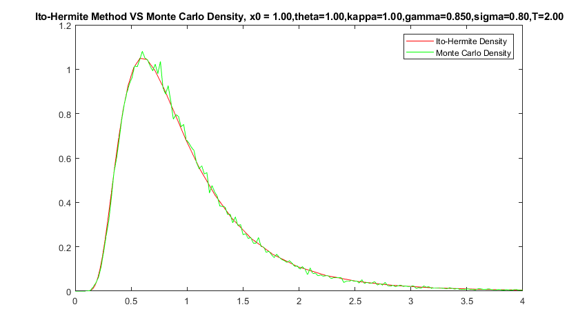](https://postimages.org/)

---

### #958 — Amin (Topic Author)
*July 25, 2020, 11:22 AM*

I have made three minor changes to the matlab program which allow a larger range of parameters to be executed with the
current program. I am copying new comments made on the program due to new changes here and then upload the new program.

%Change 1:7/25/2020: I have very heavily weighted the second derivative to

%the left of density peak with an exponential and it allows far larger

%range of parameters with stable execution without sacrificing much

%accuracy at all. Of course, it is just ad hoc.

I have made this weighting as in above comment from -2 to -5 normal SDs. After negative 2 till negative five  standard
deviations.

%Change 2:7/25/2020:%I have added a last term from quadratic variation between drift

%and w terms. I am not hundred percent sure if we need it or not.

%Change 3:7/25/2020: I have improved zero correction in above.

Here is the new program which will work for many more parameter values than the earlier program. I have disabled
mean-correction in this program code.

```
function [TrueMean,ItoHermiteMean,y_w,fy_w,wnStart] = FPERevisited044AAA02()

%Copyright Ahsan Amin. Infiniti derivatives Technologies.
%Please fell free to connect on linkedin: linkedin.com/in/ahsan-amin-0a53334
%or skype ahsan.amin2999
%In this program, I am simulating the SDE given as
%dy(t)=mu1 x(t)^beta1 dt + mu2 x(t)^beta2 dt +sigma x(t)^gamma dz(t)

%I have not directly simulated the SDE but simulated the transformed
%Besse1l process version of the SDE and then changed coordinates to retreive
%the SDE in original coo
%rdinates.
%The present program will analytically evolve only the Bessel Process version of the
%SDE in transformed coordinates.
%In this version, the mean correction has been disabled. If you are
%simulating standard mean-reverting SV type SDEs, please enable the mean
%correction by uncommenting the appropriate line in the body of code below.

dt=.125/16;   % Simulation time interval.%Fodiffusions close to zero
             %decrease dt for accuracy.
Tt=128*8/4;%16*16;     % Number of simulation levels. Terminal time= Tt*dt; //.125/32*32*16=2 year;
T=Tt*dt;
OrderA=4;  %
OrderM=4;  %
%dtM=.125/8;%Monte carlo time interval size dtM.
%TtM=8*8;%Monte carlo number of simulation intervals.
dtM=dt*4;
TtM=Tt/4;

dNn=.2/1;   % Normal density subdivisions width. would change with number of subdivisions
Nn=50;  % No of normal density subdivisions
NnMidl=25;%One half density Subdivision left from mid of normal density(low)
NnMidh=26;%One half density subdivision right from the mid of normal density(high)
NnMid=4.0;

%theta=mu1/(-mu2);
%kappa=-mu2;

x0=1.0;   % starting value of SDE
beta1=0.0;
beta2=1.0;   % Second drift term power.
gamma=.75;%50;   % volatility power.
kappa=2.0;%.950;   %mean reversion parameter.
theta=1.0;%mean reversion target
sigma0=.80;%Volatility value

%you can specify any general mu1 and mu2 and beta1 and beta2.
%The present program is not perfect but quite reasonably good.
%if there is only one term in drift with beta=0, there will be minor
%errors. This case is yet not covered.

mu1=+1*theta*kappa;   %first drift coefficient.
mu2=-1*kappa;    % Second drift coefficient.
%mu1=0;
%mu2=0;

alpha=1;% x^alpha is being expanded. This is currently for monte carlo only.
alpha1=1-gamma;

w(1:Nn)=x0^(1-gamma)/(1-gamma);

Z(1:Nn)=(((1:Nn)-5.5)*dNn-NnMid);

Z
str=input('Look at Z');
ZProb(1)=normcdf(.5*Z(1)+.5*Z(2),0,1)-normcdf(.5*Z(1)+.5*Z(2)-dNn,0,1);
ZProb(Nn)=normcdf(.5*Z(Nn)+.5*Z(Nn-1)+dNn,0,1)-normcdf(.5*Z(Nn)+.5*Z(Nn-1),0,1);

for nn=2:Nn-1
    ZProb(nn)=normcdf(.5*Z(nn)+.5*Z(nn+1),0,1)-normcdf(.5*Z(nn)+.5*Z(nn-1),0,1);
    %Above calculate probability mass in each probability subdivision.
end

%%%%%%%%%%%%%%%%%%%%%%%%%%%%%%%%%%%%%%%%%%%%%%%%%%%%%%%%%%%%%%%%%%%%%%%%%%%%%%%%%%%%%%%%%%%%%%

sigma11(1:OrderA+1)=0;
mu11(1:OrderA+1)=0;
mu22(1:OrderA+1)=0;
sigma22(1:OrderA+1)=0;
% index 1 correponds to zero level since matlab indexing starts at one.
sigma11(1)=1;
mu11(1)=1;
mu22(1)=1;
sigma22(1)=1;

for k=1:(OrderA+1)
    if sigma0~=0
        sigma11(k)=sigma0^(k-1);
    end
    if mu1 ~= 0
        mu11(k)=mu1^(k-1);
    end
    if mu2 ~= 0
        mu22(k)=mu2^(k-1);
    end
    if sigma0~=0
        sigma22(k)=sigma0^(2*(k-1));
    end
end
%Ft(1:TtM+1,1:(OrderA+1),1:(OrderA+1),1:(OrderA+1),1:(OrderA+1))=0; %General time powers on hermite polynomials
Fp(1:(OrderA+1),1:(OrderA+1),1:(OrderA+1),1:(OrderA+1))=0;%General x powers on coefficients of hermite polynomials.
Fp1(1:(OrderA+1),1:(OrderA+1),1:(OrderA+1),1:(OrderA+1))=0;%General x powers for bessel transformed coordinates.

%YCoeff0 and YCoeff are coefficents for original coordinates monte carlo.
%YqCoeff0 and YqCoeff are bessel/lamperti version monte carlo.

YCoeff0(1:(OrderA+1),1:(OrderA+1),1:(OrderA+1),1:(OrderA+1))=0;
YqCoeff0(1:(OrderA+1),1:(OrderA+1),1:(OrderA+1),1:(OrderA+1))=0;
%Pre-compute the time and power exponent values in small multi-dimensional arrays
YCoeff = ItoTaylorCoeffsNew(alpha,beta1,beta2,gamma); %expand y^alpha where alpha=1;
YqCoeff = ItoTaylorCoeffsNew(alpha1,beta1,beta2,gamma);%expand y^alpha1 where alpha1=(1-gamma)
YqCoeff=YqCoeff/(1-gamma); %Transformed coordinates coefficients have to be
%further divided by (1-gamma)

for k = 0 : (OrderA)
    for m = 0:k
        l4 = k - m + 1;
        for n = 0 : m
            l3 = m - n + 1;
            for j = 0:n
                l2 = n - j + 1;
                l1 = j + 1;
                %Ft(l1,l2,l3,l4) = dtM^((l1-1) + (l2-1) + (l3-1) + .5* (l4-1));
                Fp(l1,l2,l3,l4) = (alpha + (l1-1) * beta1 + (l2-1) * beta2 + (l3-1) * 2* gamma + (l4-1) * gamma ...
                    - (l1-1) - (l2-1) - 2* (l3-1) - (l4-1));
                Fp1(l1,l2,l3,l4) = (alpha1 + (l1-1) * beta1 + (l2-1) * beta2 + (l3-1) * 2* gamma + (l4-1) * gamma ...
                    - (l1-1) - (l2-1) - 2* (l3-1) - (l4-1));

                YCoeff0(l1,l2,l3,l4) =YCoeff(l1,l2,l3,l4).*mu11(l1).*mu22(l2).*sigma22(l3).*sigma11(l4);
                YqCoeff0(l1,l2,l3,l4) =YqCoeff(l1,l2,l3,l4).*mu11(l1).*mu22(l2).*sigma22(l3).*sigma11(l4);
            end
        end
    end
end

%%%%%%%%%%%%%%%%%%%%%%%%%%%%%%%%%%%%%%%%%%%%%%%%%%%%%%%%%%%%%%%%%%%%%%%%%%%%%%%%%%%%%%%%%%%%%%
wnStart=1;%
d2wdZ2(1:Nn)=0;
d2wdZ2A(1:Nn)=0;
d2wdZ2B(1:Nn)=0;
d2wdZ2C(1:Nn)=0;
dwdZ(1:Nn)=0;
yy(wnStart:Nn)=((1-gamma)*w(wnStart:Nn)).^(1/(1-gamma));
tic

for tt=1:Tt

     yy(wnStart:Nn)=((1-gamma)*w(wnStart:Nn)).^(1/(1-gamma));

    [wMu0dt,dwMu0dtdw,d2wMu0dtdw2,d3wMu0dtdw3,c1,c2,c3,c4] =
CalculateDriftAndVolOrder4(w,wnStart,Nn,YqCoeff0,Fp1,gamma,dt);

    wPrev=w;
    dw(wnStart:Nn)=c1(wnStart:Nn).*Z(wnStart:Nn) ;% ...
    dw2(wnStart:Nn)=dw(wnStart:Nn).^2;
    w(isnan(w)==1)=0;
    wMu0dt(isnan(wMu0dt)==1)=0;
    wMeanPrev=sum(ZProb(wnStart:Nn).*w(wnStart:Nn));%Calculate the mean.

%%%%%%%%%%%%%%%%%%%%%%%%%%%%%%%%%%%%%%%%%%%%%%%%%%%%%%%%%%%%%%%%%%%%%%%%%%%

d2wdZ2(wnStart:Nn)=d2wdZ2(wnStart:Nn)+
d2wMu0dtdw2(wnStart:Nn).*dwdZ(wnStart:Nn).^2+dwMu0dtdw(wnStart:Nn).*d2wdZ2(wnStart:Nn)+.33*(Z(wnStart:Nn)).*sigma0^2*dt^2;;%+
...

[dwdZ,d2wdZ2A] = First2Derivatives2ndOrderEqSpaced(wnStart,Nn,dNn,w,Z);

if (tt>24)
d2wdZ2=d2wdZ2A;
d2wdZ2(21:29)=d2wdZ2(20)*(30-(21:29))/10+d2wdZ2(30)*((21:29)-20)/10;

d2wdZ2(1:15)=d2wdZ2(1:15).*exp(-32*kappa^2*(1-gamma).*dNn*(15-(1:15)));
%Change 1:7/25/2020: I have very heavily weighted the second derivative to
%the left of density peak with an exponential and it allows far larger
%range of parameters with stable execution without sacrificing much
%accuracy. Of course, it is just ad hoc.
end
%If the calculation of the program blows, it means that above calculated
%derivative is unstable or bad. Plese replace with your favourite method of
%calculating this second derivative.

%plot((wnStart:Nn),d2wdZ2,'r',(wnStart:Nn),d2wdZ2A,'g');
%tt
%str=input('Look at comparison of d2wdZ2. Interpolation starts after tt=32');

dZdw(wnStart:Nn)=1.0./dwdZ(wnStart:Nn);
H2(wnStart:Nn)=(Z(wnStart:Nn).^2-1);

if(tt==1)
w(wnStart:Nn)=wMeanPrev+wMu0dt(wnStart:Nn)+ ...
          sign(w(wnStart:Nn)-wMeanPrev+dw(wnStart:Nn)).* ...
          sqrt(abs(sign(w(wnStart:Nn)-wMeanPrev).*(w(wnStart:Nn)-wMeanPrev).^2+ ...
          sign(dw(wnStart:Nn)).*dw2(wnStart:Nn)));
end
if(tt>1)

    dw(wnStart:Nn)=sigma0*sqrt(dt).*Z(wnStart:Nn);
    dw2(wnStart:Nn)=sigma0^2*dt*Z(wnStart:Nn).^2;

  [wS] = InterpolateOrderN6(6,Z(1)-dNn,Z(1),Z(2),Z(3),Z(4),Z(5),Z(6),w(1),w(2),w(3),w(4),w(5),w(6));
  [wE] =
InterpolateOrderN6(6,Z(Nn)+dNn,Z(Nn),Z(Nn-1),Z(Nn-2),Z(Nn-3),Z(Nn-4),Z(Nn-5),w(Nn),w(Nn-1),w(Nn-2),w(Nn-3),w(Nn-4),w(Nn-5));

  %wS in point interpolated to the left of the grid.
  %wE in point interpolated to the right of the grid.

  wAdjacentB(wnStart:Nn)=0;
  wAdjacentF(wnStart:Nn)=0;
  ZAdjacentB(wnStart:Nn)=0;
  ZAdjacentF(wnStart:Nn)=0;
  dwdZB(wnStart:Nn)=0;
  dwdZF(wnStart:Nn)=0;

  wAdjacentB(wnStart+1:Nn)=w(wnStart:Nn-1);
  wAdjacentB(wnStart)=wS;
  ZAdjacentB(wnStart+1:Nn)=Z(wnStart:Nn-1);
  ZAdjacentB(wnStart)=Z(wnStart)-dNn;
  dwdZB(wnStart:Nn)=(w(wnStart:Nn)-wAdjacentB(wnStart:Nn))/(dNn);

  wAdjacentF(wnStart:Nn-1)=w(wnStart+1:Nn);
  wAdjacentF(Nn)=wE;
  ZAdjacentF(wnStart:Nn-1)=Z(wnStart+1:Nn);
  ZAdjacentF(Nn)=Z(Nn)+dNn;
  dwdZF(wnStart:Nn)=(w(wnStart:Nn)-wAdjacentF(wnStart:Nn))/(-dNn);

 
DeltaZwDeltaZ(wnStart:Nn)=(ZAdjacentF(wnStart:Nn).*wAdjacentF(wnStart:Nn)-ZAdjacentB(wnStart:Nn).*wAdjacentB(wnStart:Nn))/(2*dNn);

  C11(wnStart:Nn)=.707;%dwdZ(wnStart:Nn);%.707000;
  C22=4*dt;%
  C33=8*dt*sqrt(2);%
  C44=1.0;
%  C22=.5*sigma0*sqrt(dt);%
%  C33=sigma0*sqrt(dt);%

% 
 w(wnStart:Nn)=wMu0dt(wnStart:Nn)+((.5*wAdjacentB(wnStart:Nn)+w(wnStart:Nn)+.5*wAdjacentF(wnStart:Nn)-.5*dZwdZ(wnStart:Nn)+
...
%             C11*d2wdZ2(wnStart:Nn))+ ...
%             sign(w(wnStart:Nn)-.5*wAdjacentB(wnStart:Nn)-.5*wAdjacentF(wnStart:Nn)+.5*dZwdZ(wnStart:Nn)+ ...
%             -C11*d2wdZ2(wnStart:Nn)+dw(wnStart:Nn)).* ...
%             sqrt(abs(sign(w(wnStart:Nn)-.5*wAdjacentB(wnStart:Nn)-.5*wAdjacentF(wnStart:Nn)+.5*dZwdZ(wnStart:Nn)+ ...
%             -C11*d2wdZ2(wnStart:Nn)).* ...
%             (w(wnStart:Nn)-.5*wAdjacentB(wnStart:Nn)-.5*wAdjacentF(wnStart:Nn)+.5*dZwdZ(wnStart:Nn)+ ...
%             -C11*d2wdZ2(wnStart:Nn)).^2+ ...
%             sign(+dw(wnStart:Nn)).*dw2(wnStart:Nn))))+ ...
%             -C33.*dwMu0dtdw(wnStart:Nn).*dwdZ(wnStart:Nn).^2 + ...
%             +C22.*3*Z(wnStart:Nn).^1.*dZdw(wnStart:Nn).*d2wdZ2(wnStart:Nn)*sigma0^2.*dt ;

  Term0(wnStart:Nn)=.5*wAdjacentB(wnStart:Nn)+.5*wAdjacentF(wnStart:Nn)-DeltaZwDeltaZ(wnStart:Nn);

  w(wnStart:Nn)=w(wnStart:Nn)+wMu0dt(wnStart:Nn)+((Term0(wnStart:Nn)+C11(wnStart:Nn).*d2wdZ2(wnStart:Nn))+ ...
            sign(-Term0(wnStart:Nn)-C11(wnStart:Nn).*d2wdZ2(wnStart:Nn)+dw(wnStart:Nn)).* ...
            sqrt(abs(sign(-Term0(wnStart:Nn)-C11(wnStart:Nn).*d2wdZ2(wnStart:Nn)).* ...
            (-Term0(wnStart:Nn)-C11(wnStart:Nn).*d2wdZ2(wnStart:Nn)).^2+ ...
            sign(+dw(wnStart:Nn)).*dw2(wnStart:Nn))))+ ...
            -C33.*dwMu0dtdw(wnStart:Nn).*dwdZ(wnStart:Nn).^2 + ...
            +C22.*3*Z(wnStart:Nn).^1.*dZdw(wnStart:Nn).*d2wdZ2(wnStart:Nn)*sigma0^2.*dt + ...
            +(1-1/sqrt(3))*dwMu0dtdw(wnStart:Nn).*sigma0^2*dt;

        %Change 2:7/25/2020:%I have added a last term from quadratic variation between drift
        %and w terms. I am not very sure if we need it or not.

end

%%%%%%%%%%%%%%%%%%%%%%%%%%%%%%%%%%%%%%%%%%%%%%%%%%%%%%%%%%%%%%%%%%%%%%%%%%%
%Below are instability correction equations. There is instability in the
% SDE representation equation roughly between -.5 SD to +.5 SD in normal terms.
%Instability correction Algorithm takes two ends that are here given as
%lower end=w(NnMidl-2) and upper end=w(NnMidh+3).
%In the block below the interpolation starts from lower end.
%1st equation is
%wll(NnMidl-1)=w(NnMidl-2)+(D1wl+CTheta*D2wl*dNn/1+.5*DeltaD1w)*dNn;
%Second equation is: wll(NnMidl)=wll(NnMidl-1)+(D1wl+CTheta*D2wl*dNn+1.5*DeltaD1w)*dNn;
%And so on.
%There is a sixth equation that is not written below(since it takes us to
%the upper interpolation point which is already known) which is
%wll(NnMidh+3)=wll(NnMidh+2)+(D1wl+CTheta*D2wl*dNn+5.5*DeltaD1w)*dNn;
%Sum of these six equations add up to the distance between upper and lower
%interpolation points.
%In the sum there are six instances of first derivative which is already
%calculated at the boundary, six instances of second derivative which is also
%already calculated at lower boundary and 18.0 instances of DeltaD1w which is
%unknown. This equation calculates the value of one unit of DeltaD1w addition
%DeltaD1w=(w(NnMidh+3)-w(NnMidl-2)-6*D1wl*dNn-6.0*CTheta*D2wl*dNn.^2.0/1.0)/18.0/dNn;
% I hope to find a better analytical method to tackle this issue. Friends
% are welcome to play with slightly changed related alternatives to the
%above interpolation.
    CTheta=0;
    D1wl=(11/6*w(NnMidl-2)-3*w(NnMidl-3)+3/2*w(NnMidl-4)-1/3*w(NnMidl-5))/dNn;
    D2wl=(35/12*w(NnMidl-2) -26/3*w(NnMidl-3)+ 19/2*w(NnMidl-4)-14/3*w(NnMidl-5)+11/12*w(NnMidl-6))/dNn.^2;
    DeltaD1w=(w(NnMidh+3)-w(NnMidl-2)-6*D1wl*dNn-6.0*CTheta*D2wl*dNn.^2.0/1.0)/18.0/dNn;

    wll(NnMidl-1)=w(NnMidl-2)+  (D1wl+CTheta*D2wl*dNn+.5*DeltaD1w)*dNn;
    wll(NnMidl)=wll(NnMidl-1)+  (D1wl+CTheta*D2wl*dNn+1.5*DeltaD1w)*dNn;
    wll(NnMidh)=wll(NnMidl)+    (D1wl+CTheta*D2wl*dNn+2.5*DeltaD1w)*dNn;
    wll(NnMidh+1)=wll(NnMidh)+  (D1wl+CTheta*D2wl*dNn+3.5*DeltaD1w)*dNn;
    wll(NnMidh+2)=wll(NnMidh+1)+(D1wl+CTheta*D2wl*dNn+4.5*DeltaD1w)*dNn;
    %wll(NnMidh+3)=wll(NnMidh+2)+(D1wl+CTheta*D2wl*dNn+5.5*DeltaD1w)*dNn;
%The last equation is not used since point w(NnMidh+3)is given but it is used in
%calculation of distance between two interpolation points. This distance is
%used to determine the value of DeltaD1w.

    D1wh=(-11/6*w(NnMidh+3)+3*w(NnMidh+4)-3/2*w(NnMidh+5)+1/3*w(NnMidh+6))/dNn;
    D2wh=(35/12*w(NnMidh+3) -26/3*w(NnMidh+4)+ 19/2*w(NnMidh+5)-14/3*w(NnMidh+6)+11/12*w(NnMidh+7))/dNn.^2;
    DeltaD1w=(w(NnMidh+3)-w(NnMidl-2)-6*D1wh*dNn-6.0*CTheta*D2wh*dNn.^2.0/1.0)/18.0/dNn;
%     DeltaD1w=(w(NnMidh+2)-w(NnMidl-1)-4*D1wh*dNn-16.0*D2wh*dNn.^2.0/1.0)/6.0/dNn;

    whh(NnMidh+2)=w(NnMidh+3)-(D1wh+CTheta*D2wh*dNn+.5*DeltaD1w)*dNn;
    whh(NnMidh+1)=w(NnMidh+2)-(D1wh+CTheta*D2wh*dNn+1.5* DeltaD1w)*dNn;
    whh(NnMidh)=whh(NnMidh+1)-(D1wh+CTheta*D2wh*dNn+2.5* DeltaD1w)*dNn;
    whh(NnMidl)=whh(NnMidh)-(D1wh+CTheta*D2wh*dNn+3.5* DeltaD1w)*dNn;
    whh(NnMidl-1)=whh(NnMidl)-(D1wh+CTheta*D2wh*dNn+4.5* DeltaD1w)*dNn;

    %whh(NnMidl-2)=whh(NnMidl-1)-(D1wh+CTheta*D2wh*dNn/1+5.5* DeltaD1w)*dNn;

        w(NnMidh+2)=.5*whh(NnMidh+2)+.5*wll(NnMidh+2);
        w(NnMidh+1)=.5*whh(NnMidh+1)+.5*wll(NnMidh+1);
        w(NnMidh)=.5*whh(NnMidh)+.5*wll(NnMidh);
        w(NnMidl)=.5*whh(NnMidl)+.5*wll(NnMidl);
        w(NnMidl-1)=.5*whh(NnMidl-1)+.5*wll(NnMidl-1);

  [wE] =
InterpolateOrderN6(6,Z(Nn)+dNn,Z(Nn),Z(Nn-1),Z(Nn-2),Z(Nn-3),Z(Nn-4),Z(Nn-5),w(Nn),w(Nn-1),w(Nn-2),w(Nn-3),w(Nn-4),w(Nn-5));

        w1(1:Nn-1)=w(1:Nn-1);
        w1(Nn)=w(Nn);
        w2(1:Nn-1)=w(2:Nn);
        w2(Nn)=wE;

w(w1(:)>w2(:))=0;%Be careful;might not universally hold;
     %Change 3:7/25/2020: I have improved zero correction in above.
        w(w<0)=0.0;
        for nn=1:Nn
            if(w(nn)<=0)
                wnStart=nn+1;
           end
        end

        %%1st order mean correction. We know the mean in original
        %%coordinates so I shift the density into original coordinates,
        %%apply the mean correction and then transform again into Lamperti
        %%coordinates. Algebra solves two equations in two unknowns.
        %%Equations are Sum_0^N{(Y_w(wnStart:Nn)-Y0)*W0}=1 and the second
        %%equation is Sum_0^N{Y_w(wnStart:Nn).*(Y_w(wnStart:Nn)-Y0)*W0}=u0
        %%Two unknows are Y0 and W0. u0 is known mean.
        tt;
        u0=theta+(x0-theta)*exp(-kappa*(tt*dt)); %analytic mean of the density

        %If you are not using stochastic volatility, replace above with
        %true mean otherwise results would become garbage.

        Y_w(wnStart:Nn) = ((1-gamma)*w(wnStart:Nn)).^(1/(1-gamma));

        Yn2Pn=sum(Y_w(wnStart:Nn).*Y_w(wnStart:Nn).*ZProb(wnStart:Nn));
        YnPn=sum(Y_w(wnStart:Nn).*ZProb(wnStart:Nn));
        Pn=1.0;%%Sum(ZProb(1:Nn))
        Y0=(Yn2Pn-u0*YnPn)/(YnPn-u0*Pn);

        Y0Pn=Y0*Pn;
        W0=1/(YnPn-Y0Pn);
        YCorrected(wnStart:Nn)=Y_w(wnStart:Nn).*(Y_w(wnStart:Nn)-Y0)*W0;
        wCorrected(wnStart:Nn)=(YCorrected(wnStart:Nn).^(1-gamma))./(1-gamma);
   %     w(wnStart:Nn)=wCorrected(wnStart:Nn);

   %I have disabled the mean correction. The above mean correction is only valid for
   %standard mean reverting stochastic volatility type SDEs. To enable mean
   %correction please uncomment the above last line in the block.

end

 y_w(1:Nn)=0;
 y_w(wnStart:Nn) = ((1-gamma)*w(wnStart:Nn)).^(1/(1-gamma));
 Dfy_w(wnStart:Nn)=0;
 Dfw(wnStart:Nn)=0;
for nn=wnStart+1:Nn-1
    Dfy_w(nn) = (y_w(nn + 1) - y_w(nn - 1))/(Z(nn + 1) - Z(nn - 1));
    Dfw(nn) = (w(nn + 1) - w(nn - 1))/(Z(nn + 1) - Z(nn - 1));
    %Change of variable derivative for densities
end
fy_w(1:Nn)=0;
fw(1:Nn)=0;
for nn = wnStart:Nn-1
    fy_w(nn) = (normpdf(Z(nn),0, 1))/abs(Dfy_w(nn));%Origianl coordinates density
    fw(nn) = (normpdf(Z(nn),0, 1))/abs(Dfw(nn));
end

toc

ItoHermiteMean=sum(y_w(wnStart+1:Nn-1).*ZProb(wnStart+1:Nn-1)) %Original process average from coordinates

 disp('true Mean only applicble to standard SV mean reverting type models otherwise disregard');
 TrueMean=theta+(x0-theta)*exp(-kappa*dt*Tt)%Mean reverting SDE original variable true average

 rng(29079137, 'twister')
 paths=100000;
 YY(1:paths)=x0;  %Original process monte carlo.
 Random1(1:paths)=0;
 YYMean(1:TtM)=0;
 for tt=1:TtM
     Random1=randn(size(Random1));
     HermiteP1(1,1:paths)=1;
     HermiteP1(2,1:paths)=Random1(1:paths);
     HermiteP1(3,1:paths)=Random1(1:paths).^2-1;
     HermiteP1(4,1:paths)=Random1(1:paths).^3-3*Random1(1:paths);
     HermiteP1(5,1:paths)=Random1(1:paths).^4-6*Random1(1:paths).^2+3;

     YY(1:paths)=YY(1:paths) + ...
      (YCoeff0(1,1,2,1).*YY(1:paths).^Fp(1,1,2,1)+ ...
      YCoeff0(1,2,1,1).*YY(1:paths).^Fp(1,2,1,1)+ ...
      YCoeff0(2,1,1,1).*YY(1:paths).^Fp(2,1,1,1))*dtM + ...
      (YCoeff0(1,1,3,1).*YY(1:paths).^Fp(1,1,3,1)+ ...
      YCoeff0(1,2,2,1).*YY(1:paths).^Fp(1,2,2,1)+ ...
      YCoeff0(2,1,2,1).*YY(1:paths).^Fp(2,1,2,1)+ ...
      YCoeff0(1,3,1,1).*YY(1:paths).^Fp(1,3,1,1)+ ...
      YCoeff0(2,2,1,1).*YY(1:paths).^Fp(2,2,1,1)+ ...
      YCoeff0(3,1,1,1).*YY(1:paths).^Fp(3,1,1,1))*dtM^2 + ...
      ((YCoeff0(1,1,1,2).*YY(1:paths).^Fp(1,1,1,2).*sqrt(dtM))+ ...
    (YCoeff0(1,1,2,2).*YY(1:paths).^Fp(1,1,2,2)+ ...
    YCoeff0(1,2,1,2).*YY(1:paths).^Fp(1,2,1,2)+ ...
    YCoeff0(2,1,1,2).*YY(1:paths).^Fp(2,1,1,2)).*dtM^1.5) .*HermiteP1(2,1:paths) + ...
    ((YCoeff0(1,1,1,3).*YY(1:paths).^Fp(1,1,1,3) *dtM) + ...
    (YCoeff0(1,1,2,3).*YY(1:paths).^Fp(1,1,2,3)+ ...
    YCoeff0(1,2,1,3).*YY(1:paths).^Fp(1,2,1,3)+ ...
    YCoeff0(2,1,1,3).*YY(1:paths).^Fp(2,1,1,3)).*dtM^2).*HermiteP1(3,1:paths) + ...
    ((YCoeff0(1,1,1,4).*YY(1:paths).^Fp(1,1,1,4)*dtM^1.5 )).*HermiteP1(4,1:paths) + ...
    (YCoeff0(1,1,1,5).*YY(1:paths).^Fp(1,1,1,5)*dtM^2.0).*HermiteP1(5,1:paths);

%Uncomment for fourth order monte carlo

%
%   YY(1:paths)=YY(1:paths) + ...
%       (YCoeff0(1,1,2,1).*YY(1:paths).^Fp(1,1,2,1)+YCoeff0(1,2,1,1).*YY(1:paths).^Fp(1,2,1,1)+ ...
%       YCoeff0(2,1,1,1).*YY(1:paths).^Fp(2,1,1,1))*dtM + ...
%       (YCoeff0(1,1,3,1).*YY(1:paths).^Fp(1,1,3,1)+YCoeff0(1,2,2,1).*YY(1:paths).^Fp(1,2,2,1)+ ...
%       YCoeff0(2,1,2,1).*YY(1:paths).^Fp(2,1,2,1)+YCoeff0(1,3,1,1).*YY(1:paths).^Fp(1,3,1,1)+ ...
%       YCoeff0(2,2,1,1).*YY(1:paths).^Fp(2,2,1,1)+YCoeff0(3,1,1,1).*YY(1:paths).^Fp(3,1,1,1))*dtM^2 + ...
%       (YCoeff0(1,1,4,1).*YY(1:paths).^Fp(1,1,4,1)+YCoeff0(1,2,3,1).*YY(1:paths).^Fp(1,2,3,1)+ ...
%       YCoeff0(2,1,3,1).*YY(1:paths).^Fp(2,1,3,1)+YCoeff0(1,3,2,1).*YY(1:paths).^Fp(1,3,2,1)+ ...
%       YCoeff0(2,2,2,1).*YY(1:paths).^Fp(2,2,2,1)+YCoeff0(3,1,2,1).*YY(1:paths).^Fp(3,1,2,1)+ ...
%       YCoeff0(1,4,1,1).*YY(1:paths).^Fp(1,4,1,1)+YCoeff0(2,3,1,1).*YY(1:paths).^Fp(2,3,1,1)+ ...
%       YCoeff0(3,2,1,1).*YY(1:paths).^Fp(3,2,1,1)+YCoeff0(4,1,1,1).*YY(1:paths).^Fp(4,1,1,1))*dtM^3 + ...
%        (YCoeff0(1,1,5,1).*YY(1:paths).^Fp(1,1,5,1)+YCoeff0(1,2,4,1).*yy(1:paths).^Fp(1,2,4,1)+ ...
%     YCoeff0(2,1,4,1).*YY(1:paths).^Fp(2,1,4,1)+YCoeff0(2,1,1,1).*yy(1:paths).^Fp(2,1,1,1)+ ...
%      YCoeff0(2,2,3,1).*YY(1:paths).^Fp(2,2,3,1)+ ...
%      YCoeff0(3,1,3,1).*YY(1:paths).^Fp(3,1,3,1)+YCoeff0(1,4,2,1).*YY(1:paths).^Fp(1,4,2,1)+ ...
%      YCoeff0(2,3,2,1).*YY(1:paths).^Fp(2,3,2,1)+YCoeff0(3,2,2,1).*YY(1:paths).^Fp(3,2,2,1)+ ...
%      YCoeff0(4,1,2,1).*YY(1:paths).^Fp(4,1,2,1)+YCoeff0(1,5,1,1).*YY(1:paths).^Fp(1,5,1,1)+ ...
%      YCoeff0(2,4,1,1).*YY(1:paths).^Fp(2,4,1,1)+ ...
%      YCoeff0(3,3,1,1).*YY(1:paths).^Fp(3,3,1,1)+YCoeff0(4,2,1,1).*YY(1:paths).^Fp(4,2,1,1)+ ...
%      YCoeff0(5,1,1,1).*YY(1:paths).^Fp(5,1,1,1))*dtM^4+ ...
%       ((YCoeff0(1,1,1,2).*YY(1:paths).^Fp(1,1,1,2).*sqrt(dtM))+ ...
%     (YCoeff0(1,1,2,2).*YY(1:paths).^Fp(1,1,2,2)+YCoeff0(1,2,1,2).*YY(1:paths).^Fp(1,2,1,2)+ ...
%     YCoeff0(2,1,1,2).*YY(1:paths).^Fp(2,1,1,2)).*dtM^1.5+ ...
%     (YCoeff0(1,1,3,2).*YY(1:paths).^Fp(1,1,3,2)+YCoeff0(1,2,2,2).*YY(1:paths).^Fp(1,2,2,2)+ ...
%     YCoeff0(2,1,2,2).*YY(1:paths).^Fp(2,1,2,2)+YCoeff0(1,3,1,2).*YY(1:paths).^Fp(1,3,1,2)+ ...
%     YCoeff0(2,2,1,2).*YY(1:paths).^Fp(2,2,1,2)+YCoeff0(3,1,1,2).*YY(1:paths).^Fp(3,1,1,2)).*dtM^2.5+ ...
%     (YCoeff0(1,1,4,2).*YY(1:paths).^Fp(1,1,4,2)+YCoeff0(1,2,3,2).*YY(1:paths).^Fp(1,2,3,2)+ ...
%     YCoeff0(2,1,3,2).*YY(1:paths).^Fp(2,1,3,2)+YCoeff0(1,3,2,2).*YY(1:paths).^Fp(1,3,2,2)+ ...
%     YCoeff0(2,2,2,2).*YY(1:paths).^Fp(2,2,2,2)+ YCoeff0(3,1,2,2).*YY(1:paths).^Fp(3,1,2,2)+ ...
%     YCoeff0(1,4,1,2).*YY(1:paths).^Fp(1,4,1,2)+YCoeff0(2,3,1,2).*YY(1:paths).^Fp(2,3,1,2)+ ...
%     YCoeff0(3,2,1,2).*YY(1:paths).^Fp(3,2,1,2)+YCoeff0(4,1,1,2).*YY(1:paths).^Fp(4,1,1,2)).*dtM^3.5)
.*HermiteP1(2,1:paths) + ...
%     ((YCoeff0(1,1,1,3).*YY(1:paths).^Fp(1,1,1,3) *dtM) + ...
%     (YCoeff0(1,1,2,3).*YY(1:paths).^Fp(1,1,2,3)+YCoeff0(1,2,1,3).*YY(1:paths).^Fp(1,2,1,3)+ ...
%     YCoeff0(2,1,1,3).*YY(1:paths).^Fp(2,1,1,3)).*dtM^2+ ...
%     (YCoeff0(1,1,3,3).*YY(1:paths).^Fp(1,1,3,3)+YCoeff0(1,2,2,3).*YY(1:paths).^Fp(1,2,2,3)+ ...
%     YCoeff0(2,1,2,3).*YY(1:paths).^Fp(2,1,2,3) + YCoeff0(1,3,1,3).*YY(1:paths).^Fp(1,3,1,3)+ ...
%   
 YCoeff0(2,2,1,3).*YY(1:paths).^Fp(2,2,1,3)+YCoeff0(3,1,1,3).*YY(1:paths).^Fp(3,1,1,3)).*dtM^3).*HermiteP1(3,1:paths) +
...
%     ((YCoeff0(1,1,1,4).*YY(1:paths).^Fp(1,1,1,4)*dtM^1.5 )+ ...
%     (YCoeff0(1,1,2,4).*YY(1:paths).^Fp(1,1,2,4)+YCoeff0(1,2,1,4).*YY(1:paths).^Fp(1,2,1,4)+ ...
%     YCoeff0(2,1,1,4).*YY(1:paths).^Fp(2,1,1,4))*dtM^2.5).*HermiteP1(4,1:paths) + ...
%     (YCoeff0(1,1,1,5).*YY(1:paths).^Fp(1,1,1,5)*dtM^2.0).*HermiteP1(5,1:paths);
%

     YYMean(tt)=YYMean(tt)+sum(YY(1:paths))/paths;
 end
 YY(YY<0)=0;
 disp('Original process average from monte carlo');
 MCMean=sum(YY(:))/paths %origianl coordinates monte carlo average.
 disp('Original process average from our simulation');
 ItoHermiteMean=sum(y_w(wnStart+1:Nn-1).*ZProb(wnStart+1:Nn-1)) %Original process average from coordinates

 disp('true Mean only applicble to standard SV mean reverting type models otherwise disregard');
 TrueMean=theta+(x0-theta)*exp(-kappa*dt*Tt)%Mean reverting SDE original variable true average

 MaxCutOff=30;
 NoOfBins=round(300*gamma^2*4*sigma0);%Decrease the number of bins if the graph is too
 [YDensity,IndexOutY,IndexMaxY] = MakeDensityFromSimulation_Infiniti_NEW(YY,paths,NoOfBins,MaxCutOff );
 plot(y_w(wnStart+1:Nn-1),fy_w(wnStart+1:Nn-1),'r',IndexOutY(1:IndexMaxY),YDensity(1:IndexMaxY),'g');
 %plot(y_w(wnStart+1:Nn-1),fy_w(wnStart+1:Nn-1),'r',IndexOutY(1:IndexMaxY),YDensity(1:IndexMaxY),'g',Z(wnStart+1:Nn-1),fy_w(wnStart+1:Nn-1),'b');

 title(sprintf('Ito-Hermite Method VS Monte Carlo Density, x0 =
%.2f,theta=%.2f,kappa=%.2f,gamma=%.3f,sigma=%.2f,T=%.2f', x0,theta,kappa,gamma,sigma0,T));%,sprintf('theta= %f', theta),
sprintf('kappa = %f', kappa),sprintf('sigma = %f', sigma0),sprintf('T = %f', T));

 %title('text',sprintf('x0 = %f', x0),sprintf('theta= %f', theta), sprintf('kappa = %f', kappa),sprintf('sigma = %f',
sigma0),sprintf('T = %f', T))
 %xlabel(a)
 %title('Graphical Comparison of Ito-Hermite Method and Monte Carlo Method Density')
 legend({'Ito-Hermite Density','Monte Carlo Density'},'Location','northeast')

 str=input('red line is density of SDE from Ito-Hermite method, green is monte carlo.');

end
```

Here is output of the program. Mean-correction is disabled.

MCMean =

   1.000838760266297

Original process average from our simulation

ItoHermiteMean =

   0.998849108605160

true Mean only applicble to standard SV mean reverting type models otherwise disregard

TrueMean =

     1

IndexMax =

   541

Here is the output graph of the program.

[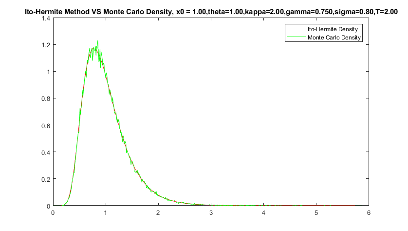](https://postimages.org/)

---

### #959 — Amin (Topic Author)
*July 26, 2020, 2:28 AM*

Please protest against torture on me. https://forum.wilmott.com/viewtopic.php?f=15&t=94796&p=859402#p859402

---

### #960 — Amin (Topic Author)
*July 27, 2020, 3:58 PM*

Post in progress.

%Change 7/27/2020

%I have switched to Lagrange interpolation by taking four points on both

%sides of instability and using 8th order interpolation of five points in

%mid between the eight points on sides. This works far better and you can

%now use nuemrical 2nd derivative without any modification for a large

%range of parameters. It truly improves the fit to true density when it

%works.

```
function [TrueMean,ItoHermiteMean,y_w,fy_w,wnStart] = FPERevisited044Wilmott08()

%Copyright Ahsan Amin. Infiniti derivatives Technologies.
%Please fell free to connect on linkedin: linkedin.com/in/ahsan-amin-0a53334
%or skype ahsan.amin2999
%In this program, I am simulating the SDE given as
%dy(t)=mu1 x(t)^beta1 dt + mu2 x(t)^beta2 dt +sigma x(t)^gamma dz(t)

%I have not directly simulated the SDE but simulated the transformed
%Besse1l process version of the SDE and then changed coordinates to retreive
%the SDE in original coo
%rdinates.
%The present program will analytically evolve only the Bessel Process version of the
%SDE in transformed coordinates.
%In this version, the mean correction has been disabled. If you are
%simulating standard mean-reverting SV type SDEs, please enable the mean
%correction by uncommenting the appropriate line in the body of code below.

dt=.125/16;   % Simulation time interval.%Fodiffusions close to zero
             %decrease dt for accuracy.
Tt=128*8/4;%16*16;     % Number of simulation levels. Terminal time= Tt*dt; //.125/32*32*16=2 year;
T=Tt*dt;
OrderA=4;  %
OrderM=4;  %
%dtM=.125/8;%Monte carlo time interval size dtM.
%TtM=8*8;%Monte carlo number of simulation intervals.
dtM=dt*4;
TtM=Tt/4;

dNn=.2/1;   % Normal density subdivisions width. would change with number of subdivisions
Nn=50;  % No of normal density subdivisions
NnMidl=25;%One half density Subdivision left from mid of normal density(low)
NnMidh=26;%One half density subdivision right from the mid of normal density(high)
NnMid=4.0;

%theta=mu1/(-mu2);
%kappa=-mu2;

x0=1.0;   % starting value of SDE
beta1=0.0;
beta2=1.0;   % Second drift term power.
gamma=.75;%50;   % volatility power.
kappa=2.0;%.950;   %mean reversion parameter.
theta=.250;%mean reversion target
sigma0=.70;%Volatility value

%you can specify any general mu1 and mu2 and beta1 and beta2.

mu1=+1*theta*kappa;   %first drift coefficient.
mu2=-1*kappa;    % Second drift coefficient.
%mu1=0;
%mu2=0;

alpha=1;% x^alpha is being expanded. This is currently for monte carlo only.
alpha1=1-gamma;

w(1:Nn)=x0^(1-gamma)/(1-gamma);

Z(1:Nn)=(((1:Nn)-5.5)*dNn-NnMid);

Z
str=input('Look at Z');
ZProb(1)=normcdf(.5*Z(1)+.5*Z(2),0,1)-normcdf(.5*Z(1)+.5*Z(2)-dNn,0,1);
ZProb(Nn)=normcdf(.5*Z(Nn)+.5*Z(Nn-1)+dNn,0,1)-normcdf(.5*Z(Nn)+.5*Z(Nn-1),0,1);

for nn=2:Nn-1
    ZProb(nn)=normcdf(.5*Z(nn)+.5*Z(nn+1),0,1)-normcdf(.5*Z(nn)+.5*Z(nn-1),0,1);
    %Above calculate probability mass in each probability subdivision.
end

%%%%%%%%%%%%%%%%%%%%%%%%%%%%%%%%%%%%%%%%%%%%%%%%%%%%%%%%%%%%%%%%%%%%%%%%%%%%%%%%%%%%%%%%%%%%%%

sigma11(1:OrderA+1)=0;
mu11(1:OrderA+1)=0;
mu22(1:OrderA+1)=0;
sigma22(1:OrderA+1)=0;
% index 1 correponds to zero level since matlab indexing starts at one.
sigma11(1)=1;
mu11(1)=1;
mu22(1)=1;
sigma22(1)=1;

for k=1:(OrderA+1)
    if sigma0~=0
        sigma11(k)=sigma0^(k-1);
    end
    if mu1 ~= 0
        mu11(k)=mu1^(k-1);
    end
    if mu2 ~= 0
        mu22(k)=mu2^(k-1);
    end
    if sigma0~=0
        sigma22(k)=sigma0^(2*(k-1));
    end
end
%Ft(1:TtM+1,1:(OrderA+1),1:(OrderA+1),1:(OrderA+1),1:(OrderA+1))=0; %General time powers on hermite polynomials
Fp(1:(OrderA+1),1:(OrderA+1),1:(OrderA+1),1:(OrderA+1))=0;%General x powers on coefficients of hermite polynomials.
Fp1(1:(OrderA+1),1:(OrderA+1),1:(OrderA+1),1:(OrderA+1))=0;%General x powers for bessel transformed coordinates.

%YCoeff0 and YCoeff are coefficents for original coordinates monte carlo.
%YqCoeff0 and YqCoeff are bessel/lamperti version monte carlo.

YCoeff0(1:(OrderA+1),1:(OrderA+1),1:(OrderA+1),1:(OrderA+1))=0;
YqCoeff0(1:(OrderA+1),1:(OrderA+1),1:(OrderA+1),1:(OrderA+1))=0;
%Pre-compute the time and power exponent values in small multi-dimensional arrays
YCoeff = ItoTaylorCoeffsNew(alpha,beta1,beta2,gamma); %expand y^alpha where alpha=1;
YqCoeff = ItoTaylorCoeffsNew(alpha1,beta1,beta2,gamma);%expand y^alpha1 where alpha1=(1-gamma)
YqCoeff=YqCoeff/(1-gamma); %Transformed coordinates coefficients have to be
%further divided by (1-gamma)

for k = 0 : (OrderA)
    for m = 0:k
        l4 = k - m + 1;
        for n = 0 : m
            l3 = m - n + 1;
            for j = 0:n
                l2 = n - j + 1;
                l1 = j + 1;
                %Ft(l1,l2,l3,l4) = dtM^((l1-1) + (l2-1) + (l3-1) + .5* (l4-1));
                Fp(l1,l2,l3,l4) = (alpha + (l1-1) * beta1 + (l2-1) * beta2 + (l3-1) * 2* gamma + (l4-1) * gamma ...
                    - (l1-1) - (l2-1) - 2* (l3-1) - (l4-1));
                Fp1(l1,l2,l3,l4) = (alpha1 + (l1-1) * beta1 + (l2-1) * beta2 + (l3-1) * 2* gamma + (l4-1) * gamma ...
                    - (l1-1) - (l2-1) - 2* (l3-1) - (l4-1));

                YCoeff0(l1,l2,l3,l4) =YCoeff(l1,l2,l3,l4).*mu11(l1).*mu22(l2).*sigma22(l3).*sigma11(l4);
                YqCoeff0(l1,l2,l3,l4) =YqCoeff(l1,l2,l3,l4).*mu11(l1).*mu22(l2).*sigma22(l3).*sigma11(l4);
            end
        end
    end
end

%%%%%%%%%%%%%%%%%%%%%%%%%%%%%%%%%%%%%%%%%%%%%%%%%%%%%%%%%%%%%%%%%%%%%%%%%%%%%%%%%%%%%%%%%%%%%%
wnStart=1;%
d2wdZ2(1:Nn)=0;
d2wdZ2A(1:Nn)=0;

dwdZ(1:Nn)=0;
yy(wnStart:Nn)=((1-gamma)*w(wnStart:Nn)).^(1/(1-gamma));
tic

for tt=1:Tt

     yy(wnStart:Nn)=((1-gamma)*w(wnStart:Nn)).^(1/(1-gamma));

    [wMu0dt,dwMu0dtdw,d2wMu0dtdw2,d3wMu0dtdw3,c1,c2,c3,c4] =
CalculateDriftAndVolOrder4(w,wnStart,Nn,YqCoeff0,Fp1,gamma,dt);

    wPrev=w;
    dw(wnStart:Nn)=c1(wnStart:Nn).*Z(wnStart:Nn) ;% ...
    dw2(wnStart:Nn)=dw(wnStart:Nn).^2;
    w(isnan(w)==1)=0;
    wMu0dt(isnan(wMu0dt)==1)=0;
    wMeanPrev=sum(ZProb(wnStart:Nn).*w(wnStart:Nn));%Calculate the mean.

%%%%%%%%%%%%%%%%%%%%%%%%%%%%%%%%%%%%%%%%%%%%%%%%%%%%%%%%%%%%%%%%%%%%%%%%%%%

d2wdZ2(wnStart:Nn)=d2wdZ2(wnStart:Nn)+
d2wMu0dtdw2(wnStart:Nn).*dwdZ(wnStart:Nn).^2+dwMu0dtdw(wnStart:Nn).*d2wdZ2(wnStart:Nn)+.33*(Z(wnStart:Nn)).*sigma0^2*dt^2;;%+
...

[dwdZ,d2wdZ2A] = First2Derivatives2ndOrderEqSpaced(wnStart,Nn,dNn,w,Z);

if (tt>16)
d2wdZ2=d2wdZ2A;

%d2wdZ2(21:29)=d2wdZ2(20)*(30-(21:29))/10+d2wdZ2(30)*((21:29)-20)/10;

d2wdZ2(1:15)=d2wdZ2(1:15).*exp(-32*kappa^2*(1-gamma).*dNn*(15-(1:15)));
%d2wdZ2(1:11)=d2wdZ2(1:11).*exp(-32*kappa^2*(1-gamma).*dNn*(11-(1:11)));
%Change 1:7/25/2020: I have very heavily weighted the second derivative to
%the left of density peak with an exponential and it allows far larger
%range of parameters with stable execution without sacrificing much
%accuracy. Of course, it is just ad hoc.
end
%If the calculation of the program blows, it means that above calculated
%derivative is unstable or bad. Plese replace with your favourite method of
%calculating this second derivative.

%plot((wnStart:Nn),d2wdZ2,'r',(wnStart:Nn),d2wdZ2A,'g');
%tt
%str=input('Look at comparison of d2wdZ2. Interpolation starts after tt=32');

dZdw(wnStart:Nn)=1.0./dwdZ(wnStart:Nn);
H2(wnStart:Nn)=(Z(wnStart:Nn).^2-1);

if(tt==1)
w(wnStart:Nn)=wMeanPrev+wMu0dt(wnStart:Nn)+ ...
          sign(w(wnStart:Nn)-wMeanPrev+dw(wnStart:Nn)).* ...
          sqrt(abs(sign(w(wnStart:Nn)-wMeanPrev).*(w(wnStart:Nn)-wMeanPrev).^2+ ...
          sign(dw(wnStart:Nn)).*dw2(wnStart:Nn)));
end
if(tt>1)

    dw(wnStart:Nn)=sigma0*sqrt(dt).*Z(wnStart:Nn);
    dw2(wnStart:Nn)=sigma0^2*dt*Z(wnStart:Nn).^2;

  [wS] = InterpolateOrderN6(6,Z(1)-dNn,Z(1),Z(2),Z(3),Z(4),Z(5),Z(6),w(1),w(2),w(3),w(4),w(5),w(6));
  [wE] =
InterpolateOrderN6(6,Z(Nn)+dNn,Z(Nn),Z(Nn-1),Z(Nn-2),Z(Nn-3),Z(Nn-4),Z(Nn-5),w(Nn),w(Nn-1),w(Nn-2),w(Nn-3),w(Nn-4),w(Nn-5));

  %wS in point interpolated to the left of the grid.
  %wE in point interpolated to the right of the grid.

  wAdjacentB(wnStart:Nn)=0;
  wAdjacentF(wnStart:Nn)=0;
  ZAdjacentB(wnStart:Nn)=0;
  ZAdjacentF(wnStart:Nn)=0;
  dwdZB(wnStart:Nn)=0;
  dwdZF(wnStart:Nn)=0;

  wAdjacentB(wnStart+1:Nn)=w(wnStart:Nn-1);
  wAdjacentB(wnStart)=wS;
  ZAdjacentB(wnStart+1:Nn)=Z(wnStart:Nn-1);
  ZAdjacentB(wnStart)=Z(wnStart)-dNn;
  dwdZB(wnStart:Nn)=(w(wnStart:Nn)-wAdjacentB(wnStart:Nn))/(dNn);

  wAdjacentF(wnStart:Nn-1)=w(wnStart+1:Nn);
  wAdjacentF(Nn)=wE;
  ZAdjacentF(wnStart:Nn-1)=Z(wnStart+1:Nn);
  ZAdjacentF(Nn)=Z(Nn)+dNn;
  dwdZF(wnStart:Nn)=(w(wnStart:Nn)-wAdjacentF(wnStart:Nn))/(-dNn);

 
DeltaZwDeltaZ(wnStart:Nn)=(ZAdjacentF(wnStart:Nn).*wAdjacentF(wnStart:Nn)-ZAdjacentB(wnStart:Nn).*wAdjacentB(wnStart:Nn))/(2*dNn);
  Term0(wnStart:Nn)=(.5*wAdjacentB(wnStart:Nn)+.5*wAdjacentF(wnStart:Nn)-DeltaZwDeltaZ(wnStart:Nn));

  C11(wnStart:Nn)=.707; %dwdZ(wnStart:Nn);%.707000;
  C22=1*dt;%
  C33=4*dt*sqrt(2*2*2);%
%  C22=.5*sigma0*sqrt(dt);%
%  C33=sigma0*sqrt(dt);%

  w(wnStart:Nn)=w(wnStart:Nn)+wMu0dt(wnStart:Nn)+((Term0(wnStart:Nn)+C11(wnStart:Nn).*d2wdZ2(wnStart:Nn))+ ...
            sign(-Term0(wnStart:Nn)-C11(wnStart:Nn).*d2wdZ2(wnStart:Nn)+dw(wnStart:Nn)).* ...
            sqrt(abs(sign(-Term0(wnStart:Nn)-C11(wnStart:Nn).*d2wdZ2(wnStart:Nn)).* ...
            (-Term0(wnStart:Nn)-C11(wnStart:Nn).*d2wdZ2(wnStart:Nn)).^2+ ...
            sign(+dw(wnStart:Nn)).*dw2(wnStart:Nn))))+ ...
            -C33.*dwMu0dtdw(wnStart:Nn).*dwdZ(wnStart:Nn).^2 + ...
            +C22.*3*Z(wnStart:Nn).^1.*dZdw(wnStart:Nn).*d2wdZ2(wnStart:Nn)*sigma0^2.*dt + ...
            +0*(1-1/sqrt(3))*dwMu0dtdw(wnStart:Nn).*sigma0^2*dt - ...
            0*.125/2*.125*d2wdZ2(wnStart:Nn).*(w(wnStart:Nn)-Term0(wnStart:Nn))*dt;

        %Change 2:7/25/2020:%I have added a last term from quadratic variation between drift
        %and w terms. I am not very sure if we need it or not.

end

%%%%%%%%%%%%%%%%%%%%%%%%%%%%%%%%%%%%%%%%%%%%%%%%%%%%%%%%%%%%%%%%%%%%%%%%%%%
%Below are instability correction equations. There is instability in the
% SDE representation equation roughly between -.5 SD to +.5 SD in normal terms.
%Instability correction Algorithm takes two ends that are here given as
%lower end=w(NnMidl-2) and upper end=w(NnMidh+3).
%In the block below the interpolation starts from lower end.
%1st equation is
%wll(NnMidl-1)=w(NnMidl-2)+(D1wl+CTheta*D2wl*dNn/1+.5*DeltaD1w)*dNn;
%Second equation is: wll(NnMidl)=wll(NnMidl-1)+(D1wl+CTheta*D2wl*dNn+1.5*DeltaD1w)*dNn;
%And so on.
%There is a sixth equation that is not written below(since it takes us to
%the upper interpolation point which is already known) which is
%wll(NnMidh+3)=wll(NnMidh+2)+(D1wl+CTheta*D2wl*dNn+5.5*DeltaD1w)*dNn;
%Sum of these six equations add up to the distance between upper and lower
%interpolation points.
%In the sum there are six instances of first derivative which is already
%calculated at the boundary, six instances of second derivative which is also
%already calculated at lower boundary and 18.0 instances of DeltaD1w which is
%unknown. This equation calculates the value of one unit of DeltaD1w addition
%DeltaD1w=(w(NnMidh+3)-w(NnMidl-2)-6*D1wl*dNn-6.0*CTheta*D2wl*dNn.^2.0/1.0)/18.0/dNn;
% I hope to find a better analytical method to tackle this issue. Friends
% are welcome to play with slightly changed related alternatives to the
%above interpolation.
%Change 7/27/2020
%I have switched to Lagrange interpolation by taking four points on both
%sides of instability and using 8th order interpolation of five points in
%mid between the eight points on sides. This works far better and you can
%now use nuemrical 2nd derivative without any modification for a large
%range of parameters. It truly improves the fit to true density when it
%works.

% Good interpolation below
     
w(NnMidh+2)=InterpolateOrderN8(8,Z(NnMidh+2),Z(NnMidh+3),Z(NnMidh+4),Z(NnMidh+5),Z(NnMidh+6),Z(NnMidl-2),Z(NnMidl-3),Z(NnMidl-4),Z(NnMidl-5),w(NnMidh+3),w(NnMidh+4),w(NnMidh+5),w(NnMidh+6),w(NnMidl-2),w(NnMidl-3),w(NnMidl-4),w(NnMidl-5));
     
w(NnMidh+1)=InterpolateOrderN8(8,Z(NnMidh+1),Z(NnMidh+3),Z(NnMidh+4),Z(NnMidh+5),Z(NnMidh+6),Z(NnMidl-2),Z(NnMidl-3),Z(NnMidl-4),Z(NnMidl-5),w(NnMidh+3),w(NnMidh+4),w(NnMidh+5),w(NnMidh+6),w(NnMidl-2),w(NnMidl-3),w(NnMidl-4),w(NnMidl-5));
     
w(NnMidh)=InterpolateOrderN8(8,Z(NnMidh),Z(NnMidh+3),Z(NnMidh+4),Z(NnMidh+5),Z(NnMidh+6),Z(NnMidl-2),Z(NnMidl-3),Z(NnMidl-4),Z(NnMidl-5),w(NnMidh+3),w(NnMidh+4),w(NnMidh+5),w(NnMidh+6),w(NnMidl-2),w(NnMidl-3),w(NnMidl-4),w(NnMidl-5));
     
w(NnMidl)=InterpolateOrderN8(8,Z(NnMidl),Z(NnMidh+3),Z(NnMidh+4),Z(NnMidh+5),Z(NnMidh+6),Z(NnMidl-2),Z(NnMidl-3),Z(NnMidl-4),Z(NnMidl-5),w(NnMidh+3),w(NnMidh+4),w(NnMidh+5),w(NnMidh+6),w(NnMidl-2),w(NnMidl-3),w(NnMidl-4),w(NnMidl-5));
     
w(NnMidl-1)=InterpolateOrderN8(8,Z(NnMidl-1),Z(NnMidh+3),Z(NnMidh+4),Z(NnMidh+5),Z(NnMidh+6),Z(NnMidl-2),Z(NnMidl-3),Z(NnMidl-4),Z(NnMidl-5),w(NnMidh+3),w(NnMidh+4),w(NnMidh+5),w(NnMidh+6),w(NnMidl-2),w(NnMidl-3),w(NnMidl-4),w(NnMidl-5));

%
%
%
%     CTheta=0;
%     D1wl=(11/6*w(NnMidl-2)-3*w(NnMidl-3)+3/2*w(NnMidl-4)-1/3*w(NnMidl-5))/dNn;
%     D2wl=(35/12*w(NnMidl-2) -26/3*w(NnMidl-3)+ 19/2*w(NnMidl-4)-14/3*w(NnMidl-5)+11/12*w(NnMidl-6))/dNn.^2;
%     DeltaD1w=(w(NnMidh+3)-w(NnMidl-2)-6*D1wl*dNn-6.0*CTheta*D2wl*dNn.^2.0/1.0)/18.0/dNn;
%
%     wll(NnMidl-1)=w(NnMidl-2)+  (D1wl+CTheta*D2wl*dNn+.5*DeltaD1w)*dNn;
%     wll(NnMidl)=wll(NnMidl-1)+  (D1wl+CTheta*D2wl*dNn+1.5*DeltaD1w)*dNn;
%     wll(NnMidh)=wll(NnMidl)+    (D1wl+CTheta*D2wl*dNn+2.5*DeltaD1w)*dNn;
%     wll(NnMidh+1)=wll(NnMidh)+  (D1wl+CTheta*D2wl*dNn+3.5*DeltaD1w)*dNn;
%     wll(NnMidh+2)=wll(NnMidh+1)+(D1wl+CTheta*D2wl*dNn+4.5*DeltaD1w)*dNn;
%     %wll(NnMidh+3)=wll(NnMidh+2)+(D1wl+CTheta*D2wl*dNn+5.5*DeltaD1w)*dNn;
% %The last equation is not used since point w(NnMidh+3)is given but it is used in
% %calculation of distance between two interpolation points. This distance is
% %used to determine the value of DeltaD1w.
%
%     D1wh=(-11/6*w(NnMidh+3)+3*w(NnMidh+4)-3/2*w(NnMidh+5)+1/3*w(NnMidh+6))/dNn;
%     D2wh=(35/12*w(NnMidh+3) -26/3*w(NnMidh+4)+ 19/2*w(NnMidh+5)-14/3*w(NnMidh+6)+11/12*w(NnMidh+7))/dNn.^2;
%     DeltaD1w=(w(NnMidh+3)-w(NnMidl-2)-6*D1wh*dNn-6.0*CTheta*D2wh*dNn.^2.0/1.0)/18.0/dNn;
% %     DeltaD1w=(w(NnMidh+2)-w(NnMidl-1)-4*D1wh*dNn-16.0*D2wh*dNn.^2.0/1.0)/6.0/dNn;
%
%
%     whh(NnMidh+2)=w(NnMidh+3)-(D1wh+CTheta*D2wh*dNn+.5*DeltaD1w)*dNn;
%     whh(NnMidh+1)=w(NnMidh+2)-(D1wh+CTheta*D2wh*dNn+1.5* DeltaD1w)*dNn;
%     whh(NnMidh)=whh(NnMidh+1)-(D1wh+CTheta*D2wh*dNn+2.5* DeltaD1w)*dNn;
%     whh(NnMidl)=whh(NnMidh)-(D1wh+CTheta*D2wh*dNn+3.5* DeltaD1w)*dNn;
%     whh(NnMidl-1)=whh(NnMidl)-(D1wh+CTheta*D2wh*dNn+4.5* DeltaD1w)*dNn;
%
%     %whh(NnMidl-2)=whh(NnMidl-1)-(D1wh+CTheta*D2wh*dNn/1+5.5* DeltaD1w)*dNn;
%
%
%         w(NnMidh+2)=.5*whh(NnMidh+2)+.5*wll(NnMidh+2);
%         w(NnMidh+1)=.5*whh(NnMidh+1)+.5*wll(NnMidh+1);
%         w(NnMidh)=.5*whh(NnMidh)+.5*wll(NnMidh);
%         w(NnMidl)=.5*whh(NnMidl)+.5*wll(NnMidl);
%         w(NnMidl-1)=.5*whh(NnMidl-1)+.5*wll(NnMidl-1);

  [wE] =
InterpolateOrderN6(6,Z(Nn)+dNn,Z(Nn),Z(Nn-1),Z(Nn-2),Z(Nn-3),Z(Nn-4),Z(Nn-5),w(Nn),w(Nn-1),w(Nn-2),w(Nn-3),w(Nn-4),w(Nn-5));

        w1(1:Nn-1)=w(1:Nn-1);
        w1(Nn)=w(Nn);
        w2(1:Nn-1)=w(2:Nn);
        w2(Nn)=wE;

w(w1(:)>w2(:))=0;%Be careful;might not universally hold;
     %Change 3:7/25/2020: I have improved zero correction in above.
        w(w<0)=0.0;
        for nn=1:Nn
            if(w(nn)<=0)
                wnStart=nn+1;
           end
        end

        %%1st order mean correction. We know the mean in original
        %%coordinates so I shift the density into original coordinates,
        %%apply the mean correction and then transform again into Lamperti
        %%coordinates. Algebra solves two equations in two unknowns.
        %%Equations are Sum_0^N{(Y_w(wnStart:Nn)-Y0)*W0}=1 and the second
        %%equation is Sum_0^N{Y_w(wnStart:Nn).*(Y_w(wnStart:Nn)-Y0)*W0}=u0
        %%Two unknows are Y0 and W0. u0 is known mean.
        tt;
        u0=theta+(x0-theta)*exp(-kappa*(tt*dt)); %analytic mean of the density

        %If you are not using stochastic volatility, replace above with
        %true mean otherwise results would become garbage.

        Y_w(wnStart:Nn) = ((1-gamma)*w(wnStart:Nn)).^(1/(1-gamma));

        Yn2Pn=sum(Y_w(wnStart:Nn).*Y_w(wnStart:Nn).*ZProb(wnStart:Nn));
        YnPn=sum(Y_w(wnStart:Nn).*ZProb(wnStart:Nn));
        Pn=1.0;%%Sum(ZProb(1:Nn))
        Y0=(Yn2Pn-u0*YnPn)/(YnPn-u0*Pn);

        Y0Pn=Y0*Pn;
        W0=1/(YnPn-Y0Pn);
        YCorrected(wnStart:Nn)=Y_w(wnStart:Nn).*(Y_w(wnStart:Nn)-Y0)*W0;
        wCorrected(wnStart:Nn)=(YCorrected(wnStart:Nn).^(1-gamma))./(1-gamma);
   %     w(wnStart:Nn)=wCorrected(wnStart:Nn);

   %I have disabled the mean correction. The above mean correction is only valid for
   %standard mean reverting stochastic volatility type SDEs. To enable mean
   %correction please uncomment the above last line in the block.

end

 y_w(1:Nn)=0;
 y_w(wnStart:Nn) = ((1-gamma)*w(wnStart:Nn)).^(1/(1-gamma));
 Dfy_w(wnStart:Nn)=0;
 Dfw(wnStart:Nn)=0;
for nn=wnStart+1:Nn-1
    Dfy_w(nn) = (y_w(nn + 1) - y_w(nn - 1))/(Z(nn + 1) - Z(nn - 1));
    Dfw(nn) = (w(nn + 1) - w(nn - 1))/(Z(nn + 1) - Z(nn - 1));
    %Change of variable derivative for densities
end
fy_w(1:Nn)=0;
fw(1:Nn)=0;
for nn = wnStart:Nn-1
    fy_w(nn) = (normpdf(Z(nn),0, 1))/abs(Dfy_w(nn));%Origianl coordinates density
    fw(nn) = (normpdf(Z(nn),0, 1))/abs(Dfw(nn));
end

toc

ItoHermiteMean=sum(y_w(wnStart+1:Nn-1).*ZProb(wnStart+1:Nn-1)) %Original process average from coordinates

 disp('true Mean only applicble to standard SV mean reverting type models otherwise disregard');
 TrueMean=theta+(x0-theta)*exp(-kappa*dt*Tt)%Mean reverting SDE original variable true average

 rng(29079137, 'twister')
 paths=100000;
 YY(1:paths)=x0;  %Original process monte carlo.
 Random1(1:paths)=0;
 YYMean(1:TtM)=0;
 for tt=1:TtM
     Random1=randn(size(Random1));
     HermiteP1(1,1:paths)=1;
     HermiteP1(2,1:paths)=Random1(1:paths);
     HermiteP1(3,1:paths)=Random1(1:paths).^2-1;
     HermiteP1(4,1:paths)=Random1(1:paths).^3-3*Random1(1:paths);
     HermiteP1(5,1:paths)=Random1(1:paths).^4-6*Random1(1:paths).^2+3;

     YY(1:paths)=YY(1:paths) + ...
      (YCoeff0(1,1,2,1).*YY(1:paths).^Fp(1,1,2,1)+ ...
      YCoeff0(1,2,1,1).*YY(1:paths).^Fp(1,2,1,1)+ ...
      YCoeff0(2,1,1,1).*YY(1:paths).^Fp(2,1,1,1))*dtM + ...
      (YCoeff0(1,1,3,1).*YY(1:paths).^Fp(1,1,3,1)+ ...
      YCoeff0(1,2,2,1).*YY(1:paths).^Fp(1,2,2,1)+ ...
      YCoeff0(2,1,2,1).*YY(1:paths).^Fp(2,1,2,1)+ ...
      YCoeff0(1,3,1,1).*YY(1:paths).^Fp(1,3,1,1)+ ...
      YCoeff0(2,2,1,1).*YY(1:paths).^Fp(2,2,1,1)+ ...
      YCoeff0(3,1,1,1).*YY(1:paths).^Fp(3,1,1,1))*dtM^2 + ...
      ((YCoeff0(1,1,1,2).*YY(1:paths).^Fp(1,1,1,2).*sqrt(dtM))+ ...
    (YCoeff0(1,1,2,2).*YY(1:paths).^Fp(1,1,2,2)+ ...
    YCoeff0(1,2,1,2).*YY(1:paths).^Fp(1,2,1,2)+ ...
    YCoeff0(2,1,1,2).*YY(1:paths).^Fp(2,1,1,2)).*dtM^1.5) .*HermiteP1(2,1:paths) + ...
    ((YCoeff0(1,1,1,3).*YY(1:paths).^Fp(1,1,1,3) *dtM) + ...
    (YCoeff0(1,1,2,3).*YY(1:paths).^Fp(1,1,2,3)+ ...
    YCoeff0(1,2,1,3).*YY(1:paths).^Fp(1,2,1,3)+ ...
    YCoeff0(2,1,1,3).*YY(1:paths).^Fp(2,1,1,3)).*dtM^2).*HermiteP1(3,1:paths) + ...
    ((YCoeff0(1,1,1,4).*YY(1:paths).^Fp(1,1,1,4)*dtM^1.5 )).*HermiteP1(4,1:paths) + ...
    (YCoeff0(1,1,1,5).*YY(1:paths).^Fp(1,1,1,5)*dtM^2.0).*HermiteP1(5,1:paths);

%Uncomment for fourth order monte carlo

%
%   YY(1:paths)=YY(1:paths) + ...
%       (YCoeff0(1,1,2,1).*YY(1:paths).^Fp(1,1,2,1)+YCoeff0(1,2,1,1).*YY(1:paths).^Fp(1,2,1,1)+ ...
%       YCoeff0(2,1,1,1).*YY(1:paths).^Fp(2,1,1,1))*dtM + ...
%       (YCoeff0(1,1,3,1).*YY(1:paths).^Fp(1,1,3,1)+YCoeff0(1,2,2,1).*YY(1:paths).^Fp(1,2,2,1)+ ...
%       YCoeff0(2,1,2,1).*YY(1:paths).^Fp(2,1,2,1)+YCoeff0(1,3,1,1).*YY(1:paths).^Fp(1,3,1,1)+ ...
%       YCoeff0(2,2,1,1).*YY(1:paths).^Fp(2,2,1,1)+YCoeff0(3,1,1,1).*YY(1:paths).^Fp(3,1,1,1))*dtM^2 + ...
%       (YCoeff0(1,1,4,1).*YY(1:paths).^Fp(1,1,4,1)+YCoeff0(1,2,3,1).*YY(1:paths).^Fp(1,2,3,1)+ ...
%       YCoeff0(2,1,3,1).*YY(1:paths).^Fp(2,1,3,1)+YCoeff0(1,3,2,1).*YY(1:paths).^Fp(1,3,2,1)+ ...
%       YCoeff0(2,2,2,1).*YY(1:paths).^Fp(2,2,2,1)+YCoeff0(3,1,2,1).*YY(1:paths).^Fp(3,1,2,1)+ ...
%       YCoeff0(1,4,1,1).*YY(1:paths).^Fp(1,4,1,1)+YCoeff0(2,3,1,1).*YY(1:paths).^Fp(2,3,1,1)+ ...
%       YCoeff0(3,2,1,1).*YY(1:paths).^Fp(3,2,1,1)+YCoeff0(4,1,1,1).*YY(1:paths).^Fp(4,1,1,1))*dtM^3 + ...
%        (YCoeff0(1,1,5,1).*YY(1:paths).^Fp(1,1,5,1)+YCoeff0(1,2,4,1).*yy(1:paths).^Fp(1,2,4,1)+ ...
%     YCoeff0(2,1,4,1).*YY(1:paths).^Fp(2,1,4,1)+YCoeff0(2,1,1,1).*yy(1:paths).^Fp(2,1,1,1)+ ...
%      YCoeff0(2,2,3,1).*YY(1:paths).^Fp(2,2,3,1)+ ...
%      YCoeff0(3,1,3,1).*YY(1:paths).^Fp(3,1,3,1)+YCoeff0(1,4,2,1).*YY(1:paths).^Fp(1,4,2,1)+ ...
%      YCoeff0(2,3,2,1).*YY(1:paths).^Fp(2,3,2,1)+YCoeff0(3,2,2,1).*YY(1:paths).^Fp(3,2,2,1)+ ...
%      YCoeff0(4,1,2,1).*YY(1:paths).^Fp(4,1,2,1)+YCoeff0(1,5,1,1).*YY(1:paths).^Fp(1,5,1,1)+ ...
%      YCoeff0(2,4,1,1).*YY(1:paths).^Fp(2,4,1,1)+ ...
%      YCoeff0(3,3,1,1).*YY(1:paths).^Fp(3,3,1,1)+YCoeff0(4,2,1,1).*YY(1:paths).^Fp(4,2,1,1)+ ...
%      YCoeff0(5,1,1,1).*YY(1:paths).^Fp(5,1,1,1))*dtM^4+ ...
%       ((YCoeff0(1,1,1,2).*YY(1:paths).^Fp(1,1,1,2).*sqrt(dtM))+ ...
%     (YCoeff0(1,1,2,2).*YY(1:paths).^Fp(1,1,2,2)+YCoeff0(1,2,1,2).*YY(1:paths).^Fp(1,2,1,2)+ ...
%     YCoeff0(2,1,1,2).*YY(1:paths).^Fp(2,1,1,2)).*dtM^1.5+ ...
%     (YCoeff0(1,1,3,2).*YY(1:paths).^Fp(1,1,3,2)+YCoeff0(1,2,2,2).*YY(1:paths).^Fp(1,2,2,2)+ ...
%     YCoeff0(2,1,2,2).*YY(1:paths).^Fp(2,1,2,2)+YCoeff0(1,3,1,2).*YY(1:paths).^Fp(1,3,1,2)+ ...
%     YCoeff0(2,2,1,2).*YY(1:paths).^Fp(2,2,1,2)+YCoeff0(3,1,1,2).*YY(1:paths).^Fp(3,1,1,2)).*dtM^2.5+ ...
%     (YCoeff0(1,1,4,2).*YY(1:paths).^Fp(1,1,4,2)+YCoeff0(1,2,3,2).*YY(1:paths).^Fp(1,2,3,2)+ ...
%     YCoeff0(2,1,3,2).*YY(1:paths).^Fp(2,1,3,2)+YCoeff0(1,3,2,2).*YY(1:paths).^Fp(1,3,2,2)+ ...
%     YCoeff0(2,2,2,2).*YY(1:paths).^Fp(2,2,2,2)+ YCoeff0(3,1,2,2).*YY(1:paths).^Fp(3,1,2,2)+ ...
%     YCoeff0(1,4,1,2).*YY(1:paths).^Fp(1,4,1,2)+YCoeff0(2,3,1,2).*YY(1:paths).^Fp(2,3,1,2)+ ...
%     YCoeff0(3,2,1,2).*YY(1:paths).^Fp(3,2,1,2)+YCoeff0(4,1,1,2).*YY(1:paths).^Fp(4,1,1,2)).*dtM^3.5)
.*HermiteP1(2,1:paths) + ...
%     ((YCoeff0(1,1,1,3).*YY(1:paths).^Fp(1,1,1,3) *dtM) + ...
%     (YCoeff0(1,1,2,3).*YY(1:paths).^Fp(1,1,2,3)+YCoeff0(1,2,1,3).*YY(1:paths).^Fp(1,2,1,3)+ ...
%     YCoeff0(2,1,1,3).*YY(1:paths).^Fp(2,1,1,3)).*dtM^2+ ...
%     (YCoeff0(1,1,3,3).*YY(1:paths).^Fp(1,1,3,3)+YCoeff0(1,2,2,3).*YY(1:paths).^Fp(1,2,2,3)+ ...
%     YCoeff0(2,1,2,3).*YY(1:paths).^Fp(2,1,2,3) + YCoeff0(1,3,1,3).*YY(1:paths).^Fp(1,3,1,3)+ ...
%   
 YCoeff0(2,2,1,3).*YY(1:paths).^Fp(2,2,1,3)+YCoeff0(3,1,1,3).*YY(1:paths).^Fp(3,1,1,3)).*dtM^3).*HermiteP1(3,1:paths) +
...
%     ((YCoeff0(1,1,1,4).*YY(1:paths).^Fp(1,1,1,4)*dtM^1.5 )+ ...
%     (YCoeff0(1,1,2,4).*YY(1:paths).^Fp(1,1,2,4)+YCoeff0(1,2,1,4).*YY(1:paths).^Fp(1,2,1,4)+ ...
%     YCoeff0(2,1,1,4).*YY(1:paths).^Fp(2,1,1,4))*dtM^2.5).*HermiteP1(4,1:paths) + ...
%     (YCoeff0(1,1,1,5).*YY(1:paths).^Fp(1,1,1,5)*dtM^2.0).*HermiteP1(5,1:paths);
%

     YYMean(tt)=YYMean(tt)+sum(YY(1:paths))/paths;
 end
 YY(YY<0)=0;
 disp('Original process average from monte carlo');
 MCMean=sum(YY(:))/paths %origianl coordinates monte carlo average.
 disp('Original process average from our simulation');
 ItoHermiteMean=sum(y_w(wnStart+1:Nn-1).*ZProb(wnStart+1:Nn-1)) %Original process average from coordinates

 disp('true Mean only applicble to standard SV mean reverting type models otherwise disregard');
 TrueMean=theta+(x0-theta)*exp(-kappa*dt*Tt)%Mean reverting SDE original variable true average

 MaxCutOff=30;
 NoOfBins=round(300*gamma^2*4*sigma0);%Decrease the number of bins if the graph is too
 [YDensity,IndexOutY,IndexMaxY] = MakeDensityFromSimulation_Infiniti_NEW(YY,paths,NoOfBins,MaxCutOff );
 plot(y_w(wnStart+1:Nn-1),fy_w(wnStart+1:Nn-1),'r',IndexOutY(1:IndexMaxY),YDensity(1:IndexMaxY),'g');
 %plot(y_w(wnStart+1:Nn-1),fy_w(wnStart+1:Nn-1),'r',IndexOutY(1:IndexMaxY),YDensity(1:IndexMaxY),'g',Z(wnStart+1:Nn-1),fy_w(wnStart+1:Nn-1),'b');

 title(sprintf('Ito-Hermite Method VS Monte Carlo Density, x0 =
%.2f,theta=%.2f,kappa=%.2f,gamma=%.3f,sigma=%.2f,T=%.2f', x0,theta,kappa,gamma,sigma0,T));%,sprintf('theta= %f', theta),
sprintf('kappa = %f', kappa),sprintf('sigma = %f', sigma0),sprintf('T = %f', T));

 %title('text',sprintf('x0 = %f', x0),sprintf('theta= %f', theta), sprintf('kappa = %f', kappa),sprintf('sigma = %f',
sigma0),sprintf('T = %f', T))
 %xlabel(a)
 %title('Graphical Comparison of Ito-Hermite Method and Monte Carlo Method Density')
 legend({'Ito-Hermite Density','Monte Carlo Density'},'Location','northeast')

 str=input('red line is density of SDE from Ito-Hermite method, green is monte carlo.');

end
```

This is a new function you will need.

```
function [y0] = InterpolateOrderN8(N,x0,x1,x2,x3,x4,x5,x6,x7,x8,y1,y2,y3,y4,y5,y6,y7,y8)

if(N==8)
y0=(x0-x2)*(x0-x3)*(x0-x4)*(x0-x5)*(x0-x6)*(x0-x7)*(x0-x8)/((x1-x2).*(x1-x3).*(x1-x4).*(x1-x5).*(x1-x6).*(x1-x7).*(x1-x8))*y1+
...
 
 (x0-x1)*(x0-x3)*(x0-x4)*(x0-x5)*(x0-x6)*(x0-x7)*(x0-x8)/((x2-x1).*(x2-x3).*(x2-x4).*(x2-x5).*(x2-x6).*(x2-x7).*(x2-x8))*y2+
...
 
 (x0-x1)*(x0-x2)*(x0-x4)*(x0-x5)*(x0-x6)*(x0-x7)*(x0-x8)/((x3-x1).*(x3-x2).*(x3-x4).*(x3-x5).*(x3-x6).*(x3-x7).*(x3-x8))*y3+
...
 
 (x0-x1)*(x0-x2)*(x0-x3)*(x0-x5)*(x0-x6)*(x0-x7)*(x0-x8)/((x4-x1).*(x4-x2).*(x4-x3).*(x4-x5).*(x4-x6).*(x4-x7).*(x4-x8))*y4+
...
 
 (x0-x1)*(x0-x2)*(x0-x3)*(x0-x4)*(x0-x6)*(x0-x7)*(x0-x8)/((x5-x1).*(x5-x2).*(x5-x3).*(x5-x4).*(x5-x6).*(x5-x7).*(x5-x8))*y5+
...
 
 (x0-x1)*(x0-x2)*(x0-x3)*(x0-x4)*(x0-x5)*(x0-x7)*(x0-x8)/((x6-x1).*(x6-x2).*(x6-x3).*(x6-x4).*(x6-x5).*(x6-x7).*(x6-x8))*y6+
...
 
 (x0-x1)*(x0-x2)*(x0-x3)*(x0-x4)*(x0-x5)*(x0-x6)*(x0-x8)/((x7-x1).*(x7-x2).*(x7-x3).*(x7-x4).*(x7-x5).*(x7-x6).*(x7-x8))*y7+
...
 
 (x0-x1)*(x0-x2)*(x0-x3)*(x0-x4)*(x0-x5)*(x0-x6)*(x0-x7)/((x8-x1).*(x8-x2).*(x8-x3).*(x8-x4).*(x8-x5).*(x8-x6).*(x8-x7))*y8;

end

if(N==8)
y0=(x0-x2)*(x0-x3)*(x0-x4)*(x0-x5)*(x0-x6)*(x0-x7)*(x0-x8)/((x1-x2).*(x1-x3).*(x1-x4).*(x1-x5).*(x1-x6).*(x1-x7).*(x1-x8))*y1+
...
 
 (x0-x1)*(x0-x3)*(x0-x4)*(x0-x5)*(x0-x6)*(x0-x7)*(x0-x8)/((x2-x1).*(x2-x3).*(x2-x4).*(x2-x5).*(x2-x6).*(x2-x7).*(x2-x8))*y2+
...
 
 (x0-x1)*(x0-x2)*(x0-x4)*(x0-x5)*(x0-x6)*(x0-x7)*(x0-x8)/((x3-x1).*(x3-x2).*(x3-x4).*(x3-x5).*(x3-x6).*(x3-x7).*(x3-x8))*y3+
...
 
 (x0-x1)*(x0-x2)*(x0-x3)*(x0-x5)*(x0-x6)*(x0-x7)*(x0-x8)/((x4-x1).*(x4-x2).*(x4-x3).*(x4-x5).*(x4-x6).*(x4-x7).*(x4-x8))*y4+
...
 
 (x0-x1)*(x0-x2)*(x0-x3)*(x0-x4)*(x0-x6)*(x0-x7)*(x0-x8)/((x5-x1).*(x5-x2).*(x5-x3).*(x5-x4).*(x5-x6).*(x5-x7).*(x5-x8))*y5+
...
 
 (x0-x1)*(x0-x2)*(x0-x3)*(x0-x4)*(x0-x5)*(x0-x7)*(x0-x8)/((x6-x1).*(x6-x2).*(x6-x3).*(x6-x4).*(x6-x5).*(x6-x7).*(x6-x8))*y6+
...
 
 (x0-x1)*(x0-x2)*(x0-x3)*(x0-x4)*(x0-x5)*(x0-x6)*(x0-x8)/((x7-x1).*(x7-x2).*(x7-x3).*(x7-x4).*(x7-x5).*(x7-x6).*(x7-x8))*y7+
...
 
 (x0-x1)*(x0-x2)*(x0-x3)*(x0-x4)*(x0-x5)*(x0-x6)*(x0-x7)/((x8-x1).*(x8-x2).*(x8-x3).*(x8-x4).*(x8-x5).*(x8-x6).*(x8-x7))*y8;

end

if(N==7)
y0=(x0-x2)*(x0-x3)*(x0-x4)*(x0-x5)*(x0-x6)*(x0-x7)/((x1-x).*(x1-x3).*(x1-x4).*(x1-x5).*(x1-x6).*(x1-x7))*y1+ ...
   (x0-x1)*(x0-x3)*(x0-x4)*(x0-x5)*(x0-x6)*(x0-x7)/((x2-x1).*(x2-x3).*(x2-x4).*(x2-x5).*(x2-x6).*(x2-x7))*y2+ ...
   (x0-x1)*(x0-x2)*(x0-x4)*(x0-x5)*(x0-x6)*(x0-x7)/((x3-x1).*(x3-x2).*(x3-x4).*(x3-x5).*(x3-x6).*(x3-x7))*y3+ ...
   (x0-x1)*(x0-x2)*(x0-x3)*(x0-x5)*(x0-x6)*(x0-x7)/((x4-x1).*(x4-x2).*(x4-x3).*(x4-x5).*(x4-x6).*(x4-x7))*y4+ ...
   (x0-x1)*(x0-x2)*(x0-x3)*(x0-x4)*(x0-x6)*(x0-x7)/((x5-x1).*(x5-x2).*(x5-x3).*(x5-x4).*(x5-x6).*(x5-x7))*y5+ ...
   (x0-x1)*(x0-x2)*(x0-x3)*(x0-x4)*(x0-x5)*(x0-x7)/((x6-x1).*(x6-x2).*(x6-x3).*(x6-x4).*(x6-x5).*(x6-x7))*y6+ ...
   (x0-x1)*(x0-x2)*(x0-x3)*(x0-x4)*(x0-x5)*(x0-x6)/((x7-x1).*(x7-x2).*(x7-x3).*(x7-x4).*(x7-x5).*(x7-x6))*y7;
end
if(N==4)
y0=(x0-x2)*(x0-x3)*(x0-x4)/((x1-x2).*(x1-x3).*(x1-x4))*y1+ ...
   (x0-x1)*(x0-x3)*(x0-x4)/((x2-x1).*(x2-x3).*(x2-x4))*y2+ ...
   (x0-x1)*(x0-x2)*(x0-x4)/((x3-x1).*(x3-x2).*(x3-x4))*y3+ ...
   (x0-x1)*(x0-x2)*(x0-x3)/((x4-x1).*(x4-x2).*(x4-x3))*y4;
end
if(N==3)
y0=(x0-x2)*(x0-x3)/((x1-x2).*(x1-x3))*y1+ ...
   (x0-x1)*(x0-x3)/((x2-x1).*(x2-x3))*y2+ ...
   (x0-x1)*(x0-x2)/((x3-x1).*(x3-x2))*y3;
end
if(N==2)
y0=(x0-x2)/((x1-x2))*y1+ ...
   (x0-x1)/((x2-x1))*y2;
end

%y0=(x0-x3)/(x2-x3)*y2+(x0-x2)/(x3-x2)*y3;

end
```

Here is the output of the program.

Original process average from monte carlo

MCMean =

   0.264105787341005

Original process average from our simulation

ItoHermiteMean =

   0.263282259095077

true Mean only applicble to standard SV mean reverting type models otherwise disregard

TrueMean =

   0.263736729166551

IndexMax =

   473

And here is the output graph from the new program

[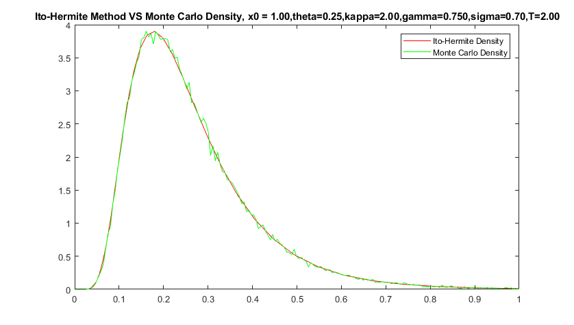](https://postimages.org/)

Here is graph from a different program run. The parameters are on the title of graph.

[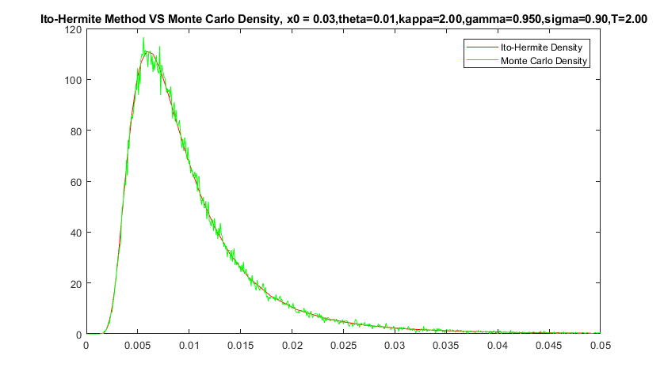](https://postimages.org/)

---

### #961 — Amin (Topic Author)
*July 27, 2020, 4:50 PM*

Please note that I posted a program in last post on previous page just now. This post refers to interpolation used in
that program.

With straightforward Lagrange interpolation, friends can easily choose any grid they wish. Also higher kappa values
which become unstable seem to become somewhat better when we decrease the time step size. For example, I was able to get
a program run with kappa=4.0 and gamma=.75 when I halved the time step. I was not being able to get a stable run for
these parameter values with the original time stepping as in program I uploaded in previous post. Here is the graph of
the program I mentioned. Parameters are on graph.

[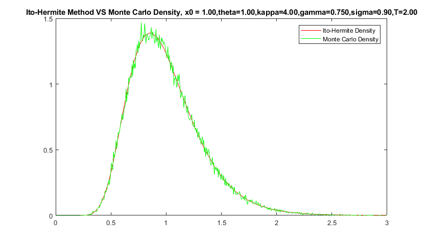](https://postimages.org/)

Here is another program run with large mean-reversion that became possible when I halved the time step.

[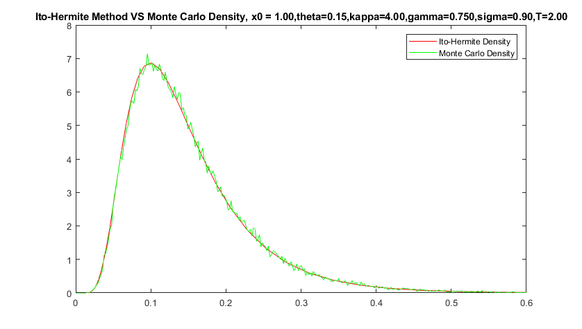](https://postimages.org/)

---

### #962 — Amin (Topic Author)
*July 27, 2020, 5:09 PM*

Just another thing I noticed. It seems we have to double C33 constant in program when we halve the time step size. It
(constant C33) might possibly have nothing to do with dt though it is approximately at right value for given step size
in the program posted. But anyway please see  if making it double helps when you halve the time step size.

---

### #963 — Amin (Topic Author)
*July 27, 2020, 6:33 PM*

This is a new modified program. I have not tested it extensively but it looks good and therefore I decided to post it.
It works with slightly shorter stepping.

```
function [TrueMean,ItoHermiteMean,y_w,fy_w,wnStart] = FPERevisited044Wilmott16()

%Copyright Ahsan Amin. Infiniti derivatives Technologies.
%Please fell free to connect on linkedin: linkedin.com/in/ahsan-amin-0a53334
%or skype ahsan.amin2999
%In this program, I am simulating the SDE given as
%dy(t)=mu1 x(t)^beta1 dt + mu2 x(t)^beta2 dt +sigma x(t)^gamma dz(t)

%I have not directly simulated the SDE but simulated the transformed
%Besse1l process version of the SDE and then changed coordinates to retreive
%the SDE in original coo
%rdinates.
%The present program will analytically evolve only the Bessel Process version of the
%SDE in transformed coordinates.
%In this version, the mean correction has been disabled. If you are
%simulating standard mean-reverting SV type SDEs, please enable the mean
%correction by uncommenting the appropriate line in the body of code below.

dt=.125/32;   % Simulation time interval.%Fodiffusions close to zero
             %decrease dt for accuracy.
Tt=128*16/4;%16*16;     % Number of simulation levels. Terminal time= Tt*dt; //.125/32*32*16=2 year;
T=Tt*dt;
OrderA=4;  %
OrderM=4;  %
%dtM=.125/8;%Monte carlo time interval size dtM.
%TtM=8*8;%Monte carlo number of simulation intervals.
dtM=dt*4;
TtM=Tt/4;

dNn=.2/1;   % Normal density subdivisions width. would change with number of subdivisions
Nn=50;  % No of normal density subdivisions
NnMidl=25;%One half density Subdivision left from mid of normal density(low)
NnMidh=26;%One half density subdivision right from the mid of normal density(high)
NnMid=4.0;

%theta=mu1/(-mu2);
%kappa=-mu2;

x0=1;   % starting value of SDE
beta1=0.0;
beta2=1.0;   % Second drift term power.
gamma=.75;%50;   % volatility power.
kappa=4.0;%.950;   %mean reversion parameter.
theta=.250;%mean reversion target
sigma0=1.0;%Volatility value

%you can specify any general mu1 and mu2 and beta1 and beta2.

mu1=+1*theta*kappa;   %first drift coefficient.
mu2=-1*kappa;    % Second drift coefficient.
%mu1=0;
%mu2=0;

alpha=1;% x^alpha is being expanded. This is currently for monte carlo only.
alpha1=1-gamma;

w(1:Nn)=x0^(1-gamma)/(1-gamma);

Z(1:Nn)=(((1:Nn)-5.5)*dNn-NnMid);

Z
str=input('Look at Z');
ZProb(1)=normcdf(.5*Z(1)+.5*Z(2),0,1)-normcdf(.5*Z(1)+.5*Z(2)-dNn,0,1);
ZProb(Nn)=normcdf(.5*Z(Nn)+.5*Z(Nn-1)+dNn,0,1)-normcdf(.5*Z(Nn)+.5*Z(Nn-1),0,1);

for nn=2:Nn-1
    ZProb(nn)=normcdf(.5*Z(nn)+.5*Z(nn+1),0,1)-normcdf(.5*Z(nn)+.5*Z(nn-1),0,1);
    %Above calculate probability mass in each probability subdivision.
end

%%%%%%%%%%%%%%%%%%%%%%%%%%%%%%%%%%%%%%%%%%%%%%%%%%%%%%%%%%%%%%%%%%%%%%%%%%%%%%%%%%%%%%%%%%%%%%

sigma11(1:OrderA+1)=0;
mu11(1:OrderA+1)=0;
mu22(1:OrderA+1)=0;
sigma22(1:OrderA+1)=0;
% index 1 correponds to zero level since matlab indexing starts at one.
sigma11(1)=1;
mu11(1)=1;
mu22(1)=1;
sigma22(1)=1;

for k=1:(OrderA+1)
    if sigma0~=0
        sigma11(k)=sigma0^(k-1);
    end
    if mu1 ~= 0
        mu11(k)=mu1^(k-1);
    end
    if mu2 ~= 0
        mu22(k)=mu2^(k-1);
    end
    if sigma0~=0
        sigma22(k)=sigma0^(2*(k-1));
    end
end
%Ft(1:TtM+1,1:(OrderA+1),1:(OrderA+1),1:(OrderA+1),1:(OrderA+1))=0; %General time powers on hermite polynomials
Fp(1:(OrderA+1),1:(OrderA+1),1:(OrderA+1),1:(OrderA+1))=0;%General x powers on coefficients of hermite polynomials.
Fp1(1:(OrderA+1),1:(OrderA+1),1:(OrderA+1),1:(OrderA+1))=0;%General x powers for bessel transformed coordinates.

%YCoeff0 and YCoeff are coefficents for original coordinates monte carlo.
%YqCoeff0 and YqCoeff are bessel/lamperti version monte carlo.

YCoeff0(1:(OrderA+1),1:(OrderA+1),1:(OrderA+1),1:(OrderA+1))=0;
YqCoeff0(1:(OrderA+1),1:(OrderA+1),1:(OrderA+1),1:(OrderA+1))=0;
%Pre-compute the time and power exponent values in small multi-dimensional arrays
YCoeff = ItoTaylorCoeffsNew(alpha,beta1,beta2,gamma); %expand y^alpha where alpha=1;
YqCoeff = ItoTaylorCoeffsNew(alpha1,beta1,beta2,gamma);%expand y^alpha1 where alpha1=(1-gamma)
YqCoeff=YqCoeff/(1-gamma); %Transformed coordinates coefficients have to be
%further divided by (1-gamma)

for k = 0 : (OrderA)
    for m = 0:k
        l4 = k - m + 1;
        for n = 0 : m
            l3 = m - n + 1;
            for j = 0:n
                l2 = n - j + 1;
                l1 = j + 1;
                %Ft(l1,l2,l3,l4) = dtM^((l1-1) + (l2-1) + (l3-1) + .5* (l4-1));
                Fp(l1,l2,l3,l4) = (alpha + (l1-1) * beta1 + (l2-1) * beta2 + (l3-1) * 2* gamma + (l4-1) * gamma ...
                    - (l1-1) - (l2-1) - 2* (l3-1) - (l4-1));
                Fp1(l1,l2,l3,l4) = (alpha1 + (l1-1) * beta1 + (l2-1) * beta2 + (l3-1) * 2* gamma + (l4-1) * gamma ...
                    - (l1-1) - (l2-1) - 2* (l3-1) - (l4-1));

                YCoeff0(l1,l2,l3,l4) =YCoeff(l1,l2,l3,l4).*mu11(l1).*mu22(l2).*sigma22(l3).*sigma11(l4);
                YqCoeff0(l1,l2,l3,l4) =YqCoeff(l1,l2,l3,l4).*mu11(l1).*mu22(l2).*sigma22(l3).*sigma11(l4);
            end
        end
    end
end

%%%%%%%%%%%%%%%%%%%%%%%%%%%%%%%%%%%%%%%%%%%%%%%%%%%%%%%%%%%%%%%%%%%%%%%%%%%%%%%%%%%%%%%%%%%%%%
wnStart=1;%
d2wdZ2(1:Nn)=0;
d2wdZ2A(1:Nn)=0;

dwdZ(1:Nn)=0;
yy(wnStart:Nn)=((1-gamma)*w(wnStart:Nn)).^(1/(1-gamma));
tic

for tt=1:Tt

     yy(wnStart:Nn)=((1-gamma)*w(wnStart:Nn)).^(1/(1-gamma));

    [wMu0dt,dwMu0dtdw,d2wMu0dtdw2,d3wMu0dtdw3,c1,c2,c3,c4] =
CalculateDriftAndVolOrder4(w,wnStart,Nn,YqCoeff0,Fp1,gamma,dt);

    wPrev=w;
    dw(wnStart:Nn)=c1(wnStart:Nn).*Z(wnStart:Nn) ;% ...
    dw2(wnStart:Nn)=dw(wnStart:Nn).^2;
    w(isnan(w)==1)=0;
    wMu0dt(isnan(wMu0dt)==1)=0;
    wMeanPrev=sum(ZProb(wnStart:Nn).*w(wnStart:Nn));%Calculate the mean.

%%%%%%%%%%%%%%%%%%%%%%%%%%%%%%%%%%%%%%%%%%%%%%%%%%%%%%%%%%%%%%%%%%%%%%%%%%%

d2wdZ2(wnStart:Nn)=d2wdZ2(wnStart:Nn)+
d2wMu0dtdw2(wnStart:Nn).*dwdZ(wnStart:Nn).^2+dwMu0dtdw(wnStart:Nn).*d2wdZ2(wnStart:Nn)+.33*(Z(wnStart:Nn)).*sigma0^2*dt^2;;%+
...

[dwdZ,d2wdZ2A] = First2Derivatives2ndOrderEqSpaced(wnStart,Nn,dNn,w,Z);

if (tt>16)
d2wdZ2=d2wdZ2A;

     
dwdZ(NnMidh+3)=InterpolateOrderN8(8,Z(NnMidh+3),Z(NnMidh+4),Z(NnMidh+5),Z(NnMidh+6),Z(NnMidh+7),Z(NnMidl-3),Z(NnMidl-4),Z(NnMidl-5),Z(NnMidl-6),dwdZ(NnMidh+4),dwdZ(NnMidh+5),dwdZ(NnMidh+6),dwdZ(NnMidh+7),dwdZ(NnMidl-3),dwdZ(NnMidl-4),dwdZ(NnMidl-5),dwdZ(NnMidl-6));
     
dwdZ(NnMidh+2)=InterpolateOrderN8(8,Z(NnMidh+2),Z(NnMidh+4),Z(NnMidh+5),Z(NnMidh+6),Z(NnMidh+7),Z(NnMidl-3),Z(NnMidl-4),Z(NnMidl-5),Z(NnMidl-6),dwdZ(NnMidh+4),dwdZ(NnMidh+5),dwdZ(NnMidh+6),dwdZ(NnMidh+7),dwdZ(NnMidl-3),dwdZ(NnMidl-4),dwdZ(NnMidl-5),dwdZ(NnMidl-6));
     
dwdZ(NnMidh+1)=InterpolateOrderN8(8,Z(NnMidh+1),Z(NnMidh+4),Z(NnMidh+5),Z(NnMidh+6),Z(NnMidh+7),Z(NnMidl-3),Z(NnMidl-4),Z(NnMidl-5),Z(NnMidl-6),dwdZ(NnMidh+4),dwdZ(NnMidh+5),dwdZ(NnMidh+6),dwdZ(NnMidh+7),dwdZ(NnMidl-3),dwdZ(NnMidl-4),dwdZ(NnMidl-5),dwdZ(NnMidl-6));
     
dwdZ(NnMidh)=InterpolateOrderN8(8,Z(NnMidh),Z(NnMidh+4),Z(NnMidh+5),Z(NnMidh+6),Z(NnMidh+7),Z(NnMidl-3),Z(NnMidl-4),Z(NnMidl-5),Z(NnMidl-6),dwdZ(NnMidh+4),dwdZ(NnMidh+5),dwdZ(NnMidh+6),dwdZ(NnMidh+7),dwdZ(NnMidl-3),dwdZ(NnMidl-4),dwdZ(NnMidl-5),dwdZ(NnMidl-6));
     
dwdZ(NnMidl)=InterpolateOrderN8(8,Z(NnMidl),Z(NnMidh+4),Z(NnMidh+5),Z(NnMidh+6),Z(NnMidh+7),Z(NnMidl-3),Z(NnMidl-4),Z(NnMidl-5),Z(NnMidl-6),dwdZ(NnMidh+4),dwdZ(NnMidh+5),dwdZ(NnMidh+6),dwdZ(NnMidh+7),dwdZ(NnMidl-3),dwdZ(NnMidl-4),dwdZ(NnMidl-5),dwdZ(NnMidl-6));
     
dwdZ(NnMidl-1)=InterpolateOrderN8(8,Z(NnMidl-1),Z(NnMidh+4),Z(NnMidh+5),Z(NnMidh+6),Z(NnMidh+7),Z(NnMidl-3),Z(NnMidl-4),Z(NnMidl-5),Z(NnMidl-6),dwdZ(NnMidh+4),dwdZ(NnMidh+5),dwdZ(NnMidh+6),dwdZ(NnMidh+7),dwdZ(NnMidl-3),dwdZ(NnMidl-4),dwdZ(NnMidl-5),dwdZ(NnMidl-6));
     
dwdZ(NnMidl-2)=InterpolateOrderN8(8,Z(NnMidl-2),Z(NnMidh+4),Z(NnMidh+5),Z(NnMidh+6),Z(NnMidh+7),Z(NnMidl-3),Z(NnMidl-4),Z(NnMidl-5),Z(NnMidl-6),dwdZ(NnMidh+4),dwdZ(NnMidh+5),dwdZ(NnMidh+6),dwdZ(NnMidh+7),dwdZ(NnMidl-3),dwdZ(NnMidl-4),dwdZ(NnMidl-5),dwdZ(NnMidl-6));
%
%     
 dwdZ(NnMidh+2)=InterpolateOrderN8(8,Z(NnMidh+2),Z(NnMidh+3),Z(NnMidh+4),Z(NnMidh+5),Z(NnMidh+6),Z(NnMidl-2),Z(NnMidl-3),Z(NnMidl-4),Z(NnMidl-5),dwdZ(NnMidh+3),dwdZ(NnMidh+4),dwdZ(NnMidh+5),dwdZ(NnMidh+6),dwdZ(NnMidl-2),dwdZ(NnMidl-3),dwdZ(NnMidl-4),dwdZ(NnMidl-5));
%     
 dwdZ(NnMidh+1)=InterpolateOrderN8(8,Z(NnMidh+1),Z(NnMidh+3),Z(NnMidh+4),Z(NnMidh+5),Z(NnMidh+6),Z(NnMidl-2),Z(NnMidl-3),Z(NnMidl-4),Z(NnMidl-5),dwdZ(NnMidh+3),dwdZ(NnMidh+4),dwdZ(NnMidh+5),dwdZ(NnMidh+6),dwdZ(NnMidl-2),dwdZ(NnMidl-3),dwdZ(NnMidl-4),dwdZ(NnMidl-5));
%     
 dwdZ(NnMidh)=InterpolateOrderN8(8,Z(NnMidh),Z(NnMidh+3),Z(NnMidh+4),Z(NnMidh+5),Z(NnMidh+6),Z(NnMidl-2),Z(NnMidl-3),Z(NnMidl-4),Z(NnMidl-5),dwdZ(NnMidh+3),dwdZ(NnMidh+4),dwdZ(NnMidh+5),dwdZ(NnMidh+6),dwdZ(NnMidl-2),dwdZ(NnMidl-3),dwdZ(NnMidl-4),dwdZ(NnMidl-5));
%     
 dwdZ(NnMidl)=InterpolateOrderN8(8,Z(NnMidl),Z(NnMidh+3),Z(NnMidh+4),Z(NnMidh+5),Z(NnMidh+6),Z(NnMidl-2),Z(NnMidl-3),Z(NnMidl-4),Z(NnMidl-5),dwdZ(NnMidh+3),dwdZ(NnMidh+4),dwdZ(NnMidh+5),dwdZ(NnMidh+6),dwdZ(NnMidl-2),dwdZ(NnMidl-3),dwdZ(NnMidl-4),dwdZ(NnMidl-5));
%     
 dwdZ(NnMidl-1)=InterpolateOrderN8(8,Z(NnMidl-1),Z(NnMidh+3),Z(NnMidh+4),Z(NnMidh+5),Z(NnMidh+6),Z(NnMidl-2),Z(NnMidl-3),Z(NnMidl-4),Z(NnMidl-5),dwdZ(NnMidh+3),dwdZ(NnMidh+4),dwdZ(NnMidh+5),dwdZ(NnMidh+6),dwdZ(NnMidl-2),dwdZ(NnMidl-3),dwdZ(NnMidl-4),dwdZ(NnMidl-5));

d2wdZ2(NnMidh+4)=InterpolateOrderN8(8,Z(NnMidh+4),Z(NnMidh+5),Z(NnMidh+6),Z(NnMidh+7),Z(NnMidh+8),Z(NnMidl-4),Z(NnMidl-5),Z(NnMidl-6),Z(NnMidl-7),d2wdZ2(NnMidh+5),d2wdZ2(NnMidh+6),d2wdZ2(NnMidh+7),d2wdZ2(NnMidh+8),d2wdZ2(NnMidl-4),d2wdZ2(NnMidl-5),d2wdZ2(NnMidl-6),d2wdZ2(NnMidl-7));
d2wdZ2(NnMidh+3)=InterpolateOrderN8(8,Z(NnMidh+3),Z(NnMidh+5),Z(NnMidh+6),Z(NnMidh+7),Z(NnMidh+8),Z(NnMidl-4),Z(NnMidl-5),Z(NnMidl-6),Z(NnMidl-7),d2wdZ2(NnMidh+5),d2wdZ2(NnMidh+6),d2wdZ2(NnMidh+7),d2wdZ2(NnMidh+8),d2wdZ2(NnMidl-4),d2wdZ2(NnMidl-5),d2wdZ2(NnMidl-6),d2wdZ2(NnMidl-7));
d2wdZ2(NnMidh+2)=InterpolateOrderN8(8,Z(NnMidh+2),Z(NnMidh+5),Z(NnMidh+6),Z(NnMidh+7),Z(NnMidh+8),Z(NnMidl-4),Z(NnMidl-5),Z(NnMidl-6),Z(NnMidl-7),d2wdZ2(NnMidh+5),d2wdZ2(NnMidh+6),d2wdZ2(NnMidh+7),d2wdZ2(NnMidh+8),d2wdZ2(NnMidl-4),d2wdZ2(NnMidl-5),d2wdZ2(NnMidl-6),d2wdZ2(NnMidl-7));
d2wdZ2(NnMidh+1)=InterpolateOrderN8(8,Z(NnMidh+1),Z(NnMidh+5),Z(NnMidh+6),Z(NnMidh+7),Z(NnMidh+8),Z(NnMidl-4),Z(NnMidl-5),Z(NnMidl-6),Z(NnMidl-7),d2wdZ2(NnMidh+5),d2wdZ2(NnMidh+6),d2wdZ2(NnMidh+7),d2wdZ2(NnMidh+8),d2wdZ2(NnMidl-4),d2wdZ2(NnMidl-5),d2wdZ2(NnMidl-6),d2wdZ2(NnMidl-7));
d2wdZ2(NnMidh)=InterpolateOrderN8(8,Z(NnMidh),Z(NnMidh+5),Z(NnMidh+6),Z(NnMidh+7),Z(NnMidh+8),Z(NnMidl-4),Z(NnMidl-5),Z(NnMidl-6),Z(NnMidl-7),d2wdZ2(NnMidh+5),d2wdZ2(NnMidh+6),d2wdZ2(NnMidh+7),d2wdZ2(NnMidh+8),d2wdZ2(NnMidl-4),d2wdZ2(NnMidl-5),d2wdZ2(NnMidl-6),d2wdZ2(NnMidl-7));
d2wdZ2(NnMidl)=InterpolateOrderN8(8,Z(NnMidl),Z(NnMidh+5),Z(NnMidh+6),Z(NnMidh+7),Z(NnMidh+8),Z(NnMidl-4),Z(NnMidl-5),Z(NnMidl-6),Z(NnMidl-7),d2wdZ2(NnMidh+5),d2wdZ2(NnMidh+6),d2wdZ2(NnMidh+7),d2wdZ2(NnMidh+8),d2wdZ2(NnMidl-4),d2wdZ2(NnMidl-5),d2wdZ2(NnMidl-6),d2wdZ2(NnMidl-7));
d2wdZ2(NnMidl-1)=InterpolateOrderN8(8,Z(NnMidl-1),Z(NnMidh+5),Z(NnMidh+6),Z(NnMidh+7),Z(NnMidh+8),Z(NnMidl-4),Z(NnMidl-5),Z(NnMidl-6),Z(NnMidl-7),d2wdZ2(NnMidh+5),d2wdZ2(NnMidh+6),d2wdZ2(NnMidh+7),d2wdZ2(NnMidh+8),d2wdZ2(NnMidl-4),d2wdZ2(NnMidl-5),d2wdZ2(NnMidl-6),d2wdZ2(NnMidl-7));
d2wdZ2(NnMidl-2)=InterpolateOrderN8(8,Z(NnMidl-2),Z(NnMidh+5),Z(NnMidh+6),Z(NnMidh+7),Z(NnMidh+8),Z(NnMidl-4),Z(NnMidl-5),Z(NnMidl-6),Z(NnMidl-7),d2wdZ2(NnMidh+5),d2wdZ2(NnMidh+6),d2wdZ2(NnMidh+7),d2wdZ2(NnMidh+8),d2wdZ2(NnMidl-4),d2wdZ2(NnMidl-5),d2wdZ2(NnMidl-6),d2wdZ2(NnMidl-7));
d2wdZ2(NnMidl-3)=InterpolateOrderN8(8,Z(NnMidl-3),Z(NnMidh+5),Z(NnMidh+6),Z(NnMidh+7),Z(NnMidh+8),Z(NnMidl-4),Z(NnMidl-5),Z(NnMidl-6),Z(NnMidl-7),d2wdZ2(NnMidh+5),d2wdZ2(NnMidh+6),d2wdZ2(NnMidh+7),d2wdZ2(NnMidh+8),d2wdZ2(NnMidl-4),d2wdZ2(NnMidl-5),d2wdZ2(NnMidl-6),d2wdZ2(NnMidl-7));

%
%     
 d2wdZ2(NnMidh+2)=InterpolateOrderN8(8,Z(NnMidh+2),Z(NnMidh+3),Z(NnMidh+4),Z(NnMidh+5),Z(NnMidh+6),Z(NnMidl-2),Z(NnMidl-3),Z(NnMidl-4),Z(NnMidl-5),d2wdZ2(NnMidh+3),d2wdZ2(NnMidh+4),d2wdZ2(NnMidh+5),d2wdZ2(NnMidh+6),d2wdZ2(NnMidl-2),d2wdZ2(NnMidl-3),d2wdZ2(NnMidl-4),d2wdZ2(NnMidl-5));
%     
 d2wdZ2(NnMidh+1)=InterpolateOrderN8(8,Z(NnMidh+1),Z(NnMidh+3),Z(NnMidh+4),Z(NnMidh+5),Z(NnMidh+6),Z(NnMidl-2),Z(NnMidl-3),Z(NnMidl-4),Z(NnMidl-5),d2wdZ2(NnMidh+3),d2wdZ2(NnMidh+4),d2wdZ2(NnMidh+5),d2wdZ2(NnMidh+6),d2wdZ2(NnMidl-2),d2wdZ2(NnMidl-3),d2wdZ2(NnMidl-4),d2wdZ2(NnMidl-5));
%     
 d2wdZ2(NnMidh)=InterpolateOrderN8(8,Z(NnMidh),Z(NnMidh+3),Z(NnMidh+4),Z(NnMidh+5),Z(NnMidh+6),Z(NnMidl-2),Z(NnMidl-3),Z(NnMidl-4),Z(NnMidl-5),d2wdZ2(NnMidh+3),d2wdZ2(NnMidh+4),d2wdZ2(NnMidh+5),d2wdZ2(NnMidh+6),d2wdZ2(NnMidl-2),d2wdZ2(NnMidl-3),d2wdZ2(NnMidl-4),d2wdZ2(NnMidl-5));
%     
 d2wdZ2(NnMidl)=InterpolateOrderN8(8,Z(NnMidl),Z(NnMidh+3),Z(NnMidh+4),Z(NnMidh+5),Z(NnMidh+6),Z(NnMidl-2),Z(NnMidl-3),Z(NnMidl-4),Z(NnMidl-5),d2wdZ2(NnMidh+3),d2wdZ2(NnMidh+4),d2wdZ2(NnMidh+5),d2wdZ2(NnMidh+6),d2wdZ2(NnMidl-2),d2wdZ2(NnMidl-3),d2wdZ2(NnMidl-4),d2wdZ2(NnMidl-5));
%     
 d2wdZ2(NnMidl-1)=InterpolateOrderN8(8,Z(NnMidl-1),Z(NnMidh+3),Z(NnMidh+4),Z(NnMidh+5),Z(NnMidh+6),Z(NnMidl-2),Z(NnMidl-3),Z(NnMidl-4),Z(NnMidl-5),d2wdZ2(NnMidh+3),d2wdZ2(NnMidh+4),d2wdZ2(NnMidh+5),d2wdZ2(NnMidh+6),d2wdZ2(NnMidl-2),d2wdZ2(NnMidl-3),d2wdZ2(NnMidl-4),d2wdZ2(NnMidl-5));

%d2wdZ2(21:29)=d2wdZ2(20)*(30-(21:29))/10+d2wdZ2(30)*((21:29)-20)/10;

d2wdZ2(1:15)=d2wdZ2(1:15).*exp(-32*kappa^2*(1-gamma).*dNn*(15-(1:15)));
%d2wdZ2(1:11)=d2wdZ2(1:11).*exp(-32*kappa^2*(1-gamma).*dNn*(11-(1:11)));
%Change 1:7/25/2020: I have very heavily weighted the second derivative to
%the left of density peak with an exponential and it allows far larger
%range of parameters with stable execution without sacrificing much
%accuracy. Of course, it is just ad hoc.
end
%If the calculation of the program blows, it means that above calculated
%derivative is unstable or bad. Plese replace with your favourite method of
%calculating this second derivative.

%plot((wnStart:Nn),d2wdZ2,'r',(wnStart:Nn),d2wdZ2A,'g');
%tt
%str=input('Look at comparison of d2wdZ2. Interpolation starts after tt=32');

dZdw(wnStart:Nn)=1.0./dwdZ(wnStart:Nn);
H2(wnStart:Nn)=(Z(wnStart:Nn).^2-1);

if(tt==1)
w(wnStart:Nn)=wMeanPrev+wMu0dt(wnStart:Nn)+ ...
          sign(w(wnStart:Nn)-wMeanPrev+dw(wnStart:Nn)).* ...
          sqrt(abs(sign(w(wnStart:Nn)-wMeanPrev).*(w(wnStart:Nn)-wMeanPrev).^2+ ...
          sign(dw(wnStart:Nn)).*dw2(wnStart:Nn)));
end
if(tt>1)

    dw(wnStart:Nn)=sigma0*sqrt(dt).*Z(wnStart:Nn);
    dw2(wnStart:Nn)=sigma0^2*dt*Z(wnStart:Nn).^2;

  [wS] = InterpolateOrderN6(6,Z(1)-dNn,Z(1),Z(2),Z(3),Z(4),Z(5),Z(6),w(1),w(2),w(3),w(4),w(5),w(6));
  [wE] =
InterpolateOrderN6(6,Z(Nn)+dNn,Z(Nn),Z(Nn-1),Z(Nn-2),Z(Nn-3),Z(Nn-4),Z(Nn-5),w(Nn),w(Nn-1),w(Nn-2),w(Nn-3),w(Nn-4),w(Nn-5));

  %wS in point interpolated to the left of the grid.
  %wE in point interpolated to the right of the grid.

  wAdjacentB(wnStart:Nn)=0;
  wAdjacentF(wnStart:Nn)=0;
  ZAdjacentB(wnStart:Nn)=0;
  ZAdjacentF(wnStart:Nn)=0;
  dwdZB(wnStart:Nn)=0;
  dwdZF(wnStart:Nn)=0;

  wAdjacentB(wnStart+1:Nn)=w(wnStart:Nn-1);
  wAdjacentB(wnStart)=wS;
  ZAdjacentB(wnStart+1:Nn)=Z(wnStart:Nn-1);
  ZAdjacentB(wnStart)=Z(wnStart)-dNn;
  dwdZB(wnStart:Nn)=(w(wnStart:Nn)-wAdjacentB(wnStart:Nn))/(dNn);

  wAdjacentF(wnStart:Nn-1)=w(wnStart+1:Nn);
  wAdjacentF(Nn)=wE;
  ZAdjacentF(wnStart:Nn-1)=Z(wnStart+1:Nn);
  ZAdjacentF(Nn)=Z(Nn)+dNn;
  dwdZF(wnStart:Nn)=(w(wnStart:Nn)-wAdjacentF(wnStart:Nn))/(-dNn);

 
DeltaZwDeltaZ(wnStart:Nn)=(ZAdjacentF(wnStart:Nn).*wAdjacentF(wnStart:Nn)-ZAdjacentB(wnStart:Nn).*wAdjacentB(wnStart:Nn))/(2*dNn);
  Term0(wnStart:Nn)=(.5*wAdjacentB(wnStart:Nn)+.5*wAdjacentF(wnStart:Nn)-DeltaZwDeltaZ(wnStart:Nn));

  C11(wnStart:Nn)=.707; %dwdZ(wnStart:Nn);%.707000;
  C22=-8*dt;%
  C22=-sqrt(2)/pi/16;%
  C33=2*4*dt*sqrt(2*2*2);%
  C33=sqrt(2)/4/pi;%
%  C22=.5*sigma0*sqrt(dt);%
%  C33=sigma0*sqrt(dt);%

  w(wnStart:Nn)=w(wnStart:Nn)+wMu0dt(wnStart:Nn)+((Term0(wnStart:Nn)+C11(wnStart:Nn).*d2wdZ2(wnStart:Nn))+ ...
            sign(-Term0(wnStart:Nn)-C11(wnStart:Nn).*d2wdZ2(wnStart:Nn)+dw(wnStart:Nn)).* ...
            sqrt(abs(sign(-Term0(wnStart:Nn)-C11(wnStart:Nn).*d2wdZ2(wnStart:Nn)).* ...
            (-Term0(wnStart:Nn)-C11(wnStart:Nn).*d2wdZ2(wnStart:Nn)).^2+ ...
            sign(+dw(wnStart:Nn)).*dw2(wnStart:Nn))))+ ...
            -C33.*dwMu0dtdw(wnStart:Nn).*dwdZ(wnStart:Nn).^2 + ...
            +C22.*3*Z(wnStart:Nn).^1.*dZdw(wnStart:Nn).*d2wdZ2(wnStart:Nn)*sigma0^2.*dt + ...
            +0*(1-1/sqrt(3))*dwMu0dtdw(wnStart:Nn).*sigma0^2*dt - ...
            0*.125/2*.125*d2wdZ2(wnStart:Nn).*(w(wnStart:Nn)-Term0(wnStart:Nn))*dt;

        %Change 2:7/25/2020:%I have added a last term from quadratic variation between drift
        %and w terms. I am not very sure if we need it or not.

end

%%%%%%%%%%%%%%%%%%%%%%%%%%%%%%%%%%%%%%%%%%%%%%%%%%%%%%%%%%%%%%%%%%%%%%%%%%%
%Below are instability correction equations. There is instability in the
% SDE representation equation roughly between -.5 SD to +.5 SD in normal terms.
%Instability correction Algorithm takes two ends that are here given as
%lower end=w(NnMidl-2) and upper end=w(NnMidh+3).
%In the block below the interpolation starts from lower end.
%1st equation is
%wll(NnMidl-1)=w(NnMidl-2)+(D1wl+CTheta*D2wl*dNn/1+.5*DeltaD1w)*dNn;
%Second equation is: wll(NnMidl)=wll(NnMidl-1)+(D1wl+CTheta*D2wl*dNn+1.5*DeltaD1w)*dNn;
%And so on.
%There is a sixth equation that is not written below(since it takes us to
%the upper interpolation point which is already known) which is
%wll(NnMidh+3)=wll(NnMidh+2)+(D1wl+CTheta*D2wl*dNn+5.5*DeltaD1w)*dNn;
%Sum of these six equations add up to the distance between upper and lower
%interpolation points.
%In the sum there are six instances of first derivative which is already
%calculated at the boundary, six instances of second derivative which is also
%already calculated at lower boundary and 18.0 instances of DeltaD1w which is
%unknown. This equation calculates the value of one unit of DeltaD1w addition
%DeltaD1w=(w(NnMidh+3)-w(NnMidl-2)-6*D1wl*dNn-6.0*CTheta*D2wl*dNn.^2.0/1.0)/18.0/dNn;
% I hope to find a better analytical method to tackle this issue. Friends
% are welcome to play with slightly changed related alternatives to the
%above interpolation.
%Change 7/27/2020
%I have switched to Lagrange interpolation by taking four points on both
%sides of instability and using 8th order interpolation of five points in
%mid between the eight points on sides. This works far better and you can
%now use nuemrical 2nd derivative without any modification for a large
%range of parameters. It truly improves the fit to true density when it
%works.

% Good interpolation below
     
w(NnMidh+2)=InterpolateOrderN8(8,Z(NnMidh+2),Z(NnMidh+3),Z(NnMidh+4),Z(NnMidh+5),Z(NnMidh+6),Z(NnMidl-2),Z(NnMidl-3),Z(NnMidl-4),Z(NnMidl-5),w(NnMidh+3),w(NnMidh+4),w(NnMidh+5),w(NnMidh+6),w(NnMidl-2),w(NnMidl-3),w(NnMidl-4),w(NnMidl-5));
     
w(NnMidh+1)=InterpolateOrderN8(8,Z(NnMidh+1),Z(NnMidh+3),Z(NnMidh+4),Z(NnMidh+5),Z(NnMidh+6),Z(NnMidl-2),Z(NnMidl-3),Z(NnMidl-4),Z(NnMidl-5),w(NnMidh+3),w(NnMidh+4),w(NnMidh+5),w(NnMidh+6),w(NnMidl-2),w(NnMidl-3),w(NnMidl-4),w(NnMidl-5));
     
w(NnMidh)=InterpolateOrderN8(8,Z(NnMidh),Z(NnMidh+3),Z(NnMidh+4),Z(NnMidh+5),Z(NnMidh+6),Z(NnMidl-2),Z(NnMidl-3),Z(NnMidl-4),Z(NnMidl-5),w(NnMidh+3),w(NnMidh+4),w(NnMidh+5),w(NnMidh+6),w(NnMidl-2),w(NnMidl-3),w(NnMidl-4),w(NnMidl-5));
     
w(NnMidl)=InterpolateOrderN8(8,Z(NnMidl),Z(NnMidh+3),Z(NnMidh+4),Z(NnMidh+5),Z(NnMidh+6),Z(NnMidl-2),Z(NnMidl-3),Z(NnMidl-4),Z(NnMidl-5),w(NnMidh+3),w(NnMidh+4),w(NnMidh+5),w(NnMidh+6),w(NnMidl-2),w(NnMidl-3),w(NnMidl-4),w(NnMidl-5));
     
w(NnMidl-1)=InterpolateOrderN8(8,Z(NnMidl-1),Z(NnMidh+3),Z(NnMidh+4),Z(NnMidh+5),Z(NnMidh+6),Z(NnMidl-2),Z(NnMidl-3),Z(NnMidl-4),Z(NnMidl-5),w(NnMidh+3),w(NnMidh+4),w(NnMidh+5),w(NnMidh+6),w(NnMidl-2),w(NnMidl-3),w(NnMidl-4),w(NnMidl-5));

%
%
%
%     CTheta=0;
%     D1wl=(11/6*w(NnMidl-2)-3*w(NnMidl-3)+3/2*w(NnMidl-4)-1/3*w(NnMidl-5))/dNn;
%     D2wl=(35/12*w(NnMidl-2) -26/3*w(NnMidl-3)+ 19/2*w(NnMidl-4)-14/3*w(NnMidl-5)+11/12*w(NnMidl-6))/dNn.^2;
%     DeltaD1w=(w(NnMidh+3)-w(NnMidl-2)-6*D1wl*dNn-6.0*CTheta*D2wl*dNn.^2.0/1.0)/18.0/dNn;
%
%     wll(NnMidl-1)=w(NnMidl-2)+  (D1wl+CTheta*D2wl*dNn+.5*DeltaD1w)*dNn;
%     wll(NnMidl)=wll(NnMidl-1)+  (D1wl+CTheta*D2wl*dNn+1.5*DeltaD1w)*dNn;
%     wll(NnMidh)=wll(NnMidl)+    (D1wl+CTheta*D2wl*dNn+2.5*DeltaD1w)*dNn;
%     wll(NnMidh+1)=wll(NnMidh)+  (D1wl+CTheta*D2wl*dNn+3.5*DeltaD1w)*dNn;
%     wll(NnMidh+2)=wll(NnMidh+1)+(D1wl+CTheta*D2wl*dNn+4.5*DeltaD1w)*dNn;
%     %wll(NnMidh+3)=wll(NnMidh+2)+(D1wl+CTheta*D2wl*dNn+5.5*DeltaD1w)*dNn;
% %The last equation is not used since point w(NnMidh+3)is given but it is used in
% %calculation of distance between two interpolation points. This distance is
% %used to determine the value of DeltaD1w.
%
%     D1wh=(-11/6*w(NnMidh+3)+3*w(NnMidh+4)-3/2*w(NnMidh+5)+1/3*w(NnMidh+6))/dNn;
%     D2wh=(35/12*w(NnMidh+3) -26/3*w(NnMidh+4)+ 19/2*w(NnMidh+5)-14/3*w(NnMidh+6)+11/12*w(NnMidh+7))/dNn.^2;
%     DeltaD1w=(w(NnMidh+3)-w(NnMidl-2)-6*D1wh*dNn-6.0*CTheta*D2wh*dNn.^2.0/1.0)/18.0/dNn;
% %     DeltaD1w=(w(NnMidh+2)-w(NnMidl-1)-4*D1wh*dNn-16.0*D2wh*dNn.^2.0/1.0)/6.0/dNn;
%
%
%     whh(NnMidh+2)=w(NnMidh+3)-(D1wh+CTheta*D2wh*dNn+.5*DeltaD1w)*dNn;
%     whh(NnMidh+1)=w(NnMidh+2)-(D1wh+CTheta*D2wh*dNn+1.5* DeltaD1w)*dNn;
%     whh(NnMidh)=whh(NnMidh+1)-(D1wh+CTheta*D2wh*dNn+2.5* DeltaD1w)*dNn;
%     whh(NnMidl)=whh(NnMidh)-(D1wh+CTheta*D2wh*dNn+3.5* DeltaD1w)*dNn;
%     whh(NnMidl-1)=whh(NnMidl)-(D1wh+CTheta*D2wh*dNn+4.5* DeltaD1w)*dNn;
%
%     %whh(NnMidl-2)=whh(NnMidl-1)-(D1wh+CTheta*D2wh*dNn/1+5.5* DeltaD1w)*dNn;
%
%
%         w(NnMidh+2)=.5*whh(NnMidh+2)+.5*wll(NnMidh+2);
%         w(NnMidh+1)=.5*whh(NnMidh+1)+.5*wll(NnMidh+1);
%         w(NnMidh)=.5*whh(NnMidh)+.5*wll(NnMidh);
%         w(NnMidl)=.5*whh(NnMidl)+.5*wll(NnMidl);
%         w(NnMidl-1)=.5*whh(NnMidl-1)+.5*wll(NnMidl-1);

  [wE] =
InterpolateOrderN6(6,Z(Nn)+dNn,Z(Nn),Z(Nn-1),Z(Nn-2),Z(Nn-3),Z(Nn-4),Z(Nn-5),w(Nn),w(Nn-1),w(Nn-2),w(Nn-3),w(Nn-4),w(Nn-5));

        w1(1:Nn-1)=w(1:Nn-1);
        w1(Nn)=w(Nn);
        w2(1:Nn-1)=w(2:Nn);
        w2(Nn)=wE;

w(w1(:)>w2(:))=0;%Be careful;might not universally hold;
     %Change 3:7/25/2020: I have improved zero correction in above.
        w(w<0)=0.0;
        for nn=1:Nn
            if(w(nn)<=0)
                wnStart=nn+1;
           end
        end

        %%1st order mean correction. We know the mean in original
        %%coordinates so I shift the density into original coordinates,
        %%apply the mean correction and then transform again into Lamperti
        %%coordinates. Algebra solves two equations in two unknowns.
        %%Equations are Sum_0^N{(Y_w(wnStart:Nn)-Y0)*W0}=1 and the second
        %%equation is Sum_0^N{Y_w(wnStart:Nn).*(Y_w(wnStart:Nn)-Y0)*W0}=u0
        %%Two unknows are Y0 and W0. u0 is known mean.
        tt;
        u0=theta+(x0-theta)*exp(-kappa*(tt*dt)); %analytic mean of the density

        %If you are not using stochastic volatility, replace above with
        %true mean otherwise results would become garbage.

        Y_w(wnStart:Nn) = ((1-gamma)*w(wnStart:Nn)).^(1/(1-gamma));

        Yn2Pn=sum(Y_w(wnStart:Nn).*Y_w(wnStart:Nn).*ZProb(wnStart:Nn));
        YnPn=sum(Y_w(wnStart:Nn).*ZProb(wnStart:Nn));
        Pn=1.0;%%Sum(ZProb(1:Nn))
        Y0=(Yn2Pn-u0*YnPn)/(YnPn-u0*Pn);

        Y0Pn=Y0*Pn;
        W0=1/(YnPn-Y0Pn);
        YCorrected(wnStart:Nn)=Y_w(wnStart:Nn).*(Y_w(wnStart:Nn)-Y0)*W0;
        wCorrected(wnStart:Nn)=(YCorrected(wnStart:Nn).^(1-gamma))./(1-gamma);
   %     w(wnStart:Nn)=wCorrected(wnStart:Nn);

   %I have disabled the mean correction. The above mean correction is only valid for
   %standard mean reverting stochastic volatility type SDEs. To enable mean
   %correction please uncomment the above last line in the block.

end

 y_w(1:Nn)=0;
 y_w(wnStart:Nn) = ((1-gamma)*w(wnStart:Nn)).^(1/(1-gamma));
 Dfy_w(wnStart:Nn)=0;
 Dfw(wnStart:Nn)=0;
for nn=wnStart+1:Nn-1
    Dfy_w(nn) = (y_w(nn + 1) - y_w(nn - 1))/(Z(nn + 1) - Z(nn - 1));
    Dfw(nn) = (w(nn + 1) - w(nn - 1))/(Z(nn + 1) - Z(nn - 1));
    %Change of variable derivative for densities
end
fy_w(1:Nn)=0;
fw(1:Nn)=0;
for nn = wnStart:Nn-1
    fy_w(nn) = (normpdf(Z(nn),0, 1))/abs(Dfy_w(nn));%Origianl coordinates density
    fw(nn) = (normpdf(Z(nn),0, 1))/abs(Dfw(nn));
end

toc

ItoHermiteMean=sum(y_w(wnStart+1:Nn-1).*ZProb(wnStart+1:Nn-1)) %Original process average from coordinates

 disp('true Mean only applicble to standard SV mean reverting type models otherwise disregard');
 TrueMean=theta+(x0-theta)*exp(-kappa*dt*Tt)%Mean reverting SDE original variable true average

 rng(29079137, 'twister')
 paths=100000;
 YY(1:paths)=x0;  %Original process monte carlo.
 Random1(1:paths)=0;
 YYMean(1:TtM)=0;
 for tt=1:TtM
     Random1=randn(size(Random1));
     HermiteP1(1,1:paths)=1;
     HermiteP1(2,1:paths)=Random1(1:paths);
     HermiteP1(3,1:paths)=Random1(1:paths).^2-1;
     HermiteP1(4,1:paths)=Random1(1:paths).^3-3*Random1(1:paths);
     HermiteP1(5,1:paths)=Random1(1:paths).^4-6*Random1(1:paths).^2+3;

     YY(1:paths)=YY(1:paths) + ...
      (YCoeff0(1,1,2,1).*YY(1:paths).^Fp(1,1,2,1)+ ...
      YCoeff0(1,2,1,1).*YY(1:paths).^Fp(1,2,1,1)+ ...
      YCoeff0(2,1,1,1).*YY(1:paths).^Fp(2,1,1,1))*dtM + ...
      (YCoeff0(1,1,3,1).*YY(1:paths).^Fp(1,1,3,1)+ ...
      YCoeff0(1,2,2,1).*YY(1:paths).^Fp(1,2,2,1)+ ...
      YCoeff0(2,1,2,1).*YY(1:paths).^Fp(2,1,2,1)+ ...
      YCoeff0(1,3,1,1).*YY(1:paths).^Fp(1,3,1,1)+ ...
      YCoeff0(2,2,1,1).*YY(1:paths).^Fp(2,2,1,1)+ ...
      YCoeff0(3,1,1,1).*YY(1:paths).^Fp(3,1,1,1))*dtM^2 + ...
      ((YCoeff0(1,1,1,2).*YY(1:paths).^Fp(1,1,1,2).*sqrt(dtM))+ ...
    (YCoeff0(1,1,2,2).*YY(1:paths).^Fp(1,1,2,2)+ ...
    YCoeff0(1,2,1,2).*YY(1:paths).^Fp(1,2,1,2)+ ...
    YCoeff0(2,1,1,2).*YY(1:paths).^Fp(2,1,1,2)).*dtM^1.5) .*HermiteP1(2,1:paths) + ...
    ((YCoeff0(1,1,1,3).*YY(1:paths).^Fp(1,1,1,3) *dtM) + ...
    (YCoeff0(1,1,2,3).*YY(1:paths).^Fp(1,1,2,3)+ ...
    YCoeff0(1,2,1,3).*YY(1:paths).^Fp(1,2,1,3)+ ...
    YCoeff0(2,1,1,3).*YY(1:paths).^Fp(2,1,1,3)).*dtM^2).*HermiteP1(3,1:paths) + ...
    ((YCoeff0(1,1,1,4).*YY(1:paths).^Fp(1,1,1,4)*dtM^1.5 )).*HermiteP1(4,1:paths) + ...
    (YCoeff0(1,1,1,5).*YY(1:paths).^Fp(1,1,1,5)*dtM^2.0).*HermiteP1(5,1:paths);

%Uncomment for fourth order monte carlo

%
%   YY(1:paths)=YY(1:paths) + ...
%       (YCoeff0(1,1,2,1).*YY(1:paths).^Fp(1,1,2,1)+YCoeff0(1,2,1,1).*YY(1:paths).^Fp(1,2,1,1)+ ...
%       YCoeff0(2,1,1,1).*YY(1:paths).^Fp(2,1,1,1))*dtM + ...
%       (YCoeff0(1,1,3,1).*YY(1:paths).^Fp(1,1,3,1)+YCoeff0(1,2,2,1).*YY(1:paths).^Fp(1,2,2,1)+ ...
%       YCoeff0(2,1,2,1).*YY(1:paths).^Fp(2,1,2,1)+YCoeff0(1,3,1,1).*YY(1:paths).^Fp(1,3,1,1)+ ...
%       YCoeff0(2,2,1,1).*YY(1:paths).^Fp(2,2,1,1)+YCoeff0(3,1,1,1).*YY(1:paths).^Fp(3,1,1,1))*dtM^2 + ...
%       (YCoeff0(1,1,4,1).*YY(1:paths).^Fp(1,1,4,1)+YCoeff0(1,2,3,1).*YY(1:paths).^Fp(1,2,3,1)+ ...
%       YCoeff0(2,1,3,1).*YY(1:paths).^Fp(2,1,3,1)+YCoeff0(1,3,2,1).*YY(1:paths).^Fp(1,3,2,1)+ ...
%       YCoeff0(2,2,2,1).*YY(1:paths).^Fp(2,2,2,1)+YCoeff0(3,1,2,1).*YY(1:paths).^Fp(3,1,2,1)+ ...
%       YCoeff0(1,4,1,1).*YY(1:paths).^Fp(1,4,1,1)+YCoeff0(2,3,1,1).*YY(1:paths).^Fp(2,3,1,1)+ ...
%       YCoeff0(3,2,1,1).*YY(1:paths).^Fp(3,2,1,1)+YCoeff0(4,1,1,1).*YY(1:paths).^Fp(4,1,1,1))*dtM^3 + ...
%        (YCoeff0(1,1,5,1).*YY(1:paths).^Fp(1,1,5,1)+YCoeff0(1,2,4,1).*yy(1:paths).^Fp(1,2,4,1)+ ...
%     YCoeff0(2,1,4,1).*YY(1:paths).^Fp(2,1,4,1)+YCoeff0(2,1,1,1).*yy(1:paths).^Fp(2,1,1,1)+ ...
%      YCoeff0(2,2,3,1).*YY(1:paths).^Fp(2,2,3,1)+ ...
%      YCoeff0(3,1,3,1).*YY(1:paths).^Fp(3,1,3,1)+YCoeff0(1,4,2,1).*YY(1:paths).^Fp(1,4,2,1)+ ...
%      YCoeff0(2,3,2,1).*YY(1:paths).^Fp(2,3,2,1)+YCoeff0(3,2,2,1).*YY(1:paths).^Fp(3,2,2,1)+ ...
%      YCoeff0(4,1,2,1).*YY(1:paths).^Fp(4,1,2,1)+YCoeff0(1,5,1,1).*YY(1:paths).^Fp(1,5,1,1)+ ...
%      YCoeff0(2,4,1,1).*YY(1:paths).^Fp(2,4,1,1)+ ...
%      YCoeff0(3,3,1,1).*YY(1:paths).^Fp(3,3,1,1)+YCoeff0(4,2,1,1).*YY(1:paths).^Fp(4,2,1,1)+ ...
%      YCoeff0(5,1,1,1).*YY(1:paths).^Fp(5,1,1,1))*dtM^4+ ...
%       ((YCoeff0(1,1,1,2).*YY(1:paths).^Fp(1,1,1,2).*sqrt(dtM))+ ...
%     (YCoeff0(1,1,2,2).*YY(1:paths).^Fp(1,1,2,2)+YCoeff0(1,2,1,2).*YY(1:paths).^Fp(1,2,1,2)+ ...
%     YCoeff0(2,1,1,2).*YY(1:paths).^Fp(2,1,1,2)).*dtM^1.5+ ...
%     (YCoeff0(1,1,3,2).*YY(1:paths).^Fp(1,1,3,2)+YCoeff0(1,2,2,2).*YY(1:paths).^Fp(1,2,2,2)+ ...
%     YCoeff0(2,1,2,2).*YY(1:paths).^Fp(2,1,2,2)+YCoeff0(1,3,1,2).*YY(1:paths).^Fp(1,3,1,2)+ ...
%     YCoeff0(2,2,1,2).*YY(1:paths).^Fp(2,2,1,2)+YCoeff0(3,1,1,2).*YY(1:paths).^Fp(3,1,1,2)).*dtM^2.5+ ...
%     (YCoeff0(1,1,4,2).*YY(1:paths).^Fp(1,1,4,2)+YCoeff0(1,2,3,2).*YY(1:paths).^Fp(1,2,3,2)+ ...
%     YCoeff0(2,1,3,2).*YY(1:paths).^Fp(2,1,3,2)+YCoeff0(1,3,2,2).*YY(1:paths).^Fp(1,3,2,2)+ ...
%     YCoeff0(2,2,2,2).*YY(1:paths).^Fp(2,2,2,2)+ YCoeff0(3,1,2,2).*YY(1:paths).^Fp(3,1,2,2)+ ...
%     YCoeff0(1,4,1,2).*YY(1:paths).^Fp(1,4,1,2)+YCoeff0(2,3,1,2).*YY(1:paths).^Fp(2,3,1,2)+ ...
%     YCoeff0(3,2,1,2).*YY(1:paths).^Fp(3,2,1,2)+YCoeff0(4,1,1,2).*YY(1:paths).^Fp(4,1,1,2)).*dtM^3.5)
.*HermiteP1(2,1:paths) + ...
%     ((YCoeff0(1,1,1,3).*YY(1:paths).^Fp(1,1,1,3) *dtM) + ...
%     (YCoeff0(1,1,2,3).*YY(1:paths).^Fp(1,1,2,3)+YCoeff0(1,2,1,3).*YY(1:paths).^Fp(1,2,1,3)+ ...
%     YCoeff0(2,1,1,3).*YY(1:paths).^Fp(2,1,1,3)).*dtM^2+ ...
%     (YCoeff0(1,1,3,3).*YY(1:paths).^Fp(1,1,3,3)+YCoeff0(1,2,2,3).*YY(1:paths).^Fp(1,2,2,3)+ ...
%     YCoeff0(2,1,2,3).*YY(1:paths).^Fp(2,1,2,3) + YCoeff0(1,3,1,3).*YY(1:paths).^Fp(1,3,1,3)+ ...
%   
 YCoeff0(2,2,1,3).*YY(1:paths).^Fp(2,2,1,3)+YCoeff0(3,1,1,3).*YY(1:paths).^Fp(3,1,1,3)).*dtM^3).*HermiteP1(3,1:paths) +
...
%     ((YCoeff0(1,1,1,4).*YY(1:paths).^Fp(1,1,1,4)*dtM^1.5 )+ ...
%     (YCoeff0(1,1,2,4).*YY(1:paths).^Fp(1,1,2,4)+YCoeff0(1,2,1,4).*YY(1:paths).^Fp(1,2,1,4)+ ...
%     YCoeff0(2,1,1,4).*YY(1:paths).^Fp(2,1,1,4))*dtM^2.5).*HermiteP1(4,1:paths) + ...
%     (YCoeff0(1,1,1,5).*YY(1:paths).^Fp(1,1,1,5)*dtM^2.0).*HermiteP1(5,1:paths);
%

     YYMean(tt)=YYMean(tt)+sum(YY(1:paths))/paths;
 end
 YY(YY<0)=0;
 disp('Original process average from monte carlo');
 MCMean=sum(YY(:))/paths %origianl coordinates monte carlo average.
 disp('Original process average from our simulation');
 ItoHermiteMean=sum(y_w(wnStart+1:Nn-1).*ZProb(wnStart+1:Nn-1)) %Original process average from coordinates

 disp('true Mean only applicble to standard SV mean reverting type models otherwise disregard');
 TrueMean=theta+(x0-theta)*exp(-kappa*dt*Tt)%Mean reverting SDE original variable true average

 MaxCutOff=30;
 NoOfBins=round(300*gamma^2*4*sigma0);%Decrease the number of bins if the graph is too
 [YDensity,IndexOutY,IndexMaxY] = MakeDensityFromSimulation_Infiniti_NEW(YY,paths,NoOfBins,MaxCutOff );
 plot(y_w(wnStart+1:Nn-1),fy_w(wnStart+1:Nn-1),'r',IndexOutY(1:IndexMaxY),YDensity(1:IndexMaxY),'g');
 %plot(y_w(wnStart+1:Nn-1),fy_w(wnStart+1:Nn-1),'r',IndexOutY(1:IndexMaxY),YDensity(1:IndexMaxY),'g',Z(wnStart+1:Nn-1),fy_w(wnStart+1:Nn-1),'b');

 title(sprintf('Ito-Hermite Method VS Monte Carlo Density, x0 =
%.2f,theta=%.2f,kappa=%.2f,gamma=%.3f,sigma=%.2f,T=%.2f', x0,theta,kappa,gamma,sigma0,T));%,sprintf('theta= %f', theta),
sprintf('kappa = %f', kappa),sprintf('sigma = %f', sigma0),sprintf('T = %f', T));

 %title('text',sprintf('x0 = %f', x0),sprintf('theta= %f', theta), sprintf('kappa = %f', kappa),sprintf('sigma = %f',
sigma0),sprintf('T = %f', T))
 %xlabel(a)
 %title('Graphical Comparison of Ito-Hermite Method and Monte Carlo Method Density')
 legend({'Ito-Hermite Density','Monte Carlo Density'},'Location','northeast')

 str=input('red line is density of SDE from Ito-Hermite method, green is monte carlo.');

end
```

Here is the output from the program.

Original process average from monte carlo

MCMean =

   0.249506263266265

Original process average from our simulation

ItoHermiteMean =

   0.249432851976764

true Mean only applicble to standard SV mean reverting type models otherwise disregard

TrueMean =

   0.250251596970927

IndexMax =

   676

Here is the output graph.

[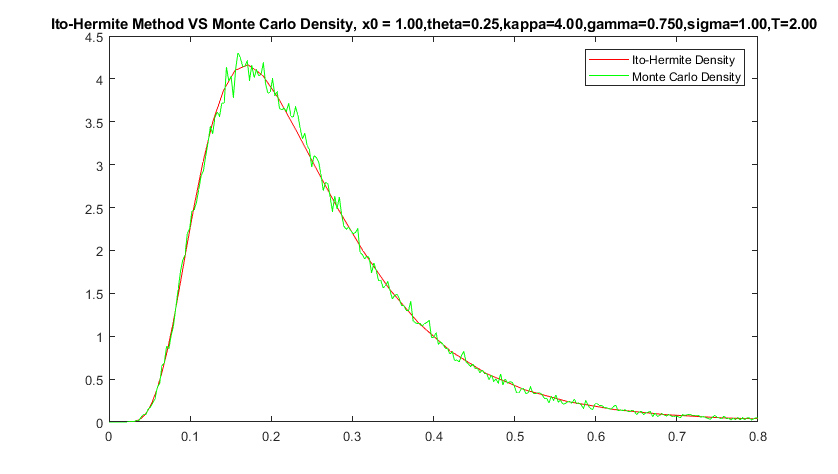](https://postimages.org/)

---

### #964 — Amin (Topic Author)
*July 28, 2020, 9:24 AM*

Here are notes from today's work.

1. I interpolated first and second derivatives in my last posted program yesterday and that was actually sharply
deteriorating the results. Please just interpolate the SDE variable only using Lagrange interpolation and use numerical
derivatives just as such and decrease the step size if the program creates problems.

2. I have used in the program variable Term0 which is given as

$.5 w_{n+1}+.5 w_{n-1} - .5 \frac{Z_{n+1} w_{n+1} - Z_{n-1} w_{n-1}}{\Delta Z}$

but this is exactly identical with $Z\frac{dw}{dZ}$ and actually

$Z\frac{dw}{dZ}= .5 w_{n+1}+.5 w_{n-1} - .5 \frac{Z_{n+1} w_{n+1} - Z_{n-1} w_{n-1}}{\Delta Z}$

so in the current program, I have just used Term0=$Z\frac{dw}{dZ}$

3. I have used the following suggestive rough  values of constants used in the program

  C11(wnStart:Nn)=.707;

  C22=-1/pi/8;

  C33=1.2/4/pi;

4. C11 is coefficient of 2nd derivative and my wild guess is that somehow it might be getting a division with$\sqrt{2}$
due to the coefficient in normalization of second hermite polynomial.

C33 is very very close to .1 which has the possibility of being equal to$\frac{\Delta Z}{2}$ because in our program
$\Delta Z=.2$

5. Though new interpolation with Lagrange polynomials greatly improved the program, I still think there is need for
improvement and a better interpolation that preserves derivatives would further increase accuracy.

6. I have continued to miss a third derivative term in all of these programs since even second derivatives just recently
became stable. In many cases, adding this term would further improve accuracy of the program.

Here is my new improved program with derivatives interpolations deleted and new constants

```
function [TrueMean,ItoHermiteMean,y_w,fy_w,wnStart] = FPERevisited044Wilmott16A()

%Copyright Ahsan Amin. Infiniti derivatives Technologies.
%Please fell free to connect on linkedin: linkedin.com/in/ahsan-amin-0a53334
%or skype ahsan.amin2999
%In this program, I am simulating the SDE given as
%dy(t)=mu1 x(t)^beta1 dt + mu2 x(t)^beta2 dt +sigma x(t)^gamma dz(t)

%I have not directly simulated the SDE but simulated the transformed
%Besse1l process version of the SDE and then changed coordinates to retreive
%the SDE in original coo
%rdinates.
%The present program will analytically evolve only the Bessel Process version of the
%SDE in transformed coordinates.
%In this version, the mean correction has been disabled. If you are
%simulating standard mean-reverting SV type SDEs, please enable the mean
%correction by uncommenting the appropriate line in the body of code below.

dt=.125/32/4;   % Simulation time interval.%Fodiffusions close to zero
             %decrease dt for accuracy.
Tt=128*16/4*4;%16*16;     % Number of simulation levels. Terminal time= Tt*dt; //.125/32*32*16=2 year;
T=Tt*dt;
OrderA=4;  %
OrderM=4;  %
%dtM=.125/8;%Monte carlo time interval size dtM.
%TtM=8*8;%Monte carlo number of simulation intervals.
dtM=dt*4*4;
TtM=Tt/4/4;

dNn=.2/1;   % Normal density subdivisions width. would change with number of subdivisions
Nn=50;  % No of normal density subdivisions
NnMidl=25;%One half density Subdivision left from mid of normal density(low)
NnMidh=26;%One half density subdivision right from the mid of normal density(high)
NnMid=4.0;

%theta=mu1/(-mu2);
%kappa=-mu2;

x0=.10;   % starting value of SDE
beta1=0.0;
beta2=1.0;   % Second drift term power.
gamma=.75;%50;   % volatility power.
kappa=2.0;%.950;   %mean reversion parameter.
theta=.10;%mean reversion target
sigma0=.90;%Volatility value

%you can specify any general mu1 and mu2 and beta1 and beta2.

mu1=+1*theta*kappa;   %first drift coefficient.
mu2=-1*kappa;    % Second drift coefficient.
%mu1=0;
%mu2=0;

alpha=1;% x^alpha is being expanded. This is currently for monte carlo only.
alpha1=1-gamma;

w(1:Nn)=x0^(1-gamma)/(1-gamma);

Z(1:Nn)=(((1:Nn)-5.5)*dNn-NnMid);

Z
str=input('Look at Z');
ZProb(1)=normcdf(.5*Z(1)+.5*Z(2),0,1)-normcdf(.5*Z(1)+.5*Z(2)-dNn,0,1);
ZProb(Nn)=normcdf(.5*Z(Nn)+.5*Z(Nn-1)+dNn,0,1)-normcdf(.5*Z(Nn)+.5*Z(Nn-1),0,1);

for nn=2:Nn-1
    ZProb(nn)=normcdf(.5*Z(nn)+.5*Z(nn+1),0,1)-normcdf(.5*Z(nn)+.5*Z(nn-1),0,1);
    %Above calculate probability mass in each probability subdivision.
end

%%%%%%%%%%%%%%%%%%%%%%%%%%%%%%%%%%%%%%%%%%%%%%%%%%%%%%%%%%%%%%%%%%%%%%%%%%%%%%%%%%%%%%%%%%%%%%

sigma11(1:OrderA+1)=0;
mu11(1:OrderA+1)=0;
mu22(1:OrderA+1)=0;
sigma22(1:OrderA+1)=0;
% index 1 correponds to zero level since matlab indexing starts at one.
sigma11(1)=1;
mu11(1)=1;
mu22(1)=1;
sigma22(1)=1;

for k=1:(OrderA+1)
    if sigma0~=0
        sigma11(k)=sigma0^(k-1);
    end
    if mu1 ~= 0
        mu11(k)=mu1^(k-1);
    end
    if mu2 ~= 0
        mu22(k)=mu2^(k-1);
    end
    if sigma0~=0
        sigma22(k)=sigma0^(2*(k-1));
    end
end
%Ft(1:TtM+1,1:(OrderA+1),1:(OrderA+1),1:(OrderA+1),1:(OrderA+1))=0; %General time powers on hermite polynomials
Fp(1:(OrderA+1),1:(OrderA+1),1:(OrderA+1),1:(OrderA+1))=0;%General x powers on coefficients of hermite polynomials.
Fp1(1:(OrderA+1),1:(OrderA+1),1:(OrderA+1),1:(OrderA+1))=0;%General x powers for bessel transformed coordinates.

%YCoeff0 and YCoeff are coefficents for original coordinates monte carlo.
%YqCoeff0 and YqCoeff are bessel/lamperti version monte carlo.

YCoeff0(1:(OrderA+1),1:(OrderA+1),1:(OrderA+1),1:(OrderA+1))=0;
YqCoeff0(1:(OrderA+1),1:(OrderA+1),1:(OrderA+1),1:(OrderA+1))=0;
%Pre-compute the time and power exponent values in small multi-dimensional arrays
YCoeff = ItoTaylorCoeffsNew(alpha,beta1,beta2,gamma); %expand y^alpha where alpha=1;
YqCoeff = ItoTaylorCoeffsNew(alpha1,beta1,beta2,gamma);%expand y^alpha1 where alpha1=(1-gamma)
YqCoeff=YqCoeff/(1-gamma); %Transformed coordinates coefficients have to be
%further divided by (1-gamma)

for k = 0 : (OrderA)
    for m = 0:k
        l4 = k - m + 1;
        for n = 0 : m
            l3 = m - n + 1;
            for j = 0:n
                l2 = n - j + 1;
                l1 = j + 1;
                %Ft(l1,l2,l3,l4) = dtM^((l1-1) + (l2-1) + (l3-1) + .5* (l4-1));
                Fp(l1,l2,l3,l4) = (alpha + (l1-1) * beta1 + (l2-1) * beta2 + (l3-1) * 2* gamma + (l4-1) * gamma ...
                    - (l1-1) - (l2-1) - 2* (l3-1) - (l4-1));
                Fp1(l1,l2,l3,l4) = (alpha1 + (l1-1) * beta1 + (l2-1) * beta2 + (l3-1) * 2* gamma + (l4-1) * gamma ...
                    - (l1-1) - (l2-1) - 2* (l3-1) - (l4-1));

                YCoeff0(l1,l2,l3,l4) =YCoeff(l1,l2,l3,l4).*mu11(l1).*mu22(l2).*sigma22(l3).*sigma11(l4);
                YqCoeff0(l1,l2,l3,l4) =YqCoeff(l1,l2,l3,l4).*mu11(l1).*mu22(l2).*sigma22(l3).*sigma11(l4);
            end
        end
    end
end

%%%%%%%%%%%%%%%%%%%%%%%%%%%%%%%%%%%%%%%%%%%%%%%%%%%%%%%%%%%%%%%%%%%%%%%%%%%%%%%%%%%%%%%%%%%%%%
wnStart=1;%
d2wdZ2(1:Nn)=0;
d2wdZ2A(1:Nn)=0;

dwdZ(1:Nn)=0;
yy(wnStart:Nn)=((1-gamma)*w(wnStart:Nn)).^(1/(1-gamma));
tic

for tt=1:Tt

     yy(wnStart:Nn)=((1-gamma)*w(wnStart:Nn)).^(1/(1-gamma));

    [wMu0dt,dwMu0dtdw,d2wMu0dtdw2,d3wMu0dtdw3,c1,c2,c3,c4] =
CalculateDriftAndVolOrder4(w,wnStart,Nn,YqCoeff0,Fp1,gamma,dt);

    wPrev=w;
    dw(wnStart:Nn)=c1(wnStart:Nn).*Z(wnStart:Nn) ;% ...
    dw2(wnStart:Nn)=dw(wnStart:Nn).^2;
    w(isnan(w)==1)=0;
    wMu0dt(isnan(wMu0dt)==1)=0;
    wMeanPrev=sum(ZProb(wnStart:Nn).*w(wnStart:Nn));%Calculate the mean.

%%%%%%%%%%%%%%%%%%%%%%%%%%%%%%%%%%%%%%%%%%%%%%%%%%%%%%%%%%%%%%%%%%%%%%%%%%%

d2wdZ2(wnStart:Nn)=d2wdZ2(wnStart:Nn)+
d2wMu0dtdw2(wnStart:Nn).*dwdZ(wnStart:Nn).^2+dwMu0dtdw(wnStart:Nn).*d2wdZ2(wnStart:Nn)+.33*(Z(wnStart:Nn)).*sigma0^2*dt^2;;%+
...

[dwdZ,d2wdZ2A] = First2Derivatives2ndOrderEqSpaced(wnStart,Nn,dNn,w,Z);

if (tt>16)
d2wdZ2=d2wdZ2A;

d2wdZ2(1:8)=d2wdZ2(1:8).*exp(-32*kappa^2*(1-gamma).*dNn*(8-(1:8)));
%Change 1:7/25/2020: I have very heavily weighted the second derivative to
%the left of density peak with an exponential and it allows far larger
%range of parameters with stable execution without sacrificing much
%accuracy. Of course, it is just ad hoc.
end
%If the calculation of the program blows, it means that above calculated
%derivative is unstable or bad. Plese replace with your favourite method of
%calculating this second derivative.

%plot((wnStart:Nn),d2wdZ2,'r',(wnStart:Nn),d2wdZ2A,'g');
%tt
%str=input('Look at comparison of d2wdZ2. Interpolation starts after tt=32');

dZdw(wnStart:Nn)=1.0./dwdZ(wnStart:Nn);
H2(wnStart:Nn)=(Z(wnStart:Nn).^2-1);

if(tt==1)
w(wnStart:Nn)=wMeanPrev+wMu0dt(wnStart:Nn)+ ...
          sign(w(wnStart:Nn)-wMeanPrev+dw(wnStart:Nn)).* ...
          sqrt(abs(sign(w(wnStart:Nn)-wMeanPrev).*(w(wnStart:Nn)-wMeanPrev).^2+ ...
          sign(dw(wnStart:Nn)).*dw2(wnStart:Nn)));
end
if(tt>1)

    dw(wnStart:Nn)=sigma0*sqrt(dt).*Z(wnStart:Nn);
    dw2(wnStart:Nn)=sigma0^2*dt*Z(wnStart:Nn).^2;

%   [wS] = InterpolateOrderN6(6,Z(1)-dNn,Z(1),Z(2),Z(3),Z(4),Z(5),Z(6),w(1),w(2),w(3),w(4),w(5),w(6));
%   [wE] =
InterpolateOrderN6(6,Z(Nn)+dNn,Z(Nn),Z(Nn-1),Z(Nn-2),Z(Nn-3),Z(Nn-4),Z(Nn-5),w(Nn),w(Nn-1),w(Nn-2),w(Nn-3),w(Nn-4),w(Nn-5));
%
%   %wS in point interpolated to the left of the grid.
%   %wE in point interpolated to the right of the grid.
%
%   wAdjacentB(wnStart:Nn)=0;
%   wAdjacentF(wnStart:Nn)=0;
%   ZAdjacentB(wnStart:Nn)=0;
%   ZAdjacentF(wnStart:Nn)=0;
%   dwdZB(wnStart:Nn)=0;
%   dwdZF(wnStart:Nn)=0;
%
%
%   wAdjacentB(wnStart+1:Nn)=w(wnStart:Nn-1);
%   wAdjacentB(wnStart)=wS;
%   ZAdjacentB(wnStart+1:Nn)=Z(wnStart:Nn-1);
%   ZAdjacentB(wnStart)=Z(wnStart)-dNn;
%   dwdZB(wnStart:Nn)=(w(wnStart:Nn)-wAdjacentB(wnStart:Nn))/(dNn);
%
%   wAdjacentF(wnStart:Nn-1)=w(wnStart+1:Nn);
%   wAdjacentF(Nn)=wE;
%   ZAdjacentF(wnStart:Nn-1)=Z(wnStart+1:Nn);
%   ZAdjacentF(Nn)=Z(Nn)+dNn;
%   dwdZF(wnStart:Nn)=(w(wnStart:Nn)-wAdjacentF(wnStart:Nn))/(-dNn);
%
% 
 DeltaZwDeltaZ(wnStart:Nn)=(ZAdjacentF(wnStart:Nn).*wAdjacentF(wnStart:Nn)-ZAdjacentB(wnStart:Nn).*wAdjacentB(wnStart:Nn))/(2*dNn);
%   Term0(wnStart:Nn)=(.5*wAdjacentB(wnStart:Nn)+.5*wAdjacentF(wnStart:Nn)-DeltaZwDeltaZ(wnStart:Nn));

    %if(tt>32)
  %Term0(wnStart:Nn)=-(Z(wnStart:Nn).*dwdZ(wnStart:Nn));
  Term0(wnStart:Nn)=-(Z(wnStart:Nn).*dwdZ(wnStart:Nn));
  %end
  C11(wnStart:Nn)=.707; %dwdZ(wnStart:Nn);%.707000;

  C22=-1/pi/8;%

  C33=1.2/4/pi;%

  w(wnStart:Nn)=w(wnStart:Nn)+wMu0dt(wnStart:Nn)+((Term0(wnStart:Nn)+C11(wnStart:Nn).*d2wdZ2(wnStart:Nn))+ ...
            sign(-Term0(wnStart:Nn)-C11(wnStart:Nn).*d2wdZ2(wnStart:Nn)+dw(wnStart:Nn)).* ...
            sqrt(abs(sign(-Term0(wnStart:Nn)-C11(wnStart:Nn).*d2wdZ2(wnStart:Nn)).* ...
            (-Term0(wnStart:Nn)-C11(wnStart:Nn).*d2wdZ2(wnStart:Nn)).^2+ ...
            sign(+dw(wnStart:Nn)).*dw2(wnStart:Nn))))+ ...
            -C33.*dwMu0dtdw(wnStart:Nn).*dwdZ(wnStart:Nn).^2 + ...
            +C22.*3*Z(wnStart:Nn).^1.*dZdw(wnStart:Nn).*d2wdZ2(wnStart:Nn)*sigma0^2.*dt + ...
            +0*(1-1/sqrt(3))*dwMu0dtdw(wnStart:Nn).*sigma0^2*dt - ...
            0*.125/2*.125*d2wdZ2(wnStart:Nn).*(w(wnStart:Nn)-Term0(wnStart:Nn))*dt;

        %Change 2:7/25/2020:%I have added a last term from quadratic variation between drift
        %and w terms. I am not very sure if we need it or not.

end

%%%%%%%%%%%%%%%%%%%%%%%%%%%%%%%%%%%%%%%%%%%%%%%%%%%%%%%%%%%%%%%%%%%%%%%%%%%
%Below are instability correction equations. There is instability in the
% SDE representation equation roughly between -.5 SD to +.5 SD in normal terms.
%Instability correction Algorithm takes two ends that are here given as
%lower end=w(NnMidl-2) and upper end=w(NnMidh+3).
%In the block below the interpolation starts from lower end.
%1st equation is
%wll(NnMidl-1)=w(NnMidl-2)+(D1wl+CTheta*D2wl*dNn/1+.5*DeltaD1w)*dNn;
%Second equation is: wll(NnMidl)=wll(NnMidl-1)+(D1wl+CTheta*D2wl*dNn+1.5*DeltaD1w)*dNn;
%And so on.
%There is a sixth equation that is not written below(since it takes us to
%the upper interpolation point which is already known) which is
%wll(NnMidh+3)=wll(NnMidh+2)+(D1wl+CTheta*D2wl*dNn+5.5*DeltaD1w)*dNn;
%Sum of these six equations add up to the distance between upper and lower
%interpolation points.
%In the sum there are six instances of first derivative which is already
%calculated at the boundary, six instances of second derivative which is also
%already calculated at lower boundary and 18.0 instances of DeltaD1w which is
%unknown. This equation calculates the value of one unit of DeltaD1w addition
%DeltaD1w=(w(NnMidh+3)-w(NnMidl-2)-6*D1wl*dNn-6.0*CTheta*D2wl*dNn.^2.0/1.0)/18.0/dNn;
% I hope to find a better analytical method to tackle this issue. Friends
% are welcome to play with slightly changed related alternatives to the
%above interpolation.
%Change 7/27/2020
%I have switched to Lagrange interpolation by taking four points on both
%sides of instability and using 8th order interpolation of five points in
%mid between the eight points on sides. This works far better and you can
%now use nuemrical 2nd derivative without any modification for a large
%range of parameters. It truly improves the fit to true density when it
%works.

% Good interpolation below
     
w(NnMidh+2)=InterpolateOrderN8(8,Z(NnMidh+2),Z(NnMidh+3),Z(NnMidh+4),Z(NnMidh+5),Z(NnMidh+6),Z(NnMidl-2),Z(NnMidl-3),Z(NnMidl-4),Z(NnMidl-5),w(NnMidh+3),w(NnMidh+4),w(NnMidh+5),w(NnMidh+6),w(NnMidl-2),w(NnMidl-3),w(NnMidl-4),w(NnMidl-5));
     
w(NnMidh+1)=InterpolateOrderN8(8,Z(NnMidh+1),Z(NnMidh+3),Z(NnMidh+4),Z(NnMidh+5),Z(NnMidh+6),Z(NnMidl-2),Z(NnMidl-3),Z(NnMidl-4),Z(NnMidl-5),w(NnMidh+3),w(NnMidh+4),w(NnMidh+5),w(NnMidh+6),w(NnMidl-2),w(NnMidl-3),w(NnMidl-4),w(NnMidl-5));
     
w(NnMidh)=InterpolateOrderN8(8,Z(NnMidh),Z(NnMidh+3),Z(NnMidh+4),Z(NnMidh+5),Z(NnMidh+6),Z(NnMidl-2),Z(NnMidl-3),Z(NnMidl-4),Z(NnMidl-5),w(NnMidh+3),w(NnMidh+4),w(NnMidh+5),w(NnMidh+6),w(NnMidl-2),w(NnMidl-3),w(NnMidl-4),w(NnMidl-5));
     
w(NnMidl)=InterpolateOrderN8(8,Z(NnMidl),Z(NnMidh+3),Z(NnMidh+4),Z(NnMidh+5),Z(NnMidh+6),Z(NnMidl-2),Z(NnMidl-3),Z(NnMidl-4),Z(NnMidl-5),w(NnMidh+3),w(NnMidh+4),w(NnMidh+5),w(NnMidh+6),w(NnMidl-2),w(NnMidl-3),w(NnMidl-4),w(NnMidl-5));
     
w(NnMidl-1)=InterpolateOrderN8(8,Z(NnMidl-1),Z(NnMidh+3),Z(NnMidh+4),Z(NnMidh+5),Z(NnMidh+6),Z(NnMidl-2),Z(NnMidl-3),Z(NnMidl-4),Z(NnMidl-5),w(NnMidh+3),w(NnMidh+4),w(NnMidh+5),w(NnMidh+6),w(NnMidl-2),w(NnMidl-3),w(NnMidl-4),w(NnMidl-5));

%
%
%
%     CTheta=0;
%     D1wl=(11/6*w(NnMidl-2)-3*w(NnMidl-3)+3/2*w(NnMidl-4)-1/3*w(NnMidl-5))/dNn;
%     D2wl=(35/12*w(NnMidl-2) -26/3*w(NnMidl-3)+ 19/2*w(NnMidl-4)-14/3*w(NnMidl-5)+11/12*w(NnMidl-6))/dNn.^2;
%     DeltaD1w=(w(NnMidh+3)-w(NnMidl-2)-6*D1wl*dNn-6.0*CTheta*D2wl*dNn.^2.0/1.0)/18.0/dNn;
%
%     wll(NnMidl-1)=w(NnMidl-2)+  (D1wl+CTheta*D2wl*dNn+.5*DeltaD1w)*dNn;
%     wll(NnMidl)=wll(NnMidl-1)+  (D1wl+CTheta*D2wl*dNn+1.5*DeltaD1w)*dNn;
%     wll(NnMidh)=wll(NnMidl)+    (D1wl+CTheta*D2wl*dNn+2.5*DeltaD1w)*dNn;
%     wll(NnMidh+1)=wll(NnMidh)+  (D1wl+CTheta*D2wl*dNn+3.5*DeltaD1w)*dNn;
%     wll(NnMidh+2)=wll(NnMidh+1)+(D1wl+CTheta*D2wl*dNn+4.5*DeltaD1w)*dNn;
%     %wll(NnMidh+3)=wll(NnMidh+2)+(D1wl+CTheta*D2wl*dNn+5.5*DeltaD1w)*dNn;
% %The last equation is not used since point w(NnMidh+3)is given but it is used in
% %calculation of distance between two interpolation points. This distance is
% %used to determine the value of DeltaD1w.
%
%     D1wh=(-11/6*w(NnMidh+3)+3*w(NnMidh+4)-3/2*w(NnMidh+5)+1/3*w(NnMidh+6))/dNn;
%     D2wh=(35/12*w(NnMidh+3) -26/3*w(NnMidh+4)+ 19/2*w(NnMidh+5)-14/3*w(NnMidh+6)+11/12*w(NnMidh+7))/dNn.^2;
%     DeltaD1w=(w(NnMidh+3)-w(NnMidl-2)-6*D1wh*dNn-6.0*CTheta*D2wh*dNn.^2.0/1.0)/18.0/dNn;
% %     DeltaD1w=(w(NnMidh+2)-w(NnMidl-1)-4*D1wh*dNn-16.0*D2wh*dNn.^2.0/1.0)/6.0/dNn;
%
%
%     whh(NnMidh+2)=w(NnMidh+3)-(D1wh+CTheta*D2wh*dNn+.5*DeltaD1w)*dNn;
%     whh(NnMidh+1)=w(NnMidh+2)-(D1wh+CTheta*D2wh*dNn+1.5* DeltaD1w)*dNn;
%     whh(NnMidh)=whh(NnMidh+1)-(D1wh+CTheta*D2wh*dNn+2.5* DeltaD1w)*dNn;
%     whh(NnMidl)=whh(NnMidh)-(D1wh+CTheta*D2wh*dNn+3.5* DeltaD1w)*dNn;
%     whh(NnMidl-1)=whh(NnMidl)-(D1wh+CTheta*D2wh*dNn+4.5* DeltaD1w)*dNn;
%
%     %whh(NnMidl-2)=whh(NnMidl-1)-(D1wh+CTheta*D2wh*dNn/1+5.5* DeltaD1w)*dNn;
%
%
%         w(NnMidh+2)=.5*whh(NnMidh+2)+.5*wll(NnMidh+2);
%         w(NnMidh+1)=.5*whh(NnMidh+1)+.5*wll(NnMidh+1);
%         w(NnMidh)=.5*whh(NnMidh)+.5*wll(NnMidh);
%         w(NnMidl)=.5*whh(NnMidl)+.5*wll(NnMidl);
%         w(NnMidl-1)=.5*whh(NnMidl-1)+.5*wll(NnMidl-1);

  [wE] =
InterpolateOrderN6(6,Z(Nn)+dNn,Z(Nn),Z(Nn-1),Z(Nn-2),Z(Nn-3),Z(Nn-4),Z(Nn-5),w(Nn),w(Nn-1),w(Nn-2),w(Nn-3),w(Nn-4),w(Nn-5));

        w1(1:Nn-1)=w(1:Nn-1);
        w1(Nn)=w(Nn);
        w2(1:Nn-1)=w(2:Nn);
        w2(Nn)=wE;

w(w1(:)>w2(:))=0;%Be careful;might not universally hold;
     %Change 3:7/25/2020: I have improved zero correction in above.
        w(w<0)=0.0;
        for nn=1:Nn
            if(w(nn)<=0)
                wnStart=nn+1;
           end
        end

        %%1st order mean correction. We know the mean in original
        %%coordinates so I shift the density into original coordinates,
        %%apply the mean correction and then transform again into Lamperti
        %%coordinates. Algebra solves two equations in two unknowns.
        %%Equations are Sum_0^N{(Y_w(wnStart:Nn)-Y0)*W0}=1 and the second
        %%equation is Sum_0^N{Y_w(wnStart:Nn).*(Y_w(wnStart:Nn)-Y0)*W0}=u0
        %%Two unknows are Y0 and W0. u0 is known mean.
        tt;
        u0=theta+(x0-theta)*exp(-kappa*(tt*dt)); %analytic mean of the density

        %If you are not using stochastic volatility, replace above with
        %true mean otherwise results would become garbage.

        Y_w(wnStart:Nn) = ((1-gamma)*w(wnStart:Nn)).^(1/(1-gamma));

        Yn2Pn=sum(Y_w(wnStart:Nn).*Y_w(wnStart:Nn).*ZProb(wnStart:Nn));
        YnPn=sum(Y_w(wnStart:Nn).*ZProb(wnStart:Nn));
        Pn=1.0;%%Sum(ZProb(1:Nn))
        Y0=(Yn2Pn-u0*YnPn)/(YnPn-u0*Pn);

        Y0Pn=Y0*Pn;
        W0=1/(YnPn-Y0Pn);
        YCorrected(wnStart:Nn)=Y_w(wnStart:Nn).*(Y_w(wnStart:Nn)-Y0)*W0;
        wCorrected(wnStart:Nn)=(YCorrected(wnStart:Nn).^(1-gamma))./(1-gamma);
      %  w(wnStart:Nn)=wCorrected(wnStart:Nn);

   %I have disabled the mean correction. The above mean correction is only valid for
   %standard mean reverting stochastic volatility type SDEs. To enable mean
   %correction please uncomment the above last line in the block.

end

 y_w(1:Nn)=0;
 y_w(wnStart:Nn) = ((1-gamma)*w(wnStart:Nn)).^(1/(1-gamma));
 Dfy_w(wnStart:Nn)=0;
 Dfw(wnStart:Nn)=0;
for nn=wnStart+1:Nn-1
    Dfy_w(nn) = (y_w(nn + 1) - y_w(nn - 1))/(Z(nn + 1) - Z(nn - 1));
    Dfw(nn) = (w(nn + 1) - w(nn - 1))/(Z(nn + 1) - Z(nn - 1));
    %Change of variable derivative for densities
end
fy_w(1:Nn)=0;
fw(1:Nn)=0;
for nn = wnStart:Nn-1
    fy_w(nn) = (normpdf(Z(nn),0, 1))/abs(Dfy_w(nn));%Origianl coordinates density
    fw(nn) = (normpdf(Z(nn),0, 1))/abs(Dfw(nn));
end

toc

ItoHermiteMean=sum(y_w(wnStart+1:Nn-1).*ZProb(wnStart+1:Nn-1)) %Original process average from coordinates

 disp('true Mean only applicble to standard SV mean reverting type models otherwise disregard');
 TrueMean=theta+(x0-theta)*exp(-kappa*dt*Tt)%Mean reverting SDE original variable true average

 rng(29079137, 'twister')
 paths=100000;
 YY(1:paths)=x0;  %Original process monte carlo.
 Random1(1:paths)=0;
 YYMean(1:TtM)=0;
 for tt=1:TtM
     Random1=randn(size(Random1));
     HermiteP1(1,1:paths)=1;
     HermiteP1(2,1:paths)=Random1(1:paths);
     HermiteP1(3,1:paths)=Random1(1:paths).^2-1;
     HermiteP1(4,1:paths)=Random1(1:paths).^3-3*Random1(1:paths);
     HermiteP1(5,1:paths)=Random1(1:paths).^4-6*Random1(1:paths).^2+3;

     YY(1:paths)=YY(1:paths) + ...
      (YCoeff0(1,1,2,1).*YY(1:paths).^Fp(1,1,2,1)+ ...
      YCoeff0(1,2,1,1).*YY(1:paths).^Fp(1,2,1,1)+ ...
      YCoeff0(2,1,1,1).*YY(1:paths).^Fp(2,1,1,1))*dtM + ...
      (YCoeff0(1,1,3,1).*YY(1:paths).^Fp(1,1,3,1)+ ...
      YCoeff0(1,2,2,1).*YY(1:paths).^Fp(1,2,2,1)+ ...
      YCoeff0(2,1,2,1).*YY(1:paths).^Fp(2,1,2,1)+ ...
      YCoeff0(1,3,1,1).*YY(1:paths).^Fp(1,3,1,1)+ ...
      YCoeff0(2,2,1,1).*YY(1:paths).^Fp(2,2,1,1)+ ...
      YCoeff0(3,1,1,1).*YY(1:paths).^Fp(3,1,1,1))*dtM^2 + ...
      ((YCoeff0(1,1,1,2).*YY(1:paths).^Fp(1,1,1,2).*sqrt(dtM))+ ...
    (YCoeff0(1,1,2,2).*YY(1:paths).^Fp(1,1,2,2)+ ...
    YCoeff0(1,2,1,2).*YY(1:paths).^Fp(1,2,1,2)+ ...
    YCoeff0(2,1,1,2).*YY(1:paths).^Fp(2,1,1,2)).*dtM^1.5) .*HermiteP1(2,1:paths) + ...
    ((YCoeff0(1,1,1,3).*YY(1:paths).^Fp(1,1,1,3) *dtM) + ...
    (YCoeff0(1,1,2,3).*YY(1:paths).^Fp(1,1,2,3)+ ...
    YCoeff0(1,2,1,3).*YY(1:paths).^Fp(1,2,1,3)+ ...
    YCoeff0(2,1,1,3).*YY(1:paths).^Fp(2,1,1,3)).*dtM^2).*HermiteP1(3,1:paths) + ...
    ((YCoeff0(1,1,1,4).*YY(1:paths).^Fp(1,1,1,4)*dtM^1.5 )).*HermiteP1(4,1:paths) + ...
    (YCoeff0(1,1,1,5).*YY(1:paths).^Fp(1,1,1,5)*dtM^2.0).*HermiteP1(5,1:paths);

%Uncomment for fourth order monte carlo

%
%   YY(1:paths)=YY(1:paths) + ...
%       (YCoeff0(1,1,2,1).*YY(1:paths).^Fp(1,1,2,1)+YCoeff0(1,2,1,1).*YY(1:paths).^Fp(1,2,1,1)+ ...
%       YCoeff0(2,1,1,1).*YY(1:paths).^Fp(2,1,1,1))*dtM + ...
%       (YCoeff0(1,1,3,1).*YY(1:paths).^Fp(1,1,3,1)+YCoeff0(1,2,2,1).*YY(1:paths).^Fp(1,2,2,1)+ ...
%       YCoeff0(2,1,2,1).*YY(1:paths).^Fp(2,1,2,1)+YCoeff0(1,3,1,1).*YY(1:paths).^Fp(1,3,1,1)+ ...
%       YCoeff0(2,2,1,1).*YY(1:paths).^Fp(2,2,1,1)+YCoeff0(3,1,1,1).*YY(1:paths).^Fp(3,1,1,1))*dtM^2 + ...
%       (YCoeff0(1,1,4,1).*YY(1:paths).^Fp(1,1,4,1)+YCoeff0(1,2,3,1).*YY(1:paths).^Fp(1,2,3,1)+ ...
%       YCoeff0(2,1,3,1).*YY(1:paths).^Fp(2,1,3,1)+YCoeff0(1,3,2,1).*YY(1:paths).^Fp(1,3,2,1)+ ...
%       YCoeff0(2,2,2,1).*YY(1:paths).^Fp(2,2,2,1)+YCoeff0(3,1,2,1).*YY(1:paths).^Fp(3,1,2,1)+ ...
%       YCoeff0(1,4,1,1).*YY(1:paths).^Fp(1,4,1,1)+YCoeff0(2,3,1,1).*YY(1:paths).^Fp(2,3,1,1)+ ...
%       YCoeff0(3,2,1,1).*YY(1:paths).^Fp(3,2,1,1)+YCoeff0(4,1,1,1).*YY(1:paths).^Fp(4,1,1,1))*dtM^3 + ...
%        (YCoeff0(1,1,5,1).*YY(1:paths).^Fp(1,1,5,1)+YCoeff0(1,2,4,1).*yy(1:paths).^Fp(1,2,4,1)+ ...
%     YCoeff0(2,1,4,1).*YY(1:paths).^Fp(2,1,4,1)+YCoeff0(2,1,1,1).*yy(1:paths).^Fp(2,1,1,1)+ ...
%      YCoeff0(2,2,3,1).*YY(1:paths).^Fp(2,2,3,1)+ ...
%      YCoeff0(3,1,3,1).*YY(1:paths).^Fp(3,1,3,1)+YCoeff0(1,4,2,1).*YY(1:paths).^Fp(1,4,2,1)+ ...
%      YCoeff0(2,3,2,1).*YY(1:paths).^Fp(2,3,2,1)+YCoeff0(3,2,2,1).*YY(1:paths).^Fp(3,2,2,1)+ ...
%      YCoeff0(4,1,2,1).*YY(1:paths).^Fp(4,1,2,1)+YCoeff0(1,5,1,1).*YY(1:paths).^Fp(1,5,1,1)+ ...
%      YCoeff0(2,4,1,1).*YY(1:paths).^Fp(2,4,1,1)+ ...
%      YCoeff0(3,3,1,1).*YY(1:paths).^Fp(3,3,1,1)+YCoeff0(4,2,1,1).*YY(1:paths).^Fp(4,2,1,1)+ ...
%      YCoeff0(5,1,1,1).*YY(1:paths).^Fp(5,1,1,1))*dtM^4+ ...
%       ((YCoeff0(1,1,1,2).*YY(1:paths).^Fp(1,1,1,2).*sqrt(dtM))+ ...
%     (YCoeff0(1,1,2,2).*YY(1:paths).^Fp(1,1,2,2)+YCoeff0(1,2,1,2).*YY(1:paths).^Fp(1,2,1,2)+ ...
%     YCoeff0(2,1,1,2).*YY(1:paths).^Fp(2,1,1,2)).*dtM^1.5+ ...
%     (YCoeff0(1,1,3,2).*YY(1:paths).^Fp(1,1,3,2)+YCoeff0(1,2,2,2).*YY(1:paths).^Fp(1,2,2,2)+ ...
%     YCoeff0(2,1,2,2).*YY(1:paths).^Fp(2,1,2,2)+YCoeff0(1,3,1,2).*YY(1:paths).^Fp(1,3,1,2)+ ...
%     YCoeff0(2,2,1,2).*YY(1:paths).^Fp(2,2,1,2)+YCoeff0(3,1,1,2).*YY(1:paths).^Fp(3,1,1,2)).*dtM^2.5+ ...
%     (YCoeff0(1,1,4,2).*YY(1:paths).^Fp(1,1,4,2)+YCoeff0(1,2,3,2).*YY(1:paths).^Fp(1,2,3,2)+ ...
%     YCoeff0(2,1,3,2).*YY(1:paths).^Fp(2,1,3,2)+YCoeff0(1,3,2,2).*YY(1:paths).^Fp(1,3,2,2)+ ...
%     YCoeff0(2,2,2,2).*YY(1:paths).^Fp(2,2,2,2)+ YCoeff0(3,1,2,2).*YY(1:paths).^Fp(3,1,2,2)+ ...
%     YCoeff0(1,4,1,2).*YY(1:paths).^Fp(1,4,1,2)+YCoeff0(2,3,1,2).*YY(1:paths).^Fp(2,3,1,2)+ ...
%     YCoeff0(3,2,1,2).*YY(1:paths).^Fp(3,2,1,2)+YCoeff0(4,1,1,2).*YY(1:paths).^Fp(4,1,1,2)).*dtM^3.5)
.*HermiteP1(2,1:paths) + ...
%     ((YCoeff0(1,1,1,3).*YY(1:paths).^Fp(1,1,1,3) *dtM) + ...
%     (YCoeff0(1,1,2,3).*YY(1:paths).^Fp(1,1,2,3)+YCoeff0(1,2,1,3).*YY(1:paths).^Fp(1,2,1,3)+ ...
%     YCoeff0(2,1,1,3).*YY(1:paths).^Fp(2,1,1,3)).*dtM^2+ ...
%     (YCoeff0(1,1,3,3).*YY(1:paths).^Fp(1,1,3,3)+YCoeff0(1,2,2,3).*YY(1:paths).^Fp(1,2,2,3)+ ...
%     YCoeff0(2,1,2,3).*YY(1:paths).^Fp(2,1,2,3) + YCoeff0(1,3,1,3).*YY(1:paths).^Fp(1,3,1,3)+ ...
%   
 YCoeff0(2,2,1,3).*YY(1:paths).^Fp(2,2,1,3)+YCoeff0(3,1,1,3).*YY(1:paths).^Fp(3,1,1,3)).*dtM^3).*HermiteP1(3,1:paths) +
...
%     ((YCoeff0(1,1,1,4).*YY(1:paths).^Fp(1,1,1,4)*dtM^1.5 )+ ...
%     (YCoeff0(1,1,2,4).*YY(1:paths).^Fp(1,1,2,4)+YCoeff0(1,2,1,4).*YY(1:paths).^Fp(1,2,1,4)+ ...
%     YCoeff0(2,1,1,4).*YY(1:paths).^Fp(2,1,1,4))*dtM^2.5).*HermiteP1(4,1:paths) + ...
%     (YCoeff0(1,1,1,5).*YY(1:paths).^Fp(1,1,1,5)*dtM^2.0).*HermiteP1(5,1:paths);
%

     YYMean(tt)=YYMean(tt)+sum(YY(1:paths))/paths;
 end
 YY(YY<0)=0;
 disp('Original process average from monte carlo');
 MCMean=sum(YY(:))/paths %origianl coordinates monte carlo average.
 disp('Original process average from our simulation');
 ItoHermiteMean=sum(y_w(wnStart+1:Nn-1).*ZProb(wnStart+1:Nn-1)) %Original process average from coordinates

 disp('true Mean only applicble to standard SV mean reverting type models otherwise disregard');
 TrueMean=theta+(x0-theta)*exp(-kappa*dt*Tt)%Mean reverting SDE original variable true average

 MaxCutOff=30;
 NoOfBins=round(300*gamma^2*4*sigma0);%Decrease the number of bins if the graph is too
 [YDensity,IndexOutY,IndexMaxY] = MakeDensityFromSimulation_Infiniti_NEW(YY,paths,NoOfBins,MaxCutOff );
 plot(y_w(wnStart+1:Nn-1),fy_w(wnStart+1:Nn-1),'r',IndexOutY(1:IndexMaxY),YDensity(1:IndexMaxY),'g');
 %plot(y_w(wnStart+1:Nn-1),fy_w(wnStart+1:Nn-1),'r',IndexOutY(1:IndexMaxY),YDensity(1:IndexMaxY),'g',Z(wnStart+1:Nn-1),fy_w(wnStart+1:Nn-1),'b');

 title(sprintf('Ito-Hermite Method VS Monte Carlo Density, x0 =
%.2f,theta=%.2f,kappa=%.2f,gamma=%.3f,sigma=%.2f,T=%.2f', x0,theta,kappa,gamma,sigma0,T));%,sprintf('theta= %f', theta),
sprintf('kappa = %f', kappa),sprintf('sigma = %f', sigma0),sprintf('T = %f', T));

 %title('text',sprintf('x0 = %f', x0),sprintf('theta= %f', theta), sprintf('kappa = %f', kappa),sprintf('sigma = %f',
sigma0),sprintf('T = %f', T))
 %xlabel(a)
 %title('Graphical Comparison of Ito-Hermite Method and Monte Carlo Method Density')
 legend({'Ito-Hermite Density','Monte Carlo Density'},'Location','northeast')

 str=input('red line is density of SDE from Ito-Hermite method, green is monte carlo.');

end
```

Original process average from monte carlo

MCMean =

   0.099666492688799

Original process average from our simulation

ItoHermiteMean =

   0.097592958223771

true Mean only applicble to standard SV mean reverting type models otherwise disregard

TrueMean =

   0.100000000000000

IndexMax =

   609

and has the following graph

[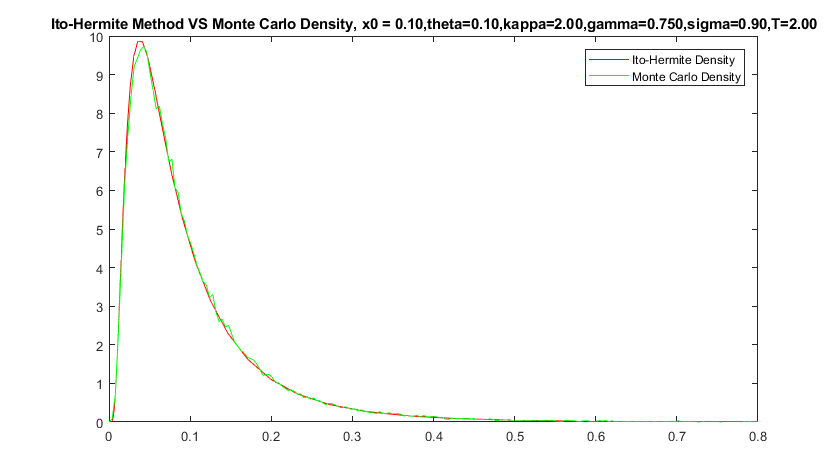](https://postimages.org/)

---

### #965 — Amin (Topic Author)
*July 28, 2020, 12:52 PM*

I used spline interpolation function of matlab for interpolation of the 'instability data points' in the mid of the
density with vastly improved results. Here I post the new matlab function.

```
function [TrueMean,ItoHermiteMean,y_w,fy_w,wnStart] = FPERevisited044Wilmott16A()

%Copyright Ahsan Amin. Infiniti derivatives Technologies.
%Please fell free to connect on linkedin: linkedin.com/in/ahsan-amin-0a53334
%or skype ahsan.amin2999
%In this program, I am simulating the SDE given as
%dy(t)=mu1 x(t)^beta1 dt + mu2 x(t)^beta2 dt +sigma x(t)^gamma dz(t)

%I have not directly simulated the SDE but simulated the transformed
%Besse1l process version of the SDE and then changed coordinates to retreive
%the SDE in original coo
%rdinates.
%The present program will analytically evolve only the Bessel Process version of the
%SDE in transformed coordinates.
%In this version, the mean correction has been disabled. If you are
%simulating standard mean-reverting SV type SDEs, please enable the mean
%correction by uncommenting the appropriate line in the body of code below.

dt=.125/32/4;   % Simulation time interval.%Fodiffusions close to zero
             %decrease dt for accuracy.
Tt=128*16/4*4;%16*16;     % Number of simulation levels. Terminal time= Tt*dt; //.125/32*32*16=2 year;
T=Tt*dt;
OrderA=4;  %
OrderM=4;  %
%dtM=.125/8;%Monte carlo time interval size dtM.
%TtM=8*8;%Monte carlo number of simulation intervals.
dtM=dt*4*4;
TtM=Tt/4/4;

dNn=.2/1;   % Normal density subdivisions width. would change with number of subdivisions
Nn=50;  % No of normal density subdivisions
NnMidl=25;%One half density Subdivision left from mid of normal density(low)
NnMidh=26;%One half density subdivision right from the mid of normal density(high)
NnMid=4.0;

%theta=mu1/(-mu2);
%kappa=-mu2;

x0=.10;   % starting value of SDE
beta1=0.0;
beta2=1.0;   % Second drift term power.
gamma=.65;%50;   % volatility power.
kappa=4.0;%.950;   %mean reversion parameter.
theta=.10;%mean reversion target
sigma0=.75;%Volatility value

%you can specify any general mu1 and mu2 and beta1 and beta2.

mu1=+1*theta*kappa;   %first drift coefficient.
mu2=-1*kappa;    % Second drift coefficient.
%mu1=0;
%mu2=0;

alpha=1;% x^alpha is being expanded. This is currently for monte carlo only.
alpha1=1-gamma;

w(1:Nn)=x0^(1-gamma)/(1-gamma);

Z(1:Nn)=(((1:Nn)-5.5)*dNn-NnMid);

Z
str=input('Look at Z');
ZProb(1)=normcdf(.5*Z(1)+.5*Z(2),0,1)-normcdf(.5*Z(1)+.5*Z(2)-dNn,0,1);
ZProb(Nn)=normcdf(.5*Z(Nn)+.5*Z(Nn-1)+dNn,0,1)-normcdf(.5*Z(Nn)+.5*Z(Nn-1),0,1);

for nn=2:Nn-1
    ZProb(nn)=normcdf(.5*Z(nn)+.5*Z(nn+1),0,1)-normcdf(.5*Z(nn)+.5*Z(nn-1),0,1);
    %Above calculate probability mass in each probability subdivision.
end

%%%%%%%%%%%%%%%%%%%%%%%%%%%%%%%%%%%%%%%%%%%%%%%%%%%%%%%%%%%%%%%%%%%%%%%%%%%%%%%%%%%%%%%%%%%%%%

sigma11(1:OrderA+1)=0;
mu11(1:OrderA+1)=0;
mu22(1:OrderA+1)=0;
sigma22(1:OrderA+1)=0;
% index 1 correponds to zero level since matlab indexing starts at one.
sigma11(1)=1;
mu11(1)=1;
mu22(1)=1;
sigma22(1)=1;

for k=1:(OrderA+1)
    if sigma0~=0
        sigma11(k)=sigma0^(k-1);
    end
    if mu1 ~= 0
        mu11(k)=mu1^(k-1);
    end
    if mu2 ~= 0
        mu22(k)=mu2^(k-1);
    end
    if sigma0~=0
        sigma22(k)=sigma0^(2*(k-1));
    end
end
%Ft(1:TtM+1,1:(OrderA+1),1:(OrderA+1),1:(OrderA+1),1:(OrderA+1))=0; %General time powers on hermite polynomials
Fp(1:(OrderA+1),1:(OrderA+1),1:(OrderA+1),1:(OrderA+1))=0;%General x powers on coefficients of hermite polynomials.
Fp1(1:(OrderA+1),1:(OrderA+1),1:(OrderA+1),1:(OrderA+1))=0;%General x powers for bessel transformed coordinates.

%YCoeff0 and YCoeff are coefficents for original coordinates monte carlo.
%YqCoeff0 and YqCoeff are bessel/lamperti version monte carlo.

YCoeff0(1:(OrderA+1),1:(OrderA+1),1:(OrderA+1),1:(OrderA+1))=0;
YqCoeff0(1:(OrderA+1),1:(OrderA+1),1:(OrderA+1),1:(OrderA+1))=0;
%Pre-compute the time and power exponent values in small multi-dimensional arrays
YCoeff = ItoTaylorCoeffsNew(alpha,beta1,beta2,gamma); %expand y^alpha where alpha=1;
YqCoeff = ItoTaylorCoeffsNew(alpha1,beta1,beta2,gamma);%expand y^alpha1 where alpha1=(1-gamma)
YqCoeff=YqCoeff/(1-gamma); %Transformed coordinates coefficients have to be
%further divided by (1-gamma)

for k = 0 : (OrderA)
    for m = 0:k
        l4 = k - m + 1;
        for n = 0 : m
            l3 = m - n + 1;
            for j = 0:n
                l2 = n - j + 1;
                l1 = j + 1;
                %Ft(l1,l2,l3,l4) = dtM^((l1-1) + (l2-1) + (l3-1) + .5* (l4-1));
                Fp(l1,l2,l3,l4) = (alpha + (l1-1) * beta1 + (l2-1) * beta2 + (l3-1) * 2* gamma + (l4-1) * gamma ...
                    - (l1-1) - (l2-1) - 2* (l3-1) - (l4-1));
                Fp1(l1,l2,l3,l4) = (alpha1 + (l1-1) * beta1 + (l2-1) * beta2 + (l3-1) * 2* gamma + (l4-1) * gamma ...
                    - (l1-1) - (l2-1) - 2* (l3-1) - (l4-1));

                YCoeff0(l1,l2,l3,l4) =YCoeff(l1,l2,l3,l4).*mu11(l1).*mu22(l2).*sigma22(l3).*sigma11(l4);
                YqCoeff0(l1,l2,l3,l4) =YqCoeff(l1,l2,l3,l4).*mu11(l1).*mu22(l2).*sigma22(l3).*sigma11(l4);
            end
        end
    end
end

%%%%%%%%%%%%%%%%%%%%%%%%%%%%%%%%%%%%%%%%%%%%%%%%%%%%%%%%%%%%%%%%%%%%%%%%%%%%%%%%%%%%%%%%%%%%%%
wnStart=1;%
d2wdZ2(1:Nn)=0;
d2wdZ2A(1:Nn)=0;

dwdZ(1:Nn)=0;
yy(wnStart:Nn)=((1-gamma)*w(wnStart:Nn)).^(1/(1-gamma));
tic

for tt=1:Tt

     yy(wnStart:Nn)=((1-gamma)*w(wnStart:Nn)).^(1/(1-gamma));

    [wMu0dt,dwMu0dtdw,d2wMu0dtdw2,d3wMu0dtdw3,c1,c2,c3,c4] =
CalculateDriftAndVolOrder4(w,wnStart,Nn,YqCoeff0,Fp1,gamma,dt);

    wPrev=w;
    dw(wnStart:Nn)=c1(wnStart:Nn).*Z(wnStart:Nn) ;% ...
    dw2(wnStart:Nn)=dw(wnStart:Nn).^2;
    w(isnan(w)==1)=0;
    wMu0dt(isnan(wMu0dt)==1)=0;
    wMeanPrev=sum(ZProb(wnStart:Nn).*w(wnStart:Nn));%Calculate the mean.

%%%%%%%%%%%%%%%%%%%%%%%%%%%%%%%%%%%%%%%%%%%%%%%%%%%%%%%%%%%%%%%%%%%%%%%%%%%

d2wdZ2(wnStart:Nn)=d2wdZ2(wnStart:Nn)+
d2wMu0dtdw2(wnStart:Nn).*dwdZ(wnStart:Nn).^2+dwMu0dtdw(wnStart:Nn).*d2wdZ2(wnStart:Nn)+.33*(Z(wnStart:Nn)).*sigma0^2*dt^2;;%+
...

[dwdZ,d2wdZ2A] = First2Derivatives2ndOrderEqSpaced(wnStart,Nn,dNn,w,Z);

if (tt>16)
d2wdZ2=d2wdZ2A;

d2wdZ2(1:8)=d2wdZ2(1:8).*exp(-32*kappa^2*(1-gamma).*dNn*(8-(1:8)));
%Change 1:7/25/2020: I have very heavily weighted the second derivative to
%the left of density peak with an exponential and it allows far larger
%range of parameters with stable execution without sacrificing much
%accuracy. Of course, it is just ad hoc.
end
%If the calculation of the program blows, it means that above calculated
%derivative is unstable or bad. Plese replace with your favourite method of
%calculating this second derivative.

%plot((wnStart:Nn),d2wdZ2,'r',(wnStart:Nn),d2wdZ2A,'g');
%tt
%str=input('Look at comparison of d2wdZ2. Interpolation starts after tt=32');

dZdw(wnStart:Nn)=1.0./dwdZ(wnStart:Nn);
H2(wnStart:Nn)=(Z(wnStart:Nn).^2-1);

if(tt==1)
w(wnStart:Nn)=wMeanPrev+wMu0dt(wnStart:Nn)+ ...
          sign(w(wnStart:Nn)-wMeanPrev+dw(wnStart:Nn)).* ...
          sqrt(abs(sign(w(wnStart:Nn)-wMeanPrev).*(w(wnStart:Nn)-wMeanPrev).^2+ ...
          sign(dw(wnStart:Nn)).*dw2(wnStart:Nn)));
end
if(tt>1)

    dw(wnStart:Nn)=sigma0*sqrt(dt).*Z(wnStart:Nn);
    dw2(wnStart:Nn)=sigma0^2*dt*Z(wnStart:Nn).^2;

%   [wS] = InterpolateOrderN6(6,Z(1)-dNn,Z(1),Z(2),Z(3),Z(4),Z(5),Z(6),w(1),w(2),w(3),w(4),w(5),w(6));
%   [wE] =
InterpolateOrderN6(6,Z(Nn)+dNn,Z(Nn),Z(Nn-1),Z(Nn-2),Z(Nn-3),Z(Nn-4),Z(Nn-5),w(Nn),w(Nn-1),w(Nn-2),w(Nn-3),w(Nn-4),w(Nn-5));
%
%   %wS in point interpolated to the left of the grid.
%   %wE in point interpolated to the right of the grid.
%
%   wAdjacentB(wnStart:Nn)=0;
%   wAdjacentF(wnStart:Nn)=0;
%   ZAdjacentB(wnStart:Nn)=0;
%   ZAdjacentF(wnStart:Nn)=0;
%   dwdZB(wnStart:Nn)=0;
%   dwdZF(wnStart:Nn)=0;
%
%
%   wAdjacentB(wnStart+1:Nn)=w(wnStart:Nn-1);
%   wAdjacentB(wnStart)=wS;
%   ZAdjacentB(wnStart+1:Nn)=Z(wnStart:Nn-1);
%   ZAdjacentB(wnStart)=Z(wnStart)-dNn;
%   dwdZB(wnStart:Nn)=(w(wnStart:Nn)-wAdjacentB(wnStart:Nn))/(dNn);
%
%   wAdjacentF(wnStart:Nn-1)=w(wnStart+1:Nn);
%   wAdjacentF(Nn)=wE;
%   ZAdjacentF(wnStart:Nn-1)=Z(wnStart+1:Nn);
%   ZAdjacentF(Nn)=Z(Nn)+dNn;
%   dwdZF(wnStart:Nn)=(w(wnStart:Nn)-wAdjacentF(wnStart:Nn))/(-dNn);
%
% 
 DeltaZwDeltaZ(wnStart:Nn)=(ZAdjacentF(wnStart:Nn).*wAdjacentF(wnStart:Nn)-ZAdjacentB(wnStart:Nn).*wAdjacentB(wnStart:Nn))/(2*dNn);
%   Term0(wnStart:Nn)=(.5*wAdjacentB(wnStart:Nn)+.5*wAdjacentF(wnStart:Nn)-DeltaZwDeltaZ(wnStart:Nn));

    %if(tt>32)
  %Term0(wnStart:Nn)=-(Z(wnStart:Nn).*dwdZ(wnStart:Nn));
  Term0(wnStart:Nn)=-(Z(wnStart:Nn).*dwdZ(wnStart:Nn));
  %end
  C11(wnStart:Nn)=.707; %dwdZ(wnStart:Nn);%.707000;

  C22=-1/pi/8;%

  C33=1.2/4/pi;%

  w(wnStart:Nn)=w(wnStart:Nn)+wMu0dt(wnStart:Nn)+((Term0(wnStart:Nn)+C11(wnStart:Nn).*d2wdZ2(wnStart:Nn))+ ...
            sign(-Term0(wnStart:Nn)-C11(wnStart:Nn).*d2wdZ2(wnStart:Nn)+dw(wnStart:Nn)).* ...
            sqrt(abs(sign(-Term0(wnStart:Nn)-C11(wnStart:Nn).*d2wdZ2(wnStart:Nn)).* ...
            (-Term0(wnStart:Nn)-C11(wnStart:Nn).*d2wdZ2(wnStart:Nn)).^2+ ...
            sign(+dw(wnStart:Nn)).*dw2(wnStart:Nn))))+ ...
            -C33.*dwMu0dtdw(wnStart:Nn).*dwdZ(wnStart:Nn).^2 + ...
            +C22.*3*Z(wnStart:Nn).^1.*dZdw(wnStart:Nn).*d2wdZ2(wnStart:Nn)*sigma0^2.*dt + ...
            +0*(1-1/sqrt(3))*dwMu0dtdw(wnStart:Nn).*sigma0^2*dt - ...
            0*.125/2*.125*d2wdZ2(wnStart:Nn).*(w(wnStart:Nn)-Term0(wnStart:Nn))*dt;

        %Change 2:7/25/2020:%I have added a last term from quadratic variation between drift
        %and w terms. I am not very sure if we need it or not.

end

%%%%%%%%%%%%%%%%%%%%%%%%%%%%%%%%%%%%%%%%%%%%%%%%%%%%%%%%%%%%%%%%%%%%%%%%%%%
%Below are instability correction equations. There is instability in the
% SDE representation equation roughly between -.5 SD to +.5 SD in normal terms.
%Instability correction Algorithm takes two ends that are here given as
%lower end=w(NnMidl-2) and upper end=w(NnMidh+3).
%In the block below the interpolation starts from lower end.
%1st equation is
%wll(NnMidl-1)=w(NnMidl-2)+(D1wl+CTheta*D2wl*dNn/1+.5*DeltaD1w)*dNn;
%Second equation is: wll(NnMidl)=wll(NnMidl-1)+(D1wl+CTheta*D2wl*dNn+1.5*DeltaD1w)*dNn;
%And so on.
%There is a sixth equation that is not written below(since it takes us to
%the upper interpolation point which is already known) which is
%wll(NnMidh+3)=wll(NnMidh+2)+(D1wl+CTheta*D2wl*dNn+5.5*DeltaD1w)*dNn;
%Sum of these six equations add up to the distance between upper and lower
%interpolation points.
%In the sum there are six instances of first derivative which is already
%calculated at the boundary, six instances of second derivative which is also
%already calculated at lower boundary and 18.0 instances of DeltaD1w which is
%unknown. This equation calculates the value of one unit of DeltaD1w addition
%DeltaD1w=(w(NnMidh+3)-w(NnMidl-2)-6*D1wl*dNn-6.0*CTheta*D2wl*dNn.^2.0/1.0)/18.0/dNn;
% I hope to find a better analytical method to tackle this issue. Friends
% are welcome to play with slightly changed related alternatives to the
%above interpolation.
%Change 7/27/2020
%I have switched to Lagrange interpolation by taking four points on both
%sides of instability and using 8th order interpolation of five points in
%mid between the eight points on sides. This works far better and you can
%now use nuemrical 2nd derivative without any modification for a large
%range of parameters. It truly improves the fit to true density when it
%works.

% % Good interpolation below
%     
 w(NnMidh+2)=InterpolateOrderN8(8,Z(NnMidh+2),Z(NnMidh+3),Z(NnMidh+4),Z(NnMidh+5),Z(NnMidh+6),Z(NnMidl-2),Z(NnMidl-3),Z(NnMidl-4),Z(NnMidl-5),w(NnMidh+3),w(NnMidh+4),w(NnMidh+5),w(NnMidh+6),w(NnMidl-2),w(NnMidl-3),w(NnMidl-4),w(NnMidl-5));
%     
 w(NnMidh+1)=InterpolateOrderN8(8,Z(NnMidh+1),Z(NnMidh+3),Z(NnMidh+4),Z(NnMidh+5),Z(NnMidh+6),Z(NnMidl-2),Z(NnMidl-3),Z(NnMidl-4),Z(NnMidl-5),w(NnMidh+3),w(NnMidh+4),w(NnMidh+5),w(NnMidh+6),w(NnMidl-2),w(NnMidl-3),w(NnMidl-4),w(NnMidl-5));
%     
 w(NnMidh)=InterpolateOrderN8(8,Z(NnMidh),Z(NnMidh+3),Z(NnMidh+4),Z(NnMidh+5),Z(NnMidh+6),Z(NnMidl-2),Z(NnMidl-3),Z(NnMidl-4),Z(NnMidl-5),w(NnMidh+3),w(NnMidh+4),w(NnMidh+5),w(NnMidh+6),w(NnMidl-2),w(NnMidl-3),w(NnMidl-4),w(NnMidl-5));
%     
 w(NnMidl)=InterpolateOrderN8(8,Z(NnMidl),Z(NnMidh+3),Z(NnMidh+4),Z(NnMidh+5),Z(NnMidh+6),Z(NnMidl-2),Z(NnMidl-3),Z(NnMidl-4),Z(NnMidl-5),w(NnMidh+3),w(NnMidh+4),w(NnMidh+5),w(NnMidh+6),w(NnMidl-2),w(NnMidl-3),w(NnMidl-4),w(NnMidl-5));
%     
 w(NnMidl-1)=InterpolateOrderN8(8,Z(NnMidl-1),Z(NnMidh+3),Z(NnMidh+4),Z(NnMidh+5),Z(NnMidh+6),Z(NnMidl-2),Z(NnMidl-3),Z(NnMidl-4),Z(NnMidl-5),w(NnMidh+3),w(NnMidh+4),w(NnMidh+5),w(NnMidh+6),w(NnMidl-2),w(NnMidl-3),w(NnMidl-4),w(NnMidl-5));
%

      %yq = makima(x,y,xq)

      Zi=[Z(NnMidl-5),Z(NnMidl-4),Z(NnMidl-3),Z(NnMidl-2),Z(NnMidh+3),Z(NnMidh+4),Z(NnMidh+5),Z(NnMidh+6)];
      wi=[w(NnMidl-5),w(NnMidl-4),w(NnMidl-3),w(NnMidl-2),w(NnMidh+3),w(NnMidh+4),w(NnMidh+5),w(NnMidh+6)];
      Zq=[Z(NnMidl-1),Z(NnMidl),Z(NnMidh),Z(NnMidh+1),Z(NnMidh+2)];
      wq=spline(Zi,wi,Zq);
      w(NnMidl-1:NnMidh+2)=wq(1:5);

%
%
%
%     CTheta=0;
%     D1wl=(11/6*w(NnMidl-2)-3*w(NnMidl-3)+3/2*w(NnMidl-4)-1/3*w(NnMidl-5))/dNn;
%     D2wl=(35/12*w(NnMidl-2) -26/3*w(NnMidl-3)+ 19/2*w(NnMidl-4)-14/3*w(NnMidl-5)+11/12*w(NnMidl-6))/dNn.^2;
%     DeltaD1w=(w(NnMidh+3)-w(NnMidl-2)-6*D1wl*dNn-6.0*CTheta*D2wl*dNn.^2.0/1.0)/18.0/dNn;
%
%     wll(NnMidl-1)=w(NnMidl-2)+  (D1wl+CTheta*D2wl*dNn+.5*DeltaD1w)*dNn;
%     wll(NnMidl)=wll(NnMidl-1)+  (D1wl+CTheta*D2wl*dNn+1.5*DeltaD1w)*dNn;
%     wll(NnMidh)=wll(NnMidl)+    (D1wl+CTheta*D2wl*dNn+2.5*DeltaD1w)*dNn;
%     wll(NnMidh+1)=wll(NnMidh)+  (D1wl+CTheta*D2wl*dNn+3.5*DeltaD1w)*dNn;
%     wll(NnMidh+2)=wll(NnMidh+1)+(D1wl+CTheta*D2wl*dNn+4.5*DeltaD1w)*dNn;
%     %wll(NnMidh+3)=wll(NnMidh+2)+(D1wl+CTheta*D2wl*dNn+5.5*DeltaD1w)*dNn;
% %The last equation is not used since point w(NnMidh+3)is given but it is used in
% %calculation of distance between two interpolation points. This distance is
% %used to determine the value of DeltaD1w.
%
%     D1wh=(-11/6*w(NnMidh+3)+3*w(NnMidh+4)-3/2*w(NnMidh+5)+1/3*w(NnMidh+6))/dNn;
%     D2wh=(35/12*w(NnMidh+3) -26/3*w(NnMidh+4)+ 19/2*w(NnMidh+5)-14/3*w(NnMidh+6)+11/12*w(NnMidh+7))/dNn.^2;
%     DeltaD1w=(w(NnMidh+3)-w(NnMidl-2)-6*D1wh*dNn-6.0*CTheta*D2wh*dNn.^2.0/1.0)/18.0/dNn;
% %     DeltaD1w=(w(NnMidh+2)-w(NnMidl-1)-4*D1wh*dNn-16.0*D2wh*dNn.^2.0/1.0)/6.0/dNn;
%
%
%     whh(NnMidh+2)=w(NnMidh+3)-(D1wh+CTheta*D2wh*dNn+.5*DeltaD1w)*dNn;
%     whh(NnMidh+1)=w(NnMidh+2)-(D1wh+CTheta*D2wh*dNn+1.5* DeltaD1w)*dNn;
%     whh(NnMidh)=whh(NnMidh+1)-(D1wh+CTheta*D2wh*dNn+2.5* DeltaD1w)*dNn;
%     whh(NnMidl)=whh(NnMidh)-(D1wh+CTheta*D2wh*dNn+3.5* DeltaD1w)*dNn;
%     whh(NnMidl-1)=whh(NnMidl)-(D1wh+CTheta*D2wh*dNn+4.5* DeltaD1w)*dNn;
%
%     %whh(NnMidl-2)=whh(NnMidl-1)-(D1wh+CTheta*D2wh*dNn/1+5.5* DeltaD1w)*dNn;
%
%
%         w(NnMidh+2)=.5*whh(NnMidh+2)+.5*wll(NnMidh+2);
%         w(NnMidh+1)=.5*whh(NnMidh+1)+.5*wll(NnMidh+1);
%         w(NnMidh)=.5*whh(NnMidh)+.5*wll(NnMidh);
%         w(NnMidl)=.5*whh(NnMidl)+.5*wll(NnMidl);
%         w(NnMidl-1)=.5*whh(NnMidl-1)+.5*wll(NnMidl-1);

  [wE] =
InterpolateOrderN6(6,Z(Nn)+dNn,Z(Nn),Z(Nn-1),Z(Nn-2),Z(Nn-3),Z(Nn-4),Z(Nn-5),w(Nn),w(Nn-1),w(Nn-2),w(Nn-3),w(Nn-4),w(Nn-5));

        w1(1:Nn-1)=w(1:Nn-1);
        w1(Nn)=w(Nn);
        w2(1:Nn-1)=w(2:Nn);
        w2(Nn)=wE;

w(w1(:)>w2(:))=0;%Be careful;might not universally hold;
     %Change 3:7/25/2020: I have improved zero correction in above.
        w(w<0)=0.0;
        for nn=1:Nn
            if(w(nn)<=0)
                wnStart=nn+1;
           end
        end

        %%1st order mean correction. We know the mean in original
        %%coordinates so I shift the density into original coordinates,
        %%apply the mean correction and then transform again into Lamperti
        %%coordinates. Algebra solves two equations in two unknowns.
        %%Equations are Sum_0^N{(Y_w(wnStart:Nn)-Y0)*W0}=1 and the second
        %%equation is Sum_0^N{Y_w(wnStart:Nn).*(Y_w(wnStart:Nn)-Y0)*W0}=u0
        %%Two unknows are Y0 and W0. u0 is known mean.
        tt;
        u0=theta+(x0-theta)*exp(-kappa*(tt*dt)); %analytic mean of the density

        %If you are not using stochastic volatility, replace above with
        %true mean otherwise results would become garbage.

        Y_w(wnStart:Nn) = ((1-gamma)*w(wnStart:Nn)).^(1/(1-gamma));

        Yn2Pn=sum(Y_w(wnStart:Nn).*Y_w(wnStart:Nn).*ZProb(wnStart:Nn));
        YnPn=sum(Y_w(wnStart:Nn).*ZProb(wnStart:Nn));
        Pn=1.0;%%Sum(ZProb(1:Nn))
        Y0=(Yn2Pn-u0*YnPn)/(YnPn-u0*Pn);

        Y0Pn=Y0*Pn;
        W0=1/(YnPn-Y0Pn);
        YCorrected(wnStart:Nn)=Y_w(wnStart:Nn).*(Y_w(wnStart:Nn)-Y0)*W0;
        wCorrected(wnStart:Nn)=(YCorrected(wnStart:Nn).^(1-gamma))./(1-gamma);
      %  w(wnStart:Nn)=wCorrected(wnStart:Nn);

   %I have disabled the mean correction. The above mean correction is only valid for
   %standard mean reverting stochastic volatility type SDEs. To enable mean
   %correction please uncomment the above last line in the block.

end

 y_w(1:Nn)=0;
 y_w(wnStart:Nn) = ((1-gamma)*w(wnStart:Nn)).^(1/(1-gamma));
 Dfy_w(wnStart:Nn)=0;
 Dfw(wnStart:Nn)=0;
for nn=wnStart+1:Nn-1
    Dfy_w(nn) = (y_w(nn + 1) - y_w(nn - 1))/(Z(nn + 1) - Z(nn - 1));
    Dfw(nn) = (w(nn + 1) - w(nn - 1))/(Z(nn + 1) - Z(nn - 1));
    %Change of variable derivative for densities
end
fy_w(1:Nn)=0;
fw(1:Nn)=0;
for nn = wnStart:Nn-1
    fy_w(nn) = (normpdf(Z(nn),0, 1))/abs(Dfy_w(nn));%Origianl coordinates density
    fw(nn) = (normpdf(Z(nn),0, 1))/abs(Dfw(nn));
end

toc

ItoHermiteMean=sum(y_w(wnStart+1:Nn-1).*ZProb(wnStart+1:Nn-1)) %Original process average from coordinates

 disp('true Mean only applicble to standard SV mean reverting type models otherwise disregard');
 TrueMean=theta+(x0-theta)*exp(-kappa*dt*Tt)%Mean reverting SDE original variable true average

 rng(29079137, 'twister')
 paths=100000;
 YY(1:paths)=x0;  %Original process monte carlo.
 Random1(1:paths)=0;
 YYMean(1:TtM)=0;
 for tt=1:TtM
     Random1=randn(size(Random1));
     HermiteP1(1,1:paths)=1;
     HermiteP1(2,1:paths)=Random1(1:paths);
     HermiteP1(3,1:paths)=Random1(1:paths).^2-1;
     HermiteP1(4,1:paths)=Random1(1:paths).^3-3*Random1(1:paths);
     HermiteP1(5,1:paths)=Random1(1:paths).^4-6*Random1(1:paths).^2+3;

     YY(1:paths)=YY(1:paths) + ...
      (YCoeff0(1,1,2,1).*YY(1:paths).^Fp(1,1,2,1)+ ...
      YCoeff0(1,2,1,1).*YY(1:paths).^Fp(1,2,1,1)+ ...
      YCoeff0(2,1,1,1).*YY(1:paths).^Fp(2,1,1,1))*dtM + ...
      (YCoeff0(1,1,3,1).*YY(1:paths).^Fp(1,1,3,1)+ ...
      YCoeff0(1,2,2,1).*YY(1:paths).^Fp(1,2,2,1)+ ...
      YCoeff0(2,1,2,1).*YY(1:paths).^Fp(2,1,2,1)+ ...
      YCoeff0(1,3,1,1).*YY(1:paths).^Fp(1,3,1,1)+ ...
      YCoeff0(2,2,1,1).*YY(1:paths).^Fp(2,2,1,1)+ ...
      YCoeff0(3,1,1,1).*YY(1:paths).^Fp(3,1,1,1))*dtM^2 + ...
      ((YCoeff0(1,1,1,2).*YY(1:paths).^Fp(1,1,1,2).*sqrt(dtM))+ ...
    (YCoeff0(1,1,2,2).*YY(1:paths).^Fp(1,1,2,2)+ ...
    YCoeff0(1,2,1,2).*YY(1:paths).^Fp(1,2,1,2)+ ...
    YCoeff0(2,1,1,2).*YY(1:paths).^Fp(2,1,1,2)).*dtM^1.5) .*HermiteP1(2,1:paths) + ...
    ((YCoeff0(1,1,1,3).*YY(1:paths).^Fp(1,1,1,3) *dtM) + ...
    (YCoeff0(1,1,2,3).*YY(1:paths).^Fp(1,1,2,3)+ ...
    YCoeff0(1,2,1,3).*YY(1:paths).^Fp(1,2,1,3)+ ...
    YCoeff0(2,1,1,3).*YY(1:paths).^Fp(2,1,1,3)).*dtM^2).*HermiteP1(3,1:paths) + ...
    ((YCoeff0(1,1,1,4).*YY(1:paths).^Fp(1,1,1,4)*dtM^1.5 )).*HermiteP1(4,1:paths) + ...
    (YCoeff0(1,1,1,5).*YY(1:paths).^Fp(1,1,1,5)*dtM^2.0).*HermiteP1(5,1:paths);

%Uncomment for fourth order monte carlo

%
%   YY(1:paths)=YY(1:paths) + ...
%       (YCoeff0(1,1,2,1).*YY(1:paths).^Fp(1,1,2,1)+YCoeff0(1,2,1,1).*YY(1:paths).^Fp(1,2,1,1)+ ...
%       YCoeff0(2,1,1,1).*YY(1:paths).^Fp(2,1,1,1))*dtM + ...
%       (YCoeff0(1,1,3,1).*YY(1:paths).^Fp(1,1,3,1)+YCoeff0(1,2,2,1).*YY(1:paths).^Fp(1,2,2,1)+ ...
%       YCoeff0(2,1,2,1).*YY(1:paths).^Fp(2,1,2,1)+YCoeff0(1,3,1,1).*YY(1:paths).^Fp(1,3,1,1)+ ...
%       YCoeff0(2,2,1,1).*YY(1:paths).^Fp(2,2,1,1)+YCoeff0(3,1,1,1).*YY(1:paths).^Fp(3,1,1,1))*dtM^2 + ...
%       (YCoeff0(1,1,4,1).*YY(1:paths).^Fp(1,1,4,1)+YCoeff0(1,2,3,1).*YY(1:paths).^Fp(1,2,3,1)+ ...
%       YCoeff0(2,1,3,1).*YY(1:paths).^Fp(2,1,3,1)+YCoeff0(1,3,2,1).*YY(1:paths).^Fp(1,3,2,1)+ ...
%       YCoeff0(2,2,2,1).*YY(1:paths).^Fp(2,2,2,1)+YCoeff0(3,1,2,1).*YY(1:paths).^Fp(3,1,2,1)+ ...
%       YCoeff0(1,4,1,1).*YY(1:paths).^Fp(1,4,1,1)+YCoeff0(2,3,1,1).*YY(1:paths).^Fp(2,3,1,1)+ ...
%       YCoeff0(3,2,1,1).*YY(1:paths).^Fp(3,2,1,1)+YCoeff0(4,1,1,1).*YY(1:paths).^Fp(4,1,1,1))*dtM^3 + ...
%        (YCoeff0(1,1,5,1).*YY(1:paths).^Fp(1,1,5,1)+YCoeff0(1,2,4,1).*yy(1:paths).^Fp(1,2,4,1)+ ...
%     YCoeff0(2,1,4,1).*YY(1:paths).^Fp(2,1,4,1)+YCoeff0(2,1,1,1).*yy(1:paths).^Fp(2,1,1,1)+ ...
%      YCoeff0(2,2,3,1).*YY(1:paths).^Fp(2,2,3,1)+ ...
%      YCoeff0(3,1,3,1).*YY(1:paths).^Fp(3,1,3,1)+YCoeff0(1,4,2,1).*YY(1:paths).^Fp(1,4,2,1)+ ...
%      YCoeff0(2,3,2,1).*YY(1:paths).^Fp(2,3,2,1)+YCoeff0(3,2,2,1).*YY(1:paths).^Fp(3,2,2,1)+ ...
%      YCoeff0(4,1,2,1).*YY(1:paths).^Fp(4,1,2,1)+YCoeff0(1,5,1,1).*YY(1:paths).^Fp(1,5,1,1)+ ...
%      YCoeff0(2,4,1,1).*YY(1:paths).^Fp(2,4,1,1)+ ...
%      YCoeff0(3,3,1,1).*YY(1:paths).^Fp(3,3,1,1)+YCoeff0(4,2,1,1).*YY(1:paths).^Fp(4,2,1,1)+ ...
%      YCoeff0(5,1,1,1).*YY(1:paths).^Fp(5,1,1,1))*dtM^4+ ...
%       ((YCoeff0(1,1,1,2).*YY(1:paths).^Fp(1,1,1,2).*sqrt(dtM))+ ...
%     (YCoeff0(1,1,2,2).*YY(1:paths).^Fp(1,1,2,2)+YCoeff0(1,2,1,2).*YY(1:paths).^Fp(1,2,1,2)+ ...
%     YCoeff0(2,1,1,2).*YY(1:paths).^Fp(2,1,1,2)).*dtM^1.5+ ...
%     (YCoeff0(1,1,3,2).*YY(1:paths).^Fp(1,1,3,2)+YCoeff0(1,2,2,2).*YY(1:paths).^Fp(1,2,2,2)+ ...
%     YCoeff0(2,1,2,2).*YY(1:paths).^Fp(2,1,2,2)+YCoeff0(1,3,1,2).*YY(1:paths).^Fp(1,3,1,2)+ ...
%     YCoeff0(2,2,1,2).*YY(1:paths).^Fp(2,2,1,2)+YCoeff0(3,1,1,2).*YY(1:paths).^Fp(3,1,1,2)).*dtM^2.5+ ...
%     (YCoeff0(1,1,4,2).*YY(1:paths).^Fp(1,1,4,2)+YCoeff0(1,2,3,2).*YY(1:paths).^Fp(1,2,3,2)+ ...
%     YCoeff0(2,1,3,2).*YY(1:paths).^Fp(2,1,3,2)+YCoeff0(1,3,2,2).*YY(1:paths).^Fp(1,3,2,2)+ ...
%     YCoeff0(2,2,2,2).*YY(1:paths).^Fp(2,2,2,2)+ YCoeff0(3,1,2,2).*YY(1:paths).^Fp(3,1,2,2)+ ...
%     YCoeff0(1,4,1,2).*YY(1:paths).^Fp(1,4,1,2)+YCoeff0(2,3,1,2).*YY(1:paths).^Fp(2,3,1,2)+ ...
%     YCoeff0(3,2,1,2).*YY(1:paths).^Fp(3,2,1,2)+YCoeff0(4,1,1,2).*YY(1:paths).^Fp(4,1,1,2)).*dtM^3.5)
.*HermiteP1(2,1:paths) + ...
%     ((YCoeff0(1,1,1,3).*YY(1:paths).^Fp(1,1,1,3) *dtM) + ...
%     (YCoeff0(1,1,2,3).*YY(1:paths).^Fp(1,1,2,3)+YCoeff0(1,2,1,3).*YY(1:paths).^Fp(1,2,1,3)+ ...
%     YCoeff0(2,1,1,3).*YY(1:paths).^Fp(2,1,1,3)).*dtM^2+ ...
%     (YCoeff0(1,1,3,3).*YY(1:paths).^Fp(1,1,3,3)+YCoeff0(1,2,2,3).*YY(1:paths).^Fp(1,2,2,3)+ ...
%     YCoeff0(2,1,2,3).*YY(1:paths).^Fp(2,1,2,3) + YCoeff0(1,3,1,3).*YY(1:paths).^Fp(1,3,1,3)+ ...
%   
 YCoeff0(2,2,1,3).*YY(1:paths).^Fp(2,2,1,3)+YCoeff0(3,1,1,3).*YY(1:paths).^Fp(3,1,1,3)).*dtM^3).*HermiteP1(3,1:paths) +
...
%     ((YCoeff0(1,1,1,4).*YY(1:paths).^Fp(1,1,1,4)*dtM^1.5 )+ ...
%     (YCoeff0(1,1,2,4).*YY(1:paths).^Fp(1,1,2,4)+YCoeff0(1,2,1,4).*YY(1:paths).^Fp(1,2,1,4)+ ...
%     YCoeff0(2,1,1,4).*YY(1:paths).^Fp(2,1,1,4))*dtM^2.5).*HermiteP1(4,1:paths) + ...
%     (YCoeff0(1,1,1,5).*YY(1:paths).^Fp(1,1,1,5)*dtM^2.0).*HermiteP1(5,1:paths);
%

     YYMean(tt)=YYMean(tt)+sum(YY(1:paths))/paths;
 end
 YY(YY<0)=0;
 disp('Original process average from monte carlo');
 MCMean=sum(YY(:))/paths %origianl coordinates monte carlo average.
 disp('Original process average from our simulation');
 ItoHermiteMean=sum(y_w(wnStart+1:Nn-1).*ZProb(wnStart+1:Nn-1)) %Original process average from coordinates

 disp('true Mean only applicble to standard SV mean reverting type models otherwise disregard');
 TrueMean=theta+(x0-theta)*exp(-kappa*dt*Tt)%Mean reverting SDE original variable true average

 MaxCutOff=30;
 NoOfBins=round(300*gamma^2*4*sigma0);%Decrease the number of bins if the graph is too
 [YDensity,IndexOutY,IndexMaxY] = MakeDensityFromSimulation_Infiniti_NEW(YY,paths,NoOfBins,MaxCutOff );
 plot(y_w(wnStart+1:Nn-1),fy_w(wnStart+1:Nn-1),'r',IndexOutY(1:IndexMaxY),YDensity(1:IndexMaxY),'g');
 %plot(y_w(wnStart+1:Nn-1),fy_w(wnStart+1:Nn-1),'r',IndexOutY(1:IndexMaxY),YDensity(1:IndexMaxY),'g',Z(wnStart+1:Nn-1),fy_w(wnStart+1:Nn-1),'b');

 title(sprintf('Ito-Hermite Method VS Monte Carlo Density, x0 =
%.2f,theta=%.2f,kappa=%.2f,gamma=%.3f,sigma=%.2f,T=%.2f', x0,theta,kappa,gamma,sigma0,T));%,sprintf('theta= %f', theta),
sprintf('kappa = %f', kappa),sprintf('sigma = %f', sigma0),sprintf('T = %f', T));

 %title('text',sprintf('x0 = %f', x0),sprintf('theta= %f', theta), sprintf('kappa = %f', kappa),sprintf('sigma = %f',
sigma0),sprintf('T = %f', T))
 %xlabel(a)
 %title('Graphical Comparison of Ito-Hermite Method and Monte Carlo Method Density')
 legend({'Ito-Hermite Density','Monte Carlo Density'},'Location','northeast')

 str=input('red line is density of SDE from Ito-Hermite method, green is monte carlo.');

end
```

Here is the result of the function run.

Original process average from monte carlo

MCMean =

   0.099651168377852

Original process average from our simulation

ItoHermiteMean =

   0.098879674266063

true Mean only applicble to standard SV mean reverting type models otherwise disregard

TrueMean =

   0.100000000000000

IndexMax =

   381

And here is the output graph

[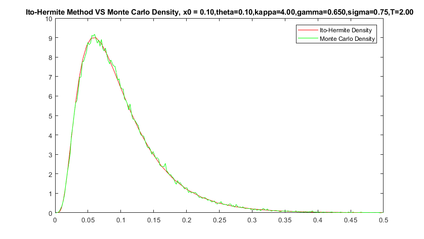](https://postimages.org/)

---

### #966 — Amin (Topic Author)
*July 31, 2020, 2:35 AM*

Sorry friends but the part of work we earlier did for FPE related to change of derivative from SDE variable to normal
random variable and related removal of probability formulas are only approximate. Since we were not getting pinpoint
precision, I decided to numerically verify those formulas and realized they have very small lax. Later, I will be
posting my worked out matlab programs for comparison of numerical and analytical first derivative calculations based on
change of derivative. I have some ideas about correcting this (slight) error and I will be following them in my program
as well.

---

### #967 — Amin (Topic Author)
*July 31, 2020, 9:48 AM*

I checked the replication of first derivative by analytical method using a comparison between numerical first derivative
and analytical first derivative. Here by analytical derivative, I mean the derivative obtained by differentiating the
equation for transformed probability distribution that we get multiplying the original (normal) probability distribution
with change of probability derivative. There are some light discrepancies but they seem to be within numerical errors.
The analytical first order derivative seemed to be quite reasonably close to original derivative and I specifically
checked that effect of 2nd derivative was close to what it should be. I had roughly checked the derivatives when I had
written the original equations several months ago.

Since first derivative seemed very fine, I could not explain the anomaly why 2nd derivative(that arises in expansion of
first analytical derivative of FPE) is multiplied with .707. When I used .707 for the derivative, there were many
instabilities and equation would blow again and again when I kept the coefficient of 2nd derivative at one. But now I
was able to get even more nice and more stable solution by keeping the coefficient of 2nd derivative at one and altering
some other coefficients(C33). Now I get a far better match to shape of true distribution with a better mean in most
cases. I will be posting a new program later tonight or tomorrow with this new change(coefficient of 2nd derivative set
equal to one).

Though the solution was reasonable earlier, with this new change the accuracy is greatly improved and a lot of cases
with extreme parameters which were giving bad results and where we could not solve the equation earlier, have greatly
improved with much better accuracy. For general easy parameters, not only the shape is perfect, the mean is also in a
very narrow range to the true mean.

---

### #968 — Amin (Topic Author)
*July 31, 2020, 4:49 PM*

I will post the program later but here are the constants I am using

  C11(wnStart:Nn)=1;

  C22=-1/pi/8;

  C33=1.15/pi/16;

I have not checked carefully and I am not sure if it is still needed or not but I am still weighting 2nd derivative with
an exponential for smaller values where it does not matter that much and just in order for friends to get my output I am
writing the weighting exponential equation here.

d2wdZ2(1:18)=d2wdZ2(1:18).*exp(-16*kappa^2*(1-gamma).*dNn*(18-(1:18)));

I am getting great accuracy and mean in every easy and medium difficulty case is within 0-15 bp of true mean. Though
gamma closer to .5 (equal to or less than .65)  near zero can give worse mean values but even those cases have far more
accuracy now.

I will be posting a complete program in a few hours or possibly tomorrow.

---

### #969 — Amin (Topic Author)
*August 1, 2020, 1:31 PM*

I could not work today because my persecution has dramatically increased for past one day. Please protest against my continued persecution and try to help if you can. Please rad here about the latest persecution activities. https://forum.wilmott.com/viewtopic.php?f=15&t=94796&p=859574#p859574

---

### #970 — Amin (Topic Author)
*August 1, 2020, 4:51 PM*

In the graphs below I have simulated fokker-planck equation of density of following SDE with various values of
parameters.

$dx(t)=\kappa (\theta-x(t)) + \sigma x(t)^{\gamma} dz(t) $

with $x(0)=x_0$

You have to interpret the parameters given in title of each graph with reference to above SDE. I have solved the
fokker-Planck equation related to above SDE in Lamperti/Bessel form.

I am posting graphs from the new program. I have also included effect from third derivative term. Fit to the true
density is perfectly excellent. Mean of the density also very closely matches the true mean of the SDE densities. All of
these densities are mean reverting SDE densities that I have been working with for a long time.

Parameters are posted on graph title. FPE new method density mean and true mean is also posted on graph title. These
graphs are totally beautiful.

very close to zero, at high volatilities, gamma parameter values around .5 still remain problematic but might work
better with decreased step size.

I have made these graphs from the one program without any change and I will be posting the program in a few minutes in
next post.

[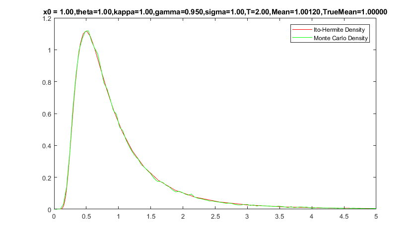](https://postimages.org/)

[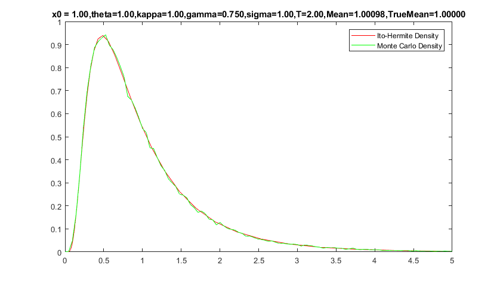](https://postimages.org/)

[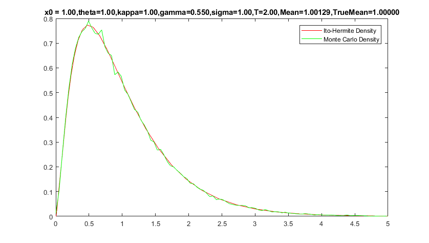](https://postimages.org/)

[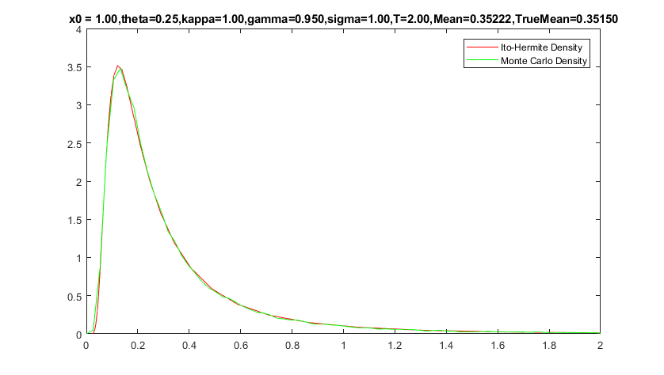](https://postimages.org/)

[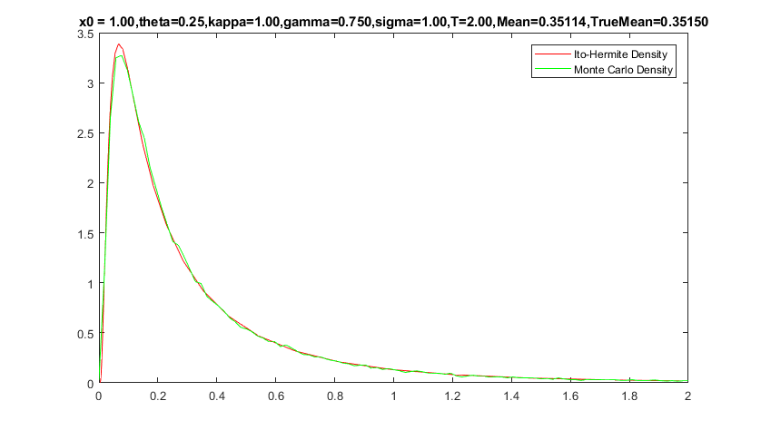](https://postimages.org/)

[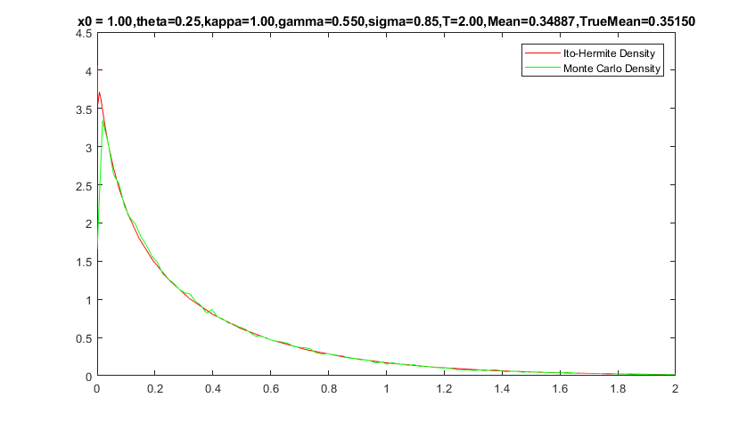](https://postimages.org/)

[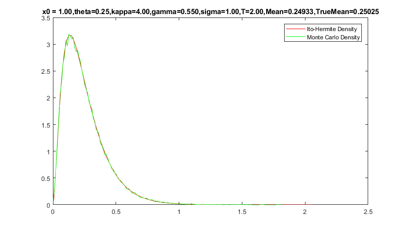](https://postimages.org/)

[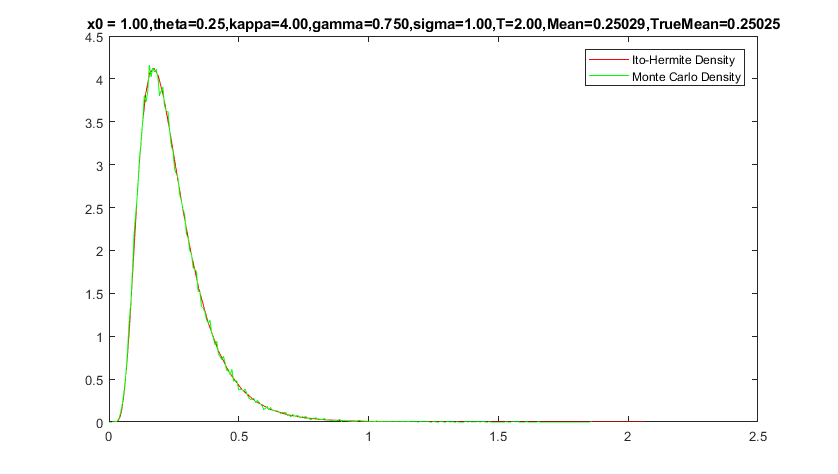](https://postimages.org/)

[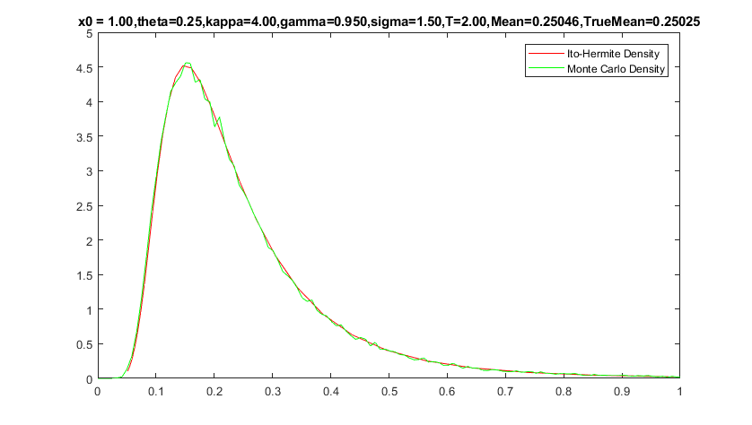](https://postimages.org/)

[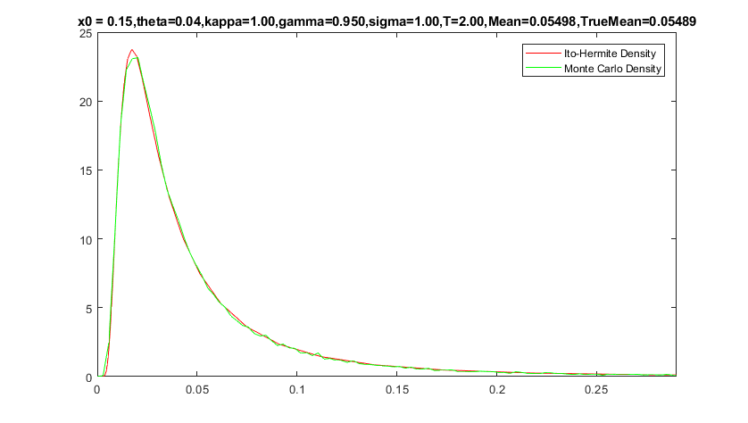](https://postimages.org/)

[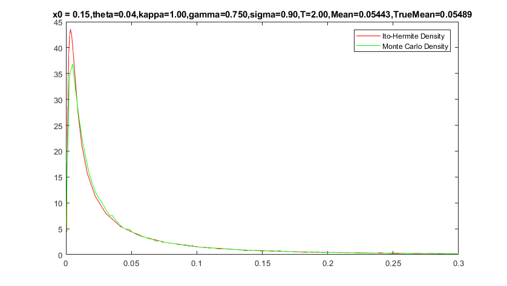](https://postimages.org/)

[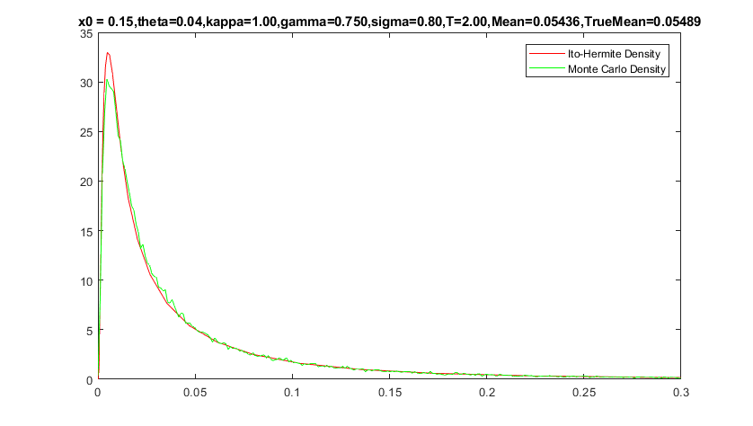](https://postimages.org/)

[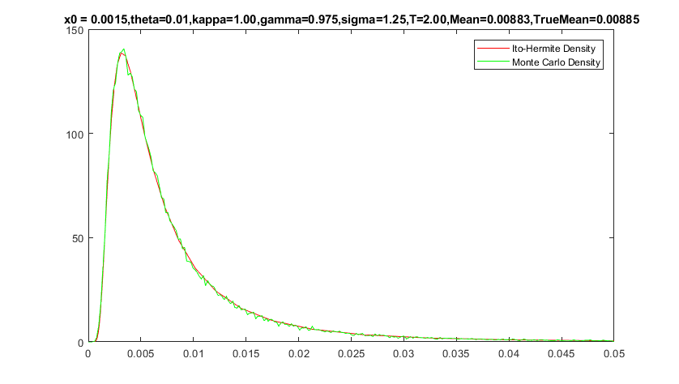](https://postimages.org/)

[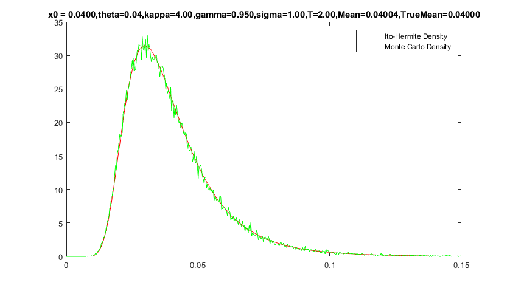](https://postimages.org/)

[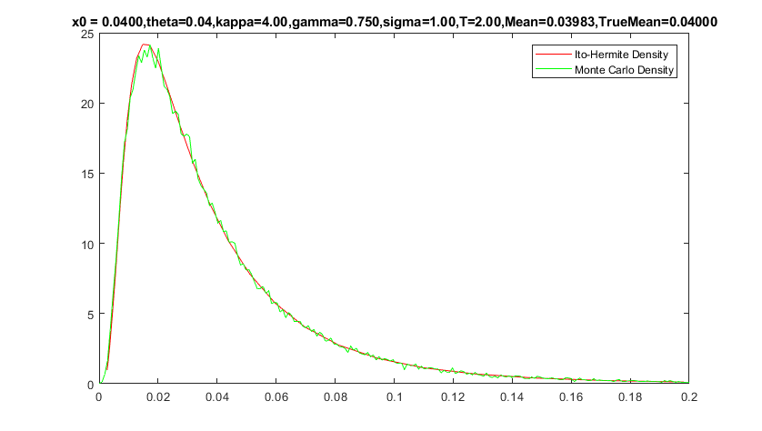](https://postimages.org/)

---

### #971 — Amin (Topic Author)
*August 1, 2020, 5:00 PM*

Here is the program I used for graphs in previous post.

```
function [TrueMean,ItoHermiteMean,y_w,fy_w,wnStart] = FPERevisited044Wilmott16_2ndD()

%Copyright Ahsan Amin. Infiniti derivatives Technologies.
%Please fell free to connect on linkedin: linkedin.com/in/ahsan-amin-0a53334
%or skype ahsan.amin2999
%In this program, I am simulating the SDE given as
%dy(t)=mu1 x(t)^beta1 dt + mu2 x(t)^beta2 dt +sigma x(t)^gamma dz(t)

%I have not directly simulated the SDE but simulated the transformed
%Besse1l process version of the SDE and then changed coordinates to retreive
%the SDE in original coo
%rdinates.
%The present program will analytically evolve only the Bessel Process version of the
%SDE in transformed coordinates.
%In this version, the mean correction has been disabled. If you are
%simulating standard mean-reverting SV type SDEs, please enable the mean
%correction by uncommenting the appropriate line in the body of code below.

dt=.125/16/2/2;   % Simulation time interval.%Fodiffusions close to zero
             %decrease dt for accuracy.
Tt=128*8/4*2*2;%16*16;     % Number of simulation levels. Terminal time= Tt*dt; //.125/32*32*16=2 year;
T=Tt*dt;
OrderA=4;  %
OrderM=4;  %
%dtM=.125/8;%Monte carlo time interval size dtM.
%TtM=8*8;%Monte carlo number of simulation intervals.
dtM=dt*4*4;
TtM=Tt/4/4;

dNn=.2/1;   % Normal density subdivisions width. would change with number of subdivisions
Nn=50;  % No of normal density subdivisions
NnMidl=25;%One half density Subdivision left from mid of normal density(low)
NnMidh=26;%One half density subdivision right from the mid of normal density(high)
NnMid=4.0;

%theta=mu1/(-mu2);
%kappa=-mu2;

x0=.04;   % starting value of SDE
beta1=0.0;
beta2=1.0;   % Second drift term power.
gamma=.75;%50;   % volatility power.
kappa=4.0;%.950;   %mean reversion parameter.
theta=.04;%mean reversion target
sigma0=1.0;%Volatility value

%you can specify any general mu1 and mu2 and beta1 and beta2.

mu1=+1*theta*kappa;   %first drift coefficient.
mu2=-1*kappa;    % Second drift coefficient.
%mu1=0;
%mu2=0;

alpha=1;% x^alpha is being expanded. This is currently for monte carlo only.
alpha1=1-gamma;

w(1:Nn)=x0^(1-gamma)/(1-gamma);

Z(1:Nn)=(((1:Nn)-5.5)*dNn-NnMid);

Z
str=input('Look at Z');
ZProb(1)=normcdf(.5*Z(1)+.5*Z(2),0,1)-normcdf(.5*Z(1)+.5*Z(2)-dNn,0,1);
ZProb(Nn)=normcdf(.5*Z(Nn)+.5*Z(Nn-1)+dNn,0,1)-normcdf(.5*Z(Nn)+.5*Z(Nn-1),0,1);

for nn=2:Nn-1
    ZProb(nn)=normcdf(.5*Z(nn)+.5*Z(nn+1),0,1)-normcdf(.5*Z(nn)+.5*Z(nn-1),0,1);
    %Above calculate probability mass in each probability subdivision.
end

%%%%%%%%%%%%%%%%%%%%%%%%%%%%%%%%%%%%%%%%%%%%%%%%%%%%%%%%%%%%%%%%%%%%%%%%%%%%%%%%%%%%%%%%%%%%%%

sigma11(1:OrderA+1)=0;
mu11(1:OrderA+1)=0;
mu22(1:OrderA+1)=0;
sigma22(1:OrderA+1)=0;
% index 1 correponds to zero level since matlab indexing starts at one.
sigma11(1)=1;
mu11(1)=1;
mu22(1)=1;
sigma22(1)=1;

for k=1:(OrderA+1)
    if sigma0~=0
        sigma11(k)=sigma0^(k-1);
    end
    if mu1 ~= 0
        mu11(k)=mu1^(k-1);
    end
    if mu2 ~= 0
        mu22(k)=mu2^(k-1);
    end
    if sigma0~=0
        sigma22(k)=sigma0^(2*(k-1));
    end
end
%Ft(1:TtM+1,1:(OrderA+1),1:(OrderA+1),1:(OrderA+1),1:(OrderA+1))=0; %General time powers on hermite polynomials
Fp(1:(OrderA+1),1:(OrderA+1),1:(OrderA+1),1:(OrderA+1))=0;%General x powers on coefficients of hermite polynomials.
Fp1(1:(OrderA+1),1:(OrderA+1),1:(OrderA+1),1:(OrderA+1))=0;%General x powers for bessel transformed coordinates.

%YCoeff0 and YCoeff are coefficents for original coordinates monte carlo.
%YqCoeff0 and YqCoeff are bessel/lamperti version monte carlo.

YCoeff0(1:(OrderA+1),1:(OrderA+1),1:(OrderA+1),1:(OrderA+1))=0;
YqCoeff0(1:(OrderA+1),1:(OrderA+1),1:(OrderA+1),1:(OrderA+1))=0;
%Pre-compute the time and power exponent values in small multi-dimensional arrays
YCoeff = ItoTaylorCoeffsNew(alpha,beta1,beta2,gamma); %expand y^alpha where alpha=1;
YqCoeff = ItoTaylorCoeffsNew(alpha1,beta1,beta2,gamma);%expand y^alpha1 where alpha1=(1-gamma)
YqCoeff=YqCoeff/(1-gamma); %Transformed coordinates coefficients have to be
%further divided by (1-gamma)

for k = 0 : (OrderA)
    for m = 0:k
        l4 = k - m + 1;
        for n = 0 : m
            l3 = m - n + 1;
            for j = 0:n
                l2 = n - j + 1;
                l1 = j + 1;
                %Ft(l1,l2,l3,l4) = dtM^((l1-1) + (l2-1) + (l3-1) + .5* (l4-1));
                Fp(l1,l2,l3,l4) = (alpha + (l1-1) * beta1 + (l2-1) * beta2 + (l3-1) * 2* gamma + (l4-1) * gamma ...
                    - (l1-1) - (l2-1) - 2* (l3-1) - (l4-1));
                Fp1(l1,l2,l3,l4) = (alpha1 + (l1-1) * beta1 + (l2-1) * beta2 + (l3-1) * 2* gamma + (l4-1) * gamma ...
                    - (l1-1) - (l2-1) - 2* (l3-1) - (l4-1));

                YCoeff0(l1,l2,l3,l4) =YCoeff(l1,l2,l3,l4).*mu11(l1).*mu22(l2).*sigma22(l3).*sigma11(l4);
                YqCoeff0(l1,l2,l3,l4) =YqCoeff(l1,l2,l3,l4).*mu11(l1).*mu22(l2).*sigma22(l3).*sigma11(l4);
            end
        end
    end
end

%%%%%%%%%%%%%%%%%%%%%%%%%%%%%%%%%%%%%%%%%%%%%%%%%%%%%%%%%%%%%%%%%%%%%%%%%%%%%%%%%%%%%%%%%%%%%%
wnStart=1;%
d2wdZ2(1:Nn)=0;
d2wdZ2A(1:Nn)=0;

dwdZ(1:Nn)=0;
yy(wnStart:Nn)=((1-gamma)*w(wnStart:Nn)).^(1/(1-gamma));
tic

for tt=1:Tt

     yy(wnStart:Nn)=((1-gamma)*w(wnStart:Nn)).^(1/(1-gamma));

    [wMu0dt,dwMu0dtdw,d2wMu0dtdw2,d3wMu0dtdw3,c1,c2,c3,c4] =
CalculateDriftAndVolOrder4(w,wnStart,Nn,YqCoeff0,Fp1,gamma,dt);

    wPrev=w;
    dw(wnStart:Nn)=c1(wnStart:Nn).*Z(wnStart:Nn) ;% ...
    dw2(wnStart:Nn)=dw(wnStart:Nn).^2;
    w(isnan(w)==1)=0;
    wMu0dt(isnan(wMu0dt)==1)=0;
    wMeanPrev=sum(ZProb(wnStart:Nn).*w(wnStart:Nn));%Calculate the mean.

    yyMedian=.5*yy(NnMidh)+.5*yy(NnMidl);
%%%%%%%%%%%%%%%%%%%%%%%%%%%%%%%%%%%%%%%%%%%%%%%%%%%%%%%%%%%%%%%%%%%%%%%%%%%

[dwdZ,d2wdZ2A,d3wdZ3A] = First3Derivatives2ndOrderEqSpaced(wnStart,Nn,dNn,w,Z);

d2wdZ2(wnStart:Nn)=0.0;
d3wdZ3(wnStart:Nn)=0.0;
if (tt>32)

d2wdZ2(wnStart:Nn)=d2wdZ2A(wnStart:Nn);
d2wdZ2(1:15)=d2wdZ2(1:15).*exp(-16*kappa^2*(1-gamma).*dNn*(15-(1:15)));
%Change 1:7/25/2020: I have very heavily weighted the second derivative to
%the left of density peak with an exponential and it allows far larger
%range of parameters with stable execution without sacrificing much
%accuracy. Of course, it is just ad hoc.

d3wdZ3(wnStart:Nn)=d3wdZ3A(wnStart:Nn);
end

%If the calculation of the program blows, it means that above calculated
%derivative is unstable or bad. Plese replace with your favourite method of
%calculating this second derivative.

dZdw(wnStart:Nn)=1.0./dwdZ(wnStart:Nn);

if(tt==1)
w(wnStart:Nn)=wMeanPrev+wMu0dt(wnStart:Nn)+ ...
          sign(w(wnStart:Nn)-wMeanPrev+dw(wnStart:Nn)).* ...
          sqrt(abs(sign(w(wnStart:Nn)-wMeanPrev).*(w(wnStart:Nn)-wMeanPrev).^2+ ...
          sign(dw(wnStart:Nn)).*dw2(wnStart:Nn)));
end
if(tt>1)

  C22=1/pi/8;
  C33=.9/pi/16;%
  C44=1/pi/8;

   w(wnStart:Nn)=w(wnStart:Nn)+wMu0dt(wnStart:Nn)+(-(Z(wnStart:Nn).*dwdZ(wnStart:Nn))+d2wdZ2(wnStart:Nn))+ ...
             sign((Z(wnStart:Nn).*dwdZ(wnStart:Nn))-d2wdZ2(wnStart:Nn)+dw(wnStart:Nn)).* ...
             sqrt(abs(sign((Z(wnStart:Nn).*dwdZ(wnStart:Nn))-d2wdZ2(wnStart:Nn)).* ...
             ((Z(wnStart:Nn).*dwdZ(wnStart:Nn))-d2wdZ2(wnStart:Nn)).^2+ ...
             sign(+dw(wnStart:Nn)).*dw2(wnStart:Nn)))+ ...
             -C33.*dwMu0dtdw(wnStart:Nn).*dwdZ(wnStart:Nn).^2 + ...
             +C22.*-3*Z(wnStart:Nn).^1.*dZdw(wnStart:Nn).*d2wdZ2(wnStart:Nn)*sigma0^2.*dt + ...
             +C44.*(-d3wdZ3(wnStart:Nn).*dZdw(wnStart:Nn)+3*d2wdZ2(wnStart:Nn).^2.*dZdw(wnStart:Nn).^2)*sigma0^2.*dt;

        %Change 2:7/25/2020:%I have added a last term from quadratic variation between drift
        %and w terms. I am not very sure if we need it or not.

end

%%%%%%%%%%%%%%%%%%%%%%%%%%%%%%%%%%%%%%%%%%%%%%%%%%%%%%%%%%%%%%%%%%%%%%%%%%%
%Below are instability correction equations. There is instability in the
% SDE representation equation roughly between -.5 SD to +.5 SD in normal terms.
%Instability correction Algorithm takes two ends that are here given as
%lower end=w(NnMidl-2) and upper end=w(NnMidh+3).
%In the block below the interpolation starts from lower end.
%1st equation is
%wll(NnMidl-1)=w(NnMidl-2)+(D1wl+CTheta*D2wl*dNn/1+.5*DeltaD1w)*dNn;
%Second equation is: wll(NnMidl)=wll(NnMidl-1)+(D1wl+CTheta*D2wl*dNn+1.5*DeltaD1w)*dNn;
%And so on.
%There is a sixth equation that is not written below(since it takes us to
%the upper interpolation point which is already known) which is
%wll(NnMidh+3)=wll(NnMidh+2)+(D1wl+CTheta*D2wl*dNn+5.5*DeltaD1w)*dNn;
%Sum of these six equations add up to the distance between upper and lower
%interpolation points.
%In the sum there are six instances of first derivative which is already
%calculated at the boundary, six instances of second derivative which is also
%already calculated at lower boundary and 18.0 instances of DeltaD1w which is
%unknown. This equation calculates the value of one unit of DeltaD1w addition
%DeltaD1w=(w(NnMidh+3)-w(NnMidl-2)-6*D1wl*dNn-6.0*CTheta*D2wl*dNn.^2.0/1.0)/18.0/dNn;
% I hope to find a better analytical method to tackle this issue. Friends
% are welcome to play with slightly changed related alternatives to the
%above interpolation.
%Change 7/27/2020
%I have switched to Lagrange interpolation by taking four points on both
%sides of instability and using 8th order interpolation of five points in
%mid between the eight points on sides. This works far better and you can
%now use nuemrical 2nd derivative without any modification for a large
%range of parameters. It truly improves the fit to true density when it
%works.

     
Zi=[Z(NnMidl-6),Z(NnMidl-5),Z(NnMidl-4),Z(NnMidl-3),Z(NnMidl-2),Z(NnMidh+3),Z(NnMidh+4),Z(NnMidh+5),Z(NnMidh+6),Z(NnMidh+7)];
     
wi=[w(NnMidl-6),w(NnMidl-5),w(NnMidl-4),w(NnMidl-3),w(NnMidl-2),w(NnMidh+3),w(NnMidh+4),w(NnMidh+5),w(NnMidh+6),w(NnMidh+7)];
      Zq=[Z(NnMidl-1),Z(NnMidl),Z(NnMidh),Z(NnMidh+1),Z(NnMidh+2)];
      wq=spline(Zi,wi,Zq);
      w(NnMidl-1:NnMidh+2)=wq(1:5);

  [wE] =
InterpolateOrderN6(6,Z(Nn)+dNn,Z(Nn),Z(Nn-1),Z(Nn-2),Z(Nn-3),Z(Nn-4),Z(Nn-5),w(Nn),w(Nn-1),w(Nn-2),w(Nn-3),w(Nn-4),w(Nn-5));

        w1(1:Nn-1)=w(1:Nn-1);
        w1(Nn)=w(Nn);
        w2(1:Nn-1)=w(2:Nn);
        w2(Nn)=wE;

    w(w1(:)>w2(:))=0;%Be careful;might not universally hold;
     %Change 3:7/25/2020: I have improved zero correction in above.
        w(w<0)=0.0;
        for nn=1:Nn
            if(w(nn)<=0)
                wnStart=nn+1;
           end
        end

        %%1st order mean correction. We know the mean in original
        %%coordinates so I shift the density into original coordinates,
        %%apply the mean correction and then transform again into Lamperti
        %%coordinates. Algebra solves two equations in two unknowns.
        %%Equations are Sum_0^N{(Y_w(wnStart:Nn)-Y0)*W0}=1 and the second
        %%equation is Sum_0^N{Y_w(wnStart:Nn).*(Y_w(wnStart:Nn)-Y0)*W0}=u0
        %%Two unknows are Y0 and W0. u0 is known mean.
        tt;
        u0=theta+(x0-theta)*exp(-kappa*(tt*dt)); %analytic mean of the density

        %If you are not using stochastic volatility, replace above with
        %true mean otherwise results would become garbage.

        Y_w(wnStart:Nn) = ((1-gamma)*w(wnStart:Nn)).^(1/(1-gamma));

        Yn2Pn=sum(Y_w(wnStart:Nn).*Y_w(wnStart:Nn).*ZProb(wnStart:Nn));
        YnPn=sum(Y_w(wnStart:Nn).*ZProb(wnStart:Nn));
        Pn=1.0;%%Sum(ZProb(1:Nn))
        Y0=(Yn2Pn-u0*YnPn)/(YnPn-u0*Pn);

        Y0Pn=Y0*Pn;
        W0=1/(YnPn-Y0Pn);
        YCorrected(wnStart:Nn)=Y_w(wnStart:Nn).*(Y_w(wnStart:Nn)-Y0)*W0;
        wCorrected(wnStart:Nn)=(YCorrected(wnStart:Nn).^(1-gamma))./(1-gamma);
     %   w(wnStart:Nn)=wCorrected(wnStart:Nn);

   %I have disabled the mean correction. The above mean correction is only valid for
   %standard mean reverting stochastic volatility type SDEs. To enable mean
   %correction please uncomment the above last line in the block.

end

 y_w(1:Nn)=0;
 y_w(wnStart:Nn) = ((1-gamma)*w(wnStart:Nn)).^(1/(1-gamma));
 Dfy_w(wnStart:Nn)=0;
 Dfw(wnStart:Nn)=0;
for nn=wnStart+1:Nn-1
    Dfy_w(nn) = (y_w(nn + 1) - y_w(nn - 1))/(Z(nn + 1) - Z(nn - 1));
    Dfw(nn) = (w(nn + 1) - w(nn - 1))/(Z(nn + 1) - Z(nn - 1));
    %Change of variable derivative for densities
end
fy_w(1:Nn)=0;
fw(1:Nn)=0;
for nn = wnStart:Nn-1
    fy_w(nn) = (normpdf(Z(nn),0, 1))/abs(Dfy_w(nn));%Origianl coordinates density
    fw(nn) = (normpdf(Z(nn),0, 1))/abs(Dfw(nn));
end

toc

ItoHermiteMean=sum(y_w(wnStart+1:Nn-1).*ZProb(wnStart+1:Nn-1)) %Original process average from coordinates

 disp('true Mean only applicble to standard SV mean reverting type models otherwise disregard');
 TrueMean=theta+(x0-theta)*exp(-kappa*dt*Tt)%Mean reverting SDE original variable true average

 rng(29079137, 'twister')
 paths=100000;
 YY(1:paths)=x0;  %Original process monte carlo.
 Random1(1:paths)=0;
 YYMean(1:TtM)=0;
 for tt=1:TtM
     Random1=randn(size(Random1));
     HermiteP1(1,1:paths)=1;
     HermiteP1(2,1:paths)=Random1(1:paths);
     HermiteP1(3,1:paths)=Random1(1:paths).^2-1;
     HermiteP1(4,1:paths)=Random1(1:paths).^3-3*Random1(1:paths);
     HermiteP1(5,1:paths)=Random1(1:paths).^4-6*Random1(1:paths).^2+3;

     YY(1:paths)=YY(1:paths) + ...
      (YCoeff0(1,1,2,1).*YY(1:paths).^Fp(1,1,2,1)+ ...
      YCoeff0(1,2,1,1).*YY(1:paths).^Fp(1,2,1,1)+ ...
      YCoeff0(2,1,1,1).*YY(1:paths).^Fp(2,1,1,1))*dtM + ...
      (YCoeff0(1,1,3,1).*YY(1:paths).^Fp(1,1,3,1)+ ...
      YCoeff0(1,2,2,1).*YY(1:paths).^Fp(1,2,2,1)+ ...
      YCoeff0(2,1,2,1).*YY(1:paths).^Fp(2,1,2,1)+ ...
      YCoeff0(1,3,1,1).*YY(1:paths).^Fp(1,3,1,1)+ ...
      YCoeff0(2,2,1,1).*YY(1:paths).^Fp(2,2,1,1)+ ...
      YCoeff0(3,1,1,1).*YY(1:paths).^Fp(3,1,1,1))*dtM^2 + ...
      ((YCoeff0(1,1,1,2).*YY(1:paths).^Fp(1,1,1,2).*sqrt(dtM))+ ...
    (YCoeff0(1,1,2,2).*YY(1:paths).^Fp(1,1,2,2)+ ...
    YCoeff0(1,2,1,2).*YY(1:paths).^Fp(1,2,1,2)+ ...
    YCoeff0(2,1,1,2).*YY(1:paths).^Fp(2,1,1,2)).*dtM^1.5) .*HermiteP1(2,1:paths) + ...
    ((YCoeff0(1,1,1,3).*YY(1:paths).^Fp(1,1,1,3) *dtM) + ...
    (YCoeff0(1,1,2,3).*YY(1:paths).^Fp(1,1,2,3)+ ...
    YCoeff0(1,2,1,3).*YY(1:paths).^Fp(1,2,1,3)+ ...
    YCoeff0(2,1,1,3).*YY(1:paths).^Fp(2,1,1,3)).*dtM^2).*HermiteP1(3,1:paths) + ...
    ((YCoeff0(1,1,1,4).*YY(1:paths).^Fp(1,1,1,4)*dtM^1.5 )).*HermiteP1(4,1:paths) + ...
    (YCoeff0(1,1,1,5).*YY(1:paths).^Fp(1,1,1,5)*dtM^2.0).*HermiteP1(5,1:paths);

%Uncomment for fourth order monte carlo

%
%   YY(1:paths)=YY(1:paths) + ...
%       (YCoeff0(1,1,2,1).*YY(1:paths).^Fp(1,1,2,1)+YCoeff0(1,2,1,1).*YY(1:paths).^Fp(1,2,1,1)+ ...
%       YCoeff0(2,1,1,1).*YY(1:paths).^Fp(2,1,1,1))*dtM + ...
%       (YCoeff0(1,1,3,1).*YY(1:paths).^Fp(1,1,3,1)+YCoeff0(1,2,2,1).*YY(1:paths).^Fp(1,2,2,1)+ ...
%       YCoeff0(2,1,2,1).*YY(1:paths).^Fp(2,1,2,1)+YCoeff0(1,3,1,1).*YY(1:paths).^Fp(1,3,1,1)+ ...
%       YCoeff0(2,2,1,1).*YY(1:paths).^Fp(2,2,1,1)+YCoeff0(3,1,1,1).*YY(1:paths).^Fp(3,1,1,1))*dtM^2 + ...
%       (YCoeff0(1,1,4,1).*YY(1:paths).^Fp(1,1,4,1)+YCoeff0(1,2,3,1).*YY(1:paths).^Fp(1,2,3,1)+ ...
%       YCoeff0(2,1,3,1).*YY(1:paths).^Fp(2,1,3,1)+YCoeff0(1,3,2,1).*YY(1:paths).^Fp(1,3,2,1)+ ...
%       YCoeff0(2,2,2,1).*YY(1:paths).^Fp(2,2,2,1)+YCoeff0(3,1,2,1).*YY(1:paths).^Fp(3,1,2,1)+ ...
%       YCoeff0(1,4,1,1).*YY(1:paths).^Fp(1,4,1,1)+YCoeff0(2,3,1,1).*YY(1:paths).^Fp(2,3,1,1)+ ...
%       YCoeff0(3,2,1,1).*YY(1:paths).^Fp(3,2,1,1)+YCoeff0(4,1,1,1).*YY(1:paths).^Fp(4,1,1,1))*dtM^3 + ...
%        (YCoeff0(1,1,5,1).*YY(1:paths).^Fp(1,1,5,1)+YCoeff0(1,2,4,1).*yy(1:paths).^Fp(1,2,4,1)+ ...
%     YCoeff0(2,1,4,1).*YY(1:paths).^Fp(2,1,4,1)+YCoeff0(2,1,1,1).*yy(1:paths).^Fp(2,1,1,1)+ ...
%      YCoeff0(2,2,3,1).*YY(1:paths).^Fp(2,2,3,1)+ ...
%      YCoeff0(3,1,3,1).*YY(1:paths).^Fp(3,1,3,1)+YCoeff0(1,4,2,1).*YY(1:paths).^Fp(1,4,2,1)+ ...
%      YCoeff0(2,3,2,1).*YY(1:paths).^Fp(2,3,2,1)+YCoeff0(3,2,2,1).*YY(1:paths).^Fp(3,2,2,1)+ ...
%      YCoeff0(4,1,2,1).*YY(1:paths).^Fp(4,1,2,1)+YCoeff0(1,5,1,1).*YY(1:paths).^Fp(1,5,1,1)+ ...
%      YCoeff0(2,4,1,1).*YY(1:paths).^Fp(2,4,1,1)+ ...
%      YCoeff0(3,3,1,1).*YY(1:paths).^Fp(3,3,1,1)+YCoeff0(4,2,1,1).*YY(1:paths).^Fp(4,2,1,1)+ ...
%      YCoeff0(5,1,1,1).*YY(1:paths).^Fp(5,1,1,1))*dtM^4+ ...
%       ((YCoeff0(1,1,1,2).*YY(1:paths).^Fp(1,1,1,2).*sqrt(dtM))+ ...
%     (YCoeff0(1,1,2,2).*YY(1:paths).^Fp(1,1,2,2)+YCoeff0(1,2,1,2).*YY(1:paths).^Fp(1,2,1,2)+ ...
%     YCoeff0(2,1,1,2).*YY(1:paths).^Fp(2,1,1,2)).*dtM^1.5+ ...
%     (YCoeff0(1,1,3,2).*YY(1:paths).^Fp(1,1,3,2)+YCoeff0(1,2,2,2).*YY(1:paths).^Fp(1,2,2,2)+ ...
%     YCoeff0(2,1,2,2).*YY(1:paths).^Fp(2,1,2,2)+YCoeff0(1,3,1,2).*YY(1:paths).^Fp(1,3,1,2)+ ...
%     YCoeff0(2,2,1,2).*YY(1:paths).^Fp(2,2,1,2)+YCoeff0(3,1,1,2).*YY(1:paths).^Fp(3,1,1,2)).*dtM^2.5+ ...
%     (YCoeff0(1,1,4,2).*YY(1:paths).^Fp(1,1,4,2)+YCoeff0(1,2,3,2).*YY(1:paths).^Fp(1,2,3,2)+ ...
%     YCoeff0(2,1,3,2).*YY(1:paths).^Fp(2,1,3,2)+YCoeff0(1,3,2,2).*YY(1:paths).^Fp(1,3,2,2)+ ...
%     YCoeff0(2,2,2,2).*YY(1:paths).^Fp(2,2,2,2)+ YCoeff0(3,1,2,2).*YY(1:paths).^Fp(3,1,2,2)+ ...
%     YCoeff0(1,4,1,2).*YY(1:paths).^Fp(1,4,1,2)+YCoeff0(2,3,1,2).*YY(1:paths).^Fp(2,3,1,2)+ ...
%     YCoeff0(3,2,1,2).*YY(1:paths).^Fp(3,2,1,2)+YCoeff0(4,1,1,2).*YY(1:paths).^Fp(4,1,1,2)).*dtM^3.5)
.*HermiteP1(2,1:paths) + ...
%     ((YCoeff0(1,1,1,3).*YY(1:paths).^Fp(1,1,1,3) *dtM) + ...
%     (YCoeff0(1,1,2,3).*YY(1:paths).^Fp(1,1,2,3)+YCoeff0(1,2,1,3).*YY(1:paths).^Fp(1,2,1,3)+ ...
%     YCoeff0(2,1,1,3).*YY(1:paths).^Fp(2,1,1,3)).*dtM^2+ ...
%     (YCoeff0(1,1,3,3).*YY(1:paths).^Fp(1,1,3,3)+YCoeff0(1,2,2,3).*YY(1:paths).^Fp(1,2,2,3)+ ...
%     YCoeff0(2,1,2,3).*YY(1:paths).^Fp(2,1,2,3) + YCoeff0(1,3,1,3).*YY(1:paths).^Fp(1,3,1,3)+ ...
%   
 YCoeff0(2,2,1,3).*YY(1:paths).^Fp(2,2,1,3)+YCoeff0(3,1,1,3).*YY(1:paths).^Fp(3,1,1,3)).*dtM^3).*HermiteP1(3,1:paths) +
...
%     ((YCoeff0(1,1,1,4).*YY(1:paths).^Fp(1,1,1,4)*dtM^1.5 )+ ...
%     (YCoeff0(1,1,2,4).*YY(1:paths).^Fp(1,1,2,4)+YCoeff0(1,2,1,4).*YY(1:paths).^Fp(1,2,1,4)+ ...
%     YCoeff0(2,1,1,4).*YY(1:paths).^Fp(2,1,1,4))*dtM^2.5).*HermiteP1(4,1:paths) + ...
%     (YCoeff0(1,1,1,5).*YY(1:paths).^Fp(1,1,1,5)*dtM^2.0).*HermiteP1(5,1:paths);
%

     YYMean(tt)=YYMean(tt)+sum(YY(1:paths))/paths;
 end
 YY(YY<0)=0;
 disp('Original process average from monte carlo');
 MCMean=sum(YY(:))/paths %origianl coordinates monte carlo average.
 disp('Original process average from our simulation');
 ItoHermiteMean=sum(y_w(wnStart+1:Nn-1).*ZProb(wnStart+1:Nn-1)) %Original process average from coordinates

 disp('true Mean only applicble to standard SV mean reverting type models otherwise disregard');
 TrueMean=theta+(x0-theta)*exp(-kappa*dt*Tt)%Mean reverting SDE original variable true average

 MaxCutOff=30;
 NoOfBins=round(300*gamma^2*4*sigma0/sqrt(yyMedian)/(1+kappa));%Decrease the number of bins if the graph is too
 [YDensity,IndexOutY,IndexMaxY] = MakeDensityFromSimulation_Infiniti_NEW(YY,paths,NoOfBins,MaxCutOff );
 plot(y_w(wnStart+1:Nn-1),fy_w(wnStart+1:Nn-1),'r',IndexOutY(1:IndexMaxY),YDensity(1:IndexMaxY),'g');
 %plot(y_w(wnStart+1:Nn-1),fy_w(wnStart+1:Nn-1),'r',IndexOutY(1:IndexMaxY),YDensity(1:IndexMaxY),'g',Z(wnStart+1:Nn-1),fy_w(wnStart+1:Nn-1),'b');

 title(sprintf('x0 = %.4f,theta=%.2f,kappa=%.2f,gamma=%.3f,sigma=%.2f,T=%.2f,Mean=%.5f,TrueMean=%.5f',
x0,theta,kappa,gamma,sigma0,T,ItoHermiteMean,TrueMean));%,sprintf('theta= %f', theta), sprintf('kappa = %f',
kappa),sprintf('sigma = %f', sigma0),sprintf('T = %f', T));

 %title('text',sprintf('x0 = %f', x0),sprintf('theta= %f', theta), sprintf('kappa = %f', kappa),sprintf('sigma = %f',
sigma0),sprintf('T = %f', T))
 %xlabel(a)
 %title('Graphical Comparison of Ito-Hermite Method and Monte Carlo Method Density')
 legend({'Ito-Hermite Density','Monte Carlo Density'},'Location','northeast')

 str=input('red line is density of SDE from Ito-Hermite method, green is monte carlo.');

end
```

This program needs the following new function to calculate first three derivatives on equi-spaced grid.

```
function [dwdZ,d2wdZ2,d3wdZ3] = First3Derivatives2ndOrderEqSpaced(wnStart,Nn,dNn,w,Z)

% [wS] =
InterpolateOrderN6(4,Z(wnStart)-dNn,Z(wnStart),Z(wnStart+1),Z(wnStart+2),Z(wnStart+3),Z(wnStart+4),Z(wnStart+5),w(wnStart),w(wnStart+1),w(wnStart+2),w(wnStart+3),w(wnStart+4),w(wnStart+5));
% [wE] =
InterpolateOrderN6(4,Z(Nn)+dNn,Z(Nn),Z(Nn-1),Z(Nn-2),Z(Nn-3),Z(Nn-4),Z(Nn-5),w(Nn),w(Nn-1),w(Nn-2),w(Nn-3),w(Nn-4),w(Nn-5));

% [wS] =
InterpolateOrderN8(7,Z(wnStart)-dNn,Z(wnStart),Z(wnStart+1),Z(wnStart+2),Z(wnStart+3),Z(wnStart+4),Z(wnStart+5),Z(wnStart+6),Z(wnStart+7),w(wnStart),w(wnStart+1),w(wnStart+2),w(wnStart+3),w(wnStart+4),w(wnStart+5),w(wnStart+6),w(wnStart+7));
% [wE] =
InterpolateOrderN8(7,Z(Nn)+dNn,Z(Nn),Z(Nn-1),Z(Nn-2),Z(Nn-3),Z(Nn-4),Z(Nn-5),Z(Nn-6),Z(Nn-7),w(Nn),w(Nn-1),w(Nn-2),w(Nn-3),w(Nn-4),w(Nn-5),w(Nn-6),w(Nn-7));

 [wS] =
InterpolateOrderN6(5,Z(wnStart)-dNn,Z(wnStart),Z(wnStart+1),Z(wnStart+2),Z(wnStart+3),Z(wnStart+4),Z(wnStart+5),w(wnStart),w(wnStart+1),w(wnStart+2),w(wnStart+3),w(wnStart+4),w(wnStart+5));
 [wE] =
InterpolateOrderN6(5,Z(Nn)+dNn,Z(Nn),Z(Nn-1),Z(Nn-2),Z(Nn-3),Z(Nn-4),Z(Nn-5),w(Nn),w(Nn-1),w(Nn-2),w(Nn-3),w(Nn-4),w(Nn-5));

 Zi=[Z(wnStart),Z(wnStart+1),Z(wnStart+2),Z(wnStart+3),Z(wnStart+4),Z(wnStart+5),Z(wnStart+6),Z(wnStart+7),Z(wnStart+8),Z(wnStart+9)];
     
wi=[w(wnStart),w(wnStart+1),w(wnStart+2),w(wnStart+3),w(wnStart+4),w(wnStart+5),w(wnStart+6),w(wnStart+7),w(wnStart+8),w(wnStart+9)];
%      Zi=[Z(Nn-6),Z(Nn-5),Z(Nn-4),Z(Nn-3),Z(Nn-2),Z(Nn-1),Z(Nn)];
%      wi=[w(Nn-6),w(Nn-5),w(Nn-4),w(Nn-3),w(Nn-2),w(Nn-1),w(Nn)];

      Zi=[Z(wnStart),Z(wnStart+1),Z(wnStart+2),Z(wnStart+3),Z(wnStart+4),Z(wnStart+5),Z(wnStart+6)];
      wi=[w(wnStart),w(wnStart+1),w(wnStart+2),w(wnStart+3),w(wnStart+4),w(wnStart+5),w(wnStart+6)];
      Zq=Z(wnStart)-dNn;
      wS=spline(Zi,wi,Zq);

      Zq=Z(wnStart)-2*dNn;
      wS2=spline(Zi,wi,Zq);

%      Zi=[Z(Nn-9),Z(Nn-8),Z(Nn-7),Z(Nn-6),Z(Nn-5),Z(Nn-4),Z(Nn-3),Z(Nn-2),Z(Nn-1),Z(Nn)];
%      wi=[w(Nn-9),w(Nn-8),w(Nn-7),w(Nn-6),w(Nn-5),w(Nn-4),w(Nn-3),w(Nn-2),w(Nn-1),w(Nn)];
      Zi=[Z(Nn-6),Z(Nn-5),Z(Nn-4),Z(Nn-3),Z(Nn-2),Z(Nn-1),Z(Nn)];
      wi=[w(Nn-6),w(Nn-5),w(Nn-4),w(Nn-3),w(Nn-2),w(Nn-1),w(Nn)];
      Zq=Z(Nn)+dNn;
      wE=spline(Zi,wi,Zq);

      Zq=Z(Nn)+2*dNn;
      wE2=spline(Zi,wi,Zq);

 ZS=Z(wnStart)-dNn;
 ZE=Z(Nn)+dNn;

% d2wdZ2(wnStart)=(Z(wnStart)*wS-2*w(wnStart)*Z(wnStart)+w(wnStart+1).*Z(wnStart))/(dNn.^2);
%
d2wdZ2(wnStart+1:Nn-1)=(w(wnStart+1:Nn-1).*Z(wnStart+1:Nn-1)-2*w(wnStart+1:Nn-1).*Z(wnStart+1:Nn-1)+1*w(wnStart+2:Nn).*Z(wnStart+1:Nn-1))/(dNn.^2);
% d2wdZ2(Nn)=(wE.*Z(Nn)-2*w(Nn).*Z(Nn)+w(Nn-1).*Z(Nn))/(dNn.^2);

 d2wdZ2(wnStart)=(wS-2*w(wnStart)+w(wnStart+1))/(dNn.^2);
 d2wdZ2(wnStart+1:Nn-1)=(w(wnStart:Nn-2)-2*w(wnStart+1:Nn-1)+1*w(wnStart+2:Nn))/(dNn.^2);
 d2wdZ2(Nn)=(wE-2*w(Nn)+w(Nn-1))/(dNn.^2);

 dwdZ(wnStart)=(-1*wS+1*w(wnStart+1))/(2*dNn);
 dwdZ(wnStart+1:Nn-1)=(-1*w(wnStart:Nn-2)+1*w(wnStart+2:Nn))/(2*dNn);
 dwdZ(Nn)=(wE-w(Nn-1))/(2*dNn);

 d3wdZ3(wnStart+2:Nn-2)=(-1*w(wnStart:Nn-4)+2*w(wnStart+1:Nn-3)+0*w(wnStart+2:Nn-2)-2*w(wnStart+3:Nn-1)+w(wnStart+4:Nn))/(2*dNn^3);
 d3wdZ3(wnStart+1)=(-1*wS+2*w(wnStart)+0*w(wnStart+1)-2*w(wnStart+2)+w(wnStart+3))/(2*dNn^3);
 d3wdZ3(wnStart)=(-1*wS2+2*wS+0*w(wnStart)-2*w(wnStart+1)+w(wnStart+2))/(2*dNn^3);
 d3wdZ3(Nn-1)=(-1*w(Nn-3)+2*w(Nn-2)+0*w(Nn-1)-2*w(Nn)+wE)/(2*dNn^3);
 d3wdZ3(Nn)=(-1*w(Nn-2)+2*w(Nn-1)+0*w(Nn)-2*wE+wE2)/(2*dNn^3);

end

```

---

### #972 — Amin (Topic Author)
*August 2, 2020, 8:45 AM*

I want to say that the program I posted above is not final. I will be posting another program with slight fine-tuning of
parameters.

So I expect a few minor changes in a day or two.

Later, I will be posting another program with a grid of N=100 just so that friends can choose any grid size they wish.
Please note that the present grid has a size of N=50.

Edit: I edited the above post and removed reference to sign of 3rd derivative.

---

### #973 — Amin (Topic Author)
*August 3, 2020, 5:01 PM*

I was trying to post on some linkedin groups asking friends to download the program in previous posts but my posts do
not appear on some groups even after I see the notification that my post was successful. It seems that mind control and
allied crooks have given money to their horses who want to present my research as their own. Why are they stopping my
research from reaching other people?

---

### #974 — Amin (Topic Author)
*August 3, 2020, 6:29 PM*

Lot of friends in several countries can recall how crooks in US defence and their allied apparatus were telling my
linkedin connections when I did my monte carlo simulation research and approached my connections about my research that
I was a very bad guy and "horses" of US defence crooks would present the same (my) research to them. Well, these crooks
never grow up and they want to do the same when I have presented solution to fokker-planck equation.

I will try to post latex equations for the solution of Fokker-planck equation later today. But in the meantime, I want
to request friends to protest against my persecution. Here I want to share some threads with friends especially my
application to human rights watch for help.

[My Letter To HRW About My Human Rights Abuse](https://forum.wilmott.com/viewtopic.php?f=15&t=102298)

[Muslims, mind control, Muslim-Jewish relationship and American defense](https://forum.wilmott.com/viewtopic.php?f=15&t=101453)

[My Open Letter to Prime Minister of Pakistan, Imran Khan, to Intervene In Order to Protect the Interests of Pakistan](https://forum.wilmott.com/viewtopic.php?f=15&t=94796&start=1125#p858119)

---

### #975 — Amin (Topic Author)
*August 5, 2020, 1:04 PM*

Post in progress.

Let us suppose we want to solve a general SDE given as

$dX(t)=\mu(X) dt + \sigma(X) dz(t)$          Equation (1)

The fokker planck equation of this SDE is given as

$\frac{\partial p(X,t)}{\partial t} = -\frac{\partial [\mu(X) p(X,t)]}{\partial X} + .5 \frac{\partial^2 [{\sigma(X)}^2 p(X,t)]}{\partial X^2}$
Equation(2)

First a very brief primer on derivatives of normal and derivatives of the SDE variable.

I denote the standard normal density as p(Z)

We want to convert derivatives of the SDE density of X(t) into derivatives of standard normal density. Here are the main
equations

$p(Z)=\frac{1}{\sqrt{2 \pi}} exp[-.5 Z^2]$ Equation(3)

derivatives of standard normal density are given in terms of hermite polynomials.

$\frac{\partial p(Z)}{\partial Z}=-Z p(Z)$   Equation(4)

$\frac{\partial^2 p(Z)}{\partial Z^2}=(Z^2-1) p(Z)$  Equation (5)

now we want to convert the density of X(t) and its derivatives in terms of density of Z in which we also use above
equations (4-5). In the density of X, each value of X(t) is associated with a particular value of Z through constant CDF
points on corresponding densities. So we calculate the density and derivatives of X(t) in terms of Z.

$p(X)=p(Z) |\frac{\partial Z}{\partial X}|$  Equation(6)This follows from the standard change of variables in a density.

$\frac{\partial p(X)}{\partial X}=\frac{\partial p(Z)}{\partial Z} {(\frac{\partial Z}{\partial X})}^2-p(Z) \frac{\partial^2 Z}{\partial X^2} =-Z p(Z){(\frac{\partial Z}{\partial X})}^2-p(Z) \frac{\partial^2 Z}{\partial X^2} $
Equation(7)

$\frac{\partial^2 p(X)}{\partial X^2}=\frac{\partial^2 p(Z)}{\partial Z^2} {(\frac{\partial Z}{\partial X})}^3+3 \frac{\partial p(Z)}{\partial Z} \frac{\partial Z}{\partial X} \frac{\partial^2 Z}{\partial X^2}+p(Z) \frac{\partial^3 Z}{\partial X^3}$

$=(Z^2-1) p(Z) {(\frac{\partial Z}{\partial X})}^3 -3 Z p(Z) \frac{\partial Z}{\partial X} \frac{\partial^2 Z}{\partial X^2} +p(Z) \frac{\partial^3 Z}{\partial X^3}$
Equation(8)

$\frac{\partial p(X)}{\partial t}=\frac{\partial [p(Z) \frac{\partial Z}{\partial X}]}{\partial t}= \frac{\partial p(Z)}{\partial Z} {(\frac{\partial Z}{\partial X})}^2 \frac{\partial X}{\partial t}- p(Z) \frac{\partial^2 Z}{\partial X^2} \frac{\partial X}{\partial t}$

$=-Zp(Z) {(\frac{\partial Z}{\partial X})}^2 \frac{\partial X}{\partial t}- p(Z) \frac{\partial^2 Z}{\partial X^2} \frac{\partial X}{\partial t}$
Equation(9)

Now I write the fokker planck equation after applying the derivatives as

$ \frac{\partial p(X,t)}{\partial t} = -\mu(X) \frac{\partial p(X,t)}{\partial X} - \frac{\partial \mu(X)}{\partial X} p(X,t)$

$+({(\frac{\partial \sigma(X)}{\partial X})}^2+\sigma(X) \frac{\partial^2 \sigma(X)}{\partial X^2}) p(X,t)$

$+2 \sigma(X) \frac{\partial \sigma(X)}{\partial X} \frac{\partial p(X,t)}{\partial X}+ .5 {\sigma(X)}^2 \frac{\partial^2 p(X,t)}{\partial X^2}$
Equation(10)

Now we write the density of X(t) in terms of density of standard normal Z by substituting from above equations (6-9) in
Fokker-Planck Equation (10)

$-Zp(Z) {(\frac{\partial Z}{\partial X})}^2 \frac{\partial X}{\partial t}- p(Z) \frac{\partial^2 Z}{\partial X^2} \frac{\partial X}{\partial t}$

$= -\mu(X) (-Z p(Z){(\frac{\partial Z}{\partial X})}^2-p(Z) \frac{\partial^2 Z}{\partial X^2}) - \frac{\partial \mu(X)}{\partial X} p(Z) |\frac{\partial Z}{\partial X}|$

$+({(\frac{\partial \sigma(X)}{\partial X})}^2+\sigma(X) \frac{\partial^2 \sigma(X)}{\partial X^2}) p(Z) |\frac{\partial Z}{\partial X}|$

$+2 \sigma(X) \frac{\partial \sigma(X)}{\partial X} (-Z p(Z){(\frac{\partial Z}{\partial X})}^2-p(Z) \frac{\partial^2 Z}{\partial X^2})$

$+ .5 {\sigma(X)}^2 ((Z^2-1) p(Z) {(\frac{\partial Z}{\partial X})}^3 -3 Z p(Z) \frac{\partial Z}{\partial X} \frac{\partial^2 Z}{\partial X^2} +p(Z) \frac{\partial^3 Z}{\partial X^3}) $
Equation(11)

We see that$p(Z)$ which is a static density is common throughout the equations. We eliminate it and write the new
equation as

$-Z{(\frac{\partial Z}{\partial X})}^2 \frac{\partial X}{\partial t}-  \frac{\partial^2 Z}{\partial X^2} \frac{\partial X}{\partial t}$

$= \mu(X)  (-Z {(\frac{\partial Z}{\partial X})}^2- \frac{\partial^2 Z}{\partial X^2}) - \frac{\partial \mu(X)}{\partial X}  |\frac{\partial Z}{\partial X}|$

$+({(\frac{\partial \sigma(X)}{\partial X})}^2+\sigma(X) \frac{\partial^2 \sigma(X)}{\partial X^2}) |\frac{\partial Z}{\partial X}|$

$+2 \sigma(X) \frac{\partial \sigma(X)}{\partial X}  (-Z {(\frac{\partial Z}{\partial X})}^2- \frac{\partial^2 Z}{\partial X^2})$

$+ .5 {\sigma(X)}^2 ((Z^2-1) {(\frac{\partial Z}{\partial X})}^3 -3 Z  \frac{\partial Z}{\partial X} \frac{\partial^2 Z}{\partial X^2} + \frac{\partial^3 Z}{\partial X^3})$
Equation(12)

We multiply both sides of equations with dt and rearrange the above equation(12) to write

$dX(-Z{(\frac{\partial Z}{\partial X})}^2 -  \frac{\partial^2 Z}{\partial X^2} )$

$= \mu(X)  (-Z {(\frac{\partial Z}{\partial X})}^2- \frac{\partial^2 Z}{\partial X^2}) dt$

$+2 \sigma(X) \frac{\partial \sigma(X)}{\partial X}  (-Z {(\frac{\partial Z}{\partial X})}^2- \frac{\partial^2 Z}{\partial X^2}) dt$

$+ .5 {\sigma(X)}^2 ((Z^2-1) {(\frac{\partial Z}{\partial X})}^3 -3 Z  \frac{\partial Z}{\partial X} \frac{\partial^2 Z}{\partial X^2} + \frac{\partial^3 Z}{\partial X^3}) dt$

$ - \frac{\partial \mu(X)}{\partial X}  |\frac{\partial Z}{\partial X}| dt$

$+({(\frac{\partial \sigma(X)}{\partial X})}^2+\sigma(X) \frac{\partial^2 \sigma(X)}{\partial X^2}) |\frac{\partial Z}{\partial X}| dt$
Equation(13)

We multiply both sides of the above equation 13 with ${(\frac{\partial X}{\partial Z})}^3$ to get

$dX(-Z (\frac{\partial X}{\partial Z}) - {(\frac{\partial X}{\partial Z})}^3 \frac{\partial^2 Z}{\partial X^2} )$

$= \mu(X)  (-Z (\frac{\partial X}{\partial Z})- {(\frac{\partial X}{\partial Z})}^3 \frac{\partial^2 Z}{\partial X^2}) dt$

$+2 \sigma(X) \frac{\partial \sigma(X)}{\partial X}  (-Z (\frac{\partial X}{\partial Z})-  {(\frac{\partial X}{\partial Z})}^3 \frac{\partial^2 Z}{\partial X^2}) dt$

$- .5 {\sigma(X)}^2 dt$

$+ .5 {\sigma(X)}^2 (Z^2 -3 Z  {(\frac{\partial X}{\partial Z})}^2 \frac{\partial^2 Z}{\partial X^2} +{(\frac{\partial X}{\partial Z})}^3 \frac{\partial^3 Z}{\partial X^3}) dt$

$ - \frac{\partial \mu(X)}{\partial X}  {(\frac{\partial X}{\partial Z})}^2 dt$

$+({(\frac{\partial \sigma(X)}{\partial X})}^2+\sigma(X) \frac{\partial^2 \sigma(X)}{\partial X^2}) {(\frac{\partial X}{\partial Z})}^2 dt$
Equation(14)

We use the relationship
${(\frac{\partial X}{\partial Z})}^3 \frac{\partial^2 Z}{\partial X^2} =- \frac{\partial^2 X}{\partial Z^2}$ in above
equation (14) to get

the following equation

$dX(-Z (\frac{\partial X}{\partial Z}) + \frac{\partial^2 X}{\partial Z^2} )$

$= \mu(X)  (-Z (\frac{\partial X}{\partial Z})+ \frac{\partial^2 X}{\partial Z^2}) dt$

$+2 \sigma(X) \frac{\partial \sigma(X)}{\partial X}  (-Z (\frac{\partial X}{\partial Z})+ \frac{\partial^2 X}{\partial Z^2}) dt$

$- .5 {\sigma(X)}^2 dt$

$+ .5 {\sigma(X)}^2 (Z^2 +3 Z  {(\frac{\partial Z}{\partial X})} \frac{\partial^2 X}{\partial Z^2} +{(\frac{\partial X}{\partial Z})}^3 \frac{\partial^3 Z}{\partial X^3}) dt$

$ - \frac{\partial \mu(X)}{\partial X}  {(\frac{\partial X}{\partial Z})}^2 dt$

$+({(\frac{\partial \sigma(X)}{\partial X})}^2+\sigma(X) \frac{\partial^2 \sigma(X)}{\partial X^2}) {(\frac{\partial X}{\partial Z})}^2 dt$
Equation(15)

The first four terms of the equation can be solved to give a differential of following squared form

$dX(-Z (\frac{\partial X}{\partial Z}) + \frac{\partial^2 X}{\partial Z^2} )$

$= \mu(X)  (-Z (\frac{\partial X}{\partial Z})+ \frac{\partial^2 X}{\partial Z^2}) dt$

$+2 \sigma(X) \frac{\partial \sigma(X)}{\partial X}  (-Z (\frac{\partial X}{\partial Z})+ \frac{\partial^2 X}{\partial Z^2}) dt$

$- .5 {\sigma(X)}^2 dt$

$=.5 d\Big[\int_{t_0}^{t_1} dw - \int_{t_0}^{t_1} \mu(X) ds - \int_{t_0}^{t_1} 2 \sigma(X) \frac{\partial \sigma(X)}{\partial X}  ds $

$  + ( Z (\frac{\partial X}{\partial Z}) -  \frac{\partial^2 X}{\partial Z^2})\Big]^2 $  Equation(16)

I want to explain that the above term (equation 16)

$.5 d\Big[\int_{t_0}^{t_1} dX - \int_{t_0}^{t_1} \mu(X) ds - \int_{t_0}^{t_1} 2 \sigma(X) \frac{\partial \sigma(X)}{\partial X}  ds $

$  + ( Z (\frac{\partial X}{\partial Z}) -  \frac{\partial^2 X}{\partial Z^2})\Big]^2 $

equals

$  +.5 ( Z (\frac{\partial X}{\partial Z}) -  \frac{\partial^2 X}{\partial Z^2})\Big]^2 $ at time$t_0$ since the first
three integral terms vanish at start time.

and equation 16 equals at time $t_1$

$.5 \Big[X(t_1)-X(t_0) - \int_{t_0}^{t_1} \mu(X) ds - \int_{t_0}^{t_1} 2 \sigma(X) \frac{\partial \sigma(X)}{\partial X}  ds $

$  + ( Z (\frac{\partial X}{\partial Z}) -  \frac{\partial^2 X}{\partial Z^2})\Big]^2 $

So we can write the above equation 15 after substituting equation 16 in it as

$.5 d\Big[\int_{t_0}^{t_1} dX - \int_{t_0}^{t_1} \mu(X) ds - \int_{t_0}^{t_1} 2 \sigma(X) \frac{\partial \sigma(X)}{\partial X}  ds $

$  + ( Z (\frac{\partial X}{\partial Z}) -  \frac{\partial^2 X}{\partial Z^2})\Big]^2 $  Equation(16)

$=+ .5 {\sigma(X)}^2 (Z^2 +3 Z  {(\frac{\partial Z}{\partial X})} \frac{\partial^2 X}{\partial Z^2} +{(\frac{\partial X}{\partial Z})}^3 \frac{\partial^3 Z}{\partial X^3}) dt$

$ - \frac{\partial \mu(X)}{\partial X}  {(\frac{\partial X}{\partial Z})}^2 dt$

$+({(\frac{\partial \sigma(X)}{\partial X})}^2+\sigma(X) \frac{\partial^2 \sigma(X)}{\partial X^2}) {(\frac{\partial X}{\partial Z})}^2 dt$
Equation(17)

We can write the above equation after noting that some terms are getting constant multiplier coefficients not
immediately known. So we re-write equation (17) as

$.5 \Big[X(t_1)-X(t_0) - \int_{t_0}^{t_1} \mu(X) ds - \int_{t_0}^{t_1} 2 \sigma(X) \frac{\partial \sigma(X)}{\partial X}  ds $

$  + ( Z (\frac{\partial X}{\partial Z}) -  \frac{\partial^2 X}{\partial Z^2})\Big]^2 $

$=  +{\Big[ ( Z (\frac{\partial X}{\partial Z}) -  \frac{\partial^2 X}{\partial Z^2})\Big]}^2 $

$+ .5 {\sigma(X)}^2 (Z^2 +3C_2 Z  {(\frac{\partial Z}{\partial X})} \frac{\partial^2 X}{\partial Z^2} +C_4 {(\frac{\partial X}{\partial Z})}^3 \frac{\partial^3 Z}{\partial X^3}) dt$

$ - C_3\frac{\partial \mu(X)}{\partial X}  {(\frac{\partial X}{\partial Z})}^2 dt$

$+C_5({(\frac{\partial \sigma(X)}{\partial X})}^2+\sigma(X) \frac{\partial^2 \sigma(X)}{\partial X^2}) {(\frac{\partial X}{\partial Z})}^2 dt$
Equation(18)

 After taking square root on both sides and re-arranging, we get the evolution equation for X(t) as

$X(t_1)=X(t_0) + \int_{t_0}^{t_1} \mu(X) ds + \int_{t_0}^{t_1} 2 \sigma(X) \frac{\partial \sigma(X)}{\partial X}  ds $

$  -  Z (\frac{\partial X}{\partial Z}) +  \frac{\partial^2 X}{\partial Z^2} $

$+\sqrt{\Big[  +{\big[ ( Z (\frac{\partial X}{\partial Z}) -  \frac{\partial^2 X}{\partial Z^2})\big]}^2 +  {\sigma(X)}^2 \big[ Z^2 +3C_2 Z  {(\frac{\partial Z}{\partial X})} \frac{\partial^2 X}{\partial Z^2} +C_4 {(\frac{\partial X}{\partial Z})}^3 \frac{\partial^3 Z}{\partial X^3} \big] dt - C_3\frac{\partial \mu(X)}{\partial X}  {(\frac{\partial X}{\partial Z})}^2 dt+C_5({(\frac{\partial \sigma(X)}{\partial X})}^2+\sigma(X) \frac{\partial^2 \sigma(X)}{\partial X^2}) {(\frac{\partial X}{\partial Z})}^2 dt \Big]}$

  Equation(19)

Please note that all the terms on RHS appear under square-root. The last matlab program I posted has two terms outside
the square-root and are being linearly added and that is an error. I will post a new program with this solution in a day
and it works far better closer to zero.

Here I mention that Lamperti/Bessel form SDE is given as

$dX(t)=\mu(X) dt + \sigma dz(t)$  Equation(20)

and it has a solution given as

$X(t_1)=X(t_0) + \int_{t_0}^{t_1} \mu(X) ds  -  Z (\frac{\partial X}{\partial Z}) +  \frac{\partial^2 X}{\partial Z^2}  $

$+\sqrt{\Big[  +{\big[ ( Z (\frac{\partial X}{\partial Z}) -  \frac{\partial^2 X}{\partial Z^2})\big]}^2+  {\sigma(X)}^2 \big[Z^2 +3C_2 Z  {(\frac{\partial Z}{\partial X})} \frac{\partial^2 X}{\partial Z^2} +C_4 {(\frac{\partial X}{\partial Z})}^3 \frac{\partial^3 Z}{\partial X^3}\big] dt- C_3\frac{\partial \mu(X)}{\partial X}  {(\frac{\partial X}{\partial Z})}^2) dt \Big]} $
Equation (21)

Please pardon any error with signs. I quickly wrote the post but I will carefully check it again and fix any errors in a
day or two.

---

### #976 — Amin (Topic Author)
*August 5, 2020, 3:36 PM*

Let us suppose we want to solve a general SDE given as

$dX(t)=\mu(X) dt + \sigma(X) dz(t)$          Equation (1)

The fokker planck equation of this SDE is given as

$\frac{\partial p(X,t)}{\partial t} = -\frac{\partial [\mu(X) p(X,t)]}{\partial X} + .5 \frac{\partial^2 [{\sigma(X)}^2 p(X,t)]}{\partial X^2}$
Equation(2)

First a very brief primer on derivatives of normal and derivatives of the SDE variable.

I denote the standard normal density as p(Z)

We want to convert derivatives of the SDE density of X(t) into derivatives of standard normal density. Here are the main
equations

$p(Z)=\frac{1}{\sqrt{2 \pi}} exp[-.5 Z^2]$ Equation(3)

derivatives of standard normal density are given in terms of hermite polynomials.

$\frac{\partial p(Z)}{\partial Z}=-Z p(Z)$   Equation(4)

$\frac{\partial^2 p(Z)}{\partial Z^2}=(Z^2-1) p(Z)$  Equation (5)

now we want to convert the density of X(t) and its derivatives in terms of density of Z in which we also use above
equations (4-5). In the density of X, each value of X(t) is associated with a particular value of Z through constant CDF
points on corresponding densities. So we calculate the density and derivatives of X(t) in terms of Z.

$p(X)=p(Z) |\frac{\partial Z}{\partial X}|$  Equation(6)This follows from the standard change of variables in a density.

$\frac{\partial p(X)}{\partial X}=\frac{\partial p(Z)}{\partial Z} {(\frac{\partial Z}{\partial X})}^2+p(Z) \frac{\partial^2 Z}{\partial X^2} =Z p(Z){(\frac{\partial Z}{\partial X})}^2+p(Z) \frac{\partial^2 Z}{\partial X^2} $
Equation(7)

$\frac{\partial^2 p(X)}{\partial X^2}=\frac{\partial^2 p(Z)}{\partial Z^2} {(\frac{\partial Z}{\partial X})}^3+3 \frac{\partial p(Z)}{\partial Z} \frac{\partial Z}{\partial X} \frac{\partial^2 Z}{\partial X^2}+p(Z) \frac{\partial^3 Z}{\partial X^3}$

$=(Z^2-1) p(Z) {(\frac{\partial Z}{\partial X})}^3 -3 Z p(Z) \frac{\partial Z}{\partial X} \frac{\partial^2 Z}{\partial X^2} +p(Z) \frac{\partial^3 Z}{\partial X^3}$
Equation(8)

$\frac{\partial p(X)}{\partial t}=\frac{\partial [p(Z) \frac{\partial Z}{\partial X}]}{\partial t}= \frac{\partial p(Z)}{\partial Z} {(\frac{\partial Z}{\partial X})}^2 \frac{\partial X}{\partial t}+ p(Z) \frac{\partial^2 Z}{\partial X^2} \frac{\partial X}{\partial t}$

$=Zp(Z) {(\frac{\partial Z}{\partial X})}^2 \frac{\partial X}{\partial t}+ p(Z) \frac{\partial^2 Z}{\partial X^2} \frac{\partial X}{\partial t}$
Equation(9)

Now I write the fokker planck equation after applying the derivatives as

$ \frac{\partial p(X,t)}{\partial t} = -\mu(X) \frac{\partial p(X,t)}{\partial X} - \frac{\partial \mu(X)}{\partial X} p(X,t)$

$+({(\frac{\partial \sigma(X)}{\partial X})}^2+\sigma(X) \frac{\partial^2 \sigma(X)}{\partial X^2}) p(X,t)$

$+2 \sigma(X) \frac{\partial \sigma(X)}{\partial X} \frac{\partial p(X,t)}{\partial X}+ .5 {\sigma(X)}^2 \frac{\partial^2 p(X,t)}{\partial X^2}$
Equation(10)

Now we write the density of X(t) in terms of density of standard normal Z by substituting from above equations (6-9) in
Fokker-Planck Equation (10)

$Zp(Z) {(\frac{\partial Z}{\partial X})}^2 \frac{\partial X}{\partial t}+ p(Z) \frac{\partial^2 Z}{\partial X^2} \frac{\partial X}{\partial t}$

$= -\mu(X) (Z p(Z){(\frac{\partial Z}{\partial X})}^2+p(Z) \frac{\partial^2 Z}{\partial X^2}) - \frac{\partial \mu(X)}{\partial X} p(Z) |\frac{\partial Z}{\partial X}|$

$+({(\frac{\partial \sigma(X)}{\partial X})}^2+\sigma(X) \frac{\partial^2 \sigma(X)}{\partial X^2}) p(Z) |\frac{\partial Z}{\partial X}|$

$+2 \sigma(X) \frac{\partial \sigma(X)}{\partial X} (Z p(Z){(\frac{\partial Z}{\partial X})}^2+p(Z) \frac{\partial^2 Z}{\partial X^2})$

$+ .5 {\sigma(X)}^2 ((Z^2-1) p(Z) {(\frac{\partial Z}{\partial X})}^3 -3 Z p(Z) \frac{\partial Z}{\partial X} \frac{\partial^2 Z}{\partial X^2} +p(Z) \frac{\partial^3 Z}{\partial X^3}) $
Equation(11)

We see that$p(Z)$ which is a static density is common throughout the equations. We eliminate it and write the new
equation as

$Z{(\frac{\partial Z}{\partial X})}^2 \frac{\partial X}{\partial t}+  \frac{\partial^2 Z}{\partial X^2} \frac{\partial X}{\partial t}$

$=- \mu(X)  (Z {(\frac{\partial Z}{\partial X})}^2+ \frac{\partial^2 Z}{\partial X^2}) - \frac{\partial \mu(X)}{\partial X}  |\frac{\partial Z}{\partial X}|$

$+({(\frac{\partial \sigma(X)}{\partial X})}^2+\sigma(X) \frac{\partial^2 \sigma(X)}{\partial X^2}) |\frac{\partial Z}{\partial X}|$

$+2 \sigma(X) \frac{\partial \sigma(X)}{\partial X}  (Z {(\frac{\partial Z}{\partial X})}^2+ \frac{\partial^2 Z}{\partial X^2})$

$+ .5 {\sigma(X)}^2 ((Z^2-1) {(\frac{\partial Z}{\partial X})}^3 -3 Z  \frac{\partial Z}{\partial X} \frac{\partial^2 Z}{\partial X^2} + \frac{\partial^3 Z}{\partial X^3})$
Equation(12)

We multiply both sides of equations with dt and rearrange the above equation(12) to write

$dX(Z{(\frac{\partial Z}{\partial X})}^2 +  \frac{\partial^2 Z}{\partial X^2} )$

$= -\mu(X)  (Z {(\frac{\partial Z}{\partial X})}^2+ \frac{\partial^2 Z}{\partial X^2}) dt$

$+2 \sigma(X) \frac{\partial \sigma(X)}{\partial X}  (Z {(\frac{\partial Z}{\partial X})}^2+ \frac{\partial^2 Z}{\partial X^2}) dt$

$+ .5 {\sigma(X)}^2 ((Z^2-1) {(\frac{\partial Z}{\partial X})}^3 -3 Z  \frac{\partial Z}{\partial X} \frac{\partial^2 Z}{\partial X^2} + \frac{\partial^3 Z}{\partial X^3}) dt$

$ - \frac{\partial \mu(X)}{\partial X}  |\frac{\partial Z}{\partial X}| dt$

$+({(\frac{\partial \sigma(X)}{\partial X})}^2+\sigma(X) \frac{\partial^2 \sigma(X)}{\partial X^2}) |\frac{\partial Z}{\partial X}| dt$
Equation(13)

We multiply both sides of the above equation 13 with ${(\frac{\partial X}{\partial Z})}^3$ to get

$dX(Z (\frac{\partial X}{\partial Z}) + {(\frac{\partial X}{\partial Z})}^3 \frac{\partial^2 Z}{\partial X^2} )$

$= -\mu(X)  (Z (\frac{\partial X}{\partial Z})+ {(\frac{\partial X}{\partial Z})}^3 \frac{\partial^2 Z}{\partial X^2}) dt$

$+2 \sigma(X) \frac{\partial \sigma(X)}{\partial X}  (Z (\frac{\partial X}{\partial Z})+  {(\frac{\partial X}{\partial Z})}^3 \frac{\partial^2 Z}{\partial X^2}) dt$

$- .5 {\sigma(X)}^2 dt$

$+ .5 {\sigma(X)}^2 (Z^2 -3 Z  {(\frac{\partial X}{\partial Z})}^2 \frac{\partial^2 Z}{\partial X^2} +{(\frac{\partial X}{\partial Z})}^3 \frac{\partial^3 Z}{\partial X^3}) dt$

$ - \frac{\partial \mu(X)}{\partial X}  {(\frac{\partial X}{\partial Z})}^2 dt$

$+({(\frac{\partial \sigma(X)}{\partial X})}^2+\sigma(X) \frac{\partial^2 \sigma(X)}{\partial X^2}) {(\frac{\partial X}{\partial Z})}^2 dt$
Equation(14)

We use the relationship
${(\frac{\partial X}{\partial Z})}^3 \frac{\partial^2 Z}{\partial X^2} =- \frac{\partial^2 X}{\partial Z^2}$ in above
equation (14) to get

the following equation

$dX(Z (\frac{\partial X}{\partial Z}) - \frac{\partial^2 X}{\partial Z^2} )$

$=- \mu(X)  (Z (\frac{\partial X}{\partial Z})- \frac{\partial^2 X}{\partial Z^2}) dt$

$+2 \sigma(X) \frac{\partial \sigma(X)}{\partial X}  (Z (\frac{\partial X}{\partial Z})- \frac{\partial^2 X}{\partial Z^2}) dt$

$- .5 {\sigma(X)}^2 dt$

$+ .5 {\sigma(X)}^2 (Z^2 +3 Z  {(\frac{\partial Z}{\partial X})} \frac{\partial^2 X}{\partial Z^2} +{(\frac{\partial X}{\partial Z})}^3 \frac{\partial^3 Z}{\partial X^3}) dt$

$ - \frac{\partial \mu(X)}{\partial X}  {(\frac{\partial X}{\partial Z})}^2 dt$

$+({(\frac{\partial \sigma(X)}{\partial X})}^2+\sigma(X) \frac{\partial^2 \sigma(X)}{\partial X^2}) {(\frac{\partial X}{\partial Z})}^2 dt$
Equation(15)

The first four terms of the equation can be solved to give a differential of following squared form

$dX(Z (\frac{\partial X}{\partial Z}) - \frac{\partial^2 X}{\partial Z^2} )$

$= -\mu(X)  (Z (\frac{\partial X}{\partial Z})- \frac{\partial^2 X}{\partial Z^2}) dt$

$+2 \sigma(X) \frac{\partial \sigma(X)}{\partial X}  (Z (\frac{\partial X}{\partial Z})- \frac{\partial^2 X}{\partial Z^2}) dt$

$- .5 {\sigma(X)}^2 dt$

$=.5 d\Big[\int_{t_0}^{t_1} dw - \int_{t_0}^{t_1} \mu(X) ds - \int_{t_0}^{t_1} 2 \sigma(X) \frac{\partial \sigma(X)}{\partial X}  ds $

$  + ( Z (\frac{\partial X}{\partial Z}) -  \frac{\partial^2 X}{\partial Z^2})\Big]^2 $  Equation(16)

I want to explain that the above term (equation 16)

$.5 d\Big[\int_{t_0}^{t_1} dX - \int_{t_0}^{t_1} \mu(X) ds - \int_{t_0}^{t_1} 2 \sigma(X) \frac{\partial \sigma(X)}{\partial X}  ds $

$  + ( Z (\frac{\partial X}{\partial Z}) -  \frac{\partial^2 X}{\partial Z^2})\Big]^2 $

equals

$  +.5 \Big[( Z (\frac{\partial X}{\partial Z}) -  \frac{\partial^2 X}{\partial Z^2})\Big]^2 $ at time$t_0$ since the
first three integral terms vanish at start time.

and equation 16 equals at time $t_1$

$.5 \Big[X(t_1)-X(t_0) - \int_{t_0}^{t_1} \mu(X) ds - \int_{t_0}^{t_1} 2 \sigma(X) \frac{\partial \sigma(X)}{\partial X}  ds $

$  + ( Z (\frac{\partial X}{\partial Z}) -  \frac{\partial^2 X}{\partial Z^2})\Big]^2 $

So we can write the above equation 15 after substituting equation 16 in it as

$.5 d\Big[\int_{t_0}^{t_1} dX - \int_{t_0}^{t_1} \mu(X) ds - \int_{t_0}^{t_1} 2 \sigma(X) \frac{\partial \sigma(X)}{\partial X}  ds $

$  + ( Z (\frac{\partial X}{\partial Z}) -  \frac{\partial^2 X}{\partial Z^2})\Big]^2 $  Equation(16)

$=+ .5 {\sigma(X)}^2 (Z^2 +3 Z  {(\frac{\partial Z}{\partial X})} \frac{\partial^2 X}{\partial Z^2} +{(\frac{\partial X}{\partial Z})}^3 \frac{\partial^3 Z}{\partial X^3}) dt$

$ - \frac{\partial \mu(X)}{\partial X}  {(\frac{\partial X}{\partial Z})}^2 dt$

$+({(\frac{\partial \sigma(X)}{\partial X})}^2+\sigma(X) \frac{\partial^2 \sigma(X)}{\partial X^2}) {(\frac{\partial X}{\partial Z})}^2 dt$
Equation(17)

We can write the above equation after noting that some terms are getting constant multiplier coefficients not
immediately known. So we re-write equation (17) as

$.5 \Big[X(t_1)-X(t_0) - \int_{t_0}^{t_1} \mu(X) ds - \int_{t_0}^{t_1} 2 \sigma(X) \frac{\partial \sigma(X)}{\partial X}  ds $

$  + ( Z (\frac{\partial X}{\partial Z}) -  \frac{\partial^2 X}{\partial Z^2})\Big]^2 $

$=  +{\Big[ ( Z (\frac{\partial X}{\partial Z}) -  \frac{\partial^2 X}{\partial Z^2})\Big]}^2 $

$+ .5 {\sigma(X)}^2 (Z^2 +3C_2 Z  {(\frac{\partial Z}{\partial X})} \frac{\partial^2 X}{\partial Z^2} +C_4 {(\frac{\partial X}{\partial Z})}^3 \frac{\partial^3 Z}{\partial X^3}) dt$

$ - C_3\frac{\partial \mu(X)}{\partial X}  {(\frac{\partial X}{\partial Z})}^2 dt$

$+C_5({(\frac{\partial \sigma(X)}{\partial X})}^2+\sigma(X) \frac{\partial^2 \sigma(X)}{\partial X^2}) {(\frac{\partial X}{\partial Z})}^2 dt$
Equation(18)

 After taking square root on both sides and re-arranging, we get the evolution equation for X(t) as

$X(t_1)=X(t_0) + \int_{t_0}^{t_1} \mu(X) ds + \int_{t_0}^{t_1} 2 \sigma(X) \frac{\partial \sigma(X)}{\partial X}  ds $

$  -  Z (\frac{\partial X}{\partial Z}) +  \frac{\partial^2 X}{\partial Z^2} $

$+\sqrt{\Big[  +{\big[ ( Z (\frac{\partial X}{\partial Z}) -  \frac{\partial^2 X}{\partial Z^2})\big]}^2 +  {\sigma(X)}^2 \big[ Z^2 +3C_2 Z  {(\frac{\partial Z}{\partial X})} \frac{\partial^2 X}{\partial Z^2} +C_4 {(\frac{\partial X}{\partial Z})}^3 \frac{\partial^3 Z}{\partial X^3} \big] dt - C_3\frac{\partial \mu(X)}{\partial X}  {(\frac{\partial X}{\partial Z})}^2 dt+C_5({(\frac{\partial \sigma(X)}{\partial X})}^2+\sigma(X) \frac{\partial^2 \sigma(X)}{\partial X^2}) {(\frac{\partial X}{\partial Z})}^2 dt \Big]}$

  Equation(19)

Please note that all the terms on RHS appear under square-root. The last matlab program I posted has two terms outside
the square-root and are being linearly added and that is an error. I will post a new program with this solution in a day
and it works far better closer to zero.

Here I mention that Lamperti/Bessel form SDE is given as

$dX(t)=\mu(X) dt + \sigma dz(t)$  Equation(20)

and it has a solution given as

$X(t_1)=X(t_0) + \int_{t_0}^{t_1} \mu(X) ds  -  Z (\frac{\partial X}{\partial Z}) +  \frac{\partial^2 X}{\partial Z^2}  $

$+\sqrt{\Big[  +{\big[ ( Z (\frac{\partial X}{\partial Z}) -  \frac{\partial^2 X}{\partial Z^2})\big]}^2+  {\sigma(X)}^2 \big[Z^2 +3C_2 Z  {(\frac{\partial Z}{\partial X})} \frac{\partial^2 X}{\partial Z^2} +C_4 {(\frac{\partial X}{\partial Z})}^3 \frac{\partial^3 Z}{\partial X^3}\big] dt- C_3\frac{\partial \mu(X)}{\partial X}  {(\frac{\partial X}{\partial Z})}^2) dt \Big]} $
Equation (21)

Please pardon any error with signs. I quickly wrote the post but I will carefully check it again and fix any errors in a
day or two.

---

### #977 — Amin (Topic Author)
*August 6, 2020, 2:03 PM*

I have made some new graphs with the new evolution equation for Fokker-Planck as I wrote in the previous post. I am
posting the graphs. I have also given the time step size on graphs so that friends could reproduce them on their
computers. My chosen constants are still not perfectly optimal. For many difficult equations we have to take a very
small step size for solution of FPE of many difficult SDEs. I have also removed unnecessary computations from the main
sub-function and that helps decrease the run-time to one third of previous time required with the same step size.

In the graphs below I have simulated fokker-planck equation of density of following SDE with various values of
parameters.

$dx(t)=\kappa (\theta-x(t)) + \sigma x(t)^{\gamma} dz(t) $

with $x(0)=x_0$

You have to interpret the parameters given in title of each graph with reference to above SDE. I have solved the
fokker-Planck equation related to above SDE in Lamperti/Bessel form with the last formula given at the end of previous
post. On the graph title, M means SDE density mean by new method and TM means true SDE mean from analytical formula.

[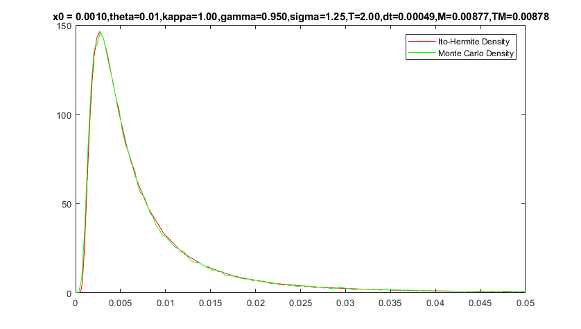](https://postimages.org/)

[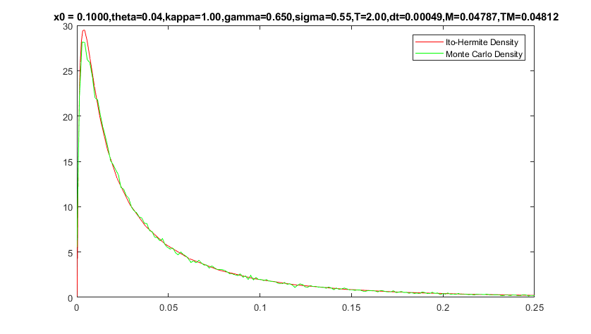](https://postimages.org/)

[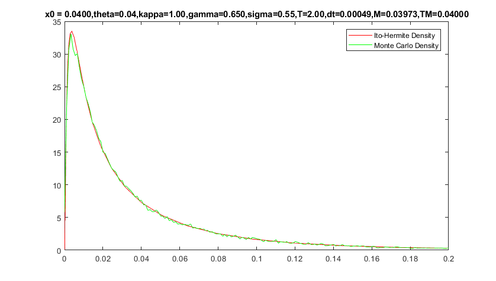](https://postimages.org/)

[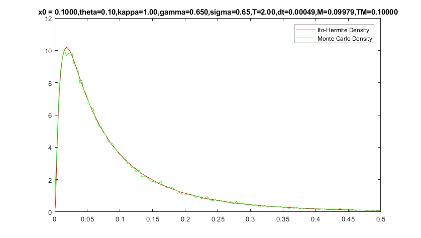](https://postimages.org/)

[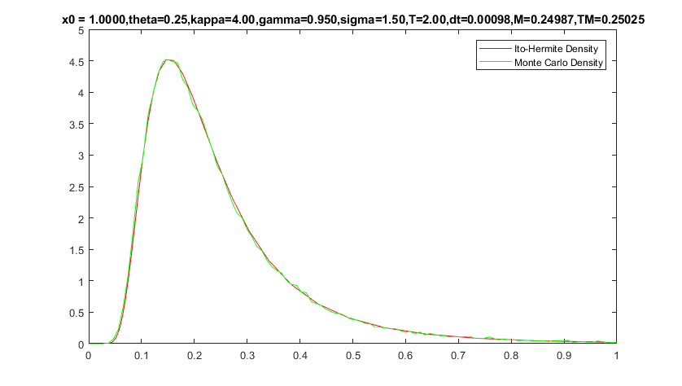](https://postimages.org/)

[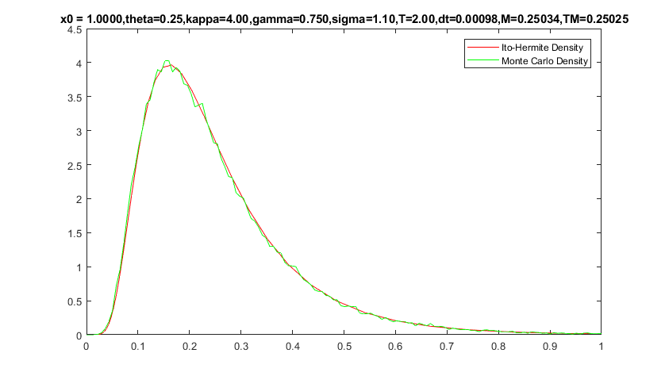](https://postimages.org/)

[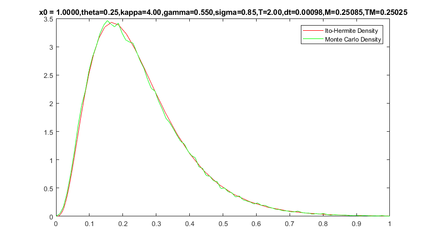](https://postimages.org/)

[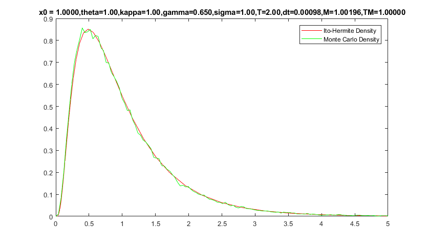](https://postimages.org/)

[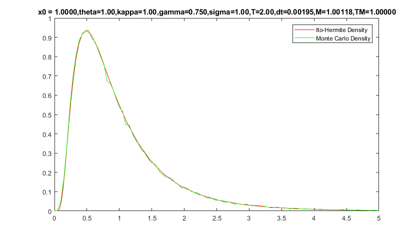](https://postimages.org/)

[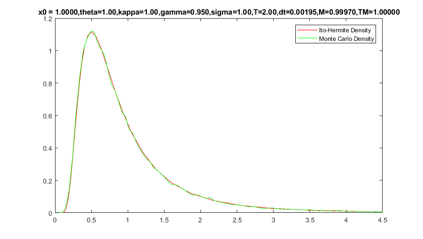](https://postimages.org/)

[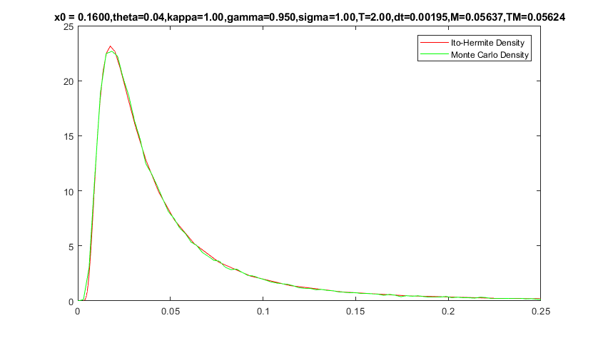](https://postimages.org/)

[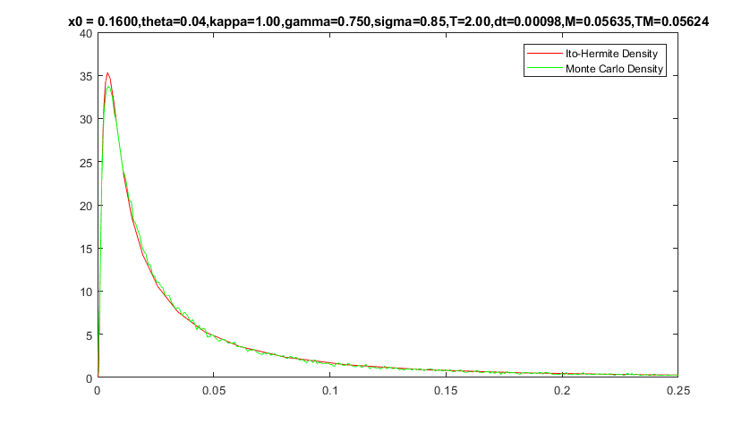](https://postimages.org/)

[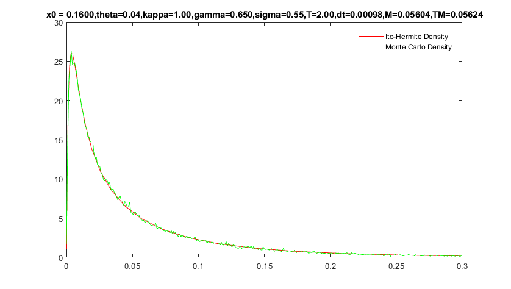](https://postimages.org/)

---

### #978 — Amin (Topic Author)
*August 6, 2020, 2:17 PM*

Here I am posting my new program for calculation of densities of SDEs from Fokker-Planck equation. I am also posting a
sub-function that I have altered from previous version. You should be able to reproduce graphs posted in previous post
using this program.

```
function [TrueMean,ItoHermiteMean,y_w,fy_w,wnStart] = FPERevisited044Wilmott16_2ndD08()

%Copyright Ahsan Amin. Infiniti derivatives Technologies.
%Please fell free to connect on linkedin: linkedin.com/in/ahsan-amin-0a53334
%or skype ahsan.amin2999
%In this program, I am simulating the SDE given as
%dy(t)=mu1 x(t)^beta1 dt + mu2 x(t)^beta2 dt +sigma x(t)^gamma dz(t)

%I have not directly simulated the SDE but simulated the transformed
%Besse1l process version of the SDE and then changed coordinates to retreive
%the SDE in original coo
%rdinates.
%The present program will analytically evolve only the Bessel Process version of the
%SDE in transformed coordinates.
%In this version, the mean correction has been disabled. If you are
%simulating standard mean-reverting SV type SDEs, please enable the mean
%correction by uncommenting the appropriate line in the body of code below.

dt=.125/16/2/2/2;   % Simulation time interval.%Fodiffusions close to zero
             %decrease dt for accuracy.
Tt=128*8/4*2*2*2;     % Number of simulation levels. Terminal time= Tt*dt; //.125/32*32*16=2 year;
T=Tt*dt;
OrderA=4;  %
OrderM=4;  %
%dtM=.125/8;%Monte carlo time interval size dtM.
%TtM=8*8;%Monte carlo number of simulation intervals.
dtM=dt*4*4;
TtM=Tt/4/4;

dNn=.2/1;   % Normal density subdivisions width. would change with number of subdivisions
Nn=50;  % No of normal density subdivisions
NnMidl=25;%One half density Subdivision left from mid of normal density(low)
NnMidh=26;%One half density subdivision right from the mid of normal density(high)
NnMid=4.0;

%theta=mu1/(-mu2);
%kappa=-mu2;

x0=.160;   % starting value of SDE
beta1=0.0;
beta2=1.0;   % Second drift term power.
gamma=.65;%50;   % volatility power.
kappa=1.0;%.950;   %mean reversion parameter.
theta=.04;%mean reversion target
sigma0=.550;%Volatility value

%you can specify any general mu1 and mu2 and beta1 and beta2.

mu1=+1*theta*kappa;   %first drift coefficient.
mu2=-1*kappa;    % Second drift coefficient.
%mu1=0;
%mu2=0;

alpha=1;% x^alpha is being expanded. This is currently for monte carlo only.
alpha1=1-gamma;%This is for expansion of integrals for calculation of drift
%and volatility coefficients

w(1:Nn)=x0^(1-gamma)/(1-gamma);

Z(1:Nn)=(((1:Nn)-5.5)*dNn-NnMid);

Z
str=input('Look at Z');
ZProb(1)=normcdf(.5*Z(1)+.5*Z(2),0,1)-normcdf(.5*Z(1)+.5*Z(2)-dNn,0,1);
ZProb(Nn)=normcdf(.5*Z(Nn)+.5*Z(Nn-1)+dNn,0,1)-normcdf(.5*Z(Nn)+.5*Z(Nn-1),0,1);

for nn=2:Nn-1
    ZProb(nn)=normcdf(.5*Z(nn)+.5*Z(nn+1),0,1)-normcdf(.5*Z(nn)+.5*Z(nn-1),0,1);
    %Above calculate probability mass in each probability subdivision.
end

%%%%%%%%%%%%%%%%%%%%%%%%%%%%%%%%%%%%%%%%%%%%%%%%%%%%%%%%%%%%%%%%%%%%%%%%%%%%%%%%%%%%%%%%%%%%%%

sigma11(1:OrderA+1)=0;
mu11(1:OrderA+1)=0;
mu22(1:OrderA+1)=0;
sigma22(1:OrderA+1)=0;
% index 1 correponds to zero level since matlab indexing starts at one.
sigma11(1)=1;
mu11(1)=1;
mu22(1)=1;
sigma22(1)=1;

for k=1:(OrderA+1)
    if sigma0~=0
        sigma11(k)=sigma0^(k-1);
    end
    if mu1 ~= 0
        mu11(k)=mu1^(k-1);
    end
    if mu2 ~= 0
        mu22(k)=mu2^(k-1);
    end
    if sigma0~=0
        sigma22(k)=sigma0^(2*(k-1));
    end
end
%Ft(1:TtM+1,1:(OrderA+1),1:(OrderA+1),1:(OrderA+1),1:(OrderA+1))=0; %General time powers on hermite polynomials
Fp(1:(OrderA+1),1:(OrderA+1),1:(OrderA+1),1:(OrderA+1))=0;%General x powers on coefficients of hermite polynomials.
Fp1(1:(OrderA+1),1:(OrderA+1),1:(OrderA+1),1:(OrderA+1))=0;%General x powers for bessel transformed coordinates.

%YCoeff0 and YCoeff are coefficents for original coordinates monte carlo.
%YqCoeff0 and YqCoeff are bessel/lamperti version monte carlo.

YCoeff0(1:(OrderA+1),1:(OrderA+1),1:(OrderA+1),1:(OrderA+1))=0;
YqCoeff0(1:(OrderA+1),1:(OrderA+1),1:(OrderA+1),1:(OrderA+1))=0;
%Pre-compute the time and power exponent values in small multi-dimensional arrays
YCoeff = ItoTaylorCoeffsNew(alpha,beta1,beta2,gamma); %expand y^alpha where alpha=1;
YqCoeff = ItoTaylorCoeffsNew(alpha1,beta1,beta2,gamma);%expand y^alpha1 where alpha1=(1-gamma)
YqCoeff=YqCoeff/(1-gamma); %Transformed coordinates coefficients have to be
%further divided by (1-gamma)

for k = 0 : (OrderA)
    for m = 0:k
        l4 = k - m + 1;
        for n = 0 : m
            l3 = m - n + 1;
            for j = 0:n
                l2 = n - j + 1;
                l1 = j + 1;
                %Ft(l1,l2,l3,l4) = dtM^((l1-1) + (l2-1) + (l3-1) + .5* (l4-1));
                Fp(l1,l2,l3,l4) = (alpha + (l1-1) * beta1 + (l2-1) * beta2 + (l3-1) * 2* gamma + (l4-1) * gamma ...
                    - (l1-1) - (l2-1) - 2* (l3-1) - (l4-1));
                Fp1(l1,l2,l3,l4) = (alpha1 + (l1-1) * beta1 + (l2-1) * beta2 + (l3-1) * 2* gamma + (l4-1) * gamma ...
                    - (l1-1) - (l2-1) - 2* (l3-1) - (l4-1));

                YCoeff0(l1,l2,l3,l4) =YCoeff(l1,l2,l3,l4).*mu11(l1).*mu22(l2).*sigma22(l3).*sigma11(l4);
                YqCoeff0(l1,l2,l3,l4) =YqCoeff(l1,l2,l3,l4).*mu11(l1).*mu22(l2).*sigma22(l3).*sigma11(l4);
            end
        end
    end
end

%%%%%%%%%%%%%%%%%%%%%%%%%%%%%%%%%%%%%%%%%%%%%%%%%%%%%%%%%%%%%%%%%%%%%%%%%%%%%%%%%%%%%%%%%%%%%%
wnStart=1;%
d2wdZ2(1:Nn)=0;
d2wdZ2A(1:Nn)=0;

dwdZ(1:Nn)=0;
yy(wnStart:Nn)=((1-gamma)*w(wnStart:Nn)).^(1/(1-gamma));
tic

for tt=1:Tt

     yy(wnStart:Nn)=((1-gamma)*w(wnStart:Nn)).^(1/(1-gamma));

    [wMu0dt,dwMu0dtdw,c1] = CalculateDriftAndVolA4(w,wnStart,Nn,YqCoeff0,Fp1,gamma,dt);

    %wPrev=w;
    dw(wnStart:Nn)=c1(wnStart:Nn).*Z(wnStart:Nn) ;% ...
    %dw(wnStart:Nn)=sigma0.*sqrt(dt).*Z(wnStart:Nn) ;
    dw2(wnStart:Nn)=dw(wnStart:Nn).^2;
    w(isnan(w)==1)=0;
    wMu0dt(isnan(wMu0dt)==1)=0;
    wMeanPrev=sum(ZProb(wnStart:Nn).*w(wnStart:Nn));%Calculate the mean.

    %yyMedian=.5*yy(NnMidh)+.5*yy(NnMidl);
%%%%%%%%%%%%%%%%%%%%%%%%%%%%%%%%%%%%%%%%%%%%%%%%%%%%%%%%%%%%%%%%%%%%%%%%%%%

[dwdZ,d2wdZ2A,d3wdZ3A] = First3Derivatives4thOrderEqSpaced(wnStart,Nn,dNn,w,Z);

d2wdZ2(wnStart:Nn)=0.0;
d3wdZ3(wnStart:Nn)=0.0;
if (tt>32)

d2wdZ2(wnStart:Nn)=d2wdZ2A(wnStart:Nn);
d2wdZ2(1:10)=d2wdZ2(1:10).*exp(-12*kappa^2*(1-gamma).*dNn*(10-(1:10)));
%Change 1:7/25/2020: I have very heavily weighted the second derivative to
%the left of density peak with an exponential and it allows far larger
%range of parameters with stable execution without sacrificing much
%accuracy. Of course, it is just ad hoc.

d3wdZ3(wnStart:Nn)=d3wdZ3A(wnStart:Nn);
end

%If the calculation of the program blows, it means that above calculated
%derivative is unstable or bad. Plese replace with your favourite method of
%calculating this second derivative.

dZdw(wnStart:Nn)=1.0./dwdZ(wnStart:Nn);

if(tt==1)
w(wnStart:Nn)=wMeanPrev+wMu0dt(wnStart:Nn)+ ...
          sign(w(wnStart:Nn)-wMeanPrev+dw(wnStart:Nn)).* ...
          sqrt(abs(sign(w(wnStart:Nn)-wMeanPrev).*(w(wnStart:Nn)-wMeanPrev).^2+ ...
          sign(dw(wnStart:Nn)).*dw2(wnStart:Nn)));
end
if(tt>1)

  %C22=1.1/pi/8;
  %C33=.9/pi/16;%
  %C44=1.1/pi/8;

%  C22=1.1/pi/8*1.5;
%  C33=.5*.5*.707/pi/16;%.9/pi/16;%
%  C44=1.1/pi/8*1.5;

  C22=.28125/pi;
  C33=.01104/pi;
  C44=.28125/pi;

  TermA0=-C22.*3*Z(wnStart:Nn).^1.*dZdw(wnStart:Nn).*d2wdZ2(wnStart:Nn)*sigma0^2.*dt + ...
             +C44.*(-d3wdZ3(wnStart:Nn).*dZdw(wnStart:Nn)+3*d2wdZ2(wnStart:Nn).^2.*dZdw(wnStart:Nn).^2)*sigma0^2.*dt+
...
             -C33*dwMu0dtdw(wnStart:Nn).*dwdZ(wnStart:Nn).^2;

  TermA(wnStart:Nn)= sqrt(abs(TermA0));
   SignTermA(wnStart:Nn)=sign(TermA0);

   w(wnStart:Nn)=w(wnStart:Nn)+wMu0dt(wnStart:Nn)+(-(Z(wnStart:Nn).*dwdZ(wnStart:Nn))+d2wdZ2(wnStart:Nn))+ ...
             sign((Z(wnStart:Nn).*dwdZ(wnStart:Nn))-d2wdZ2(wnStart:Nn)+dw(wnStart:Nn)+TermA(wnStart:Nn)).* ...
             sqrt(abs(sign((Z(wnStart:Nn).*dwdZ(wnStart:Nn))-d2wdZ2(wnStart:Nn)).* ...
             ((Z(wnStart:Nn).*dwdZ(wnStart:Nn))-d2wdZ2(wnStart:Nn)).^2+ ...
             sign(+dw(wnStart:Nn)).*dw2(wnStart:Nn)+ ...
             SignTermA(wnStart:Nn).*TermA(wnStart:Nn).^2));%+ ...

end

%%%%%%%%%%%%%%%%%%%%%%%%%%%%%%%%%%%%%%%%%%%%%%%%%%%%%%%%%%%%%%%%%%%%%%%%%%%
%Below are instability correction equations. There is instability in the
% SDE representation equation roughly between -.5 SD to +.5 SD in normal terms.
%Instability correction Algorithm takes two ends that are here given as
%lower end=w(NnMidl-2) and upper end=w(NnMidh+3).

%Change 8/3/2020
%I have switched to matlab spline function interpolation by taking five
%points on both sides of instability. This works far better and you can
%now use nuemrical 2nd derivative without any modification for a large
%range of parameters. It truly improves the fit to true density and usually
%works great.

     
Zi=[Z(NnMidl-6),Z(NnMidl-5),Z(NnMidl-4),Z(NnMidl-3),Z(NnMidl-2),Z(NnMidh+3),Z(NnMidh+4),Z(NnMidh+5),Z(NnMidh+6),Z(NnMidh+7)];
     
wi=[w(NnMidl-6),w(NnMidl-5),w(NnMidl-4),w(NnMidl-3),w(NnMidl-2),w(NnMidh+3),w(NnMidh+4),w(NnMidh+5),w(NnMidh+6),w(NnMidh+7)];
      Zq=[Z(NnMidl-1),Z(NnMidl),Z(NnMidh),Z(NnMidh+1),Z(NnMidh+2)];
      wq=spline(Zi,wi,Zq);
      w(NnMidl-1:NnMidh+2)=wq(1:5);

  [wE] =
InterpolateOrderN6(6,Z(Nn)+dNn,Z(Nn),Z(Nn-1),Z(Nn-2),Z(Nn-3),Z(Nn-4),Z(Nn-5),w(Nn),w(Nn-1),w(Nn-2),w(Nn-3),w(Nn-4),w(Nn-5));

        w1(1:Nn-1)=w(1:Nn-1);
        w1(Nn)=w(Nn);
        w2(1:Nn-1)=w(2:Nn);
        w2(Nn)=wE;

    w(w1(:)>w2(:))=0;%Be careful;might not universally hold;
     %Change 3:7/25/2020: I have improved zero correction in above.
        w(w<0)=0.0;
        for nn=1:Nn
            if(w(nn)<=0)
                wnStart=nn+1;
           end
        end

        %%1st order mean correction. We know the mean in original
        %%coordinates so I shift the density into original coordinates,
        %%apply the mean correction and then transform again into Lamperti
        %%coordinates. Algebra solves two equations in two unknowns.
        %%Equations are Sum_0^N{(Y_w(wnStart:Nn)-Y0)*W0}=1 and the second
        %%equation is Sum_0^N{Y_w(wnStart:Nn).*(Y_w(wnStart:Nn)-Y0)*W0}=u0
        %%Two unknows are Y0 and W0. u0 is known mean.
        tt;
        u0=theta+(x0-theta)*exp(-kappa*(tt*dt)); %analytic mean of the density

        %If you are not using stochastic volatility, replace above with
        %true mean otherwise results would become garbage.

        Y_w(wnStart:Nn) = ((1-gamma)*w(wnStart:Nn)).^(1/(1-gamma));

        Yn2Pn=sum(Y_w(wnStart:Nn).*Y_w(wnStart:Nn).*ZProb(wnStart:Nn));
        YnPn=sum(Y_w(wnStart:Nn).*ZProb(wnStart:Nn));
        Pn=1.0;%%Sum(ZProb(1:Nn))
        Y0=(Yn2Pn-u0*YnPn)/(YnPn-u0*Pn);

        Y0Pn=Y0*Pn;
        W0=1/(YnPn-Y0Pn);
        YCorrected(wnStart:Nn)=Y_w(wnStart:Nn).*(Y_w(wnStart:Nn)-Y0)*W0;
        wCorrected(wnStart:Nn)=(YCorrected(wnStart:Nn).^(1-gamma))./(1-gamma);
     %   w(wnStart:Nn)=wCorrected(wnStart:Nn);

   %I have disabled the mean correction. The above mean correction is only valid for
   %standard mean reverting stochastic volatility type SDEs. To enable mean
   %correction please uncomment the above last line in the block.

end

yyMedian=.5*yy(NnMidh)+.5*yy(NnMidl);
 y_w(1:Nn)=0;
 y_w(wnStart:Nn) = ((1-gamma)*w(wnStart:Nn)).^(1/(1-gamma));
 Dfy_w(wnStart:Nn)=0;
 Dfw(wnStart:Nn)=0;
for nn=wnStart+1:Nn-1
    Dfy_w(nn) = (y_w(nn + 1) - y_w(nn - 1))/(Z(nn + 1) - Z(nn - 1));
    Dfw(nn) = (w(nn + 1) - w(nn - 1))/(Z(nn + 1) - Z(nn - 1));
    %Change of variable derivative for densities
end
fy_w(1:Nn)=0;
fw(1:Nn)=0;
for nn = wnStart:Nn-1
    fy_w(nn) = (normpdf(Z(nn),0, 1))/abs(Dfy_w(nn));%Origianl coordinates density
    fw(nn) = (normpdf(Z(nn),0, 1))/abs(Dfw(nn));
end

toc

ItoHermiteMean=sum(y_w(wnStart+1:Nn-1).*ZProb(wnStart+1:Nn-1)) %Original process average from coordinates

 disp('true Mean only applicble to standard SV mean reverting type models otherwise disregard');
 TrueMean=theta+(x0-theta)*exp(-kappa*dt*Tt)%Mean reverting SDE original variable true average

 rng(29079137, 'twister')
 paths=100000;
 YY(1:paths)=x0;  %Original process monte carlo.
 Random1(1:paths)=0;
 YYMean(1:TtM)=0;
 for tt=1:TtM
     Random1=randn(size(Random1));
     HermiteP1(1,1:paths)=1;
     HermiteP1(2,1:paths)=Random1(1:paths);
     HermiteP1(3,1:paths)=Random1(1:paths).^2-1;
     HermiteP1(4,1:paths)=Random1(1:paths).^3-3*Random1(1:paths);
     HermiteP1(5,1:paths)=Random1(1:paths).^4-6*Random1(1:paths).^2+3;

     YY(1:paths)=YY(1:paths) + ...
      (YCoeff0(1,1,2,1).*YY(1:paths).^Fp(1,1,2,1)+ ...
      YCoeff0(1,2,1,1).*YY(1:paths).^Fp(1,2,1,1)+ ...
      YCoeff0(2,1,1,1).*YY(1:paths).^Fp(2,1,1,1))*dtM + ...
      (YCoeff0(1,1,3,1).*YY(1:paths).^Fp(1,1,3,1)+ ...
      YCoeff0(1,2,2,1).*YY(1:paths).^Fp(1,2,2,1)+ ...
      YCoeff0(2,1,2,1).*YY(1:paths).^Fp(2,1,2,1)+ ...
      YCoeff0(1,3,1,1).*YY(1:paths).^Fp(1,3,1,1)+ ...
      YCoeff0(2,2,1,1).*YY(1:paths).^Fp(2,2,1,1)+ ...
      YCoeff0(3,1,1,1).*YY(1:paths).^Fp(3,1,1,1))*dtM^2 + ...
      ((YCoeff0(1,1,1,2).*YY(1:paths).^Fp(1,1,1,2).*sqrt(dtM))+ ...
    (YCoeff0(1,1,2,2).*YY(1:paths).^Fp(1,1,2,2)+ ...
    YCoeff0(1,2,1,2).*YY(1:paths).^Fp(1,2,1,2)+ ...
    YCoeff0(2,1,1,2).*YY(1:paths).^Fp(2,1,1,2)).*dtM^1.5) .*HermiteP1(2,1:paths) + ...
    ((YCoeff0(1,1,1,3).*YY(1:paths).^Fp(1,1,1,3) *dtM) + ...
    (YCoeff0(1,1,2,3).*YY(1:paths).^Fp(1,1,2,3)+ ...
    YCoeff0(1,2,1,3).*YY(1:paths).^Fp(1,2,1,3)+ ...
    YCoeff0(2,1,1,3).*YY(1:paths).^Fp(2,1,1,3)).*dtM^2).*HermiteP1(3,1:paths) + ...
    ((YCoeff0(1,1,1,4).*YY(1:paths).^Fp(1,1,1,4)*dtM^1.5 )).*HermiteP1(4,1:paths) + ...
    (YCoeff0(1,1,1,5).*YY(1:paths).^Fp(1,1,1,5)*dtM^2.0).*HermiteP1(5,1:paths);

%Uncomment for fourth order monte carlo

%
%   YY(1:paths)=YY(1:paths) + ...
%       (YCoeff0(1,1,2,1).*YY(1:paths).^Fp(1,1,2,1)+YCoeff0(1,2,1,1).*YY(1:paths).^Fp(1,2,1,1)+ ...
%       YCoeff0(2,1,1,1).*YY(1:paths).^Fp(2,1,1,1))*dtM + ...
%       (YCoeff0(1,1,3,1).*YY(1:paths).^Fp(1,1,3,1)+YCoeff0(1,2,2,1).*YY(1:paths).^Fp(1,2,2,1)+ ...
%       YCoeff0(2,1,2,1).*YY(1:paths).^Fp(2,1,2,1)+YCoeff0(1,3,1,1).*YY(1:paths).^Fp(1,3,1,1)+ ...
%       YCoeff0(2,2,1,1).*YY(1:paths).^Fp(2,2,1,1)+YCoeff0(3,1,1,1).*YY(1:paths).^Fp(3,1,1,1))*dtM^2 + ...
%       (YCoeff0(1,1,4,1).*YY(1:paths).^Fp(1,1,4,1)+YCoeff0(1,2,3,1).*YY(1:paths).^Fp(1,2,3,1)+ ...
%       YCoeff0(2,1,3,1).*YY(1:paths).^Fp(2,1,3,1)+YCoeff0(1,3,2,1).*YY(1:paths).^Fp(1,3,2,1)+ ...
%       YCoeff0(2,2,2,1).*YY(1:paths).^Fp(2,2,2,1)+YCoeff0(3,1,2,1).*YY(1:paths).^Fp(3,1,2,1)+ ...
%       YCoeff0(1,4,1,1).*YY(1:paths).^Fp(1,4,1,1)+YCoeff0(2,3,1,1).*YY(1:paths).^Fp(2,3,1,1)+ ...
%       YCoeff0(3,2,1,1).*YY(1:paths).^Fp(3,2,1,1)+YCoeff0(4,1,1,1).*YY(1:paths).^Fp(4,1,1,1))*dtM^3 + ...
%        (YCoeff0(1,1,5,1).*YY(1:paths).^Fp(1,1,5,1)+YCoeff0(1,2,4,1).*YY(1:paths).^Fp(1,2,4,1)+ ...
%     YCoeff0(2,1,4,1).*YY(1:paths).^Fp(2,1,4,1)+YCoeff0(2,1,1,1).*YY(1:paths).^Fp(2,1,1,1)+ ...
%      YCoeff0(2,2,3,1).*YY(1:paths).^Fp(2,2,3,1)+ ...
%      YCoeff0(3,1,3,1).*YY(1:paths).^Fp(3,1,3,1)+YCoeff0(1,4,2,1).*YY(1:paths).^Fp(1,4,2,1)+ ...
%      YCoeff0(2,3,2,1).*YY(1:paths).^Fp(2,3,2,1)+YCoeff0(3,2,2,1).*YY(1:paths).^Fp(3,2,2,1)+ ...
%      YCoeff0(4,1,2,1).*YY(1:paths).^Fp(4,1,2,1)+YCoeff0(1,5,1,1).*YY(1:paths).^Fp(1,5,1,1)+ ...
%      YCoeff0(2,4,1,1).*YY(1:paths).^Fp(2,4,1,1)+ ...
%      YCoeff0(3,3,1,1).*YY(1:paths).^Fp(3,3,1,1)+YCoeff0(4,2,1,1).*YY(1:paths).^Fp(4,2,1,1)+ ...
%      YCoeff0(5,1,1,1).*YY(1:paths).^Fp(5,1,1,1))*dtM^4+ ...
%       ((YCoeff0(1,1,1,2).*YY(1:paths).^Fp(1,1,1,2).*sqrt(dtM))+ ...
%     (YCoeff0(1,1,2,2).*YY(1:paths).^Fp(1,1,2,2)+YCoeff0(1,2,1,2).*YY(1:paths).^Fp(1,2,1,2)+ ...
%     YCoeff0(2,1,1,2).*YY(1:paths).^Fp(2,1,1,2)).*dtM^1.5+ ...
%     (YCoeff0(1,1,3,2).*YY(1:paths).^Fp(1,1,3,2)+YCoeff0(1,2,2,2).*YY(1:paths).^Fp(1,2,2,2)+ ...
%     YCoeff0(2,1,2,2).*YY(1:paths).^Fp(2,1,2,2)+YCoeff0(1,3,1,2).*YY(1:paths).^Fp(1,3,1,2)+ ...
%     YCoeff0(2,2,1,2).*YY(1:paths).^Fp(2,2,1,2)+YCoeff0(3,1,1,2).*YY(1:paths).^Fp(3,1,1,2)).*dtM^2.5+ ...
%     (YCoeff0(1,1,4,2).*YY(1:paths).^Fp(1,1,4,2)+YCoeff0(1,2,3,2).*YY(1:paths).^Fp(1,2,3,2)+ ...
%     YCoeff0(2,1,3,2).*YY(1:paths).^Fp(2,1,3,2)+YCoeff0(1,3,2,2).*YY(1:paths).^Fp(1,3,2,2)+ ...
%     YCoeff0(2,2,2,2).*YY(1:paths).^Fp(2,2,2,2)+ YCoeff0(3,1,2,2).*YY(1:paths).^Fp(3,1,2,2)+ ...
%     YCoeff0(1,4,1,2).*YY(1:paths).^Fp(1,4,1,2)+YCoeff0(2,3,1,2).*YY(1:paths).^Fp(2,3,1,2)+ ...
%     YCoeff0(3,2,1,2).*YY(1:paths).^Fp(3,2,1,2)+YCoeff0(4,1,1,2).*YY(1:paths).^Fp(4,1,1,2)).*dtM^3.5)
.*HermiteP1(2,1:paths) + ...
%     ((YCoeff0(1,1,1,3).*YY(1:paths).^Fp(1,1,1,3) *dtM) + ...
%     (YCoeff0(1,1,2,3).*YY(1:paths).^Fp(1,1,2,3)+YCoeff0(1,2,1,3).*YY(1:paths).^Fp(1,2,1,3)+ ...
%     YCoeff0(2,1,1,3).*YY(1:paths).^Fp(2,1,1,3)).*dtM^2+ ...
%     (YCoeff0(1,1,3,3).*YY(1:paths).^Fp(1,1,3,3)+YCoeff0(1,2,2,3).*YY(1:paths).^Fp(1,2,2,3)+ ...
%     YCoeff0(2,1,2,3).*YY(1:paths).^Fp(2,1,2,3) + YCoeff0(1,3,1,3).*YY(1:paths).^Fp(1,3,1,3)+ ...
%   
 YCoeff0(2,2,1,3).*YY(1:paths).^Fp(2,2,1,3)+YCoeff0(3,1,1,3).*YY(1:paths).^Fp(3,1,1,3)).*dtM^3).*HermiteP1(3,1:paths) +
...
%     ((YCoeff0(1,1,1,4).*YY(1:paths).^Fp(1,1,1,4)*dtM^1.5 )+ ...
%     (YCoeff0(1,1,2,4).*YY(1:paths).^Fp(1,1,2,4)+YCoeff0(1,2,1,4).*YY(1:paths).^Fp(1,2,1,4)+ ...
%     YCoeff0(2,1,1,4).*YY(1:paths).^Fp(2,1,1,4))*dtM^2.5).*HermiteP1(4,1:paths) + ...
%     (YCoeff0(1,1,1,5).*YY(1:paths).^Fp(1,1,1,5)*dtM^2.0).*HermiteP1(5,1:paths);
%

     YYMean(tt)=YYMean(tt)+sum(YY(1:paths))/paths;
 end
 YY(YY<0)=0;
 disp('Original process average from monte carlo');
 MCMean=sum(YY(:))/paths %origianl coordinates monte carlo average.
 disp('Original process average from our simulation');
 ItoHermiteMean=sum(y_w(wnStart+1:Nn-1).*ZProb(wnStart+1:Nn-1)) %Original process average from coordinates

 disp('true Mean only applicble to standard SV mean reverting type models otherwise disregard');
 TrueMean=theta+(x0-theta)*exp(-kappa*dt*Tt)%Mean reverting SDE original variable true average

 MaxCutOff=30;
 NoOfBins=round(300*gamma^2*8*sigma0/sqrt(yyMedian)/(1+kappa));%Decrease the number of bins if the graph is too
 [YDensity,IndexOutY,IndexMaxY] = MakeDensityFromSimulation_Infiniti_NEW(YY,paths,NoOfBins,MaxCutOff );
 plot(y_w(wnStart+1:Nn-1),fy_w(wnStart+1:Nn-1),'r',IndexOutY(1:IndexMaxY),YDensity(1:IndexMaxY),'g');
 %plot(y_w(wnStart+1:Nn-1),fy_w(wnStart+1:Nn-1),'r',IndexOutY(1:IndexMaxY),YDensity(1:IndexMaxY),'g',Z(wnStart+1:Nn-1),fy_w(wnStart+1:Nn-1),'b');

 title(sprintf('x0 = %.4f,theta=%.2f,kappa=%.2f,gamma=%.3f,sigma=%.2f,T=%.2f,dt=%.5f,M=%.5f,TM=%.5f',
x0,theta,kappa,gamma,sigma0,T,dt,ItoHermiteMean,TrueMean));%,sprintf('theta= %f', theta), sprintf('kappa = %f',
kappa),sprintf('sigma = %f', sigma0),sprintf('T = %f', T));

 %title('text',sprintf('x0 = %f', x0),sprintf('theta= %f', theta), sprintf('kappa = %f', kappa),sprintf('sigma = %f',
sigma0),sprintf('T = %f', T))
 %xlabel(a)
 %title('Graphical Comparison of Ito-Hermite Method and Monte Carlo Method Density')
 legend({'Ito-Hermite Density','Monte Carlo Density'},'Location','northeast')

 str=input('red line is density of SDE from Ito-Hermite method, green is monte carlo.');

end
```

Here is the new sub-function that you will also need.

```
function [wMu0dt,dwMu0dtdw,c1] = CalculateDriftAndVolA4(w,wnStart,Nn,YqCoeff0,Fp1,gamma,dt)

yy(wnStart:Nn)=((1-gamma)*w(wnStart:Nn)).^(1/(1-gamma));

Fp2=Fp1/(1-gamma);

wMu0dt(wnStart:Nn)=(YqCoeff0(1,1,2,1).*yy(wnStart:Nn).^Fp1(1,1,2,1)+ ...
    YqCoeff0(1,2,1,1).*yy(wnStart:Nn).^Fp1(1,2,1,1)+ ...
    YqCoeff0(2,1,1,1).*yy(wnStart:Nn).^Fp1(2,1,1,1))*dt + ...
    (YqCoeff0(1,1,3,1).*yy(wnStart:Nn).^Fp1(1,1,3,1)+ ...
    YqCoeff0(1,2,2,1).*yy(wnStart:Nn).^Fp1(1,2,2,1)+ ...
    YqCoeff0(2,1,2,1).*yy(wnStart:Nn).^Fp1(2,1,2,1)+ ...
    YqCoeff0(1,3,1,1).*yy(wnStart:Nn).^Fp1(1,3,1,1)+ ...
    YqCoeff0(2,2,1,1).*yy(wnStart:Nn).^Fp1(2,2,1,1)+ ...
    YqCoeff0(3,1,1,1).*yy(wnStart:Nn).^Fp1(3,1,1,1))*dt^2;% + ...
%     (YqCoeff0(1,1,4,1).*yy(wnStart:Nn).^Fp1(1,1,4,1)+ ...
%     YqCoeff0(1,2,3,1).*yy(wnStart:Nn).^Fp1(1,2,3,1)+ ...
%     YqCoeff0(2,1,3,1).*yy(wnStart:Nn).^Fp1(2,1,3,1)+ ...
%     YqCoeff0(1,3,2,1).*yy(wnStart:Nn).^Fp1(1,3,2,1)+ ...
%     YqCoeff0(2,2,2,1).*yy(wnStart:Nn).^Fp1(2,2,2,1)+ ...
%     YqCoeff0(3,1,2,1).*yy(wnStart:Nn).^Fp1(3,1,2,1)+ ...
%     YqCoeff0(1,4,1,1).*yy(wnStart:Nn).^Fp1(1,4,1,1)+ ...
%     YqCoeff0(2,3,1,1).*yy(wnStart:Nn).^Fp1(2,3,1,1)+ ...
%     YqCoeff0(3,2,1,1).*yy(wnStart:Nn).^Fp1(3,2,1,1)+ ...
%     YqCoeff0(4,1,1,1).*yy(wnStart:Nn).^Fp1(4,1,1,1))*dt^3;%+ ...
%     (YqCoeff0(1,1,5,1).*yy(wnStart:Nn).^Fp1(1,1,5,1)+ ...
%      YqCoeff0(1,2,4,1).*yy(wnStart:Nn).^Fp1(1,2,4,1)+ ...
%      YqCoeff0(2,1,4,1).*yy(wnStart:Nn).^Fp1(2,1,4,1)+ ...
%      YqCoeff0(2,1,1,1).*yy(wnStart:Nn).^Fp1(2,1,1,1)+ ...
%       YqCoeff0(2,2,3,1).*yy(wnStart:Nn).^Fp1(2,2,3,1)+ ...
%       YqCoeff0(3,1,3,1).*yy(wnStart:Nn).^Fp1(3,1,3,1)+ ...
%       YqCoeff0(1,4,2,1).*yy(wnStart:Nn).^Fp1(1,4,2,1)+ ...
%       YqCoeff0(2,3,2,1).*yy(wnStart:Nn).^Fp1(2,3,2,1)+ ...
%       YqCoeff0(3,2,2,1).*yy(wnStart:Nn).^Fp1(3,2,2,1)+ ...
%       YqCoeff0(4,1,2,1).*yy(wnStart:Nn).^Fp1(4,1,2,1)+ ...
%       YqCoeff0(1,5,1,1).*yy(wnStart:Nn).^Fp1(1,5,1,1)+ ...
%       YqCoeff0(2,4,1,1).*yy(wnStart:Nn).^Fp1(2,4,1,1)+ ...
%       YqCoeff0(3,3,1,1).*yy(wnStart:Nn).^Fp1(3,3,1,1)+  ...
%       YqCoeff0(4,2,1,1).*yy(wnStart:Nn).^Fp1(4,2,1,1)+ ...
%       YqCoeff0(5,1,1,1).*yy(wnStart:Nn).^Fp1(5,1,1,1))*dt^4;

dwMu0dtdw(wnStart:Nn)=(YqCoeff0(1,1,2,1).*Fp1(1,1,2,1).*((1-gamma).*w(wnStart:Nn)).^(-1+Fp2(1,1,2,1))+ ...
    YqCoeff0(1,2,1,1).*Fp1(1,2,1,1).*((1-gamma).*w(wnStart:Nn)).^(-1+Fp2(1,2,1,1))+ ...
    YqCoeff0(2,1,1,1).*Fp1(2,1,1,1).*((1-gamma).*w(wnStart:Nn)).^(-1+Fp2(2,1,1,1)))*dt;% + ...
%     (YqCoeff0(1,1,3,1).*Fp1(1,1,3,1).*((1-gamma).*w(wnStart:Nn)).^(-1+Fp2(1,1,3,1))+ ...
%     YqCoeff0(1,2,2,1).*Fp1(1,2,2,1).*((1-gamma).*w(wnStart:Nn)).^(-1+Fp2(1,2,2,1))+ ...
%     YqCoeff0(2,1,2,1).*Fp1(2,1,2,1).*((1-gamma).*w(wnStart:Nn)).^(-1+Fp2(2,1,2,1))+ ...
%     YqCoeff0(1,3,1,1).*Fp1(1,3,1,1).*((1-gamma).*w(wnStart:Nn)).^(-1+Fp2(1,3,1,1))+ ...
%     YqCoeff0(2,2,1,1).*Fp1(2,2,1,1).*((1-gamma).*w(wnStart:Nn)).^(-1+Fp2(2,2,1,1))+ ...
%     YqCoeff0(3,1,1,1).*Fp1(3,1,1,1).*((1-gamma).*w(wnStart:Nn)).^(-1+Fp2(3,1,1,1)))*dt^2;% + ...
%     (YqCoeff0(1,1,4,1).*Fp1(1,1,4,1).*((1-gamma).*w(wnStart:Nn)).^(-1+Fp2(1,1,4,1))+ ...
%     YqCoeff0(1,2,3,1).*Fp1(1,2,3,1).*((1-gamma).*w(wnStart:Nn)).^(-1+Fp2(1,2,3,1))+ ...
%     YqCoeff0(2,1,3,1).*Fp1(2,1,3,1).*((1-gamma).*w(wnStart:Nn)).^(-1+Fp2(2,1,3,1))+ ...
%     YqCoeff0(1,3,2,1).*Fp1(1,3,2,1).*((1-gamma).*w(wnStart:Nn)).^(-1+Fp2(1,3,2,1))+ ...
%     YqCoeff0(2,2,2,1).*Fp1(2,2,2,1).*((1-gamma).*w(wnStart:Nn)).^(-1+Fp2(2,2,2,1))+ ...
%     YqCoeff0(3,1,2,1).*Fp1(3,1,2,1).*((1-gamma).*w(wnStart:Nn)).^(-1+Fp2(3,1,2,1))+ ...
%     YqCoeff0(1,4,1,1).*Fp1(1,4,1,1).*((1-gamma).*w(wnStart:Nn)).^(-1+Fp2(1,4,1,1))+ ...
%     YqCoeff0(2,3,1,1).*Fp1(2,3,1,1).*((1-gamma).*w(wnStart:Nn)).^(-1+Fp2(2,3,1,1))+ ...
%     YqCoeff0(3,2,1,1).*Fp1(3,2,1,1).*((1-gamma).*w(wnStart:Nn)).^(-1+Fp2(3,2,1,1))+ ...
%     YqCoeff0(4,1,1,1).*Fp1(4,1,1,1).*((1-gamma).*w(wnStart:Nn)).^(-1+Fp2(4,1,1,1)))*dt^3;

c1(wnStart:Nn)=YqCoeff0(1,1,1,2).*yy(wnStart:Nn).^Fp1(1,1,1,2).*sqrt(dt)+ ...
    (YqCoeff0(1,1,2,2).*yy(wnStart:Nn).^Fp1(1,1,2,2)+YqCoeff0(1,2,1,2).*yy(wnStart:Nn).^Fp1(1,2,1,2)+ ...
    YqCoeff0(2,1,1,2).*yy(wnStart:Nn).^Fp1(2,1,1,2)).*dt^1.5;%+ ...
    %(YqCoeff0(1,1,3,2).*yy(wnStart:Nn).^Fp1(1,1,3,2)+YqCoeff0(1,2,2,2).*yy(wnStart:Nn).^Fp1(1,2,2,2)+ ...
    %YqCoeff0(2,1,2,2).*yy(wnStart:Nn).^Fp1(2,1,2,2)+YqCoeff0(1,3,1,2).*yy(wnStart:Nn).^Fp1(1,3,1,2)+ ...
    %YqCoeff0(2,2,1,2).*yy(wnStart:Nn).^Fp1(2,2,1,2)+YqCoeff0(3,1,1,2).*yy(wnStart:Nn).^Fp1(3,1,1,2)).*dt^2.5;

end
```

---

### #979 — Amin (Topic Author)
*August 6, 2020, 3:03 PM*

Since step size in the matlab program copied to previous post is too small, I want to suggest something. Here is the
relevant block of code in previous program

```
d2wdZ2(wnStart:Nn)=0.0;
d3wdZ3(wnStart:Nn)=0.0;
if (tt>32)

d2wdZ2(wnStart:Nn)=d2wdZ2A(wnStart:Nn);
d2wdZ2(1:10)=d2wdZ2(1:10).*exp(-12*kappa^2*(1-gamma).*dNn*(10-(1:10)));
%Change 1:7/25/2020: I have very heavily weighted the second derivative to
%the left of density peak with an exponential and it allows far larger
%range of parameters with stable execution without sacrificing much
%accuracy. Of course, it is just ad hoc.
d3wdZ3(wnStart:Nn)=d3wdZ3A(wnStart:Nn);
end
```

if in the above code, you replace  "if (tt>32) " with  "if (tt>64) " , you can take a larger step size in many cases.
May be WENO or ENO type non-oscillatory derivatives calculation could help a lot.

---

### #980 — Amin (Topic Author)
*August 7, 2020, 10:35 AM*

My this post concerns my two previous posts. Here is post # 973 made on Mon Aug 03, 2020 5:01 pm

.

> I was trying to post on some linkedin groups asking friends to download the program in previous posts but my posts do
not appear on some groups even after I see the notification that my post was successful. It seems that mind control and
allied crooks have given money to their horses who want to present my research as their own. Why are they stopping my
research from reaching other people?
>
.

And here is my post # 974 written on Mon Aug 03, 2020 6:29 pm

.
> Lot of friends in several countries can recall how crooks in US defence and their allied apparatus were telling my
linkedin connections when I did my monte carlo simulation research and approached my connections about my research that
I was a very bad guy and "horses" of US defence crooks would present the same (my) research to them. Well, these crooks
never grow up and they want to do the same when I have presented solution to fokker-planck equation.
>
> I will try to post latex equations for the solution of Fokker-planck equation later today. But in the meantime, I want
to request friends to protest against my persecution. Here I want to share some threads with friends especially my
application to human rights watch for help.
>
> [My Letter To HRW About My Human Rights Abuse](https://forum.wilmott.com/viewtopic.php?f=15&t=102298)
>
> [Muslims, mind control, Muslim-Jewish relationship and American defense](https://forum.wilmott.com/viewtopic.php?f=15&t=101453)
>
> [My Open Letter to Prime Minister of Pakistan, Imran Khan, to Intervene In Order to Protect the Interests of Pakistan](https://forum.wilmott.com/viewtopic.php?f=15&t=94796&start=1125#p858119)
.

Friends know that I have been posting my research and code for a long time even while my research would not be perfectly
developed and many things in my research would be unknown. I understand that once I post something on internet, it is in
public domain and friends are free to do their advanced research about it. I want to say that I encourage friends to
freely do their own research even when it borrows something from my research. Only thing I expect that they would give
me credit for what I have done.

But what I do not understand why would mind control and related US Army apparatus try to stop my research from reaching
other people. I expect that people understand that this is very wrong. Obviously because they do not want my independent
research to reach other people before somebody else reaches out. I hope that people understand this was not fair.

I apologize to friends for my remarks and want to tell them that I was already on very bad and evil mind control
neurotransmitters that had been given to me through tained food otherwise I would really have remained balanced. I might
have remained balanced despite mind control drugs but I became very upset when I knew that mind control agents were
blocking my LinkedIn posts to groups and messages. What I am trying to say might be very hard for many friends who have
not gone through mind control themselves. But I again apologize to friends and want to tell them that I understand that
once my research is in public domain, they are free to do their own research about it but please ask mind control forces
in US Army to end their attempts at stopping my research from reaching other people. Since past one week, mind control
has dramatically increased and I lost my sanity multiple times and I am relatively sane now only since I have been able
to avoid drugged food to some extent. But it is very difficult to avoid drugged food for larger periods of time since my
family is a party with US Army and they detain me with psychiatric facilities for several months calling me
schizophrenic once I try to avoid their drugged food. Please protest against this racial/religious injustice and torture
on me. I am not a practicing Muslim but unfortunately I cannot change my birth history.

In the meantime, I want to request friends to protest against my persecution. Here I again want to share some threads
with friends especially my application to human rights watch for help so friends have more information about my
persecution and the persecution of thousands of other totally people like me whose only sin was to have some special
neurotransmitter in some part of their brain and US Army decided to retard them.

[My Letter to HRW About My Human Rights Abuse](https://forum.wilmott.com/viewtopic.php?f=15&t=102298)

[Muslims, mind control, Muslim-Jewish relationship and American defense](https://forum.wilmott.com/viewtopic.php?f=15&t=101453)

[My Open Letter to Prime Minister of Pakistan, Imran Khan, to Intervene In Order to Protect the Interests of Pakistan](https://forum.wilmott.com/viewtopic.php?f=15&t=94796&start=1125#p858119)

---

### #981 — Amin (Topic Author)
*August 7, 2020, 11:34 AM*

I am re-writing the post 979 above after making some additions.

Since step size in the matlab program copied to previous post is too small, I want to suggest something. Here is the
relevant block of code in previous program

```
d2wdZ2(wnStart:Nn)=0.0;
d3wdZ3(wnStart:Nn)=0.0;
if (tt>32)

d2wdZ2(wnStart:Nn)=d2wdZ2A(wnStart:Nn);
d2wdZ2(1:10)=d2wdZ2(1:10).*exp(-12*kappa^2*(1-gamma).*dNn*(10-(1:10)));
%Change 1:7/25/2020: I have very heavily weighted the second derivative to
%the left of density peak with an exponential and it allows far larger
%range of parameters with stable execution without sacrificing much
%accuracy. Of course, it is just ad hoc.
d3wdZ3(wnStart:Nn)=d3wdZ3A(wnStart:Nn);
end
```

if in the above code,

1) you replace  "if (tt>32) " with  "if (tt>64) " ,

and

2) you replace

"d2wdZ2(1:10)=d2wdZ2(1:10).*exp(-12*kappa^2*(1-gamma).*dNn*(10-(1:10)));"

with

"d2wdZ2(1:15)=d2wdZ2(1:15).*exp(-12*kappa^2*(1-gamma).*dNn*(15-(1:15)));"

 you can take a larger step size in many cases. May be WENO or ENO type non-oscillatory derivatives calculation could
help a lot.

The reason behind first replacement is that 2nd derivative is very small at the start and therefore becomes oscillatory
at start and we just add it in calculationsat a later stage when it has stabilized and has become significant.

And the meanings behind 2nd replacement is that we make 2nd derivative zero for three normal standard deviations (-2 SD
to -5 SD) instead of (-3 SD to -5 SD). This is again because derivative does not contribute much to accuracy in this
area but becomes oscillatory (-2 SD to -5 SD) close to zero.

if you follow this post, you can take up to eight times longer step size in many cases and four time step-size in a lot
of other cases. In very extreme scenarios you may only be able to take just two times longer time step size.

I believe that step size restriction is only due to oscillations and instability caused by second derivative. If you can
control these oscillations, you could easily take a time step size that is 16 or 32 times larger with good accuracy.

---

### #982 — Amin (Topic Author)
*August 9, 2020, 8:45 AM*

I am a member of about 50 groups on linkedin. I had posted on a large number of groups but my posts did not appear on
most linkedin groups (appeared on

I went ahead right now and tried to post on some groups after writing the above lines. I posted on three groups:
Computational Physics, Mathematical Finance and Biomedical Engineering. My post actually appeared on all three groups
but once I surfed out from the above groups to somewhere else and then came back after a minute to groups to see whether
my post was there to realize that there was no post on all three groups. My post was already gone from all three groups.

---

### #983 — Amin (Topic Author)
*August 19, 2020, 12:19 PM*

I am posting a new version of the FPE solution program. In earlier version, I was interpolating five points in the
instability region with matlab specific function "spline". In this new version I am interpolating only three points with
Lagrange polynomials interpolation which is just as accurate and faster. I have removed any matlab specific function
from this program. I have also removed all unnecessary things and the program is quite fast now. If SDE density does not
go into zero, you can easily use the program in an industrial setting. Sometimes, you might have to be careful about
step size. Here is the new program.

```
function [TrueMean,ItoHermiteMean,y_w,fy_w,wnStart] = FPERevisited044Wilmott16_2ndD40()

%Copyright Ahsan Amin. Infiniti derivatives Technologies.
%Please fell free to connect on linkedin: linkedin.com/in/ahsan-amin-0a53334
%or skype ahsan.amin2999
%In this program, I am simulating the SDE given as
%dy(t)=mu1 x(t)^beta1 dt + mu2 x(t)^beta2 dt +sigma x(t)^gamma dz(t)

%I have not directly simulated the SDE but simulated the transformed
%Besse1l process version of the SDE and then changed coordinates to retreive
%the SDE in original coo
%rdinates.
%The present program will analytically evolve only the Bessel Process version of the
%SDE in transformed coordinates.
%In this version, the mean correction has been disabled. If you are
%simulating standard mean-reverting SV type SDEs, please enable the mean
%correction by uncommenting the appropriate line in the body of code below.

dt=.125/16/2/2;   % Simulation time interval.%Fodiffusions close to zero
             %decrease dt for accuracy.
Tt=128*8/4*2*2;     % Number of simulation levels. Terminal time= Tt*dt; //.125/32*32*16=2 year;
T=Tt*dt;
OrderA=4;  %
OrderM=4;  %
%dtM=.125/8;%Monte carlo time interval size dtM.
%TtM=8*8;%Monte carlo number of simulation intervals.
dtM=dt*4*4*2;
TtM=Tt/4/4/2;

dNn=.2/1;   % Normal density subdivisions width. would change with number of subdivisions
Nn=50;  % No of normal density subdivisions
NnMidl=25;%One half density Subdivision left from mid of normal density(low)
NnMidh=26;%One half density subdivision right from the mid of normal density(high)
NnMid=4.0;

%theta=mu1/(-mu2);
%kappa=-mu2;

x0=.1;   % starting value of SDE
beta1=0.0;
beta2=1.0;   % Second drift term power.
gamma=.85;%50;   % volatility power.
kappa=1.0;%.950;   %mean reversion parameter.
theta=.1;%mean reversion target
sigma0=.950;%Volatility value

%you can specify any general mu1 and mu2 and beta1 and beta2.

mu1=+1*theta*kappa;   %first drift coefficient.
mu2=-1*kappa;    % Second drift coefficient.
%mu1=0;
%mu2=0;

alpha=1;% x^alpha is being expanded. This is currently for monte carlo only.
alpha1=1-gamma;%This is for expansion of integrals for calculation of drift
%and volatility coefficients

w(1:Nn)=x0^(1-gamma)/(1-gamma);

Z(1:Nn)=(((1:Nn)-5.5)*dNn-NnMid);

Z
str=input('Look at Z');
ZProb(1)=normcdf(.5*Z(1)+.5*Z(2),0,1)-normcdf(.5*Z(1)+.5*Z(2)-dNn,0,1);
ZProb(Nn)=normcdf(.5*Z(Nn)+.5*Z(Nn-1)+dNn,0,1)-normcdf(.5*Z(Nn)+.5*Z(Nn-1),0,1);
ZProb(2:Nn-1)=normcdf(.5*Z(2:Nn-1)+.5*Z(3:Nn),0,1)-normcdf(.5*Z(2:Nn-1)+.5*Z(1:Nn-2),0,1);
    %Above calculate probability mass in each probability subdivision.

%%%%%%%%%%%%%%%%%%%%%%%%%%%%%%%%%%%%%%%%%%%%%%%%%%%%%%%%%%%%%%%%%%%%%%%%%%%%%%%%%%%%%%%%%%%%%%

sigma11(1:OrderA+1)=0;
mu11(1:OrderA+1)=0;
mu22(1:OrderA+1)=0;
sigma22(1:OrderA+1)=0;
% index 1 correponds to zero level since matlab indexing starts at one.
sigma11(1)=1;
mu11(1)=1;
mu22(1)=1;
sigma22(1)=1;

for k=1:(OrderA+1)
    if sigma0~=0
        sigma11(k)=sigma0^(k-1);
    end
    if mu1 ~= 0
        mu11(k)=mu1^(k-1);
    end
    if mu2 ~= 0
        mu22(k)=mu2^(k-1);
    end
    if sigma0~=0
        sigma22(k)=sigma0^(2*(k-1));
    end
end
%Ft(1:TtM+1,1:(OrderA+1),1:(OrderA+1),1:(OrderA+1),1:(OrderA+1))=0; %General time powers on hermite polynomials
Fp(1:(OrderA+1),1:(OrderA+1),1:(OrderA+1),1:(OrderA+1))=0;%General x powers on coefficients of hermite polynomials.
Fp1(1:(OrderA+1),1:(OrderA+1),1:(OrderA+1),1:(OrderA+1))=0;%General x powers for bessel transformed coordinates.

%YCoeff0 and YCoeff are coefficents for original coordinates monte carlo.
%YqCoeff0 and YqCoeff are bessel/lamperti version monte carlo.

YCoeff0(1:(OrderA+1),1:(OrderA+1),1:(OrderA+1),1:(OrderA+1))=0;
YqCoeff0(1:(OrderA+1),1:(OrderA+1),1:(OrderA+1),1:(OrderA+1))=0;
%Pre-compute the time and power exponent values in small multi-dimensional arrays
YCoeff = ItoTaylorCoeffsNew(alpha,beta1,beta2,gamma); %expand y^alpha where alpha=1;
YqCoeff = ItoTaylorCoeffsNew(alpha1,beta1,beta2,gamma);%expand y^alpha1 where alpha1=(1-gamma)
YqCoeff=YqCoeff/(1-gamma); %Transformed coordinates coefficients have to be
%further divided by (1-gamma)

for k = 0 : (OrderA)
    for m = 0:k
        l4 = k - m + 1;
        for n = 0 : m
            l3 = m - n + 1;
            for j = 0:n
                l2 = n - j + 1;
                l1 = j + 1;
                %Ft(l1,l2,l3,l4) = dtM^((l1-1) + (l2-1) + (l3-1) + .5* (l4-1));
                Fp(l1,l2,l3,l4) = (alpha + (l1-1) * beta1 + (l2-1) * beta2 + (l3-1) * 2* gamma + (l4-1) * gamma ...
                    - (l1-1) - (l2-1) - 2* (l3-1) - (l4-1));
                Fp1(l1,l2,l3,l4) = (alpha1 + (l1-1) * beta1 + (l2-1) * beta2 + (l3-1) * 2* gamma + (l4-1) * gamma ...
                    - (l1-1) - (l2-1) - 2* (l3-1) - (l4-1));

                YCoeff0(l1,l2,l3,l4) =YCoeff(l1,l2,l3,l4).*mu11(l1).*mu22(l2).*sigma22(l3).*sigma11(l4);
                YqCoeff0(l1,l2,l3,l4) =YqCoeff(l1,l2,l3,l4).*mu11(l1).*mu22(l2).*sigma22(l3).*sigma11(l4);
            end
        end
    end
end

%%%%%%%%%%%%%%%%%%%%%%%%%%%%%%%%%%%%%%%%%%%%%%%%%%%%%%%%%%%%%%%%%%%%%%%%%%%%%%%%%%%%%%%%%%%%%%
wnStart=1;%
d2wdZ2(1:Nn)=0;
d2wdZ2A(1:Nn)=0;
dwdZ(1:Nn)=0;
yy(wnStart:Nn)=((1-gamma)*w(wnStart:Nn)).^(1/(1-gamma));
tic

for tt=1:Tt
    yy(wnStart:Nn)=((1-gamma)*w(wnStart:Nn)).^(1/(1-gamma));
    [wMu0dt,dwMu0dtdw,c1] = CalculateDriftAndVolA4(w,wnStart,Nn,YqCoeff0,Fp1,gamma,dt);
    dw(wnStart:Nn)=c1(wnStart:Nn).*Z(wnStart:Nn) ;% ...
    %dw(wnStart:Nn)=sigma0.*sqrt(dt).*Z(wnStart:Nn) ;
    dw2(wnStart:Nn)=dw(wnStart:Nn).^2;
    w(isnan(w)==1)=0;
    wMu0dt(isnan(wMu0dt)==1)=0;
    %wMeanPrev=sum(ZProb(wnStart:Nn).*w(wnStart:Nn));%Calculate the mean.
%%%%%%%%%%%%%%%%%%%%%%%%%%%%%%%%%%%%%%%%%%%%%%%%%%%%%%%%%%%%%%%%%%%%%%%%%%%

    [dwdZ,d2wdZ2A,d3wdZ3A] = First3Derivatives2ndOrderEqSpacedA(wnStart,Nn,dNn,w,Z);
    d2wdZ2(wnStart:Nn)=0.0;
    d3wdZ3(wnStart:Nn)=0.0;
    if (tt>36)
        d3wdZ3(wnStart:Nn) = (d3wdZ3A(wnStart:Nn));
        d2wdZ2(wnStart:Nn)=d2wdZ2A(wnStart:Nn);
        d2wdZ2(1:15)=d2wdZ2(1:15).*exp(-12*kappa^2*(1-gamma).*dNn*(15-(1:15)));
        d3wdZ3(1:15)=d3wdZ3(1:15).*exp(-12*kappa^2*(1-gamma).*dNn*(15-(1:15)));

    end
%tt
%plot((wnStart:Nn),d2wdZ2A(wnStart:Nn),'g',(wnStart:Nn),d2wdZ2(wnStart:Nn),'r');
%str=input('Look at d2wdZ2A(wnStart:Nn)');

%If the calculation of the program blows, it means that above calculated
%derivative is unstable or bad. Plese replace with your favourite method of
%calculating this second derivative.

    dZdw(wnStart:Nn)=1.0./dwdZ(wnStart:Nn);
    if(tt==1)
        wMeanPrev=sum(ZProb(wnStart:Nn).*w(wnStart:Nn));

        w(wnStart:Nn)=wMeanPrev+wMu0dt(wnStart:Nn)+ ...
            sign(w(wnStart:Nn)-wMeanPrev+dw(wnStart:Nn)).* ...
            sqrt(abs(sign(w(wnStart:Nn)-wMeanPrev).*(w(wnStart:Nn)-wMeanPrev).^2+ ...
            sign(dw(wnStart:Nn)).*dw2(wnStart:Nn)));
    end
    if(tt>1)

        C22(wnStart:Nn)=.0125/pi*25.0;
        C33(wnStart:Nn)=.0125/pi*2;
        C44(wnStart:Nn)=.0125/pi*25.0;

        TermA0(wnStart:Nn)=-C22(wnStart:Nn).*3.*Z(wnStart:Nn).^1.*dZdw(wnStart:Nn).*d2wdZ2(wnStart:Nn)*sigma0^2.*dt +
...
           
+C44(wnStart:Nn).*(-d3wdZ3(wnStart:Nn).*dZdw(wnStart:Nn)+3*d2wdZ2(wnStart:Nn).^2.*dZdw(wnStart:Nn).^2)*sigma0^2.*dt+ ...
            -C33(wnStart:Nn).*dwMu0dtdw(wnStart:Nn).*dwdZ(wnStart:Nn).^2;

        TermA(wnStart:Nn)= sqrt(abs(TermA0(wnStart:Nn)));
        SignTermA(wnStart:Nn)=sign(TermA0(wnStart:Nn));

        w(wnStart:Nn)=w(wnStart:Nn)+wMu0dt(wnStart:Nn)+(-(Z(wnStart:Nn).*dwdZ(wnStart:Nn))+d2wdZ2(wnStart:Nn))+ ...
           
sign((Z(wnStart:Nn).*dwdZ(wnStart:Nn))-d2wdZ2(wnStart:Nn)+dw(wnStart:Nn)+SignTermA(wnStart:Nn).*TermA(wnStart:Nn)).* ...
            sqrt(abs(sign((Z(wnStart:Nn).*dwdZ(wnStart:Nn))-d2wdZ2(wnStart:Nn)).* ...
            ((Z(wnStart:Nn).*dwdZ(wnStart:Nn))-d2wdZ2(wnStart:Nn)).^2+ ...
            sign(+dw(wnStart:Nn)).*dw2(wnStart:Nn)+ ...
            SignTermA(wnStart:Nn).*TermA(wnStart:Nn).^2));% + ...
    end

%%%%%%%%%%%%%%%%%%%%%%%%%%%%%%%%%%%%%%%%%%%%%%%%%%%%%%%%%%%%%%%%%%%%%%%%%%%
%Below are instability correction equations.
%Interpolation of three points in instability region with lagrange
%polynomials.

    w(NnMidl) =
InterpolateOrderN8(8,Z(NnMidl),Z(NnMidl-4),Z(NnMidl-3),Z(NnMidl-2),Z(NnMidl-1),Z(NnMidh+2),Z(NnMidh+3),Z(NnMidh+4),Z(NnMidh+5),w(NnMidl-4),w(NnMidl-3),w(NnMidl-2),w(NnMidl-1),w(NnMidh+2),w(NnMidh+3),w(NnMidh+4),w(NnMidh+5));
    w(NnMidh) =
InterpolateOrderN8(8,Z(NnMidh),Z(NnMidl-4),Z(NnMidl-3),Z(NnMidl-2),Z(NnMidl-1),Z(NnMidh+2),Z(NnMidh+3),Z(NnMidh+4),Z(NnMidh+5),w(NnMidl-4),w(NnMidl-3),w(NnMidl-2),w(NnMidl-1),w(NnMidh+2),w(NnMidh+3),w(NnMidh+4),w(NnMidh+5));
    w(NnMidh+1) =
InterpolateOrderN8(8,Z(NnMidh+1),Z(NnMidl-4),Z(NnMidl-3),Z(NnMidl-2),Z(NnMidl-1),Z(NnMidh+2),Z(NnMidh+3),Z(NnMidh+4),Z(NnMidh+5),w(NnMidl-4),w(NnMidl-3),w(NnMidl-2),w(NnMidl-1),w(NnMidh+2),w(NnMidh+3),w(NnMidh+4),w(NnMidh+5));

    [wE] =
InterpolateOrderN6(6,Z(Nn)+dNn,Z(Nn),Z(Nn-1),Z(Nn-2),Z(Nn-3),Z(Nn-4),Z(Nn-5),w(Nn),w(Nn-1),w(Nn-2),w(Nn-3),w(Nn-4),w(Nn-5));

    w1(1:Nn-1)=w(1:Nn-1);
    w1(Nn)=w(Nn);
    w2(1:Nn-1)=w(2:Nn);
    w2(Nn)=wE;
    w(w1(:)>w2(:))=0;%Be careful;might not universally hold;
     %Change 3:7/25/2020: I have improved zero correction in above.
    w(w<0)=0.0;
    for nn=1:Nn
        if(w(nn)<=0)
            wnStart=nn+1;
        end
    end

%         %%1st order mean correction. We know the mean in original
%         %%coordinates so I shift the density into original coordinates,
%         %%apply the mean correction and then transform again into Lamperti
%         %%coordinates. Algebra solves two equations in two unknowns.
%         %%Equations are Sum_0^N{(Y_w(wnStart:Nn)-Y0)*W0}=1 and the second
%         %%equation is Sum_0^N{Y_w(wnStart:Nn).*(Y_w(wnStart:Nn)-Y0)*W0}=u0
%         %%Two unknows are Y0 and W0. u0 is known mean.
%   tt;
%   u0=theta+(x0-theta)*exp(-kappa*(tt*dt)); %analytic mean of the density
%
%         %If you are not using stochastic volatility, replace above with
%         %true mean otherwise results would become garbage.
%
%   Y_w(wnStart:Nn) = ((1-gamma)*w(wnStart:Nn)).^(1/(1-gamma));
%
%   Yn2Pn=sum(Y_w(wnStart:Nn).*Y_w(wnStart:Nn).*ZProb(wnStart:Nn));
%   YnPn=sum(Y_w(wnStart:Nn).*ZProb(wnStart:Nn));
%   Pn=1.0;%%Sum(ZProb(1:Nn))
%   Y0=(Yn2Pn-u0*YnPn)/(YnPn-u0*Pn);
%
%   Y0Pn=Y0*Pn;
%   W0=1/(YnPn-Y0Pn);
%   YCorrected(wnStart:Nn)=Y_w(wnStart:Nn).*(Y_w(wnStart:Nn)-Y0)*W0;
%   wCorrected(wnStart:Nn)=(YCorrected(wnStart:Nn).^(1-gamma))./(1-gamma);
%   w(wnStart:Nn)=wCorrected(wnStart:Nn);
%
%I have disabled the mean correction. The above mean correction is only valid for
%standard mean reverting stochastic volatility type SDEs. To enable mean
%correction please uncomment the above block.

end

y_w(1:Nn)=0;
y_w(wnStart:Nn) = ((1-gamma)*w(wnStart:Nn)).^(1/(1-gamma));
Dfy_w(wnStart:Nn)=0;
Dfw(wnStart:Nn)=0;
for nn=wnStart+1:Nn-1
    Dfy_w(nn) = (y_w(nn + 1) - y_w(nn - 1))/(Z(nn + 1) - Z(nn - 1));
    Dfw(nn) = (w(nn + 1) - w(nn - 1))/(Z(nn + 1) - Z(nn - 1));
    %Change of variable derivative for densities
end
fy_w(1:Nn)=0;
fw(1:Nn)=0;
for nn = wnStart:Nn-1
    fy_w(nn) = (normpdf(Z(nn),0, 1))/abs(Dfy_w(nn));%Origianl coordinates density
    fw(nn) = (normpdf(Z(nn),0, 1))/abs(Dfw(nn));
end

toc

ItoHermiteMean=sum(y_w(wnStart+1:Nn-1).*ZProb(wnStart+1:Nn-1)) %Original process average from coordinates
disp('true Mean only applicable to standard SV mean reverting type models otherwise disregard');
TrueMean=theta+(x0-theta)*exp(-kappa*dt*Tt)%Mean reverting SDE original variable true average

rng(29079137, 'twister')
paths=100000;
YY(1:paths)=x0;  %Original process monte carlo.
Random1(1:paths)=0;
YYMean(1:TtM)=0;
for tt=1:TtM
    Random1=randn(size(Random1));
    HermiteP1(1,1:paths)=1;
    HermiteP1(2,1:paths)=Random1(1:paths);
    HermiteP1(3,1:paths)=Random1(1:paths).^2-1;
    HermiteP1(4,1:paths)=Random1(1:paths).^3-3*Random1(1:paths);
    HermiteP1(5,1:paths)=Random1(1:paths).^4-6*Random1(1:paths).^2+3;

    YY(1:paths)=YY(1:paths) + ...
        (YCoeff0(1,1,2,1).*YY(1:paths).^Fp(1,1,2,1)+ ...
        YCoeff0(1,2,1,1).*YY(1:paths).^Fp(1,2,1,1)+ ...
        YCoeff0(2,1,1,1).*YY(1:paths).^Fp(2,1,1,1))*dtM + ...
        (YCoeff0(1,1,3,1).*YY(1:paths).^Fp(1,1,3,1)+ ...
        YCoeff0(1,2,2,1).*YY(1:paths).^Fp(1,2,2,1)+ ...
        YCoeff0(2,1,2,1).*YY(1:paths).^Fp(2,1,2,1)+ ...
        YCoeff0(1,3,1,1).*YY(1:paths).^Fp(1,3,1,1)+ ...
        YCoeff0(2,2,1,1).*YY(1:paths).^Fp(2,2,1,1)+ ...
        YCoeff0(3,1,1,1).*YY(1:paths).^Fp(3,1,1,1))*dtM^2 + ...
        ((YCoeff0(1,1,1,2).*YY(1:paths).^Fp(1,1,1,2).*sqrt(dtM))+ ...
        (YCoeff0(1,1,2,2).*YY(1:paths).^Fp(1,1,2,2)+ ...
        YCoeff0(1,2,1,2).*YY(1:paths).^Fp(1,2,1,2)+ ...
        YCoeff0(2,1,1,2).*YY(1:paths).^Fp(2,1,1,2)).*dtM^1.5) .*HermiteP1(2,1:paths) + ...
        ((YCoeff0(1,1,1,3).*YY(1:paths).^Fp(1,1,1,3) *dtM) + ...
        (YCoeff0(1,1,2,3).*YY(1:paths).^Fp(1,1,2,3)+ ...
        YCoeff0(1,2,1,3).*YY(1:paths).^Fp(1,2,1,3)+ ...
        YCoeff0(2,1,1,3).*YY(1:paths).^Fp(2,1,1,3)).*dtM^2).*HermiteP1(3,1:paths) + ...
        ((YCoeff0(1,1,1,4).*YY(1:paths).^Fp(1,1,1,4)*dtM^1.5 )).*HermiteP1(4,1:paths) + ...
        (YCoeff0(1,1,1,5).*YY(1:paths).^Fp(1,1,1,5)*dtM^2.0).*HermiteP1(5,1:paths);

%Uncomment for fourth order monte carlo

%
%   YY(1:paths)=YY(1:paths) + ...
%       (YCoeff0(1,1,2,1).*YY(1:paths).^Fp(1,1,2,1)+YCoeff0(1,2,1,1).*YY(1:paths).^Fp(1,2,1,1)+ ...
%       YCoeff0(2,1,1,1).*YY(1:paths).^Fp(2,1,1,1))*dtM + ...
%       (YCoeff0(1,1,3,1).*YY(1:paths).^Fp(1,1,3,1)+YCoeff0(1,2,2,1).*YY(1:paths).^Fp(1,2,2,1)+ ...
%       YCoeff0(2,1,2,1).*YY(1:paths).^Fp(2,1,2,1)+YCoeff0(1,3,1,1).*YY(1:paths).^Fp(1,3,1,1)+ ...
%       YCoeff0(2,2,1,1).*YY(1:paths).^Fp(2,2,1,1)+YCoeff0(3,1,1,1).*YY(1:paths).^Fp(3,1,1,1))*dtM^2 + ...
%       (YCoeff0(1,1,4,1).*YY(1:paths).^Fp(1,1,4,1)+YCoeff0(1,2,3,1).*YY(1:paths).^Fp(1,2,3,1)+ ...
%       YCoeff0(2,1,3,1).*YY(1:paths).^Fp(2,1,3,1)+YCoeff0(1,3,2,1).*YY(1:paths).^Fp(1,3,2,1)+ ...
%       YCoeff0(2,2,2,1).*YY(1:paths).^Fp(2,2,2,1)+YCoeff0(3,1,2,1).*YY(1:paths).^Fp(3,1,2,1)+ ...
%       YCoeff0(1,4,1,1).*YY(1:paths).^Fp(1,4,1,1)+YCoeff0(2,3,1,1).*YY(1:paths).^Fp(2,3,1,1)+ ...
%       YCoeff0(3,2,1,1).*YY(1:paths).^Fp(3,2,1,1)+YCoeff0(4,1,1,1).*YY(1:paths).^Fp(4,1,1,1))*dtM^3 + ...
%        (YCoeff0(1,1,5,1).*YY(1:paths).^Fp(1,1,5,1)+YCoeff0(1,2,4,1).*YY(1:paths).^Fp(1,2,4,1)+ ...
%     YCoeff0(2,1,4,1).*YY(1:paths).^Fp(2,1,4,1)+YCoeff0(2,1,1,1).*YY(1:paths).^Fp(2,1,1,1)+ ...
%      YCoeff0(2,2,3,1).*YY(1:paths).^Fp(2,2,3,1)+ ...
%      YCoeff0(3,1,3,1).*YY(1:paths).^Fp(3,1,3,1)+YCoeff0(1,4,2,1).*YY(1:paths).^Fp(1,4,2,1)+ ...
%      YCoeff0(2,3,2,1).*YY(1:paths).^Fp(2,3,2,1)+YCoeff0(3,2,2,1).*YY(1:paths).^Fp(3,2,2,1)+ ...
%      YCoeff0(4,1,2,1).*YY(1:paths).^Fp(4,1,2,1)+YCoeff0(1,5,1,1).*YY(1:paths).^Fp(1,5,1,1)+ ...
%      YCoeff0(2,4,1,1).*YY(1:paths).^Fp(2,4,1,1)+ ...
%      YCoeff0(3,3,1,1).*YY(1:paths).^Fp(3,3,1,1)+YCoeff0(4,2,1,1).*YY(1:paths).^Fp(4,2,1,1)+ ...
%      YCoeff0(5,1,1,1).*YY(1:paths).^Fp(5,1,1,1))*dtM^4+ ...
%       ((YCoeff0(1,1,1,2).*YY(1:paths).^Fp(1,1,1,2).*sqrt(dtM))+ ...
%     (YCoeff0(1,1,2,2).*YY(1:paths).^Fp(1,1,2,2)+YCoeff0(1,2,1,2).*YY(1:paths).^Fp(1,2,1,2)+ ...
%     YCoeff0(2,1,1,2).*YY(1:paths).^Fp(2,1,1,2)).*dtM^1.5+ ...
%     (YCoeff0(1,1,3,2).*YY(1:paths).^Fp(1,1,3,2)+YCoeff0(1,2,2,2).*YY(1:paths).^Fp(1,2,2,2)+ ...
%     YCoeff0(2,1,2,2).*YY(1:paths).^Fp(2,1,2,2)+YCoeff0(1,3,1,2).*YY(1:paths).^Fp(1,3,1,2)+ ...
%     YCoeff0(2,2,1,2).*YY(1:paths).^Fp(2,2,1,2)+YCoeff0(3,1,1,2).*YY(1:paths).^Fp(3,1,1,2)).*dtM^2.5+ ...
%     (YCoeff0(1,1,4,2).*YY(1:paths).^Fp(1,1,4,2)+YCoeff0(1,2,3,2).*YY(1:paths).^Fp(1,2,3,2)+ ...
%     YCoeff0(2,1,3,2).*YY(1:paths).^Fp(2,1,3,2)+YCoeff0(1,3,2,2).*YY(1:paths).^Fp(1,3,2,2)+ ...
%     YCoeff0(2,2,2,2).*YY(1:paths).^Fp(2,2,2,2)+ YCoeff0(3,1,2,2).*YY(1:paths).^Fp(3,1,2,2)+ ...
%     YCoeff0(1,4,1,2).*YY(1:paths).^Fp(1,4,1,2)+YCoeff0(2,3,1,2).*YY(1:paths).^Fp(2,3,1,2)+ ...
%     YCoeff0(3,2,1,2).*YY(1:paths).^Fp(3,2,1,2)+YCoeff0(4,1,1,2).*YY(1:paths).^Fp(4,1,1,2)).*dtM^3.5)
.*HermiteP1(2,1:paths) + ...
%     ((YCoeff0(1,1,1,3).*YY(1:paths).^Fp(1,1,1,3) *dtM) + ...
%     (YCoeff0(1,1,2,3).*YY(1:paths).^Fp(1,1,2,3)+YCoeff0(1,2,1,3).*YY(1:paths).^Fp(1,2,1,3)+ ...
%     YCoeff0(2,1,1,3).*YY(1:paths).^Fp(2,1,1,3)).*dtM^2+ ...
%     (YCoeff0(1,1,3,3).*YY(1:paths).^Fp(1,1,3,3)+YCoeff0(1,2,2,3).*YY(1:paths).^Fp(1,2,2,3)+ ...
%     YCoeff0(2,1,2,3).*YY(1:paths).^Fp(2,1,2,3) + YCoeff0(1,3,1,3).*YY(1:paths).^Fp(1,3,1,3)+ ...
%   
 YCoeff0(2,2,1,3).*YY(1:paths).^Fp(2,2,1,3)+YCoeff0(3,1,1,3).*YY(1:paths).^Fp(3,1,1,3)).*dtM^3).*HermiteP1(3,1:paths) +
...
%     ((YCoeff0(1,1,1,4).*YY(1:paths).^Fp(1,1,1,4)*dtM^1.5 )+ ...
%     (YCoeff0(1,1,2,4).*YY(1:paths).^Fp(1,1,2,4)+YCoeff0(1,2,1,4).*YY(1:paths).^Fp(1,2,1,4)+ ...
%     YCoeff0(2,1,1,4).*YY(1:paths).^Fp(2,1,1,4))*dtM^2.5).*HermiteP1(4,1:paths) + ...
%     (YCoeff0(1,1,1,5).*YY(1:paths).^Fp(1,1,1,5)*dtM^2.0).*HermiteP1(5,1:paths);
%

%    YYMean(tt)=YYMean(tt)+sum(YY(1:paths))/paths;
end
YY(YY<0)=0;
disp('Original process average from monte carlo');
MCMean=sum(YY(:))/paths %origianl coordinates monte carlo average.
disp('Original process average from our simulation');
ItoHermiteMean=sum(y_w(wnStart+1:Nn-1).*ZProb(wnStart+1:Nn-1)) %Original process average from coordinates

disp('true Mean only applicble to standard SV mean reverting type models otherwise disregard');
TrueMean=theta+(x0-theta)*exp(-kappa*dt*Tt)%Mean reverting SDE original variable true average

MaxCutOff=30;
NoOfBins=round(300*gamma^2*4*sigma0/sqrt(MCMean)/(1+kappa));%Decrease the number of bins if the graph is too
[YDensity,IndexOutY,IndexMaxY] = MakeDensityFromSimulation_Infiniti_NEW(YY,paths,NoOfBins,MaxCutOff );
plot(y_w(wnStart+1:Nn-1),fy_w(wnStart+1:Nn-1),'r',IndexOutY(1:IndexMaxY),YDensity(1:IndexMaxY),'g');
 %plot(y_w(wnStart+1:Nn-1),fy_w(wnStart+1:Nn-1),'r',IndexOutY(1:IndexMaxY),YDensity(1:IndexMaxY),'g',Z(wnStart+1:Nn-1),fy_w(wnStart+1:Nn-1),'b');

title(sprintf('x0 = %.4f,theta=%.3f,kappa=%.2f,gamma=%.3f,sigma=%.2f,T=%.2f,dt=%.5f,M=%.4f,TM=%.4f',
x0,theta,kappa,gamma,sigma0,T,dt,ItoHermiteMean,TrueMean));%,sprintf('theta= %f', theta), sprintf('kappa = %f',
kappa),sprintf('sigma = %f', sigma0),sprintf('T = %f', T));

%title('text',sprintf('x0 = %f', x0),sprintf('theta= %f', theta), sprintf('kappa = %f', kappa),sprintf('sigma = %f',
sigma0),sprintf('T = %f', T))
%xlabel(a)
%title('Graphical Comparison of Ito-Hermite Method and Monte Carlo Method Density')
legend({'Ito-Hermite Density','Monte Carlo Density'},'Location','northeast')

str=input('red line is density of SDE from Ito-Hermite method, green is monte carlo.');

%plot((wnStart+1:Nn-1),fy_w(wnStart+1:Nn-1),'r');
end
```

.

Here are supporting functions. For Ito-hermite and monte carlo supporting functions, you will have to look at my
previous posts.

1.

```
function [wMu0dt,dwMu0dtdw,c1] = CalculateDriftAndVolA4(w,wnStart,Nn,YqCoeff0,Fp1,gamma,dt)

yy(wnStart:Nn)=((1-gamma)*w(wnStart:Nn)).^(1/(1-gamma));

Fp2=Fp1/(1-gamma);

wMu0dt(wnStart:Nn)=(YqCoeff0(1,1,2,1).*yy(wnStart:Nn).^Fp1(1,1,2,1)+ ...
    YqCoeff0(1,2,1,1).*yy(wnStart:Nn).^Fp1(1,2,1,1)+ ...
    YqCoeff0(2,1,1,1).*yy(wnStart:Nn).^Fp1(2,1,1,1))*dt + ...
    (YqCoeff0(1,1,3,1).*yy(wnStart:Nn).^Fp1(1,1,3,1)+ ...
    YqCoeff0(1,2,2,1).*yy(wnStart:Nn).^Fp1(1,2,2,1)+ ...
    YqCoeff0(2,1,2,1).*yy(wnStart:Nn).^Fp1(2,1,2,1)+ ...
    YqCoeff0(1,3,1,1).*yy(wnStart:Nn).^Fp1(1,3,1,1)+ ...
    YqCoeff0(2,2,1,1).*yy(wnStart:Nn).^Fp1(2,2,1,1)+ ...
    YqCoeff0(3,1,1,1).*yy(wnStart:Nn).^Fp1(3,1,1,1))*dt^2;% + ...
%     (YqCoeff0(1,1,4,1).*yy(wnStart:Nn).^Fp1(1,1,4,1)+ ...
%     YqCoeff0(1,2,3,1).*yy(wnStart:Nn).^Fp1(1,2,3,1)+ ...
%     YqCoeff0(2,1,3,1).*yy(wnStart:Nn).^Fp1(2,1,3,1)+ ...
%     YqCoeff0(1,3,2,1).*yy(wnStart:Nn).^Fp1(1,3,2,1)+ ...
%     YqCoeff0(2,2,2,1).*yy(wnStart:Nn).^Fp1(2,2,2,1)+ ...
%     YqCoeff0(3,1,2,1).*yy(wnStart:Nn).^Fp1(3,1,2,1)+ ...
%     YqCoeff0(1,4,1,1).*yy(wnStart:Nn).^Fp1(1,4,1,1)+ ...
%     YqCoeff0(2,3,1,1).*yy(wnStart:Nn).^Fp1(2,3,1,1)+ ...
%     YqCoeff0(3,2,1,1).*yy(wnStart:Nn).^Fp1(3,2,1,1)+ ...
%     YqCoeff0(4,1,1,1).*yy(wnStart:Nn).^Fp1(4,1,1,1))*dt^3;%+ ...
%     (YqCoeff0(1,1,5,1).*yy(wnStart:Nn).^Fp1(1,1,5,1)+ ...
%      YqCoeff0(1,2,4,1).*yy(wnStart:Nn).^Fp1(1,2,4,1)+ ...
%      YqCoeff0(2,1,4,1).*yy(wnStart:Nn).^Fp1(2,1,4,1)+ ...
%      YqCoeff0(2,1,1,1).*yy(wnStart:Nn).^Fp1(2,1,1,1)+ ...
%       YqCoeff0(2,2,3,1).*yy(wnStart:Nn).^Fp1(2,2,3,1)+ ...
%       YqCoeff0(3,1,3,1).*yy(wnStart:Nn).^Fp1(3,1,3,1)+ ...
%       YqCoeff0(1,4,2,1).*yy(wnStart:Nn).^Fp1(1,4,2,1)+ ...
%       YqCoeff0(2,3,2,1).*yy(wnStart:Nn).^Fp1(2,3,2,1)+ ...
%       YqCoeff0(3,2,2,1).*yy(wnStart:Nn).^Fp1(3,2,2,1)+ ...
%       YqCoeff0(4,1,2,1).*yy(wnStart:Nn).^Fp1(4,1,2,1)+ ...
%       YqCoeff0(1,5,1,1).*yy(wnStart:Nn).^Fp1(1,5,1,1)+ ...
%       YqCoeff0(2,4,1,1).*yy(wnStart:Nn).^Fp1(2,4,1,1)+ ...
%       YqCoeff0(3,3,1,1).*yy(wnStart:Nn).^Fp1(3,3,1,1)+  ...
%       YqCoeff0(4,2,1,1).*yy(wnStart:Nn).^Fp1(4,2,1,1)+ ...
%       YqCoeff0(5,1,1,1).*yy(wnStart:Nn).^Fp1(5,1,1,1))*dt^4;

dwMu0dtdw(wnStart:Nn)=(YqCoeff0(1,1,2,1).*Fp1(1,1,2,1).*((1-gamma).*w(wnStart:Nn)).^(-1+Fp2(1,1,2,1))+ ...
    YqCoeff0(1,2,1,1).*Fp1(1,2,1,1).*((1-gamma).*w(wnStart:Nn)).^(-1+Fp2(1,2,1,1))+ ...
    YqCoeff0(2,1,1,1).*Fp1(2,1,1,1).*((1-gamma).*w(wnStart:Nn)).^(-1+Fp2(2,1,1,1)))*dt;% + ...
%    (YqCoeff0(1,1,3,1).*Fp1(1,1,3,1).*((1-gamma).*w(wnStart:Nn)).^(-1+Fp2(1,1,3,1))+ ...
%    YqCoeff0(1,2,2,1).*Fp1(1,2,2,1).*((1-gamma).*w(wnStart:Nn)).^(-1+Fp2(1,2,2,1))+ ...
%    YqCoeff0(2,1,2,1).*Fp1(2,1,2,1).*((1-gamma).*w(wnStart:Nn)).^(-1+Fp2(2,1,2,1))+ ...
%    YqCoeff0(1,3,1,1).*Fp1(1,3,1,1).*((1-gamma).*w(wnStart:Nn)).^(-1+Fp2(1,3,1,1))+ ...
%    YqCoeff0(2,2,1,1).*Fp1(2,2,1,1).*((1-gamma).*w(wnStart:Nn)).^(-1+Fp2(2,2,1,1))+ ...
%    YqCoeff0(3,1,1,1).*Fp1(3,1,1,1).*((1-gamma).*w(wnStart:Nn)).^(-1+Fp2(3,1,1,1)))*dt^2;% + ...
%     (YqCoeff0(1,1,4,1).*Fp1(1,1,4,1).*((1-gamma).*w(wnStart:Nn)).^(-1+Fp2(1,1,4,1))+ ...
%     YqCoeff0(1,2,3,1).*Fp1(1,2,3,1).*((1-gamma).*w(wnStart:Nn)).^(-1+Fp2(1,2,3,1))+ ...
%     YqCoeff0(2,1,3,1).*Fp1(2,1,3,1).*((1-gamma).*w(wnStart:Nn)).^(-1+Fp2(2,1,3,1))+ ...
%     YqCoeff0(1,3,2,1).*Fp1(1,3,2,1).*((1-gamma).*w(wnStart:Nn)).^(-1+Fp2(1,3,2,1))+ ...
%     YqCoeff0(2,2,2,1).*Fp1(2,2,2,1).*((1-gamma).*w(wnStart:Nn)).^(-1+Fp2(2,2,2,1))+ ...
%     YqCoeff0(3,1,2,1).*Fp1(3,1,2,1).*((1-gamma).*w(wnStart:Nn)).^(-1+Fp2(3,1,2,1))+ ...
%     YqCoeff0(1,4,1,1).*Fp1(1,4,1,1).*((1-gamma).*w(wnStart:Nn)).^(-1+Fp2(1,4,1,1))+ ...
%     YqCoeff0(2,3,1,1).*Fp1(2,3,1,1).*((1-gamma).*w(wnStart:Nn)).^(-1+Fp2(2,3,1,1))+ ...
%     YqCoeff0(3,2,1,1).*Fp1(3,2,1,1).*((1-gamma).*w(wnStart:Nn)).^(-1+Fp2(3,2,1,1))+ ...
%     YqCoeff0(4,1,1,1).*Fp1(4,1,1,1).*((1-gamma).*w(wnStart:Nn)).^(-1+Fp2(4,1,1,1)))*dt^3;

c1(wnStart:Nn)=YqCoeff0(1,1,1,2).*yy(wnStart:Nn).^Fp1(1,1,1,2).*sqrt(dt)+ ...
    (YqCoeff0(1,1,2,2).*yy(wnStart:Nn).^Fp1(1,1,2,2)+YqCoeff0(1,2,1,2).*yy(wnStart:Nn).^Fp1(1,2,1,2)+ ...
    YqCoeff0(2,1,1,2).*yy(wnStart:Nn).^Fp1(2,1,1,2)).*dt^1.5;%+ ...

end
```

.

2.

```
function [dwdZ,d2wdZ2,d3wdZ3] = First3Derivatives2ndOrderEqSpacedA(wnStart,Nn,dNn,w,Z)

 [wS] =
InterpolateOrderN6(6,Z(wnStart)-dNn,Z(wnStart),Z(wnStart+1),Z(wnStart+2),Z(wnStart+3),Z(wnStart+4),Z(wnStart+5),w(wnStart),w(wnStart+1),w(wnStart+2),w(wnStart+3),w(wnStart+4),w(wnStart+5));
 [wE] =
InterpolateOrderN6(6,Z(Nn)+dNn,Z(Nn),Z(Nn-1),Z(Nn-2),Z(Nn-3),Z(Nn-4),Z(Nn-5),w(Nn),w(Nn-1),w(Nn-2),w(Nn-3),w(Nn-4),w(Nn-5));

 [wS2] =
InterpolateOrderN6(6,Z(wnStart)-2*dNn,Z(wnStart),Z(wnStart+1),Z(wnStart+2),Z(wnStart+3),Z(wnStart+4),Z(wnStart+5),w(wnStart),w(wnStart+1),w(wnStart+2),w(wnStart+3),w(wnStart+4),w(wnStart+5));
 [wE2] =
InterpolateOrderN6(6,Z(Nn)+2*dNn,Z(Nn),Z(Nn-1),Z(Nn-2),Z(Nn-3),Z(Nn-4),Z(Nn-5),w(Nn),w(Nn-1),w(Nn-2),w(Nn-3),w(Nn-4),w(Nn-5));

  d2wdZ2(wnStart)=(wS-2*w(wnStart)+w(wnStart+1))/(dNn.^2);
  d2wdZ2(wnStart+1:Nn-1)=(w(wnStart:Nn-2)-2*w(wnStart+1:Nn-1)+1*w(wnStart+2:Nn))/(dNn.^2);
  d2wdZ2(Nn)=(wE-2*w(Nn)+w(Nn-1))/(dNn.^2);

  dwdZ(wnStart)=(-1*wS+1*w(wnStart+1))/(2*dNn);
  dwdZ(wnStart+1:Nn-1)=(-1*w(wnStart:Nn-2)+1*w(wnStart+2:Nn))/(2*dNn);
  dwdZ(Nn)=(wE-w(Nn-1))/(2*dNn);

 d3wdZ3(wnStart+2:Nn-2)=(-1*w(wnStart:Nn-4)+2*w(wnStart+1:Nn-3)+0*w(wnStart+2:Nn-2)-2*w(wnStart+3:Nn-1)+w(wnStart+4:Nn))/(2*dNn^3);
 d3wdZ3(wnStart+1)=(-1*wS+2*w(wnStart)+0*w(wnStart+1)-2*w(wnStart+2)+w(wnStart+3))/(2*dNn^3);
 d3wdZ3(wnStart)=(-1*wS2+2*wS+0*w(wnStart)-2*w(wnStart+1)+w(wnStart+2))/(2*dNn^3);
 d3wdZ3(Nn-1)=(-1*w(Nn-3)+2*w(Nn-2)+0*w(Nn-1)-2*w(Nn)+wE)/(2*dNn^3);
 d3wdZ3(Nn)=(-1*w(Nn-2)+2*w(Nn-1)+0*w(Nn)-2*wE+wE2)/(2*dNn^3);

end
```

.

3.

```
function [y0] = InterpolateOrderN8(N,x0,x1,x2,x3,x4,x5,x6,x7,x8,y1,y2,y3,y4,y5,y6,y7,y8)

if(N==8)
y0=(x0-x2)*(x0-x3)*(x0-x4)*(x0-x5)*(x0-x6)*(x0-x7)*(x0-x8)/((x1-x2).*(x1-x3).*(x1-x4).*(x1-x5).*(x1-x6).*(x1-x7).*(x1-x8))*y1+
...
 
 (x0-x1)*(x0-x3)*(x0-x4)*(x0-x5)*(x0-x6)*(x0-x7)*(x0-x8)/((x2-x1).*(x2-x3).*(x2-x4).*(x2-x5).*(x2-x6).*(x2-x7).*(x2-x8))*y2+
...
 
 (x0-x1)*(x0-x2)*(x0-x4)*(x0-x5)*(x0-x6)*(x0-x7)*(x0-x8)/((x3-x1).*(x3-x2).*(x3-x4).*(x3-x5).*(x3-x6).*(x3-x7).*(x3-x8))*y3+
...
 
 (x0-x1)*(x0-x2)*(x0-x3)*(x0-x5)*(x0-x6)*(x0-x7)*(x0-x8)/((x4-x1).*(x4-x2).*(x4-x3).*(x4-x5).*(x4-x6).*(x4-x7).*(x4-x8))*y4+
...
 
 (x0-x1)*(x0-x2)*(x0-x3)*(x0-x4)*(x0-x6)*(x0-x7)*(x0-x8)/((x5-x1).*(x5-x2).*(x5-x3).*(x5-x4).*(x5-x6).*(x5-x7).*(x5-x8))*y5+
...
 
 (x0-x1)*(x0-x2)*(x0-x3)*(x0-x4)*(x0-x5)*(x0-x7)*(x0-x8)/((x6-x1).*(x6-x2).*(x6-x3).*(x6-x4).*(x6-x5).*(x6-x7).*(x6-x8))*y6+
...
 
 (x0-x1)*(x0-x2)*(x0-x3)*(x0-x4)*(x0-x5)*(x0-x6)*(x0-x8)/((x7-x1).*(x7-x2).*(x7-x3).*(x7-x4).*(x7-x5).*(x7-x6).*(x7-x8))*y7+
...
 
 (x0-x1)*(x0-x2)*(x0-x3)*(x0-x4)*(x0-x5)*(x0-x6)*(x0-x7)/((x8-x1).*(x8-x2).*(x8-x3).*(x8-x4).*(x8-x5).*(x8-x6).*(x8-x7))*y8;

end

if(N==7)
y0=(x0-x2)*(x0-x3)*(x0-x4)*(x0-x5)*(x0-x6)*(x0-x7)/((x1-x2).*(x1-x3).*(x1-x4).*(x1-x5).*(x1-x6).*(x1-x7))*y1+ ...
   (x0-x1)*(x0-x3)*(x0-x4)*(x0-x5)*(x0-x6)*(x0-x7)/((x2-x1).*(x2-x3).*(x2-x4).*(x2-x5).*(x2-x6).*(x2-x7))*y2+ ...
   (x0-x1)*(x0-x2)*(x0-x4)*(x0-x5)*(x0-x6)*(x0-x7)/((x3-x1).*(x3-x2).*(x3-x4).*(x3-x5).*(x3-x6).*(x3-x7))*y3+ ...
   (x0-x1)*(x0-x2)*(x0-x3)*(x0-x5)*(x0-x6)*(x0-x7)/((x4-x1).*(x4-x2).*(x4-x3).*(x4-x5).*(x4-x6).*(x4-x7))*y4+ ...
   (x0-x1)*(x0-x2)*(x0-x3)*(x0-x4)*(x0-x6)*(x0-x7)/((x5-x1).*(x5-x2).*(x5-x3).*(x5-x4).*(x5-x6).*(x5-x7))*y5+ ...
   (x0-x1)*(x0-x2)*(x0-x3)*(x0-x4)*(x0-x5)*(x0-x7)/((x6-x1).*(x6-x2).*(x6-x3).*(x6-x4).*(x6-x5).*(x6-x7))*y6+ ...
   (x0-x1)*(x0-x2)*(x0-x3)*(x0-x4)*(x0-x5)*(x0-x6)/((x7-x1).*(x7-x2).*(x7-x3).*(x7-x4).*(x7-x5).*(x7-x6))*y7;
end
if(N==6)
y0=(x0-x2)*(x0-x3)*(x0-x4)*(x0-x5)*(x0-x6)/((x1-x2).*(x1-x3).*(x1-x4).*(x1-x5).*(x1-x6))*y1+ ...
   (x0-x1)*(x0-x3)*(x0-x4)*(x0-x5)*(x0-x6)/((x2-x1).*(x2-x3).*(x2-x4).*(x2-x5).*(x2-x6))*y2+ ...
   (x0-x1)*(x0-x2)*(x0-x4)*(x0-x5)*(x0-x6)/((x3-x1).*(x3-x2).*(x3-x4).*(x3-x5).*(x3-x6))*y3+ ...
   (x0-x1)*(x0-x2)*(x0-x3)*(x0-x5)*(x0-x6)/((x4-x1).*(x4-x2).*(x4-x3).*(x4-x5).*(x4-x6))*y4+ ...
   (x0-x1)*(x0-x2)*(x0-x3)*(x0-x4)*(x0-x6)/((x5-x1).*(x5-x2).*(x5-x3).*(x5-x4).*(x5-x6))*y5+ ...
   (x0-x1)*(x0-x2)*(x0-x3)*(x0-x4)*(x0-x5)/((x6-x1).*(x6-x2).*(x6-x3).*(x6-x4).*(x6-x5))*y6;
end

if(N==5)
y0=(x0-x2)*(x0-x3)*(x0-x4)*(x0-x5)/((x1-x2).*(x1-x3).*(x1-x4).*(x1-x5))*y1+ ...
   (x0-x1)*(x0-x3)*(x0-x4)*(x0-x5)/((x2-x1).*(x2-x3).*(x2-x4).*(x2-x5))*y2+ ...
   (x0-x1)*(x0-x2)*(x0-x4)*(x0-x5)/((x3-x1).*(x3-x2).*(x3-x4).*(x3-x5))*y3+ ...
   (x0-x1)*(x0-x2)*(x0-x3)*(x0-x5)/((x4-x1).*(x4-x2).*(x4-x3).*(x4-x5))*y4+ ...
   (x0-x1)*(x0-x2)*(x0-x3)*(x0-x4)/((x5-x1).*(x5-x2).*(x5-x3).*(x5-x4))*y5;
end

if(N==4)
y0=(x0-x2)*(x0-x3)*(x0-x4)/((x1-x2).*(x1-x3).*(x1-x4))*y1+ ...
   (x0-x1)*(x0-x3)*(x0-x4)/((x2-x1).*(x2-x3).*(x2-x4))*y2+ ...
   (x0-x1)*(x0-x2)*(x0-x4)/((x3-x1).*(x3-x2).*(x3-x4))*y3+ ...
   (x0-x1)*(x0-x2)*(x0-x3)/((x4-x1).*(x4-x2).*(x4-x3))*y4;
end
if(N==3)
y0=(x0-x2)*(x0-x3)/((x1-x2).*(x1-x3))*y1+ ...
   (x0-x1)*(x0-x3)/((x2-x1).*(x2-x3))*y2+ ...
   (x0-x1)*(x0-x2)/((x3-x1).*(x3-x2))*y3;
end
if(N==2)
y0=(x0-x2)/((x1-x2))*y1+ ...
   (x0-x1)/((x2-x1))*y2;
end

%y0=(x0-x3)/(x2-x3)*y2+(x0-x2)/(x3-x2)*y3;

end
```

.

4.

```
function [y0] = InterpolateOrderN6(N,x0,x1,x2,x3,x4,x5,x6,y1,y2,y3,y4,y5,y6)

if(N==6)
y0=(x0-x2)*(x0-x3)*(x0-x4)*(x0-x5)*(x0-x6)/((x1-x2).*(x1-x3).*(x1-x4).*(x1-x5).*(x1-x6))*y1+ ...
   (x0-x1)*(x0-x3)*(x0-x4)*(x0-x5)*(x0-x6)/((x2-x1).*(x2-x3).*(x2-x4).*(x2-x5).*(x2-x6))*y2+ ...
   (x0-x1)*(x0-x2)*(x0-x4)*(x0-x5)*(x0-x6)/((x3-x1).*(x3-x2).*(x3-x4).*(x3-x5).*(x3-x6))*y3+ ...
   (x0-x1)*(x0-x2)*(x0-x3)*(x0-x5)*(x0-x6)/((x4-x1).*(x4-x2).*(x4-x3).*(x4-x5).*(x4-x6))*y4+ ...
   (x0-x1)*(x0-x2)*(x0-x3)*(x0-x4)*(x0-x6)/((x5-x1).*(x5-x2).*(x5-x3).*(x5-x4).*(x5-x6))*y5+ ...
   (x0-x1)*(x0-x2)*(x0-x3)*(x0-x4)*(x0-x5)/((x6-x1).*(x6-x2).*(x6-x3).*(x6-x4).*(x6-x5))*y6;
end

if(N==5)
y0=(x0-x2)*(x0-x3)*(x0-x4)*(x0-x5)/((x1-x2).*(x1-x3).*(x1-x4).*(x1-x5))*y1+ ...
   (x0-x1)*(x0-x3)*(x0-x4)*(x0-x5)/((x2-x1).*(x2-x3).*(x2-x4).*(x2-x5))*y2+ ...
   (x0-x1)*(x0-x2)*(x0-x4)*(x0-x5)/((x3-x1).*(x3-x2).*(x3-x4).*(x3-x5))*y3+ ...
   (x0-x1)*(x0-x2)*(x0-x3)*(x0-x5)/((x4-x1).*(x4-x2).*(x4-x3).*(x4-x5))*y4+ ...
   (x0-x1)*(x0-x2)*(x0-x3)*(x0-x4)/((x5-x1).*(x5-x2).*(x5-x3).*(x5-x4))*y5;
end
if(N==4)
y0=(x0-x2)*(x0-x3)*(x0-x4)/((x1-x2).*(x1-x3).*(x1-x4))*y1+ ...
   (x0-x1)*(x0-x3)*(x0-x4)/((x2-x1).*(x2-x3).*(x2-x4))*y2+ ...
   (x0-x1)*(x0-x2)*(x0-x4)/((x3-x1).*(x3-x2).*(x3-x4))*y3+ ...
   (x0-x1)*(x0-x2)*(x0-x3)/((x4-x1).*(x4-x2).*(x4-x3))*y4;
end
if(N==3)
y0=(x0-x2)*(x0-x3)/((x1-x2).*(x1-x3))*y1+ ...
   (x0-x1)*(x0-x3)/((x2-x1).*(x2-x3))*y2+ ...
   (x0-x1)*(x0-x2)/((x3-x1).*(x3-x2))*y3;
end
if(N==2)
y0=(x0-x2)/((x1-x2))*y1+ ...
   (x0-x1)/((x2-x1))*y2;
end

%y0=(x0-x3)/(x2-x3)*y2+(x0-x2)/(x3-x2)*y3;

end
```

Here is the output of the program when you will run it with hardcoded parameters.

MCMean =

   0.100203838223922

Original process average from our simulation

ItoHermiteMean =

   0.099629749702574

true Mean only applicble to standard SV mean reverting type models otherwise disregard

TrueMean =

   0.100000000000000

IndexMax =

        1302

Here is the output graph rescaled.

[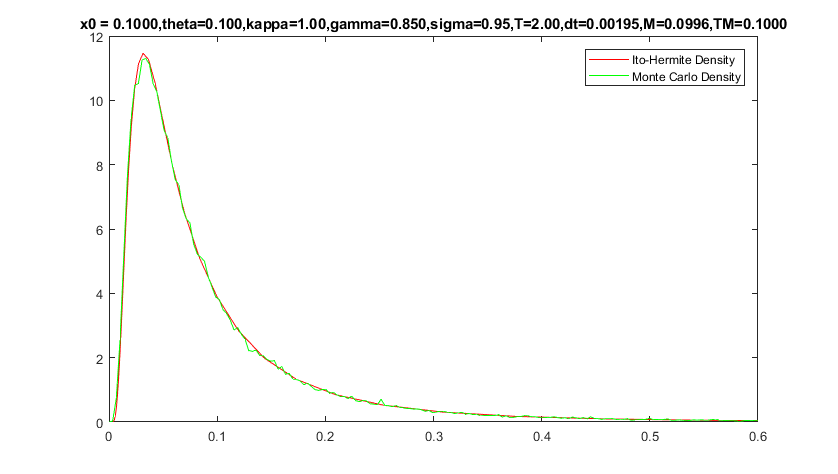](https://postimages.org/)

Again sometimes for difficult parameters SDEs, you may have to decrease step size a bit. This new program is a lot
faster than previous programs.

---

### #984 — Amin (Topic Author)
*August 20, 2020, 1:48 PM*

Please protest against use of gases by mind control agencies on innocent civilians who only want to do good research.
Read here:

https://forum.wilmott.com/viewtopic.php?f=15&t=94796&p=859944#p859944

---

### #985 — Amin (Topic Author)
*August 20, 2020, 5:35 PM*

Though my work on Fokker-Planck equation gives a reasonably nice working algorithm, it is not a completely conclusive
solution but I will still take a break from the project to move on to two other interesting projects.

First project is to complete my work on path integrals on transition probabilities grid. I have some very good ideas and
I hope that I would be able to calculate arithmetic path integrals, dz-integrals and dt-integrals for general SDEs on
transition probabilities grid. I plan to calculate transition probabilities on the same expanding/contracting grid that
I have used in the solution to Fokker-planck equations of SDEs using Ito-hermite method. Once we have solved FPE of SV
type and other SDEs, we will be able to use this project to caclulate the integrals of variance in order to plug the
variance integral values in lognormal/CEV/displaced diffusion/normal formulas to calculate the distribution of asset
price and also do more interesting analytics.

The second project is to write a general program for monte carlo simulation of SDEs with explicit time dependence. In an
earlier post I mentioned how Ito-Taylor method is equally applicable to SDEs that have an explicit time dependence in
the drift or volatility. Read here for details:

https://forum.wilmott.com/viewtopic.php?f=4&t=99702&start=885#p855709

Since I think it would be nice and valuable, I have decided to write a very general program with explicitly time
dependent coefficients. Here I have given the proposed general SDE with explicit time dependence

https://forum.wilmott.com/viewtopic.php?f=4&t=99702&start=885#p855857

I had previously made the following progress on the explicit time dependent SDEs project. Here I write the progress and
my proposed strategy to solve iterated integrals when time explicit time dependent functions are present in the SDE. As
I had mentioned, I had chosen the path of representation of time functions in the form of their Taylor series. Until now
I have been dealing with taylor series of exponential function. I have written programs for calculation of variance and
other stocahstic integrals. After calculation of variance, I re-convert the variance series back into "volatility
series" by taking the square-root of the power series. Square root of a power series usually does not exist if the first
few terms of the power series are zero which is mostly the case for the variance series but I just take some required
powers of t common out of the series so that leading term is non-zero positive and then we can take the square-root of
the variance series to convert it into a volatility series and use it again for higher order calculations of stochastic
integrals and this works very well for the exponential functions in the drift and volatility.

Please continue to follow the discussion on the thread, hopefully there is going to be more interesting stuff in coming
days.

---

### #986 — Amin (Topic Author)
*August 26, 2020, 9:04 AM*

Friends, I have had good success in calculating the arithmetic path integrals of the stochastic differential equations
on the transition probabilities grid. I have calculated transition probabilities between any two points on the
expanding/contracting/drifting grid and initial results to calculate the integrals are very good. It would not have been
easily possible if we did not have a grid that keeps probability mass constant within different subdivisions. I hope to
be posting a program tomorrow. It is a very fast program and for transition probabilities, there is no need for a
miniscule time step as we can calculate transition probabilities between grids that are eight time steps apart or
sixteen time steps apart and step size for transition probabilities grid is a multiple of time step we used to calculate
the density of SDE using fokker-planck equation solution. I hope to post a working program in another day.

---

### #987 — Amin (Topic Author)
*August 27, 2020, 4:47 PM*

I have a working program that works very well for easy densities but works not so excellent for densities where mean
changes very fast and where kappa is very high. I also still have to work out some integrals as some integrals I used
are only approximate. But I will still post the program with explanatory comments tomorrow so friends can play with it
on their own. It is a quite reasonable program but still has its shortcomings that I hope to overcome in next few days
but I will be posting the preliminary version tomorrow,

---

### #988 — Amin (Topic Author)
*August 28, 2020, 3:23 PM*

I have posted the following graphs for path integrals of the mean-reverting SDEs. The governing SDE is

$ dX(t)=\kappa (\theta- X(t)) dt+ \sigma X(t)^{\gamma} dZ(t)$

And the definition of path integral is   $PI(t+1)=PI(t)+X(t)^{\omega_1} dt$

This is different from dt-integrals as

For monte carlo simulation, I used the simple algorithm

for  t = 1:T

 fYYdt(1:paths)=fYYdt(1:paths)+.5*dt*YY(1:paths).^omega1;

YY(1:paths)=YY(1:paths)+ .....Simulation of original SDE.

fYYdt(1:paths)=fYYdt(1:paths)+.5*dt*YY(1:paths).^omega1;

end

Though my algorithm is still not final, major error is coming off a stochastic integral which I could not calculate. I
replaced it with another substitute solution which was only reasonably bad but becomes very bad at times. I am very sure
that I would solve this integral in another day or two and should not be very difficult. I had promised to post the
program so I decided to go ahead otherwise I would have liked to wait for two or three more days. I have mentioned and
pointed out this bad integral in comments in sub-function named CalculateFdtDriftAndVol04. This bad integral creates
problems with large kappa and very fast moving densities so please be patient. I am perfectly sure and promise friends
that we would be solving all different path integrals, dt-integrals and dz-integrals perfectly well in a few weeks.

I will post the matlab program with comments in next post in a few minutes.

Here are some of the graphs of path integral densities comparison of analytic path integral density and monte carlo path
integral density as we defined at start. Parameters are at title of the graph. Please notice omega1 in parameters which
is the power which defines the function used for path integrals.

[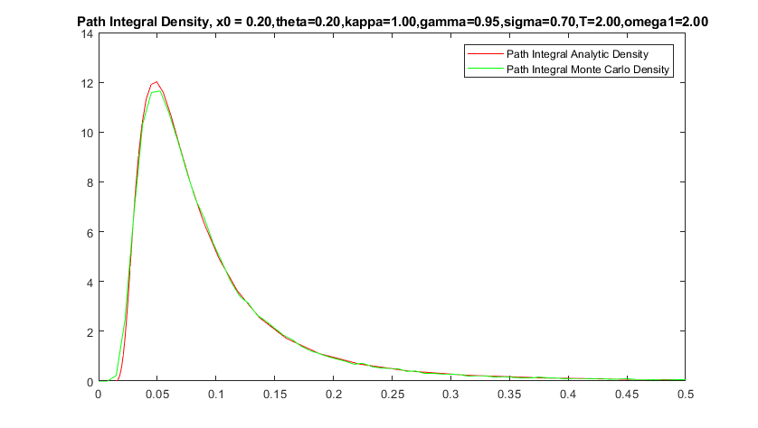](https://postimages.org/)

[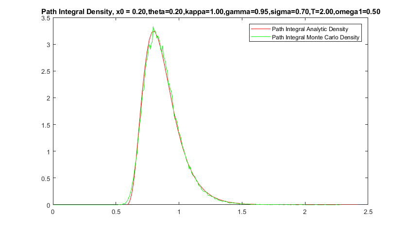](https://postimages.org/)

[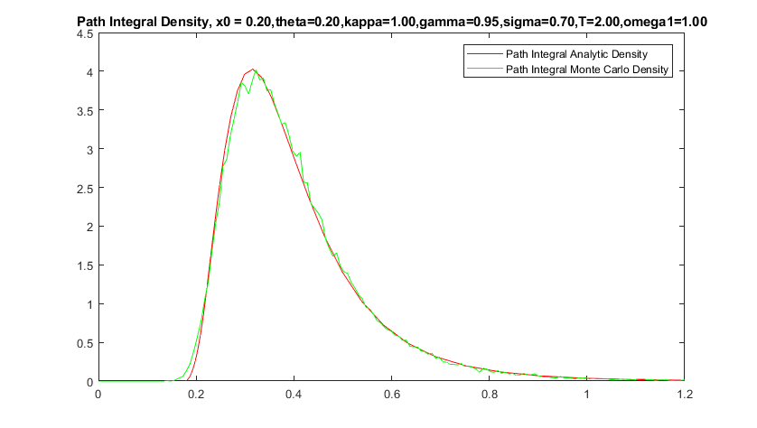](https://postimages.org/)

[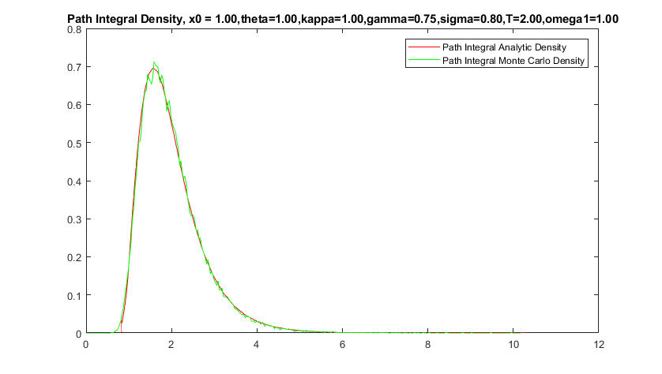](https://postimages.org/)

[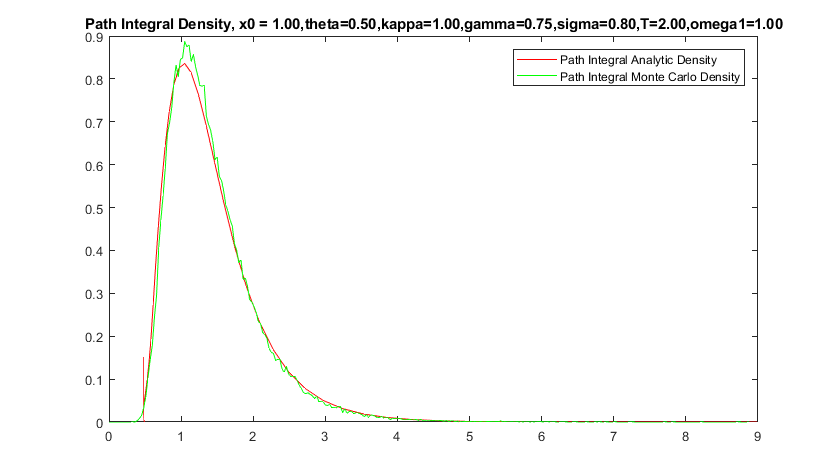](https://postimages.org/)

[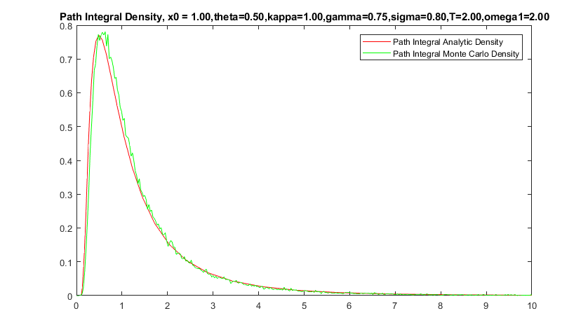](https://postimages.org/)

[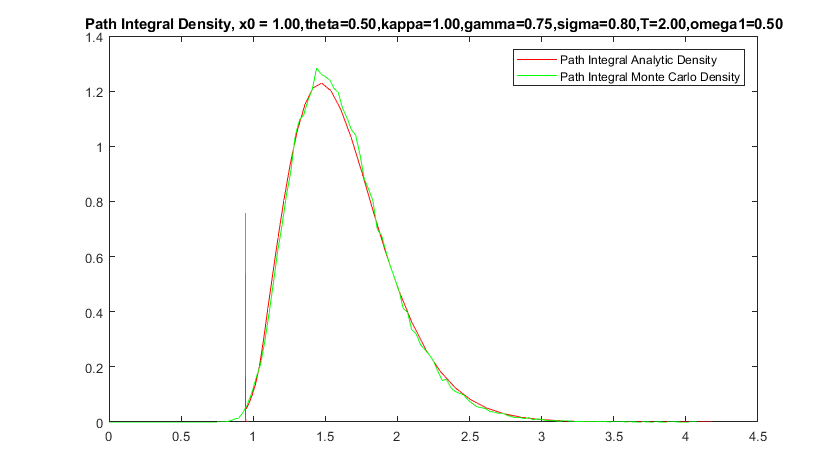](https://postimages.org/)

[](https://postimages.org/)

[](https://postimages.org/)

[](https://postimages.org/)

[](https://postimages.org/)

---

### #989 — Amin (Topic Author)
*August 28, 2020, 3:50 PM*

I am posting the program used to make graphs in the above post. Please note again as I mentioned in previous post that
there is a bad stochastic integral that affects performance. There may be one or two other minor issues but I will fix
everything in next two or three days and come with a new version. Here are the programs.

```
function [] = FPERevisitedTransProb04()

%Copyright Ahsan Amin. Infiniti derivatives Technologies.
%Please fell free to connect on linkedin: linkedin.com/in/ahsan-amin-0a53334
%or skype ahsan.amin2999
%In this program, I am simulating the SDE given as
%dy(t)=mu1 x(t)^beta1 dt + mu2 x(t)^beta2 dt +sigma x(t)^gamma dz(t)

%I have not directly simulated the SDE but simulated the transformed
%Besse1l process version of the SDE and then changed coordinates to retreive
%the SDE in original coo
%rdinates.
%The present program will analytically evolve only the Bessel Process version of the
%SDE in transformed coordinates.
%In this version, the mean correction has been disabled. If you are
%simulating standard mean-reverting SV type SDEs, please enable the mean
%correction by uncommenting the appropriate line in the body of code below.

dt=.125/16/2/2;   % Simulation time interval.%Fodiffusions close to zero
             %decrease dt for accuracy.
Tt=128*8/4*2*2;     % Number of simulation levels. Terminal time= Tt*dt; //.125/32*32*16=2 year;
%Tt=8*60;
T=Tt*dt;
OrderA=4;  %
OrderM=4;  %
%dtM=.125/8;%Monte carlo time interval size dtM.
%TtM=8*8;%Monte carlo number of simulation intervals.
dtM=dt*4*2;
TtM=Tt/4/2;

dNn=.2/1;   % Normal density subdivisions width. would change with number of subdivisions
Nn=50;  % No of normal density subdivisions
NnMidl=25;%One half density Subdivision left from mid of normal density(low)
NnMidh=26;%One half density subdivision right from the mid of normal density(high)
NnMid=4.0;

%theta=mu1/(-mu2);
%kappa=-mu2;

x0=1.0;   % starting value of SDE
beta1=0.0;
beta2=1.0;   % Second drift term power.
gamma=.95;%50;   % volatility power.
kappa=1.0;%.950;   %mean reversion parameter.
theta=1.0;%mean reversion target
sigma0=.750;%Volatility value
omega1=1.0; %power on yy(t) for fy and fyPI.
%This is yy(t)^omega1 is the function that is summed in path integral
%I have tested powers between omega1=.5 and omega1=2;
theta1=1;%This is the weight on arithmetic sum in the path integral.
%keep it equal to one otherwise results will be erroneous.
%This will be activated in future and made time dependent.

%you can specify any general mu1 and mu2 and beta1 and beta2.
mu1=+1*theta*kappa;   %first drift coefficient.
mu2=-1*kappa;    % Second drift coefficient.
%mu1=0;
%mu2=0;

alpha=1;% x^alpha is being expanded. This is currently for monte carlo only.
alpha1=1-gamma;%This is for expansion of integrals for calculation of drift
%and volatility coefficients

w(1:Nn)=x0^(1-gamma)/(1-gamma);

Z(1:Nn)=(((1:Nn)-5.5)*dNn-NnMid);

Z
str=input('Look at Z');
ZProb(1)=normcdf(.5*Z(1)+.5*Z(2),0,1)-normcdf(.5*Z(1)+.5*Z(2)-dNn,0,1);
ZProb(Nn)=normcdf(.5*Z(Nn)+.5*Z(Nn-1)+dNn,0,1)-normcdf(.5*Z(Nn)+.5*Z(Nn-1),0,1);
ZProb(2:Nn-1)=normcdf(.5*Z(2:Nn-1)+.5*Z(3:Nn),0,1)-normcdf(.5*Z(2:Nn-1)+.5*Z(1:Nn-2),0,1);
    %Above calculate probability mass in each probability subdivision.

%%%%%%%%%%%%%%%%%%%%%%%%%%%%%%%%%%%%%%%%%%%%%%%%%%%%%%%%%%%%%%%%%%%%%%%%%%%%%%%%%%%%%%%%%%%%%%

sigma11(1:OrderA+1)=0;
mu11(1:OrderA+1)=0;
mu22(1:OrderA+1)=0;
sigma22(1:OrderA+1)=0;
% index 1 correponds to zero level since matlab indexing starts at one.
sigma11(1)=1;
mu11(1)=1;
mu22(1)=1;
sigma22(1)=1;

for k=1:(OrderA+1)
    if sigma0~=0
        sigma11(k)=sigma0^(k-1);
    end
    if mu1 ~= 0
        mu11(k)=mu1^(k-1);
    end
    if mu2 ~= 0
        mu22(k)=mu2^(k-1);
    end
    if sigma0~=0
        sigma22(k)=sigma0^(2*(k-1));
    end
end
%Ft(1:TtM+1,1:(OrderA+1),1:(OrderA+1),1:(OrderA+1),1:(OrderA+1))=0; %General time powers on hermite polynomials
Fp(1:(OrderA+1),1:(OrderA+1),1:(OrderA+1),1:(OrderA+1))=0;%General x powers on coefficients of hermite polynomials.
Fp1(1:(OrderA+1),1:(OrderA+1),1:(OrderA+1),1:(OrderA+1))=0;%General x powers for bessel transformed coordinates.

%YCoeff0 and YCoeff are coefficents for original coordinates monte carlo.
%YqCoeff0 and YqCoeff are bessel/lamperti version monte carlo.

YCoeff0(1:(OrderA+1),1:(OrderA+1),1:(OrderA+1),1:(OrderA+1))=0;
YqCoeff0(1:(OrderA+1),1:(OrderA+1),1:(OrderA+1),1:(OrderA+1))=0;
%Pre-compute the time and power exponent values in small multi-dimensional arrays
YCoeff = ItoTaylorCoeffsNew(alpha,beta1,beta2,gamma); %expand y^alpha where alpha=1;
YqCoeff = ItoTaylorCoeffsNew(alpha1,beta1,beta2,gamma);%expand y^alpha1 where alpha1=(1-gamma)
YqCoeff=YqCoeff/(1-gamma); %Transformed coordinates coefficients have to be
%further divided by (1-gamma)

for k = 0 : (OrderA)
    for m = 0:k
        l4 = k - m + 1;
        for n = 0 : m
            l3 = m - n + 1;
            for j = 0:n
                l2 = n - j + 1;
                l1 = j + 1;
                %Ft(l1,l2,l3,l4) = dtM^((l1-1) + (l2-1) + (l3-1) + .5* (l4-1));
                Fp(l1,l2,l3,l4) = (alpha + (l1-1) * beta1 + (l2-1) * beta2 + (l3-1) * 2* gamma + (l4-1) * gamma ...
                    - (l1-1) - (l2-1) - 2* (l3-1) - (l4-1));
                Fp1(l1,l2,l3,l4) = (alpha1 + (l1-1) * beta1 + (l2-1) * beta2 + (l3-1) * 2* gamma + (l4-1) * gamma ...
                    - (l1-1) - (l2-1) - 2* (l3-1) - (l4-1));

                YCoeff0(l1,l2,l3,l4) =YCoeff(l1,l2,l3,l4).*mu11(l1).*mu22(l2).*sigma22(l3).*sigma11(l4);
                YqCoeff0(l1,l2,l3,l4) =YqCoeff(l1,l2,l3,l4).*mu11(l1).*mu22(l2).*sigma22(l3).*sigma11(l4);
            end
        end
    end
end

%%%%%%%%%%%%%%%%%%%%%%%%%%%%%%%%%%%%%%%%%%%%%%%%%%%%%%%%%%%%%%%%%%%%%%%%%%%%%%%%%%%%%%%%%%%%%%

ss=0;  %ss is index for transition probability calculation time steps.
Freq=8.0;%transition probabilities are calculated Freq time intervals apart.
wnStart=1;%
d2wdZ2(1:Nn)=0;
d2wdZ2A(1:Nn)=0;
dwdZ(1:Nn)=0;
yy(wnStart:Nn)=((1-gamma)*w(wnStart:Nn)).^(1/(1-gamma));
%The above yy(wnStart:Nn)=x0;

   Pprev(1:Nn)=ZProb(1:Nn);%probability mass at starting node.
   Pnew(1:Nn)=0.0;
   Efprev(1:Nn)=theta1*yy(1:Nn).^omega1.*ZProb(1:Nn);%value of function at
   %starting nodes.
   Efnew(1:Nn)=0;
   Eyyprev(1:Nn)=yy(1:Nn).*ZProb(1:Nn);%Value of SDE variable in original
   %coordinates at starting nodes.
   Eyynew(1:Nn)=0;
   Efdtprev(1:Nn)=0;%Value of path-integral at starting nodes is zero.
   Efdtnew(1:Nn)=0;

tic

for tt=1:Tt
    yy(wnStart:Nn)=((1-gamma)*w(wnStart:Nn)).^(1/(1-gamma));
    [wMu0dt,dwMu0dtdw,c1] = CalculateDriftAndVolA4(w,wnStart,Nn,YqCoeff0,Fp1,gamma,dt);
    dw(wnStart:Nn)=c1(wnStart:Nn).*Z(wnStart:Nn) ;% ...
    %dw(wnStart:Nn)=sigma0.*sqrt(dt).*Z(wnStart:Nn) ;
    dw2(wnStart:Nn)=dw(wnStart:Nn).^2;
    w(isnan(w)==1)=0;
    wMu0dt(isnan(wMu0dt)==1)=0;
    %wMeanPrev=sum(ZProb(wnStart:Nn).*w(wnStart:Nn));%Calculate the mean.
%%%%%%%%%%%%%%%%%%%%%%%%%%%%%%%%%%%%%%%%%%%%%%%%%%%%%%%%%%%%%%%%%%%%%%%%%%%

%     [dwdZ,d2wdZ2A,d3wdZ3A] = First3Derivatives2ndOrderEqSpacedA(wnStart,Nn,dNn,w,Z);
%     d2wdZ2(wnStart:Nn)=0.0;
%     d3wdZ3(wnStart:Nn)=0.0;
%     if (tt>36)
%         d3wdZ3(wnStart:Nn) = (d3wdZ3A(wnStart:Nn));
%         d2wdZ2(wnStart:Nn)=d2wdZ2A(wnStart:Nn);
%         d2wdZ2(1:15)=d2wdZ2(1:15).*exp(-12*kappa^2*(1-gamma).*dNn*(15-(1:15)));
%         d3wdZ3(1:15)=d3wdZ3(1:15).*exp(-12*kappa^2*(1-gamma).*dNn*(15-(1:15)));
%
%     end

%tt
%plot((wnStart:Nn),d2wdZ2A(wnStart:Nn),'g',(wnStart:Nn),d2wdZ2(wnStart:Nn),'r');
%str=input('Look at d2wdZ2A(wnStart:Nn)');

%If the calculation of the program blows, it means that above calculated
%derivative is unstable or bad. Plese replace with your favourite method of
%calculating this second derivative.

    dZdw(wnStart:Nn)=1.0./dwdZ(wnStart:Nn);
    if(tt==1)
        wMeanPrev=sum(ZProb(wnStart:Nn).*w(wnStart:Nn));

        w(wnStart:Nn)=wMeanPrev+wMu0dt(wnStart:Nn)+ ...
            sign(w(wnStart:Nn)-wMeanPrev+dw(wnStart:Nn)).* ...
            sqrt(abs(sign(w(wnStart:Nn)-wMeanPrev).*(w(wnStart:Nn)-wMeanPrev).^2+ ...
            sign(dw(wnStart:Nn)).*dw2(wnStart:Nn)));
    end
    if(tt>1)

        C22(wnStart:Nn)=.0125/pi*25.0;
        C33(wnStart:Nn)=.0125/pi*2;
        C44(wnStart:Nn)=.0125/pi*25.0;

        C22(wnStart:Nn)=.0125/pi*25.0*1.5;
        C33(wnStart:Nn)=.0125/pi*2*1.0;
        C44(wnStart:Nn)=.0125/pi*25.0*1.5;

        TermA0(wnStart:Nn)=-C22(wnStart:Nn).*3.*Z(wnStart:Nn).^1.*dZdw(wnStart:Nn).*d2wdZ2(wnStart:Nn)*sigma0^2.*dt +
...
           
+C44(wnStart:Nn).*(-d3wdZ3(wnStart:Nn).*dZdw(wnStart:Nn)+3*d2wdZ2(wnStart:Nn).^2.*dZdw(wnStart:Nn).^2)*sigma0^2.*dt+ ...
            -C33(wnStart:Nn).*dwMu0dtdw(wnStart:Nn).*dwdZ(wnStart:Nn).^2;

        TermA(wnStart:Nn)= sqrt(abs(TermA0(wnStart:Nn)));
        SignTermA(wnStart:Nn)=sign(TermA0(wnStart:Nn));

        w(wnStart:Nn)=w(wnStart:Nn)+wMu0dt(wnStart:Nn)+(-(Z(wnStart:Nn).*dwdZ(wnStart:Nn))+d2wdZ2(wnStart:Nn))+ ...
           
sign((Z(wnStart:Nn).*dwdZ(wnStart:Nn))-d2wdZ2(wnStart:Nn)+dw(wnStart:Nn)+SignTermA(wnStart:Nn).*TermA(wnStart:Nn)).* ...
            sqrt(abs(sign((Z(wnStart:Nn).*dwdZ(wnStart:Nn))-d2wdZ2(wnStart:Nn)).* ...
            ((Z(wnStart:Nn).*dwdZ(wnStart:Nn))-d2wdZ2(wnStart:Nn)).^2+ ...
            sign(+dw(wnStart:Nn)).*dw2(wnStart:Nn)+ ...
            SignTermA(wnStart:Nn).*TermA(wnStart:Nn).^2));% + ...
    end

%%%%%%%%%%%%%%%%%%%%%%%%%%%%%%%%%%%%%%%%%%%%%%%%%%%%%%%%%%%%%%%%%%%%%%%%%%%
%Below are instability correction equations.
%Interpolation of three points in instability region with lagrange
%polynomials.

    w(NnMidl) =
InterpolateOrderN8(8,Z(NnMidl),Z(NnMidl-4),Z(NnMidl-3),Z(NnMidl-2),Z(NnMidl-1),Z(NnMidh+2),Z(NnMidh+3),Z(NnMidh+4),Z(NnMidh+5),w(NnMidl-4),w(NnMidl-3),w(NnMidl-2),w(NnMidl-1),w(NnMidh+2),w(NnMidh+3),w(NnMidh+4),w(NnMidh+5));
    w(NnMidh) =
InterpolateOrderN8(8,Z(NnMidh),Z(NnMidl-4),Z(NnMidl-3),Z(NnMidl-2),Z(NnMidl-1),Z(NnMidh+2),Z(NnMidh+3),Z(NnMidh+4),Z(NnMidh+5),w(NnMidl-4),w(NnMidl-3),w(NnMidl-2),w(NnMidl-1),w(NnMidh+2),w(NnMidh+3),w(NnMidh+4),w(NnMidh+5));
    w(NnMidh+1) =
InterpolateOrderN8(8,Z(NnMidh+1),Z(NnMidl-4),Z(NnMidl-3),Z(NnMidl-2),Z(NnMidl-1),Z(NnMidh+2),Z(NnMidh+3),Z(NnMidh+4),Z(NnMidh+5),w(NnMidl-4),w(NnMidl-3),w(NnMidl-2),w(NnMidl-1),w(NnMidh+2),w(NnMidh+3),w(NnMidh+4),w(NnMidh+5));

    [wE] =
InterpolateOrderN6(6,Z(Nn)+dNn,Z(Nn),Z(Nn-1),Z(Nn-2),Z(Nn-3),Z(Nn-4),Z(Nn-5),w(Nn),w(Nn-1),w(Nn-2),w(Nn-3),w(Nn-4),w(Nn-5));

    w1(1:Nn-1)=w(1:Nn-1);
    w1(Nn)=w(Nn);
    w2(1:Nn-1)=w(2:Nn);
    w2(Nn)=wE;
    w(w1(:)>w2(:))=0;%Be careful;might not universally hold;
     %Change 3:7/25/2020: I have improved zero correction in above.
    w(w36)
        d3wdZ3(wnStart:Nn) = (d3wdZ3A(wnStart:Nn));
        d2wdZ2(wnStart:Nn)=d2wdZ2A(wnStart:Nn);
        d2wdZ2(1:15)=d2wdZ2(1:15).*exp(-12*kappa^2*(1-gamma).*dNn*(15-(1:15)));
        d3wdZ3(1:15)=d3wdZ3(1:15).*exp(-12*kappa^2*(1-gamma).*dNn*(15-(1:15)));

    end

  %Start of functions and path integrals calculations
  %For transition probabilities calculations, the time grid is Freq intervals apart.
  % so time interval ds for transition probability calculation is
  % ds=dt*Freq; and t1A is start time for transition probabilities interval
  % while t2A is end time of transition probabilities calculation interval.
  % so t2A=t1A+ds; W1 is the bessel coordinates value w at t1A and W2 is
  % equal to w at t2A. W1=w(t1A) and W2=w(t2A). W1 and W2 are used for
  % transition probabilities calculations.

    if(tt==1)

        W1(1:Nn)=x0^(1-gamma)/(1-gamma);

        ds=dt*Freq;
        t1A=0;
        t2A=ds;
        %below calculates integrals for drift and volatility for transition
        %probabilities.
        [wMu0dt2,dwMu0dt2,dw02]=CalculateDriftAndVol(mu1,mu2,beta1,beta2,gamma,sigma0,W1,1,Nn,ds);
        %below calculates integrals for drift and volatility for yy(t).
        %yy(t) is the SDE variable in original coordinates as opposed to
        %bessel coordinates.
        [yyMu0dt,dyyz0,dyy2z0]=CalculateFunctionDriftAndVol(1.0,1.0,mu1,mu2,beta1,beta2,gamma,sigma0,W1,wnStart,Nn,ds);
        %below calculates integrals for drift and volatility for
        %yy(t)^omega1 which is used in Ito change of variable calculations
        %on the lattice. This is not needed for path integrals.

       
[fMu0dt,dfz0,df2z0]=CalculateFunctionDriftAndVol(theta1,omega1,mu1,mu2,beta1,beta2,gamma,sigma0,W1,wnStart,Nn,ds);

        %below calculates integrals for drift and volatility for
        %yy(s)^omega1 ds. which is used in path integrals calculations
        %on the lattice.
       
[fdtMu0dt,dfdtz01,dfdt2z02]=CalculateFdtDriftAndVol04(theta1,omega1,mu1,mu2,beta1,beta2,gamma,sigma0,W1,wnStart,Nn,ds,t1A,t2A);

    end

    if(rem(tt,Freq)==0)

        %When this above condition is true it means that we are at end of
        %particular transition probability interval and we have end of
        %interval W2(s)=w(t) while we will use the value W1 that was
        %previously saved Freq dt time intervals earlier or ds=Freq*dt
        %time ago.

        ss=ss+1; %transition loop variable and is one at the end of first
        %transition probability interval.

        W2(1:Nn)=w(1:Nn);
        ds=dt*Freq;
        dW2(2:Nn-1)=(W2(3:Nn)-W2(1:Nn-2))/2.0;%For calculation of width of
        %interval for integrated probability.
        dW2(1)=dW2(2);%rough approximation, will change
        dW2(Nn)=dW2(Nn-1);%rough approximation, will change
        yy1(1:Nn)=((1-gamma)*W1(1:Nn)).^(1/(1-gamma));%Value in origianl
        %coordinates at the start of transition probabilities interval.
        yy2(1:Nn)=((1-gamma)*W2(1:Nn)).^(1/(1-gamma));%Value in origianl
        %coordinates at the end of transition probabilities interval.
        fyy1(1:Nn)=theta1.*yy1(1:Nn).^omega1;%function value at the start
        %both for Ito calculation of function and path integrals.
        fyy2(1:Nn)=theta1.*yy2(1:Nn).^omega1;%function value at the end
        %both for Ito calculation of function and path integrals.

        for mm=1:Nn
            %Below is the gaussian increment between two grid points W1(mm)
            % at time t1A and W2(wnStart:Nn) at time t2A, backed
            %out from the original stochastic differential equation drift
            %and volatility. This gaussian increment is used for
            %probability calculation between corresponding grid points and
            %also for calculation of stochastic integrals between the
            %corresponding grid points. Please note that this gaussian
            %increment remains the same in bessel coordinates and the
            %original coordinates
            Zt(mm,wnStart:Nn)=(W2(wnStart:Nn)-W1(mm)-1*wMu0dt2(mm))/dw02(mm);
            %Below is calculation of transition probability between two
            %grid points W1(mm)  at time t1A and W2(wnStart:Nn) at time t2A
            %using the gaussian increment preeviously calculated.
            pt(mm,wnStart:Nn)=exp(-.5* Zt(mm,wnStart:Nn).^2)./sqrt(2*pi*dw02(mm).^2).*dW2(wnStart:Nn);
            pt(isnan(pt(mm,:))==1)=0;
            pt(isinf(pt(mm,:))==1)=0;
            %Below is the counterpart of original SDE that is used for the
            %evolution of expcted value of yy(t). It is totally independent
            %for its own sake and is not needed for any function or
            %path integral calculations.
            dyyGenerator(mm,wnStart:Nn)=yyMu0dt(mm)+dyyz0(mm).*Zt(mm,wnStart:Nn)+dyy2z0(mm).*(Zt(mm,wnStart:Nn).^2-1);

            %Below is the Ito-generator for fy=theta1*yy(t).^omega1 which
            %is used for the evolution of expected value of fy and this is
            %totally independent for its own sake and is not needed in any
            %other calculations.
            dfGenerator(mm,wnStart:Nn)=fMu0dt(mm)+dfz0(mm).*Zt(mm,wnStart:Nn)+df2z0(mm).*(Zt(mm,wnStart:Nn).^2-1);

            %Below is the the relevant generator that is used to subtract
            %noise/variance from the path integral so as to match monte
            %carlo density. Please note that this uses the gaussian
            %increment between two grid points at different times that we
            %calculated at start.
            dfdtGenerator(mm,wnStart:Nn)=-(dfdtz01(mm)).*Zt(mm,wnStart:Nn)-1*dfdt2z02(mm).*(Zt(mm,wnStart:Nn).^2-1);
            %Below is the evolution equation for evolution of probability
            %density. Ideally Pprev(mm)=Pnew(mm)=ZProb(mm) that we started
            %with since probability in each subdivision does not change but
            %these Pnew and ZProb can be different at both extreme ends and
            %sometimes results would be better when we would use Pnew to
            %calculate the original variables from expectations by division
            %of probability since the expectation of original variables
            %used the same transition probabilities as were used for Pnew.
            Pnew(wnStart:Nn)=Pnew(wnStart:Nn)+Pprev(mm).*pt(mm,wnStart:Nn);
            %Below is evolution of expectation of yy(t) in original
            %coordinates in our set up. This is not needed for anything but
            %is a useful exercise
            Eyynew(wnStart:Nn)=Eyynew(wnStart:Nn)+Eyyprev(mm).*pt(mm,wnStart:Nn)+ ...
               dyyGenerator(mm,wnStart:Nn).*pt(mm,wnStart:Nn).*Pprev(mm);
           %Below is evolution of expectation of yy(t)^omega1 in original
            %coordinates in our set up. This is not needed for anything but
            %is a useful exercise. This is counterpart of Ito change of
            %variable
            Efnew(wnStart:Nn)=Efnew(wnStart:Nn)+Efprev(mm).*pt(mm,wnStart:Nn)+ ...
               dfGenerator(mm,wnStart:Nn).*pt(mm,wnStart:Nn).*Pprev(mm);
            %Below is the calculation of path integrals.
            if((ss==1))
                %Below calculate the function value and save it in the same
                %grid point. It will continue to evolve in the same grid
                %point till end.
                Efdtnew(mm)=Efdtnew(mm)+Efdtprev(mm)+ds*.5*yy1(mm).^omega1.*ZProb(mm);
                %Below subtract the volatility needed. This uses both the
                %gaussian increment and transition probabilities between
                %grid points at different time.
                Efdtnew(wnStart:Nn)=Efdtnew(wnStart:Nn)+ ...
                   1.0/pi^2*dfdtGenerator(mm,wnStart:Nn).*pt(mm,wnStart:Nn).*ZProb(mm);
            elseif ((ss==Tt/Freq))
                %Below calculate the function value and save it in the same
                %grid point. It will continue to evolve in the same grid
                %point till end.
                Efdtnew(mm)=Efdtnew(mm)+Efdtprev(mm)+ds*yy1(mm).^omega1.*ZProb(mm) ;
                %Below subtract the volatility needed. This uses both the
                %gaussian increment and transition probabilities between
                %grid points at different time.

                Efdtnew(wnStart:Nn)=Efdtnew(wnStart:Nn)+ds*(.5*yy2(wnStart:Nn).^omega1).*pt(mm,wnStart:Nn).*ZProb(mm)+
...
                    .50/pi^2*dfdtGenerator(mm,wnStart:Nn).*pt(mm,wnStart:Nn).*ZProb(mm);

            else
                %Below calculate the function value and save it in the same
                %grid point. It will continue to evolve in the same grid
                %point till end.
                Efdtnew(mm)=Efdtnew(mm)+Efdtprev(mm)+ds*yy1(mm).^omega1.*ZProb(mm);
                %Below subtract the volatility needed. This uses both the
                %gaussian increment and transition probabilities between
                %grid points at different time.

                Efdtnew(wnStart:Nn)=Efdtnew(wnStart:Nn)+ ...
                    1.0/pi^2*dfdtGenerator(mm,wnStart:Nn).*pt(mm,wnStart:Nn).*ZProb(mm);
            end

        end
       Pprev(1:Nn)=Pnew(1:Nn);
       Efprev(1:Nn)=Efnew(1:Nn);
       Eyyprev(1:Nn)=Eyynew(1:Nn);
       Efdtprev(1:Nn)=Efdtnew(1:Nn);
       Pnew(1:Nn)=0;
       Efnew(1:Nn)=0.0;
       Eyynew(1:Nn)=0.0;
       Efdtnew(1:Nn)=0.0;

       %Below calculate the start and end time t1A and t2A for the next
       %transition probability time intervals.
       t1A=(ss)*ds;
       t2A=(ss+1)*ds;
        %Below set the starting value W1 for next time interval equal to end
        %value of the current time interval W2 and calculate various
        %integrals. All these integrals only need the starting value W1
        W1(1:Nn)=W2(1:Nn);
       
[fdtMu0dt,dfdtz01,dfdt2z02]=CalculateFdtDriftAndVol04(theta1,omega1,mu1,mu2,beta1,beta2,gamma,sigma0,W1,wnStart,Nn,ds,t1A,t2A);
        [wMu0dt2,dwMu0dt2,dw02]=CalculateDriftAndVol(mu1,mu2,beta1,beta2,gamma,sigma0,W1,1,Nn,ds);
        [yyMu0dt,dyyz0,dyy2z0]=CalculateFunctionDriftAndVol(1.0,1.0,mu1,mu2,beta1,beta2,gamma,sigma0,W1,wnStart,Nn,ds);
       
[fMu0dt,dfz0,df2z0]=CalculateFunctionDriftAndVol(theta1,omega1,mu1,mu2,beta1,beta2,gamma,sigma0,W1,wnStart,Nn,ds);
    end

end
Pnew=Pprev;
Efnew=Efprev;
Eyynew=Eyyprev;
Efdtnew=Efdtprev;

yy(wnStart:Nn)=((1-gamma)*w(wnStart:Nn)).^(1/(1-gamma));
%Below calculate value of yy obtained from expected value in transition
%probabilities framework after division of expected value with
%integrated probability. This value is called yyTr
yyTr(wnStart:Nn)=Eyynew(wnStart:Nn)./Pnew(wnStart:Nn)  ;

%plot((wnStart:Nn),yy(wnStart:Nn),'g',(wnStart:Nn),yyTr(wnStart:Nn),'b');

%str=input('Look at graph 01');

%Below calculate value of yy(T)^omega1 obtained from its expected value in
%transition probabilities framework after division of expected value with
%integrated probability. This value is called ffy

ffy(wnStart:Nn)=(Efnew(wnStart:Nn))./Pnew(wnStart:Nn);

%plot((wnStart:Nn),theta1.*yy(wnStart:Nn).^omega1,'g',(wnStart:Nn),ffy(wnStart:Nn),'b');
%str=input('Look at graph 02');

%Convert the expected values in each cell to standard Values
%associated with the grid cell after removing the
%integrated probability in the cell.Above for fy ito process. below
%for arithmetic sum path integral process.

%Below we repeat the process for path integral density
fydt(wnStart:Nn)=Efdtnew(wnStart:Nn)./ZProb(wnStart:Nn);

%below D's (the names of variables starting with D) are
%change of probability derivatives.
%Dfy_w(wmStart:wmEnd)=0;
Dffy(1:Nn)=0;
Dfydt(1:Nn)=0;
DyyTr(wnStart:Nn)=0.0;
for mm=wnStart+1:Nn-1
    Dffy(mm) = (ffy(mm + 1) - ffy(mm - 1))/(Z(mm + 1) - Z(mm - 1));
    Dfydt(mm) = (fydt(mm + 1) - fydt(mm - 1))/(Z(mm + 1) - Z(mm - 1));
    DyyTr(mm) = (yyTr(mm + 1) - yyTr(mm - 1))/(Z(mm + 1) - Z(mm - 1));
end

%below pfy and pfydt are respective density amplitudes.
pfy(1:Nn)=0;
pfydt(1:Nn)=0;
pyyTr(1:Nn)=0.0;
for mm = wnStart+1:Nn-1
    pfy(mm) = (normpdf(Z(mm),0, 1))/abs(Dffy(mm));
    pfydt(mm) = (normpdf(Z(mm),0, 1))/abs(Dfydt(mm));
    pyyTr(mm) = Pnew(mm)/abs(yyTr(mm+1)-yyTr(mm-1))*2;
end

y_w(1:Nn)=0;
y_w(wnStart:Nn) = ((1-gamma)*w(wnStart:Nn)).^(1/(1-gamma));
Dfy_w(wnStart:Nn)=0;
Dfw(wnStart:Nn)=0;
for nn=wnStart+1:Nn-1
    Dfy_w(nn) = (y_w(nn + 1) - y_w(nn - 1))/(Z(nn + 1) - Z(nn - 1));
    Dfw(nn) = (w(nn + 1) - w(nn - 1))/(Z(nn + 1) - Z(nn - 1));
    %Change of variable derivative for densities
end
py_w(1:Nn)=0;
pw(1:Nn)=0;
for nn = wnStart:Nn-1
    py_w(nn) = (normpdf(Z(nn),0, 1))/abs(Dfy_w(nn));%Origianl coordinates density
    pw(nn) = (normpdf(Z(nn),0, 1))/abs(Dfw(nn));
end

toc

ItoHermiteMean=sum(y_w(wnStart+1:Nn-1).*ZProb(wnStart+1:Nn-1)) %Original process average from coordinates
disp('true Mean only applicable to standard SV mean reverting type models otherwise disregard');
TrueMean=theta+(x0-theta)*exp(-kappa*dt*Tt)%Mean reverting SDE original variable true average

theta1=1;
rng(29079137, 'twister')
paths=100000;
YY(1:paths)=x0;  %Original process monte carlo.
fYYdt(1:paths)=0.0;
Random1(1:paths)=0;
YYMean(1:TtM)=0;
for tt=1:TtM
    t1M=(tt-1)*dtM;
    t2M=tt*dtM;
    Random1=randn(size(Random1));
    HermiteP1(1,1:paths)=1;
    HermiteP1(2,1:paths)=Random1(1:paths);
    HermiteP1(3,1:paths)=Random1(1:paths).^2-1;
    HermiteP1(4,1:paths)=Random1(1:paths).^3-3*Random1(1:paths);
    HermiteP1(5,1:paths)=Random1(1:paths).^4-6*Random1(1:paths).^2+3;

    YYPrev(1:paths)=YY(1:paths);

    fYYdt(1:paths)=fYYdt(1:paths)+.5*dtM*YY(1:paths).^omega1;

    YY(1:paths)=YY(1:paths) + ...
        (YCoeff0(1,1,2,1).*YY(1:paths).^Fp(1,1,2,1)+ ...
        YCoeff0(1,2,1,1).*YY(1:paths).^Fp(1,2,1,1)+ ...
        YCoeff0(2,1,1,1).*YY(1:paths).^Fp(2,1,1,1))*dtM + ...
        (YCoeff0(1,1,3,1).*YY(1:paths).^Fp(1,1,3,1)+ ...
        YCoeff0(1,2,2,1).*YY(1:paths).^Fp(1,2,2,1)+ ...
        YCoeff0(2,1,2,1).*YY(1:paths).^Fp(2,1,2,1)+ ...
        YCoeff0(1,3,1,1).*YY(1:paths).^Fp(1,3,1,1)+ ...
        YCoeff0(2,2,1,1).*YY(1:paths).^Fp(2,2,1,1)+ ...
        YCoeff0(3,1,1,1).*YY(1:paths).^Fp(3,1,1,1))*dtM^2 + ...
        ((YCoeff0(1,1,1,2).*YY(1:paths).^Fp(1,1,1,2).*sqrt(dtM))+ ...
        (YCoeff0(1,1,2,2).*YY(1:paths).^Fp(1,1,2,2)+ ...
        YCoeff0(1,2,1,2).*YY(1:paths).^Fp(1,2,1,2)+ ...
        YCoeff0(2,1,1,2).*YY(1:paths).^Fp(2,1,1,2)).*dtM^1.5) .*HermiteP1(2,1:paths) + ...
        ((YCoeff0(1,1,1,3).*YY(1:paths).^Fp(1,1,1,3) *dtM) + ...
        (YCoeff0(1,1,2,3).*YY(1:paths).^Fp(1,1,2,3)+ ...
        YCoeff0(1,2,1,3).*YY(1:paths).^Fp(1,2,1,3)+ ...
        YCoeff0(2,1,1,3).*YY(1:paths).^Fp(2,1,1,3)).*dtM^2).*HermiteP1(3,1:paths) + ...
        ((YCoeff0(1,1,1,4).*YY(1:paths).^Fp(1,1,1,4)*dtM^1.5 )).*HermiteP1(4,1:paths) + ...
        (YCoeff0(1,1,1,5).*YY(1:paths).^Fp(1,1,1,5)*dtM^2.0).*HermiteP1(5,1:paths);

    %fYYdt(1:paths)=fYYdt(1:paths)+ t2M.*YY(1:paths).^omega1-t1M.*YYPrev(1:paths).^omega1- ...
    %5(omega1.*YYPrev(1:paths).^(omega1-1).*(mu1*YYPrev(1:paths).^beta1+ mu2*YYPrev(1:paths).^beta2) + ...
    %    .5*omega1.*(omega1-1).*YYPrev(1:paths).^(omega1-2).*sigma0^2.*YYPrev(1:paths).^(2*gamma))*(t2M^2-t1M^2)/2.0 -
...
    %   
omega1.*YYPrev(1:paths).^(omega1-1).*(sigma0.*YYPrev(1:paths).^gamma).*sqrt((t2M^3.0-t1M^3.0)/3).*HermiteP1(2,1:paths);

    fYYdt(1:paths)=fYYdt(1:paths)+.5*dtM*YY(1:paths).^omega1;

%Uncomment for fourth order monte carlo

%
%   YY(1:paths)=YY(1:paths) + ...
%       (YCoeff0(1,1,2,1).*YY(1:paths).^Fp(1,1,2,1)+YCoeff0(1,2,1,1).*YY(1:paths).^Fp(1,2,1,1)+ ...
%       YCoeff0(2,1,1,1).*YY(1:paths).^Fp(2,1,1,1))*dtM + ...
%       (YCoeff0(1,1,3,1).*YY(1:paths).^Fp(1,1,3,1)+YCoeff0(1,2,2,1).*YY(1:paths).^Fp(1,2,2,1)+ ...
%       YCoeff0(2,1,2,1).*YY(1:paths).^Fp(2,1,2,1)+YCoeff0(1,3,1,1).*YY(1:paths).^Fp(1,3,1,1)+ ...
%       YCoeff0(2,2,1,1).*YY(1:paths).^Fp(2,2,1,1)+YCoeff0(3,1,1,1).*YY(1:paths).^Fp(3,1,1,1))*dtM^2 + ...
%       (YCoeff0(1,1,4,1).*YY(1:paths).^Fp(1,1,4,1)+YCoeff0(1,2,3,1).*YY(1:paths).^Fp(1,2,3,1)+ ...
%       YCoeff0(2,1,3,1).*YY(1:paths).^Fp(2,1,3,1)+YCoeff0(1,3,2,1).*YY(1:paths).^Fp(1,3,2,1)+ ...
%       YCoeff0(2,2,2,1).*YY(1:paths).^Fp(2,2,2,1)+YCoeff0(3,1,2,1).*YY(1:paths).^Fp(3,1,2,1)+ ...
%       YCoeff0(1,4,1,1).*YY(1:paths).^Fp(1,4,1,1)+YCoeff0(2,3,1,1).*YY(1:paths).^Fp(2,3,1,1)+ ...
%       YCoeff0(3,2,1,1).*YY(1:paths).^Fp(3,2,1,1)+YCoeff0(4,1,1,1).*YY(1:paths).^Fp(4,1,1,1))*dtM^3 + ...
%        (YCoeff0(1,1,5,1).*YY(1:paths).^Fp(1,1,5,1)+YCoeff0(1,2,4,1).*YY(1:paths).^Fp(1,2,4,1)+ ...
%     YCoeff0(2,1,4,1).*YY(1:paths).^Fp(2,1,4,1)+YCoeff0(2,1,1,1).*YY(1:paths).^Fp(2,1,1,1)+ ...
%      YCoeff0(2,2,3,1).*YY(1:paths).^Fp(2,2,3,1)+ ...
%      YCoeff0(3,1,3,1).*YY(1:paths).^Fp(3,1,3,1)+YCoeff0(1,4,2,1).*YY(1:paths).^Fp(1,4,2,1)+ ...
%      YCoeff0(2,3,2,1).*YY(1:paths).^Fp(2,3,2,1)+YCoeff0(3,2,2,1).*YY(1:paths).^Fp(3,2,2,1)+ ...
%      YCoeff0(4,1,2,1).*YY(1:paths).^Fp(4,1,2,1)+YCoeff0(1,5,1,1).*YY(1:paths).^Fp(1,5,1,1)+ ...
%      YCoeff0(2,4,1,1).*YY(1:paths).^Fp(2,4,1,1)+ ...
%      YCoeff0(3,3,1,1).*YY(1:paths).^Fp(3,3,1,1)+YCoeff0(4,2,1,1).*YY(1:paths).^Fp(4,2,1,1)+ ...
%      YCoeff0(5,1,1,1).*YY(1:paths).^Fp(5,1,1,1))*dtM^4+ ...
%       ((YCoeff0(1,1,1,2).*YY(1:paths).^Fp(1,1,1,2).*sqrt(dtM))+ ...
%     (YCoeff0(1,1,2,2).*YY(1:paths).^Fp(1,1,2,2)+YCoeff0(1,2,1,2).*YY(1:paths).^Fp(1,2,1,2)+ ...
%     YCoeff0(2,1,1,2).*YY(1:paths).^Fp(2,1,1,2)).*dtM^1.5+ ...
%     (YCoeff0(1,1,3,2).*YY(1:paths).^Fp(1,1,3,2)+YCoeff0(1,2,2,2).*YY(1:paths).^Fp(1,2,2,2)+ ...
%     YCoeff0(2,1,2,2).*YY(1:paths).^Fp(2,1,2,2)+YCoeff0(1,3,1,2).*YY(1:paths).^Fp(1,3,1,2)+ ...
%     YCoeff0(2,2,1,2).*YY(1:paths).^Fp(2,2,1,2)+YCoeff0(3,1,1,2).*YY(1:paths).^Fp(3,1,1,2)).*dtM^2.5+ ...
%     (YCoeff0(1,1,4,2).*YY(1:paths).^Fp(1,1,4,2)+YCoeff0(1,2,3,2).*YY(1:paths).^Fp(1,2,3,2)+ ...
%     YCoeff0(2,1,3,2).*YY(1:paths).^Fp(2,1,3,2)+YCoeff0(1,3,2,2).*YY(1:paths).^Fp(1,3,2,2)+ ...
%     YCoeff0(2,2,2,2).*YY(1:paths).^Fp(2,2,2,2)+ YCoeff0(3,1,2,2).*YY(1:paths).^Fp(3,1,2,2)+ ...
%     YCoeff0(1,4,1,2).*YY(1:paths).^Fp(1,4,1,2)+YCoeff0(2,3,1,2).*YY(1:paths).^Fp(2,3,1,2)+ ...
%     YCoeff0(3,2,1,2).*YY(1:paths).^Fp(3,2,1,2)+YCoeff0(4,1,1,2).*YY(1:paths).^Fp(4,1,1,2)).*dtM^3.5)
.*HermiteP1(2,1:paths) + ...
%     ((YCoeff0(1,1,1,3).*YY(1:paths).^Fp(1,1,1,3) *dtM) + ...
%     (YCoeff0(1,1,2,3).*YY(1:paths).^Fp(1,1,2,3)+YCoeff0(1,2,1,3).*YY(1:paths).^Fp(1,2,1,3)+ ...
%     YCoeff0(2,1,1,3).*YY(1:paths).^Fp(2,1,1,3)).*dtM^2+ ...
%     (YCoeff0(1,1,3,3).*YY(1:paths).^Fp(1,1,3,3)+YCoeff0(1,2,2,3).*YY(1:paths).^Fp(1,2,2,3)+ ...
%     YCoeff0(2,1,2,3).*YY(1:paths).^Fp(2,1,2,3) + YCoeff0(1,3,1,3).*YY(1:paths).^Fp(1,3,1,3)+ ...
%   
 YCoeff0(2,2,1,3).*YY(1:paths).^Fp(2,2,1,3)+YCoeff0(3,1,1,3).*YY(1:paths).^Fp(3,1,1,3)).*dtM^3).*HermiteP1(3,1:paths) +
...
%     ((YCoeff0(1,1,1,4).*YY(1:paths).^Fp(1,1,1,4)*dtM^1.5 )+ ...
%     (YCoeff0(1,1,2,4).*YY(1:paths).^Fp(1,1,2,4)+YCoeff0(1,2,1,4).*YY(1:paths).^Fp(1,2,1,4)+ ...
%     YCoeff0(2,1,1,4).*YY(1:paths).^Fp(2,1,1,4))*dtM^2.5).*HermiteP1(4,1:paths) + ...
%     (YCoeff0(1,1,1,5).*YY(1:paths).^Fp(1,1,1,5)*dtM^2.0).*HermiteP1(5,1:paths);
%

%    YYMean(tt)=YYMean(tt)+sum(YY(1:paths))/paths;

end
YY(YY<0)=0;
disp('Original process average from monte carlo');
MCMean=sum(YY(:))/paths %origianl coordinates monte carlo average.
disp('Original process average from our simulation');
ItoHermiteMean=sum(y_w(wnStart+1:Nn-1).*ZProb(wnStart+1:Nn-1)) %Original process average from coordinates

disp('true Mean only applicble to standard SV mean reverting type models otherwise disregard');
TrueMean=theta+(x0-theta)*exp(-kappa*dt*Tt)%Mean reverting SDE original variable true average

fYYdtm=sum(fYYdt(:))/paths   %path integral average from monte carlo
fydtm= sum(fydt(wnStart+1:Nn-1).*ZProb(wnStart+1:Nn-1)) %path integral from transition

fYYdtvar=sum((fYYdt(:)-fYYdtm).^2)/paths %path integral variance from monte carlo
fydtvar= sum((fydt(wnStart+1:Nn-1)-fydtm).^2.*ZProb(wnStart+1:Nn-1)) %path integral variance from analytical work.

 BinSize=.0075*1/2*8;%Please change this bin size accordingly. When data range is too small decrease it.
 %When density range is too large increase it. Please change it accordingly
 %for a good graph. This is important.
 MaxCutOff=40;
 [fYYdtDensity,IndexOutfYYdt,IndexMaxfYYdt] = MakeDensityFromSimulation_Infiniti(fYYdt,paths,BinSize,MaxCutOff);
 plot(fydt(wnStart+1:Nn-1),pfydt(wnStart+1:Nn-1),'r',IndexOutfYYdt(1:IndexMaxfYYdt),fYYdtDensity(1:IndexMaxfYYdt),'g');
 title(sprintf('Path Integral Density, x0 = %.2f,theta=%.2f,kappa=%.2f,gamma=%.2f,sigma=%.2f,T=%.2f,omega1=%.2f',
x0,theta,kappa,gamma,sigma0,T,omega1));%,sprintf('theta= %f', theta), sprintf('kappa = %f', kappa),sprintf('sigma = %f',
sigma0),sprintf('T = %f', T));

 legend({'Path Integral Analytic Density','Path Integral Monte Carlo Density'},'Location','northeast')

 str=input('red line is arithmetic dt integral density from transition probability framework , green is monte carlo.');

MaxCutOff=30;
NoOfBins=round(300*gamma^2*4*sigma0/sqrt(MCMean)/(1+kappa));%Decrease the number of bins if the graph is too
[YDensity,IndexOutY,IndexMaxY] = MakeDensityFromSimulation_Infiniti_NEW(YY,paths,NoOfBins,MaxCutOff );
plot(y_w(wnStart+1:Nn-1),py_w(wnStart+1:Nn-1),'r',IndexOutY(1:IndexMaxY),YDensity(1:IndexMaxY),'g',yyTr(wnStart+1:Nn-1),pyyTr(wnStart+1:Nn-1),'b');
 %plot(y_w(wnStart+1:Nn-1),fy_w(wnStart+1:Nn-1),'r',IndexOutY(1:IndexMaxY),YDensity(1:IndexMaxY),'g',Z(wnStart+1:Nn-1),fy_w(wnStart+1:Nn-1),'b');

title(sprintf('x0 = %.4f,theta=%.3f,kappa=%.2f,gamma=%.3f,sigma=%.2f,T=%.2f,dt=%.5f,M=%.4f,TM=%.4f',
x0,theta,kappa,gamma,sigma0,T,dt,ItoHermiteMean,TrueMean));%,sprintf('theta= %f', theta), sprintf('kappa = %f',
kappa),sprintf('sigma = %f', sigma0),sprintf('T = %f', T));

%title('text',sprintf('x0 = %f', x0),sprintf('theta= %f', theta), sprintf('kappa = %f', kappa),sprintf('sigma = %f',
sigma0),sprintf('T = %f', T))
%xlabel(a)
%title('Graphical Comparison of Ito-Hermite Method and Monte Carlo Method Density')
legend({'Ito-Hermite Density','Monte Carlo Density'},'Location','northeast')

str=input('red line is density of SDE from Ito-Hermite method, green is monte carlo.');

%plot((wnStart+1:Nn-1),fy_w(wnStart+1:Nn-1),'r');
end
```

.

Here is first sub-function used. This should ideally be the same as the one originally used in the solution of
Fokker-planck and I will replace it with that in next versions.

.

```
function
[fMu0dt,dfz01,df2z02]=CalculateFdtDriftAndVol04(theta1,omega1,mu1,mu2,beta1,beta2,gamma,sigma0,w,wnStart,Nn,dt,t1,t2)
 %dtsqrt=sqrt(dt);
 %dtonehalf=dt^1.5;
 %dt2=dt^2/2;
 %dt3=dt^3/6.0;
    yy(wnStart:Nn)=((1-gamma)*w(wnStart:Nn)).^(1/(1-gamma));

    %f(wnStart:Nn)=theta1*yy(wnStart:Nn).^(omega1);
    df(wnStart:Nn)=omega1*theta1*yy(wnStart:Nn).^(omega1-1);
    DD(wnStart:Nn)=mu1*yy(wnStart:Nn).^beta1+mu2*yy(wnStart:Nn).^beta2;
    d2f(wnStart:Nn)=theta1*omega1*(omega1-1).*yy(wnStart:Nn).^(omega1-2);

    QQ(wnStart:Nn)=sigma0^2*yy(wnStart:Nn).^(2*gamma);
    d_dfDD(wnStart:Nn)=mu1*omega1*theta1*(omega1+beta1-1).*yy(wnStart:Nn).^(omega1+beta1-2)+ ...
        mu2*omega1*theta1*(omega1+beta2-1).*yy(wnStart:Nn).^(omega1+beta2-2);
    d2_dfDD(wnStart:Nn)=mu1*omega1*theta1*(omega1+beta1-1).*(omega1+beta1-2).*yy(wnStart:Nn).^(omega1+beta1-3)+ ...
        mu2*omega1*theta1*(omega1+beta2-1).*(omega1+beta2-2).*yy(wnStart:Nn).^(omega1+beta2-3);

    d_d2fQQ(wnStart:Nn)=theta1*sigma0^2.*omega1*(omega1-1).*(omega1+2*gamma-2).*yy(wnStart:Nn).^(omega1+2*gamma-3);

   
d2_d2fQQ(wnStart:Nn)=theta1*sigma0^2.*omega1*(omega1-1).*(omega1+2*gamma-2).*(omega1+2*gamma-3).*yy(wnStart:Nn).^(omega1+2*gamma-4);

    VV(wnStart:Nn)=sigma0.*yy(wnStart:Nn).^gamma;

    d_dfVV(wnStart:Nn)= ...
    sigma0.*omega1.*theta1.*(omega1+gamma-1).*yy(wnStart:Nn).^(omega1+gamma-2);

    d2_dfVV(wnStart:Nn)= ...
    sigma0.*omega1.*theta1.*(omega1+gamma-1).*(omega1+gamma-2).*yy(wnStart:Nn).^(omega1+gamma-3);

%    fMu0dt1(wnStart:Nn)=f(wnStart:Nn)*dt;%+ ...

fMu0dt(wnStart:Nn)=(df(wnStart:Nn).*DD(wnStart:Nn) + ...
        .5*d2f(wnStart:Nn).*QQ(wnStart:Nn))*(t2^2-t1^2)/2.0+ ...
        (d_dfDD(wnStart:Nn).*DD(wnStart:Nn) + ...
        .5*d_d2fQQ(wnStart:Nn).*DD(wnStart:Nn) + ...
        .5*d2_dfDD(wnStart:Nn).*QQ(wnStart:Nn) + ...
        .25*d2_d2fQQ(wnStart:Nn).*QQ(wnStart:Nn)).*((t2^3-t1^3)/3-(t1*t2^2-t1^3)/2.0);

      dfz01(1:Nn)=df(wnStart:Nn).*VV(wnStart:Nn).*(sqrt(t2^3.0-t1^3.0)/sqrt(3))+ ...
       1* (d_dfVV(wnStart:Nn).*DD(wnStart:Nn)+ ...
        .5*d2_dfVV(wnStart:Nn).*QQ(wnStart:Nn)).*(sqrt(t2^5/5-t1^2*t2^3/3+t1^5/3-t1^5/5)) + ...
       1* (d_dfDD(wnStart:Nn).*VV(wnStart:Nn) + ...
       .5*d_d2fQQ(wnStart:Nn).*VV(wnStart:Nn)).*((t2^2.5-t1^2.5)).*((1-1/sqrt(3))*1/sqrt(2)*1/2)/2;
    %The very last integral in above expression is totally bad and badly
    %affects all calculations especially when kappa is high or when density
    %moves around. I will fix it in next version.

   %.5*d_d2fQQ(wnStart:Nn).*VV(wnStart:Nn)).*sqrt((1*t2^5/20-1*t1^5/20+t1*t2^4/4-t1^5/4));

    df2z02(1:Nn)=1*d_dfVV(wnStart:Nn).*VV(wnStart:Nn).*sqrt((t2^4/4-t1^4/4-t1*t2^3/3+t1^4/3));

end
```

.

Here is the second sub-function used.

.

```
function [wMu0dt,dwMu0dt,dw0]=CalculateDriftAndVol(mu1,mu2,beta1,beta2,gamma,sigma0,w,wnStart,Nn,dt)
 dtsqrt=sqrt(dt);
 dtonehalf=dt^1.5;
 dt2=dt^2/2;
 dt3=dt^3/6.0;
    yy(wnStart:Nn)=((1-gamma)*w(wnStart:Nn)).^(1/(1-gamma));
    theta1=mu1;
    theta2=mu2;
    theta3=.5*sigma0^2*(-gamma);
    omega1=beta1-gamma;
    omega2=beta2-gamma;
    omega3=gamma-1;
    GG(wnStart:Nn)=theta1*yy(wnStart:Nn).^omega1+theta2*yy(wnStart:Nn).^omega2+theta3*yy(wnStart:Nn).^omega3;
    dGG_dw(wnStart:Nn)=theta1*(1-gamma).^(omega1/(1-gamma))*(omega1/(1-gamma))*w(wnStart:Nn).^(omega1/(1-gamma)-1)+ ...
        theta2*(1-gamma).^(omega2/(1-gamma))*(omega2/(1-gamma))*w(wnStart:Nn).^(omega2/(1-gamma)-1)+ ...
        theta3*(1-gamma).^(omega3/(1-gamma))*(omega3/(1-gamma))*w(wnStart:Nn).^(omega3/(1-gamma)-1);

    dGGDD_dw(wnStart:Nn)= ...
    mu1*omega1*theta1.*(omega1+beta1-1).*((1-gamma).*w(wnStart:Nn)).^((omega1+beta1-1)/(1-gamma)-1)+ ...
    mu1*omega2*theta2.*(omega2+beta1-1).*((1-gamma).*w(wnStart:Nn)).^((omega2+beta1-1)/(1-gamma)-1)+ ...
    mu1*omega3*theta2.*(omega3+beta1-1).*((1-gamma).*w(wnStart:Nn)).^((omega3+beta1-1)/(1-gamma)-1)+ ...
    mu2*omega1*theta1.*(omega1+beta2-1).*((1-gamma).*w(wnStart:Nn)).^((omega1+beta2-1)/(1-gamma)-1)+ ...
    mu2*omega2*theta2.*(omega2+beta2-1).*((1-gamma).*w(wnStart:Nn)).^((omega2+beta2-1)/(1-gamma)-1)+ ...
    mu2*omega3*theta2.*(omega3+beta2-1).*((1-gamma).*w(wnStart:Nn)).^((omega3+beta2-1)/(1-gamma)-1);

    dGG2QQ_dw(wnStart:Nn)= ...
   
theta1*sigma0^2.*omega1*(omega1-1).*(omega1+2*gamma-2).*((1-gamma).*w(wnStart:Nn)).^((omega1+2*gamma-2)/(1-gamma)-1)+
...
   
theta2*sigma0^2.*omega2*(omega2-1).*(omega2+2*gamma-2).*((1-gamma).*w(wnStart:Nn)).^((omega2+2*gamma-2)/(1-gamma)-1)+
...
   
theta3*sigma0^2.*omega3*(omega3-1).*(omega3+2*gamma-2).*((1-gamma).*w(wnStart:Nn)).^((omega3+2*gamma-2)/(1-gamma)-1);

    dGG(wnStart:Nn)=omega1*theta1*yy(wnStart:Nn).^(omega1-1)+omega2*theta2*yy(wnStart:Nn).^(omega2-1)+ ...
        omega3*theta3*yy(wnStart:Nn).^(omega3-1);
    DD(wnStart:Nn)=mu1*yy(wnStart:Nn).^beta1+mu2*yy(wnStart:Nn).^beta2;
    dGG2(wnStart:Nn)=theta1*omega1*(omega1-1).*yy(wnStart:Nn).^(omega1-2)+ ...
        theta2*omega2*(omega2-1).*yy(wnStart:Nn).^(omega2-2)+ ...
        theta3*omega3*(omega3-1).*yy(wnStart:Nn).^(omega3-2);
    QQ(wnStart:Nn)=sigma0^2*yy(wnStart:Nn).^(2*gamma);
    ddGGDD(wnStart:Nn)=mu1*omega1*theta1*(omega1+beta1-1).*yy(wnStart:Nn).^(omega1+beta1-2)+ ...
        mu1*omega2*theta2*(omega2+beta1-1).*yy(wnStart:Nn).^(omega2+beta1-2)+ ...
        mu1*omega3*theta3*(omega3+beta1-1).*yy(wnStart:Nn).^(omega3+beta1-2)+ ...
        mu2*omega1*theta1*(omega1+beta2-1).*yy(wnStart:Nn).^(omega1+beta2-2)+ ...
        mu2*omega2*theta2*(omega2+beta2-1).*yy(wnStart:Nn).^(omega2+beta2-2)+ ...
        mu2*omega3*theta3*(omega3+beta2-1).*yy(wnStart:Nn).^(omega3+beta2-2);
    d2dGGDD(wnStart:Nn)=mu1*omega1*theta1*(omega1+beta1-1).*(omega1+beta1-2).*yy(wnStart:Nn).^(omega1+beta1-3)+ ...
        mu1*omega2*theta2*(omega2+beta1-1).*(omega2+beta1-2).*yy(wnStart:Nn).^(omega2+beta1-3)+ ...
        mu1*omega3*theta3*(omega3+beta1-1).*(omega3+beta1-2).*yy(wnStart:Nn).^(omega3+beta1-3)+ ...
        mu2*omega1*theta1*(omega1+beta2-1).*(omega1+beta2-2).*yy(wnStart:Nn).^(omega1+beta2-3)+ ...
        mu2*omega2*theta2*(omega2+beta2-1).*(omega2+beta2-2).*yy(wnStart:Nn).^(omega2+beta2-3)+ ...
        mu2*omega3*theta3*(omega3+beta2-1).*(omega3+beta2-2).*yy(wnStart:Nn).^(omega3+beta2-3);
    ddGG2QQ(wnStart:Nn)=theta1*sigma0^2.*omega1*(omega1-1).*(omega1+2*gamma-2).*yy(wnStart:Nn).^(omega1+2*gamma-3)+ ...
        sigma0^2*theta2*omega2*(omega2-1).*(omega2+2*gamma-2).*yy(wnStart:Nn).^(omega2+2*gamma-3)+ ...
        sigma0^2*theta3*omega3*(omega3-1).*(omega3+2*gamma-2).*yy(wnStart:Nn).^(omega3+2*gamma-3);
   
d2dGG2QQ(wnStart:Nn)=theta1*sigma0^2.*omega1*(omega1-1).*(omega1+2*gamma-2).*(omega1+2*gamma-3).*yy(wnStart:Nn).^(omega1+2*gamma-4)+
...
        sigma0^2*theta2*omega2*(omega2-1).*(omega2+2*gamma-2).*(omega2+2*gamma-3).*yy(wnStart:Nn).^(omega2+2*gamma-4)+
...
        sigma0^2*theta3*omega3*(omega3-1).*(omega3+2*gamma-2).*(omega3+2*gamma-3).*yy(wnStart:Nn).^(omega3+2*gamma-4);

    VV(wnStart:Nn)=sigma0.*yy(wnStart:Nn).^gamma;

    wMu0dt01(wnStart:Nn)=GG(wnStart:Nn)*dt+ dGG(wnStart:Nn).*DD(wnStart:Nn).*dt2 + ...
        .5*dGG2(wnStart:Nn).*QQ(wnStart:Nn).*dt2+ ...
        ddGGDD(wnStart:Nn).*DD(wnStart:Nn).*dt3 + ...
        .5*ddGG2QQ(wnStart:Nn).*DD(wnStart:Nn).*dt3 + ...
        .5*d2dGGDD(wnStart:Nn).*QQ(wnStart:Nn).*dt3 + ...
        .25*d2dGG2QQ(wnStart:Nn).*QQ(wnStart:Nn).*dt3;
    wMu0dt(wnStart:Nn)=GG(wnStart:Nn)*dt;

    dwMu0dt(wnStart:Nn)=dGG_dw(wnStart:Nn)*dt+dGGDD_dw(wnStart:Nn)*dt2 +...
        .5*dGG2QQ_dw(wnStart:Nn).*dt2;

   dw0(1:Nn)=sigma0.*dtsqrt+1*dGG(wnStart:Nn).*VV(wnStart:Nn).*(1-1/sqrt(3.0)).*dtonehalf;

end

```

.

Here is the third sub-function used.

.

```
function
[fMu0dt,dfz0,df2z0]=CalculateFunctionDriftAndVol(theta1,omega1,mu1,mu2,beta1,beta2,gamma,sigma0,w,wnStart,Nn,dt)
 dtsqrt=sqrt(dt);
 dtonehalf=dt^1.5;
 dt2=dt^2/2;
 dt3=dt^3/6.0;
    yy(wnStart:Nn)=((1-gamma)*w(wnStart:Nn)).^(1/(1-gamma));
    f(wnStart:Nn)=theta1*yy(wnStart:Nn).^(omega1);
    df(wnStart:Nn)=omega1*theta1*yy(wnStart:Nn).^(omega1-1);
    DD(wnStart:Nn)=mu1*yy(wnStart:Nn).^beta1+mu2*yy(wnStart:Nn).^beta2;
    dDD(wnStart:Nn)=mu1*beta1.*yy(wnStart:Nn).^(beta1-1)+mu2*beta2*yy(wnStart:Nn).^(beta2-1);

    d2f(wnStart:Nn)=theta1*omega1*(omega1-1).*yy(wnStart:Nn).^(omega1-2);

    QQ(wnStart:Nn)=sigma0^2*yy(wnStart:Nn).^(2*gamma);
    d_dfDD(wnStart:Nn)=mu1*omega1*theta1*(omega1+beta1-1).*yy(wnStart:Nn).^(omega1+beta1-2)+ ...
        mu2*omega1*theta1*(omega1+beta2-1).*yy(wnStart:Nn).^(omega1+beta2-2);
    d2_dfDD(wnStart:Nn)=mu1*omega1*theta1*(omega1+beta1-1).*(omega1+beta1-2).*yy(wnStart:Nn).^(omega1+beta1-3)+ ...
        mu2*omega1*theta1*(omega1+beta2-1).*(omega1+beta2-2).*yy(wnStart:Nn).^(omega1+beta2-3);

    d_d2fQQ(wnStart:Nn)=theta1*sigma0^2.*omega1*(omega1-1).*(omega1+2*gamma-2).*yy(wnStart:Nn).^(omega1+2*gamma-3);

   
d2_d2fQQ(wnStart:Nn)=theta1*sigma0^2.*omega1*(omega1-1).*(omega1+2*gamma-2).*(omega1+2*gamma-3).*yy(wnStart:Nn).^(omega1+2*gamma-4);

    VV(wnStart:Nn)=sigma0.*yy(wnStart:Nn).^gamma;
    dVV(wnStart:Nn)=sigma0.*gamma*yy(wnStart:Nn).^(gamma-1);
    d2VV(wnStart:Nn)=sigma0.*gamma*(gamma-1).*yy(wnStart:Nn).^(gamma-2);

    d_dfVV(wnStart:Nn)= ...
    sigma0.*omega1.*theta1.*(omega1+gamma-1).*yy(wnStart:Nn).^(omega1+gamma-2);

    d2_dfVV(wnStart:Nn)= ...
    sigma0.*omega1.*theta1.*(omega1+gamma-1).*(omega1+gamma-2).*yy(wnStart:Nn).^(omega1+gamma-3);
    d3_dfVV(wnStart:Nn)= ...
    sigma0.*omega1.*theta1.*(omega1+gamma-1).*(omega1+gamma-2).*(omega1+gamma-3).*yy(wnStart:Nn).^(omega1+gamma-4);

    fMu0dt(wnStart:Nn)=df(wnStart:Nn).*DD(wnStart:Nn).*dt + ...
        .5*d2f(wnStart:Nn).*QQ(wnStart:Nn).*dt+ ...
        d_dfDD(wnStart:Nn).*DD(wnStart:Nn).*dt2 + ...
        .5*d_d2fQQ(wnStart:Nn).*DD(wnStart:Nn).*dt2 + ...
        .5*d2_dfDD(wnStart:Nn).*QQ(wnStart:Nn).*dt2 + ...
        .25*d2_d2fQQ(wnStart:Nn).*QQ(wnStart:Nn).*dt2;

   dfz0(1:Nn)=df(wnStart:Nn).*VV(wnStart:Nn).*dtsqrt+ ...
       d_dfVV(wnStart:Nn).*DD(wnStart:Nn)*1/sqrt(3).*dt^1.5+ ...
       .5*d2_dfVV(wnStart:Nn).*QQ(wnStart:Nn)*1/sqrt(3).*dt^1.5+ ...
       d_dfDD(wnStart:Nn).*VV(wnStart:Nn).*(1-1/sqrt(3)).*dt^1.5 + ...
       .5*d_d2fQQ(wnStart:Nn).*VV(wnStart:Nn).*(1-1/sqrt(3)).*dt^1.5;

   df2z0(1:Nn)=d_dfVV(wnStart:Nn).*VV(wnStart:Nn).*dt/2+ ...
       (d2_dfVV(wnStart:Nn).*VV(wnStart:Nn)+d_dfVV(wnStart:Nn).*dVV(wnStart:Nn)).* ...
        DD(wnStart:Nn)./sqrt(3)/2/sqrt(2).*dt^2.0+ ...
        .5*(d3_dfVV(wnStart:Nn).*VV(wnStart:Nn)+d2_dfVV(wnStart:Nn).*dVV(wnStart:Nn)+ ...
        d2_dfVV(wnStart:Nn).*dVV(wnStart:Nn)+d_dfVV(wnStart:Nn).*d2VV(wnStart:Nn)).* ...
        QQ(wnStart:Nn)./sqrt(3)/2/sqrt(2).*dt^2.0+ ...
      (d2_dfVV(wnStart:Nn).*DD(wnStart:Nn)+d_dfVV(wnStart:Nn).*dDD(wnStart:Nn)).* ...
        VV(wnStart:Nn)*(1-1/sqrt(3))*1/2/sqrt(2)*dt^2.0+ ...
        (d2_dfDD(wnStart:Nn).*VV(wnStart:Nn)+d_dfDD(wnStart:Nn).*dVV(wnStart:Nn)).* ...
        VV(wnStart:Nn)*1/2*(1-sqrt(2)/2)*dt^2.0;

        [size=85][font=Helvetica Neue, Helvetica, Arial, sans-serif]    [/font][/size]
end
```

Other sub-functions are the same as used for earlier solution of fokker-planck program and I have posted them in
previous posts.

Here is the output of the posted program.

MCMean =

   0.998162078044431

Original process average from our simulation

ItoHermiteMean =

   0.999989249549945

true Mean only applicble to standard SV mean reverting type models otherwise disregard

TrueMean =

     1

fYYdtm =

   2.000085186273280

fydtm =

   2.000010348793002

fYYdtvar =

   0.512380044123777

fydtvar =

   0.515820772698450

IndexMax =

   483

red line is arithmetic dt integral density from transition probability framework , green is monte carlo.

IndexMax =

   407

red line is density of SDE from Ito-Hermite method, green is monte carlo.

---

### #990 — Amin (Topic Author)
*August 30, 2020, 11:38 AM*

In my current work, I have to deal with a lot of iterated integrals of the form
$\int_{t_1}^{t_2} t dz(t) \int_{t_1}^{t} ds$ ,$\int_{t_1}^{t_2} t dz(t) \int_{t_1}^{t} dz(s)$ and
$\int_{t_1}^{t_2} t dt \int_{t_1}^{t} dz(s)$ and even thrice or more iterated integrals like
$\int_{t_1}^{t_2} t dz(t) \int_{t_1}^{t} dz(s) \int_{t_1}^{s} dv$ . These integrals would not have been difficult if the
lower limit of all the integrals involved is zero but once lower limit is different like we have$t_1$ in above integral,
they become difficult. However using a trick, we can very easily solve all these integrals. Since we will be dealing
with a lot of these integrals in further path integrals work, I decided to share how to solve these integrals with
friends in this post. Using this technique, you would be able to solve a large number of difficult stochastic integrals.

Basically all we have to do is to break down the iterated integral into larger number of simpler integrals where the
lower limit of all integrals is zero. Let us take this thrice iterated integral
$\int_{t_1}^{t_2} t dz(t) \int_{t_1}^{t} dz(s) \int_{t_1}^{s} dv$

We start breaking it down into more integrals with lower limit zero as

$\int_{t_1}^{t_2} t dz(t) \int_{t_1}^{t} dz(s) \int_{t_1}^{s} dv$   Integral(1)

$=\Big[\int_{0}^{t_2} t dz(t) \int_{t_1}^{t} dz(s) \int_{t_1}^{s} dv $   Integral(2)

$- \int_{0}^{t_1} t dz(t) \int_{t_1}^{t} dz(s) \int_{t_1}^{s} dv \Big]$    Integral(3)

So we have changed the limits of outer integral to zero by breaking it down into two integrals. Now taking the first of
the two integrals (Integral2), we have

$\int_{0}^{t_2} t dz(t) \int_{t_1}^{t} dz(s) \int_{t_1}^{s} dv$

$=\Big[\int_{0}^{t_2} t dz(t) \int_{0}^{t} dz(s) \int_{t_1}^{s} dv$

$-\int_{0}^{t_2} t dz(t) \int_{0}^{t_1} dz(s) \int_{t_1}^{s} dv\Big]$

which will be further broken down into four integrals when we change the limits of inner integrals from lower limit zero
as

$\Big[\int_{0}^{t_2} t dz(t) \int_{0}^{t} dz(s) \int_{t_1}^{s} dv$

$-\int_{0}^{t_2} t dz(t) \int_{0}^{t_1} dz(s) \int_{t_1}^{s} dv \Big]$

$=\Big[\int_{0}^{t_2} t dz(t) \int_{0}^{t} dz(s) \int_{0}^{s} dv$

$-\int_{0}^{t_2} t dz(t) \int_{0}^{t} dz(s) \int_{0}^{t_1} dv$

$-\int_{0}^{t_2} t dz(t) \int_{0}^{t_1} dz(s) \int_{0}^{s} dv$

$+\int_{0}^{t_2} t dz(t) \int_{0}^{t_1} dz(s) \int_{0}^{t_1} dv\Big]$

so what we have that Integral(2) can be written as

$\int_{0}^{t_2} t dz(t) \int_{t_1}^{t} dz(s) \int_{t_1}^{s} dv $

$=\Big[\int_{0}^{t_2} t dz(t) \int_{0}^{t} dz(s) \int_{0}^{s} dv$

$-\int_{0}^{t_2} t dz(t) \int_{0}^{t} dz(s) \int_{0}^{t_1} dv)$

$-\int_{0}^{t_2} t dz(t) \int_{0}^{t_1} dz(s) \int_{0}^{s} dv$

$+\int_{0}^{t_2} t dz(t) \int_{0}^{t_1} dz(s) \int_{0}^{t_1} dv\Big]$

Similarly Integral(3) can be written as

$\int_{0}^{t_1} t dz(t) \int_{t_1}^{t} dz(s) \int_{t_1}^{s} dv $

$=\Big[\int_{0}^{t_1} t dz(t) \int_{0}^{t} dz(s) \int_{0}^{s} dv$

$-\int_{0}^{t_1} t dz(t) \int_{0}^{t} dz(s) \int_{0}^{t_1} dv$

$-\int_{0}^{t_1} t dz(t) \int_{0}^{t_1} dz(s) \int_{0}^{s} dv$

$+\int_{0}^{t_1} t dz(t) \int_{0}^{t_1} dz(s) \int_{0}^{t_1} dv\Big]$

So our main integral(1) becomes which is sum(or difference) of integral (2) and integral(3)

$\int_{t_1}^{t_2} t dz(t) \int_{t_1}^{t} dz(s) \int_{t_1}^{s} dv$

$=\Big[\int_{0}^{t_2} t dz(t) \int_{0}^{t} dz(s) \int_{0}^{s} dv$

$-\int_{0}^{t_2} t dz(t) \int_{0}^{t} dz(s) \int_{0}^{t_1} dv$

$-\int_{0}^{t_2} t dz(t) \int_{0}^{t_1} dz(s) \int_{0}^{s} dv$

$+\int_{0}^{t_2} t dz(t) \int_{0}^{t_1} dz(s) \int_{0}^{t_1} dv$

$-\int_{0}^{t_1} t dz(t) \int_{0}^{t} dz(s) \int_{0}^{s} dv$

$+\int_{0}^{t_1} t dz(t) \int_{0}^{t} dz(s) \int_{0}^{t_1} dv$

$+\int_{0}^{t_1} t dz(t) \int_{0}^{t_1} dz(s) \int_{0}^{s} dv$

$-\int_{0}^{t_1} t dz(t) \int_{0}^{t_1} dz(s) \int_{0}^{t_1} dv\Big]$

Fortunately we can very easily calculate variances of integrals starting from lower limit zero and it is not difficult
at all. I will calculate all these variances here one by one.

$Var[\int_{0}^{t_2} t dz(t) \int_{0}^{t} dz(s) \int_{0}^{s} dv]= {t_2}^6/18 $

$-Var[\int_{0}^{t_2} t dz(t) \int_{0}^{t} dz(s) \int_{0}^{t_1} dv]= -{t_2}^4 {t_1}^2/4$

$-Var[\int_{0}^{t_2} t dz(t) \int_{0}^{t_1} dz(s) \int_{0}^{s} dv]= -{t_2}^3 {t_1}^3/9$

$+Var[\int_{0}^{t_2} t dz(t) \int_{0}^{t_1} dz(s) \int_{0}^{t_1} dv]={t_2}^3 {t_1}^3/3$

$-Var[\int_{0}^{t_1} t dz(t) \int_{0}^{t} dz(s) \int_{0}^{s} dv]= -{t_1}^6/18$

$+Var[\int_{0}^{t_1} t dz(t) \int_{0}^{t} dz(s) \int_{0}^{t_1} dv]={t_1}^6/4$

$+Var[\int_{0}^{t_1} t dz(t) \int_{0}^{t_1} dz(s) \int_{0}^{s} dv]={t_1}^6/9$

$-Var[\int_{0}^{t_1} t dz(t) \int_{0}^{t_1} dz(s) \int_{0}^{t_1} dv]=- {t_1}^6/3$

So summing up the variances and re-arranging, we get the total variance as

$({t_2}^6-{t_1}^6)/18 -({t_2}^4 {t_1}^2-{t_1}^6)/4-({t_2}^3 {t_1}^3-{t_1}^6)/9+({t_2}^3 {t_1}^3-{t_1}^6)/3$

or we have

$Var[\int_{t_1}^{t_2} t dz(t) \int_{t_1}^{t} dz(s) \int_{t_1}^{s} dv]$

$=({t_2}^6-{t_1}^6)/18 -({t_2}^4 {t_1}^2-{t_1}^6)/4-({t_2}^3 {t_1}^3-{t_1}^6)/9+({t_2}^3 {t_1}^3-{t_1}^6)/3$

and we can represent our integral as

$\int_{t_1}^{t_2} t dz(t) \int_{t_1}^{t} dz(s) \int_{t_1}^{s} dv$

$=\sqrt{(({t_2}^6-{t_1}^6)/18 -({t_2}^4 {t_1}^2-{t_1}^6)/4-({t_2}^3 {t_1}^3-{t_1}^6)/9+({t_2}^3 {t_1}^3-{t_1}^6)/3)} \frac{H_2(N)}{\sqrt{2!}}$

where $H_2(N)=N^2-1$ and N is a standard Gaussian.

Please pardon any inadvertent mistakes. I think I have done the calculations right.

---

### #991 — Amin (Topic Author)
*August 31, 2020, 8:13 AM*

I want friends to protest against my increasing persecution. For past 3-4 days, mind control agencies have been trying
to viciously drug me. I have seen several incidents of outside people coming into bakeries after I arrive there and
taking position with bakery staff. They even drugged food once inside my locked car after I had gone inside a store and
had parked my car outside the store but I got to know about it and threw the food. Mind control agencies have totally
gone rabid. Another grave issue I noticed today was that my LinkedIn connections all of a sudden deceased from 2988 to
2936. Just a day or two ago, I noticed that my connections were 2988 and I was thinking that I would get to 3000
connections in a few weeks. They have removed a large number of good people from my Linkedin connections. I have not
myself removed a single connection. I truly value good and respected people in my Linkedin especially the ones in
Academia. I will request those people who notice that they have been removed to please connect with me again. I deeply
apologize to people they have removed from my linkedin.

For the context of my persecution, please see

[My Letter to HRW About My Human Rights Abuse](https://forum.wilmott.com/viewtopic.php?f=15&t=102298) : [https://forum.wilmott.com/viewtopic.php?f=15&t=102298](http://https//forum.wilmott.com/viewtopic.php?f=15&t=102298)

[Muslims, mind control, Muslim-Jewish relationship and American defense](https://forum.wilmott.com/viewtopic.php?f=15&t=101453): https://forum.wilmott.com/viewtopic.php?f=15&t=101453

[My Open Letter to Prime Minister of Pakistan, Imran Khan, to Intervene In Order to Protect the Interests of Pakistan](https://forum.wilmott.com/viewtopic.php?f=15&t=94796&start=1125#p858119)  https://forum.wilmott.com/viewtopic.php?f=15&t=94796&start=1125#p858119

I was extremely lucky to have noticed that mind control agencies have removed more than fifty people from my linkedin
connections within a span of two days and mentioned it here. Machinatory people would have been telling those good
people who have struggled to protect me that I have removed them from my linkedin connections.Please do not believe in a
single word of these machinatory people and their schemes. It was machinations all along for past twenty three years.
And I will make an apology to  all the good people they have removed from my connections and who had made efforts to
protect me.

I want to take this opportunity to tell the good people who made efforts to protect me that I am indebted to them all my
life for what they did for me and this is something so meaningful for me to think that I could be free in a few months
and I can never repay the debt good people have on me.

---

### #992 — Amin (Topic Author)
*September 14, 2020, 1:04 PM*

First of all I am very sorry to all the friends for such a long delay in the new completely worked out version of the
program. I got an antipsychotic injection in the first week of this month and I really could not work well and it was
difficult to concentrate. Anyway, I am posting a new interim version program. It just has a few minor changes and also
has the bad integral in previous version done right. I am posting it since I believe that the main algorithm will see
only a few minor changes and will remain the same as in this program. And the program still has problems and I believe
that reasons behind the problems are as follows:

1. We need to take a smaller step size for transition probabilities calculations. Currently I am using Freq=8 which
means that one transition probabilities step size is equal to eight steps in the fokker-planck equation. Freq=4.0 and
Freq=2.0 give far better results(if you can get it to work) but on these smaller steps, transition probabilities become
unstable and create problems. So major issue is to have very good transition probabilities on smaller step levels. I
plan to use my mean-correction algorithm that changes the transition probabilities slightly while making sure they sum
exactly to one and remain stable. Later I also want to introduce mean correction for transition probabilities of SDEs
where mean is not analytically known.

2. I also want to try whether using a Z-grid of 100 grid points improves accuracy as opposed to grid of 50 grid points
that we are currently using.

3. For high kappa and for fast moving densities, I will try if adding higher order iterated integrals would add to
accuracy.

There are other such minor issues that affect the performance of the algorithm and once solved, we would be able to get
a good result even with the same main algorithm we have used for path integrals.

Here is the new program with a few minor changes. I have also posted the dependency function that is used for
calculation of variance integrals.

.

.

```
function [] = FPERevisitedTransProb08()

%Copyright Ahsan Amin. Infiniti derivatives Technologies.
%Please fell free to connect on linkedin: linkedin.com/in/ahsan-amin-0a53334
%or skype ahsan.amin2999
%In this program, I am simulating the SDE given as
%dy(t)=mu1 x(t)^beta1 dt + mu2 x(t)^beta2 dt +sigma x(t)^gamma dz(t)

%I have not directly simulated the SDE but simulated the transformed
%Besse1l process version of the SDE and then changed coordinates to retreive
%the SDE in original coo
%rdinates.
%The present program will analytically evolve only the Bessel Process version of the
%SDE in transformed coordinates.

dt=.125/16/2/2;   % Simulation time interval.%Fodiffusions close to zero
             %decrease dt for accuracy.
Tt=128*4/4*2*2;     % Number of simulation levels. Terminal time= Tt*dt; //.125/32*32*16=2 year;
%Tt=8*60;
T=Tt*dt;
OrderA=4;  %
OrderM=4;  %
%dtM=.125/8;%Monte carlo time interval size dtM.
%TtM=8*8;%Monte carlo number of simulation intervals.
dtM=dt*4*2;
TtM=Tt/4/2;

dNn=.2/1;   % Normal density subdivisions width. would change with number of subdivisions
Nn=50;  % No of normal density subdivisions
NnMidl=25;%One half density Subdivision left from mid of normal density(low)
NnMidh=26;%One half density subdivision right from the mid of normal density(high)
NnMid=4.0;

%theta=mu1/(-mu2);
%kappa=-mu2;

x0=.250;   % starting value of SDE
beta1=0.0;
beta2=1.0;   % Second drift term power.
gamma=.95;%50;   % volatility power.
kappa=1.0;%.950;   %mean reversion parameter.
theta=.10;%mean reversion target
sigma0=.70;%Volatility value
omega1=1.0; %power on yy(t) for fy and fyPI.
%This is yy(t)^omega1 is the function that is summed in path integral
%I have tested powers between omega1=.5 and omega1=2;
theta1=1;%This is the weight on arithmetic sum in the path integral.
%keep it equal to one otherwise results will be erroneous.
%This will be activated in future and made time dependent.

%you can specify any general mu1 and mu2 and beta1 and beta2.
mu1=+1*theta*kappa;   %first drift coefficient.
mu2=-1*kappa;    % Second drift coefficient.
%mu1=0;
%mu2=0;

alpha=1;% x^alpha is being expanded. This is currently for monte carlo only.
alpha1=1-gamma;%This is for expansion of integrals for calculation of drift
%and volatility coefficients

w(1:Nn)=x0^(1-gamma)/(1-gamma);

Z(1:Nn)=(((1:Nn)-5.5)*dNn-NnMid);

Z
str=input('Look at Z');
ZProb(1)=normcdf(.5*Z(1)+.5*Z(2),0,1)-normcdf(.5*Z(1)+.5*Z(2)-dNn,0,1);
ZProb(Nn)=normcdf(.5*Z(Nn)+.5*Z(Nn-1)+dNn,0,1)-normcdf(.5*Z(Nn)+.5*Z(Nn-1),0,1);
ZProb(2:Nn-1)=normcdf(.5*Z(2:Nn-1)+.5*Z(3:Nn),0,1)-normcdf(.5*Z(2:Nn-1)+.5*Z(1:Nn-2),0,1);
    %Above calculate probability mass in each probability subdivision.

%%%%%%%%%%%%%%%%%%%%%%%%%%%%%%%%%%%%%%%%%%%%%%%%%%%%%%%%%%%%%%%%%%%%%%%%%%%%%%%%%%%%%%%%%%%%%%

sigma11(1:OrderA+1)=0;
mu11(1:OrderA+1)=0;
mu22(1:OrderA+1)=0;
sigma22(1:OrderA+1)=0;
% index 1 correponds to zero level since matlab indexing starts at one.
sigma11(1)=1;
mu11(1)=1;
mu22(1)=1;
sigma22(1)=1;

for k=1:(OrderA+1)
    if sigma0~=0
        sigma11(k)=sigma0^(k-1);
    end
    if mu1 ~= 0
        mu11(k)=mu1^(k-1);
    end
    if mu2 ~= 0
        mu22(k)=mu2^(k-1);
    end
    if sigma0~=0
        sigma22(k)=sigma0^(2*(k-1));
    end
end
%Ft(1:TtM+1,1:(OrderA+1),1:(OrderA+1),1:(OrderA+1),1:(OrderA+1))=0; %General time powers on hermite polynomials
Fp(1:(OrderA+1),1:(OrderA+1),1:(OrderA+1),1:(OrderA+1))=0;%General x powers on coefficients of hermite polynomials.
Fp1(1:(OrderA+1),1:(OrderA+1),1:(OrderA+1),1:(OrderA+1))=0;%General x powers for bessel transformed coordinates.

%YCoeff0 and YCoeff are coefficents for original coordinates monte carlo.
%YqCoeff0 and YqCoeff are bessel/lamperti version monte carlo.

YCoeff0(1:(OrderA+1),1:(OrderA+1),1:(OrderA+1),1:(OrderA+1))=0;
YqCoeff0(1:(OrderA+1),1:(OrderA+1),1:(OrderA+1),1:(OrderA+1))=0;
%Pre-compute the time and power exponent values in small multi-dimensional arrays
YCoeff = ItoTaylorCoeffsNew(alpha,beta1,beta2,gamma); %expand y^alpha where alpha=1;
YqCoeff = ItoTaylorCoeffsNew(alpha1,beta1,beta2,gamma);%expand y^alpha1 where alpha1=(1-gamma)
YqCoeff=YqCoeff/(1-gamma); %Transformed coordinates coefficients have to be
%further divided by (1-gamma)

for k = 0 : (OrderA)
    for m = 0:k
        l4 = k - m + 1;
        for n = 0 : m
            l3 = m - n + 1;
            for j = 0:n
                l2 = n - j + 1;
                l1 = j + 1;
                %Ft(l1,l2,l3,l4) = dtM^((l1-1) + (l2-1) + (l3-1) + .5* (l4-1));
                Fp(l1,l2,l3,l4) = (alpha + (l1-1) * beta1 + (l2-1) * beta2 + (l3-1) * 2* gamma + (l4-1) * gamma ...
                    - (l1-1) - (l2-1) - 2* (l3-1) - (l4-1));
                Fp1(l1,l2,l3,l4) = (alpha1 + (l1-1) * beta1 + (l2-1) * beta2 + (l3-1) * 2* gamma + (l4-1) * gamma ...
                    - (l1-1) - (l2-1) - 2* (l3-1) - (l4-1));

                YCoeff0(l1,l2,l3,l4) =YCoeff(l1,l2,l3,l4).*mu11(l1).*mu22(l2).*sigma22(l3).*sigma11(l4);
                YqCoeff0(l1,l2,l3,l4) =YqCoeff(l1,l2,l3,l4).*mu11(l1).*mu22(l2).*sigma22(l3).*sigma11(l4);
            end
        end
    end
end

%%%%%%%%%%%%%%%%%%%%%%%%%%%%%%%%%%%%%%%%%%%%%%%%%%%%%%%%%%%%%%%%%%%%%%%%%%%%%%%%%%%%%%%%%%%%%%

ss=0;  %ss is index for transition probability calculation time steps.
Freq=8.0;%transition probabilities are calculated Freq time intervals apart.
wnStart=1;%
d2wdZ2(1:Nn)=0;
d2wdZ2A(1:Nn)=0;
dwdZ(1:Nn)=0;
yy(wnStart:Nn)=((1-gamma)*w(wnStart:Nn)).^(1/(1-gamma));
%The above yy(wnStart:Nn)=x0;

   Pprev(1:Nn)=ZProb(1:Nn);%probability mass at starting node.
   Pnew(1:Nn)=0.0;
   Efprev(1:Nn)=theta1*yy(1:Nn).^omega1.*ZProb(1:Nn);%value of function at
   %starting nodes.
   Efnew(1:Nn)=0;
   Eyyprev(1:Nn)=yy(1:Nn).*ZProb(1:Nn);%Value of SDE variable in original
   %coordinates at starting nodes.
   Eyynew(1:Nn)=0;
   Efdtprev(1:Nn)=0;%Value of path-integral at starting nodes is zero.
   Efdtnew(1:Nn)=0;

tic

for tt=1:Tt
    yy(wnStart:Nn)=((1-gamma)*w(wnStart:Nn)).^(1/(1-gamma));
    [wMu0dt,dwMu0dtdw,c1] = CalculateDriftAndVolA4(w,wnStart,Nn,YqCoeff0,Fp1,gamma,dt);
    dw(wnStart:Nn)=c1(wnStart:Nn).*Z(wnStart:Nn) ;% ...
    %dw(wnStart:Nn)=sigma0.*sqrt(dt).*Z(wnStart:Nn) ;
    dw2(wnStart:Nn)=dw(wnStart:Nn).^2;
    w(isnan(w)==1)=0;
    wMu0dt(isnan(wMu0dt)==1)=0;
    %wMeanPrev=sum(ZProb(wnStart:Nn).*w(wnStart:Nn));%Calculate the mean.
%%%%%%%%%%%%%%%%%%%%%%%%%%%%%%%%%%%%%%%%%%%%%%%%%%%%%%%%%%%%%%%%%%%%%%%%%%%

%     [dwdZ,d2wdZ2A,d3wdZ3A] = First3Derivatives2ndOrderEqSpacedA(wnStart,Nn,dNn,w,Z);
%     d2wdZ2(wnStart:Nn)=0.0;
%     d3wdZ3(wnStart:Nn)=0.0;
%     if (tt>36)
%         d3wdZ3(wnStart:Nn) = (d3wdZ3A(wnStart:Nn));
%         d2wdZ2(wnStart:Nn)=d2wdZ2A(wnStart:Nn);
%         d2wdZ2(1:15)=d2wdZ2(1:15).*exp(-12*kappa^2*(1-gamma).*dNn*(15-(1:15)));
%         d3wdZ3(1:15)=d3wdZ3(1:15).*exp(-12*kappa^2*(1-gamma).*dNn*(15-(1:15)));
%
%     end

%tt
%plot((wnStart:Nn),d2wdZ2A(wnStart:Nn),'g',(wnStart:Nn),d2wdZ2(wnStart:Nn),'r');
%str=input('Look at d2wdZ2A(wnStart:Nn)');

%If the calculation of the program blows, it means that above calculated
%derivative is unstable or bad. Plese replace with your favourite method of
%calculating this second derivative.

    dZdw(wnStart:Nn)=1.0./dwdZ(wnStart:Nn);
    if(tt==1)
        wMeanPrev=sum(ZProb(wnStart:Nn).*w(wnStart:Nn));

        w(wnStart:Nn)=wMeanPrev+wMu0dt(wnStart:Nn)+ ...
            sign(w(wnStart:Nn)-wMeanPrev+dw(wnStart:Nn)).* ...
            sqrt(abs(sign(w(wnStart:Nn)-wMeanPrev).*(w(wnStart:Nn)-wMeanPrev).^2+ ...
            sign(dw(wnStart:Nn)).*dw2(wnStart:Nn)));
    end
    if(tt>1)

        C22(wnStart:Nn)=.0125/pi*25.0;
        C33(wnStart:Nn)=.0125/pi*2;
        C44(wnStart:Nn)=.0125/pi*25.0;

        C22(wnStart:Nn)=.0125/pi*25.0*1.5;
        C33(wnStart:Nn)=.0125/pi*2*1.0;
        C44(wnStart:Nn)=.0125/pi*25.0*1.5;

        TermA0(wnStart:Nn)=-C22(wnStart:Nn).*3.*Z(wnStart:Nn).^1.*dZdw(wnStart:Nn).*d2wdZ2(wnStart:Nn)*sigma0^2.*dt +
...
           
+C44(wnStart:Nn).*(-d3wdZ3(wnStart:Nn).*dZdw(wnStart:Nn)+3*d2wdZ2(wnStart:Nn).^2.*dZdw(wnStart:Nn).^2)*sigma0^2.*dt+ ...
            -C33(wnStart:Nn).*dwMu0dtdw(wnStart:Nn).*dwdZ(wnStart:Nn).^2;

        TermA(wnStart:Nn)= sqrt(abs(TermA0(wnStart:Nn)));
        SignTermA(wnStart:Nn)=sign(TermA0(wnStart:Nn));

        w(wnStart:Nn)=w(wnStart:Nn)+wMu0dt(wnStart:Nn)+(-(Z(wnStart:Nn).*dwdZ(wnStart:Nn))+d2wdZ2(wnStart:Nn))+ ...
           
sign((Z(wnStart:Nn).*dwdZ(wnStart:Nn))-d2wdZ2(wnStart:Nn)+dw(wnStart:Nn)+SignTermA(wnStart:Nn).*TermA(wnStart:Nn)).* ...
            sqrt(abs(sign((Z(wnStart:Nn).*dwdZ(wnStart:Nn))-d2wdZ2(wnStart:Nn)).* ...
            ((Z(wnStart:Nn).*dwdZ(wnStart:Nn))-d2wdZ2(wnStart:Nn)).^2+ ...
            sign(+dw(wnStart:Nn)).*dw2(wnStart:Nn)+ ...
            SignTermA(wnStart:Nn).*TermA(wnStart:Nn).^2));% + ...
    end

%%%%%%%%%%%%%%%%%%%%%%%%%%%%%%%%%%%%%%%%%%%%%%%%%%%%%%%%%%%%%%%%%%%%%%%%%%%
%Below are instability correction equations.
%Interpolation of three points in instability region with lagrange
%polynomials.

    w(NnMidl) =
InterpolateOrderN8(8,Z(NnMidl),Z(NnMidl-4),Z(NnMidl-3),Z(NnMidl-2),Z(NnMidl-1),Z(NnMidh+2),Z(NnMidh+3),Z(NnMidh+4),Z(NnMidh+5),w(NnMidl-4),w(NnMidl-3),w(NnMidl-2),w(NnMidl-1),w(NnMidh+2),w(NnMidh+3),w(NnMidh+4),w(NnMidh+5));
    w(NnMidh) =
InterpolateOrderN8(8,Z(NnMidh),Z(NnMidl-4),Z(NnMidl-3),Z(NnMidl-2),Z(NnMidl-1),Z(NnMidh+2),Z(NnMidh+3),Z(NnMidh+4),Z(NnMidh+5),w(NnMidl-4),w(NnMidl-3),w(NnMidl-2),w(NnMidl-1),w(NnMidh+2),w(NnMidh+3),w(NnMidh+4),w(NnMidh+5));
    w(NnMidh+1) =
InterpolateOrderN8(8,Z(NnMidh+1),Z(NnMidl-4),Z(NnMidl-3),Z(NnMidl-2),Z(NnMidl-1),Z(NnMidh+2),Z(NnMidh+3),Z(NnMidh+4),Z(NnMidh+5),w(NnMidl-4),w(NnMidl-3),w(NnMidl-2),w(NnMidl-1),w(NnMidh+2),w(NnMidh+3),w(NnMidh+4),w(NnMidh+5));

    [wE] =
InterpolateOrderN6(6,Z(Nn)+dNn,Z(Nn),Z(Nn-1),Z(Nn-2),Z(Nn-3),Z(Nn-4),Z(Nn-5),w(Nn),w(Nn-1),w(Nn-2),w(Nn-3),w(Nn-4),w(Nn-5));

    w1(1:Nn-1)=w(1:Nn-1);
    w1(Nn)=w(Nn);
    w2(1:Nn-1)=w(2:Nn);
    w2(Nn)=wE;
    w(w1(:)>w2(:))=0;%Be careful;might not universally hold;
     %Change 3:7/25/2020: I have improved zero correction in above.
    w(w36)
        d3wdZ3(wnStart:Nn) = (d3wdZ3A(wnStart:Nn));
        d2wdZ2(wnStart:Nn)=d2wdZ2A(wnStart:Nn);
        d2wdZ2(1:15)=d2wdZ2(1:15).*exp(-12*kappa^2*(1-gamma).*dNn*(15-(1:15)));
        d3wdZ3(1:15)=d3wdZ3(1:15).*exp(-12*kappa^2*(1-gamma).*dNn*(15-(1:15)));

    end

  %Start of functions and path integrals calculations
  %For transition probabilities calculations, the time grid is Freq intervals apart.
  % so time interval ds for transition probability calculation is
  % ds=dt*Freq; and t1A is start time for transition probabilities interval
  % while t2A is end time of transition probabilities calculation interval.
  % so t2A=t1A+ds; W1 is the bessel coordinates value w at t1A and W2 is
  % equal to w at t2A. W1=w(t1A) and W2=w(t2A). W1 and W2 are used for
  % transition probabilities calculations.

    if(tt==1)

        W1(1:Nn)=x0^(1-gamma)/(1-gamma);

        ds=dt*Freq;
        t1A=0;
        t2A=ds;
        %below calculates integrals for drift and volatility for transition
        %probabilities.
        [wMu0dt2,dwMu0dt2,dw02]=CalculateDriftAndVol(mu1,mu2,beta1,beta2,gamma,sigma0,W1,1,Nn,ds);
        %below calculates integrals for drift and volatility for yy(t).
        %yy(t) is the SDE variable in original coordinates as opposed to
        %bessel coordinates.
        [yyMu0dt,dyyz0,dyy2z0]=CalculateFunctionDriftAndVol(1.0,1.0,mu1,mu2,beta1,beta2,gamma,sigma0,W1,wnStart,Nn,ds);
        %below calculates integrals for drift and volatility for
        %yy(t)^omega1 which is used in Ito change of variable calculations
        %on the lattice. This is not needed for path integrals.

       
[fMu0dt,dfz0,df2z0]=CalculateFunctionDriftAndVol(theta1,omega1,mu1,mu2,beta1,beta2,gamma,sigma0,W1,wnStart,Nn,ds);

        %below calculates integrals for drift and volatility for
        %yy(s)^omega1 ds. which is used in path integrals calculations
        %on the lattice.
       
%[fdtMu0dt,dfdtz01,dfdt2z02]=CalculateFdtDriftAndVol08(theta1,omega1,mu1,mu2,beta1,beta2,gamma,sigma0,W1,wnStart,Nn,ds,t1A,t2A);

       
[fdtMu0dt,dfdtz01,dfdt2z02]=CalculateFdtDriftAndVol08(theta1,omega1,mu1,mu2,beta1,beta2,gamma,sigma0,W1,wnStart,Nn,ds,t1A,t2A);

    end

    if(rem(tt,Freq)==0)

        %When this above condition is true it means that we are at end of
        %particular transition probability interval and we have end of
        %interval W2(s)=w(t) while we will use the value W1 that was
        %previously saved Freq dt time intervals earlier or ds=Freq*dt
        %time ago.

        ss=ss+1; %transition loop variable and is one at the end of first
        %transition probability interval.
        %Div0=Div0+.5*ds;

        W2(1:Nn)=w(1:Nn);
        ds=dt*Freq;
        dW2(2:Nn-1)=(W2(3:Nn)-W2(1:Nn-2))/2.0;%For calculation of width of
        %interval for integrated probability.
        dW2(1)=dW2(2);%rough approximation, will change
        dW2(Nn)=dW2(Nn-1);%rough approximation, will change
        yy1(1:Nn)=((1-gamma)*W1(1:Nn)).^(1/(1-gamma));%Value in origianl
        %coordinates at the start of transition probabilities interval.
        yy2(1:Nn)=((1-gamma)*W2(1:Nn)).^(1/(1-gamma));%Value in origianl
        %coordinates at the end of transition probabilities interval.
        fyy1(1:Nn)=theta1.*yy1(1:Nn).^omega1;%function value at the start
        %both for Ito calculation of function and path integrals.
        fyy2(1:Nn)=theta1.*yy2(1:Nn).^omega1;%function value at the end
        %both for Ito calculation of function and path integrals.

        for mm=1:Nn
            %Below is the gaussian increment between two grid points W1(mm)
            % at time t1A and W2(wnStart:Nn) at time t2A, backed
            %out from the original stochastic differential equation drift
            %and volatility. This gaussian increment is used for
            %probability calculation between corresponding grid points and
            %also for calculation of stochastic integrals between the
            %corresponding grid points. Please note that this gaussian
            %increment remains the same in bessel coordinates and the
            %original coordinates
            Zt(mm,wnStart:Nn)=(W2(wnStart:Nn)-W1(mm)-1*wMu0dt2(mm))/dw02(mm);
            %Below is calculation of transition probability between two
            %grid points W1(mm)  at time t1A and W2(wnStart:Nn) at time t2A
            %using the gaussian increment preeviously calculated.
            pt(mm,wnStart:Nn)=exp(-.5* Zt(mm,wnStart:Nn).^2)./sqrt(2*pi*dw02(mm).^2).*dW2(wnStart:Nn);
            pt(isnan(pt(mm,:))==1)=0;
            pt(isinf(pt(mm,:))==1)=0;
            %Below is the counterpart of original SDE that is used for the
            %evolution of expcted value of yy(t). It is totally independent
            %for its own sake and is not needed for any function or
            %path integral calculations.
            dyyGenerator(mm,wnStart:Nn)=yyMu0dt(mm)+dyyz0(mm).*Zt(mm,wnStart:Nn)+dyy2z0(mm).*(Zt(mm,wnStart:Nn).^2-1);

            %Below is the Ito-generator for fy=theta1*yy(t).^omega1 which
            %is used for the evolution of expected value of fy and this is
            %totally independent for its own sake and is not needed in any
            %other calculations.
            dfGenerator(mm,wnStart:Nn)=fMu0dt(mm)+dfz0(mm).*Zt(mm,wnStart:Nn)+df2z0(mm).*(Zt(mm,wnStart:Nn).^2-1);

            %Below is the the relevant generator that is used to subtract
            %noise/variance from the path integral so as to match monte
            %carlo density. Please note that this uses the gaussian
            %increment between two grid points at different times that we
            %calculated at start.
            dfdtGenerator(mm,wnStart:Nn)=-(dfdtz01(mm)).*Zt(mm,wnStart:Nn)-1*dfdt2z02(mm).*(Zt(mm,wnStart:Nn).^2-1);
            %Below is the evolution equation for evolution of probability
            %density. Ideally Pprev(mm)=Pnew(mm)=ZProb(mm) that we started
            %with since probability in each subdivision does not change but
            %these Pnew and ZProb can be different at both extreme ends and
            %sometimes results would be better when we would use Pnew to
            %calculate the original variables from expectations by division
            %of probability since the expectation of original variables
            %used the same transition probabilities as were used for Pnew.
            Pnew(wnStart:Nn)=Pnew(wnStart:Nn)+Pprev(mm).*pt(mm,wnStart:Nn);
            %Below is evolution of expectation of yy(t) in original
            %coordinates in our set up. This is not needed for anything but
            %is a useful exercise
            Eyynew(wnStart:Nn)=Eyynew(wnStart:Nn)+Eyyprev(mm).*pt(mm,wnStart:Nn)+ ...
               dyyGenerator(mm,wnStart:Nn).*pt(mm,wnStart:Nn).*Pprev(mm);
           %Below is evolution of expectation of yy(t)^omega1 in original
            %coordinates in our set up. This is not needed for anything but
            %is a useful exercise. This is counterpart of Ito change of
            %variable
            Efnew(wnStart:Nn)=Efnew(wnStart:Nn)+Efprev(mm).*pt(mm,wnStart:Nn)+ ...
               dfGenerator(mm,wnStart:Nn).*pt(mm,wnStart:Nn).*Pprev(mm);
            %Below is the calculation of path integrals.
            if((ss==1))
                %Below calculate the function value and save it in the
                %appropriate grid point at the end of transition increment.

                Efdtnew(wnStart:Nn)=Efdtnew(wnStart:Nn)+ ...
                    (ds*.5*yy1(mm).^omega1+ds*.5*yy2(wnStart:Nn).^omega1).*pt(mm,wnStart:Nn).*ZProb(mm);
                %Below subtract the volatility needed. This uses both the
                %gaussian increment and transition probabilities between
                %grid points at different time.
                Efdtnew(wnStart:Nn)=Efdtnew(wnStart:Nn)+ ...
                   1.0/pi^2*dfdtGenerator(mm,wnStart:Nn).*pt(mm,wnStart:Nn).*ZProb(mm);
            elseif ((ss==Tt/Freq))
                %Evolve the time integrated expected value in the same grid
                %point till end.
                Efdtnew(mm)=Efdtnew(mm)+Efdtprev(mm);
                %Below calculate the function value and save it in the
                %appropriate grid point.
                %Below subtract the volatility needed. This uses both the
                %gaussian increment and transition probabilities between
                %grid points at different time.
                 Efdtnew(wnStart:Nn)=Efdtnew(wnStart:Nn)+ ...
                    (ds*.5*yy1(mm).^omega1+ds*.5*yy2(wnStart:Nn).^omega1).*pt(mm,wnStart:Nn).*ZProb(mm) + ...
                    1.0/pi^2*dfdtGenerator(mm,wnStart:Nn).*pt(mm,wnStart:Nn).*ZProb(mm);
                %Efdtnew(wnStart:Nn)=Efdtnew(wnStart:Nn)+ds*(.5*yy2(wnStart:Nn).^omega1).*pt(mm,wnStart:Nn).*ZProb(mm)+
...
                %    .50/Div0*dfdtGenerator(mm,wnStart:Nn).*pt(mm,wnStart:Nn).*ZProb(mm);

            else
                %Evolve the time integrated expected value in the same grid
                %point till end. It will continue to evolve in the same grid
                %point till end.

                Efdtnew(mm)=Efdtnew(mm)+Efdtprev(mm);
                %Below calculate the function value and save it in the
                %appropriate grid point.
                %Below subtract the volatility needed. This uses both the
                %gaussian increment and transition probabilities between
                %grid points at different time.

                Efdtnew(wnStart:Nn)=Efdtnew(wnStart:Nn)+ ...
                    (ds*.5*yy1(mm).^omega1+ds*.5*yy2(wnStart:Nn).^omega1).*pt(mm,wnStart:Nn).*ZProb(mm) + ...
                    1.0/pi^2*dfdtGenerator(mm,wnStart:Nn).*pt(mm,wnStart:Nn).*ZProb(mm);
         end

        end
       Pprev(1:Nn)=Pnew(1:Nn);
       Efprev(1:Nn)=Efnew(1:Nn);
       Eyyprev(1:Nn)=Eyynew(1:Nn);
       Efdtprev(1:Nn)=Efdtnew(1:Nn);
       Pnew(1:Nn)=0;
       Efnew(1:Nn)=0.0;
       Eyynew(1:Nn)=0.0;
       Efdtnew(1:Nn)=0.0;

       %Below calculate the start and end time t1A and t2A for the next
       %transition probability time intervals.
       t1A=(ss)*ds;
       t2A=(ss+1)*ds;
        %Below set the starting value W1 for next time interval equal to end
        %value of the current time interval W2 and calculate various
        %integrals. All these integrals only need the starting value W1
        W1(1:Nn)=W2(1:Nn);
       
%[fdtMu0dt,dfdtz01,dfdt2z02]=CalculateFdtDriftAndVol08(theta1,omega1,mu1,mu2,beta1,beta2,gamma,sigma0,W1,wnStart,Nn,ds,t1A,t2A);
        [wMu0dt2,dwMu0dt2,dw02]=CalculateDriftAndVol(mu1,mu2,beta1,beta2,gamma,sigma0,W1,1,Nn,ds);
        [yyMu0dt,dyyz0,dyy2z0]=CalculateFunctionDriftAndVol(1.0,1.0,mu1,mu2,beta1,beta2,gamma,sigma0,W1,wnStart,Nn,ds);
       
[fMu0dt,dfz0,df2z0]=CalculateFunctionDriftAndVol(theta1,omega1,mu1,mu2,beta1,beta2,gamma,sigma0,W1,wnStart,Nn,ds);
       
[fdtMu0dt,dfdtz01,dfdt2z02]=CalculateFdtDriftAndVol08(theta1,omega1,mu1,mu2,beta1,beta2,gamma,sigma0,W1,wnStart,Nn,ds,t1A,t2A);

    end

end
Pnew=Pprev;
Efnew=Efprev;
Eyynew=Eyyprev;
Efdtnew=Efdtprev;

yy(wnStart:Nn)=((1-gamma)*w(wnStart:Nn)).^(1/(1-gamma));
%Below calculate value of yy obtained from expected value in transition
%probabilities framework after division of expected value with
%integrated probability. This value is called yyTr
yyTr(wnStart:Nn)=Eyynew(wnStart:Nn)./Pnew(wnStart:Nn)  ;

%plot((wnStart:Nn),yy(wnStart:Nn),'g',(wnStart:Nn),yyTr(wnStart:Nn),'b');

%str=input('Look at graph 01');

%Below calculate value of yy(T)^omega1 obtained from its expected value in
%transition probabilities framework after division of expected value with
%integrated probability. This value is called ffy

ffy(wnStart:Nn)=(Efnew(wnStart:Nn))./Pnew(wnStart:Nn);

%plot((wnStart:Nn),theta1.*yy(wnStart:Nn).^omega1,'g',(wnStart:Nn),ffy(wnStart:Nn),'b');
%str=input('Look at graph 02');

%Convert the expected values in each cell to standard Values
%associated with the grid cell after removing the
%integrated probability in the cell.Above for fy ito process. below
%for arithmetic sum path integral process.

%Below we repeat the process for path integral density
fydt(wnStart:Nn)=Efdtnew(wnStart:Nn)./ZProb(wnStart:Nn);

%below D's (the names of variables starting with D) are
%change of probability derivatives.
%Dfy_w(wmStart:wmEnd)=0;
Dffy(1:Nn)=0;
Dfydt(1:Nn)=0;
DyyTr(wnStart:Nn)=0.0;
for mm=wnStart+1:Nn-1
    Dffy(mm) = (ffy(mm + 1) - ffy(mm - 1))/(Z(mm + 1) - Z(mm - 1));
    Dfydt(mm) = (fydt(mm + 1) - fydt(mm - 1))/(Z(mm + 1) - Z(mm - 1));
    DyyTr(mm) = (yyTr(mm + 1) - yyTr(mm - 1))/(Z(mm + 1) - Z(mm - 1));
end

%below pfy and pfydt are respective density amplitudes.
pfy(1:Nn)=0;
pfydt(1:Nn)=0;
pyyTr(1:Nn)=0.0;
for mm = wnStart+1:Nn-1
    pfy(mm) = (normpdf(Z(mm),0, 1))/abs(Dffy(mm));
    pfydt(mm) = (normpdf(Z(mm),0, 1))/abs(Dfydt(mm));
    pyyTr(mm) = Pnew(mm)/abs(yyTr(mm+1)-yyTr(mm-1))*2;
end

y_w(1:Nn)=0;
y_w(wnStart:Nn) = ((1-gamma)*w(wnStart:Nn)).^(1/(1-gamma));
Dfy_w(wnStart:Nn)=0;
Dfw(wnStart:Nn)=0;
for nn=wnStart+1:Nn-1
    Dfy_w(nn) = (y_w(nn + 1) - y_w(nn - 1))/(Z(nn + 1) - Z(nn - 1));
    Dfw(nn) = (w(nn + 1) - w(nn - 1))/(Z(nn + 1) - Z(nn - 1));
    %Change of variable derivative for densities
end
py_w(1:Nn)=0;
pw(1:Nn)=0;
for nn = wnStart:Nn-1
    py_w(nn) = (normpdf(Z(nn),0, 1))/abs(Dfy_w(nn));%Origianl coordinates density
    pw(nn) = (normpdf(Z(nn),0, 1))/abs(Dfw(nn));
end

toc

ItoHermiteMean=sum(y_w(wnStart+1:Nn-1).*ZProb(wnStart+1:Nn-1)) %Original process average from coordinates
disp('true Mean only applicable to standard SV mean reverting type models otherwise disregard');
TrueMean=theta+(x0-theta)*exp(-kappa*dt*Tt)%Mean reverting SDE original variable true average

theta1=1;
rng(29079137, 'twister')
paths=200000;
YY(1:paths)=x0;  %Original process monte carlo.
fYYdt(1:paths)=0.0;
Random1(1:paths)=0;
YYMean(1:TtM)=0;
for tt=1:TtM
    t1M=(tt-1)*dtM;
    t2M=tt*dtM;
    Random1=randn(size(Random1));
    HermiteP1(1,1:paths)=1;
    HermiteP1(2,1:paths)=Random1(1:paths);
    HermiteP1(3,1:paths)=Random1(1:paths).^2-1;
    HermiteP1(4,1:paths)=Random1(1:paths).^3-3*Random1(1:paths);
    HermiteP1(5,1:paths)=Random1(1:paths).^4-6*Random1(1:paths).^2+3;

    YYPrev(1:paths)=YY(1:paths);

    fYYdt(1:paths)=fYYdt(1:paths)+.5*dtM*YY(1:paths).^omega1;

    YY(1:paths)=YY(1:paths) + ...
        (YCoeff0(1,1,2,1).*YY(1:paths).^Fp(1,1,2,1)+ ...
        YCoeff0(1,2,1,1).*YY(1:paths).^Fp(1,2,1,1)+ ...
        YCoeff0(2,1,1,1).*YY(1:paths).^Fp(2,1,1,1))*dtM + ...
        (YCoeff0(1,1,3,1).*YY(1:paths).^Fp(1,1,3,1)+ ...
        YCoeff0(1,2,2,1).*YY(1:paths).^Fp(1,2,2,1)+ ...
        YCoeff0(2,1,2,1).*YY(1:paths).^Fp(2,1,2,1)+ ...
        YCoeff0(1,3,1,1).*YY(1:paths).^Fp(1,3,1,1)+ ...
        YCoeff0(2,2,1,1).*YY(1:paths).^Fp(2,2,1,1)+ ...
        YCoeff0(3,1,1,1).*YY(1:paths).^Fp(3,1,1,1))*dtM^2 + ...
        ((YCoeff0(1,1,1,2).*YY(1:paths).^Fp(1,1,1,2).*sqrt(dtM))+ ...
        (YCoeff0(1,1,2,2).*YY(1:paths).^Fp(1,1,2,2)+ ...
        YCoeff0(1,2,1,2).*YY(1:paths).^Fp(1,2,1,2)+ ...
        YCoeff0(2,1,1,2).*YY(1:paths).^Fp(2,1,1,2)).*dtM^1.5) .*HermiteP1(2,1:paths) + ...
        ((YCoeff0(1,1,1,3).*YY(1:paths).^Fp(1,1,1,3) *dtM) + ...
        (YCoeff0(1,1,2,3).*YY(1:paths).^Fp(1,1,2,3)+ ...
        YCoeff0(1,2,1,3).*YY(1:paths).^Fp(1,2,1,3)+ ...
        YCoeff0(2,1,1,3).*YY(1:paths).^Fp(2,1,1,3)).*dtM^2).*HermiteP1(3,1:paths) + ...
        ((YCoeff0(1,1,1,4).*YY(1:paths).^Fp(1,1,1,4)*dtM^1.5 )).*HermiteP1(4,1:paths) + ...
        (YCoeff0(1,1,1,5).*YY(1:paths).^Fp(1,1,1,5)*dtM^2.0).*HermiteP1(5,1:paths);

    %fYYdt(1:paths)=fYYdt(1:paths)+ t2M.*YY(1:paths).^omega1-t1M.*YYPrev(1:paths).^omega1- ...
    %5(omega1.*YYPrev(1:paths).^(omega1-1).*(mu1*YYPrev(1:paths).^beta1+ mu2*YYPrev(1:paths).^beta2) + ...
    %    .5*omega1.*(omega1-1).*YYPrev(1:paths).^(omega1-2).*sigma0^2.*YYPrev(1:paths).^(2*gamma))*(t2M^2-t1M^2)/2.0 -
...
    %   
omega1.*YYPrev(1:paths).^(omega1-1).*(sigma0.*YYPrev(1:paths).^gamma).*sqrt((t2M^3.0-t1M^3.0)/3).*HermiteP1(2,1:paths);

    fYYdt(1:paths)=fYYdt(1:paths)+.5*dtM*YY(1:paths).^omega1;

%Uncomment for fourth order monte carlo

%
%   YY(1:paths)=YY(1:paths) + ...
%       (YCoeff0(1,1,2,1).*YY(1:paths).^Fp(1,1,2,1)+YCoeff0(1,2,1,1).*YY(1:paths).^Fp(1,2,1,1)+ ...
%       YCoeff0(2,1,1,1).*YY(1:paths).^Fp(2,1,1,1))*dtM + ...
%       (YCoeff0(1,1,3,1).*YY(1:paths).^Fp(1,1,3,1)+YCoeff0(1,2,2,1).*YY(1:paths).^Fp(1,2,2,1)+ ...
%       YCoeff0(2,1,2,1).*YY(1:paths).^Fp(2,1,2,1)+YCoeff0(1,3,1,1).*YY(1:paths).^Fp(1,3,1,1)+ ...
%       YCoeff0(2,2,1,1).*YY(1:paths).^Fp(2,2,1,1)+YCoeff0(3,1,1,1).*YY(1:paths).^Fp(3,1,1,1))*dtM^2 + ...
%       (YCoeff0(1,1,4,1).*YY(1:paths).^Fp(1,1,4,1)+YCoeff0(1,2,3,1).*YY(1:paths).^Fp(1,2,3,1)+ ...
%       YCoeff0(2,1,3,1).*YY(1:paths).^Fp(2,1,3,1)+YCoeff0(1,3,2,1).*YY(1:paths).^Fp(1,3,2,1)+ ...
%       YCoeff0(2,2,2,1).*YY(1:paths).^Fp(2,2,2,1)+YCoeff0(3,1,2,1).*YY(1:paths).^Fp(3,1,2,1)+ ...
%       YCoeff0(1,4,1,1).*YY(1:paths).^Fp(1,4,1,1)+YCoeff0(2,3,1,1).*YY(1:paths).^Fp(2,3,1,1)+ ...
%       YCoeff0(3,2,1,1).*YY(1:paths).^Fp(3,2,1,1)+YCoeff0(4,1,1,1).*YY(1:paths).^Fp(4,1,1,1))*dtM^3 + ...
%        (YCoeff0(1,1,5,1).*YY(1:paths).^Fp(1,1,5,1)+YCoeff0(1,2,4,1).*YY(1:paths).^Fp(1,2,4,1)+ ...
%     YCoeff0(2,1,4,1).*YY(1:paths).^Fp(2,1,4,1)+YCoeff0(2,1,1,1).*YY(1:paths).^Fp(2,1,1,1)+ ...
%      YCoeff0(2,2,3,1).*YY(1:paths).^Fp(2,2,3,1)+ ...
%      YCoeff0(3,1,3,1).*YY(1:paths).^Fp(3,1,3,1)+YCoeff0(1,4,2,1).*YY(1:paths).^Fp(1,4,2,1)+ ...
%      YCoeff0(2,3,2,1).*YY(1:paths).^Fp(2,3,2,1)+YCoeff0(3,2,2,1).*YY(1:paths).^Fp(3,2,2,1)+ ...
%      YCoeff0(4,1,2,1).*YY(1:paths).^Fp(4,1,2,1)+YCoeff0(1,5,1,1).*YY(1:paths).^Fp(1,5,1,1)+ ...
%      YCoeff0(2,4,1,1).*YY(1:paths).^Fp(2,4,1,1)+ ...
%      YCoeff0(3,3,1,1).*YY(1:paths).^Fp(3,3,1,1)+YCoeff0(4,2,1,1).*YY(1:paths).^Fp(4,2,1,1)+ ...
%      YCoeff0(5,1,1,1).*YY(1:paths).^Fp(5,1,1,1))*dtM^4+ ...
%       ((YCoeff0(1,1,1,2).*YY(1:paths).^Fp(1,1,1,2).*sqrt(dtM))+ ...
%     (YCoeff0(1,1,2,2).*YY(1:paths).^Fp(1,1,2,2)+YCoeff0(1,2,1,2).*YY(1:paths).^Fp(1,2,1,2)+ ...
%     YCoeff0(2,1,1,2).*YY(1:paths).^Fp(2,1,1,2)).*dtM^1.5+ ...
%     (YCoeff0(1,1,3,2).*YY(1:paths).^Fp(1,1,3,2)+YCoeff0(1,2,2,2).*YY(1:paths).^Fp(1,2,2,2)+ ...
%     YCoeff0(2,1,2,2).*YY(1:paths).^Fp(2,1,2,2)+YCoeff0(1,3,1,2).*YY(1:paths).^Fp(1,3,1,2)+ ...
%     YCoeff0(2,2,1,2).*YY(1:paths).^Fp(2,2,1,2)+YCoeff0(3,1,1,2).*YY(1:paths).^Fp(3,1,1,2)).*dtM^2.5+ ...
%     (YCoeff0(1,1,4,2).*YY(1:paths).^Fp(1,1,4,2)+YCoeff0(1,2,3,2).*YY(1:paths).^Fp(1,2,3,2)+ ...
%     YCoeff0(2,1,3,2).*YY(1:paths).^Fp(2,1,3,2)+YCoeff0(1,3,2,2).*YY(1:paths).^Fp(1,3,2,2)+ ...
%     YCoeff0(2,2,2,2).*YY(1:paths).^Fp(2,2,2,2)+ YCoeff0(3,1,2,2).*YY(1:paths).^Fp(3,1,2,2)+ ...
%     YCoeff0(1,4,1,2).*YY(1:paths).^Fp(1,4,1,2)+YCoeff0(2,3,1,2).*YY(1:paths).^Fp(2,3,1,2)+ ...
%     YCoeff0(3,2,1,2).*YY(1:paths).^Fp(3,2,1,2)+YCoeff0(4,1,1,2).*YY(1:paths).^Fp(4,1,1,2)).*dtM^3.5)
.*HermiteP1(2,1:paths) + ...
%     ((YCoeff0(1,1,1,3).*YY(1:paths).^Fp(1,1,1,3) *dtM) + ...
%     (YCoeff0(1,1,2,3).*YY(1:paths).^Fp(1,1,2,3)+YCoeff0(1,2,1,3).*YY(1:paths).^Fp(1,2,1,3)+ ...
%     YCoeff0(2,1,1,3).*YY(1:paths).^Fp(2,1,1,3)).*dtM^2+ ...
%     (YCoeff0(1,1,3,3).*YY(1:paths).^Fp(1,1,3,3)+YCoeff0(1,2,2,3).*YY(1:paths).^Fp(1,2,2,3)+ ...
%     YCoeff0(2,1,2,3).*YY(1:paths).^Fp(2,1,2,3) + YCoeff0(1,3,1,3).*YY(1:paths).^Fp(1,3,1,3)+ ...
%   
 YCoeff0(2,2,1,3).*YY(1:paths).^Fp(2,2,1,3)+YCoeff0(3,1,1,3).*YY(1:paths).^Fp(3,1,1,3)).*dtM^3).*HermiteP1(3,1:paths) +
...
%     ((YCoeff0(1,1,1,4).*YY(1:paths).^Fp(1,1,1,4)*dtM^1.5 )+ ...
%     (YCoeff0(1,1,2,4).*YY(1:paths).^Fp(1,1,2,4)+YCoeff0(1,2,1,4).*YY(1:paths).^Fp(1,2,1,4)+ ...
%     YCoeff0(2,1,1,4).*YY(1:paths).^Fp(2,1,1,4))*dtM^2.5).*HermiteP1(4,1:paths) + ...
%     (YCoeff0(1,1,1,5).*YY(1:paths).^Fp(1,1,1,5)*dtM^2.0).*HermiteP1(5,1:paths);
%

%    YYMean(tt)=YYMean(tt)+sum(YY(1:paths))/paths;

end
YY(YY<0)=0;
disp('Original process average from monte carlo');
MCMean=sum(YY(:))/paths %origianl coordinates monte carlo average.
disp('Original process average from our simulation');
ItoHermiteMean=sum(y_w(wnStart+1:Nn-1).*ZProb(wnStart+1:Nn-1)) %Original process average from coordinates

disp('true Mean only applicble to standard SV mean reverting type models otherwise disregard');
TrueMean=theta+(x0-theta)*exp(-kappa*dt*Tt)%Mean reverting SDE original variable true average

fYYdtm=sum(fYYdt(:))/paths   %path integral average from monte carlo
fydtm= sum(fydt(wnStart+1:Nn-1).*ZProb(wnStart+1:Nn-1)) %path integral from transition

fYYdtvar=sum((fYYdt(:)-fYYdtm).^2)/paths %path integral variance from monte carlo
fydtvar= sum((fydt(wnStart+1:Nn-1)-fydtm).^2.*ZProb(wnStart+1:Nn-1)) %path integral variance from analytical work.

 BinSize=.0075*1/2*2;%Please change this bin size accordingly. When data range is too small decrease it.
 %When density range is too large increase it. Please change it accordingly
 %for a good graph. This is important.
 MaxCutOff=40;
 [fYYdtDensity,IndexOutfYYdt,IndexMaxfYYdt] = MakeDensityFromSimulation_Infiniti(fYYdt,paths,BinSize,MaxCutOff);
 plot(fydt(wnStart+1:Nn-1),pfydt(wnStart+1:Nn-1),'r',IndexOutfYYdt(1:IndexMaxfYYdt),fYYdtDensity(1:IndexMaxfYYdt),'g');
 title(sprintf('Path Integral Density, x0 = %.2f,theta=%.2f,kappa=%.2f,gamma=%.2f,sigma=%.2f,T=%.2f,omega1=%.2f',
x0,theta,kappa,gamma,sigma0,T,omega1));%,sprintf('theta= %f', theta), sprintf('kappa = %f', kappa),sprintf('sigma = %f',
sigma0),sprintf('T = %f', T));

 legend({'Path Integral Analytic Density','Path Integral Monte Carlo Density'},'Location','northeast')

 str=input('red line is arithmetic dt integral density from transition probability framework , green is monte carlo.');

MaxCutOff=30;
NoOfBins=round(300*gamma^2*4*sigma0/sqrt(MCMean)/(1+kappa));%Decrease the number of bins if the graph is too
[YDensity,IndexOutY,IndexMaxY] = MakeDensityFromSimulation_Infiniti_NEW(YY,paths,NoOfBins,MaxCutOff );
plot(y_w(wnStart+1:Nn-1),py_w(wnStart+1:Nn-1),'r',IndexOutY(1:IndexMaxY),YDensity(1:IndexMaxY),'g',yyTr(wnStart+1:Nn-1),pyyTr(wnStart+1:Nn-1),'b');
 %plot(y_w(wnStart+1:Nn-1),fy_w(wnStart+1:Nn-1),'r',IndexOutY(1:IndexMaxY),YDensity(1:IndexMaxY),'g',Z(wnStart+1:Nn-1),fy_w(wnStart+1:Nn-1),'b');

title(sprintf('x0 = %.4f,theta=%.3f,kappa=%.2f,gamma=%.3f,sigma=%.2f,T=%.2f,dt=%.5f,M=%.4f,TM=%.4f',
x0,theta,kappa,gamma,sigma0,T,dt,ItoHermiteMean,TrueMean));%,sprintf('theta= %f', theta), sprintf('kappa = %f',
kappa),sprintf('sigma = %f', sigma0),sprintf('T = %f', T));

%title('text',sprintf('x0 = %f', x0),sprintf('theta= %f', theta), sprintf('kappa = %f', kappa),sprintf('sigma = %f',
sigma0),sprintf('T = %f', T))
%xlabel(a)
%title('Graphical Comparison of Ito-Hermite Method and Monte Carlo Method Density')
legend({'Ito-Hermite Density','Monte Carlo Density'},'Location','northeast')

str=input('red line is density of SDE from Ito-Hermite method, green is monte carlo.');

%plot((wnStart+1:Nn-1),fy_w(wnStart+1:Nn-1),'r');
end
```

.

Here is the updated function you will also need to run this program.

.

```
function
[fMu0dt,dfz01,df2z02]=CalculateFdtDriftAndVol08(theta1,omega1,mu1,mu2,beta1,beta2,gamma,sigma0,w,wnStart,Nn,dt,t1,t2)

    yy(wnStart:Nn)=((1-gamma)*w(wnStart:Nn)).^(1/(1-gamma));

    %f(wnStart:Nn)=theta1*yy(wnStart:Nn).^(omega1);
    df(wnStart:Nn)=omega1*theta1*yy(wnStart:Nn).^(omega1-1);
    DD(wnStart:Nn)=mu1*yy(wnStart:Nn).^beta1+mu2*yy(wnStart:Nn).^beta2;
    d2f(wnStart:Nn)=theta1*omega1*(omega1-1).*yy(wnStart:Nn).^(omega1-2);

    QQ(wnStart:Nn)=sigma0^2*yy(wnStart:Nn).^(2*gamma);
    d_dfDD(wnStart:Nn)=mu1*omega1*theta1*(omega1+beta1-1).*yy(wnStart:Nn).^(omega1+beta1-2)+ ...
        mu2*omega1*theta1*(omega1+beta2-1).*yy(wnStart:Nn).^(omega1+beta2-2);
    d2_dfDD(wnStart:Nn)=mu1*omega1*theta1*(omega1+beta1-1).*(omega1+beta1-2).*yy(wnStart:Nn).^(omega1+beta1-3)+ ...
        mu2*omega1*theta1*(omega1+beta2-1).*(omega1+beta2-2).*yy(wnStart:Nn).^(omega1+beta2-3);

    d_d2fQQ(wnStart:Nn)=theta1*sigma0^2.*omega1*(omega1-1).*(omega1+2*gamma-2).*yy(wnStart:Nn).^(omega1+2*gamma-3);

   
d2_d2fQQ(wnStart:Nn)=theta1*sigma0^2.*omega1*(omega1-1).*(omega1+2*gamma-2).*(omega1+2*gamma-3).*yy(wnStart:Nn).^(omega1+2*gamma-4);

    VV(wnStart:Nn)=sigma0.*yy(wnStart:Nn).^gamma;

    d_dfVV(wnStart:Nn)= ...
    sigma0.*omega1.*theta1.*(omega1+gamma-1).*yy(wnStart:Nn).^(omega1+gamma-2);

    d2_dfVV(wnStart:Nn)= ...
    sigma0.*omega1.*theta1.*(omega1+gamma-1).*(omega1+gamma-2).*yy(wnStart:Nn).^(omega1+gamma-3);

%    fMu0dt1(wnStart:Nn)=f(wnStart:Nn)*dt;%+ ...

fMu0dt(wnStart:Nn)=(df(wnStart:Nn).*DD(wnStart:Nn) + ...
        .5*d2f(wnStart:Nn).*QQ(wnStart:Nn))*(t2^2-t1^2)/2.0+ ...
        (d_dfDD(wnStart:Nn).*DD(wnStart:Nn) + ...
        .5*d_d2fQQ(wnStart:Nn).*DD(wnStart:Nn) + ...
        .5*d2_dfDD(wnStart:Nn).*QQ(wnStart:Nn) + ...
        .25*d2_d2fQQ(wnStart:Nn).*QQ(wnStart:Nn)).*((t2^3-t1^3)/3-(t1*t2^2-t1^3)/2.0);

      dfz01(1:Nn)=df(wnStart:Nn).*VV(wnStart:Nn).*(sqrt(t2^3.0-t1^3.0)/sqrt(3))+ ...
       1* (d_dfVV(wnStart:Nn).*DD(wnStart:Nn)+ ...
        .5*d2_dfVV(wnStart:Nn).*QQ(wnStart:Nn)).*(sqrt(t2^5/5-t1^5/5-t1^2*t2^3/3+t1^5/3)) + ...
       1* (d_dfDD(wnStart:Nn).*VV(wnStart:Nn) + ...
       .5*d_d2fQQ(wnStart:Nn).*VV(wnStart:Nn)).*sqrt((t2^5.0-t1^5.0)/4*(1-1/(5))-(t2^4*t1-t1^5)/4);

    df2z02(1:Nn)=1*d_dfVV(wnStart:Nn).*VV(wnStart:Nn).*sqrt((t2^4/4-t1^4/4-t1*t2^3/3+t1^4/3))/sqrt(2);

end
```

.

And here is the output of this program

MCMean =

   0.154865203933743

Original process average from our simulation

ItoHermiteMean =

   0.155180606064941

true Mean only applicble to standard SV mean reverting type models otherwise disregard

TrueMean =

   0.155181916175716

fYYdtm =

   0.194741089398704

fydtm =

   0.194805045257125

fYYdtvar =

   0.004987629740974

fydtvar =

   0.005387533097219

IndexMax =

   144

and here is the output graph for this program.

[](https://postimg.cc/rzrHvb9n)

I have started to make the changes that I mentioned at the start of this post and hope to be able to upload a new
program with most issues resolved by the end of this week.

---

### #993 — Amin (Topic Author)
*September 14, 2020, 5:24 PM*

Friends, I just made this quick change in calculation of transition probabilities and used error function for
calculation of transition probabilities and got better results. I am posting the new program. This is still intermediate
and will undergo many changes but I decided to post it right away.

Here is the code.

.

```
function [] = FPERevisitedTransProb08()

%Copyright Ahsan Amin. Infiniti derivatives Technologies.
%Please fell free to connect on linkedin: linkedin.com/in/ahsan-amin-0a53334
%or skype ahsan.amin2999
%In this program, I am simulating the SDE given as
%dy(t)=mu1 x(t)^beta1 dt + mu2 x(t)^beta2 dt +sigma x(t)^gamma dz(t)

%I have not directly simulated the SDE but simulated the transformed
%Besse1l process version of the SDE and then changed coordinates to retreive
%the SDE in original coo
%rdinates.
%The present program will analytically evolve only the Bessel Process version of the
%SDE in transformed coordinates.

dt=.125/16/2/2;   % Simulation time interval.%Fodiffusions close to zero
             %decrease dt for accuracy.
Tt=128*4/4*2*2;     % Number of simulation levels. Terminal time= Tt*dt; //.125/32*32*16=2 year;
%Tt=8*60;
T=Tt*dt;
OrderA=4;  %
OrderM=4;  %
%dtM=.125/8;%Monte carlo time interval size dtM.
%TtM=8*8;%Monte carlo number of simulation intervals.
dtM=dt*4*2;
TtM=Tt/4/2;

dNn=.2/1;   % Normal density subdivisions width. would change with number of subdivisions
Nn=60;  % No of normal density subdivisions
NnMidl=30;%One half density Subdivision left from mid of normal density(low)
NnMidh=31;%One half density subdivision right from the mid of normal density(high)
NnMid=4.0;

%theta=mu1/(-mu2);
%kappa=-mu2;

x0=.250;   % starting value of SDE
beta1=0.0;
beta2=1.0;   % Second drift term power.
gamma=.95;%50;   % volatility power.
kappa=2.0;%.950;   %mean reversion parameter.
theta=.10;%mean reversion target
sigma0=.70;%Volatility value
omega1=1.0; %power on yy(t) for fy and fyPI.
%This is yy(t)^omega1 is the function that is summed in path integral
%I have tested powers between omega1=.5 and omega1=2;
theta1=1;%This is the weight on arithmetic sum in the path integral.
%keep it equal to one otherwise results will be erroneous.
%This will be activated in future and made time dependent.

%you can specify any general mu1 and mu2 and beta1 and beta2.
mu1=+1*theta*kappa;   %first drift coefficient.
mu2=-1*kappa;    % Second drift coefficient.
%mu1=0;
%mu2=0;

alpha=1;% x^alpha is being expanded. This is currently for monte carlo only.
alpha1=1-gamma;%This is for expansion of integrals for calculation of drift
%and volatility coefficients

w(1:Nn)=x0^(1-gamma)/(1-gamma);

%Z(1:Nn)=(((1:Nn)-5.5)*dNn-NnMid);
Z(1:Nn)=(((1:Nn)-10.5)*dNn-NnMid);

Z
str=input('Look at Z');
ZProb(1)=normcdf(.5*Z(1)+.5*Z(2),0,1)-normcdf(.5*Z(1)+.5*Z(2)-dNn,0,1);
ZProb(Nn)=normcdf(.5*Z(Nn)+.5*Z(Nn-1)+dNn,0,1)-normcdf(.5*Z(Nn)+.5*Z(Nn-1),0,1);
ZProb(2:Nn-1)=normcdf(.5*Z(2:Nn-1)+.5*Z(3:Nn),0,1)-normcdf(.5*Z(2:Nn-1)+.5*Z(1:Nn-2),0,1);
    %Above calculate probability mass in each probability subdivision.

%%%%%%%%%%%%%%%%%%%%%%%%%%%%%%%%%%%%%%%%%%%%%%%%%%%%%%%%%%%%%%%%%%%%%%%%%%%%%%%%%%%%%%%%%%%%%%

sigma11(1:OrderA+1)=0;
mu11(1:OrderA+1)=0;
mu22(1:OrderA+1)=0;
sigma22(1:OrderA+1)=0;
% index 1 correponds to zero level since matlab indexing starts at one.
sigma11(1)=1;
mu11(1)=1;
mu22(1)=1;
sigma22(1)=1;

for k=1:(OrderA+1)
    if sigma0~=0
        sigma11(k)=sigma0^(k-1);
    end
    if mu1 ~= 0
        mu11(k)=mu1^(k-1);
    end
    if mu2 ~= 0
        mu22(k)=mu2^(k-1);
    end
    if sigma0~=0
        sigma22(k)=sigma0^(2*(k-1));
    end
end
%Ft(1:TtM+1,1:(OrderA+1),1:(OrderA+1),1:(OrderA+1),1:(OrderA+1))=0; %General time powers on hermite polynomials
Fp(1:(OrderA+1),1:(OrderA+1),1:(OrderA+1),1:(OrderA+1))=0;%General x powers on coefficients of hermite polynomials.
Fp1(1:(OrderA+1),1:(OrderA+1),1:(OrderA+1),1:(OrderA+1))=0;%General x powers for bessel transformed coordinates.

%YCoeff0 and YCoeff are coefficents for original coordinates monte carlo.
%YqCoeff0 and YqCoeff are bessel/lamperti version monte carlo.

YCoeff0(1:(OrderA+1),1:(OrderA+1),1:(OrderA+1),1:(OrderA+1))=0;
YqCoeff0(1:(OrderA+1),1:(OrderA+1),1:(OrderA+1),1:(OrderA+1))=0;
%Pre-compute the time and power exponent values in small multi-dimensional arrays
YCoeff = ItoTaylorCoeffsNew(alpha,beta1,beta2,gamma); %expand y^alpha where alpha=1;
YqCoeff = ItoTaylorCoeffsNew(alpha1,beta1,beta2,gamma);%expand y^alpha1 where alpha1=(1-gamma)
YqCoeff=YqCoeff/(1-gamma); %Transformed coordinates coefficients have to be
%further divided by (1-gamma)

for k = 0 : (OrderA)
    for m = 0:k
        l4 = k - m + 1;
        for n = 0 : m
            l3 = m - n + 1;
            for j = 0:n
                l2 = n - j + 1;
                l1 = j + 1;
                %Ft(l1,l2,l3,l4) = dtM^((l1-1) + (l2-1) + (l3-1) + .5* (l4-1));
                Fp(l1,l2,l3,l4) = (alpha + (l1-1) * beta1 + (l2-1) * beta2 + (l3-1) * 2* gamma + (l4-1) * gamma ...
                    - (l1-1) - (l2-1) - 2* (l3-1) - (l4-1));
                Fp1(l1,l2,l3,l4) = (alpha1 + (l1-1) * beta1 + (l2-1) * beta2 + (l3-1) * 2* gamma + (l4-1) * gamma ...
                    - (l1-1) - (l2-1) - 2* (l3-1) - (l4-1));

                YCoeff0(l1,l2,l3,l4) =YCoeff(l1,l2,l3,l4).*mu11(l1).*mu22(l2).*sigma22(l3).*sigma11(l4);
                YqCoeff0(l1,l2,l3,l4) =YqCoeff(l1,l2,l3,l4).*mu11(l1).*mu22(l2).*sigma22(l3).*sigma11(l4);
            end
        end
    end
end

%%%%%%%%%%%%%%%%%%%%%%%%%%%%%%%%%%%%%%%%%%%%%%%%%%%%%%%%%%%%%%%%%%%%%%%%%%%%%%%%%%%%%%%%%%%%%%

ss=0;  %ss is index for transition probability calculation time steps.
Freq=2.0;%transition probabilities are calculated Freq time intervals apart.
wnStart=1;%
d2wdZ2(1:Nn)=0;
d2wdZ2A(1:Nn)=0;
dwdZ(1:Nn)=0;
yy(wnStart:Nn)=((1-gamma)*w(wnStart:Nn)).^(1/(1-gamma));
%The above yy(wnStart:Nn)=x0;

   Pprev(1:Nn)=ZProb(1:Nn);%probability mass at starting node.
   Pnew(1:Nn)=0.0;
   Efprev(1:Nn)=theta1*yy(1:Nn).^omega1.*ZProb(1:Nn);%value of function at
   %starting nodes.
   Efnew(1:Nn)=0;
   Eyyprev(1:Nn)=yy(1:Nn).*ZProb(1:Nn);%Value of SDE variable in original
   %coordinates at starting nodes.
   Eyynew(1:Nn)=0;
   Efdtprev(1:Nn)=0;%Value of path-integral at starting nodes is zero.
   Efdtnew(1:Nn)=0;

tic

for tt=1:Tt
    yy(wnStart:Nn)=((1-gamma)*w(wnStart:Nn)).^(1/(1-gamma));
    [wMu0dt,dwMu0dtdw,c1] = CalculateDriftAndVolA4(w,wnStart,Nn,YqCoeff0,Fp1,gamma,dt);
    dw(wnStart:Nn)=c1(wnStart:Nn).*Z(wnStart:Nn) ;% ...
    %dw(wnStart:Nn)=sigma0.*sqrt(dt).*Z(wnStart:Nn) ;
    dw2(wnStart:Nn)=dw(wnStart:Nn).^2;
    w(isnan(w)==1)=0;
    wMu0dt(isnan(wMu0dt)==1)=0;
    %wMeanPrev=sum(ZProb(wnStart:Nn).*w(wnStart:Nn));%Calculate the mean.
%%%%%%%%%%%%%%%%%%%%%%%%%%%%%%%%%%%%%%%%%%%%%%%%%%%%%%%%%%%%%%%%%%%%%%%%%%%

%     [dwdZ,d2wdZ2A,d3wdZ3A] = First3Derivatives2ndOrderEqSpacedA(wnStart,Nn,dNn,w,Z);
%     d2wdZ2(wnStart:Nn)=0.0;
%     d3wdZ3(wnStart:Nn)=0.0;
%     if (tt>36)
%         d3wdZ3(wnStart:Nn) = (d3wdZ3A(wnStart:Nn));
%         d2wdZ2(wnStart:Nn)=d2wdZ2A(wnStart:Nn);
%         d2wdZ2(1:15)=d2wdZ2(1:15).*exp(-12*kappa^2*(1-gamma).*dNn*(15-(1:15)));
%         d3wdZ3(1:15)=d3wdZ3(1:15).*exp(-12*kappa^2*(1-gamma).*dNn*(15-(1:15)));
%
%     end

%tt
%plot((wnStart:Nn),d2wdZ2A(wnStart:Nn),'g',(wnStart:Nn),d2wdZ2(wnStart:Nn),'r');
%str=input('Look at d2wdZ2A(wnStart:Nn)');

%If the calculation of the program blows, it means that above calculated
%derivative is unstable or bad. Plese replace with your favourite method of
%calculating this second derivative.

    dZdw(wnStart:Nn)=1.0./dwdZ(wnStart:Nn);
    if(tt==1)
        wMeanPrev=sum(ZProb(wnStart:Nn).*w(wnStart:Nn));

        w(wnStart:Nn)=wMeanPrev+wMu0dt(wnStart:Nn)+ ...
            sign(w(wnStart:Nn)-wMeanPrev+dw(wnStart:Nn)).* ...
            sqrt(abs(sign(w(wnStart:Nn)-wMeanPrev).*(w(wnStart:Nn)-wMeanPrev).^2+ ...
            sign(dw(wnStart:Nn)).*dw2(wnStart:Nn)));
    end
    if(tt>1)

        C22(wnStart:Nn)=.0125/pi*25.0;
        C33(wnStart:Nn)=.0125/pi*2;
        C44(wnStart:Nn)=.0125/pi*25.0;

        C22(wnStart:Nn)=.0125/pi*25.0*1.5;
        C33(wnStart:Nn)=.0125/pi*2*1.0;
        C44(wnStart:Nn)=.0125/pi*25.0*1.5;

        TermA0(wnStart:Nn)=-C22(wnStart:Nn).*3.*Z(wnStart:Nn).^1.*dZdw(wnStart:Nn).*d2wdZ2(wnStart:Nn)*sigma0^2.*dt +
...
           
+C44(wnStart:Nn).*(-d3wdZ3(wnStart:Nn).*dZdw(wnStart:Nn)+3*d2wdZ2(wnStart:Nn).^2.*dZdw(wnStart:Nn).^2)*sigma0^2.*dt+ ...
            -C33(wnStart:Nn).*dwMu0dtdw(wnStart:Nn).*dwdZ(wnStart:Nn).^2;

        TermA(wnStart:Nn)= sqrt(abs(TermA0(wnStart:Nn)));
        SignTermA(wnStart:Nn)=sign(TermA0(wnStart:Nn));

        w(wnStart:Nn)=w(wnStart:Nn)+wMu0dt(wnStart:Nn)+(-(Z(wnStart:Nn).*dwdZ(wnStart:Nn))+d2wdZ2(wnStart:Nn))+ ...
           
sign((Z(wnStart:Nn).*dwdZ(wnStart:Nn))-d2wdZ2(wnStart:Nn)+dw(wnStart:Nn)+SignTermA(wnStart:Nn).*TermA(wnStart:Nn)).* ...
            sqrt(abs(sign((Z(wnStart:Nn).*dwdZ(wnStart:Nn))-d2wdZ2(wnStart:Nn)).* ...
            ((Z(wnStart:Nn).*dwdZ(wnStart:Nn))-d2wdZ2(wnStart:Nn)).^2+ ...
            sign(+dw(wnStart:Nn)).*dw2(wnStart:Nn)+ ...
            SignTermA(wnStart:Nn).*TermA(wnStart:Nn).^2));% + ...
    end

%%%%%%%%%%%%%%%%%%%%%%%%%%%%%%%%%%%%%%%%%%%%%%%%%%%%%%%%%%%%%%%%%%%%%%%%%%%
%Below are instability correction equations.
%Interpolation of three points in instability region with lagrange
%polynomials.

    w(NnMidl) =
InterpolateOrderN8(8,Z(NnMidl),Z(NnMidl-4),Z(NnMidl-3),Z(NnMidl-2),Z(NnMidl-1),Z(NnMidh+2),Z(NnMidh+3),Z(NnMidh+4),Z(NnMidh+5),w(NnMidl-4),w(NnMidl-3),w(NnMidl-2),w(NnMidl-1),w(NnMidh+2),w(NnMidh+3),w(NnMidh+4),w(NnMidh+5));
    w(NnMidh) =
InterpolateOrderN8(8,Z(NnMidh),Z(NnMidl-4),Z(NnMidl-3),Z(NnMidl-2),Z(NnMidl-1),Z(NnMidh+2),Z(NnMidh+3),Z(NnMidh+4),Z(NnMidh+5),w(NnMidl-4),w(NnMidl-3),w(NnMidl-2),w(NnMidl-1),w(NnMidh+2),w(NnMidh+3),w(NnMidh+4),w(NnMidh+5));
    w(NnMidh+1) =
InterpolateOrderN8(8,Z(NnMidh+1),Z(NnMidl-4),Z(NnMidl-3),Z(NnMidl-2),Z(NnMidl-1),Z(NnMidh+2),Z(NnMidh+3),Z(NnMidh+4),Z(NnMidh+5),w(NnMidl-4),w(NnMidl-3),w(NnMidl-2),w(NnMidl-1),w(NnMidh+2),w(NnMidh+3),w(NnMidh+4),w(NnMidh+5));

    [wE] =
InterpolateOrderN6(6,Z(Nn)+dNn,Z(Nn),Z(Nn-1),Z(Nn-2),Z(Nn-3),Z(Nn-4),Z(Nn-5),w(Nn),w(Nn-1),w(Nn-2),w(Nn-3),w(Nn-4),w(Nn-5));

    w1(1:Nn-1)=w(1:Nn-1);
    w1(Nn)=w(Nn);
    w2(1:Nn-1)=w(2:Nn);
    w2(Nn)=wE;
    w(w1(:)>w2(:))=0;%Be careful;might not universally hold;
     %Change 3:7/25/2020: I have improved zero correction in above.
    w(w36)
        d3wdZ3(wnStart:Nn) = (d3wdZ3A(wnStart:Nn));
        d2wdZ2(wnStart:Nn)=d2wdZ2A(wnStart:Nn);
        d2wdZ2(1:15)=d2wdZ2(1:15).*exp(-12*kappa^2*(1-gamma).*dNn*(15-(1:15)));
        d3wdZ3(1:15)=d3wdZ3(1:15).*exp(-12*kappa^2*(1-gamma).*dNn*(15-(1:15)));

    end

  %Start of functions and path integrals calculations
  %For transition probabilities calculations, the time grid is Freq intervals apart.
  % so time interval ds for transition probability calculation is
  % ds=dt*Freq; and t1A is start time for transition probabilities interval
  % while t2A is end time of transition probabilities calculation interval.
  % so t2A=t1A+ds; W1 is the bessel coordinates value w at t1A and W2 is
  % equal to w at t2A. W1=w(t1A) and W2=w(t2A). W1 and W2 are used for
  % transition probabilities calculations.

    if(tt==1)

        W1(1:Nn)=x0^(1-gamma)/(1-gamma);

        ds=dt*Freq;
        t1A=0;
        t2A=ds;
        %below calculates integrals for drift and volatility for transition
        %probabilities.
        [wMu0dt2,dwMu0dt2,dw02]=CalculateDriftAndVol(mu1,mu2,beta1,beta2,gamma,sigma0,W1,1,Nn,ds);
        %below calculates integrals for drift and volatility for yy(t).
        %yy(t) is the SDE variable in original coordinates as opposed to
        %bessel coordinates.
        [yyMu0dt,dyyz0,dyy2z0]=CalculateFunctionDriftAndVol(1.0,1.0,mu1,mu2,beta1,beta2,gamma,sigma0,W1,wnStart,Nn,ds);
        %below calculates integrals for drift and volatility for
        %yy(t)^omega1 which is used in Ito change of variable calculations
        %on the lattice. This is not needed for path integrals.

       
[fMu0dt,dfz0,df2z0]=CalculateFunctionDriftAndVol(theta1,omega1,mu1,mu2,beta1,beta2,gamma,sigma0,W1,wnStart,Nn,ds);

        %below calculates integrals for drift and volatility for
        %yy(s)^omega1 ds. which is used in path integrals calculations
        %on the lattice.
       
%[fdtMu0dt,dfdtz01,dfdt2z02]=CalculateFdtDriftAndVol08(theta1,omega1,mu1,mu2,beta1,beta2,gamma,sigma0,W1,wnStart,Nn,ds,t1A,t2A);

       
[fdtMu0dt,dfdtz01,dfdt2z02]=CalculateFdtDriftAndVol08(theta1,omega1,mu1,mu2,beta1,beta2,gamma,sigma0,W1,wnStart,Nn,ds,t1A,t2A);

    end

    if(rem(tt,Freq)==0)

        %When this above condition is true it means that we are at end of
        %particular transition probability interval and we have end of
        %interval W2(s)=w(t) while we will use the value W1 that was
        %previously saved Freq dt time intervals earlier or ds=Freq*dt
        %time ago.

        ss=ss+1; %transition loop variable and is one at the end of first
        %transition probability interval.
        %Div0=Div0+.5*ds;

        W2(1:Nn)=w(1:Nn);
        ds=dt*Freq;
         %(1*f[i-2]-8*f[i-1]+0*f[i+0]+8*f[i+1]-1*f[i+2])/(12*1.0*h**1)
        dW2(3:Nn-2)=(W2(1:Nn-4)-8*W2(2:Nn-3)+8*W2(4:Nn-1)-W2(5:Nn))/12.0;
        dW2(2)=(W2(3)-W2(1))/2.0;
        dW2(Nn-1)=(W2(Nn)-W2(Nn-2))/2.0;

    %    dW2(2:Nn-1)=(W2(3:Nn)-W2(1:Nn-2))/2.0;%For calculation of width of
        %interval for integrated probability.
  %      dW2(1)=dW2(2);%rough approximation, will change
  %      dW2(Nn)=dW2(Nn-1);%rough approximation, will change
        dW2(1)=ZProb(1)./ZProb(2).*dW2(2);
        dW2(Nn)=ZProb(Nn)./ZProb(Nn-1).*dW2(Nn-1);

        yy1(1:Nn)=((1-gamma)*W1(1:Nn)).^(1/(1-gamma));%Value in origianl
        %coordinates at the start of transition probabilities interval.
        yy2(1:Nn)=((1-gamma)*W2(1:Nn)).^(1/(1-gamma));%Value in origianl
        %coordinates at the end of transition probabilities interval.
        fyy1(1:Nn)=theta1.*yy1(1:Nn).^omega1;%function value at the start
        %both for Ito calculation of function and path integrals.
        fyy2(1:Nn)=theta1.*yy2(1:Nn).^omega1;%function value at the end
        %both for Ito calculation of function and path integrals.

        [W2GridStarts,W2GridEnds] = CalculateGridStartsAndEnds(W2,Z,wnStart,Nn,dNn);

        for mm=1:Nn
            %Below is the gaussian increment between two grid points W1(mm)
            % at time t1A and W2(wnStart:Nn) at time t2A, backed
            %out from the original stochastic differential equation drift
            %and volatility. This gaussian increment is used for
            %probability calculation between corresponding grid points and
            %also for calculation of stochastic integrals between the
            %corresponding grid points. Please note that this gaussian
            %increment remains the same in bessel coordinates and the
            %original coordinates
            Zt(mm,wnStart:Nn)=(W2(wnStart:Nn)-W1(mm)-1*wMu0dt2(mm))/dw02(mm);
            %Below is calculation of transition probability between two
            %grid points W1(mm)  at time t1A and W2(wnStart:Nn) at time t2A
            %using the gaussian increment preeviously calculated.
%            pt(mm,wnStart:Nn)=exp(-.5* Zt(mm,wnStart:Nn).^2)./sqrt(2*pi*dw02(mm).^2).*dW2(wnStart:Nn);%-exp(-.5*
Zt(mm,wnStart:Nn).^2)./sqrt(2*pi*dw02(mm).^2)./dw02(mm).* Zt(mm,wnStart:Nn).*dW2(wnStart:Nn).^2/8;

            pt(mm,wnStart:Nn)=0.5* erf((0.707107.*W1(mm)+0.707107*wMu0dt2(mm) - 0.707107*
W2GridStarts(wnStart:Nn))/dw02(mm)) - ...
            0.5* erf((0.707107* W1(mm) + 0.707107* wMu0dt2(mm) - 0.707107 *W2GridEnds(wnStart:Nn))/dw02(mm));

            pt(isnan(pt(mm,:))==1)=0;
            pt(isinf(pt(mm,:))==1)=0;

        % % % %If true mean is not known in original coordinates just comment
% % %        %the if loop below. Currently, it uses a mean-reverting mean SV models.
% % % %         if( (b1(mm)0) )
%                Pn(mm)=sum(pt(mm,1:Nn));
%                Pn(mm)=1.0;
%                pt0(1:Nn)=pt(mm,1:Nn);
% % % %             if(mm==6)
% % % %                 pt0(1:c2N(mm))=pt(mm,1:c2N(mm));
% % % %                 Pn(mm)=Pn(mm);
% % % %             end
% % % %             if(mm<6)
% % % %                 pt0(1:c2N(mm))=pt(mm,1:c2N(mm));
% % % %                 Pn(mm)=Pn(mm);
% % % %             end
%             TrueMean=theta+(yy(mm)-theta)*exp(-kappa*(ds));
%             ptCorrected0 = CorrectProbAndMean(TrueMean,1,Nn,yy,pt0,Pn(mm));
         %   pt(mm,1:Nn)=ptCorrected0(1:Nn);
% % % %
% % % %             %In this if loop, the transition probabilities are corrected so
% % % %             %that sum of next stage target probabilities sum to one and
% % % %             %mean equals the process mean at next stage given its evolution
% % % %             %from point w(mm).
% % % %             %If true mean is not known in original coordinates just comment
% % % %             %this if loop.
% % % %
% % % %
% % % %      Pn(mm)
% % % %      sum(pt(mm,c1N(mm):c2N(mm)))
% % % % %     P2n(mm)
% % % %     sum(yy(c1N(mm):c2N(mm)).*pt(mm,c1N(mm):c2N(mm)))
% % % %
% % % % %    yy(mm)
% % % %     theta+(yy(mm)-theta)*exp(-kappa*dt)
% % % %     mm
% % % %   %  str=input('Look at values') ;
% % % %

            %Below is the counterpart of original SDE that is used for the
            %evolution of expcted value of yy(t). It is totally independent
            %for its own sake and is not needed for any function or
            %path integral calculations.
            dyyGenerator(mm,wnStart:Nn)=yyMu0dt(mm)+dyyz0(mm).*Zt(mm,wnStart:Nn)+dyy2z0(mm).*(Zt(mm,wnStart:Nn).^2-1);

            %Below is the Ito-generator for fy=theta1*yy(t).^omega1 which
            %is used for the evolution of expected value of fy and this is
            %totally independent for its own sake and is not needed in any
            %other calculations.
            dfGenerator(mm,wnStart:Nn)=fMu0dt(mm)+dfz0(mm).*Zt(mm,wnStart:Nn)+df2z0(mm).*(Zt(mm,wnStart:Nn).^2-1);

            %Below is the the relevant generator that is used to subtract
            %noise/variance from the path integral so as to match monte
            %carlo density. Please note that this uses the gaussian
            %increment between two grid points at different times that we
            %calculated at start.
            dfdtGenerator(mm,wnStart:Nn)=-(dfdtz01(mm)).*Zt(mm,wnStart:Nn)-1*dfdt2z02(mm).*(Zt(mm,wnStart:Nn).^2-1);
            %Below is the evolution equation for evolution of probability
            %density. Ideally Pprev(mm)=Pnew(mm)=ZProb(mm) that we started
            %with since probability in each subdivision does not change but
            %these Pnew and ZProb can be different at both extreme ends and
            %sometimes results would be better when we would use Pnew to
            %calculate the original variables from expectations by division
            %of probability since the expectation of original variables
            %used the same transition probabilities as were used for Pnew.
            Pnew(wnStart:Nn)=Pnew(wnStart:Nn)+Pprev(mm).*pt(mm,wnStart:Nn);
            %Below is evolution of expectation of yy(t) in original
            %coordinates in our set up. This is not needed for anything but
            %is a useful exercise
            Eyynew(wnStart:Nn)=Eyynew(wnStart:Nn)+Eyyprev(mm).*pt(mm,wnStart:Nn)+ ...
               dyyGenerator(mm,wnStart:Nn).*pt(mm,wnStart:Nn).*Pprev(mm);
           %Below is evolution of expectation of yy(t)^omega1 in original
            %coordinates in our set up. This is not needed for anything but
            %is a useful exercise. This is counterpart of Ito change of
            %variable
            Efnew(wnStart:Nn)=Efnew(wnStart:Nn)+Efprev(mm).*pt(mm,wnStart:Nn)+ ...
               dfGenerator(mm,wnStart:Nn).*pt(mm,wnStart:Nn).*Pprev(mm);
            %Below is the calculation of path integrals.
            if((ss==1))
                %Below calculate the function value and save it in the
                %appropriate grid point at the end of transition increment.

                Efdtnew(wnStart:Nn)=Efdtnew(wnStart:Nn)+ ...
                    (ds*.5*yy1(mm).^omega1+ds*.5*yy2(wnStart:Nn).^omega1).*pt(mm,wnStart:Nn).*ZProb(mm);
                %Below subtract the volatility needed. This uses both the
                %gaussian increment and transition probabilities between
                %grid points at different time.
                Efdtnew(wnStart:Nn)=Efdtnew(wnStart:Nn)+ ...
                   1.0/pi^2*dfdtGenerator(mm,wnStart:Nn).*pt(mm,wnStart:Nn).*ZProb(mm);
            elseif ((ss==Tt/Freq))
                %Evolve the time integrated expected value in the same grid
                %point till end.
                Efdtnew(mm)=Efdtnew(mm)+Efdtprev(mm);
                %Below calculate the function value and save it in the
                %appropriate grid point.
                %Below subtract the volatility needed. This uses both the
                %gaussian increment and transition probabilities between
                %grid points at different time.
                 Efdtnew(wnStart:Nn)=Efdtnew(wnStart:Nn)+ ...
                    (ds*.5*yy1(mm).^omega1+ds*.5*yy2(wnStart:Nn).^omega1).*pt(mm,wnStart:Nn).*ZProb(mm) + ...
                    1.0/pi^2*dfdtGenerator(mm,wnStart:Nn).*pt(mm,wnStart:Nn).*ZProb(mm);
                %Efdtnew(wnStart:Nn)=Efdtnew(wnStart:Nn)+ds*(.5*yy2(wnStart:Nn).^omega1).*pt(mm,wnStart:Nn).*ZProb(mm)+
...
                %    .50/Div0*dfdtGenerator(mm,wnStart:Nn).*pt(mm,wnStart:Nn).*ZProb(mm);

            else
                %Evolve the time integrated expected value in the same grid
                %point till end. It will continue to evolve in the same grid
                %point till end.

                Efdtnew(mm)=Efdtnew(mm)+Efdtprev(mm);
                %Below calculate the function value and save it in the
                %appropriate grid point.
                %Below subtract the volatility needed. This uses both the
                %gaussian increment and transition probabilities between
                %grid points at different time.

                Efdtnew(wnStart:Nn)=Efdtnew(wnStart:Nn)+ ...
                    (ds*.5*yy1(mm).^omega1+ds*.5*yy2(wnStart:Nn).^omega1).*pt(mm,wnStart:Nn).*ZProb(mm) + ...
                    1.0/pi^2*dfdtGenerator(mm,wnStart:Nn).*pt(mm,wnStart:Nn).*ZProb(mm);
         end

        end
       Pprev(1:Nn)=Pnew(1:Nn);
       Efprev(1:Nn)=Efnew(1:Nn);
       Eyyprev(1:Nn)=Eyynew(1:Nn);
       Efdtprev(1:Nn)=Efdtnew(1:Nn);
       Pnew(1:Nn)=0;
       Efnew(1:Nn)=0.0;
       Eyynew(1:Nn)=0.0;
       Efdtnew(1:Nn)=0.0;

       %Below calculate the start and end time t1A and t2A for the next
       %transition probability time intervals.
       t1A=(ss)*ds;
       t2A=(ss+1)*ds;
        %Below set the starting value W1 for next time interval equal to end
        %value of the current time interval W2 and calculate various
        %integrals. All these integrals only need the starting value W1
        W1(1:Nn)=W2(1:Nn);
       
%[fdtMu0dt,dfdtz01,dfdt2z02]=CalculateFdtDriftAndVol08(theta1,omega1,mu1,mu2,beta1,beta2,gamma,sigma0,W1,wnStart,Nn,ds,t1A,t2A);
        [wMu0dt2,dwMu0dt2,dw02]=CalculateDriftAndVol(mu1,mu2,beta1,beta2,gamma,sigma0,W1,1,Nn,ds);
        [yyMu0dt,dyyz0,dyy2z0]=CalculateFunctionDriftAndVol(1.0,1.0,mu1,mu2,beta1,beta2,gamma,sigma0,W1,wnStart,Nn,ds);
       
[fMu0dt,dfz0,df2z0]=CalculateFunctionDriftAndVol(theta1,omega1,mu1,mu2,beta1,beta2,gamma,sigma0,W1,wnStart,Nn,ds);
       
[fdtMu0dt,dfdtz01,dfdt2z02]=CalculateFdtDriftAndVol08(theta1,omega1,mu1,mu2,beta1,beta2,gamma,sigma0,W1,wnStart,Nn,ds,t1A,t2A);

    end

end
Pnew=Pprev;
Efnew=Efprev;
Eyynew=Eyyprev;
Efdtnew=Efdtprev;

yy(wnStart:Nn)=((1-gamma)*w(wnStart:Nn)).^(1/(1-gamma));
%Below calculate value of yy obtained from expected value in transition
%probabilities framework after division of expected value with
%integrated probability. This value is called yyTr
yyTr(wnStart:Nn)=Eyynew(wnStart:Nn)./Pnew(wnStart:Nn)  ;

%plot((wnStart:Nn),yy(wnStart:Nn),'g',(wnStart:Nn),yyTr(wnStart:Nn),'b');

%str=input('Look at graph 01');

%Below calculate value of yy(T)^omega1 obtained from its expected value in
%transition probabilities framework after division of expected value with
%integrated probability. This value is called ffy

ffy(wnStart:Nn)=(Efnew(wnStart:Nn))./Pnew(wnStart:Nn);

%plot((wnStart:Nn),theta1.*yy(wnStart:Nn).^omega1,'g',(wnStart:Nn),ffy(wnStart:Nn),'b');
%str=input('Look at graph 02');

%Convert the expected values in each cell to standard Values
%associated with the grid cell after removing the
%integrated probability in the cell.Above for fy ito process. below
%for arithmetic sum path integral process.

%Below we repeat the process for path integral density
fydt(wnStart:Nn)=Efdtnew(wnStart:Nn)./ZProb(wnStart:Nn);

%below D's (the names of variables starting with D) are
%change of probability derivatives.
%Dfy_w(wmStart:wmEnd)=0;
Dffy(1:Nn)=0;
Dfydt(1:Nn)=0;
DyyTr(wnStart:Nn)=0.0;
for mm=wnStart+1:Nn-1
    Dffy(mm) = (ffy(mm + 1) - ffy(mm - 1))/(Z(mm + 1) - Z(mm - 1));
    Dfydt(mm) = (fydt(mm + 1) - fydt(mm - 1))/(Z(mm + 1) - Z(mm - 1));
    DyyTr(mm) = (yyTr(mm + 1) - yyTr(mm - 1))/(Z(mm + 1) - Z(mm - 1));
end

%below pfy and pfydt are respective density amplitudes.
pfy(1:Nn)=0;
pfydt(1:Nn)=0;
pyyTr(1:Nn)=0.0;
for mm = wnStart+1:Nn-1
    pfy(mm) = (normpdf(Z(mm),0, 1))/abs(Dffy(mm));
    pfydt(mm) = (normpdf(Z(mm),0, 1))/abs(Dfydt(mm));
    pyyTr(mm) = Pnew(mm)/abs(yyTr(mm+1)-yyTr(mm-1))*2;
end

y_w(1:Nn)=0;
y_w(wnStart:Nn) = ((1-gamma)*w(wnStart:Nn)).^(1/(1-gamma));
Dfy_w(wnStart:Nn)=0;
Dfw(wnStart:Nn)=0;
for nn=wnStart+1:Nn-1
    Dfy_w(nn) = (y_w(nn + 1) - y_w(nn - 1))/(Z(nn + 1) - Z(nn - 1));
    Dfw(nn) = (w(nn + 1) - w(nn - 1))/(Z(nn + 1) - Z(nn - 1));
    %Change of variable derivative for densities
end
py_w(1:Nn)=0;
pw(1:Nn)=0;
for nn = wnStart:Nn-1
    py_w(nn) = (normpdf(Z(nn),0, 1))/abs(Dfy_w(nn));%Origianl coordinates density
    pw(nn) = (normpdf(Z(nn),0, 1))/abs(Dfw(nn));
end

toc

ItoHermiteMean=sum(y_w(wnStart+1:Nn-1).*ZProb(wnStart+1:Nn-1)) %Original process average from coordinates
disp('true Mean only applicable to standard SV mean reverting type models otherwise disregard');
TrueMean=theta+(x0-theta)*exp(-kappa*dt*Tt)%Mean reverting SDE original variable true average

theta1=1;
rng(29079137, 'twister')
paths=200000;
YY(1:paths)=x0;  %Original process monte carlo.
fYYdt(1:paths)=0.0;
Random1(1:paths)=0;
YYMean(1:TtM)=0;
for tt=1:TtM
    t1M=(tt-1)*dtM;
    t2M=tt*dtM;
    Random1=randn(size(Random1));
    HermiteP1(1,1:paths)=1;
    HermiteP1(2,1:paths)=Random1(1:paths);
    HermiteP1(3,1:paths)=Random1(1:paths).^2-1;
    HermiteP1(4,1:paths)=Random1(1:paths).^3-3*Random1(1:paths);
    HermiteP1(5,1:paths)=Random1(1:paths).^4-6*Random1(1:paths).^2+3;

    YYPrev(1:paths)=YY(1:paths);

    fYYdt(1:paths)=fYYdt(1:paths)+.5*dtM*YY(1:paths).^omega1;

    YY(1:paths)=YY(1:paths) + ...
        (YCoeff0(1,1,2,1).*YY(1:paths).^Fp(1,1,2,1)+ ...
        YCoeff0(1,2,1,1).*YY(1:paths).^Fp(1,2,1,1)+ ...
        YCoeff0(2,1,1,1).*YY(1:paths).^Fp(2,1,1,1))*dtM + ...
        (YCoeff0(1,1,3,1).*YY(1:paths).^Fp(1,1,3,1)+ ...
        YCoeff0(1,2,2,1).*YY(1:paths).^Fp(1,2,2,1)+ ...
        YCoeff0(2,1,2,1).*YY(1:paths).^Fp(2,1,2,1)+ ...
        YCoeff0(1,3,1,1).*YY(1:paths).^Fp(1,3,1,1)+ ...
        YCoeff0(2,2,1,1).*YY(1:paths).^Fp(2,2,1,1)+ ...
        YCoeff0(3,1,1,1).*YY(1:paths).^Fp(3,1,1,1))*dtM^2 + ...
        ((YCoeff0(1,1,1,2).*YY(1:paths).^Fp(1,1,1,2).*sqrt(dtM))+ ...
        (YCoeff0(1,1,2,2).*YY(1:paths).^Fp(1,1,2,2)+ ...
        YCoeff0(1,2,1,2).*YY(1:paths).^Fp(1,2,1,2)+ ...
        YCoeff0(2,1,1,2).*YY(1:paths).^Fp(2,1,1,2)).*dtM^1.5) .*HermiteP1(2,1:paths) + ...
        ((YCoeff0(1,1,1,3).*YY(1:paths).^Fp(1,1,1,3) *dtM) + ...
        (YCoeff0(1,1,2,3).*YY(1:paths).^Fp(1,1,2,3)+ ...
        YCoeff0(1,2,1,3).*YY(1:paths).^Fp(1,2,1,3)+ ...
        YCoeff0(2,1,1,3).*YY(1:paths).^Fp(2,1,1,3)).*dtM^2).*HermiteP1(3,1:paths) + ...
        ((YCoeff0(1,1,1,4).*YY(1:paths).^Fp(1,1,1,4)*dtM^1.5 )).*HermiteP1(4,1:paths) + ...
        (YCoeff0(1,1,1,5).*YY(1:paths).^Fp(1,1,1,5)*dtM^2.0).*HermiteP1(5,1:paths);

    %fYYdt(1:paths)=fYYdt(1:paths)+ t2M.*YY(1:paths).^omega1-t1M.*YYPrev(1:paths).^omega1- ...
    %5(omega1.*YYPrev(1:paths).^(omega1-1).*(mu1*YYPrev(1:paths).^beta1+ mu2*YYPrev(1:paths).^beta2) + ...
    %    .5*omega1.*(omega1-1).*YYPrev(1:paths).^(omega1-2).*sigma0^2.*YYPrev(1:paths).^(2*gamma))*(t2M^2-t1M^2)/2.0 -
...
    %   
omega1.*YYPrev(1:paths).^(omega1-1).*(sigma0.*YYPrev(1:paths).^gamma).*sqrt((t2M^3.0-t1M^3.0)/3).*HermiteP1(2,1:paths);

    fYYdt(1:paths)=fYYdt(1:paths)+.5*dtM*YY(1:paths).^omega1;

%Uncomment for fourth order monte carlo

%
%   YY(1:paths)=YY(1:paths) + ...
%       (YCoeff0(1,1,2,1).*YY(1:paths).^Fp(1,1,2,1)+YCoeff0(1,2,1,1).*YY(1:paths).^Fp(1,2,1,1)+ ...
%       YCoeff0(2,1,1,1).*YY(1:paths).^Fp(2,1,1,1))*dtM + ...
%       (YCoeff0(1,1,3,1).*YY(1:paths).^Fp(1,1,3,1)+YCoeff0(1,2,2,1).*YY(1:paths).^Fp(1,2,2,1)+ ...
%       YCoeff0(2,1,2,1).*YY(1:paths).^Fp(2,1,2,1)+YCoeff0(1,3,1,1).*YY(1:paths).^Fp(1,3,1,1)+ ...
%       YCoeff0(2,2,1,1).*YY(1:paths).^Fp(2,2,1,1)+YCoeff0(3,1,1,1).*YY(1:paths).^Fp(3,1,1,1))*dtM^2 + ...
%       (YCoeff0(1,1,4,1).*YY(1:paths).^Fp(1,1,4,1)+YCoeff0(1,2,3,1).*YY(1:paths).^Fp(1,2,3,1)+ ...
%       YCoeff0(2,1,3,1).*YY(1:paths).^Fp(2,1,3,1)+YCoeff0(1,3,2,1).*YY(1:paths).^Fp(1,3,2,1)+ ...
%       YCoeff0(2,2,2,1).*YY(1:paths).^Fp(2,2,2,1)+YCoeff0(3,1,2,1).*YY(1:paths).^Fp(3,1,2,1)+ ...
%       YCoeff0(1,4,1,1).*YY(1:paths).^Fp(1,4,1,1)+YCoeff0(2,3,1,1).*YY(1:paths).^Fp(2,3,1,1)+ ...
%       YCoeff0(3,2,1,1).*YY(1:paths).^Fp(3,2,1,1)+YCoeff0(4,1,1,1).*YY(1:paths).^Fp(4,1,1,1))*dtM^3 + ...
%        (YCoeff0(1,1,5,1).*YY(1:paths).^Fp(1,1,5,1)+YCoeff0(1,2,4,1).*YY(1:paths).^Fp(1,2,4,1)+ ...
%     YCoeff0(2,1,4,1).*YY(1:paths).^Fp(2,1,4,1)+YCoeff0(2,1,1,1).*YY(1:paths).^Fp(2,1,1,1)+ ...
%      YCoeff0(2,2,3,1).*YY(1:paths).^Fp(2,2,3,1)+ ...
%      YCoeff0(3,1,3,1).*YY(1:paths).^Fp(3,1,3,1)+YCoeff0(1,4,2,1).*YY(1:paths).^Fp(1,4,2,1)+ ...
%      YCoeff0(2,3,2,1).*YY(1:paths).^Fp(2,3,2,1)+YCoeff0(3,2,2,1).*YY(1:paths).^Fp(3,2,2,1)+ ...
%      YCoeff0(4,1,2,1).*YY(1:paths).^Fp(4,1,2,1)+YCoeff0(1,5,1,1).*YY(1:paths).^Fp(1,5,1,1)+ ...
%      YCoeff0(2,4,1,1).*YY(1:paths).^Fp(2,4,1,1)+ ...
%      YCoeff0(3,3,1,1).*YY(1:paths).^Fp(3,3,1,1)+YCoeff0(4,2,1,1).*YY(1:paths).^Fp(4,2,1,1)+ ...
%      YCoeff0(5,1,1,1).*YY(1:paths).^Fp(5,1,1,1))*dtM^4+ ...
%       ((YCoeff0(1,1,1,2).*YY(1:paths).^Fp(1,1,1,2).*sqrt(dtM))+ ...
%     (YCoeff0(1,1,2,2).*YY(1:paths).^Fp(1,1,2,2)+YCoeff0(1,2,1,2).*YY(1:paths).^Fp(1,2,1,2)+ ...
%     YCoeff0(2,1,1,2).*YY(1:paths).^Fp(2,1,1,2)).*dtM^1.5+ ...
%     (YCoeff0(1,1,3,2).*YY(1:paths).^Fp(1,1,3,2)+YCoeff0(1,2,2,2).*YY(1:paths).^Fp(1,2,2,2)+ ...
%     YCoeff0(2,1,2,2).*YY(1:paths).^Fp(2,1,2,2)+YCoeff0(1,3,1,2).*YY(1:paths).^Fp(1,3,1,2)+ ...
%     YCoeff0(2,2,1,2).*YY(1:paths).^Fp(2,2,1,2)+YCoeff0(3,1,1,2).*YY(1:paths).^Fp(3,1,1,2)).*dtM^2.5+ ...
%     (YCoeff0(1,1,4,2).*YY(1:paths).^Fp(1,1,4,2)+YCoeff0(1,2,3,2).*YY(1:paths).^Fp(1,2,3,2)+ ...
%     YCoeff0(2,1,3,2).*YY(1:paths).^Fp(2,1,3,2)+YCoeff0(1,3,2,2).*YY(1:paths).^Fp(1,3,2,2)+ ...
%     YCoeff0(2,2,2,2).*YY(1:paths).^Fp(2,2,2,2)+ YCoeff0(3,1,2,2).*YY(1:paths).^Fp(3,1,2,2)+ ...
%     YCoeff0(1,4,1,2).*YY(1:paths).^Fp(1,4,1,2)+YCoeff0(2,3,1,2).*YY(1:paths).^Fp(2,3,1,2)+ ...
%     YCoeff0(3,2,1,2).*YY(1:paths).^Fp(3,2,1,2)+YCoeff0(4,1,1,2).*YY(1:paths).^Fp(4,1,1,2)).*dtM^3.5)
.*HermiteP1(2,1:paths) + ...
%     ((YCoeff0(1,1,1,3).*YY(1:paths).^Fp(1,1,1,3) *dtM) + ...
%     (YCoeff0(1,1,2,3).*YY(1:paths).^Fp(1,1,2,3)+YCoeff0(1,2,1,3).*YY(1:paths).^Fp(1,2,1,3)+ ...
%     YCoeff0(2,1,1,3).*YY(1:paths).^Fp(2,1,1,3)).*dtM^2+ ...
%     (YCoeff0(1,1,3,3).*YY(1:paths).^Fp(1,1,3,3)+YCoeff0(1,2,2,3).*YY(1:paths).^Fp(1,2,2,3)+ ...
%     YCoeff0(2,1,2,3).*YY(1:paths).^Fp(2,1,2,3) + YCoeff0(1,3,1,3).*YY(1:paths).^Fp(1,3,1,3)+ ...
%   
 YCoeff0(2,2,1,3).*YY(1:paths).^Fp(2,2,1,3)+YCoeff0(3,1,1,3).*YY(1:paths).^Fp(3,1,1,3)).*dtM^3).*HermiteP1(3,1:paths) +
...
%     ((YCoeff0(1,1,1,4).*YY(1:paths).^Fp(1,1,1,4)*dtM^1.5 )+ ...
%     (YCoeff0(1,1,2,4).*YY(1:paths).^Fp(1,1,2,4)+YCoeff0(1,2,1,4).*YY(1:paths).^Fp(1,2,1,4)+ ...
%     YCoeff0(2,1,1,4).*YY(1:paths).^Fp(2,1,1,4))*dtM^2.5).*HermiteP1(4,1:paths) + ...
%     (YCoeff0(1,1,1,5).*YY(1:paths).^Fp(1,1,1,5)*dtM^2.0).*HermiteP1(5,1:paths);
%

%    YYMean(tt)=YYMean(tt)+sum(YY(1:paths))/paths;

end
YY(YY<0)=0;
disp('Original process average from monte carlo');
MCMean=sum(YY(:))/paths %origianl coordinates monte carlo average.
disp('Original process average from our simulation');
ItoHermiteMean=sum(y_w(wnStart+1:Nn-1).*ZProb(wnStart+1:Nn-1)) %Original process average from coordinates

disp('true Mean only applicble to standard SV mean reverting type models otherwise disregard');
TrueMean=theta+(x0-theta)*exp(-kappa*dt*Tt)%Mean reverting SDE original variable true average

fYYdtm=sum(fYYdt(:))/paths   %path integral average from monte carlo
fydtm= sum(fydt(wnStart+1:Nn-1).*ZProb(wnStart+1:Nn-1)) %path integral from transition

fYYdtvar=sum((fYYdt(:)-fYYdtm).^2)/paths %path integral variance from monte carlo
fydtvar= sum((fydt(wnStart+1:Nn-1)-fydtm).^2.*ZProb(wnStart+1:Nn-1)) %path integral variance from analytical work.

 BinSize=.0075*1/2*2;%Please change this bin size accordingly. When data range is too small decrease it.
 %When density range is too large increase it. Please change it accordingly
 %for a good graph. This is important.
 MaxCutOff=40;
 [fYYdtDensity,IndexOutfYYdt,IndexMaxfYYdt] = MakeDensityFromSimulation_Infiniti(fYYdt,paths,BinSize,MaxCutOff);
 plot(fydt(wnStart+1:Nn-1),pfydt(wnStart+1:Nn-1),'r',IndexOutfYYdt(1:IndexMaxfYYdt),fYYdtDensity(1:IndexMaxfYYdt),'g');
 title(sprintf('Path Integral Density, x0 = %.2f,theta=%.2f,kappa=%.2f,gamma=%.2f,sigma=%.2f,T=%.2f,omega1=%.2f',
x0,theta,kappa,gamma,sigma0,T,omega1));%,sprintf('theta= %f', theta), sprintf('kappa = %f', kappa),sprintf('sigma = %f',
sigma0),sprintf('T = %f', T));

 legend({'Path Integral Analytic Density','Path Integral Monte Carlo Density'},'Location','northeast')

 str=input('red line is arithmetic dt integral density from transition probability framework , green is monte carlo.');

MaxCutOff=30;
NoOfBins=round(300*gamma^2*4*sigma0/sqrt(MCMean)/(1+kappa));%Decrease the number of bins if the graph is too
[YDensity,IndexOutY,IndexMaxY] = MakeDensityFromSimulation_Infiniti_NEW(YY,paths,NoOfBins,MaxCutOff );
plot(y_w(wnStart+1:Nn-1),py_w(wnStart+1:Nn-1),'r',IndexOutY(1:IndexMaxY),YDensity(1:IndexMaxY),'g',yyTr(wnStart+1:Nn-1),pyyTr(wnStart+1:Nn-1),'b');
 %plot(y_w(wnStart+1:Nn-1),fy_w(wnStart+1:Nn-1),'r',IndexOutY(1:IndexMaxY),YDensity(1:IndexMaxY),'g',Z(wnStart+1:Nn-1),fy_w(wnStart+1:Nn-1),'b');

title(sprintf('x0 = %.4f,theta=%.3f,kappa=%.2f,gamma=%.3f,sigma=%.2f,T=%.2f,dt=%.5f,M=%.4f,TM=%.4f',
x0,theta,kappa,gamma,sigma0,T,dt,ItoHermiteMean,TrueMean));%,sprintf('theta= %f', theta), sprintf('kappa = %f',
kappa),sprintf('sigma = %f', sigma0),sprintf('T = %f', T));

%title('text',sprintf('x0 = %f', x0),sprintf('theta= %f', theta), sprintf('kappa = %f', kappa),sprintf('sigma = %f',
sigma0),sprintf('T = %f', T))
%xlabel(a)
%title('Graphical Comparison of Ito-Hermite Method and Monte Carlo Method Density')
legend({'Ito-Hermite Density','Monte Carlo Density'},'Location','northeast')

str=input('red line is density of SDE from Ito-Hermite method, green is monte carlo.');

%plot((wnStart+1:Nn-1),fy_w(wnStart+1:Nn-1),'r');
end
```

.

.

Here is a new function that you will need to run this program.

.

```
function [GridStarts,GridEnds] = CalculateGridStartsAndEnds(w,Z,wnStart,Nn,dNn)
%UNTITLED4 Summary of this function goes here
%   Detailed explanation goes here

for nn=wnStart+2:Nn-3
    x0(nn-wnStart-2+1)=Z(nn)+.5*dNn;
    x1(nn-wnStart-2+1)=Z(nn-2);
    x2(nn-wnStart-2+1)=Z(nn-1);
    x3(nn-wnStart-2+1)=Z(nn);
    x4(nn-wnStart-2+1)=Z(nn+1);
    x5(nn-wnStart-2+1)=Z(nn+2);
    x6(nn-wnStart-2+1)=Z(nn+3);

    y1(nn-wnStart-2+1)=w(nn-2);
    y2(nn-wnStart-2+1)=w(nn-1);
    y3(nn-wnStart-2+1)=w(nn);
    y4(nn-wnStart-2+1)=w(nn+1);
    y5(nn-wnStart-2+1)=w(nn+2);
    y6(nn-wnStart-2+1)=w(nn+3);
end

N=6;
    [y0] = InterpolateOrderN6(N,x0,x1,x2,x3,x4,x5,x6,y1,y2,y3,y4,y5,y6);
    GridEnds(wnStart+2:Nn-3)=y0(1:Nn-3-wnStart-2+1);

    x0=Z(wnStart+1)+.5*dNn;
    x1=Z(wnStart);
    x2=Z(wnStart+1);
    x3=Z(wnStart+2);
    x4=Z(wnStart+3);
    x5=Z(wnStart+4);
    x6=0;

    y1=w(wnStart);
    y2=w(wnStart+1);
    y3=w(wnStart+2);
    y4=w(wnStart+3);
    y5=w(wnStart+4);
    y6=0;
    N=5;
    [y0] = InterpolateOrderN6(N,x0,x1,x2,x3,x4,x5,x6,y1,y2,y3,y4,y5,y6);

    GridEnds(wnStart+1)=y0;

    x0=Z(wnStart)+.5*dNn;
    x1=Z(wnStart);
    x2=Z(wnStart+1);
    x3=Z(wnStart+2);
    x4=Z(wnStart+3);

    y1=w(wnStart);
    y2=w(wnStart+1);
    y3=w(wnStart+2);
    y4=w(wnStart+3);

    N=4;
    [y0] = InterpolateOrderN6(N,x0,x1,x2,x3,x4,x5,x6,y1,y2,y3,y4,y5,y6);
    GridEnds(wnStart)=y0;

    x0=Z(Nn-2)+.5*dNn;
    x1=Z(Nn-4);
    x2=Z(Nn-3);
    x3=Z(Nn-2);
    x4=Z(Nn-1);
    x5=Z(Nn);
    x6=0;

    y1=w(Nn-4);
    y2=w(Nn-3);
    y3=w(Nn-2);
    y4=w(Nn-1);
    y5=w(Nn);
    y6=0;
    N=5;
    [y0] = InterpolateOrderN6(N,x0,x1,x2,x3,x4,x5,x6,y1,y2,y3,y4,y5,y6);

    GridEnds(Nn-2)=y0;

    x0=Z(Nn-1)+.5*dNn;
    x1=Z(Nn-3);
    x2=Z(Nn-2);
    x3=Z(Nn-1);
    x4=Z(Nn);
    x5=0;
    x6=0;

   y1=w(Nn-3);
    y2=w(Nn-2);
    y3=w(Nn-1);
    y4=w(Nn);
    y5=0;
    y6=0;
    N=4;
    [y0] = InterpolateOrderN6(N,x0,x1,x2,x3,x4,x5,x6,y1,y2,y3,y4,y5,y6);

    GridEnds(Nn-1)=y0;

    GridEnds(Nn)=Inf;
    GridStarts(wnStart)=-Inf;
    GridStarts(2:Nn)=GridEnds(1:Nn-1);

    end
```

.

Here is another function that I have also previously posted but older function will create problems and you have to use
this new version. You need this function.

.

```
function [y0] = InterpolateOrderN6(N,x0,x1,x2,x3,x4,x5,x6,y1,y2,y3,y4,y5,y6)

if(N==6)
y0=(x0-x2).*(x0-x3).*(x0-x4).*(x0-x5).*(x0-x6)./((x1-x2).*(x1-x3).*(x1-x4).*(x1-x5).*(x1-x6)).*y1+ ...
   (x0-x1).*(x0-x3).*(x0-x4).*(x0-x5).*(x0-x6)./((x2-x1).*(x2-x3).*(x2-x4).*(x2-x5).*(x2-x6)).*y2+ ...
   (x0-x1).*(x0-x2).*(x0-x4).*(x0-x5).*(x0-x6)./((x3-x1).*(x3-x2).*(x3-x4).*(x3-x5).*(x3-x6)).*y3+ ...
   (x0-x1).*(x0-x2).*(x0-x3).*(x0-x5).*(x0-x6)./((x4-x1).*(x4-x2).*(x4-x3).*(x4-x5).*(x4-x6)).*y4+ ...
   (x0-x1).*(x0-x2).*(x0-x3).*(x0-x4).*(x0-x6)./((x5-x1).*(x5-x2).*(x5-x3).*(x5-x4).*(x5-x6)).*y5+ ...
   (x0-x1).*(x0-x2).*(x0-x3).*(x0-x4).*(x0-x5)./((x6-x1).*(x6-x2).*(x6-x3).*(x6-x4).*(x6-x5)).*y6;
end

if(N==5)
y0=(x0-x2).*(x0-x3).*(x0-x4).*(x0-x5)./((x1-x2).*(x1-x3).*(x1-x4).*(x1-x5)).*y1+ ...
   (x0-x1).*(x0-x3).*(x0-x4).*(x0-x5)./((x2-x1).*(x2-x3).*(x2-x4).*(x2-x5)).*y2+ ...
   (x0-x1).*(x0-x2).*(x0-x4).*(x0-x5)./((x3-x1).*(x3-x2).*(x3-x4).*(x3-x5)).*y3+ ...
   (x0-x1).*(x0-x2).*(x0-x3).*(x0-x5)./((x4-x1).*(x4-x2).*(x4-x3).*(x4-x5)).*y4+ ...
   (x0-x1).*(x0-x2).*(x0-x3).*(x0-x4)./((x5-x1).*(x5-x2).*(x5-x3).*(x5-x4)).*y5;
end
if(N==4)
y0=(x0-x2).*(x0-x3).*(x0-x4)./((x1-x2).*(x1-x3).*(x1-x4)).*y1+ ...
   (x0-x1).*(x0-x3).*(x0-x4)./((x2-x1).*(x2-x3).*(x2-x4)).*y2+ ...
   (x0-x1).*(x0-x2).*(x0-x4)./((x3-x1).*(x3-x2).*(x3-x4)).*y3+ ...
   (x0-x1).*(x0-x2).*(x0-x3)./((x4-x1).*(x4-x2).*(x4-x3)).*y4;
end
if(N==3)
y0=(x0-x2).*(x0-x3)./((x1-x2).*(x1-x3)).*y1+ ...
   (x0-x1).*(x0-x3)./((x2-x1).*(x2-x3)).*y2+ ...
   (x0-x1).*(x0-x2)./((x3-x1).*(x3-x2)).*y3;
end
if(N==2)
y0=(x0-x2)./((x1-x2)).*y1+ ...
   (x0-x1)./((x2-x1)).*y2;
end

%y0=(x0-x3)/(x2-x3)*y2+(x0-x2)/(x3-x2)*y3;

end
```

.

.

Here is the output of the new program.

ItoHermiteMean =

   0.120300287074824

true Mean only applicable to standard SV mean reverting type models otherwise disregard

TrueMean =

   0.120300292485492

Original process average from monte carlo

MCMean =

   0.120094622869520

Original process average from our simulation

ItoHermiteMean =

   0.120300287074824

true Mean only applicble to standard SV mean reverting type models otherwise disregard

TrueMean =

   0.120300292485492

fYYdtm =

   0.164804351613393

fydtm =

   0.164293039543594

fYYdtvar =

   0.002161942305456

fydtvar =

   0.002168980290649

IndexMax =

    92

Here is a graph I got from this program.

[](https://postimg.cc/5XfQc6ZP)

This graph has the same parameters as in the previous post but I am using kappa=2 instead of kappa=1 in previous post.

---

### #994 — Amin (Topic Author)
*September 20, 2020, 7:42 AM*

Friends, I am taking a small break from stochastic integrals on transition probabilities grid for about two weeks. I
have some other ideas about solution of stochastic differential equations using deterministic methods. We have already
just done that using solution of fokker-planck equation. But I have a strong belief that we can solve SDEs on the same
Z-grid using alternative deterministic methods using similar mathematics with hermite polynomials just like we did in
monte carlo simulations.

I have already given solutions to forward starting iterated stochastic integrals here in a previous post

https://forum.wilmott.com/viewtopic.php?f=4&t=99702&start=975#p860189

Here is the workmap for the new method.

1. We will use similar Z-grid like we used in solution of Fokker-planck equation. Only on this grid, we will keep track
of cumulative Z that will have an increasing variance with each step. We will advance on similar Z-specific lines using
this method just as we did for fokker-planck equation.

2. Again we will have to keep track of cumulative Z(that has an increasing along time but uniform variance across the
cross-section) and then I also believe we will be able to find transition probabilities for the SDE using just the
increment required to connect Z(with increasing variance) at two points in time. I hope that we will be able to find
transition between any two points in time very easily.

3. We will have to use the forward starting iterated stochastic integrals that I have shown in the above cited link to a
previous post. We will just use simple hermite polynomials based calculus with forward starting iterated stochastic
integrals.

4. There might be a way so that we could use brownian motion with increasing variance instead of simple Z with
increasing variance as this could greatly simplify and help in finding transition probabilities everywhere.

I want to work on this because it will drastically simplify the solution to SDEs as compared to what we have to
currently do for the solution to fokker-planck equation. And it will give us huge insights that we would be able to use
when we solve for stochastic integrals on such grids. I even think that we might not even need transition probabilities
for stochastic integrals and we might be able to solve them in a straightforward manner using some similar method that
we used for the original SDE with a bit of Z-calculus..

---

### #995 — Amin (Topic Author)
*September 20, 2020, 9:50 AM*

Another benefit of the new method would be that we will be working in original coordinates everywhere unlike we did for
fokker-planck equation yet. And we will be taking far larger time steps as compared to very small steps for
fokker-planck equation..

---

### #996 — Amin (Topic Author)
*September 20, 2020, 6:33 PM*

>
> In my current work, I have to deal with a lot of iterated integrals of the form
$\int_{t_1}^{t_2} t dz(t) \int_{t_1}^{t} ds$ ,$\int_{t_1}^{t_2} t dz(t) \int_{t_1}^{t} dz(s)$ and
$\int_{t_1}^{t_2} t dt \int_{t_1}^{t} dz(s)$ and even thrice or more iterated integrals like
$\int_{t_1}^{t_2} t dz(t) \int_{t_1}^{t} dz(s) \int_{t_1}^{s} dv$ . These integrals would not have been difficult if the
lower limit of all the integrals involved is zero but once lower limit is different like we have$t_1$ in above integral,
they become difficult. However using a trick, we can very easily solve all these integrals. Since we will be dealing
with a lot of these integrals in further path integrals work, I decided to share how to solve these integrals with
friends in this post. Using this technique, you would be able to solve a large number of difficult stochastic integrals.
>
> Basically all we have to do is to break down the iterated integral into larger number of simpler integrals where the
lower limit of all integrals is zero. Let us take this thrice iterated integral
$\int_{t_1}^{t_2} t dz(t) \int_{t_1}^{t} dz(s) \int_{t_1}^{s} dv$
>
> We start breaking it down into more integrals with lower limit zero as
>
> $\int_{t_1}^{t_2} t dz(t) \int_{t_1}^{t} dz(s) \int_{t_1}^{s} dv$   Integral(1)
>
> $=\Big[\int_{0}^{t_2} t dz(t) \int_{t_1}^{t} dz(s) \int_{t_1}^{s} dv $   Integral(2)
>
> $- \int_{0}^{t_1} t dz(t) \int_{t_1}^{t} dz(s) \int_{t_1}^{s} dv \Big]$    Integral(3)
>
> So we have changed the limits of outer integral to zero by breaking it down into two integrals. Now taking the first
of the two integrals (Integral2), we have
>
> $\int_{0}^{t_2} t dz(t) \int_{t_1}^{t} dz(s) \int_{t_1}^{s} dv$
>
> $=\Big[\int_{0}^{t_2} t dz(t) \int_{0}^{t} dz(s) \int_{t_1}^{s} dv$
>
> $-\int_{0}^{t_2} t dz(t) \int_{0}^{t_1} dz(s) \int_{t_1}^{s} dv\Big]$
>
> which will be further broken down into four integrals when we change the limits of inner integrals from lower limit
zero as
>
> $\Big[\int_{0}^{t_2} t dz(t) \int_{0}^{t} dz(s) \int_{t_1}^{s} dv$
>
> $-\int_{0}^{t_2} t dz(t) \int_{0}^{t_1} dz(s) \int_{t_1}^{s} dv \Big]$
>
> $=\Big[\int_{0}^{t_2} t dz(t) \int_{0}^{t} dz(s) \int_{0}^{s} dv$
>
> $-\int_{0}^{t_2} t dz(t) \int_{0}^{t} dz(s) \int_{0}^{t_1} dv$
>
> $-\int_{0}^{t_2} t dz(t) \int_{0}^{t_1} dz(s) \int_{0}^{s} dv$
>
> $+\int_{0}^{t_2} t dz(t) \int_{0}^{t_1} dz(s) \int_{0}^{t_1} dv\Big]$
>
>
>
> so what we have that Integral(2) can be written as
>
> $\int_{0}^{t_2} t dz(t) \int_{t_1}^{t} dz(s) \int_{t_1}^{s} dv $
>
> $=\Big[\int_{0}^{t_2} t dz(t) \int_{0}^{t} dz(s) \int_{0}^{s} dv$
>
> $-\int_{0}^{t_2} t dz(t) \int_{0}^{t} dz(s) \int_{0}^{t_1} dv)$
>
> $-\int_{0}^{t_2} t dz(t) \int_{0}^{t_1} dz(s) \int_{0}^{s} dv$
>
> $+\int_{0}^{t_2} t dz(t) \int_{0}^{t_1} dz(s) \int_{0}^{t_1} dv\Big]$
>
>
>
> Similarly Integral(3) can be written as
>
> $\int_{0}^{t_1} t dz(t) \int_{t_1}^{t} dz(s) \int_{t_1}^{s} dv $
>
> $=\Big[\int_{0}^{t_1} t dz(t) \int_{0}^{t} dz(s) \int_{0}^{s} dv$
>
> $-\int_{0}^{t_1} t dz(t) \int_{0}^{t} dz(s) \int_{0}^{t_1} dv$
>
> $-\int_{0}^{t_1} t dz(t) \int_{0}^{t_1} dz(s) \int_{0}^{s} dv$
>
> $+\int_{0}^{t_1} t dz(t) \int_{0}^{t_1} dz(s) \int_{0}^{t_1} dv\Big]$
>
>
>
> So our main integral(1) becomes which is sum(or difference) of integral (2) and integral(3)
>
> $\int_{t_1}^{t_2} t dz(t) \int_{t_1}^{t} dz(s) \int_{t_1}^{s} dv$
>
> $=\Big[\int_{0}^{t_2} t dz(t) \int_{0}^{t} dz(s) \int_{0}^{s} dv$
>
> $-\int_{0}^{t_2} t dz(t) \int_{0}^{t} dz(s) \int_{0}^{t_1} dv$
>
> $-\int_{0}^{t_2} t dz(t) \int_{0}^{t_1} dz(s) \int_{0}^{s} dv$
>
> $+\int_{0}^{t_2} t dz(t) \int_{0}^{t_1} dz(s) \int_{0}^{t_1} dv$
>
> $-\int_{0}^{t_1} t dz(t) \int_{0}^{t} dz(s) \int_{0}^{s} dv$
>
> $+\int_{0}^{t_1} t dz(t) \int_{0}^{t} dz(s) \int_{0}^{t_1} dv$
>
> $+\int_{0}^{t_1} t dz(t) \int_{0}^{t_1} dz(s) \int_{0}^{s} dv$
>
> $-\int_{0}^{t_1} t dz(t) \int_{0}^{t_1} dz(s) \int_{0}^{t_1} dv\Big]$
>
>
>
> Fortunately we can very easily calculate variances of integrals starting from lower limit zero and it is not difficult
at all. I will calculate all these variances here one by one.
>
> $Var[\int_{0}^{t_2} t dz(t) \int_{0}^{t} dz(s) \int_{0}^{s} dv]= {t_2}^6/18 $
>
> $-Var[\int_{0}^{t_2} t dz(t) \int_{0}^{t} dz(s) \int_{0}^{t_1} dv]= -{t_2}^4 {t_1}^2/4$
>
> $-Var[\int_{0}^{t_2} t dz(t) \int_{0}^{t_1} dz(s) \int_{0}^{s} dv]= -{t_2}^3 {t_1}^3/9$
>
> $+Var[\int_{0}^{t_2} t dz(t) \int_{0}^{t_1} dz(s) \int_{0}^{t_1} dv]={t_2}^3 {t_1}^3/3$
>
> $-Var[\int_{0}^{t_1} t dz(t) \int_{0}^{t} dz(s) \int_{0}^{s} dv]= -{t_1}^6/18$
>
> $+Var[\int_{0}^{t_1} t dz(t) \int_{0}^{t} dz(s) \int_{0}^{t_1} dv]={t_1}^6/4$
>
> $+Var[\int_{0}^{t_1} t dz(t) \int_{0}^{t_1} dz(s) \int_{0}^{s} dv]={t_1}^6/9$
>
> $-Var[\int_{0}^{t_1} t dz(t) \int_{0}^{t_1} dz(s) \int_{0}^{t_1} dv]=- {t_1}^6/3$
>
> So summing up the variances and re-arranging, we get the total variance as
>
> $({t_2}^6-{t_1}^6)/18 -({t_2}^4 {t_1}^2-{t_1}^6)/4-({t_2}^3 {t_1}^3-{t_1}^6)/9+({t_2}^3 {t_1}^3-{t_1}^6)/3$
>
> or we have
>
> $Var[\int_{t_1}^{t_2} t dz(t) \int_{t_1}^{t} dz(s) \int_{t_1}^{s} dv]$
>
> $=({t_2}^6-{t_1}^6)/18 -({t_2}^4 {t_1}^2-{t_1}^6)/4-({t_2}^3 {t_1}^3-{t_1}^6)/9+({t_2}^3 {t_1}^3-{t_1}^6)/3$
>
>
>
> and we can represent our integral as
>
> $\int_{t_1}^{t_2} t dz(t) \int_{t_1}^{t} dz(s) \int_{t_1}^{s} dv$
>
>
$=\sqrt{(({t_2}^6-{t_1}^6)/18 -({t_2}^4 {t_1}^2-{t_1}^6)/4-({t_2}^3 {t_1}^3-{t_1}^6)/9+({t_2}^3 {t_1}^3-{t_1}^6)/3)} \frac{H_2(N)}{\sqrt{2!}}$
>
> where $H_2(N)=N^2-1$ and N is a standard Gaussian.
>
>
>
> Please pardon any inadvertent mistakes. I think I have done the calculations right.
>
.

.

Very sorry friends for this error. I just calculated the variances on diagonal right in the above copied post but did
not include co-variances between terms. formula for variance of sum of two terms goes by
$Var(a+b)=Var(a) + Var(b) +2 COV(a,b)$ and$Var(a-b)=Var(a) + Var(b) -2 COV(a,b)$ and this is the formula that has to be
applied to all the terms by adding all individual variances of each term and then accounting for co-variances between
each of the pair of two terms. I will fix this error when I come back to transition probabilities based stochastic
integrals.

Of course, I knew the variance formulas but for some reason I was totally blank about them when I wrote the above copied
post.

My work on the new project is going well and I hope to come back with results in another two to three days.

---

### #997 — Amin (Topic Author)
*September 23, 2020, 9:17 AM*

Dear friends, I have been able to calculate transition probabilities between any two points in space and time using our
older transition probabilities framework. Friends would recall that in transition probabilities framework, we were able
to find a gaussian increment Zt(m1,m2) between any two points (m1 and m2) in space on consecutive time(m1 at time t1 and
m2 at time t2=t1+dt) and an associated probability pt(m1,m2). When I integrated Zt(m1,m2) in time using transition
probabilities framework, it turned out to be a gaussian (I denote it here as Zb(t)) again with variance increasing in
time and uniform in space(within numerical error limits).I integrated this gaussian along time and was able to calculate
transition probabilities between any two points of the SDE evolution by simply dealing with this Zb(t1), Zb(t2), Zb(t3)
and so on after taking into account the variance of Zb(t) along time(for example in order to calculate transition
probability between y(m,t1) and y(n,t4), all we would have to do is find the corresponding points Zb(m,t1) and Zb(m,t4)
and variance between Zb(t1) and Zb(t4) and use simple equations to calculate the transition probability that will be
equal to transition probability between y(m,t1) and y(n,t4). I calculated this variance of Zb(t) numerically and I could
not find a simple equation that would describe how this variance evolves for a general SDE.

I will be posting my worked out matlab program later tonight or possibly tomorrow with these calculations of transition
probabilities everywhere for the SDE as long as the points lie on our grid.

---

### #998 — Amin (Topic Author)
*September 25, 2020, 4:40 AM*

In this program, I give the users a chance to input an initial time(t1=ss11) and initial index variable(mm11) between 1
and 50  and a final time (t2=ss22) and we will calculate forward in time(at time t2=ss22) transitional probabilities and
these are forward transition probabilities(as opposed to homogeneous in time transition probabilities starting afresh
at time ss11 as if we were starting at time zero again at mm11) conditional on time zero origin of SDE at yy(t0)=x0 and
also conditional on being found in subdivision mm=mm11  at time t1=ss11 or yy(t1=ss11)=yy(mm)

Please know that the transition probabilities calculated are not time homogenous transition probabilities as if time was
reset to zero at t1=ss11 and SDE diffusion would start over afresh from a starting point in subdivision with grid index
mm11.

please know that we calculate transition probabilities defined as Probability of finding yy(t2=ss22) in nth grid
subdivision given that  yy(t1=ss11) was found in subdivision mm=mm11  at time t1=ss11 and the SDE diffusion evolved out
of yy(t=0)=x0. So our transitional probabilities are forward time transition probabilities(as opposed to homogeneous in
time starting afresh at time zero from grid mm11) conditional on time zero origin of SDE at yy(t0)=x0 and also
conditional on being found in subdivision mm=mm11  at time t1=ss11 or yy(t1=ss11)=yy(mm)

Since these are forward transition probabilities as opposed to homogeneous in time transition probabilities, you will
see, in case of strongly mean reverting SDEs, that variance of these transition probabilities would continue to decrease
sharply as starting time t1=ss11 increases and for large enough t1=ss11 this variance of forward transition
probabilities will ultimately become extremely miniscule and finally exactly zero when the mean reverting distribution
would finally stabilize.

As you can see in the graph below, the variance of transition probabilities is very small since they started a lot
forward in time in a high mean reversion SDE.

Anyway here is the new program.

```
function [] = FPERevisitedTransProb08D()

%Copyright Ahsan Amin. Infiniti derivatives Technologies.
%Please fell free to connect on linkedin: linkedin.com/in/ahsan-amin-0a53334
%or skype ahsan.amin2999
%In this program, I am simulating the SDE given as
%dy(t)=mu1 x(t)^beta1 dt + mu2 x(t)^beta2 dt +sigma x(t)^gamma dz(t)

%I have not directly simulated the SDE but simulated the transformed
%Besse1l process version of the SDE and then changed coordinates to retreive
%the SDE in original coo
%rdinates.
%The present program will analytically evolve only the Bessel Process version of the
%SDE in transformed coordinates.

dt=.125/16/2/2;   % Simulation time interval.%Fodiffusions close to zero
             %decrease dt for accuracy.
Tt=128*12/4*2*2;     % Number of simulation levels. Terminal time= Tt*dt; //.125/32*32*16=2 year;
%Tt=8*60;
T=Tt*dt;
OrderA=4;  %
OrderM=4;  %
%dtM=.125/8;%Monte carlo time interval size dtM.
%TtM=8*8;%Monte carlo number of simulation intervals.
dtM=dt*4*2;
TtM=Tt/4/2;

dNn=.2/1;   % Normal density subdivisions width. would change with number of subdivisions
Nn=50;  % No of normal density subdivisions
NnMidl=25;%One half density Subdivision left from mid of normal density(low)
NnMidh=26;%One half density subdivision right from the mid of normal density(high)
NnMid=4.0;

%theta=mu1/(-mu2);
%kappa=-mu2;

x0=1.0;   % starting value of SDE
beta1=0.0;
beta2=1.0;   % Second drift term power.
gamma=.75;%50;   % volatility power.
kappa=1.50;%.950;   %mean reversion parameter.
theta=1.0;%mean reversion target
sigma0=.80;%Volatility value
omega1=1.0; %power on yy(t) for fy and fyPI.
%This is yy(t)^omega1 is the function that is summed in path integral
%I have tested powers between omega1=.5 and omega1=2;
theta1=1;%This is the weight on arithmetic sum in the path integral.
%keep it equal to one otherwise results will be erroneous.
%This will be activated in future and made time dependent.

%you can specify any general mu1 and mu2 and beta1 and beta2.
mu1=+1*theta*kappa;   %first drift coefficient.
mu2=-1*kappa;    % Second drift coefficient.
%mu1=0;
%mu2=0;

alpha=1;% x^alpha is being expanded. This is currently for monte carlo only.
alpha1=1-gamma;%This is for expansion of integrals for calculation of drift
%and volatility coefficients

w(1:Nn)=x0^(1-gamma)/(1-gamma);

%Z(1:Nn)=(((1:Nn)-5.5)*dNn-NnMid);
Z(1:Nn)=(((1:Nn)-5.5)*dNn-NnMid);

Z
str=input('Look at Z');
ZProb(1)=normcdf(.5*Z(1)+.5*Z(2),0,1)-normcdf(.5*Z(1)+.5*Z(2)-dNn,0,1);
ZProb(Nn)=normcdf(.5*Z(Nn)+.5*Z(Nn-1)+dNn,0,1)-normcdf(.5*Z(Nn)+.5*Z(Nn-1),0,1);
ZProb(2:Nn-1)=normcdf(.5*Z(2:Nn-1)+.5*Z(3:Nn),0,1)-normcdf(.5*Z(2:Nn-1)+.5*Z(1:Nn-2),0,1);
    %Above calculate probability mass in each probability subdivision.

%%%%%%%%%%%%%%%%%%%%%%%%%%%%%%%%%%%%%%%%%%%%%%%%%%%%%%%%%%%%%%%%%%%%%%%%%%%%%%%%%%%%%%%%%%%%%%

sigma11(1:OrderA+1)=0;
mu11(1:OrderA+1)=0;
mu22(1:OrderA+1)=0;
sigma22(1:OrderA+1)=0;
% index 1 correponds to zero level since matlab indexing starts at one.
sigma11(1)=1;
mu11(1)=1;
mu22(1)=1;
sigma22(1)=1;

for k=1:(OrderA+1)
    if sigma0~=0
        sigma11(k)=sigma0^(k-1);
    end
    if mu1 ~= 0
        mu11(k)=mu1^(k-1);
    end
    if mu2 ~= 0
        mu22(k)=mu2^(k-1);
    end
    if sigma0~=0
        sigma22(k)=sigma0^(2*(k-1));
    end
end
%Ft(1:TtM+1,1:(OrderA+1),1:(OrderA+1),1:(OrderA+1),1:(OrderA+1))=0; %General time powers on hermite polynomials
Fp(1:(OrderA+1),1:(OrderA+1),1:(OrderA+1),1:(OrderA+1))=0;%General x powers on coefficients of hermite polynomials.
Fp1(1:(OrderA+1),1:(OrderA+1),1:(OrderA+1),1:(OrderA+1))=0;%General x powers for bessel transformed coordinates.

%YCoeff0 and YCoeff are coefficents for original coordinates monte carlo.
%YqCoeff0 and YqCoeff are bessel/lamperti version monte carlo.

YCoeff0(1:(OrderA+1),1:(OrderA+1),1:(OrderA+1),1:(OrderA+1))=0;
YqCoeff0(1:(OrderA+1),1:(OrderA+1),1:(OrderA+1),1:(OrderA+1))=0;
%Pre-compute the time and power exponent values in small multi-dimensional arrays
YCoeff = ItoTaylorCoeffsNew(alpha,beta1,beta2,gamma); %expand y^alpha where alpha=1;
YqCoeff = ItoTaylorCoeffsNew(alpha1,beta1,beta2,gamma);%expand y^alpha1 where alpha1=(1-gamma)
YqCoeff=YqCoeff/(1-gamma); %Transformed coordinates coefficients have to be
%further divided by (1-gamma)

for k = 0 : (OrderA)
    for m = 0:k
        l4 = k - m + 1;
        for n = 0 : m
            l3 = m - n + 1;
            for j = 0:n
                l2 = n - j + 1;
                l1 = j + 1;
                %Ft(l1,l2,l3,l4) = dtM^((l1-1) + (l2-1) + (l3-1) + .5* (l4-1));
                Fp(l1,l2,l3,l4) = (alpha + (l1-1) * beta1 + (l2-1) * beta2 + (l3-1) * 2* gamma + (l4-1) * gamma ...
                    - (l1-1) - (l2-1) - 2* (l3-1) - (l4-1));
                Fp1(l1,l2,l3,l4) = (alpha1 + (l1-1) * beta1 + (l2-1) * beta2 + (l3-1) * 2* gamma + (l4-1) * gamma ...
                    - (l1-1) - (l2-1) - 2* (l3-1) - (l4-1));

                YCoeff0(l1,l2,l3,l4) =YCoeff(l1,l2,l3,l4).*mu11(l1).*mu22(l2).*sigma22(l3).*sigma11(l4);
                YqCoeff0(l1,l2,l3,l4) =YqCoeff(l1,l2,l3,l4).*mu11(l1).*mu22(l2).*sigma22(l3).*sigma11(l4);
            end
        end
    end
end

%%%%%%%%%%%%%%%%%%%%%%%%%%%%%%%%%%%%%%%%%%%%%%%%%%%%%%%%%%%%%%%%%%%%%%%%%%%%%%%%%%%%%%%%%%%%%%
%Current program has 50 grid points. I have divided every grid subdivision
%into three further subdivisions with probabilities P0,Pb,Pa.
 P0(1:Nn)=normcdf(Z(1:Nn)+1/6*dNn)-normcdf(Z(1:Nn)-1/6*dNn);
        Pa(1:Nn-1)=normcdf(Z(1:Nn-1)+1/2*dNn)-normcdf(Z(1:Nn-1)+1/6*dNn);
        Pb(1+1:Nn)=normcdf(Z(1+1:Nn)-1/6*dNn)-normcdf(Z(1+1:Nn)-1/2*dNn);
        Pb(1)=normcdf(Z(1)-1/6*dNn);
        Pa(Nn)=1-normcdf(Z(Nn)+1/6*dNn);
        PSum(1:Nn)=P0(1:Nn)+Pa(1:Nn)+Pb(1:Nn);

ss=0;  %ss is index for transition probability calculation time steps.
Freq=1.0;%transition probabilities are calculated Freq time intervals apart.
wnStart=1;%
d2wdZ2(1:Nn)=0;
d2wdZ2A(1:Nn)=0;
dwdZ(1:Nn)=0;
yy(wnStart:Nn)=((1-gamma)*w(wnStart:Nn)).^(1/(1-gamma));
%The above yy(wnStart:Nn)=x0;

   Pprev(1:Nn)=ZProb(1:Nn);%probability mass at starting node.
   Pnew(1:Nn)=0.0;
   PZprev(1:Nn)=ZProb(1:Nn);%probability mass at starting node.
   PZnew(1:Nn)=0.0;
   Eyyprev(1:Nn)=yy(1:Nn).*ZProb(1:Nn);%Value of SDE variable in original
   %coordinates at starting nodes.
   Eyynew(1:Nn)=0;

   EZwnew(1:Nn)=0.0;
   EZwprev(1:Nn)=0.0;

   Zw1(wnStart:Nn)=0;
   Zw2(wnStart:Nn)=0;
tic

for tt=1:Tt
    yy(wnStart:Nn)=((1-gamma)*w(wnStart:Nn)).^(1/(1-gamma));
    [wMu0dt,dwMu0dtdw,c1] = CalculateDriftAndVolA4(w,wnStart,Nn,YqCoeff0,Fp1,gamma,dt);
    dw(wnStart:Nn)=c1(wnStart:Nn).*Z(wnStart:Nn) ;% ...
    %dw(wnStart:Nn)=sigma0.*sqrt(dt).*Z(wnStart:Nn) ;
    dw2(wnStart:Nn)=dw(wnStart:Nn).^2;
    w(isnan(w)==1)=0;
    wMu0dt(isnan(wMu0dt)==1)=0;
    %wMeanPrev=sum(ZProb(wnStart:Nn).*w(wnStart:Nn));%Calculate the mean.
%%%%%%%%%%%%%%%%%%%%%%%%%%%%%%%%%%%%%%%%%%%%%%%%%%%%%%%%%%%%%%%%%%%%%%%%%%%

%     [dwdZ,d2wdZ2A,d3wdZ3A] = First3Derivatives2ndOrderEqSpacedA(wnStart,Nn,dNn,w,Z);
%     d2wdZ2(wnStart:Nn)=0.0;
%     d3wdZ3(wnStart:Nn)=0.0;
%     if (tt>36)
%         d3wdZ3(wnStart:Nn) = (d3wdZ3A(wnStart:Nn));
%         d2wdZ2(wnStart:Nn)=d2wdZ2A(wnStart:Nn);
%         d2wdZ2(1:15)=d2wdZ2(1:15).*exp(-12*kappa^2*(1-gamma).*dNn*(15-(1:15)));
%         d3wdZ3(1:15)=d3wdZ3(1:15).*exp(-12*kappa^2*(1-gamma).*dNn*(15-(1:15)));
%
%     end

%tt
%plot((wnStart:Nn),d2wdZ2A(wnStart:Nn),'g',(wnStart:Nn),d2wdZ2(wnStart:Nn),'r');
%str=input('Look at d2wdZ2A(wnStart:Nn)');

%If the calculation of the program blows, it means that above calculated
%derivative is unstable or bad. Plese replace with your favourite method of
%calculating this second derivative.

    dZdw(wnStart:Nn)=1.0./dwdZ(wnStart:Nn);
    if(tt==1)
        wMeanPrev=sum(ZProb(wnStart:Nn).*w(wnStart:Nn));

        w(wnStart:Nn)=wMeanPrev+wMu0dt(wnStart:Nn)+ ...
            sign(w(wnStart:Nn)-wMeanPrev+dw(wnStart:Nn)).* ...
            sqrt(abs(sign(w(wnStart:Nn)-wMeanPrev).*(w(wnStart:Nn)-wMeanPrev).^2+ ...
            sign(dw(wnStart:Nn)).*dw2(wnStart:Nn)));
    end
    if(tt>1)

        C22(wnStart:Nn)=.0125/pi*25.0;
        C33(wnStart:Nn)=.0125/pi*2;
        C44(wnStart:Nn)=.0125/pi*25.0;

        C22(wnStart:Nn)=.0125/pi*25.0*1.5;
        C33(wnStart:Nn)=.0125/pi*2*1.0;
        C44(wnStart:Nn)=.0125/pi*25.0*1.5;

        TermA0(wnStart:Nn)=-C22(wnStart:Nn).*3.*Z(wnStart:Nn).^1.*dZdw(wnStart:Nn).*d2wdZ2(wnStart:Nn)*sigma0^2.*dt +
...
           
+C44(wnStart:Nn).*(-d3wdZ3(wnStart:Nn).*dZdw(wnStart:Nn)+3*d2wdZ2(wnStart:Nn).^2.*dZdw(wnStart:Nn).^2)*sigma0^2.*dt+ ...
            -C33(wnStart:Nn).*dwMu0dtdw(wnStart:Nn).*dwdZ(wnStart:Nn).^2;

        TermA(wnStart:Nn)= sqrt(abs(TermA0(wnStart:Nn)));
        SignTermA(wnStart:Nn)=sign(TermA0(wnStart:Nn));

        w(wnStart:Nn)=w(wnStart:Nn)+wMu0dt(wnStart:Nn)+(-(Z(wnStart:Nn).*dwdZ(wnStart:Nn))+d2wdZ2(wnStart:Nn))+ ...
           
sign((Z(wnStart:Nn).*dwdZ(wnStart:Nn))-d2wdZ2(wnStart:Nn)+dw(wnStart:Nn)+SignTermA(wnStart:Nn).*TermA(wnStart:Nn)).* ...
            sqrt(abs(sign((Z(wnStart:Nn).*dwdZ(wnStart:Nn))-d2wdZ2(wnStart:Nn)).* ...
            ((Z(wnStart:Nn).*dwdZ(wnStart:Nn))-d2wdZ2(wnStart:Nn)).^2+ ...
            sign(+dw(wnStart:Nn)).*dw2(wnStart:Nn)+ ...
            SignTermA(wnStart:Nn).*TermA(wnStart:Nn).^2));% + ...

    end

%%%%%%%%%%%%%%%%%%%%%%%%%%%%%%%%%%%%%%%%%%%%%%%%%%%%%%%%%%%%%%%%%%%%%%%%%%%
%Below are instability correction equations.
%Interpolation of three points in instability region with lagrange
%polynomials.

    w(NnMidl) =
InterpolateOrderN8(8,Z(NnMidl),Z(NnMidl-4),Z(NnMidl-3),Z(NnMidl-2),Z(NnMidl-1),Z(NnMidh+2),Z(NnMidh+3),Z(NnMidh+4),Z(NnMidh+5),w(NnMidl-4),w(NnMidl-3),w(NnMidl-2),w(NnMidl-1),w(NnMidh+2),w(NnMidh+3),w(NnMidh+4),w(NnMidh+5));
    w(NnMidh) =
InterpolateOrderN8(8,Z(NnMidh),Z(NnMidl-4),Z(NnMidl-3),Z(NnMidl-2),Z(NnMidl-1),Z(NnMidh+2),Z(NnMidh+3),Z(NnMidh+4),Z(NnMidh+5),w(NnMidl-4),w(NnMidl-3),w(NnMidl-2),w(NnMidl-1),w(NnMidh+2),w(NnMidh+3),w(NnMidh+4),w(NnMidh+5));
    w(NnMidh+1) =
InterpolateOrderN8(8,Z(NnMidh+1),Z(NnMidl-4),Z(NnMidl-3),Z(NnMidl-2),Z(NnMidl-1),Z(NnMidh+2),Z(NnMidh+3),Z(NnMidh+4),Z(NnMidh+5),w(NnMidl-4),w(NnMidl-3),w(NnMidl-2),w(NnMidl-1),w(NnMidh+2),w(NnMidh+3),w(NnMidh+4),w(NnMidh+5));

    [wE] =
InterpolateOrderN6(6,Z(Nn)+dNn,Z(Nn),Z(Nn-1),Z(Nn-2),Z(Nn-3),Z(Nn-4),Z(Nn-5),w(Nn),w(Nn-1),w(Nn-2),w(Nn-3),w(Nn-4),w(Nn-5));

    w1(1:Nn-1)=w(1:Nn-1);
    w1(Nn)=w(Nn);
    w2(1:Nn-1)=w(2:Nn);
    w2(Nn)=wE;
    w(w1(:)>w2(:))=0;%Be careful;might not universally hold;
     %Change 3:7/25/2020: I have improved zero correction in above.
    w(w36)
         d3wdZ3(wnStart:Nn) = (d3wdZ3A(wnStart:Nn));
         d2wdZ2(wnStart:Nn)=d2wdZ2A(wnStart:Nn);
         d2wdZ2(1:15)=d2wdZ2(1:15).*exp(-12*kappa^2*(1-gamma).*dNn*(15-(1:15)));
         d3wdZ3(1:15)=d3wdZ3(1:15).*exp(-12*kappa^2*(1-gamma).*dNn*(15-(1:15)));

     end

  %For transition probabilities calculations, the time grid is Freq intervals apart.
  % so time interval ds for transition probability calculation is
  % ds=dt*Freq; and t1A is start time for transition probabilities interval
  % while t2A is end time of transition probabilities calculation interval.
  % so t2A=t1A+ds; W1 is the bessel coordinates value w at t1A and W2 is
  % equal to w at t2A. W1=w(t1A) and W2=w(t2A). W1 and W2 are used for
  % transition probabilities calculations.

    if(tt==1)

        W1(1:Nn)=x0^(1-gamma)/(1-gamma);

        ds=dt*Freq;
        t1A=0;
        t2A=ds;

        %below calculates integrals for drift and volatility for transition
        %probabilities.
        [wMu0dt2,dwMu0dt2,dw02]=CalculateDriftAndVol(mu1,mu2,beta1,beta2,gamma,sigma0,W1,1,Nn,ds);
        %below calculates integrals for drift and volatility for yy(t).
        %yy(t) is the SDE variable in original coordinates as opposed to
        %bessel coordinates.
        [yyMu0dt,dyyz0,dyy2z0]=CalculateFunctionDriftAndVol(1.0,1.0,mu1,mu2,beta1,beta2,gamma,sigma0,W1,wnStart,Nn,ds);

    end

    if(rem(tt,Freq)==0)

        %When this above condition is true it means that we are at end of
        %particular transition probability interval and we have end of
        %interval W2(s)=w(t) while we will use the value W1 that was
        %previously saved Freq dt time intervals earlier or ds=Freq*dt
        %time ago.

        ss=ss+1; %transition loop variable and is one at the end of first
        %transition probability interval.
        %Div0=Div0+.5*ds;

        W2(1:Nn)=w(1:Nn);

        ds=dt*Freq;

        yy1(1:Nn)=((1-gamma)*W1(1:Nn)).^(1/(1-gamma));%Value in origianl
        %coordinates at the start of transition probabilities interval.
        yy2(1:Nn)=((1-gamma)*W2(1:Nn)).^(1/(1-gamma));%Value in origianl
        %coordinates at the end of transition probabilities interval.

        Yy(ss,1:Nn)=yy2(1:Nn);

        [W2GridStarts,W2GridEnds] = CalculateGridStartsAndEnds(W2,Z,wnStart,Nn,dNn);

        %dYy are grid widths in original coordinates. will be handy later.
        dYy(ss,2:Nn-1)=((1-gamma).*W2GridEnds(2:Nn-1)).^(1/(1-gamma))-((1-gamma).*W2GridStarts(2:Nn-1)).^(1/(1-gamma));
        dYy(ss,1)=dYy(ss,2);
        dYy(ss,Nn)=dYy(ss,Nn-1);

        %initial grid from where transition probabilities have to be
        %calculated is divided into three further subdivisions. Initial
        %grid subdivision ranges from w(Z_n-.5*dNn) to w(Z_n+.5*dNn). Now
        %it is divided into three further subdivisions with left subdivision
        %W1GridMidsb centred at w(Z_n-1/3*dNn) spaced between w(Z_n-.5*dNn) to
        %w(Z_n-1/6*dNn). Second middle subdivision is centred at  w(Z_n) and is
        %spaced between w(Z_n-1/6*dNn) to w(Z_n+1/6*dNn). Third further
        %subdivision called right subdivision W1GridMidsa is centred at
        %w(Z_n+1/3*dNn) and ranges from w(Z_n+1/6*dNn) to w(Z_n+.5*dNn). Since our initial full
        %subdivision can be quite large, We calculate transition
        %probabilities independently from three further subdivision
        %midpoints and then add them according to weight of probability
        %mass of each of the smaler three subdivisions to get one estimate of transition probability. This is why we
        %have to calculated W1GridMidsa(right subdivision)  and
        %W1GridMidsb(left subdivision) located at w(Z_n+1/3*dNn)
        % and w(Z_n-1/3*dNn) respectively where W1 itself(middle subdivision)
        %is located at w(Z_n).

        [W1GridMidsa,W1GridMidsb] = CalculateGridSubdivisions(W1,Z,wnStart,Nn,dNn);

        %below we calculate drift and volatility for W1GridMidsa and
        %W1GridMidsb since these would be used in independent calculations
        %of transition probabilities from these points W1GridMidsa and
        %W1GridMidsb
        [wMu0dt2a,dwMu0dt2a,dw02a]=CalculateDriftAndVol(mu1,mu2,beta1,beta2,gamma,sigma0,W1GridMidsa,1,Nn,ds);
        [wMu0dt2b,dwMu0dt2b,dw02b]=CalculateDriftAndVol(mu1,mu2,beta1,beta2,gamma,sigma0,W1GridMidsb,1,Nn,ds);

        for mm=1:Nn
            %Below is the gaussian increment between two grid points W1(mm)
            % at time t1A and W2(wnStart:Nn) at time t2A, backed
            %out from the original stochastic differential equation drift
            %and volatility. This gaussian increment is used for
            %probability calculation between corresponding grid points and
            %also for calculation of stochastic integrals between the
            %corresponding grid points. Please note that this gaussian
            %increment remains the same in bessel coordinates and the
            %original coordinates
            Zt(mm,wnStart:Nn)=(W2(wnStart:Nn)-W1(mm)-1*wMu0dt2(mm))/dw02(mm);
            %Below is calculation of transition probability between two
            %grid points W1(mm)  at time t1A and W2(wnStart:Nn) at time t2A
            %using the gaussian increment preeviously calculated.
            %This calculation is associated with middle subdivision of the
            %three further subdivisions
            pt0(mm,wnStart:Nn)=0.5* erf((0.707107.*W1(mm)+0.707107*wMu0dt2(mm) - 0.707107*
W2GridStarts(wnStart:Nn))/dw02(mm)) - ...
            0.5* erf((0.707107* W1(mm) + 0.707107* wMu0dt2(mm) - 0.707107 *W2GridEnds(wnStart:Nn))/dw02(mm));
            %Below I calculated more accurate value of product
            %Zt(mm,wnStart:Nn) and pt(mm,wnStart:Nn) from middle
            %subdivision based on integration.
            Ztpt0(mm,wnStart:Nn)=1/sqrt(2*pi).*exp(-.5*((W2GridStarts(wnStart:Nn)-wMu0dt2(mm)-W1(mm))/dw02(mm)).^2)- ...
                1/sqrt(2*pi).*exp(-.5*((W2GridEnds(wnStart:Nn)-wMu0dt2(mm)-W1(mm))/dw02(mm)).^2);

            %Below is calculation of transition probability between two
            %grid points W1(mm)  at time t1A and W2(wnStart:Nn) at time t2A
            %using the gaussian increment preeviously calculated.
            %This calculation is associated with right subdivision of the
            %three further subdivisions of W1(mm)
            pta(mm,wnStart:Nn)=0.5* erf((0.707107.*W1GridMidsa(mm)+0.707107*wMu0dt2a(mm) - 0.707107*
W2GridStarts(wnStart:Nn))/dw02a(mm)) - ...
            0.5* erf((0.707107* W1GridMidsa(mm) + 0.707107* wMu0dt2a(mm) - 0.707107 *W2GridEnds(wnStart:Nn))/dw02a(mm));
            %Below I calculated more accurate value of product
            %Zt(mm,wnStart:Nn) and pt(mm,wnStart:Nn) from right
            %subdivision based on integration.
           
Ztpta(mm,wnStart:Nn)=1/sqrt(2*pi).*exp(-.5*((W2GridStarts(wnStart:Nn)-wMu0dt2a(mm)-W1GridMidsa(mm))/dw02a(mm)).^2)- ...
                1/sqrt(2*pi).*exp(-.5*((W2GridEnds(wnStart:Nn)-wMu0dt2a(mm)-W1GridMidsa(mm))/dw02a(mm)).^2);
             %Below is calculation of transition probability between two
            %grid points W1(mm)  at time t1A and W2(wnStart:Nn) at time t2A
            %using the gaussian increment preeviously calculated.
            %This calculation is associated with left subdivision of the
            %three further subdivisions of W1(mm)
            ptb(mm,wnStart:Nn)=0.5* erf((0.707107.*W1GridMidsb(mm)+0.707107*wMu0dt2b(mm) - 0.707107*
W2GridStarts(wnStart:Nn))/dw02b(mm)) - ...
            0.5* erf((0.707107* W1GridMidsb(mm) + 0.707107* wMu0dt2b(mm) - 0.707107 *W2GridEnds(wnStart:Nn))/dw02b(mm));
            %Below I calculated more accurate value of product
            %Zt(mm,wnStart:Nn) and pt(mm,wnStart:Nn) from right
            %subdivision based on integration.
           
Ztptb(mm,wnStart:Nn)=1/sqrt(2*pi).*exp(-.5*((W2GridStarts(wnStart:Nn)-wMu0dt2b(mm)-W1GridMidsb(mm))/dw02b(mm)).^2)- ...
                1/sqrt(2*pi).*exp(-.5*((W2GridEnds(wnStart:Nn)-wMu0dt2b(mm)-W1GridMidsb(mm))/dw02b(mm)).^2);
            %Now calculate one transition probability  between two
            %grid points W1(mm)  at time t1A and W2(wnStart:Nn) at time t2A
            %by adding the transition probabilities from all three
            %subdivision weighted by their probability mass in each of the
            %smaller three subdivisions.
            pt(mm,wnStart:Nn)=P0(mm)./PSum(mm).*pt0(mm,wnStart:Nn)+ ...
                Pa(mm)./PSum(mm).*pta(mm,wnStart:Nn)+ ...
                Pb(mm)./PSum(mm).*ptb(mm,wnStart:Nn);
            %Repeat above for the product.
            Ztpt(mm,wnStart:Nn)=P0(mm)./PSum(mm).*Ztpt0(mm,wnStart:Nn)+ ...
                Pa(mm)./PSum(mm).*Ztpta(mm,wnStart:Nn)+ ...
                Pb(mm)./PSum(mm).*Ztptb(mm,wnStart:Nn);

            pt(isnan(pt(mm,:))==1)=0;
            pt(isinf(pt(mm,:))==1)=0;

            %Below is the counterpart of original SDE that is used for the
            %evolution of expcted value of yy(t). It is totally independent
            %for its own sake and is not needed for any function or
            %path integral calculations.
             
dyyGenerator(mm,wnStart:Nn)=pt(mm,wnStart:Nn).*(yyMu0dt(mm)+dyyz0(mm).*Zt(mm,wnStart:Nn)+dyy2z0(mm).*(Zt(mm,wnStart:Nn).^2-1));

            %Below is the evolution equation for evolution of probability
            %density. Ideally Pprev(mm)=Pnew(mm)=ZProb(mm) that we started
            %with since probability in each subdivision does not change but
            %these Pnew and ZProb can be different at both extreme ends and
            %sometimes results would be better when we would use Pnew to
            %calculate the original variables from expectations by division
            %of probability since the expectation of original variables
            %used the same transition probabilities as were used for Pnew.
            Pnew(wnStart:Nn)=Pnew(wnStart:Nn)+Pprev(mm).*pt(mm,wnStart:Nn);
            %Below is evolution of expectation of yy(t) in original
            %coordinates in our set up. This is not needed for anything but
            %is a useful exercise
            Eyynew(wnStart:Nn)=Eyynew(wnStart:Nn)+Eyyprev(mm).*pt(mm,wnStart:Nn)+ ...
               dyyGenerator(mm,wnStart:Nn).*Pprev(mm);
            %I have not used Ztpt(mm,wnSTart:Nn) in above clculations since
            %it would require integration of yy as well.

           %Below is the calculation of increasing variance gaussian
           %associated with evolution of SDE variable w and
           %integrated in time using transition probabilities framework.
           %This is expected value of the Gaussian that we will use to
           %calculate transition probabilities of w between any two time points
           %in its evolution.

            EZwnew(wnStart:Nn)=EZwnew(wnStart:Nn)+ ...
             EZwprev(mm).*pt(mm,wnStart:Nn)+ Pprev(mm).*Ztpt(mm,wnStart:Nn);%.*pt(mm,wnStart:Nn);

        end

        %Assign the older value of our time integrated gaussian to previous
        %value variable before updating it to new value.
        Zw1(wnStart:Nn)=Zw2(wnStart:Nn);
        %Calculate the volatility=sqrt(variance) of old variable value of
        %time integrated gaussian.
        SigmaZw1=(Zw1(30)-Zw1(20))/(10*dNn);

        %Calculate the new value of time integrated gaussian from its
        %expectation.
        Zw2(wnStart:Nn)=EZwnew(wnStart:Nn)./Pnew(wnStart:Nn);
        %Calculate volatility of the new updated value of
        %transition probabilities integrated gaussian.
        SigmaZw2=(Zw2(30)-Zw2(20))/(10*dNn);
        %Convert the volatility to variance.
        VarZb(ss)=SigmaZw2.^2;
        %Save the value of gaussian in a two index array that also keeps track of time
        %index and is called Zb.
        Zb(ss,wnStart:Nn)=Zw2(wnStart:Nn);
        %Calculate the effective transition volatility between two
        %successive time values of transition probabilities time integrated
        %gaussian.
        SigmadZw0=sqrt(SigmaZw2.^2-SigmaZw1.^2);
        %Sometimes due to our slightly defective fokker-planck algorithm,
        %the variance of w starts to slightly decrease instead of staying
        %at zero for mean reverting SDEs(after several years). we turn
        %negative volatility to zero volatility.

        if(SigmadZw01)
        ZbGridMidsa(ss-1,wnStart:Nn)=Zw1GridMidsa(wnStart:Nn);
        ZbGridMidsb(ss-1,wnStart:Nn)=Zw1GridMidsb(wnStart:Nn);
        end
        ZbGridStarts(ss,wnStart:Nn)=Zw2GridStarts(wnStart:Nn);
        ZbGridEnds(ss,wnStart:Nn)=Zw2GridEnds(wnStart:Nn);

        VarZb;
        if(ss>1)
            VarZb(ss)-VarZb(ss-1);
        end
        %Below we calculate the integrated probabilities solely from the
        %knowlwdge of our transition probabilities integrated gaussian.
        %These integrated probbilities have to be equal to Zprob and Pnew
        %calculated from other methods.
        for mm=1:Nn
            %Below we calculate transition probabilities using our
            %transition probabilities integrated gaussian. Again we have
            %divided every subdivision of starting gaussian grid into three
            %smaller subdivisions and then added transition probabilities
            %from three smaller subdivisions according to probability
            %weight of each of the smaller subdivisions.
            ptz0(mm,wnStart:Nn)=0.5* erf((0.707107.*Zw1(mm) - 0.707107* (Zw2GridStarts(wnStart:Nn)))/(SigmadZw0)) - ...
                0.5* erf((0.707107* Zw1(mm) - 0.707107 *(Zw2GridEnds(wnStart:Nn)))/(SigmadZw0));

            ptza(mm,wnStart:Nn)=0.5* erf((0.707107.*Zw1GridMidsa(mm) - 0.707107*
(Zw2GridStarts(wnStart:Nn)))/(SigmadZw0)) - ...
                0.5* erf((0.707107* Zw1GridMidsa(mm) - 0.707107 *(Zw2GridEnds(wnStart:Nn)))/(SigmadZw0));

            ptzb(mm,wnStart:Nn)=0.5* erf((0.707107.*Zw1GridMidsb(mm) - 0.707107*
(Zw2GridStarts(wnStart:Nn)))/(SigmadZw0)) - ...
                0.5* erf((0.707107* Zw1GridMidsb(mm) - 0.707107 *(Zw2GridEnds(wnStart:Nn)))/(SigmadZw0));

        %Below is the effective value of the transition probabilities
        %calculated from the transition gaussian.
            ptz(mm,wnStart:Nn)=P0(mm)./PSum(mm).*ptz0(mm,wnStart:Nn)+ ...
                Pa(mm)./PSum(mm).*ptza(mm,wnStart:Nn)+ ...
                Pb(mm)./PSum(mm).*ptzb(mm,wnStart:Nn);
        %Below we calculate the integrated probabilities solely from the
        %knowlwdge of our transition probabilities integrated gaussian.
        %These integrated probbilities have to be equal to Zprob and Pnew
        %calculated from other methods.

            PZnew(wnStart:Nn)=PZnew(wnStart:Nn)+PZprev(mm).*ptz(mm,wnStart:Nn);

        end
       Pprev(1:Nn)=Pnew(1:Nn);
       PZprev(1:Nn)=PZnew(1:Nn);
       Eyyprev(1:Nn)=Eyynew(1:Nn);
       EZwprev(1:Nn)=EZwnew(1:Nn);

       Pnew(1:Nn)=0;
       PZnew(1:Nn)=0;
       Eyynew(1:Nn)=0.0;
       EZwnew(1:Nn)=0.0;

       %Below calculate the start and end time t1A and t2A for the next
       %transition probability time intervals.
       t1A=(ss)*ds;
       t2A=(ss+1)*ds;
        %Below set the starting value W1 for next time interval equal to end
        %value of the current time interval W2 and calculate various
        %integrals. All these integrals only need the starting value W1
        W1(1:Nn)=W2(1:Nn);
       
%[fdtMu0dt,dfdtz01,dfdt2z02]=CalculateFdtDriftAndVol08(theta1,omega1,mu1,mu2,beta1,beta2,gamma,sigma0,W1,wnStart,Nn,ds,t1A,t2A);
        [wMu0dt2,dwMu0dt2,dw02]=CalculateDriftAndVol(mu1,mu2,beta1,beta2,gamma,sigma0,W1,1,Nn,ds);
        [yyMu0dt,dyyz0,dyy2z0]=CalculateFunctionDriftAndVol(1.0,1.0,mu1,mu2,beta1,beta2,gamma,sigma0,W1,wnStart,Nn,ds);

    end

end

% now we give user a chance to input an initial time(t1=ss11) and
%initial index variable (mm11) and a final time (t2=ss22) and we will calculate
%forward in time(at time t2=ss22) transitional probabilities
%these are forward transition probabilities(as opposed to homogeneous transition probabilities starting afresh at
%time ss11 as if we were starting at time zero again at mm11) conditional
%on time zero origin of SDE at yy(t0)=x0 and also conditional
% on being found in subdivision mm=mm11  at time t1=ss11 or
% yy(t1=ss11)=yy(mm)
%Please know that the transition probabilities calculated are not time
%homogenous transition probabilities as if time was reset to zero at
%t1=ss11 and SDE diffusion would start over afresh from a starting point
%in subdivision with grid index mm11.
%please know that we calculate transition probabilities defined as
%Probability of finding yy(t2=ss22) in nth grid subdivision given that
%yy(t1=ss11) was found in subdivision mm=mm11  at time t1=ss11 and the
%SDE diffusion evolved out of yy(t=0)=x0. So our transitional probabilities
%are forward time transition probabilities(as opposed to starting afresh at
%time zero from grid mm11) conditional on time zero origin of SDE at yy(t0)=x0 and also conditional
% on being found in subdivision mm=mm11  at time t1=ss11 or
% yy(t1=ss11)=yy(mm)

X = sprintf('time index for transition probabilities ss ranges from 1 to %d with a time step size of %d', ss,ds);
disp(X)
ss11=input('Enter the initial time index for transition probabilities calculation. This has to be greater than zero 
 ');
ss22=input('Enter the final time index for transition probabilities calculation. This has to be larger than previous
initial time index   ');
mm11=input('Enter the initial space grid index for transition probabilities calculation. This has to be between 1 and
50   ');

%below Calculate variance of the integrated transition normal between time
%t1=ss11 and t2=ss22;
Var0=VarZb(ss22)-VarZb(ss11);
if(Var0<0)
    Var0=0;
end
           %Below we calculate transition probabilities using our
            %transition probabilities integrated gaussian. Again we have
            %divided every subdivision of starting gaussian grid into three
            %smaller subdivisions and then added transition probabilities
            %from three smaller subdivisions according to probability
            %weight of each of the smaller subdivisions.

            ptz0t(wnStart:Nn)=0.5* erf((0.707107.*Zb(ss11,mm11) - 0.707107* (ZbGridStarts(ss22,wnStart:Nn)))/sqrt(Var0))
- ...
                0.5* erf((0.707107* Zb(ss11,mm11) - 0.707107 *(ZbGridEnds(ss22,wnStart:Nn)))/sqrt(Var0));

            ptzat(wnStart:Nn)=0.5* erf((0.707107.*ZbGridMidsa(ss11,mm11) - 0.707107*
(ZbGridStarts(ss22,wnStart:Nn)))/sqrt(Var0)) - ...
                0.5* erf((0.707107* ZbGridMidsa(ss11,mm11) - 0.707107 *(ZbGridEnds(ss22,wnStart:Nn)))/sqrt(Var0));

            ptzbt(wnStart:Nn)=0.5* erf((0.707107.*ZbGridMidsb(ss11,mm11) - 0.707107*
(ZbGridStarts(ss22,wnStart:Nn)))/sqrt(Var0)) - ...
                0.5* erf((0.707107* ZbGridMidsb(ss11,mm11) - 0.707107 *(ZbGridEnds(ss22,wnStart:Nn)))/sqrt(Var0));

        %Below is the effective value of the transition probabilities
        %calculated from the transition gaussian. These are integrated
        %transition probabilities.
            ptzt(wnStart:Nn)=P0(mm11)./PSum(mm11).*ptz0t(wnStart:Nn)+ ...
                Pa(mm11)./PSum(mm11).*ptzat(wnStart:Nn)+ ...
                Pb(mm11)./PSum(mm11).*ptzbt(wnStart:Nn);

        %Below we convert integrated transition probabilities into
        %transition probabilities with right amplitude after dividing the
        %integrated transition probabilities with width of the grid
        %subdivision at time ss22.
        TrProb(wnStart:Nn)= ptzt(wnStart:Nn)./dYy(ss22,wnStart:Nn);
        sum(ptzt(wnStart:Nn))

        trueMean=theta+(x0-theta)*exp(-kappa*(ss22)*ds)+(Yy(ss11,mm11)-x0)
        TrProbMean=sum(Yy(ss22,1:Nn).*ptzt(1:Nn))

        plot(Yy(ss22,1:Nn),TrProb(wnStart:Nn),'r');

        str=input('Look at transition probabilities')

%You can put above part of code in a loop to keep seeing graph of transition
%probabilities again and again to get a feel of how they are. Transition
%probabilities part ends here and has no monte carlo counterpart.

plot((1:Nn),ZProb(1:Nn),'g',(1:Nn),PZprev(1:Nn),'b',(1:Nn),Pprev(1:Nn),'r');
str=input('Look at integrated probability mass distributions obtained using three different methods');

Pnew=Pprev;
PZnew=PZprev;
Eyynew=Eyyprev;

yy(wnStart:Nn)=((1-gamma)*w(wnStart:Nn)).^(1/(1-gamma));
%Below calculate value of yy obtained from expected value in transition
%probabilities framework after division of expected value with
%integrated probability. This value is called yyTr
yyTr(wnStart:Nn)=Eyynew(wnStart:Nn)./Pnew(wnStart:Nn)  ;
yyTr2(wnStart:Nn)=Eyynew(wnStart:Nn)./ZProb(wnStart:Nn)  ;
yyTr
plot((wnStart:Nn),yy(wnStart:Nn),'g',(wnStart:Nn),yyTr(wnStart:Nn),'b',(wnStart:Nn),yyTr2(wnStart:Nn),'r');

str=input('Look at graph 01');

%Convert the expected values in each cell to standard Values
%associated with the grid cell after removing the
%integrated probability in the cell.Above for fy ito process. below
%for arithmetic sum path integral process.

%below D's (the names of variables starting with D) are
%change of probability derivatives.
%Dfy_w(wmStart:wmEnd)=0;
DyyTr(wnStart:Nn)=0.0;
for mm=wnStart+1:Nn-1
    DyyTr(mm) = (yyTr(mm + 1) - yyTr(mm - 1))/(Z(mm + 1) - Z(mm - 1));
end

%below pfy and pfydt are respective density amplitudes.
pyyTr(1:Nn)=0.0;
for mm = wnStart+1:Nn-1
    pyyTr(mm) = Pnew(mm)/abs(yyTr(mm+1)-yyTr(mm-1))*2;
end

y_w(1:Nn)=0;
y_w(wnStart:Nn) = ((1-gamma)*w(wnStart:Nn)).^(1/(1-gamma));
Dfy_w(wnStart:Nn)=0;
Dfw(wnStart:Nn)=0;
for nn=wnStart+1:Nn-1
    Dfy_w(nn) = (y_w(nn + 1) - y_w(nn - 1))/(Z(nn + 1) - Z(nn - 1));
    Dfw(nn) = (w(nn + 1) - w(nn - 1))/(Z(nn + 1) - Z(nn - 1));
    %Change of variable derivative for densities
end
py_w(1:Nn)=0;
pw(1:Nn)=0;
for nn = wnStart:Nn-1
    py_w(nn) = (normpdf(Z(nn),0, 1))/abs(Dfy_w(nn));%Origianl coordinates density
    pw(nn) = (normpdf(Z(nn),0, 1))/abs(Dfw(nn));
end

toc

ItoHermiteMean=sum(y_w(wnStart+1:Nn-1).*ZProb(wnStart+1:Nn-1)) %Original process average from coordinates
disp('true Mean only applicable to standard SV mean reverting type models otherwise disregard');
TrueMean=theta+(x0-theta)*exp(-kappa*dt*Tt)%Mean reverting SDE original variable true average

theta1=1;
rng(29079137, 'twister')
paths=200000;
YY(1:paths)=x0;  %Original process monte carlo.
Random1(1:paths)=0;
YYMean(1:TtM)=0;
for tt=1:TtM
    t1M=(tt-1)*dtM;
    t2M=tt*dtM;

    Random1=randn(size(Random1));
    HermiteP1(1,1:paths)=1;
    HermiteP1(2,1:paths)=Random1(1:paths);
    HermiteP1(3,1:paths)=Random1(1:paths).^2-1;
    HermiteP1(4,1:paths)=Random1(1:paths).^3-3*Random1(1:paths);
    HermiteP1(5,1:paths)=Random1(1:paths).^4-6*Random1(1:paths).^2+3;

    YY(1:paths)=YY(1:paths) + ...
        (YCoeff0(1,1,2,1).*YY(1:paths).^Fp(1,1,2,1)+ ...
        YCoeff0(1,2,1,1).*YY(1:paths).^Fp(1,2,1,1)+ ...
        YCoeff0(2,1,1,1).*YY(1:paths).^Fp(2,1,1,1))*dtM + ...
        (YCoeff0(1,1,3,1).*YY(1:paths).^Fp(1,1,3,1)+ ...
        YCoeff0(1,2,2,1).*YY(1:paths).^Fp(1,2,2,1)+ ...
        YCoeff0(2,1,2,1).*YY(1:paths).^Fp(2,1,2,1)+ ...
        YCoeff0(1,3,1,1).*YY(1:paths).^Fp(1,3,1,1)+ ...
        YCoeff0(2,2,1,1).*YY(1:paths).^Fp(2,2,1,1)+ ...
        YCoeff0(3,1,1,1).*YY(1:paths).^Fp(3,1,1,1))*dtM^2 + ...
        ((YCoeff0(1,1,1,2).*YY(1:paths).^Fp(1,1,1,2).*sqrt(dtM))+ ...
        (YCoeff0(1,1,2,2).*YY(1:paths).^Fp(1,1,2,2)+ ...
        YCoeff0(1,2,1,2).*YY(1:paths).^Fp(1,2,1,2)+ ...
        YCoeff0(2,1,1,2).*YY(1:paths).^Fp(2,1,1,2)).*dtM^1.5) .*HermiteP1(2,1:paths) + ...
        ((YCoeff0(1,1,1,3).*YY(1:paths).^Fp(1,1,1,3) *dtM) + ...
        (YCoeff0(1,1,2,3).*YY(1:paths).^Fp(1,1,2,3)+ ...
        YCoeff0(1,2,1,3).*YY(1:paths).^Fp(1,2,1,3)+ ...
        YCoeff0(2,1,1,3).*YY(1:paths).^Fp(2,1,1,3)).*dtM^2).*HermiteP1(3,1:paths) + ...
        ((YCoeff0(1,1,1,4).*YY(1:paths).^Fp(1,1,1,4)*dtM^1.5 )).*HermiteP1(4,1:paths) + ...
        (YCoeff0(1,1,1,5).*YY(1:paths).^Fp(1,1,1,5)*dtM^2.0).*HermiteP1(5,1:paths);

%Uncomment for fourth order monte carlo

%
%   YY(1:paths)=YY(1:paths) + ...
%       (YCoeff0(1,1,2,1).*YY(1:paths).^Fp(1,1,2,1)+YCoeff0(1,2,1,1).*YY(1:paths).^Fp(1,2,1,1)+ ...
%       YCoeff0(2,1,1,1).*YY(1:paths).^Fp(2,1,1,1))*dtM + ...
%       (YCoeff0(1,1,3,1).*YY(1:paths).^Fp(1,1,3,1)+YCoeff0(1,2,2,1).*YY(1:paths).^Fp(1,2,2,1)+ ...
%       YCoeff0(2,1,2,1).*YY(1:paths).^Fp(2,1,2,1)+YCoeff0(1,3,1,1).*YY(1:paths).^Fp(1,3,1,1)+ ...
%       YCoeff0(2,2,1,1).*YY(1:paths).^Fp(2,2,1,1)+YCoeff0(3,1,1,1).*YY(1:paths).^Fp(3,1,1,1))*dtM^2 + ...
%       (YCoeff0(1,1,4,1).*YY(1:paths).^Fp(1,1,4,1)+YCoeff0(1,2,3,1).*YY(1:paths).^Fp(1,2,3,1)+ ...
%       YCoeff0(2,1,3,1).*YY(1:paths).^Fp(2,1,3,1)+YCoeff0(1,3,2,1).*YY(1:paths).^Fp(1,3,2,1)+ ...
%       YCoeff0(2,2,2,1).*YY(1:paths).^Fp(2,2,2,1)+YCoeff0(3,1,2,1).*YY(1:paths).^Fp(3,1,2,1)+ ...
%       YCoeff0(1,4,1,1).*YY(1:paths).^Fp(1,4,1,1)+YCoeff0(2,3,1,1).*YY(1:paths).^Fp(2,3,1,1)+ ...
%       YCoeff0(3,2,1,1).*YY(1:paths).^Fp(3,2,1,1)+YCoeff0(4,1,1,1).*YY(1:paths).^Fp(4,1,1,1))*dtM^3 + ...
%        (YCoeff0(1,1,5,1).*YY(1:paths).^Fp(1,1,5,1)+YCoeff0(1,2,4,1).*YY(1:paths).^Fp(1,2,4,1)+ ...
%     YCoeff0(2,1,4,1).*YY(1:paths).^Fp(2,1,4,1)+YCoeff0(2,1,1,1).*YY(1:paths).^Fp(2,1,1,1)+ ...
%      YCoeff0(2,2,3,1).*YY(1:paths).^Fp(2,2,3,1)+ ...
%      YCoeff0(3,1,3,1).*YY(1:paths).^Fp(3,1,3,1)+YCoeff0(1,4,2,1).*YY(1:paths).^Fp(1,4,2,1)+ ...
%      YCoeff0(2,3,2,1).*YY(1:paths).^Fp(2,3,2,1)+YCoeff0(3,2,2,1).*YY(1:paths).^Fp(3,2,2,1)+ ...
%      YCoeff0(4,1,2,1).*YY(1:paths).^Fp(4,1,2,1)+YCoeff0(1,5,1,1).*YY(1:paths).^Fp(1,5,1,1)+ ...
%      YCoeff0(2,4,1,1).*YY(1:paths).^Fp(2,4,1,1)+ ...
%      YCoeff0(3,3,1,1).*YY(1:paths).^Fp(3,3,1,1)+YCoeff0(4,2,1,1).*YY(1:paths).^Fp(4,2,1,1)+ ...
%      YCoeff0(5,1,1,1).*YY(1:paths).^Fp(5,1,1,1))*dtM^4+ ...
%       ((YCoeff0(1,1,1,2).*YY(1:paths).^Fp(1,1,1,2).*sqrt(dtM))+ ...
%     (YCoeff0(1,1,2,2).*YY(1:paths).^Fp(1,1,2,2)+YCoeff0(1,2,1,2).*YY(1:paths).^Fp(1,2,1,2)+ ...
%     YCoeff0(2,1,1,2).*YY(1:paths).^Fp(2,1,1,2)).*dtM^1.5+ ...
%     (YCoeff0(1,1,3,2).*YY(1:paths).^Fp(1,1,3,2)+YCoeff0(1,2,2,2).*YY(1:paths).^Fp(1,2,2,2)+ ...
%     YCoeff0(2,1,2,2).*YY(1:paths).^Fp(2,1,2,2)+YCoeff0(1,3,1,2).*YY(1:paths).^Fp(1,3,1,2)+ ...
%     YCoeff0(2,2,1,2).*YY(1:paths).^Fp(2,2,1,2)+YCoeff0(3,1,1,2).*YY(1:paths).^Fp(3,1,1,2)).*dtM^2.5+ ...
%     (YCoeff0(1,1,4,2).*YY(1:paths).^Fp(1,1,4,2)+YCoeff0(1,2,3,2).*YY(1:paths).^Fp(1,2,3,2)+ ...
%     YCoeff0(2,1,3,2).*YY(1:paths).^Fp(2,1,3,2)+YCoeff0(1,3,2,2).*YY(1:paths).^Fp(1,3,2,2)+ ...
%     YCoeff0(2,2,2,2).*YY(1:paths).^Fp(2,2,2,2)+ YCoeff0(3,1,2,2).*YY(1:paths).^Fp(3,1,2,2)+ ...
%     YCoeff0(1,4,1,2).*YY(1:paths).^Fp(1,4,1,2)+YCoeff0(2,3,1,2).*YY(1:paths).^Fp(2,3,1,2)+ ...
%     YCoeff0(3,2,1,2).*YY(1:paths).^Fp(3,2,1,2)+YCoeff0(4,1,1,2).*YY(1:paths).^Fp(4,1,1,2)).*dtM^3.5)
.*HermiteP1(2,1:paths) + ...
%     ((YCoeff0(1,1,1,3).*YY(1:paths).^Fp(1,1,1,3) *dtM) + ...
%     (YCoeff0(1,1,2,3).*YY(1:paths).^Fp(1,1,2,3)+YCoeff0(1,2,1,3).*YY(1:paths).^Fp(1,2,1,3)+ ...
%     YCoeff0(2,1,1,3).*YY(1:paths).^Fp(2,1,1,3)).*dtM^2+ ...
%     (YCoeff0(1,1,3,3).*YY(1:paths).^Fp(1,1,3,3)+YCoeff0(1,2,2,3).*YY(1:paths).^Fp(1,2,2,3)+ ...
%     YCoeff0(2,1,2,3).*YY(1:paths).^Fp(2,1,2,3) + YCoeff0(1,3,1,3).*YY(1:paths).^Fp(1,3,1,3)+ ...
%   
 YCoeff0(2,2,1,3).*YY(1:paths).^Fp(2,2,1,3)+YCoeff0(3,1,1,3).*YY(1:paths).^Fp(3,1,1,3)).*dtM^3).*HermiteP1(3,1:paths) +
...
%     ((YCoeff0(1,1,1,4).*YY(1:paths).^Fp(1,1,1,4)*dtM^1.5 )+ ...
%     (YCoeff0(1,1,2,4).*YY(1:paths).^Fp(1,1,2,4)+YCoeff0(1,2,1,4).*YY(1:paths).^Fp(1,2,1,4)+ ...
%     YCoeff0(2,1,1,4).*YY(1:paths).^Fp(2,1,1,4))*dtM^2.5).*HermiteP1(4,1:paths) + ...
%     (YCoeff0(1,1,1,5).*YY(1:paths).^Fp(1,1,1,5)*dtM^2.0).*HermiteP1(5,1:paths);
%

%    YYMean(tt)=YYMean(tt)+sum(YY(1:paths))/paths;

end

YY(YY<0)=0;
disp('Original process average from monte carlo');
MCMean=sum(YY(:))/paths %origianl coordinates monte carlo average.
disp('Original process average from our simulation');
ItoHermiteMean=sum(y_w(wnStart+1:Nn-1).*ZProb(wnStart+1:Nn-1)) %Original process average from coordinates

disp('true Mean only applicble to standard SV mean reverting type models otherwise disregard');
TrueMean=theta+(x0-theta)*exp(-kappa*dt*Tt)%Mean reverting SDE original variable true average

MaxCutOff=30;
NoOfBins=round(300*gamma^2*4*sigma0/sqrt(MCMean)/(1+kappa));%Decrease the number of bins if the graph is too
[YDensity,IndexOutY,IndexMaxY] = MakeDensityFromSimulation_Infiniti_NEW(YY,paths,NoOfBins,MaxCutOff );

plot(y_w(wnStart+1:Nn-1),py_w(wnStart+1:Nn-1),'r',IndexOutY(1:IndexMaxY),YDensity(1:IndexMaxY),'g',yyTr(wnStart+1:Nn-1),pyyTr(wnStart+1:Nn-1),'b');

title(sprintf('x0 = %.4f,theta=%.3f,kappa=%.2f,gamma=%.3f,sigma=%.2f,T=%.2f,dt=%.5f,M=%.4f,TM=%.4f',
x0,theta,kappa,gamma,sigma0,T,dt,ItoHermiteMean,TrueMean));%,sprintf('theta= %f', theta), sprintf('kappa = %f',
kappa),sprintf('sigma = %f', sigma0),sprintf('T = %f', T));

legend({'Ito-Hermite Density','Monte Carlo Density'},'Location','northeast')

str=input('red line is density of SDE from Ito-Hermite method, green is monte carlo.');
end
```

.

.

Here is one of the two new functions you will need to run this program.

.

```
function [GridMidsa,GridMidsb] = CalculateGridSubdivisions(w,Z,wnStart,Nn,dNn)
%UNTITLED4 Summary of this function goes here
%   Detailed explanation goes here

for nn=wnStart+3:Nn-4
    x0a(nn-wnStart-3+1)=Z(nn)+1/3*dNn;
    x0b(nn-wnStart-3+1)=Z(nn)-1/3*dNn;

    x1(nn-wnStart-3+1)=Z(nn-3);
    x2(nn-wnStart-3+1)=Z(nn-2);
    x3(nn-wnStart-3+1)=Z(nn-1);
    x4(nn-wnStart-3+1)=Z(nn);
    x5(nn-wnStart-3+1)=Z(nn+1);
    x6(nn-wnStart-3+1)=Z(nn+2);
    x7(nn-wnStart-3+1)=Z(nn+3);

    y1(nn-wnStart-3+1)=w(nn-3);
    y2(nn-wnStart-3+1)=w(nn-2);
    y3(nn-wnStart-3+1)=w(nn-1);
    y4(nn-wnStart-3+1)=w(nn);
    y5(nn-wnStart-3+1)=w(nn+1);
    y6(nn-wnStart-3+1)=w(nn+2);
    y7(nn-wnStart-3+1)=w(nn+3);
end

N=7;
    [y0a] = InterpolateOrderN8(N,x0a,x1,x2,x3,x4,x5,x6,x7,0,y1,y2,y3,y4,y5,y6,y7,0);
    GridMidsa(wnStart+3:Nn-4)=y0a(1:Nn-4-wnStart-3+1);
    [y0b] = InterpolateOrderN8(N,x0b,x1,x2,x3,x4,x5,x6,x7,0,y1,y2,y3,y4,y5,y6,y7,0);
    GridMidsb(wnStart+3:Nn-4)=y0b(1:Nn-4-wnStart-3+1);

    x0a=Z(wnStart+2)+1/3*dNn;
    x0b=Z(wnStart+2)-1/3*dNn;
    x0c=Z(wnStart+1)+1/3*dNn;
    x0d=Z(wnStart+1)-1/3*dNn;

    x1=Z(wnStart);
    x2=Z(wnStart+1);
    x3=Z(wnStart+2);
    x4=Z(wnStart+3);
    x5=Z(wnStart+4);
    x6=0;

    y1=w(wnStart);
    y2=w(wnStart+1);
    y3=w(wnStart+2);
    y4=w(wnStart+3);
    y5=w(wnStart+4);
    y6=0;
    N=5;
    [y0a] = InterpolateOrderN6(N,x0a,x1,x2,x3,x4,x5,x6,y1,y2,y3,y4,y5,y6);

    GridMidsa(wnStart+2)=y0a;

    [y0b] = InterpolateOrderN6(N,x0b,x1,x2,x3,x4,x5,x6,y1,y2,y3,y4,y5,y6);

    GridMidsb(wnStart+2)=y0b;

    [y0c] = InterpolateOrderN6(N,x0c,x1,x2,x3,x4,x5,x6,y1,y2,y3,y4,y5,y6);

    GridMidsa(wnStart+1)=y0c;

    [y0d] = InterpolateOrderN6(N,x0d,x1,x2,x3,x4,x5,x6,y1,y2,y3,y4,y5,y6);
    GridMidsb(wnStart+1)=y0d;

    x0a=Z(wnStart)+1/3*dNn;
    x0b=Z(wnStart)-1/3*dNn;
    x1=Z(wnStart);
    x2=Z(wnStart+1);
    x3=Z(wnStart+2);
    x4=Z(wnStart+3);

    y1=w(wnStart);
    y2=w(wnStart+1);
    y3=w(wnStart+2);
    y4=w(wnStart+3);

    N=4;
    [y0a] = InterpolateOrderN6(N,x0a,x1,x2,x3,x4,x5,x6,y1,y2,y3,y4,y5,y6);
    GridMidsa(wnStart)=y0a;
    [y0b] = InterpolateOrderN6(N,x0b,x1,x2,x3,x4,x5,x6,y1,y2,y3,y4,y5,y6);
    GridMidsb(wnStart)=y0b;

    x0a=Z(Nn-3)+1/3*dNn;
    x0b=Z(Nn-3)-1/3*dNn;
    x0c=Z(Nn-2)+1/3*dNn;
    x0d=Z(Nn-2)-1/3*dNn;
    x1=Z(Nn-4);
    x2=Z(Nn-3);
    x3=Z(Nn-2);
    x4=Z(Nn-1);
    x5=Z(Nn);
    x6=0;

    y1=w(Nn-4);
    y2=w(Nn-3);
    y3=w(Nn-2);
    y4=w(Nn-1);
    y5=w(Nn);
    y6=0;
    N=5;
    [y0a] = InterpolateOrderN6(N,x0a,x1,x2,x3,x4,x5,x6,y1,y2,y3,y4,y5,y6);
    [y0b] = InterpolateOrderN6(N,x0b,x1,x2,x3,x4,x5,x6,y1,y2,y3,y4,y5,y6);
    [y0c] = InterpolateOrderN6(N,x0c,x1,x2,x3,x4,x5,x6,y1,y2,y3,y4,y5,y6);
    [y0d] = InterpolateOrderN6(N,x0d,x1,x2,x3,x4,x5,x6,y1,y2,y3,y4,y5,y6);

    GridMidsa(Nn-3)=y0a;
    GridMidsb(Nn-3)=y0b;
    GridMidsa(Nn-2)=y0c;
    GridMidsb(Nn-2)=y0d;

    x0a=Z(Nn-1)+1/3*dNn;
    x0b=Z(Nn-1)-1/3*dNn;
    x0c=Z(Nn)+1/3*dNn;
    x0d=Z(Nn)-1/3*dNn;

    x1=Z(Nn-3);
    x2=Z(Nn-2);
    x3=Z(Nn-1);
    x4=Z(Nn);
    x5=0;
    x6=0;

   y1=w(Nn-3);
    y2=w(Nn-2);
    y3=w(Nn-1);
    y4=w(Nn);
    y5=0;
    y6=0;
    N=4;
    [y0a] = InterpolateOrderN6(N,x0a,x1,x2,x3,x4,x5,x6,y1,y2,y3,y4,y5,y6);
    [y0b] = InterpolateOrderN6(N,x0b,x1,x2,x3,x4,x5,x6,y1,y2,y3,y4,y5,y6);
    [y0c] = InterpolateOrderN6(N,x0c,x1,x2,x3,x4,x5,x6,y1,y2,y3,y4,y5,y6);
    [y0d] = InterpolateOrderN6(N,x0d,x1,x2,x3,x4,x5,x6,y1,y2,y3,y4,y5,y6);

    GridMidsa(Nn-1)=y0a;
    GridMidsb(Nn-1)=y0b;
    GridMidsa(Nn)=y0c;
    GridMidsb(Nn)=y0d;

    %GridEnds(Nn)=Inf;
    %GridStarts(wnStart)=-Inf;
    %GridStarts(2:Nn)=GridEnds(1:Nn-1);

  [size=85][font=Helvetica Neue, Helvetica, Arial, sans-serif]    [/font][/size]
    end

```

.

And the second new function is here

.

```
function [GridStarts,GridEnds] = CalculateGridStartsAndEnds(w,Z,wnStart,Nn,dNn)
%UNTITLED4 Summary of this function goes here
%   Detailed explanation goes here

for nn=wnStart+2:Nn-3
    x0(nn-wnStart-2+1)=Z(nn)+.5*dNn;
    x1(nn-wnStart-2+1)=Z(nn-2);
    x2(nn-wnStart-2+1)=Z(nn-1);
    x3(nn-wnStart-2+1)=Z(nn);
    x4(nn-wnStart-2+1)=Z(nn+1);
    x5(nn-wnStart-2+1)=Z(nn+2);
    x6(nn-wnStart-2+1)=Z(nn+3);

    y1(nn-wnStart-2+1)=w(nn-2);
    y2(nn-wnStart-2+1)=w(nn-1);
    y3(nn-wnStart-2+1)=w(nn);
    y4(nn-wnStart-2+1)=w(nn+1);
    y5(nn-wnStart-2+1)=w(nn+2);
    y6(nn-wnStart-2+1)=w(nn+3);
end

N=6;
    [y0] = InterpolateOrderN6(N,x0,x1,x2,x3,x4,x5,x6,y1,y2,y3,y4,y5,y6);
    GridEnds(wnStart+2:Nn-3)=y0(1:Nn-3-wnStart-2+1);

    x0=Z(wnStart+1)+.5*dNn;
    x1=Z(wnStart);
    x2=Z(wnStart+1);
    x3=Z(wnStart+2);
    x4=Z(wnStart+3);
    x5=Z(wnStart+4);
    x6=0;

    y1=w(wnStart);
    y2=w(wnStart+1);
    y3=w(wnStart+2);
    y4=w(wnStart+3);
    y5=w(wnStart+4);
    y6=0;
    N=5;
    [y0] = InterpolateOrderN6(N,x0,x1,x2,x3,x4,x5,x6,y1,y2,y3,y4,y5,y6);

    GridEnds(wnStart+1)=y0;

    x0=Z(wnStart)+.5*dNn;
    x1=Z(wnStart);
    x2=Z(wnStart+1);
    x3=Z(wnStart+2);
    x4=Z(wnStart+3);

    y1=w(wnStart);
    y2=w(wnStart+1);
    y3=w(wnStart+2);
    y4=w(wnStart+3);

    N=4;
    [y0] = InterpolateOrderN6(N,x0,x1,x2,x3,x4,x5,x6,y1,y2,y3,y4,y5,y6);
    GridEnds(wnStart)=y0;

    x0=Z(Nn-2)+.5*dNn;
    x1=Z(Nn-4);
    x2=Z(Nn-3);
    x3=Z(Nn-2);
    x4=Z(Nn-1);
    x5=Z(Nn);
    x6=0;

    y1=w(Nn-4);
    y2=w(Nn-3);
    y3=w(Nn-2);
    y4=w(Nn-1);
    y5=w(Nn);
    y6=0;
    N=5;
    [y0] = InterpolateOrderN6(N,x0,x1,x2,x3,x4,x5,x6,y1,y2,y3,y4,y5,y6);

    GridEnds(Nn-2)=y0;

    x0=Z(Nn-1)+.5*dNn;
    x1=Z(Nn-3);
    x2=Z(Nn-2);
    x3=Z(Nn-1);
    x4=Z(Nn);
    x5=0;
    x6=0;

   y1=w(Nn-3);
    y2=w(Nn-2);
    y3=w(Nn-1);
    y4=w(Nn);
    y5=0;
    y6=0;
    N=4;
    [y0] = InterpolateOrderN6(N,x0,x1,x2,x3,x4,x5,x6,y1,y2,y3,y4,y5,y6);

    GridEnds(Nn-1)=y0;

    GridEnds(Nn)=Inf;
    GridStarts(wnStart)=-Inf;
    GridStarts(2:Nn)=GridEnds(1:Nn-1);

    end
```

.

In the transition probabilities graph, I prompt the user to input an initial time and initial grid index and a final
time and transition probabilities graph from the initial time and initial grid index to final time is shown

I used the following inputs in the transition probabilities prompt.

---------------------------------------------------------------------------------------------------------------------------------------------

time index for transition probabilities ss ranges from 1 to 1536 with a time step size of 1.953125e-03

Enter the initial time index for transition probabilities calculation. This has to be greater than zero   400

Enter the final time index for transition probabilities calculation. This has to be larger than previous initial time
index   1000

Enter the initial space grid index for transition probabilities calculation. This has to be between 1 and 50   30

ans =

     1

trueMean =

   1.346728287212809

TrProbMean =

   1.340689787593142

------------------------------------------------------------------------------------------------------------------------------------------------------------------------------

and here is the graph I obtained.

[](https://postimages.org/)

---

### #999 — Amin (Topic Author)
*September 25, 2020, 5:42 AM*

In fact I think that it would be a bit misleading to call the forward transition probabilities in previous post as such.
May be we should call them effective forward transition probabilities since they show how much they are contributing to
forward variance of the SDE. Time homogeneous Transition probabilities may have very high variance while variance of the
effective forward transition probabilities could possibly be extremely small.

---

### #1000 — Amin (Topic Author)
*September 28, 2020, 1:03 PM*

For past few days since I made the above post, mind control agents are completely losing their patience. Yesterday while
I was working, they would target me with microwaves to cause pain in my backbone close to back of my shoulder. They
would focus high frequency microwaves and make it more intense when I will be able to more deeply concentrate on my work
and continued to cause pain so that I would remain uneasy while working. They did a lot of other bad things that I would
not describe here since it would not be nice to write them here on this forum. And today when I am working, I strongly
believe they are altering my programs. When I am close to reaching some conclusion, they alter my programs and make an
error somewhere and throw my results off.  Altering my programs used to be a very regular thing more than five years ago
but they have not altered my programs for a very long time due to pressure from good people but it seems that they are
losing all patience and have resorted to finally doing it again. Food and water is still being drugged at a lot of
places but I am not writing about it here.

---

[← Previous](page_019.md) | [Index](index.md) | [Next →](page_021.md)
