# Breakthrough in the theory of stochastic differential equations and their simulation

**Page 21 of 65** — Posts #1001–#1050

[← Previous](page_020.md) | [Index](index.md) | [Next →](page_022.md)

---

### #1001 — Amin (Topic Author)
*October 18, 2020, 5:18 AM*

Friends, there is one significant development that I want to share. In the last program I uploaded here, I had
calculated two "transition normals" and then used those "transition normals" to calculate transition probabilities
between two points in time. The transition probabilities were previously named pt(mm,nn)  in our program and their
alternate calculated from two transition nomals was called ptz(mm,nn) in our program. I just noticed yesterday that
transition probabilities ptz(nn,mm) calculated from transition normals are more accurate than previously calculated
pt(mm,nn). One remarkable consequence of this is that when we replace Pprev(mm) with ZProb(mm) and pt(mm,nn) with
ptz(mm,nn), our evolution equations do not lose any variance as they were earlier losing and variance on each step in
our evolution equation remains the same(when they are no new coupon-like additions that add to variance). Friends would
have noticed that a great problem with earlier grid was that it was losing some variance while it kept its mean
appropriate but with this new development both mean and variance remain the same during the evolution equation.

Additionally you can see that the following equations reproduce our original yy(T) when we replace Pprev(mm) with
ZProb(mm) and pt(mm,nn) with ptz(mm,nn),

as follows

dyyZGenerator(mm,wnStart:Nn)=ptz(mm,wnStart:Nn).*(yyMu0dt(mm)+dyyz0(mm).*Zt(mm,wnStart:Nn)+dyy2z0(mm).*(Zt(mm,wnStart:Nn).^2-1));

EyyZnew(wnStart:Nn)=EyyZnew(wnStart:Nn)+EyyZprev(mm).*ptz(mm,wnStart:Nn)+ dyyZGenerator(mm,wnStart:Nn).*ZProb(mm);

Please read the above code in context of the previous program.and yyZ is the new variable calculated from ptz and ZProb
which is being compared with yy which was earlier produced by the lines of code as follows

 dyyGenerator(mm,wnStart:Nn)=pt(mm,wnStart:Nn).*(yyMu0dt(mm)+dyyz0(mm).*Zt(mm,wnStart:Nn)+dyy2z0(mm).*(Zt(mm,wnStart:Nn).^2-1));

 Eyynew(wnStart:Nn)=Eyynew(wnStart:Nn)+Eyyprev(mm).*pt(mm,wnStart:Nn)+  dyyGenerator(mm,wnStart:Nn).*Pprev(mm);

The benefit is that apart from doing Ito Change of variable, there are so many places where we want to use the noise and
its probabilities pt/ptz in evolution equations and now by using ptz(mm,nn) we do not lose any variance in the evolution
equations. For example in the following equation

Egdtnew(wnStart:Nn)=Egdtnew(wnStart:Nn)+ Egdtprev(mm).*ptz(mm,wnStart:Nn)

we will have the same probability density for Egdtnew and Egdtprev  while it was not the case when we used slightly
defective transition probabilities pt(mm,nn) as

Egdtnew(wnStart:Nn)=Egdtnew(wnStart:Nn)+ Egdtprev(mm).*pt(mm,wnStart:Nn).

In the above case when we used pt(mm,nn) the variance of  Egdtnew was lesser than the variance of Egdtprev

So this is a new development and it really took a lot of my time to investigate and see how to fix this issue but I
really hope that now a lot of things and issues would be easily solved now and we would be playing with dt and
dz-integrals on these transition probabilities grid very soon. I hope to be posting many new programs very soon.

For those familiar with the program, I used short steps and used

Freq=1.0;

which indicates that transition probabilities are calculated on the same grid that is used for kokker-planck evolution.

---

### #1002 — Amin (Topic Author)
*October 19, 2020, 8:31 AM*

Friends, I have found some errors in my previous results and found that there was an error that was making my variance
exact on each step. Please disregard this until my next post.

I would request friends to please force mind control agencies to stop drugging my food all over the city. It is
extremely difficult for me to work while there Pakistan army pigs set loose everywhere to drug the food wherever I go.
This drugging has remarkably increased over past two weeks. I do not like to overly complain but it has become extremely
difficult to work under the effect of drugs. I love working on my research but they drug the water and food over the
entire neighborhood and getting good water is a nightmare. I continue to beg Americans to please do something to stop
the mind control crooks of your country from torturing us but there is absolutely no let down in anything. Once I do
some good research, there is a huge increase in the mind control activity after that because mind control crooks want me
to not do any good research after that. I really beg all good Americans to please stop these crooks. Mind control crooks
continue to lie to their nation that we are not doing anything now and let all the hell loose on us with trillion
dollars they are given each year. I am a good-natured and law-abiding guy but mind control crooks have made my life hell
and there is no sign of these crooks stopping any time soon.

I will now be posting everyday on my off-topic forum thread.

https://forum.wilmott.com/viewtopic.php?f=15&t=94796&p=861398#p861398

---

### #1003 — Amin (Topic Author)
*October 23, 2020, 2:33 PM*

I have made some success on the transition probabilities project. I have been able to simulate many stochastic processes
so that they do not lose any variance on the grid and mean and variance remain exactly what they should be. I will be
posting the programs in a few days. I am also going to update my transition probabilities calculation by expanding
transition probabilities pt(w1,w2) in a two dimensional Taylor series and then doing two dimensional integration over
the w1 grid and w2 grids. This is a simple polynomial integration after we have calculated Taylor coefficients and
should be very easy. I am sure it will further improve the precision of transition probabilities. I have also improved
the Fokker-planck constants of my earlier work and most of the SDEs have a mean now within 0-15 bp of the true mean. I
will be uploading the new programs in a few days.

I want to take this opportunity to ask friends who might want to do some paper that borrows from some of my research on
this thread to please do that and it would be perfectly fine with me. I would just request friends to give me(hopefully
reasonable enough) credit for my research and write their own research papers. It is totally fine with me and I would,
in fact, appreciate that.

I hope to come back with new programs in a few days.

---

### #1004 — Amin (Topic Author)
*October 27, 2020, 12:27 PM*

I am making this post to write about how to evolve a grid with a certain intermediate payoff(that has a mean and
variance) on SDE transition probabilities grid so that both the mean and variance remain constant and the same payoff is
faithfully retrieved on the final point of the grid. Usually for stochastic processes with additive payoffs on every
time grid, there will be extra correlations and covariances but unless we can specify arbitrary payoffs at an
intermediate time grid and retrieve them faithfully on the final time grid, we cannot move towards the second step of
adding correlations and covariances. In some of my earlier posts, I achieved this by not using transition probabilities
but by transferring forward the older payoffs in the same nth probability subdivision in which they were added in
earlier time.

I am referring to distributional pay offs(or rather functions) of the original SDE that we have calculated at a certain
time grid and we want to transfer to future time faithfully with transition probability grids like it is done in monte
carlo path simulations. It still remains to be learnt if we have to add some covariances in case such distributional
payoffs are specified on each time grid.

I will upload a detailed program probably later tonight or by tomorrow but just want to explain this here.

suppose we have already calculated Zt(n,m), the normal random variable between two points(nth point on grid at t1 and
mth point on grid t2) on adjacent time grids, and pt(n,m) which is the transition probability between two points on
adjacent time grids.

Ok a disclaimer. I have not been able to theoretically calculate this variance that has to be added to faithfully
retrieve payoff distributions added on intermediate grids, I just derived it numerically from the knowledge of payoffs
that have to remain constant. But I am sure this will be very helpful.

suppose we have added a variable payoff distribution ft(mm) on grid points mm=wnStart : Nn and we want to retrieve this
payoff at all of the time grids that follow. We will have to add some variance for that. First we do a trial step with
transition probabilities between two time grids to calculate the resulting payoff on next time step. Then we calculate
the ratio of first payoff and second resulting payoff on second grid and use that with an additive or multiplicative
term so that we can faithfully retrieve the fist payoff on second time grid.

For those who are familiar with my program and its nomenclature, The trial step would be

%first thing where ft(wnStart:Nn) denotes the distributional payoff on each of the grid point.

Eftprev(wnStart:Nn)=ft(wnStart:Nn).*ZProb(wnStart:Nn);

Eftnew(wnStart:Nn)=0.0;

for mm=wnStart:Nn

           Eftnew(wnStart:Nn) = Eftnew(wnStart:Nn) + Eftprev(mm) * pt(mm,wnStart:Nn);

end

%Now we calculate the ratio of starting and resulting distributional payoffs for nth grid point and call it Cn(.)

Cn(wnStart:Nn)=Eftprev(wnStart:Nn)./Eftnew(wnStart:Nn);

%Now we can do a new simulation such that starting payoff is faithfully achieved on next grid.

Eftnew(wnStart:Nn)=0.0;

for mm=wnStart:Nn

           Eftnew(wnStart:Nn) = Eftnew(wnStart:Nn) + Eftprev(mm) * pt(mm,wnStart:Nn) + (Cn(mm)-1)*Eftprev(mm) *
pt(mm,wnStart:Nn)

end

%In the above Cn(.) is a multiplicative constant different for each grid but I have converted it to additive by
subtracting one from it.

%Mostly there is huge symmetry on these grids and you can also use the following equation

Eftnew(wnStart:Nn)=0.0;

for mm=wnStart:Nn

           Eftnew(wnStart:Nn) = Eftnew(wnStart:Nn) + Eftprev(mm) * pt(mm,wnStart:Nn) + (Cn(wnStart:Nn)-1)*Eftprev(mm) *
pt(mm,wnStart:Nn)

end

%In the above, I have replaced Cn(mm) by Cn(wnStart:Nn). This second one is the actually what I originally thought.

These equations with Cn(.) multiplier added will faithfully transfer your payoff from one time grid to the other. They
are natural equations since they are using the same transition probabilities pt(mm,wnStart:Nn) that are dictated by the
SDE.

In fact similar multiplicative correction can be done on transition probabilities pt(m,n) on our grid by first doing a
trail step of simulation. since in our set up probabilities remain constant in nth subdivision, we can calculate the
ratio of starting probability in each subdivision and final probability in each subdivision and then do a second working
simulation in which we scale the transition probabilities with the constant multiplier. If we do this, we get

Pnew(.)=Pprev(.)=ZProb(.)

and both Pprev and Pnew become identical with ZProb. But it slightly defects the sum of transition probabilities. for SD
-3 to +3 this defect is less than 10 basis points i.e the sum of transition probabilities is between .9990 to 1.0010
(for underlying Z=-3 to +3) but can be slightly higher very close to boundary(Z=-5 to Z=-3 and Z=+3 to Z=+5). I think
this very slight defect is a reasonable tradeoff since all the probabilities on the grid are perfectly identical with
ZProb for all time steps.

---

### #1005 — Amin (Topic Author)
*October 29, 2020, 9:36 AM*

In the following program, I have made a few changes from before

1. I have improved the coefficients for the solution of fokker-planck equation in Bessel form. This results in quite a
bit of overall improvement in our transition probabilities program.

2. I have used the formula

W2=W1+ mu* dt+ sigma *Z + sigma2 *(Z^2-1)

and back out Z by use of quadratic formula. I use A lesser known form of quadratic formula, as used in Muller's method
(from wikipedia) in order to obviate round-off errors since coefficient of Z^2 is very small.

This decreases the speed of the program quite a bit. I am not very sure how much improvement is due to improvement of
Fokker-planck equation due to use of better constants  and how much is due to calculation of transition probabilities by
above formula. This really remains to be determined whether this method of calculation of transition probabilities
results in any extra improvement. I will try to find this out. However this does slow down the whole program quite a
bit.

3. I have improved the transition probabilities calculation by calculating the ratio of Pnew(.) and Pprev(.) and using
that in calculations as I mentioned in my previous post and now

Pnew(.)=Pprev(.)=ZProb(.)

Pprev and Pnew now become identical with ZProb. But it slightly defects the sum of transition probabilities. for SD -3
to +3 this defect is less than 10 basis points i.e the sum of transition probabilities is between .9990 to 1.0010 (for
underlying Z=-3 to +3) but can be slightly higher very close to boundary(Z=-5 to Z=-3 and Z=+3 to Z=+5). I think this
very slight defect is a reasonable tradeoff since all the probabilities on the grid are perfectly identical with ZProb
for all time steps.

4.  I have used the method I mentioned in my previous post to faithfully transport the functional payoffs of the SDE
from one time grid to future time grids. This is specified between line 636 and line 657 of the code.

The application that is calculation of arithmetic path integrals is just a filler to show the above four improvements
and is not perfect. The purpose of this program is not to calculate the arithmetic path integrals but rather share the
improvements in the above four points. There are still a large number of things about these grids that remain to be
understood.

Here is the program.

```
function [] = FPERevisitedTransProb08DNew08Wmt()

%Copyright Ahsan Amin. Infiniti derivatives Technologies.
%Please fell free to connect on linkedin: linkedin.com/in/ahsan-amin-0a53334
%or skype ahsan.amin2999
%In this program, I am simulating the SDE given as
%dy(t)=mu1 x(t)^beta1 dt + mu2 x(t)^beta2 dt +sigma x(t)^gamma dz(t)

%I have not directly simulated the SDE but simulated the transformed
%Besse1l process version of the SDE and then changed coordinates to retreive
%the SDE in original coo
%rdinates.
%The present program will analytically evolve only the Bessel Process version of the
%SDE in transformed coordinates.

dt=.125/16/2/2;   % Simulation time interval.%Fodiffusions close to zero
             %decrease dt for accuracy.
Tt=128*4/4*2*2;     % Number of simulation levels. Terminal time= Tt*dt; //.125/32*32*16=2 year;
%Tt=8*60;
T=Tt*dt;
OrderA=4;  %
OrderM=4;  %
%dtM=.125/8;%Monte carlo time interval size dtM.
%TtM=8*8;%Monte carlo number of simulation intervals.
dtM=dt*4*2*2;
TtM=Tt/4/2/2;

dNn=.2/1;   % Normal density subdivisions width. would change with number of subdivisions
Nn=50;  % No of normal density subdivisions
NnMidl=25;%One half density Subdivision left from mid of normal density(low)
NnMidh=26;%One half density subdivision right from the mid of normal density(high)
NnMid=4.0;

%theta=mu1/(-mu2);
%kappa=-mu2;

x0=1.2500;   % starting value of SDE
beta1=0.0;
beta2=1.0;   % Second drift term power.
gamma=.95;%50;   % volatility power.
kappa=1.0;%.950;   %mean reversion parameter.
theta=1.250;%mean reversion target
sigma0=.850;%Volatility value
omega1=1.50; %power on yy(t) for fy and fyPI.
%This is yy(t)^omega1 is the function that is summed in path integral
%I have tested powers between omega1=.5 and omega1=2;
theta1=1;%This is the weight on arithmetic sum in the path integral.
%keep it equal to one otherwise results will be erroneous.
%This will be activated in future and made time dependent.

%if you alter above parameters and the program blows, disable
%mean-correction since that is only valid for classical mean-reverting
%SDEs.

%you can specify any general mu1 and mu2 and beta1 and beta2.
mu1=+1*theta*kappa;   %first drift coefficient.
mu2=-1*kappa;    % Second drift coefficient.
%mu1=0;
%mu2=0;

alpha=1;% x^alpha is being expanded. This is currently for monte carlo only.
alpha1=1-gamma;%This is for expansion of integrals for calculation of drift
%and volatility coefficients

w(1:Nn)=x0^(1-gamma)/(1-gamma);

%Z(1:Nn)=(((1:Nn)-5.5)*dNn-NnMid);
Z(1:Nn)=(((1:Nn)-5.5)*dNn-NnMid);

Z
str=input('Look at Z');
ZProb(1)=normcdf(.5*Z(1)+.5*Z(2),0,1)-normcdf(.5*Z(1)+.5*Z(2)-dNn,0,1);
ZProb(Nn)=normcdf(.5*Z(Nn)+.5*Z(Nn-1)+dNn,0,1)-normcdf(.5*Z(Nn)+.5*Z(Nn-1),0,1);
ZProb(2:Nn-1)=normcdf(.5*Z(2:Nn-1)+.5*Z(3:Nn),0,1)-normcdf(.5*Z(2:Nn-1)+.5*Z(1:Nn-2),0,1);
    %Above calculate probability mass in each probability subdivision.

%%%%%%%%%%%%%%%%%%%%%%%%%%%%%%%%%%%%%%%%%%%%%%%%%%%%%%%%%%%%%%%%%%%%%%%%%%%%%%%%%%%%%%%%%%%%%%

sigma11(1:OrderA+1)=0;
mu11(1:OrderA+1)=0;
mu22(1:OrderA+1)=0;
sigma22(1:OrderA+1)=0;
% index 1 correponds to zero level since matlab indexing starts at one.
sigma11(1)=1;
mu11(1)=1;
mu22(1)=1;
sigma22(1)=1;

for k=1:(OrderA+1)
    if sigma0~=0
        sigma11(k)=sigma0^(k-1);
    end
    if mu1 ~= 0
        mu11(k)=mu1^(k-1);
    end
    if mu2 ~= 0
        mu22(k)=mu2^(k-1);
    end
    if sigma0~=0
        sigma22(k)=sigma0^(2*(k-1));
    end
end
%Ft(1:TtM+1,1:(OrderA+1),1:(OrderA+1),1:(OrderA+1),1:(OrderA+1))=0; %General time powers on hermite polynomials
Fp(1:(OrderA+1),1:(OrderA+1),1:(OrderA+1),1:(OrderA+1))=0;%General x powers on coefficients of hermite polynomials.
Fp1(1:(OrderA+1),1:(OrderA+1),1:(OrderA+1),1:(OrderA+1))=0;%General x powers for bessel transformed coordinates.

%YCoeff0 and YCoeff are coefficents for original coordinates monte carlo.
%YqCoeff0 and YqCoeff are bessel/lamperti version monte carlo.

YCoeff0(1:(OrderA+1),1:(OrderA+1),1:(OrderA+1),1:(OrderA+1))=0;
YqCoeff0(1:(OrderA+1),1:(OrderA+1),1:(OrderA+1),1:(OrderA+1))=0;
%Pre-compute the time and power exponent values in small multi-dimensional arrays
YCoeff = ItoTaylorCoeffsNew(alpha,beta1,beta2,gamma); %expand y^alpha where alpha=1;
YqCoeff = ItoTaylorCoeffsNew(alpha1,beta1,beta2,gamma);%expand y^alpha1 where alpha1=(1-gamma)
YqCoeff=YqCoeff/(1-gamma); %Transformed coordinates coefficients have to be
%further divided by (1-gamma)

for k = 0 : (OrderA)
    for m = 0:k
        l4 = k - m + 1;
        for n = 0 : m
            l3 = m - n + 1;
            for j = 0:n
                l2 = n - j + 1;
                l1 = j + 1;
                %Ft(l1,l2,l3,l4) = dtM^((l1-1) + (l2-1) + (l3-1) + .5* (l4-1));
                Fp(l1,l2,l3,l4) = (alpha + (l1-1) * beta1 + (l2-1) * beta2 + (l3-1) * 2* gamma + (l4-1) * gamma ...
                    - (l1-1) - (l2-1) - 2* (l3-1) - (l4-1));
                Fp1(l1,l2,l3,l4) = (alpha1 + (l1-1) * beta1 + (l2-1) * beta2 + (l3-1) * 2* gamma + (l4-1) * gamma ...
                    - (l1-1) - (l2-1) - 2* (l3-1) - (l4-1));

                YCoeff0(l1,l2,l3,l4) =YCoeff(l1,l2,l3,l4).*mu11(l1).*mu22(l2).*sigma22(l3).*sigma11(l4);
                YqCoeff0(l1,l2,l3,l4) =YqCoeff(l1,l2,l3,l4).*mu11(l1).*mu22(l2).*sigma22(l3).*sigma11(l4);
            end
        end
    end
end

%%%%%%%%%%%%%%%%%%%%%%%%%%%%%%%%%%%%%%%%%%%%%%%%%%%%%%%%%%%%%%%%%%%%%%%%%%%%%%%%%%%%%%%%%%%%%%
%Current program has 50 grid points. I have divided every grid subdivision
%into three further subdivisions with probabilities P0,Pb,Pa.
 P0(1:Nn)=normcdf(Z(1:Nn)+1/6*dNn)-normcdf(Z(1:Nn)-1/6*dNn);
        Pa(1:Nn-1)=normcdf(Z(1:Nn-1)+1/2*dNn)-normcdf(Z(1:Nn-1)+1/6*dNn);
        Pb(1+1:Nn)=normcdf(Z(1+1:Nn)-1/6*dNn)-normcdf(Z(1+1:Nn)-1/2*dNn);
        Pb(1)=normcdf(Z(1)-1/6*dNn);
        Pa(Nn)=1-normcdf(Z(Nn)+1/6*dNn);
        PSum(1:Nn)=P0(1:Nn)+Pa(1:Nn)+Pb(1:Nn);

ss=0;  %ss is index for transition probability calculation time steps.
Freq=1.0;%transition probabilities are calculated Freq time intervals apart.
wnStart=1;%
d2wdZ2(1:Nn)=0;
d2wdZ2A(1:Nn)=0;
dwdZ(1:Nn)=0;
yy(wnStart:Nn)=((1-gamma)*w(wnStart:Nn)).^(1/(1-gamma));
%The above yy(wnStart:Nn)=x0;

   Pprev(1:Nn)=ZProb(1:Nn);%probability mass at starting node.
   Pnew(1:Nn)=0.0;
   PZprev(1:Nn)=ZProb(1:Nn);%probability mass at starting node.
   PZnew(1:Nn)=0.0;
   Eyyprev(1:Nn)=yy(1:Nn).*ZProb(1:Nn);%Value of SDE variable in original
   %coordinates at starting nodes.
   Eyynew(1:Nn)=0;

   Efdtprev(1:Nn)=0;%Value of path-integral at starting nodes is zero.
   Efdtnew(1:Nn)=0;
   Egdtprev(1:Nn)=0;%Value of path-integral at starting nodes is zero.
   Egdtnew(1:Nn)=0;

   Ef0prev(1:Nn)=0;
   %Ef0prev(Nn0)=0;%Value of noise at initial node is zero.
   Ef0new(1:Nn)=0;

tic

for tt=1:Tt
    yy(wnStart:Nn)=((1-gamma)*w(wnStart:Nn)).^(1/(1-gamma));
    [wMu0dt,dwMu0dtdw,c1] = CalculateDriftAndVolA4(w,wnStart,Nn,YqCoeff0,Fp1,gamma,dt);
    [wMu0dt,c1,c22] = CalculateDriftAndVolA8Trans(w,wnStart,Nn,YqCoeff0,Fp1,gamma,dt);
    dw(wnStart:Nn)=c1(wnStart:Nn).*Z(wnStart:Nn) ;% ...
    %dw(wnStart:Nn)=sigma0.*sqrt(dt).*Z(wnStart:Nn) ;
    dw2(wnStart:Nn)=dw(wnStart:Nn).^2;%+c22(wnStart:Nn).*(Z(wnStart:Nn).^2-1);
    w(isnan(w)==1)=0;
    wMu0dt(isnan(wMu0dt)==1)=0;
    %wMeanPrev=sum(ZProb(wnStart:Nn).*w(wnStart:Nn));%Calculate the mean.
%%%%%%%%%%%%%%%%%%%%%%%%%%%%%%%%%%%%%%%%%%%%%%%%%%%%%%%%%%%%%%%%%%%%%%%%%%%

%     [dwdZ,d2wdZ2A,d3wdZ3A] = First3Derivatives2ndOrderEqSpacedA(wnStart,Nn,dNn,w,Z);
%     d2wdZ2(wnStart:Nn)=0.0;
%     d3wdZ3(wnStart:Nn)=0.0;
%     if (tt>36)
%         d3wdZ3(wnStart:Nn) = (d3wdZ3A(wnStart:Nn));
%         d2wdZ2(wnStart:Nn)=d2wdZ2A(wnStart:Nn);
%         d2wdZ2(1:15)=d2wdZ2(1:15).*exp(-12*kappa^2*(1-gamma).*dNn*(15-(1:15)));
%         d3wdZ3(1:15)=d3wdZ3(1:15).*exp(-12*kappa^2*(1-gamma).*dNn*(15-(1:15)));
%
%     end

%tt
%plot((wnStart:Nn),d2wdZ2A(wnStart:Nn),'g',(wnStart:Nn),d2wdZ2(wnStart:Nn),'r');
%str=input('Look at d2wdZ2A(wnStart:Nn)');

%If the calculation of the program blows, it means that above calculated
%derivative is unstable or bad. Plese replace with your favourite method of
%calculating this second derivative.

    dZdw(wnStart:Nn)=1.0./dwdZ(wnStart:Nn);
    if(tt==1)
        wMeanPrev=sum(ZProb(wnStart:Nn).*w(wnStart:Nn));

        w(wnStart:Nn)=wMeanPrev+wMu0dt(wnStart:Nn)+ ...
            sign(w(wnStart:Nn)-wMeanPrev+dw(wnStart:Nn)).* ...
            sqrt(abs(sign(w(wnStart:Nn)-wMeanPrev).*(w(wnStart:Nn)-wMeanPrev).^2+ ...
            sign(dw(wnStart:Nn)).*dw2(wnStart:Nn)));
    end
    if(tt>1)

        C22(wnStart:Nn)=.0125/pi*25.0*.025;
        C33(wnStart:Nn)=.0125/pi*2*.35;
        C44(wnStart:Nn)=.0125/pi*25.0*.850;

        TermA0(wnStart:Nn)=-C22(wnStart:Nn).*3.*Z(wnStart:Nn).^1.*dZdw(wnStart:Nn).*d2wdZ2(wnStart:Nn)*sigma0^2.*dt +
...
           
+C44(wnStart:Nn).*(-d3wdZ3(wnStart:Nn).*dZdw(wnStart:Nn)+3*d2wdZ2(wnStart:Nn).^2.*dZdw(wnStart:Nn).^2)*sigma0^2.*dt+ ...
            -C33(wnStart:Nn).*dwMu0dtdw(wnStart:Nn).*dwdZ(wnStart:Nn).^2;

        TermA(wnStart:Nn)= sqrt(abs(TermA0(wnStart:Nn)));
        SignTermA(wnStart:Nn)=sign(TermA0(wnStart:Nn));

        w(wnStart:Nn)=w(wnStart:Nn)+wMu0dt(wnStart:Nn)+(-(Z(wnStart:Nn).*dwdZ(wnStart:Nn))+d2wdZ2(wnStart:Nn))+ ...
           
sign((Z(wnStart:Nn).*dwdZ(wnStart:Nn))-d2wdZ2(wnStart:Nn)+dw(wnStart:Nn)+SignTermA(wnStart:Nn).*TermA(wnStart:Nn)).* ...
            sqrt(abs(sign((Z(wnStart:Nn).*dwdZ(wnStart:Nn))-d2wdZ2(wnStart:Nn)).* ...
            ((Z(wnStart:Nn).*dwdZ(wnStart:Nn))-d2wdZ2(wnStart:Nn)).^2+ ...
            sign(+dw(wnStart:Nn)).*dw2(wnStart:Nn)+ ...
            SignTermA(wnStart:Nn).*TermA(wnStart:Nn).^2));% + ...

    end

%%%%%%%%%%%%%%%%%%%%%%%%%%%%%%%%%%%%%%%%%%%%%%%%%%%%%%%%%%%%%%%%%%%%%%%%%%%
%Below are instability correction equations.
%Interpolation of three points in instability region with lagrange
%polynomials.

    w(NnMidl) =
InterpolateOrderN8(8,Z(NnMidl),Z(NnMidl-4),Z(NnMidl-3),Z(NnMidl-2),Z(NnMidl-1),Z(NnMidh+2),Z(NnMidh+3),Z(NnMidh+4),Z(NnMidh+5),w(NnMidl-4),w(NnMidl-3),w(NnMidl-2),w(NnMidl-1),w(NnMidh+2),w(NnMidh+3),w(NnMidh+4),w(NnMidh+5));
    w(NnMidh) =
InterpolateOrderN8(8,Z(NnMidh),Z(NnMidl-4),Z(NnMidl-3),Z(NnMidl-2),Z(NnMidl-1),Z(NnMidh+2),Z(NnMidh+3),Z(NnMidh+4),Z(NnMidh+5),w(NnMidl-4),w(NnMidl-3),w(NnMidl-2),w(NnMidl-1),w(NnMidh+2),w(NnMidh+3),w(NnMidh+4),w(NnMidh+5));
    w(NnMidh+1) =
InterpolateOrderN8(8,Z(NnMidh+1),Z(NnMidl-4),Z(NnMidl-3),Z(NnMidl-2),Z(NnMidl-1),Z(NnMidh+2),Z(NnMidh+3),Z(NnMidh+4),Z(NnMidh+5),w(NnMidl-4),w(NnMidl-3),w(NnMidl-2),w(NnMidl-1),w(NnMidh+2),w(NnMidh+3),w(NnMidh+4),w(NnMidh+5));

    [wE] =
InterpolateOrderN6(6,Z(Nn)+dNn,Z(Nn),Z(Nn-1),Z(Nn-2),Z(Nn-3),Z(Nn-4),Z(Nn-5),w(Nn),w(Nn-1),w(Nn-2),w(Nn-3),w(Nn-4),w(Nn-5));

    w1(1:Nn-1)=w(1:Nn-1);
    w1(Nn)=w(Nn);
    w2(1:Nn-1)=w(2:Nn);
    w2(Nn)=wE;
    w(w1(:)>w2(:))=0;%Be careful;might not universally hold;
     %Change 3:7/25/2020: I have improved zero correction in above.
    w(w36)
         d3wdZ3(wnStart:Nn) = (d3wdZ3A(wnStart:Nn));
         d2wdZ2(wnStart:Nn)=d2wdZ2A(wnStart:Nn);
         d2wdZ2(1:15)=d2wdZ2(1:15).*exp(-12*kappa^2*(1-gamma).*dNn*(15-(1:15)));
         d3wdZ3(1:15)=d3wdZ3(1:15).*exp(-12*kappa^2*(1-gamma).*dNn*(15-(1:15)));

     end

  %For transition probabilities calculations, the time grid is Freq intervals apart.
  % so time interval ds for transition probability calculation is
  % ds=dt*Freq; and t1A is start time for transition probabilities interval
  % while t2A is end time of transition probabilities calculation interval.
  % so t2A=t1A+ds; W1 is the bessel coordinates value w at t1A and W2 is
  % equal to w at t2A. W1=w(t1A) and W2=w(t2A). W1 and W2 are used for
  % transition probabilities calculations.

    if(tt==1)

        W1(1:Nn)=x0^(1-gamma)/(1-gamma);

        ds=dt*Freq;
        t1A=0;
        t2A=ds;

        %below calculates integrals for drift and volatility for transition
        %probabilities.
        %[wMu0dt2,dwMu0dt2,dw02]=CalculateDriftAndVol(mu1,mu2,beta1,beta2,gamma,sigma0,W1,1,Nn,ds);
        [wMu0dt2,dw02,c22] = CalculateDriftAndVolA8Trans(W1,wnStart,Nn,YqCoeff0,Fp1,gamma,ds);

        %below calculates integrals for drift and volatility for yy(t).
        %yy(t) is the SDE variable in original coordinates as opposed to
        %bessel coordinates.
        [yyMu0dt,dyyz0,dyy2z0]=CalculateFunctionDriftAndVol(1.0,1.0,mu1,mu2,beta1,beta2,gamma,sigma0,W1,wnStart,Nn,ds);

        %below calculates integrals for drift and volatility for
        %yy(t)^omega1 which is used in Ito change of variable calculations
        %on the lattice. This is not needed for path integrals.

       
%[fMu0dt,dfz0,df2z0]=CalculateFunctionDriftAndVol(theta1,omega1,mu1,mu2,beta1,beta2,gamma,sigma0,w,wnStart,Nn,dt);
       
[fMu0dt,dfz0,df2z0]=CalculateFunctionDriftAndVol(theta1,omega1,mu1,mu2,beta1,beta2,gamma,sigma0,W1,wnStart,Nn,ds);

        %below calculates integrals for drift and volatility for
        %yy(s)^omega1 ds. which is used in path integrals calculations
        %on the lattice.
       
%[fdtMu0dt,dfdtz01,dfdt2z02]=CalculateFdtDriftAndVol08(theta1,omega1,mu1,mu2,beta1,beta2,gamma,sigma0,W1,wnStart,Nn,ds,t1A,t2A);

     % 
 [fdtMu0dt,dfdtz01,dfdt2z02]=CalculateFdtDriftAndVol08(theta1,omega1,mu1,mu2,beta1,beta2,gamma,sigma0,W1,wnStart,Nn,ds,t1A,t2A);

     % 
 [fMu0dtdt,dfz0dt,df2z0dt]=CalculateFunctionDriftAndVoldt(theta1,omega1,mu1,mu2,beta1,beta2,gamma,sigma0,W1,wnStart,Nn,ds);

    end

    if(rem(tt,Freq)==0)

        %When this above condition is true it means that we are at end of
        %particular transition probability interval and we have end of
        %interval W2(s)=w(t) while we will use the value W1 that was
        %previously saved Freq dt time intervals earlier or ds=Freq*dt
        %time ago.

        ss=ss+1; %transition loop variable and is one at the end of first
        %transition probability interval.
        %Div0=Div0+.5*ds;

        W2(1:Nn)=w(1:Nn);

        ds=dt*Freq;

        yy1(1:Nn)=((1-gamma)*W1(1:Nn)).^(1/(1-gamma));%Value in origianl
        %coordinates at the start of transition probabilities interval.
        yy2(1:Nn)=((1-gamma)*W2(1:Nn)).^(1/(1-gamma));%Value in origianl
        %coordinates at the end of transition probabilities interval.

        Yy(ss,1:Nn)=yy2(1:Nn);

        fyy1(1:Nn)=theta1.*yy1(1:Nn).^omega1;%function value at the start
        %both for Ito calculation of function and path integrals.
        fyy2(1:Nn)=theta1.*yy2(1:Nn).^omega1;%function value at the end

        [W2GridStarts,W2GridEnds] = CalculateGridStartsAndEnds(W2,Z,wnStart,Nn,dNn);
        [W1GridStarts,W1GridEnds] = CalculateGridStartsAndEnds(W1,Z,wnStart,Nn,dNn);

        %dYy are grid widths in original coordinates. will be handy later.
        dYy(ss,2:Nn-1)=((1-gamma).*W2GridEnds(2:Nn-1)).^(1/(1-gamma))-((1-gamma).*W2GridStarts(2:Nn-1)).^(1/(1-gamma));
        dYy(ss,1)=dYy(ss,2);
        dYy(ss,Nn)=dYy(ss,Nn-1);
        W2GridStarts0(1:Nn)=W2GridStarts(1:Nn);
        W2GridEnds0(1:Nn)=W2GridEnds(1:Nn);
        W2GridStarts0(1)=W2(1)-(W2(2)-W2(1));
        W2GridEnds0(Nn)=W2(Nn)+(W2(Nn)-W2(Nn-1));

        dW2(2:Nn-1)=W2GridEnds(2:Nn-1)-W2GridStarts(2:Nn-1);
        dW2(1)=dW2(2);
        dW2(Nn)=dW2(Nn-1);

        dW1(2:Nn-1)=W1GridEnds(2:Nn-1)-W1GridStarts(2:Nn-1);
        dW1(1)=dW1(2);
        dW1(Nn)=dW1(Nn-1);

        %initial grid from where transition probabilities have to be
        %calculated is divided into three further subdivisions. Initial
        %grid subdivision ranges from w(Z_n-.5*dNn) to w(Z_n+.5*dNn). Now
        %it is divided into three further subdivisions with left subdivision
        %W1GridMidsb centred at w(Z_n-1/3*dNn) spaced between w(Z_n-.5*dNn) to
        %w(Z_n-1/6*dNn). Second middle subdivision is centred at  w(Z_n) and is
        %spaced between w(Z_n-1/6*dNn) to w(Z_n+1/6*dNn). Third further
        %subdivision called right subdivision W1GridMidsa is centred at
        %w(Z_n+1/3*dNn) and ranges from w(Z_n+1/6*dNn) to w(Z_n+.5*dNn). Since our initial full
        %subdivision can be quite large, We calculate transition
        %probabilities independently from three further subdivision
        %midpoints and then add them according to weight of probability
        %mass of each of the smaler three subdivisions to get one estimate of transition probability. This is why we
        %have to calculated W1GridMidsa(right subdivision)  and
        %W1GridMidsb(left subdivision) located at w(Z_n+1/3*dNn)
        % and w(Z_n-1/3*dNn) respectively where W1 itself(middle subdivision)
        %is located at w(Z_n).

        [W1GridMidsa,W1GridMidsb] = CalculateGridSubdivisions(W1,Z,wnStart,Nn,dNn);

        %below we calculate drift and volatility for W1GridMidsa and
        %W1GridMidsb since these would be used in independent calculations
        %of transition probabilities from these points W1GridMidsa and
        %W1GridMidsb
        [wMu0dt2,dw02,c22] = CalculateDriftAndVolA8Trans(W1,wnStart,Nn,YqCoeff0,Fp1,gamma,ds);
        [wMu0dt2a,dw02a,c2a] = CalculateDriftAndVolA8Trans(W1GridMidsa,wnStart,Nn,YqCoeff0,Fp1,gamma,ds);
        [wMu0dt2b,dw02b,c2b] = CalculateDriftAndVolA8Trans(W1GridMidsb,wnStart,Nn,YqCoeff0,Fp1,gamma,ds);

        for mm=1:Nn
            %Below is the gaussian increment between two grid points W1(mm)
            % at time t1A and W2(wnStart:Nn) at time t2A, backed
            %out from the original stochastic differential equation drift
            %and volatility. This gaussian increment is used for
            %probability calculation between corresponding grid points and
            %also for calculation of stochastic integrals between the
            %corresponding grid points. Please note that this gaussian
            %increment remains the same in bessel coordinates and the
            %original coordinates
         %   Zt(mm,wnStart:Nn)=(W2(wnStart:Nn)-W1(mm)-1*wMu0dt2(mm))/dw02(mm);
        %[wMu0dt2,c12,c22] = CalculateDriftAndVolA8Trans(W1,wnStart,Nn,YqCoeff0,Fp1,gamma,ds);

           %I have used the formula
           %W2=W1+ mu* dt+ sigma *Z + sigma2 *(Z^2-1) and back out Z by use
           %of quadratic formula.
           %I use A lesser known quadratic formula, as used in Muller's method (from wikipedia)
           %in order to obviate round-off errors
           %Here mu*dt=wMu0dt; sigma=dw02; sigma2 =c22;
            if((W2(wnStart:Nn)-W1(mm)-1*wMu0dt2(mm)+c22(mm))>0)
                %Zt(mm,wnStart:Nn)=(-dw02(mm) +
sqrt(dw02(mm).^2+4*c22(mm).*(-W2(wnStart:Nn)+W1(mm)+1*wMu0dt2(mm)-c22(mm))))./(2*c22(mm));
                Zt(mm,wnStart:Nn)=(2*(-W2(wnStart:Nn)+W1(mm)+1*wMu0dt2(mm)-c22(mm)))./(-dw02(mm) +
sqrt(dw02(mm).^2+4*c22(mm).*(-W2(wnStart:Nn)+W1(mm)+1*wMu0dt2(mm)-c22(mm))));
            else
                Zt(mm,wnStart:Nn)=(2*(-W2(wnStart:Nn)+W1(mm)+1*wMu0dt2(mm)-c22(mm)))./(-dw02(mm) -
sqrt(dw02(mm).^2-4*c22(mm).*(-W2(wnStart:Nn)+W1(mm)+1*wMu0dt2(mm)-c22(mm))));
            end

            if((W2GridStarts(wnStart:Nn)-W1(mm)-1*wMu0dt2(mm)+c22(mm))>0)
                %Zt(mm,wnStart:Nn)=(-dw02(mm) +
sqrt(dw02(mm).^2+4*c22(mm).*(-W2(wnStart:Nn)+W1(mm)+1*wMu0dt2(mm)-c22(mm))))./(2*c22(mm));
                ZtS(mm,wnStart:Nn)=(2*(-W2GridStarts(wnStart:Nn)+W1(mm)+1*wMu0dt2(mm)-c22(mm)))./(-dw02(mm) +
sqrt(dw02(mm).^2+4*c22(mm).*(-W2GridStarts(wnStart:Nn)+W1(mm)+1*wMu0dt2(mm)-c22(mm))));
            else
                ZtS(mm,wnStart:Nn)=(2*(-W2GridStarts(wnStart:Nn)+W1(mm)+1*wMu0dt2(mm)-c22(mm)))./(-dw02(mm) -
sqrt(dw02(mm).^2-4*c22(mm).*(-W2GridStarts(wnStart:Nn)+W1(mm)+1*wMu0dt2(mm)-c22(mm))));
            end

            if((W2GridEnds(wnStart:Nn)-W1(mm)-1*wMu0dt2(mm)+c22(mm))>0)
                %Zt(mm,wnStart:Nn)=(-dw02(mm) +
sqrt(dw02(mm).^2+4*c22(mm).*(-W2(wnStart:Nn)+W1(mm)+1*wMu0dt2(mm)-c22(mm))))./(2*c22(mm));
                ZtE(mm,wnStart:Nn)=(2*(-W2GridEnds(wnStart:Nn)+W1(mm)+1*wMu0dt2(mm)-c22(mm)))./(-dw02(mm) +
sqrt(dw02(mm).^2+4*c22(mm).*(-W2GridEnds(wnStart:Nn)+W1(mm)+1*wMu0dt2(mm)-c22(mm))));
            else
                ZtE(mm,wnStart:Nn)=(2*(-W2GridEnds(wnStart:Nn)+W1(mm)+1*wMu0dt2(mm)-c22(mm)))./(-dw02(mm) -
sqrt(dw02(mm).^2-4*c22(mm).*(-W2GridEnds(wnStart:Nn)+W1(mm)+1*wMu0dt2(mm)-c22(mm))));
            end

            %Below ZtS indicates the value of Zt at start of W2
            %subdivision and ZtE indicates the value of Zt at the end of W2
            %subdivision

            if((W2GridStarts(wnStart:Nn)-W1GridMidsa(mm)-1*wMu0dt2a(mm)+c2a(mm))>0)
                %Zt(mm,wnStart:Nn)=(-dw02(mm) +
sqrt(dw02(mm).^2+4*c22(mm).*(-W2(wnStart:Nn)+W1(mm)+1*wMu0dt2(mm)-c22(mm))))./(2*c22(mm));
                ZtSa(mm,wnStart:Nn)=(2*(-W2GridStarts(wnStart:Nn)+W1GridMidsa(mm)+1*wMu0dt2a(mm)-c2a(mm)))./ ...
                    (-dw02a(mm) +
sqrt(dw02a(mm).^2+4*c2a(mm).*(-W2GridStarts(wnStart:Nn)+W1GridMidsa(mm)+1*wMu0dt2a(mm)-c2a(mm))));
            else
                ZtSa(mm,wnStart:Nn)=(2*(-W2GridStarts(wnStart:Nn)+W1GridMidsa(mm)+1*wMu0dt2a(mm)-c2a(mm)))./ ...
                    (-dw02a(mm) -
sqrt(dw02a(mm).^2-4*c2a(mm).*(-W2GridStarts(wnStart:Nn)+W1GridMidsa(mm)+1*wMu0dt2a(mm)-c2a(mm))));
            end

            if((W2GridEnds(wnStart:Nn)-W1GridMidsa(mm)-1*wMu0dt2a(mm)+c2a(mm))>0)
                %Zt(mm,wnStart:Nn)=(-dw02(mm) +
sqrt(dw02(mm).^2+4*c22(mm).*(-W2(wnStart:Nn)+W1(mm)+1*wMu0dt2(mm)-c22(mm))))./(2*c22(mm));
                ZtEa(mm,wnStart:Nn)=(2*(-W2GridEnds(wnStart:Nn)+W1GridMidsa(mm)+1*wMu0dt2a(mm)-c2a(mm)))./ ...
                    (-dw02a(mm) +
sqrt(dw02a(mm).^2+4*c2a(mm).*(-W2GridEnds(wnStart:Nn)+W1GridMidsa(mm)+1*wMu0dt2a(mm)-c2a(mm))));
            else
                ZtEa(mm,wnStart:Nn)=(2*(-W2GridEnds(wnStart:Nn)+W1GridMidsa(mm)+1*wMu0dt2a(mm)-c2a(mm)))./ ...
                    (-dw02a(mm) -
sqrt(dw02a(mm).^2-4*c2a(mm).*(-W2GridEnds(wnStart:Nn)+W1GridMidsa(mm)+1*wMu0dt2a(mm)-c2a(mm))));
            end

            if((W2GridStarts(wnStart:Nn)-W1GridMidsb(mm)-1*wMu0dt2b(mm)+c2b(mm))>0)
                %Zt(mm,wnStart:Nn)=(-dw02(mm) +
sqrt(dw02(mm).^2+4*c22(mm).*(-W2(wnStart:Nn)+W1(mm)+1*wMu0dt2(mm)-c22(mm))))./(2*c22(mm));
                ZtSb(mm,wnStart:Nn)=(2*(-W2GridStarts(wnStart:Nn)+W1GridMidsb(mm)+1*wMu0dt2b(mm)-c2b(mm)))./ ...
                    (-dw02b(mm) +
sqrt(dw02b(mm).^2+4*c2b(mm).*(-W2GridStarts(wnStart:Nn)+W1GridMidsb(mm)+1*wMu0dt2b(mm)-c2b(mm))));
            else
                ZtSb(mm,wnStart:Nn)=(2*(-W2GridStarts(wnStart:Nn)+W1GridMidsb(mm)+1*wMu0dt2b(mm)-c2b(mm)))./ ...
                    (-dw02b(mm) -
sqrt(dw02b(mm).^2-4*c2b(mm).*(-W2GridStarts(wnStart:Nn)+W1GridMidsb(mm)+1*wMu0dt2b(mm)-c2b(mm))));
            end

            if((W2GridEnds(wnStart:Nn)-W1GridMidsb(mm)-1*wMu0dt2b(mm)+c2b(mm))>0)
                %Zt(mm,wnStart:Nn)=(-dw02(mm) +
sqrt(dw02(mm).^2+4*c22(mm).*(-W2(wnStart:Nn)+W1(mm)+1*wMu0dt2(mm)-c22(mm))))./(2*c22(mm));
                ZtEb(mm,wnStart:Nn)=(2*(-W2GridEnds(wnStart:Nn)+W1GridMidsb(mm)+1*wMu0dt2b(mm)-c2b(mm)))./ ...
                    (-dw02b(mm) +
sqrt(dw02b(mm).^2+4*c2b(mm).*(-W2GridEnds(wnStart:Nn)+W1GridMidsb(mm)+1*wMu0dt2b(mm)-c2b(mm))));
            else
                ZtEb(mm,wnStart:Nn)=(2*(-W2GridEnds(wnStart:Nn)+W1GridMidsb(mm)+1*wMu0dt2b(mm)-c2b(mm)))./ ...
                    (-dw02b(mm) -
sqrt(dw02b(mm).^2-4*c2b(mm).*(-W2GridEnds(wnStart:Nn)+W1GridMidsb(mm)+1*wMu0dt2b(mm)-c2b(mm))));
            end
            ZtS(mm,1)=-Inf;
            ZtSa(mm,1)=-Inf;
            ZtSb(mm,1)=-Inf;

            ZtS(mm,1)=ZtE(mm,1)-4;
            ZtSa(mm,1)=ZtEa(mm,1)-4;
            ZtSb(mm,1)=ZtEb(mm,1)-4;

            ZtE(mm,Nn)=ZtS(mm,Nn)+4;
            ZtEa(mm,Nn)=ZtSa(mm,Nn)+4;
            ZtEb(mm,Nn)=ZtSb(mm,Nn)+4;

            %Since ZtS indicates the value of Zt at start of W2
            %subdivision and ZtE indicates the value of Zt at the end of W2
            %subdivision, the probability mass inside can be found by
            %normcdf
            pt0(mm,wnStart:Nn)=normcdf(ZtE(mm,wnStart:Nn))-normcdf(ZtS(mm,wnStart:Nn));
            pta(mm,wnStart:Nn)=normcdf(ZtEa(mm,wnStart:Nn))-normcdf(ZtSa(mm,wnStart:Nn));
            ptb(mm,wnStart:Nn)=normcdf(ZtEb(mm,wnStart:Nn))-normcdf(ZtSb(mm,wnStart:Nn));
            %Zt(mm,wnStart:Nn)=(W2(wnStart:Nn)-W1(mm)-1*wMu0dt22(mm))/c12(mm);

            %Now calculate one transition probability  between two
            %grid points W1(mm)  at time t1A and W2(wnStart:Nn) at time t2A
            %by adding the transition probabilities from all three
            %subdivision weighted by their probability mass in each of the
            %smaller three subdivisions.
            pt(mm,wnStart:Nn)=P0(mm)./PSum(mm).*pt0(mm,wnStart:Nn)+ ...
                Pa(mm)./PSum(mm).*pta(mm,wnStart:Nn)+ ...
                Pb(mm)./PSum(mm).*ptb(mm,wnStart:Nn);

            pt(isnan(pt(mm,:))==1)=0;
            pt(isinf(pt(mm,:))==1)=0;

            Pnew(wnStart:Nn)=Pnew(wnStart:Nn)+Pprev(mm).*pt(mm,wnStart:Nn);

        end

              pRatio(wnStart:Nn)=Pprev(wnStart:Nn)./Pnew(wnStart:Nn);

     %   pRatio
     %   ss
     %   str=input('Look at pRatio');
        Pnew(wnStart:Nn)=0.0;
        for mm=1:Nn
            pt(mm,wnStart:Nn)=pRatio(wnStart:Nn).*pt(mm,wnStart:Nn);
            Pnew(wnStart:Nn)=Pnew(wnStart:Nn)+Pprev(mm).*pt(mm,wnStart:Nn);
        %    sum(pt(mm,:))
        %    mm
          %  str=input('look at pt-sum')
        end

        %Pnew(wnStart:Nn)=0.0;
        for mm=1:Nn
            %Below is the counterpart of original SDE that is used for the
            %evolution of expcted value of yy(t). It is totally independent
            %for its own sake and is not needed for any function or
            %path integral calculations.
             
dyyGenerator(mm,wnStart:Nn)=pt(mm,wnStart:Nn).*(yyMu0dt(mm)+dyyz0(mm).*Zt(mm,wnStart:Nn)+dyy2z0(mm).*(Zt(mm,wnStart:Nn).^2-1));
             
dyyGenerator0(mm,wnStart:Nn)=(yyMu0dt(mm)+dyyz0(mm).*Zt(mm,wnStart:Nn)+dyy2z0(mm).*(Zt(mm,wnStart:Nn).^2-1));

            %Below is the the relevant generator that is used to subtract
            %noise/variance from the path integral so as to match monte
            %carlo density. Please note that this uses the gaussian
            %increment between two grid points at different times that we
            %calculated at start.
            df0Generator(mm,1:Nn)=dfz0(mm).*Zt(mm,1:Nn)+df2z0(mm).*(Zt(mm,1:Nn).^2-1);

            %Below is evolution of expectation of yy(t) in original
            %coordinates in our set up. This is not needed for anything but
            %is a useful exercise
            Eyynew(wnStart:Nn)=Eyynew(wnStart:Nn)+Eyyprev(mm).*pt(mm,wnStart:Nn)+ ...
               dyyGenerator(mm,wnStart:Nn).*Pprev(mm);

         end

        for mm=1:Nn
            if(ss>1)
                Egdtnew(wnStart:Nn)=Egdtnew(wnStart:Nn)+  Egdtprev(mm).*pt(mm,wnStart:Nn);%...
                Egdtnew(wnStart:Nn)=Egdtnew(wnStart:Nn)+ ...
                1*(.5*ds*yy1(mm).^omega1+0*ds*.5*yy2(wnStart:Nn).^omega1).*pt(mm,wnStart:Nn).*ZProb(mm);

               Efdtnew(mm)=Efdtnew(mm)+Efdtprev(mm);

                Efdtnew(wnStart:Nn)=Efdtnew(wnStart:Nn)+ ...
               1*(ds*.5*yy1(mm).^omega1+ds*.5*yy2(wnStart:Nn).^omega1).*pt(mm,wnStart:Nn).*ZProb(mm);

               Ef0new(1:Nn)=Ef0new(1:Nn)+1*Ef0prev(mm).*pt(mm,1:Nn);

            end
            if(ss==1)
            Egdtnew(wnStart:Nn)=Egdtnew(wnStart:Nn)+ ...
                (ds*.5*yy1(mm).^omega1).*pt(mm,wnStart:Nn).*ZProb(mm);
             Efdtnew(wnStart:Nn)=Efdtnew(wnStart:Nn)+ ...
                (ds*.5*yy1(mm).^omega1+1*ds*.5*yy2(wnStart:Nn).^omega1).*pt(mm,wnStart:Nn).*ZProb(mm);
            end

        end
        %%%%Line 636 starts. Here I have shown how to calculate the
        %%%%multiplier that would transport the functional data specified
        %%%%on one time grid faithfully to next time grid.
        gdtnew(wnStart:Nn)=Egdtnew(wnStart:Nn)./ZProb(wnStart:Nn);
        gdtprev(wnStart:Nn)=Egdtprev(wnStart:Nn)./ZProb(wnStart:Nn);

        Cnn(wnStart:Nn)=(gdtprev(wnStart:Nn)+.5*ds*yy1(wnStart:Nn).^omega1)./gdtnew(wnStart:Nn);
        %.5*ds*yy1(wnStart:Nn).^omega1 is added to gdtprev since this value
        %is added at the start of the time interval.

      %  Cnn   % Cnn is the multiplier that is used to transport the
        %function value specified on one grid faithfully to the other grid
        %for function gdtprev.
      %  str=input('Look at Cnn');
        f0new(wnStart:Nn)=Ef0new(wnStart:Nn)./ZProb(wnStart:Nn);
        f0prev(wnStart:Nn)=Ef0prev(wnStart:Nn)./ZProb(wnStart:Nn);

        Cf0nn(wnStart:Nn)=(f0prev(wnStart:Nn))./f0new(wnStart:Nn);
        %Cf0nn is the multiplier that is used to transport the
        %function value specified on one grid faithfully to the other grid
        %for function f0prev.
        %Line 657 Starts

    %    plot((wnStart:Nn),Cnn(wnStart:Nn),'g',(wnStart:Nn),Cf0nn(wnStart:Nn),'r')
    %    str=input('Look at correction constants');
        Egdtnew(wnStart:Nn)=0.0;
        Ef0new(wnStart:Nn)=0.0;
                for mm=1:Nn

            if(ss>1)
                Egdtnew(wnStart:Nn)=Egdtnew(wnStart:Nn)+  Egdtprev(mm).*pt(mm,wnStart:Nn).*Cnn(wnStart:Nn).^0;%...
                Egdtnew(wnStart:Nn)=Egdtnew(wnStart:Nn)+  Egdtprev(mm).*pt(mm,wnStart:Nn).*(Cnn(mm)-1);%...
          %      Egdtnew(wnStart:Nn)=Egdtnew(wnStart:Nn)+ ...
          %          1*(ds*yy1(mm).^omega1).*pt(mm,wnStart:Nn).*ZProb(mm).*Cnn(wnStart:Nn);
                Egdtnew(wnStart:Nn)=Egdtnew(wnStart:Nn)+ ...
                    .5*(ds*yy1(mm).^omega1).*pt(mm,wnStart:Nn).*ZProb(mm).*Cnn(wnStart:Nn);
                Egdtnew(wnStart:Nn)=Egdtnew(wnStart:Nn)+ ...
                    .5*(ds*yy2(wnStart:Nn).^omega1).*pt(mm,wnStart:Nn).*ZProb(mm);
                 Egdtnew(wnStart:Nn)=Egdtnew(wnStart:Nn)+ ...
                   
(-.06-(ss*ds)*16.666*sum(fMu0dt(wnStart:Nn).*ZProb(wnStart:Nn))).*Ef0prev(mm).*pt(mm,1:Nn).*Cf0nn(wnStart:Nn);
                %Cf0nn is multiplier associated with Ef0prev
                Egdtnew(wnStart:Nn)=Egdtnew(wnStart:Nn)+ ...
                    (.012*ss*ds).*df0Generator(mm,1:Nn).*pt(mm,1:Nn).*ZProb(mm);

               Ef0new(1:Nn)=Ef0new(1:Nn)+1*Ef0prev(mm).*pt(mm,1:Nn).*Cf0nn(wnStart:Nn);
               Ef0new(1:Nn)=Ef0new(1:Nn)+ds*df0Generator(mm,1:Nn).*pt(mm,1:Nn).*ZProb(mm);
            end
            if(ss==1)
            Egdtnew(wnStart:Nn)=Egdtnew(wnStart:Nn)+ ...
                (ds*.5*yy1(mm).^omega1+ds*.5*yy2(wnStart:Nn).^omega1).*pt(mm,wnStart:Nn).*ZProb(mm);
           Ef0new(1:Nn)=Ef0new(1:Nn)+ds*df0Generator(mm,1:Nn).*pt(mm,1:Nn).*ZProb(mm);
            end
                end

%       
plot((wnStart:Nn),Efdtnew(wnStart:Nn),'r',(wnStart:Nn),Egdtnew(wnStart:Nn),'g',(wnStart:Nn),Ef0prev(wnStart:Nn),'b')
% str=input('Look at graphs');
ss
   
%plot((wnStart:Nn),Efdtnew(wnStart:Nn)./Pnew(wnStart:Nn),'r',(wnStart:Nn),Egdtnew(wnStart:Nn)./Pnew(wnStart:Nn),'g');%,(wnStart:Nn),Ef0prev(wnStart:Nn)./Pnew(wnStart:Nn),'b')
 %str=input('Look at graphs');

       Pprev(1:Nn)=Pnew(1:Nn);
       Eyyprev(1:Nn)=Eyynew(1:Nn);

       Efdtprev(1:Nn)=Efdtnew(1:Nn);
       Egdtprev(1:Nn)=Egdtnew(1:Nn);

       Ef0prev(1:Nn)=Ef0new(1:Nn);

       Ef0new(1:Nn)=0.0;

       Pnew(1:Nn)=0;
    %   P1new(1:Nn)=0;
       PZnew(1:Nn)=0;
       Eyynew(1:Nn)=0.0;

       Efdtnew(1:Nn)=0.0;
       Egdtnew(1:Nn)=0.0;

       %Below calculate the start and end time t1A and t2A for the next
       %transition probability time intervals.
       t1A=(ss)*ds;
       t2A=(ss+1)*ds;
        %Below set the starting value W1 for next time interval equal to end
        %value of the current time interval W2 and calculate various
        %integrals. All these integrals only need the starting value W1
        W1(1:Nn)=W2(1:Nn);

      % 
[fdtMu0dt,dfdtz01,dfdt2z02]=CalculateFdtDriftAndVol08(theta1,omega1,mu1,mu2,beta1,beta2,gamma,sigma0,W1,wnStart,Nn,ds,t1A,t2A);
     %   [wMu0dt2,dwMu0dt2,dw02]=CalculateDriftAndVol(mu1,mu2,beta1,beta2,gamma,sigma0,W1,1,Nn,ds);
        [yyMu0dt,dyyz0,dyy2z0]=CalculateFunctionDriftAndVol(1.0,1.0,mu1,mu2,beta1,beta2,gamma,sigma0,W1,wnStart,Nn,ds);
       
%[fMu0dtdt,dfz0dt,df2z0dt]=CalculateFunctionDriftAndVoldt(theta1,omega1,mu1,mu2,beta1,beta2,gamma,sigma0,W1,wnStart,Nn,ds);
       
[fMu0dt,dfz0,df2z0]=CalculateFunctionDriftAndVol(theta1,omega1,mu1,mu2,beta1,beta2,gamma,sigma0,W1,wnStart,Nn,dt);
    end

end

plot((1:Nn),ZProb(1:Nn),'g',(1:Nn),PZprev(1:Nn),'b',(1:Nn),Pprev(1:Nn),'r');
%plot((1:Nn),ZProb(1:Nn),'g',(1:Nn),Pprev(1:Nn),'r');
str=input('Look at distributions');

Pnew=Pprev;
Eyynew=Eyyprev;
Efdtnew=Efdtprev;
Egdtnew=Egdtprev;

yy(wnStart:Nn)=((1-gamma)*w(wnStart:Nn)).^(1/(1-gamma));
%Below calculate value of yy obtained from expected value in transition
%probabilities framework after division of expected value with
%integrated probability. This value is called yyTr
yyTr(wnStart:Nn)=Eyynew(wnStart:Nn)./Pnew(wnStart:Nn)  ;
yyTr2(wnStart:Nn)=Eyynew(wnStart:Nn)./ZProb(wnStart:Nn)  ;

plot((wnStart:Nn),yy(wnStart:Nn),'g',(wnStart:Nn),yyTr(wnStart:Nn),'b',(wnStart:Nn),yyTr2(wnStart:Nn),'r');

str=input('Look at graph 01');

%Convert the expected values in each cell to standard Values
%associated with the grid cell after removing the
%integrated probability in the cell.Above for fy ito process. below
%for arithmetic sum path integral process.

%below D's (the names of variables starting with D) are
%change of probability derivatives.
%Dfy_w(wmStart:wmEnd)=0;

fydt(wnStart:Nn)=Efdtnew(wnStart:Nn)./ZProb(wnStart:Nn);

gydt(wnStart:Nn)=Egdtnew(wnStart:Nn)./ZProb(wnStart:Nn);
%str=input('We have reached point 1');
%below D's (the names of variables starting with D) are
%change of probability derivatives.
%Dfy_w(wmStart:wmEnd)=0;
Dffy(1:Nn)=0;
Dfydt(1:Nn)=0;
Dgydt(1:Nn)=0;

for mm=wnStart+1:Nn-1
%    Dffy(mm) = (ffy(mm + 1) - ffy(mm - 1))/(Z(mm + 1) - Z(mm - 1));
    Dfydt(mm) = (fydt(mm + 1) - fydt(mm - 1))/(Z(mm + 1) - Z(mm - 1));
    Dgydt(mm) = (gydt(mm + 1) - gydt(mm - 1))/(Z(mm + 1) - Z(mm - 1));

end
%str=input('We have reached point 2');
%below pfy and pfydt are respective density amplitudes.
pfy(1:Nn)=0;
pfydt(1:Nn)=0;
pgydt(1:Nn)=0;

for mm = wnStart+1:Nn-1
%    pfy(mm) = (normpdf(Z(mm),0, 1))/abs(Dffy(mm));
    pfydt(mm) = (normpdf(Z(mm),0, 1))/abs(Dfydt(mm));
    pgydt(mm) = (normpdf(Z(mm),0, 1))/abs(Dgydt(mm));

end

DyyTr(wnStart:Nn)=0.0;
for mm=wnStart+1:Nn-1
    DyyTr(mm) = (yyTr(mm + 1) - yyTr(mm - 1))/(Z(mm + 1) - Z(mm - 1));
end

%below pfy and pfydt are respective density amplitudes.
pyyTr(1:Nn)=0.0;
for mm = wnStart+1:Nn-1
    pyyTr(mm) = Pnew(mm)/abs(yyTr(mm+1)-yyTr(mm-1))*2;
end

y_w(1:Nn)=0;
y_w(wnStart:Nn) = ((1-gamma)*w(wnStart:Nn)).^(1/(1-gamma));
Dfy_w(wnStart:Nn)=0;
Dfw(wnStart:Nn)=0;
for nn=wnStart+1:Nn-1
    Dfy_w(nn) = (y_w(nn + 1) - y_w(nn - 1))/(Z(nn + 1) - Z(nn - 1));
    Dfw(nn) = (w(nn + 1) - w(nn - 1))/(Z(nn + 1) - Z(nn - 1));
    %Change of variable derivative for densities
end
py_w(1:Nn)=0;
pw(1:Nn)=0;
for nn = wnStart:Nn-1
    py_w(nn) = (normpdf(Z(nn),0, 1))/abs(Dfy_w(nn));%Origianl coordinates density
    pw(nn) = (normpdf(Z(nn),0, 1))/abs(Dfw(nn));
end

toc

ItoHermiteMean=sum(y_w(wnStart+1:Nn-1).*ZProb(wnStart+1:Nn-1)) %Original process average from coordinates
disp('true Mean only applicable to standard SV mean reverting type models otherwise disregard');
TrueMean=theta+(x0-theta)*exp(-kappa*dt*Tt)%Mean reverting SDE original variable true average

theta1=1;
rng(29079137, 'twister')
paths=100000;
YY(1:paths)=x0;  %Original process monte carlo.
fYYdt(1:paths)=0.0;
gYYdt(1:paths)=0.0;
Random1(1:paths)=0;
YYMean(1:TtM)=0;
for tt=1:TtM
    t1M=(tt-1)*dtM;
    t2M=tt*dtM;

    Random1=randn(size(Random1));
    HermiteP1(1,1:paths)=1;
    HermiteP1(2,1:paths)=Random1(1:paths);
    HermiteP1(3,1:paths)=Random1(1:paths).^2-1;
    HermiteP1(4,1:paths)=Random1(1:paths).^3-3*Random1(1:paths);
    HermiteP1(5,1:paths)=Random1(1:paths).^4-6*Random1(1:paths).^2+3;

     fYYdt(1:paths)=fYYdt(1:paths)+.5*dtM*YY(1:paths).^omega1;

    YY(1:paths)=YY(1:paths) + ...
        (YCoeff0(1,1,2,1).*YY(1:paths).^Fp(1,1,2,1)+ ...
        YCoeff0(1,2,1,1).*YY(1:paths).^Fp(1,2,1,1)+ ...
        YCoeff0(2,1,1,1).*YY(1:paths).^Fp(2,1,1,1))*dtM + ...
        (YCoeff0(1,1,3,1).*YY(1:paths).^Fp(1,1,3,1)+ ...
        YCoeff0(1,2,2,1).*YY(1:paths).^Fp(1,2,2,1)+ ...
        YCoeff0(2,1,2,1).*YY(1:paths).^Fp(2,1,2,1)+ ...
        YCoeff0(1,3,1,1).*YY(1:paths).^Fp(1,3,1,1)+ ...
        YCoeff0(2,2,1,1).*YY(1:paths).^Fp(2,2,1,1)+ ...
        YCoeff0(3,1,1,1).*YY(1:paths).^Fp(3,1,1,1))*dtM^2 + ...
        ((YCoeff0(1,1,1,2).*YY(1:paths).^Fp(1,1,1,2).*sqrt(dtM))+ ...
        (YCoeff0(1,1,2,2).*YY(1:paths).^Fp(1,1,2,2)+ ...
        YCoeff0(1,2,1,2).*YY(1:paths).^Fp(1,2,1,2)+ ...
        YCoeff0(2,1,1,2).*YY(1:paths).^Fp(2,1,1,2)).*dtM^1.5) .*HermiteP1(2,1:paths) + ...
        ((YCoeff0(1,1,1,3).*YY(1:paths).^Fp(1,1,1,3) *dtM) + ...
        (YCoeff0(1,1,2,3).*YY(1:paths).^Fp(1,1,2,3)+ ...
        YCoeff0(1,2,1,3).*YY(1:paths).^Fp(1,2,1,3)+ ...
        YCoeff0(2,1,1,3).*YY(1:paths).^Fp(2,1,1,3)).*dtM^2).*HermiteP1(3,1:paths) + ...
        ((YCoeff0(1,1,1,4).*YY(1:paths).^Fp(1,1,1,4)*dtM^1.5 )).*HermiteP1(4,1:paths) + ...
        (YCoeff0(1,1,1,5).*YY(1:paths).^Fp(1,1,1,5)*dtM^2.0).*HermiteP1(5,1:paths);

     fYYdt(1:paths)=fYYdt(1:paths)+.5*dtM*YY(1:paths).^omega1;

%Uncomment for fourth order monte carlo

%
%   YY(1:paths)=YY(1:paths) + ...
%       (YCoeff0(1,1,2,1).*YY(1:paths).^Fp(1,1,2,1)+YCoeff0(1,2,1,1).*YY(1:paths).^Fp(1,2,1,1)+ ...
%       YCoeff0(2,1,1,1).*YY(1:paths).^Fp(2,1,1,1))*dtM + ...
%       (YCoeff0(1,1,3,1).*YY(1:paths).^Fp(1,1,3,1)+YCoeff0(1,2,2,1).*YY(1:paths).^Fp(1,2,2,1)+ ...
%       YCoeff0(2,1,2,1).*YY(1:paths).^Fp(2,1,2,1)+YCoeff0(1,3,1,1).*YY(1:paths).^Fp(1,3,1,1)+ ...
%       YCoeff0(2,2,1,1).*YY(1:paths).^Fp(2,2,1,1)+YCoeff0(3,1,1,1).*YY(1:paths).^Fp(3,1,1,1))*dtM^2 + ...
%       (YCoeff0(1,1,4,1).*YY(1:paths).^Fp(1,1,4,1)+YCoeff0(1,2,3,1).*YY(1:paths).^Fp(1,2,3,1)+ ...
%       YCoeff0(2,1,3,1).*YY(1:paths).^Fp(2,1,3,1)+YCoeff0(1,3,2,1).*YY(1:paths).^Fp(1,3,2,1)+ ...
%       YCoeff0(2,2,2,1).*YY(1:paths).^Fp(2,2,2,1)+YCoeff0(3,1,2,1).*YY(1:paths).^Fp(3,1,2,1)+ ...
%       YCoeff0(1,4,1,1).*YY(1:paths).^Fp(1,4,1,1)+YCoeff0(2,3,1,1).*YY(1:paths).^Fp(2,3,1,1)+ ...
%       YCoeff0(3,2,1,1).*YY(1:paths).^Fp(3,2,1,1)+YCoeff0(4,1,1,1).*YY(1:paths).^Fp(4,1,1,1))*dtM^3 + ...
%        (YCoeff0(1,1,5,1).*YY(1:paths).^Fp(1,1,5,1)+YCoeff0(1,2,4,1).*YY(1:paths).^Fp(1,2,4,1)+ ...
%     YCoeff0(2,1,4,1).*YY(1:paths).^Fp(2,1,4,1)+YCoeff0(2,1,1,1).*YY(1:paths).^Fp(2,1,1,1)+ ...
%      YCoeff0(2,2,3,1).*YY(1:paths).^Fp(2,2,3,1)+ ...
%      YCoeff0(3,1,3,1).*YY(1:paths).^Fp(3,1,3,1)+YCoeff0(1,4,2,1).*YY(1:paths).^Fp(1,4,2,1)+ ...
%      YCoeff0(2,3,2,1).*YY(1:paths).^Fp(2,3,2,1)+YCoeff0(3,2,2,1).*YY(1:paths).^Fp(3,2,2,1)+ ...
%      YCoeff0(4,1,2,1).*YY(1:paths).^Fp(4,1,2,1)+YCoeff0(1,5,1,1).*YY(1:paths).^Fp(1,5,1,1)+ ...
%      YCoeff0(2,4,1,1).*YY(1:paths).^Fp(2,4,1,1)+ ...
%      YCoeff0(3,3,1,1).*YY(1:paths).^Fp(3,3,1,1)+YCoeff0(4,2,1,1).*YY(1:paths).^Fp(4,2,1,1)+ ...
%      YCoeff0(5,1,1,1).*YY(1:paths).^Fp(5,1,1,1))*dtM^4+ ...
%       ((YCoeff0(1,1,1,2).*YY(1:paths).^Fp(1,1,1,2).*sqrt(dtM))+ ...
%     (YCoeff0(1,1,2,2).*YY(1:paths).^Fp(1,1,2,2)+YCoeff0(1,2,1,2).*YY(1:paths).^Fp(1,2,1,2)+ ...
%     YCoeff0(2,1,1,2).*YY(1:paths).^Fp(2,1,1,2)).*dtM^1.5+ ...
%     (YCoeff0(1,1,3,2).*YY(1:paths).^Fp(1,1,3,2)+YCoeff0(1,2,2,2).*YY(1:paths).^Fp(1,2,2,2)+ ...
%     YCoeff0(2,1,2,2).*YY(1:paths).^Fp(2,1,2,2)+YCoeff0(1,3,1,2).*YY(1:paths).^Fp(1,3,1,2)+ ...
%     YCoeff0(2,2,1,2).*YY(1:paths).^Fp(2,2,1,2)+YCoeff0(3,1,1,2).*YY(1:paths).^Fp(3,1,1,2)).*dtM^2.5+ ...
%     (YCoeff0(1,1,4,2).*YY(1:paths).^Fp(1,1,4,2)+YCoeff0(1,2,3,2).*YY(1:paths).^Fp(1,2,3,2)+ ...
%     YCoeff0(2,1,3,2).*YY(1:paths).^Fp(2,1,3,2)+YCoeff0(1,3,2,2).*YY(1:paths).^Fp(1,3,2,2)+ ...
%     YCoeff0(2,2,2,2).*YY(1:paths).^Fp(2,2,2,2)+ YCoeff0(3,1,2,2).*YY(1:paths).^Fp(3,1,2,2)+ ...
%     YCoeff0(1,4,1,2).*YY(1:paths).^Fp(1,4,1,2)+YCoeff0(2,3,1,2).*YY(1:paths).^Fp(2,3,1,2)+ ...
%     YCoeff0(3,2,1,2).*YY(1:paths).^Fp(3,2,1,2)+YCoeff0(4,1,1,2).*YY(1:paths).^Fp(4,1,1,2)).*dtM^3.5)
.*HermiteP1(2,1:paths) + ...
%     ((YCoeff0(1,1,1,3).*YY(1:paths).^Fp(1,1,1,3) *dtM) + ...
%     (YCoeff0(1,1,2,3).*YY(1:paths).^Fp(1,1,2,3)+YCoeff0(1,2,1,3).*YY(1:paths).^Fp(1,2,1,3)+ ...
%     YCoeff0(2,1,1,3).*YY(1:paths).^Fp(2,1,1,3)).*dtM^2+ ...
%     (YCoeff0(1,1,3,3).*YY(1:paths).^Fp(1,1,3,3)+YCoeff0(1,2,2,3).*YY(1:paths).^Fp(1,2,2,3)+ ...
%     YCoeff0(2,1,2,3).*YY(1:paths).^Fp(2,1,2,3) + YCoeff0(1,3,1,3).*YY(1:paths).^Fp(1,3,1,3)+ ...
%   
 YCoeff0(2,2,1,3).*YY(1:paths).^Fp(2,2,1,3)+YCoeff0(3,1,1,3).*YY(1:paths).^Fp(3,1,1,3)).*dtM^3).*HermiteP1(3,1:paths) +
...
%     ((YCoeff0(1,1,1,4).*YY(1:paths).^Fp(1,1,1,4)*dtM^1.5 )+ ...
%     (YCoeff0(1,1,2,4).*YY(1:paths).^Fp(1,1,2,4)+YCoeff0(1,2,1,4).*YY(1:paths).^Fp(1,2,1,4)+ ...
%     YCoeff0(2,1,1,4).*YY(1:paths).^Fp(2,1,1,4))*dtM^2.5).*HermiteP1(4,1:paths) + ...
%     (YCoeff0(1,1,1,5).*YY(1:paths).^Fp(1,1,1,5)*dtM^2.0).*HermiteP1(5,1:paths);
%

%    YYMean(tt)=YYMean(tt)+sum(YY(1:paths))/paths;

end

YY(YY<0)=0;
disp('Original process average from monte carlo');
MCMean=sum(YY(:))/paths %origianl coordinates monte carlo average.
MCVar=sum((YY(:)-MCMean).^2)/paths
disp('Original process average from our simulation');
ItoHermiteMean=sum(y_w(wnStart+1:Nn-1).*ZProb(wnStart+1:Nn-1)) %Original process average from coordinates
ItoHermiteVar=sum((y_w(wnStart+1:Nn-1)-ItoHermiteMean).^2.*ZProb(wnStart+1:Nn-1))
disp('true Mean only applicble to standard SV mean reverting type models otherwise disregard');
TrueMean=theta+(x0-theta)*exp(-kappa*dt*Tt)%Mean reverting SDE original variable true average

fYYdtm=sum(fYYdt(:))/paths   %path integral average from monte carlo
fydtm= sum(fydt(wnStart+1:Nn-1).*ZProb(wnStart+1:Nn-1)) %path integral from transition
gydtm= sum(gydt(wnStart+1:Nn-1).*ZProb(wnStart+1:Nn-1)) %path integral from transition
fYYdtvar=sum((fYYdt(:)-fYYdtm).^2)/paths %path integral variance from monte carlo
gydtvar= sum((gydt(wnStart+1:Nn-1)-gydtm).^2.*ZProb(wnStart+1:Nn-1)) %path integral variance from analytical work.
fydtvar= sum((fydt(wnStart+1:Nn-1)-fydtm).^2.*ZProb(wnStart+1:Nn-1)) %path integral variance from analytical work.

 BinSize=.0075*1/2*2;%Please change this bin size accordingly. When data range is too small decrease it.
 %When density range is too large increase it. Please change it accordingly
 %for a good graph. This is important.
 MaxCutOff=40;
 [fYYdtDensity,IndexOutfYYdt,IndexMaxfYYdt] = MakeDensityFromSimulation_Infiniti(fYYdt,paths,BinSize,MaxCutOff);
 plot(gydt(wnStart+1:Nn-1),pgydt(wnStart+1:Nn-1),'b',fydt(wnStart+1:Nn-1),pfydt(wnStart+1:Nn-1),'r',IndexOutfYYdt(1:IndexMaxfYYdt),fYYdtDensity(1:IndexMaxfYYdt),'g');

 title(sprintf('Path Integral Density, x0 = %.2f,theta=%.2f,kappa=%.2f,gamma=%.2f,sigma=%.2f,T=%.2f,omega1=%.2f',
x0,theta,kappa,gamma,sigma0,T,omega1));%,sprintf('theta= %f', theta), sprintf('kappa = %f', kappa),sprintf('sigma = %f',
sigma0),sprintf('T = %f', T));

 %legend({'Path Integral Analytic Density','Path Integral Monte Carlo Density'},'Location','northeast')

 str=input('blue line is arithmetic dt integral density from transition probability framework , green is monte carlo.');

MaxCutOff=30;
NoOfBins=round(300*gamma^2*4*sigma0/sqrt(MCMean)/(1+kappa));%Decrease the number of bins if the graph is too
[YDensity,IndexOutY,IndexMaxY] = MakeDensityFromSimulation_Infiniti_NEW(YY,paths,NoOfBins,MaxCutOff );

plot(y_w(wnStart+1:Nn-1),py_w(wnStart+1:Nn-1),'r',IndexOutY(1:IndexMaxY),YDensity(1:IndexMaxY),'g',yyTr(wnStart+1:Nn-1),pyyTr(wnStart+1:Nn-1),'b');

title(sprintf('x0 = %.4f,theta=%.3f,kappa=%.2f,gamma=%.3f,sigma=%.2f,T=%.2f,dt=%.5f,M=%.4f,TM=%.4f',
x0,theta,kappa,gamma,sigma0,T,dt,ItoHermiteMean,TrueMean));%,sprintf('theta= %f', theta), sprintf('kappa = %f',
kappa),sprintf('sigma = %f', sigma0),sprintf('T = %f', T));

legend({'Ito-Hermite Density','Monte Carlo Density'},'Location','northeast')

str=input('red line is density of SDE from Ito-Hermite method, green is monte carlo.');
end
```

.

.

Here is a new function you will need.

.

```
function [wMu0dt,c1,c2] = CalculateDriftAndVolA8Trans(w,wnStart,Nn,YqCoeff0,Fp1,gamma,dt)

yy(wnStart:Nn)=((1-gamma)*w(wnStart:Nn)).^(1/(1-gamma));

%Fp2=Fp1/(1-gamma);

wMu0dt(wnStart:Nn)=(YqCoeff0(1,1,2,1).*yy(wnStart:Nn).^Fp1(1,1,2,1)+ ...
    YqCoeff0(1,2,1,1).*yy(wnStart:Nn).^Fp1(1,2,1,1)+ ...
    YqCoeff0(2,1,1,1).*yy(wnStart:Nn).^Fp1(2,1,1,1))*dt + ...
    (YqCoeff0(1,1,3,1).*yy(wnStart:Nn).^Fp1(1,1,3,1)+ ...
    YqCoeff0(1,2,2,1).*yy(wnStart:Nn).^Fp1(1,2,2,1)+ ...
    YqCoeff0(2,1,2,1).*yy(wnStart:Nn).^Fp1(2,1,2,1)+ ...
    YqCoeff0(1,3,1,1).*yy(wnStart:Nn).^Fp1(1,3,1,1)+ ...
    YqCoeff0(2,2,1,1).*yy(wnStart:Nn).^Fp1(2,2,1,1)+ ...
    YqCoeff0(3,1,1,1).*yy(wnStart:Nn).^Fp1(3,1,1,1))*dt^2 + ...
     (YqCoeff0(1,1,4,1).*yy(wnStart:Nn).^Fp1(1,1,4,1)+ ...
     YqCoeff0(1,2,3,1).*yy(wnStart:Nn).^Fp1(1,2,3,1)+ ...
     YqCoeff0(2,1,3,1).*yy(wnStart:Nn).^Fp1(2,1,3,1)+ ...
     YqCoeff0(1,3,2,1).*yy(wnStart:Nn).^Fp1(1,3,2,1)+ ...
     YqCoeff0(2,2,2,1).*yy(wnStart:Nn).^Fp1(2,2,2,1)+ ...
     YqCoeff0(3,1,2,1).*yy(wnStart:Nn).^Fp1(3,1,2,1)+ ...
     YqCoeff0(1,4,1,1).*yy(wnStart:Nn).^Fp1(1,4,1,1)+ ...
     YqCoeff0(2,3,1,1).*yy(wnStart:Nn).^Fp1(2,3,1,1)+ ...
     YqCoeff0(3,2,1,1).*yy(wnStart:Nn).^Fp1(3,2,1,1)+ ...
     YqCoeff0(4,1,1,1).*yy(wnStart:Nn).^Fp1(4,1,1,1))*dt^3;%+ ...
%      (YqCoeff0(1,1,5,1).*yy(wnStart:Nn).^Fp1(1,1,5,1)+ ...
%       YqCoeff0(1,2,4,1).*yy(wnStart:Nn).^Fp1(1,2,4,1)+ ...
%       YqCoeff0(2,1,4,1).*yy(wnStart:Nn).^Fp1(2,1,4,1)+ ...
%       YqCoeff0(2,1,1,1).*yy(wnStart:Nn).^Fp1(2,1,1,1)+ ...
%        YqCoeff0(2,2,3,1).*yy(wnStart:Nn).^Fp1(2,2,3,1)+ ...
%        YqCoeff0(3,1,3,1).*yy(wnStart:Nn).^Fp1(3,1,3,1)+ ...
%        YqCoeff0(1,4,2,1).*yy(wnStart:Nn).^Fp1(1,4,2,1)+ ...
%        YqCoeff0(2,3,2,1).*yy(wnStart:Nn).^Fp1(2,3,2,1)+ ...
%        YqCoeff0(3,2,2,1).*yy(wnStart:Nn).^Fp1(3,2,2,1)+ ...
%        YqCoeff0(4,1,2,1).*yy(wnStart:Nn).^Fp1(4,1,2,1)+ ...
%        YqCoeff0(1,5,1,1).*yy(wnStart:Nn).^Fp1(1,5,1,1)+ ...
%        YqCoeff0(2,4,1,1).*yy(wnStart:Nn).^Fp1(2,4,1,1)+ ...
%        YqCoeff0(3,3,1,1).*yy(wnStart:Nn).^Fp1(3,3,1,1)+  ...
%        YqCoeff0(4,2,1,1).*yy(wnStart:Nn).^Fp1(4,2,1,1)+ ...
%        YqCoeff0(5,1,1,1).*yy(wnStart:Nn).^Fp1(5,1,1,1))*dt^4;

%c1(wnStart:Nn)=YqCoeff0(1,1,1,2).*yy(wnStart:Nn).^Fp1(1,1,1,2).*sqrt(dt)+ ...
%    (YqCoeff0(1,1,2,2).*yy(wnStart:Nn).^Fp1(1,1,2,2)+YqCoeff0(1,2,1,2).*yy(wnStart:Nn).^Fp1(1,2,1,2)+ ...
%    YqCoeff0(2,1,1,2).*yy(wnStart:Nn).^Fp1(2,1,1,2)).*dt^1.5;%+ ...

c1(wnStart:Nn)=((YqCoeff0(1,1,1,2).*yy(wnStart:Nn).^Fp1(1,1,1,2).*sqrt(dt))+ ...
     (YqCoeff0(1,1,2,2).*yy(wnStart:Nn).^Fp1(1,1,2,2)+YqCoeff0(1,2,1,2).*yy(wnStart:Nn).^Fp1(1,2,1,2)+ ...
     YqCoeff0(2,1,1,2).*yy(wnStart:Nn).^Fp1(2,1,1,2)).*dt^1.5+ ...
     (YqCoeff0(1,1,3,2).*yy(wnStart:Nn).^Fp1(1,1,3,2)+YqCoeff0(1,2,2,2).*yy(wnStart:Nn).^Fp1(1,2,2,2)+ ...
     YqCoeff0(2,1,2,2).*yy(wnStart:Nn).^Fp1(2,1,2,2)+YqCoeff0(1,3,1,2).*yy(wnStart:Nn).^Fp1(1,3,1,2)+ ...
     YqCoeff0(2,2,1,2).*yy(wnStart:Nn).^Fp1(2,2,1,2)+YqCoeff0(3,1,1,2).*yy(wnStart:Nn).^Fp1(3,1,1,2)).*dt^2.5+ ...
     (YqCoeff0(1,1,4,2).*yy(wnStart:Nn).^Fp1(1,1,4,2)+YqCoeff0(1,2,3,2).*yy(wnStart:Nn).^Fp1(1,2,3,2)+ ...
     YqCoeff0(2,1,3,2).*yy(wnStart:Nn).^Fp1(2,1,3,2)+YqCoeff0(1,3,2,2).*yy(wnStart:Nn).^Fp1(1,3,2,2)+ ...
     YqCoeff0(2,2,2,2).*yy(wnStart:Nn).^Fp1(2,2,2,2)+ YqCoeff0(3,1,2,2).*yy(wnStart:Nn).^Fp1(3,1,2,2)+ ...
     YqCoeff0(1,4,1,2).*yy(wnStart:Nn).^Fp1(1,4,1,2)+YqCoeff0(2,3,1,2).*yy(wnStart:Nn).^Fp1(2,3,1,2)+ ...
     YqCoeff0(3,2,1,2).*yy(wnStart:Nn).^Fp1(3,2,1,2)+YqCoeff0(4,1,1,2).*yy(wnStart:Nn).^Fp1(4,1,1,2)).*dt^3.5);

 c2(wnStart:Nn)=((YqCoeff0(1,1,1,3).*yy(wnStart:Nn).^Fp1(1,1,1,3) *dt) + ...
     (YqCoeff0(1,1,2,3).*yy(wnStart:Nn).^Fp1(1,1,2,3)+YqCoeff0(1,2,1,3).*yy(wnStart:Nn).^Fp1(1,2,1,3)+ ...
     YqCoeff0(2,1,1,3).*yy(wnStart:Nn).^Fp1(2,1,1,3)).*dt^2+ ...
     (YqCoeff0(1,1,3,3).*yy(wnStart:Nn).^Fp1(1,1,3,3)+YqCoeff0(1,2,2,3).*yy(wnStart:Nn).^Fp1(1,2,2,3)+ ...
     YqCoeff0(2,1,2,3).*yy(wnStart:Nn).^Fp1(2,1,2,3) + YqCoeff0(1,3,1,3).*yy(wnStart:Nn).^Fp1(1,3,1,3)+ ...
     YqCoeff0(2,2,1,3).*yy(wnStart:Nn).^Fp1(2,2,1,3)+YqCoeff0(3,1,1,3).*yy(wnStart:Nn).^Fp1(3,1,1,3)).*dt^3);

%
%
%    YY(1:paths)=YY(1:paths) + ...
%        (YCoeff0(1,1,2,1).*YY(1:paths).^Fp(1,1,2,1)+YCoeff0(1,2,1,1).*YY(1:paths).^Fp(1,2,1,1)+ ...
%        YCoeff0(2,1,1,1).*YY(1:paths).^Fp(2,1,1,1))*dtM + ...
%        (YCoeff0(1,1,3,1).*YY(1:paths).^Fp(1,1,3,1)+YCoeff0(1,2,2,1).*YY(1:paths).^Fp(1,2,2,1)+ ...
%        YCoeff0(2,1,2,1).*YY(1:paths).^Fp(2,1,2,1)+YCoeff0(1,3,1,1).*YY(1:paths).^Fp(1,3,1,1)+ ...
%        YCoeff0(2,2,1,1).*YY(1:paths).^Fp(2,2,1,1)+YCoeff0(3,1,1,1).*YY(1:paths).^Fp(3,1,1,1))*dtM^2 + ...
%        (YCoeff0(1,1,4,1).*YY(1:paths).^Fp(1,1,4,1)+YCoeff0(1,2,3,1).*YY(1:paths).^Fp(1,2,3,1)+ ...
%        YCoeff0(2,1,3,1).*YY(1:paths).^Fp(2,1,3,1)+YCoeff0(1,3,2,1).*YY(1:paths).^Fp(1,3,2,1)+ ...
%        YCoeff0(2,2,2,1).*YY(1:paths).^Fp(2,2,2,1)+YCoeff0(3,1,2,1).*YY(1:paths).^Fp(3,1,2,1)+ ...
%        YCoeff0(1,4,1,1).*YY(1:paths).^Fp(1,4,1,1)+YCoeff0(2,3,1,1).*YY(1:paths).^Fp(2,3,1,1)+ ...
%        YCoeff0(3,2,1,1).*YY(1:paths).^Fp(3,2,1,1)+YCoeff0(4,1,1,1).*YY(1:paths).^Fp(4,1,1,1))*dtM^3 + ...
%         (YCoeff0(1,1,5,1).*YY(1:paths).^Fp(1,1,5,1)+YCoeff0(1,2,4,1).*YY(1:paths).^Fp(1,2,4,1)+ ...
%      YCoeff0(2,1,4,1).*YY(1:paths).^Fp(2,1,4,1)+YCoeff0(2,1,1,1).*YY(1:paths).^Fp(2,1,1,1)+ ...
%       YCoeff0(2,2,3,1).*YY(1:paths).^Fp(2,2,3,1)+ ...
%       YCoeff0(3,1,3,1).*YY(1:paths).^Fp(3,1,3,1)+YCoeff0(1,4,2,1).*YY(1:paths).^Fp(1,4,2,1)+ ...
%       YCoeff0(2,3,2,1).*YY(1:paths).^Fp(2,3,2,1)+YCoeff0(3,2,2,1).*YY(1:paths).^Fp(3,2,2,1)+ ...
%       YCoeff0(4,1,2,1).*YY(1:paths).^Fp(4,1,2,1)+YCoeff0(1,5,1,1).*YY(1:paths).^Fp(1,5,1,1)+ ...
%       YCoeff0(2,4,1,1).*YY(1:paths).^Fp(2,4,1,1)+ ...
%       YCoeff0(3,3,1,1).*YY(1:paths).^Fp(3,3,1,1)+YCoeff0(4,2,1,1).*YY(1:paths).^Fp(4,2,1,1)+ ...
%       YCoeff0(5,1,1,1).*YY(1:paths).^Fp(5,1,1,1))*dtM^4+ ...
%        ((YCoeff0(1,1,1,2).*YY(1:paths).^Fp(1,1,1,2).*sqrt(dtM))+ ...
%      (YCoeff0(1,1,2,2).*YY(1:paths).^Fp(1,1,2,2)+YCoeff0(1,2,1,2).*YY(1:paths).^Fp(1,2,1,2)+ ...
%      YCoeff0(2,1,1,2).*YY(1:paths).^Fp(2,1,1,2)).*dtM^1.5+ ...
%      (YCoeff0(1,1,3,2).*YY(1:paths).^Fp(1,1,3,2)+YCoeff0(1,2,2,2).*YY(1:paths).^Fp(1,2,2,2)+ ...
%      YCoeff0(2,1,2,2).*YY(1:paths).^Fp(2,1,2,2)+YCoeff0(1,3,1,2).*YY(1:paths).^Fp(1,3,1,2)+ ...
%      YCoeff0(2,2,1,2).*YY(1:paths).^Fp(2,2,1,2)+YCoeff0(3,1,1,2).*YY(1:paths).^Fp(3,1,1,2)).*dtM^2.5+ ...
%      (YCoeff0(1,1,4,2).*YY(1:paths).^Fp(1,1,4,2)+YCoeff0(1,2,3,2).*YY(1:paths).^Fp(1,2,3,2)+ ...
%      YCoeff0(2,1,3,2).*YY(1:paths).^Fp(2,1,3,2)+YCoeff0(1,3,2,2).*YY(1:paths).^Fp(1,3,2,2)+ ...
%      YCoeff0(2,2,2,2).*YY(1:paths).^Fp(2,2,2,2)+ YCoeff0(3,1,2,2).*YY(1:paths).^Fp(3,1,2,2)+ ...
%      YCoeff0(1,4,1,2).*YY(1:paths).^Fp(1,4,1,2)+YCoeff0(2,3,1,2).*YY(1:paths).^Fp(2,3,1,2)+ ...
%      YCoeff0(3,2,1,2).*YY(1:paths).^Fp(3,2,1,2)+YCoeff0(4,1,1,2).*YY(1:paths).^Fp(4,1,1,2)).*dtM^3.5)
.*HermiteP1(2,1:paths) + ...
%      ((YCoeff0(1,1,1,3).*YY(1:paths).^Fp(1,1,1,3) *dtM) + ...
%      (YCoeff0(1,1,2,3).*YY(1:paths).^Fp(1,1,2,3)+YCoeff0(1,2,1,3).*YY(1:paths).^Fp(1,2,1,3)+ ...
%      YCoeff0(2,1,1,3).*YY(1:paths).^Fp(2,1,1,3)).*dtM^2+ ...
%      (YCoeff0(1,1,3,3).*YY(1:paths).^Fp(1,1,3,3)+YCoeff0(1,2,2,3).*YY(1:paths).^Fp(1,2,2,3)+ ...
%      YCoeff0(2,1,2,3).*YY(1:paths).^Fp(2,1,2,3) + YCoeff0(1,3,1,3).*YY(1:paths).^Fp(1,3,1,3)+ ...
%     
YCoeff0(2,2,1,3).*YY(1:paths).^Fp(2,2,1,3)+YCoeff0(3,1,1,3).*YY(1:paths).^Fp(3,1,1,3)).*dtM^3).*HermiteP1(3,1:paths) +
...

end

```

At the end of the program, you will find the following output.

TrueMean =

   1.250000000000000

fYYdtm =

   1.508221107744619

fydtm =

   1.510589392336305

gydtm =

   1.512223901363489

fYYdtvar =

   0.840021634922553

gydtvar =

   0.910762933781837

fydtvar =

   1.344725253114000

IndexMax =

        2590

---

### #1006 — Amin (Topic Author)
*October 31, 2020, 3:09 PM*

In order to better understand the grid and evolve the functionals of SDEs on it, I have decided to first be able to
replicate the distributionof  all stochastic integrals of the form

$\int_{t_1}^{t_2} dz(t)$ ,$\int_{t_1}^{t_2} \int_{t_1}^{t} ds dz(t)$ ,$\int_{t_1}^{t_2} \int_{t_1}^{t} dz(s) dt$ ,
$\int_{t_1}^{t_2} \int_{t_1}^{t} dz(s) dz(t)$ , and similar other more complicated integrals that are required for
evolution of dt-integrals and dz-integrals and match all of these stochastic integrals first with their monte carlo
counterparts and try to perfectly reproduce them in our transition probabilities framework. I will have to see if any
adjustment is required to properly calculate these integrals. And then we could calculate evolution of these integrals
as a function of our Zt(mm,nn) and use the actual value of these integrals as Zt1(t1.mm) advances to Zt2(t2,nn) meaning
we will use the precise values (change in particular values of stochastic integrals on point mm on first time grid and
point nn on second time grid) of these integrals that corresponds to change in cumulative Z from one point on first time
grid to arbitrary second point on the next time grid. I really hope that this exercise will be helpful in understanding
the grid better.

In a few days, I will come back with a matlab program comparing these stochastic integrals on transition probabilities
grid and those from monte carlo simulation.

---

### #1007 — Amin (Topic Author)
*November 3, 2020, 1:28 PM*

I was not able to work day before yesterday as I was hit by drugged food. And was able to do some productive work
yesterday and today. I went over the program and calculated the integral of generating unit normals driving the mean
reverting SDEs both in monte carlo and in transition probabilities framework. First I calculated the conditional
expected value of the integral of driving unit normal noise as a function of SDE variable y(t) in original coordinates
and then I plotted the integrated normal noise on a linear scale. I also plotted an analytically calculated normal that
had variance equal to number of time intervals. I noticed that conditional expected distribution values  of analytically
calculated normal and monte carlo simulation integrated normal were almost totally identical. However transition
probabilities calculated integrals of driving normal noise lost variance with time which became quite severe as time
increased.

Since in plotting conditional expected value of analytically calculated integral of driving noise, I used fokker-planck
solution of SDE as x-axis base and it was almost totally identical with monte carlo calculated conditional expected
value of integral of driving noise, I think that if the original solution of the SDE by fokker-planck is exact enough,
the better way to generate transition probabilities and driving noise would be to use analytic values of integrated
driving noise on the underlying normal grid(variance equal to number of time steps) and use that to generate transition
probabilities and transition normals between any two points on adjacent grids. We are using a unit scaling for this but
time scaling can also be used since transition probabilities between any two times would then have a dt scaling instead
of a unit scaling we have now. This can be a very fast and exact method of producing transition probabilities and
driving noise for the transition probabilities grid.

In the program, I am posting there is a new function that calculates graph of conditional expected distributed value of
one correlated variable as a function of other correlated variable. I wrote this function more than five years ago and
it was a sister function to density generating function but I never got to use this function very much. I am sure
friends would find it quite useful and handy in their research and I regret not posting it earlier since I think it can
be a very helpful function in many ways. It takes one variable on x-axis and returns conditional expected value of other
correlated variable on y-axis when both of the variables have been calculated as a pair in each of the path of large
number of monte carlo simulations.

Now the graphs

There are two sets of graphs, graph-1 and graph-2 on various time levels.

Graph-1 t=8/512

The  graph below plots conditional expected value of integral of unit normals as a function of y(t) which is the value
of SDE variable in original coordinates. Blue graph is true analytic normal as calculated from variance, red graph is
conditional value of integral calculated from the transition probabilities grid and green value is conditional value of
integral of normals as a function of y(t) calculated from monte carlo simulations. Please note that all three graphs
are initially very close but red graph slowly becomes different and has lesser variance as time increases. While blue
graph of true analytic normal calculated from variance and green graph of conditional integral calculated from monte
carlo remain almost exactly the same. Please note that graph of integrated normal will not be a straight line as it is a
non-linear function of y(t). Please also note that blue graph of true analytic normal that coincides with monte carlo
graph is plotted conditional of values of y(t) calculated in the analytical fokker-planck solution of the SDE.

[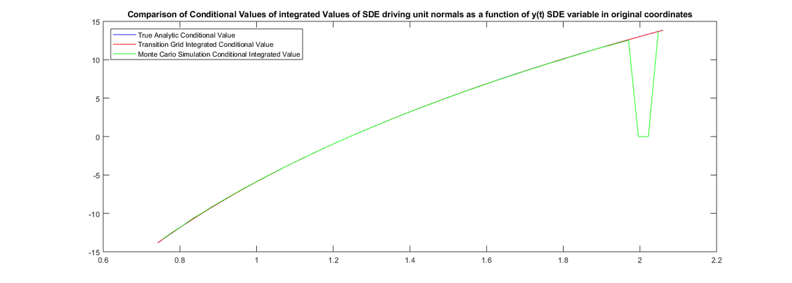](https://postimg.cc/RqLwpCjf)

Once we have established from previous conditional values(as you will see in sets of graph-1 below for larger time
levels) graphs-1 that perfect normal blue graph calculated from variance is almost identical with monte carlo
calculated integral of normal, we now plot it (graphs-2) on an x-axis value for which normal has to be a linear line so
we can compare the true value of blue graph with red graph of our defective transition probabilities calculated integral
of normal in a more familiar way. These are second sets of graphs as graph-2.

Graph-2 t=8/512

[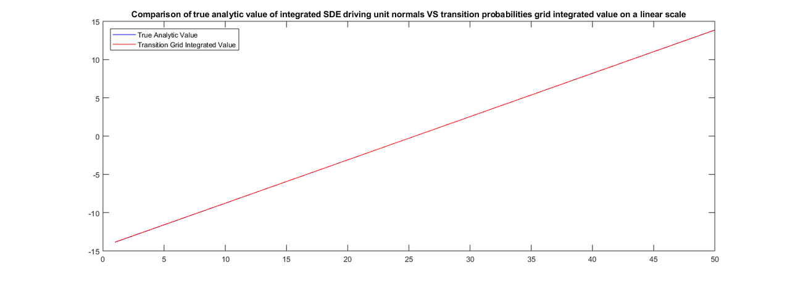](https://postimg.cc/rRjy1PZ0)

In the first set of graphs at very initial date all lines are identical since everything is accurate.

Now we follow with graphs at date  t=128/512.

Graph-1 date t=128/512.

You can see in this graph that analytically calculated normal(blue line) at y-axis with fokker-planck calculated SDE on
X-axis is almost identical with conditional value of monte carlo calculated integrated normal(green graph) while
variance of transition probabilities calculated normal(red line) has started to lag very slightly.

[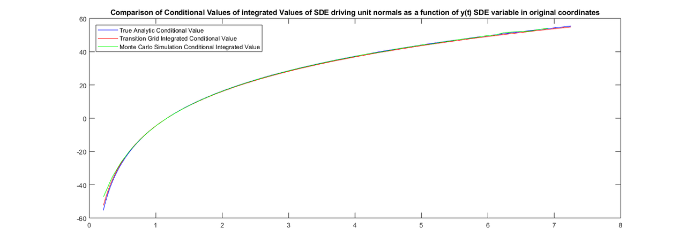](https://postimg.cc/ygF8ddFT)

Linear Graph2 t=128/512

[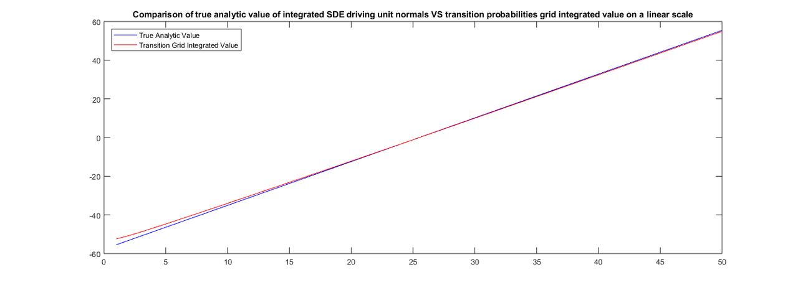](https://postimg.cc/94wf610K)

 Graph-1 t=256/512

Here we see that analytically calculated normal conditional values(blue) match with monte carlo calculated conditional
values(green) but transition probabilities grid calculated values have started to lag more behind.

[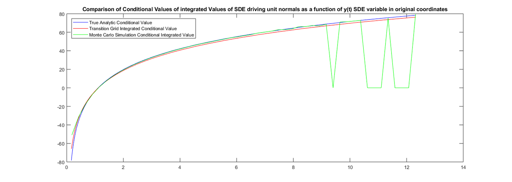](https://postimg.cc/N9h0BTrM)

Linear version Graph-2 t=256/512

[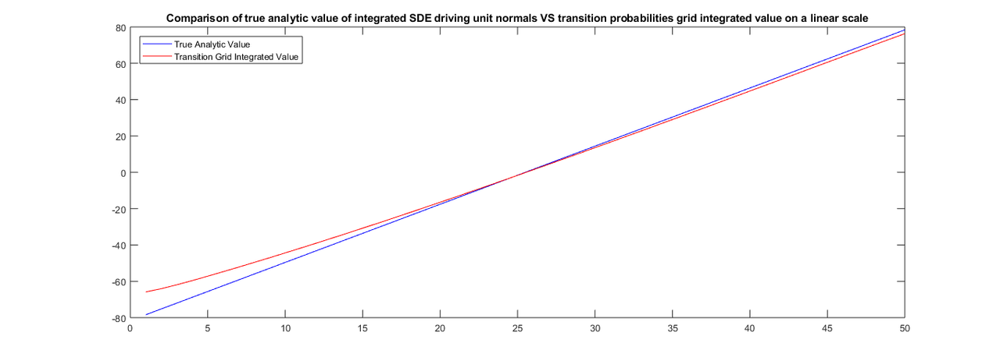](https://postimg.cc/XrzJ1tj9)

Graph-1 t=384/512

[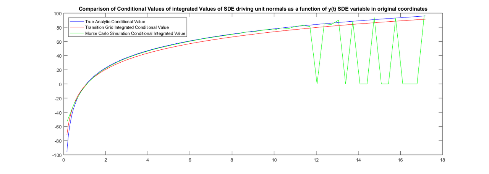](https://postimg.cc/LJX5TmpH)

Linear Graph-2 t=384/512

[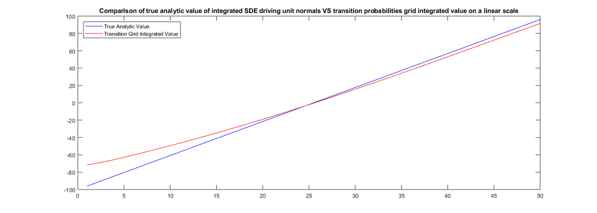](https://postimg.cc/rKgzxK7n)

Now I give the output of the program at the end of last time interval t=512/512

ss =

   512

IndexMax =

    51

MCMean =

   1.249844261079288                %Monte carlo mean of the SDE

MCVar =

   0.593135335310294                %Monte carlo variance of the SDE

Original process average from our simulation

ItoHermiteMean =

   1.251551446212164                %Mean of Fokker-planck solution of SDE

ItoHermiteVar =

   0.597372214584988               %Variance of fokker-planck solution of SDE

MuZw =

   0.037044454846106               %Mean of transition probabilities sum of SDE driving unit normals

VZw =

     3.559456867117647e+02      %Variance of transition probabilities sum of SDE driving unit normals

MuIZM =

  -0.020600972280994              %Mean of monte carlo sum of  sum of SDE driving unit normals

VIZM =

     5.127728403892854e+02   %Variance of monte carlo sum of SDE driving unit normals

We see that monte carlo sum of SDE driving unit normals(green line) after 512 intervals is 512.77 while transition
probabilities calculated sum(red line) is 355.94. Analytically calculated sum(blue line) is exactly 512. We show
conditional values of all three sums in the graph-1 below

Please note that blue line and green line are very close in main body of the graph where monte carlo variance is little.
Please also note that blue graph which shows analytic sum on y-axis uses fokker-planck calculated values of y(t)(SDE
variable in original coordinates) at x-axis which means that we can use the analytically calculated normal for both
transition probabilities and unit variance increments between two adjacent time intervals since blue line when based on
fokker-planck SDE variable y(t) at x-axis makes it almost identical with conditional value of monte carlo integrated
noise as shown by green line.

graph-1 t=512/512

[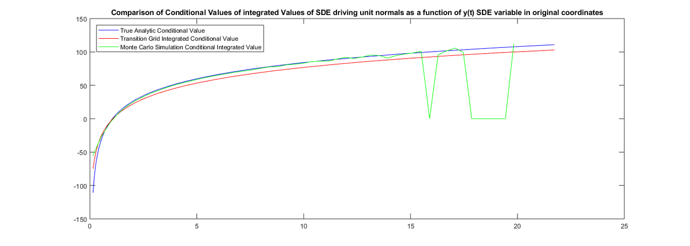](https://postimg.cc/crdrvQkt)

Graph2- t=512/512 linear comparisonof normals

[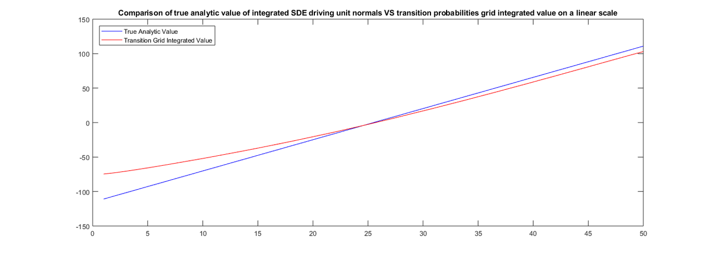](https://postimg.cc/Sj6nQZdp)

---

### #1008 — Amin (Topic Author)
*November 3, 2020, 1:30 PM*

Here is the matlab program used for the previous post. It is very slow and is for diagnostic purposes only. It has monte
carlo simulations and analytical part embedded in the same time loop so we can compare values on each time step.

```
function [] = FPERevisitedTransProb08DNew08Wmt02()

%Copyright Ahsan Amin. Infiniti derivatives Technologies.
%Please fell free to connect on linkedin: linkedin.com/in/ahsan-amin-0a53334
%or skype ahsan.amin2999
%In this program, I am simulating the SDE given as
%dy(t)=mu1 x(t)^beta1 dt + mu2 x(t)^beta2 dt +sigma x(t)^gamma dz(t)

%I have not directly simulated the SDE but simulated the transformed
%Besse1l process version of the SDE and then changed coordinates to retreive
%the SDE in original coo
%rdinates.
%The present program will analytically evolve only the Bessel Process version of the
%SDE in transformed coordinates.

dt=.125/16/2/2;   % Simulation time interval.%Fodiffusions close to zero
             %decrease dt for accuracy.
Tt=128*4/4*2*2;     % Number of simulation levels. Terminal time= Tt*dt; //.125/32*32*16=2 year;
%Tt=8*60;
T=Tt*dt;
OrderA=4;  %
OrderM=4;  %
%dtM=.125/8;%Monte carlo time interval size dtM.
%TtM=8*8;%Monte carlo number of simulation intervals.
dtM=dt;%*4*2*2;
TtM=Tt;%/4/2/2;

dNn=.2/1;   % Normal density subdivisions width. would change with number of subdivisions
Nn=50;  % No of normal density subdivisions
NnMidl=25;%One half density Subdivision left from mid of normal density(low)
NnMidh=26;%One half density subdivision right from the mid of normal density(high)
NnMid=4.0;

%theta=mu1/(-mu2);
%kappa=-mu2;

x0=1.2500;   % starting value of SDE
beta1=0.0;
beta2=1.0;   % Second drift term power.
gamma=.95;%50;   % volatility power.
kappa=1.0;%.950;   %mean reversion parameter.
theta=1.250;%mean reversion target
sigma0=.850;%Volatility value
omega1=1.50; %power on yy(t) for fy and fyPI.
%This is yy(t)^omega1 is the function that is summed in path integral
%I have tested powers between omega1=.5 and omega1=2;
theta1=1;%This is the weight on arithmetic sum in the path integral.
%keep it equal to one otherwise results will be erroneous.
%This will be activated in future and made time dependent.

%if you alter above parameters and the program blows, disable
%mean-correction since that is only valid for classical mean-reverting
%SDEs.

%you can specify any general mu1 and mu2 and beta1 and beta2.
mu1=+1*theta*kappa;   %first drift coefficient.
mu2=-1*kappa;    % Second drift coefficient.
%mu1=0;
%mu2=0;

alpha=1;% x^alpha is being expanded. This is currently for monte carlo only.
alpha1=1-gamma;%This is for expansion of integrals for calculation of drift
%and volatility coefficients

w(1:Nn)=x0^(1-gamma)/(1-gamma);

%Z(1:Nn)=(((1:Nn)-5.5)*dNn-NnMid);
Z(1:Nn)=(((1:Nn)-5.5)*dNn-NnMid);

Z
%Znew=sqrt(2)*Z
%sqrt(Znew.^2-Z.^2)
%Znew-Z
str=input('Look at Z');
ZProb(1)=normcdf(.5*Z(1)+.5*Z(2),0,1)-normcdf(.5*Z(1)+.5*Z(2)-dNn,0,1);
ZProb(Nn)=normcdf(.5*Z(Nn)+.5*Z(Nn-1)+dNn,0,1)-normcdf(.5*Z(Nn)+.5*Z(Nn-1),0,1);
ZProb(2:Nn-1)=normcdf(.5*Z(2:Nn-1)+.5*Z(3:Nn),0,1)-normcdf(.5*Z(2:Nn-1)+.5*Z(1:Nn-2),0,1);
    %Above calculate probability mass in each probability subdivision.

%%%%%%%%%%%%%%%%%%%%%%%%%%%%%%%%%%%%%%%%%%%%%%%%%%%%%%%%%%%%%%%%%%%%%%%%%%%%%%%%%%%%%%%%%%%%%%

sigma11(1:OrderA+1)=0;
mu11(1:OrderA+1)=0;
mu22(1:OrderA+1)=0;
sigma22(1:OrderA+1)=0;
% index 1 correponds to zero level since matlab indexing starts at one.
sigma11(1)=1;
mu11(1)=1;
mu22(1)=1;
sigma22(1)=1;

for k=1:(OrderA+1)
    if sigma0~=0
        sigma11(k)=sigma0^(k-1);
    end
    if mu1 ~= 0
        mu11(k)=mu1^(k-1);
    end
    if mu2 ~= 0
        mu22(k)=mu2^(k-1);
    end
    if sigma0~=0
        sigma22(k)=sigma0^(2*(k-1));
    end
end
%Ft(1:TtM+1,1:(OrderA+1),1:(OrderA+1),1:(OrderA+1),1:(OrderA+1))=0; %General time powers on hermite polynomials
Fp(1:(OrderA+1),1:(OrderA+1),1:(OrderA+1),1:(OrderA+1))=0;%General x powers on coefficients of hermite polynomials.
Fp1(1:(OrderA+1),1:(OrderA+1),1:(OrderA+1),1:(OrderA+1))=0;%General x powers for bessel transformed coordinates.

%YCoeff0 and YCoeff are coefficents for original coordinates monte carlo.
%YqCoeff0 and YqCoeff are bessel/lamperti version monte carlo.

YCoeff0(1:(OrderA+1),1:(OrderA+1),1:(OrderA+1),1:(OrderA+1))=0;
YqCoeff0(1:(OrderA+1),1:(OrderA+1),1:(OrderA+1),1:(OrderA+1))=0;
%Pre-compute the time and power exponent values in small multi-dimensional arrays
YCoeff = ItoTaylorCoeffsNew(alpha,beta1,beta2,gamma); %expand y^alpha where alpha=1;
YqCoeff = ItoTaylorCoeffsNew(alpha1,beta1,beta2,gamma);%expand y^alpha1 where alpha1=(1-gamma)
YqCoeff=YqCoeff/(1-gamma); %Transformed coordinates coefficients have to be
%further divided by (1-gamma)

for k = 0 : (OrderA)
    for m = 0:k
        l4 = k - m + 1;
        for n = 0 : m
            l3 = m - n + 1;
            for j = 0:n
                l2 = n - j + 1;
                l1 = j + 1;
                %Ft(l1,l2,l3,l4) = dtM^((l1-1) + (l2-1) + (l3-1) + .5* (l4-1));
                Fp(l1,l2,l3,l4) = (alpha + (l1-1) * beta1 + (l2-1) * beta2 + (l3-1) * 2* gamma + (l4-1) * gamma ...
                    - (l1-1) - (l2-1) - 2* (l3-1) - (l4-1));
                Fp1(l1,l2,l3,l4) = (alpha1 + (l1-1) * beta1 + (l2-1) * beta2 + (l3-1) * 2* gamma + (l4-1) * gamma ...
                    - (l1-1) - (l2-1) - 2* (l3-1) - (l4-1));

                YCoeff0(l1,l2,l3,l4) =YCoeff(l1,l2,l3,l4).*mu11(l1).*mu22(l2).*sigma22(l3).*sigma11(l4);
                YqCoeff0(l1,l2,l3,l4) =YqCoeff(l1,l2,l3,l4).*mu11(l1).*mu22(l2).*sigma22(l3).*sigma11(l4);
            end
        end
    end
end

%%%%%%%%%%%%%%%%%%%%%%%%%%%%%%%%%%%%%%%%%%%%%%%%%%%%%%%%%%%%%%%%%%%%%%%%%%%%%%%%%%%%%%%%%%%%%%
%Current program has 50 grid points. I have divided every grid subdivision
%into three further subdivisions with probabilities P0,Pb,Pa.
 P0(1:Nn)=normcdf(Z(1:Nn)+1/6*dNn)-normcdf(Z(1:Nn)-1/6*dNn);
        Pa(1:Nn-1)=normcdf(Z(1:Nn-1)+1/2*dNn)-normcdf(Z(1:Nn-1)+1/6*dNn);
        Pb(1+1:Nn)=normcdf(Z(1+1:Nn)-1/6*dNn)-normcdf(Z(1+1:Nn)-1/2*dNn);
        Pb(1)=normcdf(Z(1)-1/6*dNn);
        Pa(Nn)=1-normcdf(Z(Nn)+1/6*dNn);
        PSum(1:Nn)=P0(1:Nn)+Pa(1:Nn)+Pb(1:Nn);

ss=0;  %ss is index for transition probability calculation time steps.
Freq=1.0;%transition probabilities are calculated Freq time intervals apart.
wnStart=1;%
d2wdZ2(1:Nn)=0;
d2wdZ2A(1:Nn)=0;
dwdZ(1:Nn)=0;
yy(wnStart:Nn)=((1-gamma)*w(wnStart:Nn)).^(1/(1-gamma));
%The above yy(wnStart:Nn)=x0;

   Pprev(1:Nn)=ZProb(1:Nn);%probability mass at starting node.
   Pnew(1:Nn)=0.0;
   PZprev(1:Nn)=ZProb(1:Nn);%probability mass at starting node.
   PZnew(1:Nn)=0.0;
   Eyyprev(1:Nn)=yy(1:Nn).*ZProb(1:Nn);%Value of SDE variable in original
   %coordinates at starting nodes.
   Eyynew(1:Nn)=0;
   EZwnew(1:Nn)=0.0;
   EZwprev(1:Nn)=0.0;

   Efdtprev(1:Nn)=0;%Value of path-integral at starting nodes is zero.
   Efdtnew(1:Nn)=0;
   Egdtprev(1:Nn)=0;%Value of path-integral at starting nodes is zero.
   Egdtnew(1:Nn)=0;

   Ef0prev(1:Nn)=0;
   %Ef0prev(Nn0)=0;%Value of noise at initial node is zero.
   Ef0new(1:Nn)=0;
   EIZAprev(1:Nn)=0.0;
   EIZAnew(1:Nn)=0.0;

    %Monte carl ovariables below
    rng(29079137, 'twister')
    paths=1000000;
    YY(1:paths)=x0;  %Original process monte carlo.
    fYYdt(1:paths)=0.0;
    Random1(1:paths)=0;
    IZM(1:paths)=0.0;

tic

for tt=1:Tt
    yy(wnStart:Nn)=((1-gamma)*w(wnStart:Nn)).^(1/(1-gamma));
    [wMu0dt,dwMu0dtdw,c1] = CalculateDriftAndVolA4(w,wnStart,Nn,YqCoeff0,Fp1,gamma,dt);
    [wMu0dt,c1,c22] = CalculateDriftAndVolA8Trans(w,wnStart,Nn,YqCoeff0,Fp1,gamma,dt);
    dw(wnStart:Nn)=c1(wnStart:Nn).*Z(wnStart:Nn) ;% ...
    %dw(wnStart:Nn)=sigma0.*sqrt(dt).*Z(wnStart:Nn) ;
    dw2(wnStart:Nn)=dw(wnStart:Nn).^2;%+c22(wnStart:Nn).*(Z(wnStart:Nn).^2-1);
    w(isnan(w)==1)=0;
    wMu0dt(isnan(wMu0dt)==1)=0;
    %wMeanPrev=sum(ZProb(wnStart:Nn).*w(wnStart:Nn));%Calculate the mean.
%%%%%%%%%%%%%%%%%%%%%%%%%%%%%%%%%%%%%%%%%%%%%%%%%%%%%%%%%%%%%%%%%%%%%%%%%%%

%     [dwdZ,d2wdZ2A,d3wdZ3A] = First3Derivatives2ndOrderEqSpacedA(wnStart,Nn,dNn,w,Z);
%     d2wdZ2(wnStart:Nn)=0.0;
%     d3wdZ3(wnStart:Nn)=0.0;
%     if (tt>36)
%         d3wdZ3(wnStart:Nn) = (d3wdZ3A(wnStart:Nn));
%         d2wdZ2(wnStart:Nn)=d2wdZ2A(wnStart:Nn);
%         d2wdZ2(1:15)=d2wdZ2(1:15).*exp(-12*kappa^2*(1-gamma).*dNn*(15-(1:15)));
%         d3wdZ3(1:15)=d3wdZ3(1:15).*exp(-12*kappa^2*(1-gamma).*dNn*(15-(1:15)));
%
%     end

%tt
%plot((wnStart:Nn),d2wdZ2A(wnStart:Nn),'g',(wnStart:Nn),d2wdZ2(wnStart:Nn),'r');
%str=input('Look at d2wdZ2A(wnStart:Nn)');

%If the calculation of the program blows, it means that above calculated
%derivative is unstable or bad. Plese replace with your favourite method of
%calculating this second derivative.

    dZdw(wnStart:Nn)=1.0./dwdZ(wnStart:Nn);
    if(tt==1)
        wMeanPrev=sum(ZProb(wnStart:Nn).*w(wnStart:Nn));

        w(wnStart:Nn)=wMeanPrev+wMu0dt(wnStart:Nn)+ ...
            sign(w(wnStart:Nn)-wMeanPrev+dw(wnStart:Nn)).* ...
            sqrt(abs(sign(w(wnStart:Nn)-wMeanPrev).*(w(wnStart:Nn)-wMeanPrev).^2+ ...
            sign(dw(wnStart:Nn)).*dw2(wnStart:Nn)));
    end
    if(tt>1)

        C22(wnStart:Nn)=.0125/pi*25.0*.025;
        C33(wnStart:Nn)=.0125/pi*2*.35;
        C44(wnStart:Nn)=.0125/pi*25.0*.850;

        TermA0(wnStart:Nn)=-C22(wnStart:Nn).*3.*Z(wnStart:Nn).^1.*dZdw(wnStart:Nn).*d2wdZ2(wnStart:Nn)*sigma0^2.*dt +
...
           
+C44(wnStart:Nn).*(-d3wdZ3(wnStart:Nn).*dZdw(wnStart:Nn)+3*d2wdZ2(wnStart:Nn).^2.*dZdw(wnStart:Nn).^2)*sigma0^2.*dt+ ...
            -C33(wnStart:Nn).*dwMu0dtdw(wnStart:Nn).*dwdZ(wnStart:Nn).^2;

        TermA(wnStart:Nn)= sqrt(abs(TermA0(wnStart:Nn)));
        SignTermA(wnStart:Nn)=sign(TermA0(wnStart:Nn));

        w(wnStart:Nn)=w(wnStart:Nn)+wMu0dt(wnStart:Nn)+(-(Z(wnStart:Nn).*dwdZ(wnStart:Nn))+d2wdZ2(wnStart:Nn))+ ...
           
sign((Z(wnStart:Nn).*dwdZ(wnStart:Nn))-d2wdZ2(wnStart:Nn)+dw(wnStart:Nn)+SignTermA(wnStart:Nn).*TermA(wnStart:Nn)).* ...
            sqrt(abs(sign((Z(wnStart:Nn).*dwdZ(wnStart:Nn))-d2wdZ2(wnStart:Nn)).* ...
            ((Z(wnStart:Nn).*dwdZ(wnStart:Nn))-d2wdZ2(wnStart:Nn)).^2+ ...
            sign(+dw(wnStart:Nn)).*dw2(wnStart:Nn)+ ...
            SignTermA(wnStart:Nn).*TermA(wnStart:Nn).^2));% + ...

    end

%%%%%%%%%%%%%%%%%%%%%%%%%%%%%%%%%%%%%%%%%%%%%%%%%%%%%%%%%%%%%%%%%%%%%%%%%%%
%Below are instability correction equations.
%Interpolation of three points in instability region with lagrange
%polynomials.

    w(NnMidl) =
InterpolateOrderN8(8,Z(NnMidl),Z(NnMidl-4),Z(NnMidl-3),Z(NnMidl-2),Z(NnMidl-1),Z(NnMidh+2),Z(NnMidh+3),Z(NnMidh+4),Z(NnMidh+5),w(NnMidl-4),w(NnMidl-3),w(NnMidl-2),w(NnMidl-1),w(NnMidh+2),w(NnMidh+3),w(NnMidh+4),w(NnMidh+5));
    w(NnMidh) =
InterpolateOrderN8(8,Z(NnMidh),Z(NnMidl-4),Z(NnMidl-3),Z(NnMidl-2),Z(NnMidl-1),Z(NnMidh+2),Z(NnMidh+3),Z(NnMidh+4),Z(NnMidh+5),w(NnMidl-4),w(NnMidl-3),w(NnMidl-2),w(NnMidl-1),w(NnMidh+2),w(NnMidh+3),w(NnMidh+4),w(NnMidh+5));
    w(NnMidh+1) =
InterpolateOrderN8(8,Z(NnMidh+1),Z(NnMidl-4),Z(NnMidl-3),Z(NnMidl-2),Z(NnMidl-1),Z(NnMidh+2),Z(NnMidh+3),Z(NnMidh+4),Z(NnMidh+5),w(NnMidl-4),w(NnMidl-3),w(NnMidl-2),w(NnMidl-1),w(NnMidh+2),w(NnMidh+3),w(NnMidh+4),w(NnMidh+5));

    [wE] =
InterpolateOrderN6(6,Z(Nn)+dNn,Z(Nn),Z(Nn-1),Z(Nn-2),Z(Nn-3),Z(Nn-4),Z(Nn-5),w(Nn),w(Nn-1),w(Nn-2),w(Nn-3),w(Nn-4),w(Nn-5));

    w1(1:Nn-1)=w(1:Nn-1);
    w1(Nn)=w(Nn);
    w2(1:Nn-1)=w(2:Nn);
    w2(Nn)=wE;
    w(w1(:)>w2(:))=0;%Be careful;might not universally hold;
     %Change 3:7/25/2020: I have improved zero correction in above.
    w(w36)&&(tt128)
         d3wdZ3(wnStart:Nn) = (d3wdZ3A(wnStart:Nn));
         d2wdZ2(wnStart:Nn)=d2wdZ2A(wnStart:Nn);
        % d2wdZ2(1:15)=d2wdZ2(1:15).*exp(-12*kappa^2*(1-gamma).*dNn*(15-(1:15)));
        % d3wdZ3(1:15)=d3wdZ3(1:15).*exp(-12*kappa^2*(1-gamma).*dNn*(15-(1:15)));

     end

  %For transition probabilities calculations, the time grid is Freq intervals apart.
  % so time interval ds for transition probability calculation is
  % ds=dt*Freq; and t1A is start time for transition probabilities interval
  % while t2A is end time of transition probabilities calculation interval.
  % so t2A=t1A+ds; W1 is the bessel coordinates value w at t1A and W2 is
  % equal to w at t2A. W1=w(t1A) and W2=w(t2A). W1 and W2 are used for
  % transition probabilities calculations.

    if(tt==1)

        W1(1:Nn)=x0^(1-gamma)/(1-gamma);

        ds=dt*Freq;
        t1A=0;
        t2A=ds;

        %below calculates integrals for drift and volatility for transition
        %probabilities.
        %[wMu0dt2,dwMu0dt2,dw02]=CalculateDriftAndVol(mu1,mu2,beta1,beta2,gamma,sigma0,W1,1,Nn,ds);
        [wMu0dt2,dw02,c22] = CalculateDriftAndVolA8Trans(W1,wnStart,Nn,YqCoeff0,Fp1,gamma,ds);

        %below calculates integrals for drift and volatility for yy(t).
        %yy(t) is the SDE variable in original coordinates as opposed to
        %bessel coordinates.
        [yyMu0dt,dyyz0,dyy2z0]=CalculateFunctionDriftAndVol(1.0,1.0,mu1,mu2,beta1,beta2,gamma,sigma0,W1,wnStart,Nn,ds);

        %below calculates integrals for drift and volatility for
        %yy(t)^omega1 which is used in Ito change of variable calculations
        %on the lattice. This is not needed for path integrals.

       
%[fMu0dt,dfz0,df2z0]=CalculateFunctionDriftAndVol(theta1,omega1,mu1,mu2,beta1,beta2,gamma,sigma0,w,wnStart,Nn,dt);
       
[fMu0dt,dfz0,df2z0]=CalculateFunctionDriftAndVol(theta1,omega1,mu1,mu2,beta1,beta2,gamma,sigma0,W1,wnStart,Nn,ds);

        %below calculates integrals for drift and volatility for
        %yy(s)^omega1 ds. which is used in path integrals calculations
        %on the lattice.
       
%[fdtMu0dt,dfdtz01,dfdt2z02]=CalculateFdtDriftAndVol08(theta1,omega1,mu1,mu2,beta1,beta2,gamma,sigma0,W1,wnStart,Nn,ds,t1A,t2A);

     % 
 [fdtMu0dt,dfdtz01,dfdt2z02]=CalculateFdtDriftAndVol08(theta1,omega1,mu1,mu2,beta1,beta2,gamma,sigma0,W1,wnStart,Nn,ds,t1A,t2A);

     % 
 [fMu0dtdt,dfz0dt,df2z0dt]=CalculateFunctionDriftAndVoldt(theta1,omega1,mu1,mu2,beta1,beta2,gamma,sigma0,W1,wnStart,Nn,ds);

    end

    if(rem(tt,Freq)==0)

        %When this above condition is true it means that we are at end of
        %particular transition probability interval and we have end of
        %interval W2(s)=w(t) while we will use the value W1 that was
        %previously saved Freq dt time intervals earlier or ds=Freq*dt
        %time ago.

        ss=ss+1; %transition loop variable and is one at the end of first
        %transition probability interval.
        %Div0=Div0+.5*ds;

        W2(1:Nn)=w(1:Nn);

        ds=dt*Freq;

        yy1(1:Nn)=((1-gamma)*W1(1:Nn)).^(1/(1-gamma));%Value in origianl
        %coordinates at the start of transition probabilities interval.
        yy2(1:Nn)=((1-gamma)*W2(1:Nn)).^(1/(1-gamma));%Value in origianl
        %coordinates at the end of transition probabilities interval.

        Yy(ss,1:Nn)=yy2(1:Nn);

        fyy1(1:Nn)=theta1.*yy1(1:Nn).^omega1;%function value at the start
        %both for Ito calculation of function and path integrals.
        fyy2(1:Nn)=theta1.*yy2(1:Nn).^omega1;%function value at the end

        [W2GridStarts,W2GridEnds] = CalculateGridStartsAndEnds(W2,Z,wnStart,Nn,dNn);
        [W1GridStarts,W1GridEnds] = CalculateGridStartsAndEnds(W1,Z,wnStart,Nn,dNn);

        %dYy are grid widths in original coordinates. will be handy later.
        dYy(ss,2:Nn-1)=((1-gamma).*W2GridEnds(2:Nn-1)).^(1/(1-gamma))-((1-gamma).*W2GridStarts(2:Nn-1)).^(1/(1-gamma));
        dYy(ss,1)=dYy(ss,2);
        dYy(ss,Nn)=dYy(ss,Nn-1);
        W2GridStarts0(1:Nn)=W2GridStarts(1:Nn);
        W2GridEnds0(1:Nn)=W2GridEnds(1:Nn);
        W2GridStarts0(1)=W2(1)-(W2(2)-W2(1));
        W2GridEnds0(Nn)=W2(Nn)+(W2(Nn)-W2(Nn-1));

        dW2(2:Nn-1)=W2GridEnds(2:Nn-1)-W2GridStarts(2:Nn-1);
        dW2(1)=dW2(2);
        dW2(Nn)=dW2(Nn-1);

        dW1(2:Nn-1)=W1GridEnds(2:Nn-1)-W1GridStarts(2:Nn-1);
        dW1(1)=dW1(2);
        dW1(Nn)=dW1(Nn-1);

        %initial grid from where transition probabilities have to be
        %calculated is divided into three further subdivisions. Initial
        %grid subdivision ranges from w(Z_n-.5*dNn) to w(Z_n+.5*dNn). Now
        %it is divided into three further subdivisions with left subdivision
        %W1GridMidsb centred at w(Z_n-1/3*dNn) spaced between w(Z_n-.5*dNn) to
        %w(Z_n-1/6*dNn). Second middle subdivision is centred at  w(Z_n) and is
        %spaced between w(Z_n-1/6*dNn) to w(Z_n+1/6*dNn). Third further
        %subdivision called right subdivision W1GridMidsa is centred at
        %w(Z_n+1/3*dNn) and ranges from w(Z_n+1/6*dNn) to w(Z_n+.5*dNn). Since our initial full
        %subdivision can be quite large, We calculate transition
        %probabilities independently from three further subdivision
        %midpoints and then add them according to weight of probability
        %mass of each of the smaler three subdivisions to get one estimate of transition probability. This is why we
        %have to calculated W1GridMidsa(right subdivision)  and
        %W1GridMidsb(left subdivision) located at w(Z_n+1/3*dNn)
        % and w(Z_n-1/3*dNn) respectively where W1 itself(middle subdivision)
        %is located at w(Z_n).

        [W1GridMidsa,W1GridMidsb] = CalculateGridSubdivisions(W1,Z,wnStart,Nn,dNn);

        %below we calculate drift and volatility for W1GridMidsa and
        %W1GridMidsb since these would be used in independent calculations
        %of transition probabilities from these points W1GridMidsa and
        %W1GridMidsb
        [wMu0dt2,dw02,c22] = CalculateDriftAndVolA8Trans(W1,wnStart,Nn,YqCoeff0,Fp1,gamma,ds);
        [wMu0dt2a,dw02a,c2a] = CalculateDriftAndVolA8Trans(W1GridMidsa,wnStart,Nn,YqCoeff0,Fp1,gamma,ds);
        [wMu0dt2b,dw02b,c2b] = CalculateDriftAndVolA8Trans(W1GridMidsb,wnStart,Nn,YqCoeff0,Fp1,gamma,ds);

        for mm=1:Nn
            %Below is the gaussian increment between two grid points W1(mm)
            % at time t1A and W2(wnStart:Nn) at time t2A, backed
            %out from the original stochastic differential equation drift
            %and volatility. This gaussian increment is used for
            %probability calculation between corresponding grid points and
            %also for calculation of stochastic integrals between the
            %corresponding grid points. Please note that this gaussian
            %increment remains the same in bessel coordinates and the
            %original coordinates
         %   Zt(mm,wnStart:Nn)=(W2(wnStart:Nn)-W1(mm)-1*wMu0dt2(mm))/dw02(mm);
        %[wMu0dt2,c12,c22] = CalculateDriftAndVolA8Trans(W1,wnStart,Nn,YqCoeff0,Fp1,gamma,ds);

           %I have used the formula
           %W2=W1+ mu* dt+ sigma *Z + sigma2 *(Z^2-1) and back out Z by use
           %of quadratic formula.
           %I use A lesser known quadratic formula, as used in Muller's method (from wikipedia)
           %in order to obviate round-off errors
           %Here mu*dt=wMu0dt; sigma=dw02; sigma2 =c22;
            if((W2(wnStart:Nn)-W1(mm)-1*wMu0dt2(mm)+c22(mm))>0)
                %Zt(mm,wnStart:Nn)=(-dw02(mm) +
sqrt(dw02(mm).^2+4*c22(mm).*(-W2(wnStart:Nn)+W1(mm)+1*wMu0dt2(mm)-c22(mm))))./(2*c22(mm));
                Zt(mm,wnStart:Nn)=(2*(-W2(wnStart:Nn)+W1(mm)+1*wMu0dt2(mm)-c22(mm)))./(-dw02(mm) +
sqrt(dw02(mm).^2+4*c22(mm).*(-W2(wnStart:Nn)+W1(mm)+1*wMu0dt2(mm)-c22(mm))));
            else
                Zt(mm,wnStart:Nn)=(2*(-W2(wnStart:Nn)+W1(mm)+1*wMu0dt2(mm)-c22(mm)))./(-dw02(mm) -
sqrt(dw02(mm).^2-4*c22(mm).*(-W2(wnStart:Nn)+W1(mm)+1*wMu0dt2(mm)-c22(mm))));
            end

            if((W2GridStarts(wnStart:Nn)-W1(mm)-1*wMu0dt2(mm)+c22(mm))>0)
                %Zt(mm,wnStart:Nn)=(-dw02(mm) +
sqrt(dw02(mm).^2+4*c22(mm).*(-W2(wnStart:Nn)+W1(mm)+1*wMu0dt2(mm)-c22(mm))))./(2*c22(mm));
                ZtS(mm,wnStart:Nn)=(2*(-W2GridStarts(wnStart:Nn)+W1(mm)+1*wMu0dt2(mm)-c22(mm)))./(-dw02(mm) +
sqrt(dw02(mm).^2+4*c22(mm).*(-W2GridStarts(wnStart:Nn)+W1(mm)+1*wMu0dt2(mm)-c22(mm))));
            else
                ZtS(mm,wnStart:Nn)=(2*(-W2GridStarts(wnStart:Nn)+W1(mm)+1*wMu0dt2(mm)-c22(mm)))./(-dw02(mm) -
sqrt(dw02(mm).^2-4*c22(mm).*(-W2GridStarts(wnStart:Nn)+W1(mm)+1*wMu0dt2(mm)-c22(mm))));
            end

            if((W2GridEnds(wnStart:Nn)-W1(mm)-1*wMu0dt2(mm)+c22(mm))>0)
                %Zt(mm,wnStart:Nn)=(-dw02(mm) +
sqrt(dw02(mm).^2+4*c22(mm).*(-W2(wnStart:Nn)+W1(mm)+1*wMu0dt2(mm)-c22(mm))))./(2*c22(mm));
                ZtE(mm,wnStart:Nn)=(2*(-W2GridEnds(wnStart:Nn)+W1(mm)+1*wMu0dt2(mm)-c22(mm)))./(-dw02(mm) +
sqrt(dw02(mm).^2+4*c22(mm).*(-W2GridEnds(wnStart:Nn)+W1(mm)+1*wMu0dt2(mm)-c22(mm))));
            else
                ZtE(mm,wnStart:Nn)=(2*(-W2GridEnds(wnStart:Nn)+W1(mm)+1*wMu0dt2(mm)-c22(mm)))./(-dw02(mm) -
sqrt(dw02(mm).^2-4*c22(mm).*(-W2GridEnds(wnStart:Nn)+W1(mm)+1*wMu0dt2(mm)-c22(mm))));
            end

            %Below ZtS indicates the value of Zt at start of W2
            %subdivision and ZtE indicates the value of Zt at the end of W2
            %subdivision

            if((W2GridStarts(wnStart:Nn)-W1GridMidsa(mm)-1*wMu0dt2a(mm)+c2a(mm))>0)
                %Zt(mm,wnStart:Nn)=(-dw02(mm) +
sqrt(dw02(mm).^2+4*c22(mm).*(-W2(wnStart:Nn)+W1(mm)+1*wMu0dt2(mm)-c22(mm))))./(2*c22(mm));
                ZtSa(mm,wnStart:Nn)=(2*(-W2GridStarts(wnStart:Nn)+W1GridMidsa(mm)+1*wMu0dt2a(mm)-c2a(mm)))./ ...
                    (-dw02a(mm) +
sqrt(dw02a(mm).^2+4*c2a(mm).*(-W2GridStarts(wnStart:Nn)+W1GridMidsa(mm)+1*wMu0dt2a(mm)-c2a(mm))));
            else
                ZtSa(mm,wnStart:Nn)=(2*(-W2GridStarts(wnStart:Nn)+W1GridMidsa(mm)+1*wMu0dt2a(mm)-c2a(mm)))./ ...
                    (-dw02a(mm) -
sqrt(dw02a(mm).^2-4*c2a(mm).*(-W2GridStarts(wnStart:Nn)+W1GridMidsa(mm)+1*wMu0dt2a(mm)-c2a(mm))));
            end

            if((W2GridEnds(wnStart:Nn)-W1GridMidsa(mm)-1*wMu0dt2a(mm)+c2a(mm))>0)
                %Zt(mm,wnStart:Nn)=(-dw02(mm) +
sqrt(dw02(mm).^2+4*c22(mm).*(-W2(wnStart:Nn)+W1(mm)+1*wMu0dt2(mm)-c22(mm))))./(2*c22(mm));
                ZtEa(mm,wnStart:Nn)=(2*(-W2GridEnds(wnStart:Nn)+W1GridMidsa(mm)+1*wMu0dt2a(mm)-c2a(mm)))./ ...
                    (-dw02a(mm) +
sqrt(dw02a(mm).^2+4*c2a(mm).*(-W2GridEnds(wnStart:Nn)+W1GridMidsa(mm)+1*wMu0dt2a(mm)-c2a(mm))));
            else
                ZtEa(mm,wnStart:Nn)=(2*(-W2GridEnds(wnStart:Nn)+W1GridMidsa(mm)+1*wMu0dt2a(mm)-c2a(mm)))./ ...
                    (-dw02a(mm) -
sqrt(dw02a(mm).^2-4*c2a(mm).*(-W2GridEnds(wnStart:Nn)+W1GridMidsa(mm)+1*wMu0dt2a(mm)-c2a(mm))));
            end

            if((W2GridStarts(wnStart:Nn)-W1GridMidsb(mm)-1*wMu0dt2b(mm)+c2b(mm))>0)
                %Zt(mm,wnStart:Nn)=(-dw02(mm) +
sqrt(dw02(mm).^2+4*c22(mm).*(-W2(wnStart:Nn)+W1(mm)+1*wMu0dt2(mm)-c22(mm))))./(2*c22(mm));
                ZtSb(mm,wnStart:Nn)=(2*(-W2GridStarts(wnStart:Nn)+W1GridMidsb(mm)+1*wMu0dt2b(mm)-c2b(mm)))./ ...
                    (-dw02b(mm) +
sqrt(dw02b(mm).^2+4*c2b(mm).*(-W2GridStarts(wnStart:Nn)+W1GridMidsb(mm)+1*wMu0dt2b(mm)-c2b(mm))));
            else
                ZtSb(mm,wnStart:Nn)=(2*(-W2GridStarts(wnStart:Nn)+W1GridMidsb(mm)+1*wMu0dt2b(mm)-c2b(mm)))./ ...
                    (-dw02b(mm) -
sqrt(dw02b(mm).^2-4*c2b(mm).*(-W2GridStarts(wnStart:Nn)+W1GridMidsb(mm)+1*wMu0dt2b(mm)-c2b(mm))));
            end

            if((W2GridEnds(wnStart:Nn)-W1GridMidsb(mm)-1*wMu0dt2b(mm)+c2b(mm))>0)
                %Zt(mm,wnStart:Nn)=(-dw02(mm) +
sqrt(dw02(mm).^2+4*c22(mm).*(-W2(wnStart:Nn)+W1(mm)+1*wMu0dt2(mm)-c22(mm))))./(2*c22(mm));
                ZtEb(mm,wnStart:Nn)=(2*(-W2GridEnds(wnStart:Nn)+W1GridMidsb(mm)+1*wMu0dt2b(mm)-c2b(mm)))./ ...
                    (-dw02b(mm) +
sqrt(dw02b(mm).^2+4*c2b(mm).*(-W2GridEnds(wnStart:Nn)+W1GridMidsb(mm)+1*wMu0dt2b(mm)-c2b(mm))));
            else
                ZtEb(mm,wnStart:Nn)=(2*(-W2GridEnds(wnStart:Nn)+W1GridMidsb(mm)+1*wMu0dt2b(mm)-c2b(mm)))./ ...
                    (-dw02b(mm) -
sqrt(dw02b(mm).^2-4*c2b(mm).*(-W2GridEnds(wnStart:Nn)+W1GridMidsb(mm)+1*wMu0dt2b(mm)-c2b(mm))));
            end
            ZtS(mm,1)=-Inf;
            ZtSa(mm,1)=-Inf;
            ZtSb(mm,1)=-Inf;

            ZtS(mm,1)=ZtE(mm,1)-4;
            ZtSa(mm,1)=ZtEa(mm,1)-4;
            ZtSb(mm,1)=ZtEb(mm,1)-4;

            ZtE(mm,Nn)=ZtS(mm,Nn)+4;
            ZtEa(mm,Nn)=ZtSa(mm,Nn)+4;
            ZtEb(mm,Nn)=ZtSb(mm,Nn)+4;

            %Since ZtS indicates the value of Zt at start of W2
            %subdivision and ZtE indicates the value of Zt at the end of W2
            %subdivision, the probability mass inside can be found by
            %normcdf
            pt0(mm,wnStart:Nn)=normcdf(ZtE(mm,wnStart:Nn))-normcdf(ZtS(mm,wnStart:Nn));
            pta(mm,wnStart:Nn)=normcdf(ZtEa(mm,wnStart:Nn))-normcdf(ZtSa(mm,wnStart:Nn));
            ptb(mm,wnStart:Nn)=normcdf(ZtEb(mm,wnStart:Nn))-normcdf(ZtSb(mm,wnStart:Nn));
            %Zt(mm,wnStart:Nn)=(W2(wnStart:Nn)-W1(mm)-1*wMu0dt22(mm))/c12(mm);

            %Now calculate one transition probability  between two
            %grid points W1(mm)  at time t1A and W2(wnStart:Nn) at time t2A
            %by adding the transition probabilities from all three
            %subdivision weighted by their probability mass in each of the
            %smaller three subdivisions.
            pt(mm,wnStart:Nn)=P0(mm)./PSum(mm).*pt0(mm,wnStart:Nn)+ ...
                Pa(mm)./PSum(mm).*pta(mm,wnStart:Nn)+ ...
                Pb(mm)./PSum(mm).*ptb(mm,wnStart:Nn);

            pt(isnan(pt(mm,:))==1)=0;
            pt(isinf(pt(mm,:))==1)=0;

            Pnew(wnStart:Nn)=Pnew(wnStart:Nn)+Pprev(mm).*pt(mm,wnStart:Nn);

        end

              pRatio(wnStart:Nn)=Pprev(wnStart:Nn)./Pnew(wnStart:Nn);

     %   pRatio
     %   ss
     %   str=input('Look at pRatio');
        Pnew(wnStart:Nn)=0.0;
        for mm=1:Nn
            pt(mm,wnStart:Nn)=pRatio(wnStart:Nn).*pt(mm,wnStart:Nn);
            Pnew(wnStart:Nn)=Pnew(wnStart:Nn)+Pprev(mm).*pt(mm,wnStart:Nn);
        %    sum(pt(mm,:))
        %    mm
          %  str=input('look at pt-sum')
        end

        %Pnew(wnStart:Nn)=0.0;
        for mm=1:Nn
            %Below is the counterpart of original SDE that is used for the
            %evolution of expcted value of yy(t). It is totally independent
            %for its own sake and is not needed for any function or
            %path integral calculations.
             
dyyGenerator(mm,wnStart:Nn)=pt(mm,wnStart:Nn).*(yyMu0dt(mm)+dyyz0(mm).*Zt(mm,wnStart:Nn)+dyy2z0(mm).*(Zt(mm,wnStart:Nn).^2-1));
             
dyyGenerator0(mm,wnStart:Nn)=(yyMu0dt(mm)+dyyz0(mm).*Zt(mm,wnStart:Nn)+dyy2z0(mm).*(Zt(mm,wnStart:Nn).^2-1));

            %Below is the the relevant generator that is used to subtract
            %noise/variance from the path integral so as to match monte
            %carlo density. Please note that this uses the gaussian
            %increment between two grid points at different times that we
            %calculated at start.
            df0Generator(mm,1:Nn)=dfz0(mm).*Zt(mm,1:Nn)+df2z0(mm).*(Zt(mm,1:Nn).^2-1);

            %Below is evolution of expectation of yy(t) in original
            %coordinates in our set up. This is not needed for anything but
            %is a useful exercise
            Eyynew(wnStart:Nn)=Eyynew(wnStart:Nn)+Eyyprev(mm).*pt(mm,wnStart:Nn)+ ...
               dyyGenerator(mm,wnStart:Nn).*Pprev(mm);
            EZwnew(wnStart:Nn)=EZwnew(wnStart:Nn)+EZwprev(mm).*pt(mm,wnStart:Nn)+ ...
               Zt(mm,wnStart:Nn).*pt(mm,wnStart:Nn).*Pprev(mm);

        end
     %    EZwprev(wnStart:Nn)./EZwnew(wnStart:Nn)
     %   plot((wnStart:Nn),EZwnew(wnStart:Nn)./ZProb(wnStart:Nn),'r')
     %   str=input('Look at plot');

        for mm=1:Nn
            if(ss>1)
                Egdtnew(wnStart:Nn)=Egdtnew(wnStart:Nn)+  Egdtprev(mm).*pt(mm,wnStart:Nn);%...
                Egdtnew(wnStart:Nn)=Egdtnew(wnStart:Nn)+ ...
                1*(.5*ds*yy1(mm).^omega1+0*ds*.5*yy2(wnStart:Nn).^omega1).*pt(mm,wnStart:Nn).*ZProb(mm);

               Efdtnew(mm)=Efdtnew(mm)+Efdtprev(mm);

                Efdtnew(wnStart:Nn)=Efdtnew(wnStart:Nn)+ ...
               1*(ds*.5*yy1(mm).^omega1+ds*.5*yy2(wnStart:Nn).^omega1).*pt(mm,wnStart:Nn).*ZProb(mm);

               Ef0new(1:Nn)=Ef0new(1:Nn)+1*Ef0prev(mm).*pt(mm,1:Nn);

            end
            if(ss==1)
            Egdtnew(wnStart:Nn)=Egdtnew(wnStart:Nn)+ ...
                (ds*.5*yy1(mm).^omega1).*pt(mm,wnStart:Nn).*ZProb(mm);
             Efdtnew(wnStart:Nn)=Efdtnew(wnStart:Nn)+ ...
                (ds*.5*yy1(mm).^omega1+1*ds*.5*yy2(wnStart:Nn).^omega1).*pt(mm,wnStart:Nn).*ZProb(mm);
            end

        end
        %%%%Line 636 starts. Here I have shown how to calculate the
        %%%%multiplier that would transport the functional data specified
        %%%%on one time grid faithfully to next time grid.
        gdtnew(wnStart:Nn)=Egdtnew(wnStart:Nn)./ZProb(wnStart:Nn);
        gdtprev(wnStart:Nn)=Egdtprev(wnStart:Nn)./ZProb(wnStart:Nn);

        Cnn(wnStart:Nn)=(gdtprev(wnStart:Nn)+.5*ds*yy1(wnStart:Nn).^omega1)./gdtnew(wnStart:Nn);
        %.5*ds*yy1(wnStart:Nn).^omega1 is added to gdtprev since this value
        %is added at the start of the time interval.

      %  Cnn   % Cnn is the multiplier that is used to transport the
        %function value specified on one grid faithfully to the other grid
        %for function gdtprev.
      %  str=input('Look at Cnn');
        f0new(wnStart:Nn)=Ef0new(wnStart:Nn)./ZProb(wnStart:Nn);
        f0prev(wnStart:Nn)=Ef0prev(wnStart:Nn)./ZProb(wnStart:Nn);

        Cf0nn(wnStart:Nn)=(f0prev(wnStart:Nn))./f0new(wnStart:Nn);
        %Cf0nn is the multiplier that is used to transport the
        %function value specified on one grid faithfully to the other grid
        %for function f0prev.
        %Line 657 Starts

    %    plot((wnStart:Nn),Cnn(wnStart:Nn),'g',(wnStart:Nn),Cf0nn(wnStart:Nn),'r')
    %    str=input('Look at correction constants');
        Egdtnew(wnStart:Nn)=0.0;
        Ef0new(wnStart:Nn)=0.0;
                for mm=1:Nn

            if(ss>1)
                Egdtnew(wnStart:Nn)=Egdtnew(wnStart:Nn)+  Egdtprev(mm).*pt(mm,wnStart:Nn).*Cnn(wnStart:Nn).^0;%...
                Egdtnew(wnStart:Nn)=Egdtnew(wnStart:Nn)+  Egdtprev(mm).*pt(mm,wnStart:Nn).*(Cnn(mm)-1);%...
          %      Egdtnew(wnStart:Nn)=Egdtnew(wnStart:Nn)+ ...
          %          1*(ds*yy1(mm).^omega1).*pt(mm,wnStart:Nn).*ZProb(mm).*Cnn(wnStart:Nn);
                Egdtnew(wnStart:Nn)=Egdtnew(wnStart:Nn)+ ...
                    .5*(ds*yy1(mm).^omega1).*pt(mm,wnStart:Nn).*ZProb(mm).*Cnn(wnStart:Nn);
                Egdtnew(wnStart:Nn)=Egdtnew(wnStart:Nn)+ ...
                    .5*(ds*yy2(wnStart:Nn).^omega1).*pt(mm,wnStart:Nn).*ZProb(mm);
                Egdtnew(wnStart:Nn)=Egdtnew(wnStart:Nn)- ...
                (EZwprev(mm)/EZwnew(mm)).*Ef0prev(mm).*pt(mm,1:Nn).*Cf0nn(wnStart:Nn);
           %      Egdtnew(wnStart:Nn)=Egdtnew(wnStart:Nn)+ ...
           %       
 (-.06-(ss*ds)*16.666*sum(fMu0dt(wnStart:Nn).*ZProb(wnStart:Nn))).*Ef0prev(mm).*pt(mm,1:Nn).*Cf0nn(wnStart:Nn);
                %Cf0nn is multiplier associated with Ef0prev
           %     Egdtnew(wnStart:Nn)=Egdtnew(wnStart:Nn)+ ...
           %         (.012*ss*ds).*df0Generator(mm,1:Nn).*pt(mm,1:Nn).*ZProb(mm);

               Ef0new(1:Nn)=Ef0new(1:Nn)+1*Ef0prev(mm).*pt(mm,1:Nn).*Cf0nn(wnStart:Nn);
               Ef0new(1:Nn)=Ef0new(1:Nn)+ds*df0Generator(mm,1:Nn).*pt(mm,1:Nn).*ZProb(mm);
            end
            if(ss==1)
            Egdtnew(wnStart:Nn)=Egdtnew(wnStart:Nn)+ ...
                (ds*.5*yy1(mm).^omega1+ds*.5*yy2(wnStart:Nn).^omega1).*pt(mm,wnStart:Nn).*ZProb(mm);
           Ef0new(1:Nn)=Ef0new(1:Nn)+ds*df0Generator(mm,1:Nn).*pt(mm,1:Nn).*ZProb(mm);
            end
                end

%       
plot((wnStart:Nn),Efdtnew(wnStart:Nn),'r',(wnStart:Nn),Egdtnew(wnStart:Nn),'g',(wnStart:Nn),Ef0prev(wnStart:Nn),'b')
% str=input('Look at graphs');
ss
   
%plot((wnStart:Nn),Efdtnew(wnStart:Nn)./Pnew(wnStart:Nn),'r',(wnStart:Nn),Egdtnew(wnStart:Nn)./Pnew(wnStart:Nn),'g');%,(wnStart:Nn),Ef0prev(wnStart:Nn)./Pnew(wnStart:Nn),'b')
 %str=input('Look at graphs');

       Pprev(1:Nn)=Pnew(1:Nn);
       Eyyprev(1:Nn)=Eyynew(1:Nn);
       EZwprev(1:Nn)=EZwnew(1:Nn);

       Efdtprev(1:Nn)=Efdtnew(1:Nn);
       Egdtprev(1:Nn)=Egdtnew(1:Nn);

       Ef0prev(1:Nn)=Ef0new(1:Nn);

       Ef0new(1:Nn)=0.0;

       Pnew(1:Nn)=0;
    %   P1new(1:Nn)=0;
       PZnew(1:Nn)=0;
       Eyynew(1:Nn)=0.0;

       EZwnew(1:Nn)=0.0;
       Efdtnew(1:Nn)=0.0;
       Egdtnew(1:Nn)=0.0;

       %Below calculate the start and end time t1A and t2A for the next
       %transition probability time intervals.
       t1A=(ss)*ds;
       t2A=(ss+1)*ds;
        %Below set the starting value W1 for next time interval equal to end
        %value of the current time interval W2 and calculate various
        %integrals. All these integrals only need the starting value W1
        W1(1:Nn)=W2(1:Nn);

      % 
[fdtMu0dt,dfdtz01,dfdt2z02]=CalculateFdtDriftAndVol08(theta1,omega1,mu1,mu2,beta1,beta2,gamma,sigma0,W1,wnStart,Nn,ds,t1A,t2A);
     %   [wMu0dt2,dwMu0dt2,dw02]=CalculateDriftAndVol(mu1,mu2,beta1,beta2,gamma,sigma0,W1,1,Nn,ds);
        [yyMu0dt,dyyz0,dyy2z0]=CalculateFunctionDriftAndVol(1.0,1.0,mu1,mu2,beta1,beta2,gamma,sigma0,W1,wnStart,Nn,ds);
       
%[fMu0dtdt,dfz0dt,df2z0dt]=CalculateFunctionDriftAndVoldt(theta1,omega1,mu1,mu2,beta1,beta2,gamma,sigma0,W1,wnStart,Nn,ds);
       
[fMu0dt,dfz0,df2z0]=CalculateFunctionDriftAndVol(theta1,omega1,mu1,mu2,beta1,beta2,gamma,sigma0,W1,wnStart,Nn,dt);
    end

    %t1M=(tt-1)*dtM;
    %t2M=tt*dtM;

    Random1=randn(size(Random1));
    HermiteP1(1,1:paths)=1;
    HermiteP1(2,1:paths)=Random1(1:paths);
    HermiteP1(3,1:paths)=Random1(1:paths).^2-1;
    HermiteP1(4,1:paths)=Random1(1:paths).^3-3*Random1(1:paths);
    HermiteP1(5,1:paths)=Random1(1:paths).^4-6*Random1(1:paths).^2+3;

    fYYdt(1:paths)=fYYdt(1:paths)+.5*dtM*YY(1:paths).^omega1;

    YY(1:paths)=YY(1:paths) + ...
        (YCoeff0(1,1,2,1).*YY(1:paths).^Fp(1,1,2,1)+ ...
        YCoeff0(1,2,1,1).*YY(1:paths).^Fp(1,2,1,1)+ ...
        YCoeff0(2,1,1,1).*YY(1:paths).^Fp(2,1,1,1))*dtM + ...
        (YCoeff0(1,1,3,1).*YY(1:paths).^Fp(1,1,3,1)+ ...
        YCoeff0(1,2,2,1).*YY(1:paths).^Fp(1,2,2,1)+ ...
        YCoeff0(2,1,2,1).*YY(1:paths).^Fp(2,1,2,1)+ ...
        YCoeff0(1,3,1,1).*YY(1:paths).^Fp(1,3,1,1)+ ...
        YCoeff0(2,2,1,1).*YY(1:paths).^Fp(2,2,1,1)+ ...
        YCoeff0(3,1,1,1).*YY(1:paths).^Fp(3,1,1,1))*dtM^2 + ...
        ((YCoeff0(1,1,1,2).*YY(1:paths).^Fp(1,1,1,2).*sqrt(dtM))+ ...
        (YCoeff0(1,1,2,2).*YY(1:paths).^Fp(1,1,2,2)+ ...
        YCoeff0(1,2,1,2).*YY(1:paths).^Fp(1,2,1,2)+ ...
        YCoeff0(2,1,1,2).*YY(1:paths).^Fp(2,1,1,2)).*dtM^1.5) .*HermiteP1(2,1:paths) + ...
        ((YCoeff0(1,1,1,3).*YY(1:paths).^Fp(1,1,1,3) *dtM) + ...
        (YCoeff0(1,1,2,3).*YY(1:paths).^Fp(1,1,2,3)+ ...
        YCoeff0(1,2,1,3).*YY(1:paths).^Fp(1,2,1,3)+ ...
        YCoeff0(2,1,1,3).*YY(1:paths).^Fp(2,1,1,3)).*dtM^2).*HermiteP1(3,1:paths) + ...
        ((YCoeff0(1,1,1,4).*YY(1:paths).^Fp(1,1,1,4)*dtM^1.5 )).*HermiteP1(4,1:paths) + ...
        (YCoeff0(1,1,1,5).*YY(1:paths).^Fp(1,1,1,5)*dtM^2.0).*HermiteP1(5,1:paths);

     fYYdt(1:paths)=fYYdt(1:paths)+.5*dtM*YY(1:paths).^omega1;

     IZM(1:paths)=IZM(1:paths)+Random1(1:paths);

 if(rem(tt,8)==0)

    MaxCutOff=30;
    %NoOfBins=round(300*gamma^2*4*sigma0/sqrt(MCMean)/(1+kappa));%Decrease the number of bins if the graph is too
    NoOfBins=50;
    %[YDensity,IndexOutY,IndexMaxY] = MakeDensityFromSimulation_Infiniti_NEW(YY,paths,NoOfBins,MaxCutOff );
%IZM

    [YDensity,IZMConditional,IndexOutY,IndexMaxY] =
MakeDensityFromSimulationConditional_Infiniti(YY,IZM,paths,NoOfBins,MaxCutOff);

    MCMean=sum(YY(:))/paths %origianl coordinates monte carlo average.
    MCVar=sum((YY(:)-MCMean).^2)/paths
    disp('Original process average from our simulation');
    ItoHermiteMean=sum(yy2(wnStart+1:Nn-1).*ZProb(wnStart+1:Nn-1)) %Original process average from coordinates
    ItoHermiteVar=sum((yy2(wnStart+1:Nn-1)-ItoHermiteMean).^2.*ZProb(wnStart+1:Nn-1))

    Zw(1:Nn)=EZwprev(1:Nn)./ZProb(1:Nn);
    MuZw=sum(Zw(1:Nn).*ZProb(1:Nn))
    VZw=sum((Zw(1:Nn)-MuZw).^2.*ZProb(1:Nn))

    MuIZM=sum(IZM(:))./paths
    VIZM=sum((IZM(:)-MuIZM).^2)/paths

    ZPerfect(1:Nn)=sqrt(ss)*Z(1:Nn);

    plot(yy2(1:Nn),ZPerfect(1:Nn),'b',yy2(1:Nn),Zw(1:Nn),'r',IndexOutY(1:IndexMaxY),IZMConditional(1:IndexMaxY),'g');
    %The above graph plots conditional expected value of integral of
    %unit normals as a function of y(t) which is the value of SDE variable
    %in original coordinates. Blue graph is true analytic normal as calculated
    %from variance, red graph is conditional value of integral calculated
    %from the transition probabilities grid and green value is conditional
    %value of integral of normals as a function of y(t) calculated from
    %monte carlo simulations. Please note that all three graphs are
    %initially very close but red graph slowly becomes different and has
    %lesser variance as time increases. While blue graph of true analytic normal
    %calculated from variance and green graph of conditional integral
    %calculated from monte carlo remain almost exactly the same. Please
    %note that graph of integrated normal will not be a straight line as it is
    %a non-linear function of y(t). Please also note that blue graph of
    %true analytic normal that coincides with monte carlo graph is plotted
    %conditional of values of y(t) calculated in the analytical
    %fokker-planck solution of the SDE.
    title('Comparison of Conditional Values of integrated Values of SDE driving unit normals as a function of y(t) SDE
variable in original coordinates');
    legend({'True Analytic Conditional Value','Transition Grid Integrated Conditional Value','Monte Carlo Simulation
Conditional Integrated Value'},'Location','northwest')

    str=input('Look at graph Comparison of Z-integral--first');

     plot((1:Nn),ZPerfect(1:Nn),'b',(1:Nn),Zw(1:Nn),'r');
     %Once we have established from previous conditional values graphs
     %that perfect normal blue graph calculated
     %from variance is almost identical with monte carlo calculated
     %integral of normal, we now plot it on an x-axis value for which
     %normal has to be a linear line so we can compare the true value of
     %blue graph with red graph of our defective transition probabilities
     %calculated integral of normal in a more familiar way.
    title('Comparison of true analytic value of integrated SDE driving unit normals VS transition probabilities grid
integrated value on a linear scale');
    legend({'True Analytic Value','Transition Grid Integrated Value'},'Location','northwest')

    str=input('Look at graph Comparison of Z-integral--second');
 end
end

plot((1:Nn),ZProb(1:Nn),'g',(1:Nn),PZprev(1:Nn),'b',(1:Nn),Pprev(1:Nn),'r');
%plot((1:Nn),ZProb(1:Nn),'g',(1:Nn),Pprev(1:Nn),'r');
str=input('Look at distributions');

Pnew=Pprev;
Eyynew=Eyyprev;
Efdtnew=Efdtprev;
Egdtnew=Egdtprev;

yy(wnStart:Nn)=((1-gamma)*w(wnStart:Nn)).^(1/(1-gamma));
%Below calculate value of yy obtained from expected value in transition
%probabilities framework after division of expected value with
%integrated probability. This value is called yyTr
yyTr(wnStart:Nn)=Eyynew(wnStart:Nn)./Pnew(wnStart:Nn)  ;
yyTr2(wnStart:Nn)=Eyynew(wnStart:Nn)./ZProb(wnStart:Nn)  ;

plot((wnStart:Nn),yy(wnStart:Nn),'g',(wnStart:Nn),yyTr(wnStart:Nn),'b',(wnStart:Nn),yyTr2(wnStart:Nn),'r');

str=input('Look at graph 01');

%Convert the expected values in each cell to standard Values
%associated with the grid cell after removing the
%integrated probability in the cell.Above for fy ito process. below
%for arithmetic sum path integral process.

%below D's (the names of variables starting with D) are
%change of probability derivatives.
%Dfy_w(wmStart:wmEnd)=0;

fydt(wnStart:Nn)=Efdtnew(wnStart:Nn)./ZProb(wnStart:Nn);

gydt(wnStart:Nn)=Egdtnew(wnStart:Nn)./ZProb(wnStart:Nn);
%str=input('We have reached point 1');
%below D's (the names of variables starting with D) are
%change of probability derivatives.
%Dfy_w(wmStart:wmEnd)=0;
Dffy(1:Nn)=0;
Dfydt(1:Nn)=0;
Dgydt(1:Nn)=0;

for mm=wnStart+1:Nn-1
%    Dffy(mm) = (ffy(mm + 1) - ffy(mm - 1))/(Z(mm + 1) - Z(mm - 1));
    Dfydt(mm) = (fydt(mm + 1) - fydt(mm - 1))/(Z(mm + 1) - Z(mm - 1));
    Dgydt(mm) = (gydt(mm + 1) - gydt(mm - 1))/(Z(mm + 1) - Z(mm - 1));

end
%str=input('We have reached point 2');
%below pfy and pfydt are respective density amplitudes.
pfy(1:Nn)=0;
pfydt(1:Nn)=0;
pgydt(1:Nn)=0;

for mm = wnStart+1:Nn-1
%    pfy(mm) = (normpdf(Z(mm),0, 1))/abs(Dffy(mm));
    pfydt(mm) = (normpdf(Z(mm),0, 1))/abs(Dfydt(mm));
    pgydt(mm) = (normpdf(Z(mm),0, 1))/abs(Dgydt(mm));

end

DyyTr(wnStart:Nn)=0.0;
for mm=wnStart+1:Nn-1
    DyyTr(mm) = (yyTr(mm + 1) - yyTr(mm - 1))/(Z(mm + 1) - Z(mm - 1));
end

%below pfy and pfydt are respective density amplitudes.
pyyTr(1:Nn)=0.0;
for mm = wnStart+1:Nn-1
    pyyTr(mm) = Pnew(mm)/abs(yyTr(mm+1)-yyTr(mm-1))*2;
end

y_w(1:Nn)=0;
y_w(wnStart:Nn) = ((1-gamma)*w(wnStart:Nn)).^(1/(1-gamma));
Dfy_w(wnStart:Nn)=0;
Dfw(wnStart:Nn)=0;
for nn=wnStart+1:Nn-1
    Dfy_w(nn) = (y_w(nn + 1) - y_w(nn - 1))/(Z(nn + 1) - Z(nn - 1));
    Dfw(nn) = (w(nn + 1) - w(nn - 1))/(Z(nn + 1) - Z(nn - 1));
    %Change of variable derivative for densities
end
py_w(1:Nn)=0;
pw(1:Nn)=0;
for nn = wnStart:Nn-1
    py_w(nn) = (normpdf(Z(nn),0, 1))/abs(Dfy_w(nn));%Origianl coordinates density
    pw(nn) = (normpdf(Z(nn),0, 1))/abs(Dfw(nn));
end

toc

ItoHermiteMean=sum(y_w(wnStart+1:Nn-1).*ZProb(wnStart+1:Nn-1)) %Original process average from coordinates
disp('true Mean only applicable to standard SV mean reverting type models otherwise disregard');
TrueMean=theta+(x0-theta)*exp(-kappa*dt*Tt)%Mean reverting SDE original variable true average

% for tt=1:TtM
%     t1M=(tt-1)*dtM;
%     t2M=tt*dtM;
%
%     Random1=randn(size(Random1));
%     HermiteP1(1,1:paths)=1;
%     HermiteP1(2,1:paths)=Random1(1:paths);
%     HermiteP1(3,1:paths)=Random1(1:paths).^2-1;
%     HermiteP1(4,1:paths)=Random1(1:paths).^3-3*Random1(1:paths);
%     HermiteP1(5,1:paths)=Random1(1:paths).^4-6*Random1(1:paths).^2+3;
%
%      fYYdt(1:paths)=fYYdt(1:paths)+.5*dtM*YY(1:paths).^omega1;
%
%     YY(1:paths)=YY(1:paths) + ...
%         (YCoeff0(1,1,2,1).*YY(1:paths).^Fp(1,1,2,1)+ ...
%         YCoeff0(1,2,1,1).*YY(1:paths).^Fp(1,2,1,1)+ ...
%         YCoeff0(2,1,1,1).*YY(1:paths).^Fp(2,1,1,1))*dtM + ...
%         (YCoeff0(1,1,3,1).*YY(1:paths).^Fp(1,1,3,1)+ ...
%         YCoeff0(1,2,2,1).*YY(1:paths).^Fp(1,2,2,1)+ ...
%         YCoeff0(2,1,2,1).*YY(1:paths).^Fp(2,1,2,1)+ ...
%         YCoeff0(1,3,1,1).*YY(1:paths).^Fp(1,3,1,1)+ ...
%         YCoeff0(2,2,1,1).*YY(1:paths).^Fp(2,2,1,1)+ ...
%         YCoeff0(3,1,1,1).*YY(1:paths).^Fp(3,1,1,1))*dtM^2 + ...
%         ((YCoeff0(1,1,1,2).*YY(1:paths).^Fp(1,1,1,2).*sqrt(dtM))+ ...
%         (YCoeff0(1,1,2,2).*YY(1:paths).^Fp(1,1,2,2)+ ...
%         YCoeff0(1,2,1,2).*YY(1:paths).^Fp(1,2,1,2)+ ...
%         YCoeff0(2,1,1,2).*YY(1:paths).^Fp(2,1,1,2)).*dtM^1.5) .*HermiteP1(2,1:paths) + ...
%         ((YCoeff0(1,1,1,3).*YY(1:paths).^Fp(1,1,1,3) *dtM) + ...
%         (YCoeff0(1,1,2,3).*YY(1:paths).^Fp(1,1,2,3)+ ...
%         YCoeff0(1,2,1,3).*YY(1:paths).^Fp(1,2,1,3)+ ...
%         YCoeff0(2,1,1,3).*YY(1:paths).^Fp(2,1,1,3)).*dtM^2).*HermiteP1(3,1:paths) + ...
%         ((YCoeff0(1,1,1,4).*YY(1:paths).^Fp(1,1,1,4)*dtM^1.5 )).*HermiteP1(4,1:paths) + ...
%         (YCoeff0(1,1,1,5).*YY(1:paths).^Fp(1,1,1,5)*dtM^2.0).*HermiteP1(5,1:paths);
%
%
%      fYYdt(1:paths)=fYYdt(1:paths)+.5*dtM*YY(1:paths).^omega1;
%
% %Uncomment for fourth order monte carlo
%
% %
% %   YY(1:paths)=YY(1:paths) + ...
% %       (YCoeff0(1,1,2,1).*YY(1:paths).^Fp(1,1,2,1)+YCoeff0(1,2,1,1).*YY(1:paths).^Fp(1,2,1,1)+ ...
% %       YCoeff0(2,1,1,1).*YY(1:paths).^Fp(2,1,1,1))*dtM + ...
% %       (YCoeff0(1,1,3,1).*YY(1:paths).^Fp(1,1,3,1)+YCoeff0(1,2,2,1).*YY(1:paths).^Fp(1,2,2,1)+ ...
% %       YCoeff0(2,1,2,1).*YY(1:paths).^Fp(2,1,2,1)+YCoeff0(1,3,1,1).*YY(1:paths).^Fp(1,3,1,1)+ ...
% %       YCoeff0(2,2,1,1).*YY(1:paths).^Fp(2,2,1,1)+YCoeff0(3,1,1,1).*YY(1:paths).^Fp(3,1,1,1))*dtM^2 + ...
% %       (YCoeff0(1,1,4,1).*YY(1:paths).^Fp(1,1,4,1)+YCoeff0(1,2,3,1).*YY(1:paths).^Fp(1,2,3,1)+ ...
% %       YCoeff0(2,1,3,1).*YY(1:paths).^Fp(2,1,3,1)+YCoeff0(1,3,2,1).*YY(1:paths).^Fp(1,3,2,1)+ ...
% %       YCoeff0(2,2,2,1).*YY(1:paths).^Fp(2,2,2,1)+YCoeff0(3,1,2,1).*YY(1:paths).^Fp(3,1,2,1)+ ...
% %       YCoeff0(1,4,1,1).*YY(1:paths).^Fp(1,4,1,1)+YCoeff0(2,3,1,1).*YY(1:paths).^Fp(2,3,1,1)+ ...
% %       YCoeff0(3,2,1,1).*YY(1:paths).^Fp(3,2,1,1)+YCoeff0(4,1,1,1).*YY(1:paths).^Fp(4,1,1,1))*dtM^3 + ...
% %        (YCoeff0(1,1,5,1).*YY(1:paths).^Fp(1,1,5,1)+YCoeff0(1,2,4,1).*YY(1:paths).^Fp(1,2,4,1)+ ...
% %     YCoeff0(2,1,4,1).*YY(1:paths).^Fp(2,1,4,1)+YCoeff0(2,1,1,1).*YY(1:paths).^Fp(2,1,1,1)+ ...
% %      YCoeff0(2,2,3,1).*YY(1:paths).^Fp(2,2,3,1)+ ...
% %      YCoeff0(3,1,3,1).*YY(1:paths).^Fp(3,1,3,1)+YCoeff0(1,4,2,1).*YY(1:paths).^Fp(1,4,2,1)+ ...
% %      YCoeff0(2,3,2,1).*YY(1:paths).^Fp(2,3,2,1)+YCoeff0(3,2,2,1).*YY(1:paths).^Fp(3,2,2,1)+ ...
% %      YCoeff0(4,1,2,1).*YY(1:paths).^Fp(4,1,2,1)+YCoeff0(1,5,1,1).*YY(1:paths).^Fp(1,5,1,1)+ ...
% %      YCoeff0(2,4,1,1).*YY(1:paths).^Fp(2,4,1,1)+ ...
% %      YCoeff0(3,3,1,1).*YY(1:paths).^Fp(3,3,1,1)+YCoeff0(4,2,1,1).*YY(1:paths).^Fp(4,2,1,1)+ ...
% %      YCoeff0(5,1,1,1).*YY(1:paths).^Fp(5,1,1,1))*dtM^4+ ...
% %       ((YCoeff0(1,1,1,2).*YY(1:paths).^Fp(1,1,1,2).*sqrt(dtM))+ ...
% %     (YCoeff0(1,1,2,2).*YY(1:paths).^Fp(1,1,2,2)+YCoeff0(1,2,1,2).*YY(1:paths).^Fp(1,2,1,2)+ ...
% %     YCoeff0(2,1,1,2).*YY(1:paths).^Fp(2,1,1,2)).*dtM^1.5+ ...
% %     (YCoeff0(1,1,3,2).*YY(1:paths).^Fp(1,1,3,2)+YCoeff0(1,2,2,2).*YY(1:paths).^Fp(1,2,2,2)+ ...
% %     YCoeff0(2,1,2,2).*YY(1:paths).^Fp(2,1,2,2)+YCoeff0(1,3,1,2).*YY(1:paths).^Fp(1,3,1,2)+ ...
% %     YCoeff0(2,2,1,2).*YY(1:paths).^Fp(2,2,1,2)+YCoeff0(3,1,1,2).*YY(1:paths).^Fp(3,1,1,2)).*dtM^2.5+ ...
% %     (YCoeff0(1,1,4,2).*YY(1:paths).^Fp(1,1,4,2)+YCoeff0(1,2,3,2).*YY(1:paths).^Fp(1,2,3,2)+ ...
% %     YCoeff0(2,1,3,2).*YY(1:paths).^Fp(2,1,3,2)+YCoeff0(1,3,2,2).*YY(1:paths).^Fp(1,3,2,2)+ ...
% %     YCoeff0(2,2,2,2).*YY(1:paths).^Fp(2,2,2,2)+ YCoeff0(3,1,2,2).*YY(1:paths).^Fp(3,1,2,2)+ ...
% %     YCoeff0(1,4,1,2).*YY(1:paths).^Fp(1,4,1,2)+YCoeff0(2,3,1,2).*YY(1:paths).^Fp(2,3,1,2)+ ...
% %     YCoeff0(3,2,1,2).*YY(1:paths).^Fp(3,2,1,2)+YCoeff0(4,1,1,2).*YY(1:paths).^Fp(4,1,1,2)).*dtM^3.5)
.*HermiteP1(2,1:paths) + ...
% %     ((YCoeff0(1,1,1,3).*YY(1:paths).^Fp(1,1,1,3) *dtM) + ...
% %     (YCoeff0(1,1,2,3).*YY(1:paths).^Fp(1,1,2,3)+YCoeff0(1,2,1,3).*YY(1:paths).^Fp(1,2,1,3)+ ...
% %     YCoeff0(2,1,1,3).*YY(1:paths).^Fp(2,1,1,3)).*dtM^2+ ...
% %     (YCoeff0(1,1,3,3).*YY(1:paths).^Fp(1,1,3,3)+YCoeff0(1,2,2,3).*YY(1:paths).^Fp(1,2,2,3)+ ...
% %     YCoeff0(2,1,2,3).*YY(1:paths).^Fp(2,1,2,3) + YCoeff0(1,3,1,3).*YY(1:paths).^Fp(1,3,1,3)+ ...
% %   
 YCoeff0(2,2,1,3).*YY(1:paths).^Fp(2,2,1,3)+YCoeff0(3,1,1,3).*YY(1:paths).^Fp(3,1,1,3)).*dtM^3).*HermiteP1(3,1:paths) +
...
% %     ((YCoeff0(1,1,1,4).*YY(1:paths).^Fp(1,1,1,4)*dtM^1.5 )+ ...
% %     (YCoeff0(1,1,2,4).*YY(1:paths).^Fp(1,1,2,4)+YCoeff0(1,2,1,4).*YY(1:paths).^Fp(1,2,1,4)+ ...
% %     YCoeff0(2,1,1,4).*YY(1:paths).^Fp(2,1,1,4))*dtM^2.5).*HermiteP1(4,1:paths) + ...
% %     (YCoeff0(1,1,1,5).*YY(1:paths).^Fp(1,1,1,5)*dtM^2.0).*HermiteP1(5,1:paths);
% %
%
% %    YYMean(tt)=YYMean(tt)+sum(YY(1:paths))/paths;
%
%
%
%
%
% end

YY(YY<0)=0;
disp('Original process average from monte carlo');
MCMean=sum(YY(:))/paths %origianl coordinates monte carlo average.
MCVar=sum((YY(:)-MCMean).^2)/paths
disp('Original process average from our simulation');
ItoHermiteMean=sum(y_w(wnStart+1:Nn-1).*ZProb(wnStart+1:Nn-1)) %Original process average from coordinates
ItoHermiteVar=sum((y_w(wnStart+1:Nn-1)-ItoHermiteMean).^2.*ZProb(wnStart+1:Nn-1))
disp('true Mean only applicble to standard SV mean reverting type models otherwise disregard');
TrueMean=theta+(x0-theta)*exp(-kappa*dt*Tt)%Mean reverting SDE original variable true average

fYYdtm=sum(fYYdt(:))/paths   %path integral average from monte carlo
fydtm= sum(fydt(wnStart+1:Nn-1).*ZProb(wnStart+1:Nn-1)) %path integral from transition
gydtm= sum(gydt(wnStart+1:Nn-1).*ZProb(wnStart+1:Nn-1)) %path integral from transition
fYYdtvar=sum((fYYdt(:)-fYYdtm).^2)/paths %path integral variance from monte carlo
gydtvar= sum((gydt(wnStart+1:Nn-1)-gydtm).^2.*ZProb(wnStart+1:Nn-1)) %path integral variance from analytical work.
fydtvar= sum((fydt(wnStart+1:Nn-1)-fydtm).^2.*ZProb(wnStart+1:Nn-1)) %path integral variance from analytical work.

 BinSize=.0075*1/2*2;%Please change this bin size accordingly. When data range is too small decrease it.
 %When density range is too large increase it. Please change it accordingly
 %for a good graph. This is important.
 MaxCutOff=40;
 [fYYdtDensity,IndexOutfYYdt,IndexMaxfYYdt] = MakeDensityFromSimulation_Infiniti(fYYdt,paths,BinSize,MaxCutOff);
 plot(gydt(wnStart+1:Nn-1),pgydt(wnStart+1:Nn-1),'b',fydt(wnStart+1:Nn-1),pfydt(wnStart+1:Nn-1),'r',IndexOutfYYdt(1:IndexMaxfYYdt),fYYdtDensity(1:IndexMaxfYYdt),'g');

 title(sprintf('Path Integral Density, x0 = %.2f,theta=%.2f,kappa=%.2f,gamma=%.2f,sigma=%.2f,T=%.2f,omega1=%.2f',
x0,theta,kappa,gamma,sigma0,T,omega1));%,sprintf('theta= %f', theta), sprintf('kappa = %f', kappa),sprintf('sigma = %f',
sigma0),sprintf('T = %f', T));

 %legend({'Path Integral Analytic Density','Path Integral Monte Carlo Density'},'Location','northeast')

 str=input('blue line is arithmetic dt integral density from transition probability framework , green is monte carlo.');

MaxCutOff=30;
NoOfBins=round(300*gamma^2*4*sigma0/sqrt(MCMean)/(1+kappa));%Decrease the number of bins if the graph is too
[YDensity,IndexOutY,IndexMaxY] = MakeDensityFromSimulation_Infiniti_NEW(YY,paths,NoOfBins,MaxCutOff );

plot(y_w(wnStart+1:Nn-1),py_w(wnStart+1:Nn-1),'r',IndexOutY(1:IndexMaxY),YDensity(1:IndexMaxY),'g',yyTr(wnStart+1:Nn-1),pyyTr(wnStart+1:Nn-1),'b');

title(sprintf('x0 = %.4f,theta=%.3f,kappa=%.2f,gamma=%.3f,sigma=%.2f,T=%.2f,dt=%.5f,M=%.4f,TM=%.4f',
x0,theta,kappa,gamma,sigma0,T,dt,ItoHermiteMean,TrueMean));%,sprintf('theta= %f', theta), sprintf('kappa = %f',
kappa),sprintf('sigma = %f', sigma0),sprintf('T = %f', T));

legend({'Ito-Hermite Density','Monte Carlo Density'},'Location','northeast')

str=input('red line is density of SDE from Ito-Hermite method, green is monte carlo.');
end
```

.

Here is a new function for calculation of conditional distributed values that we will need. It is a very helpful
function and I hope friends will like this very small handy function.

.

```
function [XDensity,YConditional,IndexOut,IndexMax] =
MakeDensityFromSimulationConditional_Infiniti(X,Y,Paths,NoOfBins,MaxCutOff)

%

Xmin=X(1);
Xmax=X(1);
for p=1:Paths
if(X(p)>MaxCutOff)
X(p)=MaxCutOff;
end
%if(X(p)real(X(p)))
Xmin=real(X(p));
end
if(XmaxIndexMax)
index=IndexMax;
end

XDensity(index)=XDensity(index)+1.0/Paths/BinSize;

YConditional(index)=YConditional(index)+Y(p);
%You can calculate many other conditional variables here below
%WConditional(index)=WConditional(index)+W (p)/paths;
%YConditional(index)=YConditional(index)+Y (p)/paths;

end

for nn=1:IndexMax
    if(XDensity(nn)>0)
        YConditional(nn)=YConditional(nn)./XDensity(nn)/Paths./BinSize;
    end
end

IndexOut(1:IndexMax)=Xmin+(0:(IndexMax-1))*BinSize;

end

```

.

When you will run this program, you will get the same output at ss=512 (without comments that I added to explain the
meanings of variables) as I have shown in numbers in the previous post at t=512.

.

---

### #1009 — Amin (Topic Author)
*November 6, 2020, 3:16 AM*

Friends, I have not been able to work for past few days due to election anxiety. I was a bit nervous yesterday as the lead of my favorite Joe Biden was declining in Arizona. This election means too much to me since it holds a real hope for end of my mind control persecution. My persecution already has lasted more than 23 years and I was extremely worried at the idea that it will continue for another four years or for the rest of my life as some people want. I made this post yesterday in off topic forum:  https://forum.wilmott.com/viewtopic.php?f=15&p=861804#p861804

I am supposed to see a psychiatrist today and will tell friends in off-topic how it goes. I will also get an
antipsychotic injection probably later today and that will likely slow the speed of my new research.

My research has already reached an interesting stage and I hope to continue start working possibly later today and post
my programs on the weekend. I really hope that many friends will be interested in my new research and programs as I have
some very interesting ideas.

---

### #1010 — Amin (Topic Author)
*November 6, 2020, 3:21 PM*

Please read my post in off-topic

[viewtopic.php?f=15&t=94796&p=861849#p861849](https://forum.wilmott.com/viewtopic.php?f=15&t=94796&p=861849#p861849)

---

### #1011 — Amin (Topic Author)
*November 9, 2020, 2:21 PM*

Please read my request for support here and see if you can make a difference:

https://forum.wilmott.com/viewtopic.php?f=15&t=94796&start=1170#p861938

---

### #1012 — Amin (Topic Author)
*November 17, 2020, 3:09 AM*

I have made some progress in my research. I am trying to recreate the density of SDE variable in original coordinates
using unit normals that are calculated as a difference of two normals with increasing variance but unit difference
between them on the fokker-planck grid. The calculation of unit normals on each step is totally independent of dynamics
of  the original SDE. I am getting a roughly close match with the original density when unit normals calculated this way
are used to generate the SDE variable through the SDE in original coordinates but there are slight discrepancies as
there are some inaccuracies in calculation of integrals especially close to the boundary. Now I am trying to make a
fokker-planck grid of 100 subdivisions for more accuracy and see if I can reproduce the distribution of SDE variable
using the analytically calculated unit normals on the fokker-planck SDE grid. I will come back with results in a few
days.

---

### #1013 — Amin (Topic Author)
*November 18, 2020, 3:06 AM*

Friends, I want to say that my theory that transition normal between any two points can be solved as a difference of two
normal with a unit difference in appropriate variances is probably not true. When I solve for the normal like that and
advance the SDE of the SDE variable y(t), I do not get an exact match with true density but I am quite close though.
That leads me to think that there is a contribution from second derivative in dynamics that has to be considered when
using this normal. Friends would recall from the solution of fokker-planck that derivative with respect to
normal(multiplied by normal) takes an extra second order derivative that has to be considered for appropriate solution.
I strongly believe that this derivative is also in play when we are considering transition probabilities and their
solution and just considering only difference in transition normals would not solve for the equation. Another food for
thought and idea that I would also be interested in working is that solution of fokker-planck we considered was along
diagonal lines but I believe that a similar form of the equation might possibly hold for transition probabilities when
we are starting from one Z(m) on t1 grid and transitioning to a different Z(n) on t2 grid. Again PDE should be valid for
all Z's on different time grids and I am not interested in very small peripheral terms(with constants C1, C2 and C3 in
my program) that are considered when PDE is solved. Once the PDE has been solved I believe that some relationship should
hold in the principal diffusion term that is defined by derivative with respect to normal(multiplied by normal) and an
extra second order derivative and added in a squared fashion.

For example when we consider the solution to SDE

$X(t_1)=X(t_0) + \int_{t_0}^{t_1} \mu(X) ds  -  Z (\frac{\partial X}{\partial Z}) +  \frac{\partial^2 X}{\partial Z^2}  $

$+\sqrt{\Big[  +{\big[ ( Z (\frac{\partial X}{\partial Z}) -  \frac{\partial^2 X}{\partial Z^2})\big]}^2+  {\sigma(X)}^2 \big[Z^2 +3C_2 Z  {(\frac{\partial Z}{\partial X})} \frac{\partial^2 X}{\partial Z^2} +C_4 {(\frac{\partial X}{\partial Z})}^3 \frac{\partial^3 Z}{\partial X^3}\big] dt- C_3\frac{\partial \mu(X)}{\partial X}  {(\frac{\partial X}{\partial Z})}^2) dt \Big]} $
Equation (21)

We are primarily concerned now in our transition probabilities framework in how to find out a transition probabilities
version of the following part of the equation or its modification for two different values of Z's as I believe that
effect of other minor terms would have be included when we solved the whole PDE by our original fokker-planck algorithm.

$  -  Z (\frac{\partial X}{\partial Z}) +  \frac{\partial^2 X}{\partial Z^2}  $
$+\sqrt{\Big[  +{\big[ ( Z (\frac{\partial X}{\partial Z}) -  \frac{\partial^2 X}{\partial Z^2})\big]}^2+  {\sigma(X)}^2 Z^2 dt \Big]} $

I strongly believe that even in our transition probabilities framework, we have to consider this
$ \frac{\partial^2 X}{\partial Z^2}  $ term and its effect on the transition. What could be particularly interesting
that on the same Z grid, this term would have a slightly different effect for two different diffusions even thought
their driving normals would be the same.

I hope to continue to work and try to take this to conclusion in coming days and weeks but friends are also encouraged
to experiment. Stochastics, probability theory and finance have a lot of very intelligent people so hopefully we would
have a good understanding of the whole thing very soon.

---

### #1014 — Amin (Topic Author)
*November 21, 2020, 3:51 PM*

Dear friends, I have decided to change my strategy for solution to densities of stochastic integrals a little bit. I
have decided to investigate the fokker-planck solution algorithm route simultaneously. Here is the proposed strategy for
right now. Obviously things will evolve as the research progresses.

Here are the points of the strategy.

1. Solve the fokker-planck in bessel coordinates first.

2. On the solution grid given by point one, solve for the PDE in original coordinates and functions of the SDE variable
in original coordinates. I hope we will learn many interesting things as we solve for the SDE/PDE in original
coordinates on already solved bessel grid. Obviously solution algorithm could be briefly written as

$f(X(t+1))=\mu(f(X(t)))dt +2 \frac{\partial \nu(f(X(t))) dt}{\partial f}+\sqrt{{\Big [\frac{\partial f}{\partial Z}Z - \frac{\partial^2 f}{\partial Z ^2} \Big]}^2+ {\nu(X)}^2 Z^2 dt }$

$-\Big [\frac{\partial f}{\partial Z}Z - \frac{\partial^2 f}{\partial Z ^2} \Big]+ Less Significant Terms$

where I have omitted less significant terms. here$\nu(X)$ is effective squared volatility. This may be reasonably valid
since we have accurately solved our PDE in bessel coordinates and we are solving for original coordinates based on
bessel solved grid.

3. From the lessons learnt from the solution of PDE in original coordinates on bessel solved fokker-planck grid, we
could try to solve for other functions/integrals (that have explicit dependence on t )of the SDE based on the proposed
formula

$f(X(t+1),t+1)=\mu(f(X(t),t))dt +2 \frac{\partial \nu(f(X(t),t)) dt}{\partial f}+\sqrt{{\Big [\frac{\partial f}{\partial Z}Z - \frac{\partial^2 f}{\partial Z ^2} \Big]}^2+ {\nu(X,t)}^2 Z^2 dt }$

$-\Big [\frac{\partial f(X,t)}{\partial Z}Z - \frac{\partial^2 f}{\partial Z ^2} \Big]+ Less Significant Terms$

Instead of trying to solve dt-integrals at the start, I have decided to solve the dependent SDEs of the king

$dY(t)=t \mu(X) dt + t \sigma(X) dZ(t)$

where X has already been solved using bessel fokker-planck grid. Once we have found solution to above SDE with t, I am
sure it will be easier to find a way to solve dt-integrals for their densities leveraging the solution of above SDE with
t.

So if we are successful, we will have one bessel solution grid and the dependent function and integrals solution grids
superimposed on the same Z-grid.

Once we have solved it, I think it will be easier to convert the solution into transition probabilities grid and try to
understand transition probabilities better.

---

### #1015 — Amin (Topic Author)
*November 26, 2020, 9:40 AM*

Dear friends, I think I know why the variance of summation of standard normals calculated on SDE transition
probabilities grid is lesser than analytic variance. I also have some good sense of why the variance of payoffs/Data
specified on various time points on grid continues to slightly decrease with each time step as we move ahead on the
transition probabilities grid in time. It would be impossible to properly understand the transition probabilities grid
without this new information. I want to do some further experiments and then come back with technical post and the
programs in a few days.

Please pressurize the mind control agencies to not actively drug my food since mind control agents  sharply increased
activity after I made my last post post on off-topic forum. If things go well and I could properly pursue my research, I
will come back in a few days with more results.

---

### #1016 — Amin (Topic Author)
*December 2, 2020, 3:10 PM*

Friends, I have not been able to work very well in past few weeks and worked only intermittently. During my research I
realized that finding perfect transition probabilities(with discrete branches) that fulfill all suitable criteria to
replicate the desired distribution is no mean feat and can be difficult even for normal density. However I have some
ideas that I want to share with friends.

If transition probabilities are based on standard normal, they have to fulfill the following criteria.

From any point $Z_m$ at time $t_1$ to  point $Z_n$ at time $t_2$

$\sum_{n=1}^{n=N} p(Z_m,Z_n) =1$  equation(1)

$\sum_{n=1}^{n=N} Z_{m,n} p(Z_m,Z_n) =0$     equation(2)

$\sum_{n=1}^{n=N} {Z_{m,n}}^2 p(Z_m,Z_n) =1$     equation(3)

i.e it should be a normalized density with zero mean and unit variance.

In order to achieve this we take the following steps

1. we calculate $Z_{m,n}=Z_n(t_2)-Z_m(t_2)$

then we calculate $p(Z_m,Z_n)=\int \frac{1}{\sqrt{2\pi}} \exp(-.5 {Z_{m,n}}^2) dZ_n$

usually equations(1-3) will not hold for the discrete pair of$Z_{m,n}$ and$p(Z_m,Z_n)$ and their will be small
inaccuracies that will compound with time to grow large.

One solution is to define a new  $ \bar{p}(Z_m,Z_n)$ so that

$\bar{p}(Z_m,Z_n)=\alpha \  p(Z_m,Z_n) + \beta \  Z_{m,n} p(Z_m,Z_n) + \gamma \ ({Z_{m,n}}^2-1) p(Z_m,Z_n)$

and we will have that equations (1-3) should hold for new adjusted $\bar{p}(Z_m,Z_n)$ meaning

$\sum_{n=1}^{n=N}\bar{p}(Z_m,Z_n)=\alpha \sum_{n=1}^{n=N}p(Z_m,Z_n) + \beta \sum_{n=1}^{n=N}Z_{m,n} p(Z_m,Z_n)$

$ + \gamma \sum_{n=1}^{n=N}({Z_{m,n}}^2-1) p(Z_m,Z_n)=1$       Equation(1a)

$\sum_{n=1}^{n=N}Z_{m,n} \  \bar{p}(Z_m,Z_n)=\alpha \sum_{n=1}^{n=N}Z_{m,n} \ p(Z_m,Z_n) + \beta \sum_{n=1}^{n=N}{Z_{m,n}}^2 p(Z_m,Z_n)$

$ + \gamma \sum_{n=1}^{n=N}Z_{m,n}\ ({Z_{m,n}}^2-1) p(Z_m,Z_n)=0$       Equation(2a)

and

$\sum_{n=1}^{n=N}{Z_{m,n}}^2 \  \bar{p}(Z_m,Z_n)=\alpha \sum_{n=1}^{n=N}{Z_{m,n}}^2 \ p(Z_m,Z_n) + \beta \sum_{n=1}^{n=N}{Z_{m,n}}^3 p(Z_m,Z_n)$

$ + \gamma \sum_{n=1}^{n=N}{Z_{m,n}}^2\ ({Z_{m,n}}^2-1) p(Z_m,Z_n)=1$       Equation(3a)

Now equations (1a-3a) are three equations with three unknowns$\alpha,\ \beta,\ \gamma$ and we can easily solve for three
unknowns and find a density$\bar{p}(Z_m,Z_n)$ from knowledge of$p(Z_m,Z_n)$ and$Z_{m,n}$ so that equations (1-3) are all
satisfied and we retrieve a normalized density with zero mean and unit variance.

Above equations are written for standard normal but they can easily be modified for any SDE density(that is driven by a
normal) and then equation(1) will remain the same. In equation(2) we will have to specify appropriate mean of the
transition probabilities of the SDE instead of zero mean. And similarly in equation three we will specify appropriate
variance of the SDE distribution instead of unit variance and we can properly replicate discrete transition
probabilities correctly for any SDE.

And when we advance a variable on transition probabilities grid without making any change as

$EX(t+1,n)=\sum_{m=1}^{m=N}\ p(t,t+1,n,m) X(t,m)$

showed in code inside a loop over m as

$EX(t+1,n)=EX(t+1,n) +  p(t,t+1,n,m) X(t,m)$

the variable will advance in time by preserving variance only if all the three equations(1-3) are satisfied. But
Intuitively a more peaked distribution of transition probabilities will decrease variance by giving higher weights to
points close to the middle(center of the distribution) and smaller weight to the tails of the transition probabilities
distribution. Similarly if p(t,t+1,n,m) has more mass in the tails as compared to a standard normal distribution(or
other relevant distribution) the variance of  our variable will increase on the grid with time.

In fact, several variables related to SE variable lose variance on the transition probabilities grid as we have
previously seen and the reason behind is that variance of our transition probabilities is smaller than one and this
weighs the points(Z_n) closer to starting point(Z_m) a greater weight and the points further away a smaller weight thus
decreasing the variance as if in a more peaked density with smaller tails. And if variance of other variables increases
on the transition probabilities grid, it is because tails are given greater weight and middle body of the distribution
gets smaller weights. Very small differences in variance grow to become huge since step size is very small and there are
large number of time steps and inaccuracy in the whole thing probably works like a geometric progression.

---

### #1017 — Amin (Topic Author)
*December 4, 2020, 10:18 AM*

The method prescribed in previous post can be taken to any order and we can even match higher moments at the expense
that we would have to solve more linear equations together. The method has advantage over edgeworth since density
remains normalized and all first few moments can be perfectly replicated. Especially if you have an approximate density
and you want to convert it into a valid density with specified moments, if the initial density is good enough, you will
get a very close match with true density.

But limitation of this technique is that you can independently specify just one distribution with this method. And if
you would want to evolve several dependent distributions from one origin, applying the above method independently to
each of the dependent distributions would lead to inconsistencies in the distributions with respect to each other. So I
was thinking how we can specify several dependent distributions from one origin(possibly transformed for each of the
dependent distributions) just like we have to do in case of transition probabilities representation of evolution of an
SDE.

Though what I have written below would apply to densities in general, I am concerned in below with transition
probabilities framework where branches originate from one node point at time t to several node points on time t+1.and we
repeat that for each node at time t(these nodes at time t successively become origin).

I am presenting my ideas but please feel free to think of something more appropriate on similar lines and that might be
helpful.

So here are my ideas. Suppose we know Ito-Taylor expansion of the SDE for a small step and we write it as

$Y(t+\delta t,X)- Y(t,X)=a(t,x)+ b(t,X) Z + c(t,X) (Z^2-1)$  Equation(1)

Suppose X, t and Z and their transition counterparts have been specified on the above grid.

First we introduce a few linear parameters on the equation(1) and write the new form of equation as

$Y(t+\delta t,X)- Y(t,X)=\alpha \ a(t,x)+\beta \  b(t,X) Z +\gamma \  c(t,X) (Z^2-1)$  Equation(1a)

I will write the above equation(1a) by emphasizing the parameters to make it more clear

$Y_n(t+\delta t,X_n(t+\delta t))- Y(t,X_0)=\alpha \ a(t,X_0)+\beta \  b(t,X_0) Z_n +\gamma \  c(t,X_0) ({Z_n}^2-1)$
Equation(1a)

Since probability densities of dependent variables cannot be independently specified, we are applying calibration
constants on the Ito-Taylor expansion of the dependent variables. We have the following constraints to solve for the
calibration constants.

(below$p(Z_n)$ indicates probability mass on nth subdivision at next time t+1 when evolved from common origin at time t
as in transition probabilities).

$\sum_n^N p(Z_n)\frac{\partial Z_n}{\partial Y_n} =1$   Equation(2a)

$\sum_n^N p(Z_n)\frac{\partial Z_n}{\partial Y} [\alpha \ a(t,X_0)+\beta \  b(t,X_0) Z_n +\gamma \  c(t,X_0) ({Z_n}^2-1)]=E[Y(t+dt,X(t+dt))|Y(t,X_0)]$
Equation(2b)

$\sum_n^N p(Z_n)\frac{\partial Z_n}{\partial Y} {[\alpha \ a(t,X_0)+\beta \  b(t,X_0) Z_n +\gamma \  c(t,X) ({Z_n}^2-1)]}^2=E[{Y(t+dt,X,X(t+dt))}^2|Y(t,X_0)]$
Equation(2c)

In all of the above equations, we can easily calculate$\frac{\partial Z}{\partial Y}$ from equation (1a) in terms of
calibration constants,$Z_n$ and the value of$X_0$ which is the origin for transition probabilities.

we can calculate both first local moment$E[Y(t+dt,X(t+dt))|Y(t,X_0)]$ and second local moment
$E[Y(t+dt,X(t+dt))^2|Y(t,X_0)]$ in terms of ito-taylor representation of Y(t+dt).

We can solve for the three parameters from above three equations ensuring that we get a normalized density for the
dependent variable X(t,Y) with first and second moments that are equivalent to the conditional moments that we can
alternatively calculate from ito-hermite expansions.

It might be slightly difficult to solve for the calibration parameters because of the non-linearities but I am sure some
simple and effective algorithm could be developed at least for a low-order expansion for small time that can effectively
be used for transition probabilities framework.

We can also alternatively write Equations(2a-2c) in terms of density of X as

(below$p(X_n,t+1|(X_0(t),t))$ indicates probability mass on nth subdivision at next time t+1 when evolved from common
origin X_0(t) at time t.)

$\sum_n^N p(X_n,t+1|(X_0(t),t))\frac{\partial X_n}{\partial Y_n} =1$   Equation(3a)

$\sum_n^N p(X_n,t+1|(X_0(t),t))\frac{\partial X_n}{\partial Y_n} [\alpha \ a(t,X_0)+\beta \  b(t,X_0) Z_n$

$ +\gamma \  c(t,X_0) ({Z_n}^2-1)]=E[Y(t+dt,X(t+dt))|Y(t,X_0)$   Equation(3b)

$\sum_n^N p(X_n,t+1|(X_0(t),t))\frac{\partial X_n}{\partial Y_n} {[\alpha \ a(t,X_0)+\beta \  b(t,X_0) Z_n +\gamma

{ c(t,X_0) ({Z_n}^2 1)]}^2=E[Y(t+dt,X(t+dt))^2|Y(t,X_0)]}$   Equation(3c)

 Equation(3c)

where$\frac{\partial X_n}{\partial Y_n}$ can be calculated by chain rule due to known relation of both SDEs of X and Y
with Z in terms of ratio of derivative of Ito-taylor expansions of each of them but we will have to introduce parameters
on that in order to match equations(3a-3c).

I will get an antipsychotic injection in next few days so I will lose most of the fluency regarding this for two to
three weeks. It was a pity that only recently I was able to think properly and get out of the effect of previous
antipsychotic injection. Please vocally protest against giving me antipsychotic injections.

Another possibility that can be more challenging could be to specify

$Y(t+\delta t,X)- Y(t,X)=\alpha \ a(t,x)+\beta \  b(t,X) Z +\gamma \  c(t,X) (Z^2-1)$  Equation(1)

directly in fokker-planck appropriate SDE and apply various constraints and try to solve the equation for parameters.

---

### #1018 — Amin (Topic Author)
*December 4, 2020, 12:49 PM*

I will request friends to please read the previous post since it is very informative and will help understand things
intuitively but one correction is that we have been dealing with integrated probabilities but I have considered simple
probabilities which is slightly confusing. Nevertheless we can consider integrated probabilities and slightly change our
previous equations. Suppose X, t, p and Z and their transition counterparts have been specified on the above grid.

Suppose we know Ito-Taylor expansion of the SDE for a small step and we write it as

$Y(t+\delta t,X)- Y(t,X)=a(t,x)+ b(t,X) Z + c(t,X) (Z^2-1)$  Equation(1)

First we introduce a few linear parameters on the equation(1) and write the new form of equation as

$Y(t+\delta t,X)- Y(t,X)=\alpha \ a(t,x)+\beta \  b(t,X) Z +{\beta}^2 \  c(t,X) (Z^2-1)$  Equation(1a)

I will write the above equation(1a) by emphasizing the parameters to make it more clear

$Y_n(t+\delta t,X_n(t+\delta t))- Y(t,X_0)=\alpha \ a(t,X_0)+\beta \  b(t,X_0) Z_n +{\beta}^2 \  c(t,X_0) ({Z_n}^2-1)$
Equation(1a)

We have the following constraints to solve for the calibration constants.

(below$p(Z_n)$ indicates probability mass on nth subdivision at next time t+1 when evolved from common origin at time t
as in transition probabilities).

$\sum_n^N p_n [\alpha \ a(t,X_0)+\beta \  b(t,X_0) Z_n +{\beta}^2 \  c(t,X_0) ({Z_n}^2-1)]=E[Y(t+dt,X(t+dt))|Y(t,X_0)]$
Equation(2b)

$\sum_n^N p_n {[\alpha \ a(t,X_0)+\beta \  b(t,X_0) Z_n +{\beta}^2 \  c(t,X) ({Z_n}^2-1)]}^2=E[{Y(t+dt,X,X(t+dt))}^2|Y(t,X_0)]$
Equation(2c)

we can calculate both first local moment$E[Y(t+dt,X(t+dt))|Y(t,X_0)]$ and second local moment
$E[Y(t+dt,X(t+dt))^2|Y(t,X_0)]$ in terms of ito-taylor representation of Y(t+dt).

Now we have two equations specifying two constraints for the local mean and local second moment of the dependent process
when branches to$X_n(t+1)$ at time t+1 from originating node X_0(t) and repeating the process for each of the mth node
at time t.

Only thing we did that after finding the density and appropriate Z's including transition Z's, we have shifted the
calibration to modify the expectation of dependent processes and we solve for parameters so as the mean and variance of
the dependent process is matched for the transition probabilities originating from an earlier point on the grid. Please
note that I have taken${\beta}^2$ as modifying parameter for the second hermite polynomial since we have only two
equations and three terms so I have weighed this term similar to$\sigma^2$

So basically we can find the local mean and local second moment from the It0-Taylor expression for the dependent process
and then solve two equations to match the mean and second moment of the transition probabilities branches. I hope this
will result in an evolution algorithm that is faithful to the true density of the dependent process.

---

### #1019 — Amin (Topic Author)
*December 5, 2020, 2:16 PM*

A relevant thing: If you are using normal density as the base grid, you will have to make sure that, with respect to the
discrete transition probabilities density, the integral of product of various relevant low order hermite polynomials is
zero. If integral over the normal density of the cross product of low order hermite polynomials used for calculation of
variance does not go to zero, it will continue to change variance of variables on the grid erratically. It has to be
ensured that low order hermite polynomials are perfectly orthogonal when integrated with respect to our discrete
transition probabilities density. I will also be making sure of this.

Another thing I plan to do is to change the transition probabilities algorithm on the both extreme boundaries so that we
could deal with a complete normal density at the ends.

---

### #1020 — Amin (Topic Author)
*December 7, 2020, 4:12 PM*

Friends, I tried to create a grid of normal density evolving with standard normal transition probabilities and it worked
very well.

I applied four constraints on transition probabilities evolving from every point. These constraints state that

1. density sums to one.

2. E[Z]=0.

3. E[Z^2]=1.

4. E[Z^3]=0.

I had four terms in the new probability equation of the form

$\bar{p}(Z_n)=\alpha p(Z_n) + \beta Z_n p(Z_n) +\gamma ({Z_n}^2 -1) p(Z_n) + \zeta ({Z_n}^3-3 Z_n) p(Z_n)$

and the four constraints summation equations were applied to above form to find the four greek parameters that ensured
that our set of discrete normal transition probabilities follows the properties of true normal distribution at least for
lower moments.

 I solved the above four constraints for general coefficients of four linear equations with mathematica and applied them
in my program.

One thing I noticed that a grid of fifty points was not sufficient when volatility of evolving normal has increased
substantially after the addition of standard normal on every step after many time steps. A grid of 100 points worked far
better and could work but I have decided to initially work with a grid of 200 points. I would want to emphasize that a
grid of 200 points would not lead to a 200X 200 algorithm for one step. After a few tens of initial steps, the grid
would only have complexity of order 200 X 20 per step and that would further decrease to computational complexity of
order 200 X 10 after 250 time steps. But a grid of only 100 steps can also be used and can work alright but I think a
grid of 200 points would work wonderfully.

On a grid of 100 points, I noticed that all four constraints are perfectly satisfied for transition probabilities
originating from all of the 100 points on the grid. And what is remarkable that integrated probability mass in each of
the 100 subdivisions was exactly the same as initial probability mass with exact precision.

i.e (for those who are familiar with nomencalture of the program that ) Pnew(mm)=Pprev(mm)=ZProb(mm)  was perfectly
exact everywhere with precision on each time step after the application of transition probabilities found from the above
constraints.

I also modified my program at the ends. Now there are two different grids at every time point. one is initial grid and
the second is target grid. My initial grid had 100 subdivisions ranging from -5 to +5 SDs but the second target grid has
120 subdivisions ranging from -6 to +6 SDs so that boundary points can freely point their transition probabilities
beyond +5 SD or lesser than -5 SD since target grid is larger. However after the values have been found on target grid
from -6 SD to +6 SD, I integrate(add) the contribution of probability mass from subdivisions between +5SD to +6 SD and
assign it to one boundary point. Similarly the probability mass contribution from all the subdivisions between -6SD and
-5 SD is assigned to the point at -5 SD. This way we can transfer mass from a target grid of 120 points to starting grid
of 100 points which is ready to originate new transition probabilities on the next time step to a new target grid of 120
points.

I have done some basic work with adding SDE diffusions on this normal grid and will be doing more work tomorrow and then
present how the results go. I will also be posting my programs in two to three days or possibly tomorrow.

A grid of 100 points had one problem that after large number of time steps, since the volatility of evolving initial and
target normal grids has increased substantially, transition probabilities point to only 5 or 6  points on the target
grid and rest are almost zero probabilities and some of these almost zero probabilities turn negative to solve for the
constraints. However as time increases and number of target points on next grid continue to decrease, these negative
probabilities become meaningful to sum to a few basis points to cause problems for the algorithm. But I have an
effective strategy to deal with this and I will share after trying it tomorrow. Second solution possibility would be to
switch to a grid of 200 points on the initial grid and(240 on target grid) that would effectively solve this problem for
a far larger number of time steps until accumulated variance of the target grid has increased another 4 times. This is
just initial synopsis and I am sure more solution possibilities will originate.

I will be getting another antipsychotic injection in another day or two so I do not know whether I can quickly take this
to conclusion after the shot. Please protest against the injections, other coercive treatment and worsening mind
control. I have not been writing very actively against recent mind control incidents but mind control is really not
decreasing yet and there seems to be an urgency with mind control agents to do something more decisive to retard me or
somehow show the world(by using drugs or other means) that my mind control is perfectly warranted and they want to do it
in the next one month. It is again hard to get good water in areas surrounding Johar town and I have to go to areas more
away. Mind control agents want to continue to work without being conspicuous but I have been able to survive since I
have been very careful and it does not mean that mind control has decreased.

---

### #1021 — Amin (Topic Author)
*December 8, 2020, 10:04 AM*

>
> Friends, I tried to create a grid of normal density evolving with standard normal transition probabilities and it
worked very well.
>
> I applied four constraints on transition probabilities evolving from every point. These constraints state that
>
> 1. density sums to one.
>
> 2. E[Z]=0.
>
> 3. E[Z^2]=1.
>
> 4. E[Z^3]=0.
>
> I had four terms in the new probability equation of the form
>
> $\bar{p}(Z_n)=\alpha p(Z_n) + \beta Z_n p(Z_n) +\gamma ({Z_n}^2 -1) p(Z_n) + \zeta ({Z_n}^3-3 Z_n) p(Z_n)$
>
> and the four constraints summation equations were applied to above form to find the four greek parameters that ensured
that our set of discrete normal transition probabilities follows the properties of true normal distribution at least for
lower moments.
>
>  I solved the above four constraints for general coefficients of four linear equations with mathematica and applied
them in my program.
>
> One thing I noticed that a grid of fifty points was not sufficient when volatility of evolving normal has increased
substantially after the addition of standard normal on every step after many time steps. A grid of 100 points worked far
better and could work but I have decided to initially work with a grid of 200 points. I would want to emphasize that a
grid of 200 points would not lead to a 200X 200 algorithm for one step. After a few tens of initial steps, the grid
would only have complexity of order 200 X 20 per step and that would further decrease to computational complexity of
order 200 X 10 after 250 time steps. But a grid of only 100 steps can also be used and can work alright but I think a
grid of 200 points would work wonderfully.
>
> On a grid of 100 points, I noticed that all four constraints are perfectly satisfied for transition probabilities
originating from all of the 100 points on the grid. And what is remarkable that integrated probability mass in each of
the 100 subdivisions was exactly the same as initial probability mass with exact precision.
>
> i.e (for those who are familiar with nomencalture of the program that ) Pnew(mm)=Pprev(mm)=ZProb(mm)  was perfectly
exact everywhere with precision on each time step after the application of transition probabilities found from the above
constraints.
>
> I also modified my program at the ends. Now there are two different grids at every time point. one is initial grid and
the second is target grid. My initial grid had 100 subdivisions ranging from -5 to +5 SDs but the second target grid has
120 subdivisions ranging from -6 to +6 SDs so that boundary points can freely point their transition probabilities
beyond +5 SD or lesser than -5 SD since target grid is larger. However after the values have been found on target grid
from -6 SD to +6 SD, I integrate(add) the contribution of probability mass from subdivisions between +5SD to +6 SD and
assign it to one boundary point. Similarly the probability mass contribution from all the subdivisions between -6SD and
-5 SD is assigned to the point at -5 SD. This way we can transfer mass from a target grid of 120 points to starting grid
of 100 points which is ready to originate new transition probabilities on the next time step to a new target grid of 120
points.
>
> I have done some basic work with adding SDE diffusions on this normal grid and will be doing more work tomorrow and
then present how the results go. I will also be posting my programs in two to three days or possibly tomorrow.
>
> A grid of 100 points had one problem that after large number of time steps, since the volatility of evolving initial
and target normal grids has increased substantially, transition probabilities point to only 5 or 6  points on the target
grid and rest are almost zero probabilities and some of these almost zero probabilities turn negative to solve for the
constraints. However as time increases and number of target points on next grid continue to decrease, these negative
probabilities become meaningful to sum to a few basis points to cause problems for the algorithm. But I have an
effective strategy to deal with this and I will share after trying it tomorrow. Second solution possibility would be to
switch to a grid of 200 points on the initial grid and(240 on target grid) that would effectively solve this problem for
a far larger number of time steps until accumulated variance of the target grid has increased another 4 times. This is
just initial synopsis and I am sure more solution possibilities will originate.
>
> I will be getting another antipsychotic injection in another day or two so I do not know whether I can quickly take
this to conclusion after the shot. Please protest against the injections, other coercive treatment and worsening mind
control. I have not been writing very actively against recent mind control incidents but mind control is really not
decreasing yet and there seems to be an urgency with mind control agents to do something more decisive to retard me or
somehow show the world(by using drugs or other means) that my mind control is perfectly warranted and they want to do it
in the next one month. It is again hard to get good water in areas surrounding Johar town and I have to go to areas more
away. Mind control agents want to continue to work without being conspicuous but I have been able to survive since I
have been very careful and it does not mean that mind control has decreased.
>
I will be posting the program for transition probabilities framework for normal  distribution on which other dependent
distributions can possibly be simulated. I will add comments in the evening today and post the program tonight. This
first program is not optimized for speed and it is just to explain the algorithm. Hope friends would like this program.

---

### #1022 — Amin (Topic Author)
*December 8, 2020, 2:37 PM*

Here is the program for transition probabilities framework for normal  distribution on which other dependent
distributions can possibly be simulated. This is a preliminary version program to explain the major algorithm. I will be
explaining more in another post in a little bit. In fact we could run the program once and calculate normal transition
probabilities everywhere and then save those normal transition probabilities on hard disk and then continue using them
again and again without having to compute them each time.

```
function [] = NormalTransProbInfiniti()
%copyright Infiniti Derivatives. Inital beta version to explain the
%algorithm. Next version would make the program efficient.
%In this program we evolve a normal density with transition probabilities
%framework. On each date/evolution interval, we add a unit vriance to the
%existing density using transition probabilities and calculate resulting
%density.

Tt=384;%No of time steps. On each step we add a unit
%varianceto the previous density.

%Case b starts. Nn=200
%I am using two evolving grids in transition probabilities framework.
%First grid has 200 subdivisions(wnstart:Nn)=(1:200) in case b while
%target grid has 280 subdivisions (wnstart2:Nn2)=(1:280) with the same
%grid spacing. We evolve transition normal increments and related
%transition probabilities  from all 200 points on grid one
%to all points 280 on target grid2 in this unoptimized( O(200X200))
%algorithm.
%First grid has indices from wnStart to last index Nn.wnStart is always
%equal to one in this program. Nn=200.
%Targets grid has indices from wnStart2 to last index Nn2.wnStart2 is always
%equal to one in this program. Nn2=280.

dNn=.05;   % Normal density subdivisions width. would change with number of subdivisions
Nn=200;  % No of normal density subdivisions
NnMidl=100;%One half density Subdivision left from mid of normal density(low)
NnMidh=101;%One half density subdivision right from the mid of normal density(high)
NnMid=4.0;

Nn2=280;
dNn2=.05;
Nn2Midl=140;
Nn2Midh=141;
Nn2Mid=4.0;

Z(1:Nn)=(((1:Nn)-20.5)*dNn-NnMid);
Z2(1:Nn2)=(((1:Nn2)-60.5)*dNn2-Nn2Mid);

%Case b ends Nn=200

%below is slightly less accurate case a with 100 subdivisions of the
%evolving normal density. To run this case uncomment the code block
%below and comment the block with case b. You will have to do the same
%iside the body of the program.
% %Case a starts. Nn=100
%
% dNn=.1/1;   % Normal density subdivisions width. would change with number of subdivisions
% Nn=100;  % No of normal density subdivisions
% NnMidl=50;%One half density Subdivision left from mid of normal density(low)
% NnMidh=51;%One half density subdivision right from the mid of normal density(high)
% NnMid=4.0;
%
% Nn2=140;
% dNn2=.1;
% Nn2Midl=70;
% Nn2Midh=71;
% Nn2Mid=4.0;
%
% Z(1:Nn)=(((1:Nn)-10.5)*dNn-NnMid);
% Z2(1:Nn2)=(((1:Nn2)-30.5)*dNn2-Nn2Mid);
%
% %Case a ends Nn=100

Z
Z2
str=input('Look at Zs')

ZProb(1)=normcdf(.5*Z(1)+.5*Z(2),0,1)-normcdf(.5*Z(1)+.5*Z(2)-dNn,0,1);
ZProb(Nn)=normcdf(.5*Z(Nn)+.5*Z(Nn-1)+dNn,0,1)-normcdf(.5*Z(Nn)+.5*Z(Nn-1),0,1);
ZProb(2:Nn-1)=normcdf(.5*Z(2:Nn-1)+.5*Z(3:Nn),0,1)-normcdf(.5*Z(2:Nn-1)+.5*Z(1:Nn-2),0,1);

EZwnew(1:Nn2)=0.0;
EZwprev(1:Nn)=0.0;
Pprev(1:Nn)=ZProb(1:Nn);%probability mass at starting node.
Pnew(1:Nn2)=0.0;
wnStart=1;
wnStart2=1;
for tt=1:Tt

    Zw1(1:Nn)=sqrt(tt-1)*Z(1:Nn);%Analytic value of transition probabilities originating grid.
    Zw2(1:Nn2)=sqrt(tt)*Z2(1:Nn2);%Analytic value of transition probabilities  target grid.
    Zw2a(1:Nn2)=Zw2(1:Nn2)-.5*sqrt(tt)*dNn2;%array of starting boundary of each subdivision on target grid.
    Zw2b(1:Nn2)=Zw2(1:Nn2)+.5*sqrt(tt)*dNn2;%array of ending boundary of each subdivision on target grid.

    if(tt==1)
        %In first evolution interval from delta source, there are no
        %recombinations of transition probabilities and only one set of
        %transition probabilities is evolved from origin.
        Zt0(1:Nn2)=Zw2(1:Nn2);%Calculate the value of transition normal.
        Ztpt0(1:Nn2)=0.398942.* exp(-0.5.* Zw2a(1:Nn2).^2) - 0.398942.* exp(-0.5.* Zw2b(1:Nn2).^2);
        pt0(1:Nn2)=Ztpt0(1:Nn2)./Zt0(1:Nn2);%Calculate the initial version of raw transition probabilities

        [alpha0, beta0, gamma0,eata0] = TrProbsMatchMoments0(wnStart2,Nn2,Zt0,pt0);%Calculate the density moment
matching parameters.
        pt0Corrected(1:Nn2)=alpha0.*pt0(1:Nn2)+beta0.*Zt0(1:Nn2).*pt0(1:Nn2)+gamma0.*(Zt0(1:Nn2).^2-1).*pt0(1:Nn2)+ ...
            eata0.*(Zt0(1:Nn2).^3-3.*Zt0(1:Nn2)).*pt0(1:Nn2);%Calculate corrected transition probabilities
        pt0(1:Nn2)=pt0Corrected(1:Nn2);%And assign them to pt0.
        pt0(pt01)
        for mm=1:Nn
            Zt(mm,1:Nn2)=Zw2(1:Nn2)-Zw1(mm);%Calculate the value of transition normal increment from subdivision mm on
first
            %to points 1:Nn2 on second target grid.
            Ztpt(mm,1:Nn2)=0.398942.* exp(-0.5.* (Zw2a(1:Nn2)-Zw1(mm)).^2) - 0.398942.* exp(-0.5.*
(Zw2b(1:Nn2)-Zw1(mm)).^2);
            pt(mm,1:Nn2)=Ztpt(mm,1:Nn2)./Zt(mm,1:Nn2);;%Calculate the raw value of transition probability from
subdivision mm on first
            %to points 1:Nn2 on second target grid.
        end
        %Below function calculates the parameters for all of the transition probabilities
        %from wnStart:Nn points on first grids to wnStart2:Nn2 points on second grid.
        [alpha, beta, gamma,eata] = TrProbsMatchMoments(wnStart,Nn,wnStart2,Nn2,Zt,pt);

        for mm=1:Nn

            %Below function calculates the transition probabilities
            %from Nn points on first grids to Nn2 points on second grid.
            pt(mm,1:Nn2)=alpha(mm).* pt(mm,1:Nn2)+beta(mm).*Zt(mm,1:Nn2).* pt(mm,1:Nn2) +
gamma(mm).*(Zt(mm,1:Nn2).^2-1).*pt(mm,1:Nn2) + ...
                eata(mm).*(Zt(mm,1:Nn2).^3-3*Zt(mm,1:Nn2)).*pt(mm,1:Nn2);

            pt(mm,pt(mm,:)<=0)=0.0;

            Pnew(1:Nn2)=Pnew(1:Nn2)+Pprev(mm).*pt(mm,1:Nn2);
            %Above Calculate probability mass in each subdivision on second grid.
            EZwnew(1:Nn2)=EZwnew(1:Nn2)+EZwprev(mm).*pt(mm,1:Nn2)+ ...
               Zt(mm,1:Nn2).*pt(mm,1:Nn2).*Pprev(mm);%Calculate expected transition
            %increments joining first grid and target grid on each simulation level.

            %Diagnostics below and can be commented
            %pt(mm,:)
            Zt(mm,:);
            pt(mm,:);
            Sumpt=sum(pt(mm,1:Nn2))
            sumZtpt=sum(Zt(mm,1:Nn2).*pt(mm,1:Nn2))
            sumZt2pt=sum(Zt(mm,1:Nn2).^2.*pt(mm,1:Nn2))
            sumZt3pt=sum(Zt(mm,1:Nn2).^3.*pt(mm,1:Nn2))
            mm
            tt
            % if(rem(tt,10)==0)
            % plot((1:Nn2),pt(mm,1:Nn2),'r');
            % str=input('Look at Trprobs');
            % end
        end

        %All the probability mass in first 41
        %subdivisions on target grid is assigned to starting boundary point on
        %the grid that will become smaller first grid for next simulation step.
        %similarly for last 41 points.
        Pprev(1)=sum(Pnew(1:41));
        Pprev(2:Nn-1)=Pnew(42:40+Nn-1);
        Pprev(Nn)=sum(Pnew(40+Nn:80+Nn));
        EZwprev(1)=sum(EZwnew(1:41));
        EZwprev(2:Nn-1)=EZwnew(42:40+Nn-1);
        EZwprev(Nn)=sum(EZwnew(40+Nn:80+Nn));
        %When you use case a with 100 subdivisions, uncomment below and comment the above block.
        %    Pprev(1)=sum(Pnew(1:21));
        %    Pprev(2:Nn-1)=Pnew(22:20+Nn-1);
        %    Pprev(Nn)=sum(Pnew(20+Nn:40+Nn));
        %    EZwprev(1)=sum(EZwnew(1:21));
        %    EZwprev(2:Nn-1)=EZwnew(22:20+Nn-1);
        %    EZwprev(Nn)=sum(EZwnew(20+Nn:40+Nn));

        Pnew(1:Nn2)=0;%Reset to zero for calculations on next step.
        EZwnew(1:Nn2)=0;
        %Below calculate the mean and variance of the target grid at the end
        %of each simulation step.
        Zw(1:Nn)=EZwprev(1:Nn)./ZProb(1:Nn);
        MuZw=sum(Zw(1:Nn).*ZProb(1:Nn))
        VZw=sum((Zw(1:Nn)-MuZw).^2.*ZProb(1:Nn))
        plot((1:Nn),ZProb(1:Nn),'g',(1:Nn),Pprev(1:Nn),'r');
        str=input('Look at graphs of target density both analytic and simulated density');

    end
end
end

```

A dependency function.

```
function [alpha, beta, gamma,eata] = TrProbsMatchMoments(wnStart,Nn,wnStart2,Nn2,Zt,pt)

for mm=wnStart:Nn
    a1=sum(pt(mm,1:Nn2));
    b1=sum(Zt(mm,1:Nn2).*pt(mm,1:Nn2));
    c1=sum((Zt(mm,1:Nn2).^2-1).*pt(mm,1:Nn2));
    d1=sum((Zt(mm,1:Nn2).^3-3.*Zt(mm,1:Nn2)).*pt(mm,1:Nn2));
    a2=sum(Zt(mm,1:Nn2).*pt(mm,1:Nn2));
    b2=sum(Zt(mm,1:Nn2).^2.*pt(mm,1:Nn2));
    c2=sum(Zt(mm,1:Nn2).*(Zt(mm,1:Nn2).^2-1).*pt(mm,1:Nn2));
    d2=sum(Zt(mm,1:Nn2).*(Zt(mm,1:Nn2).^3-3.*Zt(mm,1:Nn2)).*pt(mm,1:Nn2));
    a3=sum(Zt(mm,1:Nn2).^2.*pt(mm,1:Nn2));
    b3=sum(Zt(mm,1:Nn2).^3.*pt(mm,1:Nn2));
    c3=sum(Zt(mm,1:Nn2).^2.*(Zt(mm,1:Nn2).^2-1).*pt(mm,1:Nn2));
    d3=sum(Zt(mm,1:Nn2).^2.*(Zt(mm,1:Nn2).^3-3*Zt(mm,1:Nn2)).*pt(mm,1:Nn2));
    a4=sum(Zt(mm,1:Nn2).^3.*pt(mm,1:Nn2));
    b4=sum(Zt(mm,1:Nn2).^3.*Zt(mm,1:Nn2).*pt(mm,1:Nn2));
    c4=sum(Zt(mm,1:Nn2).^3.*(Zt(mm,1:Nn2).^2-1).*pt(mm,1:Nn2));
    d4=sum( Zt(mm,1:Nn2).^3.*(Zt(mm,1:Nn2).^3-3.*Zt(mm,1:Nn2)).*pt(mm,1:Nn2));

    denominator=(-a4.* b3.* c2.* d1 + a3 .* b4.* c2.* d1 + a4.* b2.* c3.* d1 - ...
         a2.* b4.* c3.* d1 - a3.* b2.* c4.* d1 + a2.* b3.* c4.* d1 + a4.* b3.* c1.* d2 - ...
         a3.* b4.* c1.* d2 - a4.* b1.* c3.* d2 + a1.* b4.* c3.* d2 + a3.* b1.* c4.* d2 - ...
         a1.* b3.* c4.* d2 - a4.* b2.* c1.* d3 + a2.* b4.* c1.* d3 + a4.* b1.* c2.* d3 - ...
         a1.* b4.* c2.* d3 - a2.* b1.* c4.* d3 + a1.* b2.* c4.* d3 + a3.* b2.* c1.* d4 - ...
         a2.* b3.* c1.* d4 - a3.* b1.* c2.* d4 + a1.* b3.* c2.* d4 + a2.* b1.* c3.* d4 - ...
         a1.* b2.* c3.* d4);

    alpha(mm)= -(-b4.* c2.* d1 + b2.* c4.* d1 + b4.* c1.* d2 - b4.* c3.* d2 - b1.* c4.* d2 + ...
         b3 .*c4 .*d2 + b4.* c2.* d3 - b2.* c4.* d3 - b2.* c1.* d4 + b1.* c2.* d4 - b3.* c2.* d4 + ...
         b2.* c3.* d4)./denominator;
    beta(mm)= -(a4.* c2.* d1 - a2.* c4.* d1 - a4.* c1.* d2 + a4.* c3.* d2 + ...
         a1.* c4.* d2 - a3.* c4.* d2 - a4.* c2.* d3 + a2.* c4.* d3 + a2.* c1.* d4 - a1.* c2.* d4 + ...
         a3.* c2.* d4 - a2.* c3.* d4)./denominator;
    gamma(mm)= -(a4.* b2 .*d1 - a2.* b4.* d1 - a4.* b1.* d2 + a4.* b3.* d2 + ...
         a1.* b4.* d2 - a3.* b4.* d2 - a4.* b2.* d3 + a2.* b4.* d3 + a2.* b1.* d4 - a1.* b2.* d4 + ...
         a3.* b2.* d4 - a2.* b3.* d4)/(-denominator);
    eata(mm) = -(a4.* b2.* c1 - a2.* b4.* c1 - a4.* b1.* c2 + a4.* b3.* c2 + ...
         a1.* b4.* c2 - a3.* b4.* c2 - a4.* b2.* c3 + a2.* b4.* c3 + a2.* b1.* c4 - ...
         a1.* b2.* c4 + a3.* b2.* c4 - a2.* b3.* c4)/(denominator);

end

end

```

Second dependency function.

```
function [alpha, beta, gamma,eata] = TrProbsMatchMoments0(wnStart2,Nn2,Zt,pt)

a1=sum(pt(1:Nn2));
b1=sum(Zt(1:Nn2).*pt(1:Nn2));
c1=sum((Zt(1:Nn2).^2-1).*pt(1:Nn2));
d1=sum((Zt(1:Nn2).^3-3.*Zt(1:Nn2)).*pt(1:Nn2));
a2=sum(Zt(1:Nn2).*pt(1:Nn2));
b2=sum(Zt(1:Nn2).^2.*pt(1:Nn2));
c2=sum(Zt(1:Nn2).*(Zt(1:Nn2).^2-1).*pt(1:Nn2));
d2=sum(Zt(1:Nn2).*(Zt(1:Nn2).^3-3.*Zt(1:Nn2)).*pt(1:Nn2));
a3=sum(Zt(1:Nn2).^2.*pt(1:Nn2));
b3=sum(Zt(1:Nn2).^3.*pt(1:Nn2));
c3=sum(Zt(1:Nn2).^2.*(Zt(1:Nn2).^2-1).*pt(1:Nn2));
d3=sum(Zt(1:Nn2).^2.*(Zt(1:Nn2).^3-3*Zt(1:Nn2)).*pt(1:Nn2));
a4=sum(Zt(1:Nn2).^3.*pt(1:Nn2));
b4=sum(Zt(1:Nn2).^3.*Zt(1:Nn2).*pt(1:Nn2));
c4=sum(Zt(1:Nn2).^3.*(Zt(1:Nn2).^2-1).*pt(1:Nn2));
d4=sum( Zt(1:Nn2).^3.*(Zt(1:Nn2).^3-3.*Zt(1:Nn2)).*pt(1:Nn2));

denominator=(-a4.* b3.* c2.* d1 + a3 .* b4.* c2.* d1 + a4.* b2.* c3.* d1 - ...
     a2.* b4.* c3.* d1 - a3.* b2.* c4.* d1 + a2.* b3.* c4.* d1 + a4.* b3.* c1.* d2 - ...
     a3.* b4.* c1.* d2 - a4.* b1.* c3.* d2 + a1.* b4.* c3.* d2 + a3.* b1.* c4.* d2 - ...
     a1.* b3.* c4.* d2 - a4.* b2.* c1.* d3 + a2.* b4.* c1.* d3 + a4.* b1.* c2.* d3 - ...
     a1.* b4.* c2.* d3 - a2.* b1.* c4.* d3 + a1.* b2.* c4.* d3 + a3.* b2.* c1.* d4 - ...
     a2.* b3.* c1.* d4 - a3.* b1.* c2.* d4 + a1.* b3.* c2.* d4 + a2.* b1.* c3.* d4 - ...
     a1.* b2.* c3.* d4);

    alpha= -(-b4.* c2.* d1 + b2.* c4.* d1 + b4.* c1.* d2 - b4.* c3.* d2 - b1.* c4.* d2 + ...
        b3 .*c4 .*d2 + b4.* c2.* d3 - b2.* c4.* d3 - b2.* c1.* d4 + b1.* c2.* d4 - b3.* c2.* d4 + ...
        b2.* c3.* d4)./denominator;
    beta= -(a4.* c2.* d1 - a2.* c4.* d1 - a4.* c1.* d2 + a4.* c3.* d2 + ...
        a1.* c4.* d2 - a3.* c4.* d2 - a4.* c2.* d3 + a2.* c4.* d3 + a2.* c1.* d4 - a1.* c2.* d4 + ...
        a3.* c2.* d4 - a2.* c3.* d4)./denominator;

    gamma= -(a4.* b2 .*d1 - a2.* b4.* d1 - a4.* b1.* d2 + a4.* b3.* d2 + ...
        a1.* b4.* d2 - a3.* b4.* d2 - a4.* b2.* d3 + a2.* b4.* d3 + a2.* b1.* d4 - a1.* b2.* d4 + ...
        a3.* b2.* d4 - a2.* b3.* d4)/(-denominator);

    eata = -(a4.* b2.* c1 - a2.* b4.* c1 - a4.* b1.* c2 + a4.* b3.* c2 + ...
        a1.* b4.* c2 - a3.* b4.* c2 - a4.* b2.* c3 + a2.* b4.* c3 + a2.* b1.* c4 - ...
        a1.* b2.* c4 + a3.* b2.* c4 - a2.* b3.* c4)/(denominator);

end

```

.

.

Here are final output lines of the program.

mm =

   197

tt =

   384

Sumpt =

   1.000000013915606

sumZtpt =

    -2.986689609614216e-08

sumZt2pt =

   1.000000475194667

sumZt3pt =

    -9.212971631361732e-07

mm =

   198

tt =

   384

Sumpt =

   1.000000013923962

sumZtpt =

    -3.014781529065242e-08

sumZt2pt =

   1.000000475340199

sumZt3pt =

    -9.298333102612393e-07

mm =

   199

tt =

   384

Sumpt =

   1.000000013932334

sumZtpt =

    -3.042788609709274e-08

sumZt2pt =

   1.000000475485121

sumZt3pt =

    -9.383396256530641e-07

mm =

   200

tt =

   384

MuZw =

     1.376397537882369e-14

VZw =

     3.839212290954700e+02

Look at graphs of target density both analytic and our calculated values>>

------------------------------------------------------------------------------------------------------------

Below is the graph of analytic integrated density(green line) and our final integrated density after 384 steps (red
line). Both densities are indistinguishable and I have not done any improvisation at all to bring the densities in line
with each other.

[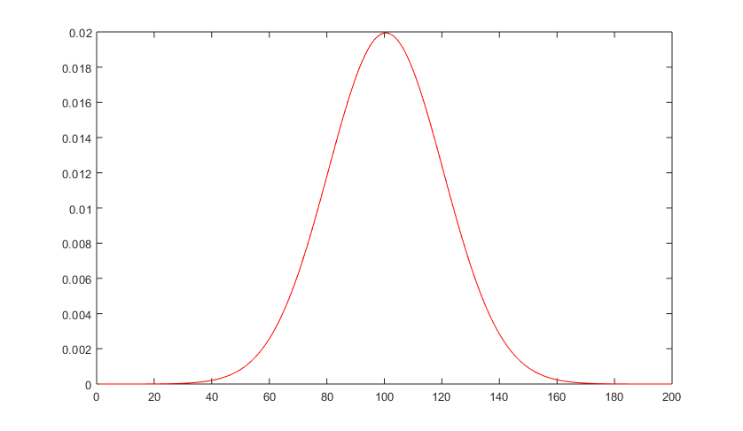](https://postimages.org/)

---

### #1023 — Amin (Topic Author)
*December 8, 2020, 3:22 PM*

I applied four constraints on transition probabilities evolving from every point. These constraints state that

1. density sums to one.

2. E[Z]=0.

3. E[Z^2]=1.

4. E[Z^3]=0.

I had four terms in the new probability equation of the form

$\bar{p}(Z_n)=\alpha p(Z_n) + \beta Z_n p(Z_n) +\gamma ({Z_n}^2 -1) p(Z_n) + \zeta ({Z_n}^3-3 Z_n) p(Z_n)$

Constraint one becomes

$\sum_1^{N_n} \bar{p}(Z_n)=\alpha \sum_1^{N_n}  p(Z_n) + \beta \sum_1^{N_n} Z_n p(Z_n) +\gamma \sum_1^{N_n} ({Z_n}^2 -1) p(Z_n) + \zeta \sum_1^{N_n} ({Z_n}^3-3 Z_n) p(Z_n)=1$

Constraint two becomes

$\sum_1^{N_n} Z_n \bar{p}(Z_n)=\alpha \sum_1^{N_n} Z_n p(Z_n) + \beta \sum_1^{N_n} {Z_n}^2 p(Z_n) +\gamma \sum_1^{N_n} Z_n ({Z_n}^2 -1) p(Z_n) + \zeta \sum_1^{N_n} Z_n ({Z_n}^3-3 Z_n) p(Z_n)=0$

Constraint three becomes

$\sum_1^{N_n} {Z_n}^2 \bar{p}(Z_n)=\alpha \sum_1^{N_n} {Z_n}^2 p(Z_n) + \beta \sum_1^{N_n} {Z_n}^3 p(Z_n) +\gamma \sum_1^{N_n} {Z_n}^2 ({Z_n}^2 -1) p(Z_n) + \zeta \sum_1^{N_n} {Z_n}^2 ({Z_n}^3-3 Z_n) p(Z_n)=1$

Constraint four becomes

$\sum_1^{N_n} {Z_n}^3 \bar{p}(Z_n)=\alpha \sum_1^{N_n} {Z_n}^3 p(Z_n) + \beta \sum_1^{N_n} {Z_n}^4 p(Z_n) +\gamma \sum_1^{N_n} {Z_n}^3 ({Z_n}^2 -1) p(Z_n) + \zeta \sum_1^{N_n} {Z_n}^3 ({Z_n}^3-3 Z_n) p(Z_n)=0$

First equation becomes

$\sum_1^{N_n} \bar{p}(Z_n)=\alpha \sum_1^{N_n}  p(Z_n) + \beta \sum_1^{N_n} Z_n p(Z_n) +\gamma \sum_1^{N_n} ({Z_n}^2 -1) p(Z_n) + \zeta \sum_1^{N_n} ({Z_n}^3-3 Z_n) p(Z_n)=1$

$a1=\sum_1^{N_n}  p(Z_n)$

$b1=\sum_1^{N_n}  Z_n p(Z_n)$

$c1=\sum_1^{N_n} ({Z_n}^2 -1) p(Z_n)$

$d1=\sum_1^{N_n} ({Z_n}^3-3 Z_n) p(Z_n)$

From second equation, we get

$\sum_1^{N_n} Z_n \bar{p}(Z_n)=\alpha \sum_1^{N_n} Z_n p(Z_n) + \beta \sum_1^{N_n} {Z_n}^2 p(Z_n) +\gamma \sum_1^{N_n} Z_n ({Z_n}^2 -1) p(Z_n) + \zeta \sum_1^{N_n} Z_n ({Z_n}^3-3 Z_n) p(Z_n)=0$

$a2=\sum_1^{N_n}  Z_n p(Z_n)$

$b2=\sum_1^{N_n}  {Z_n}^2 p(Z_n)$

$c2=\sum_1^{N_n} Z_n ({Z_n}^2 -1) p(Z_n)$

$d2=\sum_1^{N_n} Z_n ({Z_n}^3-3 Z_n) p(Z_n)$

Constraint three becomes

$\sum_1^{N_n} {Z_n}^2 \bar{p}(Z_n)=\alpha \sum_1^{N_n} {Z_n}^2 p(Z_n) + \beta \sum_1^{N_n} {Z_n}^3 p(Z_n) +\gamma \sum_1^{N_n} {Z_n}^2 ({Z_n}^2 -1) p(Z_n) + \zeta \sum_1^{N_n} {Z_n}^2 ({Z_n}^3-3 Z_n) p(Z_n)=1$

$a3=\sum_1^{N_n}  {Z_n}^2 p(Z_n)$

$b3=\sum_1^{N_n}  {Z_n}^3 p(Z_n)$

$c3=\sum_1^{N_n} {Z_n}^2 ({Z_n}^2 -1) p(Z_n)$

$d3=\sum_1^{N_n} {Z_n}^2 ({Z_n}^3-3 Z_n) p(Z_n)$

Constraint four becomes

$\sum_1^{N_n} {Z_n}^3 \bar{p}(Z_n)=\alpha \sum_1^{N_n} {Z_n}^3 p(Z_n) + \beta \sum_1^{N_n} {Z_n}^4 p(Z_n) +\gamma \sum_1^{N_n} {Z_n}^3 ({Z_n}^2 -1) p(Z_n) + \zeta \sum_1^{N_n} {Z_n}^3 ({Z_n}^3-3 Z_n) p(Z_n)=0$

$a3=\sum_1^{N_n}  {Z_n}^3 p(Z_n)$

$b3=\sum_1^{N_n}  {Z_n}^4 p(Z_n)$

$c3=\sum_1^{N_n} {Z_n}^3 ({Z_n}^2 -1) p(Z_n)$

$d3=\sum_1^{N_n} {Z_n}^3 ({Z_n}^3-3 Z_n) p(Z_n)$

with these coefficients, we solve the following four linear equations

$a1 \alpha +b1 \beta +c1 \gamma + d1 \zeta =1$

$a2 \alpha +b2 \beta +c2 \gamma + d2 \zeta =0$

$a3 \alpha +b3 \beta +c3 \gamma + d3 \zeta =1$

$a4 \alpha +b4 \beta +c4 \gamma + d4 \zeta =0$

we solve the above four equations for $\alpha$, $\beta$, $\gamma$ and $\zeta$ in general coordinates using mathematica.

and then calculate the new transition probabilities from the equation

$\bar{p}(Z_n)=\alpha p(Z_n) + \beta Z_n p(Z_n) +\gamma ({Z_n}^2 -1) p(Z_n) + \zeta ({Z_n}^3-3 Z_n) p(Z_n)$

---

### #1024 — Amin (Topic Author)
*December 13, 2020, 11:34 AM*

I noticed that Kurtosis was very slightly off 3.0 in the previous program and was something like 2.98 after 150 time
steps. I have worked on a new version of the program for normal transition probabilities simulation in which kurtosis is
also calibrated at 3.0 by adding another linear equation. Adding kurtosis to calibration also makes other moments better
by obviating negative probabilities. The new program is somewhat slower but you can run it once and save all transition
probabilities generated on a file and use them again and again.

I went ahead and added variance using Ito-Taylor as we do in monte carlo simulations but it works only with linear SDEs
and it does not work perfectly with mean reverting SDEs. This reminds me how linear SDEs were working very well with
initial versions of Ito-hermite method I was working on and mean-reverting SDEs only worked well after I approximately
solved the fokker-planck equation and used its derivatives. So we have to take directions from solution of fokker-planck
equation on how to add right variance to our transition probabilities grid.

I also noticed that some SDEs were blowing in my transition probabilities framework and there were problems with zero
but I hope that my program will give a reasonable initial framework that friends could easily modify after playing
around with it.

I will be posting a new version of transition probabilities code with proper kurtosis sometime tonight.

---

### #1025 — Amin (Topic Author)
*December 14, 2020, 1:22 PM*

Here is the new program to calculate and save transition probabilities. I notice that a few SDE runs blow at the right
end while probability density in the main body remains perfect and that could possibly be rectified by decreasing the
kurtosis/variance at the right end. You will also have to work out how to make it work when density goes to zero.

```
function [] = NormalTransProbInfinitiO4()
%copyright Infiniti Derivatives. Inital beta version to explain the
%algorithm. Next version would make the program efficient.
%In this program we evolve a normal density with transition probabilities
%framework. On each date/evolution interval, we add a unit vriance to the
%existing density using transition probabilities and calculate resulting
%density.

Tt=384;%No of time steps. On each step we add a unit
%varianceto the previous density.

%Case b starts. Nn=200
%I am using two evolving grids in transition probabilities framework.
%First grid has 200 subdivisions(wnstart:Nn)=(1:200) in case b while
%target grid has 280 subdivisions (wnstart2:Nn2)=(1:280) with the same
%grid spacing. We evolve transition normal increments and related
%transition probabilities  from all 200 points on grid one
%to all points 280 on target grid2 in this unoptimized( O(200X200))
%algorithm.
%First grid has indices from wnStart to last index Nn.wnStart is always
%equal to one in this program. Nn=200.
%Targets grid has indices from wnStart2 to last index Nn2.wnStart2 is always
%equal to one in this program. Nn2=280.

dNn=.05;   % Normal density subdivisions width. would change with number of subdivisions
Nn=200;  % No of normal density subdivisions
NnMidl=100;%One half density Subdivision left from mid of normal density(low)
NnMidh=101;%One half density subdivision right from the mid of normal density(high)
NnMid=4.0;

Nn2=280;
dNn2=.05;
Nn2Midl=140;
Nn2Midh=141;
Nn2Mid=4.0;

Z(1:Nn)=(((1:Nn)-20.5)*dNn-NnMid);
Z2(1:Nn2)=(((1:Nn2)-60.5)*dNn2-Nn2Mid);

%Case b ends Nn=200

%below is slightly less accurate case a with 100 subdivisions of the
%evolving normal density. To run this case uncomment the code block
%below and comment the block with case b. You will have to do the same
%iside the body of the program.
% %Case a starts. Nn=100
%
% dNn=.1/1;   % Normal density subdivisions width. would change with number of subdivisions
% Nn=100;  % No of normal density subdivisions
% NnMidl=50;%One half density Subdivision left from mid of normal density(low)
% NnMidh=51;%One half density subdivision right from the mid of normal density(high)
% NnMid=4.0;
%
% Nn2=140;
% dNn2=.1;
% Nn2Midl=70;
% Nn2Midh=71;
% Nn2Mid=4.0;
%
% Z(1:Nn)=(((1:Nn)-10.5)*dNn-NnMid);
% Z2(1:Nn2)=(((1:Nn2)-30.5)*dNn2-Nn2Mid);
%
% %Case a ends Nn=100

Z
Z2
str=input('Look at Zs')

ZProb(1)=normcdf(.5*Z(1)+.5*Z(2),0,1)-normcdf(.5*Z(1)+.5*Z(2)-dNn,0,1);
ZProb(Nn)=normcdf(.5*Z(Nn)+.5*Z(Nn-1)+dNn,0,1)-normcdf(.5*Z(Nn)+.5*Z(Nn-1),0,1);
ZProb(2:Nn-1)=normcdf(.5*Z(2:Nn-1)+.5*Z(3:Nn),0,1)-normcdf(.5*Z(2:Nn-1)+.5*Z(1:Nn-2),0,1);

EZwnew(1:Nn2)=0.0;
EZwprev(1:Nn)=0.0;
Pprev(1:Nn)=ZProb(1:Nn);%probability mass at starting node.
Pnew(1:Nn2)=0.0;
wnStart=1;
wnStart2=1;
for tt=1:Tt

    Zw1(1:Nn)=sqrt(tt-1)*Z(1:Nn);%Analytic value of transition probabilities originating grid.
    Zw2(1:Nn2)=sqrt(tt)*Z2(1:Nn2);%Analytic value of transition probabilities  target grid.
    Zw2a(1:Nn2)=Zw2(1:Nn2)-.5*sqrt(tt)*dNn2;%array of starting boundary of each subdivision on target grid.
    Zw2b(1:Nn2)=Zw2(1:Nn2)+.5*sqrt(tt)*dNn2;%array of ending boundary of each subdivision on target grid.

    if(tt==1)
        %In first evolution interval from delta source, there are no
        %recombinations of transition probabilities and only one set of
        %transition probabilities is evolved from origin.
        Zt0(1:Nn2)=Zw2(1:Nn2);%Calculate the value of transition normal.
        Ztpt0(1:Nn2)=0.398942.* exp(-0.5.* Zw2a(1:Nn2).^2) - 0.398942.* exp(-0.5.* Zw2b(1:Nn2).^2);
        pt0(1:Nn2)=Ztpt0(1:Nn2)./Zt0(1:Nn2);%Calculate the initial version of raw transition probabilities

        [alpha0, beta0, gamma0,eata0,zeta0] = TrProbsMatchMoments0O4(wnStart2,Nn2,Zt0,pt0);%Calculate the density moment
matching parameters.
        %pt0Corrected(1:Nn2)=alpha0.*pt0(1:Nn2)+beta0.*Zt0(1:Nn2).*pt0(1:Nn2)+gamma0.*(Zt0(1:Nn2).^2-1).*pt0(1:Nn2)+ ...
        %    eata0.*(Zt0(1:Nn2).^3-3.*Zt0(1:Nn2)).*pt0(1:Nn2);%Calculate corrected transition probabilities
        pt0Corrected(1:Nn2)=alpha0.*pt0(1:Nn2)+beta0.*Zt0(1:Nn2).*pt0(1:Nn2)+gamma0.*(Zt0(1:Nn2).^2-1).*pt0(1:Nn2) + ...
                eata0.*(Zt0(1:Nn2).^3-3*Zt0(1:Nn2)).*pt0(1:Nn2)+ ...
                zeta0.*(Zt0(1:Nn2).^4-6*Zt0(1:Nn2).^2+3).*pt0(1:Nn2);
        pt0(1:Nn2)=pt0Corrected(1:Nn2);%And assign them to pt0.
        pt0(pt01)
        for mm=1:Nn
            Zt(mm,1:Nn2)=Zw2(1:Nn2)-Zw1(mm);%Calculate the value of transition normal increment from subdivision mm on
first
            %to points 1:Nn2 on second target grid.
            Ztpt(mm,1:Nn2)=0.398942.* exp(-0.5.* (Zw2a(1:Nn2)-Zw1(mm)).^2) - 0.398942.* exp(-0.5.*
(Zw2b(1:Nn2)-Zw1(mm)).^2);
            pt(mm,1:Nn2)=Ztpt(mm,1:Nn2)./Zt(mm,1:Nn2);;%Calculate the raw value of transition probability from
subdivision mm on first
            %to points 1:Nn2 on second target grid.
        end
        %Below function calculates the parameters for all of the transition probabilities
        %from wnStart:Nn points on first grids to wnStart2:Nn2 points on second grid.
        [alpha, beta, gamma,eata,zeta] = TrProbsMatchMomentsO4(wnStart,Nn,wnStart2,Nn2,Zt,pt);

        for mm=1:Nn

            pt(mm,1:Nn2)=alpha(mm).* pt(mm,1:Nn2)+beta(mm).*Zt(mm,1:Nn2).* pt(mm,1:Nn2) +
gamma(mm).*(Zt(mm,1:Nn2).^2-1).*pt(mm,1:Nn2) + ...
                eata(mm).*(Zt(mm,1:Nn2).^3-3*Zt(mm,1:Nn2)).*pt(mm,1:Nn2)+ ...
                zeta(mm).*(Zt(mm,1:Nn2).^4-6*Zt(mm,1:Nn2).^2+3).*pt(mm,1:Nn2);

            pt1(mm,1:Nn2)=pt(mm,1:Nn2);

            pt(mm,pt(mm,:)<=0)=0.0;

            ptt(tt,mm,1:Nn2)=pt(mm,1:Nn2);
            Ztt(tt,mm,1:Nn2)=Zt(mm,1:Nn2);

            Pnew(1:Nn2)=Pnew(1:Nn2)+Pprev(mm).*pt(mm,1:Nn2);
            %Above Calculate probability mass in each subdivision on second grid.
            EZwnew(1:Nn2)=EZwnew(1:Nn2)+EZwprev(mm).*pt(mm,1:Nn2)+ ...
               Zt(mm,1:Nn2).*pt(mm,1:Nn2).*Pprev(mm);%Calculate expected transition
            %increments joining first grid and target grid on each simulation level.

            %Diagnostics below and can be commented
%             pt(mm,:)
%             pt1(mm,:)
%    %         Zt(mm,:);
%    %         pt(mm,:);
%             Sumpt=sum(pt(mm,1:Nn2))
%             sumZtpt=sum(Zt(mm,1:Nn2).*pt(mm,1:Nn2))
%             sumZt2pt=sum(Zt(mm,1:Nn2).^2.*pt(mm,1:Nn2))
%             sumZt3pt=sum(Zt(mm,1:Nn2).^3.*pt(mm,1:Nn2))
%             sumZt4pt=sum(Zt(mm,1:Nn2).^4.*pt(mm,1:Nn2))
%             mm
%             tt
%              if(rem(tt,10)==0)
%                  if(rem(mm,40)==0)
%              plot((1:Nn2),pt(mm,1:Nn2),'r',(1:Nn2),pt1(mm,1:Nn2),'b');
%              str=input('Look at Trprobs');
%                  end
%              end
        end

        %All the probability mass in first 41
        %subdivisions on target grid is assigned to starting boundary point on
        %the grid that will become smaller first grid for next simulation step.
        %similarly for last 41 points.
        Pprev(1)=sum(Pnew(1:41));
        Pprev(2:Nn-1)=Pnew(42:40+Nn-1);
        Pprev(Nn)=sum(Pnew(40+Nn:80+Nn));
        EZwprev(1)=sum(EZwnew(1:41));
        EZwprev(2:Nn-1)=EZwnew(42:40+Nn-1);
        EZwprev(Nn)=sum(EZwnew(40+Nn:80+Nn));
        %When you use case a with 100 subdivisions, uncomment below and comment the above block.
        %    Pprev(1)=sum(Pnew(1:21));
        %    Pprev(2:Nn-1)=Pnew(22:20+Nn-1);
        %    Pprev(Nn)=sum(Pnew(20+Nn:40+Nn));
        %    EZwprev(1)=sum(EZwnew(1:21));
        %    EZwprev(2:Nn-1)=EZwnew(22:20+Nn-1);
        %    EZwprev(Nn)=sum(EZwnew(20+Nn:40+Nn));

        Pnew(1:Nn2)=0;%Reset to zero for calculations on next step.
        EZwnew(1:Nn2)=0;
        %Below calculate the mean and variance of the target grid at the end
        %of each simulation step.
        Zw(1:Nn)=EZwprev(1:Nn)./ZProb(1:Nn);
        MuZw=sum(Zw(1:Nn).*ZProb(1:Nn))
        VZw=sum((Zw(1:Nn)-MuZw).^2.*ZProb(1:Nn))
        %plot((1:Nn),ZProb(1:Nn),'g',(1:Nn),Pprev(1:Nn),'r');
        %str=input('Look at graphs of target density both analytic and simulated density');

    end
end
save('C:\\Users\\Ahsan\\Documents\\MATLAB\\TrProbs.mat','ptt','Ztt');
end

```

Here is one function needed.

.

```
function [alpha, beta, gamma,eata,zeta] = TrProbsMatchMomentsO4(wnStart,Nn,wnStart2,Nn2,Zt,pt)

for mm=wnStart:Nn
    a1=sum(pt(mm,1:Nn2));
    b1=sum(Zt(mm,1:Nn2).*pt(mm,1:Nn2));
    c1=sum((Zt(mm,1:Nn2).^2-1).*pt(mm,1:Nn2));
    d1=sum((Zt(mm,1:Nn2).^3-3.*Zt(mm,1:Nn2)).*pt(mm,1:Nn2));
    g1=sum((Zt(mm,1:Nn2).^4-6.*Zt(mm,1:Nn2).^2+3).*pt(mm,1:Nn2));
    a2=sum(Zt(mm,1:Nn2).*pt(mm,1:Nn2));
    b2=sum(Zt(mm,1:Nn2).^2.*pt(mm,1:Nn2));
    c2=sum(Zt(mm,1:Nn2).*(Zt(mm,1:Nn2).^2-1).*pt(mm,1:Nn2));
    d2=sum(Zt(mm,1:Nn2).*(Zt(mm,1:Nn2).^3-3.*Zt(mm,1:Nn2)).*pt(mm,1:Nn2));
    g2=sum(Zt(mm,1:Nn2).*(Zt(mm,1:Nn2).^4-6.*Zt(mm,1:Nn2).^2+3).*pt(mm,1:Nn2));
    a3=sum(Zt(mm,1:Nn2).^2.*pt(mm,1:Nn2));
    b3=sum(Zt(mm,1:Nn2).^3.*pt(mm,1:Nn2));
    c3=sum(Zt(mm,1:Nn2).^2.*(Zt(mm,1:Nn2).^2-1).*pt(mm,1:Nn2));
    d3=sum(Zt(mm,1:Nn2).^2.*(Zt(mm,1:Nn2).^3-3*Zt(mm,1:Nn2)).*pt(mm,1:Nn2));
    g3=sum(Zt(mm,1:Nn2).^2.*(Zt(mm,1:Nn2).^4-6.*Zt(mm,1:Nn2).^2+3).*pt(mm,1:Nn2));
    a4=sum(Zt(mm,1:Nn2).^3.*pt(mm,1:Nn2));
    b4=sum(Zt(mm,1:Nn2).^3.*Zt(mm,1:Nn2).*pt(mm,1:Nn2));
    c4=sum(Zt(mm,1:Nn2).^3.*(Zt(mm,1:Nn2).^2-1).*pt(mm,1:Nn2));
    d4=sum( Zt(mm,1:Nn2).^3.*(Zt(mm,1:Nn2).^3-3.*Zt(mm,1:Nn2)).*pt(mm,1:Nn2));
    g4=sum(Zt(mm,1:Nn2).^3.*(Zt(mm,1:Nn2).^4-6.*Zt(mm,1:Nn2).^2+3).*pt(mm,1:Nn2));

    a5=sum(Zt(mm,1:Nn2).^4.*pt(mm,1:Nn2));
    b5=sum(Zt(mm,1:Nn2).^4.*Zt(mm,1:Nn2).*pt(mm,1:Nn2));
    c5=sum(Zt(mm,1:Nn2).^4.*(Zt(mm,1:Nn2).^2-1).*pt(mm,1:Nn2));
    d5=sum( Zt(mm,1:Nn2).^4.*(Zt(mm,1:Nn2).^3-3.*Zt(mm,1:Nn2)).*pt(mm,1:Nn2));
    g5=sum(Zt(mm,1:Nn2).^4.*(Zt(mm,1:Nn2).^4-6.*Zt(mm,1:Nn2).^2+3).*pt(mm,1:Nn2));

    Denominator0=   (-(((d2 *g1 - d1* g2)* (b3* g1 - b1* g3) - (b2* g1 -b1* g2)* ...
              (d3 *g1 - d1* g3))* (c4 *d2 *g1^2 - c2 *d4* g1^2 - c4* d1* g1* g2 + c1* d4* g1* g2 + c2* d1* g1* g4 - ...
            c1* d2* g1* g4) - ((d2* g1 - d1* g2)* (c3* g1 - c1* g3) - (c2 *g1 -c1* g2)* (d3* g1 - d1* g3))* ...
            ((d2* g1 - d1* g2)* (b4* g1 - b1* g4) - (b2* g1 - b1* g2)* (d4* g1 - d1* g4)))* ...
            ((c4* d2* g1^2 - c2 *d4* g1^2 - c4* d1* g1* g2 + c1* d4* g1* g2 + c2* d1 *g1* g4 - c1* d2* g1 *g4)* ...
            ((d2* g1 - d1* g2) *(a5* g1 - a1* g5) - (a2* g1 - a1* g2)* (d5* g1 - d1* g5)) - ((d2* g1 - d1* g2)* ...
            (a4* g1 - a1* g4) - (a2* g1 - a1* g2)* (d4* g1 - d1* g4))* ((d2* g1 - d1* g2)* (c5* g1 - c1* g5) - ...
            (c2* g1 - c1* g2)* (d5 *g1 - d1* g5))) + (((d2* g1 - d1* g2)* (a3* g1 - a1 *g3) - (a2* g1 - a1* g2)* ...
            (d3 *g1 - d1* g3))* (c4* d2* g1^2 - c2* d4* g1^2 - c4 *d1* g1* g2 + c1* d4 *g1 *g2 + c2* d1* g1* g4 - ...
           c1* d2* g1 *g4) - ((d2* g1 - d1* g2)* (c3* g1 - c1* g3) - (c2* g1 - c1 *g2)* (d3* g1 - d1* g3)) * ...
           ((d2* g1 - d1* g2)* (a4 *g1 - a1* g4) - (a2* g1 - a1* g2)* (d4 *g1 - d1 *g4))) *((c4 *d2 *g1^2 - ...
           c2 *d4 *g1^2 - c4* d1* g1* g2 + c1* d4* g1* g2 + c2* d1* g1* g4 - c1* d2* g1 *g4) * ...
           ((d2* g1 - d1* g2) *(b5* g1 - b1* g5) - (b2* g1 - b1 *g2)* (d5* g1 - d1* g5)) - ((d2* g1 - d1* g2)* ...
           (b4 *g1 - b1 *g4) - (b2* g1 - b1* g2)* (d4* g1 - d1* g4))* ((d2* g1 - d1* g2)* ...
           (c5* g1 - c1* g5) - (c2* g1 - c1* g2)* (d5* g1 - d1* g5))));

       Denominator1=(a5* b4* c3* d2 *g1 - a4* b5* c3 *d2* g1 - a5* b3* c4 *d2* g1 + ...
    a3* b5* c4* d2* g1 + a4* b3* c5* d2 *g1 - a3* b4* c5* d2* g1 - ...
    a5 *b4* c2* d3* g1 + a4* b5* c2* d3* g1 + a5* b2* c4* d3* g1 - ...
    a2* b5* c4* d3* g1 - a4* b2* c5* d3* g1 + a2* b4* c5* d3* g1 + ...
    a5* b3* c2* d4* g1 - a3* b5* c2* d4* g1 - a5* b2* c3* d4* g1 + ...
    a2* b5* c3* d4* g1 + a3* b2* c5* d4* g1 - a2* b3* c5* d4* g1 - ...
    a4* b3* c2* d5* g1 + a3* b4* c2* d5* g1 + a4* b2* c3* d5* g1 - ...
    a2* b4* c3* d5* g1 - a3* b2* c4* d5* g1 + a2* b3* c4* d5* g1 - ...
    a5* b4* c3* d1* g2 + a4* b5* c3* d1* g2 + a5* b3* c4* d1* g2 - ...
    a3* b5* c4* d1* g2 - a4* b3* c5* d1* g2 + a3* b4* c5* d1* g2 + ...
    a5* b4* c1* d3* g2 - a4* b5* c1* d3 *g2 - a5* b1* c4* d3* g2 + ...
    a1* b5* c4* d3* g2 + a4* b1* c5* d3* g2 - a1* b4* c5* d3* g2 - ...
    a5* b3* c1* d4* g2 + a3* b5* c1* d4* g2 + a5* b1* c3* d4* g2 - ...
    a1* b5* c3* d4* g2 - a3* b1* c5* d4* g2 + a1* b3* c5* d4* g2 + ...
    a4* b3* c1* d5* g2 - a3* b4* c1* d5* g2 - a4 *b1* c3* d5* g2 + ...
    a1* b4* c3* d5* g2 + a3* b1* c4* d5* g2 - a1* b3* c4* d5* g2 + ...
    a5* b4* c2* d1* g3 - a4* b5* c2* d1* g3 - a5* b2 *c4 *d1* g3 + ...
    a2* b5* c4 *d1* g3 + a4* b2* c5 *d1 *g3 - a2* b4* c5* d1* g3 - ...
    a5 *b4* c1* d2* g3 + a4* b5* c1* d2* g3 + a5* b1* c4* d2 *g3 - ...
    a1* b5* c4* d2* g3 - a4* b1* c5* d2* g3 + a1* b4* c5* d2 *g3 + ...
    a5* b2* c1* d4* g3 - a2* b5* c1* d4* g3 - a5* b1* c2* d4* g3 + ...
    a1* b5* c2* d4* g3 + a2* b1* c5* d4* g3 - a1 *b2* c5* d4* g3 - ...
    a4* b2* c1* d5* g3 + a2* b4* c1* d5* g3 + a4* b1* c2* d5* g3 - ...
    a1* b4* c2* d5* g3 - a2* b1* c4* d5* g3 + a1* b2* c4* d5* g3 - ...
    a5* b3* c2* d1* g4 + a3* b5* c2* d1* g4 + a5* b2* c3* d1* g4 - ...
    a2* b5* c3* d1* g4 - a3* b2* c5* d1* g4 + a2* b3* c5* d1* g4 + ...
    a5* b3* c1* d2* g4 - a3* b5* c1* d2* g4 - a5* b1* c3* d2* g4 + ...
    a1* b5* c3* d2* g4 + a3* b1* c5* d2* g4 - a1* b3* c5* d2* g4 - ...
    a5* b2* c1* d3* g4 + a2* b5* c1* d3* g4 + a5* b1* c2* d3* g4 - ...
    a1* b5* c2* d3* g4 - a2* b1* c5* d3* g4 + a1* b2* c5* d3* g4 + ...
    a3* b2* c1* d5* g4 - a2* b3* c1* d5* g4 - a3* b1* c2* d5* g4 + ...
    a1* b3* c2* d5* g4 + a2* b1* c3* d5* g4 - a1* b2* c3* d5* g4 + ...
    a4* b3* c2* d1* g5 - a3* b4* c2* d1* g5 - a4* b2* c3* d1* g5 + ...
    a2* b4* c3* d1* g5 + a3* b2* c4* d1* g5 - a2* b3* c4* d1* g5 - ...
    a4* b3* c1* d2* g5 + a3* b4* c1* d2* g5 + a4* b1* c3* d2* g5 - ...
    a1* b4* c3* d2* g5 - a3* b1* c4* d2* g5 + a1* b3* c4* d2* g5 + ...
    a4* b2* c1* d3 *g5 - a2* b4* c1* d3* g5 - a4* b1* c2* d3* g5 + ...
    a1* b4* c2* d3* g5 + a2* b1* c4* d3* g5 - a1* b2* c4* d3* g5 - ...
    a3* b2* c1* d4* g5 + a2* b3* c1* d4* g5 + a3* b1* c2* d4* g5 - ...
    a1* b3* c2* d4* g5 - a2* b1* c3* d4* g5 + a1* b2* c3* d4* g5);

    alpha(mm)= -(-(((d2 *g1 - d1* g2)* (b3* g1 - b1* g3) - (b2* g1 - b1* g2).* ...
        (d3* g1 - d1 *g3)) *(c4* d2* g1^2 - c2* d4* g1^2 - c4* d1* g1* g2 + ...
            c1* d4* g1* g2 + c2 *d1 *g1 *g4 - c1* d2* g1* g4) - ...
            ((d2* g1 - d1* g2)* (c3* g1 - c1* g3) - (c2* g1 - c1* g2)* ...
            (d3* g1 - d1* g3))* ((d2* g1 - d1* g2)* (b4 *g1 - b1* g4) -...
            (b2* g1 - b1* g2)* (d4* g1 - d1* g4)))* ((c4* d2* g1^2 - c2* d4* g1^2 - ...
            c4* d1* g1* g2 + c1* d4* g1* g2 + c2* d1* g1* g4 - c1* d2* g1* g4)* ...
            ((d2* g1 - d1* g2)* (-3 *g1 + g5) - g2* (d5* g1 - d1* g5)) - ((d2* g1 - d1* g2)* g4 - ...
           g2 *(d4* g1 - d1* g4))* ((d2* g1 - d1* g2)* (c5* g1 - c1* g5) - (c2* g1 - c1* g2)* ...
           (d5* g1 - d1* g5))) + (((d2* g1 - d1* g2)* (-g1 + g3) - g2* (d3* g1 - d1* g3))* ...
           (c4* d2* g1^2 - c2* d4* g1^2 - c4* d1* g1* g2 + c1* d4* g1* g2 + c2* d1* g1* g4 - ...
           c1* d2* g1* g4) - ((d2* g1 - d1* g2) *(c3 *g1 - c1* g3) - (c2* g1 - c1* g2)* ...
           (d3* g1 - d1* g3))* ((d2* g1 - d1* g2)* g4 - g2* (d4* g1 - d1* g4)))* ...
           ((c4* d2* g1^2 - c2* d4* g1^2 - c4* d1* g1 *g2 + c1* d4* g1* g2 + c2 *d1* g1 *g4 - ...
           c1* d2* g1* g4)* ((d2* g1 - d1 *g2)* (b5* g1 - b1* g5) - (b2* g1 - b1* g2)* (d5 *g1 - d1* g5)) - ...
           ((d2* g1 - d1* g2)* (b4* g1 -b1* g4) - (b2 *g1 - b1* g2)* (d4 *g1 - d1 *g4))* ((d2 *g1 - d1 *g2) * ...
           (c5* g1 - c1* g5) - (c2* g1 - c1* g2)* (d5* g1 - d1* g5))))/ Denominator0;

    beta(mm)=   -(3 *a4* c3 *d2 *g1 - 3 *a3* c4* d2* g1 + a5* c4* d2* g1 - a4* c5* d2* g1 - ...
    3* a4* c2* d3* g1 + 3* a2* c4* d3* g1 + 3* a3* c2* d4* g1 - a5* c2* d4* g1 - ...
    3 *a2* c3* d4* g1 + a2* c5* d4* g1 + a4* c2* d5* g1 - a2* c4* d5* g1 - ...
    3 *a4* c3* d1* g2 + 3 *a3* c4* d1* g2 - a5* c4 *d1 *g2 + a4* c5* d1* g2 + ...
    3 *a4* c1* d3* g2 - 3* a1* c4* d3* g2 + a5* c4* d3* g2 - a4* c5* d3* g2 - ...
    3 *a3* c1* d4* g2 + a5* c1* d4* g2 + 3 *a1* c3* d4 *g2 - a5* c3 *d4* g2 - ...
    a1* c5* d4* g2 + a3* c5* d4* g2 - a4* c1* d5 *g2 + a4* c3* d5 *g2 +  ...
    a1 *c4 *d5* g2 - a3* c4* d5* g2 + 3 *a4* c2* d1* g3 - 3* a2* c4* d1* g3 - ...
    3 *a4* c1* d2* g3 + 3 *a1* c4* d2* g3 - a5 *c4* d2* g3 + a4* c5* d2* g3 + ...
    3* a2* c1* d4* g3 - 3* a1* c2* d4 *g3 + a5* c2* d4* g3 - a2* c5* d4* g3 - ...
    a4* c2* d5* g3 + a2* c4* d5 *g3 - 3* a3* c2* d1* g4 + a5* c2* d1* g4 + ...
    3 *a2 *c3* d1* g4 - a2* c5 *d1* g4 + 3* a3* c1* d2* g4 - a5* c1* d2* g4 - ...
    3* a1* c3* d2* g4 + a5* c3* d2* g4 + a1* c5* d2* g4 - a3* c5* d2* g4 - ...
    3* a2* c1* d3* g4 + 3* a1* c2* d3* g4 - a5* c2* d3* g4 + a2* c5 *d3 *g4 +  ...
    a2* c1* d5* g4 - a1* c2* d5* g4 + a3* c2* d5* g4 - a2* c3 *d5* g4 - ...
    a4* c2* d1* g5 + a2* c4* d1* g5 + a4* c1* d2* g5 - a4 *c3* d2* g5 - ...
    a1 *c4* d2* g5 + a3* c4* d2* g5 + a4* c2* d3* g5 - a2* c4 *d3 *g5 - ...
    a2 *c1* d4* g5 + a1* c2* d4* g5 - a3 *c2* d4* g5 + a2* c3* d4* g5)/ Denominator1;

   gamma(mm)=-(3* a4* b3* d2 *g1 - 3 *a3 *b4 *d2 *g1 + a5* b4* d2* g1 - a4* b5* d2 *g1 - ...
   3* a4* b2* d3* g1 + 3* a2* b4* d3* g1 + 3* a3* b2* d4* g1 - a5* b2* d4* g1 - ...
   3* a2* b3* d4* g1 + a2* b5* d4* g1 + a4* b2* d5* g1 - a2* b4* d5* g1 - ...
   3* a4* b3* d1* g2 + 3* a3* b4* d1* g2 - a5 *b4* d1* g2 + a4* b5* d1* g2 + ...
   3* a4* b1* d3* g2 - 3 *a1* b4* d3* g2 + a5* b4* d3* g2 - a4* b5* d3* g2 - ...
   3 *a3* b1* d4* g2 + a5* b1* d4* g2 + 3* a1* b3* d4* g2 - a5* b3* d4* g2 - ...
   a1* b5* d4* g2 + a3* b5* d4* g2 - a4* b1* d5* g2 + a4* b3* d5* g2 + ...
   a1* b4* d5* g2 - a3* b4* d5* g2 + 3 *a4* b2* d1* g3 - 3* a2* b4* d1* g3 - ...
   3* a4* b1* d2* g3 + 3* a1 *b4 *d2 *g3 - a5* b4* d2* g3 + a4* b5* d2* g3 + ...
   3* a2* b1* d4* g3 - 3* a1* b2* d4 *g3 + a5* b2* d4* g3 - a2* b5* d4* g3 - ...
   a4* b2* d5* g3 + a2* b4* d5* g3 - 3 *a3* b2* d1 *g4 + a5* b2* d1* g4 + ...
   3* a2* b3* d1* g4 - a2* b5* d1* g4 + 3 *a3* b1* d2* g4 - a5* b1* d2* g4 - ...
   3* a1* b3* d2* g4 + a5* b3* d2* g4 + a1* b5* d2* g4 - a3* b5* d2* g4 - ...
   3* a2* b1* d3* g4 + 3 *a1* b2* d3* g4 - a5 *b2* d3* g4 + a2 *b5* d3* g4 + ...
   a2* b1* d5* g4 - a1* b2* d5* g4 + a3* b2* d5* g4 - a2* b3* d5* g4 - ...
   a4* b2* d1* g5 + a2* b4* d1* g5 + a4* b1* d2 *g5 - a4* b3* d2* g5 - ...
   a1* b4* d2* g5 + a3* b4* d2* g5 + a4* b2* d3* g5 - a2* b4* d3* g5 -  ...
   a2* b1* d4* g5 + a1* b2* d4* g5 - a3* b2* d4* g5 + a2* b3* d4* g5)/(-Denominator1);

eata(mm)=-(3 *a4* b3 *c2* g1 - 3* a3* b4* c2 *g1 + a5* b4 *c2* g1 - a4* b5* c2* g1 - ...
    3* a4* b2* c3* g1 + 3* a2* b4* c3* g1 + 3* a3* b2* c4* g1 - a5* b2* c4 *g1 - ...
    3* a2* b3* c4* g1 + a2* b5* c4* g1 + a4* b2* c5* g1 - a2* b4* c5* g1 - ...
    3* a4* b3* c1* g2 + 3* a3* b4 *c1 *g2 - a5 *b4* c1* g2 + a4 *b5* c1* g2 + ...
    3* a4* b1* c3* g2 - 3* a1* b4* c3* g2 + a5* b4* c3* g2 - a4* b5* c3* g2 - ...
    3* a3* b1* c4* g2 + a5* b1* c4* g2 + 3 *a1 *b3* c4* g2 - a5* b3* c4* g2 - ...
    a1* b5* c4* g2 + a3* b5* c4* g2 - a4* b1* c5* g2 + a4* b3* c5* g2 + ...
    a1* b4* c5* g2 - a3* b4* c5* g2 + 3 *a4 *b2* c1* g3 - 3 *a2* b4* c1* g3 - ...
    3* a4* b1* c2* g3 + 3* a1 *b4 *c2 *g3 - a5* b4 *c2 *g3 + a4* b5 *c2 *g3 + ...
    3 *a2* b1* c4* g3 - 3* a1* b2* c4* g3 + a5* b2* c4* g3 - a2* b5* c4* g3 - ...
    a4* b2* c5* g3 + a2* b4* c5* g3 - 3* a3* b2 *c1* g4 + a5* b2* c1* g4 + ...
    3* a2* b3* c1* g4 - a2* b5* c1* g4 + 3* a3* b1* c2* g4 - a5* b1* c2* g4 - ...
    3* a1* b3* c2* g4 + a5* b3* c2* g4 + a1* b5* c2* g4 - a3* b5* c2* g4 - ...
    3* a2 *b1* c3* g4 + 3 *a1* b2* c3* g4 - a5* b2* c3* g4 + a2* b5* c3* g4 + ...
    a2 *b1* c5* g4 - a1* b2* c5* g4 + a3* b2* c5* g4 - a2 *b3 *c5* g4 - ...
    a4* b2* c1* g5 + a2* b4* c1* g5 + a4* b1* c2* g5 - a4* b3* c2* g5 - ...
    a1* b4* c2* g5 + a3* b4* c2* g5 + a4* b2* c3* g5 - a2* b4* c3* g5 - ...
    a2* b1* c4* g5 + a1* b2* c4* g5 - a3* b2* c4 *g5 + a2* b3* c4* g5)/(Denominator1);

zeta(mm)=-(3* a4* b3* c2* d1 - 3* a3* b4* c2* d1 + a5* b4* c2* d1 - a4* b5* c2* d1 - ...
   3* a4* b2* c3* d1 + 3 *a2* b4* c3* d1 + 3 *a3* b2* c4* d1 - a5 *b2* c4* d1 -  ...
   3* a2* b3* c4* d1 + a2* b5* c4* d1 + a4* b2* c5* d1 - a2* b4* c5* d1 - ...
   3* a4* b3* c1* d2 + 3* a3* b4* c1* d2 - a5* b4* c1* d2 + a4* b5* c1* d2 + ...
   3 *a4 *b1* c3* d2 - 3* a1* b4* c3* d2 + a5* b4* c3* d2 - a4* b5* c3 *d2 - ...
   3 *a3 *b1* c4* d2 + a5* b1* c4* d2 + 3* a1* b3* c4 *d2 - a5* b3* c4 *d2 - ...
   a1* b5* c4* d2 + a3* b5* c4* d2 - a4* b1* c5* d2 + a4* b3* c5* d2 + ...
   a1* b4* c5* d2 - a3* b4* c5* d2 + 3 *a4* b2* c1* d3 - 3* a2* b4* c1* d3 - ...
   3* a4* b1* c2* d3 + 3 *a1* b4* c2* d3 - a5 *b4* c2* d3 + a4* b5* c2* d3 + ...
   3* a2* b1* c4* d3 - 3* a1* b2* c4* d3 + a5* b2* c4* d3 - a2* b5* c4* d3 - ...
   a4* b2* c5* d3 + a2* b4* c5* d3 - 3* a3* b2* c1* d4 + a5 *b2* c1* d4 + ...
   3* a2* b3* c1* d4 - a2* b5* c1* d4 + 3* a3* b1* c2* d4 - a5* b1* c2* d4 - ...
   3 *a1* b3* c2* d4 + a5* b3* c2* d4 + a1 *b5* c2* d4 - a3* b5* c2* d4 - ...
   3 *a2* b1* c3* d4 + 3* a1* b2* c3* d4 - a5* b2* c3* d4 + a2* b5 *c3 *d4 + ...
   a2* b1* c5* d4 - a1* b2* c5* d4 + a3* b2* c5* d4 - a2* b3* c5 *d4 - ...
   a4* b2* c1* d5 + a2* b4* c1* d5 + a4* b1* c2* d5 - a4* b3* c2* d5 - ...
   a1* b4* c2* d5 + a3 *b4 *c2* d5 + a4 *b2* c3* d5 - a2* b4* c3 *d5 - ...
   a2* b1* c4* d5 + a1* b2* c4* d5 - a3* b2* c4* d5 + a2* b3* c4* d5)/(-Denominator1);

end

end
```

Here is a second function needed.

.

```
function [alpha, beta, gamma,eata,zeta] = TrProbsMatchMoments0O4(wnStart2,Nn2,Zt,pt)

    a1=sum(pt(1:Nn2));
    b1=sum(Zt(1:Nn2).*pt(1:Nn2));
    c1=sum((Zt(1:Nn2).^2-1).*pt(1:Nn2));
    d1=sum((Zt(1:Nn2).^3-3.*Zt(1:Nn2)).*pt(1:Nn2));
    g1=sum((Zt(1:Nn2).^4-6.*Zt(1:Nn2).^2+3).*pt(1:Nn2));
    a2=sum(Zt(1:Nn2).*pt(1:Nn2));
    b2=sum(Zt(1:Nn2).^2.*pt(1:Nn2));
    c2=sum(Zt(1:Nn2).*(Zt(1:Nn2).^2-1).*pt(1:Nn2));
    d2=sum(Zt(1:Nn2).*(Zt(1:Nn2).^3-3.*Zt(1:Nn2)).*pt(1:Nn2));
    g2=sum(Zt(1:Nn2).*(Zt(1:Nn2).^4-6.*Zt(1:Nn2).^2+3).*pt(1:Nn2));
    a3=sum(Zt(1:Nn2).^2.*pt(1:Nn2));
    b3=sum(Zt(1:Nn2).^3.*pt(1:Nn2));
    c3=sum(Zt(1:Nn2).^2.*(Zt(1:Nn2).^2-1).*pt(1:Nn2));
    d3=sum(Zt(1:Nn2).^2.*(Zt(1:Nn2).^3-3*Zt(1:Nn2)).*pt(1:Nn2));
    g3=sum(Zt(1:Nn2).^2.*(Zt(1:Nn2).^4-6.*Zt(1:Nn2).^2+3).*pt(1:Nn2));
    a4=sum(Zt(1:Nn2).^3.*pt(1:Nn2));
    b4=sum(Zt(1:Nn2).^3.*Zt(1:Nn2).*pt(1:Nn2));
    c4=sum(Zt(1:Nn2).^3.*(Zt(1:Nn2).^2-1).*pt(1:Nn2));
    d4=sum( Zt(1:Nn2).^3.*(Zt(1:Nn2).^3-3.*Zt(1:Nn2)).*pt(1:Nn2));
    g4=sum(Zt(1:Nn2).^3.*(Zt(1:Nn2).^4-6.*Zt(1:Nn2).^2+3).*pt(1:Nn2));

    a5=sum(Zt(1:Nn2).^4.*pt(1:Nn2));
    b5=sum(Zt(1:Nn2).^4.*Zt(1:Nn2).*pt(1:Nn2));
    c5=sum(Zt(1:Nn2).^4.*(Zt(1:Nn2).^2-1).*pt(1:Nn2));
    d5=sum( Zt(1:Nn2).^4.*(Zt(1:Nn2).^3-3.*Zt(1:Nn2)).*pt(1:Nn2));
    g5=sum(Zt(1:Nn2).^4.*(Zt(1:Nn2).^4-6.*Zt(1:Nn2).^2+3).*pt(1:Nn2));

    Denominator0=   (-(((d2 *g1 - d1* g2)* (b3* g1 - b1* g3) - (b2* g1 -b1* g2)* ...
              (d3 *g1 - d1* g3))* (c4 *d2 *g1^2 - c2 *d4* g1^2 - c4* d1* g1* g2 + c1* d4* g1* g2 + c2* d1* g1* g4 - ...
            c1* d2* g1* g4) - ((d2* g1 - d1* g2)* (c3* g1 - c1* g3) - (c2 *g1 -c1* g2)* (d3* g1 - d1* g3))* ...
            ((d2* g1 - d1* g2)* (b4* g1 - b1* g4) - (b2* g1 - b1* g2)* (d4* g1 - d1* g4)))* ...
            ((c4* d2* g1^2 - c2 *d4* g1^2 - c4* d1* g1* g2 + c1* d4* g1* g2 + c2* d1 *g1* g4 - c1* d2* g1 *g4)* ...
            ((d2* g1 - d1* g2) *(a5* g1 - a1* g5) - (a2* g1 - a1* g2)* (d5* g1 - d1* g5)) - ((d2* g1 - d1* g2)* ...
            (a4* g1 - a1* g4) - (a2* g1 - a1* g2)* (d4* g1 - d1* g4))* ((d2* g1 - d1* g2)* (c5* g1 - c1* g5) - ...
            (c2* g1 - c1* g2)* (d5 *g1 - d1* g5))) + (((d2* g1 - d1* g2)* (a3* g1 - a1 *g3) - (a2* g1 - a1* g2)* ...
            (d3 *g1 - d1* g3))* (c4* d2* g1^2 - c2* d4* g1^2 - c4 *d1* g1* g2 + c1* d4 *g1 *g2 + c2* d1* g1* g4 - ...
           c1* d2* g1 *g4) - ((d2* g1 - d1* g2)* (c3* g1 - c1* g3) - (c2* g1 - c1 *g2)* (d3* g1 - d1* g3)) * ...
           ((d2* g1 - d1* g2)* (a4 *g1 - a1* g4) - (a2* g1 - a1* g2)* (d4 *g1 - d1 *g4))) *((c4 *d2 *g1^2 - ...
           c2 *d4 *g1^2 - c4* d1* g1* g2 + c1* d4* g1* g2 + c2* d1* g1* g4 - c1* d2* g1 *g4) * ...
           ((d2* g1 - d1* g2) *(b5* g1 - b1* g5) - (b2* g1 - b1 *g2)* (d5* g1 - d1* g5)) - ((d2* g1 - d1* g2)* ...
           (b4 *g1 - b1 *g4) - (b2* g1 - b1* g2)* (d4* g1 - d1* g4))* ((d2* g1 - d1* g2)* ...
           (c5* g1 - c1* g5) - (c2* g1 - c1* g2)* (d5* g1 - d1* g5))));

       Denominator1=(a5* b4* c3* d2 *g1 - a4* b5* c3 *d2* g1 - a5* b3* c4 *d2* g1 + ...
    a3* b5* c4* d2* g1 + a4* b3* c5* d2 *g1 - a3* b4* c5* d2* g1 - ...
    a5 *b4* c2* d3* g1 + a4* b5* c2* d3* g1 + a5* b2* c4* d3* g1 - ...
    a2* b5* c4* d3* g1 - a4* b2* c5* d3* g1 + a2* b4* c5* d3* g1 + ...
    a5* b3* c2* d4* g1 - a3* b5* c2* d4* g1 - a5* b2* c3* d4* g1 + ...
    a2* b5* c3* d4* g1 + a3* b2* c5* d4* g1 - a2* b3* c5* d4* g1 - ...
    a4* b3* c2* d5* g1 + a3* b4* c2* d5* g1 + a4* b2* c3* d5* g1 - ...
    a2* b4* c3* d5* g1 - a3* b2* c4* d5* g1 + a2* b3* c4* d5* g1 - ...
    a5* b4* c3* d1* g2 + a4* b5* c3* d1* g2 + a5* b3* c4* d1* g2 - ...
    a3* b5* c4* d1* g2 - a4* b3* c5* d1* g2 + a3* b4* c5* d1* g2 + ...
    a5* b4* c1* d3* g2 - a4* b5* c1* d3 *g2 - a5* b1* c4* d3* g2 + ...
    a1* b5* c4* d3* g2 + a4* b1* c5* d3* g2 - a1* b4* c5* d3* g2 - ...
    a5* b3* c1* d4* g2 + a3* b5* c1* d4* g2 + a5* b1* c3* d4* g2 - ...
    a1* b5* c3* d4* g2 - a3* b1* c5* d4* g2 + a1* b3* c5* d4* g2 + ...
    a4* b3* c1* d5* g2 - a3* b4* c1* d5* g2 - a4 *b1* c3* d5* g2 + ...
    a1* b4* c3* d5* g2 + a3* b1* c4* d5* g2 - a1* b3* c4* d5* g2 + ...
    a5* b4* c2* d1* g3 - a4* b5* c2* d1* g3 - a5* b2 *c4 *d1* g3 + ...
    a2* b5* c4 *d1* g3 + a4* b2* c5 *d1 *g3 - a2* b4* c5* d1* g3 - ...
    a5 *b4* c1* d2* g3 + a4* b5* c1* d2* g3 + a5* b1* c4* d2 *g3 - ...
    a1* b5* c4* d2* g3 - a4* b1* c5* d2* g3 + a1* b4* c5* d2 *g3 + ...
    a5* b2* c1* d4* g3 - a2* b5* c1* d4* g3 - a5* b1* c2* d4* g3 + ...
    a1* b5* c2* d4* g3 + a2* b1* c5* d4* g3 - a1 *b2* c5* d4* g3 - ...
    a4* b2* c1* d5* g3 + a2* b4* c1* d5* g3 + a4* b1* c2* d5* g3 - ...
    a1* b4* c2* d5* g3 - a2* b1* c4* d5* g3 + a1* b2* c4* d5* g3 - ...
    a5* b3* c2* d1* g4 + a3* b5* c2* d1* g4 + a5* b2* c3* d1* g4 - ...
    a2* b5* c3* d1* g4 - a3* b2* c5* d1* g4 + a2* b3* c5* d1* g4 + ...
    a5* b3* c1* d2* g4 - a3* b5* c1* d2* g4 - a5* b1* c3* d2* g4 + ...
    a1* b5* c3* d2* g4 + a3* b1* c5* d2* g4 - a1* b3* c5* d2* g4 - ...
    a5* b2* c1* d3* g4 + a2* b5* c1* d3* g4 + a5* b1* c2* d3* g4 - ...
    a1* b5* c2* d3* g4 - a2* b1* c5* d3* g4 + a1* b2* c5* d3* g4 + ...
    a3* b2* c1* d5* g4 - a2* b3* c1* d5* g4 - a3* b1* c2* d5* g4 + ...
    a1* b3* c2* d5* g4 + a2* b1* c3* d5* g4 - a1* b2* c3* d5* g4 + ...
    a4* b3* c2* d1* g5 - a3* b4* c2* d1* g5 - a4* b2* c3* d1* g5 + ...
    a2* b4* c3* d1* g5 + a3* b2* c4* d1* g5 - a2* b3* c4* d1* g5 - ...
    a4* b3* c1* d2* g5 + a3* b4* c1* d2* g5 + a4* b1* c3* d2* g5 - ...
    a1* b4* c3* d2* g5 - a3* b1* c4* d2* g5 + a1* b3* c4* d2* g5 + ...
    a4* b2* c1* d3 *g5 - a2* b4* c1* d3* g5 - a4* b1* c2* d3* g5 + ...
    a1* b4* c2* d3* g5 + a2* b1* c4* d3* g5 - a1* b2* c4* d3* g5 - ...
    a3* b2* c1* d4* g5 + a2* b3* c1* d4* g5 + a3* b1* c2* d4* g5 - ...
    a1* b3* c2* d4* g5 - a2* b1* c3* d4* g5 + a1* b2* c3* d4* g5);

    alpha= -(-(((d2 *g1 - d1* g2)* (b3* g1 - b1* g3) - (b2* g1 - b1* g2).* ...
        (d3* g1 - d1 *g3)) *(c4* d2* g1^2 - c2* d4* g1^2 - c4* d1* g1* g2 + ...
            c1* d4* g1* g2 + c2 *d1 *g1 *g4 - c1* d2* g1* g4) - ...
            ((d2* g1 - d1* g2)* (c3* g1 - c1* g3) - (c2* g1 - c1* g2)* ...
            (d3* g1 - d1* g3))* ((d2* g1 - d1* g2)* (b4 *g1 - b1* g4) -...
            (b2* g1 - b1* g2)* (d4* g1 - d1* g4)))* ((c4* d2* g1^2 - c2* d4* g1^2 - ...
            c4* d1* g1* g2 + c1* d4* g1* g2 + c2* d1* g1* g4 - c1* d2* g1* g4)* ...
            ((d2* g1 - d1* g2)* (-3 *g1 + g5) - g2* (d5* g1 - d1* g5)) - ((d2* g1 - d1* g2)* g4 - ...
           g2 *(d4* g1 - d1* g4))* ((d2* g1 - d1* g2)* (c5* g1 - c1* g5) - (c2* g1 - c1* g2)* ...
           (d5* g1 - d1* g5))) + (((d2* g1 - d1* g2)* (-g1 + g3) - g2* (d3* g1 - d1* g3))* ...
           (c4* d2* g1^2 - c2* d4* g1^2 - c4* d1* g1* g2 + c1* d4* g1* g2 + c2* d1* g1* g4 - ...
           c1* d2* g1* g4) - ((d2* g1 - d1* g2) *(c3 *g1 - c1* g3) - (c2* g1 - c1* g2)* ...
           (d3* g1 - d1* g3))* ((d2* g1 - d1* g2)* g4 - g2* (d4* g1 - d1* g4)))* ...
           ((c4* d2* g1^2 - c2* d4* g1^2 - c4* d1* g1 *g2 + c1* d4* g1* g2 + c2 *d1* g1 *g4 - ...
           c1* d2* g1* g4)* ((d2* g1 - d1 *g2)* (b5* g1 - b1* g5) - (b2* g1 - b1* g2)* (d5 *g1 - d1* g5)) - ...
           ((d2* g1 - d1* g2)* (b4* g1 -b1* g4) - (b2 *g1 - b1* g2)* (d4 *g1 - d1 *g4))* ((d2 *g1 - d1 *g2) * ...
           (c5* g1 - c1* g5) - (c2* g1 - c1* g2)* (d5* g1 - d1* g5))))/ Denominator0;

    beta=   -(3 *a4* c3 *d2 *g1 - 3 *a3* c4* d2* g1 + a5* c4* d2* g1 - a4* c5* d2* g1 - ...
    3* a4* c2* d3* g1 + 3* a2* c4* d3* g1 + 3* a3* c2* d4* g1 - a5* c2* d4* g1 - ...
    3 *a2* c3* d4* g1 + a2* c5* d4* g1 + a4* c2* d5* g1 - a2* c4* d5* g1 - ...
    3 *a4* c3* d1* g2 + 3 *a3* c4* d1* g2 - a5* c4 *d1 *g2 + a4* c5* d1* g2 + ...
    3 *a4* c1* d3* g2 - 3* a1* c4* d3* g2 + a5* c4* d3* g2 - a4* c5* d3* g2 - ...
    3 *a3* c1* d4* g2 + a5* c1* d4* g2 + 3 *a1* c3* d4 *g2 - a5* c3 *d4* g2 - ...
    a1* c5* d4* g2 + a3* c5* d4* g2 - a4* c1* d5 *g2 + a4* c3* d5 *g2 +  ...
    a1 *c4 *d5* g2 - a3* c4* d5* g2 + 3 *a4* c2* d1* g3 - 3* a2* c4* d1* g3 - ...
    3 *a4* c1* d2* g3 + 3 *a1* c4* d2* g3 - a5 *c4* d2* g3 + a4* c5* d2* g3 + ...
    3* a2* c1* d4* g3 - 3* a1* c2* d4 *g3 + a5* c2* d4* g3 - a2* c5* d4* g3 - ...
    a4* c2* d5* g3 + a2* c4* d5 *g3 - 3* a3* c2* d1* g4 + a5* c2* d1* g4 + ...
    3 *a2 *c3* d1* g4 - a2* c5 *d1* g4 + 3* a3* c1* d2* g4 - a5* c1* d2* g4 - ...
    3* a1* c3* d2* g4 + a5* c3* d2* g4 + a1* c5* d2* g4 - a3* c5* d2* g4 - ...
    3* a2* c1* d3* g4 + 3* a1* c2* d3* g4 - a5* c2* d3* g4 + a2* c5 *d3 *g4 +  ...
    a2* c1* d5* g4 - a1* c2* d5* g4 + a3* c2* d5* g4 - a2* c3 *d5* g4 - ...
    a4* c2* d1* g5 + a2* c4* d1* g5 + a4* c1* d2* g5 - a4 *c3* d2* g5 - ...
    a1 *c4* d2* g5 + a3* c4* d2* g5 + a4* c2* d3* g5 - a2* c4 *d3 *g5 - ...
    a2 *c1* d4* g5 + a1* c2* d4* g5 - a3 *c2* d4* g5 + a2* c3* d4* g5)/ Denominator1;

   gamma=-(3* a4* b3* d2 *g1 - 3 *a3 *b4 *d2 *g1 + a5* b4* d2* g1 - a4* b5* d2 *g1 - ...
   3* a4* b2* d3* g1 + 3* a2* b4* d3* g1 + 3* a3* b2* d4* g1 - a5* b2* d4* g1 - ...
   3* a2* b3* d4* g1 + a2* b5* d4* g1 + a4* b2* d5* g1 - a2* b4* d5* g1 - ...
   3* a4* b3* d1* g2 + 3* a3* b4* d1* g2 - a5 *b4* d1* g2 + a4* b5* d1* g2 + ...
   3* a4* b1* d3* g2 - 3 *a1* b4* d3* g2 + a5* b4* d3* g2 - a4* b5* d3* g2 - ...
   3 *a3* b1* d4* g2 + a5* b1* d4* g2 + 3* a1* b3* d4* g2 - a5* b3* d4* g2 - ...
   a1* b5* d4* g2 + a3* b5* d4* g2 - a4* b1* d5* g2 + a4* b3* d5* g2 + ...
   a1* b4* d5* g2 - a3* b4* d5* g2 + 3 *a4* b2* d1* g3 - 3* a2* b4* d1* g3 - ...
   3* a4* b1* d2* g3 + 3* a1 *b4 *d2 *g3 - a5* b4* d2* g3 + a4* b5* d2* g3 + ...
   3* a2* b1* d4* g3 - 3* a1* b2* d4 *g3 + a5* b2* d4* g3 - a2* b5* d4* g3 - ...
   a4* b2* d5* g3 + a2* b4* d5* g3 - 3 *a3* b2* d1 *g4 + a5* b2* d1* g4 + ...
   3* a2* b3* d1* g4 - a2* b5* d1* g4 + 3 *a3* b1* d2* g4 - a5* b1* d2* g4 - ...
   3* a1* b3* d2* g4 + a5* b3* d2* g4 + a1* b5* d2* g4 - a3* b5* d2* g4 - ...
   3* a2* b1* d3* g4 + 3 *a1* b2* d3* g4 - a5 *b2* d3* g4 + a2 *b5* d3* g4 + ...
   a2* b1* d5* g4 - a1* b2* d5* g4 + a3* b2* d5* g4 - a2* b3* d5* g4 - ...
   a4* b2* d1* g5 + a2* b4* d1* g5 + a4* b1* d2 *g5 - a4* b3* d2* g5 - ...
   a1* b4* d2* g5 + a3* b4* d2* g5 + a4* b2* d3* g5 - a2* b4* d3* g5 -  ...
   a2* b1* d4* g5 + a1* b2* d4* g5 - a3* b2* d4* g5 + a2* b3* d4* g5)/(-Denominator1);

eata=-(3 *a4* b3 *c2* g1 - 3* a3* b4* c2 *g1 + a5* b4 *c2* g1 - a4* b5* c2* g1 - ...
    3* a4* b2* c3* g1 + 3* a2* b4* c3* g1 + 3* a3* b2* c4* g1 - a5* b2* c4 *g1 - ...
    3* a2* b3* c4* g1 + a2* b5* c4* g1 + a4* b2* c5* g1 - a2* b4* c5* g1 - ...
    3* a4* b3* c1* g2 + 3* a3* b4 *c1 *g2 - a5 *b4* c1* g2 + a4 *b5* c1* g2 + ...
    3* a4* b1* c3* g2 - 3* a1* b4* c3* g2 + a5* b4* c3* g2 - a4* b5* c3* g2 - ...
    3* a3* b1* c4* g2 + a5* b1* c4* g2 + 3 *a1 *b3* c4* g2 - a5* b3* c4* g2 - ...
    a1* b5* c4* g2 + a3* b5* c4* g2 - a4* b1* c5* g2 + a4* b3* c5* g2 + ...
    a1* b4* c5* g2 - a3* b4* c5* g2 + 3 *a4 *b2* c1* g3 - 3 *a2* b4* c1* g3 - ...
    3* a4* b1* c2* g3 + 3* a1 *b4 *c2 *g3 - a5* b4 *c2 *g3 + a4* b5 *c2 *g3 + ...
    3 *a2* b1* c4* g3 - 3* a1* b2* c4* g3 + a5* b2* c4* g3 - a2* b5* c4* g3 - ...
    a4* b2* c5* g3 + a2* b4* c5* g3 - 3* a3* b2 *c1* g4 + a5* b2* c1* g4 + ...
    3* a2* b3* c1* g4 - a2* b5* c1* g4 + 3* a3* b1* c2* g4 - a5* b1* c2* g4 - ...
    3* a1* b3* c2* g4 + a5* b3* c2* g4 + a1* b5* c2* g4 - a3* b5* c2* g4 - ...
    3* a2 *b1* c3* g4 + 3 *a1* b2* c3* g4 - a5* b2* c3* g4 + a2* b5* c3* g4 + ...
    a2 *b1* c5* g4 - a1* b2* c5* g4 + a3* b2* c5* g4 - a2 *b3 *c5* g4 - ...
    a4* b2* c1* g5 + a2* b4* c1* g5 + a4* b1* c2* g5 - a4* b3* c2* g5 - ...
    a1* b4* c2* g5 + a3* b4* c2* g5 + a4* b2* c3* g5 - a2* b4* c3* g5 - ...
    a2* b1* c4* g5 + a1* b2* c4* g5 - a3* b2* c4 *g5 + a2* b3* c4* g5)/(Denominator1);

zeta=-(3* a4* b3* c2* d1 - 3* a3* b4* c2* d1 + a5* b4* c2* d1 - a4* b5* c2* d1 - ...
   3* a4* b2* c3* d1 + 3 *a2* b4* c3* d1 + 3 *a3* b2* c4* d1 - a5 *b2* c4* d1 -  ...
   3* a2* b3* c4* d1 + a2* b5* c4* d1 + a4* b2* c5* d1 - a2* b4* c5* d1 - ...
   3* a4* b3* c1* d2 + 3* a3* b4* c1* d2 - a5* b4* c1* d2 + a4* b5* c1* d2 + ...
   3 *a4 *b1* c3* d2 - 3* a1* b4* c3* d2 + a5* b4* c3* d2 - a4* b5* c3 *d2 - ...
   3 *a3 *b1* c4* d2 + a5* b1* c4* d2 + 3* a1* b3* c4 *d2 - a5* b3* c4 *d2 - ...
   a1* b5* c4* d2 + a3* b5* c4* d2 - a4* b1* c5* d2 + a4* b3* c5* d2 + ...
   a1* b4* c5* d2 - a3* b4* c5* d2 + 3 *a4* b2* c1* d3 - 3* a2* b4* c1* d3 - ...
   3* a4* b1* c2* d3 + 3 *a1* b4* c2* d3 - a5 *b4* c2* d3 + a4* b5* c2* d3 + ...
   3* a2* b1* c4* d3 - 3* a1* b2* c4* d3 + a5* b2* c4* d3 - a2* b5* c4* d3 - ...
   a4* b2* c5* d3 + a2* b4* c5* d3 - 3* a3* b2* c1* d4 + a5 *b2* c1* d4 + ...
   3* a2* b3* c1* d4 - a2* b5* c1* d4 + 3* a3* b1* c2* d4 - a5* b1* c2* d4 - ...
   3 *a1* b3* c2* d4 + a5* b3* c2* d4 + a1 *b5* c2* d4 - a3* b5* c2* d4 - ...
   3 *a2* b1* c3* d4 + 3* a1* b2* c3* d4 - a5* b2* c3* d4 + a2* b5 *c3 *d4 + ...
   a2* b1* c5* d4 - a1* b2* c5* d4 + a3* b2* c5* d4 - a2* b3* c5 *d4 - ...
   a4* b2* c1* d5 + a2* b4* c1* d5 + a4* b1* c2* d5 - a4* b3* c2* d5 - ...
   a1* b4* c2* d5 + a3 *b4 *c2* d5 + a4 *b2* c3* d5 - a2* b4* c3 *d5 - ...
   a2* b1* c4* d5 + a1* b2* c4* d5 - a3* b2* c4* d5 + a2* b3* c4* d5)/(-Denominator1);

end

```

---

### #1026 — Amin (Topic Author)
*December 23, 2020, 11:54 AM*

Friends, I was not able to work for quite a long time and just recently got back to start working on the project. For
past few days, I have been working on how to perfectly simulate the mean-reversion and other difficult SDEs on the
standard normal transition probabilities based grid. Though I could not conclude the work, I was able to add a few extra
terms in transition probabilities framework that greatly improve the fit to difficult SDEs. Encouraged by these
experimental results, I feel certain that we would be able to solve the mean-reverting and different other difficult
SDEs easily in a few weeks. I will be posting these programs here later tonight or possibly by tomorrow. I hope friends
will find my programs helpful in their own research. I have to make a few minor changes to the program structure and as
soon as I complete them, I will post the program here after adding comments.

---

### #1027 — Amin (Topic Author)
*December 24, 2020, 7:39 AM*

Here are the new programs for simulation of SDEs in transition probabilities framework where an evolving normal
transition probabilities grid is used and mean and noise terms of SDE are defined over this grid. I have still remained
in Bessel transformed SDEs framework.

When you run this program, please make sure that you look at figure zoomed at main body of the graph. Sometimes all the
SDE is properly simulated but the tail explodes for some reason so you would know. These are minor issues that will be
fixed in next versions of the program.

Here is the main program.

```
function [] = SDETransProb08WmtGrid200()

%Copyright Ahsan Amin. Infiniti derivatives Technologies.
%Please fell free to connect on linkedin: linkedin.com/in/ahsan-amin-0a53334
%or skype ahsan.amin2999
%In this program, I am simulating the SDE given as
%dy(t)=mu1 x(t)^beta1 dt + mu2 x(t)^beta2 dt +sigma x(t)^gamma dz(t)

%I have not directly simulated the SDE but simulated the transformed
%Besse1 process version of the SDE and then changed coordinates to retreive
%the SDE in original coo
%rdinates.
%The present program will analytically evolve only the Bessel Process version of the
%SDE in transformed coordinates.
%When you run this program, please make sure that you look at graph zoomed
%at main body of the graph. Sometimes all the SDE is properly simulated but
%the tail explodes for some reason so you would know. These are minor
%issues that will be fixed in next versions of the program.
dt=.125/8/2/2/2;   % Simulation time interval.%Fodiffusions close to zero
             %decrease dt for accuracy.
Tt=64*4/4*4/1*2;     % Number of simulation levels. Terminal time= Tt*dt; //.125/32*32*16=2 year;
T=Tt*dt;
OrderA=4;  %
OrderM=4;  %
dtM=dt*4*2*2*2;
TtM=Tt/4/2/2/2;

dNn=.05;   % Normal density subdivisions width. would change with number of subdivisions
Nn=200;  % No of normal density subdivisions
NnMidl=100;%One half density Subdivision left from mid of normal density(low)
NnMidh=101;%One half density subdivision right from the mid of normal density(high)
NnMid=4.0;

Nn2=280;
dNn2=.05;
Nn2Midl=140;
Nn2Midh=141;
Nn2Mid=4.0;

x0=1.00;   % starting value of SDE
beta1=0.0;
beta2=1.00;   % Second drift term power.
gamma=.75;%50;   % volatility power.
kappa=1.0;%.950;   %mean reversion parameter.
theta=.250;%mean reversion target
sigma0=.850;%Volatility value

%you can specify any general mu1 and mu2 and beta1 and beta2.
mu1=+1*theta*kappa;   %first drift coefficient.
mu2=-1*kappa;    % Second drift coefficient.
%mu1=0;
%mu2=0;

alpha=1;% x^alpha is being expanded. This is currently for monte carlo only.
alpha1=1-gamma;%This is for expansion of integrals for calculation of drift
%and volatility coefficients

w(1:Nn)=x0^(1-gamma)/(1-gamma);

%Z(1:Nn)=(((1:Nn)-5.5)*dNn-NnMid);
Z(1:Nn)=(((1:Nn)-20.5)*dNn-NnMid);
Z2(1:Nn2)=(((1:Nn2)-60.5)*dNn2-Nn2Mid);

Z
Z2
str=input('Look at Zs')
ZProb(1)=normcdf(.5*Z(1)+.5*Z(2),0,1)-normcdf(.5*Z(1)+.5*Z(2)-dNn,0,1);
ZProb(Nn)=normcdf(.5*Z(Nn)+.5*Z(Nn-1)+dNn,0,1)-normcdf(.5*Z(Nn)+.5*Z(Nn-1),0,1);
ZProb(2:Nn-1)=normcdf(.5*Z(2:Nn-1)+.5*Z(3:Nn),0,1)-normcdf(.5*Z(2:Nn-1)+.5*Z(1:Nn-2),0,1);
    %Above calculate probability mass in each probability subdivision.

%%%%%%%%%%%%%%%%%%%%%%%%%%%%%%%%%%%%%%%%%%%%%%%%%%%%%%%%%%%%%%%%%%%%%%%%%%%%%%%%%%%%%%%%%%%%%%

sigma11(1:OrderA+1)=0;
mu11(1:OrderA+1)=0;
mu22(1:OrderA+1)=0;
sigma22(1:OrderA+1)=0;
% index 1 correponds to zero level since matlab indexing starts at one.
sigma11(1)=1;
mu11(1)=1;
mu22(1)=1;
sigma22(1)=1;

for k=1:(OrderA+1)
    if sigma0~=0
        sigma11(k)=sigma0^(k-1);
    end
    if mu1 ~= 0
        mu11(k)=mu1^(k-1);
    end
    if mu2 ~= 0
        mu22(k)=mu2^(k-1);
    end
    if sigma0~=0
        sigma22(k)=sigma0^(2*(k-1));
    end
end
%Ft(1:TtM+1,1:(OrderA+1),1:(OrderA+1),1:(OrderA+1),1:(OrderA+1))=0; %General time powers on hermite polynomials
Fp(1:(OrderA+1),1:(OrderA+1),1:(OrderA+1),1:(OrderA+1))=0;%General x powers on coefficients of hermite polynomials.
Fp1(1:(OrderA+1),1:(OrderA+1),1:(OrderA+1),1:(OrderA+1))=0;%General x powers for bessel transformed coordinates.

%YCoeff0 and YCoeff are coefficents for original coordinates monte carlo.
%YqCoeff0 and YqCoeff are bessel/lamperti version monte carlo.

YCoeff0(1:(OrderA+1),1:(OrderA+1),1:(OrderA+1),1:(OrderA+1))=0;
YqCoeff0(1:(OrderA+1),1:(OrderA+1),1:(OrderA+1),1:(OrderA+1))=0;
%Pre-compute the time and power exponent values in small multi-dimensional arrays
YCoeff = ItoTaylorCoeffsNew(alpha,beta1,beta2,gamma); %expand y^alpha where alpha=1;
YqCoeff = ItoTaylorCoeffsNew(alpha1,beta1,beta2,gamma);%expand y^alpha1 where alpha1=(1-gamma)
YqCoeff=YqCoeff/(1-gamma); %Transformed coordinates coefficients have to be
%further divided by (1-gamma)

for k = 0 : (OrderA)
    for m = 0:k
        l4 = k - m + 1;
        for n = 0 : m
            l3 = m - n + 1;
            for j = 0:n
                l2 = n - j + 1;
                l1 = j + 1;
                %Ft(l1,l2,l3,l4) = dtM^((l1-1) + (l2-1) + (l3-1) + .5* (l4-1));
                Fp(l1,l2,l3,l4) = (alpha + (l1-1) * beta1 + (l2-1) * beta2 + (l3-1) * 2* gamma + (l4-1) * gamma ...
                    - (l1-1) - (l2-1) - 2* (l3-1) - (l4-1));
                Fp1(l1,l2,l3,l4) = (alpha1 + (l1-1) * beta1 + (l2-1) * beta2 + (l3-1) * 2* gamma + (l4-1) * gamma ...
                    - (l1-1) - (l2-1) - 2* (l3-1) - (l4-1));

                YCoeff0(l1,l2,l3,l4) =YCoeff(l1,l2,l3,l4).*mu11(l1).*mu22(l2).*sigma22(l3).*sigma11(l4);
                YqCoeff0(l1,l2,l3,l4) =YqCoeff(l1,l2,l3,l4).*mu11(l1).*mu22(l2).*sigma22(l3).*sigma11(l4);
            end
        end
    end
end

%%%%%%%%%%%%%%%%%%%%%%%%%%%%%%%%%%%%%%%%%%%%%%%%%%%%%%%%%%%%%%%%%%%%%%%%%%%%%%%%%%%%%%%%%%%%%%
%Current program has 50 grid points. I have divided every grid subdivision
%into three further subdivisions with probabilities P0,Pb,Pa.

wnStart=1;%
yy(wnStart:Nn)=((1-gamma)*w(wnStart:Nn)).^(1/(1-gamma));
%The above yy(wnStart:Nn)=x0;

   Pprev(1:Nn)=ZProb(1:Nn);%probability mass at starting node.
   Pnew(1:Nn2)=0.0;
   EZwnew(1:Nn2)=0.0;
   EZwprev(1:Nn)=0.0;
   Ewnew(1:Nn2)=0;
   Ewprev(1:Nn)=0;
   Ew1new(1:Nn2)=0;
   Ew1prev(1:Nn)=0;

tic

load('C:\\Users\\Ahsan\\Documents\\MATLAB\\TrProbs0O4.mat','pt0','Zt0');
load('C:\\Users\\Ahsan\\Documents\\MATLAB\\TrProbsO4.mat','ptt','Ztt','ptA','ptB');

for tt=1:Tt
    if(tt==1)

        [wMu0dt,c1,c22] = CalculateDriftAndVolA8Trans(w,wnStart,Nn,YqCoeff0,Fp1,gamma,dt);
        Pnew(1:Nn2)=pt0(1:Nn2);
        EZwnew(1:Nn2)=pt0(1:Nn2).*Zt0(1:Nn2);
        Ewnew(1:Nn2)=(x0^(1-gamma)/(1-gamma)+wMu0dt(1)+c1(1).*Zt0(1:Nn2)+c22(1).*(Zt0(1:Nn2).^2-1)).*pt0(1:Nn2);
        Ew1new(1:Nn2)=(x0^(1-gamma)/(1-gamma)+wMu0dt(1)+c1(1).*Zt0(1:Nn2)+c22(1).*(Zt0(1:Nn2).^2-1)).*pt0(1:Nn2);

    end
    if(tt>1)
        %Convert the expected values in each cell to standard Values associated with the grid cell after removing the
        %integrated probability in the cell.
        w(1:Nn)=Ewprev(1:Nn)./Pprev(1:Nn);
        w1(1:Nn)=Ew1prev(1:Nn)./Pprev(1:Nn);
        [wMu0dt,wMu1dt,dwMu0dtdw,d2wMu0dtdw2,c1] = CalculateDriftAndVolA404(w,wnStart,Nn,YqCoeff0,Fp1,gamma,dt);
        wMu0dt(w(:)wb(:))=wb(wa(:)>wb(:));%Be careful;might not universally hold;
        %if(w(Nn)>(2*w(Nn-1)-w(Nn-2)))
        %    w(Nn)=(2*w(Nn-1)-w(Nn-2));
        %end

    end

        Pprev(1)=sum(Pnew(1:41));
        Pprev(2:Nn-1)=Pnew(42:40+Nn-1);
        Pprev(Nn)=sum(Pnew(40+Nn:80+Nn));%All the probability mass in last 41
        %subdivisions on target grid is assigned to end boundary point on
        %the grid that will become smaller first grid for next simulation step.

        EZwprev(1)=sum(EZwnew(1:41));
        EZwprev(2:Nn-1)=EZwnew(42:40+Nn-1);
        EZwprev(Nn)=sum(EZwnew(40+Nn:80+Nn));

        Ewprev(1)=sum(Ewnew(1:41));
        Ewprev(2:Nn-1)=Ewnew(42:40+Nn-1);
        Ewprev(Nn)=sum(Ewnew(40+Nn:80+Nn));

        Ew1prev(1)=sum(Ew1new(1:41));
        Ew1prev(2:Nn-1)=Ew1new(42:40+Nn-1);
        Ew1prev(Nn)=sum(Ew1new(40+Nn:80+Nn));

       Pnew(1:Nn2)=0;
       Ewnew(1:Nn2)=0.0;
       Ew1new(1:Nn2)=0.0;
       EZwnew(1:Nn2)=0.0;

end

plot((1:Nn),ZProb(1:Nn),'g',(1:Nn),Pprev(1:Nn),'r');
%plot((1:Nn),ZProb(1:Nn),'g',(1:Nn),Pprev(1:Nn),'r');
%str=input('Look at distributions');

Pnew=Pprev;
%Convert the expected values in each cell to standard Values associated with the grid cell after removing the
%integrated probability in the cell.
w(wnStart:Nn)=Ewprev(wnStart:Nn)./Pprev(wnStart:Nn);
w1(wnStart:Nn)=Ew1prev(wnStart:Nn)./Pprev(wnStart:Nn);
yy(wnStart:Nn)=((1-gamma)*w(wnStart:Nn)).^(1/(1-gamma));
yy1(wnStart:Nn)=((1-gamma)*w1(wnStart:Nn)).^(1/(1-gamma));

%below D's (the names of variables starting with D) are
%change of probability derivatives.

y_w(1:Nn)=0;
y_w(wnStart:Nn) = ((1-gamma)*w(wnStart:Nn)).^(1/(1-gamma));
y_w1(1:Nn)=0;
y_w1(wnStart:Nn) = ((1-gamma)*w1(wnStart:Nn)).^(1/(1-gamma));
Dfy_w(wnStart:Nn)=0;
Dfy_w1(wnStart:Nn)=0;
for nn=wnStart+1:Nn-1
    Dfy_w(nn) = (y_w(nn + 1) - y_w(nn - 1))/(Z(nn + 1) - Z(nn - 1));
    Dfy_w1(nn) = (y_w1(nn + 1) - y_w1(nn - 1))/(Z(nn + 1) - Z(nn - 1));
    %Change of variable derivative for densities
end
py_w(1:Nn)=0;
py_w1(1:Nn)=0;
for nn = wnStart:Nn-1
    py_w(nn) = (normpdf(Z(nn),0, 1))/abs(Dfy_w(nn));%Origianl coordinates density
    py_w1(nn) = (normpdf(Z(nn),0, 1))/abs(Dfy_w1(nn));
end

toc

ItoHermiteMean=sum(y_w(wnStart+1:Nn-1).*ZProb(wnStart+1:Nn-1)) %Original process average from coordinates
disp('true Mean only applicable to standard SV mean reverting type models otherwise disregard');
TrueMean=theta+(x0-theta)*exp(-kappa*dt*Tt)%Mean reverting SDE original variable true average

rng(29079137, 'twister')
paths=200000;
YY(1:paths)=x0;  %Original process monte carlo.
Random1(1:paths)=0;
for tt=1:TtM

    Random1=randn(size(Random1));
    HermiteP1(1,1:paths)=1;
    HermiteP1(2,1:paths)=Random1(1:paths);
    HermiteP1(3,1:paths)=Random1(1:paths).^2-1;
    HermiteP1(4,1:paths)=Random1(1:paths).^3-3*Random1(1:paths);
    HermiteP1(5,1:paths)=Random1(1:paths).^4-6*Random1(1:paths).^2+3;

    YY(1:paths)=YY(1:paths) + ...
        (YCoeff0(1,1,2,1).*YY(1:paths).^Fp(1,1,2,1)+ ...
        YCoeff0(1,2,1,1).*YY(1:paths).^Fp(1,2,1,1)+ ...
        YCoeff0(2,1,1,1).*YY(1:paths).^Fp(2,1,1,1))*dtM + ...
        (YCoeff0(1,1,3,1).*YY(1:paths).^Fp(1,1,3,1)+ ...
        YCoeff0(1,2,2,1).*YY(1:paths).^Fp(1,2,2,1)+ ...
        YCoeff0(2,1,2,1).*YY(1:paths).^Fp(2,1,2,1)+ ...
        YCoeff0(1,3,1,1).*YY(1:paths).^Fp(1,3,1,1)+ ...
        YCoeff0(2,2,1,1).*YY(1:paths).^Fp(2,2,1,1)+ ...
        YCoeff0(3,1,1,1).*YY(1:paths).^Fp(3,1,1,1))*dtM^2 + ...
        ((YCoeff0(1,1,1,2).*YY(1:paths).^Fp(1,1,1,2).*sqrt(dtM))+ ...
        (YCoeff0(1,1,2,2).*YY(1:paths).^Fp(1,1,2,2)+ ...
        YCoeff0(1,2,1,2).*YY(1:paths).^Fp(1,2,1,2)+ ...
        YCoeff0(2,1,1,2).*YY(1:paths).^Fp(2,1,1,2)).*dtM^1.5) .*HermiteP1(2,1:paths) + ...
        ((YCoeff0(1,1,1,3).*YY(1:paths).^Fp(1,1,1,3) *dtM) + ...
        (YCoeff0(1,1,2,3).*YY(1:paths).^Fp(1,1,2,3)+ ...
        YCoeff0(1,2,1,3).*YY(1:paths).^Fp(1,2,1,3)+ ...
        YCoeff0(2,1,1,3).*YY(1:paths).^Fp(2,1,1,3)).*dtM^2).*HermiteP1(3,1:paths) + ...
        ((YCoeff0(1,1,1,4).*YY(1:paths).^Fp(1,1,1,4)*dtM^1.5 )).*HermiteP1(4,1:paths) + ...
        (YCoeff0(1,1,1,5).*YY(1:paths).^Fp(1,1,1,5)*dtM^2.0).*HermiteP1(5,1:paths);

end

YY(YY<0)=0;
disp('Original process average from monte carlo');
MCMean=sum(YY(:))/paths %origianl coordinates monte carlo average.
MCVar=sum((YY(:)-MCMean).^2)/paths
disp('Original process average from our simulation');
ItoHermiteMean=sum(y_w(wnStart+1:Nn-1).*ZProb(wnStart+1:Nn-1)) %Original process average from coordinates
ItoHermiteVar=sum((y_w(wnStart+1:Nn-1)-ItoHermiteMean).^2.*ZProb(wnStart+1:Nn-1))
disp('true Mean only applicble to standard SV mean reverting type models otherwise disregard');
TrueMean=theta+(x0-theta)*exp(-kappa*dt*Tt)%Mean reverting SDE original variable true average

MaxCutOff=30;
NoOfBins=round(300*gamma^2*4*sigma0/sqrt(MCMean)/(1+kappa));%Decrease the number of bins if the graph is too
[YDensity,IndexOutY,IndexMaxY] = MakeDensityFromSimulation_Infiniti_NEW(YY,paths,NoOfBins,MaxCutOff );

plot(y_w1(wnStart+1:Nn-1),py_w1(wnStart+1:Nn-1),'b',y_w(wnStart+1:Nn-1),py_w(wnStart+1:Nn-1),'r',IndexOutY(1:IndexMaxY),YDensity(1:IndexMaxY),'g');

title(sprintf('x0 = %.4f,theta=%.3f,kappa=%.2f,gamma=%.3f,sigma=%.2f,T=%.2f,dt=%.5f,M=%.4f,TM=%.4f',
x0,theta,kappa,gamma,sigma0,T,dt,ItoHermiteMean,TrueMean));%,sprintf('theta= %f', theta), sprintf('kappa = %f',
kappa),sprintf('sigma = %f', sigma0),sprintf('T = %f', T));

legend({'Base terms Model Density','Improvised terms Model Density','Monte Carlo Density'},'Location','northeast')

str=input('red line is density of SDE from transition probabilities method, green is monte carlo.');
end
```

You will need a few functions to run the above program.

.

```
function [] = NormalTransProbInfinitiO4()
%copyright Infiniti Derivatives. Inital beta version to explain the
%algorithm. Next version would make the program efficient.
%In this program we evolve a normal density with transition probabilities
%framework. On each date/evolution interval, we add a unit vriance to the
%existing density using transition probabilities and calculate resulting
%density.

Tt=512;%No of time steps. On each step we add a unit
%varianceto the previous density.

%Case b starts. Nn=200
%I am using two evolving grids in transition probabilities framework.
%First grid has 200 subdivisions(wnstart:Nn)=(1:200) in case b while
%target grid has 280 subdivisions (wnstart2:Nn2)=(1:280) with the same
%grid spacing. We evolve transition normal increments and related
%transition probabilities  from all 200 points on grid one
%to all points 280 on target grid2 in this unoptimized( O(200X200))
%algorithm.
%First grid has indices from wnStart to last index Nn.wnStart is always
%equal to one in this program. Nn=200.
%Targets grid has indices from wnStart2 to last index Nn2.wnStart2 is always
%equal to one in this program. Nn2=280.

dNn=.05;   % Normal density subdivisions width. would change with number of subdivisions
Nn=200;  % No of normal density subdivisions
NnMidl=100;%One half density Subdivision left from mid of normal density(low)
NnMidh=101;%One half density subdivision right from the mid of normal density(high)
NnMid=4.0;

Nn2=280;
dNn2=.05;
Nn2Midl=140;
Nn2Midh=141;
Nn2Mid=4.0;

Z(1:Nn)=(((1:Nn)-20.5)*dNn-NnMid);
Z2(1:Nn2)=(((1:Nn2)-60.5)*dNn2-Nn2Mid);

%Case b ends Nn=200

%below is slightly less accurate case a with 100 subdivisions of the
%evolving normal density. To run this case uncomment the code block
%below and comment the block with case b. You will have to do the same
%iside the body of the program.
% %Case a starts. Nn=100
%
% dNn=.1/1;   % Normal density subdivisions width. would change with number of subdivisions
% Nn=100;  % No of normal density subdivisions
% NnMidl=50;%One half density Subdivision left from mid of normal density(low)
% NnMidh=51;%One half density subdivision right from the mid of normal density(high)
% NnMid=4.0;
%
% Nn2=140;
% dNn2=.1;
% Nn2Midl=70;
% Nn2Midh=71;
% Nn2Mid=4.0;
%
% Z(1:Nn)=(((1:Nn)-10.5)*dNn-NnMid);
% Z2(1:Nn2)=(((1:Nn2)-30.5)*dNn2-Nn2Mid);
%
% %Case a ends Nn=100

Z
Z2
str=input('Look at Zs')

ZProb(1)=normcdf(.5*Z(1)+.5*Z(2),0,1)-normcdf(.5*Z(1)+.5*Z(2)-dNn,0,1);
ZProb(Nn)=normcdf(.5*Z(Nn)+.5*Z(Nn-1)+dNn,0,1)-normcdf(.5*Z(Nn)+.5*Z(Nn-1),0,1);
ZProb(2:Nn-1)=normcdf(.5*Z(2:Nn-1)+.5*Z(3:Nn),0,1)-normcdf(.5*Z(2:Nn-1)+.5*Z(1:Nn-2),0,1);

EZwnew(1:Nn2)=0.0;
EZwprev(1:Nn)=0.0;
Pprev(1:Nn)=ZProb(1:Nn);%probability mass at starting node.
Pnew(1:Nn2)=0.0;
wnStart=1;
wnStart2=1;
ptA(1:Nn,1:Tt)=0;
ptB(1:Nn,1:Tt)=0;
for tt=1:Tt

    Zw1(1:Nn)=sqrt(tt-1)*Z(1:Nn);%Analytic value of transition probabilities originating grid.
    Zw2(1:Nn2)=sqrt(tt)*Z2(1:Nn2);%Analytic value of transition probabilities  target grid.
    Zw2a(1:Nn2)=Zw2(1:Nn2)-.5*sqrt(tt)*dNn2;%array of starting boundary of each subdivision on target grid.
    Zw2b(1:Nn2)=Zw2(1:Nn2)+.5*sqrt(tt)*dNn2;%array of ending boundary of each subdivision on target grid.

    if(tt==1)
        %In first evolution interval from delta source, there are no
        %recombinations of transition probabilities and only one set of
        %transition probabilities is evolved from origin.
        Zt0(1:Nn2)=Zw2(1:Nn2);%Calculate the value of transition normal.
        Ztpt0(1:Nn2)=0.398942.* exp(-0.5.* Zw2a(1:Nn2).^2) - 0.398942.* exp(-0.5.* Zw2b(1:Nn2).^2);
        pt0(1:Nn2)=Ztpt0(1:Nn2)./Zt0(1:Nn2);%Calculate the initial version of raw transition probabilities

        [alpha0, beta0, gamma0,eata0,zeta0] = TrProbsMatchMoments0O4(wnStart2,Nn2,Zt0,pt0);%Calculate the density moment
matching parameters.
        %pt0Corrected(1:Nn2)=alpha0.*pt0(1:Nn2)+beta0.*Zt0(1:Nn2).*pt0(1:Nn2)+gamma0.*(Zt0(1:Nn2).^2-1).*pt0(1:Nn2)+ ...
        %    eata0.*(Zt0(1:Nn2).^3-3.*Zt0(1:Nn2)).*pt0(1:Nn2);%Calculate corrected transition probabilities
        pt0Corrected(1:Nn2)=alpha0.*pt0(1:Nn2)+beta0.*Zt0(1:Nn2).*pt0(1:Nn2)+gamma0.*(Zt0(1:Nn2).^2-1).*pt0(1:Nn2) + ...
                eata0.*(Zt0(1:Nn2).^3-3*Zt0(1:Nn2)).*pt0(1:Nn2)+ ...
                zeta0.*(Zt0(1:Nn2).^4-6*Zt0(1:Nn2).^2+3).*pt0(1:Nn2);
        pt0(1:Nn2)=pt0Corrected(1:Nn2);%And assign them to pt0.
        pt0(pt01)
        for mm=1:Nn
            Zt(mm,1:Nn2)=Zw2(1:Nn2)-Zw1(mm);%Calculate the value of transition normal increment from subdivision mm on
first
            %to points 1:Nn2 on second target grid.
            Ztpt(mm,1:Nn2)=0.398942.* exp(-0.5.* (Zw2a(1:Nn2)-Zw1(mm)).^2) - 0.398942.* exp(-0.5.*
(Zw2b(1:Nn2)-Zw1(mm)).^2);
            pt(mm,1:Nn2)=Ztpt(mm,1:Nn2)./Zt(mm,1:Nn2);;%Calculate the raw value of transition probability from
subdivision mm on first
            %to points 1:Nn2 on second target grid.
        end
        %Below function calculates the parameters for all of the transition probabilities
        %from wnStart:Nn points on first grids to wnStart2:Nn2 points on second grid.
        [alpha, beta, gamma,eata,zeta] = TrProbsMatchMomentsO4(wnStart,Nn,wnStart2,Nn2,Zt,pt);

        for mm=1:Nn

            pt(mm,1:Nn2)=alpha(mm).* pt(mm,1:Nn2)+beta(mm).*Zt(mm,1:Nn2).* pt(mm,1:Nn2) +
gamma(mm).*(Zt(mm,1:Nn2).^2-1).*pt(mm,1:Nn2) + ...
                eata(mm).*(Zt(mm,1:Nn2).^3-3*Zt(mm,1:Nn2)).*pt(mm,1:Nn2)+ ...
                zeta(mm).*(Zt(mm,1:Nn2).^4-6*Zt(mm,1:Nn2).^2+3).*pt(mm,1:Nn2);

            pt1(mm,1:Nn2)=pt(mm,1:Nn2);

            pt(mm,pt(mm,:).00000000001)&&(StartFlag==0))
                    ptA(mm,tt)=pp;
                    StartFlag=1;
                    %EndFlag=0;
                end
                if(pt(mm,pp)>.00000000001)
                    ptB(mm,tt)=pp;
                end
            end
        end

%        ptA(:,tt)
%        ptB(:,tt)
%str=input('Look at boundaries');

    end

end
save('C:\\Users\\Ahsan\\Documents\\MATLAB\\TrProbsO4.mat','ptt','Ztt','ptA','ptB');
end
```

Another function you will need.

.

```
function [wMu0dt,wMu1dt,dwMu0dtdw,d2wMu0dtdw2,c1] = CalculateDriftAndVolA404(w,wnStart,Nn,YqCoeff0,Fp1,gamma,dt)

yy(wnStart:Nn)=((1-gamma)*w(wnStart:Nn)).^(1/(1-gamma));

Fp2=Fp1/(1-gamma);

wMu0dt(wnStart:Nn)=(YqCoeff0(1,1,2,1).*yy(wnStart:Nn).^Fp1(1,1,2,1)+ ...
    YqCoeff0(1,2,1,1).*yy(wnStart:Nn).^Fp1(1,2,1,1)+ ...
    YqCoeff0(2,1,1,1).*yy(wnStart:Nn).^Fp1(2,1,1,1))*dt + ...
    (YqCoeff0(1,1,3,1).*yy(wnStart:Nn).^Fp1(1,1,3,1)+ ...
    YqCoeff0(1,2,2,1).*yy(wnStart:Nn).^Fp1(1,2,2,1)+ ...
    YqCoeff0(2,1,2,1).*yy(wnStart:Nn).^Fp1(2,1,2,1)+ ...
    YqCoeff0(1,3,1,1).*yy(wnStart:Nn).^Fp1(1,3,1,1)+ ...
    YqCoeff0(2,2,1,1).*yy(wnStart:Nn).^Fp1(2,2,1,1)+ ...
    YqCoeff0(3,1,1,1).*yy(wnStart:Nn).^Fp1(3,1,1,1))*dt^2;% + ...
%     (YqCoeff0(1,1,4,1).*yy(wnStart:Nn).^Fp1(1,1,4,1)+ ...
%     YqCoeff0(1,2,3,1).*yy(wnStart:Nn).^Fp1(1,2,3,1)+ ...
%     YqCoeff0(2,1,3,1).*yy(wnStart:Nn).^Fp1(2,1,3,1)+ ...
%     YqCoeff0(1,3,2,1).*yy(wnStart:Nn).^Fp1(1,3,2,1)+ ...
%     YqCoeff0(2,2,2,1).*yy(wnStart:Nn).^Fp1(2,2,2,1)+ ...
%     YqCoeff0(3,1,2,1).*yy(wnStart:Nn).^Fp1(3,1,2,1)+ ...
%     YqCoeff0(1,4,1,1).*yy(wnStart:Nn).^Fp1(1,4,1,1)+ ...
%     YqCoeff0(2,3,1,1).*yy(wnStart:Nn).^Fp1(2,3,1,1)+ ...
%     YqCoeff0(3,2,1,1).*yy(wnStart:Nn).^Fp1(3,2,1,1)+ ...
%     YqCoeff0(4,1,1,1).*yy(wnStart:Nn).^Fp1(4,1,1,1))*dt^3;%+ ...
%     (YqCoeff0(1,1,5,1).*yy(wnStart:Nn).^Fp1(1,1,5,1)+ ...
%      YqCoeff0(1,2,4,1).*yy(wnStart:Nn).^Fp1(1,2,4,1)+ ...
%      YqCoeff0(2,1,4,1).*yy(wnStart:Nn).^Fp1(2,1,4,1)+ ...
%      YqCoeff0(2,1,1,1).*yy(wnStart:Nn).^Fp1(2,1,1,1)+ ...
%       YqCoeff0(2,2,3,1).*yy(wnStart:Nn).^Fp1(2,2,3,1)+ ...
%       YqCoeff0(3,1,3,1).*yy(wnStart:Nn).^Fp1(3,1,3,1)+ ...
%       YqCoeff0(1,4,2,1).*yy(wnStart:Nn).^Fp1(1,4,2,1)+ ...
%       YqCoeff0(2,3,2,1).*yy(wnStart:Nn).^Fp1(2,3,2,1)+ ...
%       YqCoeff0(3,2,2,1).*yy(wnStart:Nn).^Fp1(3,2,2,1)+ ...
%       YqCoeff0(4,1,2,1).*yy(wnStart:Nn).^Fp1(4,1,2,1)+ ...
%       YqCoeff0(1,5,1,1).*yy(wnStart:Nn).^Fp1(1,5,1,1)+ ...
%       YqCoeff0(2,4,1,1).*yy(wnStart:Nn).^Fp1(2,4,1,1)+ ...
%       YqCoeff0(3,3,1,1).*yy(wnStart:Nn).^Fp1(3,3,1,1)+  ...
%       YqCoeff0(4,2,1,1).*yy(wnStart:Nn).^Fp1(4,2,1,1)+ ...
%       YqCoeff0(5,1,1,1).*yy(wnStart:Nn).^Fp1(5,1,1,1))*dt^4;

wMu1dt(wnStart:Nn)=(YqCoeff0(1,1,3,1).*yy(wnStart:Nn).^Fp1(1,1,3,1)+ ...
    YqCoeff0(1,2,2,1).*yy(wnStart:Nn).^Fp1(1,2,2,1)+ ...
    YqCoeff0(2,1,2,1).*yy(wnStart:Nn).^Fp1(2,1,2,1)+ ...
    YqCoeff0(1,3,1,1).*yy(wnStart:Nn).^Fp1(1,3,1,1)+ ...
    YqCoeff0(2,2,1,1).*yy(wnStart:Nn).^Fp1(2,2,1,1)+ ...
    YqCoeff0(3,1,1,1).*yy(wnStart:Nn).^Fp1(3,1,1,1))*dt^2;% + ...

dwMu0dtdw(wnStart:Nn)=(YqCoeff0(1,1,2,1).*Fp1(1,1,2,1).*((1-gamma).*w(wnStart:Nn)).^(-1+Fp2(1,1,2,1))+ ...
    YqCoeff0(1,2,1,1).*Fp1(1,2,1,1).*((1-gamma).*w(wnStart:Nn)).^(-1+Fp2(1,2,1,1))+ ...
    YqCoeff0(2,1,1,1).*Fp1(2,1,1,1).*((1-gamma).*w(wnStart:Nn)).^(-1+Fp2(2,1,1,1)))*dt + ...
    (YqCoeff0(1,1,3,1).*Fp1(1,1,3,1).*((1-gamma).*w(wnStart:Nn)).^(-1+Fp2(1,1,3,1))+ ...
    YqCoeff0(1,2,2,1).*Fp1(1,2,2,1).*((1-gamma).*w(wnStart:Nn)).^(-1+Fp2(1,2,2,1))+ ...
    YqCoeff0(2,1,2,1).*Fp1(2,1,2,1).*((1-gamma).*w(wnStart:Nn)).^(-1+Fp2(2,1,2,1))+ ...
    YqCoeff0(1,3,1,1).*Fp1(1,3,1,1).*((1-gamma).*w(wnStart:Nn)).^(-1+Fp2(1,3,1,1))+ ...
    YqCoeff0(2,2,1,1).*Fp1(2,2,1,1).*((1-gamma).*w(wnStart:Nn)).^(-1+Fp2(2,2,1,1))+ ...
    YqCoeff0(3,1,1,1).*Fp1(3,1,1,1).*((1-gamma).*w(wnStart:Nn)).^(-1+Fp2(3,1,1,1)))*dt^2;% + ...
%     (YqCoeff0(1,1,4,1).*Fp1(1,1,4,1).*((1-gamma).*w(wnStart:Nn)).^(-1+Fp2(1,1,4,1))+ ...
%     YqCoeff0(1,2,3,1).*Fp1(1,2,3,1).*((1-gamma).*w(wnStart:Nn)).^(-1+Fp2(1,2,3,1))+ ...
%     YqCoeff0(2,1,3,1).*Fp1(2,1,3,1).*((1-gamma).*w(wnStart:Nn)).^(-1+Fp2(2,1,3,1))+ ...
%     YqCoeff0(1,3,2,1).*Fp1(1,3,2,1).*((1-gamma).*w(wnStart:Nn)).^(-1+Fp2(1,3,2,1))+ ...
%     YqCoeff0(2,2,2,1).*Fp1(2,2,2,1).*((1-gamma).*w(wnStart:Nn)).^(-1+Fp2(2,2,2,1))+ ...
%     YqCoeff0(3,1,2,1).*Fp1(3,1,2,1).*((1-gamma).*w(wnStart:Nn)).^(-1+Fp2(3,1,2,1))+ ...
%     YqCoeff0(1,4,1,1).*Fp1(1,4,1,1).*((1-gamma).*w(wnStart:Nn)).^(-1+Fp2(1,4,1,1))+ ...
%     YqCoeff0(2,3,1,1).*Fp1(2,3,1,1).*((1-gamma).*w(wnStart:Nn)).^(-1+Fp2(2,3,1,1))+ ...
%     YqCoeff0(3,2,1,1).*Fp1(3,2,1,1).*((1-gamma).*w(wnStart:Nn)).^(-1+Fp2(3,2,1,1))+ ...
%     YqCoeff0(4,1,1,1).*Fp1(4,1,1,1).*((1-gamma).*w(wnStart:Nn)).^(-1+Fp2(4,1,1,1)))*dt^3;

d2wMu0dtdw2(wnStart:Nn)=(1-gamma).*((YqCoeff0(1,1,2,1).*Fp1(1,1,2,1).*(-1+Fp2(1,1,2,1)).*((1-gamma).*w(wnStart:Nn)).^(-2+Fp2(1,1,2,1))+
...
    YqCoeff0(1,2,1,1).*Fp1(1,2,1,1).*(-1+Fp2(1,2,1,1)).*((1-gamma).*w(wnStart:Nn)).^(-2+Fp2(1,2,1,1))+ ...
    YqCoeff0(2,1,1,1).*Fp1(2,1,1,1).*(-1+Fp2(2,1,1,1)).*((1-gamma).*w(wnStart:Nn)).^(-2+Fp2(2,1,1,1)))*dt + ...
    (YqCoeff0(1,1,3,1).*Fp1(1,1,3,1).*(-1+Fp2(1,1,3,1)).*((1-gamma).*w(wnStart:Nn)).^(-2+Fp2(1,1,3,1))+ ...
    YqCoeff0(1,2,2,1).*Fp1(1,2,2,1).*(-1+Fp2(1,2,2,1)).*((1-gamma).*w(wnStart:Nn)).^(-2+Fp2(1,2,2,1))+ ...
    YqCoeff0(2,1,2,1).*Fp1(2,1,2,1).*(-1+Fp2(2,1,2,1)).*((1-gamma).*w(wnStart:Nn)).^(-2+Fp2(2,1,2,1))+ ...
    YqCoeff0(1,3,1,1).*Fp1(1,3,1,1).*(-1+Fp2(1,3,1,1)).*((1-gamma).*w(wnStart:Nn)).^(-2+Fp2(1,3,1,1))+ ...
    YqCoeff0(2,2,1,1).*Fp1(2,2,1,1).*(-1+Fp2(2,2,1,1)).*((1-gamma).*w(wnStart:Nn)).^(-2+Fp2(2,2,1,1))+ ...
    YqCoeff0(3,1,1,1).*Fp1(3,1,1,1).*(-1+Fp2(3,1,1,1)).*((1-gamma).*w(wnStart:Nn)).^(-2+Fp2(3,1,1,1)))*dt^2);% + ...

c1(wnStart:Nn)=YqCoeff0(1,1,1,2).*yy(wnStart:Nn).^Fp1(1,1,1,2).*sqrt(dt)+ ...
    (YqCoeff0(1,1,2,2).*yy(wnStart:Nn).^Fp1(1,1,2,2)+YqCoeff0(1,2,1,2).*yy(wnStart:Nn).^Fp1(1,2,1,2)+ ...
    YqCoeff0(2,1,1,2).*yy(wnStart:Nn).^Fp1(2,1,1,2)).*dt^1.5;%+ ...

end
```

This is another function that will be needed.

.

```
function [wMu0dt,c1,c2] = CalculateDriftAndVolA8Trans(w,wnStart,Nn,YqCoeff0,Fp1,gamma,dt)

yy(wnStart:Nn)=((1-gamma)*w(wnStart:Nn)).^(1/(1-gamma));

%Fp2=Fp1/(1-gamma);

wMu0dt(wnStart:Nn)=(YqCoeff0(1,1,2,1).*yy(wnStart:Nn).^Fp1(1,1,2,1)+ ...
    YqCoeff0(1,2,1,1).*yy(wnStart:Nn).^Fp1(1,2,1,1)+ ...
    YqCoeff0(2,1,1,1).*yy(wnStart:Nn).^Fp1(2,1,1,1))*dt + ...
    (YqCoeff0(1,1,3,1).*yy(wnStart:Nn).^Fp1(1,1,3,1)+ ...
    YqCoeff0(1,2,2,1).*yy(wnStart:Nn).^Fp1(1,2,2,1)+ ...
    YqCoeff0(2,1,2,1).*yy(wnStart:Nn).^Fp1(2,1,2,1)+ ...
    YqCoeff0(1,3,1,1).*yy(wnStart:Nn).^Fp1(1,3,1,1)+ ...
    YqCoeff0(2,2,1,1).*yy(wnStart:Nn).^Fp1(2,2,1,1)+ ...
    YqCoeff0(3,1,1,1).*yy(wnStart:Nn).^Fp1(3,1,1,1))*dt^2 + ...
     (YqCoeff0(1,1,4,1).*yy(wnStart:Nn).^Fp1(1,1,4,1)+ ...
     YqCoeff0(1,2,3,1).*yy(wnStart:Nn).^Fp1(1,2,3,1)+ ...
     YqCoeff0(2,1,3,1).*yy(wnStart:Nn).^Fp1(2,1,3,1)+ ...
     YqCoeff0(1,3,2,1).*yy(wnStart:Nn).^Fp1(1,3,2,1)+ ...
     YqCoeff0(2,2,2,1).*yy(wnStart:Nn).^Fp1(2,2,2,1)+ ...
     YqCoeff0(3,1,2,1).*yy(wnStart:Nn).^Fp1(3,1,2,1)+ ...
     YqCoeff0(1,4,1,1).*yy(wnStart:Nn).^Fp1(1,4,1,1)+ ...
     YqCoeff0(2,3,1,1).*yy(wnStart:Nn).^Fp1(2,3,1,1)+ ...
     YqCoeff0(3,2,1,1).*yy(wnStart:Nn).^Fp1(3,2,1,1)+ ...
     YqCoeff0(4,1,1,1).*yy(wnStart:Nn).^Fp1(4,1,1,1))*dt^3;%+ ...
%      (YqCoeff0(1,1,5,1).*yy(wnStart:Nn).^Fp1(1,1,5,1)+ ...
%       YqCoeff0(1,2,4,1).*yy(wnStart:Nn).^Fp1(1,2,4,1)+ ...
%       YqCoeff0(2,1,4,1).*yy(wnStart:Nn).^Fp1(2,1,4,1)+ ...
%       YqCoeff0(2,1,1,1).*yy(wnStart:Nn).^Fp1(2,1,1,1)+ ...
%        YqCoeff0(2,2,3,1).*yy(wnStart:Nn).^Fp1(2,2,3,1)+ ...
%        YqCoeff0(3,1,3,1).*yy(wnStart:Nn).^Fp1(3,1,3,1)+ ...
%        YqCoeff0(1,4,2,1).*yy(wnStart:Nn).^Fp1(1,4,2,1)+ ...
%        YqCoeff0(2,3,2,1).*yy(wnStart:Nn).^Fp1(2,3,2,1)+ ...
%        YqCoeff0(3,2,2,1).*yy(wnStart:Nn).^Fp1(3,2,2,1)+ ...
%        YqCoeff0(4,1,2,1).*yy(wnStart:Nn).^Fp1(4,1,2,1)+ ...
%        YqCoeff0(1,5,1,1).*yy(wnStart:Nn).^Fp1(1,5,1,1)+ ...
%        YqCoeff0(2,4,1,1).*yy(wnStart:Nn).^Fp1(2,4,1,1)+ ...
%        YqCoeff0(3,3,1,1).*yy(wnStart:Nn).^Fp1(3,3,1,1)+  ...
%        YqCoeff0(4,2,1,1).*yy(wnStart:Nn).^Fp1(4,2,1,1)+ ...
%        YqCoeff0(5,1,1,1).*yy(wnStart:Nn).^Fp1(5,1,1,1))*dt^4;

%c1(wnStart:Nn)=YqCoeff0(1,1,1,2).*yy(wnStart:Nn).^Fp1(1,1,1,2).*sqrt(dt)+ ...
%    (YqCoeff0(1,1,2,2).*yy(wnStart:Nn).^Fp1(1,1,2,2)+YqCoeff0(1,2,1,2).*yy(wnStart:Nn).^Fp1(1,2,1,2)+ ...
%    YqCoeff0(2,1,1,2).*yy(wnStart:Nn).^Fp1(2,1,1,2)).*dt^1.5;%+ ...

c1(wnStart:Nn)=((YqCoeff0(1,1,1,2).*yy(wnStart:Nn).^Fp1(1,1,1,2).*sqrt(dt))+ ...
     (YqCoeff0(1,1,2,2).*yy(wnStart:Nn).^Fp1(1,1,2,2)+YqCoeff0(1,2,1,2).*yy(wnStart:Nn).^Fp1(1,2,1,2)+ ...
     YqCoeff0(2,1,1,2).*yy(wnStart:Nn).^Fp1(2,1,1,2)).*dt^1.5+ ...
     (YqCoeff0(1,1,3,2).*yy(wnStart:Nn).^Fp1(1,1,3,2)+YqCoeff0(1,2,2,2).*yy(wnStart:Nn).^Fp1(1,2,2,2)+ ...
     YqCoeff0(2,1,2,2).*yy(wnStart:Nn).^Fp1(2,1,2,2)+YqCoeff0(1,3,1,2).*yy(wnStart:Nn).^Fp1(1,3,1,2)+ ...
     YqCoeff0(2,2,1,2).*yy(wnStart:Nn).^Fp1(2,2,1,2)+YqCoeff0(3,1,1,2).*yy(wnStart:Nn).^Fp1(3,1,1,2)).*dt^2.5+ ...
     (YqCoeff0(1,1,4,2).*yy(wnStart:Nn).^Fp1(1,1,4,2)+YqCoeff0(1,2,3,2).*yy(wnStart:Nn).^Fp1(1,2,3,2)+ ...
     YqCoeff0(2,1,3,2).*yy(wnStart:Nn).^Fp1(2,1,3,2)+YqCoeff0(1,3,2,2).*yy(wnStart:Nn).^Fp1(1,3,2,2)+ ...
     YqCoeff0(2,2,2,2).*yy(wnStart:Nn).^Fp1(2,2,2,2)+ YqCoeff0(3,1,2,2).*yy(wnStart:Nn).^Fp1(3,1,2,2)+ ...
     YqCoeff0(1,4,1,2).*yy(wnStart:Nn).^Fp1(1,4,1,2)+YqCoeff0(2,3,1,2).*yy(wnStart:Nn).^Fp1(2,3,1,2)+ ...
     YqCoeff0(3,2,1,2).*yy(wnStart:Nn).^Fp1(3,2,1,2)+YqCoeff0(4,1,1,2).*yy(wnStart:Nn).^Fp1(4,1,1,2)).*dt^3.5);

 c2(wnStart:Nn)=((YqCoeff0(1,1,1,3).*yy(wnStart:Nn).^Fp1(1,1,1,3) *dt) + ...
     (YqCoeff0(1,1,2,3).*yy(wnStart:Nn).^Fp1(1,1,2,3)+YqCoeff0(1,2,1,3).*yy(wnStart:Nn).^Fp1(1,2,1,3)+ ...
     YqCoeff0(2,1,1,3).*yy(wnStart:Nn).^Fp1(2,1,1,3)).*dt^2+ ...
     (YqCoeff0(1,1,3,3).*yy(wnStart:Nn).^Fp1(1,1,3,3)+YqCoeff0(1,2,2,3).*yy(wnStart:Nn).^Fp1(1,2,2,3)+ ...
     YqCoeff0(2,1,2,3).*yy(wnStart:Nn).^Fp1(2,1,2,3) + YqCoeff0(1,3,1,3).*yy(wnStart:Nn).^Fp1(1,3,1,3)+ ...
     YqCoeff0(2,2,1,3).*yy(wnStart:Nn).^Fp1(2,2,1,3)+YqCoeff0(3,1,1,3).*yy(wnStart:Nn).^Fp1(3,1,1,3)).*dt^3);

%
%
%    YY(1:paths)=YY(1:paths) + ...
%        (YCoeff0(1,1,2,1).*YY(1:paths).^Fp(1,1,2,1)+YCoeff0(1,2,1,1).*YY(1:paths).^Fp(1,2,1,1)+ ...
%        YCoeff0(2,1,1,1).*YY(1:paths).^Fp(2,1,1,1))*dtM + ...
%        (YCoeff0(1,1,3,1).*YY(1:paths).^Fp(1,1,3,1)+YCoeff0(1,2,2,1).*YY(1:paths).^Fp(1,2,2,1)+ ...
%        YCoeff0(2,1,2,1).*YY(1:paths).^Fp(2,1,2,1)+YCoeff0(1,3,1,1).*YY(1:paths).^Fp(1,3,1,1)+ ...
%        YCoeff0(2,2,1,1).*YY(1:paths).^Fp(2,2,1,1)+YCoeff0(3,1,1,1).*YY(1:paths).^Fp(3,1,1,1))*dtM^2 + ...
%        (YCoeff0(1,1,4,1).*YY(1:paths).^Fp(1,1,4,1)+YCoeff0(1,2,3,1).*YY(1:paths).^Fp(1,2,3,1)+ ...
%        YCoeff0(2,1,3,1).*YY(1:paths).^Fp(2,1,3,1)+YCoeff0(1,3,2,1).*YY(1:paths).^Fp(1,3,2,1)+ ...
%        YCoeff0(2,2,2,1).*YY(1:paths).^Fp(2,2,2,1)+YCoeff0(3,1,2,1).*YY(1:paths).^Fp(3,1,2,1)+ ...
%        YCoeff0(1,4,1,1).*YY(1:paths).^Fp(1,4,1,1)+YCoeff0(2,3,1,1).*YY(1:paths).^Fp(2,3,1,1)+ ...
%        YCoeff0(3,2,1,1).*YY(1:paths).^Fp(3,2,1,1)+YCoeff0(4,1,1,1).*YY(1:paths).^Fp(4,1,1,1))*dtM^3 + ...
%         (YCoeff0(1,1,5,1).*YY(1:paths).^Fp(1,1,5,1)+YCoeff0(1,2,4,1).*YY(1:paths).^Fp(1,2,4,1)+ ...
%      YCoeff0(2,1,4,1).*YY(1:paths).^Fp(2,1,4,1)+YCoeff0(2,1,1,1).*YY(1:paths).^Fp(2,1,1,1)+ ...
%       YCoeff0(2,2,3,1).*YY(1:paths).^Fp(2,2,3,1)+ ...
%       YCoeff0(3,1,3,1).*YY(1:paths).^Fp(3,1,3,1)+YCoeff0(1,4,2,1).*YY(1:paths).^Fp(1,4,2,1)+ ...
%       YCoeff0(2,3,2,1).*YY(1:paths).^Fp(2,3,2,1)+YCoeff0(3,2,2,1).*YY(1:paths).^Fp(3,2,2,1)+ ...
%       YCoeff0(4,1,2,1).*YY(1:paths).^Fp(4,1,2,1)+YCoeff0(1,5,1,1).*YY(1:paths).^Fp(1,5,1,1)+ ...
%       YCoeff0(2,4,1,1).*YY(1:paths).^Fp(2,4,1,1)+ ...
%       YCoeff0(3,3,1,1).*YY(1:paths).^Fp(3,3,1,1)+YCoeff0(4,2,1,1).*YY(1:paths).^Fp(4,2,1,1)+ ...
%       YCoeff0(5,1,1,1).*YY(1:paths).^Fp(5,1,1,1))*dtM^4+ ...
%        ((YCoeff0(1,1,1,2).*YY(1:paths).^Fp(1,1,1,2).*sqrt(dtM))+ ...
%      (YCoeff0(1,1,2,2).*YY(1:paths).^Fp(1,1,2,2)+YCoeff0(1,2,1,2).*YY(1:paths).^Fp(1,2,1,2)+ ...
%      YCoeff0(2,1,1,2).*YY(1:paths).^Fp(2,1,1,2)).*dtM^1.5+ ...
%      (YCoeff0(1,1,3,2).*YY(1:paths).^Fp(1,1,3,2)+YCoeff0(1,2,2,2).*YY(1:paths).^Fp(1,2,2,2)+ ...
%      YCoeff0(2,1,2,2).*YY(1:paths).^Fp(2,1,2,2)+YCoeff0(1,3,1,2).*YY(1:paths).^Fp(1,3,1,2)+ ...
%      YCoeff0(2,2,1,2).*YY(1:paths).^Fp(2,2,1,2)+YCoeff0(3,1,1,2).*YY(1:paths).^Fp(3,1,1,2)).*dtM^2.5+ ...
%      (YCoeff0(1,1,4,2).*YY(1:paths).^Fp(1,1,4,2)+YCoeff0(1,2,3,2).*YY(1:paths).^Fp(1,2,3,2)+ ...
%      YCoeff0(2,1,3,2).*YY(1:paths).^Fp(2,1,3,2)+YCoeff0(1,3,2,2).*YY(1:paths).^Fp(1,3,2,2)+ ...
%      YCoeff0(2,2,2,2).*YY(1:paths).^Fp(2,2,2,2)+ YCoeff0(3,1,2,2).*YY(1:paths).^Fp(3,1,2,2)+ ...
%      YCoeff0(1,4,1,2).*YY(1:paths).^Fp(1,4,1,2)+YCoeff0(2,3,1,2).*YY(1:paths).^Fp(2,3,1,2)+ ...
%      YCoeff0(3,2,1,2).*YY(1:paths).^Fp(3,2,1,2)+YCoeff0(4,1,1,2).*YY(1:paths).^Fp(4,1,1,2)).*dtM^3.5)
.*HermiteP1(2,1:paths) + ...
%      ((YCoeff0(1,1,1,3).*YY(1:paths).^Fp(1,1,1,3) *dtM) + ...
%      (YCoeff0(1,1,2,3).*YY(1:paths).^Fp(1,1,2,3)+YCoeff0(1,2,1,3).*YY(1:paths).^Fp(1,2,1,3)+ ...
%      YCoeff0(2,1,1,3).*YY(1:paths).^Fp(2,1,1,3)).*dtM^2+ ...
%      (YCoeff0(1,1,3,3).*YY(1:paths).^Fp(1,1,3,3)+YCoeff0(1,2,2,3).*YY(1:paths).^Fp(1,2,2,3)+ ...
%      YCoeff0(2,1,2,3).*YY(1:paths).^Fp(2,1,2,3) + YCoeff0(1,3,1,3).*YY(1:paths).^Fp(1,3,1,3)+ ...
%     
YCoeff0(2,2,1,3).*YY(1:paths).^Fp(2,2,1,3)+YCoeff0(3,1,1,3).*YY(1:paths).^Fp(3,1,1,3)).*dtM^3).*HermiteP1(3,1:paths) +
...

end
```

Here is the last output when you run the above program.

Elapsed time is 33.013572 seconds.

ItoHermiteMean =

   0.526685931728967

true Mean only applicable to standard SV mean reverting type models otherwise disregard

TrueMean =

   0.525909580878582

Original process average from monte carlo

MCMean =

   0.525483454223859

MCVar =

   0.191245226917129

Original process average from our simulation

ItoHermiteMean =

   0.526685931728967

ItoHermiteVar =

   0.192753926828925

true Mean only applicble to standard SV mean reverting type models otherwise disregard

TrueMean =

   0.525909580878582

IndexMax =

   397

red line is density of SDE from Ito-Hermite method, green is monte carlo.

[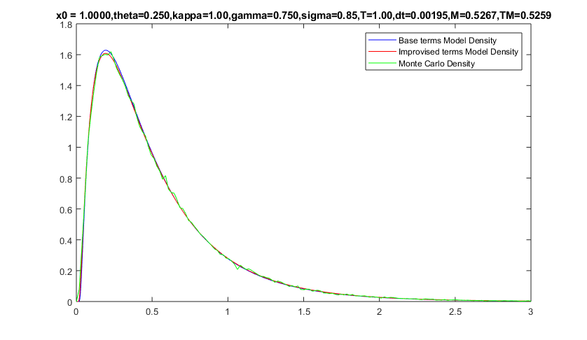](https://postimages.org/)

---

### #1028 — Amin (Topic Author)
*December 28, 2020, 6:07 PM*

I have worked on a more stable and more accurate version of the previous program for simulation of probability density
of an SDE in transition probabilities framework after reworking the standard normal transition probabilities module. I
hope to post the new program tomorrow evening.(29/12/2020).

---

### #1029 — Amin (Topic Author)
*December 29, 2020, 4:55 PM*

Here is the new model files. It is quite an improvement but still a lot of work remains to be done in coming days. This
program would probably work only for mean reverting SDEs of the type we have been working with. Simpler SDEs and noises
were already working well and this program is not meant for them. I tried to improve the normal transition probabilities
part on hte boundaries but their is only marginal improvement and more work needs to be done.

```
function [] = SDETransProb08WmtGrid200b()

%Copyright Ahsan Amin. Infiniti derivatives Technologies.
%Please fell free to connect on linkedin: linkedin.com/in/ahsan-amin-0a53334
%or skype ahsan.amin2999
%In this program, I am simulating the SDE given as
%dy(t)=mu1 x(t)^beta1 dt + mu2 x(t)^beta2 dt +sigma x(t)^gamma dz(t)

%I have not directly simulated the SDE but simulated the transformed
%Besse1 process version of the SDE and then changed coordinates to retreive
%the SDE in original coo
%rdinates.
%The present program will analytically evolve only the Bessel Process version of the
%SDE in transformed coordinates.
%When you run this program, please make sure that you look at graph zoomed
%at main body of the graph. Sometimes all the SDE is properly simulated but
%the tail explodes for some reason so you would know. These are minor
%issues that will be fixed in next versions of the program.
dt=1/256;   % Simulation time interval.%Fodiffusions close to zero
             %decrease dt for accuracy.
Tt=256*8/4;     % Number of simulation levels. Terminal time= Tt*dt; //.125/32*32*16=2 year;
T=Tt*dt;
OrderA=4;  %
OrderM=4;  %
dtM=dt*4*2*2*2;
TtM=Tt/4/2/2/2;

dNn=.05;   % Normal density subdivisions width. would change with number of subdivisions
Nn=200;  % No of normal density subdivisions
NnMidl=100;%One half density Subdivision left from mid of normal density(low)
NnMidh=101;%One half density subdivision right from the mid of normal density(high)
NnMid=4.0;

Nn2=280;
dNn2=.05;
Nn2Midl=140;
Nn2Midh=141;
Nn2Mid=4.0;

x0=1.2500;   % starting value of SDE
beta1=0.0;
beta2=1.00;   % Second drift term power.
gamma=.95;%50;   % volatility power.
kappa=1.0;%.950;   %mean reversion parameter.
theta=1.10;%mean reversion target
sigma0=.850;%Volatility value

%you can specify any general mu1 and mu2 and beta1 and beta2.
mu1=+1*theta*kappa;   %first drift coefficient.
mu2=-1*kappa;    % Second drift coefficient.
%mu1=0;
%mu2=0;

alpha=1;% x^alpha is being expanded. This is currently for monte carlo only.
alpha1=1-gamma;%This is for expansion of integrals for calculation of drift
%and volatility coefficients

w(1:Nn)=x0^(1-gamma)/(1-gamma);

%Z(1:Nn)=(((1:Nn)-5.5)*dNn-NnMid);
%Z(1:Nn)=(((1:Nn)-20.5)*dNn-NnMid);
Z(1:Nn)=(((1:Nn)-20.5)*dNn-NnMid);
Z(1)=-5.118453;
Z(Nn)=5.118453;

Z2(1:Nn2)=(((1:Nn2)-60.5)*dNn2-Nn2Mid);

Z
Z2
str=input('Look at Zs')
%ZProb(1)=normcdf(.5*Z(1)+.5*Z(2),0,1)-normcdf(.5*Z(1)+.5*Z(2)-dNn,0,1);
%ZProb(Nn)=normcdf(.5*Z(Nn)+.5*Z(Nn-1)+dNn,0,1)-normcdf(.5*Z(Nn)+.5*Z(Nn-1),0,1);
%ZProb(2:Nn-1)=normcdf(.5*Z(2:Nn-1)+.5*Z(3:Nn),0,1)-normcdf(.5*Z(2:Nn-1)+.5*Z(1:Nn-2),0,1);
    %Above calculate probability mass in each probability subdivision.

ZProb(1)=normcdf(-4.95);
ZProb(Nn)=1-normcdf(4.95);
ZProb(2)=normcdf(-4.9)-normcdf(-4.95);
ZProb(Nn-1)=normcdf(4.95)-normcdf(4.9);
ZProb(3:Nn-2)=normcdf(.5*Z(3:Nn-2)+.5*Z(4:Nn-1),0,1)-normcdf(.5*Z(3:Nn-2)+.5*Z(2:Nn-3),0,1);

%%%%%%%%%%%%%%%%%%%%%%%%%%%%%%%%%%%%%%%%%%%%%%%%%%%%%%%%%%%%%%%%%%%%%%%%%%%%%%%%%%%%%%%%%%%%%%

sigma11(1:OrderA+1)=0;
mu11(1:OrderA+1)=0;
mu22(1:OrderA+1)=0;
sigma22(1:OrderA+1)=0;
% index 1 correponds to zero level since matlab indexing starts at one.
sigma11(1)=1;
mu11(1)=1;
mu22(1)=1;
sigma22(1)=1;

for k=1:(OrderA+1)
    if sigma0~=0
        sigma11(k)=sigma0^(k-1);
    end
    if mu1 ~= 0
        mu11(k)=mu1^(k-1);
    end
    if mu2 ~= 0
        mu22(k)=mu2^(k-1);
    end
    if sigma0~=0
        sigma22(k)=sigma0^(2*(k-1));
    end
end
%Ft(1:TtM+1,1:(OrderA+1),1:(OrderA+1),1:(OrderA+1),1:(OrderA+1))=0; %General time powers on hermite polynomials
Fp(1:(OrderA+1),1:(OrderA+1),1:(OrderA+1),1:(OrderA+1))=0;%General x powers on coefficients of hermite polynomials.
Fp1(1:(OrderA+1),1:(OrderA+1),1:(OrderA+1),1:(OrderA+1))=0;%General x powers for bessel transformed coordinates.

%YCoeff0 and YCoeff are coefficents for original coordinates monte carlo.
%YqCoeff0 and YqCoeff are bessel/lamperti version monte carlo.

YCoeff0(1:(OrderA+1),1:(OrderA+1),1:(OrderA+1),1:(OrderA+1))=0;
YqCoeff0(1:(OrderA+1),1:(OrderA+1),1:(OrderA+1),1:(OrderA+1))=0;
%Pre-compute the time and power exponent values in small multi-dimensional arrays
YCoeff = ItoTaylorCoeffsNew(alpha,beta1,beta2,gamma); %expand y^alpha where alpha=1;
YqCoeff = ItoTaylorCoeffsNew(alpha1,beta1,beta2,gamma);%expand y^alpha1 where alpha1=(1-gamma)
YqCoeff=YqCoeff/(1-gamma); %Transformed coordinates coefficients have to be
%further divided by (1-gamma)

for k = 0 : (OrderA)
    for m = 0:k
        l4 = k - m + 1;
        for n = 0 : m
            l3 = m - n + 1;
            for j = 0:n
                l2 = n - j + 1;
                l1 = j + 1;
                %Ft(l1,l2,l3,l4) = dtM^((l1-1) + (l2-1) + (l3-1) + .5* (l4-1));
                Fp(l1,l2,l3,l4) = (alpha + (l1-1) * beta1 + (l2-1) * beta2 + (l3-1) * 2* gamma + (l4-1) * gamma ...
                    - (l1-1) - (l2-1) - 2* (l3-1) - (l4-1));
                Fp1(l1,l2,l3,l4) = (alpha1 + (l1-1) * beta1 + (l2-1) * beta2 + (l3-1) * 2* gamma + (l4-1) * gamma ...
                    - (l1-1) - (l2-1) - 2* (l3-1) - (l4-1));

                YCoeff0(l1,l2,l3,l4) =YCoeff(l1,l2,l3,l4).*mu11(l1).*mu22(l2).*sigma22(l3).*sigma11(l4);
                YqCoeff0(l1,l2,l3,l4) =YqCoeff(l1,l2,l3,l4).*mu11(l1).*mu22(l2).*sigma22(l3).*sigma11(l4);
            end
        end
    end
end

%%%%%%%%%%%%%%%%%%%%%%%%%%%%%%%%%%%%%%%%%%%%%%%%%%%%%%%%%%%%%%%%%%%%%%%%%%%%%%%%%%%%%%%%%%%%%%
%Current program has 50 grid points. I have divided every grid subdivision
%into three further subdivisions with probabilities P0,Pb,Pa.

wnStart=1;%
yy(wnStart:Nn)=((1-gamma)*w(wnStart:Nn)).^(1/(1-gamma));
%The above yy(wnStart:Nn)=x0;

   Pprev(1:Nn)=ZProb(1:Nn);%probability mass at starting node.
   Pnew(1:Nn2)=0.0;
   EZwnew(1:Nn2)=0.0;
   EZwprev(1:Nn)=0.0;
   Ewnew(1:Nn2)=0;
   Ewprev(1:Nn)=0;
   Ew1new(1:Nn2)=0;
   Ew1prev(1:Nn)=0;

tic

load('C:\\Users\\Ahsan\\Documents\\MATLAB\\TrProbs0O4b.mat','pt0','Zt0');
load('C:\\Users\\Ahsan\\Documents\\MATLAB\\TrProbsO4b.mat','ptt','Ztt','ptA','ptB');

for tt=1:Tt
    if(tt==1)

        [wMu0dt,c1,c22] = CalculateDriftAndVolA8Trans(w,wnStart,Nn,YqCoeff0,Fp1,gamma,dt);
        Pnew(1:Nn2)=pt0(1:Nn2);
        EZwnew(1:Nn2)=pt0(1:Nn2).*Zt0(1:Nn2);
        Ewnew(1:Nn2)=(x0^(1-gamma)/(1-gamma)+wMu0dt(1)+c1(1).*Zt0(1:Nn2)+c22(1).*(Zt0(1:Nn2).^2-1)).*pt0(1:Nn2);
        Ew1new(1:Nn2)=(x0^(1-gamma)/(1-gamma)+wMu0dt(1)+c1(1).*Zt0(1:Nn2)+c22(1).*(Zt0(1:Nn2).^2-1)).*pt0(1:Nn2);

    end
    if(tt>1)
        %Convert the expected values in each cell to standard Values associated with the grid cell after removing the
        %integrated probability in the cell.
        w(1:Nn)=Ewprev(1:Nn)./Pprev(1:Nn);
        w1(1:Nn)=Ew1prev(1:Nn)./Pprev(1:Nn);
        [wMu0dt,wMu1dt,dwMu0dtdw,d2wMu0dtdw2,c1] = CalculateDriftAndVolA404(w,wnStart,Nn,YqCoeff0,Fp1,gamma,dt);
        wMu0dt(w(:)128)
d2wdZ2=d2wdZ2A;
end

% xR(1:Nn-40)=Z(21:180);
% yR(1:Nn-40)=d2wdZ2(21:180);
% pR = polyfit(xR,yR,2);
% yR0= polyval(pR,Z);
% d2wdZ2R(1:Nn)=yR0(1:Nn);
%tt
%if(rem(tt,20)==0)
%plot((1:Nn),d2wdZ2R(1:Nn),'r',(1:Nn),d2wdZ2(1:Nn),'b');
%plot((1:Nn),w(1:Nn),'b');
%str=input('Look at graph of first/second derivative');
%end

        for mm=1:Nn

            pt(mm,1:Nn2)=ptt(tt,mm,1:Nn2);
            Zt(mm,1:Nn2)=Ztt(tt,mm,1:Nn2);

            A0=ptA(mm,tt);
            B0=ptB(mm,tt);
            %A0 and B0 are starting and ending boundaries for non-zero
            %elements in larger target array. These are boundaries for
            %transition probabilities originating from cell mm on first grid
            % at time tt. Out of the 280 target grid
            %cell, only a few ten are non-zero. These non-zero elements
            %boundaries(A0 and B0) were calculated in a different module and saved on
            %disk just when we calculated the transition probabilities.
            %Later we retrieved them from disk to use in this program.

            Pnew(A0:B0)=Pnew(A0:B0)+Pprev(mm).*pt(mm,A0:B0);
            EZwnew(A0:B0)=EZwnew(A0:B0)+EZwprev(mm).*pt(mm,A0:B0)+ ...
               Zt(mm,A0:B0).*pt(mm,A0:B0).*Pprev(mm);

        %Below is the transition probabilities simulation
        %with improvised term. These improvised terms make an improvement
        %over the base model which is given in next paragraph of code.
%        Ewnew(A0:B0)=Ewnew(A0:B0)+Ewprev(mm).*pt(mm,A0:B0)+ ...
%            (wMu0dt(mm)+c1(mm).*Zt(mm,A0:B0)).* ...
%            pt(mm,A0:B0).*Pprev(mm);
        Ewnew(A0:B0)=Ewnew(A0:B0)+Ewprev(mm).*pt(mm,A0:B0)+ ...
            (wMu0dt(mm)+c1(mm).*Zt(mm,A0:B0) + ...
            -sqrt(2)*sqrt((exp(kappa*tt*dt)-exp(-kappa*tt*dt))/(2^1*kappa))*(dwMu0dtdw(mm)).*sigma0*Zt(mm,A0:B0)  ...
            -sqrt(6)*sqrt(1/kappa^2)*((tt*dt/kappa^0)-sqrt(tt*dt/kappa^0))*sigma0^1*Zt(mm,A0:B0)*(dwMu0dtdw(mm))).* ...
            pt(mm,A0:B0).*Pprev(mm);

        Ewnew(Ewnewwb(:))=wb(wa(:)>wb(:));%Be careful;might not universally hold;
        %if(w(Nn)>(2*w(Nn-1)-w(Nn-2)))
        %    w(Nn)=(2*w(Nn-1)-w(Nn-2));
        %end

    end

        Pprev(1)=sum(Pnew(1:41));
        Pprev(2:Nn-1)=Pnew(42:40+Nn-1);
        Pprev(Nn)=sum(Pnew(40+Nn:80+Nn));%All the probability mass in last 41
        %subdivisions on target grid is assigned to end boundary point on
        %the grid that will become smaller first grid for next simulation step.

        EZwprev(1)=sum(EZwnew(1:41));
        EZwprev(2:Nn-1)=EZwnew(42:40+Nn-1);
        EZwprev(Nn)=sum(EZwnew(40+Nn:80+Nn));

        Ewprev(1)=sum(Ewnew(1:41));
        Ewprev(2:Nn-1)=Ewnew(42:40+Nn-1);
        Ewprev(Nn)=sum(Ewnew(40+Nn:80+Nn));

        Ew1prev(1)=sum(Ew1new(1:41));
        Ew1prev(2:Nn-1)=Ew1new(42:40+Nn-1);
        Ew1prev(Nn)=sum(Ew1new(40+Nn:80+Nn));

       Pnew(1:Nn2)=0;
       Ewnew(1:Nn2)=0.0;
       Ew1new(1:Nn2)=0.0;
       EZwnew(1:Nn2)=0.0;

end

plot((1:Nn),ZProb(1:Nn),'g',(1:Nn),Pprev(1:Nn),'r');
%plot((1:Nn),ZProb(1:Nn),'g',(1:Nn),Pprev(1:Nn),'r');
%str=input('Look at distributions');

Pnew=Pprev;
%Convert the expected values in each cell to standard Values associated with the grid cell after removing the
%integrated probability in the cell.
w(wnStart:Nn)=Ewprev(wnStart:Nn)./Pprev(wnStart:Nn);
w1(wnStart:Nn)=Ew1prev(wnStart:Nn)./Pprev(wnStart:Nn);
yy(wnStart:Nn)=((1-gamma)*w(wnStart:Nn)).^(1/(1-gamma));
yy1(wnStart:Nn)=((1-gamma)*w1(wnStart:Nn)).^(1/(1-gamma));

%below D's (the names of variables starting with D) are
%change of probability derivatives.

y_w(1:Nn)=0;
y_w(wnStart:Nn) = ((1-gamma)*w(wnStart:Nn)).^(1/(1-gamma));
y_w1(1:Nn)=0;
y_w1(wnStart:Nn) = ((1-gamma)*w1(wnStart:Nn)).^(1/(1-gamma));
Dfy_w(wnStart:Nn)=0;
Dfy_w1(wnStart:Nn)=0;
for nn=wnStart+1:Nn-1
    Dfy_w(nn) = (y_w(nn + 1) - y_w(nn - 1))/(Z(nn + 1) - Z(nn - 1));
    Dfy_w1(nn) = (y_w1(nn + 1) - y_w1(nn - 1))/(Z(nn + 1) - Z(nn - 1));
    %Change of variable derivative for densities
end
py_w(1:Nn)=0;
py_w1(1:Nn)=0;
for nn = wnStart:Nn-1
    py_w(nn) = (normpdf(Z(nn),0, 1))/abs(Dfy_w(nn));%Origianl coordinates density
    py_w1(nn) = (normpdf(Z(nn),0, 1))/abs(Dfy_w1(nn));
end

toc

ItoHermiteMean=sum(y_w(wnStart+1:Nn-1).*ZProb(wnStart+1:Nn-1)) %Original process average from coordinates
disp('true Mean only applicable to standard SV mean reverting type models otherwise disregard');
TrueMean=theta+(x0-theta)*exp(-kappa*dt*Tt)%Mean reverting SDE original variable true average

rng(29079137, 'twister')
paths=200000;
YY(1:paths)=x0;  %Original process monte carlo.
Random1(1:paths)=0;
for tt=1:TtM

    Random1=randn(size(Random1));
    HermiteP1(1,1:paths)=1;
    HermiteP1(2,1:paths)=Random1(1:paths);
    HermiteP1(3,1:paths)=Random1(1:paths).^2-1;
    HermiteP1(4,1:paths)=Random1(1:paths).^3-3*Random1(1:paths);
    HermiteP1(5,1:paths)=Random1(1:paths).^4-6*Random1(1:paths).^2+3;

    YY(1:paths)=YY(1:paths) + ...
        (YCoeff0(1,1,2,1).*YY(1:paths).^Fp(1,1,2,1)+ ...
        YCoeff0(1,2,1,1).*YY(1:paths).^Fp(1,2,1,1)+ ...
        YCoeff0(2,1,1,1).*YY(1:paths).^Fp(2,1,1,1))*dtM + ...
        (YCoeff0(1,1,3,1).*YY(1:paths).^Fp(1,1,3,1)+ ...
        YCoeff0(1,2,2,1).*YY(1:paths).^Fp(1,2,2,1)+ ...
        YCoeff0(2,1,2,1).*YY(1:paths).^Fp(2,1,2,1)+ ...
        YCoeff0(1,3,1,1).*YY(1:paths).^Fp(1,3,1,1)+ ...
        YCoeff0(2,2,1,1).*YY(1:paths).^Fp(2,2,1,1)+ ...
        YCoeff0(3,1,1,1).*YY(1:paths).^Fp(3,1,1,1))*dtM^2 + ...
        ((YCoeff0(1,1,1,2).*YY(1:paths).^Fp(1,1,1,2).*sqrt(dtM))+ ...
        (YCoeff0(1,1,2,2).*YY(1:paths).^Fp(1,1,2,2)+ ...
        YCoeff0(1,2,1,2).*YY(1:paths).^Fp(1,2,1,2)+ ...
        YCoeff0(2,1,1,2).*YY(1:paths).^Fp(2,1,1,2)).*dtM^1.5) .*HermiteP1(2,1:paths) + ...
        ((YCoeff0(1,1,1,3).*YY(1:paths).^Fp(1,1,1,3) *dtM) + ...
        (YCoeff0(1,1,2,3).*YY(1:paths).^Fp(1,1,2,3)+ ...
        YCoeff0(1,2,1,3).*YY(1:paths).^Fp(1,2,1,3)+ ...
        YCoeff0(2,1,1,3).*YY(1:paths).^Fp(2,1,1,3)).*dtM^2).*HermiteP1(3,1:paths) + ...
        ((YCoeff0(1,1,1,4).*YY(1:paths).^Fp(1,1,1,4)*dtM^1.5 )).*HermiteP1(4,1:paths) + ...
        (YCoeff0(1,1,1,5).*YY(1:paths).^Fp(1,1,1,5)*dtM^2.0).*HermiteP1(5,1:paths);

end

YY(YY<0)=0;
disp('Original process average from monte carlo');
MCMean=sum(YY(:))/paths %origianl coordinates monte carlo average.
MCVar=sum((YY(:)-MCMean).^2)/paths
disp('Original process average from our simulation');
ItoHermiteMean=sum(y_w(wnStart+1:Nn-1).*ZProb(wnStart+1:Nn-1)) %Original process average from coordinates
ItoHermiteVar=sum((y_w(wnStart+1:Nn-1)-ItoHermiteMean).^2.*ZProb(wnStart+1:Nn-1))
disp('true Mean only applicble to standard SV mean reverting type models otherwise disregard');
TrueMean=theta+(x0-theta)*exp(-kappa*dt*Tt)%Mean reverting SDE original variable true average

MaxCutOff=30;
NoOfBins=round(300*gamma^2*4*sigma0/sqrt(MCMean)/(1+kappa));%Decrease the number of bins if the graph is too
[YDensity,IndexOutY,IndexMaxY] = MakeDensityFromSimulation_Infiniti_NEW(YY,paths,NoOfBins,MaxCutOff );

%plot(y_w1(wnStart+1:Nn-1),py_w1(wnStart+1:Nn-1),'b',y_w(wnStart+1:Nn-1),py_w(wnStart+1:Nn-1),'r',IndexOutY(1:IndexMaxY),YDensity(1:IndexMaxY),'g');
plot(y_w(wnStart+1:Nn-1),py_w(wnStart+1:Nn-1),'r',IndexOutY(1:IndexMaxY),YDensity(1:IndexMaxY),'g');

title(sprintf('x0 = %.4f,theta=%.3f,kappa=%.2f,gamma=%.3f,sigma=%.2f,T=%.2f,dt=%.5f,M=%.4f,TM=%.4f',
x0,theta,kappa,gamma,sigma0,T,dt,ItoHermiteMean,TrueMean));%,sprintf('theta= %f', theta), sprintf('kappa = %f',
kappa),sprintf('sigma = %f', sigma0),sprintf('T = %f', T));

legend({'Improvised terms Model Density','Monte Carlo Density'},'Location','northeast')

str=input('red line is density of SDE from Ito-Hermite method, green is monte carlo.');
end
```

.

One function that is needed is given here.

```
function [] = NormalTransProbInfinitiO4b()
%copyright Infiniti Derivatives. Inital beta version to explain the
%algorithm. Next version would make the program efficient.
%In this program we evolve a normal density with transition probabilities
%framework. On each date/evolution interval, we add a unit vriance to the
%existing density using transition probabilities and calculate resulting
%density.

Tt=512;%No of time steps. On each step we add a unit
%varianceto the previous density.

%Case b starts. Nn=200
%I am using two evolving grids in transition probabilities framework.
%First grid has 200 subdivisions(wnstart:Nn)=(1:200) in case b while
%target grid has 280 subdivisions (wnstart2:Nn2)=(1:280) with the same
%grid spacing. We evolve transition normal increments and related
%transition probabilities  from all 200 points on grid one
%to all points 280 on target grid2 in this unoptimized( O(200X200))
%algorithm.
%First grid has indices from wnStart to last index Nn.wnStart is always
%equal to one in this program. Nn=200.
%Targets grid has indices from wnStart2 to last index Nn2.wnStart2 is always
%equal to one in this program. Nn2=280.

dNn=.05;   % Normal density subdivisions width. would change with number of subdivisions
Nn=200;  % No of normal density subdivisions
NnMidl=100;%One half density Subdivision left from mid of normal density(low)
NnMidh=101;%One half density subdivision right from the mid of normal density(high)
NnMid=4.0;

Nn2=280;
dNn2=.05;
Nn2Midl=140;
Nn2Midh=141;
Nn2Mid=4.0;

Z(1:Nn)=(((1:Nn)-20.5)*dNn-NnMid);
Z(1)=-5.118453;
Z(Nn)=5.118453;
Z2(1:Nn2)=(((1:Nn2)-60.5)*dNn2-Nn2Mid);

%Case b ends Nn=200

%below is slightly less accurate case a with 100 subdivisions of the
%evolving normal density. To run this case uncomment the code block
%below and comment the block with case b. You will have to do the same
%iside the body of the program.
% %Case a starts. Nn=100
%
% dNn=.1/1;   % Normal density subdivisions width. would change with number of subdivisions
% Nn=100;  % No of normal density subdivisions
% NnMidl=50;%One half density Subdivision left from mid of normal density(low)
% NnMidh=51;%One half density subdivision right from the mid of normal density(high)
% NnMid=4.0;
%
% Nn2=140;
% dNn2=.1;
% Nn2Midl=70;
% Nn2Midh=71;
% Nn2Mid=4.0;
%
% Z(1:Nn)=(((1:Nn)-10.5)*dNn-NnMid);
% Z2(1:Nn2)=(((1:Nn2)-30.5)*dNn2-Nn2Mid);
%
% %Case a ends Nn=100

Z
Z2
str=input('Look at Zs')

%ZProb(1)=normcdf(.5*Z(1)+.5*Z(2),0,1)-normcdf(.5*Z(1)+.5*Z(2)-dNn,0,1);
%ZProb(Nn)=normcdf(.5*Z(Nn)+.5*Z(Nn-1)+dNn,0,1)-normcdf(.5*Z(Nn)+.5*Z(Nn-1),0,1);
%ZProb(2:Nn-1)=normcdf(.5*Z(2:Nn-1)+.5*Z(3:Nn),0,1)-normcdf(.5*Z(2:Nn-1)+.5*Z(1:Nn-2),0,1);

ZProb(1)=normcdf(-4.95);
ZProb(Nn)=1-normcdf(4.95);
ZProb(2)=normcdf(-4.9)-normcdf(-4.95);
ZProb(Nn-1)=normcdf(4.95)-normcdf(4.9);
ZProb(3:Nn-2)=normcdf(.5*Z(3:Nn-2)+.5*Z(4:Nn-1),0,1)-normcdf(.5*Z(3:Nn-2)+.5*Z(2:Nn-3),0,1);

EZwnew(1:Nn2)=0.0;
EZwprev(1:Nn)=0.0;
Pprev(1:Nn)=ZProb(1:Nn);%probability mass at starting node.
Pnew(1:Nn2)=0.0;
wnStart=1;
wnStart2=1;
ptA(1:Nn,1:Tt)=0;
ptB(1:Nn,1:Tt)=0;
for tt=1:Tt

    Zw1(1:Nn)=sqrt(tt-1)*Z(1:Nn);%Analytic value of transition probabilities originating grid.
    Zw2(1:Nn2)=sqrt(tt)*Z2(1:Nn2);%Analytic value of transition probabilities  target grid.
    Zw2a(1:Nn2)=Zw2(1:Nn2)-.5*sqrt(tt)*dNn2;%array of starting boundary of each subdivision on target grid.
    Zw2b(1:Nn2)=Zw2(1:Nn2)+.5*sqrt(tt)*dNn2;%array of ending boundary of each subdivision on target grid.

    if(tt==1)
        %In first evolution interval from delta source, there are no
        %recombinations of transition probabilities and only one set of
        %transition probabilities is evolved from origin.
        Zt0(1:Nn2)=Zw2(1:Nn2);%Calculate the value of transition normal.
        Ztpt0(1:Nn2)=0.398942.* exp(-0.5.* Zw2a(1:Nn2).^2) - 0.398942.* exp(-0.5.* Zw2b(1:Nn2).^2);
        pt0(1:Nn2)=Ztpt0(1:Nn2)./Zt0(1:Nn2);%Calculate the initial version of raw transition probabilities

        [alpha0, beta0, gamma0,eata0,zeta0] = TrProbsMatchMoments0O4(wnStart2,Nn2,Zt0,pt0);%Calculate the density moment
matching parameters.
        %pt0Corrected(1:Nn2)=alpha0.*pt0(1:Nn2)+beta0.*Zt0(1:Nn2).*pt0(1:Nn2)+gamma0.*(Zt0(1:Nn2).^2-1).*pt0(1:Nn2)+ ...
        %    eata0.*(Zt0(1:Nn2).^3-3.*Zt0(1:Nn2)).*pt0(1:Nn2);%Calculate corrected transition probabilities
        pt0Corrected(1:Nn2)=alpha0.*pt0(1:Nn2)+beta0.*Zt0(1:Nn2).*pt0(1:Nn2)+gamma0.*(Zt0(1:Nn2).^2-1).*pt0(1:Nn2) + ...
                eata0.*(Zt0(1:Nn2).^3-3*Zt0(1:Nn2)).*pt0(1:Nn2)+ ...
                zeta0.*(Zt0(1:Nn2).^4-6*Zt0(1:Nn2).^2+3).*pt0(1:Nn2);
        pt0(1:Nn2)=pt0Corrected(1:Nn2);%And assign them to pt0.
        pt0(pt01)
        for mm=1:Nn
            Zt(mm,1:Nn2)=Zw2(1:Nn2)-Zw1(mm);%Calculate the value of transition normal increment from subdivision mm on
first
            %to points 1:Nn2 on second target grid.
            Ztpt(mm,1:Nn2)=0.398942.* exp(-0.5.* (Zw2a(1:Nn2)-Zw1(mm)).^2) - 0.398942.* exp(-0.5.*
(Zw2b(1:Nn2)-Zw1(mm)).^2);
            pt(mm,1:Nn2)=Ztpt(mm,1:Nn2)./Zt(mm,1:Nn2);;%Calculate the raw value of transition probability from
subdivision mm on first
            %to points 1:Nn2 on second target grid.
        end
        %Below function calculates the parameters for all of the transition probabilities
        %from wnStart:Nn points on first grids to wnStart2:Nn2 points on second grid.
        [alpha, beta, gamma,eata,zeta] = TrProbsMatchMomentsO4(wnStart,Nn,wnStart2,Nn2,Zt,pt);

        for mm=1:Nn

            pt(mm,1:Nn2)=alpha(mm).* pt(mm,1:Nn2)+beta(mm).*Zt(mm,1:Nn2).* pt(mm,1:Nn2) +
gamma(mm).*(Zt(mm,1:Nn2).^2-1).*pt(mm,1:Nn2) + ...
                eata(mm).*(Zt(mm,1:Nn2).^3-3*Zt(mm,1:Nn2)).*pt(mm,1:Nn2)+ ...
                zeta(mm).*(Zt(mm,1:Nn2).^4-6*Zt(mm,1:Nn2).^2+3).*pt(mm,1:Nn2);

            pt1(mm,1:Nn2)=pt(mm,1:Nn2);

            pt(mm,pt(mm,:).00000000001)&&(StartFlag==0))
                    ptA(mm,tt)=pp;
                    StartFlag=1;
                    %EndFlag=0;
                end
                if(pt(mm,pp)>.00000000001)
                    ptB(mm,tt)=pp;
                end
            end
        end

%        ptA(:,tt)
%        ptB(:,tt)
%str=input('Look at boundaries');

    end

end
save('C:\\Users\\Ahsan\\Documents\\MATLAB\\TrProbsO4b.mat','ptt','Ztt','ptA','ptB');
end

```

Here is the last output you should get from the main program.

ItoHermiteMean =

   1.118656830236663

true Mean only applicable to standard SV mean reverting type models otherwise disregard

TrueMean =

   1.120300292485492

Original process average from monte carlo

MCMean =

   1.119643217449689

MCVar =

   0.629589729048104

Original process average from our simulation

ItoHermiteMean =

   1.118656830236663

ItoHermiteVar =

   0.616416389505169

true Mean only applicble to standard SV mean reverting type models otherwise disregard

TrueMean =

   1.120300292485492

IndexMax =

   436

red line is density of SDE from Ito-Hermite method, green is monte carlo.

Here is the graph you will see.

[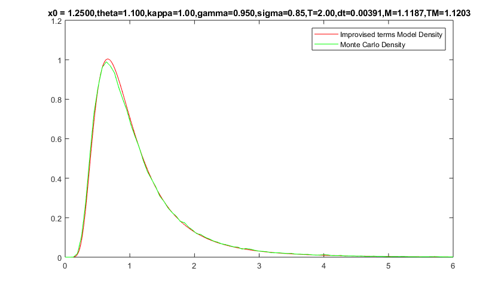](https://postimages.org/)

---

### #1030 — Amin (Topic Author)
*December 30, 2020, 3:25 PM*

With the current understanding of SDEs, we can do a lot of interesting things with our fokker-planck solution of the
SDEs. I solved the SDEs in Bessel coordinates on a grid of size 50. Many SDEs could be solved on a grid of 100 but
solving them on a grid of 200 is very difficult since second derivative continues to become more unstable as
discretization becomes finer. The grid of size 50 is the most stable as I have found. But we can easily solve an SDE on
a grid of size 50 using our fokker-planck algorithm and then map it to a grid of size 200 using polynomial
interpolation. And then we can superimpose a standard normal transition probabilities grid of size 200 on our
interpolated SDE solution of size 200 as underlying normal would be the same on both grids. We can, in fact, calculate
transition probabilities between any two arbitrary points in time for all the points on normal transition probabilities
grid and save this solution to disk and then apply it freely to our fokker-planck SDE solution simply by normal mapping
and we can do a lot of interesting things with these transition probabilities by applying arbitrary rules in time like
barriers and other things. But many times we want to find conditional expectations(as a result of arbitrary stopping
rules or other events applied in time) that would require a full transition probabilities solution in time and not just
the fokker-planck solution in time. When I started working with transition probabilities after the solution of
fokker-planck equation, I tried to back-out the value of standard normal increment between two points in on SDE solution
grid but after the understanding we have now, what we need to do is to back out the effective variance applied to known
standard normal increment between SDE solution between two consecutive time points. So we basically know the
fokker-planck solution of SDE on consecutive time grids and we also know the corresponding standard normal transition
increments and the question is how to back out the effective variance when both the SDE solution and normal increments
are known. I have a strong feeling that finding this effective variance given the two set of knowns (SDE solution and
normal transition grid superimposed on each other) this is probably going to be simpler than we think and we might
simply have to consider only the diagonal elements in finding out this variance. I plan to spend next three to four days
trying to see if I can figure out a nice easy way to find out this effective variance from the fokker-planck solution
superimposed on a normal transition probabilities grid.

But finding out analytical solution(and not just backed from fokker-planck solution) of effective variance for each SDE
in transition probabilities framework is equally important and it will help us to apply the same transition
probabilities grid to other more general functionals of the SDE once we have a good understanding of how to calculate
the analytic variance for an SDE and its functionals so I will again be coming back to it after a few days that I have
allocated to backing out variances from the fokker-planck grid. I have a strong feeling that it is going to be something
very simple and I already have a few plans how to tackle it. And I hope to share the resulting program with friends in a
few days.

If we can back out variances from fokker-planck solution, this would equally apply to solution of implied volatility
surfaces in a particular SDE model and other related applications.

There could be many other interesting applications of this superimposition of a normal transition probabilities grid on
a fokker-planck SDE solution grid. We could superimpose a non-linear filtering problem with an underlying general
(usually non-linear with several drift terms or mean-reverting) SDE on a simple Kalman filter based on normal transition
probabilities. So basically we could solve a linear kalman filtering problem and apply its solution to find the solution
of a general possibly non-linear SDE just by using the common map of underlying normal transition probabilities
framework. I can explain it in more detail if some friend wants me to do that.

---

### #1031 — Amin (Topic Author)
*January 1, 2021, 3:58 PM*

I made this post in off-topic and would like to share it with friends here as well since I consider it important. https://forum.wilmott.com/viewtopic.php?f=15&t=94796&p=863050#p863050

Today on this first day of 2021, I drove back to Lahore from Islamabad with my mother. And happy new year to all
friends.

And I want to start the new year by making a post against mind control and other excesses by US defense. I am not going
to go into great details and will only briefly outline my arguments and hope that other intelligent American friends
would find some sense and good logic in my brief arguments and do something good for their country America. I have said
on this forum several times that American defense needs intelligent leadership that fixes this bloated, corrupt and
inefficient organization. As I can see the future, I would like to say that if fortunes of America as a country were to
ever decline, US defense would be a major reason behind the decline of this great country.

Before I start my arguments, I would like to make it clear that I have no doubts about the importance of national
security of any country and therefore I would strongly agree with friends who suggest that American needs a strong
professional army that can successfully counter any threat to security of US and its citizens and everything has to be
done to make sure by people of US so that professional US army has readiness to combat all possible threats.

Total US defense expenditure this year would be roughly 930 billion dollars. https://www.thebalance.com/u-s-military-budget-components-challenges-growth-3306320 I believe there are other hidden categories of defense related significant expenditure not mentioned in the above article.

My thesis has three points.

1. US defense is a corrupt organization where several hundred billion dollars are stolen every year by incompetent
people. You need a professional and efficient army and not a corrupt army.

2. US defense is a bloated and inefficient organization and an intelligent leadership could possibly achieve the same
goals by spending roughly half the money. A few hundred billion dollars freed up could be channeled towards long term
productive categories like improving the school system in United States which would turn out to be hugely productive for
the economy in the longer run. There are a large number of US children who are denied good early stage education and a
large number of foreign skilled workers are hired by US employers because the US school system fails to give proper
education opportunities to all US children so they lag in the university causing a shortfall of skilled labor.

3. US defense's unconstitutional activities damage the US economy by several hundred billion dollars every year.

As I said at the start, I am not going into great details of this but would like to explain the third part only. I am
sure most intelligent and informed people would agree with point one and two. The agent who controls me has a net worth
very easily exceeding half a billion dollars and everyone in defense is fine with that simply because it is a norm in
defense and not an anomaly. I think second point is self-explanatory as well.

About the third point, I want to say that US defense has retarded several thousand people of exceptional talent in
United States only because of their hardliner conservative biases, to oblige their rich conservative buddies, and due to
so many other reasons that pseudo-educated, incompetent, corrupt and biased people can have. This is obvious
transgression of the constitution of United States. Military has to be professional and should never be allowed to be
above the law, justice and the constitution. As a citizen of a third world country where military does every wrong thing
possible, I can tell people of United States that barriers to unconstitutional practices by military are only
psychological and once the society starts to condone these unconstitutional practices, these practices  become a norm in
the society and then military has absolutely no hesitation about indulging in unlawful practices. The level of moral
courage required to stop unconstitutional practices by military is probably not very high when these practices are only
starting but once these unconstitutional and unethical practices have taken root in a society, the level of moral
courage required to stop them would be extremely high. For example, Good people in my country are routinely abused and
some even die at hands of Army when they protest against wrong practices by the military here but still no good comes
out of their sacrifices since military has absolutely no psychological barriers against wrongdoings and a large part of
the society now routinely condones their wrong high-handed unconstitutional actions. Again coming towards the topic, I
would like to say again that US military has retarded several thousand people of exceptional talent in United States
over past two decades. Even if just lucky two or three people among the retarded thousands might have become successful
like Bill Gates or Elon Musk by doing something interesting and different, they could have contributed several hundred
billion dollars to US economy. Fools in US military are biting the very same hand that feeds them.

I wrote the above lines so that I could possibly motivate intelligent and patriotic people to do something good for
their country. Please ask the new president to end mind control of all civilians, and dismantle all mind control
infrastructure to retard civilians from all across the Urban United States. And I want to tell friends that doing the
right thing is always not very easy since there is always a very strong resistance from corrupt people when good people
try to stop their corruption.

---

### #1032 — Amin (Topic Author)
*January 2, 2021, 12:14 PM*

I had no special plans to write the above post but I just randomly thought about the issue, had some ideas and quickly
posted them on internet. But they have resorted to extraordinary torture after I made the above post. This morning when
I went out in my car to take food, they started passing high-frequency waves into my back and it was extremely painful.
I stopped at a Gourmet bakery and bought a round metal box they had for their sweets. I placed the metal cover of the
box on my car seat and then drove my car but waves were so high frequency that thin sheet of metal was not enough to
stop it and there was sheer  pain again after a few minutes and it was extremely difficult to stand the physical torture
in the back.

I simply wanted to do my research and programming after coming back to the house and I was excited about it but they
forced high-frequency waves into my eyes and there was again great pain. I still wanted to work and tried to work on my
computer but they induced sleep and made me extremely lethargic and I gave up and decided to sleep for a bit. After
waking up, I tried to work again but mind control agents continued to forced very high-frequency waves into my eyes
causing pain and making it very difficult for me to work and do anything meaningful.

One reason for the burst of productivity and ideas I had few days back was that I went to my sister's house in Islamabad
and mind control appratus there was far less detailed(to control every potent neurotransmitter in the brain) and that
helped me a lot to regain my creativity and I had good research ideas.

Please force these mind control crooks to stop torturing good people who just want to do good research. If they have
anything to say against my thoughts presented in the previous post, why do they not discuss it with their country-mates
in a civilized way to make their point instead of unleashing torture on me for exposing their corruption and crook
practices.

---

### #1033 — Amin (Topic Author)
*January 7, 2021, 12:05 PM*

Dear friends, I had realized that there was still a lot of slack in my working algorithm for Fokker-planck equation and
there was a need for improvement so I decided to work on that before working on mapping grid of size 50 on grid of size
200 and then do analytics to  back out volatility. As I have earlier said that mine is not a formal rigorous solution to
FPE and it is only a working algorithm based on a partial analytic solution(and heuristics for constants) and a complete
proof like solution would require more work and is an open problem.  I have been able to play with the constants to
vastly improve the FPE working algorithm. Previously even when diffusions would not go into zero, the solution quality
deteriorated close to zero for volatility exponents lesser than .95 and I have been able to improve the solution quality
there and also almost everywhere else. This working algorithm still does not work for diffusions that go into zero since
when a diffusion goes into zero, several derivatives become unstable but that can also be done by calculating the
derivatives in some sophisticated way so they remain stable but I have left that for some later time. I am showing some
graphs from the new version of the algorithm with improved constants(just heuristically) and will paste the program in
next post.

I have not enabled mean-correction in any of the SDE solution graphs below because I wanted to show the true working
algorithm. But since the analytic solution shape is extremely close to true solution shape, you can freely use
mean-correction and get a solution extremely close to true solution.

Here are the graphs and SDE parameters are on title of the graphs.

M in title of the graph is analytic algorithm mean and TM in title of the graph is true mean. All other parameters are
the same as those usually used for mean-reverting SDEs.

[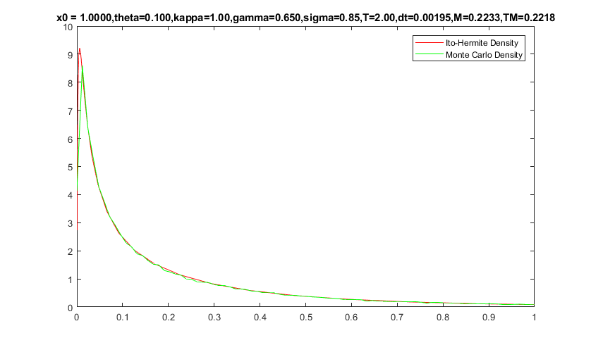](https://postimages.org/)

[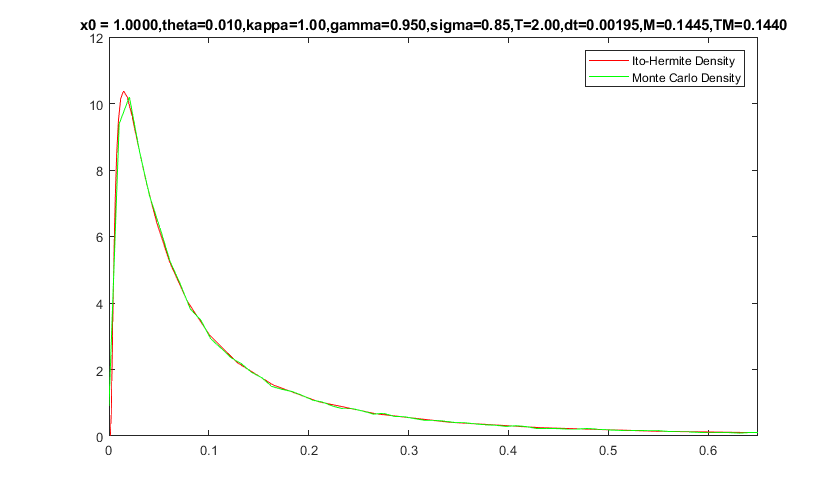](https://postimages.org/)

[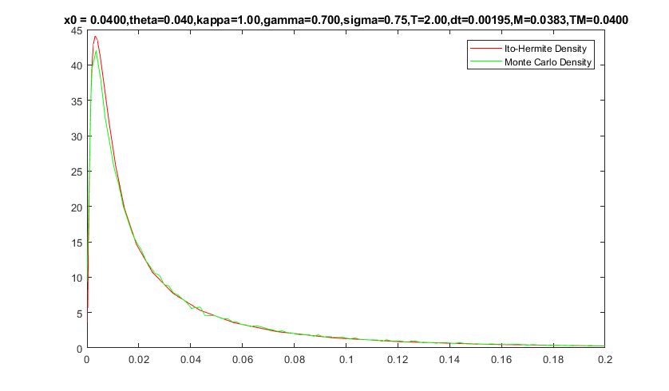](https://postimages.org/)

[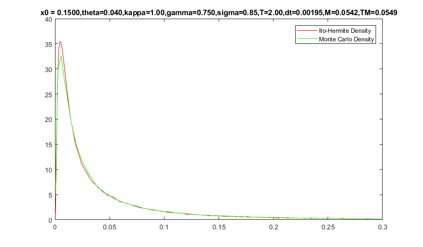](https://postimages.org/)

[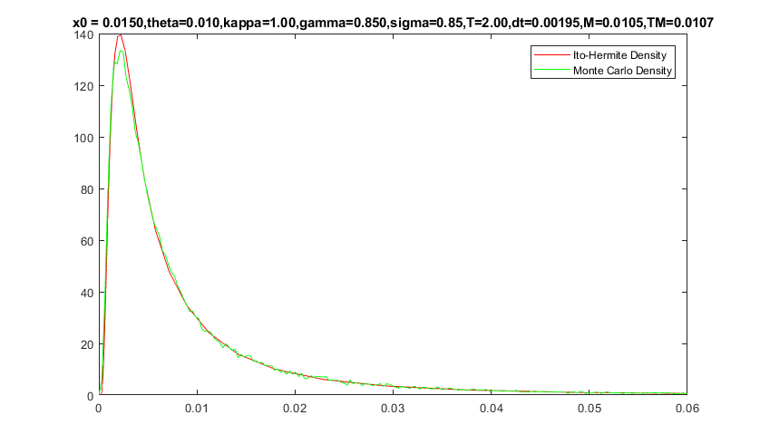](https://postimages.org/)

[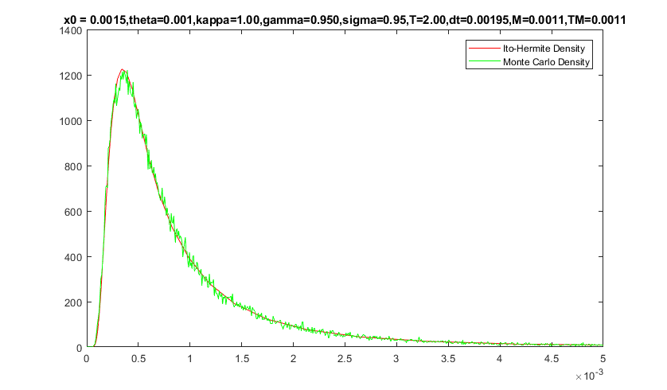](https://postimages.org/)

[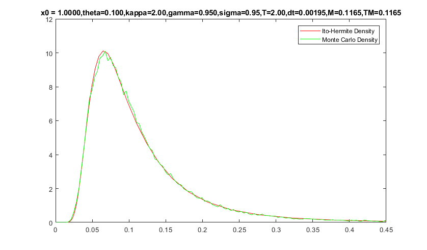](https://postimages.org/)

[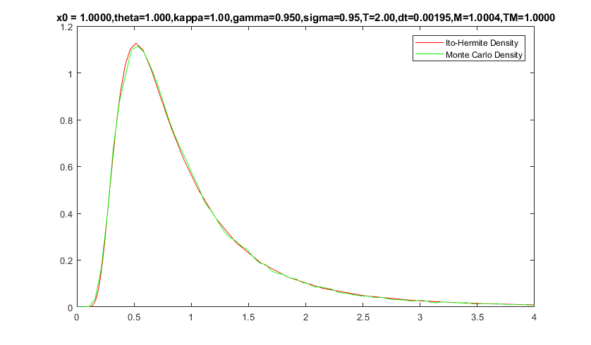](https://postimages.org/)

[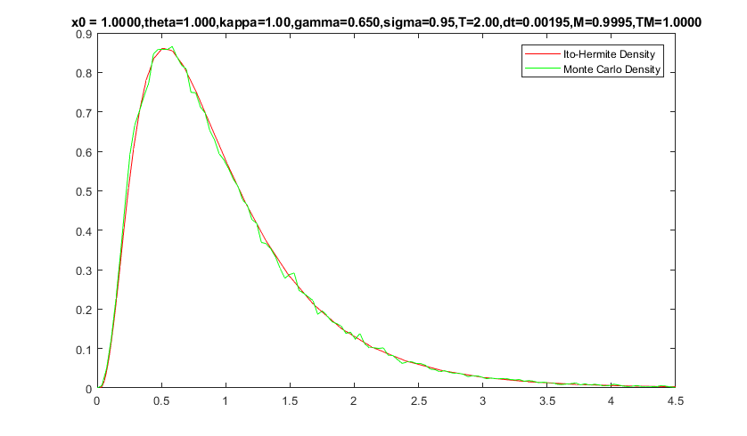](https://postimages.org/)

[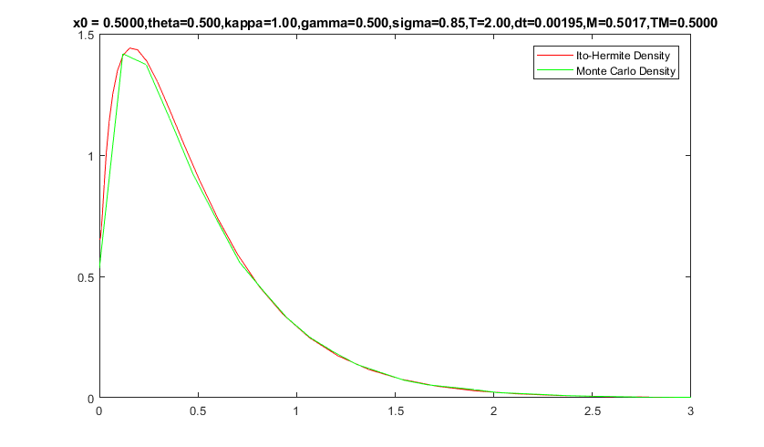](https://postimages.org/)

[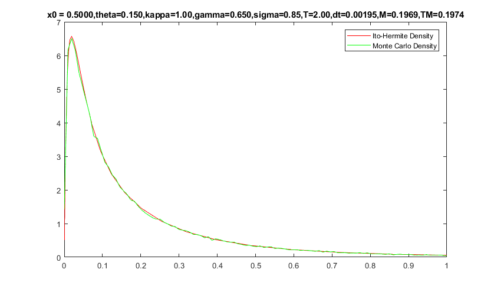](https://postimages.org/)

[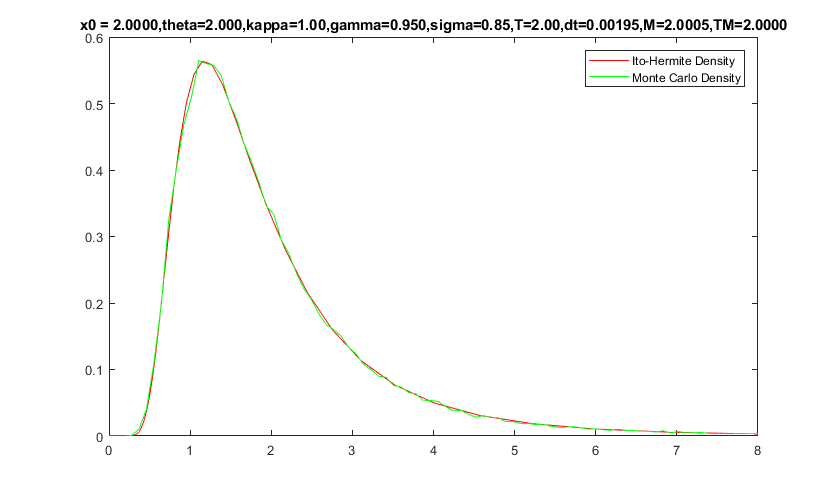](https://postimages.org/)

[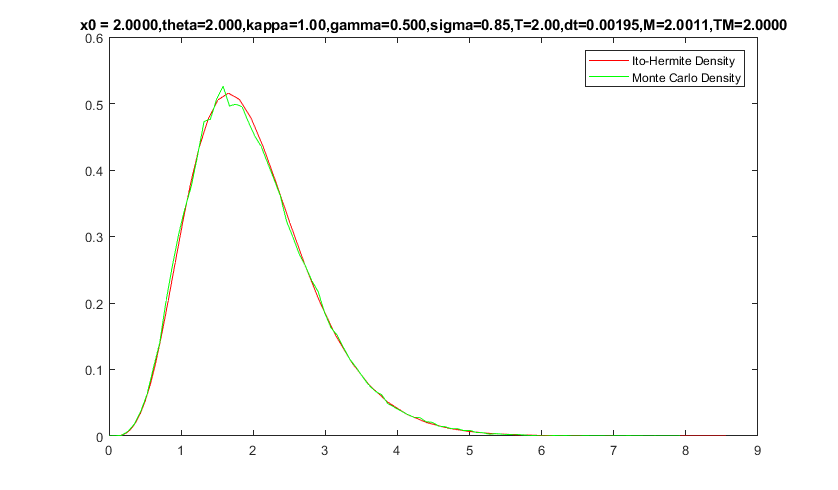](https://postimages.org/)

---

### #1034 — Amin (Topic Author)
*January 7, 2021, 12:23 PM*

Here is the program, I used to create the graphs in above post and I have not altered a single line of code after that.
I have previously posted all the other functions that are required to run this program.

I decided to devote some time to improving this critical FPE solution algorithm program before I move on to next step of
backing out volatility on a larger grid since otherwise all the inaccuracies in this program would be carried over to
the other program if it were not improved.

```
function [] = FPEAgainWmt02()

%Copyright Ahsan Amin. Infiniti derivatives Technologies.
%Please fell free to connect on linkedin: linkedin.com/in/ahsan-amin-0a53334
%or skype ahsan.amin2999
%In this program, I am simulating the SDE given as
%dy(t)=mu1 x(t)^beta1 dt + mu2 x(t)^beta2 dt +sigma x(t)^gamma dz(t)

%I have not directly simulated the SDE but simulated the transformed
%Besse1l process version of the SDE and then changed coordinates to retreive
%the SDE in original coo
%rdinates.
%The present program will analytically evolve only the Bessel Process version of the
%SDE in transformed coordinates.
T=2;
dt=.125/16/2/2;   % Simulation time interval.%Fodiffusions close to zero
             %decrease dt for accuracy.
Tt=T*128*2*2;     % Number of simulation levels. Terminal time= Tt*dt; //.125/32*32*16=2 year;
T=Tt*dt;
OrderA=4;  %
dtM=.125/2;%Monte carlo time interval size dtM.
TtM=T*2*8;%Monte carlo number of simulation intervals.

dNn=.2/1;   % Normal density subdivisions width. would change with number of subdivisions
Nn=50;  % No of normal density subdivisions
NnMidl=25;%One half density Subdivision left from mid of normal density(low)
NnMidh=26;%One half density subdivision right from the mid of normal density(high)
NnMid=4.0;

x0=2.0;   % starting value of SDE
beta1=0.0;
beta2=1.0;   % Second drift term power.
gamma=.5;%50;   % volatility power.
kappa=1.0;%.950;   %mean reversion parameter.
theta=2.0;%mean reversion target
sigma0=.850;%Volatility value

%if you alter above parameters and the program blows, disable
%mean-correction since that is only valid for classical mean-reverting
%SDEs or when analytic mean is known that you have to specify.

%you can specify any general mu1 and mu2 and beta1 and beta2.
mu1=+1*theta*kappa;   %first drift coefficient.
mu2=-1*kappa;    % Second drift coefficient.
%mu1=0;
%mu2=0;

alpha=1;% x^alpha is being expanded. This is currently for monte carlo only.
alpha1=1-gamma;%This is for expansion of integrals for calculation of drift
%and volatility coefficients

w(1:Nn)=x0^(1-gamma)/(1-gamma);

%Z(1:Nn)=(((1:Nn)-5.5)*dNn-NnMid);
Z(1:Nn)=(((1:Nn)-5.5)*dNn-NnMid);

Z
%Znew=sqrt(2)*Z
%sqrt(Znew.^2-Z.^2)
%Znew-Z
str=input('Look at Z');
ZProb(1)=normcdf(.5*Z(1)+.5*Z(2),0,1)-normcdf(.5*Z(1)+.5*Z(2)-dNn,0,1);
ZProb(Nn)=normcdf(.5*Z(Nn)+.5*Z(Nn-1)+dNn,0,1)-normcdf(.5*Z(Nn)+.5*Z(Nn-1),0,1);
ZProb(2:Nn-1)=normcdf(.5*Z(2:Nn-1)+.5*Z(3:Nn),0,1)-normcdf(.5*Z(2:Nn-1)+.5*Z(1:Nn-2),0,1);
    %Above calculate probability mass in each probability subdivision.

%%%%%%%%%%%%%%%%%%%%%%%%%%%%%%%%%%%%%%%%%%%%%%%%%%%%%%%%%%%%%%%%%%%%%%%%%%%%%%%%%%%%%%%%%%%%%%

sigma11(1:OrderA+1)=0;
mu11(1:OrderA+1)=0;
mu22(1:OrderA+1)=0;
sigma22(1:OrderA+1)=0;
% index 1 correponds to zero level since matlab indexing starts at one.
sigma11(1)=1;
mu11(1)=1;
mu22(1)=1;
sigma22(1)=1;

for k=1:(OrderA+1)
    if sigma0~=0
        sigma11(k)=sigma0^(k-1);
    end
    if mu1 ~= 0
        mu11(k)=mu1^(k-1);
    end
    if mu2 ~= 0
        mu22(k)=mu2^(k-1);
    end
    if sigma0~=0
        sigma22(k)=sigma0^(2*(k-1));
    end
end
%Ft(1:TtM+1,1:(OrderA+1),1:(OrderA+1),1:(OrderA+1),1:(OrderA+1))=0; %General time powers on hermite polynomials
Fp(1:(OrderA+1),1:(OrderA+1),1:(OrderA+1),1:(OrderA+1))=0;%General x powers on coefficients of hermite polynomials.
Fp1(1:(OrderA+1),1:(OrderA+1),1:(OrderA+1),1:(OrderA+1))=0;%General x powers for bessel transformed coordinates.

%YCoeff0 and YCoeff are coefficents for original coordinates monte carlo.
%YqCoeff0 and YqCoeff are bessel/lamperti version monte carlo.

YCoeff0(1:(OrderA+1),1:(OrderA+1),1:(OrderA+1),1:(OrderA+1))=0;
YqCoeff0(1:(OrderA+1),1:(OrderA+1),1:(OrderA+1),1:(OrderA+1))=0;
%Pre-compute the time and power exponent values in small multi-dimensional arrays
YCoeff = ItoTaylorCoeffsNew(alpha,beta1,beta2,gamma); %expand y^alpha where alpha=1;
YqCoeff = ItoTaylorCoeffsNew(alpha1,beta1,beta2,gamma);%expand y^alpha1 where alpha1=(1-gamma)
YqCoeff=YqCoeff/(1-gamma); %Transformed coordinates coefficients have to be
%further divided by (1-gamma)

for k = 0 : (OrderA)
    for m = 0:k
        l4 = k - m + 1;
        for n = 0 : m
            l3 = m - n + 1;
            for j = 0:n
                l2 = n - j + 1;
                l1 = j + 1;
                %Ft(l1,l2,l3,l4) = dtM^((l1-1) + (l2-1) + (l3-1) + .5* (l4-1));
                Fp(l1,l2,l3,l4) = (alpha + (l1-1) * beta1 + (l2-1) * beta2 + (l3-1) * 2* gamma + (l4-1) * gamma ...
                    - (l1-1) - (l2-1) - 2* (l3-1) - (l4-1));
                Fp1(l1,l2,l3,l4) = (alpha1 + (l1-1) * beta1 + (l2-1) * beta2 + (l3-1) * 2* gamma + (l4-1) * gamma ...
                    - (l1-1) - (l2-1) - 2* (l3-1) - (l4-1));

                YCoeff0(l1,l2,l3,l4) =YCoeff(l1,l2,l3,l4).*mu11(l1).*mu22(l2).*sigma22(l3).*sigma11(l4);
                YqCoeff0(l1,l2,l3,l4) =YqCoeff(l1,l2,l3,l4).*mu11(l1).*mu22(l2).*sigma22(l3).*sigma11(l4);
            end
        end
    end
end

%%%%%%%%%%%%%%%%%%%%%%%%%%%%%%%%%%%%%%%%%%%%%%%%%%%%%%%%%%%%%%%%%%%%%%%%%%%%%%%%%%%%%%%%%%%%%%

wnStart=1;%
d2wdZ2(1:Nn)=0;
d2wdZ2A(1:Nn)=0;
dwdZ(1:Nn)=0;
yy(wnStart:Nn)=((1-gamma)*w(wnStart:Nn)).^(1/(1-gamma));
%The above yy(wnStart:Nn)=x0;

tic

for tt=1:Tt
    yy(wnStart:Nn)=((1-gamma)*w(wnStart:Nn)).^(1/(1-gamma));
    [wMu0dt,dwMu0dtdw,c1] = CalculateDriftAndVolA4(w,wnStart,Nn,YqCoeff0,Fp1,gamma,dt);
    [wMu0dt,c1,c22] = CalculateDriftAndVolA8Trans(w,wnStart,Nn,YqCoeff0,Fp1,gamma,dt);
    dw(wnStart:Nn)=c1(wnStart:Nn).*Z(wnStart:Nn) ;% ...
    %dw(wnStart:Nn)=sigma0.*sqrt(dt).*Z(wnStart:Nn) ;
    dw2(wnStart:Nn)=dw(wnStart:Nn).^2;%+c22(wnStart:Nn).*(Z(wnStart:Nn).^2-1);
    w(isnan(w)==1)=0;
    wMu0dt(isnan(wMu0dt)==1)=0;
    %wMeanPrev=sum(ZProb(wnStart:Nn).*w(wnStart:Nn));%Calculate the mean.
%%%%%%%%%%%%%%%%%%%%%%%%%%%%%%%%%%%%%%%%%%%%%%%%%%%%%%%%%%%%%%%%%%%%%%%%%%%

    [dwdZ,d2wdZ2A,d3wdZ3A] = First3Derivatives2ndOrderEqSpacedA(wnStart,Nn,dNn,w,Z);
    d2wdZ2(wnStart:Nn)=0.0;
    d3wdZ3(wnStart:Nn)=0.0;
    if (tt>48)
        d3wdZ3(wnStart:Nn) = (d3wdZ3A(wnStart:Nn));
        d2wdZ2(wnStart:Nn)=d2wdZ2A(wnStart:Nn);
        d2wdZ2(1:15)=d2wdZ2(1:15).*exp(-12*kappa^2*(1-gamma).*dNn*(15-(1:15)));
        d3wdZ3(1:15)=d3wdZ3(1:15).*exp(-12*kappa^2*(1-gamma).*dNn*(15-(1:15)));

    end

%If the calculation of the program blows, it means that above calculated
%derivative is unstable or bad. Plese replace with your favourite method of
%calculating this second derivative.

    dZdw(wnStart:Nn)=1.0./dwdZ(wnStart:Nn);
    if(tt==1)
        wMeanPrev=sum(ZProb(wnStart:Nn).*w(wnStart:Nn));

        w(wnStart:Nn)=wMeanPrev+wMu0dt(wnStart:Nn)+ ...
            sign(w(wnStart:Nn)-wMeanPrev+dw(wnStart:Nn)).* ...
            sqrt(abs(sign(w(wnStart:Nn)-wMeanPrev).*(w(wnStart:Nn)-wMeanPrev).^2+ ...
            sign(dw(wnStart:Nn)).*dw2(wnStart:Nn)));
    end
    if(tt>1)

        wMeanPrev=sum(ZProb(wnStart:Nn).*w(wnStart:Nn));
        yyMeanPrev=sum(ZProb(wnStart:Nn).*yy(wnStart:Nn));

        C22(wnStart:Nn)=.2984/(yyMeanPrev)^.25*(1-gamma);
        C33(wnStart:Nn)=max(-.005+(.004)/yyMeanPrev^.25,0)*(1-gamma)^2*30;
        C44(wnStart:Nn)=0.1050;

        TermA0(wnStart:Nn)=-C22(wnStart:Nn).*3.*Z(wnStart:Nn).^1.*dZdw(wnStart:Nn).*d2wdZ2(wnStart:Nn)*sigma0^2.*dt +
...
           
+C44(wnStart:Nn).*(-d3wdZ3(wnStart:Nn).*dZdw(wnStart:Nn)+3*d2wdZ2(wnStart:Nn).^2.*dZdw(wnStart:Nn).^2)*sigma0^2.*dt+ ...
            -C33(wnStart:Nn).*dwMu0dtdw(wnStart:Nn).*dwdZ(wnStart:Nn).^2;

        TermA(wnStart:Nn)= sqrt(abs(TermA0(wnStart:Nn)));
        SignTermA(wnStart:Nn)=sign(TermA0(wnStart:Nn));

        dwZ(wnStart:Nn)=(-(Z(wnStart:Nn).*dwdZ(wnStart:Nn))+d2wdZ2(wnStart:Nn))+ ...
           
sign((Z(wnStart:Nn).*dwdZ(wnStart:Nn))-d2wdZ2(wnStart:Nn)+dw(wnStart:Nn)+SignTermA(wnStart:Nn).*TermA(wnStart:Nn)).* ...
            sqrt(abs(sign((Z(wnStart:Nn).*dwdZ(wnStart:Nn))-d2wdZ2(wnStart:Nn)).* ...
            ((Z(wnStart:Nn).*dwdZ(wnStart:Nn))-d2wdZ2(wnStart:Nn)).^2+ ...
            sign(+dw(wnStart:Nn)).*dw2(wnStart:Nn)+ ...
            SignTermA(wnStart:Nn).*TermA(wnStart:Nn).^2));

        wPrev(wnStart:Nn)=w(wnStart:Nn);

        w(wnStart:Nn)=w(wnStart:Nn)+wMu0dt(wnStart:Nn)+dwZ(wnStart:Nn);

    end

%%%%%%%%%%%%%%%%%%%%%%%%%%%%%%%%%%%%%%%%%%%%%%%%%%%%%%%%%%%%%%%%%%%%%%%%%%%
%Below are instability correction equations.
%Interpolation of three points in instability region with lagrange
%polynomials.

if(tt>1)
    w(NnMidl) =wPrev(NnMidl)+wMu0dt(NnMidl)+
InterpolateOrderN8(8,Z(NnMidl),Z(NnMidl-4),Z(NnMidl-3),Z(NnMidl-2),Z(NnMidl-1),Z(NnMidh+2),Z(NnMidh+3),Z(NnMidh+4),Z(NnMidh+5),dwZ(NnMidl-4),dwZ(NnMidl-3),dwZ(NnMidl-2),dwZ(NnMidl-1),dwZ(NnMidh+2),dwZ(NnMidh+3),dwZ(NnMidh+4),dwZ(NnMidh+5));
    w(NnMidh) =wPrev(NnMidh)+wMu0dt(NnMidh)+
InterpolateOrderN8(8,Z(NnMidh),Z(NnMidl-4),Z(NnMidl-3),Z(NnMidl-2),Z(NnMidl-1),Z(NnMidh+2),Z(NnMidh+3),Z(NnMidh+4),Z(NnMidh+5),dwZ(NnMidl-4),dwZ(NnMidl-3),dwZ(NnMidl-2),dwZ(NnMidl-1),dwZ(NnMidh+2),dwZ(NnMidh+3),dwZ(NnMidh+4),dwZ(NnMidh+5));
    w(NnMidh+1) =wPrev(NnMidh+1)+wMu0dt(NnMidh+1)+
InterpolateOrderN8(8,Z(NnMidh+1),Z(NnMidl-4),Z(NnMidl-3),Z(NnMidl-2),Z(NnMidl-1),Z(NnMidh+2),Z(NnMidh+3),Z(NnMidh+4),Z(NnMidh+5),dwZ(NnMidl-4),dwZ(NnMidl-3),dwZ(NnMidl-2),dwZ(NnMidl-1),dwZ(NnMidh+2),dwZ(NnMidh+3),dwZ(NnMidh+4),dwZ(NnMidh+5));
 end
%    w(NnMidl) =
InterpolateOrderN8(8,Z(NnMidl),Z(NnMidl-4),Z(NnMidl-3),Z(NnMidl-2),Z(NnMidl-1),Z(NnMidh+2),Z(NnMidh+3),Z(NnMidh+4),Z(NnMidh+5),w(NnMidl-4),w(NnMidl-3),w(NnMidl-2),w(NnMidl-1),w(NnMidh+2),w(NnMidh+3),w(NnMidh+4),w(NnMidh+5));
%    w(NnMidh) =
InterpolateOrderN8(8,Z(NnMidh),Z(NnMidl-4),Z(NnMidl-3),Z(NnMidl-2),Z(NnMidl-1),Z(NnMidh+2),Z(NnMidh+3),Z(NnMidh+4),Z(NnMidh+5),w(NnMidl-4),w(NnMidl-3),w(NnMidl-2),w(NnMidl-1),w(NnMidh+2),w(NnMidh+3),w(NnMidh+4),w(NnMidh+5));
%    w(NnMidh+1) =
InterpolateOrderN8(8,Z(NnMidh+1),Z(NnMidl-4),Z(NnMidl-3),Z(NnMidl-2),Z(NnMidl-1),Z(NnMidh+2),Z(NnMidh+3),Z(NnMidh+4),Z(NnMidh+5),w(NnMidl-4),w(NnMidl-3),w(NnMidl-2),w(NnMidl-1),w(NnMidh+2),w(NnMidh+3),w(NnMidh+4),w(NnMidh+5));

    [wE] =
InterpolateOrderN6(6,Z(Nn)+dNn,Z(Nn),Z(Nn-1),Z(Nn-2),Z(Nn-3),Z(Nn-4),Z(Nn-5),w(Nn),w(Nn-1),w(Nn-2),w(Nn-3),w(Nn-4),w(Nn-5));

    w1(1:Nn-1)=w(1:Nn-1);
    w1(Nn)=w(Nn);
    w2(1:Nn-1)=w(2:Nn);
    w2(Nn)=wE;
    w(w1(:)>w2(:))=0;%Be careful;might not universally hold;
     %Change 3:7/25/2020: I have improved zero correction in above.
    w(w<0)=0.0;
    for nn=1:Nn
        if(w(nn)<=0)
            wnStart=nn+1;
        end
    end

%         %%1st order mean correction. We know the mean in original
%         %%coordinates so I shift the density into original coordinates,
%         %%apply the mean correction and then transform again into Lamperti
%         %%coordinates. Algebra solves two equations in two unknowns.
%         %%Equations are Sum_0^N{(Y_w(wnStart:Nn)-Y0)*W0}=1 and the second
%         %%equation is Sum_0^N{Y_w(wnStart:Nn).*(Y_w(wnStart:Nn)-Y0)*W0}=u0
%         %%Two unknows are Y0 and W0. u0 is known mean.
%   tt;
   u0=theta+(x0-theta)*exp(-kappa*(tt*dt)); %analytic mean of the density
%
%         %If you are not using stochastic volatility, replace above with
%         %true mean otherwise results would become garbage.
%
   Y_w(wnStart:Nn) = ((1-gamma)*w(wnStart:Nn)).^(1/(1-gamma));
%
   Yn2Pn=sum(Y_w(wnStart:Nn).*Y_w(wnStart:Nn).*ZProb(wnStart:Nn));
   YnPn=sum(Y_w(wnStart:Nn).*ZProb(wnStart:Nn));
   Pn=1.0;%%Sum(ZProb(1:Nn))
   Y0=(Yn2Pn-u0*YnPn)/(YnPn-u0*Pn);

   Y0Pn=Y0*Pn;
   W0=1/(YnPn-Y0Pn);
   YCorrected(wnStart:Nn)=Y_w(wnStart:Nn).*(Y_w(wnStart:Nn)-Y0)*W0;
   wCorrected(wnStart:Nn)=(YCorrected(wnStart:Nn).^(1-gamma))./(1-gamma);
%   w(wnStart:Nn)=wCorrected(wnStart:Nn);
%
%I have disabled the mean correction. The above mean correction is only valid for
%standard mean reverting stochastic volatility type SDEs. To enable mean
%correction please uncomment the last line of above block.

end

y_w(1:Nn)=0;
y_w(wnStart:Nn) = ((1-gamma)*w(wnStart:Nn)).^(1/(1-gamma));
Dfy_w(wnStart:Nn)=0;
Dfw(wnStart:Nn)=0;
for nn=wnStart+1:Nn-1
    Dfy_w(nn) = (y_w(nn + 1) - y_w(nn - 1))/(Z(nn + 1) - Z(nn - 1));
    Dfw(nn) = (w(nn + 1) - w(nn - 1))/(Z(nn + 1) - Z(nn - 1));
    %Change of variable derivative for densities
end
py_w(1:Nn)=0;
pw(1:Nn)=0;
for nn = wnStart:Nn-1
    py_w(nn) = (normpdf(Z(nn),0, 1))/abs(Dfy_w(nn));%Origianl coordinates density
    pw(nn) = (normpdf(Z(nn),0, 1))/abs(Dfw(nn));
end

toc

ItoHermiteMean=sum(y_w(wnStart+1:Nn-1).*ZProb(wnStart+1:Nn-1)) %Original process average from coordinates
disp('true Mean only applicable to standard SV mean reverting type models otherwise disregard');
TrueMean=theta+(x0-theta)*exp(-kappa*dt*Tt)%Mean reverting SDE original variable true average

    %Monte carl ovariables below
    rng(29079137, 'twister')
    paths=100000;
    YY(1:paths)=x0;  %Original process monte carlo.
    Random1(1:paths)=0;

for tt=1:TtM
    t1M=(tt-1)*dtM;
    t2M=tt*dtM;

    Random1=randn(size(Random1));
    HermiteP1(1,1:paths)=1;
    HermiteP1(2,1:paths)=Random1(1:paths);
    HermiteP1(3,1:paths)=Random1(1:paths).^2-1;
    HermiteP1(4,1:paths)=Random1(1:paths).^3-3*Random1(1:paths);
    HermiteP1(5,1:paths)=Random1(1:paths).^4-6*Random1(1:paths).^2+3;

%     fYYdt(1:paths)=fYYdt(1:paths)+.5*dtM*YY(1:paths).^omega1;

    YY(1:paths)=YY(1:paths) + ...
        (YCoeff0(1,1,2,1).*YY(1:paths).^Fp(1,1,2,1)+ ...
        YCoeff0(1,2,1,1).*YY(1:paths).^Fp(1,2,1,1)+ ...
        YCoeff0(2,1,1,1).*YY(1:paths).^Fp(2,1,1,1))*dtM + ...
        (YCoeff0(1,1,3,1).*YY(1:paths).^Fp(1,1,3,1)+ ...
        YCoeff0(1,2,2,1).*YY(1:paths).^Fp(1,2,2,1)+ ...
        YCoeff0(2,1,2,1).*YY(1:paths).^Fp(2,1,2,1)+ ...
        YCoeff0(1,3,1,1).*YY(1:paths).^Fp(1,3,1,1)+ ...
        YCoeff0(2,2,1,1).*YY(1:paths).^Fp(2,2,1,1)+ ...
        YCoeff0(3,1,1,1).*YY(1:paths).^Fp(3,1,1,1))*dtM^2 + ...
        ((YCoeff0(1,1,1,2).*YY(1:paths).^Fp(1,1,1,2).*sqrt(dtM))+ ...
        (YCoeff0(1,1,2,2).*YY(1:paths).^Fp(1,1,2,2)+ ...
        YCoeff0(1,2,1,2).*YY(1:paths).^Fp(1,2,1,2)+ ...
        YCoeff0(2,1,1,2).*YY(1:paths).^Fp(2,1,1,2)).*dtM^1.5) .*HermiteP1(2,1:paths) + ...
        ((YCoeff0(1,1,1,3).*YY(1:paths).^Fp(1,1,1,3) *dtM) + ...
        (YCoeff0(1,1,2,3).*YY(1:paths).^Fp(1,1,2,3)+ ...
        YCoeff0(1,2,1,3).*YY(1:paths).^Fp(1,2,1,3)+ ...
        YCoeff0(2,1,1,3).*YY(1:paths).^Fp(2,1,1,3)).*dtM^2).*HermiteP1(3,1:paths) + ...
        ((YCoeff0(1,1,1,4).*YY(1:paths).^Fp(1,1,1,4)*dtM^1.5 )).*HermiteP1(4,1:paths) + ...
        (YCoeff0(1,1,1,5).*YY(1:paths).^Fp(1,1,1,5)*dtM^2.0).*HermiteP1(5,1:paths);

%     fYYdt(1:paths)=fYYdt(1:paths)+.5*dtM*YY(1:paths).^omega1;

%Uncomment for fourth order monte carlo

%
%   YY(1:paths)=YY(1:paths) + ...
%       (YCoeff0(1,1,2,1).*YY(1:paths).^Fp(1,1,2,1)+YCoeff0(1,2,1,1).*YY(1:paths).^Fp(1,2,1,1)+ ...
%       YCoeff0(2,1,1,1).*YY(1:paths).^Fp(2,1,1,1))*dtM + ...
%       (YCoeff0(1,1,3,1).*YY(1:paths).^Fp(1,1,3,1)+YCoeff0(1,2,2,1).*YY(1:paths).^Fp(1,2,2,1)+ ...
%       YCoeff0(2,1,2,1).*YY(1:paths).^Fp(2,1,2,1)+YCoeff0(1,3,1,1).*YY(1:paths).^Fp(1,3,1,1)+ ...
%       YCoeff0(2,2,1,1).*YY(1:paths).^Fp(2,2,1,1)+YCoeff0(3,1,1,1).*YY(1:paths).^Fp(3,1,1,1))*dtM^2 + ...
%       (YCoeff0(1,1,4,1).*YY(1:paths).^Fp(1,1,4,1)+YCoeff0(1,2,3,1).*YY(1:paths).^Fp(1,2,3,1)+ ...
%       YCoeff0(2,1,3,1).*YY(1:paths).^Fp(2,1,3,1)+YCoeff0(1,3,2,1).*YY(1:paths).^Fp(1,3,2,1)+ ...
%       YCoeff0(2,2,2,1).*YY(1:paths).^Fp(2,2,2,1)+YCoeff0(3,1,2,1).*YY(1:paths).^Fp(3,1,2,1)+ ...
%       YCoeff0(1,4,1,1).*YY(1:paths).^Fp(1,4,1,1)+YCoeff0(2,3,1,1).*YY(1:paths).^Fp(2,3,1,1)+ ...
%       YCoeff0(3,2,1,1).*YY(1:paths).^Fp(3,2,1,1)+YCoeff0(4,1,1,1).*YY(1:paths).^Fp(4,1,1,1))*dtM^3 + ...
%        (YCoeff0(1,1,5,1).*YY(1:paths).^Fp(1,1,5,1)+YCoeff0(1,2,4,1).*YY(1:paths).^Fp(1,2,4,1)+ ...
%     YCoeff0(2,1,4,1).*YY(1:paths).^Fp(2,1,4,1)+YCoeff0(2,1,1,1).*YY(1:paths).^Fp(2,1,1,1)+ ...
%      YCoeff0(2,2,3,1).*YY(1:paths).^Fp(2,2,3,1)+ ...
%      YCoeff0(3,1,3,1).*YY(1:paths).^Fp(3,1,3,1)+YCoeff0(1,4,2,1).*YY(1:paths).^Fp(1,4,2,1)+ ...
%      YCoeff0(2,3,2,1).*YY(1:paths).^Fp(2,3,2,1)+YCoeff0(3,2,2,1).*YY(1:paths).^Fp(3,2,2,1)+ ...
%      YCoeff0(4,1,2,1).*YY(1:paths).^Fp(4,1,2,1)+YCoeff0(1,5,1,1).*YY(1:paths).^Fp(1,5,1,1)+ ...
%      YCoeff0(2,4,1,1).*YY(1:paths).^Fp(2,4,1,1)+ ...
%      YCoeff0(3,3,1,1).*YY(1:paths).^Fp(3,3,1,1)+YCoeff0(4,2,1,1).*YY(1:paths).^Fp(4,2,1,1)+ ...
%      YCoeff0(5,1,1,1).*YY(1:paths).^Fp(5,1,1,1))*dtM^4+ ...
%       ((YCoeff0(1,1,1,2).*YY(1:paths).^Fp(1,1,1,2).*sqrt(dtM))+ ...
%     (YCoeff0(1,1,2,2).*YY(1:paths).^Fp(1,1,2,2)+YCoeff0(1,2,1,2).*YY(1:paths).^Fp(1,2,1,2)+ ...
%     YCoeff0(2,1,1,2).*YY(1:paths).^Fp(2,1,1,2)).*dtM^1.5+ ...
%     (YCoeff0(1,1,3,2).*YY(1:paths).^Fp(1,1,3,2)+YCoeff0(1,2,2,2).*YY(1:paths).^Fp(1,2,2,2)+ ...
%     YCoeff0(2,1,2,2).*YY(1:paths).^Fp(2,1,2,2)+YCoeff0(1,3,1,2).*YY(1:paths).^Fp(1,3,1,2)+ ...
%     YCoeff0(2,2,1,2).*YY(1:paths).^Fp(2,2,1,2)+YCoeff0(3,1,1,2).*YY(1:paths).^Fp(3,1,1,2)).*dtM^2.5+ ...
%     (YCoeff0(1,1,4,2).*YY(1:paths).^Fp(1,1,4,2)+YCoeff0(1,2,3,2).*YY(1:paths).^Fp(1,2,3,2)+ ...
%     YCoeff0(2,1,3,2).*YY(1:paths).^Fp(2,1,3,2)+YCoeff0(1,3,2,2).*YY(1:paths).^Fp(1,3,2,2)+ ...
%     YCoeff0(2,2,2,2).*YY(1:paths).^Fp(2,2,2,2)+ YCoeff0(3,1,2,2).*YY(1:paths).^Fp(3,1,2,2)+ ...
%     YCoeff0(1,4,1,2).*YY(1:paths).^Fp(1,4,1,2)+YCoeff0(2,3,1,2).*YY(1:paths).^Fp(2,3,1,2)+ ...
%     YCoeff0(3,2,1,2).*YY(1:paths).^Fp(3,2,1,2)+YCoeff0(4,1,1,2).*YY(1:paths).^Fp(4,1,1,2)).*dtM^3.5)
.*HermiteP1(2,1:paths) + ...
%     ((YCoeff0(1,1,1,3).*YY(1:paths).^Fp(1,1,1,3) *dtM) + ...
%     (YCoeff0(1,1,2,3).*YY(1:paths).^Fp(1,1,2,3)+YCoeff0(1,2,1,3).*YY(1:paths).^Fp(1,2,1,3)+ ...
%     YCoeff0(2,1,1,3).*YY(1:paths).^Fp(2,1,1,3)).*dtM^2+ ...
%     (YCoeff0(1,1,3,3).*YY(1:paths).^Fp(1,1,3,3)+YCoeff0(1,2,2,3).*YY(1:paths).^Fp(1,2,2,3)+ ...
%     YCoeff0(2,1,2,3).*YY(1:paths).^Fp(2,1,2,3) + YCoeff0(1,3,1,3).*YY(1:paths).^Fp(1,3,1,3)+ ...
%   
 YCoeff0(2,2,1,3).*YY(1:paths).^Fp(2,2,1,3)+YCoeff0(3,1,1,3).*YY(1:paths).^Fp(3,1,1,3)).*dtM^3).*HermiteP1(3,1:paths) +
...
%     ((YCoeff0(1,1,1,4).*YY(1:paths).^Fp(1,1,1,4)*dtM^1.5 )+ ...
%     (YCoeff0(1,1,2,4).*YY(1:paths).^Fp(1,1,2,4)+YCoeff0(1,2,1,4).*YY(1:paths).^Fp(1,2,1,4)+ ...
%     YCoeff0(2,1,1,4).*YY(1:paths).^Fp(2,1,1,4))*dtM^2.5).*HermiteP1(4,1:paths) + ...
%     (YCoeff0(1,1,1,5).*YY(1:paths).^Fp(1,1,1,5)*dtM^2.0).*HermiteP1(5,1:paths);
%

%    YYMean(tt)=YYMean(tt)+sum(YY(1:paths))/paths;

end

YY(YY<0)=0;
disp('Original process average from monte carlo');
MCMean=sum(YY(:))/paths %origianl coordinates monte carlo average.
MCVar=sum((YY(:)-MCMean).^2)/paths
disp('Original process average from our simulation');
ItoHermiteMean=sum(y_w(wnStart+1:Nn-1).*ZProb(wnStart+1:Nn-1)) %Original process average from coordinates
ItoHermiteVar=sum((y_w(wnStart+1:Nn-1)-ItoHermiteMean).^2.*ZProb(wnStart+1:Nn-1))
disp('true Mean only applicble to standard SV mean reverting type models otherwise disregard');
TrueMean=theta+(x0-theta)*exp(-kappa*dt*Tt)%Mean reverting SDE original variable true average

MaxCutOff=30;
NoOfBins=round(300*gamma^2*4*sigma0/sqrt(MCMean)/(1+kappa));%Decrease the number of bins if the graph is too
[YDensity,IndexOutY,IndexMaxY] = MakeDensityFromSimulation_Infiniti_NEW(YY,paths,NoOfBins,MaxCutOff );

plot(y_w(wnStart+1:Nn-1),py_w(wnStart+1:Nn-1),'r',IndexOutY(1:IndexMaxY),YDensity(1:IndexMaxY),'g');

title(sprintf('x0 = %.4f,theta=%.3f,kappa=%.2f,gamma=%.3f,sigma=%.2f,T=%.2f,dt=%.5f,M=%.4f,TM=%.4f',
x0,theta,kappa,gamma,sigma0,T,dt,ItoHermiteMean,TrueMean));%,sprintf('theta= %f', theta), sprintf('kappa = %f',
kappa),sprintf('sigma = %f', sigma0),sprintf('T = %f', T));

legend({'Ito-Hermite Density','Monte Carlo Density'},'Location','northeast')

str=input('red line is density of SDE from Ito-Hermite method, green is monte carlo.');
end

```

Here is the output of the last SDE graph that shows on matlab screen.

ItoHermiteMean =

   2.001125173639662

true Mean only applicable to standard SV mean reverting type models otherwise disregard

TrueMean =

     2

Original process average from monte carlo

MCMean =

   1.998663691456420

MCVar =

   0.720117690524955

Original process average from our simulation

ItoHermiteMean =

   2.001125173639662

ItoHermiteVar =

   0.703380409323623

true Mean only applicble to standard SV mean reverting type models otherwise disregard

TrueMean =

     2

IndexMax =

    91

red line is density of SDE from Ito-Hermite method, green is monte carlo.

---

### #1035 — Amin (Topic Author)
*January 8, 2021, 1:03 PM*

>
> Let us suppose we want to solve a general SDE given as
>
> $dX(t)=\mu(X) dt + \sigma(X) dz(t)$          Equation (1)
>
> The fokker planck equation of this SDE is given as
>
>
$\frac{\partial p(X,t)}{\partial t} = -\frac{\partial [\mu(X) p(X,t)]}{\partial X} + .5 \frac{\partial^2 [{\sigma(X)}^2 p(X,t)]}{\partial X^2}$
Equation(2)
>
>
>
> First a very brief primer on derivatives of normal and derivatives of the SDE variable.
>
> I denote the standard normal density as p(Z)
>
> We want to convert derivatives of the SDE density of X(t) into derivatives of standard normal density. Here are the
main equations
>
> $p(Z)=\frac{1}{\sqrt{2 \pi}} exp[-.5 Z^2]$ Equation(3)
>
> derivatives of standard normal density are given in terms of hermite polynomials.
>
> $\frac{\partial p(Z)}{\partial Z}=-Z p(Z)$   Equation(4)
>
> $\frac{\partial^2 p(Z)}{\partial Z^2}=(Z^2-1) p(Z)$  Equation (5)
>
> now we want to convert the density of X(t) and its derivatives in terms of density of Z in which we also use above
equations (4-5). In the density of X, each value of X(t) is associated with a particular value of Z through constant CDF
points on corresponding densities. So we calculate the density and derivatives of X(t) in terms of Z.
>
>$p(X)=p(Z) |\frac{\partial Z}{\partial X}|$ Equation(6)This follows from the standard change of variables in a density.
>
>
$\frac{\partial p(X)}{\partial X}=\frac{\partial p(Z)}{\partial Z} {(\frac{\partial Z}{\partial X})}^2+p(Z) \frac{\partial^2 Z}{\partial X^2} =Z p(Z){(\frac{\partial Z}{\partial X})}^2+p(Z) \frac{\partial^2 Z}{\partial X^2} $
Equation(7)
>
>
$\frac{\partial^2 p(X)}{\partial X^2}=\frac{\partial^2 p(Z)}{\partial Z^2} {(\frac{\partial Z}{\partial X})}^3+3 \frac{\partial p(Z)}{\partial Z} \frac{\partial Z}{\partial X} \frac{\partial^2 Z}{\partial X^2}+p(Z) \frac{\partial^3 Z}{\partial X^3}$
>
>
$=(Z^2-1) p(Z) {(\frac{\partial Z}{\partial X})}^3 -3 Z p(Z) \frac{\partial Z}{\partial X} \frac{\partial^2 Z}{\partial X^2} +p(Z) \frac{\partial^3 Z}{\partial X^3}$
Equation(8)
>
>
>
>
$\frac{\partial p(X)}{\partial t}=\frac{\partial [p(Z) \frac{\partial Z}{\partial X}]}{\partial t}= \frac{\partial p(Z)}{\partial Z} {(\frac{\partial Z}{\partial X})}^2 \frac{\partial X}{\partial t}+ p(Z) \frac{\partial^2 Z}{\partial X^2} \frac{\partial X}{\partial t}$
>
>
$=Zp(Z) {(\frac{\partial Z}{\partial X})}^2 \frac{\partial X}{\partial t}+ p(Z) \frac{\partial^2 Z}{\partial X^2} \frac{\partial X}{\partial t}$
Equation(9)
>
>
>
> Now I write the fokker planck equation after applying the derivatives as
>
>
$ \frac{\partial p(X,t)}{\partial t} = -\mu(X) \frac{\partial p(X,t)}{\partial X} - \frac{\partial \mu(X)}{\partial X} p(X,t)$
>
> $+({(\frac{\partial \sigma(X)}{\partial X})}^2+\sigma(X) \frac{\partial^2 \sigma(X)}{\partial X^2}) p(X,t)$
>
>
$+2 \sigma(X) \frac{\partial \sigma(X)}{\partial X} \frac{\partial p(X,t)}{\partial X}+ .5 {\sigma(X)}^2 \frac{\partial^2 p(X,t)}{\partial X^2}$
Equation(10)
>
>
>
> Now we write the density of X(t) in terms of density of standard normal Z by substituting from above equations (6-9)
in Fokker-Planck Equation (10)
>
>
>
>
$Zp(Z) {(\frac{\partial Z}{\partial X})}^2 \frac{\partial X}{\partial t}+ p(Z) \frac{\partial^2 Z}{\partial X^2} \frac{\partial X}{\partial t}$
>
>
$= -\mu(X) (Z p(Z){(\frac{\partial Z}{\partial X})}^2+p(Z) \frac{\partial^2 Z}{\partial X^2}) - \frac{\partial \mu(X)}{\partial X} p(Z) |\frac{\partial Z}{\partial X}|$
>
>
$+({(\frac{\partial \sigma(X)}{\partial X})}^2+\sigma(X) \frac{\partial^2 \sigma(X)}{\partial X^2}) p(Z) |\frac{\partial Z}{\partial X}|$
>
>
$+2 \sigma(X) \frac{\partial \sigma(X)}{\partial X} (Z p(Z){(\frac{\partial Z}{\partial X})}^2+p(Z) \frac{\partial^2 Z}{\partial X^2})$
>
>
$+ .5 {\sigma(X)}^2 ((Z^2-1) p(Z) {(\frac{\partial Z}{\partial X})}^3 -3 Z p(Z) \frac{\partial Z}{\partial X} \frac{\partial^2 Z}{\partial X^2} +p(Z) \frac{\partial^3 Z}{\partial X^3}) $
Equation(11)
>
>
>
> We see that$p(Z)$ which is a static density is common throughout the equations. We eliminate it and write the new
equation as
>
>
>
>
$Z{(\frac{\partial Z}{\partial X})}^2 \frac{\partial X}{\partial t}+  \frac{\partial^2 Z}{\partial X^2} \frac{\partial X}{\partial t}$
>
>
$=- \mu(X)  (Z {(\frac{\partial Z}{\partial X})}^2+ \frac{\partial^2 Z}{\partial X^2}) - \frac{\partial \mu(X)}{\partial X}  |\frac{\partial Z}{\partial X}|$
>
>
$+({(\frac{\partial \sigma(X)}{\partial X})}^2+\sigma(X) \frac{\partial^2 \sigma(X)}{\partial X^2}) |\frac{\partial Z}{\partial X}|$
>
>
$+2 \sigma(X) \frac{\partial \sigma(X)}{\partial X}  (Z {(\frac{\partial Z}{\partial X})}^2+ \frac{\partial^2 Z}{\partial X^2})$
>
>
$+ .5 {\sigma(X)}^2 ((Z^2-1) {(\frac{\partial Z}{\partial X})}^3 -3 Z  \frac{\partial Z}{\partial X} \frac{\partial^2 Z}{\partial X^2} + \frac{\partial^3 Z}{\partial X^3})$
Equation(12)
>
>
>
> We multiply both sides of equations with dt and rearrange the above equation(12) to write
>
>
>
> $dX(Z{(\frac{\partial Z}{\partial X})}^2 +  \frac{\partial^2 Z}{\partial X^2} )$
>
> $= -\mu(X)  (Z {(\frac{\partial Z}{\partial X})}^2+ \frac{\partial^2 Z}{\partial X^2}) dt$
>
>
$+2 \sigma(X) \frac{\partial \sigma(X)}{\partial X}  (Z {(\frac{\partial Z}{\partial X})}^2+ \frac{\partial^2 Z}{\partial X^2}) dt$
>
>
$+ .5 {\sigma(X)}^2 ((Z^2-1) {(\frac{\partial Z}{\partial X})}^3 -3 Z  \frac{\partial Z}{\partial X} \frac{\partial^2 Z}{\partial X^2} + \frac{\partial^3 Z}{\partial X^3}) dt$
>
> $ - \frac{\partial \mu(X)}{\partial X}  |\frac{\partial Z}{\partial X}| dt$
>
>
$+({(\frac{\partial \sigma(X)}{\partial X})}^2+\sigma(X) \frac{\partial^2 \sigma(X)}{\partial X^2}) |\frac{\partial Z}{\partial X}| dt$
Equation(13)
>
>
>
> We multiply both sides of the above equation 13 with ${(\frac{\partial X}{\partial Z})}^3$ to get
>
>
>
> $dX(Z (\frac{\partial X}{\partial Z}) + {(\frac{\partial X}{\partial Z})}^3 \frac{\partial^2 Z}{\partial X^2} )$
>
>
$= -\mu(X)  (Z (\frac{\partial X}{\partial Z})+ {(\frac{\partial X}{\partial Z})}^3 \frac{\partial^2 Z}{\partial X^2}) dt$
>
>
$+2 \sigma(X) \frac{\partial \sigma(X)}{\partial X}  (Z (\frac{\partial X}{\partial Z})+  {(\frac{\partial X}{\partial Z})}^3 \frac{\partial^2 Z}{\partial X^2}) dt$
>
> $- .5 {\sigma(X)}^2 dt$
>
>
$+ .5 {\sigma(X)}^2 (Z^2 -3 Z  {(\frac{\partial X}{\partial Z})}^2 \frac{\partial^2 Z}{\partial X^2} +{(\frac{\partial X}{\partial Z})}^3 \frac{\partial^3 Z}{\partial X^3}) dt$
>
> $ - \frac{\partial \mu(X)}{\partial X}  {(\frac{\partial X}{\partial Z})}^2 dt$
>
>
$+({(\frac{\partial \sigma(X)}{\partial X})}^2+\sigma(X) \frac{\partial^2 \sigma(X)}{\partial X^2}) {(\frac{\partial X}{\partial Z})}^2 dt$
Equation(14)
>
>
>
> We use the relationship
${(\frac{\partial X}{\partial Z})}^3 \frac{\partial^2 Z}{\partial X^2} =- \frac{\partial^2 X}{\partial Z^2}$ in above
equation (14) to get
>
> the following equation
>
>
>
> $dX(Z (\frac{\partial X}{\partial Z}) - \frac{\partial^2 X}{\partial Z^2} )$
>
> $=- \mu(X)  (Z (\frac{\partial X}{\partial Z})- \frac{\partial^2 X}{\partial Z^2}) dt$
>
>
$+2 \sigma(X) \frac{\partial \sigma(X)}{\partial X}  (Z (\frac{\partial X}{\partial Z})- \frac{\partial^2 X}{\partial Z^2}) dt$
>
> $- .5 {\sigma(X)}^2 dt$
>
>
$+ .5 {\sigma(X)}^2 (Z^2 +3 Z  {(\frac{\partial Z}{\partial X})} \frac{\partial^2 X}{\partial Z^2} +{(\frac{\partial X}{\partial Z})}^3 \frac{\partial^3 Z}{\partial X^3}) dt$
>
> $ - \frac{\partial \mu(X)}{\partial X}  {(\frac{\partial X}{\partial Z})}^2 dt$
>
>
$+({(\frac{\partial \sigma(X)}{\partial X})}^2+\sigma(X) \frac{\partial^2 \sigma(X)}{\partial X^2}) {(\frac{\partial X}{\partial Z})}^2 dt$
Equation(15)
>
>
>
> The first four terms of the equation can be solved to give a differential of following squared form
>
>
>
> $dX(Z (\frac{\partial X}{\partial Z}) - \frac{\partial^2 X}{\partial Z^2} )$
>
> $= -\mu(X)  (Z (\frac{\partial X}{\partial Z})- \frac{\partial^2 X}{\partial Z^2}) dt$
>
>
$+2 \sigma(X) \frac{\partial \sigma(X)}{\partial X}  (Z (\frac{\partial X}{\partial Z})- \frac{\partial^2 X}{\partial Z^2}) dt$
>
> $- .5 {\sigma(X)}^2 dt$
>
>
$=.5 d\Big[\int_{t_0}^{t_1} dw - \int_{t_0}^{t_1} \mu(X) ds - \int_{t_0}^{t_1} 2 \sigma(X) \frac{\partial \sigma(X)}{\partial X}  ds $
>
> $  + ( Z (\frac{\partial X}{\partial Z}) -  \frac{\partial^2 X}{\partial Z^2})\Big]^2 $  Equation(16)
>
>
>
> I want to explain that the above term (equation 16)
>
>
$.5 d\Big[\int_{t_0}^{t_1} dX - \int_{t_0}^{t_1} \mu(X) ds - \int_{t_0}^{t_1} 2 \sigma(X) \frac{\partial \sigma(X)}{\partial X}  ds $
>
> $  + ( Z (\frac{\partial X}{\partial Z}) -  \frac{\partial^2 X}{\partial Z^2})\Big]^2 $
>
> equals
>
>$  +.5 \Big[( Z (\frac{\partial X}{\partial Z}) -  \frac{\partial^2 X}{\partial Z^2})\Big]^2 $ at time$t_0$ since the
first three integral terms vanish at start time.
>
> and equation 16 equals at time $t_1$
>
>
$.5 \Big[X(t_1)-X(t_0) - \int_{t_0}^{t_1} \mu(X) ds - \int_{t_0}^{t_1} 2 \sigma(X) \frac{\partial \sigma(X)}{\partial X}  ds $
>
> $  + ( Z (\frac{\partial X}{\partial Z}) -  \frac{\partial^2 X}{\partial Z^2})\Big]^2 $
>
>
>
> So we can write the above equation 15 after substituting equation 16 in it as
>
>
$.5 d\Big[\int_{t_0}^{t_1} dX - \int_{t_0}^{t_1} \mu(X) ds - \int_{t_0}^{t_1} 2 \sigma(X) \frac{\partial \sigma(X)}{\partial X}  ds $
>
> $  + ( Z (\frac{\partial X}{\partial Z}) -  \frac{\partial^2 X}{\partial Z^2})\Big]^2 $  Equation(16)
>
>
$=+ .5 {\sigma(X)}^2 (Z^2 +3 Z  {(\frac{\partial Z}{\partial X})} \frac{\partial^2 X}{\partial Z^2} +{(\frac{\partial X}{\partial Z})}^3 \frac{\partial^3 Z}{\partial X^3}) dt$
>
> $ - \frac{\partial \mu(X)}{\partial X}  {(\frac{\partial X}{\partial Z})}^2 dt$
>
>
$+({(\frac{\partial \sigma(X)}{\partial X})}^2+\sigma(X) \frac{\partial^2 \sigma(X)}{\partial X^2}) {(\frac{\partial X}{\partial Z})}^2 dt$
Equation(17)
>
>
>
> We can write the above equation after noting that some terms are getting constant multiplier coefficients not
immediately known. So we re-write equation (17) as
>
>
>
>
$.5 \Big[X(t_1)-X(t_0) - \int_{t_0}^{t_1} \mu(X) ds - \int_{t_0}^{t_1} 2 \sigma(X) \frac{\partial \sigma(X)}{\partial X}  ds $
>
> $  + ( Z (\frac{\partial X}{\partial Z}) -  \frac{\partial^2 X}{\partial Z^2})\Big]^2 $
>
> $=  +{\Big[ ( Z (\frac{\partial X}{\partial Z}) -  \frac{\partial^2 X}{\partial Z^2})\Big]}^2 $
>
>
$+ .5 {\sigma(X)}^2 (Z^2 +3C_2 Z  {(\frac{\partial Z}{\partial X})} \frac{\partial^2 X}{\partial Z^2} +C_4 {(\frac{\partial X}{\partial Z})}^3 \frac{\partial^3 Z}{\partial X^3}) dt$
>
> $ - C_3\frac{\partial \mu(X)}{\partial X}  {(\frac{\partial X}{\partial Z})}^2 dt$
>
>
$+C_5({(\frac{\partial \sigma(X)}{\partial X})}^2+\sigma(X) \frac{\partial^2 \sigma(X)}{\partial X^2}) {(\frac{\partial X}{\partial Z})}^2 dt$
Equation(18)
>
>
>
>  After taking square root on both sides and re-arranging, we get the evolution equation for X(t) as
>
>
>
> $X(t_1)=X(t_0) + \int_{t_0}^{t_1} \mu(X) ds + \int_{t_0}^{t_1} 2 \sigma(X) \frac{\partial \sigma(X)}{\partial X}  ds $
>
> $  -  Z (\frac{\partial X}{\partial Z}) +  \frac{\partial^2 X}{\partial Z^2} $
>
>
$+\sqrt{\Big[  +{\big[ ( Z (\frac{\partial X}{\partial Z}) -  \frac{\partial^2 X}{\partial Z^2})\big]}^2 +  {\sigma(X)}^2 \big[ Z^2 +3C_2 Z  {(\frac{\partial Z}{\partial X})} \frac{\partial^2 X}{\partial Z^2} +C_4 {(\frac{\partial X}{\partial Z})}^3 \frac{\partial^3 Z}{\partial X^3} \big] dt - C_3\frac{\partial \mu(X)}{\partial X}  {(\frac{\partial X}{\partial Z})}^2 dt+C_5({(\frac{\partial \sigma(X)}{\partial X})}^2+\sigma(X) \frac{\partial^2 \sigma(X)}{\partial X^2}) {(\frac{\partial X}{\partial Z})}^2 dt \Big]}$
>
>   Equation(19)
>
>
>
> Please note that all the terms on RHS appear under square-root. The last matlab program I posted has two terms outside
the square-root and are being linearly added and that is an error. I will post a new program with this solution in a day
and it works far better closer to zero.
>
> Here I mention that Lamperti/Bessel form SDE is given as
>
> $dX(t)=\mu(X) dt + \sigma dz(t)$  Equation(20)
>
> and it has a solution given as
>
>
>
>
$X(t_1)=X(t_0) + \int_{t_0}^{t_1} \mu(X) ds  -  Z (\frac{\partial X}{\partial Z}) +  \frac{\partial^2 X}{\partial Z^2}  $
>
>
$+\sqrt{\Big[  +{\big[ ( Z (\frac{\partial X}{\partial Z}) -  \frac{\partial^2 X}{\partial Z^2})\big]}^2+  {\sigma(X)}^2 \big[Z^2 +3C_2 Z  {(\frac{\partial Z}{\partial X})} \frac{\partial^2 X}{\partial Z^2} +C_4 {(\frac{\partial X}{\partial Z})}^3 \frac{\partial^3 Z}{\partial X^3}\big] dt- C_3\frac{\partial \mu(X)}{\partial X}  {(\frac{\partial X}{\partial Z})}^2) dt \Big]} $
Equation (21)
>
>
>
> Please pardon any error with signs. I quickly wrote the post but I will carefully check it again and fix any errors in
a day or two.
>

I want to explain a bit how I optimized the coefficients C2, C3 and C4(in the program copied in post 1034) and refer the
friends to  equation 21 of above copied post for definition of terms associated with these coefficients..

First I want to explain the how these coefficients effect the density.

Coefficient C2 pushes the part of the density to the right of density peak further towards the right. In many graphs you
would notice that right after the peak, the analytic SDE density is smaller(or lies slightly to the left of) than monte
carlo density and that means that this coefficient C2 has to be increased further to make the shape of the density
correct there. This problem was actually very severe for smaller volatility exponents(gamma

---

### #1036 — Amin (Topic Author)
*January 9, 2021, 6:22 PM*

I have started working on backing out volatility from FPE equation that could be input to transition probabilities grid.
Meanwhile, I worked a little bit more with optimization of coefficients for various terms of analytic solution of FPE
equation. These new coefficients work excellent with mean-correction. I have not perfectly optimized for them but they
capture the shape of the density in an excellent way.

Here is the value of coefficients that I have copied from my program

 C22(wnStart:Nn)=-.2*(1-gamma)+.0875*sigma0^2./((1-gamma)*w(wnStart:Nn));

C33(wnStart:Nn)=0.0;

C44(wnStart:Nn)=0.1050;

I will do a definitive optimization with a new algorithm after completing the part to back out volatility from FPE. But
with mean-correction, you can still use the program for everything.

Please note that C22 takes bessel drift term with a slight modification.

---

### #1037 — Amin (Topic Author)
*January 10, 2021, 5:23 PM*

This is a post I made in off-topic and I am posting it here since I consider it an important message for good Americans
and good people of other countries and therefore I copied it here..

https://forum.wilmott.com/viewtopic.php?f=15&t=94796&p=863284#p863284

I am in Islamabad for a few days and I have been surprised by the degree of developed brain control infrastructure in
the city. When I arrived here, I noticed that a lot of bottled water in the city was drugged. Some famous brands of
water were thoroughly drugged and some other brands were good at some place while drugged at other places(neighborhoods)
in the city. Earlier I had noticed the same things with soaps. I bought a totally unfamiliar soap from a pharmacy in H-8
and it had mind control chemicals in it. And then I bought a very cheap unfamiliar soap(it had very poor blurry printed
packaging) and I thought some entrepreneur minded individual had made it in a small setting in some town or village
around Islamabad and I was shocked when I realized that it also had mind control chemicals in it. I only survived by
buying a medicated soap from a homeopathic store in Rawalpindi ( and I hope it lasts until President Biden takes over).
I could not buy good water easily today and tried to get public tap water in G-10 and G-11 and I found that public water
there was drugged. I tried bottled water of many brands and none of them was good. I then returned home since my mother
and sister overly object to my staying out of the house for a long time. After staying at home for more than an hour, I
left again to get water. I was thinking of going to Rawalpindi but just drove to the road that starts from Murree road
and goes through Shahzad town, Chak Shahzad, Bani Gala to Lehtrar raod. The residence of our PM is also close to this
road in Bani Gala. I took some water from a filtration plant in Shahzad town close  to the graveyard and the mosque
right after you enter Shahzad town and I was horrified that this water was also drugged. I still filled some water
because it was less drugged than bottled water. I continued driving again towards Lehtrar road and took a very small but
populated road/street to the left and bought Nestle and it was also drugged. I then tried Pepsi's water Aquafina there
and it was also drugged. I was slightly surprised since it was seemingly a very poor neighborhood but water there was so
thoroughly drugged. I again continued towards Lehtrar road and turned right after reaching there and ate some chicken
kebabs from a bakery and also bought some water of a totally unknown brand that was also slightly drugged but seemed
bearable when compared to Nestle and Aquafina.

When I was returning from Lehtrar road, I was thinking that I had made a grave mistake by going to area close to Bani
Gala where they had drugged water so thoroughly and it led me to thinking about machinations by American army. I believe
that they had probably drugged all this area because they wanted to control some politicians with help of their corrupt
puppets in Pakistan army. And then I decided to clearly say my mind about the role of American army in our country. I
believe US military spends upwards of 500 million US dollars for bribes and support for mind control infrastructure. And
some top generals in Pakistani military receive more than ten billion rupees a year. Exchange rate of US Dollar/Pak
Rupee > 160. Most of the Pakistani military plays in the hands of US military. But hardliner conservatives in US army
use these bribes and influence to damage good civilian people of our countries due to their hatred and religious biases
against our country instead of promoting any genuine US interest. In fact, corrupt hardliner conservative generals in Us
military condone and sometimes promote anti-American practices by Pakistani army like destabilizing Afghanistan and then
use these destabilizing effort by our military as a tool to advance their agendas(because of their hatred for Pakistani
people) and to damage common civilian people of our country(as opposed to military). Corrupt Conservative generals in US
military have very little interest in doing anything that actually promotes genuine interests of American people. They
just like to find corrupt puppets in Pakistani people who would like to damage our country and our people using mind
control and other similar tactics without any regard to promoting otherwise usually cherished American practices of
promoting democracy, secularism, freedom of speech, human rights, modern human civilization, and regard for mankind
beyond the parochial lines of religion, ethnicity and country. I want to tell Americans that agenda of conservative
hardliners in American military is totally different from the outlook that good American people hold for good people of
the rest of the world. These hardliner conservative generals in American military give hefty bribes to corrupt people in
our country who are ready to damage the very right interests of our country and help them in everyway to advance their
social status in every society. I want to tell American that world would have been a very different and peaceful place
if instead of promoting the agendas based on their conservative hatred, these generals in US military were promoting the
cherished US practices of democracy and other related great human values that I earlier mentioned.

I also make these claim again that most of these corrupt people have absolutely no sincere intention of doing many
things that are in true American interest. With so many corrupt Pakistani generals on their payroll, they still do not
force them to stop negative activities in Afghanistan as long as Pakistani generals continue to follow their (based on
their hardliner hatred) demands in damaging the interests of our own country, Pakistan. So it seems that it is more
important for hardliner generals in American military to promote their agendas of personal hatred than promoting genuine
US interests or establishing cherished American/human values and practices in our backward countries. Instead of
stopping negative activities by our army that they easily can if they were earnest, these corrupt generals in US army
continue to cite these negative activities by our army to increase their funding and destroy reputation of our
good-natured public so that they can continue on the other front of pursuing their hateful agendas against the civilian
public in our countries.

Can Americans believe that Shakeel Afridi who helped US military in reaching the greatest terrorist on earth still rots
in jail despite Trump made tall claims of getting him back in US in a matter of hours. But later convinced by other
hardliner conservatives, he totally gave up on the idea since a lot of people in US do not want Shakeel Afridi to be
free. In a sophisticated US society, people like Shakeel Afridi would otherwise fail to earn much respect but once good
people in US know that this was the guy who helped get the most dangerous terrorist, they would be full of praise and
respect for him and this could by association help improve the image of many other good and peaceful Muslim Americans
like him and many hardliner conservatives do not want anything like that to ever happen and therefore want Shakeel
Afridi to instead rot in jail. I really want to ask good Americans to suggest to the new president Joe Biden to ask the
corrupt crooks in US military to finally do one good thing by asking the Pakistani generals on their payroll to free
Shakeel Afridi which is a genuine American demand that these corrupt crooks could have easily achieved several long
years ago if they were following genuine American interests instead of the agendas based on their personal hatred.

And Diplomatic staff in many countries like mine are directly chosen by people in American army who have no other
interest other than finding diplomats who would best help promote their agendas of hardliner conservative hatred by
damaging the rightful interest of Pakistani people. I really want to request good Americans when diplomats are shuffled
after new president takes oath, please find a nice gentleman/woman for our country who would not only promote genuine
friendship between two countries, but also try to advance the good human/American values of democracy, freedom of
speech, secularism and all other good things that modern humanity cherishes. I know good Americans are probably the
nicest people on earth and I hope they will always be able to control bad elements in their society(that by the way
exist in every society). Bad people are only able to prevail in many good and educated societies because good people do
not know the complete truth about actions of bad people.

Tomorrow, my mother would be operated for angiography in AFIC by sister's family friend, I hope mind control agents
would take it easy on their persecution and drugging of water while I would have to be with my mother.

---

### #1038 — Amin (Topic Author)
*January 13, 2021, 1:36 PM*

>
> Let us suppose we want to solve a general SDE given as
>
> $dX(t)=\mu(X) dt + \sigma(X) dz(t)$          Equation (1)
>
> The fokker planck equation of this SDE is given as
>
>
$\frac{\partial p(X,t)}{\partial t} = -\frac{\partial [\mu(X) p(X,t)]}{\partial X} + .5 \frac{\partial^2 [{\sigma(X)}^2 p(X,t)]}{\partial X^2}$
Equation(2)
>
>
>
> First a very brief primer on derivatives of normal and derivatives of the SDE variable.
>
> I denote the standard normal density as p(Z)
>
> We want to convert derivatives of the SDE density of X(t) into derivatives of standard normal density. Here are the
main equations
>
> $p(Z)=\frac{1}{\sqrt{2 \pi}} exp[-.5 Z^2]$ Equation(3)
>
> derivatives of standard normal density are given in terms of hermite polynomials.
>
> $\frac{\partial p(Z)}{\partial Z}=-Z p(Z)$   Equation(4)
>
> $\frac{\partial^2 p(Z)}{\partial Z^2}=(Z^2-1) p(Z)$  Equation (5)
>
> now we want to convert the density of X(t) and its derivatives in terms of density of Z in which we also use above
equations (4-5). In the density of X, each value of X(t) is associated with a particular value of Z through constant CDF
points on corresponding densities. So we calculate the density and derivatives of X(t) in terms of Z.
>
>$p(X)=p(Z) |\frac{\partial Z}{\partial X}|$ Equation(6)This follows from the standard change of variables in a density.
>
>
$\frac{\partial p(X)}{\partial X}=\frac{\partial p(Z)}{\partial Z} {(\frac{\partial Z}{\partial X})}^2+p(Z) \frac{\partial^2 Z}{\partial X^2} =Z p(Z){(\frac{\partial Z}{\partial X})}^2+p(Z) \frac{\partial^2 Z}{\partial X^2} $
Equation(7)
>
>
$\frac{\partial^2 p(X)}{\partial X^2}=\frac{\partial^2 p(Z)}{\partial Z^2} {(\frac{\partial Z}{\partial X})}^3+3 \frac{\partial p(Z)}{\partial Z} \frac{\partial Z}{\partial X} \frac{\partial^2 Z}{\partial X^2}+p(Z) \frac{\partial^3 Z}{\partial X^3}$
>
>
$=(Z^2-1) p(Z) {(\frac{\partial Z}{\partial X})}^3 -3 Z p(Z) \frac{\partial Z}{\partial X} \frac{\partial^2 Z}{\partial X^2} +p(Z) \frac{\partial^3 Z}{\partial X^3}$
Equation(8)
>
>
>
>
$\frac{\partial p(X)}{\partial t}=\frac{\partial [p(Z) \frac{\partial Z}{\partial X}]}{\partial t}= \frac{\partial p(Z)}{\partial Z} {(\frac{\partial Z}{\partial X})}^2 \frac{\partial X}{\partial t}+ p(Z) \frac{\partial^2 Z}{\partial X^2} \frac{\partial X}{\partial t}$
>
>
$=Zp(Z) {(\frac{\partial Z}{\partial X})}^2 \frac{\partial X}{\partial t}+ p(Z) \frac{\partial^2 Z}{\partial X^2} \frac{\partial X}{\partial t}$
Equation(9)
>
>
>
> Now I write the fokker planck equation after applying the derivatives as
>
>
$ \frac{\partial p(X,t)}{\partial t} = -\mu(X) \frac{\partial p(X,t)}{\partial X} - \frac{\partial \mu(X)}{\partial X} p(X,t)$
>
> $+({(\frac{\partial \sigma(X)}{\partial X})}^2+\sigma(X) \frac{\partial^2 \sigma(X)}{\partial X^2}) p(X,t)$
>
>
$+2 \sigma(X) \frac{\partial \sigma(X)}{\partial X} \frac{\partial p(X,t)}{\partial X}+ .5 {\sigma(X)}^2 \frac{\partial^2 p(X,t)}{\partial X^2}$
Equation(10)
>
>
>
> Now we write the density of X(t) in terms of density of standard normal Z by substituting from above equations (6-9)
in Fokker-Planck Equation (10)
>
>
>
>
$Zp(Z) {(\frac{\partial Z}{\partial X})}^2 \frac{\partial X}{\partial t}+ p(Z) \frac{\partial^2 Z}{\partial X^2} \frac{\partial X}{\partial t}$
>
>
$= -\mu(X) (Z p(Z){(\frac{\partial Z}{\partial X})}^2+p(Z) \frac{\partial^2 Z}{\partial X^2}) - \frac{\partial \mu(X)}{\partial X} p(Z) |\frac{\partial Z}{\partial X}|$
>
>
$+({(\frac{\partial \sigma(X)}{\partial X})}^2+\sigma(X) \frac{\partial^2 \sigma(X)}{\partial X^2}) p(Z) |\frac{\partial Z}{\partial X}|$
>
>
$+2 \sigma(X) \frac{\partial \sigma(X)}{\partial X} (Z p(Z){(\frac{\partial Z}{\partial X})}^2+p(Z) \frac{\partial^2 Z}{\partial X^2})$
>
>
$+ .5 {\sigma(X)}^2 ((Z^2-1) p(Z) {(\frac{\partial Z}{\partial X})}^3 -3 Z p(Z) \frac{\partial Z}{\partial X} \frac{\partial^2 Z}{\partial X^2} +p(Z) \frac{\partial^3 Z}{\partial X^3}) $
Equation(11)
>
>
>
> We see that$p(Z)$ which is a static density is common throughout the equations. We eliminate it and write the new
equation as
>
>
>
>
$Z{(\frac{\partial Z}{\partial X})}^2 \frac{\partial X}{\partial t}+  \frac{\partial^2 Z}{\partial X^2} \frac{\partial X}{\partial t}$
>
>
$=- \mu(X)  (Z {(\frac{\partial Z}{\partial X})}^2+ \frac{\partial^2 Z}{\partial X^2}) - \frac{\partial \mu(X)}{\partial X}  |\frac{\partial Z}{\partial X}|$
>
>
$+({(\frac{\partial \sigma(X)}{\partial X})}^2+\sigma(X) \frac{\partial^2 \sigma(X)}{\partial X^2}) |\frac{\partial Z}{\partial X}|$
>
>
$+2 \sigma(X) \frac{\partial \sigma(X)}{\partial X}  (Z {(\frac{\partial Z}{\partial X})}^2+ \frac{\partial^2 Z}{\partial X^2})$
>
>
$+ .5 {\sigma(X)}^2 ((Z^2-1) {(\frac{\partial Z}{\partial X})}^3 -3 Z  \frac{\partial Z}{\partial X} \frac{\partial^2 Z}{\partial X^2} + \frac{\partial^3 Z}{\partial X^3})$
Equation(12)
>
>
>
> We multiply both sides of equations with dt and rearrange the above equation(12) to write
>
>
>
> $dX(Z{(\frac{\partial Z}{\partial X})}^2 +  \frac{\partial^2 Z}{\partial X^2} )$
>
> $= -\mu(X)  (Z {(\frac{\partial Z}{\partial X})}^2+ \frac{\partial^2 Z}{\partial X^2}) dt$
>
>
$+2 \sigma(X) \frac{\partial \sigma(X)}{\partial X}  (Z {(\frac{\partial Z}{\partial X})}^2+ \frac{\partial^2 Z}{\partial X^2}) dt$
>
>
$+ .5 {\sigma(X)}^2 ((Z^2-1) {(\frac{\partial Z}{\partial X})}^3 -3 Z  \frac{\partial Z}{\partial X} \frac{\partial^2 Z}{\partial X^2} + \frac{\partial^3 Z}{\partial X^3}) dt$
>
> $ - \frac{\partial \mu(X)}{\partial X}  |\frac{\partial Z}{\partial X}| dt$
>
>
$+({(\frac{\partial \sigma(X)}{\partial X})}^2+\sigma(X) \frac{\partial^2 \sigma(X)}{\partial X^2}) |\frac{\partial Z}{\partial X}| dt$
Equation(13)
>
>
>
> We multiply both sides of the above equation 13 with ${(\frac{\partial X}{\partial Z})}^3$ to get
>
>
>
> $dX(Z (\frac{\partial X}{\partial Z}) + {(\frac{\partial X}{\partial Z})}^3 \frac{\partial^2 Z}{\partial X^2} )$
>
>
$= -\mu(X)  (Z (\frac{\partial X}{\partial Z})+ {(\frac{\partial X}{\partial Z})}^3 \frac{\partial^2 Z}{\partial X^2}) dt$
>
>
$+2 \sigma(X) \frac{\partial \sigma(X)}{\partial X}  (Z (\frac{\partial X}{\partial Z})+  {(\frac{\partial X}{\partial Z})}^3 \frac{\partial^2 Z}{\partial X^2}) dt$
>
> $- .5 {\sigma(X)}^2 dt$
>
>
$+ .5 {\sigma(X)}^2 (Z^2 -3 Z  {(\frac{\partial X}{\partial Z})}^2 \frac{\partial^2 Z}{\partial X^2} +{(\frac{\partial X}{\partial Z})}^3 \frac{\partial^3 Z}{\partial X^3}) dt$
>
> $ - \frac{\partial \mu(X)}{\partial X}  {(\frac{\partial X}{\partial Z})}^2 dt$
>
>
$+({(\frac{\partial \sigma(X)}{\partial X})}^2+\sigma(X) \frac{\partial^2 \sigma(X)}{\partial X^2}) {(\frac{\partial X}{\partial Z})}^2 dt$
Equation(14)
>
>
>
> We use the relationship
${(\frac{\partial X}{\partial Z})}^3 \frac{\partial^2 Z}{\partial X^2} =- \frac{\partial^2 X}{\partial Z^2}$ in above
equation (14) to get
>
> the following equation
>
>
>
> $dX(Z (\frac{\partial X}{\partial Z}) - \frac{\partial^2 X}{\partial Z^2} )$
>
> $=- \mu(X)  (Z (\frac{\partial X}{\partial Z})- \frac{\partial^2 X}{\partial Z^2}) dt$
>
>
$+2 \sigma(X) \frac{\partial \sigma(X)}{\partial X}  (Z (\frac{\partial X}{\partial Z})- \frac{\partial^2 X}{\partial Z^2}) dt$
>
> $- .5 {\sigma(X)}^2 dt$
>
>
$+ .5 {\sigma(X)}^2 (Z^2 +3 Z  {(\frac{\partial Z}{\partial X})} \frac{\partial^2 X}{\partial Z^2} +{(\frac{\partial X}{\partial Z})}^3 \frac{\partial^3 Z}{\partial X^3}) dt$
>
> $ - \frac{\partial \mu(X)}{\partial X}  {(\frac{\partial X}{\partial Z})}^2 dt$
>
>
$+({(\frac{\partial \sigma(X)}{\partial X})}^2+\sigma(X) \frac{\partial^2 \sigma(X)}{\partial X^2}) {(\frac{\partial X}{\partial Z})}^2 dt$
Equation(15)
>
>
>
> The first four terms of the equation can be solved to give a differential of following squared form
>
>
>
> $dX(Z (\frac{\partial X}{\partial Z}) - \frac{\partial^2 X}{\partial Z^2} )$
>
> $= -\mu(X)  (Z (\frac{\partial X}{\partial Z})- \frac{\partial^2 X}{\partial Z^2}) dt$
>
>
$+2 \sigma(X) \frac{\partial \sigma(X)}{\partial X}  (Z (\frac{\partial X}{\partial Z})- \frac{\partial^2 X}{\partial Z^2}) dt$
>
> $- .5 {\sigma(X)}^2 dt$
>
>
$=.5 d\Big[\int_{t_0}^{t_1} dw - \int_{t_0}^{t_1} \mu(X) ds - \int_{t_0}^{t_1} 2 \sigma(X) \frac{\partial \sigma(X)}{\partial X}  ds $
>
> $  + ( Z (\frac{\partial X}{\partial Z}) -  \frac{\partial^2 X}{\partial Z^2})\Big]^2 $  Equation(16)
>
>
>
> I want to explain that the above term (equation 16)
>
>
$.5 d\Big[\int_{t_0}^{t_1} dX - \int_{t_0}^{t_1} \mu(X) ds - \int_{t_0}^{t_1} 2 \sigma(X) \frac{\partial \sigma(X)}{\partial X}  ds $
>
> $  + ( Z (\frac{\partial X}{\partial Z}) -  \frac{\partial^2 X}{\partial Z^2})\Big]^2 $
>
> equals
>
>$  +.5 \Big[( Z (\frac{\partial X}{\partial Z}) -  \frac{\partial^2 X}{\partial Z^2})\Big]^2 $ at time$t_0$ since the
first three integral terms vanish at start time.
>
> and equation 16 equals at time $t_1$
>
>
$.5 \Big[X(t_1)-X(t_0) - \int_{t_0}^{t_1} \mu(X) ds - \int_{t_0}^{t_1} 2 \sigma(X) \frac{\partial \sigma(X)}{\partial X}  ds $
>
> $  + ( Z (\frac{\partial X}{\partial Z}) -  \frac{\partial^2 X}{\partial Z^2})\Big]^2 $
>
>
>
> So we can write the above equation 15 after substituting equation 16 in it as
>
>
$.5 d\Big[\int_{t_0}^{t_1} dX - \int_{t_0}^{t_1} \mu(X) ds - \int_{t_0}^{t_1} 2 \sigma(X) \frac{\partial \sigma(X)}{\partial X}  ds $
>
> $  + ( Z (\frac{\partial X}{\partial Z}) -  \frac{\partial^2 X}{\partial Z^2})\Big]^2 $  Equation(16)
>
>
$=+ .5 {\sigma(X)}^2 (Z^2 +3 Z  {(\frac{\partial Z}{\partial X})} \frac{\partial^2 X}{\partial Z^2} +{(\frac{\partial X}{\partial Z})}^3 \frac{\partial^3 Z}{\partial X^3}) dt$
>
> $ - \frac{\partial \mu(X)}{\partial X}  {(\frac{\partial X}{\partial Z})}^2 dt$
>
>
$+({(\frac{\partial \sigma(X)}{\partial X})}^2+\sigma(X) \frac{\partial^2 \sigma(X)}{\partial X^2}) {(\frac{\partial X}{\partial Z})}^2 dt$
Equation(17)
>
>
>
> We can write the above equation after noting that some terms are getting constant multiplier coefficients not
immediately known. So we re-write equation (17) as
>
>
>
>
$.5 \Big[X(t_1)-X(t_0) - \int_{t_0}^{t_1} \mu(X) ds - \int_{t_0}^{t_1} 2 \sigma(X) \frac{\partial \sigma(X)}{\partial X}  ds $
>
> $  + ( Z (\frac{\partial X}{\partial Z}) -  \frac{\partial^2 X}{\partial Z^2})\Big]^2 $
>
> $=  +{\Big[ ( Z (\frac{\partial X}{\partial Z}) -  \frac{\partial^2 X}{\partial Z^2})\Big]}^2 $
>
>
$+ .5 {\sigma(X)}^2 (Z^2 +3C_2 Z  {(\frac{\partial Z}{\partial X})} \frac{\partial^2 X}{\partial Z^2} +C_4 {(\frac{\partial X}{\partial Z})}^3 \frac{\partial^3 Z}{\partial X^3}) dt$
>
> $ - C_3\frac{\partial \mu(X)}{\partial X}  {(\frac{\partial X}{\partial Z})}^2 dt$
>
>
$+C_5({(\frac{\partial \sigma(X)}{\partial X})}^2+\sigma(X) \frac{\partial^2 \sigma(X)}{\partial X^2}) {(\frac{\partial X}{\partial Z})}^2 dt$
Equation(18)
>
>
>
>  After taking square root on both sides and re-arranging, we get the evolution equation for X(t) as
>
>
>
> $X(t_1)=X(t_0) + \int_{t_0}^{t_1} \mu(X) ds + \int_{t_0}^{t_1} 2 \sigma(X) \frac{\partial \sigma(X)}{\partial X}  ds $
>
> $  -  Z (\frac{\partial X}{\partial Z}) +  \frac{\partial^2 X}{\partial Z^2} $
>
>
$+\sqrt{\Big[  +{\big[ ( Z (\frac{\partial X}{\partial Z}) -  \frac{\partial^2 X}{\partial Z^2})\big]}^2 +  {\sigma(X)}^2 \big[ Z^2 +3C_2 Z  {(\frac{\partial Z}{\partial X})} \frac{\partial^2 X}{\partial Z^2} +C_4 {(\frac{\partial X}{\partial Z})}^3 \frac{\partial^3 Z}{\partial X^3} \big] dt - C_3\frac{\partial \mu(X)}{\partial X}  {(\frac{\partial X}{\partial Z})}^2 dt+C_5({(\frac{\partial \sigma(X)}{\partial X})}^2+\sigma(X) \frac{\partial^2 \sigma(X)}{\partial X^2}) {(\frac{\partial X}{\partial Z})}^2 dt \Big]}$
>
>   Equation(19)
>
>
>
> Please note that all the terms on RHS appear under square-root. The last matlab program I posted has two terms outside
the square-root and are being linearly added and that is an error. I will post a new program with this solution in a day
and it works far better closer to zero.
>
> Here I mention that Lamperti/Bessel form SDE is given as
>
> $dX(t)=\mu(X) dt + \sigma dz(t)$  Equation(20)
>
> and it has a solution given as
>
>
>
>
$X(t_1)=X(t_0) + \int_{t_0}^{t_1} \mu(X) ds  -  Z (\frac{\partial X}{\partial Z}) +  \frac{\partial^2 X}{\partial Z^2}  $
>
>
$+\sqrt{\Big[  +{\big[ ( Z (\frac{\partial X}{\partial Z}) -  \frac{\partial^2 X}{\partial Z^2})\big]}^2+  {\sigma(X)}^2 \big[Z^2 +3C_2 Z  {(\frac{\partial Z}{\partial X})} \frac{\partial^2 X}{\partial Z^2} +C_4 {(\frac{\partial X}{\partial Z})}^3 \frac{\partial^3 Z}{\partial X^3}\big] dt- C_3\frac{\partial \mu(X)}{\partial X}  {(\frac{\partial X}{\partial Z})}^2) dt \Big]} $
Equation (21)
>
>
>
> Please pardon any error with signs. I quickly wrote the post but I will carefully check it again and fix any errors in
a day or two.
>

Friends, I redid some of the analysis of analytic solution of Fokker-Planck equation. I would further test it on
computer and see how the existing algorithm needs to be improved. There might be some minor errors but I am presenting
it in the hope that it would be useful. I will come with improvements in FPE solution algorithm code in a few days and
post it here. Here is the analytic analysis I have redone.

I am starting with equation(13) of copied post.

$dX(Z{(\frac{\partial Z}{\partial X})}^2 +  \frac{\partial^2 Z}{\partial X^2} )$

$= -\mu(X)  (Z {(\frac{\partial Z}{\partial X})}^2+ \frac{\partial^2 Z}{\partial X^2}) dt$

$+2 \sigma(X) \frac{\partial \sigma(X)}{\partial X}  (Z {(\frac{\partial Z}{\partial X})}^2+ \frac{\partial^2 Z}{\partial X^2}) dt$

$+ .5 {\sigma(X)}^2 ((Z^2-1) {(\frac{\partial Z}{\partial X})}^3 -3 Z  \frac{\partial Z}{\partial X} \frac{\partial^2 Z}{\partial X^2} + \frac{\partial^3 Z}{\partial X^3}) dt$

$ - \frac{\partial \mu(X)}{\partial X}  |\frac{\partial Z}{\partial X}| dt$

$+({(\frac{\partial \sigma(X)}{\partial X})}^2+\sigma(X) \frac{\partial^2 \sigma(X)}{\partial X^2}) |\frac{\partial Z}{\partial X}| dt$
Equation(13)

For simplicity, I just consider the FPE of SDEs in Bessel coordinates with constant volatility. I am sure once this
works for SDEs in Bessel coordinates, we would be able to extrapolate it to original coordinates. So we write the Above
equation(13) of copied post for SDEs in Bessel coordinates as

$dX(Z{(\frac{\partial Z}{\partial X})}^2 +  \frac{\partial^2 Z}{\partial X^2} )$

$= -\mu(X)  (Z {(\frac{\partial Z}{\partial X})}^2+ \frac{\partial^2 Z}{\partial X^2}) dt$

$+ .5 {\sigma(X)}^2 ((Z^2-1) {(\frac{\partial Z}{\partial X})}^3 -3 Z  \frac{\partial Z}{\partial X} \frac{\partial^2 Z}{\partial X^2} + \frac{\partial^3 Z}{\partial X^3}) dt$

$ - \frac{\partial \mu(X)}{\partial X}  |\frac{\partial Z}{\partial X}| dt$    Equation(13 A)

I re-write the equation as (I have changed the sign on second line below. It was probably wrong but I will fix this
later in previous equations)

$dX(Z{(\frac{\partial Z}{\partial X})}^2 +  \frac{\partial^2 Z}{\partial X^2} )$

$ -\mu(X)  (Z {(\frac{\partial Z}{\partial X})}^2+ \frac{\partial^2 Z}{\partial X^2}) dt$

$=+ .5 {\sigma(X)}^2 ((Z^2-1) {(\frac{\partial Z}{\partial X})}^3 -3 Z  \frac{\partial Z}{\partial X} \frac{\partial^2 Z}{\partial X^2} + \frac{\partial^3 Z}{\partial X^3}) dt$

$ - \frac{\partial \mu(X)}{\partial X}  |\frac{\partial Z}{\partial X}| dt$    Equation(13 B)

I multiply the whole equation with ${(\frac{\partial X}{\partial Z})}^3$ and also re-arrange to get

$dX(Z (\frac{\partial X}{\partial Z}) + {(\frac{\partial X}{\partial Z})}^3 \frac{\partial^2 Z}{\partial X^2} )$

$-\mu(X)  (Z (\frac{\partial X}{\partial Z})+ {(\frac{\partial X}{\partial Z})}^3 \frac{\partial^2 Z}{\partial X^2}) dt$

$- .5 {\sigma(X)}^2 dt$

$=+ .5 {\sigma(X)}^2 (Z^2 -3 Z  {(\frac{\partial X}{\partial Z})}^2 \frac{\partial^2 Z}{\partial X^2} +{(\frac{\partial X}{\partial Z})}^3 \frac{\partial^3 Z}{\partial X^3}) dt$

$ - \frac{\partial \mu(X)}{\partial X}  {(\frac{\partial X}{\partial Z})}^2 dt$   Equation(14A)

We want to convert the first three lines of the above Equation(14 A) into a complete differential of square with
following terms and we want to calculate the squared differential below so that we would know what terms have to be
added/subtracted to first three lines of Equation(14 A) in order to make it a complete squared differential

$.5 d\Big[\int_{t_0}^{t} dX(s) - \int_{t_0}^{t} \mu(X) ds + ( Z (\frac{\partial X}{\partial Z}) -  \frac{\partial^2 X}{\partial Z^2})\Big]^2 $
Equation(16A)

We apply the square inside the differential and get the following

$.5 d\Big[ {[\int_{t_0}^{t} dX]}^2 -2 [\int_{t_0}^{t} dX] [ \int_{t_0}^{t} \mu(X) ds] +2 [\int_{t_0}^{t} dX]  ( Z (\frac{\partial X}{\partial Z}) -  \frac{\partial^2 X}{\partial Z^2})$

$+ {[\int_{t_0}^{t} \mu(X) ds]}^2 -2 [\int_{t_0}^{t} \mu(X) ds]  ( Z (\frac{\partial X}{\partial Z})-  \frac{\partial^2 X}{\partial Z^2})$

$+  {( Z (\frac{\partial X}{\partial Z}) -  \frac{\partial^2 X}{\partial Z^2}^2)}^2 \Big] $  Equation(16A)

We apply the differential on the above equation to get

$[\int_{t_0}^{t} dX(s)] dX(s)+ .5 {\sigma(x)}^2 ds- dX(s) [ \int_{t_0}^{t} \mu(X) ds]- [\int_{t_0}^{t} dX(s)] \mu(X) ds  +dX(s)  ( Z (\frac{\partial X}{\partial Z}) -  \frac{\partial^2 X}{\partial Z^2})$

$+  [\int_{t_0}^{t} \mu(X) ds] \mu(X) ds -  \mu(X) ds  ( Z (\frac{\partial X}{\partial Z})-  \frac{\partial^2 X}{\partial Z^2})$
Equation(17A)

We only have second,  fifth and sixth term present in the equation coming from FPE equation. We will have to add rest of
the terms on both sides and then complete the squared differential on LHS.

Considering first term, $][\int_{t_0}^{t} dX(s)] dX(s)$ we have

$[\int_{t_0}^{t} dX(s)] = \mu(X) (t-t_0) + \sigma(X) (Z(t)-Z(t_0))$

and

$dX(s)] = \mu(X) ds + \sigma(X) dZ(s)$

so we have the first terms in Equation(17A) as

$[\int_{t_0}^{t} dX(s)]  dX(s)= {\mu(X)}^2 (t-t_0) dt + {\sigma(X)}^2 (Z(t)-Z(t_0))dZ(t) +\mu(X) \sigma(X) (t-t_0)dZ(t) +\mu(X) \sigma(X) (Z(t)-Z(t_0))d(t) $

and the third term in Equation(17A) as

$dX(s) [ \int_{t_0}^{t} \mu(X) ds]= {\mu(X)}^2 (t-t_0) dt + \mu(X) \sigma(X) (t-t_0) dZ(t)$\

and fourth term in Equation(17A) as

$[\int_{t_0}^{t} dX(s)] \mu(X) ds={\mu(X)}^2 (t-t_0) dt +  +\mu(X) \sigma(X) (Z(t)-Z(t_0))d(t)$

and sixth term in Equation(17A) as

$ [\int_{t_0}^{t} \mu(X) ds] \mu(X) ds={\mu(X)}^2 (t-t_0) dt$

So we could have from Equation() and Equation()

$.5 d\Big[\int_{t_0}^{t} dX(s) - \int_{t_0}^{t} \mu(X) ds + ( Z (\frac{\partial X}{\partial Z}) -  \frac{\partial^2 X}{\partial Z^2})\Big]^2 $

$=  +{\Big[ ( Z (\frac{\partial X}{\partial Z}) -  \frac{\partial^2 X}{\partial Z^2})\Big]}^2 $

$+ .5 {\sigma(X)}^2 (Z^2 +3C_2 Z  {(\frac{\partial Z}{\partial X})} \frac{\partial^2 X}{\partial Z^2} +C_4 {(\frac{\partial X}{\partial Z})}^3 \frac{\partial^3 Z}{\partial X^3}) dt$

$ - C_3\frac{\partial \mu(X)}{\partial X}  {(\frac{\partial X}{\partial Z})}^2 dt$

$+{\mu(X)}^2 (t-t_0) dt + {\sigma(X)}^2 (Z(t)-Z(t_0))dZ(t) +\mu(X) \sigma(X) (t-t_0)dZ(t) +\mu(X) \sigma(X) (Z(t)-Z(t_0))d(t)$

$-{\mu(X)}^2 (t-t_0) dt - \mu(X) \sigma(X) (t-t_0) dZ(t)$

$-{\mu(X)}^2 (t-t_0) dt - \mu(X) \sigma(X) (Z(t)-Z(t_0))d(t)$

$+{\mu(X)}^2 (t-t_0) dt$

After simplification, we have

$.5 d\Big[\int_{t_0}^{t} dX(s) - \int_{t_0}^{t} \mu(X) ds + ( Z (\frac{\partial X}{\partial Z}) -  \frac{\partial^2 X}{\partial Z^2})\Big]^2 $

$=  +{\Big[ ( Z (\frac{\partial X}{\partial Z}) -  \frac{\partial^2 X}{\partial Z^2})\Big]}^2 $

$+ .5 {\sigma(X)}^2 (Z^2 +3C_2 Z  {(\frac{\partial Z}{\partial X})} \frac{\partial^2 X}{\partial Z^2} +C_4 {(\frac{\partial X}{\partial Z})}^3 \frac{\partial^3 Z}{\partial X^3}) dt$

$ - C_3\frac{\partial \mu(X)}{\partial X}  {(\frac{\partial X}{\partial Z})}^2 dt$

$+{\sigma(X)}^2 (.5 dH_2(t)-Z(t_0)dZ(t) )$

We can apply time integral on both sides and then take a square-root to solve the equation. The above analysis is very
preliminary and only suggestive and may have some algebra errors. I will come with a detailed program in a few days.

---

### #1039 — Amin (Topic Author)
*January 18, 2021, 8:34 AM*

I want to bring the attention of friends to this slightly old post that is very relevant especially when next president
takes office.

[viewtopic.php?f=15&t=94796&start=1155#p861398](https://forum.wilmott.com/viewtopic.php?f=15&t=94796&start=1155#p861398)

---

### #1040 — Amin (Topic Author)
*January 21, 2021, 5:03 PM*

Eleven days after receiving the antipsychotic injection(mixed with mind control drugs), I was feeling slightly better
today after a very bad patch of more than ten days and had very little bouts of anxiety and uneasiness today.

My mother's heart surgery operation went well on Monday and she had to receive intensive care from hospital staff and
our family and it will take her several months to recover properly.

In my research, I tried to back out volatility from the solution of FP equation so that the volatility could be used in
the solution of SDE with transition probabilities. I made some progress but could not fully solve the problem. I also
found a way to solve for covariance/correlation between SDE solution at two different stages(t1 and t2) in time. I will
share it with friends after verifying it further. I also think that it would help us find the transition probabilities
volatility analytically for diffusions with mean-reverting and more complicated drifts in the SDE and get us to solve
for analytically beyond simple noises. I hope to do more experiments tomorrow and then come back to friends in a few
days with the worked out programs.

I also want to request friends to approach the new president and his staff to end mind control of good, nice and
talented individuals both in America and abroad. He has far more pressing things to take care at the start but I hope
that plight of mind control victims also improves. I, for one, is on brutal mind control torture for past twenty two
years and there are many others like me who have been on mind control for more than a decade. And I want to thank all
those good and nice humans who have tried for my mind control to end in the past and I have been able to do some
creative work in mathematics because my mind control decreased due to efforts from those great human beings. I will be
indebted to all those good people for the rest of my life who tried to end my mind control. It is not possible for me to
repay this debt other than to have regard and good wishes for those people who helped decrease my mind control.

---

### #1041 — Amin (Topic Author)
*January 25, 2021, 3:17 PM*

I was able to code and verify the algorithm for calculation of Covariance between two arbitrary points on different time
stages. I applied it in a model/SDE-free way to our underlying normal with unit variance increments and matched the
covariances perfectly. Algorithm has nothing specific about unit variance increments normal and it can be
applied/carried over to any SDE freely. In a day or two, I will be posting the coded algorithm with more details.

Covariance between two points $X_n(t_1)$ and $X_m(t_2)$ on the solution of any SDE can be calculated as

$=(X_n(t_1)-\mu_X(t_1)) P(X_n(t_1)) P_t(t_1,t_2,n,m) (X_m(t_2)-\mu_X(t_2))$

In our transition probabilities framework, we have that$P(X_n(t_1))$ is the probability mass associated with grid point
$X_n$ at time$t_1$ and$P_t(t_1,t_2,n,m)$ is the transition probability(In an algorithm, we can calculate it in string of
single steps as well) between grid point$X_n$ at time$t_1$ and grid point$X_m$ at arbitrary time$t_2$ . For any SDE,
these transition probabilities between two arbitrary points on different time grids can be calculated just once(on our
unit variance increments normal) and then stored on disk and reused again and again. And we do not have to be in a
transition probabilities framework to be able to calculate these covariances across time, we can in fact just as easily
calculate these covariances in our Fokker-planck solution setting without adding any explicit transition probabilities
framework.

When we talk about covariance across two time stages in usual setting, we usually do not mean covariance between two
grid points on different time grids but we usually mean covariance averaged on entire time grids and we can easily do
that in our framework.

Please give me another two or three days and I will be posting detailed programs to calculate these covariances across
time for an SDE.

---

### #1042 — Amin (Topic Author)
*January 29, 2021, 8:01 PM*

Friends, please pardon for the delay in posting the program to calculate covariances between SDE solution at two
different dates. I have done this on transition probabilities grid but mean-reverting SDEs are still not working
perfectly well on transition probabilities grid though the algorithm should work perfectly well once we get
mean-reverting SDEs to work on this grid. For CEV type noises, it seems to work perfectly well but there is nothing very
special about them. You might want to port the solution to FPE solution setting. If you consider it important, please
mention here and I will port it to that setting as I will probably do at some later time anyway.

I tried to see why mean-reverting SDEs are not working in transition probabilities setting, and if the problem is in my
calculation of drift? I used an alternative way and did the calculations with Girsanov theorem and multiplied the
brownian noise(since in Bessel setting, all we have is simple brownian noise with drift) with Girsanov exponential
derived from the SDE. And when I ran the program with Girsanov exponential, it gave me the same exact result that I was
getting earlier with previous method. Therefore I realize that my transition probabilities algorithm requires more
sophistication in updating the previous value of SDE when there is non-linear(mean-reverting type etc.) drift. Basic
calculations of drift term are perfectly fine but algorithm for updating the previous values needs to be improved.
Please give me a few days as I have some ideas about the solution that I mean to try. I have also included the
calculations(and supporting code)  for Girsanov theorem update algorithm for friends who might be interested in looking
at it.

Please note that you will have to caculate the standard normal transition increments and related probabilities from an
older file and load them from disk as we did in previously posted program on this thread.

Here are the code files

```
function [] = SDETransProb08WmtGrid200b2()

%Copyright Ahsan Amin. Infiniti derivatives Technologies.
%Please fell free to connect on linkedin: linkedin.com/in/ahsan-amin-0a53334
%or skype ahsan.amin2999
%In this program, I am simulating the SDE given as
%dy(t)=mu1 x(t)^beta1 dt + mu2 x(t)^beta2 dt +sigma x(t)^gamma dz(t)

%I have not directly simulated the SDE but simulated the transformed
%Besse1 process version of the SDE and then changed coordinates to retreive
%the SDE in original coo
%rdinates.
%The present program will analytically evolve only the Bessel Process version of the
%SDE in transformed coordinates.
%When you run this program, please make sure that you look at graph zoomed
%at main body of the graph. Sometimes all the SDE is properly simulated but
%the tail explodes for some reason so you would know. These are minor
%issues that will be fixed in next versions of the program.
%I have put the terminal date at a very small value. Since calculations are
%done for all possible pairs of covariances on a very large number of time
%steps, increasing time to a large value is going to take quite a while.
%Start with a small date. You might want to modify this algorithm to
%calculate covariance pairs certain time spacing larger than minimum time spacing.
T=1/16;

dt=.125/16/2/2;   % Simulation time interval.%Fodiffusions close to zero
             %decrease dt for accuracy.
Tt=T*128*2*2;     % Number of simulation levels. Terminal time= Tt*dt; //.125/32*32*16=2 year;
T=Tt*dt;
OrderA=4;  %
dtM=.125/2;%Monte carlo time interval size dtM.
TtM=T*2*8;%Monte carlo number of simulation intervals.

dNn=.05;   % Normal density subdivisions width. would change with number of subdivisions
Nn=200;  % No of normal density subdivisions
NnMidl=100;%One half density Subdivision left from mid of normal density(low)
NnMidh=101;%One half density subdivision right from the mid of normal density(high)
NnMid=4.0;

Nn2=280;
dNn2=.05;
Nn2Midl=140;
Nn2Midh=141;
Nn2Mid=4.0;

x0=1.00;   % starting value of SDE
beta1=0.0;
beta2=1.00;   % Second drift term power.
gamma=.95;%50;   % volatility power.
kappa=0.0;%.950;   %mean reversion parameter.
theta=1.0;%mean reversion target
sigma0=.850;%Volatility value

%you can specify any general mu1 and mu2 and beta1 and beta2.
mu1=+1*theta*kappa;   %first drift coefficient.
mu2=-1*kappa;    % Second drift coefficient.
%mu1=0;
%mu2=0;

alpha=1;% x^alpha is being expanded. This is currently for monte carlo only.
alpha1=1-gamma;%This is for expansion of integrals for calculation of drift
%and volatility coefficients

w(1:Nn)=x0^(1-gamma)/(1-gamma);

%Z(1:Nn)=(((1:Nn)-5.5)*dNn-NnMid);
%Z(1:Nn)=(((1:Nn)-20.5)*dNn-NnMid);
Z(1:Nn)=(((1:Nn)-20.5)*dNn-NnMid);

%Z(1)=-5.118453;
%Z(Nn)=5.118453;

Z2(1:Nn2)=(((1:Nn2)-60.5)*dNn2-Nn2Mid);

Z
Z2
str=input('Look at Zs')
%ZProb(1)=normcdf(.5*Z(1)+.5*Z(2),0,1)-normcdf(.5*Z(1)+.5*Z(2)-dNn,0,1);
%ZProb(Nn)=normcdf(.5*Z(Nn)+.5*Z(Nn-1)+dNn,0,1)-normcdf(.5*Z(Nn)+.5*Z(Nn-1),0,1);
%ZProb(2:Nn-1)=normcdf(.5*Z(2:Nn-1)+.5*Z(3:Nn),0,1)-normcdf(.5*Z(2:Nn-1)+.5*Z(1:Nn-2),0,1);
    %Above calculate probability mass in each probability subdivision.

ZProb(1)=normcdf(-4.95);
ZProb(Nn)=1-normcdf(4.95);
ZProb(2)=normcdf(-4.9)-normcdf(-4.95);
ZProb(Nn-1)=normcdf(4.95)-normcdf(4.9);
ZProb(3:Nn-2)=normcdf(.5*Z(3:Nn-2)+.5*Z(4:Nn-1),0,1)-normcdf(.5*Z(3:Nn-2)+.5*Z(2:Nn-3),0,1);

%%%%%%%%%%%%%%%%%%%%%%%%%%%%%%%%%%%%%%%%%%%%%%%%%%%%%%%%%%%%%%%%%%%%%%%%%%%%%%%%%%%%%%%%%%%%%%

sigma11(1:OrderA+1)=0;
mu11(1:OrderA+1)=0;
mu22(1:OrderA+1)=0;
sigma22(1:OrderA+1)=0;
% index 1 correponds to zero level since matlab indexing starts at one.
sigma11(1)=1;
mu11(1)=1;
mu22(1)=1;
sigma22(1)=1;

for k=1:(OrderA+1)
    if sigma0~=0
        sigma11(k)=sigma0^(k-1);
    end
    if mu1 ~= 0
        mu11(k)=mu1^(k-1);
    end
    if mu2 ~= 0
        mu22(k)=mu2^(k-1);
    end
    if sigma0~=0
        sigma22(k)=sigma0^(2*(k-1));
    end
end
%Ft(1:TtM+1,1:(OrderA+1),1:(OrderA+1),1:(OrderA+1),1:(OrderA+1))=0; %General time powers on hermite polynomials
Fp(1:(OrderA+1),1:(OrderA+1),1:(OrderA+1),1:(OrderA+1))=0;%General x powers on coefficients of hermite polynomials.
Fp1(1:(OrderA+1),1:(OrderA+1),1:(OrderA+1),1:(OrderA+1))=0;%General x powers for bessel transformed coordinates.

%YCoeff0 and YCoeff are coefficents for original coordinates monte carlo.
%YqCoeff0 and YqCoeff are bessel/lamperti version monte carlo.

YCoeff0(1:(OrderA+1),1:(OrderA+1),1:(OrderA+1),1:(OrderA+1))=0;
YqCoeff0(1:(OrderA+1),1:(OrderA+1),1:(OrderA+1),1:(OrderA+1))=0;
%Pre-compute the time and power exponent values in small multi-dimensional arrays
YCoeff = ItoTaylorCoeffsNew(alpha,beta1,beta2,gamma); %expand y^alpha where alpha=1;
YqCoeff = ItoTaylorCoeffsNew(alpha1,beta1,beta2,gamma);%expand y^alpha1 where alpha1=(1-gamma)
YqCoeff=YqCoeff/(1-gamma); %Transformed coordinates coefficients have to be
%further divided by (1-gamma)

for k = 0 : (OrderA)
    for m = 0:k
        l4 = k - m + 1;
        for n = 0 : m
            l3 = m - n + 1;
            for j = 0:n
                l2 = n - j + 1;
                l1 = j + 1;
                %Ft(l1,l2,l3,l4) = dtM^((l1-1) + (l2-1) + (l3-1) + .5* (l4-1));
                Fp(l1,l2,l3,l4) = (alpha + (l1-1) * beta1 + (l2-1) * beta2 + (l3-1) * 2* gamma + (l4-1) * gamma ...
                    - (l1-1) - (l2-1) - 2* (l3-1) - (l4-1));
                Fp1(l1,l2,l3,l4) = (alpha1 + (l1-1) * beta1 + (l2-1) * beta2 + (l3-1) * 2* gamma + (l4-1) * gamma ...
                    - (l1-1) - (l2-1) - 2* (l3-1) - (l4-1));

                YCoeff0(l1,l2,l3,l4) =YCoeff(l1,l2,l3,l4).*mu11(l1).*mu22(l2).*sigma22(l3).*sigma11(l4);
                YqCoeff0(l1,l2,l3,l4) =YqCoeff(l1,l2,l3,l4).*mu11(l1).*mu22(l2).*sigma22(l3).*sigma11(l4);
            end
        end
    end
end

%%%%%%%%%%%%%%%%%%%%%%%%%%%%%%%%%%%%%%%%%%%%%%%%%%%%%%%%%%%%%%%%%%%%%%%%%%%%%%%%%%%%%%%%%%%%%%
%Current program has 50 grid points. I have divided every grid subdivision
%into three further subdivisions with probabilities P0,Pb,Pa.

wnStart=1;%
yy(wnStart:Nn)=((1-gamma)*w(wnStart:Nn)).^(1/(1-gamma));
%The above yy(wnStart:Nn)=x0;

Pprev(1:Nn)=ZProb(1:Nn);%probability mass at starting node.
Pnew(1:Nn2)=0.0;
EZwnew(1:Nn2)=0.0;
EZwprev(1:Nn)=0.0;
Ewnew(1:Nn2)=0;
Ewprev(1:Nn)=0;
Ew1new(1:Nn2)=0;
Ew1prev(1:Nn)=0;

CovarZt(1:Tt,1:Tt)=0.0;
Covarwt(1:Tt,1:Tt)=0.0;
%ECovZnew0(1:Tt,1:Tt,1:Nn2)=0.0;
ECovZprev0(1:Tt,1:Tt,1:Nn)=0.0;
%ECovwnew0(1:Tt,1:Tt,1:Nn2)=0.0;
ECovwprev0(1:Tt,1:Tt,1:Nn)=0.0;

VarZ(1:Tt)=0;
    Varw(1:Tt)=0;
    ValZprev(1:Nn)=0;
    Valwprev(1:Nn)=0;
    ValZnew(1:Nn2)=0;
    Valwnew(1:Nn2)=0;
    ValZnow(1:Nn)=0;
    Valwnow(1:Nn)=0;
    Zwt0(1:Nn)=0;
    wt0(1:Nn)=0;

tic

load('C:\\Users\\Ahsan\\Documents\\MATLAB\\TrProbs0O4b.mat','pt0','Zt0');
load('C:\\Users\\Ahsan\\Documents\\MATLAB\\TrProbsO4b.mat','ptt','Ztt','ptA','ptB');
%load('C:\\Users\\Ahsan\\Documents\\MATLAB\\FPEwI.mat','wI');
%load('C:\\Users\\Ahsan\\Documents\\MATLAB\\FPEdwZI.mat','dwZI');

for tt=1:Tt
    t2=tt*dt;
    t1=(tt-1)*dt;
    if(tt==1)

        [wMu0dt,c1,c22] = CalculateDriftAndVolA8Trans(w,wnStart,Nn,YqCoeff0,Fp1,gamma,dt);
        Pnew(1:Nn2)=pt0(1:Nn2);
        EZwnew(1:Nn2)=pt0(1:Nn2).*Zt0(1:Nn2);
        Ewnew(1:Nn2)=(x0^(1-gamma)/(1-gamma)+wMu0dt(1)+c1(1).*Zt0(1:Nn2)+c22(1).*(Zt0(1:Nn2).^2-1)).*pt0(1:Nn2);
        Ew1new(1:Nn2)=(x0^(1-gamma)/(1-gamma)+wMu0dt(1)+c1(1).*Zt0(1:Nn2)+c22(1).*(Zt0(1:Nn2).^2-1)).*pt0(1:Nn2);

    end
    if(tt>1)
        %Convert the expected values in each cell to standard Values associated with the grid cell after removing the
        %integrated probability in the cell.
        w(1:Nn)=Ewprev(1:Nn)./Pprev(1:Nn);
        w1(1:Nn)=Ew1prev(1:Nn)./Pprev(1:Nn);
        [wMu0dt,wMu1dt,dwMu0dtdw,d2wMu0dtdw2,c1] = CalculateDriftAndVolA404(w,wnStart,Nn,YqCoeff0,Fp1,gamma,dt);

        [w1Mu0dt,w1Mu1dt,dw1Mu0dtdw1,d2w1Mu0dtdw2,cw1] = CalculateDriftAndVolA404(w1,wnStart,Nn,YqCoeff0,Fp1,gamma,dt);

        pt(1:Nn,1:Nn2)=ptt(tt,1:Nn,1:Nn2);
        Zt(1:Nn,1:Nn2)=Ztt(tt,1:Nn,1:Nn2);
%#Girsanov
%For solution of drifted SDEs with Girsanov,uncomment the next three lines.
%       wmStart=1;
%       Mm=Nn2;
%       [GirsanovExp] = CalculateGirsanovExponential(wnStart,Nn,wmStart,Mm,w,Zt,dt,mu1,mu2,beta1,beta2,gamma,sigma0);
        for mm=1:Nn

%#Girsanov
%Uncomment the next line to see that expected value of Girsanov exponential
%should be unity.
%           sum(GirsanovExp(mm,1:Nn2).*pt(mm,1:Nn2))

            A0=ptA(mm,tt);
            B0=ptB(mm,tt);
            %A0 and B0 are starting and ending boundaries for non-zero
                                                                                                      %elements in
larger target array. These are boundaries for
            %transition probabilities originating from cell mm on first grid
            % at time tt. Out of the 280 target grid
            %cell, only a few ten are non-zero. These non-zero elements
            %boundaries(A0 and B0) were calculated in a different module and saved on
            %disk just when we calculated the transition probabilities.
            %Later we retrieved them from disk to use in this program.

            Pnew(A0:B0)=Pnew(A0:B0)+Pprev(mm).*pt(mm,A0:B0);
            EZwnew(A0:B0)=EZwnew(A0:B0)+EZwprev(mm).*pt(mm,A0:B0)+ ...
               Zt(mm,A0:B0).*pt(mm,A0:B0).*Pprev(mm);

            %Below is the transition probabilities simulation
            %with improvised term. These improvised terms make an improvement
            %over the base model which is given in next paragraph of code.
            Ewnew(A0:B0)=Ewnew(A0:B0)+Ewprev(mm).*pt(mm,A0:B0)+ ...
                (wMu0dt(mm)+c1(mm).*Zt(mm,A0:B0)).* ...
                pt(mm,A0:B0).*Pprev(mm);

%#Girsanov
%For Girsanov, uncomment the next block and comment the previous block.
%            Ewnew(A0:B0)=Ewnew(A0:B0)+Ewprev(mm).*pt(mm,A0:B0)+ ...
%                GirsanovExp(mm,A0:B0).*sigma0.*sqrt(dt).*Zt(mm,A0:B0).* ...
%                pt(mm,A0:B0).*Pprev(mm);

            Ewnew(Ewnewwb(:))=wb(wa(:)>wb(:));%Be careful;might not universally hold;
        %if(w(Nn)>(2*w(Nn-1)-w(Nn-2)))
        %    w(Nn)=(2*w(Nn-1)-w(Nn-2));
        %end

    end

    Pprev(1)=sum(Pnew(1:41));
    Pprev(2:Nn-1)=Pnew(42:40+Nn-1);
    Pprev(Nn)=sum(Pnew(40+Nn:80+Nn));%All the probability mass in last 41
    %subdivisions on target grid is assigned to end boundary point on
    %the grid that will become smaller first grid for next simulation step.

    EZwprev(1)=sum(EZwnew(1:41));
    EZwprev(2:Nn-1)=EZwnew(42:40+Nn-1);
    EZwprev(Nn)=sum(EZwnew(40+Nn:80+Nn));

    Zwt(tt,1:Nn)=EZwprev(1:Nn)./Pprev(1:Nn);
    MuZ(tt)=sum(EZwprev(1:Nn));

    Ewprev(1)=sum(Ewnew(1:41));
    Ewprev(2:Nn-1)=Ewnew(42:40+Nn-1);
    Ewprev(Nn)=sum(Ewnew(40+Nn:80+Nn));

    wt(tt,1:Nn)=Ewprev(1:Nn)./Pprev(1:Nn);
    Muw(tt)=sum(Ewprev(1:Nn));

    Ew1prev(1)=sum(Ew1new(1:41));
    Ew1prev(2:Nn-1)=Ew1new(42:40+Nn-1);
    Ew1prev(Nn)=sum(Ew1new(40+Nn:80+Nn));

    Pnew(1:Nn2)=0;
    EZwnew(1:Nn2)=0.0;
    Ewnew(1:Nn2)=0.0;
    Ew1new(1:Nn2)=0.0;

%#Covariances Calculation.
%Below, we calculate covariances between the each date with all of the
%later following dates

    if(tt==1)
        VarZ(tt)=sum((Zwt(tt,1:Nn)-MuZ(tt)).^2.*ZProb(1:Nn));
        Varw(tt)=sum((wt(tt,1:Nn)-Muw(tt)).^2.*ZProb(1:Nn));
    end
    if(tt>1)
        VarZ(tt)=sum((Zwt(tt,1:Nn)-MuZ(tt)).^2.*ZProb(1:Nn));
        Varw(tt)=sum((wt(tt,1:Nn)-Muw(tt)).^2.*ZProb(1:Nn));

%Below loop with variable tt1 indicates the starting time for various
%covariances
%Below loop variable tt2 indicates the algorithm calculations on dates
%following the strting time.
        for tt1=1:tt-1
            for tt2=tt:Tt
                tt1
                tt2
                if(tt1<tt-1)
%If the starting time for covariance calculations is smaller than one date
%ago, it means that we do not have to initialize the algorithm and we are
%in the middle of the calculations.
                    ValZprev(1:Nn)=ECovZprev0(tt1,tt2,1:Nn);
                    Valwprev(1:Nn)=ECovwprev0(tt1,tt2,1:Nn);
                end
                if(tt1==tt-1)
%If the starting time for covariance calculations is equal to one date
%ago, it means that we haveto initialize the algorithm and we are
%starting the calculations. Here we assign the starting values for covariance
%calculation.
                    Zwt0(1:Nn)=Zwt(tt-1,1:Nn);
                    ValZprev(1:Nn)=(Zwt0(1:Nn)-MuZ(tt-1)).*ZProb(1:Nn);
                    wt0(1:Nn)=wt(tt-1,1:Nn);
                    Valwprev(1:Nn)=(wt0(1:Nn)-Muw(tt-1)).*ZProb(1:Nn);
                end
                ValZnew(1:Nn2)=0;
                Valwnew(1:Nn2)=0;
%Below we calculate the running string for the transition probability increment
%between first covariance date and last covariance date.
                for mm=1:Nn
                    A0=ptA(mm,tt);
                    B0=ptB(mm,tt);
                    pt(mm,1:Nn2)=ptt(tt,mm,1:Nn2);
                    ValZnew(A0:B0)=ValZnew(A0:B0)+ ...
                        ValZprev(mm).*pt(mm,A0:B0);
                    Valwnew(A0:B0)=Valwnew(A0:B0)+ ...
                        Valwprev(mm).*pt(mm,A0:B0);
                end
                %ECovZnew0(tt1,tt2,1:Nn2)=ValZnew(1:Nn2);
                %ECovwnew0(tt1,tt2,1:Nn2)=Valwnew(1:Nn2);
                ECovZprev0(tt1,tt2,1)=sum(ValZnew(1:41));
                ECovZprev0(tt1,tt2,2:Nn-1)=ValZnew(42:40+Nn-1);
                ECovZprev0(tt1,tt2,Nn)=sum(ValZnew(40+Nn:80+Nn));

                ECovwprev0(tt1,tt2,1)=sum(Valwnew(1:41));
                ECovwprev0(tt1,tt2,2:Nn-1)=Valwnew(42:40+Nn-1);
                ECovwprev0(tt1,tt2,Nn)=sum(Valwnew(40+Nn:80+Nn));
           end
%Below when second covariance pair date is equal to present date, we do
%final(ending) calculations for covariance calculation with all first pairs from
%all of the earlier dates.
           ValZnow(1:Nn)=Zwt(tt,1:Nn)-MuZ(tt);
           Valwnow(1:Nn)=wt(tt,1:Nn)-Muw(tt);
           ValZprev(1:Nn)=ECovZprev0(tt1,tt,1:Nn);
           Valwprev(1:Nn)=ECovwprev0(tt1,tt,1:Nn);
           CovarZt(tt1,tt)=sum(ValZprev(1:Nn).*ValZnow(1:Nn));
           Covarwt(tt1,tt)=sum(Valwprev(1:Nn).*Valwnow(1:Nn));

        end
    end
end

%At the end, we want to see the results for our covariance calulations
for tt=1:Tt-1
%Below, we see the variance of standard increments normal on a particular date
    VarZ(tt)
%Now, we want to see the covariance of all the following dates with present date
%and for normal noise this should be equal to the variance at starting
%date.
    CovarZt(tt,tt+1:Tt)
    tt
    str=input('Look at CovarZt');
%Below, we see the variance of a general SDE(but this current program works well
%with driftless noises only) on a particular date
    Varw(tt)
%Now, we want to see the covariance of all the following dates with present date
%and for CEV type driftless SDEs, this should be equal to the variance at starting
%date.
    Covarwt(tt,tt+1:Tt)
    tt
    str=input('Look at Covarwt');
end

plot((1:Nn),ZProb(1:Nn),'g',(1:Nn),Pprev(1:Nn),'r');
%plot((1:Nn),ZProb(1:Nn),'g',(1:Nn),Pprev(1:Nn),'r');
%str=input('Look at distributions');

Pnew=Pprev;
%Convert the expected values in each cell to standard Values associated with the grid cell after removing the
%integrated probability in the cell.
w(wnStart:Nn)=Ewprev(wnStart:Nn)./Pprev(wnStart:Nn);
w1(wnStart:Nn)=Ew1prev(wnStart:Nn)./Pprev(wnStart:Nn);
yy(wnStart:Nn)=((1-gamma)*w(wnStart:Nn)).^(1/(1-gamma));
yy1(wnStart:Nn)=((1-gamma)*w1(wnStart:Nn)).^(1/(1-gamma));

%below D's (the names of variables starting with D) are
%change of probability derivatives.

y_w(1:Nn)=0;
y_w(wnStart:Nn) = ((1-gamma)*w(wnStart:Nn)).^(1/(1-gamma));
y_w1(1:Nn)=0;
y_w1(wnStart:Nn) = ((1-gamma)*w1(wnStart:Nn)).^(1/(1-gamma));
Dfy_w(wnStart:Nn)=0;
Dfy_w1(wnStart:Nn)=0;
for nn=wnStart+1:Nn-1
    Dfy_w(nn) = (y_w(nn + 1) - y_w(nn - 1))/(Z(nn + 1) - Z(nn - 1));
    Dfy_w1(nn) = (y_w1(nn + 1) - y_w1(nn - 1))/(Z(nn + 1) - Z(nn - 1));
    %Change of variable derivative for densities
end
py_w(1:Nn)=0;
py_w1(1:Nn)=0;
for nn = wnStart:Nn-1
    py_w(nn) = (normpdf(Z(nn),0, 1))/abs(Dfy_w(nn));%Origianl coordinates density
    py_w1(nn) = (normpdf(Z(nn),0, 1))/abs(Dfy_w1(nn));
end

toc

ItoHermiteMean=sum(y_w(wnStart+1:Nn-1).*ZProb(wnStart+1:Nn-1)) %Original process average from coordinates
disp('true Mean only applicable to standard SV mean reverting type models otherwise disregard');
TrueMean=theta+(x0-theta)*exp(-kappa*dt*Tt)%Mean reverting SDE original variable true average

rng(29079137, 'twister')
paths=200000;
YY(1:paths)=x0;  %Original process monte carlo.
Random1(1:paths)=0;
for tt=1:TtM

    Random1=randn(size(Random1));
    HermiteP1(1,1:paths)=1;
    HermiteP1(2,1:paths)=Random1(1:paths);
    HermiteP1(3,1:paths)=Random1(1:paths).^2-1;
    HermiteP1(4,1:paths)=Random1(1:paths).^3-3*Random1(1:paths);
    HermiteP1(5,1:paths)=Random1(1:paths).^4-6*Random1(1:paths).^2+3;

    YY(1:paths)=YY(1:paths) + ...
        (YCoeff0(1,1,2,1).*YY(1:paths).^Fp(1,1,2,1)+ ...
        YCoeff0(1,2,1,1).*YY(1:paths).^Fp(1,2,1,1)+ ...
        YCoeff0(2,1,1,1).*YY(1:paths).^Fp(2,1,1,1))*dtM + ...
        (YCoeff0(1,1,3,1).*YY(1:paths).^Fp(1,1,3,1)+ ...
        YCoeff0(1,2,2,1).*YY(1:paths).^Fp(1,2,2,1)+ ...
        YCoeff0(2,1,2,1).*YY(1:paths).^Fp(2,1,2,1)+ ...
        YCoeff0(1,3,1,1).*YY(1:paths).^Fp(1,3,1,1)+ ...
        YCoeff0(2,2,1,1).*YY(1:paths).^Fp(2,2,1,1)+ ...
        YCoeff0(3,1,1,1).*YY(1:paths).^Fp(3,1,1,1))*dtM^2 + ...
        ((YCoeff0(1,1,1,2).*YY(1:paths).^Fp(1,1,1,2).*sqrt(dtM))+ ...
        (YCoeff0(1,1,2,2).*YY(1:paths).^Fp(1,1,2,2)+ ...
        YCoeff0(1,2,1,2).*YY(1:paths).^Fp(1,2,1,2)+ ...
        YCoeff0(2,1,1,2).*YY(1:paths).^Fp(2,1,1,2)).*dtM^1.5) .*HermiteP1(2,1:paths) + ...
        ((YCoeff0(1,1,1,3).*YY(1:paths).^Fp(1,1,1,3) *dtM) + ...
        (YCoeff0(1,1,2,3).*YY(1:paths).^Fp(1,1,2,3)+ ...
        YCoeff0(1,2,1,3).*YY(1:paths).^Fp(1,2,1,3)+ ...
        YCoeff0(2,1,1,3).*YY(1:paths).^Fp(2,1,1,3)).*dtM^2).*HermiteP1(3,1:paths) + ...
        ((YCoeff0(1,1,1,4).*YY(1:paths).^Fp(1,1,1,4)*dtM^1.5 )).*HermiteP1(4,1:paths) + ...
        (YCoeff0(1,1,1,5).*YY(1:paths).^Fp(1,1,1,5)*dtM^2.0).*HermiteP1(5,1:paths);

end

YY(YY<0)=0;
disp('Original process average from monte carlo');
MCMean=sum(YY(:))/paths %origianl coordinates monte carlo average.
MCVar=sum((YY(:)-MCMean).^2)/paths
disp('Original process average from our simulation');
ItoHermiteMean=sum(y_w(wnStart+1:Nn-1).*ZProb(wnStart+1:Nn-1)) %Original process average from coordinates
ItoHermiteVar=sum((y_w(wnStart+1:Nn-1)-ItoHermiteMean).^2.*ZProb(wnStart+1:Nn-1))
disp('true Mean only applicble to standard SV mean reverting type models otherwise disregard');
TrueMean=theta+(x0-theta)*exp(-kappa*dt*Tt)%Mean reverting SDE original variable true average

MaxCutOff=30;
NoOfBins=round(300*gamma^2*4*sigma0/sqrt(MCMean)/(1+kappa));%Decrease the number of bins if the graph is too
[YDensity,IndexOutY,IndexMaxY] = MakeDensityFromSimulation_Infiniti_NEW(YY,paths,NoOfBins,MaxCutOff );

%plot(y_w1(wnStart+1:Nn-1),py_w1(wnStart+1:Nn-1),'b',y_w(wnStart+1:Nn-1),py_w(wnStart+1:Nn-1),'r',IndexOutY(1:IndexMaxY),YDensity(1:IndexMaxY),'g');
%plot(y_w(wnStart+1:Nn-1),py_w(wnStart+1:Nn-1),'r',IndexOutY(1:IndexMaxY),YDensity(1:IndexMaxY),'g');
plot(y_w(wnStart+1:Nn-1),py_w(wnStart+1:Nn-1),'r',y_w1(wnStart+1:Nn-1),py_w1(wnStart+1:Nn-1),'b',IndexOutY(1:IndexMaxY),YDensity(1:IndexMaxY),'g');

title(sprintf('x0 = %.4f,theta=%.3f,kappa=%.2f,gamma=%.3f,sigma=%.2f,T=%.2f,dt=%.5f,M=%.4f,TM=%.4f',
x0,theta,kappa,gamma,sigma0,T,dt,ItoHermiteMean,TrueMean));%,sprintf('theta= %f', theta), sprintf('kappa = %f',
kappa),sprintf('sigma = %f', sigma0),sprintf('T = %f', T));

legend({'Improvised terms Model Density','Monte Carlo Density'},'Location','northeast')

str=input('red line is density of SDE from Ito-Hermite method, green is monte carlo.');
end
```

.

Here is the Girsanov exponential calculation function file.

.

```
function [GirsanovExp] = CalculateGirsanovExponential(wnStart,Nn,wmStart,Mm,w,Zt,dt,mu1,mu2,beta1,beta2,gamma,sigma0)

%muG is simple drift expression.
muG(wnStart:Nn)=mu1.*((1-gamma).*w(wnStart:Nn)).^((beta1-gamma)/(1-gamma))+ ...
    mu2.*((1-gamma).*w(wnStart:Nn)).^((beta2-gamma)/(1-gamma))- ...
    .5*sigma0^2*gamma.*((1-gamma).*w(wnStart:Nn)).^(-1);

dmuGdw(wnStart:Nn)=(1-gamma).*(mu1.*((beta1-gamma)/(1-gamma)).*((1-gamma).*w(wnStart:Nn)).^((beta1-gamma)/(1-gamma)-1)+
...
    mu2.*((beta2-gamma)/(1-gamma)).*((1-gamma).*w(wnStart:Nn)).^((beta2-gamma)/(1-gamma)-1)- ...
    .5*sigma0^2*gamma.*(-1).*((1-gamma).*w(wnStart:Nn)).^(-2));

d2muGdw2(wnStart:Nn)=(1-gamma)^2.*(mu1.*((beta1-gamma)/(1-gamma)).*((beta1-gamma)/(1-gamma)-1).*((1-gamma).*w(wnStart:Nn)).^((beta1-gamma)/(1-gamma)-2)+
...
    mu2.*((beta2-gamma)/(1-gamma)).*((beta2-gamma)/(1-gamma)).*((1-gamma).*w(wnStart:Nn)).^((beta2-gamma)/(1-gamma)-2)-
...
    .5*sigma0^2*gamma.*(-1).*(-2).*((1-gamma).*w(wnStart:Nn)).^(-3));

%mu2G is squared drift expression.
mu2G(wnStart:Nn)=mu1^2.*((1-gamma).*w(wnStart:Nn)).^(2*(beta1-gamma)/(1-gamma))+ ...
    mu2^2.*((1-gamma).*w(wnStart:Nn)).^(2*(beta2-gamma)/(1-gamma))+ ...
    .25*sigma0^4*gamma^2.*((1-gamma).*w(wnStart:Nn)).^(-2)+ ...
    2*mu1*mu2*((1-gamma).*w(wnStart:Nn)).^((beta1-gamma)/(1-gamma)+(beta2-gamma)/(1-gamma))- ...
    2*mu1*.5*gamma*sigma0^2.*((1-gamma)*w(wnStart:Nn)).^((beta1-gamma)/(1-gamma)-1)- ...
    2*mu2*.5*gamma*sigma0^2.*((1-gamma)*w(wnStart:Nn)).^((beta2-gamma)/(1-gamma)-1);

dmu2Gdw(wnStart:Nn)=(1-gamma).*(mu1^2.*(2*(beta1-gamma)/(1-gamma)).*((1-gamma).*w(wnStart:Nn)).^(2*(beta1-gamma)/(1-gamma)-1)+
...
    mu2^2.*(2*(beta2-gamma)/(1-gamma)).*((1-gamma).*w(wnStart:Nn)).^(2*(beta2-gamma)/(1-gamma)-1)+ ...
    .25*sigma0^4*gamma^2.*(-2).*((1-gamma).*w(wnStart:Nn)).^(-3)+ ...
   
2*mu1*mu2*((beta1-gamma)/(1-gamma)+(beta2-gamma)/(1-gamma)).*((1-gamma).*w(wnStart:Nn)).^((beta1-gamma)/(1-gamma)+(beta2-gamma)/(1-gamma)-1)-
...
    2*mu1*.5*gamma*sigma0^2.*((beta1-gamma)/(1-gamma)-1).*((1-gamma)*w(wnStart:Nn)).^((beta1-gamma)/(1-gamma)-2)- ...
    2*mu2*.5*gamma*sigma0^2.*((beta2-gamma)/(1-gamma)-1).*((1-gamma)*w(wnStart:Nn)).^((beta2-gamma)/(1-gamma)-2));

d2mu2Gdw2(wnStart:Nn)=(1-gamma)^2.*(mu1^2.*(2*(beta1-gamma)/(1-gamma)).*(2*(beta1-gamma)/(1-gamma)-1).* ...
    ((1-gamma).*w(wnStart:Nn)).^(2*(beta1-gamma)/(1-gamma)-2)+ ...
   
mu2^2.*(2*(beta2-gamma)/(1-gamma)).*(2*(beta2-gamma)/(1-gamma)-1).*((1-gamma).*w(wnStart:Nn)).^(2*(beta2-gamma)/(1-gamma)-2)+
...
    .25*sigma0^4*gamma^2.*(-2).*(-3).*((1-gamma).*w(wnStart:Nn)).^(-4)+ ...
   
2*mu1*mu2*((beta1-gamma)/(1-gamma)+(beta2-gamma)/(1-gamma)).*((1-gamma).*((beta1-gamma)/(1-gamma)+(beta2-gamma)/(1-gamma)-1).*
...
    w(wnStart:Nn)).^((beta1-gamma)/(1-gamma)+(beta2-gamma)/(1-gamma)-2)- ...
   
2*mu1*.5*gamma*sigma0^2.*((beta1-gamma)/(1-gamma)-1).*((beta1-gamma)/(1-gamma)-2).*((1-gamma)*w(wnStart:Nn)).^((beta1-gamma)/(1-gamma)-3)-
...
   
2*mu2*.5*gamma*sigma0^2.*((beta2-gamma)/(1-gamma)-1).*((beta2-gamma)/(1-gamma)-2).*((1-gamma)*w(wnStart:Nn)).^((beta2-gamma)/(1-gamma)-3));

GTermZ(wnStart:Nn,wmStart:Mm)=0; %This is dz part of Girsanov exponential
GTermt(wnStart:Nn,wmStart:Mm)=0;%This is dt part of Girsanov exponential
GirsanovExp(wnStart:Nn,wmStart:Mm)=0;
for nn=wnStart:Nn
    GTermZ(nn,wmStart:Mm)=muG(nn)./sigma0.*Zt(nn,wmStart:Mm)*sqrt(dt)+ ...
        dmuGdw(nn)./sigma0.*sigma0.*(Zt(nn,wmStart:Mm).^2-1)/(2)*dt+ ...
        .5*d2muGdw2(nn)./sigma0.*sigma0^2.*1/sqrt(3).*Zt(nn,wmStart:Mm).*dt^1.5;
    GTermt(nn,wmStart:Mm)=mu2G(nn)./sigma0^2.*dt+ ...
        dmu2Gdw(nn)./sigma0^2.*sigma0.*(1-1/sqrt(3)).*Zt(nn,wmStart:Mm).*dt^1.5+ ...
        .5*d2mu2Gdw2(nn)./sigma0^2.*sigma0^2*dt^2/2;

    GirsanovExp(nn,wmStart:Mm)=1+GTermZ(nn,wmStart:Mm)-.5*GTermt(nn,wmStart:Mm)+ ...
        .5*GTermZ(nn,wmStart:Mm).^2+.5*.25*GTermt(nn,wmStart:Mm).^2- ...
        .5*2*GTermZ(nn,wmStart:Mm)*.5.*GTermt(nn,wmStart:Mm);

end

end

```

Here are the final few lines you will see on your screen when you run the first function.

MCMean =

   0.999075562104895

MCVar =

   0.045976768541907

Original process average from our simulation

ItoHermiteMean =

   1.000003155540884

ItoHermiteVar =

   0.046045848931585

true Mean only applicble to standard SV mean reverting type models otherwise disregard

TrueMean =

     1

IndexMax =

   922

---

### #1043 — Amin (Topic Author)
*January 30, 2021, 6:17 AM*

Sorry Friends, the algorithm I posted yesterday to calculate variances had an extra unnecessary nested loop. I have
removed the redundant loop and now the algorithm is way faster and you can far easily use it for calculation of
covariances on longer time horizons.

Here is the new modified efficient program in place of program posted yesterday.

```
function [] = SDETransProb08WmtGrid200b2()

%Copyright Ahsan Amin. Infiniti derivatives Technologies.
%Please fell free to connect on linkedin: linkedin.com/in/ahsan-amin-0a53334
%or skype ahsan.amin2999
%In this program, I am simulating the SDE given as
%dy(t)=mu1 x(t)^beta1 dt + mu2 x(t)^beta2 dt +sigma x(t)^gamma dz(t)

%I have not directly simulated the SDE but simulated the transformed
%Besse1 process version of the SDE and then changed coordinates to retreive
%the SDE in original coo
%rdinates.
%The present program will analytically evolve only the Bessel Process version of the
%SDE in transformed coordinates.
%When you run this program, please make sure that you look at graph zoomed
%at main body of the graph. Sometimes all the SDE is properly simulated but
%the tail explodes for some reason so you would know. These are minor
%issues that will be fixed in next versions of the program.
%I have put the terminal date at a very small value. Since calculations are
%done for all possible pairs of covariances on a very large number of time
%steps, increasing time to a large value is going to take quite a while.
%Start with a small date. You might want to modify this algorithm to
%calculate covariance pairs certain time spacing larger than minimum time spacing.
T=1/4;

dt=.125/16/2/2;   % Simulation time interval.%Fodiffusions close to zero
             %decrease dt for accuracy.
Tt=T*128*2*2;     % Number of simulation levels. Terminal time= Tt*dt; //.125/32*32*16=2 year;
T=Tt*dt;
OrderA=4;  %
dtM=.125/2;%Monte carlo time interval size dtM.
TtM=T*2*8;%Monte carlo number of simulation intervals.

dNn=.05;   % Normal density subdivisions width. would change with number of subdivisions
Nn=200;  % No of normal density subdivisions
NnMidl=100;%One half density Subdivision left from mid of normal density(low)
NnMidh=101;%One half density subdivision right from the mid of normal density(high)
NnMid=4.0;

Nn2=280;
dNn2=.05;
Nn2Midl=140;
Nn2Midh=141;
Nn2Mid=4.0;

x0=1.00;   % starting value of SDE
beta1=0.0;
beta2=1.00;   % Second drift term power.
gamma=.95;%50;   % volatility power.
kappa=0.0;%.950;   %mean reversion parameter.
theta=1.0;%mean reversion target
sigma0=.850;%Volatility value

%you can specify any general mu1 and mu2 and beta1 and beta2.
mu1=+1*theta*kappa;   %first drift coefficient.
mu2=-1*kappa;    % Second drift coefficient.
%mu1=0;
%mu2=0;

alpha=1;% x^alpha is being expanded. This is currently for monte carlo only.
alpha1=1-gamma;%This is for expansion of integrals for calculation of drift
%and volatility coefficients

w(1:Nn)=x0^(1-gamma)/(1-gamma);

%Z(1:Nn)=(((1:Nn)-5.5)*dNn-NnMid);
%Z(1:Nn)=(((1:Nn)-20.5)*dNn-NnMid);
Z(1:Nn)=(((1:Nn)-20.5)*dNn-NnMid);

%Z(1)=-5.118453;
%Z(Nn)=5.118453;

Z2(1:Nn2)=(((1:Nn2)-60.5)*dNn2-Nn2Mid);

Z
Z2
str=input('Look at Zs')
%ZProb(1)=normcdf(.5*Z(1)+.5*Z(2),0,1)-normcdf(.5*Z(1)+.5*Z(2)-dNn,0,1);
%ZProb(Nn)=normcdf(.5*Z(Nn)+.5*Z(Nn-1)+dNn,0,1)-normcdf(.5*Z(Nn)+.5*Z(Nn-1),0,1);
%ZProb(2:Nn-1)=normcdf(.5*Z(2:Nn-1)+.5*Z(3:Nn),0,1)-normcdf(.5*Z(2:Nn-1)+.5*Z(1:Nn-2),0,1);
    %Above calculate probability mass in each probability subdivision.

ZProb(1)=normcdf(-4.95);
ZProb(Nn)=1-normcdf(4.95);
ZProb(2)=normcdf(-4.9)-normcdf(-4.95);
ZProb(Nn-1)=normcdf(4.95)-normcdf(4.9);
ZProb(3:Nn-2)=normcdf(.5*Z(3:Nn-2)+.5*Z(4:Nn-1),0,1)-normcdf(.5*Z(3:Nn-2)+.5*Z(2:Nn-3),0,1);

%%%%%%%%%%%%%%%%%%%%%%%%%%%%%%%%%%%%%%%%%%%%%%%%%%%%%%%%%%%%%%%%%%%%%%%%%%%%%%%%%%%%%%%%%%%%%%

sigma11(1:OrderA+1)=0;
mu11(1:OrderA+1)=0;
mu22(1:OrderA+1)=0;
sigma22(1:OrderA+1)=0;
% index 1 correponds to zero level since matlab indexing starts at one.
sigma11(1)=1;
mu11(1)=1;
mu22(1)=1;
sigma22(1)=1;

for k=1:(OrderA+1)
    if sigma0~=0
        sigma11(k)=sigma0^(k-1);
    end
    if mu1 ~= 0
        mu11(k)=mu1^(k-1);
    end
    if mu2 ~= 0
        mu22(k)=mu2^(k-1);
    end
    if sigma0~=0
        sigma22(k)=sigma0^(2*(k-1));
    end
end
%Ft(1:TtM+1,1:(OrderA+1),1:(OrderA+1),1:(OrderA+1),1:(OrderA+1))=0; %General time powers on hermite polynomials
Fp(1:(OrderA+1),1:(OrderA+1),1:(OrderA+1),1:(OrderA+1))=0;%General x powers on coefficients of hermite polynomials.
Fp1(1:(OrderA+1),1:(OrderA+1),1:(OrderA+1),1:(OrderA+1))=0;%General x powers for bessel transformed coordinates.

%YCoeff0 and YCoeff are coefficents for original coordinates monte carlo.
%YqCoeff0 and YqCoeff are bessel/lamperti version monte carlo.

YCoeff0(1:(OrderA+1),1:(OrderA+1),1:(OrderA+1),1:(OrderA+1))=0;
YqCoeff0(1:(OrderA+1),1:(OrderA+1),1:(OrderA+1),1:(OrderA+1))=0;
%Pre-compute the time and power exponent values in small multi-dimensional arrays
YCoeff = ItoTaylorCoeffsNew(alpha,beta1,beta2,gamma); %expand y^alpha where alpha=1;
YqCoeff = ItoTaylorCoeffsNew(alpha1,beta1,beta2,gamma);%expand y^alpha1 where alpha1=(1-gamma)
YqCoeff=YqCoeff/(1-gamma); %Transformed coordinates coefficients have to be
%further divided by (1-gamma)

for k = 0 : (OrderA)
    for m = 0:k
        l4 = k - m + 1;
        for n = 0 : m
            l3 = m - n + 1;
            for j = 0:n
                l2 = n - j + 1;
                l1 = j + 1;
                %Ft(l1,l2,l3,l4) = dtM^((l1-1) + (l2-1) + (l3-1) + .5* (l4-1));
                Fp(l1,l2,l3,l4) = (alpha + (l1-1) * beta1 + (l2-1) * beta2 + (l3-1) * 2* gamma + (l4-1) * gamma ...
                    - (l1-1) - (l2-1) - 2* (l3-1) - (l4-1));
                Fp1(l1,l2,l3,l4) = (alpha1 + (l1-1) * beta1 + (l2-1) * beta2 + (l3-1) * 2* gamma + (l4-1) * gamma ...
                    - (l1-1) - (l2-1) - 2* (l3-1) - (l4-1));

                YCoeff0(l1,l2,l3,l4) =YCoeff(l1,l2,l3,l4).*mu11(l1).*mu22(l2).*sigma22(l3).*sigma11(l4);
                YqCoeff0(l1,l2,l3,l4) =YqCoeff(l1,l2,l3,l4).*mu11(l1).*mu22(l2).*sigma22(l3).*sigma11(l4);
            end
        end
    end
end

%%%%%%%%%%%%%%%%%%%%%%%%%%%%%%%%%%%%%%%%%%%%%%%%%%%%%%%%%%%%%%%%%%%%%%%%%%%%%%%%%%%%%%%%%%%%%%
%Current program has 50 grid points. I have divided every grid subdivision
%into three further subdivisions with probabilities P0,Pb,Pa.

wnStart=1;%
yy(wnStart:Nn)=((1-gamma)*w(wnStart:Nn)).^(1/(1-gamma));
%The above yy(wnStart:Nn)=x0;

Pprev(1:Nn)=ZProb(1:Nn);%probability mass at starting node.
Pnew(1:Nn2)=0.0;
EZwnew(1:Nn2)=0.0;
EZwprev(1:Nn)=0.0;
Ewnew(1:Nn2)=0;
Ewprev(1:Nn)=0;
Ew1new(1:Nn2)=0;
Ew1prev(1:Nn)=0;

CovarZt(1:Tt,1:Tt)=0.0;
Covarwt(1:Tt,1:Tt)=0.0;
%ECovZnew0(1:Tt,1:Tt,1:Nn2)=0.0;
ECovZprev0(1:Tt,1:Nn)=0.0;
%ECovwnew0(1:Tt,1:Tt,1:Nn2)=0.0;
ECovwprev0(1:Tt,1:Nn)=0.0;

VarZ(1:Tt)=0;
    Varw(1:Tt)=0;
    ValZprev(1:Nn)=0;
    Valwprev(1:Nn)=0;
    ValZnew(1:Nn2)=0;
    Valwnew(1:Nn2)=0;
    ValZnow(1:Nn)=0;
    Valwnow(1:Nn)=0;
    Zwt0(1:Nn)=0;
    wt0(1:Nn)=0;

tic

load('C:\\Users\\Ahsan\\Documents\\MATLAB\\TrProbs0O4b.mat','pt0','Zt0');
load('C:\\Users\\Ahsan\\Documents\\MATLAB\\TrProbsO4b.mat','ptt','Ztt','ptA','ptB');
%load('C:\\Users\\Ahsan\\Documents\\MATLAB\\FPEwI.mat','wI');
%load('C:\\Users\\Ahsan\\Documents\\MATLAB\\FPEdwZI.mat','dwZI');

for tt=1:Tt
    t2=tt*dt;
    t1=(tt-1)*dt;
    if(tt==1)

        [wMu0dt,c1,c22] = CalculateDriftAndVolA8Trans(w,wnStart,Nn,YqCoeff0,Fp1,gamma,dt);
        Pnew(1:Nn2)=pt0(1:Nn2);
        EZwnew(1:Nn2)=pt0(1:Nn2).*Zt0(1:Nn2);
        Ewnew(1:Nn2)=(x0^(1-gamma)/(1-gamma)+wMu0dt(1)+c1(1).*Zt0(1:Nn2)+c22(1).*(Zt0(1:Nn2).^2-1)).*pt0(1:Nn2);
        Ew1new(1:Nn2)=(x0^(1-gamma)/(1-gamma)+wMu0dt(1)+c1(1).*Zt0(1:Nn2)+c22(1).*(Zt0(1:Nn2).^2-1)).*pt0(1:Nn2);

    end
    if(tt>1)
        %Convert the expected values in each cell to standard Values associated with the grid cell after removing the
        %integrated probability in the cell.
        w(1:Nn)=Ewprev(1:Nn)./Pprev(1:Nn);
        w1(1:Nn)=Ew1prev(1:Nn)./Pprev(1:Nn);
        [wMu0dt,wMu1dt,dwMu0dtdw,d2wMu0dtdw2,c1] = CalculateDriftAndVolA404(w,wnStart,Nn,YqCoeff0,Fp1,gamma,dt);

        [w1Mu0dt,w1Mu1dt,dw1Mu0dtdw1,d2w1Mu0dtdw2,cw1] = CalculateDriftAndVolA404(w1,wnStart,Nn,YqCoeff0,Fp1,gamma,dt);

        pt(1:Nn,1:Nn2)=ptt(tt,1:Nn,1:Nn2);
        Zt(1:Nn,1:Nn2)=Ztt(tt,1:Nn,1:Nn2);
%#Girsanov
%For solution of drifted SDEs with Girsanov,uncomment the next three lines.
%       wmStart=1;
%       Mm=Nn2;
%       [GirsanovExp] = CalculateGirsanovExponential(wnStart,Nn,wmStart,Mm,w,Zt,dt,mu1,mu2,beta1,beta2,gamma,sigma0);
        for mm=1:Nn

%#Girsanov
%Uncomment the next line to see that expected value of Girsanov exponential
%should be unity.
%           sum(GirsanovExp(mm,1:Nn2).*pt(mm,1:Nn2))

            A0=ptA(mm,tt);
            B0=ptB(mm,tt);
            %A0 and B0 are starting and ending boundaries for non-zero
                                                                                                      %elements in
larger target array. These are boundaries for
            %transition probabilities originating from cell mm on first grid
            % at time tt. Out of the 280 target grid
            %cell, only a few ten are non-zero. These non-zero elements
            %boundaries(A0 and B0) were calculated in a different module and saved on
            %disk just when we calculated the transition probabilities.
            %Later we retrieved them from disk to use in this program.

            Pnew(A0:B0)=Pnew(A0:B0)+Pprev(mm).*pt(mm,A0:B0);
            EZwnew(A0:B0)=EZwnew(A0:B0)+EZwprev(mm).*pt(mm,A0:B0)+ ...
               Zt(mm,A0:B0).*pt(mm,A0:B0).*Pprev(mm);

            %Below is the transition probabilities simulation
            %with improvised term. These improvised terms make an improvement
            %over the base model which is given in next paragraph of code.
            Ewnew(A0:B0)=Ewnew(A0:B0)+Ewprev(mm).*pt(mm,A0:B0)+ ...
                (wMu0dt(mm)+c1(mm).*Zt(mm,A0:B0)).* ...
                pt(mm,A0:B0).*Pprev(mm);

%#Girsanov
%For Girsanov, uncomment the next block and comment the previous block.
%            Ewnew(A0:B0)=Ewnew(A0:B0)+Ewprev(mm).*pt(mm,A0:B0)+ ...
%                GirsanovExp(mm,A0:B0).*sigma0.*sqrt(dt).*Zt(mm,A0:B0).* ...
%                pt(mm,A0:B0).*Pprev(mm);

            Ewnew(Ewnewwb(:))=wb(wa(:)>wb(:));%Be careful;might not universally hold;
        %if(w(Nn)>(2*w(Nn-1)-w(Nn-2)))
        %    w(Nn)=(2*w(Nn-1)-w(Nn-2));
        %end

    end

    Pprev(1)=sum(Pnew(1:41));
    Pprev(2:Nn-1)=Pnew(42:40+Nn-1);
    Pprev(Nn)=sum(Pnew(40+Nn:80+Nn));%All the probability mass in last 41
    %subdivisions on target grid is assigned to end boundary point on
    %the grid that will become smaller first grid for next simulation step.

    EZwprev(1)=sum(EZwnew(1:41));
    EZwprev(2:Nn-1)=EZwnew(42:40+Nn-1);
    EZwprev(Nn)=sum(EZwnew(40+Nn:80+Nn));

    Zwt(tt,1:Nn)=EZwprev(1:Nn)./Pprev(1:Nn);
    MuZ(tt)=sum(EZwprev(1:Nn));

    Ewprev(1)=sum(Ewnew(1:41));
    Ewprev(2:Nn-1)=Ewnew(42:40+Nn-1);
    Ewprev(Nn)=sum(Ewnew(40+Nn:80+Nn));

    wt(tt,1:Nn)=Ewprev(1:Nn)./Pprev(1:Nn);
    Muw(tt)=sum(Ewprev(1:Nn));

    Ew1prev(1)=sum(Ew1new(1:41));
    Ew1prev(2:Nn-1)=Ew1new(42:40+Nn-1);
    Ew1prev(Nn)=sum(Ew1new(40+Nn:80+Nn));

    Pnew(1:Nn2)=0;
    EZwnew(1:Nn2)=0.0;
    Ewnew(1:Nn2)=0.0;
    Ew1new(1:Nn2)=0.0;
%#Covariances Calculation.
%Below, we calculate covariances between the each date with all of the
%later following dates

    if(tt==1)
        VarZ(tt)=sum((Zwt(tt,1:Nn)-MuZ(tt)).^2.*ZProb(1:Nn));
        Varw(tt)=sum((wt(tt,1:Nn)-Muw(tt)).^2.*ZProb(1:Nn));
    end
    if(tt>1)
        VarZ(tt)=sum((Zwt(tt,1:Nn)-MuZ(tt)).^2.*ZProb(1:Nn));
        Varw(tt)=sum((wt(tt,1:Nn)-Muw(tt)).^2.*ZProb(1:Nn));

%Below loop with variable tt1 indicates the starting time for various
%covariances
        for tt1=1:tt-1
            tt1
            tt
            if(tt11)
%         VarZ(tt)=sum((Zwt(tt,1:Nn)-MuZ(tt)).^2.*ZProb(1:Nn));
%         Varw(tt)=sum((wt(tt,1:Nn)-Muw(tt)).^2.*ZProb(1:Nn));
%
% %Below loop with variable tt1 indicates the starting time for various
% %covariances
% %Below loop variable tt2 indicates the algorithm calculations on dates
% %following the strting time.
%         for tt1=1:tt-1
%             for tt2=tt:Tt
%                 tt1
%                 tt2
%                 if(tt1<tt-1)
% %If the starting time for covariance calculations is smaller than one date
% %ago, it means that we do not have to initialize the algorithm and we are
% %in the middle of the calculations.
%                     ValZprev(1:Nn)=ECovZprev0(tt1,tt2,1:Nn);
%                     Valwprev(1:Nn)=ECovwprev0(tt1,tt2,1:Nn);
%                 end
%                 if(tt1==tt-1)
% %If the starting time for covariance calculations is equal to one date
% %ago, it means that we haveto initialize the algorithm and we are
% %starting the calculations. Here we assign the starting values for covariance
% %calculation.
%                     Zwt0(1:Nn)=Zwt(tt-1,1:Nn);
%                     ValZprev(1:Nn)=(Zwt0(1:Nn)-MuZ(tt-1)).*ZProb(1:Nn);
%                     wt0(1:Nn)=wt(tt-1,1:Nn);
%                     Valwprev(1:Nn)=(wt0(1:Nn)-Muw(tt-1)).*ZProb(1:Nn);
%                 end
%                 ValZnew(1:Nn2)=0;
%                 Valwnew(1:Nn2)=0;
% %Below we calculate the running string for the transition probability increment
% %between first covariance date and last covariance date.
%                 for mm=1:Nn
%                     A0=ptA(mm,tt);
%                     B0=ptB(mm,tt);
%                     pt(mm,1:Nn2)=ptt(tt,mm,1:Nn2);
%                     ValZnew(A0:B0)=ValZnew(A0:B0)+ ...
%                         ValZprev(mm).*pt(mm,A0:B0);
%                     Valwnew(A0:B0)=Valwnew(A0:B0)+ ...
%                         Valwprev(mm).*pt(mm,A0:B0);
%                 end
%                 %ECovZnew0(tt1,tt2,1:Nn2)=ValZnew(1:Nn2);
%                 %ECovwnew0(tt1,tt2,1:Nn2)=Valwnew(1:Nn2);
%                 ECovZprev0(tt1,tt2,1)=sum(ValZnew(1:41));
%                 ECovZprev0(tt1,tt2,2:Nn-1)=ValZnew(42:40+Nn-1);
%                 ECovZprev0(tt1,tt2,Nn)=sum(ValZnew(40+Nn:80+Nn));
%
%                 ECovwprev0(tt1,tt2,1)=sum(Valwnew(1:41));
%                 ECovwprev0(tt1,tt2,2:Nn-1)=Valwnew(42:40+Nn-1);
%                 ECovwprev0(tt1,tt2,Nn)=sum(Valwnew(40+Nn:80+Nn));
%            end
% %Below when second covariance pair date is equal to present date, we do
% %final(ending) calculations for covariance calculation with all first pairs from
% %all of the earlier dates.
%            ValZnow(1:Nn)=Zwt(tt,1:Nn)-MuZ(tt);
%            Valwnow(1:Nn)=wt(tt,1:Nn)-Muw(tt);
%            ValZprev(1:Nn)=ECovZprev0(tt1,tt,1:Nn);
%            Valwprev(1:Nn)=ECovwprev0(tt1,tt,1:Nn);
%            CovarZt(tt1,tt)=sum(ValZprev(1:Nn).*ValZnow(1:Nn));
%            Covarwt(tt1,tt)=sum(Valwprev(1:Nn).*Valwnow(1:Nn));
%
%         end
%     end
end

%At the end, we want to see the results for our covariance calulations
for tt=1:Tt-1
%Below, we see the variance of standard increments normal on a particular date
    VarZ(tt)
%Now, we want to see the covariance of all the following dates with present date
%and for normal noise this should be equal to the variance at starting
%date.
    CovarZt(tt,tt+1:Tt)
    tt
    str=input('Look at CovarZt');
%Below, we see the variance of a general SDE(but this current program works well
%with driftless noises only) on a particular date
    Varw(tt)
%Now, we want to see the covariance of all the following dates with present date
%and for CEV type driftless SDEs, this should be equal to the variance at starting
%date.
    Covarwt(tt,tt+1:Tt)
    tt
    str=input('Look at Covarwt');
end

plot((1:Nn),ZProb(1:Nn),'g',(1:Nn),Pprev(1:Nn),'r');
%plot((1:Nn),ZProb(1:Nn),'g',(1:Nn),Pprev(1:Nn),'r');
%str=input('Look at distributions');

Pnew=Pprev;
%Convert the expected values in each cell to standard Values associated with the grid cell after removing the
%integrated probability in the cell.
w(wnStart:Nn)=Ewprev(wnStart:Nn)./Pprev(wnStart:Nn);
w1(wnStart:Nn)=Ew1prev(wnStart:Nn)./Pprev(wnStart:Nn);
yy(wnStart:Nn)=((1-gamma)*w(wnStart:Nn)).^(1/(1-gamma));
yy1(wnStart:Nn)=((1-gamma)*w1(wnStart:Nn)).^(1/(1-gamma));

%below D's (the names of variables starting with D) are
%change of probability derivatives.

y_w(1:Nn)=0;
y_w(wnStart:Nn) = ((1-gamma)*w(wnStart:Nn)).^(1/(1-gamma));
y_w1(1:Nn)=0;
y_w1(wnStart:Nn) = ((1-gamma)*w1(wnStart:Nn)).^(1/(1-gamma));
Dfy_w(wnStart:Nn)=0;
Dfy_w1(wnStart:Nn)=0;
for nn=wnStart+1:Nn-1
    Dfy_w(nn) = (y_w(nn + 1) - y_w(nn - 1))/(Z(nn + 1) - Z(nn - 1));
    Dfy_w1(nn) = (y_w1(nn + 1) - y_w1(nn - 1))/(Z(nn + 1) - Z(nn - 1));
    %Change of variable derivative for densities
end
py_w(1:Nn)=0;
py_w1(1:Nn)=0;
for nn = wnStart:Nn-1
    py_w(nn) = (normpdf(Z(nn),0, 1))/abs(Dfy_w(nn));%Origianl coordinates density
    py_w1(nn) = (normpdf(Z(nn),0, 1))/abs(Dfy_w1(nn));
end

toc

ItoHermiteMean=sum(y_w(wnStart+1:Nn-1).*ZProb(wnStart+1:Nn-1)) %Original process average from coordinates
disp('true Mean only applicable to standard SV mean reverting type models otherwise disregard');
TrueMean=theta+(x0-theta)*exp(-kappa*dt*Tt)%Mean reverting SDE original variable true average

rng(29079137, 'twister')
paths=200000;
YY(1:paths)=x0;  %Original process monte carlo.
Random1(1:paths)=0;
for tt=1:TtM

    Random1=randn(size(Random1));
    HermiteP1(1,1:paths)=1;
    HermiteP1(2,1:paths)=Random1(1:paths);
    HermiteP1(3,1:paths)=Random1(1:paths).^2-1;
    HermiteP1(4,1:paths)=Random1(1:paths).^3-3*Random1(1:paths);
    HermiteP1(5,1:paths)=Random1(1:paths).^4-6*Random1(1:paths).^2+3;

    YY(1:paths)=YY(1:paths) + ...
        (YCoeff0(1,1,2,1).*YY(1:paths).^Fp(1,1,2,1)+ ...
        YCoeff0(1,2,1,1).*YY(1:paths).^Fp(1,2,1,1)+ ...
        YCoeff0(2,1,1,1).*YY(1:paths).^Fp(2,1,1,1))*dtM + ...
        (YCoeff0(1,1,3,1).*YY(1:paths).^Fp(1,1,3,1)+ ...
        YCoeff0(1,2,2,1).*YY(1:paths).^Fp(1,2,2,1)+ ...
        YCoeff0(2,1,2,1).*YY(1:paths).^Fp(2,1,2,1)+ ...
        YCoeff0(1,3,1,1).*YY(1:paths).^Fp(1,3,1,1)+ ...
        YCoeff0(2,2,1,1).*YY(1:paths).^Fp(2,2,1,1)+ ...
        YCoeff0(3,1,1,1).*YY(1:paths).^Fp(3,1,1,1))*dtM^2 + ...
        ((YCoeff0(1,1,1,2).*YY(1:paths).^Fp(1,1,1,2).*sqrt(dtM))+ ...
        (YCoeff0(1,1,2,2).*YY(1:paths).^Fp(1,1,2,2)+ ...
        YCoeff0(1,2,1,2).*YY(1:paths).^Fp(1,2,1,2)+ ...
        YCoeff0(2,1,1,2).*YY(1:paths).^Fp(2,1,1,2)).*dtM^1.5) .*HermiteP1(2,1:paths) + ...
        ((YCoeff0(1,1,1,3).*YY(1:paths).^Fp(1,1,1,3) *dtM) + ...
        (YCoeff0(1,1,2,3).*YY(1:paths).^Fp(1,1,2,3)+ ...
        YCoeff0(1,2,1,3).*YY(1:paths).^Fp(1,2,1,3)+ ...
        YCoeff0(2,1,1,3).*YY(1:paths).^Fp(2,1,1,3)).*dtM^2).*HermiteP1(3,1:paths) + ...
        ((YCoeff0(1,1,1,4).*YY(1:paths).^Fp(1,1,1,4)*dtM^1.5 )).*HermiteP1(4,1:paths) + ...
        (YCoeff0(1,1,1,5).*YY(1:paths).^Fp(1,1,1,5)*dtM^2.0).*HermiteP1(5,1:paths);

end

YY(YY<0)=0;
disp('Original process average from monte carlo');
MCMean=sum(YY(:))/paths %origianl coordinates monte carlo average.
MCVar=sum((YY(:)-MCMean).^2)/paths
disp('Original process average from our simulation');
ItoHermiteMean=sum(y_w(wnStart+1:Nn-1).*ZProb(wnStart+1:Nn-1)) %Original process average from coordinates
ItoHermiteVar=sum((y_w(wnStart+1:Nn-1)-ItoHermiteMean).^2.*ZProb(wnStart+1:Nn-1))
disp('true Mean only applicble to standard SV mean reverting type models otherwise disregard');
TrueMean=theta+(x0-theta)*exp(-kappa*dt*Tt)%Mean reverting SDE original variable true average

MaxCutOff=30;
NoOfBins=round(300*gamma^2*4*sigma0/sqrt(MCMean)/(1+kappa));%Decrease the number of bins if the graph is too
[YDensity,IndexOutY,IndexMaxY] = MakeDensityFromSimulation_Infiniti_NEW(YY,paths,NoOfBins,MaxCutOff );

%plot(y_w1(wnStart+1:Nn-1),py_w1(wnStart+1:Nn-1),'b',y_w(wnStart+1:Nn-1),py_w(wnStart+1:Nn-1),'r',IndexOutY(1:IndexMaxY),YDensity(1:IndexMaxY),'g');
%plot(y_w(wnStart+1:Nn-1),py_w(wnStart+1:Nn-1),'r',IndexOutY(1:IndexMaxY),YDensity(1:IndexMaxY),'g');
plot(y_w(wnStart+1:Nn-1),py_w(wnStart+1:Nn-1),'r',y_w1(wnStart+1:Nn-1),py_w1(wnStart+1:Nn-1),'b',IndexOutY(1:IndexMaxY),YDensity(1:IndexMaxY),'g');

title(sprintf('x0 = %.4f,theta=%.3f,kappa=%.2f,gamma=%.3f,sigma=%.2f,T=%.2f,dt=%.5f,M=%.4f,TM=%.4f',
x0,theta,kappa,gamma,sigma0,T,dt,ItoHermiteMean,TrueMean));%,sprintf('theta= %f', theta), sprintf('kappa = %f',
kappa),sprintf('sigma = %f', sigma0),sprintf('T = %f', T));

legend({'Improvised terms Model Density','Monte Carlo Density'},'Location','northeast')

str=input('red line is density of SDE from Ito-Hermite method, green is monte carlo.');
end
```

.

Here is the last output of the program.

MCMean =

   0.999338539579104

MCVar =

   0.195295297580708

Original process average from our simulation

ItoHermiteMean =

   1.000013291041896

ItoHermiteVar =

   0.195216609800823

true Mean only applicble to standard SV mean reverting type models otherwise disregard

TrueMean =

     1

IndexMax =

   922

---

### #1044 — Amin (Topic Author)
*January 30, 2021, 10:08 PM*

I am writing this post specifically to let friends know that mind control is not decreasing at all. Today since I was
being able to do better work, they specially used my family to give me large amount of mind control drugs and I lost all
momentum and mental stimulation. And when I tried to post on internet,  they controlled my internet on my computer and I
could not post  despite being able to login and repeatedly trying for fifteen minutes and then I am making this post
using my ceĺl phone something I almost never use for internet. Mind control agency also actively continurs to drug my
fòod in the markets and several suvh incidents happened in past few days. I want to mention here that date for giving me
next antipsychotic injection is due in another ten days  and my family on orders of mind control agency will be very
strict and might even use force to continue to give me injections. I always hopef that I have had my last injection and
nobody will force injections on me now but things srem to go other way and mind control agencies are still having a
great home run.  Please force the mind control agency to end my mind control and mind control of other countless victims
like me. It is such s pity that mind control continues and thrives even after arrival of Biden administration. I want to
request all good Americans to please not let crash hopes of a large number of victims that we had with the new Biden
government.

---

### #1045 — Amin (Topic Author)
*January 31, 2021, 9:15 PM*

I have not written about my activities in past one week other than the two posts I made yesterday. My routine has been
very disarranged for the time. My mother had left the hospital and she is recovering very slowly due to old age. And
somebody has to attend to her to move her around and I am stronger than my sister and my father who are here to attend
to her and therefore I have to help her with her movements. And my mother usually has to go to washroom at 2:30 am or
3:30 am so this becomes sort of difficult and therefore my sleep and eating patterns were a bit disturbed (though I was
still doing reasonably good research in some patches) and therefore I was not thinking much about writing here at
Wilmott until things remarkably deteriorated. My father has already left Islamabad due to his other engagements and I
would have to spend more time looking after my mother in coming days.

I want to tell friends about another interesting thing. For at least past two years almost since I bought this (laptop)
computer, I have had a suspicious rogue network connection on my computer. I tried to disable and remove it(from
settings) tens of times but it would reappear and then I just gave up on removing it. So my computer usually shows two
network connections telling me that my wi-fi has internet access and explicitly mentions that other network connection
has no internet access. But to my great chagrin, I have noticed several times when I am surfing internet that for brief
periods of time this unidentified network connection would disable my wi-fi connection and all of a sudden this rogue
network connection would have internet access and all my internet traffic would seem to be routed through this
unidentified network connection that almost always had no internet as a rule. May be the hardliner and machinatory
crooks of pentagon use these tricks to show people that some internet traffic is coming out of my computer while I have
absolutely no idea about it. I would request friends to be very careful if they know some bad material I am surfing
because some of it might have been intentionally planted out of my computer by machinatory crooks. These crooks have
more control over my computer than I have myself. In fact there was a time that I used to keep my computers on me all
the time(They still broke into my computer from internet or other wi-fi/bluetooth devices) but my family who would allow
these crooks unrestricted access to my computers would call me schizophrenic so I just gave up on caring too much and
would freely leave my computers at home while I would be away and these crooks got much bolder.

I have been exposing the hardliner and racist crooks of Pentagon for so many years now. The more evil these crooks are,
the more noble aura they create around themselves with the help of their lies, trickery and cunning. These righteous
crooks are guided by their hardliner right wing ethics and they are well aware that world does not follow their
righteous right wing ethics and therefore they are steeped in the tactics based on lies, trickery , cunning  and
machinations so that they could justify to rest of the world what is otherwise truly only their righteous hardliner
right wing racist agendas.

I would really request good Americans to stress on the new president to bridle these righteous crooks and let so many
good-natured, intelligent people become free who became victims to these crooks only due to their intelligence and
righteous ethics of the crooks in pentagon.

---

### #1046 — Amin (Topic Author)
*January 31, 2021, 10:27 PM*

Very sorry friends. I thought I had made the last post in Off-topic thread but not knowingly posted it in technical
forum. Though I continue to post some non-technical material in technical forum sometimes, I would really prefer it to
stay technical if it were not for my other woes. Sorry again and ,in the future, I would mostly just give links to
Off-topic thread here in technical forum if it is not something extremely important. Please pardon this mistake.

---

### #1047 — Amin (Topic Author)
*February 4, 2021, 10:27 PM*

[viewtopic.php?f=15&t=94796&p=864038#p864038](https://forum.wilmott.com/viewtopic.php?f=15&t=94796&p=864038#p864038)

Friends, I have outlined ideas about how to plant a forest in Sahara desert to cool down the earth's atmosphere. It
seems lunacy but it can actually be a wildly profitable enterprise on its own even not including any benefit to earth's
Climate and atmosphere. I have given simple back of the envelope calculations about costs and profits associated with
planting a jungle in Sahara desert.

[viewtopic.php?f=15&t=94796&p=864038#p864038](https://forum.wilmott.com/viewtopic.php?f=15&t=94796&p=864038#p864038)

[viewtopic.php?f=15&t=100778](https://forum.wilmott.com/viewtopic.php?f=15&t=100778)

---

### #1048 — Amin (Topic Author)
*February 7, 2021, 8:04 PM*

Friends, I believe I have a good idea about how to complete the research on transition probabilities project. Basically
we have a Z-grid that expands at the rate of unit normal. CEV type noises work well on the grid since CEV noise
volatility remains proportional to underlying Z-grid volatility. For noises, given a certain noise/innovation
volatility, the grid expands faster when existing Variance associated(proportional to Z-grid) with Z-grid is smaller --
This is why a noise grid expands very fast at the start of simulation when existing variance is low and barely budges
when the time is large and the grid has expanded to a large variance i.e the effect of a certain noise volatility is
inversely proportional to existing variance. However when there is drift in an SDE that significantly affects variance,
the underlying Z-grid and simulated SDE are no longer proportional to each other. For example when a mean-reverting SDE
is simulated, the drift decreases effective variance while underlying Z-grid continues to expand at the same unit
variance rate. As we observed earlier, on an over-expanded grid, the effect added by a certain noise volatility is
smaller than it would be when contraction in grid due to mean-reverting drift would also be accounted so we get an over
all decreased variance in case of mean-reverting SDEs (when we do not explicitly account for effect of variance
contraction on underlying Z-grid). Since it would be relatively difficult to alter the base Z-grid(though we may
possibly be able to try special grids for mean-reversion SDEs), I am thinking of ways how to just add the effect of
contraction in existing variance to the noise volatility without altering the base Z-grid(made of unit normals).

Again, regarding the underlying Z-grid, it might be relatively simpler to make a Z-grid with adaptive variance that
includes the effect of contraction by the drift on the fly at the same time as we do the main simulation but that would
be far more expensive since all linear equations would have to be solved at the same time when doing the main
simulation.

Friends, my mother has almost recovered from diabetic/sugar complications but she is still in the hospital and would be
returning home in a day or two. I have been able to work today after a long time since I did not go to care for her to
the hospital. I would be caring for her for a lot of time when she comes home but that should not be obstacle to my
research since I would continue to work on my computer while attending her from time to time.

I also want to tell friends that an antipsychotic injection is due in a few days and I have plans to resist getting this
injection. I want to request friends to force mind control agencies to not force my family to give me any more
injections. Please ask mind control agencies to not give me antipsychotics any more and let me live normally.

---

### #1049 — Amin (Topic Author)
*February 8, 2021, 9:46 AM*

After I shared the last post in which I mentioned that variance of Z-grid has to be altered to take into account change
in variance due to drift, I had some other thoughts that I also want to share with friends. I have several time tried
simple simulations(without random numbers) on Z-lines ( similar to what we did in solution of Fokker-planck equation) by
solving stochastic integrals in forward time(something I shared a month or two ago but had some errors in integrals of
second hermite polynomial but for SDEs in  bessel form we do not need those integrals of second hermite polynomials). We
basically continue to integrate those stochastic integrals of standard brownain motion along Z-lines to solve the SDEs.
It works remarkably well for simple CEV type noises in bessel form but I never shared it since it did not work for
mean-reverting SDEs. Now I realize that this method can also work for mean-reverting SDEs if we could account for
decrease in variance of the underlying brownain motion integrals due to mean-reversion. Only difference with
fokker-planck solution is that Fokker-planck solution automatically calculates any change in variance due to drift while
other monte carlo-like(with random numbers replaced with stochastic integrals) would have to explicitly account for any
contraction due to drift and would have to make extra calculations for that. After completing the part on transition
probabilities, I hope to present the programs that solve for densities of SDEs on Z-lines(a tree with just one branching
at the origin) with simple stochastic integrals.

---

### #1050 — Amin (Topic Author)
*February 8, 2021, 2:09 PM*

I want to quickly give friends a toy example about how a decrease in variance of SDE due to drift effects its future
evolution. Suppose we have a very simple SDE of the form$dw(t)=\mu(w(t)) dt+ \sigma dz(t)$

if we neglect higher order terms and only look at most important terms, a naive evolution of SDE along a particular
Z-line with principal order terms would be

$W(t_1+dt)=W(t_1)+ mu(w(t_1)) *dt + \sigma * (Z \sqrt{t_1+dt}-Z \sqrt{t_1})$

But suppose that due to effect of earlier non-linear drift, the effective equivalent Brownian variance has already
decreased before this simulation interval slightly from$t_1$ to a smaller value$s_1$ . In that case our simulation of
principal terms should change to

$W(t_1+dt)=W(t_1)+ mu(w(t_1)) *dt + \sigma * (Z \sqrt{s_1+dt}-Z \sqrt{s_1})$

since$s_1$ is smaller than$t_1$ , the value of volatility part$\sigma * (Z \sqrt{s_1+dt}-Z \sqrt{s_1})$ is now larger
than if we had not modified the variance of underlying Z(t) and kept it at unaltered value with the resulting smaller
volatility increment(if we had not switched to decreased effective variance) equal to
$\sigma * (Z \sqrt{t_1+dt}-Z \sqrt{t_1})$

In a proper simulation of bessel form SDEs, we would have to include stochastic integrals of order 1.5 and possibly
other values but the essence remains the same.

Though there might be some other minor issues, if we can keep track of effective equivalent brownian variance, we can
easily evolve most difficult SDEs along Z-lines like we did in fokker-planck with a simple monte-carlo like
discretization with analytic stochastic integrals. We would just have to keep track of decrease or increase of local
variance due to drift and project it on underlying brownian motion or underlying standard increments based normal. The
only major different with random numbers based monte carlo is that full-fledged monte carlo increments do not have to
explicitly take into account decrease of underlying Z-variance/brownian variance while in our new analytic form(without
random numbers) we have to explicitly account for this change in variance due to drift.

This is why unless we alter the effective underlying Z-variance on every step of simulation, our resulting simulation of
mean-reverting SDEs has a smaller variance(due to smaller than true volatility effect at each step)

---

[← Previous](page_020.md) | [Index](index.md) | [Next →](page_022.md)
