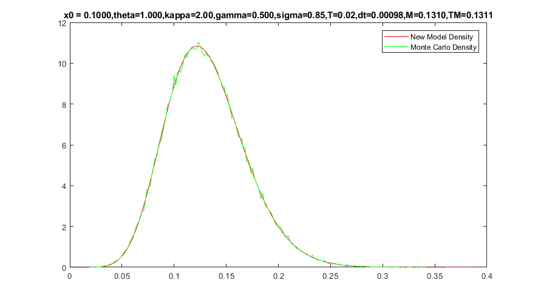

# Breakthrough in the theory of stochastic differential equations and their simulation

**Page 22 of 65** — Posts #1051–#1100

[← Previous](page_021.md) | [Index](index.md) | [Next →](page_023.md)

---

### #1051 — Amin (Topic Author)
*February 9, 2021, 10:26 AM*

>  difference with fokker-planck solution is that Fokker-planck solution automatically calculates any change in variance
due to drift while other monte carlo-like(with random numbers replaced with stochastic integrals) would have to
explicitly account for any contraction due to drift and would have to make extra calculations for that.
Friends would recall when I took the Fokker-planck solution and "backed out" standard normal variance increments between
any two nodes at time tn and time tn+1. We were excited when we could accurately apply Ito change of variable formula
using those Zt increments. But other SDEs were not working any more with those transition Zt increments and other
dt-integrals were losing variance. Then we constructed an integrated Z(tn) from transition standard variance increments
using transition probabilities. I was comparing variance of these reconstructed Z(tn) with variance of integrated values
of standard normals used in monte carlo simulations but I was seriously puzzled that variance of reconstructed Z(tn) on
fokker-planck grid using transition probabilities was far lesser than integrated values of normal constructed from
integration of driving standard normals in monte carlo. Finally I blamed these discrepancies on inaccuracies of the
Fokker-planck based transition probabilities grid and started an independent standard normal increments based grid.

Though there were indeed small inaccuracies on fokker-planck based transition probabilities grid but now it makes sense
that underlying driving normal distribution had lesse variance because it contracted due to mean reverting drift and our
backed out transition normals were quite close to accurate values and therefore Ito change of variable for that
particular SDE was working very well. In fact due to variable local contraction due to drift, our retrieved
"normal"(with integration of transition normal on fokker-planck based transition probabilities grid) was not even a
perfectly straight line. However transition normal increments everywhere had unit variance(approximately different due
to slight lack of accuracy).

No wonder that we could not integrate any other SDE on the grid of our retrieved "normal"(with integration of transition
normal on fokker-planck based transition probabilities grid).  And we also noticed that dt-integrals were fast losing
variance on this Z-grid which again makes sense since the constructed normal grid had contraction due to drift.

And now it all seems to make sense since Fokker-planck algorithm automatically calculates local adjustment in variance
of underlying integrated normal grid due to mean-reverting and variance changing drift.

I am sitting back for next 2-3 days brainstorming and thinking of the best way to go ahead on the transition
probabilities project since a lot of things have dramatically changed due to better understanding of underlying
phenomenon.

Again our roadmap of research is the same. I want to complete the transition probabilities for Bessel SDEs part in a
very good way and then move to caclulation of dt-integrals and dz-integrals(possibly on different sister grids) with
transition probabilities. I think we would be able to solve general(not necessarily bessel form) SDEs which are
counterparts of their bessel form on the same grids since underlying Z-grid remains the same.

And then we would move to monte carlo and transition probabilities grid generation of more general SDEs where each term
would possibly include time functions(exponentials and powers of time and others) multiplying algebraic functions of SDE
variable. So I hope that we would continue to do some exciting work in coming months and then move on to inference,
parameter estimation, filtering, AI and other interesting things.

---

### #1052 — Amin (Topic Author)
*February 10, 2021, 6:31 PM*

Though in our transition probabilities simulation of noises, we have used a normal distribution as underlying base
distribution that increased with a unit variance but when mean-reverting or other general drift is added, the local
variance changes differently due to non-linear drift and the underlying base distribution is no longer normal. This
problem is no simpler than that of fokker-planck equation in bessel form. In fact fokker-planck solution of bessel SDEs
is exactly increasing at uniform constant variance(though not unit variance) and contracting/expanding at the rate of
drift' derivative with respect to underlying normal. In fact we have three distributions now. The first is underlying
normal that we can take as standard. Second is a version of this normal that has taken account of all variance
expansions and contractions and the third version is the solution of SDE in bessel form(or possibly also in original
coordinates form.)

But again the problem of taking into account local expansion and contraction of underlying normal is almost exactly
similar to the fokker solution of the SDE in bessel coordinates and no simpler.

When variance of underlying normal changes uniformly, it is very simple to add variance to it and every local
subdivision expands linearly as a result and probability mass transfer across boundaries of various local subdivisions
are perfectly symmetric and cancelling to preserve the mass in each local subdivision. But once there are non-linear
local changes to initial existing variance, further variance cannot be added linearly by simple local squared addition
since there are non-symmetric probability mass transfer across boundaries of various subdivisions due to initial
existing non-uniform variance. I believe that we can calculate these non-symmetric mass transfers(with simple gaussian
transition probability as our added variance is uniformly gaussian though existing variance is not and has been deformed
due to drift) and then alter/calculate the boundaries/width of subdivisions that will keep the probability mass exactly
the same in each subdivision as the initial probability mass with non-uniform variance. In a small simulation
discretization step of the kind we have been taking in transition probabilities and FPE solution, the local mass
transfer calculations will involve just a few neighboring subdivisions and should be fast enough. I want to try this as
an alternative to route through solution of fokker-planck equation. I hope this will work very well but I could not be
perfectly sure and will try it next few days.

I want also want to request friends to ask the mind control agencies to become better. They do not let me sleep well at
night. They had also decreased forcing mind control chemicals in my mouth during my sleep for two or three days after I
complained but then started doing the same thing just like old again. They also use gases at the table where I work and
also in wash room adjacent to my room. And they still contaminate my food wherever they can as they did today when I had
dinner. I was very excited this evening about sitting whole night to try to complete my experiments but when I had
contaminated food at a street restaurant in Islamabad, a lot of my enthusiasm fizzled and I was not able to work well.
Please force these mind control agencies to be better and stop trying to control me.

---

### #1053 — Amin (Topic Author)
*February 11, 2021, 6:35 PM*

Since it would still be a few days before I complete the program perfectly, I want to describe for friends the new
proposed method to solve for the simulation of SDEs in Bessel coordinates without resorting to FPE method.

Firstly there are three distributions. The SDE solution on nth node of the grid at time t given as$w_n(t)$ , second
distribution is what I call Bessel distribution variable which keeps track of all local expansions and contractions of
variance and is denoted as$B_n(t)$ and the third is underlying standard normal distribution which on nth node is denoted
as$Z_n$ and has no dependence on t.

Bessel distribution variable$B_n(t)$ is only a displaced version of$w_n(t)$ . if we denote by$w0(t)$ as the value of SDE
solution on grid point where Z=0 (median of density) or$w0(t)= {w_n(t)|Z_n=0}$ , then Bessel distribution variable is
given by$B_n(t)=w_n(t)-w0(t)$

This will also mean that at median of density $B_n(t)=Z_n=0$ for the particular value of node n that lies at the median.

When the SDE starts from a delta origin, most SDEs(though of course, this may not hold for all SDEs) remain linear for a
very small time like t=.025 so we take first few steps of the density with any linear algorithm(So many of them are
possible).

After a few linear steps after the start from delta origin, we start our full-fledged "Bessel distribution variable"
update algorithm.

We have B_n(t) given and we want to construct B_n(t+1).

We start to construct$B_n(t+1)$ from the node at the median. At median B_n(t+1) always remains zero. To construct Bessel
variable to right of median, We have starting(left) boundary of this first subdivision to the right of median exactly at
median where B(t+1)=0. We approximate the right boundary of this first subdivision to right of median at
$\sqrt{({\frac{\partial B}{\partial Z}}^2 + \sigma^2 dt)}$ . This right boundary is a trial boundary and would work
perfectly well if Bessel variable distribution were a normal distribution. Since both boundaries have been set, we can
now use Gaussian formula to calculate actual probability mass transfers from all subdivisions at time t, to this
subdivision at time t+1. We want the grid to expand so that integrated mass in every subdivision always remains constant
at$P_n$ . However the actual integrated probability mass would be very slightly different from the target constant mass.
We calculate this difference(excess probability mass) and call it$\Delta P_n$ and use the Taylor formula as
$\Delta P_n= \frac{\partial P}{\partial B} \Delta B +  \frac{\partial^2 P}{\partial B^2} {(\Delta B)}^2$ to calculate
how much to move the right boundary by$\Delta B$ so that new$\Delta P_n=0$ . We will have to solve it with special form
of quadratic formula that is robust for small coefficients on squared term of quadratic equation.

I propose to approximate
$\frac{\partial P}{\partial B}=\frac{-Z}{\sqrt{({\frac{\partial B}{\partial Z}}^2 + \sigma^2 dt)}} P(Z)$

and similarly for second derivative. Please note that all derivatives in above equations are calculated differently for
each node and I have not shown dependence of these derivatives on node variable n.

Once we have fixed the right boundary of first subdivision to the right of median, we will take it as left boundary for
second subdivision and set a trial right boundary for second subdivision to right of median and repeat the calculation
of excess probability mass and then calculate how much to move our right trial boundary so that excess probability mass
goes to zero.

I hope to present the worked out program in a few days. There are a lot of interesting things yet to be seen if we could
take a large step with this algorithm and we will find out once the algorithm is ready.

---

### #1054 — Amin (Topic Author)
*February 13, 2021, 6:47 PM*

Friends, I am still working on the problem outlined in previous post and a lot of things have changed from the plan of
attack I described.

I am very sure many smarter friends would have already realized that once we have found the "Bessel distribution
variable" by matching its origin with origin of normal distribution, we can very easily add diffusion to it with a PDE
and then find a restored version of SDE variable in bessel coordinates and then add drift. PDEs are extremely fast and
very accurate for pure diffusions and drift can be later added independently. Decoupling the addition of variance to SDE
simulation and and addition of drift to SDE(in bessel coordinates) simulation using a PDE could be a very powerful
tool(as handling strong convections is difficult for numerical solution of PDEs while adding gaussian diffusion is
probably almost trivial.)

I hope to complete the program with transition of probability mass within another two days. Meanwhile please read here

https://forum.wilmott.com/viewtopic.php?f=15&t=94796&p=864253#p864253

 my post with request to new president Joe Biden about ending mind control. In my post, I have also request CNN, New
York Times, and Washington Post to highlight this issue of grave human rights abuses. I have also shared my (bad)
opinion about previous president obama.

[viewtopic.php?f=15&t=94796&start=1200#p864275](https://forum.wilmott.com/viewtopic.php?f=15&t=94796&start=1200#p864275)

[viewtopic.php?f=15&t=94796&start=1200#p864276](https://forum.wilmott.com/viewtopic.php?f=15&t=94796&start=1200#p864276)

---

### #1055 — Amin (Topic Author)
*February 14, 2021, 6:12 PM*

I want to tell friends that my research in mathematics and my freedom from mind control are two most important things
for me at this point in life. I was expecting that my freedom from mind control would be automatic after arrival of a
new democratic president in office. Though it may not be very far in future but I am afraid that it may be a protracted
battle for quite sometime. I am writing this post to tell friends that keeping focus on my research is extremely
important for me. Though I would be spending slightly more time in my attempts at my and other victims' freedom from
mind control and request friends to help as well, I will make sure that my major focus on research in mathematics only
increases and not decreases. And I want to thank the readers for taking the time to read my posts and I hope to continue
to post quality research here.

---

### #1056 — Amin (Topic Author)
*February 15, 2021, 8:54 AM*

Here I have again requested President Biden to end mind control. And commented how to keep America in a leader on
today's world.

https://forum.wilmott.com/viewtopic.php?f=15&p=864314#p864314

---

### #1057 — Amin (Topic Author)
*February 17, 2021, 6:25 PM*

Friends, my work on the program(for simulation of SDEs in transition probabilities related framework) slowed down but I
have almost completed coding and my logic is sound. I will be debugging and running the complete program in another day.
I hope the program has desired accuracy that we want to see.

Once this program is complete, I will come back with a second program with numerical PDE type solution as I mentioned
two posts ago. I also have a very good idea now why our simulation of (dz and dt) integrals of SDE was not working well
on the same transition probabilities grid. We will have to make different independent sister-grid for each dz-integral
or dt-integral. However each grid will be related to main SDE grid based on corresponding Z-lines(or Z-grid). If main
SDE variable is w, We will copy the value of  f(w(Z_n))  from nth node of the parent SDE grid and use it for simulation
on nth node of sister grid so both parent and sister grids would be related with respect to Z-lines(or density CDF).
This way we would be able to simulate the dt-integrals and dz-integrals of functions of SDE on a single dimensional
transition probabilities grid(or possibly have a numerical PDE type method).

Friends would recall that we could simulate the direct functions of SDE when I tried to impose transition probabilities
on FPE solution however we could not simulate any integrals of the SDE on the same grid. Both grids for SDE and its (dz
and dt) integrals have very different variances with their own contraction and expansion effect of their drifts. The (dz
and dt) integrals grid will only borrow the value of SDE variable along Z-lines from the original SDE grid and use it on
corresponding Z-lines on sister grid and then have independent evolution of drift and variance on sister grid according
to existing variance of the (dz- and dt integral) sister grid.

I am sorry that my work slowed down a bit but I hope to speed up in next few days if things do not get worse.

I also want to tell friends that crooks in US defense have hacked my website since it was a wonderful website and gave a
great image and they did not want many other visitors to see my website as it would give them a good image of me. God,
When are these immature crooks in US Army ever be able to grow up?

---

### #1058 — Amin (Topic Author)
*February 20, 2021, 10:15 AM*

Dear friends, I have almost completed my program for simulation of SDEs that I mentioned in previous few posts and its
main algorithm works very well. I will be making a few small changes and post the program in another day or two.

I want to take this opportunity to thank those American friends who insisted on mind control agencies to not force
injections on me and therefore I was able to complete this program relatively quickly and reasonably. Though mind
control is continuing and mind control agencies are still trying to give me drugged food, not forcing injections on me
is a huge step for me.

Anyway, I hope to post the program in a day or two and I hope friends would like it. I also want to thank friends for
helping me in making it possible.

I will post a generic full-fledged working algorithm first. Since it is a new algorithm, I think a lot of optimizations
and changes are possible and therefore I hope to come up with a more optimized version in a few more days. Though I am
sure that original prototype will also work very well.

---

### #1059 — Amin (Topic Author)
*February 22, 2021, 7:33 PM*

Friends, I have worked out the algorithm to update the density for the simulation of SDEs in Bessel coordinates without
resorting to FPE method. I am going to give the details of the new modified algorithm below. I have copied some of the
material from a previous post to give the right context and avoid having to write the same introduction again.

The SDE solution on nth node of the grid at time t given as$w_n(t)$ , second distribution is what I call Bessel
distribution variable which keeps track of all local expansions and contractions of variance and is denoted as$B_n(t)$
and the third is underlying standard normal distribution which on nth node is denoted as$Z_n$ and has no dependence on
t.

Bessel distribution variable$B_n(t)$ is only a displaced version of$w_n(t)$ . if we denote by$w0(t)$ as the value of SDE
solution on grid point where Z=0 (median of density) or$w0(t)= {w_n(t)|Z_n=0}$ , then Bessel distribution variable is
given by$B_n(t)=w_n(t)-w0(t)$

This will also mean that at median of density $B_n(t)=Z_n=0$ for the particular value of node n that lies at the median.

When the SDE starts from a delta origin, most SDEs(though of course, this may not hold for all SDEs) remain linear for a
very small time like t=.025 so we take first few steps of the density with any linear algorithm(So many of them are
possible).

After a few linear steps after the start from delta origin, we start our full-fledged "Bessel distribution variable"
update algorithm.

We have B_n(t) given and we want to construct B_n(t+1).

We start to construct$B_n(t+1)$ from the node at the median. At median B_n(t+1) always remains zero. To construct Bessel
variable to right of median, We have starting(left) boundary of this first subdivision to the right of median exactly at
median where B(t+1)=0. We approximate the right boundary of this first subdivision to right of median at
$\sqrt{({\frac{\partial B}{\partial Z}}^2 + \sigma^2 dt)}$ . This right boundary is a trial boundary and would work
perfectly well if Bessel variable distribution were a normal distribution. Since both boundaries have been set, we can
now use Gaussian formula to calculate actual probability mass transfers from all subdivisions at time t, to this
subdivision at time t+1. We want the grid to expand/contract so that integrated mass in every subdivision always remains
constant at$P_n$ . However the actual integrated probability mass would be very slightly different from the target
constant mass. We calculate this difference(excess probability mass) and call it$\Delta P_n$ .

What follows is different from what I described in previous post.

We take the right trial boundary and calculate the transition probability from each subdivision at previous time at this
trial boundary. From a cell m at time t, to the right boundary of cell n, this transition probability is denoted as
p(t,m,t+1,n). If the center of mth cell at t is given by$B_m$ and the right trial boundary of nth cell at time t+1 is
given as$\bar{B_n}$ , the transition increment between the two would be$\bar{B_n}-B_m$ . In case of bessel SDE setting,
this transition increment would be locally normal with volatility$\sigma_m$ if the time step is not too large. So
$ p(t,m,t+1,n)=p_m=N(\bar{B_n}-B_m,0,\sigma_m)$

Since probability mass in original subdivision is not one and is equal to$P_m$ , we will have to multiply the transition
probability by$P_m$ . In what follows, I will write$ p(t,m,t+1,n)=p_m=P_m N(\bar{B_n}-B_m,0,\sigma_m)$

First derivative of this transition probability at the right trial boundary is given as
$\frac{dp_m}{d\bar{B}_n}=P_m \frac{-1}{\sigma_m} \frac{(\bar{B_n}-B_m)}{\sigma_m} N(\bar{B_n}-B_m,0,\sigma_m)$

Second derivative of this transition probability at the right trial boundary is given as
$\frac{d^2p_m}{d{\bar{B}_n}^2}=P_m \frac{(-1)^2}{{(\sigma_m)}^2} ({(\frac{(\bar{B_n}-B_m)}{\sigma_m})}^2-1) N(\bar{B_n}-B_m,0,\sigma_m)$

Third derivative of this transition probability at the right trial boundary is given as
$\frac{d^3p_m}{d{\bar{B}_n}^3}=P_m \frac{(-1)^3}{{(\sigma_m)}^3} ({(\frac{(\bar{B_n}-B_m)}{\sigma_m})}^3-3(\frac{(\bar{B_n}-B_m)}{\sigma_m})) N(\bar{B_n}-B_m,0,\sigma_m)$

The above are transition probability and its derivatives and if we want to convert them to CDF/probability mass, we
would have to integrate them.

if we move the right trial boundary by a very small amount$\Delta B$ , the change in probability mass coming into nth
cell at time t+1 from mth cell at time t, would be approximated after integration as

$ p_m \Delta B+ \frac{dp_m}{d\bar{B}_n} { \Delta B}^2/2 + \frac{d^2p_m}{d{\bar{B}_n}^2} { \Delta B}^3/6+ \frac{d^3p_m}{d{\bar{B}_n}^3} { \Delta B}^4/24=\Delta P_n$

The above was equation for change in probability mass coming from mth cell at time t as we moved the trial boundary by a
very slight bit. All the values of transition probability and their derivatives are calculated exactly at the trial
boundary.

Now we want one single equation for total change in probability mass coming from all of the M cells at time t into nth
cell at time t+1 as we move the right trial boundary by a little bit. This is very simple and a mere addition over all M
cells and can be written as

$\Delta B \sum_{1}^{M} p_m +{ \Delta B}^2/2  \sum_{1}^{M} \frac{dp_m}{d\bar{B}_n}  +{ \Delta B}^3/6 \sum_{1}^{M} \frac{d^2p_m}{d{\bar{B}_n}^2} +{ \Delta B}^4/24 \sum_{1}^{M} \frac{d^3p_m}{d{\bar{B}_n}^3} =\Delta P_n$

I have omitted the summation sign on the excess probability mass in RHS. Obviously This has to be taken as summation of
excess prob mass after taking into account diffusion from all M cells on grid at time t.

So once we know the total excess probability mass with the trial boundary given as$\Delta P_n$ , we can easily calculate
how much do we have to move bcak/forward$\Delta B$ the trial boundary so that the excess mass is exactly reversed. We
would have to solve the above quartic equation as

$a \Delta B  +b { \Delta B}^2   +c { \Delta B}^3 +d { \Delta B}^4 =-\Delta P_n$

$a= \sum_{1}^{M} p_m$

$b=\sum_{1}^{M} \frac{dp_m}{d\bar{B}_n}/2$

$c=\sum_{1}^{M} \frac{d^2p_m}{d{\bar{B}_n}^2}/6$

$d=\sum_{1}^{M} \frac{d^3p_m}{d{\bar{B}_n}^3}/24$

Sometimes special care has to be taken in choice of signs as we move right or left away from the median and if excess
probability mass is positive or negative. I calculated excess probability mass by calculating transition CDF from each
of the M cells at time t to both left boundary(that was fixed) and to the right boundary of nth cell at time t+1 and
subtracting the CDF on both boundaries.

I was earlier doing the above analytics with just two terms with solving a quadratic equation. Though results were very
good and I was able to closely calculate the required change in the boundary of each cell within the Zn= -4 SD to Zn=+4
SD but outside to +5SD, there were some problems since two term quadratic approximation was not perfectly good and small
inaccuracies would add up.

In my algorithm, I have also taken special measures for time t grid cells overlapping with t+1 grid cells. If a grid
cell at time t is such that a part of it is to the right of the trial boundary(of t+1 cell) and part of it is to the
left of the trial boundary, I divide the cell into two parts so that one part is completely to the left of the boundary
and the other is completely to the right of the boundary so as to be able to calculate valid transition probabilities.
My grid is also large (200 cells) so it seems to work well.

I am now solving a four term quartic equation and I solved it in mathematica with general coefficients and later
extremely simplified it with repeated algebraic substitutions and it is quite cheap to calculate all four roots of
quartic equation. But I still have to do some work with robust selection of right root from four roots.

Quartic equation is particularly interesting since it locally approximates the true change in probability mass extremely
well and Fokker-planck solution also included a third derivative. I hope we would be able to take a reasonably large
step with this algorithm.

Once we have fixed the right boundary of first subdivision to the right of median, we will take it as left boundary for
second subdivision and set a trial right boundary for second subdivision to right of median and repeat the calculation
of excess probability mass and then calculate how much to move our right trial boundary so that excess probability mass
goes to zero.

I hope to post the new program in another few days.

I also want to take this opportunity to tell friends that mind control agents are doing their full effort to give me
drugged food. I have been able to get good food and water for past few days but it might become difficult to outsmart
them every day and that might effect my work. Please force them to take it easy and let me continue to devote time
actively to my research.

I have also told friends before that my research  and programs are given to some people in academia who are friendly to
mind control agencies and if you know somebody who claims to do exactly the same thing, please weigh the chances of
their doing it on their own. I really think that one reason behind frenetic attempts to drug my food in past days was to
not let me work after having drugged food and ask other people to complete the work in the meantime and present it as
their own.

---

### #1060 — Amin (Topic Author)
*February 23, 2021, 8:44 AM*

In previous post, I forgot to scale the transition probability from mth subdivision at time t to nth subdivision at time
t+1 with probability mass in original mth subdivision given as$P_m$ . This would give slightly wrong idea about the
algorithm. I altered one paragraph in previous post and I am copying the altered paragraph here.

We take the right trial boundary and calculate the transition probability from each subdivision at previous time at this
trial boundary. From a cell m at time t, to the right boundary of cell n, this transition probability is denoted as
p(t,m,t+1,n). If the center of mth cell at t is given by$B_m$ and the right trial boundary of nth cell at time t+1 is
given as$\bar{B_n}$ , the transition increment between the two would be$\bar{B_n}-B_m$ . In case of bessel SDE setting,
this transition increment would be locally normal with volatility$\sigma_m$ if the time step is not too large. So
$ p(t,m,t+1,n)=p_m=N(\bar{B_n}-B_m,0,\sigma_m)$

Since probability mass in original subdivision is not one and is equal to$P_m$ , we will have to scale the transition
probability by$P_m$ . In what follows, I will write$ p(t,m,t+1,n)=p_m=P_m N(\bar{B_n}-B_m,0,\sigma_m)$

First derivative of this transition probability at the right trial boundary is given as
$\frac{dp_m}{d\bar{B}_n}=P_m \frac{-1}{\sigma_m} \frac{(\bar{B_n}-B_m)}{\sigma_m} N(\bar{B_n}-B_m,0,\sigma_m)$

Second derivative of this transition probability at the right trial boundary is given as
$\frac{d^2p_m}{d{\bar{B}_n}^2}=P_m \frac{(-1)^2}{{(\sigma_m)}^2} ({(\frac{(\bar{B_n}-B_m)}{\sigma_m})}^2-1) N(\bar{B_n}-B_m,0,\sigma_m)$

Third derivative of this transition probability at the right trial boundary is given as
$\frac{d^3p_m}{d{\bar{B}_n}^3}=P_m \frac{(-1)^3}{{(\sigma_m)}^3} ({(\frac{(\bar{B_n}-B_m)}{\sigma_m})}^3-3(\frac{(\bar{B_n}-B_m)}{\sigma_m})) N(\bar{B_n}-B_m,0,\sigma_m)$

---

### #1061 — Amin (Topic Author)
*February 23, 2021, 2:31 PM*

>
> In previous post, I forgot to scale the transition probability from mth subdivision at time t to nth subdivision at
time t+1 with probability mass in original mth subdivision given as$P_m$ . This would give slightly wrong idea about the
algorithm. I altered one paragraph in previous post and I am copying the altered paragraph here.
>
>
>
> We take the right trial boundary and calculate the transition probability from each subdivision at previous time at
this trial boundary. From a cell m at time t, to the right boundary of cell n, this transition probability is denoted as
p(t,m,t+1,n). If the center of mth cell at t is given by$B_m$ and the right trial boundary of nth cell at time t+1 is
given as$\bar{B_n}$ , the transition increment between the two would be$\bar{B_n}-B_m$ . In case of bessel SDE setting,
this transition increment would be locally normal with volatility$\sigma_m$ if the time step is not too large. So
$ p(t,m,t+1,n)=p_m=N(\bar{B_n}-B_m,0,\sigma_m)$
>
> Since probability mass in original subdivision is not one and is equal to$P_m$ , we will have to scale the transition
probability by$P_m$ . In what follows, I will write$ p(t,m,t+1,n)=p_m=P_m N(\bar{B_n}-B_m,0,\sigma_m)$
>
> First derivative of this transition probability at the right trial boundary is given as
$\frac{dp_m}{d\bar{B}_n}=P_m \frac{-1}{\sigma_m} \frac{(\bar{B_n}-B_m)}{\sigma_m} N(\bar{B_n}-B_m,0,\sigma_m)$
>
> Second derivative of this transition probability at the right trial boundary is given as
$\frac{d^2p_m}{d{\bar{B}_n}^2}=P_m \frac{(-1)^2}{{(\sigma_m)}^2} ({(\frac{(\bar{B_n}-B_m)}{\sigma_m})}^2-1) N(\bar{B_n}-B_m,0,\sigma_m)$
>
> Third derivative of this transition probability at the right trial boundary is given as
$\frac{d^3p_m}{d{\bar{B}_n}^3}=P_m \frac{(-1)^3}{{(\sigma_m)}^3} ({(\frac{(\bar{B_n}-B_m)}{\sigma_m})}^3-3(\frac{(\bar{B_n}-B_m)}{\sigma_m})) N(\bar{B_n}-B_m,0,\sigma_m)$
>
>
>
>
>
Many friends would have noticed that$P_m$ in above equations is a source of error. I am assuming as if all the mass in
mth subdivision at time t is concentrated as delta mass at its centre. Obviously this is wrong. Distribution of mass
within the subdivision is not linear or symmetric and transition probability is also not linear at all. Because of both
these reasons there will be some error in previous analysis. But I have done analytics to calculate the correction(due
to both of the mentioned factors) that when added will take our previous calculations to exact values. I will be sharing
it in a few hours or by tomorrow at the latest.

---

### #1062 — Amin (Topic Author)
*February 23, 2021, 7:16 PM*

In this post, I want to write how to calculate exact Gaussian transition CDF, Gaussian transition probability and
derivatives of Gaussian transition probability from mth Bessel grid cell$B_m$ at time t, to any point on the new grid at
time t. Please note that we are not calculating Gaussian CDF and transition probability merely between two points.
Rather we have an initial Bessel grid where we take an arbitrary mth cell and we want to calculate exact mass transfer
CDF, transition probability and its derivatives from the entire mth cell at time t to nth cell at time t+1. As I
indicated in my previous post there is an obvious difference between mass transfer(its CDF and pdf) between two points
and mass transfer from a cell of certain width to another point and both of these are different and replacing mass
transfer between a cell and a point by mass transfer between two points can lead to increasing accuracies in any
transition probabilities algorithm.

Let us fix the notation first which is slightly different from what I have been using earlier. We have a Bessel grid and
we indicate an arbitrary cell by$B_m$ and the center of this cell is given by$B_{m0}$ . This center$B_{m0}$ will
correspond to point$Z_m$ on Z-grid and in general both boundaries of the cell(that will correspond to$Z_m+\Delta Z/2$
and$Z_m-\Delta Z/2$ ) will not be equidistant from this center of the cell$B_{m0}$ . We will represent the left boundary
of cell$B_m$ corresponding to$Z_m-\Delta Z/2$ as$B_{m1}$ and right boundary corresponding to$Z_m+\Delta Z/2$ as$B_{m2}$

The transition probability between center of mth cell$B_{m0}$ to arbitary point$B_n$ on next grid is denoted as
$ p_{m0,n}=N(B_n-B_{m0},0,\sigma_m)$ .

Its CDF is defined by uppercase of PDF as $ P_{m0,n}=\int_{-\infty}^{(B_n-B_{m0})} N(B_n-B_{m0},0,\sigma_m) dN $

I want to emphasize that above PDF, CDF and their derivatives below are between two points(The centre of$B_m$ given by
$B_{m0}$ and point$B_n$

First derivative of this transition probability$p_{m0,n}$ at point$B_{m0}$ is given as
$\frac{dp_{m0,n}}{dB}=(-1) \frac{-1}{\sigma_m} \frac{(B_n-B_{m0})}{\sigma_m} N(B_n-B_{m0},0,\sigma_m)$

Second derivative of this transition probability$p_{m0,n}$ at point$B_{m0}$ is given as
$\frac{d^2p_{m0,n}}{d{B}^2}=\frac{(-1)^2}{{(\sigma_m)}^2} ({(\frac{(B_n-B_{m0})}{\sigma_m})}^2-1) N(B_n-B_{m0},0,\sigma_m)$

Third derivative of this transition probability$p_{m0,n}$ at point$B_{m0}$ is given as
$\frac{d^3p_{m0,n}}{d{B}^3}=(-1)*\frac{(-1)^3}{{(\sigma_m)}^3} ({(\frac{(B_n-B_{m0})}{\sigma_m})}^3-3(\frac{(B_n-B_{m0})}{\sigma_m})) N(B_n-B_{m0},0,\sigma_m)$

We define the probability density function at center of mth cell in Bessel variable$B_m$ as lowercase
$p_{m0}=p(Z_m) \frac{dZ}{dB_m}$

while uppercase will denote its CDF given as $P_{m0}=P(Z_m)$

The probability mass in mth cell which is the difference of CDF at boundaries is denoted as $\Delta P_{m}$

The derivatives of probability density function at center of mth cell in Bessel variable$B_m$ are given as
$\frac{dp_{m0}}{dB}=\frac{dp(Z_m)}{dZ} {(\frac{dZ}{dB_m})}^2+p(Z_m) \frac{d^2Z}{d{B_m}^2} $

We can similarly calculate higher derivatives$\frac{d^2p_{m0}}{d{B}^2}(B_{m0})$ and$\frac{d^3p_{m0}}{d{B}^3}$ by further
differentiating the above function

We want to calculate the transition CDF, transition probability, and its derivatives from a cell m at time t, to an
arbitrary point n on the grid at time t+1.

We first calculate the CDF from entire mth cell to nth point on grid at time t+1 and write it as an integral as

$\int_{B_{m1}}^{B_{m2}} p_m(B) P_{m,n}(B) dB$ Equation(A)

Here$p_m(B)$ indicates the probability density function at arbitrary point B within the mth subdivision(not necessarily
at center).

Here$P_{m,n}(B)$ indicates the CDF of transition probability from an arbitrary point B within the mth subdivision(not
necessarily from its center) to arbitrary point$B_n$ on next grid.

Our strategy to solve the above integral is to take derivatives of integrand at center of the grid cell$B_{m0}$ and
expand it as Taylor series and then solve it. Our expansion is basically constant values calculated at center of the mth
subdivision(which are handily available) multiplied by an integral of the powers of difference of distance of two
boundaries from the center. I have already indicated previously how to calculate these derivatives at center to any
higher order.

So we have

$\int_{B_{m1}}^{B_{m2}} p_m(B) P_{m,n}(B) dB$

$=\int_{B_{m1}}^{B_{m2}} p_{m0} P_{m0,n} dB$

$+\int_{B_{m1}}^{B_{m2}}  (\frac{dp_{m0}}{dB} P_{m0,n}+ p_{m0} p_{m0,n})  (B - B_{m0}) dB$

$+\int_{B_{m1}}^{B_{m2}}  (\frac{d^2p_{m0}}{d{B}^2} P_{m0,n}+2 \frac{dp_{m0}}{dB} p_{m0,n}+  p_{m0} \frac{dp_{m0,n}}{dB})  \frac{{(B - B_{m0})}^2}{2}  dB$

$+\int_{B_{m1}}^{B_{m2}}  (\frac{d^3p_{m0}}{d{B}^3} P_{m0,n}+3 \frac{d^2p_{m0}}{d{B}^2} p_{m0,n}+3 \frac{dp_{m0}}{dB} \frac{dp_{m0,n}}{dB}+  p_{m0} \frac{d^2p_{m0,n}}{dB^3})  \frac{{(B - B_{m0})}^3}{6}   dB$
Equation(B)

We might have to expand to fourth order many times but I am not writing the higher order terms to make it easy to type
here.

We re-arrange terms in the above equation(B) to write as

$\int_{B_{m1}}^{B_{m2}} p_m(B) P_{m,n}(B) dB$

$=\int_{B_{m1}}^{B_{m2}} p_{m0} P_{m0,n} dB$

$+\int_{B_{m1}}^{B_{m2}}  (\frac{dp_{m0}}{dB} P_{m0,n})  (B - B_{m0}) dB$

$+\int_{B_{m1}}^{B_{m2}}  (\frac{d^2p_{m0}}{d{B}^2} P_{m0,n})  \frac{{(B - B_{m0})}^2}{2}  dB$

$+\int_{B_{m1}}^{B_{m2}}  (\frac{d^3p_{m0}}{d{B}^3} P_{m0,n})  \frac{{(B - B_{m0})}^3}{6}   dB$

$+\int_{B_{m1}}^{B_{m2}}  ( p_{m0} p_{m0,n})  (B - B_{m0}) dB$

$+\int_{B_{m1}}^{B_{m2}}  (2 \frac{dp_{m0}}{dB} p_{m0,n}+  p_{m0} \frac{dp_{m0,n}}{dB})  \frac{{(B - B_{m0})}^2}{2}  dB$

$+\int_{B_{m1}}^{B_{m2}}  (3 \frac{d^2p_{m0}}{d{B}^2} p_{m0,n}+3 \frac{dp_{m0}}{dB} \frac{dp_{m0,n}}{dB}+  p_{m0} \frac{d^2p_{m0,n}}{dB^3})  \frac{{(B - B_{m0})}^3}{6}   dB$
Equation(C)

We notice that first four terms in equation(C) after the equality sign and their series continuation equals the
probability mass$\Delta P_m$ in the mth cell(difference of CDF at boundaries) multiplied by transition CDF between the
center of mth cell$B_{m0}$ and point$B_n$ on next time grid and we write those four terms again as

$\int_{B_{m1}}^{B_{m2}} p_{m0} P_{m0,n} dB$

$+\int_{B_{m1}}^{B_{m2}}  (\frac{dp_{m0}}{dB} P_{m0,n})  (B - B_{m0}) dB$

$+\int_{B_{m1}}^{B_{m2}}  (\frac{d^2p_{m0}}{d{B}^2} P_{m0,n})  \frac{{(B - B_{m0})}^2}{2}  dB$

$+\int_{B_{m1}}^{B_{m2}}  (\frac{d^3p_{m0}}{d{B}^3} P_{m0,n})  \frac{{(B - B_{m0})}^3}{6}   dB$

$=(P_{m2}-P_{m1}) P_{m0,n}=\Delta P_m P_{m0,n}$ Equation(D)

We write the above results of Equation(D) and substitute them in equation (C) and take constants out of the integrals to
write the equation(E) as

$\int_{B_{m1}}^{B_{m2}} p_m(B) P_{m,n}(B) dB$

$=\Delta P_m P_{m0,n}$

$+ ( p_{m0} p_{m0,n})  \int_{B_{m1}}^{B_{m2}}  (B - B_{m0}) dB$

$+ (2 \frac{dp_{m0}}{dB} p_{m0,n}+  p_{m0} \frac{dp_{m0,n}}{dB}) \int_{B_{m1}}^{B_{m2}}  \frac{ {(B - B_{m0})}^2}{2} dB$

$+(3 \frac{d^2p_{m0}}{d{B}^2} p_{m0,n}+3 \frac{dp_{m0}}{dB} \frac{dp_{m0,n}}{dB}+  p_{m0} \frac{d^2p_{m0,n}}{dB^3})  \int_{B_{m1}}^{B_{m2}}   \frac{{(B - B_{m0})}^3}{6}  dB$
Equation(E)

Please note that first term on RHS is what we had been using earlier as if all mass were concentrated at delta center of
mth subdivision. Next three terms are corrections to CDF required for an appropriate and exact calculation of CDF at
point$B_n$ on next grid when probability mass from entire cell is considered. Please notice that all derivatives
evaluated at the center of mth grid subdivision can be trivially calculated as I explained earlier and we are left with
extremely simple integrals of powers of distance of boundaries from the center of subdivision which are again extremely
simple to calculate.

Please note that all integrals with odd powers on$(B - B_{m0}) $ would have vanished if both grid boundaries were
equidistant from the center.

We can repeat the steps to calculate the corrections for transition PDF and all its derivatives just like we solved for
the CDF. We will get the same equation but every one degree higher derivative of CDF will mean one degree higher
derivative(of transition probability between center$B_{m0}$ and the point$B_n$ on next boundary) terms in equation(E)

To find corrections to transition CDF, we solved the integral $\int_{B_{m1}}^{B_{m2}} p_m(B) P_{m,n}(B) dB$ Equation(A)

In order to find corrections to transition PDF, we would solve the integral$\int_{B_{m1}}^{B_{m2}} p_m(B) p_{m,n}(B) dB$
Equation(A2)

and so on for higher derivatives.

Sorry friends, it is a bit late(3:10 am) and I have to wake up early tomorrow so I will make any proper corrections of
errors in this note tomorrow. I will remove "Post in progress" at start after I have removed any errors tomorrow.

---

### #1063 — Amin (Topic Author)
*February 24, 2021, 3:50 PM*

Dear friends, I wanted to mention again that if friends would like to do more original research based on what I have
posted here on this forum, please feel perfectly free to do that. Though I do expect that friends would cite whatever I
have written on this forum when they do further research.

I want to take this opportunity to thank those good people who protested against my mind control and who tried to press
on mind control agencies to become better. Though mind control has not decreased and a lot of other problems continue,
not forcing antipsychotic injections on me due to protests of good people is a very huge step for me and I would never
have been able to do good research that I was recently able to do. I want to thank good people for making it possible
for me to do good research and I want to express my huge gratitude to good people for favors they did to me. Though I
hope that my mind control and mind control of thousands of innocent victims would eventually end, I really want to thank
good people for making my life a lot easier and a whole lot better.

And I also want to tell friends that I seriously want to continue doing good research on stochastics and sharing it with
friends on this thread. I will really try doing good research that friends like.

---

### #1064 — Amin (Topic Author)
*February 25, 2021, 6:22 PM*

I want to request friends to read my new post on off-topic here:https://forum.wilmott.com/viewtopic.php?f=15&t=94796&p=864512#p864512

---

### #1065 — Amin (Topic Author)
*February 25, 2021, 9:06 PM*

Post in progress.

I tried a bit to see if I could further improve on the formula for probability mass transfer CDF I wrote a few posts
ago. I am copying equation(E) from the relevant earlier post.

We write the above results of Equation(D) and substitute them in equation (C) and take constants out of the integrals to
write the equation(E) as

$\int_{B_{m1}}^{B_{m2}} p_m(B) P_{m,n}(B) dB$

$=\Delta P_m P_{m0,n}$

$+ ( p_{m0} p_{m0,n})  \int_{B_{m1}}^{B_{m2}}  (B - B_{m0}) dB$

$+ (2 \frac{dp_{m0}}{dB} p_{m0,n}+  p_{m0} \frac{dp_{m0,n}}{dB}) \int_{B_{m1}}^{B_{m2}}  \frac{ {(B - B_{m0})}^2}{2} dB$

$+(3 \frac{d^2p_{m0}}{d{B}^2} p_{m0,n}+3 \frac{dp_{m0}}{dB} \frac{dp_{m0,n}}{dB}+  p_{m0} \frac{d^2p_{m0,n}}{dB^3})  \int_{B_{m1}}^{B_{m2}}   \frac{{(B - B_{m0})}^3}{6}  dB$
Equation(E)

We have earlier simplified the equation by collecting some terms and recognizing their series and finding the term that
describes the series. We want to try doing that with some other terms as well but it is a bit more difficult now.

Let us put separate some more terms and try to simplify them as

$ ( p_{m0} p_{m0,n})  \int_{B_{m1}}^{B_{m2}}  (B - B_{m0}) dB$

$+ (p_{m0} \frac{dp_{m0,n}}{dB}) \int_{B_{m1}}^{B_{m2}}  \frac{ {(B - B_{m0})}^2}{2} dB$

$+(p_{m0} \frac{d^2p_{m0,n}}{dB^3})  \int_{B_{m1}}^{B_{m2}}   \frac{{(B - B_{m0})}^3}{6}  dB$  equation(a)

The above three terms could  be recognized as series for integral of CDF if we could add first order Taylor term that it
is missing. So we could write as

$\int_{B_{m1}}^{B_{m2}} p_{m0} P_{m,n}(B) dB$

$ -  \int_{B_{m1}}^{B_{m2}} ( p_{m0} P_{m0,n})  dB$

$ =  \int_{B_{m1}}^{B_{m2}}  ( p_{m0} p_{m0,n})(B - B_{m0}) dB$

$+  \int_{B_{m1}}^{B_{m2}} (p_{m0} \frac{dp_{m0,n}}{dB}) \frac{ {(B - B_{m0})}^2}{2} dB$

$+ \int_{B_{m1}}^{B_{m2}} (p_{m0} \frac{d^2p_{m0,n}}{dB^3})   \frac{{(B - B_{m0})}^3}{6}  dB$ equation(b)

So we can basically replace the series continuation of the following terms

$ ( p_{m0} p_{m0,n})  \int_{B_{m1}}^{B_{m2}}  (B - B_{m0}) dB$

$+ (p_{m0} \frac{dp_{m0,n}}{dB}) \int_{B_{m1}}^{B_{m2}}  \frac{ {(B - B_{m0})}^2}{2} dB$

$+(p_{m0} \frac{d^2p_{m0,n}}{dB^3})  \int_{B_{m1}}^{B_{m2}}   \frac{{(B - B_{m0})}^3}{6}  dB$ Equation(a)

with the following two terms

$ p_{m0} \int_{B_{m1}}^{B_{m2}} P_{m,n}(B) dB$

$ - ( p_{m0} P_{m0,n}) \int_{B_{m1}}^{B_{m2}}   dB$ Equation(c)

The first analytic integral might be hard to solve analytically but we can try to integrate it by parts as

$  \int_{B_{m1}}^{B_{m2}} P_{m,n} dB$

$=B_{m2} P_{m2,n} - B_{m1} P_{m1,n}  - \int_{B_{m1}}^{B_{m2}}  B p_{m,n}(B) dB$  Equation(d)

Substituting Equation(d) in Equation(c), we get

$ p_{m0} \int_{B_{m1}}^{B_{m2}} P_{m,n}(B) dB$

$ - ( p_{m0} P_{m0,n}) \int_{B_{m1}}^{B_{m2}}   dB$

$=p_{m0} B_{m2} P_{m2,n} -p_{m0} B_{m1} P_{m1,n} $

$- p_{m0} \int_{B_{m1}}^{B_{m2}}B p_{m,n}(B) dB$

$ - ( p_{m0} P_{m0,n}) \int_{B_{m1}}^{B_{m2}}   dB$ Equation(e)

Now we can substitute equation(e) in the original equa.tion(E) and write as

$\int_{B_{m1}}^{B_{m2}} p_m(B) P_{m,n}(B) dB$

$=\Delta P_m P_{m0,n}$

$+p_{m0} B_{m2} P_{m2,n} -p_{m0} B_{m1} P_{m1,n} $

$- p_{m0} \int_{B_{m1}}^{B_{m2}}B p_{m,n}(B) dB$

$ - ( p_{m0} P_{m0,n}) \int_{B_{m1}}^{B_{m2}}   dB$

$+ (2 \frac{dp_{m0}}{dB} p_{m0,n}) \int_{B_{m1}}^{B_{m2}}  \frac{ {(B - B_{m0})}^2}{2} dB$

$+(3 \frac{d^2p_{m0}}{d{B}^2} p_{m0,n}+3 \frac{dp_{m0}}{dB} \frac{dp_{m0,n}}{dB})  \int_{B_{m1}}^{B_{m2}}   \frac{{(B - B_{m0})}^3}{6}  dB$

$ + higher order terms $

---

### #1066 — Amin (Topic Author)
*February 26, 2021, 8:47 AM*

Please read my post in off-topic requesting American tax payers to cut US defense spending and the reasons I have cited.

https://forum.wilmott.com/viewtopic.php?f=15&t=94796&start=1200#p864520

---

### #1067 — Amin (Topic Author)
*March 1, 2021, 7:56 PM*

Friends, I am sorry for the delay in completing the new program I have been talking about in previous posts. I am trying
to fix errors in my program. For example it seems to work well when I start constructing the grid cells boundary away
from the origin towards positive territory when probability defect in the subdivisions is negative but seems to be off
when the probability defect is positive. I am still thinking of reasons and want to try to fix it in next two or three
days.

I had proclaimed victory in one of my posts more than a week ago but later I found there were some more problems. I
really hope that I will get my program to work in next few days.

I want to request good friends to please protest to mind control agencies and stop them from forcing me back on injections. Please read my detailed post in off-topic. https://forum.wilmott.com/viewtopic.php?f=15&t=94796&p=864588#p864588

---

### #1068 — Amin (Topic Author)
*March 2, 2021, 9:47 AM*

Friends, here is the new update about progress on the new program. The program works perfectly well till three standard
deviations of underlying normal. I calculate CDF at the trial boundary, calculate probability mass defect and find the
true boundary using a quartic equation as I earlier described. I then again check the CDF at true calculated boundary
and calculate new probability mass defect and it seems that quartic equation works very well in solution of the
problem(as the new probability mass defect in the subdivision is extremely small)  but the solution is still off from 3
SD to 5 SD on both directions(off by extremely little on 3SD but increasingly off as we move to 5SD). Since quartic
equation solution seems to work very well, it seems that my CDF formulas(and consequently its derivatives formulas) that
I am using are still slightly off between 3SD to 5SD. I will work on improving the CDF formulas (and checking for
possible errors). Apparently it seems that CDF formulas need a higher order expansion as we move from 3SD to 5SD but
things would be clear when I check them more carefully in the evening today.

---

### #1069 — Amin (Topic Author)
*March 4, 2021, 2:22 AM*

Friends, I have tried to find the reason why my program does not work perfectly between 3sd to 5sd but the problem still
persists. For one step it evolves the density with extreme precision as there is only miniscule probability mass between
3sd to 5sd of underlying normal. For multistep evolution,  either we have to use extrapolation of sde variable against
normal variable or use some other method between 3sd to 5sd. I will post my program for friends in another day or two
after cleaning up the code and adding proper comments. It is a good program and i hope friends will like it.

---

### #1070 — Amin (Topic Author)
*March 5, 2021, 4:34 AM*

Dear friends, In this post, I will try to explain with a bit more clarity how to calculate the transition CDF.PDF, and
their derivatives between a whole grid cell at time t to an arbitrary point at time t+1. I will use the previous
notation but with some slight changes, write and explain equations and later(in the same post) post the function code to
calculate those CDF, PDF and its derivatives. I will also post some(simple) code that I used to compare results of some
analytic integrals in above formulas with numerical integration. Today, I will only post the above function and related
code and post the whole working program with explanatory comments tomorrow. And yes, I will post the simplified version
of solution to quartic equation today(that will be used by the main code that I will post tomorrow).

I am copying my old post for reference but will try to explain things again.
> **Amin:**
>
> Post in progress.
>
> I tried a bit to see if I could further improve on the formula for probability mass transfer CDF I wrote a few posts
ago. I am copying equation(E) from the relevant earlier post.
>
> We write the above results of Equation(D) and substitute them in equation (C) and take constants out of the integrals
to write the equation(E) as
>
> $\int_{B_{m1}}^{B_{m2}} p_m(B) P_{m,n}(B) dB$
>
> $=\Delta P_m P_{m0,n}$
>
> $+ ( p_{m0} p_{m0,n})  \int_{B_{m1}}^{B_{m2}}  (B - B_{m0}) dB$
>
>
$+ (2 \frac{dp_{m0}}{dB} p_{m0,n}+  p_{m0} \frac{dp_{m0,n}}{dB}) \int_{B_{m1}}^{B_{m2}}  \frac{ {(B - B_{m0})}^2}{2} dB$
>
>
$+(3 \frac{d^2p_{m0}}{d{B}^2} p_{m0,n}+3 \frac{dp_{m0}}{dB} \frac{dp_{m0,n}}{dB}+  p_{m0} \frac{d^2p_{m0,n}}{dB^3})  \int_{B_{m1}}^{B_{m2}}   \frac{{(B - B_{m0})}^3}{6}  dB$
Equation(E)
>
>
>
> We have earlier simplified the equation by collecting some terms and recognizing their series and finding the term
that describes the series. We want to try doing that with some other terms as well but it is a bit more difficult now.
>
> Let us put separate some more terms and try to simplify them as
>
>
>
> $ ( p_{m0} p_{m0,n})  \int_{B_{m1}}^{B_{m2}}  (B - B_{m0}) dB$
>
> $+ (p_{m0} \frac{dp_{m0,n}}{dB}) \int_{B_{m1}}^{B_{m2}}  \frac{ {(B - B_{m0})}^2}{2} dB$
>
> $+(p_{m0} \frac{d^2p_{m0,n}}{dB^3})  \int_{B_{m1}}^{B_{m2}}   \frac{{(B - B_{m0})}^3}{6}  dB$  equation(a)
>
>
>
> The above three terms could  be recognized as series for integral of CDF if we could add first order Taylor term that
it is missing. So we could write as
>
> $\int_{B_{m1}}^{B_{m2}} p_{m0} P_{m,n}(B) dB$
>
> $ -  \int_{B_{m1}}^{B_{m2}} ( p_{m0} P_{m0,n})  dB$
>
> $ =  \int_{B_{m1}}^{B_{m2}}  ( p_{m0} p_{m0,n})(B - B_{m0}) dB$
>
> $+  \int_{B_{m1}}^{B_{m2}} (p_{m0} \frac{dp_{m0,n}}{dB}) \frac{ {(B - B_{m0})}^2}{2} dB$
>
> $+ \int_{B_{m1}}^{B_{m2}} (p_{m0} \frac{d^2p_{m0,n}}{dB^3})   \frac{{(B - B_{m0})}^3}{6}  dB$ equation(b)
>
>
>
> So we can basically replace the series continuation of the following terms
>
> $ ( p_{m0} p_{m0,n})  \int_{B_{m1}}^{B_{m2}}  (B - B_{m0}) dB$
>
> $+ (p_{m0} \frac{dp_{m0,n}}{dB}) \int_{B_{m1}}^{B_{m2}}  \frac{ {(B - B_{m0})}^2}{2} dB$
>
> $+(p_{m0} \frac{d^2p_{m0,n}}{dB^3})  \int_{B_{m1}}^{B_{m2}}   \frac{{(B - B_{m0})}^3}{6}  dB$ Equation(a)
>
>
>
> with the following two terms
>
>
>
> $ p_{m0} \int_{B_{m1}}^{B_{m2}} P_{m,n}(B) dB$
>
> $ - ( p_{m0} P_{m0,n}) \int_{B_{m1}}^{B_{m2}}   dB$ Equation(c)
>
>
>
> The first analytic integral might be hard to solve analytically but we can try to integrate it by parts as
>
> $  \int_{B_{m1}}^{B_{m2}} P_{m,n} dB$
>
> $=B_{m2} P_{m2,n} - B_{m1} P_{m1,n}  - \int_{B_{m1}}^{B_{m2}}  B p_{m,n}(B) dB$  Equation(d)
>
>
>
> Substituting Equation(d) in Equation(c), we get
>
> $ p_{m0} \int_{B_{m1}}^{B_{m2}} P_{m,n}(B) dB$
>
> $ - ( p_{m0} P_{m0,n}) \int_{B_{m1}}^{B_{m2}}   dB$
>
> $=p_{m0} B_{m2} P_{m2,n} -p_{m0} B_{m1} P_{m1,n} $
>
> $- p_{m0} \int_{B_{m1}}^{B_{m2}}B p_{m,n}(B) dB$
>
> $ - ( p_{m0} P_{m0,n}) \int_{B_{m1}}^{B_{m2}}   dB$ Equation(e)
>
>
>
> Now we can substitute equation(e) in the original equa.tion(E) and write as
>
> $\int_{B_{m1}}^{B_{m2}} p_m(B) P_{m,n}(B) dB$
>
> $=\Delta P_m P_{m0,n}$
>
> $+p_{m0} B_{m2} P_{m2,n} -p_{m0} B_{m1} P_{m1,n} $
>
> $- p_{m0} \int_{B_{m1}}^{B_{m2}}B p_{m,n}(B) dB$
>
> $ - ( p_{m0} P_{m0,n}) \int_{B_{m1}}^{B_{m2}}   dB$
>
> $+ (2 \frac{dp_{m0}}{dB} p_{m0,n}) \int_{B_{m1}}^{B_{m2}}  \frac{ {(B - B_{m0})}^2}{2} dB$
>
>
$+(3 \frac{d^2p_{m0}}{d{B}^2} p_{m0,n}+3 \frac{dp_{m0}}{dB} \frac{dp_{m0,n}}{dB})  \int_{B_{m1}}^{B_{m2}}   \frac{{(B - B_{m0})}^3}{6}  dB$
>
> $ + higher order terms $
EDIT: In some of the integrals below I have used dB and mostly I have used$dB_m$ but both are the same. I forgot the
subscript m in some integrals. But I hope that friends would still perfectly understand as I have given reasonable
orientation explanation for most of the integrals.

In this post, I want to write how to calculate exact Gaussian transition CDF, Gaussian transition probability and
derivatives of Gaussian transition probability from mth Bessel grid cell$B_m$ at time t, to any point on the new grid at
time t+1.

Let us fix the notation first. We have a Bessel grid and we indicate points in an arbitrary cell by$B_m$ (this is
notation, we use when we integrate over the originating cell etc) and the center of this cell is given by$B_{m0}$ .

This center$B_{m0}$ will correspond to point$Z_m$ on Z-grid and in general both boundaries of the cell(that will
correspond to$Z_m+\Delta Z_m/2$ and$Z_m-\Delta Z_m/2$ ) will not be equidistant from this center of the cell$B_{m0}$ .
We will represent the left boundary of cell$B_m$ corresponding to$Z_m-\Delta Z_m/2$ as$B_{m1}$ and right boundary
corresponding to$Z_m+\Delta Z_m/2$ as$B_{m2}$

Please note that gaussian$Z_m$ that underlies the originating bessel grid is different from the transition gaussian
between any point on the originating grid cell$B_m$ to some target point$B_n$ on grid at time t+1 which is indicated
with$Z_t$ . By definition$Z_t=B_n(t+1)-B_m(t)$ . Since in the following analyticss, we have to calculate derivatives of
gaussian$Z_t$ with respect to both$B_n$ and$B_m$ , we denote the derivatives with respect to$B_n$ with a simplified
notation using apostrophe on the original variable and derivatives with respect to$B_m$ with a fraction notation. Please
note that

$\frac{\partial B_n}{\partial Z_t}=1$ and

$\frac{\partial B_m}{\partial Z_t}=-1$

The transition probability between arbitrary point on mth cell$B_{m}$ to arbitary point$B_n$ on next grid is denoted as
$ p_{m,n}=N(B_n-B_{m},0,\sigma_m)$ .Its CDF is defined by uppercase of PDF as
$ P_{m,n}=\int_{-\infty}^{(B_n-B_{m})} N(B_n-B_{m},0,\sigma_m) dN $

When we expand around center of mth grid cell$B_{m0}$ , the above quantities change notation and the transition
probability between center of mth cell$B_{m0}$ to arbitary point$B_n$ on next grid is denoted as
$ p_{m0,n}=N(B_n-B_{m0},0,\sigma_m)$ .Its CDF is defined by uppercase of PDF as
$ P_{m0,n}=\int_{-\infty}^{(B_n-B_{m0})} N(B_n-B_{m0},0,\sigma_m) dN $

When we calculate kth derivative of CDF or its other derivatives (with respect to target$B_n$ ) further with respect to
originating cell$B_m$ , we use the simple formula$\frac{\partial^k P_{m,n}}{\partial {B_m}^k}$
$=\frac{\partial^k P_{m,n}}{\partial {Z_t}^k} {(\frac{\partial Z_t}{\partial B_m})}^k$
$={P_{m,n}}^{(k)}(Zt) * {(-1)}^{k}$ since$\frac{\partial Z_t}{\partial B_m}=-1$

Now we come to derivatives of PDF in the originating cell$B_m$ with underlying unit gaussian$Z_m$ . Please note that
this gaussian$Z_m$ underlying originating cell$B_m$ is different from transition gaussian$Z_t$ between originating cell
$B_m(t)$ and target cell$B_n(t+1)$ . In the following paragraph, we are only concerned with probability distribution and
its derivatives in the originating cell$B_m$ . In general, This probability distribution in originating cell is not a
gaussian probability but this PDF and its derivatives in mth cell are related to underlying gaussian probability$Z_m$ by
change of variable formula for distributions.

We define the probability density function at center of mth cell in Bessel variable$B_m$ as lowercase
$p_{m0}=p(Z_m) \frac{dZ}{dB_m}$ while uppercase will denote its CDF given as$P_{m0}=P(Z_m)$

The probability mass in mth cell which is the difference of CDF at boundaries is denoted as $\Delta P_{m}$

The derivatives of probability density function at center of mth cell in Bessel variable$B_m$ are given as
$\frac{dp_{m0}}{dB}=\frac{dp(Z_m)}{dZ} {(\frac{dZ}{dB_m})}^2+p(Z_m) \frac{d^2Z}{d{B_m}^2} $

We can similarly calculate higher derivatives$\frac{d^2p_{m0}}{d{B}^2}(B_{m0})$ and$\frac{d^3p_{m0}}{d{B}^3}$ by further
differentiating the above function. (I calculated these derivatives in the main body of the program since they have to
be calculated just once for every transition to target points and calculating them in the function that calculates CDF
and its derivatives from originating cell to target points was not appropriate. They are simply input to the function
that calculates CDF and its derivatives to target points at t+1 from a particular cell at time t.)

Again please note the difference that$P_{m0}$ and$p_{m0}$ are CDF and its PDF in the originating cell(calculated at its
center) while$P_{m0,n}$ and$p_{m0,n}$ are transition CDF and PDF respectively between center of originating cell and the
target point$B_n$ on next time grid.

We want to calculate the transition CDF, transition probability, and its derivatives from a cell m at time t, to an
arbitrary point n on the grid at time t+1.

We first calculate the CDF from entire mth cell to nth point on grid at time t+1 and write it as an integral as

$\int_{B_{m1}}^{B_{m2}} p_m(B_m) P_{m,n}(B_m) dB_m$ Equation(A)

Here$p_m(B_m)$ indicates the probability density function at arbitrary point$B_m$ within the mth subdivision(not
necessarily at center).

Here$P_{m,n}(B_m)$ indicates the CDF of transition probability from an arbitrary point$B_m$ within the mth
subdivision(not necessarily from its center) to arbitrary point$B_n$ on next (time level) grid such that$Z_t=B_n - B_m$
.

Our strategy to solve the above integral is to take derivatives of integrand at center of the grid cell$B_{m0}$ and
expand it as Taylor series and then solve it. Our expansion is basically constant values calculated at center of the mth
subdivision(which are handily available) multiplied by an integral of the powers of difference of distance of two
boundaries from the center. I have already indicated previously how to calculate these derivatives at center to any
higher order.

So we have (in the following equation B indicates$B_m$ . I have omitted m in subscript in the expansion after the first
line.)

$\int_{B_{m1}}^{B_{m2}} p_m(B_m) P_{m,n} dB_m$

$=\int_{B_{m1}}^{B_{m2}} p_{m0} P_{m0,n} dB$

$+\int_{B_{m1}}^{B_{m2}}  (\frac{dp_{m0}}{dB} P_{m0,n}+ p_{m0} \frac{dP_{m0,n}}{dB})  (B - B_{m0}) dB$

$+\int_{B_{m1}}^{B_{m2}}  (\frac{d^2p_{m0}}{d{B}^2} P_{m0,n}+2 \frac{dp_{m0}}{dB} \frac{dP_{m0,n}}{dB}+  p_{m0} \frac{d^2P_{m0,n}}{dB^2})  \frac{{(B - B_{m0})}^2}{2}  dB$

$+\int_{B_{m1}}^{B_{m2}}  (\frac{d^3p_{m0}}{d{B}^3} P_{m0,n}+3 \frac{d^2p_{m0}}{d{B}^2} \frac{dP_{m0,n}}{dB}+3 \frac{dp_{m0}}{dB} \frac{d^2P_{m0,n}}{dB^2}+  p_{m0} \frac{d^3P_{m0,n}}{dB^3})  \frac{{(B - B_{m0})}^3}{6}   dB$
Equation(B)

$+ higher order terms in Taylor series$

Please note again that in the above equation odd derivatives of transition CDF with respect to$B_m$ or B (abbreviated
notation) will take a negative sign with respect to regular(plain) transition CDF and its derivatives(with respect to
$Z_t$ as$\frac{dB_m}{dZ_t}=-1$ .

We rearrange the above equation in further three groups of terms. Then We find analytic approximation to two of those
three groups and add simply add the third group as such.

$\int_{B_{m1}}^{B_{m2}} p_m(B_m) P_{m,n}(B_m) dB_m$

$=G1 + G2 + G3$

where

$G1=\int_{B_{m1}}^{B_{m2}} p_{m0} P_{m0,n} dB$

$+\int_{B_{m1}}^{B_{m2}}  (\frac{dp_{m0}}{dB} P_{m0,n})  (B - B_{m0}) dB$

$+\int_{B_{m1}}^{B_{m2}}  (\frac{d^2p_{m0}}{d{B}^2} P_{m0,n})  \frac{{(B - B_{m0})}^2}{2}  dB$

$+\int_{B_{m1}}^{B_{m2}}  (\frac{d^3p_{m0}}{d{B}^3} P_{m0,n})  \frac{{(B - B_{m0})}^3}{6}   dB$

and

$G2=\int_{B_{m1}}^{B_{m2}}  ( p_{m0} \frac{dP_{m0,n}}{dB})  (B - B_{m0}) dB$

$+\int_{B_{m1}}^{B_{m2}}  ( p_{m0} \frac{d^2P_{m0,n}}{dB^2})  \frac{{(B - B_{m0})}^2}{2}  dB$

$+\int_{B_{m1}}^{B_{m2}}  (p_{m0} \frac{d^3P_{m0,n}}{dB^3})  \frac{{(B - B_{m0})}^3}{6}   dB$

$G3=\int_{B_{m1}}^{B_{m2}}  (2 \frac{dp_{m0}}{dB} \frac{dP_{m0,n}}{dB})  \frac{{(B - B_{m0})}^2}{2}  dB$

$+\int_{B_{m1}}^{B_{m2}}  (3 \frac{d^2p_{m0}}{d{B}^2} \frac{dP_{m0,n}}{dB}+3 \frac{dp_{m0}}{dB} \frac{d^2P_{m0,n}}{dB^2})  \frac{{(B - B_{m0})}^3}{6}   dB$
Equation(C)

We notice that after taking$P_{m0,n}$ common out of terms in G!, the terms in G1(and their taylor series continuation)
are integral of a simple Taylor expansion of probability density function in the originating mth Grid at time t and
hence represent the integral of probability mass in mth subdivision. Hence we can write this group G1 as

$G1= P_{m0,n} \int_{B_{m1}}^{B_{m2}} p_{m}(B_m) dB_m= P_{m0,n} \Delta P_m$

where $\Delta P_m$ indicates total (integral of) probability mass in the mth subdivision.

Now we take the second group of terms.

$G2=\int_{B_{m1}}^{B_{m2}}  ( p_{m0} \frac{dP_{m0,n}}{dB})  (B - B_{m0}) dB$

$+\int_{B_{m1}}^{B_{m2}}  ( p_{m0} \frac{d^2P_{m0,n}}{dB^2})  \frac{{(B - B_{m0})}^2}{2}  dB$

$+\int_{B_{m1}}^{B_{m2}}  (p_{m0} \frac{d^3P_{m0,n}}{dB^3})  \frac{{(B - B_{m0})}^3}{6}   dB$

We notice that if we take$ p_{m0}$ common, this group of terms (and their taylor series continuation) would equal the
(non-probability weighted) integral of transition CDF over the mth subdivision but in order to do that we will have to
add one first term in the series that would equal$T2= \int_{B_{m1}}^{B_{m2}}   p_{m0} P_{m0,n} dB$ . Only if we could
add T2 to this G2 group of terms, it would be equal to (non-probability weighted) integral of transition CDF over mth
subdivision. So we can write

$G2= p_{m0} \int_{B_{m1}}^{B_{m2}} P_{m,n}(B_m) dB_m-\int_{B_{m1}}^{B_{m2}}   p_{m0} P_{m0,n} dB $

The term T2 we added over G2 is very simple but we would still have to see how to analytically solve (non-probability
weighted) integral of CDF over mth subdivision given as$\int_{B_{m1}}^{B_{m2}} P_{m,n}(B_m) dB_m$ . In order to solve
this integral by parts as

$\int_{B_{m1}}^{B_{m2}} P_{m,n}(B_m) dB_m=\int_{B_{m1}}^{B_{m2}} d[B_m P_{m,n}(B_m)] - \int_{B_{m1}}^{B_{m2}} B_m \frac{d P_{m,n}}{dB_m} dB_m  $

$=B_{m2} P_{m2,n} - B_{m1} P_{m1,n} - \int_{B_{m1}}^{B_{m2}} B_m \frac{d P_{m,n}}{dB_m} dB_m  $

In order to solve the second term in last line, we write as

$\int_{B_{m1}}^{B_{m2}} B_m \frac{d P_{m,n}}{dB_m} dB_m  $

We notice that$B_m=B_n-Z_t$ ,$\frac{d P_{m,n}}{dB_m}= -p_{m,n}(Z_t)$ and$dB_m=- dZ_t$ ,$Z_{Bm1}=B_n - B_{m1}$ and
$Z_{Bm2}=B_n - B_{m2}$

so the integral in question becomes

$\int_{B_{m1}}^{B_{m2}} B_m \frac{d P_{m,n}}{dB_m} dB_m =\int_{Z_{Bm1}}^{Z_{Bm2}} ( B_n-Z_t) p_{m,n}(Z_t) dZ_t$

dropping the subscript t in the notation of transition gaussian, we write the above equation as

$=\int_{Z_{Bm1}}^{Z_{Bm2}} ( B_n-Z) p_{m,n}(Z) dZ= B_n \int_{Z_{Bm1}}^{Z_{Bm2}} p(Z) dZ - \int_{Z_{Bm1}}^{Z_{Bm2}}  Z p(Z) dZ$

Both of the above integrals can be solved analytically. I checked the whole of this by parts analytic solution by
comparing it with numerical integration of the(non-probability weighted)  CDF over different subdivisions and found it
to be the right formula. In the end today, I will also give some (informal) programs I used to compare this by parts
integral with numerical integration.

With the above calculations, the terms in group G2 equal to the expression as

$G2= p_{m0} \int_{B_{m1}}^{B_{m2}} P_{m,n}(B_m) dB_m-\int_{B_{m1}}^{B_{m2}}   p_{m0} P_{m0,n} dB $

$= p_{m0} (B_{m2} P_{m2,n} - B_{m1} P_{m1,n} ) - p_{m0} B_n \int_{Z_{Bm1}}^{Z_{Bm2}} p(Z) dZ + p_{m0} \int_{Z_{Bm1}}^{Z_{Bm2}}  Z p(Z) dZ$

$- p_{m0} P_{m0,n} \int_{B_{m1}}^{B_{m2}}  dB $

Please note that gaussian Z in above is not a unit gaussian, and it takes variance associated with the transition
probability.

We add the terms in group G3 individually without any special analytical treatment.

I am pasting the code in next post.

---

### #1071 — Amin (Topic Author)
*March 5, 2021, 10:45 AM*

Below is the function that calculates transition CDF, transition PDF and its derivatives at an arbitrary point Bn at
time t+1 from a whole grid cell Bm at time t when the transition is dictated by a gaussian probability distribution
function with standard deviation sigma0 on mth cell Bm. we consider the effect(CDF, PDF and derivatives) from an entire
grid cell on the target cell Bn on next time level. The probability distribution function of the originating grid is not
a gaussian and represents the Bessel distribution associated with an SDE. But the same logic can possibly work if you
have two arbitrary distributions and you can calculate derivatives of transition probability distribution and those of
the probability distribution of originating grid cell.

I will post the full working programs tomorrow as I mentioned in previous post.

```
function [Pmn,pmn,dpmn,d2pmn,d3pmn] =
CalculateCDFAndDerivativesFromSubDivSign(Bn,sigma0,Bm0,Bm1,Bm2,dPm,pm0,dpm0,d2pm0,d3pm0,d4pm0,d5pm0)

%This function calculates transition CDF Pmn, PDF pmn, first derivative of Pdf dpmn,
%second derivative of PDF d2pmn, and third derivative of PDF d3pmn at an
%arbitrary point Bn on next time level grid. All these CDF, PDF and their
%derivatives are calculated from an entire subdivision Bm at time t grid.
%Bm1 and Bm2 are boundaries of grid cell Bm and Bm0 is center of grid cell
%Bm.
% sigma0 is the volatility associated with transition gaussian originating
% from the center of grid Bm given as Bm0.
%dPm is the integrate probability mass in mth originating subdivision.
%pm0 is the value of probability distribution at the center of mth cell at
%Bm0.
%dpm0 is the value of first derivative of probability distribution at the
%center of mth subdivision at Bm0;
%and so on for d2pm0(second derivative of pdf at Bm0), d3pm0, d4pm0, d5pm0.
%pdf and all its derivatives at center of mth subdivsion Bm0 are input to
%the function.
%This program is not written with regard to efficiency at all and I will
%optimize the final version for efficiency.

Bt=Bn-Bm0;
Zt=(Bn-Bm0)/sigma0;
Zt2=Zt^2;
Zt3=Zt^3;
Zt4=Zt^4;
Zt5=Zt^5;
Zt6=Zt^6;
Zt7=Zt^7;
Zt8=Zt^8;
cc1=sigma0;
cc2=sigma0^2;
cc3=sigma0^3;
cc4=sigma0^4;
cc5=sigma0^5;
cc6=sigma0^6;
cc7=sigma0^7;
cc8=sigma0^8;

Pm0n=normcdf(Bt,0,cc1);
dPm0ndZt=normpdf(Bt,0,cc1);
pm0n=normpdf(Bt,0,cc1);
d2Pm0ndZt2=-pm0n*(Zt)./cc1;
d3Pm0ndZt3=pm0n*(Zt2-1)./cc2;
d4Pm0ndZt4=-pm0n*(Zt3-3*Zt)./cc3;
d5Pm0ndZt5=pm0n*(Zt4-6*Zt2+3)./cc4;
d6Pm0ndZt6=-pm0n*(Zt5-10*Zt3+15*Zt)./cc5;
d7Pm0ndZt7=pm0n*(Zt6-15*Zt4+45*Zt2-15)./cc6;
d8Pm0ndZt8=-pm0n*(Zt7-21*Zt5+105*Zt3-105*Zt)/cc7;
d9Pm0ndZt9=pm0n*(Zt8-28*Zt6+210*Zt4-420*Zt2+105)./cc8;

%dBmdZt=-1;
dZtdBm=-1;

Zm1=Bn-(Bm1);
Zm2=Bn-(Bm2);

dBm=Bm2-Bm1;
%dBm1 is not needed.
dBm2=1/3* ((Bm2 - Bm0)^3 - (Bm1 - Bm0)^3)/2;
dBm3=1/4* ((Bm2 - Bm0)^4 - (Bm1 - Bm0)^4)/6;
dBm4=1/5* ((Bm2 - Bm0)^5 - (Bm1 - Bm0)^5)/24;
dBm5=1/6* ((Bm2 - Bm0)^6 - (Bm1 - Bm0)^6)/120;
dBm6=1/7* ((Bm2 - Bm0)^7 - (Bm1 - Bm0)^7)/720;

%Below are calculations for CDF at the target point Bn on next grid with respect to entire mth grid cell.
Integral1=(0.398942* exp(-((0.5* Zm1^2)/sigma0^2)) - 0.398942* exp(-((0.5* Zm2^2)/sigma0^2)))*sigma0;%Integral of
Zp(Z)dZ term in by parts integration in G2.
Integral2=-Bn*(normcdf(Zm2,0,sigma0)-normcdf(Zm1,0,sigma0));    %Integral of p(Z)dZ term multiplied by -Bn in G2.
Integral3=Bm2*normcdf(Zm2,0,sigma0)-Bm1*normcdf(Zm1,0,sigma0);  %The boundaries integral in by parts integration in G2.

Integral0=dPm.*Pm0n; % G1 group of terms in wilmott explanation.

IntegralCDF=Integral0+ ...  %Integral0 is Group1(G1) in the explanation on wilmott.
     pm0.*(+Integral1+Integral2+Integral3)-  Pm0n*pm0*dBm+ ... %This line is group2 or G2 in explanation.
     + 2* dpm0 * (dPm0ndZt*dZtdBm) *dBm2 + ...  %This line and lines below are G3 in explanation.
    + (3*d2pm0*(dPm0ndZt*dZtdBm) + 3*dpm0*(d2Pm0ndZt2*dZtdBm^2))*dBm3 + ...
    + (4*d3pm0*(dPm0ndZt*dZtdBm) + 6* d2pm0*(d2Pm0ndZt2*dZtdBm^2) + 4* dpm0 * (d3Pm0ndZt3*dZtdBm^3))*dBm4 + ...
    + (5*d4pm0*(dPm0ndZt*dZtdBm) + 10* d3pm0*(d2Pm0ndZt2*dZtdBm^2)+ 10* d2pm0*(d3Pm0ndZt3*dZtdBm^3) + 5* dpm0 *
(d4Pm0ndZt4*dZtdBm^4))*dBm5 + ...
    + (6*d5pm0*(dPm0ndZt*dZtdBm) + 15* d4pm0*(d2Pm0ndZt2*dZtdBm^2)+ 20* d3pm0*(d3Pm0ndZt3*dZtdBm^3) + 15* d2pm0 *
(d4Pm0ndZt4*dZtdBm^4)+ ...
    6* dpm0 * (d5Pm0ndZt5*dZtdBm^5)) * dBm6;

%I have multiplied derivatives w.r.t Zt with powers of dZtdBm in order to
%convert them to derivatives w.r.t Bm. Some of this is very inefficient and
%will change in next version.

%Below are calculations for PDF at the target point Bn on next grid with respect to entire mth grid cell.
%In all of the calculations below integrals ending with 1,2,3 as
%P1Integral1,P1Integral2 and P1Integral3 belong to by parts integration in
%group G2. And Integrals ending with 0 as in P1Integral0 belong to group
%G1.
P1Integral1=-(1/sigma0)*0.398942* ( exp(-((0.5* Zm1^2)/sigma0^2))* Zm1- ...
    exp(-((0.5* Zm2^2)/sigma0^2))* Zm2- ...
    1.25331* sigma0* erf((0.707107 *Zm1)/sigma0)+1.25331* sigma0* erf((0.707107 *Zm2)/sigma0));
P1Integral2=-Bn*(normpdf(Zm2,0,sigma0)-normpdf(Zm1,0,sigma0));
P1Integral3=Bm2*normpdf(Zm2,0,sigma0)-Bm1*normpdf(Zm1,0,sigma0);
P1Integral0=dPm.*pm0n;
IntegralD1CDF=P1Integral0+ ...  %Group G1 integral for PDF
    pm0.*(P1Integral1+P1Integral2+P1Integral3)-  pm0n*pm0*dBm + ... %Group G2 integrals for PDF.
    2* dpm0 * (d2Pm0ndZt2*dZtdBm) *dBm2 + ...     %Group G3 terms in this line and below.
    +(3*d2pm0*(d2Pm0ndZt2*dZtdBm) + 3*dpm0*(d3Pm0ndZt3*dZtdBm^2))*dBm3 + ...
    +(4*d3pm0*(d2Pm0ndZt2*dZtdBm) + 6* d2pm0*(d3Pm0ndZt3*dZtdBm^2) + 4* dpm0 * (d4Pm0ndZt4*dZtdBm^3))*dBm4 + ...
    + (5*d4pm0*(d2Pm0ndZt2*dZtdBm) + 10* d3pm0*(d3Pm0ndZt3*dZtdBm^2)+ 10* (d4Pm0ndZt4*dZtdBm^3) + 5* dpm0 *
(d5Pm0ndZt5*dZtdBm^4))*dBm5 + ...
    + (6*d5pm0*(d2Pm0ndZt2*dZtdBm) + 15* d4pm0*(d3Pm0ndZt3*dZtdBm^2)+ 20* (d4Pm0ndZt4*dZtdBm^3) + 15* d2pm0 *
(d5Pm0ndZt5*dZtdBm^4)+ 6* dpm0 * (d6Pm0ndZt6*dZtdBm^5)) * dBm6;

%Below are calculations for first derivative of PDF at the target point Bn on next time grid with respect to entire mth
grid cell.

P2Integral1=(1/((sigma0)^3)).*exp((-0.5* Zm1^2-0.5* Zm2^2)/sigma0^2).* (exp((0.5* Zm2^2)/sigma0^2)* (0.398942*
sigma0^2+0.398942* Zm1^2)+...
    exp((0.5* Zm1^2)/sigma0^2)* (-0.398942* sigma0^2 - 0.398942* Zm2^2));

P2Integral2=-Bn*(-Zm2/sigma0/sigma0*normpdf(Zm2,0,sigma0)-(-Zm1)/sigma0^2*normpdf(Zm1,0,sigma0));
P2Integral3=Bm2*-Zm2/sigma0/sigma0*normpdf(Zm2,0,sigma0)-Bm1*(-Zm1)/sigma0^2*normpdf(Zm1,0,sigma0);
%PPIntegral0=dPm.*dpm0n;
P2Integral0=dPm.*d2Pm0ndZt2;
IntegralD2CDF=P2Integral0+ ... % Group G1 integral for first derivative of PDF
    pm0 * (P2Integral1+P2Integral2+P2Integral3)-  (d2Pm0ndZt2)*pm0*dBm+ ... %Group G2 integral terms for first
derivative of PDF
    + (2* dpm0 * (d3Pm0ndZt3*dZtdBm)) *dBm2 + ...  %Group G3 terms in this line and below
    + (3*d2pm0*(d3Pm0ndZt3*dZtdBm) + 3*dpm0*(d4Pm0ndZt4*dZtdBm^2))*dBm3 + ...
    + (4*d3pm0*(d3Pm0ndZt3*dZtdBm) + 6* d2pm0*(d4Pm0ndZt4*dZtdBm^2) + 4* dpm0 * (d5Pm0ndZt5*dZtdBm^3))*dBm4 + ...
    + (5*d4pm0*(d3Pm0ndZt3*dZtdBm) + 10* d3pm0*(d4Pm0ndZt4*dZtdBm^2)+ 10* d2pm0*(d5Pm0ndZt5*dZtdBm^3) + 5* dpm0 *
(d6Pm0ndZt6*dZtdBm^4))*dBm5 + ...
    + (6*d5pm0*(d3Pm0ndZt3*dZtdBm) + 15* d4pm0*(d4Pm0ndZt4*dZtdBm^2)+ 20* d3pm0*(d5Pm0ndZt5*dZtdBm^3) + 15* d2pm0 *
(d6Pm0ndZt6*dZtdBm^4)+ 6* dpm0 * (d7Pm0ndZt7*dZtdBm^5)) * dBm6;

%Below are calculations for second derivative of PDF at the target point Bn on next time grid with respect to entire mth
grid cell.

P3Integral1=(1/(sigma0^6))*sigma0* (-0.398942* exp(-((0.5* Zm1^2)/sigma0^2))* Zm1^3+  ...
    0.398942* exp(-((0.5* Zm2^2)/sigma0^2))* Zm2^3+sigma0^3 *(1.5* erf((0.707107* Zm1)/sigma0)- ...
    1.5* erf((0.707107* Zm1)/sigma0)-1.5* erf((0.707107* Zm2)/sigma0)+ ...
    1.5* erf((0.707107* Zm2)/sigma0)));
P3Integral2=-Bn*(((Zm2/sigma0)^2-1)/sigma0^2*normpdf(Zm2,0,sigma0)-((Zm1/sigma0)^2-1)/sigma0^2*normpdf(Zm1,0,sigma0));
P3Integral3=Bm2*((Zm2/sigma0)^2-1)/sigma0^2*normpdf(Zm2,0,sigma0)-Bm1*((Zm1/sigma0)^2-1)/sigma0^2*normpdf(Zm1,0,sigma0);
P3Integral0=dPm.*d3Pm0ndZt3;

IntegralD3CDF=P3Integral0+ ... %G1 integral for d2pdf
    pm0 * (P3Integral1+P3Integral2+P3Integral3)-  (d3Pm0ndZt3)*pm0*dBm+ ... %Group G2 terms for d2pdf
    + (2* dpm0 * (d4Pm0ndZt4*dZtdBm)) *dBm2 + ...  %G3 terms below
    + (3*d2pm0*(d4Pm0ndZt4*dZtdBm) + 3*dpm0*(d5Pm0ndZt5*dZtdBm^2))*dBm3 + ...
    + (4*d3pm0*(d4Pm0ndZt4*dZtdBm) + 6* d2pm0*(d5Pm0ndZt5*dZtdBm^2) + 4* dpm0 * (d6Pm0ndZt6*dZtdBm^3))*dBm4 + ...
    + (5*d4pm0*(d4Pm0ndZt4*dZtdBm) + 10* d3pm0*(d5Pm0ndZt5*dZtdBm^2)+ 10* d2pm0*(d6Pm0ndZt6*dZtdBm^3) + 5* dpm0 *
(d7Pm0ndZt7*dZtdBm^4))*dBm5 + ...
    + (6*d5pm0*(d4Pm0ndZt4*dZtdBm) + 15* d4pm0*(d5Pm0ndZt5*dZtdBm^2)+ 20* d3pm0*(d6Pm0ndZt6*dZtdBm^3) + 15* d2pm0 *
(d7Pm0ndZt7*dZtdBm^4)+ 6* dpm0 * (d8Pm0ndZt8*dZtdBm^5)) * dBm6;

%Below are calculations for third derivative of PDF at the target point Bn on next time grid with respect to entire mth
grid cell.

P4Integral1=(1/(sigma0^8* sigma0))*(exp(-((0.5* Zm1^2)/sigma0^2))* (-0.398942* sigma0^6-0.797885* sigma0^4* Zm1^2+ ...
    0.398942* sigma0^2* Zm1^4)+exp(-((0.5* Zm2^2)/sigma0^2))* (0.398942* sigma0^6+0.797885* sigma0^4* Zm2^2-0.398942*
sigma0^2* Zm2^4));
P4Integral2=-Bn*(((Zm2/sigma0)^3-3*(Zm2/sigma0))/sigma0^3*normpdf(Zm2,0,sigma0)-((Zm1/sigma0)^3-3*(Zm1/sigma0))/sigma0^3*normpdf(Zm1,0,sigma0));
P4Integral3=Bm2*((Zm2/sigma0)^3-3*(Zm2/sigma0))/sigma0^3*normpdf(Zm2,0,sigma0)-Bm1*((Zm1/sigma0)^3-3*(Zm1/sigma0))/sigma0^3*normpdf(Zm1,0,sigma0);
P4Integral0=dPm.*d4Pm0ndZt4;

IntegralD4CDF=P4Integral0+ ... %Group G1 terms for d3pdf
    pm0 * (P4Integral1+P4Integral2+P4Integral3)-  (d4Pm0ndZt4)*pm0*dBm+ ...%Group G2 terms for d3pdf
    + (2* dpm0 * (d5Pm0ndZt5*dZtdBm)) *dBm2 + ...  %Group G3 terms for d3pdf
    + (3*d2pm0*(d5Pm0ndZt5*dZtdBm) + 3*dpm0*(d6Pm0ndZt6*dZtdBm^2))*dBm3 + ...
    + (4*d3pm0*(d5Pm0ndZt5*dZtdBm) + 6* d2pm0*(d6Pm0ndZt6*dZtdBm^2) + 4* dpm0 * (d7Pm0ndZt7*dZtdBm^3))*dBm4 + ...
    + (5*d4pm0*(d5Pm0ndZt5*dZtdBm) + 10* d3pm0*(d6Pm0ndZt6*dZtdBm^2)+ 10* d2pm0*(d7Pm0ndZt7*dZtdBm^3) + 5* dpm0 *
(d8Pm0ndZt8*dZtdBm^4))*dBm5 + ...
    + (6*d5pm0*(d5Pm0ndZt5*dZtdBm) + 15* d4pm0*(d6Pm0ndZt6*dZtdBm^2)+ 20* d3pm0*(d7Pm0ndZt7*dZtdBm^3) + 15* d2pm0 *
(d8Pm0ndZt8*dZtdBm^4)+ 6* dpm0 * (d9Pm0ndZt9*dZtdBm^5)) * dBm6;

Pmn=IntegralCDF;
pmn=IntegralD1CDF;
dpmn=IntegralD2CDF;
d2pmn=IntegralD3CDF;
d3pmn=IntegralD4CDF;

end
```

.

Here is the function to solve quartic equations. Root selection is in another function module that I will post tomorrow.

.

```
function [x1,x2,x3,x4] =SolveQuarticRootMathematica(a,b,c,d,e)
%solves a X^4+ b X^3+c X^2 + d X +e=0;

AA=(c^2-3* b* d+12* a* e);
BB=2* c^3-9* b* c* d+27* a* d^2+27* b^2* e-72* a* c* e;
CC=sqrt(-4* AA^3+BB^2);
DD=(BB+CC)^(1/3);
EE=(2^(1/3).* AA)/(3* a* DD);
FF=1/(3* 2^(1/3)* a)*(DD);
GG=sqrt(b^2/(4 *a^2)-(2* c)/(3* a)+EE+FF);
GG1=(-(b^3/a^3)+(4* b* c)/a^2-(8* d)/a)/(4* GG);
GG2=b^2/(2* a^2)-(4* c)/(3* a);
HH1=1/2*sqrt(GG2-EE- FF+ GG1);
HH2=1/2*sqrt(GG2-EE- FF- GG1);
II=-(b/(4* a));

x1=II+1/2* GG+HH1;
x2=II+1/2* GG-HH1;
x3=II-1/2* GG-HH2;
x4=II-1/2* GG+HH2;

%Below is the mathematica expression for roots.
%{{x->-(b/(4 a))-1/2 $
$Sqrt](b^2/(4 a^2)-(2 c)/(3 a)+(2^(1/3) (c^2-3 b d+12 a e))/(3 a (2 c^3-9 b c d+27 a d^2+27 b^2 e-72 a c e+$
$Sqrt](-4 (c^2-3 b d+12 a e)^3+(2 c^3-9 b c d+27 a d^2+27 b^2 e-72 a c e)^2))^(1/3))+1/(3 2^(1/3) a)((2 c^3-9 b c d+27 a d^2+27 b^2 e-72 a c e+Sqrt[-4 (c^2-3 b d+12 a e)^3+(2 c^3-9 b c d+27 a d^2+27 b^2 e-72 a c e)^2])^(1/3)))-1/2 $
$Sqrt](b^2/(2 a^2)-(4 c)/(3 a)-(2^(1/3) (c^2-3 b d+12 a e))/(3 a (2 c^3-9 b c d+27 a d^2+27 b^2 e-72 a c e+$
$Sqrt](-4 (c^2-3 b d+12 a e)^3+(2 c^3-9 b c d+27 a d^2+27 b^2 e-72 a c e)^2))^(1/3))-1/(3 2^(1/3) a)((2 c^3-9 b c d+27 a d^2+27 b^2 e-72 a c e+Sqrt[-4 (c^2-3 b d+12 a e)^3+(2 c^3-9 b c d+27 a d^2+27 b^2 e-72 a c e)^2])^(1/3))-(-(b^3/a^3)+(4 b c)/a^2-(8 d)/a)/(4 $
$Sqrt](b^2/(4 a^2)-(2 c)/(3 a)+(2^(1/3) (c^2-3 b d+12 a e))/(3 a (2 c^3-9 b c d+27 a d^2+27 b^2 e-72 a c e+$
$Sqrt](-4 (c^2-3 b d+12 a e)^3+(2 c^3-9 b c d+27 a d^2+27 b^2 e-72 a c e)^2))^(1/3))+1/(3 2^(1/3) a)((2 c^3-9 b c d+27 a d^2+27 b^2 e-72 a c e+$
$Sqrt](-4 (c^2-3 b d+12 a e)^3+(2 c^3-9 b c d+27 a d^2+27 b^2 e-72 a c e)^2))^(1/3)))))},
% {x->-(b/(4 a))-1/2 $
$Sqrt](b^2/(4 a^2)-(2 c)/(3 a)+(2^(1/3) (c^2-3 b d+12 a e))/(3 a (2 c^3-9 b c d+27 a d^2+27 b^2 e-72 a c e+$
$Sqrt](-4 (c^2-3 b d+12 a e)^3+(2 c^3-9 b c d+27 a d^2+27 b^2 e-72 a c e)^2))^(1/3))+1/(3 2^(1/3) a)((2 c^3-9 b c d+27 a d^2+27 b^2 e-72 a c e+Sqrt[-4 (c^2-3 b d+12 a e)^3+(2 c^3-9 b c d+27 a d^2+27 b^2 e-72 a c e)^2])^(1/3)))+1/2 $
$Sqrt](b^2/(2 a^2)-(4 c)/(3 a)-(2^(1/3) (c^2-3 b d+12 a e))/(3 a (2 c^3-9 b c d+27 a d^2+27 b^2 e-72 a c e+$
$Sqrt](-4 (c^2-3 b d+12 a e)^3+(2 c^3-9 b c d+27 a d^2+27 b^2 e-72 a c e)^2))^(1/3))-1/(3 2^(1/3) a)((2 c^3-9 b c d+27 a d^2+27 b^2 e-72 a c e+Sqrt[-4 (c^2-3 b d+12 a e)^3+(2 c^3-9 b c d+27 a d^2+27 b^2 e-72 a c e)^2])^(1/3))-(-(b^3/a^3)+(4 b c)/a^2-(8 d)/a)/(4 $
$Sqrt](b^2/(4 a^2)-(2 c)/(3 a)+(2^(1/3) (c^2-3 b d+12 a e))/(3 a (2 c^3-9 b c d+27 a d^2+27 b^2 e-72 a c e+$
$Sqrt](-4 (c^2-3 b d+12 a e)^3+(2 c^3-9 b c d+27 a d^2+27 b^2 e-72 a c e)^2))^(1/3))+1/(3 2^(1/3) a)((2 c^3-9 b c d+27 a d^2+27 b^2 e-72 a c e+$
$Sqrt](-4 (c^2-3 b d+12 a e)^3+(2 c^3-9 b c d+27 a d^2+27 b^2 e-72 a c e)^2))^(1/3)))))},
% {x->-(b/(4 a))+1/2 $
$Sqrt](b^2/(4 a^2)-(2 c)/(3 a)+(2^(1/3) (c^2-3 b d+12 a e))/(3 a (2 c^3-9 b c d+27 a d^2+27 b^2 e-72 a c e+$
$Sqrt](-4 (c^2-3 b d+12 a e)^3+(2 c^3-9 b c d+27 a d^2+27 b^2 e-72 a c e)^2))^(1/3))+1/(3 2^(1/3) a)((2 c^3-9 b c d+27 a d^2+27 b^2 e-72 a c e+Sqrt[-4 (c^2-3 b d+12 a e)^3+(2 c^3-9 b c d+27 a d^2+27 b^2 e-72 a c e)^2])^(1/3)))-1/2 $
$Sqrt](b^2/(2 a^2)-(4 c)/(3 a)-(2^(1/3) (c^2-3 b d+12 a e))/(3 a (2 c^3-9 b c d+27 a d^2+27 b^2 e-72 a c e+$
$Sqrt](-4 (c^2-3 b d+12 a e)^3+(2 c^3-9 b c d+27 a d^2+27 b^2 e-72 a c e)^2))^(1/3))-1/(3 2^(1/3) a)((2 c^3-9 b c d+27 a d^2+27 b^2 e-72 a c e+Sqrt[-4 (c^2-3 b d+12 a e)^3+(2 c^3-9 b c d+27 a d^2+27 b^2 e-72 a c e)^2])^(1/3))+(-(b^3/a^3)+(4 b c)/a^2-(8 d)/a)/(4 $
$Sqrt](b^2/(4 a^2)-(2 c)/(3 a)+(2^(1/3) (c^2-3 b d+12 a e))/(3 a (2 c^3-9 b c d+27 a d^2+27 b^2 e-72 a c e+$
$Sqrt](-4 (c^2-3 b d+12 a e)^3+(2 c^3-9 b c d+27 a d^2+27 b^2 e-72 a c e)^2))^(1/3))+1/(3 2^(1/3) a)((2 c^3-9 b c d+27 a d^2+27 b^2 e-72 a c e+$
$Sqrt](-4 (c^2-3 b d+12 a e)^3+(2 c^3-9 b c d+27 a d^2+27 b^2 e-72 a c e)^2))^(1/3)))))},
% {x->-(b/(4 a))+1/2 $
$Sqrt](b^2/(4 a^2)-(2 c)/(3 a)+(2^(1/3) (c^2-3 b d+12 a e))/(3 a (2 c^3-9 b c d+27 a d^2+27 b^2 e-72 a c e+$
$Sqrt](-4 (c^2-3 b d+12 a e)^3+(2 c^3-9 b c d+27 a d^2+27 b^2 e-72 a c e)^2))^(1/3))+1/(3 2^(1/3) a)((2 c^3-9 b c d+27 a d^2+27 b^2 e-72 a c e+Sqrt[-4 (c^2-3 b d+12 a e)^3+(2 c^3-9 b c d+27 a d^2+27 b^2 e-72 a c e)^2])^(1/3)))+1/2 $
$Sqrt](b^2/(2 a^2)-(4 c)/(3 a)-(2^(1/3) (c^2-3 b d+12 a e))/(3 a (2 c^3-9 b c d+27 a d^2+27 b^2 e-72 a c e+$
$Sqrt](-4 (c^2-3 b d+12 a e)^3+(2 c^3-9 b c d+27 a d^2+27 b^2 e-72 a c e)^2))^(1/3))-1/(3 2^(1/3) a)((2 c^3-9 b c d+27 a d^2+27 b^2 e-72 a c e+Sqrt[-4 (c^2-3 b d+12 a e)^3+(2 c^3-9 b c d+27 a d^2+27 b^2 e-72 a c e)^2])^(1/3))+(-(b^3/a^3)+(4 b c)/a^2-(8 d)/a)/(4 $
$Sqrt](b^2/(4 a^2)-(2 c)/(3 a)+(2^(1/3) (c^2-3 b d+12 a e))/(3 a (2 c^3-9 b c d+27 a d^2+27 b^2 e-72 a c e+$
$Sqrt](-4 (c^2-3 b d+12 a e)^3+(2 c^3-9 b c d+27 a d^2+27 b^2 e-72 a c e)^2))^(1/3))+1/(3 2^(1/3) a)((2 c^3-9 b c d+27 a d^2+27 b^2 e-72 a c e+$
$Sqrt](-4 (c^2-3 b d+12 a e)^3+(2 c^3-9 b c d+27 a d^2+27 b^2 e-72 a c e)^2))^(1/3)))))}}

end
```

.

Following is the function that compares analytical and numerical results for integration by parts integrals in Group G2
in previous post. And compare the result of Analytic integration of(non-probability weighted meaning not multiplied with
pdf of originating subdivision) transition CDF over a subdivision  compared with numerical integration of CDF.

.

```
function [] = CheckCDFfromSubdiv(Bn,Bm0,dB,sigma0)
%This function integrates gaussian transition CDF(to target point Bn) over
%a subdivision with centre Bm0 and symmetric boundaries Bm1=Bm0-.5*dB; and
%Bm2=Bm0+.5*dB;
%And compares it with integration by parts expression

Bm1=Bm0-.5*dB;
Bm2=Bm0+.5*dB;
dBm=(Bm2-Bm1)/10000;
Integral0=0;
for n=1:10001
    if(n==1)
        BmI=Bm1+(n-1)*dBm;
        Integral0=Integral0+.5*normcdf(Bn-BmI,0,sigma0)*dBm;
    end
    if((n>1)&&(n<10001))
        BmI=Bm1+(n-1)*dBm;
        Integral0=Integral0+normcdf(Bn-BmI,0,sigma0)*dBm;
    end
    if((n==10001))
        BmI=Bm1+(n-1)*dBm;
        Integral0=Integral0+.5*normcdf(Bn-BmI,0,sigma0)*dBm;
    end
end

%Analytic Integration of CDF over a subdivision using by parts integration
%as we solved for terms in Group G2.

Zm1=Bn-(Bm1);
Zm2=Bn-(Bm2);

Integral1=(0.398942* exp(-((0.5* Zm1^2)/sigma0^2)) - 0.398942* exp(-((0.5* Zm2^2)/sigma0^2)))*sigma0;
Integral2=-Bn*(normcdf(Zm2,0,sigma0)-normcdf(Zm1,0,sigma0));
Integral3=Bm2*normcdf(Zm2,0,sigma0)-Bm1*normcdf(Zm1,0,sigma0);
%Integral1
%Integral2
AnalyticResult=Integral3+Integral1+Integral2
NumericalResult=Integral0
end

```

---

### #1072 — Amin (Topic Author)
*March 9, 2021, 1:22 PM*

Friends, I was totally unexpectedly detained by people from a psychiatrist facility on Friday evening. The psychiatrist
was very kind to give me my computer and give me access to internet. I will be posting the uncommented program that I
had promised in less than an hour. And post a commented program later since I do not want to take any risk of not being
able to post even the uncommented program(due to something unforeseen.).

I also want to tell friends that posting on this forum from my computer and my phone is blocked by spmhaus.org due to
"bad reputation". When I try VPN, unidentified network connection takes over and does not allow me to connect to VPN
through my internet or internet at "tree house", the psychiatric facility where I am detained.

---

### #1073 — Amin (Topic Author)
*March 9, 2021, 1:41 PM*

Post in progress.

The night I was detained, I tried to post on internet from my phone and was surprised that my ability to write on
wilmott forum was blocked due to spamhaus.org despite that I use my phone for internet extremely rarely and almost never
for posting except that I used my phone once or twice on wilmott. The next day, they took my cell phone and I could not
do anything.

Coming to business again, I will be posting uncommented program in less than half an hour.

It seems that despite being logged in, I cannot edit my previous posts.

---

### #1074 — Amin (Topic Author)
*March 9, 2021, 2:03 PM*

Post in progress.

---

### #1075 — Amin (Topic Author)
*March 9, 2021, 2:25 PM*

Here is the main program with all functions(some you may have to copy from old posts.) I will post a complete commented
version in a day after this. I hope things go well for me. I will request American friends to please force mind control
agency to end my detention.

.

```
function [] = SDETransProb08WmtGrid200b40()

%Copyright Ahsan Amin. Infiniti derivatives Technologies.
%Please fell free to connect on linkedin: linkedin.com/in/ahsan-amin-0a53334
%or skype ahsan.amin2999
%In this program, I am simulating the SDE given as
%dy(t)=mu1 x(t)^beta1 dt + mu2 x(t)^beta2 dt +sigma x(t)^gamma dz(t)

%I have not directly simulated the SDE but simulated the transformed
%Besse1 process version of the SDE and then changed coordinates to retreive
%the SDE in original coo
%rdinates.
%The present program will analytically evolve only the Bessel Process version of the
%SDE in transformed coordinates.
%When you run this program, please make sure that you look at graph zoomed
%at main body of the graph. Sometimes all the SDE is properly simulated but
%the tail explodes for some reason so you would know. These are minor
%issues that will be fixed in next versions of the program.
%I have put the terminal date at a very small value. Since calculations are
%done for all possible pairs of covariances on a very large number of time
%steps, increasing time to a large value is going to take quite a while.
%Start with a small date. You might want to modify this algorithm to
%calculate covariance pairs certain time spacing larger than minimum time spacing.
T=1/16;

dt=.125/16/2/2/2;   % Simulation time interval.%Fodiffusions close to zero
             %decrease dt for accuracy.
Tt=T*128*2*2*2;     % Number of simulation levels. Terminal time= Tt*dt; //.125/32*32*16=2 year;
%T=Tt*dt;
Tt=17;

OrderA=4;  %
dtM=dt;%.125/2/4;%Monte carlo time interval size dtM.
TtM=Tt;%T*2*8*4;%Monte carlo number of simulation intervals.

dNn=.05;   % Normal density subdivisions width. would change with number of subdivisions
Nn=200;  % No of normal density subdivisions
NnMidl=100;%One half density Subdivision left from mid of normal density(low)
NnMidh=101;%One half density subdivision right from the mid of normal density(high)
NnMid=4.0;

Z(1:Nn)=(((1:Nn)-20.5)*dNn-NnMid)

Nn1=240;
%dNn1=.05;
Nn1Midl=120;
Nn1Midh=121;
Nn1Mid=6.025;

Nn2=230;
%dNn2=.05;
Nn2Midl=115;
Nn2Midh=116;
Nn2Mid=5.775;
Z2(1:Nn2)=((1:Nn2)*dNn-Nn2Mid)

Nn3=220;
%dNn3=.05;
Nn3Midl=110;
Nn3Midh=111;
Nn3Mid=5.525;
Z3(1:Nn3)=((1:Nn3)*dNn-Nn3Mid)

Nn4=210;
%dNn4=.05;
Nn4Midl=105;
Nn4Midh=106;
Nn4Mid=5.275;
Z4(1:Nn4)=((1:Nn4)*dNn-Nn4Mid)

Z1(1:Nn1)=((1:Nn1)*dNn-Nn1Mid)
Z1Prob(1)=normcdf(-5.95)-normcdf(-6.0);
Z1Prob(Nn1)=normcdf(6.0)-normcdf(5.95);
Z1Prob(2:Nn1-1)=normcdf(.5*Z1(2:Nn1-1)+.5*Z1(3:Nn1),0,1)-normcdf(.5*Z1(2:Nn1-1)+.5*Z1(1:Nn1-2),0,1);

Z2Prob(1:Nn2)=Z1Prob(6:Nn1-5);
Z3Prob(1:Nn3)=Z1Prob(11:Nn1-10);
Z4Prob(1:Nn4)=Z1Prob(16:Nn1-15);
ZProb(1:Nn)=Z1Prob(21:Nn1-20);
Z(1:Nn)=Z1(21:Nn1-20);

sum(Z1Prob(1:Nn1))
sum(Z2Prob(1:Nn2))
sum(Z3Prob(1:Nn3))
sum(Z4Prob(1:Nn4))
sum(ZProb(1:Nn))
str=input('Look at Zs');

x0=.100;   % starting value of SDE
beta1=0.0;
beta2=1.00;   % Second drift term power.
gamma=.5;%50;   % volatility power.
kappa=2.0;%.950;   %mean reversion parameter.
theta=1.0;%mean reversion target
sigma0=.850;%Volatility value

%you can specify any general mu1 and mu2 and beta1 and beta2.
mu1=+1*theta*kappa;   %first drift coefficient.
mu2=-1*kappa;    % Second drift coefficient.
%mu1=0;
%mu2=0;

alpha=1;% x^alpha is being expanded. This is currently for monte carlo only.
alpha1=1-gamma;%This is for expansion of integrals for calculation of drift
%and volatility coefficients

w(1:Nn)=x0^(1-gamma)/(1-gamma);

%Z(1:Nn)=(((1:Nn)-5.5)*dNn-NnMid);
%Z(1:Nn)=(((1:Nn)-20.5)*dNn-NnMid);
%Z(1:Nn)=(((1:Nn)-20.5)*dNn-NnMid);

%Z(1)=-5.118453;
%Z(Nn)=5.118453;

%Z2(1:Nn2)=(((1:Nn2)-60.5)*dNn-Nn2Mid);

Z
Z2
str=input('Look at Zs')
%ZProb(1)=normcdf(.5*Z(1)+.5*Z(2),0,1)-normcdf(.5*Z(1)+.5*Z(2)-dNn,0,1);
%ZProb(Nn)=normcdf(.5*Z(Nn)+.5*Z(Nn-1)+dNn,0,1)-normcdf(.5*Z(Nn)+.5*Z(Nn-1),0,1);
%ZProb(2:Nn-1)=normcdf(.5*Z(2:Nn-1)+.5*Z(3:Nn),0,1)-normcdf(.5*Z(2:Nn-1)+.5*Z(1:Nn-2),0,1);
    %Above calculate probability mass in each probability subdivision.

%ZProb(1)=normcdf(-4.95);
%ZProb(Nn)=1-normcdf(4.95);
%ZProb(2)=normcdf(-4.9)-normcdf(-4.95);
%ZProb(Nn-1)=normcdf(4.95)-normcdf(4.9);
%ZProb(3:Nn-2)=normcdf(.5*Z(3:Nn-2)+.5*Z(4:Nn-1),0,1)-normcdf(.5*Z(3:Nn-2)+.5*Z(2:Nn-3),0,1);

%ZProb2(1)=normcdf(-6.95);
%ZProb2(Nn2)=1-normcdf(6.95);
%ZProb2(2)=normcdf(-6.9)-normcdf(-6.95);
%ZProb2(Nn2-1)=normcdf(6.95)-normcdf(6.9);
%ZProb2(3:Nn2-2)=normcdf(.5*Z2(3:Nn2-2)+.5*Z2(4:Nn2-1),0,1)-normcdf(.5*Z2(3:Nn2-2)+.5*Z2(2:Nn2-3),0,1);

%ZProb2
str=input('Look ar Zprob2');
%%%%%%%%%%%%%%%%%%%%%%%%%%%%%%%%%%%%%%%%%%%%%%%%%%%%%%%%%%%%%%%%%%%%%%%%%%%%%%%%%%%%%%%%%%%%%%

sigma11(1:OrderA+1)=0;
mu11(1:OrderA+1)=0;
mu22(1:OrderA+1)=0;
sigma22(1:OrderA+1)=0;
% index 1 correponds to zero level since matlab indexing starts at one.
sigma11(1)=1;
mu11(1)=1;
mu22(1)=1;
sigma22(1)=1;

mu33(1)=1;
mu44(1)=1;
mu33(2:OrderA+1)=0;
mu44(2:OrderA+1)=0;

for k=1:(OrderA+1)
    if sigma0~=0
        sigma11(k)=sigma0^(k-1);
    end
    if mu1 ~= 0
        mu11(k)=mu1^(k-1);
    end
    if mu2 ~= 0
        mu22(k)=mu2^(k-1);
    end
    if sigma0~=0
        sigma22(k)=sigma0^(2*(k-1));
    end
end
%Ft(1:TtM+1,1:(OrderA+1),1:(OrderA+1),1:(OrderA+1),1:(OrderA+1))=0; %General time powers on hermite polynomials
Fp(1:(OrderA+1),1:(OrderA+1),1:(OrderA+1),1:(OrderA+1))=0;%General x powers on coefficients of hermite polynomials.
Fp1(1:(OrderA+1),1:(OrderA+1),1:(OrderA+1),1:(OrderA+1))=0;%General x powers for bessel transformed coordinates.

%YCoeff0 and YCoeff are coefficents for original coordinates monte carlo.
%YqCoeff0 and YqCoeff are bessel/lamperti version monte carlo.

YCoeff0(1:(OrderA+1),1:(OrderA+1),1:(OrderA+1),1:(OrderA+1))=0;
YqCoeff0(1:(OrderA+1),1:(OrderA+1),1:(OrderA+1),1:(OrderA+1))=0;
%Pre-compute the time and power exponent values in small multi-dimensional arrays
YCoeff = ItoTaylorCoeffsNew(alpha,beta1,beta2,gamma); %expand y^alpha where alpha=1;
YqCoeff = ItoTaylorCoeffsNew(alpha1,beta1,beta2,gamma);%expand y^alpha1 where alpha1=(1-gamma)
YqCoeff=YqCoeff/(1-gamma); %Transformed coordinates coefficients have to be
%further divided by (1-gamma)

for k = 0 : (OrderA)
    for m = 0:k
        l4 = k - m + 1;
        for n = 0 : m
            l3 = m - n + 1;
            for j = 0:n
                l2 = n - j + 1;
                l1 = j + 1;
                %Ft(l1,l2,l3,l4) = dtM^((l1-1) + (l2-1) + (l3-1) + .5* (l4-1));
                Fp(l1,l2,l3,l4) = (alpha + (l1-1) * beta1 + (l2-1) * beta2 + (l3-1) * 2* gamma + (l4-1) * gamma ...
                    - (l1-1) - (l2-1) - 2* (l3-1) - (l4-1));
                Fp1(l1,l2,l3,l4) = (alpha1 + (l1-1) * beta1 + (l2-1) * beta2 + (l3-1) * 2* gamma + (l4-1) * gamma ...
                    - (l1-1) - (l2-1) - 2* (l3-1) - (l4-1));

                YCoeff0(l1,l2,l3,l4) =YCoeff(l1,l2,l3,l4).*mu11(l1).*mu22(l2).*sigma22(l3).*sigma11(l4);
                YqCoeff0(l1,l2,l3,l4) =YqCoeff(l1,l2,l3,l4).*mu11(l1).*mu22(l2).*sigma22(l3).*sigma11(l4);
                YqzCoeff0(l1,l2,l3,l4) =YqCoeff(l1,l2,l3,l4).*mu33(l1).*mu44(l2).*sigma22(l3).*sigma11(l4);
            end
        end
    end
end

%%%%%%%%%%%%%%%%%%%%%%%%%%%%%%%%%%%%%%%%%%%%%%%%%%%%%%%%%%%%%%%%%%%%%%%%%%%%%%%%%%%%%%%%%%%%%%
%Current program has 50 grid points. I have divided every grid subdivision
%into three further subdivisions with probabilities P0,Pb,Pa.

wnStart=1;%
yy(wnStart:Nn)=((1-gamma)*w(wnStart:Nn)).^(1/(1-gamma));
%The above yy(wnStart:Nn)=x0;

tic

% load('C:\\Users\\Ahsan\\Documents\\MATLAB\\TrProbs0O4b.mat','pt0','Zt0');
% load('C:\\Users\\Ahsan\\Documents\\MATLAB\\TrProbsO4b.mat','ptt','Ztt','ptA','ptB');

%load('C:\\Users\\Ahsan\\Documents\\MATLAB\\TrProbs0O4.mat','pt0','Zt0');
%load('C:\\Users\\Ahsan\\Documents\\MATLAB\\TrProbsO4.mat','ptt','Ztt','ptA','ptB');
%load('C:\\Users\\Ahsan\\Documents\\MATLAB\\FPEwI.mat','wI');
%load('C:\\Users\\Ahsan\\Documents\\MATLAB\\FPEdwZI.mat','dwZI');
for tt=1:Tt
    t2=tt*dt;
    t1=(tt-1)*dt;
    if(tt==1)

        [wMu0dt,c1,c22] = CalculateDriftAndVolA8Trans(w,wnStart,Nn,YqCoeff0,Fp1,gamma,dt);
        w(1:Nn)=x0^(1-gamma)/(1-gamma)+wMu0dt(1)+c1(1).*Z(1:Nn);

        %[w1Mu0dt,c1wz,c22wz] = CalculateDriftAndVolA8Trans(w,wnStart,Nn,YqzCoeff0,Fp1,gamma,dt);
        %Ew1new(1:Nn2)=(x0^(1-gamma)/(1-gamma)+w1Mu0dt(1)+c1wz(1).*Zt0(1:Nn2)+c22(1).*(Zt0(1:Nn2).^2-1)).*pt0(1:Nn2);

        %w1ZdwdZ(1:Nn)=sigma0*sqrt(dt);
    end
    if((tt>1) && (tt16)

       [wMu0dt,wMu1dt,dwMu0dtdw,d2wMu0dtdw2,c1] = CalculateDriftAndVolA404(w,wnStart,Nn,YqCoeff0,Fp1,gamma,dt);
       %dw(wnStart:Nn)=c1(wnStart:Nn).*Z(wnStart:Nn) ;% ...
       dw(wnStart:Nn)=c1(wnStart:Nn) ;% ...
       dw2(wnStart:Nn)=dw(wnStart:Nn).^2;
       %[wMid] =
InterpolateOrderN6(6,0,Z(NnMidl-2),Z(NnMidl-1),Z(NnMidl),Z(NnMidh),Z(NnMidh+1),Z(NnMidh+2),w(NnMidl-2),w(NnMidl-1),w(NnMidl),w(NnMidh),w(NnMidh+1),w(NnMidh+2));
       [wMid] =
InterpolateOrderN8(8,0,Z(NnMidl-3),Z(NnMidl-2),Z(NnMidl-1),Z(NnMidl),Z(NnMidh),Z(NnMidh+1),Z(NnMidh+2),Z(NnMidh+3),w(NnMidl-3),w(NnMidl-2),w(NnMidl-1),w(NnMidl),w(NnMidh),w(NnMidh+1),w(NnMidh+2),w(NnMidh+3));
       B(1:Nn)=w(1:Nn)-wMid;
       B1=B;
       [dBdZ_0,d2BdZ2_0,d3BdZ3_0] = First3Derivatives2ndOrderEqSpacedA(wnStart,Nn,dNn,B,Z);

 %      dZdB(1:Nn)=1.0./dBdZ(1:Nn);
 %      d2ZdB2(1:Nn)=-d2BdZ2(1:Nn).*dZdB(1:Nn).^3;

 %d3ZdB3(1:Nn)=-d3BdZ3(1:Nn).*dZdB(1:Nn).^4+3*d2BdZ2(1:Nn).^2.*dZdB(1:Nn).^5;

 %d4ZdB4(1:Nn)=0.0;

            %[GridStarts,GridEnds] = CalculateGridStartsAndEndsBoundedEnds(w,Z,wnStart,Nn,dNn);
       %[B1a,B1b] = CalculateGridStartsAndEndsBoundedEnds(B1,Z,wnStart,Nn,dNn);

       if(tt=172)
           %        [Pmn] =
CalculateCDFFromSubDiv02(B2b(nn),cc1(mm),BB1(mm),BB1a(mm),BB1b(mm),ZZProb(mm),pm0(mm),dpm0(mm),d2pm0(mm),d3pm0(mm),1);
           %         end
                   Pout2(nn)=Pout2(nn)+ Pmn;
                   mm
                   Pmn
                %end
            end

            ExcessCDF2=(Pout2(nn)-PIn(nn))-ZProb(nn);
            TotalExcessCDF2=TotalExcessCDF2+ExcessCDF2;
            %PIn(nn)
            %Pout(nn)
            %out2(nn)
            ZProb(nn)
            ExcessCDF
            ExcessCDF2
            TotalExcessCDF2
            dB
            %B2b0
            %B2b1
            %B2a0
            nn

       % B2b
       % nn
       % dB
       % ZProb(nn)
       % ExcessCDF
        str=input('Look nos-end');

       end

       B2b(NnMidl)=0.0;
       for nn=NnMidl:-1:30

%             SigmaB(nn)=sqrt(dBdZ(nn).^2+ dw2(nn));
%             if(nn==NnMidh)
%                 B3(nn)=SigmaB(nn).*dNn/2;
%             else
%                 B3(nn)=B3(nn-1)+SigmaB(nn).*dNn;
%             end
%
%
%             B2(nn)=B2a(nn)+SigmaB(nn).*dNn/2;
%
%             B2b(nn)=B2a(nn)+SigmaB(nn).*dNn;

            SigmaB(nn)=sqrt(dBdZ_0(nn).^2+ dw2(nn));
            if(nn==NnMidl)
                B3(nn)=-SigmaB(nn).*dNn/2;
            else
                B3(nn)=B3(nn+1)-SigmaB(nn).*dNn;
            end
            B2(nn)=B2b(nn)-SigmaB(nn).*dNn/2;
            B2a(nn)=B2b(nn)-SigmaB(nn).*dNn;
            PIn(nn)=0;
            Pout(nn)=0;
            pout(nn)=0;
            dpoutdB(nn)=0.0;
            d2poutdB2(nn)=0.0;
            d3poutdB3(nn)=0.0;
            pin(nn)=0;
            dpindB(nn)=0.0;
            d2pindB2(nn)=0.0;
            d3pindB3(nn)=0.0;
            for mm=1:NN1
                %if(abs(B2a(nn)-BB1(mm))1)
            B2b(nn-1)=B2a(nn);
            end

       end

       plot((1:Nn),SigmaB(1:Nn),'b');
       str=input('Look at SigmaB');

       [B2] = CalculateGridSubs(B2a,B2b,Z,wnStart,Nn,dNn);

       plot((1:Nn),B1(1:Nn),'r',(1:Nn),B2(1:Nn),'b',(1:Nn),B3(1:Nn),'k')
       str=input('Look at comparison of new and old Bs');

       w(wnStart:Nn)=wMid+wMu0dt(wnStart:Nn)+B2(wnStart:Nn);

       plot((1:Nn),w(1:Nn),'r')
       str=input('Calculated Value of w');

    end
end

%plot((1:Nn),ZProb(1:Nn),'g',(1:Nn),Pprev(1:Nn),'r');
%plot((1:Nn),ZProb(1:Nn),'g',(1:Nn),Pprev(1:Nn),'r');
%str=input('Look at distributions');

%Convert the expected values in each cell to standard Values associated with the grid cell after removing the
%integrated probability in the cell.
%w(wnStart:Nn)=Ewprev(wnStart:Nn)./Pprev(wnStart:Nn);
%w1(wnStart:Nn)=Ew1prev(wnStart:Nn)./Pprev(wnStart:Nn);
w1=w;
yy(wnStart:Nn)=((1-gamma)*w(wnStart:Nn)).^(1/(1-gamma));
yy1(wnStart:Nn)=((1-gamma)*w1(wnStart:Nn)).^(1/(1-gamma));

%below D's (the names of variables starting with D) are
%change of probability derivatives.

y_w(1:Nn)=0;
y_w(wnStart:Nn) = ((1-gamma)*w(wnStart:Nn)).^(1/(1-gamma));
y_w1(1:Nn)=0;
y_w1(wnStart:Nn) = ((1-gamma)*w1(wnStart:Nn)).^(1/(1-gamma));
Dfy_w(wnStart:Nn)=0;
Dfy_w1(wnStart:Nn)=0;
for nn=wnStart+1:Nn-1
    Dfy_w(nn) = (y_w(nn + 1) - y_w(nn - 1))/(Z(nn + 1) - Z(nn - 1));
    Dfy_w1(nn) = (y_w1(nn + 1) - y_w1(nn - 1))/(Z(nn + 1) - Z(nn - 1));
    %Change of variable derivative for densities
end
py_w(1:Nn)=0;
py_w1(1:Nn)=0;
for nn = wnStart:Nn-1
    py_w(nn) = (normpdf(Z(nn),0, 1))/abs(Dfy_w(nn));%Origianl coordinates density
    py_w1(nn) = (normpdf(Z(nn),0, 1))/abs(Dfy_w1(nn));
end

toc

ItoHermiteMean=sum(y_w(wnStart+1:Nn-1).*ZProb(wnStart+1:Nn-1)) %Original process average from coordinates
disp('true Mean only applicable to standard SV mean reverting type models otherwise disregard');
TrueMean=theta+(x0-theta)*exp(-kappa*dt*Tt)%Mean reverting SDE original variable true average

rng(29079137, 'twister')
paths=200000;
YY(1:paths)=x0;  %Original process monte carlo.
Random1(1:paths)=0;
for tt=1:TtM

    Random1=randn(size(Random1));
    HermiteP1(1,1:paths)=1;
    HermiteP1(2,1:paths)=Random1(1:paths);
    HermiteP1(3,1:paths)=Random1(1:paths).^2-1;
    HermiteP1(4,1:paths)=Random1(1:paths).^3-3*Random1(1:paths);
    HermiteP1(5,1:paths)=Random1(1:paths).^4-6*Random1(1:paths).^2+3;

    YY(1:paths)=YY(1:paths) + ...
        (YCoeff0(1,1,2,1).*YY(1:paths).^Fp(1,1,2,1)+ ...
        YCoeff0(1,2,1,1).*YY(1:paths).^Fp(1,2,1,1)+ ...
        YCoeff0(2,1,1,1).*YY(1:paths).^Fp(2,1,1,1))*dtM + ...
        (YCoeff0(1,1,3,1).*YY(1:paths).^Fp(1,1,3,1)+ ...
        YCoeff0(1,2,2,1).*YY(1:paths).^Fp(1,2,2,1)+ ...
        YCoeff0(2,1,2,1).*YY(1:paths).^Fp(2,1,2,1)+ ...
        YCoeff0(1,3,1,1).*YY(1:paths).^Fp(1,3,1,1)+ ...
        YCoeff0(2,2,1,1).*YY(1:paths).^Fp(2,2,1,1)+ ...
        YCoeff0(3,1,1,1).*YY(1:paths).^Fp(3,1,1,1))*dtM^2 + ...
        ((YCoeff0(1,1,1,2).*YY(1:paths).^Fp(1,1,1,2).*sqrt(dtM))+ ...
        (YCoeff0(1,1,2,2).*YY(1:paths).^Fp(1,1,2,2)+ ...
        YCoeff0(1,2,1,2).*YY(1:paths).^Fp(1,2,1,2)+ ...
        YCoeff0(2,1,1,2).*YY(1:paths).^Fp(2,1,1,2)).*dtM^1.5) .*HermiteP1(2,1:paths) + ...
        ((YCoeff0(1,1,1,3).*YY(1:paths).^Fp(1,1,1,3) *dtM) + ...
        (YCoeff0(1,1,2,3).*YY(1:paths).^Fp(1,1,2,3)+ ...
        YCoeff0(1,2,1,3).*YY(1:paths).^Fp(1,2,1,3)+ ...
        YCoeff0(2,1,1,3).*YY(1:paths).^Fp(2,1,1,3)).*dtM^2).*HermiteP1(3,1:paths) + ...
        ((YCoeff0(1,1,1,4).*YY(1:paths).^Fp(1,1,1,4)*dtM^1.5 )).*HermiteP1(4,1:paths) + ...
        (YCoeff0(1,1,1,5).*YY(1:paths).^Fp(1,1,1,5)*dtM^2.0).*HermiteP1(5,1:paths);

end

YY(YY<0)=0;
disp('Original process average from monte carlo');
MCMean=sum(YY(:))/paths %origianl coordinates monte carlo average.
MCVar=sum((YY(:)-MCMean).^2)/paths
disp('Original process average from our simulation');
ItoHermiteMean=sum(y_w(wnStart+1:Nn-1).*ZProb(wnStart+1:Nn-1)) %Original process average from coordinates
ItoHermiteVar=sum((y_w(wnStart+1:Nn-1)-ItoHermiteMean).^2.*ZProb(wnStart+1:Nn-1))
disp('true Mean only applicble to standard SV mean reverting type models otherwise disregard');
TrueMean=theta+(x0-theta)*exp(-kappa*dt*Tt)%Mean reverting SDE original variable true average

MaxCutOff=30;
NoOfBins=round(300*gamma^2*4*sigma0/sqrt(MCMean)/(1+kappa));%Decrease the number of bins if the graph is too
[YDensity,IndexOutY,IndexMaxY] = MakeDensityFromSimulation_Infiniti_NEW(YY,paths,NoOfBins,MaxCutOff );

%plot(y_w1(wnStart+1:Nn-1),py_w1(wnStart+1:Nn-1),'b',y_w(wnStart+1:Nn-1),py_w(wnStart+1:Nn-1),'r',IndexOutY(1:IndexMaxY),YDensity(1:IndexMaxY),'g');
%plot(y_w(wnStart+1:Nn-1),py_w(wnStart+1:Nn-1),'r',IndexOutY(1:IndexMaxY),YDensity(1:IndexMaxY),'g');
plot(y_w(wnStart+1:Nn-1),py_w(wnStart+1:Nn-1),'r',y_w1(wnStart+1:Nn-1),py_w1(wnStart+1:Nn-1),'b',IndexOutY(1:IndexMaxY),YDensity(1:IndexMaxY),'g');

title(sprintf('x0 = %.4f,theta=%.3f,kappa=%.2f,gamma=%.3f,sigma=%.2f,T=%.2f,dt=%.5f,M=%.4f,TM=%.4f',
x0,theta,kappa,gamma,sigma0,T,dt,ItoHermiteMean,TrueMean));%,sprintf('theta= %f', theta), sprintf('kappa = %f',
kappa),sprintf('sigma = %f', sigma0),sprintf('T = %f', T));

legend({'Improvised terms Model Density','Monte Carlo Density'},'Location','northeast')

str=input('red line is density of SDE from Ito-Hermite method, green is monte carlo.');
end
```

.

This function is associated with very simple root selection algorithm.

.

```
function [dB] =SolveQuarticRootForProb(ExcessCDF,pout,dpoutdB,d2poutdB2,d3poutdB3,DirectionFlag)
%ChooseQuadraticRoot(dB1,dB2,ExcessCDF,pout(nn),dpoutdB(nn),DirectionFlag)

if(DirectionFlag==1)
    if(ExcessCDF>0)

        a0=1/24*d3poutdB3;
        b0=1/6*d2poutdB2;
        c0=1/2*dpoutdB;
        d0=pout;
        e0=ExcessCDF;

        [dB1,dB2,dB3,dB4] =SolveQuarticRootMathematica(a0,b0,c0,d0,e0);

        dB0=-ExcessCDF/pout;
        dB1
        dB2
        dB3
        dB4
        dB0

        a0*dB1^4+b0*dB1^3+c0*dB1^2+d0*dB1+e0
        a0*dB2^4+b0*dB2^3+c0*dB2^2+d0*dB2+e0
        a0*dB3^4+b0*dB3^3+c0*dB3^2+d0*dB3+e0
        a0*dB4^4+b0*dB4^3+c0*dB4^2+d0*dB4+e0

        Bdiff=10000;
        if(dB10)
            Bdiff=abs(dB1-dB0);
            dB=dB1;
        end
        if((dB2>0)&&(abs(dB2-dB0)0)&&(abs(dB3-dB0)0)&&(abs(dB4-dB0)0)

        %a0=1/2*dpoutdB;
        %b0=pout;
        %c0=-ExcessCDF;

        a0=1/24*d3poutdB3;
        b0=1/6*d2poutdB2;
        c0=1/2*dpoutdB;
        d0=pout;
        e0=-ExcessCDF;

        [dB1,dB2,dB3,dB4] =SolveQuarticRootMathematica(a0,b0,c0,d0,e0);

        dB0=ExcessCDF/pout;

                dB1
        dB2
        dB3
        dB4
        dB0

        a0*dB1^4+b0*dB1^3+c0*dB1^2+d0*dB1+e0
        a0*dB2^4+b0*dB2^3+c0*dB2^2+d0*dB2+e0
        a0*dB3^4+b0*dB3^3+c0*dB3^2+d0*dB3+e0
        a0*dB4^4+b0*dB4^3+c0*dB4^2+d0*dB4+e0

        Bdiff=10000;
        if(dB1>0)
            Bdiff=abs(dB1-dB0);
            dB=dB1;
        end
        if((dB2>0)&&(abs(dB2-dB0)0)&&(abs(dB3-dB0)0)&&(abs(dB4-dB0)<Bdiff))
            Bdiff=abs(dB4-dB0);
            dB=dB4;
        end
    elseif(ExcessCDF<0)

    %    a0=1/2*dpoutdB;
    %    b0=-pout;
    %    c0=ExcessCDF;

        a0=1/24*d3poutdB3;
        b0=1/6*d2poutdB2;
        c0=1/2*dpoutdB;
        d0=pout;
        e0=-ExcessCDF;

        [dB1,dB2,dB3,dB4] =SolveQuarticRootMathematica(a0,b0,c0,d0,e0);

        dB0=ExcessCDF/pout

        Bdiff=10000;
        if(dB1<0)
            Bdiff=abs(dB1-dB0);
            dB=dB1;
        end
        if((dB2<0)&&(abs(dB2-dB0)<Bdiff))
            Bdiff=abs(dB2-dB0);
            dB=dB2;
        end
        if((dB3<0)&&(abs(dB3-dB0)<Bdiff))
            Bdiff=abs(dB3-dB0);
            dB=dB3;
        end
        if((dB4<0)&&(abs(dB4-dB0)<Bdiff))
            Bdiff=abs(dB4-dB0);
            dB=dB4;
        end
    end
end

```

.

.

First 4 derivatives function.

.

```
function [dwdZ,d2wdZ2,d3wdZ3,d4wdZ4] = First4Derivatives2ndOrderEqSpaced(wnStart,Nn,dNn,w,Z)

 
d4wdZ4(wnStart)=(3*w(wnStart)-14*w(wnStart+1)+26*w(wnStart+2)-24*w(wnStart+3)+11*w(wnStart+4)-2*w(wnStart+5))/(dNn.^4);
 
d4wdZ4(wnStart+1)=(2*w(wnStart)-9*w(wnStart+1)+16*w(wnStart+2)-14*w(wnStart+3)+6*w(wnStart+4)-1*w(wnStart+5))/(dNn.^4);
 
d4wdZ4(wnStart+2:Nn-2)=(1*w(wnStart:Nn-4)-4*w(wnStart+1:Nn-3)+6*w(wnStart+2:Nn-2)-4*w(wnStart+3:Nn-1)+1*w(wnStart+4:Nn))/(dNn.^4);
  d4wdZ4(Nn-1)=(2*w(Nn)-9*w(Nn-1)+16*w(Nn-2)-14*w(Nn-3)+6*w(Nn-4)-1*w(Nn-5))/(dNn.^4);
  d4wdZ4(Nn)=(3*w(Nn)-14*w(Nn-1)+26*w(Nn-2)-24*w(Nn-3)+11*w(Nn-4)-2*w(Nn-5))/(dNn.^4);

  d3wdZ3(wnStart)=(-5*w(wnStart)+18*w(wnStart+1)-24*w(wnStart+2)+14*w(wnStart+3)-3*w(wnStart+4))/(2*dNn.^3);
  d3wdZ3(wnStart+1)=(-3*w(wnStart)+10*w(wnStart+1)-12*w(wnStart+2)+6*w(wnStart+3)-1*w(wnStart+4))/(2*dNn.^3);
 
d3wdZ3(wnStart+2:Nn-2)=(-1*w(wnStart:Nn-4)+2*w(wnStart+1:Nn-3)+0*w(wnStart+2:Nn-2)-2*w(wnStart+3:Nn-1)+1*w(wnStart+4:Nn))/(2*dNn.^3);
  d3wdZ3(Nn-1)=(3*w(Nn)-10*w(Nn-1)+12*w(Nn-2)-6*w(Nn-3)+1*w(Nn-4))/(2*dNn.^3);
  d3wdZ3(Nn)=(5*w(Nn)-18*w(Nn-1)+24*w(Nn-2)-14*w(Nn-3)+3*w(Nn-4))/(2*dNn.^3);

%d4wdZ4(wnStart:Nn)=0;
%d3wdZ3(wnStart:Nn)=0;

 [wS] =
InterpolateOrderN6(5,Z(wnStart)-dNn,Z(wnStart),Z(wnStart+1),Z(wnStart+2),Z(wnStart+3),Z(wnStart+4),Z(wnStart+5),w(wnStart),w(wnStart+1),w(wnStart+2),w(wnStart+3),w(wnStart+4),w(wnStart+5));
 [wE] =
InterpolateOrderN6(5,Z(Nn)+dNn,Z(Nn),Z(Nn-1),Z(Nn-2),Z(Nn-3),Z(Nn-4),Z(Nn-5),w(Nn),w(Nn-1),w(Nn-2),w(Nn-3),w(Nn-4),w(Nn-5));

 d2wdZ2(wnStart)=(wS-2*w(wnStart)+w(wnStart+1))/(dNn.^2);
 d2wdZ2(wnStart+1:Nn-1)=(w(wnStart:Nn-2)-2*w(wnStart+1:Nn-1)+1*w(wnStart+2:Nn))/(dNn.^2);
 d2wdZ2(Nn)=(wE-2*w(Nn)+w(Nn-1))/(dNn.^2);

 dwdZ(wnStart)=(-1*wS+1*w(wnStart+1))/(2*dNn);
 dwdZ(wnStart+1:Nn-1)=(-1*w(wnStart:Nn-2)+1*w(wnStart+2:Nn))/(2*dNn);
 dwdZ(Nn)=(wE-w(Nn-1))/(2*dNn);

 %dwdZ(wnStart)=(-3*w(wnStart)+4*w(wnStart+1)-1*w(wnStart+2))/(2*dNn);
 %dwdZ(wnStart+1:Nn-1)=(-1*w(wnStart:Nn-2)+1*w(wnStart+2:Nn))/(2*dNn);
 %dwdZ(Nn)=(3*w(Nn)-4*w(Nn-1)+1*w(Nn-2))/(2*dNn);

end
```

.

Another function.

.

```
function [B] = CalculateGridSubs(Ba,Bb,Z,wnStart,Nn,dNn)
%UNTITLED4 Summary of this function goes here
%   Detailed explanation goes here

Za(wnStart:Nn)=Z(wnStart:Nn)-.5*dNn;
Zb(wnStart:Nn)=Z(wnStart:Nn)+.5*dNn;

for nn=wnStart+2:Nn-2
    x0a(nn-wnStart-2+1)=Z(nn);

    x1(nn-wnStart-2+1)=Za(nn-2);
    x2(nn-wnStart-2+1)=Za(nn-1);
    x3(nn-wnStart-2+1)=Za(nn);
    x4(nn-wnStart-2+1)=Zb(nn);
    x5(nn-wnStart-2+1)=Zb(nn+1);
    x6(nn-wnStart-2+1)=Zb(nn+2);

    y1(nn-wnStart-2+1)=Ba(nn-2);
    y2(nn-wnStart-2+1)=Ba(nn-1);
    y3(nn-wnStart-2+1)=Ba(nn);
    y4(nn-wnStart-2+1)=Bb(nn);
    y5(nn-wnStart-2+1)=Bb(nn+1);
    y6(nn-wnStart-2+1)=Bb(nn+2);

end

N=6;
    [y0a] = InterpolateOrderN6(N,x0a,x1,x2,x3,x4,x5,x6,y1,y2,y3,y4,y5,y6);
    B(wnStart+2:Nn-2)=y0a(1:Nn-2-wnStart-2+1);

    x01=Z(wnStart+1);
    x02=Z(wnStart);

    x1=Za(wnStart);
    x2=Za(wnStart+1);
    x3=Zb(wnStart+1);
    x4=Zb(wnStart+2);
    x5=Zb(wnStart+3);
    x6=0;

    y1=Ba(wnStart);
    y2=Ba(wnStart+1);
    y3=Bb(wnStart+1);
    y4=Bb(wnStart+2);
    y5=Bb(wnStart+3);
    y6=0;
    N=5;
    [y01] = InterpolateOrderN6(N,x01,x1,x2,x3,x4,x5,x6,y1,y2,y3,y4,y5,y6);

    B(wnStart+1)=y01;

    [y02] = InterpolateOrderN6(N,x02,x1,x2,x3,x4,x5,x6,y1,y2,y3,y4,y5,y6);

    B(wnStart)=y02;

    x01=Z(Nn-1);
    x02=Z(Nn);

    x1=Za(Nn-3);
    x2=Za(Nn-2);
    x3=Za(Nn-1);
    x4=Za(Nn);
    x5=Zb(Nn);
    x6=0;

    y1=Ba(Nn-3);
    y2=Ba(Nn-2);
    y3=Ba(Nn-1);
    y4=Ba(Nn);
    y5=Bb(Nn);
    y6=0;
    N=5;
    [y01] = InterpolateOrderN6(N,x01,x1,x2,x3,x4,x5,x6,y1,y2,y3,y4,y5,y6);
    [y02] = InterpolateOrderN6(N,x02,x1,x2,x3,x4,x5,x6,y1,y2,y3,y4,y5,y6);

    B(Nn-1)=y01;
    B(Nn)=y02;

    end

```

.

.

```
function [Pmn] = CalculateCDFFromSubDiv(Bn,sigma0,Bm0,Bm1,Bm2,dPm,pm0,dpm0,d2pm0,d3pm0,d4pm0,d5pm0)

%function [Pmn,pmn,dpmn] =
CalculateCDFAndDerivativesFromSubDiv(Bn,sigma0,Bm0,Bm1,Bm2,Zm,dNn,dPm,Pm0,pm0,dpm0,d2pm0,d3pm0,dZdBm0,d2ZdB2m0,d3ZdB3m0)

%sort out B2a and B2b below.
%sigma0=cc1;
Bt=Bn-Bm0;
Zt=(Bn-Bm0)/sigma0;
Zt2=Zt^2;
Zt3=Zt^3;
Zt4=Zt^4;
cc1=sigma0;
cc2=sigma0^2;
cc3=sigma0^3;
cc4=sigma0^4;

Bn
Bm0
Bt

Pm0n=normcdf(Bt,0,cc1)
pm0n=normpdf(Bt,0,cc1)
dpm0n=-pm0n*(Zt)./cc1;
d2pm0n=pm0n*(Zt2-1)./cc2;
d3pm0n=-pm0n*(Zt3-3*Zt)./cc3;
d4pm0n=pm0n*(Zt4-6*Zt2+3)./cc4;

% Zmpdf=normpdf(Zm,0,1);
% pm0=Zmpdf.*dZdBm;
% dpm0=-Zm.*Zmpdf.*dZdBm.^2+Zmpdf.*d2ZdB2m;
% d2pm0=(Zm.^2-1).*Zmpdf.*dZdBm.^3+3*(-Zm).*Zmpdf.*dZdBm.*d2ZdB2m+Zmpdf.*d3ZdB3m;
% d3pm0=(-1)*(Zm.^3-3*Zm).*Zmpdf.*dZdBm.^4+6*(Zm.^2-1).*Zmpdf.*dZdBm.^2.*d2ZdB2m + ...
%     4*-Zm.*Zmpdf.*dZdBm.*d3ZdB3m + 3*-Zm.*Zmpdf.*d2ZdB2m.^2+ Zmpdf.*d4ZdB4m;

Zm1=Bn-(Bm1);
Zm2=Bn-(Bm2);

dBm=Bm2-Bm1;
dBm2=1/3* ((Bm2 - Bm0)^3 - (Bm1 - Bm0)^3)/2;
dBm3=1/4* ((Bm2 - Bm0)^4 - (Bm1 - Bm0)^4)/6;
dBm4=1/5* ((Bm2 - Bm0)^5 - (Bm1 - Bm0)^5)/24;
dBm5=1/6* ((Bm2 - Bm0)^6 - (Bm1 - Bm0)^6)/120;
dBm6=1/7* ((Bm2 - Bm0)^7 - (Bm1 - Bm0)^7)/720;

%IntegralCDF=Integral0+  pm0.*(+Integral21+Integral22+Integral1)-  Pm0n*pm0*dBm + 2* dpm0 * pm0n *dBm2 + ...
%    + (3*d2pm0*pm0n + 3*dpm0*dpm0n)*dBm3 + ...
%    + (4*d3pm0*pm0n + 6* d2pm0*dpm0n + 4* dpm0 * d2pm0n)*dBm4 + ...
%    + (5*d4pm0*dpm0n + 10* d3pm0*dpm0n+ 10* d2pm0*d2pm0n + 5* dpm0 * d3pm0n)*dBm5 + ...
%    + (6*d5pm0*dpm0n + 15* d4pm0*dpm0n+ 20* d3pm0*d2pm0n + 15* d2pm0 * d3pm0n+ 6* dpm0 * d4pm0n) * dBm6;

%Pmn=IntegralCDF;

Bt=Bn-Bm0;
Zt=(Bn-Bm0)/sigma0;
Zt2=Zt^2;
Zt3=Zt^3;
Zt4=Zt^4;
Zt5=Zt^5;
Zt6=Zt^6;
Zt7=Zt^7;
Zt8=Zt^8;
cc1=sigma0;
cc2=sigma0^2;
cc3=sigma0^3;
cc4=sigma0^4;
cc5=sigma0^5;
cc6=sigma0^6;
cc7=sigma0^7;
cc8=sigma0^8;

Integral21=(0.398942* exp(-((0.5* Zm1^2)/sigma0^2)) - 0.398942* exp(-((0.5* Zm2^2)/sigma0^2)))*sigma0;
Integral22=-Bn*(normcdf(Zm2,0,sigma0)-normcdf(Zm1,0,sigma0));
Integral1=Bm2*normcdf(Zm2,0,sigma0)-Bm1*normcdf(Zm1,0,sigma0);
Integral0=dPm.*Pm0n;

Pm0n=normcdf(Bt,0,cc1);
pm0n=normpdf(Bt,0,cc1);
dPm0ndZt=normpdf(Bt,0,cc1);
d2Pm0ndZt2=-pm0n*(Zt)./cc1;
d3Pm0ndZt3=pm0n*(Zt2-1)./cc2;
d4Pm0ndZt4=-pm0n*(Zt3-3*Zt)./cc3;
d5Pm0ndZt5=pm0n*(Zt4-6*Zt2+3)./cc4;
d6Pm0ndZt6=-pm0n*(Zt5-10*Zt3+15*Zt)./cc5;
d7Pm0ndZt7=pm0n*(Zt6-15*Zt4+45*Zt2-15)./cc6;
d8Pm0ndZt8=-pm0n*(Zt7-21*Zt5+105*Zt3-105*Zt)/cc7;
d9Pm0ndZt9=pm0n*(Zt8-28*Zt6+210*Zt4-420*Zt2+105)./cc8;

dBmdZt=-1;

IntegralCDF=Integral0+  pm0.*(+Integral21+Integral22+Integral1)-  Pm0n*pm0*dBm + 2* dpm0 * (dPm0ndZt*dBmdZt) *dBm2 + ...
    + (3*d2pm0*(dPm0ndZt*dBmdZt) + 3*dpm0*(d2Pm0ndZt2*dBmdZt^2))*dBm3 + ...
    + (4*d3pm0*(dPm0ndZt*dBmdZt) + 6* d2pm0*(d2Pm0ndZt2*dBmdZt^2) + 4* dpm0 * (d3Pm0ndZt3*dBmdZt^3))*dBm4 + ...
    + (5*d4pm0*(dPm0ndZt*dBmdZt) + 10* d3pm0*(d2Pm0ndZt2*dBmdZt^2)+ 10* d2pm0*(d3Pm0ndZt3*dBmdZt^3) + 5* dpm0 *
(d4Pm0ndZt4*dBmdZt^4))*dBm5 + ...
    + (6*d5pm0*(dPm0ndZt*dBmdZt) + 15* d4pm0*(d2Pm0ndZt2*dBmdZt^2)+ 20* d3pm0*(d3Pm0ndZt3*dBmdZt^3) + 15* d2pm0 *
(d4Pm0ndZt4*dBmdZt^4)+ ...
    6* dpm0 * (d5Pm0ndZt5*dBmdZt^5)) * dBm6;

Pmn=IntegralCDF;

end
```

.

.

```
function [GridStarts,GridEnds] = CalculateGridStartsAndEndsBoundedEnds(w,Z,wnStart,Nn,dNn)
%UNTITLED4 Summary of this function goes here
%   Detailed explanation goes here

for nn=wnStart+2:Nn-3
    x0(nn-wnStart-2+1)=Z(nn)+.5*dNn;
    x1(nn-wnStart-2+1)=Z(nn-2);
    x2(nn-wnStart-2+1)=Z(nn-1);
    x3(nn-wnStart-2+1)=Z(nn);
    x4(nn-wnStart-2+1)=Z(nn+1);
    x5(nn-wnStart-2+1)=Z(nn+2);
    x6(nn-wnStart-2+1)=Z(nn+3);

    y1(nn-wnStart-2+1)=w(nn-2);
    y2(nn-wnStart-2+1)=w(nn-1);
    y3(nn-wnStart-2+1)=w(nn);
    y4(nn-wnStart-2+1)=w(nn+1);
    y5(nn-wnStart-2+1)=w(nn+2);
    y6(nn-wnStart-2+1)=w(nn+3);
end

N=6;
    [y0] = InterpolateOrderN6(N,x0,x1,x2,x3,x4,x5,x6,y1,y2,y3,y4,y5,y6);
    GridEnds(wnStart+2:Nn-3)=y0(1:Nn-3-wnStart-2+1);

    x0=Z(wnStart+1)+.5*dNn;
    x1=Z(wnStart);
    x2=Z(wnStart+1);
    x3=Z(wnStart+2);
    x4=Z(wnStart+3);
    x5=Z(wnStart+4);
    x6=0;

    y1=w(wnStart);
    y2=w(wnStart+1);
    y3=w(wnStart+2);
    y4=w(wnStart+3);
    y5=w(wnStart+4);
    y6=0;
    N=5;
    [y0] = InterpolateOrderN6(N,x0,x1,x2,x3,x4,x5,x6,y1,y2,y3,y4,y5,y6);

    GridEnds(wnStart+1)=y0;

    x01=Z(wnStart)+.5*dNn;
    x02=Z(wnStart)-.5*dNn;
    x1=Z(wnStart);
    x2=Z(wnStart+1);
    x3=Z(wnStart+2);
    x4=Z(wnStart+3);

    y1=w(wnStart);
    y2=w(wnStart+1);
    y3=w(wnStart+2);
    y4=w(wnStart+3);

    N=4;
    [y01] = InterpolateOrderN6(N,x01,x1,x2,x3,x4,x5,x6,y1,y2,y3,y4,y5,y6);
    [y02] = InterpolateOrderN6(N,x02,x1,x2,x3,x4,x5,x6,y1,y2,y3,y4,y5,y6);
    GridEnds(wnStart)=y01;
    GridStarts(wnStart)=y02;

    x0=Z(Nn-2)+.5*dNn;
    x1=Z(Nn-4);
    x2=Z(Nn-3);
    x3=Z(Nn-2);
    x4=Z(Nn-1);
    x5=Z(Nn);
    x6=0;

    y1=w(Nn-4);
    y2=w(Nn-3);
    y3=w(Nn-2);
    y4=w(Nn-1);
    y5=w(Nn);
    y6=0;
    N=5;
    [y0] = InterpolateOrderN6(N,x0,x1,x2,x3,x4,x5,x6,y1,y2,y3,y4,y5,y6);

    GridEnds(Nn-2)=y0;

    x01=Z(Nn-1)+.5*dNn;
    x02=Z(Nn)+.5*dNn;
    x1=Z(Nn-3);
    x2=Z(Nn-2);
    x3=Z(Nn-1);
    x4=Z(Nn);
    x5=0;
    x6=0;

   y1=w(Nn-3);
    y2=w(Nn-2);
    y3=w(Nn-1);
    y4=w(Nn);
    y5=0;
    y6=0;
    N=4;
    [y01] = InterpolateOrderN6(N,x01,x1,x2,x3,x4,x5,x6,y1,y2,y3,y4,y5,y6);
    [y02] = InterpolateOrderN6(N,x02,x1,x2,x3,x4,x5,x6,y1,y2,y3,y4,y5,y6);

    GridEnds(Nn-1)=y01;
    GridEnds(Nn)=y02;

    %GridEnds(Nn)=Inf;
    %GridStarts(wnStart)=-Inf;
    GridStarts(2:Nn)=GridEnds(1:Nn-1);

    end

```

.

.

```
function [y0] = InterpolateOrderN10(N,x0,x1,x2,x3,x4,x5,x6,x7,x8,x9,x10,y1,y2,y3,y4,y5,y6,y7,y8,y9,y10)

if(N==10)
y0=(x0-x2).*(x0-x3).*(x0-x4).*(x0-x5).*(x0-x6).*(x0-x7).*(x0-x8).*(x0-x9).*(x0-x10)./((x1-x2).*(x1-x3).*(x1-x4).*(x1-x5).*(x1-x6).*(x1-x7).*(x1-x8).*(x1-x9).*(x1-x10)).*y1+
...
 
 (x0-x1).*(x0-x3).*(x0-x4).*(x0-x5).*(x0-x6).*(x0-x7).*(x0-x8).*(x0-x9).*(x0-x10)./((x2-x1).*(x2-x3).*(x2-x4).*(x2-x5).*(x2-x6).*(x2-x7).*(x2-x8).*(x2-x9).*(x2-x10)).*y2+
...
 
 (x0-x1).*(x0-x2).*(x0-x4).*(x0-x5).*(x0-x6).*(x0-x7).*(x0-x8).*(x0-x9).*(x0-x10)./((x3-x1).*(x3-x2).*(x3-x4).*(x3-x5).*(x3-x6).*(x3-x7).*(x3-x8).*(x3-x9).*(x3-x10)).*y3+
...
 
 (x0-x1).*(x0-x2).*(x0-x3).*(x0-x5).*(x0-x6).*(x0-x7).*(x0-x8).*(x0-x9).*(x0-x10)./((x4-x1).*(x4-x2).*(x4-x3).*(x4-x5).*(x4-x6).*(x4-x7).*(x4-x8).*(x4-x9).*(x4-x10)).*y4+
...
 
 (x0-x1).*(x0-x2).*(x0-x3).*(x0-x4).*(x0-x6).*(x0-x7).*(x0-x8).*(x0-x9).*(x0-x10)./((x5-x1).*(x5-x2).*(x5-x3).*(x5-x4).*(x5-x6).*(x5-x7).*(x5-x8).*(x5-x9).*(x5-x10)).*y5+
...
 
 (x0-x1).*(x0-x2).*(x0-x3).*(x0-x4).*(x0-x5).*(x0-x7).*(x0-x8).*(x0-x9).*(x0-x10)./((x6-x1).*(x6-x2).*(x6-x3).*(x6-x4).*(x6-x5).*(x6-x7).*(x6-x8).*(x6-x9).*(x6-x10)).*y6+
...
 
 (x0-x1).*(x0-x2).*(x0-x3).*(x0-x4).*(x0-x5).*(x0-x6).*(x0-x8).*(x0-x9).*(x0-x10)./((x7-x1).*(x7-x2).*(x7-x3).*(x7-x4).*(x7-x5).*(x7-x6).*(x7-x8).*(x7-x9).*(x7-x10)).*y7+
...
 
 (x0-x1).*(x0-x2).*(x0-x3).*(x0-x4).*(x0-x5).*(x0-x6).*(x0-x7).*(x0-x9).*(x0-x10)./((x8-x1).*(x8-x2).*(x8-x3).*(x8-x4).*(x8-x5).*(x8-x6).*(x8-x7).*(x8-x9).*(x8-x10)).*y8+
...
 
 (x0-x1).*(x0-x2).*(x0-x3).*(x0-x4).*(x0-x5).*(x0-x6).*(x0-x7).*(x0-x8).*(x0-x10)./((x9-x1).*(x9-x2).*(x9-x3).*(x9-x4).*(x9-x5).*(x9-x6).*(x9-x7).*(x9-x8).*(x9-x10)).*y9+
...
 
 (x0-x1).*(x0-x2).*(x0-x3).*(x0-x4).*(x0-x5).*(x0-x6).*(x0-x7).*(x0-x8).*(x0-x9)./((x10-x1).*(x10-x2).*(x10-x3).*(x10-x4).*(x10-x5).*(x10-x6).*(x10-x7).*(x10-x8).*(x10-x9)).*y10;

end
if(N==9)
y0=(x0-x2)*(x0-x3)*(x0-x4)*(x0-x5)*(x0-x6)*(x0-x7)*(x0-x8)*(x0-x9)/((x1-x2).*(x1-x3).*(x1-x4).*(x1-x5).*(x1-x6).*(x1-x7).*(x1-x8).*(x1-x9))*y1+
...
 
 (x0-x1)*(x0-x3)*(x0-x4)*(x0-x5)*(x0-x6)*(x0-x7)*(x0-x8)*(x0-x9)/((x2-x1).*(x2-x3).*(x2-x4).*(x2-x5).*(x2-x6).*(x2-x7).*(x2-x8).*(x2-x9))*y2+
...
 
 (x0-x1)*(x0-x2)*(x0-x4)*(x0-x5)*(x0-x6)*(x0-x7)*(x0-x8)*(x0-x9)/((x3-x1).*(x3-x2).*(x3-x4).*(x3-x5).*(x3-x6).*(x3-x7).*(x3-x8).*(x3-x9))*y3+
...
 
 (x0-x1)*(x0-x2)*(x0-x3)*(x0-x5)*(x0-x6)*(x0-x7)*(x0-x8)*(x0-x9)/((x4-x1).*(x4-x2).*(x4-x3).*(x4-x5).*(x4-x6).*(x4-x7).*(x4-x8).*(x4-x9))*y4+
...
 
 (x0-x1)*(x0-x2)*(x0-x3)*(x0-x4)*(x0-x6)*(x0-x7)*(x0-x8)*(x0-x9)/((x5-x1).*(x5-x2).*(x5-x3).*(x5-x4).*(x5-x6).*(x5-x7).*(x5-x8).*(x5-x9))*y5+
...
 
 (x0-x1)*(x0-x2)*(x0-x3)*(x0-x4)*(x0-x5)*(x0-x7)*(x0-x8)*(x0-x9)/((x6-x1).*(x6-x2).*(x6-x3).*(x6-x4).*(x6-x5).*(x6-x7).*(x6-x8).*(x6-x9))*y6+
...
 
 (x0-x1)*(x0-x2)*(x0-x3)*(x0-x4)*(x0-x5)*(x0-x6)*(x0-x8)*(x0-x9)/((x7-x1).*(x7-x2).*(x7-x3).*(x7-x4).*(x7-x5).*(x7-x6).*(x7-x8).*(x7-x9))*y7+
...
 
 (x0-x1)*(x0-x2)*(x0-x3)*(x0-x4)*(x0-x5)*(x0-x6)*(x0-x7)*(x0-x9)/((x8-x1).*(x8-x2).*(x8-x3).*(x8-x4).*(x8-x5).*(x8-x6).*(x8-x7).*(x8-x9))*y8+
...
 
 (x0-x1)*(x0-x2)*(x0-x3)*(x0-x4)*(x0-x5)*(x0-x6)*(x0-x7)*(x0-x8)/((x9-x1).*(x9-x2).*(x9-x3).*(x9-x4).*(x9-x5).*(x9-x6).*(x9-x7).*(x9-x8))*y9;
end

if(N==8)
y0=(x0-x2)*(x0-x3)*(x0-x4)*(x0-x5)*(x0-x6)*(x0-x7)*(x0-x8)/((x1-x2).*(x1-x3).*(x1-x4).*(x1-x5).*(x1-x6).*(x1-x7).*(x1-x8))*y1+
...
 
 (x0-x1)*(x0-x3)*(x0-x4)*(x0-x5)*(x0-x6)*(x0-x7)*(x0-x8)/((x2-x1).*(x2-x3).*(x2-x4).*(x2-x5).*(x2-x6).*(x2-x7).*(x2-x8))*y2+
...
 
 (x0-x1)*(x0-x2)*(x0-x4)*(x0-x5)*(x0-x6)*(x0-x7)*(x0-x8)/((x3-x1).*(x3-x2).*(x3-x4).*(x3-x5).*(x3-x6).*(x3-x7).*(x3-x8))*y3+
...
 
 (x0-x1)*(x0-x2)*(x0-x3)*(x0-x5)*(x0-x6)*(x0-x7)*(x0-x8)/((x4-x1).*(x4-x2).*(x4-x3).*(x4-x5).*(x4-x6).*(x4-x7).*(x4-x8))*y4+
...
 
 (x0-x1)*(x0-x2)*(x0-x3)*(x0-x4)*(x0-x6)*(x0-x7)*(x0-x8)/((x5-x1).*(x5-x2).*(x5-x3).*(x5-x4).*(x5-x6).*(x5-x7).*(x5-x8))*y5+
...
 
 (x0-x1)*(x0-x2)*(x0-x3)*(x0-x4)*(x0-x5)*(x0-x7)*(x0-x8)/((x6-x1).*(x6-x2).*(x6-x3).*(x6-x4).*(x6-x5).*(x6-x7).*(x6-x8))*y6+
...
 
 (x0-x1)*(x0-x2)*(x0-x3)*(x0-x4)*(x0-x5)*(x0-x6)*(x0-x8)/((x7-x1).*(x7-x2).*(x7-x3).*(x7-x4).*(x7-x5).*(x7-x6).*(x7-x8))*y7+
...
 
 (x0-x1)*(x0-x2)*(x0-x3)*(x0-x4)*(x0-x5)*(x0-x6)*(x0-x7)/((x8-x1).*(x8-x2).*(x8-x3).*(x8-x4).*(x8-x5).*(x8-x6).*(x8-x7))*y8;

end

if(N==7)
y0=(x0-x2)*(x0-x3)*(x0-x4)*(x0-x5)*(x0-x6)*(x0-x7)/((x1-x2).*(x1-x3).*(x1-x4).*(x1-x5).*(x1-x6).*(x1-x7))*y1+ ...
   (x0-x1)*(x0-x3)*(x0-x4)*(x0-x5)*(x0-x6)*(x0-x7)/((x2-x1).*(x2-x3).*(x2-x4).*(x2-x5).*(x2-x6).*(x2-x7))*y2+ ...
   (x0-x1)*(x0-x2)*(x0-x4)*(x0-x5)*(x0-x6)*(x0-x7)/((x3-x1).*(x3-x2).*(x3-x4).*(x3-x5).*(x3-x6).*(x3-x7))*y3+ ...
   (x0-x1)*(x0-x2)*(x0-x3)*(x0-x5)*(x0-x6)*(x0-x7)/((x4-x1).*(x4-x2).*(x4-x3).*(x4-x5).*(x4-x6).*(x4-x7))*y4+ ...
   (x0-x1)*(x0-x2)*(x0-x3)*(x0-x4)*(x0-x6)*(x0-x7)/((x5-x1).*(x5-x2).*(x5-x3).*(x5-x4).*(x5-x6).*(x5-x7))*y5+ ...
   (x0-x1)*(x0-x2)*(x0-x3)*(x0-x4)*(x0-x5)*(x0-x7)/((x6-x1).*(x6-x2).*(x6-x3).*(x6-x4).*(x6-x5).*(x6-x7))*y6+ ...
   (x0-x1)*(x0-x2)*(x0-x3)*(x0-x4)*(x0-x5)*(x0-x6)/((x7-x1).*(x7-x2).*(x7-x3).*(x7-x4).*(x7-x5).*(x7-x6))*y7;
end
if(N==6)
y0=(x0-x2)*(x0-x3)*(x0-x4)*(x0-x5)*(x0-x6)/((x1-x2).*(x1-x3).*(x1-x4).*(x1-x5).*(x1-x6))*y1+ ...
   (x0-x1)*(x0-x3)*(x0-x4)*(x0-x5)*(x0-x6)/((x2-x1).*(x2-x3).*(x2-x4).*(x2-x5).*(x2-x6))*y2+ ...
   (x0-x1)*(x0-x2)*(x0-x4)*(x0-x5)*(x0-x6)/((x3-x1).*(x3-x2).*(x3-x4).*(x3-x5).*(x3-x6))*y3+ ...
   (x0-x1)*(x0-x2)*(x0-x3)*(x0-x5)*(x0-x6)/((x4-x1).*(x4-x2).*(x4-x3).*(x4-x5).*(x4-x6))*y4+ ...
   (x0-x1)*(x0-x2)*(x0-x3)*(x0-x4)*(x0-x6)/((x5-x1).*(x5-x2).*(x5-x3).*(x5-x4).*(x5-x6))*y5+ ...
   (x0-x1)*(x0-x2)*(x0-x3)*(x0-x4)*(x0-x5)/((x6-x1).*(x6-x2).*(x6-x3).*(x6-x4).*(x6-x5))*y6;
end

if(N==5)
y0=(x0-x2)*(x0-x3)*(x0-x4)*(x0-x5)/((x1-x2).*(x1-x3).*(x1-x4).*(x1-x5))*y1+ ...
   (x0-x1)*(x0-x3)*(x0-x4)*(x0-x5)/((x2-x1).*(x2-x3).*(x2-x4).*(x2-x5))*y2+ ...
   (x0-x1)*(x0-x2)*(x0-x4)*(x0-x5)/((x3-x1).*(x3-x2).*(x3-x4).*(x3-x5))*y3+ ...
   (x0-x1)*(x0-x2)*(x0-x3)*(x0-x5)/((x4-x1).*(x4-x2).*(x4-x3).*(x4-x5))*y4+ ...
   (x0-x1)*(x0-x2)*(x0-x3)*(x0-x4)/((x5-x1).*(x5-x2).*(x5-x3).*(x5-x4))*y5;
end

if(N==4)
y0=(x0-x2)*(x0-x3)*(x0-x4)/((x1-x2).*(x1-x3).*(x1-x4))*y1+ ...
   (x0-x1)*(x0-x3)*(x0-x4)/((x2-x1).*(x2-x3).*(x2-x4))*y2+ ...
   (x0-x1)*(x0-x2)*(x0-x4)/((x3-x1).*(x3-x2).*(x3-x4))*y3+ ...
   (x0-x1)*(x0-x2)*(x0-x3)/((x4-x1).*(x4-x2).*(x4-x3))*y4;
end
if(N==3)
y0=(x0-x2)*(x0-x3)/((x1-x2).*(x1-x3))*y1+ ...
   (x0-x1)*(x0-x3)/((x2-x1).*(x2-x3))*y2+ ...
   (x0-x1)*(x0-x2)/((x3-x1).*(x3-x2))*y3;
end
if(N==2)
y0=(x0-x2)/((x1-x2))*y1+ ...
   (x0-x1)/((x2-x1))*y2;
end

%y0=(x0-x3)/(x2-x3)*y2+(x0-x2)/(x3-x2)*y3;

end
```

.

.

---

### #1076 — Amin (Topic Author)
*March 9, 2021, 2:32 PM*

.This function was left due to upper limit of characters in a single post.

```
function [wMu0dt,wMu1dt,dwMu0dtdw,d2wMu0dtdw2,c1] = CalculateDriftAndVolA404(w,wnStart,Nn,YqCoeff0,Fp1,gamma,dt)

yy(wnStart:Nn)=((1-gamma)*w(wnStart:Nn)).^(1/(1-gamma));

Fp2=Fp1/(1-gamma);

wMu0dt(wnStart:Nn)=(YqCoeff0(1,1,2,1).*yy(wnStart:Nn).^Fp1(1,1,2,1)+ ...
    YqCoeff0(1,2,1,1).*yy(wnStart:Nn).^Fp1(1,2,1,1)+ ...
    YqCoeff0(2,1,1,1).*yy(wnStart:Nn).^Fp1(2,1,1,1))*dt + ...
    (YqCoeff0(1,1,3,1).*yy(wnStart:Nn).^Fp1(1,1,3,1)+ ...
    YqCoeff0(1,2,2,1).*yy(wnStart:Nn).^Fp1(1,2,2,1)+ ...
    YqCoeff0(2,1,2,1).*yy(wnStart:Nn).^Fp1(2,1,2,1)+ ...
    YqCoeff0(1,3,1,1).*yy(wnStart:Nn).^Fp1(1,3,1,1)+ ...
    YqCoeff0(2,2,1,1).*yy(wnStart:Nn).^Fp1(2,2,1,1)+ ...
    YqCoeff0(3,1,1,1).*yy(wnStart:Nn).^Fp1(3,1,1,1))*dt^2;% + ...
%     (YqCoeff0(1,1,4,1).*yy(wnStart:Nn).^Fp1(1,1,4,1)+ ...
%     YqCoeff0(1,2,3,1).*yy(wnStart:Nn).^Fp1(1,2,3,1)+ ...
%     YqCoeff0(2,1,3,1).*yy(wnStart:Nn).^Fp1(2,1,3,1)+ ...
%     YqCoeff0(1,3,2,1).*yy(wnStart:Nn).^Fp1(1,3,2,1)+ ...
%     YqCoeff0(2,2,2,1).*yy(wnStart:Nn).^Fp1(2,2,2,1)+ ...
%     YqCoeff0(3,1,2,1).*yy(wnStart:Nn).^Fp1(3,1,2,1)+ ...
%     YqCoeff0(1,4,1,1).*yy(wnStart:Nn).^Fp1(1,4,1,1)+ ...
%     YqCoeff0(2,3,1,1).*yy(wnStart:Nn).^Fp1(2,3,1,1)+ ...
%     YqCoeff0(3,2,1,1).*yy(wnStart:Nn).^Fp1(3,2,1,1)+ ...
%     YqCoeff0(4,1,1,1).*yy(wnStart:Nn).^Fp1(4,1,1,1))*dt^3;%+ ...
%     (YqCoeff0(1,1,5,1).*yy(wnStart:Nn).^Fp1(1,1,5,1)+ ...
%      YqCoeff0(1,2,4,1).*yy(wnStart:Nn).^Fp1(1,2,4,1)+ ...
%      YqCoeff0(2,1,4,1).*yy(wnStart:Nn).^Fp1(2,1,4,1)+ ...
%      YqCoeff0(2,1,1,1).*yy(wnStart:Nn).^Fp1(2,1,1,1)+ ...
%       YqCoeff0(2,2,3,1).*yy(wnStart:Nn).^Fp1(2,2,3,1)+ ...
%       YqCoeff0(3,1,3,1).*yy(wnStart:Nn).^Fp1(3,1,3,1)+ ...
%       YqCoeff0(1,4,2,1).*yy(wnStart:Nn).^Fp1(1,4,2,1)+ ...
%       YqCoeff0(2,3,2,1).*yy(wnStart:Nn).^Fp1(2,3,2,1)+ ...
%       YqCoeff0(3,2,2,1).*yy(wnStart:Nn).^Fp1(3,2,2,1)+ ...
%       YqCoeff0(4,1,2,1).*yy(wnStart:Nn).^Fp1(4,1,2,1)+ ...
%       YqCoeff0(1,5,1,1).*yy(wnStart:Nn).^Fp1(1,5,1,1)+ ...
%       YqCoeff0(2,4,1,1).*yy(wnStart:Nn).^Fp1(2,4,1,1)+ ...
%       YqCoeff0(3,3,1,1).*yy(wnStart:Nn).^Fp1(3,3,1,1)+  ...
%       YqCoeff0(4,2,1,1).*yy(wnStart:Nn).^Fp1(4,2,1,1)+ ...
%       YqCoeff0(5,1,1,1).*yy(wnStart:Nn).^Fp1(5,1,1,1))*dt^4;

wMu1dt(wnStart:Nn)=(YqCoeff0(1,1,3,1).*yy(wnStart:Nn).^Fp1(1,1,3,1)+ ...
    YqCoeff0(1,2,2,1).*yy(wnStart:Nn).^Fp1(1,2,2,1)+ ...
    YqCoeff0(2,1,2,1).*yy(wnStart:Nn).^Fp1(2,1,2,1)+ ...
    YqCoeff0(1,3,1,1).*yy(wnStart:Nn).^Fp1(1,3,1,1)+ ...
    YqCoeff0(2,2,1,1).*yy(wnStart:Nn).^Fp1(2,2,1,1)+ ...
    YqCoeff0(3,1,1,1).*yy(wnStart:Nn).^Fp1(3,1,1,1))*dt^2;% + ...

dwMu0dtdw(wnStart:Nn)=(YqCoeff0(1,1,2,1).*Fp1(1,1,2,1).*((1-gamma).*w(wnStart:Nn)).^(-1+Fp2(1,1,2,1))+ ...
    YqCoeff0(1,2,1,1).*Fp1(1,2,1,1).*((1-gamma).*w(wnStart:Nn)).^(-1+Fp2(1,2,1,1))+ ...
    YqCoeff0(2,1,1,1).*Fp1(2,1,1,1).*((1-gamma).*w(wnStart:Nn)).^(-1+Fp2(2,1,1,1)))*dt + ...
    (YqCoeff0(1,1,3,1).*Fp1(1,1,3,1).*((1-gamma).*w(wnStart:Nn)).^(-1+Fp2(1,1,3,1))+ ...
    YqCoeff0(1,2,2,1).*Fp1(1,2,2,1).*((1-gamma).*w(wnStart:Nn)).^(-1+Fp2(1,2,2,1))+ ...
    YqCoeff0(2,1,2,1).*Fp1(2,1,2,1).*((1-gamma).*w(wnStart:Nn)).^(-1+Fp2(2,1,2,1))+ ...
    YqCoeff0(1,3,1,1).*Fp1(1,3,1,1).*((1-gamma).*w(wnStart:Nn)).^(-1+Fp2(1,3,1,1))+ ...
    YqCoeff0(2,2,1,1).*Fp1(2,2,1,1).*((1-gamma).*w(wnStart:Nn)).^(-1+Fp2(2,2,1,1))+ ...
    YqCoeff0(3,1,1,1).*Fp1(3,1,1,1).*((1-gamma).*w(wnStart:Nn)).^(-1+Fp2(3,1,1,1)))*dt^2;% + ...
%     (YqCoeff0(1,1,4,1).*Fp1(1,1,4,1).*((1-gamma).*w(wnStart:Nn)).^(-1+Fp2(1,1,4,1))+ ...
%     YqCoeff0(1,2,3,1).*Fp1(1,2,3,1).*((1-gamma).*w(wnStart:Nn)).^(-1+Fp2(1,2,3,1))+ ...
%     YqCoeff0(2,1,3,1).*Fp1(2,1,3,1).*((1-gamma).*w(wnStart:Nn)).^(-1+Fp2(2,1,3,1))+ ...
%     YqCoeff0(1,3,2,1).*Fp1(1,3,2,1).*((1-gamma).*w(wnStart:Nn)).^(-1+Fp2(1,3,2,1))+ ...
%     YqCoeff0(2,2,2,1).*Fp1(2,2,2,1).*((1-gamma).*w(wnStart:Nn)).^(-1+Fp2(2,2,2,1))+ ...
%     YqCoeff0(3,1,2,1).*Fp1(3,1,2,1).*((1-gamma).*w(wnStart:Nn)).^(-1+Fp2(3,1,2,1))+ ...
%     YqCoeff0(1,4,1,1).*Fp1(1,4,1,1).*((1-gamma).*w(wnStart:Nn)).^(-1+Fp2(1,4,1,1))+ ...
%     YqCoeff0(2,3,1,1).*Fp1(2,3,1,1).*((1-gamma).*w(wnStart:Nn)).^(-1+Fp2(2,3,1,1))+ ...
%     YqCoeff0(3,2,1,1).*Fp1(3,2,1,1).*((1-gamma).*w(wnStart:Nn)).^(-1+Fp2(3,2,1,1))+ ...
%     YqCoeff0(4,1,1,1).*Fp1(4,1,1,1).*((1-gamma).*w(wnStart:Nn)).^(-1+Fp2(4,1,1,1)))*dt^3;

d2wMu0dtdw2(wnStart:Nn)=(1-gamma).*((YqCoeff0(1,1,2,1).*Fp1(1,1,2,1).*(-1+Fp2(1,1,2,1)).*((1-gamma).*w(wnStart:Nn)).^(-2+Fp2(1,1,2,1))+
...
    YqCoeff0(1,2,1,1).*Fp1(1,2,1,1).*(-1+Fp2(1,2,1,1)).*((1-gamma).*w(wnStart:Nn)).^(-2+Fp2(1,2,1,1))+ ...
    YqCoeff0(2,1,1,1).*Fp1(2,1,1,1).*(-1+Fp2(2,1,1,1)).*((1-gamma).*w(wnStart:Nn)).^(-2+Fp2(2,1,1,1)))*dt + ...
    (YqCoeff0(1,1,3,1).*Fp1(1,1,3,1).*(-1+Fp2(1,1,3,1)).*((1-gamma).*w(wnStart:Nn)).^(-2+Fp2(1,1,3,1))+ ...
    YqCoeff0(1,2,2,1).*Fp1(1,2,2,1).*(-1+Fp2(1,2,2,1)).*((1-gamma).*w(wnStart:Nn)).^(-2+Fp2(1,2,2,1))+ ...
    YqCoeff0(2,1,2,1).*Fp1(2,1,2,1).*(-1+Fp2(2,1,2,1)).*((1-gamma).*w(wnStart:Nn)).^(-2+Fp2(2,1,2,1))+ ...
    YqCoeff0(1,3,1,1).*Fp1(1,3,1,1).*(-1+Fp2(1,3,1,1)).*((1-gamma).*w(wnStart:Nn)).^(-2+Fp2(1,3,1,1))+ ...
    YqCoeff0(2,2,1,1).*Fp1(2,2,1,1).*(-1+Fp2(2,2,1,1)).*((1-gamma).*w(wnStart:Nn)).^(-2+Fp2(2,2,1,1))+ ...
    YqCoeff0(3,1,1,1).*Fp1(3,1,1,1).*(-1+Fp2(3,1,1,1)).*((1-gamma).*w(wnStart:Nn)).^(-2+Fp2(3,1,1,1)))*dt^2);% + ...

c1(wnStart:Nn)=YqCoeff0(1,1,1,2).*yy(wnStart:Nn).^Fp1(1,1,1,2).*sqrt(dt)+ ...
    (YqCoeff0(1,1,2,2).*yy(wnStart:Nn).^Fp1(1,1,2,2)+YqCoeff0(1,2,1,2).*yy(wnStart:Nn).^Fp1(1,2,1,2)+ ...
    YqCoeff0(2,1,1,2).*yy(wnStart:Nn).^Fp1(2,1,1,2)).*dt^1.5;%+ ...

end
```

.

.

I will still come back with a better and commented version in hopefully a day. I hope things go well for me. I will
request American friends to force mind control agency to please end my detention.

---

### #1077 — Amin (Topic Author)
*March 10, 2021, 6:49 AM*

Dear friends, there is this new update in my research. I was earlier thinking (rather not thinking and only implicitly
assuming) that median (Z=0) at time t of underlying normal will coincide with zero of Bessel variable(B=0) at time t+1,
but when I look at CDF at B=0, it has a slight shift from median value of CDF=.5; This shift does not make much of a
difference in the middle of the distribution but creates huge problems far in the tails. I will make the required
alteration in my program and I hope that I would be able to get better results between 3 SD  to 5 SD of underlying
normal.

---

### #1078 — Amin (Topic Author)
*March 10, 2021, 8:47 AM*

Friends, I am so excited to tell the good news that the algorithm now works perfectly from -5 SD to +5 SD of underlying
normal. I will be making some minor changes and add comments and try to post it later today.

---

### #1079 — Amin (Topic Author)
*March 10, 2021, 5:54 PM*

Post in progress.

Here is the new main function with comments.

.

.

```
function [] = SDETransProb08WmtGrid200b49()

%Copyright Ahsan Amin. Infiniti derivatives Technologies.
%Please fell free to connect on linkedin: linkedin.com/in/ahsan-amin-0a53334
%or skype ahsan.amin2999
%In this program, I am simulating the SDE given as
%dy(t)=mu1 x(t)^beta1 dt + mu2 x(t)^beta2 dt +sigma x(t)^gamma dz(t)

%I have not directly simulated the SDE but simulated the transformed
%Besse1 process version of the SDE and then changed coordinates to retreive
%the SDE in original coordinates.
%The present program will analytically evolve only the Bessel Process version of the
%SDE in transformed coordinates.

%In this program, I have simulated the density for first sixteen time
%intervals using a simple method. After first sixteen intervals, I start
%simulating with probability mass transfer method. I am presenting a
%simpler version which is easier to understand. I have advanced the density
%here for only two steps with mass transfer method. 17 to 18 intervals.
%My extrapolations at the boundaries are not very good and I suggest that
%you use your favorite method for that. Same for caclualtion of higher
%order derivatives. With above improvements, you can easily continue the
%method for whatever number of steps. Please experiment with step size and
%you will find the method robust enough. This is just an early version and
%I will be coming with better versions soon.

%In this mass transfer version, I have calculated centre of the distribution
%at time t+1 and then move to the right by assigning a trial boundary to each cell and
%then probability mass in each cell at time t+1 with trial boundary is
%calculated. The small defect in true probability mass and calculated
%probability mass is used with derivatives to calculate the exact boundary.
%Then we repeat the algorithm from left of zero towards -6 SD.
%The present version is a serial algorithm. A better algorithm would be a
%parallel algorithm that would simply assign a trial boundary and one CDF
%value associated with that trial boundary instead of calculating CDF on
%both boundaries and then equating probability mass in each cell serially.
%Since I started working with this version, I retained it but in next
%version, I will make it a cheaper algorithm that will be very simple to
%parallelize.

dt=.125/16/2/2/2;   % Simulation time interval.%Fodiffusions close to zero
             %decrease dt for accuracy.

%T=Tt*dt;
Tt=18;
T=Tt*dt;
OrderA=4;  %
dtM=dt;%.125/2/4;%Monte carlo time interval size dtM.
TtM=Tt;%T*2*8*4;%Monte carlo number of simulation intervals.

dNn=.05;   % Normal density subdivisions width. would change with number of subdivisions
Nn=200;  % No of normal density subdivisions
NnMidl=100;%One half density Subdivision left from mid of normal density(low)
NnMidh=101;%One half density subdivision right from the mid of normal density(high)
NnMid=4.0;

Z(1:Nn)=(((1:Nn)-20.5)*dNn-NnMid)

%There are two indices. One goes to Nn=200. This is used for calculation of
%SDE simulation at next time level t+1. This covers -5 to +5 SDs of
%underlying Z.
%Second index Nn1 below goes from 1 to 240. This covers -6 to +6 SD of
%underlying Z. In probability mass transfer methos, we simulate the SDE
%from -5 SD to +5 SD and then extrapolate on both sides so that we have a
%new grid from -6 SD to +6 SD(1:Nn1). This extrapolated grid(which is assigned time t)
%is used to calculate the time t+1 grid from -5 SD to +5 SD(1:Nn).
%Grid spacing is the same on both grids.
Nn1=240;
%dNn1=.05;
Nn1Midl=120;
Nn1Midh=121;
Nn1Mid=6.025;

Z1(1:Nn1)=((1:Nn1)*dNn-Nn1Mid)
Z1Prob(1)=normcdf(-5.95)-normcdf(-6.0);
Z1Prob(Nn1)=normcdf(6.0)-normcdf(5.95);
Z1Prob(2:Nn1-1)=normcdf(.5*Z1(2:Nn1-1)+.5*Z1(3:Nn1),0,1)-normcdf(.5*Z1(2:Nn1-1)+.5*Z1(1:Nn1-2),0,1);

ZProb(1:Nn)=Z1Prob(21:Nn1-20);
Z(1:Nn)=Z1(21:Nn1-20);

sum(Z1Prob(1:Nn1))
sum(ZProb(1:Nn))
str=input('Look at Zs');

x0=.100;   % starting value of SDE
beta1=0.0;
beta2=1.00;   % Second drift term power.
gamma=.5;%50;   % volatility power.
kappa=2.0;%.950;   %mean reversion parameter.
theta=1.0;%mean reversion target
sigma0=.850;%Volatility value

%you can specify any general mu1 and mu2 and beta1 and beta2.
mu1=+1*theta*kappa;   %first drift coefficient.
mu2=-1*kappa;    % Second drift coefficient.
%mu1=0;
%mu2=0;

alpha=1;% x^alpha is being expanded. This is currently for monte carlo only.
alpha1=1-gamma;%This is for expansion of integrals for calculation of drift
%and volatility coefficients

w(1:Nn)=x0^(1-gamma)/(1-gamma);

Z
Z1
str=input('Look at Zs');
%%%%%%%%%%%%%%%%%%%%%%%%%%%%%%%%%%%%%%%%%%%%%%%%%%%%%%%%%%%%%%%%%%%%%%%%%%%%%%%%%%%%%%%%%%%%%%

sigma11(1:OrderA+1)=0;
mu11(1:OrderA+1)=0;
mu22(1:OrderA+1)=0;
sigma22(1:OrderA+1)=0;
% index 1 correponds to zero level since matlab indexing starts at one.
sigma11(1)=1;
mu11(1)=1;
mu22(1)=1;
sigma22(1)=1;

mu33(1)=1;
mu44(1)=1;
mu33(2:OrderA+1)=0;
mu44(2:OrderA+1)=0;

for k=1:(OrderA+1)
    if sigma0~=0
        sigma11(k)=sigma0^(k-1);
    end
    if mu1 ~= 0
        mu11(k)=mu1^(k-1);
    end
    if mu2 ~= 0
        mu22(k)=mu2^(k-1);
    end
    if sigma0~=0
        sigma22(k)=sigma0^(2*(k-1));
    end
end
%Ft(1:TtM+1,1:(OrderA+1),1:(OrderA+1),1:(OrderA+1),1:(OrderA+1))=0; %General time powers on hermite polynomials
Fp(1:(OrderA+1),1:(OrderA+1),1:(OrderA+1),1:(OrderA+1))=0;%General x powers on coefficients of hermite polynomials.
Fp1(1:(OrderA+1),1:(OrderA+1),1:(OrderA+1),1:(OrderA+1))=0;%General x powers for bessel transformed coordinates.

%YCoeff0 and YCoeff are coefficents for original coordinates monte carlo.
%YqCoeff0 and YqCoeff are bessel/lamperti version monte carlo.

YCoeff0(1:(OrderA+1),1:(OrderA+1),1:(OrderA+1),1:(OrderA+1))=0;
YqCoeff0(1:(OrderA+1),1:(OrderA+1),1:(OrderA+1),1:(OrderA+1))=0;
%Pre-compute the time and power exponent values in small multi-dimensional arrays
YCoeff = ItoTaylorCoeffsNew(alpha,beta1,beta2,gamma); %expand y^alpha where alpha=1;
YqCoeff = ItoTaylorCoeffsNew(alpha1,beta1,beta2,gamma);%expand y^alpha1 where alpha1=(1-gamma)
YqCoeff=YqCoeff/(1-gamma); %Transformed coordinates coefficients have to be
%further divided by (1-gamma)

for k = 0 : (OrderA)
    for m = 0:k
        l4 = k - m + 1;
        for n = 0 : m
            l3 = m - n + 1;
            for j = 0:n
                l2 = n - j + 1;
                l1 = j + 1;
                %Ft(l1,l2,l3,l4) = dtM^((l1-1) + (l2-1) + (l3-1) + .5* (l4-1));
                Fp(l1,l2,l3,l4) = (alpha + (l1-1) * beta1 + (l2-1) * beta2 + (l3-1) * 2* gamma + (l4-1) * gamma ...
                    - (l1-1) - (l2-1) - 2* (l3-1) - (l4-1));
                Fp1(l1,l2,l3,l4) = (alpha1 + (l1-1) * beta1 + (l2-1) * beta2 + (l3-1) * 2* gamma + (l4-1) * gamma ...
                    - (l1-1) - (l2-1) - 2* (l3-1) - (l4-1));

                YCoeff0(l1,l2,l3,l4) =YCoeff(l1,l2,l3,l4).*mu11(l1).*mu22(l2).*sigma22(l3).*sigma11(l4);
                YqCoeff0(l1,l2,l3,l4) =YqCoeff(l1,l2,l3,l4).*mu11(l1).*mu22(l2).*sigma22(l3).*sigma11(l4);
                YqzCoeff0(l1,l2,l3,l4) =YqCoeff(l1,l2,l3,l4).*mu33(l1).*mu44(l2).*sigma22(l3).*sigma11(l4);
            end
        end
    end
end

%%%%%%%%%%%%%%%%%%%%%%%%%%%%%%%%%%%%%%%%%%%%%%%%%%%%%%%%%%%%%%%%%%%%%%%%%%%%%%%%%%%%%%%%%%%%%%

wnStart=1;%
yy(wnStart:Nn)=((1-gamma)*w(wnStart:Nn)).^(1/(1-gamma));
%The above yy(wnStart:Nn)=x0;

tic

for tt=1:Tt
    t2=tt*dt;
    t1=(tt-1)*dt;
    if(tt==1)

        [wMu0dt,c1,c22] = CalculateDriftAndVolA8Trans(w,wnStart,Nn,YqCoeff0,Fp1,gamma,dt);
        w(1:Nn)=x0^(1-gamma)/(1-gamma)+wMu0dt(1)+c1(1).*Z(1:Nn);

    end
    if((tt>1) && (tt16)

        [wMu0dt,wMu1dt,dwMu0dtdw,d2wMu0dtdw2,c1] = CalculateDriftAndVolA404(w,wnStart,Nn,YqCoeff0,Fp1,gamma,dt);

        dw(wnStart:Nn)=c1(wnStart:Nn) ;% ...
        dw2(wnStart:Nn)=dw(wnStart:Nn).^2;
        %[wMid] =
InterpolateOrderN6(6,0,Z(NnMidl-2),Z(NnMidl-1),Z(NnMidl),Z(NnMidh),Z(NnMidh+1),Z(NnMidh+2),w(NnMidl-2),w(NnMidl-1),w(NnMidl),w(NnMidh),w(NnMidh+1),w(NnMidh+2));
        [wMid] =
InterpolateOrderN8(8,0,Z(NnMidl-3),Z(NnMidl-2),Z(NnMidl-1),Z(NnMidl),Z(NnMidh),Z(NnMidh+1),Z(NnMidh+2),Z(NnMidh+3),w(NnMidl-3),w(NnMidl-2),w(NnMidl-1),w(NnMidl),w(NnMidh),w(NnMidh+1),w(NnMidh+2),w(NnMidh+3));
        B(1:Nn)=w(1:Nn)-wMid;
        B1=B;
        [dBdZ_0,d2BdZ2_0,d3BdZ3_0] = First3Derivatives2ndOrderEqSpacedA(wnStart,Nn,dNn,B,Z);
        %Above are derivative names with an appended zero "_0". These are derivatives on the
        %Nn grid (time t+1 grid). When there are no appended zeros, those are
        %derivatives on the Nn1 grid i.e time t grid.

        if(tt1)
            B2b(nn-1)=B2a(nn);
            end
       end

%
%       plot((1:Nn),SigmaB(1:Nn),'b');
%       str=input('Look at SigmaB');

%Below we calculate the mid points of grid cells from grid boundaries.
       [B2] = CalculateGridSubs(B2a,B2b,Z,wnStart,Nn,dNn);

%Below B1 is old Bm(t). B2 is Bn(t+1). B3 is guessed Bn(t+1)(improved version since it is built on true deviations)
       plot((1:Nn),B1(1:Nn),'r',(1:Nn),B2(1:Nn),'b',(1:Nn),B3(1:Nn),'k')
       str=input('Look at comparison of new and old Bs');

%Below we reconstruct wn from Bn by adding wmid and the drift.
       w(wnStart:Nn)=wMid+wMu0dt(wnStart:Nn)+B2(wnStart:Nn);
%Below is the grsph of newly calculated value of w.
       plot((1:Nn),w(1:Nn),'r')
       str=input('Calculated Value of w');
    end
end

w1=w;

%below D's (the names of variables starting with D) are
%change of probability derivatives.

y_w(1:Nn)=0;
y_w(wnStart:Nn) = ((1-gamma)*w(wnStart:Nn)).^(1/(1-gamma));
y_w1(1:Nn)=0;
y_w1(wnStart:Nn) = ((1-gamma)*w1(wnStart:Nn)).^(1/(1-gamma));
Dfy_w(wnStart:Nn)=0;
Dfy_w1(wnStart:Nn)=0;
for nn=wnStart+1:Nn-1
    Dfy_w(nn) = (y_w(nn + 1) - y_w(nn - 1))/(Z(nn + 1) - Z(nn - 1));
    Dfy_w1(nn) = (y_w1(nn + 1) - y_w1(nn - 1))/(Z(nn + 1) - Z(nn - 1));
    %Change of variable derivative for densities
end
py_w(1:Nn)=0;
py_w1(1:Nn)=0;
for nn = wnStart:Nn-1
    py_w(nn) = (normpdf(Z(nn),0, 1))/abs(Dfy_w(nn));%Origianl coordinates density
    py_w1(nn) = (normpdf(Z(nn),0, 1))/abs(Dfy_w1(nn));
end

toc

ItoHermiteMean=sum(y_w(wnStart+1:Nn-1).*ZProb(wnStart+1:Nn-1)) %Original process average from coordinates
disp('true Mean only applicable to standard SV mean reverting type models otherwise disregard');
TrueMean=theta+(x0-theta)*exp(-kappa*dt*Tt)%Mean reverting SDE original variable true average

rng(29079137, 'twister')
paths=200000;
YY(1:paths)=x0;  %Original process monte carlo.
Random1(1:paths)=0;
for tt=1:TtM

    Random1=randn(size(Random1));
    HermiteP1(1,1:paths)=1;
    HermiteP1(2,1:paths)=Random1(1:paths);
    HermiteP1(3,1:paths)=Random1(1:paths).^2-1;
    HermiteP1(4,1:paths)=Random1(1:paths).^3-3*Random1(1:paths);
    HermiteP1(5,1:paths)=Random1(1:paths).^4-6*Random1(1:paths).^2+3;

    YY(1:paths)=YY(1:paths) + ...
        (YCoeff0(1,1,2,1).*YY(1:paths).^Fp(1,1,2,1)+ ...
        YCoeff0(1,2,1,1).*YY(1:paths).^Fp(1,2,1,1)+ ...
        YCoeff0(2,1,1,1).*YY(1:paths).^Fp(2,1,1,1))*dtM + ...
        (YCoeff0(1,1,3,1).*YY(1:paths).^Fp(1,1,3,1)+ ...
        YCoeff0(1,2,2,1).*YY(1:paths).^Fp(1,2,2,1)+ ...
        YCoeff0(2,1,2,1).*YY(1:paths).^Fp(2,1,2,1)+ ...
        YCoeff0(1,3,1,1).*YY(1:paths).^Fp(1,3,1,1)+ ...
        YCoeff0(2,2,1,1).*YY(1:paths).^Fp(2,2,1,1)+ ...
        YCoeff0(3,1,1,1).*YY(1:paths).^Fp(3,1,1,1))*dtM^2 + ...
        ((YCoeff0(1,1,1,2).*YY(1:paths).^Fp(1,1,1,2).*sqrt(dtM))+ ...
        (YCoeff0(1,1,2,2).*YY(1:paths).^Fp(1,1,2,2)+ ...
        YCoeff0(1,2,1,2).*YY(1:paths).^Fp(1,2,1,2)+ ...
        YCoeff0(2,1,1,2).*YY(1:paths).^Fp(2,1,1,2)).*dtM^1.5) .*HermiteP1(2,1:paths) + ...
        ((YCoeff0(1,1,1,3).*YY(1:paths).^Fp(1,1,1,3) *dtM) + ...
        (YCoeff0(1,1,2,3).*YY(1:paths).^Fp(1,1,2,3)+ ...
        YCoeff0(1,2,1,3).*YY(1:paths).^Fp(1,2,1,3)+ ...
        YCoeff0(2,1,1,3).*YY(1:paths).^Fp(2,1,1,3)).*dtM^2).*HermiteP1(3,1:paths) + ...
        ((YCoeff0(1,1,1,4).*YY(1:paths).^Fp(1,1,1,4)*dtM^1.5 )).*HermiteP1(4,1:paths) + ...
        (YCoeff0(1,1,1,5).*YY(1:paths).^Fp(1,1,1,5)*dtM^2.0).*HermiteP1(5,1:paths);

end

YY(YY<0)=0;
disp('Original process average from monte carlo');
MCMean=sum(YY(:))/paths %origianl coordinates monte carlo average.
MCVar=sum((YY(:)-MCMean).^2)/paths
disp('Original process average from our simulation');
ItoHermiteMean=sum(y_w(wnStart+1:Nn-1).*ZProb(wnStart+1:Nn-1)) %Original process average from coordinates
ItoHermiteVar=sum((y_w(wnStart+1:Nn-1)-ItoHermiteMean).^2.*ZProb(wnStart+1:Nn-1))
disp('true Mean only applicble to standard SV mean reverting type models otherwise disregard');
TrueMean=theta+(x0-theta)*exp(-kappa*dt*Tt)%Mean reverting SDE original variable true average

MaxCutOff=30;
NoOfBins=round(300*gamma^2*4*sigma0/sqrt(MCMean)/(1+kappa));%Decrease the number of bins if the graph is too
[YDensity,IndexOutY,IndexMaxY] = MakeDensityFromSimulation_Infiniti_NEW(YY,paths,NoOfBins,MaxCutOff );

%plot(y_w1(wnStart+1:Nn-1),py_w1(wnStart+1:Nn-1),'b',y_w(wnStart+1:Nn-1),py_w(wnStart+1:Nn-1),'r',IndexOutY(1:IndexMaxY),YDensity(1:IndexMaxY),'g');
%plot(y_w(wnStart+1:Nn-1),py_w(wnStart+1:Nn-1),'r',IndexOutY(1:IndexMaxY),YDensity(1:IndexMaxY),'g');
plot(y_w(wnStart+1:Nn-1),py_w(wnStart+1:Nn-1),'r',y_w1(wnStart+1:Nn-1),py_w1(wnStart+1:Nn-1),'b',IndexOutY(1:IndexMaxY),YDensity(1:IndexMaxY),'g');

title(sprintf('x0 = %.4f,theta=%.3f,kappa=%.2f,gamma=%.3f,sigma=%.2f,T=%.2f,dt=%.5f,M=%.4f,TM=%.4f',
x0,theta,kappa,gamma,sigma0,T,dt,ItoHermiteMean,TrueMean));%,sprintf('theta= %f', theta), sprintf('kappa = %f',
kappa),sprintf('sigma = %f', sigma0),sprintf('T = %f', T));

legend({'Improvised terms Model Density','Monte Carlo Density'},'Location','northeast')

str=input('red line is density of SDE from Ito-Hermite method, green is monte carlo.');
end
```

.

.

Here is the new version of some other functions.

.

```
function [Pmn,pmn,dpmn,d2pmn,d3pmn] =
CalculateCDFAndDerivativesFromSubDivSign(Bn,sigma0,Bm0,Bm1,Bm2,dPm,pm0,dpm0,d2pm0,d3pm0,d4pm0,d5pm0)

%This function calculates CDF Pmn, PDF pmn, first derivative of Pdf dpmn,
%second derivative of PDF d2pmn, and third derivative of PDF d3pmn at an
%arbitrary point Bn on next time level grid. All these CDF, PDF and their
%derivatives are calculated from an entire subdivision Bm at time t grid.
%Bm1 and Bm2 are boundaries of grid cell Bm and Bm0 is center of grid cell
%Bm.
% sigma0 is the volatility associated with transition gaussian originating
% from the center of grid Bm given as Bm0.
%dPm is the integrate probability mass in mth originating subdivision.
%pm0 is the value of probability distribution at the center of mth cell at
%Bm0.
%dpm0 is the value of first derivative of probability distribution at the
%center of mth subdivision at Bm0;
%and so on for d2pm0(second derivative of pdf at Bm0), d3pm0, d4pm0, d5pm0.
%pdf and all its derivatives at center of mth subdivsion Bm0 are input to
%the function.
%This program is not written with regard to efficiency at all and I will
%optimize the final version for efficiency.

Bt=Bn-Bm0;
Zt=(Bn-Bm0)/sigma0;
Zt2=Zt^2;
Zt3=Zt^3;
Zt4=Zt^4;
Zt5=Zt^5;
Zt6=Zt^6;
Zt7=Zt^7;
Zt8=Zt^8;
cc1=sigma0;
cc2=sigma0^2;
cc3=sigma0^3;
cc4=sigma0^4;
cc5=sigma0^5;
cc6=sigma0^6;
cc7=sigma0^7;
cc8=sigma0^8;

Pm0n=normcdf(Bt,0,cc1);
dPm0ndZt=normpdf(Bt,0,cc1);
pm0n=normpdf(Bt,0,cc1);
d2Pm0ndZt2=-pm0n*(Zt)./cc1;
d3Pm0ndZt3=pm0n*(Zt2-1)./cc2;
d4Pm0ndZt4=-pm0n*(Zt3-3*Zt)./cc3;
d5Pm0ndZt5=pm0n*(Zt4-6*Zt2+3)./cc4;
d6Pm0ndZt6=-pm0n*(Zt5-10*Zt3+15*Zt)./cc5;
d7Pm0ndZt7=pm0n*(Zt6-15*Zt4+45*Zt2-15)./cc6;
d8Pm0ndZt8=-pm0n*(Zt7-21*Zt5+105*Zt3-105*Zt)/cc7;
d9Pm0ndZt9=pm0n*(Zt8-28*Zt6+210*Zt4-420*Zt2+105)./cc8;

%dBmdZt=-1;
dZtdBm=-1;

Zm1=Bn-(Bm1);
Zm2=Bn-(Bm2);

dBm=Bm2-Bm1;
%dBm1 is not needed.
dBm2=1/3* ((Bm2 - Bm0)^3 - (Bm1 - Bm0)^3)/2;
dBm3=1/4* ((Bm2 - Bm0)^4 - (Bm1 - Bm0)^4)/6;
dBm4=1/5* ((Bm2 - Bm0)^5 - (Bm1 - Bm0)^5)/24;
dBm5=1/6* ((Bm2 - Bm0)^6 - (Bm1 - Bm0)^6)/120;
dBm6=1/7* ((Bm2 - Bm0)^7 - (Bm1 - Bm0)^7)/720;

%Below are calculations for CDF at the target point Bn on next grid with respect to entire mth grid cell.
Integral1=(0.398942* exp(-((0.5* Zm1^2)/sigma0^2)) - 0.398942* exp(-((0.5* Zm2^2)/sigma0^2)))*sigma0;%Integral of
Zp(Z)dZ term in by parts integration in G2.
Integral2=-Bn*(normcdf(Zm2,0,sigma0)-normcdf(Zm1,0,sigma0));    %Integral of p(Z)dZ term multiplied by -Bn in G2.
Integral3=Bm2*normcdf(Zm2,0,sigma0)-Bm1*normcdf(Zm1,0,sigma0);  %The boundaries integral in by parts integration in G2.

Integral0=dPm.*Pm0n; % G1 group of terms in wilmott explanation.

IntegralCDF=Integral0+ ...  %Integral0 is Group1(G1) in the explanation on wilmott.
     pm0.*(+Integral1+Integral2+Integral3)-  Pm0n*pm0*dBm+ ... %This line is group2 or G2 in explanation.
     + 2* dpm0 * (dPm0ndZt*dZtdBm) *dBm2 + ...  %This line and lines below are G3 in explanation.
    + (3*d2pm0*(dPm0ndZt*dZtdBm) + 3*dpm0*(d2Pm0ndZt2*dZtdBm^2))*dBm3 + ...
    + (4*d3pm0*(dPm0ndZt*dZtdBm) + 6* d2pm0*(d2Pm0ndZt2*dZtdBm^2) + 4* dpm0 * (d3Pm0ndZt3*dZtdBm^3))*dBm4 + ...
    + (5*d4pm0*(dPm0ndZt*dZtdBm) + 10* d3pm0*(d2Pm0ndZt2*dZtdBm^2)+ 10* d2pm0*(d3Pm0ndZt3*dZtdBm^3) + 5* dpm0 *
(d4Pm0ndZt4*dZtdBm^4))*dBm5 + ...
    + (6*d5pm0*(dPm0ndZt*dZtdBm) + 15* d4pm0*(d2Pm0ndZt2*dZtdBm^2)+ 20* d3pm0*(d3Pm0ndZt3*dZtdBm^3) + 15* d2pm0 *
(d4Pm0ndZt4*dZtdBm^4)+ ...
    6* dpm0 * (d5Pm0ndZt5*dZtdBm^5)) * dBm6;

%I have multiplied derivatives w.r.t Zt with powers of dZtdBm in order to
%convert them to derivatives w.r.t Bm. Some of this is very inefficient and
%will change in next version.

%Below are calculations for PDF at the target point Bn on next grid with respect to entire mth grid cell.
%In all of the calculations below integrals ending with 1,2,3 as
%P1Integral1,P1Integral2 and P1Integral3 belong to by parts integration in
%group G2. And Integrals ending with 0 as in P1Integral0 belong to group
%G1.
P1Integral1=-(1/sigma0)*0.398942* ( exp(-((0.5* Zm1^2)/sigma0^2))* Zm1- ...
    exp(-((0.5* Zm2^2)/sigma0^2))* Zm2- ...
    1.25331* sigma0* erf((0.707107 *Zm1)/sigma0)+1.25331* sigma0* erf((0.707107 *Zm2)/sigma0));
P1Integral2=-Bn*(normpdf(Zm2,0,sigma0)-normpdf(Zm1,0,sigma0));
P1Integral3=Bm2*normpdf(Zm2,0,sigma0)-Bm1*normpdf(Zm1,0,sigma0);
P1Integral0=dPm.*pm0n;
IntegralD1CDF=P1Integral0+ ...  %Group G1 integral for PDF
    pm0.*(P1Integral1+P1Integral2+P1Integral3)-  pm0n*pm0*dBm + ... %Group G2 integrals for PDF.
    2* dpm0 * (d2Pm0ndZt2*dZtdBm) *dBm2 + ...     %Group G3 terms in this line and below.
    +(3*d2pm0*(d2Pm0ndZt2*dZtdBm) + 3*dpm0*(d3Pm0ndZt3*dZtdBm^2))*dBm3 + ...
    +(4*d3pm0*(d2Pm0ndZt2*dZtdBm) + 6* d2pm0*(d3Pm0ndZt3*dZtdBm^2) + 4* dpm0 * (d4Pm0ndZt4*dZtdBm^3))*dBm4 + ...
    + (5*d4pm0*(d2Pm0ndZt2*dZtdBm) + 10* d3pm0*(d3Pm0ndZt3*dZtdBm^2)+ 10* (d4Pm0ndZt4*dZtdBm^3) + 5* dpm0 *
(d5Pm0ndZt5*dZtdBm^4))*dBm5 + ...
    + (6*d5pm0*(d2Pm0ndZt2*dZtdBm) + 15* d4pm0*(d3Pm0ndZt3*dZtdBm^2)+ 20* (d4Pm0ndZt4*dZtdBm^3) + 15* d2pm0 *
(d5Pm0ndZt5*dZtdBm^4)+ 6* dpm0 * (d6Pm0ndZt6*dZtdBm^5)) * dBm6;

%Below are calculations for first derivative of PDF at the target point Bn on next time grid with respect to entire mth
grid cell.

%P2Integral1=(1/((sigma0)^3)).*exp((-0.5* Zm1^2-0.5* Zm2^2)/sigma0^2).* (exp((0.5* Zm2^2)/sigma0^2)* (0.398942*
sigma0^2+0.398942* Zm1^2)+...
%    exp((0.5* Zm1^2)/sigma0^2)* (-0.398942* sigma0^2 - 0.398942* Zm2^2));
P2Integral1=(1/((sigma0)^3)).* (exp((-0.5* Zm1^2)/sigma0^2)* (0.398942* sigma0^2+0.398942* Zm1^2)+...
    exp((-0.5* Zm2^2)/sigma0^2)* (-0.398942* sigma0^2 - 0.398942* Zm2^2));

%P2Integral1=(1/((sigma0^3)^(3/2)))E^((-0.5 Zm1^2-0.5 Zm2^2)/sigma^2) (E^((-0.5 Zm1^2)/sigma^2) (0.398942
sigma^2+0.398942 Zm1^2)+ ...
%    E^((-0.5 Zm2^2)/sigma^2) (-0.398942 sigma^2-0.398942 Zm2^2))

P2Integral2=-Bn*(-Zm2/sigma0/sigma0*normpdf(Zm2,0,sigma0)-(-Zm1)/sigma0^2*normpdf(Zm1,0,sigma0));
P2Integral3=Bm2*-Zm2/sigma0/sigma0*normpdf(Zm2,0,sigma0)-Bm1*(-Zm1)/sigma0^2*normpdf(Zm1,0,sigma0);
%PPIntegral0=dPm.*dpm0n;
P2Integral0=dPm.*d2Pm0ndZt2;
IntegralD2CDF=P2Integral0+ ... % Group G1 integral for first derivative of PDF
    pm0 * (P2Integral1+P2Integral2+P2Integral3)-  (d2Pm0ndZt2)*pm0*dBm+ ... %Group G2 integral terms for first
derivative of PDF
    + (2* dpm0 * (d3Pm0ndZt3*dZtdBm)) *dBm2 + ...  %Group G3 terms in this line and below
    + (3*d2pm0*(d3Pm0ndZt3*dZtdBm) + 3*dpm0*(d4Pm0ndZt4*dZtdBm^2))*dBm3 + ...
    + (4*d3pm0*(d3Pm0ndZt3*dZtdBm) + 6* d2pm0*(d4Pm0ndZt4*dZtdBm^2) + 4* dpm0 * (d5Pm0ndZt5*dZtdBm^3))*dBm4 + ...
    + (5*d4pm0*(d3Pm0ndZt3*dZtdBm) + 10* d3pm0*(d4Pm0ndZt4*dZtdBm^2)+ 10* d2pm0*(d5Pm0ndZt5*dZtdBm^3) + 5* dpm0 *
(d6Pm0ndZt6*dZtdBm^4))*dBm5 + ...
    + (6*d5pm0*(d3Pm0ndZt3*dZtdBm) + 15* d4pm0*(d4Pm0ndZt4*dZtdBm^2)+ 20* d3pm0*(d5Pm0ndZt5*dZtdBm^3) + 15* d2pm0 *
(d6Pm0ndZt6*dZtdBm^4)+ 6* dpm0 * (d7Pm0ndZt7*dZtdBm^5)) * dBm6;

%Below are calculations for second derivative of PDF at the target point Bn on next time grid with respect to entire mth
grid cell.

P3Integral1=(1/(sigma0^6))*sigma0* (-0.398942* exp(-((0.5* Zm1^2)/sigma0^2))* Zm1^3+  ...
    0.398942* exp(-((0.5* Zm2^2)/sigma0^2))* Zm2^3+sigma0^3 *(1.5* erf((0.707107* Zm1)/sigma0)- ...
    1.5* erf((0.707107* Zm1)/sigma0)-1.5* erf((0.707107* Zm2)/sigma0)+ ...
    1.5* erf((0.707107* Zm2)/sigma0)));
P3Integral2=-Bn*(((Zm2/sigma0)^2-1)/sigma0^2*normpdf(Zm2,0,sigma0)-((Zm1/sigma0)^2-1)/sigma0^2*normpdf(Zm1,0,sigma0));
P3Integral3=Bm2*((Zm2/sigma0)^2-1)/sigma0^2*normpdf(Zm2,0,sigma0)-Bm1*((Zm1/sigma0)^2-1)/sigma0^2*normpdf(Zm1,0,sigma0);
P3Integral0=dPm.*d3Pm0ndZt3;

IntegralD3CDF=P3Integral0+ ... %G1 integral for d2pdf
    pm0 * (P3Integral1+P3Integral2+P3Integral3)-  (d3Pm0ndZt3)*pm0*dBm+ ... %Group G2 terms for d2pdf
    + (2* dpm0 * (d4Pm0ndZt4*dZtdBm)) *dBm2 + ...  %G3 terms below
    + (3*d2pm0*(d4Pm0ndZt4*dZtdBm) + 3*dpm0*(d5Pm0ndZt5*dZtdBm^2))*dBm3 + ...
    + (4*d3pm0*(d4Pm0ndZt4*dZtdBm) + 6* d2pm0*(d5Pm0ndZt5*dZtdBm^2) + 4* dpm0 * (d6Pm0ndZt6*dZtdBm^3))*dBm4 + ...
    + (5*d4pm0*(d4Pm0ndZt4*dZtdBm) + 10* d3pm0*(d5Pm0ndZt5*dZtdBm^2)+ 10* d2pm0*(d6Pm0ndZt6*dZtdBm^3) + 5* dpm0 *
(d7Pm0ndZt7*dZtdBm^4))*dBm5 + ...
    + (6*d5pm0*(d4Pm0ndZt4*dZtdBm) + 15* d4pm0*(d5Pm0ndZt5*dZtdBm^2)+ 20* d3pm0*(d6Pm0ndZt6*dZtdBm^3) + 15* d2pm0 *
(d7Pm0ndZt7*dZtdBm^4)+ 6* dpm0 * (d8Pm0ndZt8*dZtdBm^5)) * dBm6;

%Below are calculations for third derivative of PDF at the target point Bn on next time grid with respect to entire mth
grid cell.

P4Integral1=(1/(sigma0^8* sigma0))*(exp(-((0.5* Zm1^2)/sigma0^2))* (-0.398942* sigma0^6-0.797885* sigma0^4* Zm1^2+ ...
    0.398942* sigma0^2* Zm1^4)+exp(-((0.5* Zm2^2)/sigma0^2))* (0.398942* sigma0^6+0.797885* sigma0^4* Zm2^2-0.398942*
sigma0^2* Zm2^4));
P4Integral2=-Bn*(((Zm2/sigma0)^3-3*(Zm2/sigma0))/sigma0^3*normpdf(Zm2,0,sigma0)-((Zm1/sigma0)^3-3*(Zm1/sigma0))/sigma0^3*normpdf(Zm1,0,sigma0));
P4Integral3=Bm2*((Zm2/sigma0)^3-3*(Zm2/sigma0))/sigma0^3*normpdf(Zm2,0,sigma0)-Bm1*((Zm1/sigma0)^3-3*(Zm1/sigma0))/sigma0^3*normpdf(Zm1,0,sigma0);
P4Integral0=dPm.*d4Pm0ndZt4;

IntegralD4CDF=P4Integral0+ ... %Group G1 terms for d3pdf
    pm0 * (P4Integral1+P4Integral2+P4Integral3)-  (d4Pm0ndZt4)*pm0*dBm+ ...%Group G2 terms for d3pdf
    + (2* dpm0 * (d5Pm0ndZt5*dZtdBm)) *dBm2 + ...  %Group G3 terms for d3pdf
    + (3*d2pm0*(d5Pm0ndZt5*dZtdBm) + 3*dpm0*(d6Pm0ndZt6*dZtdBm^2))*dBm3 + ...
    + (4*d3pm0*(d5Pm0ndZt5*dZtdBm) + 6* d2pm0*(d6Pm0ndZt6*dZtdBm^2) + 4* dpm0 * (d7Pm0ndZt7*dZtdBm^3))*dBm4 + ...
    + (5*d4pm0*(d5Pm0ndZt5*dZtdBm) + 10* d3pm0*(d6Pm0ndZt6*dZtdBm^2)+ 10* d2pm0*(d7Pm0ndZt7*dZtdBm^3) + 5* dpm0 *
(d8Pm0ndZt8*dZtdBm^4))*dBm5 + ...
    + (6*d5pm0*(d5Pm0ndZt5*dZtdBm) + 15* d4pm0*(d6Pm0ndZt6*dZtdBm^2)+ 20* d3pm0*(d7Pm0ndZt7*dZtdBm^3) + 15* d2pm0 *
(d8Pm0ndZt8*dZtdBm^4)+ 6* dpm0 * (d9Pm0ndZt9*dZtdBm^5)) * dBm6;

Pmn=IntegralCDF;
pmn=IntegralD1CDF;
dpmn=IntegralD2CDF;
d2pmn=IntegralD3CDF;
d3pmn=IntegralD4CDF;

end
```

.

.

.

```
function [Pmn] = CalculateCDFFromSubDiv(Bn,sigma0,Bm0,Bm1,Bm2,dPm,pm0,dpm0,d2pm0,d3pm0,d4pm0,d5pm0)

%function [Pmn,pmn,dpmn] =
CalculateCDFAndDerivativesFromSubDiv(Bn,sigma0,Bm0,Bm1,Bm2,Zm,dNn,dPm,Pm0,pm0,dpm0,d2pm0,d3pm0,dZdBm0,d2ZdB2m0,d3ZdB3m0)

%sort out B2a and B2b below.
%sigma0=cc1;
Zm1=Bn-(Bm1);
Zm2=Bn-(Bm2);

dBm=Bm2-Bm1;
dBm2=1/3* ((Bm2 - Bm0)^3 - (Bm1 - Bm0)^3)/2;
dBm3=1/4* ((Bm2 - Bm0)^4 - (Bm1 - Bm0)^4)/6;
dBm4=1/5* ((Bm2 - Bm0)^5 - (Bm1 - Bm0)^5)/24;
dBm5=1/6* ((Bm2 - Bm0)^6 - (Bm1 - Bm0)^6)/120;
dBm6=1/7* ((Bm2 - Bm0)^7 - (Bm1 - Bm0)^7)/720;

%IntegralCDF=Integral0+  pm0.*(+Integral21+Integral22+Integral1)-  Pm0n*pm0*dBm + 2* dpm0 * pm0n *dBm2 + ...
%    + (3*d2pm0*pm0n + 3*dpm0*dpm0n)*dBm3 + ...
%    + (4*d3pm0*pm0n + 6* d2pm0*dpm0n + 4* dpm0 * d2pm0n)*dBm4 + ...
%    + (5*d4pm0*dpm0n + 10* d3pm0*dpm0n+ 10* d2pm0*d2pm0n + 5* dpm0 * d3pm0n)*dBm5 + ...
%    + (6*d5pm0*dpm0n + 15* d4pm0*dpm0n+ 20* d3pm0*d2pm0n + 15* d2pm0 * d3pm0n+ 6* dpm0 * d4pm0n) * dBm6;

%Pmn=IntegralCDF;

Bt=Bn-Bm0;
Zt=(Bn-Bm0)/sigma0;
Zt2=Zt^2;
Zt3=Zt^3;
Zt4=Zt^4;
Zt5=Zt^5;
Zt6=Zt^6;
Zt7=Zt^7;
Zt8=Zt^8;
cc1=sigma0;
cc2=sigma0^2;
cc3=sigma0^3;
cc4=sigma0^4;
cc5=sigma0^5;
cc6=sigma0^6;
cc7=sigma0^7;
cc8=sigma0^8;

Pm0n=normcdf(Bt,0,cc1);
pm0n=normpdf(Bt,0,cc1);
dPm0ndZt=normpdf(Bt,0,cc1);
d2Pm0ndZt2=-pm0n*(Zt)./cc1;
d3Pm0ndZt3=pm0n*(Zt2-1)./cc2;
d4Pm0ndZt4=-pm0n*(Zt3-3*Zt)./cc3;
d5Pm0ndZt5=pm0n*(Zt4-6*Zt2+3)./cc4;
d6Pm0ndZt6=-pm0n*(Zt5-10*Zt3+15*Zt)./cc5;
d7Pm0ndZt7=pm0n*(Zt6-15*Zt4+45*Zt2-15)./cc6;
d8Pm0ndZt8=-pm0n*(Zt7-21*Zt5+105*Zt3-105*Zt)/cc7;
d9Pm0ndZt9=pm0n*(Zt8-28*Zt6+210*Zt4-420*Zt2+105)./cc8;

Integral21=(0.398942* exp(-((0.5* Zm1^2)/sigma0^2)) - 0.398942* exp(-((0.5* Zm2^2)/sigma0^2)))*sigma0;
Integral22=-Bn*(normcdf(Zm2,0,sigma0)-normcdf(Zm1,0,sigma0));
Integral1=Bm2*normcdf(Zm2,0,sigma0)-Bm1*normcdf(Zm1,0,sigma0);
Integral0=dPm.*Pm0n;

dBmdZt=-1;

IntegralCDF=Integral0+  pm0.*(+Integral21+Integral22+Integral1)-  Pm0n*pm0*dBm + 2* dpm0 * (dPm0ndZt*dBmdZt) *dBm2 + ...
    + (3*d2pm0*(dPm0ndZt*dBmdZt) + 3*dpm0*(d2Pm0ndZt2*dBmdZt^2))*dBm3 + ...
    + (4*d3pm0*(dPm0ndZt*dBmdZt) + 6* d2pm0*(d2Pm0ndZt2*dBmdZt^2) + 4* dpm0 * (d3Pm0ndZt3*dBmdZt^3))*dBm4 + ...
    + (5*d4pm0*(dPm0ndZt*dBmdZt) + 10* d3pm0*(d2Pm0ndZt2*dBmdZt^2)+ 10* d2pm0*(d3Pm0ndZt3*dBmdZt^3) + 5* dpm0 *
(d4Pm0ndZt4*dBmdZt^4))*dBm5 + ...
    + (6*d5pm0*(dPm0ndZt*dBmdZt) + 15* d4pm0*(d2Pm0ndZt2*dBmdZt^2)+ 20* d3pm0*(d3Pm0ndZt3*dBmdZt^3) + 15* d2pm0 *
(d4Pm0ndZt4*dBmdZt^4)+ ...
    6* dpm0 * (d5Pm0ndZt5*dBmdZt^5)) * dBm6;

Pmn=IntegralCDF;

end
```

.

.

.

```
function [dB] =SolveQuarticRootForProb(ExcessCDF,pout,dpoutdB,d2poutdB2,d3poutdB3,DirectionFlag)
%ChooseQuadraticRoot(dB1,dB2,ExcessCDF,pout(nn),dpoutdB(nn),DirectionFlag)

if(DirectionFlag==1)
    if(ExcessCDF>0)

        a0=1/24*d3poutdB3;
        b0=1/6*d2poutdB2;
        c0=1/2*dpoutdB;
        d0=pout;
        e0=ExcessCDF;

        [dB1,dB2,dB3,dB4] =SolveQuarticRootMathematica(a0,b0,c0,d0,e0);

        dB0=-ExcessCDF/pout;
%         dB1
%         dB2
%         dB3
%         dB4
%         dB0
%
%         a0*dB1^4+b0*dB1^3+c0*dB1^2+d0*dB1+e0
%         a0*dB2^4+b0*dB2^3+c0*dB2^2+d0*dB2+e0
%         a0*dB3^4+b0*dB3^3+c0*dB3^2+d0*dB3+e0
%         a0*dB4^4+b0*dB4^3+c0*dB4^2+d0*dB4+e0
%

        Bdiff=10000;
        if(dB10)
            Bdiff=abs(dB1-dB0);
            dB=dB1;
        end
        if((dB2>0)&&(abs(dB2-dB0)0)&&(abs(dB3-dB0)0)&&(abs(dB4-dB0)0)

        %a0=1/2*dpoutdB;
        %b0=pout;
        %c0=-ExcessCDF;

        a0=1/24*d3poutdB3;
        b0=1/6*d2poutdB2;
        c0=1/2*dpoutdB;
        d0=pout;
        e0=-ExcessCDF;

        [dB1,dB2,dB3,dB4] =SolveQuarticRootMathematica(a0,b0,c0,d0,e0);

        dB0=ExcessCDF/pout;

%         dB1
%         dB2
%         dB3
%         dB4
%         dB0
%
%         a0*dB1^4+b0*dB1^3+c0*dB1^2+d0*dB1+e0
%         a0*dB2^4+b0*dB2^3+c0*dB2^2+d0*dB2+e0
%         a0*dB3^4+b0*dB3^3+c0*dB3^2+d0*dB3+e0
%         a0*dB4^4+b0*dB4^3+c0*dB4^2+d0*dB4+e0

        Bdiff=10000;
        if(dB1>0)
            Bdiff=abs(dB1-dB0);
            dB=dB1;
        end
        if((dB2>0)&&(abs(dB2-dB0)0)&&(abs(dB3-dB0)0)&&(abs(dB4-dB0)<Bdiff))
            Bdiff=abs(dB4-dB0);
            dB=dB4;
        end
    elseif(ExcessCDF<0)

    %    a0=1/2*dpoutdB;
    %    b0=-pout;
    %    c0=ExcessCDF;

        a0=1/24*d3poutdB3;
        b0=1/6*d2poutdB2;
        c0=1/2*dpoutdB;
        d0=pout;
        e0=-ExcessCDF;

        [dB1,dB2,dB3,dB4] =SolveQuarticRootMathematica(a0,b0,c0,d0,e0);

        dB0=ExcessCDF/pout;

%         a0
%         b0
%         c0
%         d0
%         e0
%
%         dB1
%         dB2
%         dB3
%         dB4
        Bdiff=10000;
        if(dB1<0)
            Bdiff=abs(dB1-dB0);
            dB=dB1;
        end
        if((dB2<0)&&(abs(dB2-dB0)<Bdiff))
            Bdiff=abs(dB2-dB0);
            dB=dB2;
        end
        if((dB3<0)&&(abs(dB3-dB0)<Bdiff))
            Bdiff=abs(dB3-dB0);
            dB=dB3;
        end
        if((dB4<0)&&(abs(dB4-dB0)<Bdiff))
            Bdiff=abs(dB4-dB0);
            dB=dB4;
        end
    end
end

```

.

.

.

```
function [wMu0dt,c1,c2] = CalculateDriftAndVolA8Trans(w,wnStart,Nn,YqCoeff0,Fp1,gamma,dt)

yy(wnStart:Nn)=((1-gamma)*w(wnStart:Nn)).^(1/(1-gamma));

%Fp2=Fp1/(1-gamma);

wMu0dt(wnStart:Nn)=(YqCoeff0(1,1,2,1).*yy(wnStart:Nn).^Fp1(1,1,2,1)+ ...
    YqCoeff0(1,2,1,1).*yy(wnStart:Nn).^Fp1(1,2,1,1)+ ...
    YqCoeff0(2,1,1,1).*yy(wnStart:Nn).^Fp1(2,1,1,1))*dt + ...
    (YqCoeff0(1,1,3,1).*yy(wnStart:Nn).^Fp1(1,1,3,1)+ ...
    YqCoeff0(1,2,2,1).*yy(wnStart:Nn).^Fp1(1,2,2,1)+ ...
    YqCoeff0(2,1,2,1).*yy(wnStart:Nn).^Fp1(2,1,2,1)+ ...
    YqCoeff0(1,3,1,1).*yy(wnStart:Nn).^Fp1(1,3,1,1)+ ...
    YqCoeff0(2,2,1,1).*yy(wnStart:Nn).^Fp1(2,2,1,1)+ ...
    YqCoeff0(3,1,1,1).*yy(wnStart:Nn).^Fp1(3,1,1,1))*dt^2 + ...
     (YqCoeff0(1,1,4,1).*yy(wnStart:Nn).^Fp1(1,1,4,1)+ ...
     YqCoeff0(1,2,3,1).*yy(wnStart:Nn).^Fp1(1,2,3,1)+ ...
     YqCoeff0(2,1,3,1).*yy(wnStart:Nn).^Fp1(2,1,3,1)+ ...
     YqCoeff0(1,3,2,1).*yy(wnStart:Nn).^Fp1(1,3,2,1)+ ...
     YqCoeff0(2,2,2,1).*yy(wnStart:Nn).^Fp1(2,2,2,1)+ ...
     YqCoeff0(3,1,2,1).*yy(wnStart:Nn).^Fp1(3,1,2,1)+ ...
     YqCoeff0(1,4,1,1).*yy(wnStart:Nn).^Fp1(1,4,1,1)+ ...
     YqCoeff0(2,3,1,1).*yy(wnStart:Nn).^Fp1(2,3,1,1)+ ...
     YqCoeff0(3,2,1,1).*yy(wnStart:Nn).^Fp1(3,2,1,1)+ ...
     YqCoeff0(4,1,1,1).*yy(wnStart:Nn).^Fp1(4,1,1,1))*dt^3;%+ ...
%      (YqCoeff0(1,1,5,1).*yy(wnStart:Nn).^Fp1(1,1,5,1)+ ...
%       YqCoeff0(1,2,4,1).*yy(wnStart:Nn).^Fp1(1,2,4,1)+ ...
%       YqCoeff0(2,1,4,1).*yy(wnStart:Nn).^Fp1(2,1,4,1)+ ...
%       YqCoeff0(2,1,1,1).*yy(wnStart:Nn).^Fp1(2,1,1,1)+ ...
%        YqCoeff0(2,2,3,1).*yy(wnStart:Nn).^Fp1(2,2,3,1)+ ...
%        YqCoeff0(3,1,3,1).*yy(wnStart:Nn).^Fp1(3,1,3,1)+ ...
%        YqCoeff0(1,4,2,1).*yy(wnStart:Nn).^Fp1(1,4,2,1)+ ...
%        YqCoeff0(2,3,2,1).*yy(wnStart:Nn).^Fp1(2,3,2,1)+ ...
%        YqCoeff0(3,2,2,1).*yy(wnStart:Nn).^Fp1(3,2,2,1)+ ...
%        YqCoeff0(4,1,2,1).*yy(wnStart:Nn).^Fp1(4,1,2,1)+ ...
%        YqCoeff0(1,5,1,1).*yy(wnStart:Nn).^Fp1(1,5,1,1)+ ...
%        YqCoeff0(2,4,1,1).*yy(wnStart:Nn).^Fp1(2,4,1,1)+ ...
%        YqCoeff0(3,3,1,1).*yy(wnStart:Nn).^Fp1(3,3,1,1)+  ...
%        YqCoeff0(4,2,1,1).*yy(wnStart:Nn).^Fp1(4,2,1,1)+ ...
%        YqCoeff0(5,1,1,1).*yy(wnStart:Nn).^Fp1(5,1,1,1))*dt^4;

%c1(wnStart:Nn)=YqCoeff0(1,1,1,2).*yy(wnStart:Nn).^Fp1(1,1,1,2).*sqrt(dt)+ ...
%    (YqCoeff0(1,1,2,2).*yy(wnStart:Nn).^Fp1(1,1,2,2)+YqCoeff0(1,2,1,2).*yy(wnStart:Nn).^Fp1(1,2,1,2)+ ...
%    YqCoeff0(2,1,1,2).*yy(wnStart:Nn).^Fp1(2,1,1,2)).*dt^1.5;%+ ...

c1(wnStart:Nn)=((YqCoeff0(1,1,1,2).*yy(wnStart:Nn).^Fp1(1,1,1,2).*sqrt(dt))+ ...
     (YqCoeff0(1,1,2,2).*yy(wnStart:Nn).^Fp1(1,1,2,2)+YqCoeff0(1,2,1,2).*yy(wnStart:Nn).^Fp1(1,2,1,2)+ ...
     YqCoeff0(2,1,1,2).*yy(wnStart:Nn).^Fp1(2,1,1,2)).*dt^1.5+ ...
     (YqCoeff0(1,1,3,2).*yy(wnStart:Nn).^Fp1(1,1,3,2)+YqCoeff0(1,2,2,2).*yy(wnStart:Nn).^Fp1(1,2,2,2)+ ...
     YqCoeff0(2,1,2,2).*yy(wnStart:Nn).^Fp1(2,1,2,2)+YqCoeff0(1,3,1,2).*yy(wnStart:Nn).^Fp1(1,3,1,2)+ ...
     YqCoeff0(2,2,1,2).*yy(wnStart:Nn).^Fp1(2,2,1,2)+YqCoeff0(3,1,1,2).*yy(wnStart:Nn).^Fp1(3,1,1,2)).*dt^2.5+ ...
     (YqCoeff0(1,1,4,2).*yy(wnStart:Nn).^Fp1(1,1,4,2)+YqCoeff0(1,2,3,2).*yy(wnStart:Nn).^Fp1(1,2,3,2)+ ...
     YqCoeff0(2,1,3,2).*yy(wnStart:Nn).^Fp1(2,1,3,2)+YqCoeff0(1,3,2,2).*yy(wnStart:Nn).^Fp1(1,3,2,2)+ ...
     YqCoeff0(2,2,2,2).*yy(wnStart:Nn).^Fp1(2,2,2,2)+ YqCoeff0(3,1,2,2).*yy(wnStart:Nn).^Fp1(3,1,2,2)+ ...
     YqCoeff0(1,4,1,2).*yy(wnStart:Nn).^Fp1(1,4,1,2)+YqCoeff0(2,3,1,2).*yy(wnStart:Nn).^Fp1(2,3,1,2)+ ...
     YqCoeff0(3,2,1,2).*yy(wnStart:Nn).^Fp1(3,2,1,2)+YqCoeff0(4,1,1,2).*yy(wnStart:Nn).^Fp1(4,1,1,2)).*dt^3.5);

 c2(wnStart:Nn)=((YqCoeff0(1,1,1,3).*yy(wnStart:Nn).^Fp1(1,1,1,3) *dt) + ...
     (YqCoeff0(1,1,2,3).*yy(wnStart:Nn).^Fp1(1,1,2,3)+YqCoeff0(1,2,1,3).*yy(wnStart:Nn).^Fp1(1,2,1,3)+ ...
     YqCoeff0(2,1,1,3).*yy(wnStart:Nn).^Fp1(2,1,1,3)).*dt^2+ ...
     (YqCoeff0(1,1,3,3).*yy(wnStart:Nn).^Fp1(1,1,3,3)+YqCoeff0(1,2,2,3).*yy(wnStart:Nn).^Fp1(1,2,2,3)+ ...
     YqCoeff0(2,1,2,3).*yy(wnStart:Nn).^Fp1(2,1,2,3) + YqCoeff0(1,3,1,3).*yy(wnStart:Nn).^Fp1(1,3,1,3)+ ...
     YqCoeff0(2,2,1,3).*yy(wnStart:Nn).^Fp1(2,2,1,3)+YqCoeff0(3,1,1,3).*yy(wnStart:Nn).^Fp1(3,1,1,3)).*dt^3);

%
%
%    YY(1:paths)=YY(1:paths) + ...
%        (YCoeff0(1,1,2,1).*YY(1:paths).^Fp(1,1,2,1)+YCoeff0(1,2,1,1).*YY(1:paths).^Fp(1,2,1,1)+ ...
%        YCoeff0(2,1,1,1).*YY(1:paths).^Fp(2,1,1,1))*dtM + ...
%        (YCoeff0(1,1,3,1).*YY(1:paths).^Fp(1,1,3,1)+YCoeff0(1,2,2,1).*YY(1:paths).^Fp(1,2,2,1)+ ...
%        YCoeff0(2,1,2,1).*YY(1:paths).^Fp(2,1,2,1)+YCoeff0(1,3,1,1).*YY(1:paths).^Fp(1,3,1,1)+ ...
%        YCoeff0(2,2,1,1).*YY(1:paths).^Fp(2,2,1,1)+YCoeff0(3,1,1,1).*YY(1:paths).^Fp(3,1,1,1))*dtM^2 + ...
%        (YCoeff0(1,1,4,1).*YY(1:paths).^Fp(1,1,4,1)+YCoeff0(1,2,3,1).*YY(1:paths).^Fp(1,2,3,1)+ ...
%        YCoeff0(2,1,3,1).*YY(1:paths).^Fp(2,1,3,1)+YCoeff0(1,3,2,1).*YY(1:paths).^Fp(1,3,2,1)+ ...
%        YCoeff0(2,2,2,1).*YY(1:paths).^Fp(2,2,2,1)+YCoeff0(3,1,2,1).*YY(1:paths).^Fp(3,1,2,1)+ ...
%        YCoeff0(1,4,1,1).*YY(1:paths).^Fp(1,4,1,1)+YCoeff0(2,3,1,1).*YY(1:paths).^Fp(2,3,1,1)+ ...
%        YCoeff0(3,2,1,1).*YY(1:paths).^Fp(3,2,1,1)+YCoeff0(4,1,1,1).*YY(1:paths).^Fp(4,1,1,1))*dtM^3 + ...
%         (YCoeff0(1,1,5,1).*YY(1:paths).^Fp(1,1,5,1)+YCoeff0(1,2,4,1).*YY(1:paths).^Fp(1,2,4,1)+ ...
%      YCoeff0(2,1,4,1).*YY(1:paths).^Fp(2,1,4,1)+YCoeff0(2,1,1,1).*YY(1:paths).^Fp(2,1,1,1)+ ...
%       YCoeff0(2,2,3,1).*YY(1:paths).^Fp(2,2,3,1)+ ...
%       YCoeff0(3,1,3,1).*YY(1:paths).^Fp(3,1,3,1)+YCoeff0(1,4,2,1).*YY(1:paths).^Fp(1,4,2,1)+ ...
%       YCoeff0(2,3,2,1).*YY(1:paths).^Fp(2,3,2,1)+YCoeff0(3,2,2,1).*YY(1:paths).^Fp(3,2,2,1)+ ...
%       YCoeff0(4,1,2,1).*YY(1:paths).^Fp(4,1,2,1)+YCoeff0(1,5,1,1).*YY(1:paths).^Fp(1,5,1,1)+ ...
%       YCoeff0(2,4,1,1).*YY(1:paths).^Fp(2,4,1,1)+ ...
%       YCoeff0(3,3,1,1).*YY(1:paths).^Fp(3,3,1,1)+YCoeff0(4,2,1,1).*YY(1:paths).^Fp(4,2,1,1)+ ...
%       YCoeff0(5,1,1,1).*YY(1:paths).^Fp(5,1,1,1))*dtM^4+ ...
%        ((YCoeff0(1,1,1,2).*YY(1:paths).^Fp(1,1,1,2).*sqrt(dtM))+ ...
%      (YCoeff0(1,1,2,2).*YY(1:paths).^Fp(1,1,2,2)+YCoeff0(1,2,1,2).*YY(1:paths).^Fp(1,2,1,2)+ ...
%      YCoeff0(2,1,1,2).*YY(1:paths).^Fp(2,1,1,2)).*dtM^1.5+ ...
%      (YCoeff0(1,1,3,2).*YY(1:paths).^Fp(1,1,3,2)+YCoeff0(1,2,2,2).*YY(1:paths).^Fp(1,2,2,2)+ ...
%      YCoeff0(2,1,2,2).*YY(1:paths).^Fp(2,1,2,2)+YCoeff0(1,3,1,2).*YY(1:paths).^Fp(1,3,1,2)+ ...
%      YCoeff0(2,2,1,2).*YY(1:paths).^Fp(2,2,1,2)+YCoeff0(3,1,1,2).*YY(1:paths).^Fp(3,1,1,2)).*dtM^2.5+ ...
%      (YCoeff0(1,1,4,2).*YY(1:paths).^Fp(1,1,4,2)+YCoeff0(1,2,3,2).*YY(1:paths).^Fp(1,2,3,2)+ ...
%      YCoeff0(2,1,3,2).*YY(1:paths).^Fp(2,1,3,2)+YCoeff0(1,3,2,2).*YY(1:paths).^Fp(1,3,2,2)+ ...
%      YCoeff0(2,2,2,2).*YY(1:paths).^Fp(2,2,2,2)+ YCoeff0(3,1,2,2).*YY(1:paths).^Fp(3,1,2,2)+ ...
%      YCoeff0(1,4,1,2).*YY(1:paths).^Fp(1,4,1,2)+YCoeff0(2,3,1,2).*YY(1:paths).^Fp(2,3,1,2)+ ...
%      YCoeff0(3,2,1,2).*YY(1:paths).^Fp(3,2,1,2)+YCoeff0(4,1,1,2).*YY(1:paths).^Fp(4,1,1,2)).*dtM^3.5)
.*HermiteP1(2,1:paths) + ...
%      ((YCoeff0(1,1,1,3).*YY(1:paths).^Fp(1,1,1,3) *dtM) + ...
%      (YCoeff0(1,1,2,3).*YY(1:paths).^Fp(1,1,2,3)+YCoeff0(1,2,1,3).*YY(1:paths).^Fp(1,2,1,3)+ ...
%      YCoeff0(2,1,1,3).*YY(1:paths).^Fp(2,1,1,3)).*dtM^2+ ...
%      (YCoeff0(1,1,3,3).*YY(1:paths).^Fp(1,1,3,3)+YCoeff0(1,2,2,3).*YY(1:paths).^Fp(1,2,2,3)+ ...
%      YCoeff0(2,1,2,3).*YY(1:paths).^Fp(2,1,2,3) + YCoeff0(1,3,1,3).*YY(1:paths).^Fp(1,3,1,3)+ ...
%     
YCoeff0(2,2,1,3).*YY(1:paths).^Fp(2,2,1,3)+YCoeff0(3,1,1,3).*YY(1:paths).^Fp(3,1,1,3)).*dtM^3).*HermiteP1(3,1:paths) +
...

end
```

.

.

.

Here is the final output of the program.

ItoHermiteMean =

   0.131034250961208

true Mean only applicable to standard SV mean reverting type models otherwise disregard

TrueMean =

   0.131090903021946

Original process average from monte carlo

MCMean =

   0.131053978051384

MCVar =

   0.001423070749946

Original process average from our simulation

ItoHermiteMean =

   0.131034250961208

ItoHermiteVar =

   0.001411952818302

true Mean only applicble to standard SV mean reverting type models otherwise disregard

TrueMean =

   0.131090903021946

IndexMax =

   236

---

### #1080 — Amin (Topic Author)
*March 10, 2021, 6:15 PM*

Very slightly modified version of the main function. Code output remains exactly the same we had in the last post. I
checked it again.

```
function [] = SDETransProb08WmtGrid200b49()

%Copyright Ahsan Amin. Infiniti derivatives Technologies.
%Please fell free to connect on linkedin: linkedin.com/in/ahsan-amin-0a53334
%or skype ahsan.amin2999
%In this program, I am simulating the SDE given as
%dy(t)=mu1 x(t)^beta1 dt + mu2 x(t)^beta2 dt +sigma x(t)^gamma dz(t)

%I have not directly simulated the SDE but simulated the transformed
%Besse1 process version of the SDE and then changed coordinates to retreive
%the SDE in original coordinates.
%The present program will analytically evolve only the Bessel Process version of the
%SDE in transformed coordinates.

%In this program, I have simulated the density for first sixteen time
%intervals using a simple method. After first sixteen intervals, I start
%simulating with probability mass transfer method. I am presenting a
%simpler version which is easier to understand. I have advanced the density
%here for only two steps with mass transfer method. 17 to 18 intervals.
%My extrapolations at the boundaries are not very good and I suggest that
%you use your favorite method for that. Same for caclualtion of higher
%order derivatives. With above improvements, you can easily continue the
%method for whatever number of steps. Please experiment with step size and
%you will find the method robust enough. This is just an early version and
%I will be coming with better versions soon.

%In this mass transfer version, I have calculated centre of the distribution
%at time t+1 and then move to the right by assigning a trial boundary to each cell and
%then probability mass in each cell at time t+1 with trial boundary is
%calculated. The small defect in true probability mass and calculated
%probability mass is used with derivatives to calculate the exact boundary.
%Then we repeat the algorithm from left of zero towards -6 SD.
%The present version is a serial algorithm. A better algorithm would be a
%parallel algorithm that would simply assign a trial boundary and one CDF
%value associated with that trial boundary instead of calculating CDF on
%both boundaries and then equating probability mass in each cell serially.
%Since I started working with this version, I retained it but in next
%version, I will make it a cheaper algorithm that will be very simple to
%parallelize.

dt=.125/16/2/2/2;   % Simulation time interval.%Fodiffusions close to zero
             %decrease dt for accuracy.

%T=Tt*dt;
Tt=18;
T=Tt*dt;
OrderA=4;  %
dtM=dt;%.125/2/4;%Monte carlo time interval size dtM.
TtM=Tt;%T*2*8*4;%Monte carlo number of simulation intervals.

dNn=.05;   % Normal density subdivisions width. would change with number of subdivisions
Nn=200;  % No of normal density subdivisions
NnMidl=100;%One half density Subdivision left from mid of normal density(low)
NnMidh=101;%One half density subdivision right from the mid of normal density(high)
NnMid=4.0;

Z(1:Nn)=(((1:Nn)-20.5)*dNn-NnMid)

%There are two indices. One goes to Nn=200. This is used for calculation of
%SDE simulation at next time level t+1. This covers -5 to +5 SDs of
%underlying Z.
%Second index Nn1 below goes from 1 to 240. This covers -6 to +6 SD of
%underlying Z. In probability mass transfer methos, we simulate the SDE
%from -5 SD to +5 SD and then extrapolate on both sides so that we have a
%new grid from -6 SD to +6 SD(1:Nn1). This extrapolated grid(which is assigned time t)
%is used to calculate the time t+1 grid from -5 SD to +5 SD(1:Nn).
%Grid spacing is the same on both grids.
Nn1=240;
%dNn1=.05;
Nn1Midl=120;
Nn1Midh=121;
Nn1Mid=6.025;

Z1(1:Nn1)=((1:Nn1)*dNn-Nn1Mid)
Z1Prob(1)=normcdf(-5.95)-normcdf(-6.0);
Z1Prob(Nn1)=normcdf(6.0)-normcdf(5.95);
Z1Prob(2:Nn1-1)=normcdf(.5*Z1(2:Nn1-1)+.5*Z1(3:Nn1),0,1)-normcdf(.5*Z1(2:Nn1-1)+.5*Z1(1:Nn1-2),0,1);

ZProb(1:Nn)=Z1Prob(21:Nn1-20);
Z(1:Nn)=Z1(21:Nn1-20);

sum(Z1Prob(1:Nn1))
sum(ZProb(1:Nn))
str=input('Look at Zs');

x0=.100;   % starting value of SDE
beta1=0.0;
beta2=1.00;   % Second drift term power.
gamma=.5;%50;   % volatility power.
kappa=2.0;%.950;   %mean reversion parameter.
theta=1.0;%mean reversion target
sigma0=.850;%Volatility value

%you can specify any general mu1 and mu2 and beta1 and beta2.
mu1=+1*theta*kappa;   %first drift coefficient.
mu2=-1*kappa;    % Second drift coefficient.
%mu1=0;
%mu2=0;

alpha=1;% x^alpha is being expanded. This is currently for monte carlo only.
alpha1=1-gamma;%This is for expansion of integrals for calculation of drift
%and volatility coefficients

w(1:Nn)=x0^(1-gamma)/(1-gamma);

Z
Z1
str=input('Look at Zs');
%%%%%%%%%%%%%%%%%%%%%%%%%%%%%%%%%%%%%%%%%%%%%%%%%%%%%%%%%%%%%%%%%%%%%%%%%%%%%%%%%%%%%%%%%%%%%%

sigma11(1:OrderA+1)=0;
mu11(1:OrderA+1)=0;
mu22(1:OrderA+1)=0;
sigma22(1:OrderA+1)=0;
% index 1 correponds to zero level since matlab indexing starts at one.
sigma11(1)=1;
mu11(1)=1;
mu22(1)=1;
sigma22(1)=1;

mu33(1)=1;
mu44(1)=1;
mu33(2:OrderA+1)=0;
mu44(2:OrderA+1)=0;

for k=1:(OrderA+1)
    if sigma0~=0
        sigma11(k)=sigma0^(k-1);
    end
    if mu1 ~= 0
        mu11(k)=mu1^(k-1);
    end
    if mu2 ~= 0
        mu22(k)=mu2^(k-1);
    end
    if sigma0~=0
        sigma22(k)=sigma0^(2*(k-1));
    end
end
%Ft(1:TtM+1,1:(OrderA+1),1:(OrderA+1),1:(OrderA+1),1:(OrderA+1))=0; %General time powers on hermite polynomials
Fp(1:(OrderA+1),1:(OrderA+1),1:(OrderA+1),1:(OrderA+1))=0;%General x powers on coefficients of hermite polynomials.
Fp1(1:(OrderA+1),1:(OrderA+1),1:(OrderA+1),1:(OrderA+1))=0;%General x powers for bessel transformed coordinates.

%YCoeff0 and YCoeff are coefficents for original coordinates monte carlo.
%YqCoeff0 and YqCoeff are bessel/lamperti version monte carlo.

YCoeff0(1:(OrderA+1),1:(OrderA+1),1:(OrderA+1),1:(OrderA+1))=0;
YqCoeff0(1:(OrderA+1),1:(OrderA+1),1:(OrderA+1),1:(OrderA+1))=0;
%Pre-compute the time and power exponent values in small multi-dimensional arrays
YCoeff = ItoTaylorCoeffsNew(alpha,beta1,beta2,gamma); %expand y^alpha where alpha=1;
YqCoeff = ItoTaylorCoeffsNew(alpha1,beta1,beta2,gamma);%expand y^alpha1 where alpha1=(1-gamma)
YqCoeff=YqCoeff/(1-gamma); %Transformed coordinates coefficients have to be
%further divided by (1-gamma)

for k = 0 : (OrderA)
    for m = 0:k
        l4 = k - m + 1;
        for n = 0 : m
            l3 = m - n + 1;
            for j = 0:n
                l2 = n - j + 1;
                l1 = j + 1;
                %Ft(l1,l2,l3,l4) = dtM^((l1-1) + (l2-1) + (l3-1) + .5* (l4-1));
                Fp(l1,l2,l3,l4) = (alpha + (l1-1) * beta1 + (l2-1) * beta2 + (l3-1) * 2* gamma + (l4-1) * gamma ...
                    - (l1-1) - (l2-1) - 2* (l3-1) - (l4-1));
                Fp1(l1,l2,l3,l4) = (alpha1 + (l1-1) * beta1 + (l2-1) * beta2 + (l3-1) * 2* gamma + (l4-1) * gamma ...
                    - (l1-1) - (l2-1) - 2* (l3-1) - (l4-1));

                YCoeff0(l1,l2,l3,l4) =YCoeff(l1,l2,l3,l4).*mu11(l1).*mu22(l2).*sigma22(l3).*sigma11(l4);
                YqCoeff0(l1,l2,l3,l4) =YqCoeff(l1,l2,l3,l4).*mu11(l1).*mu22(l2).*sigma22(l3).*sigma11(l4);
                YqzCoeff0(l1,l2,l3,l4) =YqCoeff(l1,l2,l3,l4).*mu33(l1).*mu44(l2).*sigma22(l3).*sigma11(l4);
            end
        end
    end
end

%%%%%%%%%%%%%%%%%%%%%%%%%%%%%%%%%%%%%%%%%%%%%%%%%%%%%%%%%%%%%%%%%%%%%%%%%%%%%%%%%%%%%%%%%%%%%%

wnStart=1;%
yy(wnStart:Nn)=((1-gamma)*w(wnStart:Nn)).^(1/(1-gamma));
%The above yy(wnStart:Nn)=x0;

tic

for tt=1:Tt
    t2=tt*dt;
    t1=(tt-1)*dt;
    if(tt==1)

        [wMu0dt,c1,c22] = CalculateDriftAndVolA8Trans(w,wnStart,Nn,YqCoeff0,Fp1,gamma,dt);
        w(1:Nn)=x0^(1-gamma)/(1-gamma)+wMu0dt(1)+c1(1).*Z(1:Nn);

    end
    if((tt>1) && (tt16)

        [wMu0dt,wMu1dt,dwMu0dtdw,d2wMu0dtdw2,c1] = CalculateDriftAndVolA404(w,wnStart,Nn,YqCoeff0,Fp1,gamma,dt);

        dw(wnStart:Nn)=c1(wnStart:Nn) ;% ...
        dw2(wnStart:Nn)=dw(wnStart:Nn).^2;
        %[wMid] =
InterpolateOrderN6(6,0,Z(NnMidl-2),Z(NnMidl-1),Z(NnMidl),Z(NnMidh),Z(NnMidh+1),Z(NnMidh+2),w(NnMidl-2),w(NnMidl-1),w(NnMidl),w(NnMidh),w(NnMidh+1),w(NnMidh+2));
        [wMid] =
InterpolateOrderN8(8,0,Z(NnMidl-3),Z(NnMidl-2),Z(NnMidl-1),Z(NnMidl),Z(NnMidh),Z(NnMidh+1),Z(NnMidh+2),Z(NnMidh+3),w(NnMidl-3),w(NnMidl-2),w(NnMidl-1),w(NnMidl),w(NnMidh),w(NnMidh+1),w(NnMidh+2),w(NnMidh+3));
        B(1:Nn)=w(1:Nn)-wMid;
        B1=B;
        [dBdZ_0,d2BdZ2_0,d3BdZ3_0] = First3Derivatives2ndOrderEqSpacedA(wnStart,Nn,dNn,B,Z);
        %Above are derivative names with an appended zero "_0". These are derivatives on the
        %Nn grid (time t+1 grid). When there are no appended zeros, those are
        %derivatives on the Nn1 grid i.e time t grid.

        if(tt1)
            B2b(nn-1)=B2a(nn);
            end
       end

%
%       plot((1:Nn),SigmaB(1:Nn),'b');
%       str=input('Look at SigmaB');

%Below we calculate the mid points of grid cells from grid boundaries.
       [B2] = CalculateGridSubs(B2a,B2b,Z,wnStart,Nn,dNn);

%Below B1 is old Bm(t). B2 is Bn(t+1). B3 is guessed Bn(t+1)(improved version since it is built on true deviations)
       plot((1:Nn),B1(1:Nn),'r',(1:Nn),B2(1:Nn),'b',(1:Nn),B3(1:Nn),'k')
       str=input('Look at comparison of new and old Bs');

%Below we reconstruct wn from Bn by adding wmid and the drift.
       w(wnStart:Nn)=wMid+wMu0dt(wnStart:Nn)+B2(wnStart:Nn);
%Below is the grsph of newly calculated value of w.
       plot((1:Nn),w(1:Nn),'r')
       str=input('Calculated Value of w');
    end
end

%below D's (the names of variables starting with D) are
%change of probability derivatives.

y_w(1:Nn)=0;
y_w(wnStart:Nn) = ((1-gamma)*w(wnStart:Nn)).^(1/(1-gamma));
Dfy_w(wnStart:Nn)=0;
for nn=wnStart+1:Nn-1
    Dfy_w(nn) = (y_w(nn + 1) - y_w(nn - 1))/(Z(nn + 1) - Z(nn - 1));
    %Change of variable derivative for densities
end
py_w(1:Nn)=0;
for nn = wnStart:Nn-1
    py_w(nn) = (normpdf(Z(nn),0, 1))/abs(Dfy_w(nn));%Origianl coordinates density
end

toc

ItoHermiteMean=sum(y_w(wnStart+1:Nn-1).*ZProb(wnStart+1:Nn-1)) %Original process average from coordinates
disp('true Mean only applicable to standard SV mean reverting type models otherwise disregard');
TrueMean=theta+(x0-theta)*exp(-kappa*dt*Tt)%Mean reverting SDE original variable true average

rng(29079137, 'twister')
paths=200000;
YY(1:paths)=x0;  %Original process monte carlo.
Random1(1:paths)=0;
for tt=1:TtM

    Random1=randn(size(Random1));
    HermiteP1(1,1:paths)=1;
    HermiteP1(2,1:paths)=Random1(1:paths);
    HermiteP1(3,1:paths)=Random1(1:paths).^2-1;
    HermiteP1(4,1:paths)=Random1(1:paths).^3-3*Random1(1:paths);
    HermiteP1(5,1:paths)=Random1(1:paths).^4-6*Random1(1:paths).^2+3;

    YY(1:paths)=YY(1:paths) + ...
        (YCoeff0(1,1,2,1).*YY(1:paths).^Fp(1,1,2,1)+ ...
        YCoeff0(1,2,1,1).*YY(1:paths).^Fp(1,2,1,1)+ ...
        YCoeff0(2,1,1,1).*YY(1:paths).^Fp(2,1,1,1))*dtM + ...
        (YCoeff0(1,1,3,1).*YY(1:paths).^Fp(1,1,3,1)+ ...
        YCoeff0(1,2,2,1).*YY(1:paths).^Fp(1,2,2,1)+ ...
        YCoeff0(2,1,2,1).*YY(1:paths).^Fp(2,1,2,1)+ ...
        YCoeff0(1,3,1,1).*YY(1:paths).^Fp(1,3,1,1)+ ...
        YCoeff0(2,2,1,1).*YY(1:paths).^Fp(2,2,1,1)+ ...
        YCoeff0(3,1,1,1).*YY(1:paths).^Fp(3,1,1,1))*dtM^2 + ...
        ((YCoeff0(1,1,1,2).*YY(1:paths).^Fp(1,1,1,2).*sqrt(dtM))+ ...
        (YCoeff0(1,1,2,2).*YY(1:paths).^Fp(1,1,2,2)+ ...
        YCoeff0(1,2,1,2).*YY(1:paths).^Fp(1,2,1,2)+ ...
        YCoeff0(2,1,1,2).*YY(1:paths).^Fp(2,1,1,2)).*dtM^1.5) .*HermiteP1(2,1:paths) + ...
        ((YCoeff0(1,1,1,3).*YY(1:paths).^Fp(1,1,1,3) *dtM) + ...
        (YCoeff0(1,1,2,3).*YY(1:paths).^Fp(1,1,2,3)+ ...
        YCoeff0(1,2,1,3).*YY(1:paths).^Fp(1,2,1,3)+ ...
        YCoeff0(2,1,1,3).*YY(1:paths).^Fp(2,1,1,3)).*dtM^2).*HermiteP1(3,1:paths) + ...
        ((YCoeff0(1,1,1,4).*YY(1:paths).^Fp(1,1,1,4)*dtM^1.5 )).*HermiteP1(4,1:paths) + ...
        (YCoeff0(1,1,1,5).*YY(1:paths).^Fp(1,1,1,5)*dtM^2.0).*HermiteP1(5,1:paths);

end

YY(YY<0)=0;
disp('Original process average from monte carlo');
MCMean=sum(YY(:))/paths %origianl coordinates monte carlo average.
MCVar=sum((YY(:)-MCMean).^2)/paths
disp('Original process average from our simulation');
ItoHermiteMean=sum(y_w(wnStart+1:Nn-1).*ZProb(wnStart+1:Nn-1)) %Original process average from coordinates
ItoHermiteVar=sum((y_w(wnStart+1:Nn-1)-ItoHermiteMean).^2.*ZProb(wnStart+1:Nn-1))
disp('true Mean only applicble to standard SV mean reverting type models otherwise disregard');
TrueMean=theta+(x0-theta)*exp(-kappa*dt*Tt)%Mean reverting SDE original variable true average

MaxCutOff=30;
NoOfBins=round(300*gamma^2*4*sigma0/sqrt(MCMean)/(1+kappa));%Decrease the number of bins if the graph is too
[YDensity,IndexOutY,IndexMaxY] = MakeDensityFromSimulation_Infiniti_NEW(YY,paths,NoOfBins,MaxCutOff );

%plot(y_w1(wnStart+1:Nn-1),py_w1(wnStart+1:Nn-1),'b',y_w(wnStart+1:Nn-1),py_w(wnStart+1:Nn-1),'r',IndexOutY(1:IndexMaxY),YDensity(1:IndexMaxY),'g');
%plot(y_w(wnStart+1:Nn-1),py_w(wnStart+1:Nn-1),'r',IndexOutY(1:IndexMaxY),YDensity(1:IndexMaxY),'g');
plot(y_w(wnStart+1:Nn-1),py_w(wnStart+1:Nn-1),'r',IndexOutY(1:IndexMaxY),YDensity(1:IndexMaxY),'g');

title(sprintf('x0 = %.4f,theta=%.3f,kappa=%.2f,gamma=%.3f,sigma=%.2f,T=%.2f,dt=%.5f,M=%.4f,TM=%.4f',
x0,theta,kappa,gamma,sigma0,T,dt,ItoHermiteMean,TrueMean));%,sprintf('theta= %f', theta), sprintf('kappa = %f',
kappa),sprintf('sigma = %f', sigma0),sprintf('T = %f', T));

legend({'New Model Density','Monte Carlo Density'},'Location','northeast')

str=input('red line is density of SDE from Ito-Hermite method, green is monte carlo.');
end
```

Here is the graph output.

[](https://postimages.org/)

---

### #1081 — Amin (Topic Author)
*March 11, 2021, 10:07 AM*

In order to speed up the program, it will be better to just project a trial point from the centre of grid cells at time
t, calculate CDF at the trial point and then use CDF defect to calculate dB that would be added to the trial point so
that new point is at right CDF. This can be done in parallel for the whole grid.

Secondly, you could turn CDF from all points farther than 6/6.5 SDs to one(or zero depending upon sign of transition Zt)
and turn all their derivatives to zero(when two points are .6/6.5 SDs apart).

---

### #1082 — Amin (Topic Author)
*March 17, 2021, 8:46 AM*

For my next project, I want to solve for the densities of SDEs in PDE framework and also for the densities of dt- and
dz-integrals also in PDE framework both with an underlying Z-grid. I have rough ideas about how to do this and will keep
working out details in next few days.

There is another thing I want to do simultaneously in the meantime and that is to write an algorithm for monte carlo
simulation of SDEs with arbitrary number of drift terms and arbitrary number of diffusion terms. I am sure this is not
very difficult for friends to calculate coefficients of an SDE with more than two drift terms and multiple diffusion
terms but just that calculating all the coefficients by hand and keeping track of everything is very laborious so I
thought that I will write an automated algorithm that will do all the calculations (up to fourth order or eighth order)
especially since I have already written an algorithm to do this for SDEs with two(or three including QDs) drift
coefficients so I already have good experience in this domain.

I hope my detention ends soon and I start working with these new projects.

---

### #1083 — Amin (Topic Author)
*March 19, 2021, 7:34 AM*

Friends, In the program that I posted about a week ago, I noticed that drift is not very properly accounted for and
therefore with difficult drifts, you have to take an extremely small step size to keep the results accurate. I have
re-done my analytics to include the precise effect of variable drift and variable volatility over the originating grid
cell in the calculation of CDF and its derivatives on next time level. When I release the next version with these
effects properly accounted for, I am sure that friends would be able to take a large step size of 1/16 or 1/8 for even
the diffusions with difficult drifts and we would be able to do quantizer-like simulations with great precision and a
large step size. I have done the analytics for it and I hope to make changes to previous program right after I am
released from detention.

For variable vols in SDEs with original coordinates, I will also add the higher order effect of second hermite
polynomials so that our simulations with this method remain very accurate.

---

### #1084 — Amin (Topic Author)
*March 20, 2021, 12:51 PM*

>
> Dear friends, In this post, I will try to explain with a bit more clarity how to calculate the transition CDF.PDF, and
their derivatives between a whole grid cell at time t to an arbitrary point at time t+1. I will use the previous
notation but with some slight changes, write and explain equations and later(in the same post) post the function code to
calculate those CDF, PDF and its derivatives. I will also post some(simple) code that I used to compare results of some
analytic integrals in above formulas with numerical integration. Today, I will only post the above function and related
code and post the whole working program with explanatory comments tomorrow. And yes, I will post the simplified version
of solution to quartic equation today(that will be used by the main code that I will post tomorrow).
>
> I am copying my old post for reference but will try to explain things again.
> **Amin:**
>
> Post in progress.
>
> I tried a bit to see if I could further improve on the formula for probability mass transfer CDF I wrote a few posts
ago. I am copying equation(E) from the relevant earlier post.
>
> We write the above results of Equation(D) and substitute them in equation (C) and take constants out of the integrals
to write the equation(E) as
>
> $\int_{B_{m1}}^{B_{m2}} p_m(B) P_{m,n}(B) dB$
>
> $=\Delta P_m P_{m0,n}$
>
> $+ ( p_{m0} p_{m0,n})  \int_{B_{m1}}^{B_{m2}}  (B - B_{m0}) dB$
>
>
$+ (2 \frac{dp_{m0}}{dB} p_{m0,n}+  p_{m0} \frac{dp_{m0,n}}{dB}) \int_{B_{m1}}^{B_{m2}}  \frac{ {(B - B_{m0})}^2}{2} dB$
>
>
$+(3 \frac{d^2p_{m0}}{d{B}^2} p_{m0,n}+3 \frac{dp_{m0}}{dB} \frac{dp_{m0,n}}{dB}+  p_{m0} \frac{d^2p_{m0,n}}{dB^3})  \int_{B_{m1}}^{B_{m2}}   \frac{{(B - B_{m0})}^3}{6}  dB$
Equation(E)
>
>
>
> We have earlier simplified the equation by collecting some terms and recognizing their series and finding the term
that describes the series. We want to try doing that with some other terms as well but it is a bit more difficult now.
>
> Let us put separate some more terms and try to simplify them as
>
>
>
> $ ( p_{m0} p_{m0,n})  \int_{B_{m1}}^{B_{m2}}  (B - B_{m0}) dB$
>
> $+ (p_{m0} \frac{dp_{m0,n}}{dB}) \int_{B_{m1}}^{B_{m2}}  \frac{ {(B - B_{m0})}^2}{2} dB$
>
> $+(p_{m0} \frac{d^2p_{m0,n}}{dB^3})  \int_{B_{m1}}^{B_{m2}}   \frac{{(B - B_{m0})}^3}{6}  dB$  equation(a)
>
>
>
> The above three terms could  be recognized as series for integral of CDF if we could add first order Taylor term that
it is missing. So we could write as
>
> $\int_{B_{m1}}^{B_{m2}} p_{m0} P_{m,n}(B) dB$
>
> $ -  \int_{B_{m1}}^{B_{m2}} ( p_{m0} P_{m0,n})  dB$
>
> $ =  \int_{B_{m1}}^{B_{m2}}  ( p_{m0} p_{m0,n})(B - B_{m0}) dB$
>
> $+  \int_{B_{m1}}^{B_{m2}} (p_{m0} \frac{dp_{m0,n}}{dB}) \frac{ {(B - B_{m0})}^2}{2} dB$
>
> $+ \int_{B_{m1}}^{B_{m2}} (p_{m0} \frac{d^2p_{m0,n}}{dB^3})   \frac{{(B - B_{m0})}^3}{6}  dB$ equation(b)
>
>
>
> So we can basically replace the series continuation of the following terms
>
> $ ( p_{m0} p_{m0,n})  \int_{B_{m1}}^{B_{m2}}  (B - B_{m0}) dB$
>
> $+ (p_{m0} \frac{dp_{m0,n}}{dB}) \int_{B_{m1}}^{B_{m2}}  \frac{ {(B - B_{m0})}^2}{2} dB$
>
> $+(p_{m0} \frac{d^2p_{m0,n}}{dB^3})  \int_{B_{m1}}^{B_{m2}}   \frac{{(B - B_{m0})}^3}{6}  dB$ Equation(a)
>
>
>
> with the following two terms
>
>
>
> $ p_{m0} \int_{B_{m1}}^{B_{m2}} P_{m,n}(B) dB$
>
> $ - ( p_{m0} P_{m0,n}) \int_{B_{m1}}^{B_{m2}}   dB$ Equation(c)
>
>
>
> The first analytic integral might be hard to solve analytically but we can try to integrate it by parts as
>
> $  \int_{B_{m1}}^{B_{m2}} P_{m,n} dB$
>
> $=B_{m2} P_{m2,n} - B_{m1} P_{m1,n}  - \int_{B_{m1}}^{B_{m2}}  B p_{m,n}(B) dB$  Equation(d)
>
>
>
> Substituting Equation(d) in Equation(c), we get
>
> $ p_{m0} \int_{B_{m1}}^{B_{m2}} P_{m,n}(B) dB$
>
> $ - ( p_{m0} P_{m0,n}) \int_{B_{m1}}^{B_{m2}}   dB$
>
> $=p_{m0} B_{m2} P_{m2,n} -p_{m0} B_{m1} P_{m1,n} $
>
> $- p_{m0} \int_{B_{m1}}^{B_{m2}}B p_{m,n}(B) dB$
>
> $ - ( p_{m0} P_{m0,n}) \int_{B_{m1}}^{B_{m2}}   dB$ Equation(e)
>
>
>
> Now we can substitute equation(e) in the original equa.tion(E) and write as
>
> $\int_{B_{m1}}^{B_{m2}} p_m(B) P_{m,n}(B) dB$
>
> $=\Delta P_m P_{m0,n}$
>
> $+p_{m0} B_{m2} P_{m2,n} -p_{m0} B_{m1} P_{m1,n} $
>
> $- p_{m0} \int_{B_{m1}}^{B_{m2}}B p_{m,n}(B) dB$
>
> $ - ( p_{m0} P_{m0,n}) \int_{B_{m1}}^{B_{m2}}   dB$
>
> $+ (2 \frac{dp_{m0}}{dB} p_{m0,n}) \int_{B_{m1}}^{B_{m2}}  \frac{ {(B - B_{m0})}^2}{2} dB$
>
>
$+(3 \frac{d^2p_{m0}}{d{B}^2} p_{m0,n}+3 \frac{dp_{m0}}{dB} \frac{dp_{m0,n}}{dB})  \int_{B_{m1}}^{B_{m2}}   \frac{{(B - B_{m0})}^3}{6}  dB$
>
> $ + higher order terms $
EDIT: In some of the integrals below I have used dB and mostly I have used$dB_m$ but both are the same. I forgot the
subscript m in some integrals. But I hope that friends would still perfectly understand as I have given reasonable
orientation explanation for most of the integrals.

In this post, I want to write how to calculate exact Gaussian transition CDF, Gaussian transition probability and
derivatives of Gaussian transition probability from mth Bessel grid cell$B_m$ at time t, to any point on the new grid at
time t+1.

Let us fix the notation first. We have a Bessel grid and we indicate points in an arbitrary cell by$B_m$ (this is
notation, we use when we integrate over the originating cell etc) and the center of this cell is given by$B_{m0}$ .

This center$B_{m0}$ will correspond to point$Z_m$ on Z-grid and in general both boundaries of the cell(that will
correspond to$Z_m+\Delta Z_m/2$ and$Z_m-\Delta Z_m/2$ ) will not be equidistant from this center of the cell$B_{m0}$ .
We will represent the left boundary of cell$B_m$ corresponding to$Z_m-\Delta Z_m/2$ as$B_{m1}$ and right boundary
corresponding to$Z_m+\Delta Z_m/2$ as$B_{m2}$

Please note that gaussian$Z_m$ that underlies the originating bessel grid is different from the transition gaussian
between any point on the originating grid cell$B_m$ to some target point$B_n$ on grid at time t+1 which is indicated
with$Z_t$ . By definition$Z_t=B_n(t+1)-B_m(t)$ . Since in the following analyticss, we have to calculate derivatives of
gaussian$Z_t$ with respect to both$B_n$ and$B_m$ , we denote the derivatives with respect to$B_n$ with a simplified
notation using apostrophe on the original variable and derivatives with respect to$B_m$ with a fraction notation. Please
note that

$\frac{\partial B_n}{\partial Z_t}=1$ and

$\frac{\partial B_m}{\partial Z_t}=-1$

The transition probability between arbitrary point on mth cell$B_{m}$ to arbitary point$B_n$ on next grid is denoted as
$ p_{m,n}=N(B_n-B_{m},0,\sigma_m)$ .Its CDF is defined by uppercase of PDF as
$ P_{m,n}=\int_{-\infty}^{(B_n-B_{m})} N(B_n-B_{m},0,\sigma_m) dN $

When we expand around center of mth grid cell$B_{m0}$ , the above quantities change notation and the transition
probability between center of mth cell$B_{m0}$ to arbitary point$B_n$ on next grid is denoted as
$ p_{m0,n}=N(B_n-B_{m0},0,\sigma_m)$ .Its CDF is defined by uppercase of PDF as
$ P_{m0,n}=\int_{-\infty}^{(B_n-B_{m0})} N(B_n-B_{m0},0,\sigma_m) dN $

When we calculate kth derivative of CDF or its other derivatives (with respect to target$B_n$ ) further with respect to
originating cell$B_m$ , we use the simple formula$\frac{\partial^k P_{m,n}}{\partial {B_m}^k}$
$=\frac{\partial^k P_{m,n}}{\partial {Z_t}^k} {(\frac{\partial Z_t}{\partial B_m})}^k$
$={P_{m,n}}^{(k)}(Zt) * {(-1)}^{k}$ since$\frac{\partial Z_t}{\partial B_m}=-1$

Now we come to derivatives of PDF in the originating cell$B_m$ with underlying unit gaussian$Z_m$ . Please note that
this gaussian$Z_m$ underlying originating cell$B_m$ is different from transition gaussian$Z_t$ between originating cell
$B_m(t)$ and target cell$B_n(t+1)$ . In the following paragraph, we are only concerned with probability distribution and
its derivatives in the originating cell$B_m$ . In general, This probability distribution in originating cell is not a
gaussian probability but this PDF and its derivatives in mth cell are related to underlying gaussian probability$Z_m$ by
change of variable formula for distributions.

We define the probability density function at center of mth cell in Bessel variable$B_m$ as lowercase
$p_{m0}=p(Z_m) \frac{dZ}{dB_m}$ while uppercase will denote its CDF given as$P_{m0}=P(Z_m)$

The probability mass in mth cell which is the difference of CDF at boundaries is denoted as $\Delta P_{m}$

The derivatives of probability density function at center of mth cell in Bessel variable$B_m$ are given as
$\frac{dp_{m0}}{dB}=\frac{dp(Z_m)}{dZ} {(\frac{dZ}{dB_m})}^2+p(Z_m) \frac{d^2Z}{d{B_m}^2} $

We can similarly calculate higher derivatives$\frac{d^2p_{m0}}{d{B}^2}(B_{m0})$ and$\frac{d^3p_{m0}}{d{B}^3}$ by further
differentiating the above function. (I calculated these derivatives in the main body of the program since they have to
be calculated just once for every transition to target points and calculating them in the function that calculates CDF
and its derivatives from originating cell to target points was not appropriate. They are simply input to the function
that calculates CDF and its derivatives to target points at t+1 from a particular cell at time t.)

Again please note the difference that$P_{m0}$ and$p_{m0}$ are CDF and its PDF in the originating cell(calculated at its
center) while$P_{m0,n}$ and$p_{m0,n}$ are transition CDF and PDF respectively between center of originating cell and the
target point$B_n$ on next time grid.

We want to calculate the transition CDF, transition probability, and its derivatives from a cell m at time t, to an
arbitrary point n on the grid at time t+1.

We first calculate the CDF from entire mth cell to nth point on grid at time t+1 and write it as an integral as

$\int_{B_{m1}}^{B_{m2}} p_m(B_m) P_{m,n}(B_m) dB_m$ Equation(A)

Here$p_m(B_m)$ indicates the probability density function at arbitrary point$B_m$ within the mth subdivision(not
necessarily at center).

Here$P_{m,n}(B_m)$ indicates the CDF of transition probability from an arbitrary point$B_m$ within the mth
subdivision(not necessarily from its center) to arbitrary point$B_n$ on next (time level) grid such that$Z_t=B_n - B_m$
.

Our strategy to solve the above integral is to take derivatives of integrand at center of the grid cell$B_{m0}$ and
expand it as Taylor series and then solve it. Our expansion is basically constant values calculated at center of the mth
subdivision(which are handily available) multiplied by an integral of the powers of difference of distance of two
boundaries from the center. I have already indicated previously how to calculate these derivatives at center to any
higher order.

So we have (in the following equation B indicates$B_m$ . I have omitted m in subscript in the expansion after the first
line.)

$\int_{B_{m1}}^{B_{m2}} p_m(B_m) P_{m,n} dB_m$

$=\int_{B_{m1}}^{B_{m2}} p_{m0} P_{m0,n} dB$

$+\int_{B_{m1}}^{B_{m2}}  (\frac{dp_{m0}}{dB} P_{m0,n}+ p_{m0} \frac{dP_{m0,n}}{dB})  (B - B_{m0}) dB$

$+\int_{B_{m1}}^{B_{m2}}  (\frac{d^2p_{m0}}{d{B}^2} P_{m0,n}+2 \frac{dp_{m0}}{dB} \frac{dP_{m0,n}}{dB}+  p_{m0} \frac{d^2P_{m0,n}}{dB^2})  \frac{{(B - B_{m0})}^2}{2}  dB$

$+\int_{B_{m1}}^{B_{m2}}  (\frac{d^3p_{m0}}{d{B}^3} P_{m0,n}+3 \frac{d^2p_{m0}}{d{B}^2} \frac{dP_{m0,n}}{dB}+3 \frac{dp_{m0}}{dB} \frac{d^2P_{m0,n}}{dB^2}+  p_{m0} \frac{d^3P_{m0,n}}{dB^3})  \frac{{(B - B_{m0})}^3}{6}   dB$
Equation(B)

$+ higher order terms in Taylor series$

Please note again that in the above equation odd derivatives of transition CDF with respect to$B_m$ or B (abbreviated
notation) will take a negative sign with respect to regular(plain) transition CDF and its derivatives(with respect to
$Z_t$ as$\frac{dB_m}{dZ_t}=-1$ .

We rearrange the above equation in further three groups of terms. Then We find analytic approximation to two of those
three groups and add simply add the third group as such.

$\int_{B_{m1}}^{B_{m2}} p_m(B_m) P_{m,n}(B_m) dB_m$

$=G1 + G2 + G3$

where

$G1=\int_{B_{m1}}^{B_{m2}} p_{m0} P_{m0,n} dB$

$+\int_{B_{m1}}^{B_{m2}}  (\frac{dp_{m0}}{dB} P_{m0,n})  (B - B_{m0}) dB$

$+\int_{B_{m1}}^{B_{m2}}  (\frac{d^2p_{m0}}{d{B}^2} P_{m0,n})  \frac{{(B - B_{m0})}^2}{2}  dB$

$+\int_{B_{m1}}^{B_{m2}}  (\frac{d^3p_{m0}}{d{B}^3} P_{m0,n})  \frac{{(B - B_{m0})}^3}{6}   dB$

and

$G2=\int_{B_{m1}}^{B_{m2}}  ( p_{m0} \frac{dP_{m0,n}}{dB})  (B - B_{m0}) dB$

$+\int_{B_{m1}}^{B_{m2}}  ( p_{m0} \frac{d^2P_{m0,n}}{dB^2})  \frac{{(B - B_{m0})}^2}{2}  dB$

$+\int_{B_{m1}}^{B_{m2}}  (p_{m0} \frac{d^3P_{m0,n}}{dB^3})  \frac{{(B - B_{m0})}^3}{6}   dB$

$G3=\int_{B_{m1}}^{B_{m2}}  (2 \frac{dp_{m0}}{dB} \frac{dP_{m0,n}}{dB})  \frac{{(B - B_{m0})}^2}{2}  dB$

$+\int_{B_{m1}}^{B_{m2}}  (3 \frac{d^2p_{m0}}{d{B}^2} \frac{dP_{m0,n}}{dB}+3 \frac{dp_{m0}}{dB} \frac{d^2P_{m0,n}}{dB^2})  \frac{{(B - B_{m0})}^3}{6}   dB$
Equation(C)

We notice that after taking$P_{m0,n}$ common out of terms in G!, the terms in G1(and their taylor series continuation)
are integral of a simple Taylor expansion of probability density function in the originating mth Grid at time t and
hence represent the integral of probability mass in mth subdivision. Hence we can write this group G1 as

$G1= P_{m0,n} \int_{B_{m1}}^{B_{m2}} p_{m}(B_m) dB_m= P_{m0,n} \Delta P_m$

where $\Delta P_m$ indicates total (integral of) probability mass in the mth subdivision.

Now we take the second group of terms.

$G2=\int_{B_{m1}}^{B_{m2}}  ( p_{m0} \frac{dP_{m0,n}}{dB})  (B - B_{m0}) dB$

$+\int_{B_{m1}}^{B_{m2}}  ( p_{m0} \frac{d^2P_{m0,n}}{dB^2})  \frac{{(B - B_{m0})}^2}{2}  dB$

$+\int_{B_{m1}}^{B_{m2}}  (p_{m0} \frac{d^3P_{m0,n}}{dB^3})  \frac{{(B - B_{m0})}^3}{6}   dB$

We notice that if we take$ p_{m0}$ common, this group of terms (and their taylor series continuation) would equal the
(non-probability weighted) integral of transition CDF over the mth subdivision but in order to do that we will have to
add one first term in the series that would equal$T2= \int_{B_{m1}}^{B_{m2}}   p_{m0} P_{m0,n} dB$ . Only if we could
add T2 to this G2 group of terms, it would be equal to (non-probability weighted) integral of transition CDF over mth
subdivision. So we can write

$G2= p_{m0} \int_{B_{m1}}^{B_{m2}} P_{m,n}(B_m) dB_m-\int_{B_{m1}}^{B_{m2}}   p_{m0} P_{m0,n} dB $

The term T2 we added over G2 is very simple but we would still have to see how to analytically solve (non-probability
weighted) integral of CDF over mth subdivision given as$\int_{B_{m1}}^{B_{m2}} P_{m,n}(B_m) dB_m$ . In order to solve
this integral by parts as

$\int_{B_{m1}}^{B_{m2}} P_{m,n}(B_m) dB_m=\int_{B_{m1}}^{B_{m2}} d[B_m P_{m,n}(B_m)] - \int_{B_{m1}}^{B_{m2}} B_m \frac{d P_{m,n}}{dB_m} dB_m  $

$=B_{m2} P_{m2,n} - B_{m1} P_{m1,n} - \int_{B_{m1}}^{B_{m2}} B_m \frac{d P_{m,n}}{dB_m} dB_m  $

In order to solve the second term in last line, we write as

$\int_{B_{m1}}^{B_{m2}} B_m \frac{d P_{m,n}}{dB_m} dB_m  $

We notice that$B_m=B_n-Z_t$ ,$\frac{d P_{m,n}}{dB_m}= -p_{m,n}(Z_t)$ and$dB_m=- dZ_t$ ,$Z_{Bm1}=B_n - B_{m1}$ and
$Z_{Bm2}=B_n - B_{m2}$

so the integral in question becomes

$\int_{B_{m1}}^{B_{m2}} B_m \frac{d P_{m,n}}{dB_m} dB_m =\int_{Z_{Bm1}}^{Z_{Bm2}} ( B_n-Z_t) p_{m,n}(Z_t) dZ_t$

dropping the subscript t in the notation of transition gaussian, we write the above equation as

$=\int_{Z_{Bm1}}^{Z_{Bm2}} ( B_n-Z) p_{m,n}(Z) dZ= B_n \int_{Z_{Bm1}}^{Z_{Bm2}} p(Z) dZ - \int_{Z_{Bm1}}^{Z_{Bm2}}  Z p(Z) dZ$

Both of the above integrals can be solved analytically. I checked the whole of this by parts analytic solution by
comparing it with numerical integration of the(non-probability weighted)  CDF over different subdivisions and found it
to be the right formula. In the end today, I will also give some (informal) programs I used to compare this by parts
integral with numerical integration.

With the above calculations, the terms in group G2 equal to the expression as

$G2= p_{m0} \int_{B_{m1}}^{B_{m2}} P_{m,n}(B_m) dB_m-\int_{B_{m1}}^{B_{m2}}   p_{m0} P_{m0,n} dB $

$= p_{m0} (B_{m2} P_{m2,n} - B_{m1} P_{m1,n} ) - p_{m0} B_n \int_{Z_{Bm1}}^{Z_{Bm2}} p(Z) dZ + p_{m0} \int_{Z_{Bm1}}^{Z_{Bm2}}  Z p(Z) dZ$

$- p_{m0} P_{m0,n} \int_{B_{m1}}^{B_{m2}}  dB $

Please note that gaussian Z in above is not a unit gaussian, and it takes variance associated with the transition
probability.

We add the terms in group G3 individually without any special analytical treatment.

I am pasting the code in next post.
I have re-written the earlier note so that it accounts for variable drift and variable volatility over the originating
cell for calculation of CDF from originating grid cell to a target point at time t+1 when the dynamics are governed by
an SDE. I will first outline three differences with respect to previous exposition.

1. I have changed the definition of transition gaussian and defined it to be standard as opposed to previous exposition
in which it was not defined to be standard.

$Z_t=\frac{(B_n(t+1)-B_m(t)-\mu(B_m(t)))}{\sigma(B_m(t))}$

2. Earlier the derivatives of transition gaussian with respect to originating cell$B_m$ were very simple due to
different defintion, constant volatility and due to lack of drift but now it has changed to

$\frac{\partial Z_t}{\partial B_m}=\frac{-1-\frac{\partial\mu(B_m}{\partial B_m}}{\sigma(B_m(t))}-\frac{(B_n(t+1)-B_m(t)-\mu(B_m(t)))}{{\sigma(B_m(t))}^2} \frac{\partial\sigma(B_m)}{\partial B_m}$

and so on for higher derivatives.

3. Later in the previous exposition, I divided the main Taylor expansion into three groups G1, G2 nd G3. In this new
note, Math for groups G1 and G3 remains almost identical (except that$\frac{\partial Z_t}{\partial B_m}$ has changed)
but I have re-done math for Group G2 that required more care with variable drift and variable volatility.

I want to emphasize that$\mu(B_m(t))$ and$\sigma(B_m(t))$ both are expressions with anywhere between 5 to 25 terms and
each term is algebraic in$B_m$ multiplied by some coefficient so both of these can be differentiated many times at the
center and both$\mu(B_m(t))$ and$\sigma(B_m(t))$ can be easily integrated over the originating grid cell due to their
algebraic(multiplied by a coefficient depending on transition time and SDE parameters) nature.

Please note that in the note below, I have used subdivision and grid cell interchangeably and they mean the same thing.

In this post, I want to write how to calculate exact Gaussian transition CDF, Gaussian transition probability and
derivatives of Gaussian transition probability from mth Bessel grid cell$B_m$ at time t, to any point on the new grid at
time t+1.

Let us fix the notation first. We have an originating grid at time$t_1$ and we indicate points in an arbitrary cell on
this grid by$B_m$ (this is notation, we use when we integrate over the originating cell etc) and the center of this cell
is given by$B_{m0}$ .

This center$B_{m0}$ will correspond to point$Z_m$ on Z-grid and in general both boundaries of the cell(that will
correspond to$Z_m+\Delta Z_m/2$ and$Z_m-\Delta Z_m/2$ ) will not be equidistant from this center of the cell$B_{m0}$ .
We will represent the left boundary of cell$B_m$ corresponding to$Z_m-\Delta Z_m/2$ as$B_{m1}$ and right boundary
corresponding to$Z_m+\Delta Z_m/2$ as$B_{m2}$

Please note that gaussian$Z_m$ that underlies the originating bessel grid is different from the transition gaussian
between any point on the originating grid cell$B_m$ to some target point$B_n$ on grid at time t+1 which is indicated
with$Z_t$ . By definition$Z_t=\frac{(B_n(t+1)-B_m(t)-\mu(B_m(t)))}{\sigma(B_m(t))}$ . Please notice that in previous
program, the transition gaussian was not standard by definition but now we take it as standard Gaussian by definition.

Since in the following analytics, we have to calculate derivatives of gaussian$Z_t$ with respect to both$B_n$ and$B_m$ ,
we denote the derivatives with respect to$B_n$ with a simplified notation using apostrophe on the original variable and
derivatives with respect to$B_m$ with a fraction notation. Please note that

since

$Z_t=\frac{(B_n(t+1)-B_m(t)-\mu(B_m(t)))}{\sigma(B_m(t))}$

$\frac{\partial Z_t}{\partial B_n}=\frac{1}{\sigma(B_m(t))}$

$\frac{\partial Z_t}{\partial B_m}=\frac{-1-\frac{\partial\mu(B_m}{\partial B_m}}{\sigma(B_m(t))}-\frac{(B_n(t+1)-B_m(t)-\mu(B_m(t)))}{{\sigma(B_m(t))}^2} \frac{\partial\sigma(B_m)}{\partial B_m}$

We will also need higher drivatives$\frac{\partial^2 Z_t}{\partial {B_m}^2}$ and so on that we will easily find with
repeated differentiation. We will need these derivatives expressions at the center of the originating grid cell and
since expressions for$\mu(B_m(t))$ and$\sigma(B_m(t))$ both can be easily differentiated, this is not difficult.

We will calculate the derivatives of transition probability or transition CDF with respect to$B_m$ by using the
equations

$\frac{dP_{m,n}}{dB_m}=\frac{dP_{m,n}}{dZ_t} \frac{\partial Z_t}{\partial B_m}$

$\frac{d^2P_{m,n}}{{dB_m}^2}=\frac{d^2P_{m,n}}{d{Z_t}^2} {(\frac{\partial Z_t}{\partial B_m})}^2+\frac{dP_{m,n}}{dZ_t} \frac{\partial^2 Z_t}{\partial {B_m}^2}$

and so on for higher order

The transition probability between arbitrary point on mth cell$B_{m}$ to arbitary point$B_n$ on next grid is denoted as
$ p_{m,n}=\frac{1}{\sigma(B_m)\sqrt{2 \pi}}Exp(-.5 {(\frac{(B_n(t+1)-B_m(t)-\mu(B_m(t)))}{\sigma(B_m(t))})}^2)$ .Its CDF
is defined by uppercase of PDF as integral of above probability density of transition Zt from -infinity to Zt.

When we expand around center of mth grid cell$B_{m0}$ , the above quantities change notation and the transition
probability between center of mth cell$B_{m0}$ to arbitary point$B_n$ on next grid is denoted as
$ p_{m0,n}=\frac{1}{\sigma(B_m)\sqrt{2 \pi}}Exp(-.5 {(\frac{(B_n(t+1)-B_m0(t)-\mu(B_m0(t)))}{\sigma(B_m0(t))})}^2)$ .Its
CDF is denoted by uppercase of PDF as$ P_{m0,n} $

Now we come to derivatives of PDF in the originating cell$B_m$ with underlying unit gaussian$Z_m$ . Please note that
this gaussian$Z_m$ underlying originating cell$B_m$ is different from transition gaussian$Z_t$ between originating cell
$B_m(t)$ and target cell$B_n(t+1)$ . In the following paragraph, we are only concerned with probability distribution and
its derivatives in the originating cell$B_m$ . In general, This probability distribution in originating cell is not a
gaussian probability but this PDF and its derivatives in mth cell are related to underlying gaussian probability$Z_m$ by
change of variable formula for distributions.

We define the probability density function at center of mth cell in Bessel variable$B_m$ as lowercase
$p_{m0}=p(Z_m) \frac{dZ}{dB_m}$ while uppercase will denote its CDF given as$P_{m0}=P(Z_m)$

The probability mass in mth cell which is the difference of CDF at boundaries is denoted as $\Delta P_{m}$

The derivatives of probability density function at center of mth cell in Bessel variable$B_m$ are given as
$\frac{dp_{m0}}{dB}=\frac{dp(Z_m)}{dZ} {(\frac{dZ}{dB_m})}^2+p(Z_m) \frac{d^2Z}{d{B_m}^2} $

We can similarly calculate higher derivatives$\frac{d^2p_{m0}}{d{B}^2}(B_{m0})$ and$\frac{d^3p_{m0}}{d{B}^3}$ by further
differentiating the above function. (I calculated these derivatives in the main body of the program since they have to
be calculated just once for every transition to target points and calculating them in the function that calculates CDF
and its derivatives from originating cell to target points was not appropriate. They are simply input to the function
that calculates CDF and its derivatives to target points at t+1 from a particular cell at time t.)

Again please note the difference that$P_{m0}$ and$p_{m0}$ are CDF and its PDF in the originating cell(calculated at its
center) while$P_{m0,n}$ and$p_{m0,n}$ are transition CDF and PDF respectively between center of originating cell and the
target point$B_n$ on next time grid.

We want to calculate the transition CDF, transition probability, and its derivatives from a cell m at time t, to an
arbitrary point n on the grid at time t+1.

We first calculate the CDF from entire mth cell to nth point on grid at time t+1 and write it as an integral as

$\int_{B_{m1}}^{B_{m2}} p_m(B_m) P_{m,n}(B_m) dB_m$ Equation(A)

Here$p_m(B_m)$ indicates the probability density function at arbitrary point$B_m$ within the mth subdivision(not
necessarily at center).

Here$P_{m,n}(B_m)$ indicates the CDF of transition probability from an arbitrary point$B_m$ within the mth
subdivision(not necessarily from its center) to arbitrary point$B_n$ on next (time level) grid.

Our strategy to solve the above integral is to take derivatives of integrand at center of the grid cell$B_{m0}$ and
expand it as Taylor series and then solve it. Our expansion is basically constant values calculated at center of the mth
subdivision(which are handily available) multiplied by an integral of the powers of difference of distance of two
boundaries from the center. I have already indicated previously how to calculate these derivatives at center to any
higher order.

So we have (in the following equation B indicates$B_m$ . I have omitted m in subscript in the expansion after the first
line.)

$\int_{B_{m1}}^{B_{m2}} p_m(B_m) P_{m,n} dB_m$

$=\int_{B_{m1}}^{B_{m2}} p_{m0} P_{m0,n} dB$

$+\int_{B_{m1}}^{B_{m2}}  (\frac{dp_{m0}}{dB} P_{m0,n}+ p_{m0} \frac{dP_{m0,n}}{dB})  (B - B_{m0}) dB$

$+\int_{B_{m1}}^{B_{m2}}  (\frac{d^2p_{m0}}{d{B}^2} P_{m0,n}+2 \frac{dp_{m0}}{dB} \frac{dP_{m0,n}}{dB}+  p_{m0} \frac{d^2P_{m0,n}}{dB^2})  \frac{{(B - B_{m0})}^2}{2}  dB$

$+\int_{B_{m1}}^{B_{m2}}  (\frac{d^3p_{m0}}{d{B}^3} P_{m0,n}+3 \frac{d^2p_{m0}}{d{B}^2} \frac{dP_{m0,n}}{dB}+3 \frac{dp_{m0}}{dB} \frac{d^2P_{m0,n}}{dB^2}+  p_{m0} \frac{d^3P_{m0,n}}{dB^3})  \frac{{(B - B_{m0})}^3}{6}   dB$
Equation(B)

$+ higher order terms in Taylor series$

We rearrange the above equation in further three groups of terms. Then We find analytic approximation to two of those
three groups and add simply add the third group as such.

$\int_{B_{m1}}^{B_{m2}} p_m(B_m) P_{m,n}(B_m) dB_m$

$=G1 + G2 + G3$

where

$G1=\int_{B_{m1}}^{B_{m2}} p_{m0} P_{m0,n} dB$

$+\int_{B_{m1}}^{B_{m2}}  (\frac{dp_{m0}}{dB} P_{m0,n})  (B - B_{m0}) dB$

$+\int_{B_{m1}}^{B_{m2}}  (\frac{d^2p_{m0}}{d{B}^2} P_{m0,n})  \frac{{(B - B_{m0})}^2}{2}  dB$

$+\int_{B_{m1}}^{B_{m2}}  (\frac{d^3p_{m0}}{d{B}^3} P_{m0,n})  \frac{{(B - B_{m0})}^3}{6}   dB$

and

$G2=\int_{B_{m1}}^{B_{m2}}  ( p_{m0} \frac{dP_{m0,n}}{dB})  (B - B_{m0}) dB$

$+\int_{B_{m1}}^{B_{m2}}  ( p_{m0} \frac{d^2P_{m0,n}}{dB^2})  \frac{{(B - B_{m0})}^2}{2}  dB$

$+\int_{B_{m1}}^{B_{m2}}  (p_{m0} \frac{d^3P_{m0,n}}{dB^3})  \frac{{(B - B_{m0})}^3}{6}   dB$

$G3=\int_{B_{m1}}^{B_{m2}}  (2 \frac{dp_{m0}}{dB} \frac{dP_{m0,n}}{dB})  \frac{{(B - B_{m0})}^2}{2}  dB$

$+\int_{B_{m1}}^{B_{m2}}  (3 \frac{d^2p_{m0}}{d{B}^2} \frac{dP_{m0,n}}{dB}+3 \frac{dp_{m0}}{dB} \frac{d^2P_{m0,n}}{dB^2})  \frac{{(B - B_{m0})}^3}{6}   dB$
Equation(C)

We notice that after taking$P_{m0,n}$ common out of terms in G1, the terms in G1(and their taylor series continuation)
are integral of a simple Taylor expansion of probability density function in the originating mth Grid at time t and
hence represent the integral of probability mass in mth subdivision. Hence we can write this group G1 as

$G1= P_{m0,n} \int_{B_{m1}}^{B_{m2}} p_{m}(B_m) dB_m= P_{m0,n} \Delta P_m$

where $\Delta P_m$ indicates total (integral of) probability mass in the mth subdivision.

Now we take the second group of terms.

$G2=\int_{B_{m1}}^{B_{m2}}  ( p_{m0} \frac{dP_{m0,n}}{dB})  (B - B_{m0}) dB$

$+\int_{B_{m1}}^{B_{m2}}  ( p_{m0} \frac{d^2P_{m0,n}}{dB^2})  \frac{{(B - B_{m0})}^2}{2}  dB$

$+\int_{B_{m1}}^{B_{m2}}  (p_{m0} \frac{d^3P_{m0,n}}{dB^3})  \frac{{(B - B_{m0})}^3}{6}   dB$

We notice that if we take$ p_{m0}$ common, this group of terms (and their taylor series continuation) would equal the
(non-probability weighted) integral of transition CDF over the mth subdivision but in order to do that we will have to
add one first term in the series that would equal$T2= \int_{B_{m1}}^{B_{m2}}   p_{m0} P_{m0,n} dB$ . Only if we could
add T2 to this G2 group of terms, it would be equal to (non-probability weighted) integral of transition CDF over mth
subdivision. So we can write

$G2= p_{m0} \int_{B_{m1}}^{B_{m2}} P_{m,n}(B_m) dB_m-\int_{B_{m1}}^{B_{m2}}   p_{m0} P_{m0,n} dB $

The term T2 we added over G2 is very simple but we would still have to see how to analytically solve (non-probability
weighted) integral of CDF over mth subdivision given as$\int_{B_{m1}}^{B_{m2}} P_{m,n}(B_m) dB_m$ . In order to solve
this integral by parts as

$\int_{B_{m1}}^{B_{m2}} P_{m,n}(B_m) dB_m=\int_{B_{m1}}^{B_{m2}} d[B_m P_{m,n}(B_m)] - \int_{B_{m1}}^{B_{m2}} B_m \frac{d P_{m,n}}{dB_m} dB_m  $

$=B_{m2} P_{m2,n} - B_{m1} P_{m1,n} - \int_{B_{m1}}^{B_{m2}} B_m \frac{d P_{m,n}}{dB_m} dB_m  $

****In order to solve the second term in last line, we write as

$\int_{B_{m1}}^{B_{m2}} B_m \frac{d P_{m,n}}{dB_m} dB_m  $

We notice that $B_m=B_n-\sigma(B_m) Z_t -\mu(B_m)$

so the integral in question becomes

$\int_{B_{m1}}^{B_{m2}} B_m \frac{d P_{m,n}}{dB_m} dB_m =\int_{B_{m1}}^{B_{m2}} (B_n-\sigma(B_m) Z_t -\mu(B_m) \frac{d P_{m,n}}{dB_m} dB_m$

so we have

$\int_{B_{m1}}^{B_{m2}} B_m \frac{d P_{m,n}}{dB_m} dB_m = I_1 + I_2 +I_3$

where

$I_1=\int_{B_{m1}}^{B_{m2}} B_n \frac{d P_{m,n}}{dB_m} dB_m$

$I_2=-\int_{B_{m1}}^{B_{m2}} \sigma(B_m) Z_t \frac{d P_{m,n}}{dB_m} dB_m$

$I_3=-\int_{B_{m1}}^{B_{m2}} \mu(B_m) \frac{d P_{m,n}}{dB_m} dB_m$

integral $I_1$ is straightforward since $B_n$ is a constant so it can be solved as

$I_1=B_n (P_{m2,n}-P_{m1,n})$

We want to carefully solve integral $I_2$

$I_2=-\int_{B_{m1}}^{B_{m2}} \sigma(B_m) Z_t \frac{d P_{m,n}}{dB_m} dB_m$

$=\int_{B_{m1}}^{B_{m2}} \sigma(B_m) \frac{d p_{m,n}}{dB_m} dB_m$

where I have used $Z_t \frac{d P_{m,n}}{dB_m}=Z_t \frac{d P_{m,n}}{dZ_t}\frac{d Z_t}{dB_m}$

$=-\frac{d p_{m,n}}{dZ_t}\frac{d Z_t}{dB_m}=\frac{d p_{m,n}}{dB_m}$

so

$I_2=\int_{B_{m1}}^{B_{m2}} \sigma(B_m) \frac{d p_{m,n}}{dB_m} dB_m$

Just like the main original integral, we expand this integral again into Taylor series at the centre of grid cell and
then among the expansion, we identify two Taylor expansions at the ends both of which can be solved analytically just
like we have done for the main integral.

So we have

$I_2=\int_{B_{m1}}^{B_{m2}} \sigma(B_m) \frac{d p_{m,n}}{dB_m} dB_m$

$=\sigma(B_{m0}) \frac{d p_{m0,n}}{dB_m} (B_{m1}-B_{m2})$

$+(\frac{d\sigma(B_{m0})}{dB_m} \frac{d p_{m0,n}}{dB_m} + \sigma(B_{m0}) \frac{d^2 p_{m0,n}}{d{B_m}^2}) \int_{B_{m1}}^{B_{m2}} (B-B_{m0}) dB_m$

$+(\frac{d^2\sigma(B_{m0})}{d{B_m}^2} \frac{d p_{m0,n}}{dB_m} +2 \frac{d\sigma(B_{m0})}{dB_m} \frac{d^2 p_{m0,n}}{d{B_m}^2}+ \sigma(B_{m0}) \frac{d^3 p_{m0,n}}{d{B_m}^3}) \int_{B_{m1}}^{B_{m2}} \frac{(B-B_{m0})^2}{2} dB_m$

We again divide the above expansion into three groups of terms $H1$, $H2$, $H3$ where

$H1=\sigma(B_{m0}) \frac{d p_{m0,n}}{dB_m} (B_{m1}-B_{m2})$

$+(\frac{d\sigma(B_{m0})}{dB_m} \frac{d p_{m0,n}}{dB_m}) \int_{B_{m1}}^{B_{m2}} (B-B_{m0}) dB_m$

$+(\frac{d^2\sigma(B_{m0})}{d{B_m}^2} \frac{d p_{m0,n}}{dB_m}) \int_{B_{m1}}^{B_{m2}} \frac{(B-B_{m0})^2}{2} dB_m$

$+(\frac{d^3\sigma(B_{m0})}{d{B_m}^3} \frac{d p_{m0,n}}{dB_m}) \int_{B_{m1}}^{B_{m2}} \frac{(B-B_{m0})^3}{6} dB_m$

We immediately identify that

$H1=\frac{d p_{m0,n}}{dB_m} \int_{B_{m1}}^{B_{m2}} \sigma(B_m)dB_m$

where$\frac{d p_{m0,n}}{dB_m}$ is a constant term and we had already indicated that in our set up$\sigma(B_m)$ means a
set of anywhere between 5 to 20 algebraic terms(with constant coefficient multipliers) that can easily be integrated
over the grid cell analytically.

Now we identify the second group of terms

$H2=( \sigma(B_{m0}) \frac{d^2 p_{m0,n}}{d{B_m}^2}) \int_{B_{m1}}^{B_{m2}} (B-B_{m0}) dB_m$

$+ \sigma(B_{m0}) \frac{d^3 p_{m0,n}}{d{B_m}^3} \int_{B_{m1}}^{B_{m2}} \frac{(B-B_{m0})^2}{2} dB_m$

$+ \sigma(B_{m0}) \frac{d^4 p_{m0,n}}{d{B_m}^4} \int_{B_{m1}}^{B_{m2}} \frac{(B-B_{m0})^3}{6} dB_m$

We notice that if we can take$\sigma(B_m0)$ constant and add a first order term in taylor expansion, we can again
identify it as a Taylor series of$\frac{d p_{m,n}}{dB_m}$ which can again be analytically integrated since its values(of
its integral) at both ends are known. So we have

$H2=\sigma(B_{m0}) \int_{B_{m1}}^{B_{m2}} \frac{d p_{m,n}}{dB_m} dB_m- ( \sigma(B_{m0}) \frac{d p_{m0,n}}{dB_m}) \int_{B_{m1}}^{B_{m2}} dB_m$

$=\sigma(B_{m0}) (p_{m2,n}-p_{m1,n})- ( \sigma(B_{m0}) \frac{d p_{m0,n}}{dB_m}) (B_{m2}- B_{m1})$

We identify the third group of terms as

$H3=2 \frac{d\sigma(B_{m0})}{dB_m} \frac{d^2 p_{m0,n}}{d{B_m}^2} \int_{B_{m1}}^{B_{m2}} \frac{(B-B_{m0})^2}{2} dB_m$

$+(3 \frac{d^2\sigma(B_{m0})}{d{B_m}^2} \frac{d^2 p_{m0,n}}{d{B_m}^2} +3 \frac{d\sigma(B_{m0})}{dB_m} \frac{d^3 p_{m0,n}}{d{B_m}^3})\int_{B_{m1}}^{B_{m2}} \frac{(B-B_{m0})^3}{6} dB_m$

+Taylor continuation.

We would have to add this group of terms as such one by one and there is no analytic solution for them so We add the
terms in group$H3$ individually without any special analytical treatment.

So we can easily solve integral $I_2=H1+H2+H3$

The integral $I_3$ is very similar to integral $I_2$ so I am not writing how to solve it again.

Coming back to group G3 in the main Taylor expansion, We add the terms in group$G3$ individually without any special
analytical treatment.

In a few days, I will be modifying the program to add the above changes.

---

### #1085 — Amin (Topic Author)
*March 21, 2021, 3:43 PM*

Today weather was very pleasant and I did not want to do programming so I thought I will play with equations and try to
see if I can improve my previous work on transition probabilities where I had calculated transition normals with hermite
polynomial weighted linear equations and it was working well for CEV type noises without drift.

I wrote some equations that I want to share with friends though it will take some weeks to develop the method fully.

Let me state the problem.

Suppose we have a SDE in bessel/Lamperti coordinates and we call it$B_1(t)$ or simply$B_1$ . Its density is closely
related to underlying normal$Z_1$ 's density through change of variable for densities as

$p(B_1)=p(Z_1)\frac{dZ_1}{dB_1}$

suppose we add some gaussian noise (possibly$Z_{12}=Z\sqrt{dt}$ ) to this bessel desnity and we get a new density
$p(B_2)$ which can again be written in terms of another underlying normal as

$p(B_2)=p(Z_2)\frac{dZ_2}{dB_2}$

suppose standard deviation of$Z_1$ is given by$\sigma_1$ and that of$Z_2$ is given by$\sigma_2$ while standard deviation
of$Z_{12}$ is given by$\sigma_{12}$

Let me recall some facts about addition of two independent gaussians through convolution. We are adding as

$Z_2= Z_{12} + Z_{1}$

and convolution equation for that would be (read here: [https://en.wikipedia.org/wiki/Sum_of_no ... _variables](https://en.wikipedia.org/wiki/Sum_of_normally_distributed_random_variables))

$\int_{-\infty}^{+\infty} \frac{1}{\sigma_{12}\sqrt{(2 \pi)}} \exp[-.5 (\frac{(Z_2 - Z_1)}{\sigma_{12}})^2] \frac{1}{\sigma_{1}\sqrt{(2 \pi)}} \exp[-.5 (\frac{Z_1}{\sigma_{1}})^2]  dZ_1 $

After several manipulations we have an equation of the form

$\frac{1}{\sigma_{2}\sqrt{(2 \pi)}} \exp[-.5 (\frac{Z_2}{\sigma_{2}})^2] \int_{-\infty}^{+\infty} \frac{1}{\frac{\sigma_{12} \sigma_1}{\sigma_2} \sqrt{(2 \pi)}} \exp[-.5 (\frac{(Z_1 -\frac{{\sigma_1}^2}{{\sigma_2}^2} Z_2 )}{\frac{\sigma_{12} \sigma_1}{\sigma_2}})^2] dZ_1$

The part under integration in above equation integrates to unity and we get the formula for normal density$Z_2$ with
standard deviation$\sigma_2$ as

$\frac{1}{\sigma_{2}\sqrt{(2 \pi)}} \exp[-.5 (\frac{Z_2}{\sigma_{2}})^2]$

Ok now we come back to actual business. And I repeat the introduction again as

Suppose we have a SDE in bessel/Lamperti coordinates and we call it$B_1(t)$ or simply$B_1$ . Its density is closely
related to underlying normal$Z_1$ 's density through change of variable for densities as

$p(B_1)=p(Z_1)\frac{dZ_1}{dB_1}$

suppose we add some gaussian noise (possibly$Z_{12}=Z\sqrt{dt}$ ) to this bessel desnity and we get a new density
$p(B_2)$ which can again be written in terms of another underlying normal as

$p(B_2)=p(Z_2)\frac{dZ_2}{dB_2}$

suppose we know$p(B_1)$ and$p(Z_1)$ and we have calculated$\frac{dZ_1}{dB_1}$ , now suppose we are also given$p(Z_2)$
and we want to calculate$\frac{dZ_2}{dB_2}$ analytically given that

$B_2= Z_{12} + B_{1}$

Again both$B_1$ and$B_2$ are non-normal Bessel densities and we are adding a gaussian with certain variance to$B_1$ in
order to get density$B_2$ . Again we know$p(B_1)$ and related$p(Z_1)$ and we have calculated$\frac{dZ_1}{dB_1}$ , now
suppose we are also given$p(Z_2)$ and we want to calculate$\frac{dZ_2}{dB_2}$ analytically given that
$p(B_2)=p(Z_2)\frac{dZ_2}{dB_2}$ and we get$B_2$ by adding$Z_{12}$ to$B_1$ .

Our convolution equation now will be

$\int_{-\infty}^{+\infty} \frac{1}{\sigma_{12}\sqrt{(2 \pi)}} \exp[-.5 (\frac{(Z_2 - Z_1(B_1))}{\sigma_{12}})^2] \frac{1}{\sigma_{1}\sqrt{(2 \pi)}} \exp[-.5 (\frac{Z_1(B_1)}{\sigma_{1}})^2] \frac{dZ_1}{dB_1} dB_1 $

We do exactly the same manipulations that we did for gaussian convolution and we have an equation of the form

$\frac{1}{\sigma_{2}\sqrt{(2 \pi)}} \exp[-.5 (\frac{Z_2}{\sigma_{2}})^2] \int_{-\infty}^{+\infty} \frac{1}{\frac{\sigma_{12} \sigma_1}{\sigma_2} \sqrt{(2 \pi)}} \exp[-.5 (\frac{(Z_1(B_1) -\frac{{\sigma_1}^2}{{\sigma_2}^2} Z_2 )}{\frac{\sigma_{12} \sigma_1}{\sigma_2}})^2] \frac{dZ_1}{dB_1} dB_1 $

So we get a gaussian density $\frac{1}{\sigma_{2}\sqrt{(2 \pi)}} \exp[-.5 (\frac{(Z_2)}{\sigma_{2}})^2]$ multiplied by

$\int_{-\infty}^{+\infty} \frac{1}{\frac{\sigma_{12} \sigma_1}{\sigma_2} \sqrt{(2 \pi)}} \exp[-.5 (\frac{(Z_1(B_1) -\frac{{\sigma_1}^2}{{\sigma_2}^2} Z_2 )}{\frac{\sigma_{12} \sigma_1}{\sigma_2}})^2] \frac{dZ_1}{dB_1} dB_1 $

In pure Gaussian convolution, the above integral was becoming unity but now with weighted integration, this integral
will no longer go to unity and will take a different value which should be equal to$\frac{dZ_2}{dB_2}$

so we can write

$\frac{dZ_2}{dB_2}(Z_2)=\int_{-\infty}^{+\infty} \frac{1}{\frac{\sigma_{12} \sigma_1}{\sigma_2} \sqrt{(2 \pi)}} \exp[-.5 (\frac{(Z_1(B_1) -\frac{{\sigma_1}^2}{{\sigma_2}^2} Z_2 )}{\frac{\sigma_{12} \sigma_1}{\sigma_2}})^2] \frac{dZ_1}{dB_1} dB_1 $

where $\frac{dZ_2}{dB_2}(Z_2)$ means  $\frac{dZ_2}{dB_2}$ calculated at a particular value of $Z_2$

The above formula could be used in transition probabilities framework to caclulate the Bessel SDE variable at time t+1
when a gaussian is added to already existing bessel SDE variable especially when variance is changing all the time due
to non-linear drift.

We would have to repeat the integration for every point$Z_2$ on the new grid therefore any practical algorithm would
change integrations to summations over grid cells and some real work would have to be done before the idea could be
successfully numerically implemented but I decided to share it with friends. Please pardon any errors.

---

### #1086 — Amin (Topic Author)
*March 22, 2021, 9:26 AM*

I am writing this post to express my concern that mind control agencies want to put me on antipsychotic tablets so that
mind control chemicals could be adjusted everyday in the tablets according to my changing neurotransmitters and I am
sure they would move the psychiatrist to do precisely the same thing. If I have to take medication, I would much rather
prefer injections since they cannot be altered everyday. There is absolutely no guarantee that I will ever get proper
antipsychotic tablets, as they always had mind control chemicals in them and my mother kept the medicine on her so that
it could be altered whenever mind control agencies wished. Though psychiatrist only mildly insisted on tablets, they
continue to keep me detained and I am very afraid that finally they went to say that we have to prescribe tablets for
you. Please stop mind control agencies from their ugly inhuman ploys to retard good-natured human beings because of
their loathing of my religion at birth.

---

### #1087 — Amin (Topic Author)
*March 22, 2021, 9:46 AM*

Even though psychiatrist today told that I would be getting my second half antipsychotic injection shot today, I am very
afraid that eventually they want to put me on tablets after blaming some possible problem with injections and that is
why they want to keep detaining me even after this second injection shot despite that seventeen days have passed since I
was detained. Please stop mind control agency from their machinations.

---

### #1088 — Amin (Topic Author)
*March 22, 2021, 10:47 AM*

My sister has tested positive for corona. She continued to come in contact with me several times when she arrived here
to give me food. I have continued to request the psychiatrist since this morning to take my corona test so before they
give me any antipsychotic injection (that can have a huge negative effect on immunity), they must take my corona test
and they results would arrive in a few hours and once I am clear from corona I will take the injection but doctor has
not listened yet. Let us see what the doctor says.

---

### #1089 — Amin (Topic Author)
*March 23, 2021, 3:21 AM*

>
> Today weather was very pleasant and I did not want to do programming so I thought I will play with equations and try
to see if I can improve my previous work on transition probabilities where I had calculated transition normals with
hermite polynomial weighted linear equations and it was working well for CEV type noises without drift.
>
> I wrote some equations that I want to share with friends though it will take some weeks to develop the method fully.
>
> Let me state the problem.
>
> Suppose we have a SDE in bessel/Lamperti coordinates and we call it$B_1(t)$ or simply$B_1$ . Its density is closely
related to underlying normal$Z_1$ 's density through change of variable for densities as
>
>
>
> $p(B_1)=p(Z_1)\frac{dZ_1}{dB_1}$
>
>
>
> suppose we add some gaussian noise (possibly$Z_{12}=Z\sqrt{dt}$ ) to this bessel desnity and we get a new density
$p(B_2)$ which can again be written in terms of another underlying normal as
>
>
>
> $p(B_2)=p(Z_2)\frac{dZ_2}{dB_2}$
>
>
>
> suppose standard deviation of$Z_1$ is given by$\sigma_1$ and that of$Z_2$ is given by$\sigma_2$ while standard
deviation of$Z_{12}$ is given by$\sigma_{12}$
>
>
>
> Let me recall some facts about addition of two independent gaussians through convolution. We are adding as
>
>
>
> $Z_2= Z_{12} + Z_{1}$
>
> and convolution equation for that would be (read here: [https://en.wikipedia.org/wiki/Sum_of_no ... _variables](https://en.wikipedia.org/wiki/Sum_of_normally_distributed_random_variables))
>
>
>
>
$\int_{-\infty}^{+\infty} \frac{1}{\sigma_{12}\sqrt{(2 \pi)}} \exp[-.5 (\frac{(Z_2 - Z_1)}{\sigma_{12}})^2] \frac{1}{\sigma_{1}\sqrt{(2 \pi)}} \exp[-.5 (\frac{Z_1}{\sigma_{1}})^2]  dZ_1 $
>
>
>
> After several manipulations we have an equation of the form
>
>
>
>
$\frac{1}{\sigma_{2}\sqrt{(2 \pi)}} \exp[-.5 (\frac{Z_2}{\sigma_{2}})^2] \int_{-\infty}^{+\infty} \frac{1}{\frac{\sigma_{12} \sigma_1}{\sigma_2} \sqrt{(2 \pi)}} \exp[-.5 (\frac{(Z_1 -\frac{{\sigma_1}^2}{{\sigma_2}^2} Z_2 )}{\frac{\sigma_{12} \sigma_1}{\sigma_2}})^2] dZ_1$
>
>
>
> The part under integration in above equation integrates to unity and we get the formula for normal density$Z_2$ with
standard deviation$\sigma_2$ as
>
>
>
> $\frac{1}{\sigma_{2}\sqrt{(2 \pi)}} \exp[-.5 (\frac{Z_2}{\sigma_{2}})^2]$
>
>
>
>
>
> Ok now we come back to actual business. And I repeat the introduction again as
>
>
>
> Suppose we have a SDE in bessel/Lamperti coordinates and we call it$B_1(t)$ or simply$B_1$ . Its density is closely
related to underlying normal$Z_1$ 's density through change of variable for densities as
>
>
>
> $p(B_1)=p(Z_1)\frac{dZ_1}{dB_1}$
>
>
>
> suppose we add some gaussian noise (possibly$Z_{12}=Z\sqrt{dt}$ ) to this bessel desnity and we get a new density
$p(B_2)$ which can again be written in terms of another underlying normal as
>
>
>
> $p(B_2)=p(Z_2)\frac{dZ_2}{dB_2}$
>
>
>
>
>
> suppose we know$p(B_1)$ and$p(Z_1)$ and we have calculated$\frac{dZ_1}{dB_1}$ , now suppose we are also given$p(Z_2)$
and we want to calculate$\frac{dZ_2}{dB_2}$ analytically given that
>
>
>
> $B_2= Z_{12} + B_{1}$
>
>
>
> Again both$B_1$ and$B_2$ are non-normal Bessel densities and we are adding a gaussian with certain variance to$B_1$ in
order to get density$B_2$ . Again we know$p(B_1)$ and related$p(Z_1)$ and we have calculated$\frac{dZ_1}{dB_1}$ , now
suppose we are also given$p(Z_2)$ and we want to calculate$\frac{dZ_2}{dB_2}$ analytically given that
$p(B_2)=p(Z_2)\frac{dZ_2}{dB_2}$ and we get$B_2$ by adding$Z_{12}$ to$B_1$ .
>
>
>
> Our convolution equation now will be
>
>
>
>
$\int_{-\infty}^{+\infty} \frac{1}{\sigma_{12}\sqrt{(2 \pi)}} \exp[-.5 (\frac{(Z_2 - Z_1(B_1))}{\sigma_{12}})^2] \frac{1}{\sigma_{1}\sqrt{(2 \pi)}} \exp[-.5 (\frac{Z_1(B_1)}{\sigma_{1}})^2] \frac{dZ_1}{dB_1} dB_1 $
>
>
>
> We do exactly the same manipulations that we did for gaussian convolution and we have an equation of the form
>
>
>
>
$\frac{1}{\sigma_{2}\sqrt{(2 \pi)}} \exp[-.5 (\frac{Z_2}{\sigma_{2}})^2] \int_{-\infty}^{+\infty} \frac{1}{\frac{\sigma_{12} \sigma_1}{\sigma_2} \sqrt{(2 \pi)}} \exp[-.5 (\frac{(Z_1(B_1) -\frac{{\sigma_1}^2}{{\sigma_2}^2} Z_2 )}{\frac{\sigma_{12} \sigma_1}{\sigma_2}})^2] \frac{dZ_1}{dB_1} dB_1 $
>
>
>
> So we get a gaussian density $\frac{1}{\sigma_{2}\sqrt{(2 \pi)}} \exp[-.5 (\frac{(Z_2)}{\sigma_{2}})^2]$ multiplied by
>
>
>
>
$\int_{-\infty}^{+\infty} \frac{1}{\frac{\sigma_{12} \sigma_1}{\sigma_2} \sqrt{(2 \pi)}} \exp[-.5 (\frac{(Z_1(B_1) -\frac{{\sigma_1}^2}{{\sigma_2}^2} Z_2 )}{\frac{\sigma_{12} \sigma_1}{\sigma_2}})^2] \frac{dZ_1}{dB_1} dB_1 $
>
>
>
> In pure Gaussian convolution, the above integral was becoming unity but now with weighted integration, this integral
will no longer go to unity and will take a different value which should be equal to$\frac{dZ_2}{dB_2}$
>
> so we can write
>
>
$\frac{dZ_2}{dB_2}(Z_2)=\int_{-\infty}^{+\infty} \frac{1}{\frac{\sigma_{12} \sigma_1}{\sigma_2} \sqrt{(2 \pi)}} \exp[-.5 (\frac{(Z_1(B_1) -\frac{{\sigma_1}^2}{{\sigma_2}^2} Z_2 )}{\frac{\sigma_{12} \sigma_1}{\sigma_2}})^2] \frac{dZ_1}{dB_1} dB_1 $
>
> where $\frac{dZ_2}{dB_2}(Z_2)$ means  $\frac{dZ_2}{dB_2}$ calculated at a particular value of $Z_2$
>
> The above formula could be used in transition probabilities framework to caclulate the Bessel SDE variable at time t+1
when a gaussian is added to already existing bessel SDE variable especially when variance is changing all the time due
to non-linear drift.
>
> We would have to repeat the integration for every point$Z_2$ on the new grid therefore any practical algorithm would
change integrations to summations over grid cells and some real work would have to be done before the idea could be
successfully numerically implemented but I decided to share it with friends. Please pardon any errors.
>
Sorry friends, this post has serious errors. I was not being very careful. Convolution with $B_1$ would require

$p(B_2)=\int_{-\infty}^{+\infty} p(B_2-B_1)p(B_1) dB_1$

and $p(Z(B_1))$ is not given as an explicit function of $B_1$ and  $Z_2 - Z(B_1)$ is different from $Z_2 - B_1$

Sorry friends for this error. I will try to find a way around this though as I have some ideas about it but I cannot be
sure.

Again please pardon this mistake.

---

### #1090 — Amin (Topic Author)
*March 23, 2021, 6:28 AM*

I had written some equations that I already shared with friends. Here is the corrected version

Let me state the problem.

Suppose we have a SDE in bessel/Lamperti coordinates and we call it$B_1(t)$ or simply$B_1$ . Its density is closely
related to underlying normal$Z_1$ 's density through change of variable for densities as

$p(B_1)=p(Z_1)\frac{dZ_1}{dB_1}$

suppose we add some gaussian noise (possibly$Z_{12}=Z\sqrt{dt}$ ) to this bessel desnity and we get a new density
$p(B_2)$ which can again be written in terms of another underlying normal as

$p(B_2)=p(Z_2)\frac{dZ_2}{dB_2}$

suppose we know$p(B_1)$ and$p(Z_1)$ and we have calculated$\frac{dZ_1}{dB_1}$ , now suppose we are also given$p(Z_2)$
and we want to calculate$\frac{dZ_2}{dB_2}$ analytically given that

$B_2= Z_{12} + B_{1}$

Again both$B_1$ and$B_2$ are non-normal Bessel densities and we are adding a gaussian with certain variance to$B_1$ in
order to get density$B_2$ . Again we know$p(B_1)$ and related$p(Z_1)$ and we have calculated$\frac{dZ_1}{dB_1}$ , now
suppose we are also given$p(Z_2)$ and we want to calculate$\frac{dZ_2}{dB_2}$ analytically given that
$p(B_2)=p(Z_2)\frac{dZ_2}{dB_2}$ and we get$B_2$ by adding$Z_{12}$ to$B_1$ .

Our convolution equation now will be (I have given the resultant variable name$Z_2$ but it is equivalent to$B_2$ as name
does not matter for analytics(I just wanted to recognize the gaussian so gave the name$Z_2$ ).Please note that in below
$Z_1(B_1)$ means that$Z_1$ is given as a function of$B_1$ . Brackets might be confusing so I thought I will give some
orientation.

$\int_{-\infty}^{+\infty} \frac{1}{\sigma_{12}\sqrt{(2 \pi)}} \exp[-.5 (\frac{(Z_2 - B_1)}{\sigma_{12}})^2] \frac{1}{\sigma_{1}\sqrt{(2 \pi)}} \exp[-.5 (\frac{(Z_1(B_1))}{\sigma_{1}})^2] \frac{dZ_1}{dB_1} dB_1 $

It is straightforward to do some manipulations to get an equation of the form

$\frac{1}{\sigma_{12}\sqrt{(2 \pi)}} \exp[-.5 (\frac{(Z_2)}{\sigma_{12}})^2] \int_{-\infty}^{+\infty} \frac{1}{\sigma_1 \sqrt{(2 \pi)}} \exp[-.5 (\frac{(B_1^2 -2 B_1 Z_2)}{{\sigma_{12}}^2})] \exp[-.5 (\frac{Z_1(B_1)^2 }{{\sigma_1}^2})] \frac{dZ_1}{dB_1} dB_1 $

So we get a gaussian density $\frac{1}{\sigma_{12}\sqrt{(2 \pi)}} \exp[-.5 (\frac{(Z_2)}{\sigma_{12}})^2]$ multiplied by

$\int_{-\infty}^{+\infty} \frac{1}{\sigma_1 \sqrt{(2 \pi)}} \exp[-.5 (\frac{(B_1^2 -2 B_1 Z_2)}{{\sigma_{12}}^2})] \exp[-.5 (\frac{Z_1(B_1)^2 }{{\sigma_1}^2})] \frac{dZ_1}{dB_1} dB_1 $

In pure Gaussian convolution, the above integral was becoming unity but now with weighted integration, this integral
will no longer go to unity and will take a different value which should be equal to$\frac{dZ_2}{dB_2}$

so we can write

$\frac{dZ_2}{dB_2}=\int_{-\infty}^{+\infty} \frac{1}{\sigma_1 \sqrt{(2 \pi)}} \exp[-.5 (\frac{(B_1^2 -2 B_1 Z_2)}{{\sigma_{12}}^2})] \exp[-.5 (\frac{Z_1(B_1)^2 }{{\sigma_1}^2})] \frac{dZ_1}{dB_1} dB_1 $

The above formula could be used in transition probabilities framework to calculate the Bessel SDE variable at time t+1
when a gaussian is added to already existing bessel SDE variable especially when variance is changing all the time due
to non-linear drift. Any practical algorithm would change integrations to summations over grid cells and some real work
would have to be done before the idea could be successfully numerically implemented.

The above integral can easily be solved by integrating over Taylor series and all the coefficients(except one term that
can easily be handled) can be solved once on the grid and then summed for vatrious values of$Z_2$ or$B_2$

In the gaussian density we get$\frac{1}{\sigma_{12}\sqrt{(2 \pi)}} \exp[-.5 (\frac{(Z_2)}{\sigma_{12}})^2]$ we can
easily convert it to unit variance by change of variable but same scaling will also have to be applied in the term which
is being integrated.

Please pardon the mistakes I made in the previous post. Though I have done decent work on this forum, sometimes I cannot
see what is otherwise totally obvious to people or may be the drugs are starting to have an effect on me again.

I had previously written a function that used hermite polynomials with linear system of equations to make sure that
branching normal to next transition probabilities grid has exact mean, variance, skew and kurtosis and used that with
CEV noises. But with above formula we can calculate resulting normal on SDE in bessel coordinates grid with drifts that
change variance and then use that normal to create a branching normal even for SDEs with drift. The program for system
of linear equations that ensured perfect normality for branching normals was a good one but it was not written with an
eye to speed and I have been optimizing it for speed now so that it can be used in real time for SDEs with variance
changing drift since pre-calculated normal grid cannot be used there. I want to use somewhere 24 to 48 steps per year
depending upon accuracy required. I hope that things go well.

---

### #1091 — Cuchulainn
*March 23, 2021, 12:06 PM*

Learn LATEX and make it a pleasure to read.

---

### #1092 — Amin (Topic Author)
*March 24, 2021, 11:18 AM*

I feel a bit goofy writing this post. Friends recall this latest program in which I used gaussian CDF and its
derivatives to find grids where the probability mass in each grid point corresponded to probability mass of underlying
Z_grid after solving the quartic equation.

But it seems that it is probably a very expensive and relatively inefficient way to do this. We can do this extremely
inexpensively by proposing a "guess target grid" and finding only CDF at that grid(not any derivatives or any solution
of quartic equation) and once we know the CDF on "guessed target grid", we will know the corresponding Z_values from
inverting the CDF. And then we can simply interpolate for the desired CDF points only by interpolation(as opposed to
optimization like quartic formulas that also include calculation of derivatives) of the Z-values that underlie the
desired CDF. So we just have to solve only for CDF on a "guessed target grid" and the find out corresponding Z-grid from
inverting CDF and then interpolate against appropriate Z-values that underlie the desired CDF.

I hope that probability transfer program might be useful for some other related purpose.

---

### #1093 — Amin (Topic Author)
*March 24, 2021, 3:01 PM*

>
> I had previously written a function that used hermite polynomials with linear system of equations to make sure that
branching normal to next transition probabilities grid has exact mean, variance, skew and kurtosis and used that with
CEV noises. But with above formula we can calculate resulting normal on SDE in bessel coordinates grid with drifts that
change variance and then use that normal to create a branching normal even for SDEs with drift. The program for system
of linear equations that ensured perfect normality for branching normals was a good one but it was not written with an
eye to speed and I have been optimizing it for speed now so that it can be used in real time for SDEs with variance
changing drift since pre-calculated normal grid cannot be used there. I want to use somewhere 24 to 48 steps per year
depending upon accuracy required. I hope that things go well.
>

I have decided to do write this transition probabilities program for SDEs where drift changes the variance with my
Taylor based formula for calculation of CDF coming from an entire SDE grid cell. I will start working in another 3-4
days and I hope that I would complete it in 7-10 days. I will try to make it a good program that friends like.

I was earlier reluctant to follow this approach thinking it would be too inefficient.

---

### #1094 — Amin (Topic Author)
*March 26, 2021, 1:43 AM*

I am sharing this vector(array) version of the program that calculates CDF to an array of target points on the next grid
simultaneously in matlab. It is a vector version of the earlier program. It is just to give an idea to friends that fast
programs are possible to do this because I have not carefully tested this program and it may have some silly programming
mistake somewhere but I am sure you will be able to fix the error(if there is any) very easily if you know logic of the
method since it is a simple program.

After I leave detention, I will write and share a vector version of this program(in the context of larger program that
advances the SDE for several steps) with variable drift and variable volatility also adding second and more hermite
polynomials for accuracy(I have already done the analytics for adding hermite polynomials with precision.)

Here is the vector program. I am very sure it would work well but you have to check it. It is just meant to give an
idea.

```
function [Pmn] = CalculateCDFArraySignIndex(Bn,Mm,sigma0,Bm0,Bm1,Bm2,dPm,pm0,dpm0,d2pm0,d3pm0,d4pm0,d5pm0)

%This function calculates CDF Pmn, PDF pmn, first derivative of Pdf dpmn,
%second derivative of PDF d2pmn, and third derivative of PDF d3pmn at a
%grid of target points Bn on next time level grid. All these CDF, PDF and their
%derivatives are calculated from an entire subdivision Bm at time t grid.
%Bn is the array of target points at time t+1 and Mm is the fianl index of
%array Bn starting from one.
%Bm1 and Bm2 are boundaries of grid cell Bm and Bm0 is center of grid cell
%Bm.
% sigma0 is the volatility associated with transition gaussian originating
% from the center of grid Bm given as Bm0.
%dPm is the integrate probability mass in mth originating subdivision.
%pm0 is the value of probability distribution at the center of mth cell at
%Bm0.
%dpm0 is the value of first derivative of probability distribution at the
%center of mth subdivision at Bm0;
%and so on for d2pm0(second derivative of pdf at Bm0), d3pm0, d4pm0, d5pm0.
%pdf and all its derivatives at center of mth subdivsion Bm0 are input to
%the function.
%This program is not written with regard to efficiency at all and I will
%optimize the final version for efficiency.

%The following two loops assume that Bn array is arranged in an ascending
%order as it usually is. The lower two arrays find the lower and upper
%limit of indices such that target array index in between is withing -7 SD
%to + 7SD of the transition normal from the originating cell under question
%(change SDs appropriately if you wish).
mm1=1;
for mm=1:Mm
    if( (Bn(mm)-Bm0) 7*sigma0)
        mm2=mm;
    end
end

Bt(mm1:mm2)=Bn(mm1:mm2)-Bm0;
Zt(mm1:mm2)=(Bn(mm1:mm2)-Bm0)/sigma0;
Zt2(mm1:mm2)=Zt(mm1:mm2).*Zt(mm1:mm2);
Zt3(mm1:mm2)=Zt2(mm1:mm2).*Zt(mm1:mm2);
Zt4(mm1:mm2)=Zt3(mm1:mm2).*Zt(mm1:mm2);

cc1=sigma0;
cc2=cc1*sigma0;
cc3=cc2*sigma0;
cc4=cc3*sigma0;

Pm0n(mm1:mm2)=normcdf(Bt(mm1:mm2),0,cc1);
dPm0ndZt(mm1:mm2)=normpdf(Bt(mm1:mm2),0,cc1);
pm0n(mm1:mm2)=normpdf(Bt(mm1:mm2),0,cc1);
d2Pm0ndZt2(mm1:mm2)=-pm0n(mm1:mm2)*(Zt(mm1:mm2))./cc1;
d3Pm0ndZt3(mm1:mm2)=pm0n(mm1:mm2)*(Zt2(mm1:mm2)-1)./cc2;
d4Pm0ndZt4(mm1:mm2)=-pm0n(mm1:mm2)*(Zt3(mm1:mm2)-3*Zt(mm1:mm2))./cc3;
d5Pm0ndZt5(mm1:mm2)=pm0n(mm1:mm2)*(Zt4(mm1:mm2)-6*Zt2(mm1:mm2)+3)./cc4;

Zm1(mm1:mm2)=Bn(mm1:mm2)-(Bm1);
Zm2(mm1:mm2)=Bn(mm1:mm2)-(Bm2);

dBm=Bm2-Bm1;
dBm2=1/3* ((Bm2 - Bm0)^3 - (Bm1 - Bm0)^3)/2;
dBm3=1/4* ((Bm2 - Bm0)^4 - (Bm1 - Bm0)^4)/6;
dBm4=1/5* ((Bm2 - Bm0)^5 - (Bm1 - Bm0)^5)/24;
dBm5=1/6* ((Bm2 - Bm0)^6 - (Bm1 - Bm0)^6)/120;
dBm6=1/7* ((Bm2 - Bm0)^7 - (Bm1 - Bm0)^7)/720;

%Below are calculations for CDF at the target point Bn on next grid with respect to entire mth grid cell.
Integral1(mm1:mm2)=(0.398942* exp(-((0.5* Zm1(mm1:mm2).^2)/sigma0^2)) - 0.398942* exp(-((0.5*
Zm2(mm1:mm2).^2)/sigma0^2)))*sigma0;%Integral of Zp(Z)dZ term in by parts integration in G2.
Integral2(mm1:mm2)=-Bn(1:Mm)*(normcdf(Zm2(mm1:mm2),0,sigma0)-normcdf(Zm1(mm1:mm2),0,sigma0));    %Integral of p(Z)dZ
term multiplied by -Bn in G2.
Integral3(mm1:mm2)=Bm2*normcdf(Zm2(mm1:mm2),0,sigma0)-Bm1*normcdf(Zm1(mm1:mm2),0,sigma0);  %The boundaries integral in
by parts integration in G2.

Integral0(mm1:mm2)=dPm.*Pm0n(mm1:mm2); % G1 group of terms in wilmott explanation.

IntegralCDF(mm1:mm2)=Integral0(mm1:mm2)+ ...  %Integral0 is Group1(G1) in the explanation on wilmott.
     pm0.*(+Integral1(mm1:mm2)+Integral2(mm1:mm2)+Integral3(mm1:mm2))-  Pm0n(mm1:mm2)*pm0*dBm+ ... %This line is group2
or G2 in explanation.
     + 2* dpm0 * (dPm0ndZt(mm1:mm2).*-1) *dBm2 + ...  %This line and lines below are G3 in explanation.
    + (3*d2pm0*(dPm0ndZt(mm1:mm2).*-1) + 3*dpm0*(d2Pm0ndZt2(mm1:mm2)))*dBm3 + ...
    + (4*d3pm0*(dPm0ndZt(mm1:mm2).*-1) + 6* d2pm0*(d2Pm0ndZt2(mm1:mm2)) + 4* dpm0 * (d3Pm0ndZt3(mm1:mm2)*-1))*dBm4 + ...
    + (5*d4pm0*(dPm0ndZt(mm1:mm2).*-1) + 10* d3pm0*(d2Pm0ndZt2(mm1:mm2))+ 10* d2pm0*(d3Pm0ndZt3(mm1:mm2).*-1) + 5* dpm0
* (d4Pm0ndZt4(mm1:mm2)))*dBm5 + ...
    + (6*d5pm0*(dPm0ndZt(mm1:mm2).*-1) + 15* d4pm0*(d2Pm0ndZt2(mm1:mm2))+ 20* d3pm0*(d3Pm0ndZt3(mm1:mm2).*-1) + 15*
d2pm0 * (d4Pm0ndZt4(mm1:mm2))+ ...
    6* dpm0 * (d5Pm0ndZt5(mm1:mm2)*-1)) * dBm6;

Pmn(mm1:mm2)=IntegralCDF(mm1:mm2);
if(mm1>1)
Pmn(1:mm1-1)=0;
end
if (mm2<Mm)
Pmn(mm2+1:Mm)=1;
end
end
```

---

### #1095 — Amin (Topic Author)
*March 26, 2021, 3:14 AM*

It seems that there is no plan to end my detention anytime soon. Yesterday, I talked to my sister on phone and asked
when they want to end my detention and she was trying to evade the questions saying things like, "God willing, you will
come home soon." and ""you will return home eventually." and all sort of similar things.

Psychiatrists and everyone clearly knows who is right and wrong but they continue to play games and pretend as if they
do not know anything. Good people everywhere know the truth and I am very sure they are making strong efforts to rescue
me from this but forces of evil are not ready to yield. Please protest against my detention and try to do something to
end it if you can.

---

### #1096 — Amin (Topic Author)
*March 27, 2021, 2:00 AM*

It continues to seem that there is no plan to end my detention anytime soon.

Yesterday, a few hours after writing of my previous post, my sister called and emphatically told me that she will send
my mother the next day(Saturday) and the hospital will be asked to discharge me. Probably my sister wanted me to declare
false victory here on this forum because when I called her in the evening she was again making all sort of excuses about
ending my detention. Let us see what happens today.

---

### #1097 — Amin (Topic Author)
*March 27, 2021, 2:57 AM*

And of course, they bitterly want to add daily oral medication to my drug regimen. Please protest.

---

### #1098 — Amin (Topic Author)
*March 30, 2021, 12:16 AM*

Friends, Since my detention ended, I have been working on generalizing the previous program to variable drift and
variable volatility. I have been able to match all integrals for variable drift and constant volatility but there are
still some integrals yet to be matched in the most general case of variable volatility. I am planning to go back to
Lahore today or tomorrow and as soon as I get there, I will start working in full steam to solve the problem.

Today, I will be visiting the psychiatrist again and I hope my meeting goes well. If we are free from the psychiatrist
early, I might drive to Lahore with mother today otherwise I will go to Lahore with her tomorrow. Meeting with the
psychiatrist is crucial.

---

### #1099 — Amin (Topic Author)
*March 30, 2021, 4:38 PM*

For SDE's with variable drift and variable volatility, I have re-done some analytics and the new solution for integral
of CDF is simpler, faster and more elegant but I want to test it on computer and match analytic integrals with numerical
versions before posting it on the forum. Tomorrow, I will be driving from Islamabad to Lahore so it will possibly take
another day after tomorrow.

My meeting with the psychiatrist today went well and he did not prescribe any more antipsychotics which was a relief for
the time being.

In Lahore, I look forward to doing interesting work and will continue to share it with friends.

---

### #1100 — Amin (Topic Author)
*April 2, 2021, 4:40 PM*

I had to redo the analytics again for SDEs with variable drift and volatility. Finally I decided to expand the
unweighted transition CDF integral as a Taylor series without any closed form integrals. For quite reasonably large grid
cell width (.25) and also reasonably large time horizon (.25) and very high volatility and a large drift, with order of
expansion to order four, I am getting an accuracy of 1 X 10-6. I am going to take the order to sixth order at least and
hope that accuracy improves  to somewhere between 1 X 10-7 to 1X 10-8. I will be extending the order tomorrow.

For normal density, I decided to not normalize it and used two parameters Zt and Sigma (vol). For the unweighted CDF
integral calculations, I took derivatives of CDF with respect to Zt and Sigma and also their cross derivatives and then
converted them into derivatives with respect to Bm.

I hope that a fully working program would be ready in less than a week. I am very reasonably sure that there should be
no unforeseen problems. I hope that friends would like this new program.

---

[← Previous](page_021.md) | [Index](index.md) | [Next →](page_023.md)
