# Breakthrough in the theory of stochastic differential equations and their simulation

**Page 23 of 65** — Posts #1101–#1150

[← Previous](page_022.md) | [Index](index.md) | [Next →](page_024.md)

---

### #1101 — Amin (Topic Author)
*April 3, 2021, 8:13 AM*

Friends, here is the update about progress on the program. As I had told friends that I had a low accuracy working
Taylor expansion in which I had converted derivatives of Zt and sigma and their cross derivatives into derivatives of
Bm. I was previously working with a standardized normal form and it did not seem to work well. But when I had good
numbers from an alternate two parameter method, I compared different terms and I was able to find some errors in the
standardized normal expansion that I had made. When I corrected for errors, I found that standardized normal expansion
had more accuracy and fourth order expansion had accuracy of 2 X 10-7 as opposed to 1 X 10-6 with the other alternate
method that I mentioned yesterday. And when I expanded (the standardized normal method) to sixth order, I was able to
get an accuracy of 2 X 10-10 for the CDF integral part which seems pretty good now. I hope that I will complete the
whole program in next three days and then I will take an extra day or two to make any more changes and to write comments
and then post the program here. There does not seem to be any more technical problem and I am sure things would go well.
I will keep friends posted about progress on my program.

---

### #1102 — Amin (Topic Author)
*April 4, 2021, 10:20 AM*

I am posting the program that I used to check the accuracy of my Taylor expansion of unweighted Integral of CDF of a
normal that with variable vol and variable drift (representing values for an SDE) from an entire grid cell to a
particular point. You can safely run this function.

I am posting two other functions, the first of which is to be used for expansion of (actual meaning weighted with
probability of original cell) CDF and this is going to be the main function. The second function calculates first six
derivatives of drift and volatility in bessel coordinates(yet - but straightforward to extend to original coordinates- I
will also be posting a program for original coordinates later). Both of these last two functions are yet untested and I
am posting them for friends only because I decided to post this material if things go wrong again in some worst case
scenario (I get drugged/detained etc). I will be posting perfectly working and tested version in another 2-3 days as
promised if things go well.

You can try the first function used to check accuracy of the integral. I am posting it with the same values that had a
difference of 2 X 10-10 that I mentioned but for other values/parameters, I have seen accuracy decrease sometimes to 5 X
10-9. For difficult scenarios, we could decrease the grid cell size to get better results. I was using a subdivision
width of .25  with the parameters I will post after the program. I believe, working with Bessel coordinates even for
variable volatility(that remains variable even after lamperti transform) will usually have better results but of course
many times it would be inconvenient to use bessel/lamperti form and we may want to stick to the original
coordinates(which should also work reasonably well).

.

```
function [] = CheckCDFfromSubdivDriftVol04(Bn,Bm0,dB)
%This function integrates gaussian transition CDF(to target point Bn) over
%a subdivision with centre Bm0 and symmetric boundaries Bm1=Bm0-.5*dB; and
%Bm2=Bm0+.5*dB;
%And compares it with integration by parts expression

delta_t=.25;
sigma0=1.5*sqrt(delta_t);
mu1=.50*delta_t;
beta=1.25;
gamma=0.650;%1.65;
%variable vol is defined as Sigmaw=Sigma0*Bm.^gamma;
%variable drift is defined as Muw=mu1*Bm.^beta;
%real drift and vol and their derivatives would be in terms of a sum of large number of terms
%that come out of Ito-hermite expansion.

Bm1=Bm0-.5*dB;
Bm2=Bm0+.5*dB;
dBm=(Bm2-Bm1)/100000;
Integral0=0;
for n=1:100001
    if(n==1)
        BmI=Bm1+(n-1)*dBm;
        Muw=mu1*BmI.^beta;
        Sigmaw=sigma0*BmI.^gamma;
        Zt=(Bn-BmI-Muw);
        dSigmawdBm=sigma0*gamma.*BmI.^(gamma-1);
        dMuwdBm=mu1*beta.*BmI.^(beta-1);
        dZtdBm=(-1 - dMuwdBm )/ Sigmaw - ((-BmI + Bn - Muw)* dSigmawdBm)/Sigmaw^2;
        Integral0=Integral0+.5*normcdf(Zt,0,Sigmaw)*dBm;
    end
    if((n>1)&&(n<100001))
        BmI=Bm1+(n-1)*dBm;
        Muw=mu1*BmI.^beta;
        Sigmaw=sigma0*BmI.^gamma;
        Zt=(Bn-BmI-Muw);
        Integral0=Integral0+normcdf(Zt,0,Sigmaw)*dBm;
    end
    if((n==100001))
        BmI=Bm1+(n-1)*dBm;
        Muw=mu1*BmI.^beta;
        Sigmaw=sigma0*BmI.^gamma;
        Zt=(Bn-BmI-Muw);
        Integral0=Integral0+.5*normcdf(Zt,0,Sigmaw)*dBm;
    end
end

%Analytic Integration of CDF over a subdivision using by parts integration
%as we solved for terms in Group G2.
Muw=mu1*Bm0.^beta;
Sigmaw=sigma0*Bm0.^gamma;

Zt=(Bn-Bm0-Muw)/Sigmaw;

Zt2=Zt^2;
Zt3=Zt^3;
Zt4=Zt^4;
Zt5=Zt^5;
Zt6=Zt^6;

Pm0n=normcdf(Zt,0,1);
dPm0ndZt=normpdf(Zt,0,1);
d2Pm0ndZt2=-dPm0ndZt*(Zt);
d3Pm0ndZt3=dPm0ndZt*(Zt2-1);
d4Pm0ndZt4=-dPm0ndZt.*(Zt3-3*Zt);
d5Pm0ndZt5=dPm0ndZt.*(Zt4-6*Zt2+3);
d6Pm0ndZt6=-dPm0ndZt.*(Zt5-10*Zt3+15*Zt);

Zt=(-Bm0 + Bn - Muw);

Sigmaw=sigma0.*Bm0.^(gamma);
dSigmawdBm=sigma0*gamma.*Bm0.^(gamma-1);
d2SigmawdBm2=sigma0*gamma.*(gamma-1).*Bm0.^(gamma-2);
d3SigmawdBm3=sigma0*gamma.*(gamma-1).*(gamma-2).*Bm0.^(gamma-3);
d4SigmawdBm4=sigma0*gamma.*(gamma-1).*(gamma-2).*(gamma-3).*Bm0.^(gamma-4);
d5SigmawdBm5=sigma0*gamma.*(gamma-1).*(gamma-2).*(gamma-3).*(gamma-4).*Bm0.^(gamma-5);
d6SigmawdBm6=sigma0*gamma.*(gamma-1).*(gamma-2).*(gamma-3).*(gamma-4).*(gamma-5).*Bm0.^(gamma-6);

Muw=mu1*Bm0.^(beta);
dMuwdBm=mu1*beta.*Bm0.^(beta-1);
d2MuwdBm2=mu1*beta.*(beta-1).*Bm0.^(beta-2);
d3MuwdBm3=mu1*beta.*(beta-1).*(beta-2).*Bm0.^(beta-3);
d4MuwdBm4=mu1*beta.*(beta-1).*(beta-2).*(beta-3).*Bm0.^(beta-4);
d5MuwdBm5=mu1*beta.*(beta-1).*(beta-2).*(beta-3).*(beta-4).*Bm0.^(beta-5);
d6MuwdBm6=mu1*beta.*(beta-1).*(beta-2).*(beta-3).*(beta-4).*(beta-5).*Bm0.^(beta-6);

Zt=(-Bm0 + Bn - Muw)/Sigmaw;

 dZtdBm=(-1 - dMuwdBm )/ Sigmaw - ((Zt)* dSigmawdBm)/Sigmaw;

 d2ZtdBm2=-(((-1-dMuwdBm).* dSigmawdBm)/Sigmaw^2)+(Zt.* dSigmawdBm^2)/Sigmaw^2-( dSigmawdBm.* dZtdBm)/Sigmaw- ...
     d2MuwdBm2/Sigmaw-(Zt .* d2SigmawdBm2)/Sigmaw;

  d3ZtdBm3=(2.* (-1-dMuwdBm).* dSigmawdBm.^2)/Sigmaw^3-(2.* Zt.* dSigmawdBm^3)/Sigmaw^3+(2 .*dSigmawdBm.^2 .* ...
      dZtdBm)/Sigmaw.^2+(2.* dSigmawdBm.* d2MuwdBm2)/Sigmaw.^2-((-1-dMuwdBm).* d2SigmawdBm2)/Sigmaw.^2+ ...
      (3.* Zt.* dSigmawdBm .*d2SigmawdBm2)/Sigmaw.^2-(2.* dZtdBm.* d2SigmawdBm2)/Sigmaw- ...
      (dSigmawdBm.* d2ZtdBm2)/Sigmaw-d3MuwdBm3/Sigmaw-(Zt.* d3SigmawdBm3)/Sigmaw;

  d4ZtdBm4=-((6.* (-1-dMuwdBm).* dSigmawdBm^3)/Sigmaw^4)+(6.* Zt.* dSigmawdBm^4)/Sigmaw^4- ...
      (6.* dSigmawdBm.^3 .*dZtdBm)/Sigmaw^3-(6 .*dSigmawdBm.^2 .* d2MuwdBm2)/Sigmaw^3+ ...
      (6.* (-1-dMuwdBm).* dSigmawdBm .*d2SigmawdBm2)/Sigmaw^3-(12.* Zt.* dSigmawdBm^2 .*d2SigmawdBm2)/Sigmaw^3+  ...
      (9.* dSigmawdBm .* dZtdBm .* d2SigmawdBm2)/Sigmaw^2+(3  .*d2MuwdBm2 .* d2SigmawdBm2)/Sigmaw^2+ ...
      (3.* Zt.* d2SigmawdBm2^2)/Sigmaw^2+(3 .* dSigmawdBm^2 .* d2ZtdBm2)/Sigmaw^2- ...
      (3.* d2SigmawdBm2 .* d2ZtdBm2)/Sigmaw+(3 .* dSigmawdBm .* d3MuwdBm3)/Sigmaw.^2- ...
      ((-1-dMuwdBm) .* d3SigmawdBm3)/Sigmaw.^2+(4.* Zt .* dSigmawdBm .* d3SigmawdBm3)/Sigmaw.^2- ...
      (3.* dZtdBm .*d3SigmawdBm3)/Sigmaw-(dSigmawdBm.* d3ZtdBm3)/Sigmaw- ...
      d4MuwdBm4/Sigmaw-(Zt.* d4SigmawdBm4)/Sigmaw;

  d5ZtdBm5=(24.* (-1-dMuwdBm).* dSigmawdBm.^4)/Sigmaw^5-(24.* Zt.* dSigmawdBm^5)/Sigmaw.^5+ ...
      (24 .*dSigmawdBm^4.* dZtdBm)/Sigmaw^4+(24.* dSigmawdBm.^3 .* d2MuwdBm2)/Sigmaw.^4-(36 .* (-1-dMuwdBm) .*
dSigmawdBm^2 .* ...
      d2SigmawdBm2)/Sigmaw^4+(60.* Zt.* dSigmawdBm.^3.* d2SigmawdBm2)/Sigmaw^4-(48 .*dSigmawdBm^2.* dZtdBm .*
d2SigmawdBm2)/Sigmaw^3- ...
      (24 .* dSigmawdBm .* d2MuwdBm2 .* d2SigmawdBm2)/Sigmaw^3+(6.* (-1-dMuwdBm).* d2SigmawdBm2.^2)/Sigmaw^3- ...
      (30.* Zt .* dSigmawdBm.* d2SigmawdBm2.^2)/Sigmaw^3+(12.* dZtdBm.* d2SigmawdBm2.^2)/Sigmaw^2- ...
      (12.* dSigmawdBm.^3 .* d2ZtdBm2)/Sigmaw^3+(18.8 .*dSigmawdBm .* d2SigmawdBm2 .* d2ZtdBm2)/Sigmaw^2- ...
      (12.* dSigmawdBm.^2 .* d3MuwdBm3)/Sigmaw^3+(6 .*d2SigmawdBm2 .*d3MuwdBm3)/Sigmaw^2+ ...
      (8.* (-1-dMuwdBm).* dSigmawdBm.* d3SigmawdBm3)/Sigmaw^3-(20 .* Zt.* dSigmawdBm^2.* d3SigmawdBm3)/Sigmaw^3+ ...
      (16.* dSigmawdBm.* dZtdBm.* d3SigmawdBm3)/Sigmaw^2+(4.* d2MuwdBm2  .*d3SigmawdBm3)/Sigmaw^2+ ...
      (10.* Zt.* d2SigmawdBm2  .*d3SigmawdBm3)/Sigmaw^2-(6.* d2ZtdBm2  .*d3SigmawdBm3)/Sigmaw+ ...
      (4 .*dSigmawdBm^2.* d3ZtdBm3)/Sigmaw^2-(4.* d2SigmawdBm2 .* d3ZtdBm3)/Sigmaw+ ...
      (4.* dSigmawdBm .*d4MuwdBm4)/Sigmaw^2-((-1-dMuwdBm) .* d4SigmawdBm4)/Sigmaw^2+ ...
      (5.* Zt .* dSigmawdBm .* d4SigmawdBm4)/Sigmaw^2-(4 .* dZtdBm.* d4SigmawdBm4)/Sigmaw- ...
      (dSigmawdBm.* d4ZtdBm4)/Sigmaw-d5MuwdBm5/Sigmaw-(Zt .* d5SigmawdBm5)/Sigmaw;

  d6ZtdBm6=-((120.* (-1-dMuwdBm) .* dSigmawdBm.^5)/Sigmaw^6)+(120.* Zt.* dSigmawdBm.^6)/Sigmaw^6- ...
      (120.* dSigmawdBm.^5.* dZtdBm)/Sigmaw^5-(120.* dSigmawdBm.^4 .* d2MuwdBm2)/Sigmaw^5+ ...\
      (240 .*(-1-dMuwdBm).* dSigmawdBm.^3 .* d2SigmawdBm2)/Sigmaw^5-(360 .* Zt.* dSigmawdBm^4 .* d2SigmawdBm2)/Sigmaw^5+
...
      (300.* dSigmawdBm^3 .*dZtdBm.* d2SigmawdBm2)/Sigmaw^4+(180 .* dSigmawdBm.^2 .* d2MuwdBm2 .*
d2SigmawdBm2)/Sigmaw^4- ...
      (90.* (-1-dMuwdBm).* dSigmawdBm .* d2SigmawdBm2.^2)/Sigmaw^4+(270.* Zt .* dSigmawdBm.^2 .*
d2SigmawdBm2.^2)/Sigmaw^4- ...
      (150.* dSigmawdBm .* dZtdBm .* d2SigmawdBm2.^2)/Sigmaw^3-(30 .* d2MuwdBm2 .* d2SigmawdBm2^2)/Sigmaw^3- ...
      (30 .* Zt.* d2SigmawdBm2.^3)/Sigmaw^3+(60 .* dSigmawdBm.^4 .* d2ZtdBm2)/Sigmaw^4- ...
      (120 .*dSigmawdBm.^2  .*d2SigmawdBm2 .*d2ZtdBm2)/Sigmaw^3+(30 .* d2SigmawdBm2.^2 .* d2ZtdBm2)/Sigmaw^2+ ...
      (60 .*dSigmawdBm.^3.* d3MuwdBm3)/Sigmaw^4-(60 .* dSigmawdBm .* d2SigmawdBm2 .*d3MuwdBm3)/Sigmaw^3- ...
      (60.* (-1-dMuwdBm) .* dSigmawdBm.^2 .* d3SigmawdBm3)/Sigmaw^4+(120.* Zt.* dSigmawdBm.^3 .*d3SigmawdBm3)/Sigmaw^4-
...
      (100.* dSigmawdBm^2 .*dZtdBm.* d3SigmawdBm3)/Sigmaw^3-(40.* dSigmawdBm.* d2MuwdBm2 .*d3SigmawdBm3)/Sigmaw^3+ ...
      (20 .*(-1-dMuwdBm) .* d2SigmawdBm2 .* d3SigmawdBm3)/Sigmaw^3-(120.* Zt.* dSigmawdBm .* d2SigmawdBm2 .*
d3SigmawdBm3)/Sigmaw^3+ ...
      (50 .*dZtdBm .* d2SigmawdBm2 .*d3SigmawdBm3)/Sigmaw^2+(40.* dSigmawdBm .*d2ZtdBm2 .*d3SigmawdBm3)/Sigmaw^2+ ...
      (10.* d3MuwdBm3 .* d3SigmawdBm3)/Sigmaw^2+(10.* Zt.* d3SigmawdBm3.^2)/Sigmaw^2- ...
      (20.* dSigmawdBm.^3 .* d3ZtdBm3)/Sigmaw^3+(30 .*dSigmawdBm.* d2SigmawdBm2 .* d3ZtdBm3)/Sigmaw^2- ...
      (10.* d3SigmawdBm3 .* d3ZtdBm3)/Sigmaw-(20 .* dSigmawdBm.^2 .*d4MuwdBm4)/Sigmaw^3+(10 .*d2SigmawdBm2.*
d4MuwdBm4)/Sigmaw^2+ ...
      (10.* (-1-dMuwdBm).* dSigmawdBm .* d4SigmawdBm4)/Sigmaw ^3-(30 .* Zt.* dSigmawdBm.^2 .* d4SigmawdBm4)/Sigmaw^3+
...
      (25.* dSigmawdBm .* dZtdBm .*d4SigmawdBm4)/Sigmaw ^2+(5.* d2MuwdBm2 .* d4SigmawdBm4)/Sigmaw^2+ ...
      (15.* Zt.* d2SigmawdBm2 .* d4SigmawdBm4)/Sigmaw^2-(10.* d2ZtdBm2 .* d4SigmawdBm4)/Sigmaw+ ...
      (5.* dSigmawdBm.^2 .* d4ZtdBm4)/Sigmaw.^2-(5 .*d2SigmawdBm2 .* d4ZtdBm4)/Sigmaw+ ...
      (5.* dSigmawdBm .* d5MuwdBm5)/Sigmaw^2-((-1-dMuwdBm).* d5SigmawdBm5)/Sigmaw^2+(6 .* Zt.* dSigmawdBm.*
d5SigmawdBm5)/Sigmaw^2- ...
      (5.* dZtdBm.* d5SigmawdBm5)/Sigmaw-(dSigmawdBm .*d5ZtdBm5)/Sigmaw-d6MuwdBm6/Sigmaw-(Zt.* d6SigmawdBm6)/Sigmaw;
dPm0ndBm=dPm0ndZt.*dZtdBm;
d2Pm0ndBm2=d2Pm0ndZt2.*dZtdBm.^2+dPm0ndZt.*d2ZtdBm2;
d3Pm0ndBm3=d3Pm0ndZt3.*dZtdBm.^3+3*d2Pm0ndZt2.*dZtdBm.*d2ZtdBm2+dPm0ndZt.*d3ZtdBm3;
d4Pm0ndBm4=d4Pm0ndZt4.*dZtdBm.^4+6*d3Pm0ndZt3.*dZtdBm.^2.*d2ZtdBm2+4*d2Pm0ndZt2.*dZtdBm.*d3ZtdBm3+ ...
    3*d2Pm0ndZt2.*d2ZtdBm2.^2+dPm0ndZt.*d4ZtdBm4;
d5Pm0ndBm5=d5Pm0ndZt5.*dZtdBm.^5+10*d4Pm0ndZt4.*dZtdBm.^3.*d2ZtdBm2+15*d3Pm0ndZt3.*dZtdBm.*d2ZtdBm2.^2+ ...
    10*d3Pm0ndZt3.*dZtdBm.^2.*d3ZtdBm3+10*d2Pm0ndZt2.*d2ZtdBm2.*d3ZtdBm3+ ...
    5*d2Pm0ndZt2.*dZtdBm.*d4ZtdBm4+dPm0ndZt.*d5ZtdBm5;
d6Pm0ndBm6=d6Pm0ndZt6.*dZtdBm.^6+15*d5Pm0ndZt5.*dZtdBm.^4.*d2ZtdBm2+45*d4Pm0ndZt4.*dZtdBm.^2.*d2ZtdBm2.^2+ ...
    20*d4Pm0ndZt4.*dZtdBm.^3.*d3ZtdBm3+15*d3Pm0ndZt3.*d2ZtdBm2.^3+ ...
    +60*d3Pm0ndZt3.*dZtdBm.*d2ZtdBm2.*d3ZtdBm3+15*d3Pm0ndZt3.*dZtdBm.^2.*d4ZtdBm4+ ...
    +10*d2Pm0ndZt2.*d3ZtdBm3.^2+15*d2Pm0ndZt2.*d2ZtdBm2.*d4ZtdBm4+ ...
    6*d2Pm0ndZt2.*dZtdBm.*d5ZtdBm5+dPm0ndZt.*d6ZtdBm6;

dBm=Bm2-Bm1;
%dBm1 is not needed.
dBm1=1/2* ((Bm2 - Bm0)^2 - (Bm1 - Bm0)^2);
dBm2=1/3* ((Bm2 - Bm0)^3 - (Bm1 - Bm0)^3)/2;
dBm3=1/4* ((Bm2 - Bm0)^4 - (Bm1 - Bm0)^4)/6;
dBm4=1/5* ((Bm2 - Bm0)^5 - (Bm1 - Bm0)^5)/24;
dBm5=1/6* ((Bm2 - Bm0)^6 - (Bm1 - Bm0)^6)/120;
dBm6=1/7* ((Bm2 - Bm0)^7 - (Bm1 - Bm0)^7)/720;

IntegralAnalytic=Pm0n.*dBm + ...
    +(dPm0ndBm)*dBm1+ ...
    +(d2Pm0ndBm2) *dBm2 + ...  %This line and lines below are G3 in explanation.
    +(d3Pm0ndBm3) *dBm3 + ...
    +(d4Pm0ndBm4)*dBm4+ ...
    +(d5Pm0ndBm5)*dBm5+ ...
    +(d6Pm0ndBm6)*dBm6;

Integral0
IntegralAnalytic

end

```

.

When you run the above program with parameters

CheckCDFfromSubdivDriftVol04(1,.75,.25)

you will get the result

>> CheckCDFfromSubdivDriftVol04(1,.75,.25)

Integral0 =

   0.151414529218717

IntegralAnalytic =

   0.151414529000360

Symmetric boundaries in above example are .625 and .875 around the center of .75.

But in many other cases accuracy slightly decreases but is still of order of 10-9.

Here is the main function to calculate the CDF that I will be using. As I earlier mentioned, this is still untested and
posted only for reference(in case anything goes wrong, you would easily be able to play with it and make it run if you
understand earlier parts of my thread).

.

```
function [Pmn] =
CalculateCDFArraySignIndexDriftVol(Bn,Nn,Muw,dMuwdBm,d2MuwdBm2,d3MuwdBm3,d4MuwdBm4,d5MuwdBm5,d6MuwdBm6,Sigmaw,dSigmawdBm,d2SigmawdBm2,d3SigmawdBm3,d4SigmawdBm4,d5SigmawdBm5,d6SigmawdBm6,Bm0,Bm1,Bm2,dPm,pm0,dpm0,d2pm0,d3pm0,d4pm0,d5pm0)

%This function calculates CDF Pmn, PDF pmn, first derivative of Pdf dpmn,
%second derivative of PDF d2pmn, and third derivative of PDF d3pmn at an
%arbitrary point Bn on next time level grid. All these CDF, PDF and their
%derivatives are calculated from an entire subdivision Bm at time t grid.
%Bn is the array of target points at time t+1 and Nn is the fianl index of
%array Bn starting from one.
%Bm1 and Bm2 are boundaries of grid cell Bm and Bm0 is center of grid cell
%Bm.
% sigma0 is the volatility associated with transition gaussian originating
% from the center of grid Bm given as Bm0.
%dPm is the integrate probability mass in mth originating subdivision.
%pm0 is the value of probability distribution at the center of mth cell at
%Bm0.
%dpm0 is the value of first derivative of probability distribution at the
%center of mth subdivision at Bm0;
%and so on for d2pm0(second derivative of pdf at Bm0), d3pm0, d4pm0, d5pm0.
%pdf and all its derivatives at center of mth subdivsion Bm0 are input to
%the function.
%This program is not written with regard to efficiency at all and I will
%optimize the final version for efficiency.

%The following two loops assume that Bn array is arranged in an ascending
%order as it usually is. The lower two arrays find the lower and upper
%limit of indices such that target array index in between is withing -7 SD
%to + 7SD of the transition normal from the originating cell under question
%(change SDs appropriately if you wish).
nn1=1;
for nn=1:Nn
    if( (Bn(nn)-Bm0) 7*sigma0)
        nn2=nn;
    end
end

%Bt(mm1:mm2)=Bn(mm1:mm2)-Bm0;
Zt(nn1:nn2)=(Bn(nn1:nn2)-Bm0-Muw)/sigmaw;
Zt2(nn1:nn2)=Zt(nn1:nn2).*Zt(nn1:nn2);
Zt3(nn1:nn2)=Zt2(nn1:nn2).*Zt(nn1:nn2);
Zt4(nn1:nn2)=Zt3(nn1:nn2).*Zt(nn1:nn2);
Zt5(nn1:nn2)=Zt4(nn1:nn2).*Zt(nn1:nn2);
Zt6(nn1:nn2)=Zt05(nn1:nn2).*Zt(nn1:nn2);

Pm0n(nn1:nn2)=normcdf(Zt(nn1:nn2),0,1);
dPm0ndZt(nn1:nn2)=normpdf(Zt(nn1:nn2),0,1);
pm0n(nn1:nn2)=normpdf(Zt(nn1:nn2),0,1);
d2Pm0ndZt2(nn1:nn2)=-pm0n(nn1:nn2)*(Zt(nn1:nn2));
d3Pm0ndZt3(nn1:nn2)=pm0n(nn1:nn2)*(Zt2(nn1:nn2)-1);
d4Pm0ndZt4(nn1:nn2)=-pm0n(nn1:nn2)*(Zt3(nn1:nn2)-3*Zt(nn1:nn2));
d5Pm0ndZt5(nn1:nn2)=pm0n(nn1:nn2)*(Zt4(nn1:nn2)-6*Zt2(nn1:nn2)+3);
d6Pm0ndZt6(nn1:nn2)=-pm0n(nn1:nn2)*(Zt5(nn1:nn2)-10*Zt3(nn1:nn2)+15*Zt(nn1:nn2));

dZtdBm(nn1:nn2)=(-1 - dMuwdBm )/ Sigmaw - ((Zt(nn1:nn2))* dSigmawdBm)/Sigmaw;

 d2ZtdBm2(nn1:nn2)=-(((-1-dMuwdBm).* dSigmawdBm)/Sigmaw^2)+(Zt(nn1:nn2).* dSigmawdBm^2)/Sigmaw^2-( dSigmawdBm.*
dZtdBm(nn1:nn2))/Sigmaw- ...
     d2MuwdBm2/Sigmaw-(Zt(nn1:nn2) .* d2SigmawdBm2)/Sigmaw;

  d3ZtdBm3(nn1:nn2)=(2.* (-1-dMuwdBm).* dSigmawdBm.^2)/Sigmaw^3-(2.* Zt(nn1:nn2).* dSigmawdBm^3)/Sigmaw^3+(2
.*dSigmawdBm.^2 .* ...
      dZtdBm(nn1:nn2))/Sigmaw.^2+(2.* dSigmawdBm.* d2MuwdBm2)/Sigmaw.^2-((-1-dMuwdBm).* d2SigmawdBm2)/Sigmaw.^2+ ...
      (3.* Zt(nn1:nn2).* dSigmawdBm .*d2SigmawdBm2)/Sigmaw.^2-(2.* dZtdBm(nn1:nn2).* d2SigmawdBm2)/Sigmaw- ...
      (dSigmawdBm.* d2ZtdBm2(nn1:nn2))/Sigmaw-d3MuwdBm3/Sigmaw-(Zt(nn1:nn2).* d3SigmawdBm3)/Sigmaw;

  d4ZtdBm4(nn1:nn2)=-((6.* (-1-dMuwdBm).* dSigmawdBm^3)/Sigmaw^4)+(6.* Zt(nn1:nn2).* dSigmawdBm^4)/Sigmaw^4- ...
      (6.* dSigmawdBm.^3 .*dZtdBm(nn1:nn2))/Sigmaw^3-(6 .*dSigmawdBm.^2 .* d2MuwdBm2)/Sigmaw^3+ ...
      (6.* (-1-dMuwdBm).* dSigmawdBm .*d2SigmawdBm2)/Sigmaw^3-(12.* Zt(nn1:nn2).* dSigmawdBm^2
.*d2SigmawdBm2)/Sigmaw^3+  ...
      (9.* dSigmawdBm .* dZtdBm(nn1:nn2) .* d2SigmawdBm2)/Sigmaw^2+(3  .*d2MuwdBm2 .* d2SigmawdBm2)/Sigmaw^2+ ...
      (3.* Zt(nn1:nn2).* d2SigmawdBm2^2)/Sigmaw^2+(3 .* dSigmawdBm^2 .* d2ZtdBm2(nn1:nn2))/Sigmaw^2- ...
      (3.* d2SigmawdBm2 .* d2ZtdBm2(nn1:nn2))/Sigmaw+(3 .* dSigmawdBm .* d3MuwdBm3)/Sigmaw.^2- ...
      ((-1-dMuwdBm) .* d3SigmawdBm3)/Sigmaw.^2+(4.* Zt(nn1:nn2) .* dSigmawdBm .* d3SigmawdBm3)/Sigmaw.^2- ...
      (3.* dZtdBm(nn1:nn2) .*d3SigmawdBm3)/Sigmaw-(dSigmawdBm.* d3ZtdBm3(nn1:nn2))/Sigmaw- ...
      d4MuwdBm4/Sigmaw-(Zt(nn1:nn2).* d4SigmawdBm4)/Sigmaw;

  d5ZtdBm5(nn1:nn2)=(24.* (-1-dMuwdBm).* dSigmawdBm.^4)/Sigmaw^5-(24.* Zt(nn1:nn2).* dSigmawdBm^5)/Sigmaw.^5+ ...
      (24 .*dSigmawdBm^4.* dZtdBm(nn1:nn2))/Sigmaw^4+(24.* dSigmawdBm.^3 .* d2MuwdBm2)/Sigmaw.^4-(36 .* (-1-dMuwdBm) .*
dSigmawdBm^2 .* ...
      d2SigmawdBm2)/Sigmaw^4+(60.* Zt(nn1:nn2).* dSigmawdBm.^3.* d2SigmawdBm2)/Sigmaw^4-(48 .*dSigmawdBm^2.*
dZtdBm(nn1:nn2) .* d2SigmawdBm2)/Sigmaw^3- ...
      (24 .* dSigmawdBm .* d2MuwdBm2 .* d2SigmawdBm2)/Sigmaw^3+(6.* (-1-dMuwdBm).* d2SigmawdBm2.^2)/Sigmaw^3- ...
      (30.* Zt(nn1:nn2) .* dSigmawdBm.* d2SigmawdBm2.^2)/Sigmaw^3+(12.* dZtdBm(nn1:nn2).* d2SigmawdBm2.^2)/Sigmaw^2- ...
      (12.* dSigmawdBm.^3 .* d2ZtdBm2(nn1:nn2))/Sigmaw^3+(18.8 .*dSigmawdBm .* d2SigmawdBm2 .*
d2ZtdBm2(nn1:nn2))/Sigmaw^2- ...
      (12.* dSigmawdBm.^2 .* d3MuwdBm3)/Sigmaw^3+(6 .*d2SigmawdBm2 .*d3MuwdBm3)/Sigmaw^2+ ...
      (8.* (-1-dMuwdBm).* dSigmawdBm.* d3SigmawdBm3)/Sigmaw^3-(20 .* Zt(nn1:nn2).* dSigmawdBm^2.*
d3SigmawdBm3)/Sigmaw^3+ ...
      (16.* dSigmawdBm.* dZtdBm(nn1:nn2).* d3SigmawdBm3)/Sigmaw^2+(4.* d2MuwdBm2  .*d3SigmawdBm3)/Sigmaw^2+ ...
      (10.* Zt(nn1:nn2).* d2SigmawdBm2  .*d3SigmawdBm3)/Sigmaw^2-(6.* d2ZtdBm2(nn1:nn2)  .*d3SigmawdBm3)/Sigmaw+ ...
      (4 .*dSigmawdBm^2.* d3ZtdBm3(nn1:nn2))/Sigmaw^2-(4.* d2SigmawdBm2 .* d3ZtdBm3(nn1:nn2))/Sigmaw+ ...
      (4.* dSigmawdBm .*d4MuwdBm4)/Sigmaw^2-((-1-dMuwdBm) .* d4SigmawdBm4)/Sigmaw^2+ ...
      (5.* Zt(nn1:nn2) .* dSigmawdBm .* d4SigmawdBm4)/Sigmaw^2-(4 .* dZtdBm(nn1:nn2).* d4SigmawdBm4)/Sigmaw- ...
      (dSigmawdBm.* d4Zt0dBm4(nn1:nn2))/Sigmaw-d5MuwdBm5/Sigmaw-(Zt(nn1:nn2) .* d5SigmawdBm5)/Sigmaw;

  d6ZtdBm6(nn1:nn2)=-((120.* (-1-dMuwdBm) .* dSigmawdBm.^5)/Sigmaw^6)+(120.* Zt(nn1:nn2).* dSigmawdBm.^6)/Sigmaw^6- ...
      (120.* dSigmawdBm.^5.* dZtdBm(nn1:nn2))/Sigmaw^5-(120.* dSigmawdBm.^4 .* d2MuwdBm2)/Sigmaw^5+ ...\
      (240 .*(-1-dMuwdBm).* dSigmawdBm.^3 .* d2SigmawdBm2)/Sigmaw^5-(360 .* Zt(nn1:nn2).* dSigmawdBm^4 .*
d2SigmawdBm2)/Sigmaw^5+ ...
      (300.* dSigmawdBm^3 .*dZtdBm(nn1:nn2).* d2SigmawdBm2)/Sigmaw^4+(180 .* dSigmawdBm.^2 .* d2MuwdBm2 .*
d2SigmawdBm2)/Sigmaw^4- ...
      (90.* (-1-dMuwdBm).* dSigmawdBm .* d2SigmawdBm2.^2)/Sigmaw^4+(270.* Zt(nn1:nn2) .* dSigmawdBm.^2 .*
d2SigmawdBm2.^2)/Sigmaw^4- ...
      (150.* dSigmawdBm .* dZtdBm(nn1:nn2) .* d2SigmawdBm2.^2)/Sigmaw^3-(30 .* d2MuwdBm2 .* d2SigmawdBm2^2)/Sigmaw^3-
...
      (30 .* Zt(nn1:nn2).* d2SigmawdBm2.^3)/Sigmaw^3+(60 .* dSigmawdBm.^4 .* d2ZtdBm2(nn1:nn2))/Sigmaw^4- ...
      (120 .*dSigmawdBm.^2  .*d2SigmawdBm2 .*d2ZtdBm2(nn1:nn2))/Sigmaw^3+(30 .* d2SigmawdBm2.^2 .*
d2ZtdBm2(nn1:nn2))/Sigmaw^2+ ...
      (60 .*dSigmawdBm.^3.* d3MuwdBm3)/Sigmaw^4-(60 .* dSigmawdBm .* d2SigmawdBm2 .*d3MuwdBm3)/Sigmaw^3- ...
      (60.* (-1-dMuwdBm) .* dSigmawdBm.^2 .* d3SigmawdBm3)/Sigmaw^4+(120.* Zt(nn1:nn2).* dSigmawdBm.^3
.*d3SigmawdBm3)/Sigmaw^4- ...
      (100.* dSigmawdBm^2 .*dZtdBm(nn1:nn2).* d3SigmawdBm3)/Sigmaw^3-(40.* dSigmawdBm.* d2MuwdBm2
.*d3SigmawdBm3)/Sigmaw^3+ ...
      (20 .*(-1-dMuwdBm) .* d2SigmawdBm2 .* d3SigmawdBm3)/Sigmaw^3-(120.* Zt(nn1:nn2).* dSigmawdBm .* d2SigmawdBm2 .*
d3SigmawdBm3)/Sigmaw^3+ ...
      (50 .*dZtdBm(nn1:nn2) .* d2SigmawdBm2 .*d3SigmawdBm3)/Sigmaw^2+(40.* dSigmawdBm .*d2ZtdBm2(nn1:nn2)
.*d3SigmawdBm3)/Sigmaw^2+ ...
      (10.* d3MuwdBm3 .* d3SigmawdBm3)/Sigmaw^2+(10.* Zt(nn1:nn2).* d3SigmawdBm3.^2)/Sigmaw^2- ...
      (20.* dSigmawdBm.^3 .* d3ZtdBm3)/Sigmaw^3+(30 .*dSigmawdBm.* d2SigmawdBm2 .* d3ZtdBm3(nn1:nn2))/Sigmaw^2- ...
      (10.* d3SigmawdBm3 .* d3ZtdBm3)/Sigmaw-(20 .* dSigmawdBm.^2 .*d4MuwdBm4)/Sigmaw^3+(10 .*d2SigmawdBm2.*
d4MuwdBm4)/Sigmaw^2+ ...
      (10.* (-1-dMuwdBm).* dSigmawdBm .* d4SigmawdBm4)/Sigmaw ^3-(30 .* Zt(nn1:nn2).* dSigmawdBm.^2 .*
d4SigmawdBm4)/Sigmaw^3+ ...
      (25.* dSigmawdBm .* dZtdBm(nn1:nn2) .*d4SigmawdBm4)/Sigmaw ^2+(5.* d2MuwdBm2 .* d4SigmawdBm4)/Sigmaw^2+ ...
      (15.* Zt(nn1:nn2).* d2SigmawdBm2 .* d4SigmawdBm4)/Sigmaw^2-(10.* d2ZtdBm2(nn1:nn2) .* d4SigmawdBm4)/Sigmaw+ ...
      (5.* dSigmawdBm.^2 .* d4ZtdBm4(nn1:nn2))/Sigmaw.^2-(5 .*d2SigmawdBm2 .* d4ZtdBm4(nn1:nn2))/Sigmaw+ ...
      (5.* dSigmawdBm .* d5MuwdBm5)/Sigmaw^2-((-1-dMuwdBm).* d5SigmawdBm5)/Sigmaw^2+(6 .* Zt(nn1:nn2).* dSigmawdBm.*
d5SigmawdBm5)/Sigmaw^2- ...
      (5.* dZtdBm(nn1:nn2).* d5SigmawdBm5)/Sigmaw-(dSigmawdBm
.*d5ZtdBm5(nn1:nn2))/Sigmaw-d6MuwdBm6/Sigmaw-(Zt(nn1:nn2).* d6SigmawdBm6)/Sigmaw;

dPm0ndBm(nn1:nn2)=dPm0ndZt(nn1:nn2).*dZtdBm(nn1:nn2);
d2Pm0ndBm2(nn1:nn2)=d2Pm0ndZt2(nn1:nn2).*dZtdBm(nn1:nn2).^2+dPm0ndZt(nn1:nn2).*d2ZtdBm2(nn1:nn2);
d3Pm0ndBm3(nn1:nn2)=d3Pm0ndZt3(nn1:nn2).*dZtdBm(nn1:nn2).^3+3*d2Pm0ndZt2(nn1:nn2).*dZtdBm(nn1:nn2).*d2ZtdBm2(nn1:nn2)+dPm0ndZt(nn1:nn2).*d3ZtdBm3(nn1:nn2);
d4Pm0ndBm4(nn1:nn2)=d4Pm0ndZt4(nn1:nn2).*dZtdBm(nn1:nn2).^4+6*d3Pm0ndZt3(nn1:nn2).*dZtdBm(nn1:nn2).^2.*d2ZtdBm2(nn1:nn2)+4*d2Pm0ndZt2(nn1:nn2).*dZtdBm(nn1:nn2).*d3ZtdBm3(nn1:nn2)+
...
    3*d2Pm0ndZt2(nn1:nn2).*d2ZtdBm2(nn1:nn2).^2+dPm0ndZt(nn1:nn2).*d4ZtdBm4(nn1:nn2);
d5Pm0ndBm5(nn1:nn2)=d5Pm0ndZt5(nn1:nn2).*dZtdBm(nn1:nn2).^5+10*d4Pm0ndZt4(nn1:nn2).*dZtdBm(nn1:nn2).^3.*d2ZtdBm2(nn1:nn2)+15*d3Pm0ndZt3(nn1:nn2).*dZtdBm(nn1:nn2).*d2ZtdBm2(nn1:nn2).^2+
...
   
10*d3Pm0ndZt3(nn1:nn2).*dZtdBm(nn1:nn2).^2.*d3ZtdBm3(nn1:nn2)+10*d2Pm0ndZt2(nn1:nn2).*d2ZtdBm2(nn1:nn2).*d3ZtdBm3(nn1:nn2)+
...
    5*d2Pm0ndZt2(nn1:nn2).*dZtdBm(nn1:nn2).*d4ZtdBm4(nn1:nn2)+dPm0ndZt(nn1:nn2).*d5ZtdBm5(nn1:nn2);
d6Pm0ndBm6(nn1:nn2)=d6Pm0ndZt6(nn1:nn2).*dZtdBm(nn1:nn2).^6+15*d5Pm0ndZt5(nn1:nn2).*dZtdBm(nn1:nn2).^4.*d2ZtdBm2(nn1:nn2)+45*d4Pm0ndZt4(nn1:nn2).*dZtdBm(nn1:nn2).^2.*d2ZtdBm2(nn1:nn2).^2+
...
    20*d4Pm0ndZt4(nn1:nn2).*dZtdBm(nn1:nn2).^3.*d3ZtdBm3(nn1:nn2)+15*d3Pm0ndZt3(nn1:nn2).*d2ZtdBm2(nn1:nn2).^3+ ...
   
+60*d3Pm0ndZt3(nn1:nn2).*dZtdBm(nn1:nn2).*d2ZtdBm2(nn1:nn2).*d3ZtdBm3(nn1:nn2)+15*d3Pm0ndZt3(nn1:nn2).*dZtdBm(nn1:nn2).^2.*d4ZtdBm4(nn1:nn2)+
...
    +10*d2Pm0ndZt2(nn1:nn2).*d3ZtdBm3(nn1:nn2).^2+15*d2Pm0ndZt2(nn1:nn2).*d2ZtdBm2(nn1:nn2).*d4ZtdBm4(nn1:nn2)+ ...
    6*d2Pm0ndZt2(nn1:nn2).*dZtdBm(nn1:nn2).*d5ZtdBm5(nn1:nn2)+dPm0ndZt(nn1:nn2).*d6ZtdBm6(nn1:nn2);

dBm=Bm2-Bm1;
dBm2=1/3* ((Bm2 - Bm0)^3 - (Bm1 - Bm0)^3)/2;
dBm3=1/4* ((Bm2 - Bm0)^4 - (Bm1 - Bm0)^4)/6;
dBm4=1/5* ((Bm2 - Bm0)^5 - (Bm1 - Bm0)^5)/24;
dBm5=1/6* ((Bm2 - Bm0)^6 - (Bm1 - Bm0)^6)/120;
dBm6=1/7* ((Bm2 - Bm0)^7 - (Bm1 - Bm0)^7)/720;

Integral0(nn1:nn2)=dPm.*Pm0n(nn1:nn2); % G1 group of terms in wilmott explanation.

IntegralCDF(mm1:mm2)=Integral0(nn1:nn2)+ ...  %Integral0 is Group1(G1) in the explanation on wilmott.
    +pm0 * dPm0ndBm(nn1:nn2) *dBm1 + ...
    + (2* dpm0 * dPm0ndBm(nn1:nn2)+pm0 * d2Pm0ndBm2(nn1:nn2))  *dBm2 + ...
    + (3*d2pm0*dPm0ndBm(nn1:nn2) + 3*dpm0*d2Pm0ndBm2(nn1:nn2)+pm0 * d3Pm0ndBm3(nn1:nn2))*dBm3 + ...
    + (4*d3pm0*dPm0ndBm(nn1:nn2) + 6* d2pm0*d2Pm0ndBm2(nn1:nn2) + 4* dpm0 * d3Pm0ndBm3(nn1:nn2)+pm0 *
d4Pm0ndBm4(nn1:nn2))*dBm4 + ...
    + (5*d4pm0*dPm0ndBm(nn1:nn2) + 10* d3pm0*d2Pm0ndBm2(nn1:nn2)+ 10* d2pm0*d3Pm0ndBm3(nn1:nn2) + ...
    5* dpm0 * d4Pm0ndBm4(nn1:nn2) +pm0 * d5Pm0ndBm5(nn1:nn2))*dBm5 + ...
    + (6*d5pm0*dPm0ndBm(nn1:nn2) + 15* d4pm0*d2Pm0ndBm2(nn1:nn2)+ 20* d3pm0*d3Pm0ndBm3(nn1:nn2) + 15* d2pm0 *
d4Pm0ndBm4(nn1:nn2)+ ...
    6* dpm0 * d5Pm0ndBm5(nn1:nn2)+pm0 * d6Pm0ndBm6(nn1:nn2)) * dBm6;

Pmn(nn1:nn2)=IntegralCDF(nn1:nn2);
if(nn1>1)
Pmn(1:nn1-1)=0;
end
if (nn2<Nn)
Pmn(nn2+1:Nn)=1;
end
end

```

.

---

### #1103 — Amin (Topic Author)
*April 4, 2021, 10:26 AM*

This is the second part of my previous post since it exceeded maximum characters allowed.

Here is the function that calculates the derivatives of drift and volatility (as yet in bessel form only) and this is
also untested. I will be posting final working and tested versions in anohter 2-3 days as I hope. The function below can
be written more efficiently by calculating higher derivatives of each term in drift and vol at the same time when we
calculate the original term but I will come to that only later when a working program is perfectly ready. I have
calculated drift and first hermite(dZ part of vol) to 4th order which might be unnecessary a lot of times but would be
helpful when friends like to take large steps.

I will later also be adding the program that will calculate the contribution of second hermite part of volatility (and
similarly for 3rd and 4th hermite) in original coordinates to keep things accurate when you take a large step.

.

```
function
[wMu0dt,dwMu0dtdw,d2wMu0dtdw2,d3wMu0dtdw3,d4wMu0dtdw4,d5wMu0dtdw5,d6wMu0dtdw6,c1,dc1dw,d2c1dw2,d3c1dw3,d4c1dw4,d5c1dw5,d6c1dw6]
= CalculateDriftAndVolA404B4(w,wnStart,Nn,YqCoeff0,Fp1,gamma,dt)

yy(wnStart:Nn)=((1-gamma)*w(wnStart:Nn)).^(1/(1-gamma));

Fp2=Fp1/(1-gamma);

wMu0dt(wnStart:Nn)=(YqCoeff0(1,1,2,1).*yy(wnStart:Nn).^Fp1(1,1,2,1)+ ...
    YqCoeff0(1,2,1,1).*yy(wnStart:Nn).^Fp1(1,2,1,1)+ ...
    YqCoeff0(2,1,1,1).*yy(wnStart:Nn).^Fp1(2,1,1,1))*dt + ...
    (YqCoeff0(1,1,3,1).*yy(wnStart:Nn).^Fp1(1,1,3,1)+ ...
    YqCoeff0(1,2,2,1).*yy(wnStart:Nn).^Fp1(1,2,2,1)+ ...
    YqCoeff0(2,1,2,1).*yy(wnStart:Nn).^Fp1(2,1,2,1)+ ...
    YqCoeff0(1,3,1,1).*yy(wnStart:Nn).^Fp1(1,3,1,1)+ ...
    YqCoeff0(2,2,1,1).*yy(wnStart:Nn).^Fp1(2,2,1,1)+ ...
    YqCoeff0(3,1,1,1).*yy(wnStart:Nn).^Fp1(3,1,1,1))*dt^2 + ...
     (YqCoeff0(1,1,4,1).*yy(wnStart:Nn).^Fp1(1,1,4,1)+ ...
     YqCoeff0(1,2,3,1).*yy(wnStart:Nn).^Fp1(1,2,3,1)+ ...
     YqCoeff0(2,1,3,1).*yy(wnStart:Nn).^Fp1(2,1,3,1)+ ...
     YqCoeff0(1,3,2,1).*yy(wnStart:Nn).^Fp1(1,3,2,1)+ ...
     YqCoeff0(2,2,2,1).*yy(wnStart:Nn).^Fp1(2,2,2,1)+ ...
     YqCoeff0(3,1,2,1).*yy(wnStart:Nn).^Fp1(3,1,2,1)+ ...
     YqCoeff0(1,4,1,1).*yy(wnStart:Nn).^Fp1(1,4,1,1)+ ...
     YqCoeff0(2,3,1,1).*yy(wnStart:Nn).^Fp1(2,3,1,1)+ ...
     YqCoeff0(3,2,1,1).*yy(wnStart:Nn).^Fp1(3,2,1,1)+ ...
     YqCoeff0(4,1,1,1).*yy(wnStart:Nn).^Fp1(4,1,1,1))*dt^3+ ...
     (YqCoeff0(1,1,5,1).*yy(wnStart:Nn).^Fp1(1,1,5,1)+ ...
      YqCoeff0(1,2,4,1).*yy(wnStart:Nn).^Fp1(1,2,4,1)+ ...
      YqCoeff0(2,1,4,1).*yy(wnStart:Nn).^Fp1(2,1,4,1)+ ...
      YqCoeff0(2,1,1,1).*yy(wnStart:Nn).^Fp1(2,1,1,1)+ ...
       YqCoeff0(2,2,3,1).*yy(wnStart:Nn).^Fp1(2,2,3,1)+ ...
       YqCoeff0(3,1,3,1).*yy(wnStart:Nn).^Fp1(3,1,3,1)+ ...
       YqCoeff0(1,4,2,1).*yy(wnStart:Nn).^Fp1(1,4,2,1)+ ...
       YqCoeff0(2,3,2,1).*yy(wnStart:Nn).^Fp1(2,3,2,1)+ ...
       YqCoeff0(3,2,2,1).*yy(wnStart:Nn).^Fp1(3,2,2,1)+ ...
       YqCoeff0(4,1,2,1).*yy(wnStart:Nn).^Fp1(4,1,2,1)+ ...
       YqCoeff0(1,5,1,1).*yy(wnStart:Nn).^Fp1(1,5,1,1)+ ...
       YqCoeff0(2,4,1,1).*yy(wnStart:Nn).^Fp1(2,4,1,1)+ ...
       YqCoeff0(3,3,1,1).*yy(wnStart:Nn).^Fp1(3,3,1,1)+  ...
       YqCoeff0(4,2,1,1).*yy(wnStart:Nn).^Fp1(4,2,1,1)+ ...
       YqCoeff0(5,1,1,1).*yy(wnStart:Nn).^Fp1(5,1,1,1))*dt^4;

dwMu0dtdw(wnStart:Nn)=(YqCoeff0(1,1,2,1).*Fp1(1,1,2,1).*((1-gamma).*w(wnStart:Nn)).^(-1+Fp2(1,1,2,1))+ ...
    YqCoeff0(1,2,1,1).*Fp1(1,2,1,1).*((1-gamma).*w(wnStart:Nn)).^(-1+Fp2(1,2,1,1))+ ...
    YqCoeff0(2,1,1,1).*Fp1(2,1,1,1).*((1-gamma).*w(wnStart:Nn)).^(-1+Fp2(2,1,1,1)))*dt + ...
    (YqCoeff0(1,1,3,1).*Fp1(1,1,3,1).*((1-gamma).*w(wnStart:Nn)).^(-1+Fp2(1,1,3,1))+ ...
    YqCoeff0(1,2,2,1).*Fp1(1,2,2,1).*((1-gamma).*w(wnStart:Nn)).^(-1+Fp2(1,2,2,1))+ ...
    YqCoeff0(2,1,2,1).*Fp1(2,1,2,1).*((1-gamma).*w(wnStart:Nn)).^(-1+Fp2(2,1,2,1))+ ...
    YqCoeff0(1,3,1,1).*Fp1(1,3,1,1).*((1-gamma).*w(wnStart:Nn)).^(-1+Fp2(1,3,1,1))+ ...
    YqCoeff0(2,2,1,1).*Fp1(2,2,1,1).*((1-gamma).*w(wnStart:Nn)).^(-1+Fp2(2,2,1,1))+ ...
    YqCoeff0(3,1,1,1).*Fp1(3,1,1,1).*((1-gamma).*w(wnStart:Nn)).^(-1+Fp2(3,1,1,1)))*dt^2 + ...
     (YqCoeff0(1,1,4,1).*Fp1(1,1,4,1).*((1-gamma).*w(wnStart:Nn)).^(-1+Fp2(1,1,4,1))+ ...
     YqCoeff0(1,2,3,1).*Fp1(1,2,3,1).*((1-gamma).*w(wnStart:Nn)).^(-1+Fp2(1,2,3,1))+ ...
     YqCoeff0(2,1,3,1).*Fp1(2,1,3,1).*((1-gamma).*w(wnStart:Nn)).^(-1+Fp2(2,1,3,1))+ ...
     YqCoeff0(1,3,2,1).*Fp1(1,3,2,1).*((1-gamma).*w(wnStart:Nn)).^(-1+Fp2(1,3,2,1))+ ...
     YqCoeff0(2,2,2,1).*Fp1(2,2,2,1).*((1-gamma).*w(wnStart:Nn)).^(-1+Fp2(2,2,2,1))+ ...
     YqCoeff0(3,1,2,1).*Fp1(3,1,2,1).*((1-gamma).*w(wnStart:Nn)).^(-1+Fp2(3,1,2,1))+ ...
     YqCoeff0(1,4,1,1).*Fp1(1,4,1,1).*((1-gamma).*w(wnStart:Nn)).^(-1+Fp2(1,4,1,1))+ ...
     YqCoeff0(2,3,1,1).*Fp1(2,3,1,1).*((1-gamma).*w(wnStart:Nn)).^(-1+Fp2(2,3,1,1))+ ...
     YqCoeff0(3,2,1,1).*Fp1(3,2,1,1).*((1-gamma).*w(wnStart:Nn)).^(-1+Fp2(3,2,1,1))+ ...
     YqCoeff0(4,1,1,1).*Fp1(4,1,1,1).*((1-gamma).*w(wnStart:Nn)).^(-1+Fp2(4,1,1,1)))*dt^3 + ...
     (YqCoeff0(1,1,5,1).*Fp1(1,1,5,1).*((1-gamma).*w(wnStart:Nn)).^(-1+Fp2(1,1,5,1))+ ...
      YqCoeff0(1,2,4,1).*Fp1(1,2,4,1).*((1-gamma).*w(wnStart:Nn)).^(-1+Fp2(1,2,4,1))+ ...
      YqCoeff0(2,1,4,1).*Fp1(2,1,4,1).*((1-gamma).*w(wnStart:Nn)).^(-1+Fp2(2,1,4,1))+ ...
      YqCoeff0(2,1,1,1).*Fp1(2,1,1,1).*((1-gamma).*w(wnStart:Nn)).^(-1+Fp2(2,1,1,1))+ ...
       YqCoeff0(2,2,3,1).*Fp1(2,2,3,1).*((1-gamma).*w(wnStart:Nn)).^(-1+Fp2(2,2,3,1))+ ...
       YqCoeff0(3,1,3,1).*Fp1(3,1,3,1).*((1-gamma).*w(wnStart:Nn)).^(-1+Fp2(3,1,3,1))+ ...
       YqCoeff0(1,4,2,1).*Fp1(1,4,2,1).*((1-gamma).*w(wnStart:Nn)).^(-1+Fp2(1,4,2,1))+ ...
       YqCoeff0(2,3,2,1).*Fp1(2,3,2,1).*((1-gamma).*w(wnStart:Nn)).^(-1+Fp2(2,3,2,1))+ ...
       YqCoeff0(3,2,2,1).*Fp1(3,2,2,1).*((1-gamma).*w(wnStart:Nn)).^(-1+Fp2(3,2,2,1))+ ...
       YqCoeff0(4,1,2,1).*Fp1(4,1,2,1).*((1-gamma).*w(wnStart:Nn)).^(-1+Fp2(4,1,2,1))+ ...
       YqCoeff0(1,5,1,1).*Fp1(1,5,1,1).*((1-gamma).*w(wnStart:Nn)).^(-1+Fp2(1,5,1,1))+ ...
       YqCoeff0(2,4,1,1).*Fp1(2,4,1,1).*((1-gamma).*w(wnStart:Nn)).^(-1+Fp2(2,4,1,1))+ ...
       YqCoeff0(3,3,1,1).*Fp1(3,3,1,1).*((1-gamma).*w(wnStart:Nn)).^(-1+Fp2(3,3,1,1))+  ...
       YqCoeff0(4,2,1,1).*Fp1(4,2,1,1).*((1-gamma).*w(wnStart:Nn)).^(-1+Fp2(4,2,1,1))+ ...
       YqCoeff0(5,1,1,1).*Fp1(5,1,1,1).*((1-gamma).*w(wnStart:Nn)).^(-1+Fp2(5,1,1,1)))*dt^4;

d2wMu0dtdw2(wnStart:Nn)=(1-gamma).*((YqCoeff0(1,1,2,1).*Fp1(1,1,2,1).*(-1+Fp2(1,1,2,1)).*((1-gamma).*w(wnStart:Nn)).^(-2+Fp2(1,1,2,1))+
...
    YqCoeff0(1,2,1,1).*Fp1(1,2,1,1).*(-1+Fp2(1,2,1,1)).*((1-gamma).*w(wnStart:Nn)).^(-2+Fp2(1,2,1,1))+ ...
    YqCoeff0(2,1,1,1).*Fp1(2,1,1,1).*(-1+Fp2(2,1,1,1)).*((1-gamma).*w(wnStart:Nn)).^(-2+Fp2(2,1,1,1)))*dt + ...
    (YqCoeff0(1,1,3,1).*Fp1(1,1,3,1).*(-1+Fp2(1,1,3,1)).*((1-gamma).*w(wnStart:Nn)).^(-2+Fp2(1,1,3,1))+ ...
    YqCoeff0(1,2,2,1).*Fp1(1,2,2,1).*(-1+Fp2(1,2,2,1)).*((1-gamma).*w(wnStart:Nn)).^(-2+Fp2(1,2,2,1))+ ...
    YqCoeff0(2,1,2,1).*Fp1(2,1,2,1).*(-1+Fp2(2,1,2,1)).*((1-gamma).*w(wnStart:Nn)).^(-2+Fp2(2,1,2,1))+ ...
    YqCoeff0(1,3,1,1).*Fp1(1,3,1,1).*(-1+Fp2(1,3,1,1)).*((1-gamma).*w(wnStart:Nn)).^(-2+Fp2(1,3,1,1))+ ...
    YqCoeff0(2,2,1,1).*Fp1(2,2,1,1).*(-1+Fp2(2,2,1,1)).*((1-gamma).*w(wnStart:Nn)).^(-2+Fp2(2,2,1,1))+ ...
    YqCoeff0(3,1,1,1).*Fp1(3,1,1,1).*(-1+Fp2(3,1,1,1)).*((1-gamma).*w(wnStart:Nn)).^(-2+Fp2(3,1,1,1)))*dt^2+ ...
    (YqCoeff0(1,1,4,1).*Fp1(1,1,4,1).*(-1+Fp2(1,1,4,1)).*((1-gamma).*w(wnStart:Nn)).^(-2+Fp2(1,1,4,1))+ ...
     YqCoeff0(1,2,3,1).*Fp1(1,2,3,1).*(-1+Fp2(1,2,3,1)).*((1-gamma).*w(wnStart:Nn)).^(-2+Fp2(1,2,3,1))+ ...
     YqCoeff0(2,1,3,1).*Fp1(2,1,3,1).*(-1+Fp2(2,1,3,1)).*((1-gamma).*w(wnStart:Nn)).^(-2+Fp2(2,1,3,1))+ ...
     YqCoeff0(1,3,2,1).*Fp1(1,3,2,1).*(-1+Fp2(1,3,2,1)).*((1-gamma).*w(wnStart:Nn)).^(-2+Fp2(1,3,2,1))+ ...
     YqCoeff0(2,2,2,1).*Fp1(2,2,2,1).*(-1+Fp2(2,2,2,1)).*((1-gamma).*w(wnStart:Nn)).^(-2+Fp2(2,2,2,1))+ ...
     YqCoeff0(3,1,2,1).*Fp1(3,1,2,1).*(-1+Fp2(3,1,2,1)).*((1-gamma).*w(wnStart:Nn)).^(-2+Fp2(3,1,2,1))+ ...
     YqCoeff0(1,4,1,1).*Fp1(1,4,1,1).*(-1+Fp2(1,4,1,1)).*((1-gamma).*w(wnStart:Nn)).^(-2+Fp2(1,4,1,1))+ ...
     YqCoeff0(2,3,1,1).*Fp1(2,3,1,1).*(-1+Fp2(2,3,1,1)).*((1-gamma).*w(wnStart:Nn)).^(-2+Fp2(2,3,1,1))+ ...
     YqCoeff0(3,2,1,1).*Fp1(3,2,1,1).*(-1+Fp2(3,2,1,1)).*((1-gamma).*w(wnStart:Nn)).^(-2+Fp2(3,2,1,1))+ ...
     YqCoeff0(4,1,1,1).*Fp1(4,1,1,1).*(-1+Fp2(4,1,1,1)).*((1-gamma).*w(wnStart:Nn)).^(-2+Fp2(4,1,1,1)))*dt^3 + ...
     (YqCoeff0(1,1,5,1).*Fp1(1,1,5,1).*(-1+Fp2(1,1,5,1)).*((1-gamma).*w(wnStart:Nn)).^(-2+Fp2(1,1,5,1))+ ...
      YqCoeff0(1,2,4,1).*Fp1(1,2,4,1).*(-1+Fp2(1,2,4,1)).*((1-gamma).*w(wnStart:Nn)).^(-2+Fp2(1,2,4,1))+ ...
      YqCoeff0(2,1,4,1).*Fp1(2,1,4,1).*(-1+Fp2(2,1,4,1)).*((1-gamma).*w(wnStart:Nn)).^(-2+Fp2(2,1,4,1))+ ...
      YqCoeff0(2,1,1,1).*Fp1(2,1,1,1).*(-1+Fp2(2,1,1,1)).*((1-gamma).*w(wnStart:Nn)).^(-2+Fp2(2,1,1,1))+ ...
       YqCoeff0(2,2,3,1).*Fp1(2,2,3,1).*(-1+Fp2(2,2,3,1)).*((1-gamma).*w(wnStart:Nn)).^(-2+Fp2(2,2,3,1))+ ...
       YqCoeff0(3,1,3,1).*Fp1(3,1,3,1).*(-1+Fp2(3,1,3,1)).*((1-gamma).*w(wnStart:Nn)).^(-2+Fp2(3,1,3,1))+ ...
       YqCoeff0(1,4,2,1).*Fp1(1,4,2,1).*(-1+Fp2(1,4,2,1)).*((1-gamma).*w(wnStart:Nn)).^(-2+Fp2(1,4,2,1))+ ...
       YqCoeff0(2,3,2,1).*Fp1(2,3,2,1).*(-1+Fp2(2,3,2,1)).*((1-gamma).*w(wnStart:Nn)).^(-2+Fp2(2,3,2,1))+ ...
       YqCoeff0(3,2,2,1).*Fp1(3,2,2,1).*(-1+Fp2(3,2,2,1)).*((1-gamma).*w(wnStart:Nn)).^(-2+Fp2(3,2,2,1))+ ...
       YqCoeff0(4,1,2,1).*Fp1(4,1,2,1).*(-1+Fp2(4,1,2,1)).*((1-gamma).*w(wnStart:Nn)).^(-2+Fp2(4,1,2,1))+ ...
       YqCoeff0(1,5,1,1).*Fp1(1,5,1,1).*(-1+Fp2(1,5,1,1)).*((1-gamma).*w(wnStart:Nn)).^(-2+Fp2(1,5,1,1))+ ...
       YqCoeff0(2,4,1,1).*Fp1(2,4,1,1).*(-1+Fp2(2,4,1,1)).*((1-gamma).*w(wnStart:Nn)).^(-2+Fp2(2,4,1,1))+ ...
       YqCoeff0(3,3,1,1).*Fp1(3,3,1,1).*(-1+Fp2(3,3,1,1)).*((1-gamma).*w(wnStart:Nn)).^(-2+Fp2(3,3,1,1))+  ...
       YqCoeff0(4,2,1,1).*Fp1(4,2,1,1).*(-1+Fp2(4,2,1,1)).*((1-gamma).*w(wnStart:Nn)).^(-2+Fp2(4,2,1,1))+ ...
       YqCoeff0(5,1,1,1).*Fp1(5,1,1,1).*(-1+Fp2(5,1,1,1)).*((1-gamma).*w(wnStart:Nn)).^(-2+Fp2(5,1,1,1)))*dt^4);

d3wMu0dtdw3(wnStart:Nn)=(1-gamma)^2.* ...
   
((YqCoeff0(1,1,2,1).*Fp1(1,1,2,1).*(-1+Fp2(1,1,2,1)).*(-2+Fp2(1,1,2,1)).*((1-gamma).*w(wnStart:Nn)).^(-3+Fp2(1,1,2,1))+
...
   
YqCoeff0(1,2,1,1).*Fp1(1,2,1,1).*(-1+Fp2(1,2,1,1)).*(-2+Fp2(1,2,1,1)).*((1-gamma).*w(wnStart:Nn)).^(-3+Fp2(1,2,1,1))+
...
   
YqCoeff0(2,1,1,1).*Fp1(2,1,1,1).*(-1+Fp2(2,1,1,1)).*(-2+Fp2(2,1,1,1)).*((1-gamma).*w(wnStart:Nn)).^(-3+Fp2(2,1,1,1)))*dt
+ ...
   
(YqCoeff0(1,1,3,1).*Fp1(1,1,3,1).*(-1+Fp2(1,1,3,1)).*(-2+Fp2(1,1,3,1)).*((1-gamma).*w(wnStart:Nn)).^(-3+Fp2(1,1,3,1))+
...
   
YqCoeff0(1,2,2,1).*Fp1(1,2,2,1).*(-1+Fp2(1,2,2,1)).*(-2+Fp2(1,2,2,1)).*((1-gamma).*w(wnStart:Nn)).^(-3+Fp2(1,2,2,1))+
...
   
YqCoeff0(2,1,2,1).*Fp1(2,1,2,1).*(-1+Fp2(2,1,2,1)).*(-2+Fp2(2,1,2,1)).*((1-gamma).*w(wnStart:Nn)).^(-3+Fp2(2,1,2,1))+
...
   
YqCoeff0(1,3,1,1).*Fp1(1,3,1,1).*(-1+Fp2(1,3,1,1)).*(-2+Fp2(1,3,1,1)).*((1-gamma).*w(wnStart:Nn)).^(-3+Fp2(1,3,1,1))+
...
   
YqCoeff0(2,2,1,1).*Fp1(2,2,1,1).*(-1+Fp2(2,2,1,1)).*(-2+Fp2(2,2,1,1)).*((1-gamma).*w(wnStart:Nn)).^(-3+Fp2(2,2,1,1))+
...
   
YqCoeff0(3,1,1,1).*Fp1(3,1,1,1).*(-1+Fp2(3,1,1,1)).*(-2+Fp2(3,1,1,1)).*((1-gamma).*w(wnStart:Nn)).^(-3+Fp2(3,1,1,1)))*dt^2
+ ...
   
(YqCoeff0(1,1,4,1).*Fp1(1,1,4,1).*(-1+Fp2(1,1,4,1)).*(-2+Fp2(1,1,4,1)).*((1-gamma).*w(wnStart:Nn)).^(-3+Fp2(1,1,4,1))+
...
   
 YqCoeff0(1,2,3,1).*Fp1(1,2,3,1).*(-1+Fp2(1,2,3,1)).*(-2+Fp2(1,2,3,1)).*((1-gamma).*w(wnStart:Nn)).^(-3+Fp2(1,2,3,1))+
...
   
 YqCoeff0(2,1,3,1).*Fp1(2,1,3,1).*(-1+Fp2(2,1,3,1)).*(-2+Fp2(2,1,3,1)).*((1-gamma).*w(wnStart:Nn)).^(-3+Fp2(2,1,3,1))+
...
   
 YqCoeff0(1,3,2,1).*Fp1(1,3,2,1).*(-1+Fp2(1,3,2,1)).*(-2+Fp2(1,3,2,1)).*((1-gamma).*w(wnStart:Nn)).^(-3+Fp2(1,3,2,1))+
...
   
 YqCoeff0(2,2,2,1).*Fp1(2,2,2,1).*(-1+Fp2(2,2,2,1)).*(-2+Fp2(2,2,2,1)).*((1-gamma).*w(wnStart:Nn)).^(-3+Fp2(2,2,2,1))+
...
   
 YqCoeff0(3,1,2,1).*Fp1(3,1,2,1).*(-1+Fp2(3,1,2,1)).*(-2+Fp2(3,1,2,1)).*((1-gamma).*w(wnStart:Nn)).^(-3+Fp2(3,1,2,1))+
...
   
 YqCoeff0(1,4,1,1).*Fp1(1,4,1,1).*(-1+Fp2(1,4,1,1)).*(-2+Fp2(1,4,1,1)).*((1-gamma).*w(wnStart:Nn)).^(-3+Fp2(1,4,1,1))+
...
   
 YqCoeff0(2,3,1,1).*Fp1(2,3,1,1).*(-1+Fp2(2,3,1,1)).*(-2+Fp2(2,3,1,1)).*((1-gamma).*w(wnStart:Nn)).^(-3+Fp2(2,3,1,1))+
...
   
 YqCoeff0(3,2,1,1).*Fp1(3,2,1,1).*(-1+Fp2(3,2,1,1)).*(-2+Fp2(3,2,1,1)).*((1-gamma).*w(wnStart:Nn)).^(-3+Fp2(3,2,1,1))+
...
   
 YqCoeff0(4,1,1,1).*Fp1(4,1,1,1).*(-1+Fp2(4,1,1,1)).*(-2+Fp2(4,1,1,1)).*((1-gamma).*w(wnStart:Nn)).^(-3+Fp2(4,1,1,1)))*dt^3
+ ...
   
 (YqCoeff0(1,1,5,1).*Fp1(1,1,5,1).*(-1+Fp2(1,1,5,1)).*(-2+Fp2(1,1,5,1)).*((1-gamma).*w(wnStart:Nn)).^(-3+Fp2(1,1,5,1))+
...
     
YqCoeff0(1,2,4,1).*Fp1(1,2,4,1).*(-1+Fp2(1,2,4,1)).*(-2+Fp2(1,2,4,1)).*((1-gamma).*w(wnStart:Nn)).^(-3+Fp2(1,2,4,1))+
...
     
YqCoeff0(2,1,4,1).*Fp1(2,1,4,1).*(-1+Fp2(2,1,4,1)).*(-2+Fp2(2,1,4,1)).*((1-gamma).*w(wnStart:Nn)).^(-3+Fp2(2,1,4,1))+
...
     
YqCoeff0(2,1,1,1).*Fp1(2,1,1,1).*(-1+Fp2(2,1,1,1)).*(-2+Fp2(2,1,1,1)).*((1-gamma).*w(wnStart:Nn)).^(-3+Fp2(2,1,1,1))+
...
     
 YqCoeff0(2,2,3,1).*Fp1(2,2,3,1).*(-1+Fp2(2,2,3,1)).*(-2+Fp2(2,2,3,1)).*((1-gamma).*w(wnStart:Nn)).^(-3+Fp2(2,2,3,1))+
...
     
 YqCoeff0(3,1,3,1).*Fp1(3,1,3,1).*(-1+Fp2(3,1,3,1)).*(-2+Fp2(3,1,3,1)).*((1-gamma).*w(wnStart:Nn)).^(-3+Fp2(3,1,3,1))+
...
     
 YqCoeff0(1,4,2,1).*Fp1(1,4,2,1).*(-1+Fp2(1,4,2,1)).*(-2+Fp2(1,4,2,1)).*((1-gamma).*w(wnStart:Nn)).^(-3+Fp2(1,4,2,1))+
...
     
 YqCoeff0(2,3,2,1).*Fp1(2,3,2,1).*(-1+Fp2(2,3,2,1)).*(-2+Fp2(2,3,2,1)).*((1-gamma).*w(wnStart:Nn)).^(-3+Fp2(2,3,2,1))+
...
     
 YqCoeff0(3,2,2,1).*Fp1(3,2,2,1).*(-1+Fp2(3,2,2,1)).*(-2+Fp2(3,2,2,1)).*((1-gamma).*w(wnStart:Nn)).^(-3+Fp2(3,2,2,1))+
...
     
 YqCoeff0(4,1,2,1).*Fp1(4,1,2,1).*(-1+Fp2(4,1,2,1)).*(-2+Fp2(4,1,2,1)).*((1-gamma).*w(wnStart:Nn)).^(-3+Fp2(4,1,2,1))+
...
     
 YqCoeff0(1,5,1,1).*Fp1(1,5,1,1).*(-1+Fp2(1,5,1,1)).*(-2+Fp2(1,5,1,1)).*((1-gamma).*w(wnStart:Nn)).^(-3+Fp2(1,5,1,1))+
...
     
 YqCoeff0(2,4,1,1).*Fp1(2,4,1,1).*(-1+Fp2(2,4,1,1)).*(-2+Fp2(2,4,1,1)).*((1-gamma).*w(wnStart:Nn)).^(-3+Fp2(2,4,1,1))+
...
     
 YqCoeff0(3,3,1,1).*Fp1(3,3,1,1).*(-1+Fp2(3,3,1,1)).*(-2+Fp2(3,3,1,1)).*((1-gamma).*w(wnStart:Nn)).^(-3+Fp2(3,3,1,1))+ 
...
     
 YqCoeff0(4,2,1,1).*Fp1(4,2,1,1).*(-1+Fp2(4,2,1,1)).*(-2+Fp2(4,2,1,1)).*((1-gamma).*w(wnStart:Nn)).^(-3+Fp2(4,2,1,1))+
...
     
 YqCoeff0(5,1,1,1).*Fp1(5,1,1,1).*(-1+Fp2(5,1,1,1)).*(-2+Fp2(5,1,1,1)).*((1-gamma).*w(wnStart:Nn)).^(-3+Fp2(5,1,1,1)))*dt^4);

d4wMu0dtdw4(wnStart:Nn)=(1-gamma)^3.* ...
   
((YqCoeff0(1,1,2,1).*Fp1(1,1,2,1).*(-1+Fp2(1,1,2,1)).*(-2+Fp2(1,1,2,1)).*(-3+Fp2(1,1,2,1)).*((1-gamma).*w(wnStart:Nn)).^(-4+Fp2(1,1,2,1))+
...
   
YqCoeff0(1,2,1,1).*Fp1(1,2,1,1).*(-1+Fp2(1,2,1,1)).*(-2+Fp2(1,2,1,1)).*(-3+Fp2(1,2,1,1)).*((1-gamma).*w(wnStart:Nn)).^(-4+Fp2(1,2,1,1))+
...
   
YqCoeff0(2,1,1,1).*Fp1(2,1,1,1).*(-1+Fp2(2,1,1,1)).*(-2+Fp2(2,1,1,1)).*(-3+Fp2(2,1,1,1)).*((1-gamma).*w(wnStart:Nn)).^(-4+Fp2(2,1,1,1)))*dt
+ ...
   
(YqCoeff0(1,1,3,1).*Fp1(1,1,3,1).*(-1+Fp2(1,1,3,1)).*(-2+Fp2(1,1,3,1)).*(-3+Fp2(1,1,3,1)).*((1-gamma).*w(wnStart:Nn)).^(-4+Fp2(1,1,3,1))+
...
   
YqCoeff0(1,2,2,1).*Fp1(1,2,2,1).*(-1+Fp2(1,2,2,1)).*(-2+Fp2(1,2,2,1)).*(-3+Fp2(1,2,2,1)).*((1-gamma).*w(wnStart:Nn)).^(-4+Fp2(1,2,2,1))+
...
   
YqCoeff0(2,1,2,1).*Fp1(2,1,2,1).*(-1+Fp2(2,1,2,1)).*(-2+Fp2(2,1,2,1)).*(-3+Fp2(2,1,2,1)).*((1-gamma).*w(wnStart:Nn)).^(-4+Fp2(2,1,2,1))+
...
   
YqCoeff0(1,3,1,1).*Fp1(1,3,1,1).*(-1+Fp2(1,3,1,1)).*(-2+Fp2(1,3,1,1)).*(-3+Fp2(1,3,1,1)).*((1-gamma).*w(wnStart:Nn)).^(-4+Fp2(1,3,1,1))+
...
   
YqCoeff0(2,2,1,1).*Fp1(2,2,1,1).*(-1+Fp2(2,2,1,1)).*(-2+Fp2(2,2,1,1)).*(-3+Fp2(2,2,1,1)).*((1-gamma).*w(wnStart:Nn)).^(-4+Fp2(2,2,1,1))+
...
   
YqCoeff0(3,1,1,1).*Fp1(3,1,1,1).*(-1+Fp2(3,1,1,1)).*(-2+Fp2(3,1,1,1)).*(-3+Fp2(3,1,1,1)).*((1-gamma).*w(wnStart:Nn)).^(-4+Fp2(3,1,1,1)))*dt^2
+...
   
(YqCoeff0(1,1,4,1).*Fp1(1,1,4,1).*(-1+Fp2(1,1,4,1)).*(-2+Fp2(1,1,4,1)).*(-3+Fp2(1,1,4,1)).*((1-gamma).*w(wnStart:Nn)).^(-4+Fp2(1,1,4,1))+
...
   
 YqCoeff0(1,2,3,1).*Fp1(1,2,3,1).*(-1+Fp2(1,2,3,1)).*(-2+Fp2(1,2,3,1)).*(-3+Fp2(1,2,3,1)).*((1-gamma).*w(wnStart:Nn)).^(-4+Fp2(1,2,3,1))+
...
   
 YqCoeff0(2,1,3,1).*Fp1(2,1,3,1).*(-1+Fp2(2,1,3,1)).*(-2+Fp2(2,1,3,1)).*(-3+Fp2(2,1,3,1)).*((1-gamma).*w(wnStart:Nn)).^(-4+Fp2(2,1,3,1))+
...
   
 YqCoeff0(1,3,2,1).*Fp1(1,3,2,1).*(-1+Fp2(1,3,2,1)).*(-2+Fp2(1,3,2,1)).*(-3+Fp2(1,3,2,1)).*((1-gamma).*w(wnStart:Nn)).^(-4+Fp2(1,3,2,1))+
...
   
 YqCoeff0(2,2,2,1).*Fp1(2,2,2,1).*(-1+Fp2(2,2,2,1)).*(-2+Fp2(2,2,2,1)).*(-3+Fp2(2,2,2,1)).*((1-gamma).*w(wnStart:Nn)).^(-4+Fp2(2,2,2,1))+
...
   
 YqCoeff0(3,1,2,1).*Fp1(3,1,2,1).*(-1+Fp2(3,1,2,1)).*(-2+Fp2(3,1,2,1)).*(-3+Fp2(3,1,2,1)).*((1-gamma).*w(wnStart:Nn)).^(-4+Fp2(3,1,2,1))+
...
   
 YqCoeff0(1,4,1,1).*Fp1(1,4,1,1).*(-1+Fp2(1,4,1,1)).*(-2+Fp2(1,4,1,1)).*(-3+Fp2(1,4,1,1)).*((1-gamma).*w(wnStart:Nn)).^(-4+Fp2(1,4,1,1))+
...
   
 YqCoeff0(2,3,1,1).*Fp1(2,3,1,1).*(-1+Fp2(2,3,1,1)).*(-2+Fp2(2,3,1,1)).*(-3+Fp2(2,3,1,1)).*((1-gamma).*w(wnStart:Nn)).^(-4+Fp2(2,3,1,1))+
...
   
 YqCoeff0(3,2,1,1).*Fp1(3,2,1,1).*(-1+Fp2(3,2,1,1)).*(-2+Fp2(3,2,1,1)).*(-3+Fp2(3,2,1,1)).*((1-gamma).*w(wnStart:Nn)).^(-4+Fp2(3,2,1,1))+
...
   
 YqCoeff0(4,1,1,1).*Fp1(4,1,1,1).*(-1+Fp2(4,1,1,1)).*(-2+Fp2(4,1,1,1)).*(-3+Fp2(4,1,1,1)).*((1-gamma).*w(wnStart:Nn)).^(-4+Fp2(4,1,1,1)))*dt^3
+ ...
   
 (YqCoeff0(1,1,5,1).*Fp1(1,1,5,1).*(-1+Fp2(1,1,5,1)).*(-2+Fp2(1,1,5,1)).*(-3+Fp2(1,1,5,1)).*((1-gamma).*w(wnStart:Nn)).^(-4+Fp2(1,1,5,1))+
...
     
YqCoeff0(1,2,4,1).*Fp1(1,2,4,1).*(-1+Fp2(1,2,4,1)).*(-2+Fp2(1,2,4,1)).*(-3+Fp2(1,2,4,1)).*((1-gamma).*w(wnStart:Nn)).^(-4+Fp2(1,2,4,1))+
...
     
YqCoeff0(2,1,4,1).*Fp1(2,1,4,1).*(-1+Fp2(2,1,4,1)).*(-2+Fp2(2,1,4,1)).*(-3+Fp2(2,1,4,1)).*((1-gamma).*w(wnStart:Nn)).^(-4+Fp2(2,1,4,1))+
...
     
YqCoeff0(2,1,1,1).*Fp1(2,1,1,1).*(-1+Fp2(2,1,1,1)).*(-2+Fp2(2,1,1,1)).*(-3+Fp2(2,1,1,1)).*((1-gamma).*w(wnStart:Nn)).^(-4+Fp2(2,1,1,1))+
...
     
 YqCoeff0(2,2,3,1).*Fp1(2,2,3,1).*(-1+Fp2(2,2,3,1)).*(-2+Fp2(2,2,3,1)).*(-3+Fp2(2,2,3,1)).*((1-gamma).*w(wnStart:Nn)).^(-4+Fp2(2,2,3,1))+
...
     
 YqCoeff0(3,1,3,1).*Fp1(3,1,3,1).*(-1+Fp2(3,1,3,1)).*(-2+Fp2(3,1,3,1)).*(-3+Fp2(3,1,3,1)).*((1-gamma).*w(wnStart:Nn)).^(-4+Fp2(3,1,3,1))+
...
     
 YqCoeff0(1,4,2,1).*Fp1(1,4,2,1).*(-1+Fp2(1,4,2,1)).*(-2+Fp2(1,4,2,1)).*(-3+Fp2(1,4,2,1)).*((1-gamma).*w(wnStart:Nn)).^(-4+Fp2(1,4,2,1))+
...
     
 YqCoeff0(2,3,2,1).*Fp1(2,3,2,1).*(-1+Fp2(2,3,2,1)).*(-2+Fp2(2,3,2,1)).*(-3+Fp2(2,3,2,1)).*((1-gamma).*w(wnStart:Nn)).^(-4+Fp2(2,3,2,1))+
...
     
 YqCoeff0(3,2,2,1).*Fp1(3,2,2,1).*(-1+Fp2(3,2,2,1)).*(-2+Fp2(3,2,2,1)).*(-3+Fp2(3,2,2,1)).*((1-gamma).*w(wnStart:Nn)).^(-4+Fp2(3,2,2,1))+
...
     
 YqCoeff0(4,1,2,1).*Fp1(4,1,2,1).*(-1+Fp2(4,1,2,1)).*(-2+Fp2(4,1,2,1)).*(-3+Fp2(4,1,2,1)).*((1-gamma).*w(wnStart:Nn)).^(-4+Fp2(4,1,2,1))+
...
     
 YqCoeff0(1,5,1,1).*Fp1(1,5,1,1).*(-1+Fp2(1,5,1,1)).*(-2+Fp2(1,5,1,1)).*(-3+Fp2(1,5,1,1)).*((1-gamma).*w(wnStart:Nn)).^(-4+Fp2(1,5,1,1))+
...
     
 YqCoeff0(2,4,1,1).*Fp1(2,4,1,1).*(-1+Fp2(2,4,1,1)).*(-2+Fp2(2,4,1,1)).*(-3+Fp2(2,4,1,1)).*((1-gamma).*w(wnStart:Nn)).^(-4+Fp2(2,4,1,1))+
...
     
 YqCoeff0(3,3,1,1).*Fp1(3,3,1,1).*(-1+Fp2(3,3,1,1)).*(-2+Fp2(3,3,1,1)).*(-3+Fp2(3,3,1,1)).*((1-gamma).*w(wnStart:Nn)).^(-4+Fp2(3,3,1,1))+ 
...
     
 YqCoeff0(4,2,1,1).*Fp1(4,2,1,1).*(-1+Fp2(4,2,1,1)).*(-2+Fp2(4,2,1,1)).*(-3+Fp2(4,2,1,1)).*((1-gamma).*w(wnStart:Nn)).^(-4+Fp2(4,2,1,1))+
...
     
 YqCoeff0(5,1,1,1).*Fp1(5,1,1,1).*(-1+Fp2(5,1,1,1)).*(-2+Fp2(5,1,1,1)).*(-3+Fp2(5,1,1,1)).*((1-gamma).*w(wnStart:Nn)).^(-4+Fp2(5,1,1,1)))*dt^4);

      d5wMu0dtdw5(wnStart:Nn)=(1-gamma)^4.* ...
   
((YqCoeff0(1,1,2,1).*Fp1(1,1,2,1).*(-1+Fp2(1,1,2,1)).*(-2+Fp2(1,1,2,1)).*(-3+Fp2(1,1,2,1)).*(-4+Fp2(1,1,2,1)).*((1-gamma).*w(wnStart:Nn)).^(-5+Fp2(1,1,2,1))+
...
   
YqCoeff0(1,2,1,1).*Fp1(1,2,1,1).*(-1+Fp2(1,2,1,1)).*(-2+Fp2(1,2,1,1)).*(-3+Fp2(1,2,1,1)).*(-4+Fp2(1,2,1,1)).*((1-gamma).*w(wnStart:Nn)).^(-5+Fp2(1,2,1,1))+
...
   
YqCoeff0(2,1,1,1).*Fp1(2,1,1,1).*(-1+Fp2(2,1,1,1)).*(-2+Fp2(2,1,1,1)).*(-3+Fp2(2,1,1,1)).*(-4+Fp2(2,1,1,1)).*((1-gamma).*w(wnStart:Nn)).^(-5+Fp2(2,1,1,1)))*dt
+ ...
   
(YqCoeff0(1,1,3,1).*Fp1(1,1,3,1).*(-1+Fp2(1,1,3,1)).*(-2+Fp2(1,1,3,1)).*(-3+Fp2(1,1,3,1)).*(-4+Fp2(1,1,3,1)).*((1-gamma).*w(wnStart:Nn)).^(-5+Fp2(1,1,3,1))+
...
   
YqCoeff0(1,2,2,1).*Fp1(1,2,2,1).*(-1+Fp2(1,2,2,1)).*(-2+Fp2(1,2,2,1)).*(-3+Fp2(1,2,2,1)).*(-4+Fp2(1,2,2,1)).*((1-gamma).*w(wnStart:Nn)).^(-5+Fp2(1,2,2,1))+
...
   
YqCoeff0(2,1,2,1).*Fp1(2,1,2,1).*(-1+Fp2(2,1,2,1)).*(-2+Fp2(2,1,2,1)).*(-3+Fp2(2,1,2,1)).*(-4+Fp2(2,1,2,1)).*((1-gamma).*w(wnStart:Nn)).^(-5+Fp2(2,1,2,1))+
...
   
YqCoeff0(1,3,1,1).*Fp1(1,3,1,1).*(-1+Fp2(1,3,1,1)).*(-2+Fp2(1,3,1,1)).*(-3+Fp2(1,3,1,1)).*(-4+Fp2(1,3,1,1)).*((1-gamma).*w(wnStart:Nn)).^(-5+Fp2(1,3,1,1))+
...
   
YqCoeff0(2,2,1,1).*Fp1(2,2,1,1).*(-1+Fp2(2,2,1,1)).*(-2+Fp2(2,2,1,1)).*(-3+Fp2(2,2,1,1)).*(-4+Fp2(2,2,1,1)).*((1-gamma).*w(wnStart:Nn)).^(-5+Fp2(2,2,1,1))+
...
   
YqCoeff0(3,1,1,1).*Fp1(3,1,1,1).*(-1+Fp2(3,1,1,1)).*(-2+Fp2(3,1,1,1)).*(-3+Fp2(3,1,1,1)).*(-4+Fp2(3,1,1,1)).*((1-gamma).*w(wnStart:Nn)).^(-5+Fp2(3,1,1,1)))*dt^2
+...
   
(YqCoeff0(1,1,4,1).*Fp1(1,1,4,1).*(-1+Fp2(1,1,4,1)).*(-2+Fp2(1,1,4,1)).*(-3+Fp2(1,1,4,1)).*(-4+Fp2(1,1,4,1)).*((1-gamma).*w(wnStart:Nn)).^(-5+Fp2(1,1,4,1))+
...
   
 YqCoeff0(1,2,3,1).*Fp1(1,2,3,1).*(-1+Fp2(1,2,3,1)).*(-2+Fp2(1,2,3,1)).*(-3+Fp2(1,2,3,1)).*(-4+Fp2(1,2,3,1)).*((1-gamma).*w(wnStart:Nn)).^(-5+Fp2(1,2,3,1))+
...
   
 YqCoeff0(2,1,3,1).*Fp1(2,1,3,1).*(-1+Fp2(2,1,3,1)).*(-2+Fp2(2,1,3,1)).*(-3+Fp2(2,1,3,1)).*(-4+Fp2(2,1,3,1)).*((1-gamma).*w(wnStart:Nn)).^(-5+Fp2(2,1,3,1))+
...
   
 YqCoeff0(1,3,2,1).*Fp1(1,3,2,1).*(-1+Fp2(1,3,2,1)).*(-2+Fp2(1,3,2,1)).*(-3+Fp2(1,3,2,1)).*(-4+Fp2(1,3,2,1)).*((1-gamma).*w(wnStart:Nn)).^(-5+Fp2(1,3,2,1))+
...
   
 YqCoeff0(2,2,2,1).*Fp1(2,2,2,1).*(-1+Fp2(2,2,2,1)).*(-2+Fp2(2,2,2,1)).*(-3+Fp2(2,2,2,1)).*(-4+Fp2(2,2,2,1)).*((1-gamma).*w(wnStart:Nn)).^(-5+Fp2(2,2,2,1))+
...
   
 YqCoeff0(3,1,2,1).*Fp1(3,1,2,1).*(-1+Fp2(3,1,2,1)).*(-2+Fp2(3,1,2,1)).*(-3+Fp2(3,1,2,1)).*(-4+Fp2(3,1,2,1)).*((1-gamma).*w(wnStart:Nn)).^(-5+Fp2(3,1,2,1))+
...
   
 YqCoeff0(1,4,1,1).*Fp1(1,4,1,1).*(-1+Fp2(1,4,1,1)).*(-2+Fp2(1,4,1,1)).*(-3+Fp2(1,4,1,1)).*(-4+Fp2(1,4,1,1)).*((1-gamma).*w(wnStart:Nn)).^(-5+Fp2(1,4,1,1))+
...
   
 YqCoeff0(2,3,1,1).*Fp1(2,3,1,1).*(-1+Fp2(2,3,1,1)).*(-2+Fp2(2,3,1,1)).*(-3+Fp2(2,3,1,1)).*(-4+Fp2(2,3,1,1)).*((1-gamma).*w(wnStart:Nn)).^(-5+Fp2(2,3,1,1))+
...
   
 YqCoeff0(3,2,1,1).*Fp1(3,2,1,1).*(-1+Fp2(3,2,1,1)).*(-2+Fp2(3,2,1,1)).*(-3+Fp2(3,2,1,1)).*(-4+Fp2(3,2,1,1)).*((1-gamma).*w(wnStart:Nn)).^(-5+Fp2(3,2,1,1))+
...
   
 YqCoeff0(4,1,1,1).*Fp1(4,1,1,1).*(-1+Fp2(4,1,1,1)).*(-2+Fp2(4,1,1,1)).*(-3+Fp2(4,1,1,1)).*(-4+Fp2(4,1,1,1)).*((1-gamma).*w(wnStart:Nn)).^(-5+Fp2(4,1,1,1)))*dt^3
+ ...
   
 (YqCoeff0(1,1,5,1).*Fp1(1,1,5,1).*(-1+Fp2(1,1,5,1)).*(-2+Fp2(1,1,5,1)).*(-3+Fp2(1,1,5,1)).*(-4+Fp2(1,1,5,1)).*((1-gamma).*w(wnStart:Nn)).^(-5+Fp2(1,1,5,1))+
...
     
YqCoeff0(1,2,4,1).*Fp1(1,2,4,1).*(-1+Fp2(1,2,4,1)).*(-2+Fp2(1,2,4,1)).*(-3+Fp2(1,2,4,1)).*(-4+Fp2(1,2,4,1)).*((1-gamma).*w(wnStart:Nn)).^(-5+Fp2(1,2,4,1))+
...
     
YqCoeff0(2,1,4,1).*Fp1(2,1,4,1).*(-1+Fp2(2,1,4,1)).*(-2+Fp2(2,1,4,1)).*(-3+Fp2(2,1,4,1)).*(-4+Fp2(2,1,4,1)).*((1-gamma).*w(wnStart:Nn)).^(-5+Fp2(2,1,4,1))+
...
     
YqCoeff0(2,1,1,1).*Fp1(2,1,1,1).*(-1+Fp2(2,1,1,1)).*(-2+Fp2(2,1,1,1)).*(-3+Fp2(2,1,1,1)).*(-4+Fp2(2,1,1,1)).*((1-gamma).*w(wnStart:Nn)).^(-5+Fp2(2,1,1,1))+
...
     
 YqCoeff0(2,2,3,1).*Fp1(2,2,3,1).*(-1+Fp2(2,2,3,1)).*(-2+Fp2(2,2,3,1)).*(-3+Fp2(2,2,3,1)).*(-4+Fp2(2,2,3,1)).*((1-gamma).*w(wnStart:Nn)).^(-5+Fp2(2,2,3,1))+
...
     
 YqCoeff0(3,1,3,1).*Fp1(3,1,3,1).*(-1+Fp2(3,1,3,1)).*(-2+Fp2(3,1,3,1)).*(-3+Fp2(3,1,3,1)).*(-4+Fp2(3,1,3,1)).*((1-gamma).*w(wnStart:Nn)).^(-5+Fp2(3,1,3,1))+
...
     
 YqCoeff0(1,4,2,1).*Fp1(1,4,2,1).*(-1+Fp2(1,4,2,1)).*(-2+Fp2(1,4,2,1)).*(-3+Fp2(1,4,2,1)).*(-4+Fp2(1,4,2,1)).*((1-gamma).*w(wnStart:Nn)).^(-5+Fp2(1,4,2,1))+
...
     
 YqCoeff0(2,3,2,1).*Fp1(2,3,2,1).*(-1+Fp2(2,3,2,1)).*(-2+Fp2(2,3,2,1)).*(-3+Fp2(2,3,2,1)).*(-4+Fp2(2,3,2,1)).*((1-gamma).*w(wnStart:Nn)).^(-5+Fp2(2,3,2,1))+
...
     
 YqCoeff0(3,2,2,1).*Fp1(3,2,2,1).*(-1+Fp2(3,2,2,1)).*(-2+Fp2(3,2,2,1)).*(-3+Fp2(3,2,2,1)).*(-4+Fp2(3,2,2,1)).*((1-gamma).*w(wnStart:Nn)).^(-5+Fp2(3,2,2,1))+
...
     
 YqCoeff0(4,1,2,1).*Fp1(4,1,2,1).*(-1+Fp2(4,1,2,1)).*(-2+Fp2(4,1,2,1)).*(-3+Fp2(4,1,2,1)).*(-4+Fp2(4,1,2,1)).*((1-gamma).*w(wnStart:Nn)).^(-5+Fp2(4,1,2,1))+
...
     
 YqCoeff0(1,5,1,1).*Fp1(1,5,1,1).*(-1+Fp2(1,5,1,1)).*(-2+Fp2(1,5,1,1)).*(-3+Fp2(1,5,1,1)).*(-4+Fp2(1,5,1,1)).*((1-gamma).*w(wnStart:Nn)).^(-5+Fp2(1,5,1,1))+
...
     
 YqCoeff0(2,4,1,1).*Fp1(2,4,1,1).*(-1+Fp2(2,4,1,1)).*(-2+Fp2(2,4,1,1)).*(-3+Fp2(2,4,1,1)).*(-4+Fp2(2,4,1,1)).*((1-gamma).*w(wnStart:Nn)).^(-5+Fp2(2,4,1,1))+
...
     
 YqCoeff0(3,3,1,1).*Fp1(3,3,1,1).*(-1+Fp2(3,3,1,1)).*(-2+Fp2(3,3,1,1)).*(-3+Fp2(3,3,1,1)).*(-4+Fp2(3,3,1,1)).*((1-gamma).*w(wnStart:Nn)).^(-5+Fp2(3,3,1,1))+ 
...
     
 YqCoeff0(4,2,1,1).*Fp1(4,2,1,1).*(-1+Fp2(4,2,1,1)).*(-2+Fp2(4,2,1,1)).*(-3+Fp2(4,2,1,1)).*(-4+Fp2(4,2,1,1)).*((1-gamma).*w(wnStart:Nn)).^(-5+Fp2(4,2,1,1))+
...
     
 YqCoeff0(5,1,1,1).*Fp1(5,1,1,1).*(-1+Fp2(5,1,1,1)).*(-2+Fp2(5,1,1,1)).*(-3+Fp2(5,1,1,1)).*(-4+Fp2(5,1,1,1)).*((1-gamma).*w(wnStart:Nn)).^(-5+Fp2(5,1,1,1)))*dt^4);

   d6wMu0dtdw6(wnStart:Nn)=(1-gamma)^5.* ...
   
((YqCoeff0(1,1,2,1).*Fp1(1,1,2,1).*(-1+Fp2(1,1,2,1)).*(-2+Fp2(1,1,2,1)).*(-3+Fp2(1,1,2,1)).*(-4+Fp2(1,1,2,1)).*(-5+Fp2(1,1,2,1)).*((1-gamma).*w(wnStart:Nn)).^(-6+Fp2(1,1,2,1))+
...
   
YqCoeff0(1,2,1,1).*Fp1(1,2,1,1).*(-1+Fp2(1,2,1,1)).*(-2+Fp2(1,2,1,1)).*(-3+Fp2(1,2,1,1)).*(-4+Fp2(1,2,1,1)).*(-5+Fp2(1,2,1,1)).*((1-gamma).*w(wnStart:Nn)).^(-6+Fp2(1,2,1,1))+
...
   
YqCoeff0(2,1,1,1).*Fp1(2,1,1,1).*(-1+Fp2(2,1,1,1)).*(-2+Fp2(2,1,1,1)).*(-3+Fp2(2,1,1,1)).*(-4+Fp2(2,1,1,1)).*(-5+Fp2(2,1,1,1)).*((1-gamma).*w(wnStart:Nn)).^(-6+Fp2(2,1,1,1)))*dt
+ ...
   
(YqCoeff0(1,1,3,1).*Fp1(1,1,3,1).*(-1+Fp2(1,1,3,1)).*(-2+Fp2(1,1,3,1)).*(-3+Fp2(1,1,3,1)).*(-4+Fp2(1,1,3,1)).*(-5+Fp2(1,1,3,1)).*((1-gamma).*w(wnStart:Nn)).^(-6+Fp2(1,1,3,1))+
...
   
YqCoeff0(1,2,2,1).*Fp1(1,2,2,1).*(-1+Fp2(1,2,2,1)).*(-2+Fp2(1,2,2,1)).*(-3+Fp2(1,2,2,1)).*(-4+Fp2(1,2,2,1)).*(-5+Fp2(1,2,2,1)).*((1-gamma).*w(wnStart:Nn)).^(-6+Fp2(1,2,2,1))+
...
   
YqCoeff0(2,1,2,1).*Fp1(2,1,2,1).*(-1+Fp2(2,1,2,1)).*(-2+Fp2(2,1,2,1)).*(-3+Fp2(2,1,2,1)).*(-4+Fp2(2,1,2,1)).*(-5+Fp2(2,1,2,1)).*((1-gamma).*w(wnStart:Nn)).^(-6+Fp2(2,1,2,1))+
...
   
YqCoeff0(1,3,1,1).*Fp1(1,3,1,1).*(-1+Fp2(1,3,1,1)).*(-2+Fp2(1,3,1,1)).*(-3+Fp2(1,3,1,1)).*(-4+Fp2(1,3,1,1)).*(-5+Fp2(1,3,1,1)).*((1-gamma).*w(wnStart:Nn)).^(-6+Fp2(1,3,1,1))+
...
   
YqCoeff0(2,2,1,1).*Fp1(2,2,1,1).*(-1+Fp2(2,2,1,1)).*(-2+Fp2(2,2,1,1)).*(-3+Fp2(2,2,1,1)).*(-4+Fp2(2,2,1,1)).*(-5+Fp2(2,2,1,1)).*((1-gamma).*w(wnStart:Nn)).^(-6+Fp2(2,2,1,1))+
...
   
YqCoeff0(3,1,1,1).*Fp1(3,1,1,1).*(-1+Fp2(3,1,1,1)).*(-2+Fp2(3,1,1,1)).*(-3+Fp2(3,1,1,1)).*(-4+Fp2(3,1,1,1)).*(-5+Fp2(3,1,1,1)).*((1-gamma).*w(wnStart:Nn)).^(-6+Fp2(3,1,1,1)))*dt^2
+...
   
(YqCoeff0(1,1,4,1).*Fp1(1,1,4,1).*(-1+Fp2(1,1,4,1)).*(-2+Fp2(1,1,4,1)).*(-3+Fp2(1,1,4,1)).*(-4+Fp2(1,1,4,1)).*(-5+Fp2(1,1,4,1)).*((1-gamma).*w(wnStart:Nn)).^(-6+Fp2(1,1,4,1))+
...
   
 YqCoeff0(1,2,3,1).*Fp1(1,2,3,1).*(-1+Fp2(1,2,3,1)).*(-2+Fp2(1,2,3,1)).*(-3+Fp2(1,2,3,1)).*(-4+Fp2(1,2,3,1)).*(-5+Fp2(1,2,3,1)).*((1-gamma).*w(wnStart:Nn)).^(-6+Fp2(1,2,3,1))+
...
   
 YqCoeff0(2,1,3,1).*Fp1(2,1,3,1).*(-1+Fp2(2,1,3,1)).*(-2+Fp2(2,1,3,1)).*(-3+Fp2(2,1,3,1)).*(-4+Fp2(2,1,3,1)).*(-5+Fp2(2,1,3,1)).*((1-gamma).*w(wnStart:Nn)).^(-6+Fp2(2,1,3,1))+
...
   
 YqCoeff0(1,3,2,1).*Fp1(1,3,2,1).*(-1+Fp2(1,3,2,1)).*(-2+Fp2(1,3,2,1)).*(-3+Fp2(1,3,2,1)).*(-4+Fp2(1,3,2,1)).*(-5+Fp2(1,3,2,1)).*((1-gamma).*w(wnStart:Nn)).^(-6+Fp2(1,3,2,1))+
...
   
 YqCoeff0(2,2,2,1).*Fp1(2,2,2,1).*(-1+Fp2(2,2,2,1)).*(-2+Fp2(2,2,2,1)).*(-3+Fp2(2,2,2,1)).*(-4+Fp2(2,2,2,1)).*(-5+Fp2(2,2,2,1)).*((1-gamma).*w(wnStart:Nn)).^(-6+Fp2(2,2,2,1))+
...
   
 YqCoeff0(3,1,2,1).*Fp1(3,1,2,1).*(-1+Fp2(3,1,2,1)).*(-2+Fp2(3,1,2,1)).*(-3+Fp2(3,1,2,1)).*(-4+Fp2(3,1,2,1)).*(-5+Fp2(3,1,2,1)).*((1-gamma).*w(wnStart:Nn)).^(-6+Fp2(3,1,2,1))+
...
   
 YqCoeff0(1,4,1,1).*Fp1(1,4,1,1).*(-1+Fp2(1,4,1,1)).*(-2+Fp2(1,4,1,1)).*(-3+Fp2(1,4,1,1)).*(-4+Fp2(1,4,1,1)).*(-5+Fp2(1,4,1,1)).*((1-gamma).*w(wnStart:Nn)).^(-6+Fp2(1,4,1,1))+
...
   
 YqCoeff0(2,3,1,1).*Fp1(2,3,1,1).*(-1+Fp2(2,3,1,1)).*(-2+Fp2(2,3,1,1)).*(-3+Fp2(2,3,1,1)).*(-4+Fp2(2,3,1,1)).*(-5+Fp2(2,3,1,1)).*((1-gamma).*w(wnStart:Nn)).^(-6+Fp2(2,3,1,1))+
...
   
 YqCoeff0(3,2,1,1).*Fp1(3,2,1,1).*(-1+Fp2(3,2,1,1)).*(-2+Fp2(3,2,1,1)).*(-3+Fp2(3,2,1,1)).*(-4+Fp2(3,2,1,1)).*(-5+Fp2(3,2,1,1)).*((1-gamma).*w(wnStart:Nn)).^(-6+Fp2(3,2,1,1))+
...
   
 YqCoeff0(4,1,1,1).*Fp1(4,1,1,1).*(-1+Fp2(4,1,1,1)).*(-2+Fp2(4,1,1,1)).*(-3+Fp2(4,1,1,1)).*(-4+Fp2(4,1,1,1)).*(-5+Fp2(4,1,1,1)).*((1-gamma).*w(wnStart:Nn)).^(-6+Fp2(4,1,1,1)))*dt^3
+ ...
   
 (YqCoeff0(1,1,5,1).*Fp1(1,1,5,1).*(-1+Fp2(1,1,5,1)).*(-2+Fp2(1,1,5,1)).*(-3+Fp2(1,1,5,1)).*(-4+Fp2(1,1,5,1)).*(-5+Fp2(1,1,5,1)).*((1-gamma).*w(wnStart:Nn)).^(-6+Fp2(1,1,5,1))+
...
     
YqCoeff0(1,2,4,1).*Fp1(1,2,4,1).*(-1+Fp2(1,2,4,1)).*(-2+Fp2(1,2,4,1)).*(-3+Fp2(1,2,4,1)).*(-4+Fp2(1,2,4,1)).*(-5+Fp2(1,2,4,1)).*((1-gamma).*w(wnStart:Nn)).^(-6+Fp2(1,2,4,1))+
...
     
YqCoeff0(2,1,4,1).*Fp1(2,1,4,1).*(-1+Fp2(2,1,4,1)).*(-2+Fp2(2,1,4,1)).*(-3+Fp2(2,1,4,1)).*(-4+Fp2(2,1,4,1)).*(-5+Fp2(2,1,4,1)).*((1-gamma).*w(wnStart:Nn)).^(-6+Fp2(2,1,4,1))+
...
     
YqCoeff0(2,1,1,1).*Fp1(2,1,1,1).*(-1+Fp2(2,1,1,1)).*(-2+Fp2(2,1,1,1)).*(-3+Fp2(2,1,1,1)).*(-4+Fp2(2,1,1,1)).*(-5+Fp2(2,1,1,1)).*((1-gamma).*w(wnStart:Nn)).^(-6+Fp2(2,1,1,1))+
...
     
 YqCoeff0(2,2,3,1).*Fp1(2,2,3,1).*(-1+Fp2(2,2,3,1)).*(-2+Fp2(2,2,3,1)).*(-3+Fp2(2,2,3,1)).*(-4+Fp2(2,2,3,1)).*(-5+Fp2(2,2,3,1)).*((1-gamma).*w(wnStart:Nn)).^(-6+Fp2(2,2,3,1))+
...
     
 YqCoeff0(3,1,3,1).*Fp1(3,1,3,1).*(-1+Fp2(3,1,3,1)).*(-2+Fp2(3,1,3,1)).*(-3+Fp2(3,1,3,1)).*(-4+Fp2(3,1,3,1)).*(-5+Fp2(3,1,3,1)).*((1-gamma).*w(wnStart:Nn)).^(-6+Fp2(3,1,3,1))+
...
     
 YqCoeff0(1,4,2,1).*Fp1(1,4,2,1).*(-1+Fp2(1,4,2,1)).*(-2+Fp2(1,4,2,1)).*(-3+Fp2(1,4,2,1)).*(-4+Fp2(1,4,2,1)).*(-5+Fp2(1,4,2,1)).*((1-gamma).*w(wnStart:Nn)).^(-6+Fp2(1,4,2,1))+
...
     
 YqCoeff0(2,3,2,1).*Fp1(2,3,2,1).*(-1+Fp2(2,3,2,1)).*(-2+Fp2(2,3,2,1)).*(-3+Fp2(2,3,2,1)).*(-4+Fp2(2,3,2,1)).*(-5+Fp2(2,3,2,1)).*((1-gamma).*w(wnStart:Nn)).^(-6+Fp2(2,3,2,1))+
...
     
 YqCoeff0(3,2,2,1).*Fp1(3,2,2,1).*(-1+Fp2(3,2,2,1)).*(-2+Fp2(3,2,2,1)).*(-3+Fp2(3,2,2,1)).*(-4+Fp2(3,2,2,1)).*(-5+Fp2(3,2,2,1)).*((1-gamma).*w(wnStart:Nn)).^(-6+Fp2(3,2,2,1))+
...
     
 YqCoeff0(4,1,2,1).*Fp1(4,1,2,1).*(-1+Fp2(4,1,2,1)).*(-2+Fp2(4,1,2,1)).*(-3+Fp2(4,1,2,1)).*(-4+Fp2(4,1,2,1)).*(-5+Fp2(4,1,2,1)).*((1-gamma).*w(wnStart:Nn)).^(-6+Fp2(4,1,2,1))+
...
     
 YqCoeff0(1,5,1,1).*Fp1(1,5,1,1).*(-1+Fp2(1,5,1,1)).*(-2+Fp2(1,5,1,1)).*(-3+Fp2(1,5,1,1)).*(-4+Fp2(1,5,1,1)).*(-5+Fp2(1,5,1,1)).*((1-gamma).*w(wnStart:Nn)).^(-6+Fp2(1,5,1,1))+
...
     
 YqCoeff0(2,4,1,1).*Fp1(2,4,1,1).*(-1+Fp2(2,4,1,1)).*(-2+Fp2(2,4,1,1)).*(-3+Fp2(2,4,1,1)).*(-4+Fp2(2,4,1,1)).*(-5+Fp2(2,4,1,1)).*((1-gamma).*w(wnStart:Nn)).^(-6+Fp2(2,4,1,1))+
...
     
 YqCoeff0(3,3,1,1).*Fp1(3,3,1,1).*(-1+Fp2(3,3,1,1)).*(-2+Fp2(3,3,1,1)).*(-3+Fp2(3,3,1,1)).*(-4+Fp2(3,3,1,1)).*(-5+Fp2(3,3,1,1)).*((1-gamma).*w(wnStart:Nn)).^(-6+Fp2(3,3,1,1))+ 
...
     
 YqCoeff0(4,2,1,1).*Fp1(4,2,1,1).*(-1+Fp2(4,2,1,1)).*(-2+Fp2(4,2,1,1)).*(-3+Fp2(4,2,1,1)).*(-4+Fp2(4,2,1,1)).*(-5+Fp2(4,2,1,1)).*((1-gamma).*w(wnStart:Nn)).^(-6+Fp2(4,2,1,1))+
...
     
 YqCoeff0(5,1,1,1).*Fp1(5,1,1,1).*(-1+Fp2(5,1,1,1)).*(-2+Fp2(5,1,1,1)).*(-3+Fp2(5,1,1,1)).*(-4+Fp2(5,1,1,1)).*(-5+Fp2(5,1,1,1)).*((1-gamma).*w(wnStart:Nn)).^(-6+Fp2(5,1,1,1)))*dt^4);

c1(wnStart:Nn)=((YqCoeff0(1,1,1,2).*yy(wnStart:Nn).^Fp1(1,1,1,2).*sqrt(dt))+ ...
     (YqCoeff0(1,1,2,2).*yy(wnStart:Nn).^Fp1(1,1,2,2)+YqCoeff0(1,2,1,2).*yy(wnStart:Nn).^Fp1(1,2,1,2)+ ...
     YqCoeff0(2,1,1,2).*yy(wnStart:Nn).^Fp1(2,1,1,2)).*dt^1.5+ ...
     (YqCoeff0(1,1,3,2).*yy(wnStart:Nn).^Fp1(1,1,3,2)+YqCoeff0(1,2,2,2).*yy(wnStart:Nn).^Fp1(1,2,2,2)+ ...
     YqCoeff0(2,1,2,2).*yy(wnStart:Nn).^Fp1(2,1,2,2)+YqCoeff0(1,3,1,2).*yy(wnStart:Nn).^Fp1(1,3,1,2)+ ...
     YqCoeff0(2,2,1,2).*yy(wnStart:Nn).^Fp1(2,2,1,2)+YqCoeff0(3,1,1,2).*yy(wnStart:Nn).^Fp1(3,1,1,2)).*dt^2.5+ ...
     (YqCoeff0(1,1,4,2).*yy(wnStart:Nn).^Fp1(1,1,4,2)+YqCoeff0(1,2,3,2).*yy(wnStart:Nn).^Fp1(1,2,3,2)+ ...
     YqCoeff0(2,1,3,2).*yy(wnStart:Nn).^Fp1(2,1,3,2)+YqCoeff0(1,3,2,2).*yy(wnStart:Nn).^Fp1(1,3,2,2)+ ...
     YqCoeff0(2,2,2,2).*yy(wnStart:Nn).^Fp1(2,2,2,2)+ YqCoeff0(3,1,2,2).*yy(wnStart:Nn).^Fp1(3,1,2,2)+ ...
     YqCoeff0(1,4,1,2).*yy(wnStart:Nn).^Fp1(1,4,1,2)+YqCoeff0(2,3,1,2).*yy(wnStart:Nn).^Fp1(2,3,1,2)+ ...
     YqCoeff0(3,2,1,2).*yy(wnStart:Nn).^Fp1(3,2,1,2)+YqCoeff0(4,1,1,2).*yy(wnStart:Nn).^Fp1(4,1,1,2)).*dt^3.5);

 dc1dw(wnStart:Nn)=((YqCoeff0(1,1,1,2).*Fp1(1,1,1,2).*((1-gamma).*w(wnStart:Nn)).^(-1+Fp2(1,1,1,2)).*sqrt(dt))+ ...
     (YqCoeff0(1,1,2,2).*Fp1(1,1,2,2).*((1-gamma).*w(wnStart:Nn)).^(-1+Fp2(1,1,2,2))+ ...
     YqCoeff0(1,2,1,2).*Fp1(1,2,1,2).*((1-gamma).*w(wnStart:Nn)).^(-1+Fp2(1,2,1,2))+ ...
     YqCoeff0(2,1,1,2).*Fp1(2,1,1,2).*((1-gamma).*w(wnStart:Nn)).^(-1+Fp2(2,1,1,2))).*dt^1.5+ ...
     (YqCoeff0(1,1,3,2).*Fp1(1,1,3,2).*((1-gamma).*w(wnStart:Nn)).^(-1+Fp2(1,1,3,2))+ ...
     YqCoeff0(1,2,2,2).*Fp1(1,2,2,2).*((1-gamma).*w(wnStart:Nn)).^(-1+Fp2(1,2,2,2))+ ...
     YqCoeff0(2,1,2,2).*Fp1(2,1,2,2).*((1-gamma).*w(wnStart:Nn)).^(-1+Fp2(2,1,2,2))+ ...
     YqCoeff0(1,3,1,2).*Fp1(1,3,1,2).*((1-gamma).*w(wnStart:Nn)).^(-1+Fp2(1,3,1,2))+ ...
     YqCoeff0(2,2,1,2).*Fp1(2,2,1,2).*((1-gamma).*w(wnStart:Nn)).^(-1+Fp2(2,2,1,2))+ ...
     YqCoeff0(3,1,1,2).*Fp1(3,1,1,2).*((1-gamma).*w(wnStart:Nn)).^(-1+Fp2(3,1,1,2))).*dt^2.5+ ...
     (YqCoeff0(1,1,4,2).*Fp1(1,1,4,2).*((1-gamma).*w(wnStart:Nn)).^(-1+Fp2(1,1,4,2))+ ...
     YqCoeff0(1,2,3,2).*Fp1(1,2,3,2).*((1-gamma).*w(wnStart:Nn)).^(-1+Fp2(1,2,3,2))+ ...
     YqCoeff0(2,1,3,2).*Fp1(2,1,3,2).*((1-gamma).*w(wnStart:Nn)).^(-1+Fp2(2,1,3,2))+ ...
     YqCoeff0(1,3,2,2).*Fp1(1,3,2,2).*((1-gamma).*w(wnStart:Nn)).^(-1+Fp2(1,3,2,2))+ ...
     YqCoeff0(2,2,2,2).*Fp1(2,2,2,2).*((1-gamma).*w(wnStart:Nn)).^(-1+Fp2(2,2,2,2))+ ...
     YqCoeff0(3,1,2,2).*Fp1(3,1,2,2).*((1-gamma).*w(wnStart:Nn)).^(-1+Fp2(3,1,2,2))+ ...
     YqCoeff0(1,4,1,2).*Fp1(1,4,1,2).*((1-gamma).*w(wnStart:Nn)).^(-1+Fp2(1,4,1,2))+ ...
     YqCoeff0(2,3,1,2).*Fp1(2,3,1,2).*((1-gamma).*w(wnStart:Nn)).^(-1+Fp2(2,3,1,2))+ ...
     YqCoeff0(3,2,1,2).*Fp1(3,2,1,2).*((1-gamma).*w(wnStart:Nn)).^(-1+Fp2(3,2,1,2))+ ...
     YqCoeff0(4,1,1,2).*Fp1(4,1,1,2).*((1-gamma).*w(wnStart:Nn)).^(-1+Fp2(4,1,1,2))).*dt^3.5);

 d2c1dw2(wnStart:Nn)=(1-gamma).*((YqCoeff0(1,1,1,2).*Fp1(1,1,1,2).*(-1+Fp2(1,1,1,2)).*((1-gamma).*w(wnStart:Nn)).^(-2+Fp2(1,1,1,2)).*sqrt(dt))+
...
     (YqCoeff0(1,1,2,2).*Fp1(1,1,2,2).*(-1+Fp2(1,1,2,2)).*((1-gamma).*w(wnStart:Nn)).^(-2+Fp2(1,1,2,2))+ ...
     YqCoeff0(1,2,1,2).*Fp1(1,2,1,2).*(-1+Fp2(1,2,1,2)).*((1-gamma).*w(wnStart:Nn)).^(-2+Fp2(1,2,1,2))+ ...
     YqCoeff0(2,1,1,2).*Fp1(2,1,1,2).*(-1+Fp2(2,1,1,2)).*((1-gamma).*w(wnStart:Nn)).^(-2+Fp2(2,1,1,2))).*dt^1.5+ ...
     (YqCoeff0(1,1,3,2).*Fp1(1,1,3,2).*(-1+Fp2(1,1,3,2)).*((1-gamma).*w(wnStart:Nn)).^(-2+Fp2(1,1,3,2))+ ...
     YqCoeff0(1,2,2,2).*Fp1(1,2,2,2).*(-1+Fp2(1,2,2,2)).*((1-gamma).*w(wnStart:Nn)).^(-2+Fp2(1,2,2,2))+ ...
     YqCoeff0(2,1,2,2).*Fp1(2,1,2,2).*(-1+Fp2(2,1,2,2)).*((1-gamma).*w(wnStart:Nn)).^(-2+Fp2(2,1,2,2))+ ...
     YqCoeff0(1,3,1,2).*Fp1(1,3,1,2).*(-1+Fp2(1,3,1,2)).*((1-gamma).*w(wnStart:Nn)).^(-2+Fp2(1,3,1,2))+ ...
     YqCoeff0(2,2,1,2).*Fp1(2,2,1,2).*(-1+Fp2(2,2,1,2)).*((1-gamma).*w(wnStart:Nn)).^(-2+Fp2(2,2,1,2))+ ...
     YqCoeff0(3,1,1,2).*Fp1(3,1,1,2).*(-1+Fp2(3,1,1,2)).*((1-gamma).*w(wnStart:Nn)).^(-2+Fp2(3,1,1,2))).*dt^2.5+ ...
     (YqCoeff0(1,1,4,2).*Fp1(1,1,4,2).*(-1+Fp2(1,1,4,2)).*((1-gamma).*w(wnStart:Nn)).^(-2+Fp2(1,1,4,2))+ ...
     YqCoeff0(1,2,3,2).*Fp1(1,2,3,2).*(-1+Fp2(1,2,3,2)).*((1-gamma).*w(wnStart:Nn)).^(-2+Fp2(1,2,3,2))+ ...
     YqCoeff0(2,1,3,2).*Fp1(2,1,3,2).*(-1+Fp2(2,1,3,2)).*((1-gamma).*w(wnStart:Nn)).^(-2+Fp2(2,1,3,2))+ ...
     YqCoeff0(1,3,2,2).*Fp1(1,3,2,2).*(-1+Fp2(1,3,2,2)).*((1-gamma).*w(wnStart:Nn)).^(-2+Fp2(1,3,2,2))+ ...
     YqCoeff0(2,2,2,2).*Fp1(2,2,2,2).*(-1+Fp2(2,2,2,2)).*((1-gamma).*w(wnStart:Nn)).^(-2+Fp2(2,2,2,2))+ ...
     YqCoeff0(3,1,2,2).*Fp1(3,1,2,2).*(-1+Fp2(3,1,2,2)).*((1-gamma).*w(wnStart:Nn)).^(-2+Fp2(3,1,2,2))+ ...
     YqCoeff0(1,4,1,2).*Fp1(1,4,1,2).*(-1+Fp2(1,4,1,2)).*((1-gamma).*w(wnStart:Nn)).^(-2+Fp2(1,4,1,2))+ ...
     YqCoeff0(2,3,1,2).*Fp1(2,3,1,2).*(-1+Fp2(2,3,1,2)).*((1-gamma).*w(wnStart:Nn)).^(-2+Fp2(2,3,1,2))+ ...
     YqCoeff0(3,2,1,2).*Fp1(3,2,1,2).*(-1+Fp2(3,2,1,2)).*((1-gamma).*w(wnStart:Nn)).^(-2+Fp2(3,2,1,2))+ ...
     YqCoeff0(4,1,1,2).*Fp1(4,1,1,2).*(-1+Fp2(4,1,1,2)).*((1-gamma).*w(wnStart:Nn)).^(-2+Fp2(4,1,1,2))).*dt^3.5);

 d3c1dw3(wnStart:Nn)=(1-gamma)^2.* ...
   
 ((YqCoeff0(1,1,1,2).*Fp1(1,1,1,2).*(-1+Fp2(1,1,1,2)).*(-2+Fp2(1,1,1,2)).*((1-gamma).*w(wnStart:Nn)).^(-3+Fp2(1,1,1,2)).*sqrt(dt))+
...
   
 (YqCoeff0(1,1,2,2).*Fp1(1,1,2,2).*(-1+Fp2(1,1,2,2)).*(-2+Fp2(1,1,2,2)).*((1-gamma).*w(wnStart:Nn)).^(-3+Fp2(1,1,2,2))+
...
   
 YqCoeff0(1,2,1,2).*Fp1(1,2,1,2).*(-1+Fp2(1,2,1,2)).*(-2+Fp2(1,2,1,2)).*((1-gamma).*w(wnStart:Nn)).^(-3+Fp2(1,2,1,2))+
...
   
 YqCoeff0(2,1,1,2).*Fp1(2,1,1,2).*(-1+Fp2(2,1,1,2)).*(-2+Fp2(2,1,1,2)).*((1-gamma).*w(wnStart:Nn)).^(-3+Fp2(2,1,1,2))).*dt^1.5+
...
   
 (YqCoeff0(1,1,3,2).*Fp1(1,1,3,2).*(-1+Fp2(1,1,3,2)).*(-2+Fp2(1,1,3,2)).*((1-gamma).*w(wnStart:Nn)).^(-3+Fp2(1,1,3,2))+
...
   
 YqCoeff0(1,2,2,2).*Fp1(1,2,2,2).*(-1+Fp2(1,2,2,2)).*(-2+Fp2(1,2,2,2)).*((1-gamma).*w(wnStart:Nn)).^(-3+Fp2(1,2,2,2))+
...
   
 YqCoeff0(2,1,2,2).*Fp1(2,1,2,2).*(-1+Fp2(2,1,2,2)).*(-2+Fp2(2,1,2,2)).*((1-gamma).*w(wnStart:Nn)).^(-3+Fp2(2,1,2,2))+
...
   
 YqCoeff0(1,3,1,2).*Fp1(1,3,1,2).*(-1+Fp2(1,3,1,2)).*(-2+Fp2(1,3,1,2)).*((1-gamma).*w(wnStart:Nn)).^(-3+Fp2(1,3,1,2))+
...
   
 YqCoeff0(2,2,1,2).*Fp1(2,2,1,2).*(-1+Fp2(2,2,1,2)).*(-2+Fp2(2,2,1,2)).*((1-gamma).*w(wnStart:Nn)).^(-3+Fp2(2,2,1,2))+
...
   
 YqCoeff0(3,1,1,2).*Fp1(3,1,1,2).*(-1+Fp2(3,1,1,2)).*(-2+Fp2(3,1,1,2)).*((1-gamma).*w(wnStart:Nn)).^(-3+Fp2(3,1,1,2))).*dt^2.5+
...
   
 (YqCoeff0(1,1,4,2).*Fp1(1,1,4,2).*(-1+Fp2(1,1,4,2)).*(-2+Fp2(1,1,4,2)).*((1-gamma).*w(wnStart:Nn)).^(-3+Fp2(1,1,4,2))+
...
   
 YqCoeff0(1,2,3,2).*Fp1(1,2,3,2).*(-1+Fp2(1,2,3,2)).*(-2+Fp2(1,2,3,2)).*((1-gamma).*w(wnStart:Nn)).^(-3+Fp2(1,2,3,2))+
...
   
 YqCoeff0(2,1,3,2).*Fp1(2,1,3,2).*(-1+Fp2(2,1,3,2)).*(-2+Fp2(2,1,3,2)).*((1-gamma).*w(wnStart:Nn)).^(-3+Fp2(2,1,3,2))+
...
   
 YqCoeff0(1,3,2,2).*Fp1(1,3,2,2).*(-1+Fp2(1,3,2,2)).*(-2+Fp2(1,3,2,2)).*((1-gamma).*w(wnStart:Nn)).^(-3+Fp2(1,3,2,2))+
...
   
 YqCoeff0(2,2,2,2).*Fp1(2,2,2,2).*(-1+Fp2(2,2,2,2)).*(-2+Fp2(2,2,2,2)).*((1-gamma).*w(wnStart:Nn)).^(-3+Fp2(2,2,2,2))+
...
   
 YqCoeff0(3,1,2,2).*Fp1(3,1,2,2).*(-1+Fp2(3,1,2,2)).*(-2+Fp2(3,1,2,2)).*((1-gamma).*w(wnStart:Nn)).^(-3+Fp2(3,1,2,2))+
...
   
 YqCoeff0(1,4,1,2).*Fp1(1,4,1,2).*(-1+Fp2(1,4,1,2)).*(-2+Fp2(1,4,1,2)).*((1-gamma).*w(wnStart:Nn)).^(-3+Fp2(1,4,1,2))+
...
   
 YqCoeff0(2,3,1,2).*Fp1(2,3,1,2).*(-1+Fp2(2,3,1,2)).*(-2+Fp2(2,3,1,2)).*((1-gamma).*w(wnStart:Nn)).^(-3+Fp2(2,3,1,2))+
...
   
 YqCoeff0(3,2,1,2).*Fp1(3,2,1,2).*(-1+Fp2(3,2,1,2)).*(-2+Fp2(3,2,1,2)).*((1-gamma).*w(wnStart:Nn)).^(-3+Fp2(3,2,1,2))+
...
   
 YqCoeff0(4,1,1,2).*Fp1(4,1,1,2).*(-1+Fp2(4,1,1,2)).*(-2+Fp2(4,1,1,2)).*((1-gamma).*w(wnStart:Nn)).^(-3+Fp2(4,1,1,2))).*dt^3.5);

 d4c1dw4(wnStart:Nn)=(1-gamma)^3.* ...
   
 ((YqCoeff0(1,1,1,2).*Fp1(1,1,1,2).*(-1+Fp2(1,1,1,2)).*(-2+Fp2(1,1,1,2)).*(-3+Fp2(1,1,1,2)).*((1-gamma).*w(wnStart:Nn)).^(-4+Fp2(1,1,1,2)).*sqrt(dt))+
...
   
 (YqCoeff0(1,1,2,2).*Fp1(1,1,2,2).*(-1+Fp2(1,1,2,2)).*(-2+Fp2(1,1,2,2)).*(-3+Fp2(1,1,2,2)).*((1-gamma).*w(wnStart:Nn)).^(-4+Fp2(1,1,2,2))+
...
   
 YqCoeff0(1,2,1,2).*Fp1(1,2,1,2).*(-1+Fp2(1,2,1,2)).*(-2+Fp2(1,2,1,2)).*(-3+Fp2(1,2,1,2)).*((1-gamma).*w(wnStart:Nn)).^(-4+Fp2(1,2,1,2))+
...
   
 YqCoeff0(2,1,1,2).*Fp1(2,1,1,2).*(-1+Fp2(2,1,1,2)).*(-2+Fp2(2,1,1,2)).*(-3+Fp2(2,1,1,2)).*((1-gamma).*w(wnStart:Nn)).^(-4+Fp2(2,1,1,2))).*dt^1.5+
...
   
 (YqCoeff0(1,1,3,2).*Fp1(1,1,3,2).*(-1+Fp2(1,1,3,2)).*(-2+Fp2(1,1,3,2)).*(-3+Fp2(1,1,3,2)).*((1-gamma).*w(wnStart:Nn)).^(-4+Fp2(1,1,3,2))+
...
   
 YqCoeff0(1,2,2,2).*Fp1(1,2,2,2).*(-1+Fp2(1,2,2,2)).*(-2+Fp2(1,2,2,2)).*(-3+Fp2(1,2,2,2)).*((1-gamma).*w(wnStart:Nn)).^(-4+Fp2(1,2,2,2))+
...
   
 YqCoeff0(2,1,2,2).*Fp1(2,1,2,2).*(-1+Fp2(2,1,2,2)).*(-2+Fp2(2,1,2,2)).*(-3+Fp2(2,1,2,2)).*((1-gamma).*w(wnStart:Nn)).^(-4+Fp2(2,1,2,2))+
...
   
 YqCoeff0(1,3,1,2).*Fp1(1,3,1,2).*(-1+Fp2(1,3,1,2)).*(-2+Fp2(1,3,1,2)).*(-3+Fp2(1,3,1,2)).*((1-gamma).*w(wnStart:Nn)).^(-4+Fp2(1,3,1,2))+
...
   
 YqCoeff0(2,2,1,2).*Fp1(2,2,1,2).*(-1+Fp2(2,2,1,2)).*(-2+Fp2(2,2,1,2)).*(-3+Fp2(2,2,1,2)).*((1-gamma).*w(wnStart:Nn)).^(-4+Fp2(2,2,1,2))+
...
   
 YqCoeff0(3,1,1,2).*Fp1(3,1,1,2).*(-1+Fp2(3,1,1,2)).*(-2+Fp2(3,1,1,2)).*(-3+Fp2(3,1,1,2)).*((1-gamma).*w(wnStart:Nn)).^(-4+Fp2(3,1,1,2))).*dt^2.5+
...
   
 (YqCoeff0(1,1,4,2).*Fp1(1,1,4,2).*(-1+Fp2(1,1,4,2)).*(-2+Fp2(1,1,4,2)).*(-3+Fp2(1,1,4,2)).*((1-gamma).*w(wnStart:Nn)).^(-4+Fp2(1,1,4,2))+
...
   
 YqCoeff0(1,2,3,2).*Fp1(1,2,3,2).*(-1+Fp2(1,2,3,2)).*(-2+Fp2(1,2,3,2)).*(-3+Fp2(1,2,3,2)).*((1-gamma).*w(wnStart:Nn)).^(-4+Fp2(1,2,3,2))+
...
   
 YqCoeff0(2,1,3,2).*Fp1(2,1,3,2).*(-1+Fp2(2,1,3,2)).*(-2+Fp2(2,1,3,2)).*(-3+Fp2(2,1,3,2)).*((1-gamma).*w(wnStart:Nn)).^(-4+Fp2(2,1,3,2))+
...
   
 YqCoeff0(1,3,2,2).*Fp1(1,3,2,2).*(-1+Fp2(1,3,2,2)).*(-2+Fp2(1,3,2,2)).*(-3+Fp2(1,3,2,2)).*((1-gamma).*w(wnStart:Nn)).^(-4+Fp2(1,3,2,2))+
...
   
 YqCoeff0(2,2,2,2).*Fp1(2,2,2,2).*(-1+Fp2(2,2,2,2)).*(-2+Fp2(2,2,2,2)).*(-3+Fp2(2,2,2,2)).*((1-gamma).*w(wnStart:Nn)).^(-4+Fp2(2,2,2,2))+
...
   
 YqCoeff0(3,1,2,2).*Fp1(3,1,2,2).*(-1+Fp2(3,1,2,2)).*(-2+Fp2(3,1,2,2)).*(-3+Fp2(3,1,2,2)).*((1-gamma).*w(wnStart:Nn)).^(-4+Fp2(3,1,2,2))+
...
   
 YqCoeff0(1,4,1,2).*Fp1(1,4,1,2).*(-1+Fp2(1,4,1,2)).*(-2+Fp2(1,4,1,2)).*(-3+Fp2(1,4,1,2)).*((1-gamma).*w(wnStart:Nn)).^(-4+Fp2(1,4,1,2))+
...
   
 YqCoeff0(2,3,1,2).*Fp1(2,3,1,2).*(-1+Fp2(2,3,1,2)).*(-2+Fp2(2,3,1,2)).*(-3+Fp2(2,3,1,2)).*((1-gamma).*w(wnStart:Nn)).^(-4+Fp2(2,3,1,2))+
...
   
 YqCoeff0(3,2,1,2).*Fp1(3,2,1,2).*(-1+Fp2(3,2,1,2)).*(-2+Fp2(3,2,1,2)).*(-3+Fp2(3,2,1,2)).*((1-gamma).*w(wnStart:Nn)).^(-4+Fp2(3,2,1,2))+
...
   
 YqCoeff0(4,1,1,2).*Fp1(4,1,1,2).*(-1+Fp2(4,1,1,2)).*(-2+Fp2(4,1,1,2)).*(-3+Fp2(4,1,1,2)).*((1-gamma).*w(wnStart:Nn)).^(-4+Fp2(4,1,1,2))).*dt^3.5);

 d5c1dw5(wnStart:Nn)=(1-gamma)^4.* ...
   
 ((YqCoeff0(1,1,1,2).*Fp1(1,1,1,2).*(-1+Fp2(1,1,1,2)).*(-2+Fp2(1,1,1,2)).*(-3+Fp2(1,1,1,2)).^(-4+Fp2(1,1,1,2)).*((1-gamma).*w(wnStart:Nn)).^(-5+Fp2(1,1,1,2)).*sqrt(dt))+
...
   
 (YqCoeff0(1,1,2,2).*Fp1(1,1,2,2).*(-1+Fp2(1,1,2,2)).*(-2+Fp2(1,1,2,2)).*(-3+Fp2(1,1,2,2)).^(-4+Fp2(1,1,2,2)).*((1-gamma).*w(wnStart:Nn)).^(-5+Fp2(1,1,2,2))+
...
   
 YqCoeff0(1,2,1,2).*Fp1(1,2,1,2).*(-1+Fp2(1,2,1,2)).*(-2+Fp2(1,2,1,2)).*(-3+Fp2(1,2,1,2)).^(-4+Fp2(1,2,1,2)).*((1-gamma).*w(wnStart:Nn)).^(-5+Fp2(1,2,1,2))+
...
   
 YqCoeff0(2,1,1,2).*Fp1(2,1,1,2).*(-1+Fp2(2,1,1,2)).*(-2+Fp2(2,1,1,2)).*(-3+Fp2(2,1,1,2)).^(-4+Fp2(2,1,1,2)).*((1-gamma).*w(wnStart:Nn)).^(-5+Fp2(2,1,1,2))).*dt^1.5+
...
   
 (YqCoeff0(1,1,3,2).*Fp1(1,1,3,2).*(-1+Fp2(1,1,3,2)).*(-2+Fp2(1,1,3,2)).*(-3+Fp2(1,1,3,2)).^(-4+Fp2(1,1,3,2)).*((1-gamma).*w(wnStart:Nn)).^(-5+Fp2(1,1,3,2))+
...
   
 YqCoeff0(1,2,2,2).*Fp1(1,2,2,2).*(-1+Fp2(1,2,2,2)).*(-2+Fp2(1,2,2,2)).*(-3+Fp2(1,2,2,2)).^(-4+Fp2(1,2,2,2)).*((1-gamma).*w(wnStart:Nn)).^(-5+Fp2(1,2,2,2))+
...
   
 YqCoeff0(2,1,2,2).*Fp1(2,1,2,2).*(-1+Fp2(2,1,2,2)).*(-2+Fp2(2,1,2,2)).*(-3+Fp2(2,1,2,2)).^(-4+Fp2(2,1,2,2)).*((1-gamma).*w(wnStart:Nn)).^(-5+Fp2(2,1,2,2))+
...
   
 YqCoeff0(1,3,1,2).*Fp1(1,3,1,2).*(-1+Fp2(1,3,1,2)).*(-2+Fp2(1,3,1,2)).*(-3+Fp2(1,3,1,2)).^(-4+Fp2(1,3,1,2)).*((1-gamma).*w(wnStart:Nn)).^(-5+Fp2(1,3,1,2))+
...
   
 YqCoeff0(2,2,1,2).*Fp1(2,2,1,2).*(-1+Fp2(2,2,1,2)).*(-2+Fp2(2,2,1,2)).*(-3+Fp2(2,2,1,2)).^(-4+Fp2(2,2,1,2)).*((1-gamma).*w(wnStart:Nn)).^(-5+Fp2(2,2,1,2))+
...
   
 YqCoeff0(3,1,1,2).*Fp1(3,1,1,2).*(-1+Fp2(3,1,1,2)).*(-2+Fp2(3,1,1,2)).*(-3+Fp2(3,1,1,2)).^(-4+Fp2(3,1,1,2)).*((1-gamma).*w(wnStart:Nn)).^(-5+Fp2(3,1,1,2))).*dt^2.5+
...
   
 (YqCoeff0(1,1,4,2).*Fp1(1,1,4,2).*(-1+Fp2(1,1,4,2)).*(-2+Fp2(1,1,4,2)).*(-3+Fp2(1,1,4,2)).^(-4+Fp2(1,1,4,2)).*((1-gamma).*w(wnStart:Nn)).^(-5+Fp2(1,1,4,2))+
...
   
 YqCoeff0(1,2,3,2).*Fp1(1,2,3,2).*(-1+Fp2(1,2,3,2)).*(-2+Fp2(1,2,3,2)).*(-3+Fp2(1,2,3,2)).^(-4+Fp2(1,2,3,2)).*((1-gamma).*w(wnStart:Nn)).^(-5+Fp2(1,2,3,2))+
...
   
 YqCoeff0(2,1,3,2).*Fp1(2,1,3,2).*(-1+Fp2(2,1,3,2)).*(-2+Fp2(2,1,3,2)).*(-3+Fp2(2,1,3,2)).^(-4+Fp2(2,1,3,2)).*((1-gamma).*w(wnStart:Nn)).^(-5+Fp2(2,1,3,2))+
...
   
 YqCoeff0(1,3,2,2).*Fp1(1,3,2,2).*(-1+Fp2(1,3,2,2)).*(-2+Fp2(1,3,2,2)).*(-3+Fp2(1,3,2,2)).^(-4+Fp2(1,3,2,2)).*((1-gamma).*w(wnStart:Nn)).^(-5+Fp2(1,3,2,2))+
...
   
 YqCoeff0(2,2,2,2).*Fp1(2,2,2,2).*(-1+Fp2(2,2,2,2)).*(-2+Fp2(2,2,2,2)).*(-3+Fp2(2,2,2,2)).^(-4+Fp2(2,2,2,2)).*((1-gamma).*w(wnStart:Nn)).^(-5+Fp2(2,2,2,2))+
...
   
 YqCoeff0(3,1,2,2).*Fp1(3,1,2,2).*(-1+Fp2(3,1,2,2)).*(-2+Fp2(3,1,2,2)).*(-3+Fp2(3,1,2,2)).^(-4+Fp2(3,1,2,2)).*((1-gamma).*w(wnStart:Nn)).^(-5+Fp2(3,1,2,2))+
...
   
 YqCoeff0(1,4,1,2).*Fp1(1,4,1,2).*(-1+Fp2(1,4,1,2)).*(-2+Fp2(1,4,1,2)).*(-3+Fp2(1,4,1,2)).^(-4+Fp2(1,4,1,2)).*((1-gamma).*w(wnStart:Nn)).^(-5+Fp2(1,4,1,2))+
...
   
 YqCoeff0(2,3,1,2).*Fp1(2,3,1,2).*(-1+Fp2(2,3,1,2)).*(-2+Fp2(2,3,1,2)).*(-3+Fp2(2,3,1,2)).^(-4+Fp2(2,3,1,2)).*((1-gamma).*w(wnStart:Nn)).^(-5+Fp2(2,3,1,2))+
...
   
 YqCoeff0(3,2,1,2).*Fp1(3,2,1,2).*(-1+Fp2(3,2,1,2)).*(-2+Fp2(3,2,1,2)).*(-3+Fp2(3,2,1,2)).^(-4+Fp2(3,2,1,2)).*((1-gamma).*w(wnStart:Nn)).^(-5+Fp2(3,2,1,2))+
...
   
 YqCoeff0(4,1,1,2).*Fp1(4,1,1,2).*(-1+Fp2(4,1,1,2)).*(-2+Fp2(4,1,1,2)).*(-3+Fp2(4,1,1,2)).^(-4+Fp2(4,1,1,2)).*((1-gamma).*w(wnStart:Nn)).^(-5+Fp2(4,1,1,2))).*dt^3.5);

 d6c1dw6(wnStart:Nn)=(1-gamma)^5.* ...
   
 ((YqCoeff0(1,1,1,2).*Fp1(1,1,1,2).*(-1+Fp2(1,1,1,2)).*(-2+Fp2(1,1,1,2)).*(-3+Fp2(1,1,1,2)).^(-4+Fp2(1,1,1,2)).*(-5+Fp2(1,1,1,2)).*((1-gamma).*w(wnStart:Nn)).^(-6+Fp2(1,1,1,2)).*sqrt(dt))+
...
   
 (YqCoeff0(1,1,2,2).*Fp1(1,1,2,2).*(-1+Fp2(1,1,2,2)).*(-2+Fp2(1,1,2,2)).*(-3+Fp2(1,1,2,2)).^(-4+Fp2(1,1,2,2)).*(-5+Fp2(1,1,2,2)).*((1-gamma).*w(wnStart:Nn)).^(-6+Fp2(1,1,2,2))+
...
   
 YqCoeff0(1,2,1,2).*Fp1(1,2,1,2).*(-1+Fp2(1,2,1,2)).*(-2+Fp2(1,2,1,2)).*(-3+Fp2(1,2,1,2)).^(-4+Fp2(1,2,1,2)).*(-5+Fp2(1,2,1,2)).*((1-gamma).*w(wnStart:Nn)).^(-6+Fp2(1,2,1,2))+
...
   
 YqCoeff0(2,1,1,2).*Fp1(2,1,1,2).*(-1+Fp2(2,1,1,2)).*(-2+Fp2(2,1,1,2)).*(-3+Fp2(2,1,1,2)).^(-4+Fp2(2,1,1,2)).*(-5+Fp2(2,1,1,2)).*((1-gamma).*w(wnStart:Nn)).^(-6+Fp2(2,1,1,2))).*dt^1.5+
...
   
 (YqCoeff0(1,1,3,2).*Fp1(1,1,3,2).*(-1+Fp2(1,1,3,2)).*(-2+Fp2(1,1,3,2)).*(-3+Fp2(1,1,3,2)).^(-4+Fp2(1,1,3,2)).*(-5+Fp2(1,1,3,2)).*((1-gamma).*w(wnStart:Nn)).^(-6+Fp2(1,1,3,2))+
...
   
 YqCoeff0(1,2,2,2).*Fp1(1,2,2,2).*(-1+Fp2(1,2,2,2)).*(-2+Fp2(1,2,2,2)).*(-3+Fp2(1,2,2,2)).^(-4+Fp2(1,2,2,2)).*(-5+Fp2(1,2,2,2)).*((1-gamma).*w(wnStart:Nn)).^(-6+Fp2(1,2,2,2))+
...
   
 YqCoeff0(2,1,2,2).*Fp1(2,1,2,2).*(-1+Fp2(2,1,2,2)).*(-2+Fp2(2,1,2,2)).*(-3+Fp2(2,1,2,2)).^(-4+Fp2(2,1,2,2)).*(-5+Fp2(2,1,2,2)).*((1-gamma).*w(wnStart:Nn)).^(-6+Fp2(2,1,2,2))+
...
   
 YqCoeff0(1,3,1,2).*Fp1(1,3,1,2).*(-1+Fp2(1,3,1,2)).*(-2+Fp2(1,3,1,2)).*(-3+Fp2(1,3,1,2)).^(-4+Fp2(1,3,1,2)).*(-5+Fp2(1,3,1,2)).*((1-gamma).*w(wnStart:Nn)).^(-6+Fp2(1,3,1,2))+
...
   
 YqCoeff0(2,2,1,2).*Fp1(2,2,1,2).*(-1+Fp2(2,2,1,2)).*(-2+Fp2(2,2,1,2)).*(-3+Fp2(2,2,1,2)).^(-4+Fp2(2,2,1,2)).*(-5+Fp2(2,2,1,2)).*((1-gamma).*w(wnStart:Nn)).^(-6+Fp2(2,2,1,2))+
...
   
 YqCoeff0(3,1,1,2).*Fp1(3,1,1,2).*(-1+Fp2(3,1,1,2)).*(-2+Fp2(3,1,1,2)).*(-3+Fp2(3,1,1,2)).^(-4+Fp2(3,1,1,2)).*(-5+Fp2(3,1,1,2)).*((1-gamma).*w(wnStart:Nn)).^(-6+Fp2(3,1,1,2))).*dt^2.5+
...
   
 (YqCoeff0(1,1,4,2).*Fp1(1,1,4,2).*(-1+Fp2(1,1,4,2)).*(-2+Fp2(1,1,4,2)).*(-3+Fp2(1,1,4,2)).^(-4+Fp2(1,1,4,2)).*(-5+Fp2(1,1,4,2)).*((1-gamma).*w(wnStart:Nn)).^(-6+Fp2(1,1,4,2))+
...
   
 YqCoeff0(1,2,3,2).*Fp1(1,2,3,2).*(-1+Fp2(1,2,3,2)).*(-2+Fp2(1,2,3,2)).*(-3+Fp2(1,2,3,2)).^(-4+Fp2(1,2,3,2)).*(-5+Fp2(1,2,3,2)).*((1-gamma).*w(wnStart:Nn)).^(-6+Fp2(1,2,3,2))+
...
   
 YqCoeff0(2,1,3,2).*Fp1(2,1,3,2).*(-1+Fp2(2,1,3,2)).*(-2+Fp2(2,1,3,2)).*(-3+Fp2(2,1,3,2)).^(-4+Fp2(2,1,3,2)).*(-5+Fp2(2,1,3,2)).*((1-gamma).*w(wnStart:Nn)).^(-6+Fp2(2,1,3,2))+
...
   
 YqCoeff0(1,3,2,2).*Fp1(1,3,2,2).*(-1+Fp2(1,3,2,2)).*(-2+Fp2(1,3,2,2)).*(-3+Fp2(1,3,2,2)).^(-4+Fp2(1,3,2,2)).*(-5+Fp2(1,3,2,2)).*((1-gamma).*w(wnStart:Nn)).^(-6+Fp2(1,3,2,2))+
...
   
 YqCoeff0(2,2,2,2).*Fp1(2,2,2,2).*(-1+Fp2(2,2,2,2)).*(-2+Fp2(2,2,2,2)).*(-3+Fp2(2,2,2,2)).^(-4+Fp2(2,2,2,2)).*(-5+Fp2(2,2,2,2)).*((1-gamma).*w(wnStart:Nn)).^(-6+Fp2(2,2,2,2))+
...
   
 YqCoeff0(3,1,2,2).*Fp1(3,1,2,2).*(-1+Fp2(3,1,2,2)).*(-2+Fp2(3,1,2,2)).*(-3+Fp2(3,1,2,2)).^(-4+Fp2(3,1,2,2)).*(-5+Fp2(3,1,2,2)).*((1-gamma).*w(wnStart:Nn)).^(-6+Fp2(3,1,2,2))+
...
   
 YqCoeff0(1,4,1,2).*Fp1(1,4,1,2).*(-1+Fp2(1,4,1,2)).*(-2+Fp2(1,4,1,2)).*(-3+Fp2(1,4,1,2)).^(-4+Fp2(1,4,1,2)).*(-5+Fp2(1,4,1,2)).*((1-gamma).*w(wnStart:Nn)).^(-6+Fp2(1,4,1,2))+
...
   
 YqCoeff0(2,3,1,2).*Fp1(2,3,1,2).*(-1+Fp2(2,3,1,2)).*(-2+Fp2(2,3,1,2)).*(-3+Fp2(2,3,1,2)).^(-4+Fp2(2,3,1,2)).*(-5+Fp2(2,3,1,2)).*((1-gamma).*w(wnStart:Nn)).^(-6+Fp2(2,3,1,2))+
...
   
 YqCoeff0(3,2,1,2).*Fp1(3,2,1,2).*(-1+Fp2(3,2,1,2)).*(-2+Fp2(3,2,1,2)).*(-3+Fp2(3,2,1,2)).^(-4+Fp2(3,2,1,2)).*(-5+Fp2(3,2,1,2)).*((1-gamma).*w(wnStart:Nn)).^(-6+Fp2(3,2,1,2))+
...
   
 YqCoeff0(4,1,1,2).*Fp1(4,1,1,2).*(-1+Fp2(4,1,1,2)).*(-2+Fp2(4,1,1,2)).*(-3+Fp2(4,1,1,2)).^(-4+Fp2(4,1,1,2)).*(-5+Fp2(4,1,1,2)).*((1-gamma).*w(wnStart:Nn)).^(-6+Fp2(4,1,1,2))).*dt^3.5);

end

```

---

### #1104 — Amin (Topic Author)
*April 4, 2021, 3:57 PM*

Though I would be posting a complete worked out code in another 2-3 days, since many friends would like to play on their
own with the code, here is a very brief explanation with the functions I earlier posted about how to advance the density
for one step.

Suppose we are given a grid at time t and we denote a general cell of this grid with subscript m. We first want to find
drift, volatility and first six derivatives of both at center of all grid cells on this grid. This is done by the
function(I earlier posted)  (wMu0dt is drift and c1 is volatility and rest are their derivatives on grid) given below as

[wMu0dt,dwMu0dtdw,d2wMu0dtdw2,d3wMu0dtdw3,d4wMu0dtdw4,d5wMu0dtdw5,d6wMu0dtdw6,c1,dc1dw,d2c1dw2,d3c1dw3,d4c1dw4,d5c1dw5,d6c1dw6]
= CalculateDriftAndVolA404B4(w,wnStart,Nn,YqCoeff0,Fp1,gamma,dt);

%Now we want to calculate guess target points on time t+1 grid as possibly close to our actual target points. (These
target points could be based on desired %CDF or equivalently on a desired Z-grid.) I have done that very cheaply and
very approximately in next two lines as (feel free to use your own guess algorithm).This is done in next two lines of
code as

SigmaB(nn)=sqrt(dwdZ(nn).^2+ c1(nn).^2);

wGuess(nn)=w(nn)+wMu0dt(nn)+(SigmaB(nn)-dwdZ(nn)).*Z(nn);

%Now loop over all Mm points on initial grid at time t and calculate the contribution of mth grid cell to CDF at guess
points. Loop is given below as

for mm=1:Mm

%below assign t+1 target guess to Bn.

Bn(1:Nn)=w2(1:Nn);

%Call the function (below) I posted to calculate the share of CDF from mth grid cell to all points Bn(1:Nn) on next time
grid.           
 [Pmn]=CalculateCDFArraySignIndexDriftVol(Bn,Nn,wMu0dt(mm),dwMu0dtdw(mm),d2wMu0dtdw2(mm),d3wMu0dtdw3(mm),d4wMu0dtdw4(mm),d5wMu0dtdw5(mm),d6wMu0dtdw6(mm),c1(mm),dc1dw(mm),d2c1dw2(mm),d3c1dw3(mm),d4c1dw4(mm),d5c1dw5(mm),d6c1dw6(mm),Bm0(mm),Bm1(mm),Bm2(mm),dPm(mm),pm0(mm),dpm0(mm),d2pm0(mm),d3pm0(mm),d4pm0(mm),d5pm0(mm));

%Line of code below. continue to calculate total CDF over the loop at each point Bn(indicated by Pn) by adding share of
CDF coming from mth grid cell.

Pn(1:Nn)=Pn(1:Nn)+Pmn(1:Nn);

end

%Now retrieve the Z associated with the CDF calculated on guess points as given below

Zn(1:Nn)=norminv(Pn(1:Nn));

%Now you can interpolate the required CDF or equivalently desired underlying CDF by simply interpolating the desired Z
between calculated Znew and %associated values of Bn we had used. Basically we have the pairs (Zn,Bn/wn) calculated and
we would have to interpolate the value of wn/Bn against the desired values of underlying Z (or equivalently the desired
values of CDF since each Z is uniquely mapped on its own CDF).

---

### #1105 — Amin (Topic Author)
*April 4, 2021, 10:21 PM*

>
>
> Dear friends, In this post, I will try to explain with a bit more clarity how to calculate the transition CDF.PDF, and
their derivatives between a whole grid cell at time t to an arbitrary point at time t+1. I will use the previous
notation but with some slight changes, write and explain equations and later(in the same post) post the function code to
calculate those CDF, PDF and its derivatives. I will also post some(simple) code that I used to compare results of some
analytic integrals in above formulas with numerical integration. Today, I will only post the above function and related
code and post the whole working program with explanatory comments tomorrow. And yes, I will post the simplified version
of solution to quartic equation today(that will be used by the main code that I will post tomorrow).
>
> I am copying my old post for reference but will try to explain things again.
> **Amin:**
>
> Post in progress.
>
> I tried a bit to see if I could further improve on the formula for probability mass transfer CDF I wrote a few posts
ago. I am copying equation(E) from the relevant earlier post.
>
> We write the above results of Equation(D) and substitute them in equation (C) and take constants out of the integrals
to write the equation(E) as
>
> $\int_{B_{m1}}^{B_{m2}} p_m(B) P_{m,n}(B) dB$
>
> $=\Delta P_m P_{m0,n}$
>
> $+ ( p_{m0} p_{m0,n})  \int_{B_{m1}}^{B_{m2}}  (B - B_{m0}) dB$
>
>
$+ (2 \frac{dp_{m0}}{dB} p_{m0,n}+  p_{m0} \frac{dp_{m0,n}}{dB}) \int_{B_{m1}}^{B_{m2}}  \frac{ {(B - B_{m0})}^2}{2} dB$
>
>
$+(3 \frac{d^2p_{m0}}{d{B}^2} p_{m0,n}+3 \frac{dp_{m0}}{dB} \frac{dp_{m0,n}}{dB}+  p_{m0} \frac{d^2p_{m0,n}}{dB^3})  \int_{B_{m1}}^{B_{m2}}   \frac{{(B - B_{m0})}^3}{6}  dB$
Equation(E)
>
>
>
> We have earlier simplified the equation by collecting some terms and recognizing their series and finding the term
that describes the series. We want to try doing that with some other terms as well but it is a bit more difficult now.
>
> Let us put separate some more terms and try to simplify them as
>
>
>
> $ ( p_{m0} p_{m0,n})  \int_{B_{m1}}^{B_{m2}}  (B - B_{m0}) dB$
>
> $+ (p_{m0} \frac{dp_{m0,n}}{dB}) \int_{B_{m1}}^{B_{m2}}  \frac{ {(B - B_{m0})}^2}{2} dB$
>
> $+(p_{m0} \frac{d^2p_{m0,n}}{dB^3})  \int_{B_{m1}}^{B_{m2}}   \frac{{(B - B_{m0})}^3}{6}  dB$  equation(a)
>
>
>
> The above three terms could  be recognized as series for integral of CDF if we could add first order Taylor term that
it is missing. So we could write as
>
> $\int_{B_{m1}}^{B_{m2}} p_{m0} P_{m,n}(B) dB$
>
> $ -  \int_{B_{m1}}^{B_{m2}} ( p_{m0} P_{m0,n})  dB$
>
> $ =  \int_{B_{m1}}^{B_{m2}}  ( p_{m0} p_{m0,n})(B - B_{m0}) dB$
>
> $+  \int_{B_{m1}}^{B_{m2}} (p_{m0} \frac{dp_{m0,n}}{dB}) \frac{ {(B - B_{m0})}^2}{2} dB$
>
> $+ \int_{B_{m1}}^{B_{m2}} (p_{m0} \frac{d^2p_{m0,n}}{dB^3})   \frac{{(B - B_{m0})}^3}{6}  dB$ equation(b)
>
>
>
> So we can basically replace the series continuation of the following terms
>
> $ ( p_{m0} p_{m0,n})  \int_{B_{m1}}^{B_{m2}}  (B - B_{m0}) dB$
>
> $+ (p_{m0} \frac{dp_{m0,n}}{dB}) \int_{B_{m1}}^{B_{m2}}  \frac{ {(B - B_{m0})}^2}{2} dB$
>
> $+(p_{m0} \frac{d^2p_{m0,n}}{dB^3})  \int_{B_{m1}}^{B_{m2}}   \frac{{(B - B_{m0})}^3}{6}  dB$ Equation(a)
>
>
>
> with the following two terms
>
>
>
> $ p_{m0} \int_{B_{m1}}^{B_{m2}} P_{m,n}(B) dB$
>
> $ - ( p_{m0} P_{m0,n}) \int_{B_{m1}}^{B_{m2}}   dB$ Equation(c)
>
>
>
> The first analytic integral might be hard to solve analytically but we can try to integrate it by parts as
>
> $  \int_{B_{m1}}^{B_{m2}} P_{m,n} dB$
>
> $=B_{m2} P_{m2,n} - B_{m1} P_{m1,n}  - \int_{B_{m1}}^{B_{m2}}  B p_{m,n}(B) dB$  Equation(d)
>
>
>
> Substituting Equation(d) in Equation(c), we get
>
> $ p_{m0} \int_{B_{m1}}^{B_{m2}} P_{m,n}(B) dB$
>
> $ - ( p_{m0} P_{m0,n}) \int_{B_{m1}}^{B_{m2}}   dB$
>
> $=p_{m0} B_{m2} P_{m2,n} -p_{m0} B_{m1} P_{m1,n} $
>
> $- p_{m0} \int_{B_{m1}}^{B_{m2}}B p_{m,n}(B) dB$
>
> $ - ( p_{m0} P_{m0,n}) \int_{B_{m1}}^{B_{m2}}   dB$ Equation(e)
>
>
>
> Now we can substitute equation(e) in the original equa.tion(E) and write as
>
> $\int_{B_{m1}}^{B_{m2}} p_m(B) P_{m,n}(B) dB$
>
> $=\Delta P_m P_{m0,n}$
>
> $+p_{m0} B_{m2} P_{m2,n} -p_{m0} B_{m1} P_{m1,n} $
>
> $- p_{m0} \int_{B_{m1}}^{B_{m2}}B p_{m,n}(B) dB$
>
> $ - ( p_{m0} P_{m0,n}) \int_{B_{m1}}^{B_{m2}}   dB$
>
> $+ (2 \frac{dp_{m0}}{dB} p_{m0,n}) \int_{B_{m1}}^{B_{m2}}  \frac{ {(B - B_{m0})}^2}{2} dB$
>
>
$+(3 \frac{d^2p_{m0}}{d{B}^2} p_{m0,n}+3 \frac{dp_{m0}}{dB} \frac{dp_{m0,n}}{dB})  \int_{B_{m1}}^{B_{m2}}   \frac{{(B - B_{m0})}^3}{6}  dB$
>
> $ + higher order terms $
EDIT: In some of the integrals below I have used dB and mostly I have used$dB_m$ but both are the same. I forgot the
subscript m in some integrals. But I hope that friends would still perfectly understand as I have given reasonable
orientation explanation for most of the integrals.

In this post, I want to write how to calculate exact Gaussian transition CDF, Gaussian transition probability and
derivatives of Gaussian transition probability from mth Bessel grid cell$B_m$ at time t, to any point on the new grid at
time t+1.

Let us fix the notation first. We have a Bessel grid and we indicate points in an arbitrary cell by$B_m$ (this is
notation, we use when we integrate over the originating cell etc) and the center of this cell is given by$B_{m0}$ .

This center$B_{m0}$ will correspond to point$Z_m$ on Z-grid and in general both boundaries of the cell(that will
correspond to$Z_m+\Delta Z_m/2$ and$Z_m-\Delta Z_m/2$ ) will not be equidistant from this center of the cell$B_{m0}$ .
We will represent the left boundary of cell$B_m$ corresponding to$Z_m-\Delta Z_m/2$ as$B_{m1}$ and right boundary
corresponding to$Z_m+\Delta Z_m/2$ as$B_{m2}$

Please note that gaussian$Z_m$ that underlies the originating bessel grid is different from the transition gaussian
between any point on the originating grid cell$B_m$ to some target point$B_n$ on grid at time t+1 which is indicated
with$Z_t$ . By definition$Z_t=B_n(t+1)-B_m(t)$ . Since in the following analyticss, we have to calculate derivatives of
gaussian$Z_t$ with respect to both$B_n$ and$B_m$ , we denote the derivatives with respect to$B_n$ with a simplified
notation using apostrophe on the original variable and derivatives with respect to$B_m$ with a fraction notation. Please
note that

$\frac{\partial B_n}{\partial Z_t}=1$ and

$\frac{\partial B_m}{\partial Z_t}=-1$

The transition probability between arbitrary point on mth cell$B_{m}$ to arbitary point$B_n$ on next grid is denoted as
$ p_{m,n}=N(B_n-B_{m},0,\sigma_m)$ .Its CDF is defined by uppercase of PDF as
$ P_{m,n}=\int_{-\infty}^{(B_n-B_{m})} N(B_n-B_{m},0,\sigma_m) dN $

When we expand around center of mth grid cell$B_{m0}$ , the above quantities change notation and the transition
probability between center of mth cell$B_{m0}$ to arbitary point$B_n$ on next grid is denoted as
$ p_{m0,n}=N(B_n-B_{m0},0,\sigma_m)$ .Its CDF is defined by uppercase of PDF as
$ P_{m0,n}=\int_{-\infty}^{(B_n-B_{m0})} N(B_n-B_{m0},0,\sigma_m) dN $

When we calculate kth derivative of CDF or its other derivatives (with respect to target$B_n$ ) further with respect to
originating cell$B_m$ , we use the simple formula$\frac{\partial^k P_{m,n}}{\partial {B_m}^k}$
$=\frac{\partial^k P_{m,n}}{\partial {Z_t}^k} {(\frac{\partial Z_t}{\partial B_m})}^k$
$={P_{m,n}}^{(k)}(Zt) * {(-1)}^{k}$ since$\frac{\partial Z_t}{\partial B_m}=-1$

Now we come to derivatives of PDF in the originating cell$B_m$ with underlying unit gaussian$Z_m$ . Please note that
this gaussian$Z_m$ underlying originating cell$B_m$ is different from transition gaussian$Z_t$ between originating cell
$B_m(t)$ and target cell$B_n(t+1)$ . In the following paragraph, we are only concerned with probability distribution and
its derivatives in the originating cell$B_m$ . In general, This probability distribution in originating cell is not a
gaussian probability but this PDF and its derivatives in mth cell are related to underlying gaussian probability$Z_m$ by
change of variable formula for distributions.

We define the probability density function at center of mth cell in Bessel variable$B_m$ as lowercase
$p_{m0}=p(Z_m) \frac{dZ}{dB_m}$ while uppercase will denote its CDF given as$P_{m0}=P(Z_m)$

The probability mass in mth cell which is the difference of CDF at boundaries is denoted as $\Delta P_{m}$

The derivatives of probability density function at center of mth cell in Bessel variable$B_m$ are given as
$\frac{dp_{m0}}{dB}=\frac{dp(Z_m)}{dZ} {(\frac{dZ}{dB_m})}^2+p(Z_m) \frac{d^2Z}{d{B_m}^2} $

We can similarly calculate higher derivatives$\frac{d^2p_{m0}}{d{B}^2}(B_{m0})$ and$\frac{d^3p_{m0}}{d{B}^3}$ by further
differentiating the above function. (I calculated these derivatives in the main body of the program since they have to
be calculated just once for every transition to target points and calculating them in the function that calculates CDF
and its derivatives from originating cell to target points was not appropriate. They are simply input to the function
that calculates CDF and its derivatives to target points at t+1 from a particular cell at time t.)

Again please note the difference that$P_{m0}$ and$p_{m0}$ are CDF and its PDF in the originating cell(calculated at its
center) while$P_{m0,n}$ and$p_{m0,n}$ are transition CDF and PDF respectively between center of originating cell and the
target point$B_n$ on next time grid.

We want to calculate the transition CDF, transition probability, and its derivatives from a cell m at time t, to an
arbitrary point n on the grid at time t+1.

We first calculate the CDF from entire mth cell to nth point on grid at time t+1 and write it as an integral as

$\int_{B_{m1}}^{B_{m2}} p_m(B_m) P_{m,n}(B_m) dB_m$ Equation(A)

Here$p_m(B_m)$ indicates the probability density function at arbitrary point$B_m$ within the mth subdivision(not
necessarily at center).

Here$P_{m,n}(B_m)$ indicates the CDF of transition probability from an arbitrary point$B_m$ within the mth
subdivision(not necessarily from its center) to arbitrary point$B_n$ on next (time level) grid such that$Z_t=B_n - B_m$
.

Our strategy to solve the above integral is to take derivatives of integrand at center of the grid cell$B_{m0}$ and
expand it as Taylor series and then solve it. Our expansion is basically constant values calculated at center of the mth
subdivision(which are handily available) multiplied by an integral of the powers of difference of distance of two
boundaries from the center. I have already indicated previously how to calculate these derivatives at center to any
higher order.

So we have (in the following equation B indicates$B_m$ . I have omitted m in subscript in the expansion after the first
line.)

$\int_{B_{m1}}^{B_{m2}} p_m(B_m) P_{m,n} dB_m$

$=\int_{B_{m1}}^{B_{m2}} p_{m0} P_{m0,n} dB$

$+\int_{B_{m1}}^{B_{m2}}  (\frac{dp_{m0}}{dB} P_{m0,n}+ p_{m0} \frac{dP_{m0,n}}{dB})  (B - B_{m0}) dB$

$+\int_{B_{m1}}^{B_{m2}}  (\frac{d^2p_{m0}}{d{B}^2} P_{m0,n}+2 \frac{dp_{m0}}{dB} \frac{dP_{m0,n}}{dB}+  p_{m0} \frac{d^2P_{m0,n}}{dB^2})  \frac{{(B - B_{m0})}^2}{2}  dB$

$+\int_{B_{m1}}^{B_{m2}}  (\frac{d^3p_{m0}}{d{B}^3} P_{m0,n}+3 \frac{d^2p_{m0}}{d{B}^2} \frac{dP_{m0,n}}{dB}+3 \frac{dp_{m0}}{dB} \frac{d^2P_{m0,n}}{dB^2}+  p_{m0} \frac{d^3P_{m0,n}}{dB^3})  \frac{{(B - B_{m0})}^3}{6}   dB$
Equation(B)

$+ higher order terms in Taylor series$

Please note again that in the above equation odd derivatives of transition CDF with respect to$B_m$ or B (abbreviated
notation) will take a negative sign with respect to regular(plain) transition CDF and its derivatives(with respect to
$Z_t$ as$\frac{dB_m}{dZ_t}=-1$ .

We rearrange the above equation in further three groups of terms. Then We find analytic approximation to two of those
three groups and add simply add the third group as such.

$\int_{B_{m1}}^{B_{m2}} p_m(B_m) P_{m,n}(B_m) dB_m$

$=G1 + G2 + G3$

where

$G1=\int_{B_{m1}}^{B_{m2}} p_{m0} P_{m0,n} dB$

$+\int_{B_{m1}}^{B_{m2}}  (\frac{dp_{m0}}{dB} P_{m0,n})  (B - B_{m0}) dB$

$+\int_{B_{m1}}^{B_{m2}}  (\frac{d^2p_{m0}}{d{B}^2} P_{m0,n})  \frac{{(B - B_{m0})}^2}{2}  dB$

$+\int_{B_{m1}}^{B_{m2}}  (\frac{d^3p_{m0}}{d{B}^3} P_{m0,n})  \frac{{(B - B_{m0})}^3}{6}   dB$

and

$G2=\int_{B_{m1}}^{B_{m2}}  ( p_{m0} \frac{dP_{m0,n}}{dB})  (B - B_{m0}) dB$

$+\int_{B_{m1}}^{B_{m2}}  ( p_{m0} \frac{d^2P_{m0,n}}{dB^2})  \frac{{(B - B_{m0})}^2}{2}  dB$

$+\int_{B_{m1}}^{B_{m2}}  (p_{m0} \frac{d^3P_{m0,n}}{dB^3})  \frac{{(B - B_{m0})}^3}{6}   dB$

$G3=\int_{B_{m1}}^{B_{m2}}  (2 \frac{dp_{m0}}{dB} \frac{dP_{m0,n}}{dB})  \frac{{(B - B_{m0})}^2}{2}  dB$

$+\int_{B_{m1}}^{B_{m2}}  (3 \frac{d^2p_{m0}}{d{B}^2} \frac{dP_{m0,n}}{dB}+3 \frac{dp_{m0}}{dB} \frac{d^2P_{m0,n}}{dB^2})  \frac{{(B - B_{m0})}^3}{6}   dB$
Equation(C)

We notice that after taking$P_{m0,n}$ common out of terms in G!, the terms in G1(and their taylor series continuation)
are integral of a simple Taylor expansion of probability density function in the originating mth Grid at time t and
hence represent the integral of probability mass in mth subdivision. Hence we can write this group G1 as

$G1= P_{m0,n} \int_{B_{m1}}^{B_{m2}} p_{m}(B_m) dB_m= P_{m0,n} \Delta P_m$

where $\Delta P_m$ indicates total (integral of) probability mass in the mth subdivision.

Now we take the second group of terms.

$G2=\int_{B_{m1}}^{B_{m2}}  ( p_{m0} \frac{dP_{m0,n}}{dB})  (B - B_{m0}) dB$

$+\int_{B_{m1}}^{B_{m2}}  ( p_{m0} \frac{d^2P_{m0,n}}{dB^2})  \frac{{(B - B_{m0})}^2}{2}  dB$

$+\int_{B_{m1}}^{B_{m2}}  (p_{m0} \frac{d^3P_{m0,n}}{dB^3})  \frac{{(B - B_{m0})}^3}{6}   dB$

We notice that if we take$ p_{m0}$ common, this group of terms (and their taylor series continuation) would equal the
(non-probability weighted) integral of transition CDF over the mth subdivision but in order to do that we will have to
add one first term in the series that would equal$T2= \int_{B_{m1}}^{B_{m2}}   p_{m0} P_{m0,n} dB$ . Only if we could
add T2 to this G2 group of terms, it would be equal to (non-probability weighted) integral of transition CDF over mth
subdivision. So we can write

$G2= p_{m0} \int_{B_{m1}}^{B_{m2}} P_{m,n}(B_m) dB_m-\int_{B_{m1}}^{B_{m2}}   p_{m0} P_{m0,n} dB $

The term T2 we added over G2 is very simple but we would still have to see how to analytically solve (non-probability
weighted) integral of CDF over mth subdivision given as$\int_{B_{m1}}^{B_{m2}} P_{m,n}(B_m) dB_m$ . In order to solve
this integral by parts as

$\int_{B_{m1}}^{B_{m2}} P_{m,n}(B_m) dB_m=\int_{B_{m1}}^{B_{m2}} d[B_m P_{m,n}(B_m)] - \int_{B_{m1}}^{B_{m2}} B_m \frac{d P_{m,n}}{dB_m} dB_m  $

$=B_{m2} P_{m2,n} - B_{m1} P_{m1,n} - \int_{B_{m1}}^{B_{m2}} B_m \frac{d P_{m,n}}{dB_m} dB_m  $

In order to solve the second term in last line, we write as

$\int_{B_{m1}}^{B_{m2}} B_m \frac{d P_{m,n}}{dB_m} dB_m  $

We notice that$B_m=B_n-Z_t$ ,$\frac{d P_{m,n}}{dB_m}= -p_{m,n}(Z_t)$ and$dB_m=- dZ_t$ ,$Z_{Bm1}=B_n - B_{m1}$ and
$Z_{Bm2}=B_n - B_{m2}$

so the integral in question becomes

$\int_{B_{m1}}^{B_{m2}} B_m \frac{d P_{m,n}}{dB_m} dB_m =\int_{Z_{Bm1}}^{Z_{Bm2}} ( B_n-Z_t) p_{m,n}(Z_t) dZ_t$

dropping the subscript t in the notation of transition gaussian, we write the above equation as

$=\int_{Z_{Bm1}}^{Z_{Bm2}} ( B_n-Z) p_{m,n}(Z) dZ= B_n \int_{Z_{Bm1}}^{Z_{Bm2}} p(Z) dZ - \int_{Z_{Bm1}}^{Z_{Bm2}}  Z p(Z) dZ$

Both of the above integrals can be solved analytically. I checked the whole of this by parts analytic solution by
comparing it with numerical integration of the(non-probability weighted)  CDF over different subdivisions and found it
to be the right formula. In the end today, I will also give some (informal) programs I used to compare this by parts
integral with numerical integration.

With the above calculations, the terms in group G2 equal to the expression as

$G2= p_{m0} \int_{B_{m1}}^{B_{m2}} P_{m,n}(B_m) dB_m-\int_{B_{m1}}^{B_{m2}}   p_{m0} P_{m0,n} dB $

$= p_{m0} (B_{m2} P_{m2,n} - B_{m1} P_{m1,n} ) - p_{m0} B_n \int_{Z_{Bm1}}^{Z_{Bm2}} p(Z) dZ + p_{m0} \int_{Z_{Bm1}}^{Z_{Bm2}}  Z p(Z) dZ$

$- p_{m0} P_{m0,n} \int_{B_{m1}}^{B_{m2}}  dB $

Please note that gaussian Z in above is not a unit gaussian, and it takes variance associated with the transition
probability.

We add the terms in group G3 individually without any special analytical treatment.

I am pasting the code in next post.
I have re-written the earlier note so that it accounts for variable drift and variable volatility over the originating
cell for calculation of CDF from originating grid cell to a target point at time t+1 when the dynamics are governed by
an SDE. I will first outline three differences with respect to previous exposition.

1. I have changed the definition of transition gaussian and defined it to be standard as opposed to previous exposition
in which it was not defined to be standard.

$Z_t=\frac{(B_n(t+1)-B_m(t)-\mu(B_m(t)))}{\sigma(B_m(t))}$

2. Earlier the derivatives of transition gaussian with respect to originating cell$B_m$ were very simple due to
different defintion, constant volatility and due to lack of drift but now it has changed to

$\frac{\partial Z_t}{\partial B_m}=\frac{-1-\frac{\partial\mu(B_m}{\partial B_m}}{\sigma(B_m(t))}-\frac{(B_n(t+1)-B_m(t)-\mu(B_m(t)))}{{\sigma(B_m(t))}^2} \frac{\partial\sigma(B_m)}{\partial B_m}$

and so on for higher derivatives.

3. Later in the previous exposition, I divided the main Taylor expansion into three groups G1, G2 nd G3. In this new
note, Math for groups G1 and G3 remains almost identical (except that$\frac{\partial Z_t}{\partial B_m}$ has changed)
but I have re-done math for Group G2 that required more care with variable drift and variable volatility.

I want to emphasize that$\mu(B_m(t))$ and$\sigma(B_m(t))$ both are expressions with anywhere between 5 to 25 terms and
each term is algebraic in$B_m$ multiplied by some coefficient so both of these can be differentiated many times at the
center and both$\mu(B_m(t))$ and$\sigma(B_m(t))$ can be easily integrated over the originating grid cell due to their
algebraic(multiplied by a coefficient depending on transition time and SDE parameters) nature.

Please note that in the note below, I have used subdivision and grid cell interchangeably and they mean the same thing.

In this post, I want to write how to calculate exact Gaussian transition CDF, Gaussian transition probability and
derivatives of Gaussian transition probability from mth Bessel grid cell$B_m$ at time t, to any point on the new grid at
time t+1.

Let us fix the notation first. We have an originating grid at time$t_1$ and we indicate points in an arbitrary cell on
this grid by$B_m$ (this is notation, we use when we integrate over the originating cell etc) and the center of this cell
is given by$B_{m0}$ .

This center$B_{m0}$ will correspond to point$Z_m$ on Z-grid and in general both boundaries of the cell(that will
correspond to$Z_m+\Delta Z_m/2$ and$Z_m-\Delta Z_m/2$ ) will not be equidistant from this center of the cell$B_{m0}$ .
We will represent the left boundary of cell$B_m$ corresponding to$Z_m-\Delta Z_m/2$ as$B_{m1}$ and right boundary
corresponding to$Z_m+\Delta Z_m/2$ as$B_{m2}$

Please note that gaussian$Z_m$ that underlies the originating bessel grid is different from the transition gaussian
between any point on the originating grid cell$B_m$ to some target point$B_n$ on grid at time t+1 which is indicated
with$Z_t$ . By definition$Z_t=\frac{(B_n(t+1)-B_m(t)-\mu(B_m(t)))}{\sigma(B_m(t))}$ . Please notice that in previous
program, the transition gaussian was not standard by definition but now we take it as standard Gaussian by definition.

Since in the following analytics, we have to calculate derivatives of gaussian$Z_t$ with respect to both$B_n$ and$B_m$ ,
we denote the derivatives with respect to$B_n$ with a simplified notation using apostrophe on the original variable and
derivatives with respect to$B_m$ with a fraction notation. Please note that

since

$Z_t=\frac{(B_n(t+1)-B_m(t)-\mu(B_m(t)))}{\sigma(B_m(t))}$

$\frac{\partial Z_t}{\partial B_n}=\frac{1}{\sigma(B_m(t))}$

$\frac{\partial Z_t}{\partial B_m}=\frac{-1-\frac{\partial\mu(B_m}{\partial B_m}}{\sigma(B_m(t))}-\frac{(B_n(t+1)-B_m(t)-\mu(B_m(t)))}{{\sigma(B_m(t))}^2} \frac{\partial\sigma(B_m)}{\partial B_m}$

We will also need higher drivatives$\frac{\partial^2 Z_t}{\partial {B_m}^2}$ and so on that we will easily find with
repeated differentiation. We will need these derivatives expressions at the center of the originating grid cell and
since expressions for$\mu(B_m(t))$ and$\sigma(B_m(t))$ both can be easily differentiated, this is not difficult.

We will calculate the derivatives of transition probability or transition CDF with respect to$B_m$ by using the
equations

$\frac{dP_{m,n}}{dB_m}=\frac{dP_{m,n}}{dZ_t} \frac{\partial Z_t}{\partial B_m}$

$\frac{d^2P_{m,n}}{{dB_m}^2}=\frac{d^2P_{m,n}}{d{Z_t}^2} {(\frac{\partial Z_t}{\partial B_m})}^2+\frac{dP_{m,n}}{dZ_t} \frac{\partial^2 Z_t}{\partial {B_m}^2}$

and so on for higher order

The transition probability between arbitrary point on mth cell$B_{m}$ to arbitary point$B_n$ on next grid is denoted as
$ p_{m,n}=\frac{1}{\sigma(B_m)\sqrt{2 \pi}}Exp(-.5 {(\frac{(B_n(t+1)-B_m(t)-\mu(B_m(t)))}{\sigma(B_m(t))})}^2)$ .Its CDF
is defined by uppercase of PDF as integral of above probability density of transition Zt from -infinity to Zt.

When we expand around center of mth grid cell$B_{m0}$ , the above quantities change notation and the transition
probability between center of mth cell$B_{m0}$ to arbitary point$B_n$ on next grid is denoted as
$ p_{m0,n}=\frac{1}{\sigma(B_m)\sqrt{2 \pi}}Exp(-.5 {(\frac{(B_n(t+1)-B_m0(t)-\mu(B_m0(t)))}{\sigma(B_m0(t))})}^2)$ .Its
CDF is denoted by uppercase of PDF as$ P_{m0,n} $

Now we come to derivatives of PDF in the originating cell$B_m$ with underlying unit gaussian$Z_m$ . Please note that
this gaussian$Z_m$ underlying originating cell$B_m$ is different from transition gaussian$Z_t$ between originating cell
$B_m(t)$ and target cell$B_n(t+1)$ . In the following paragraph, we are only concerned with probability distribution and
its derivatives in the originating cell$B_m$ . In general, This probability distribution in originating cell is not a
gaussian probability but this PDF and its derivatives in mth cell are related to underlying gaussian probability$Z_m$ by
change of variable formula for distributions.

We define the probability density function at center of mth cell in Bessel variable$B_m$ as lowercase
$p_{m0}=p(Z_m) \frac{dZ}{dB_m}$ while uppercase will denote its CDF given as$P_{m0}=P(Z_m)$

The probability mass in mth cell which is the difference of CDF at boundaries is denoted as $\Delta P_{m}$

The derivatives of probability density function at center of mth cell in Bessel variable$B_m$ are given as
$\frac{dp_{m0}}{dB}=\frac{dp(Z_m)}{dZ} {(\frac{dZ}{dB_m})}^2+p(Z_m) \frac{d^2Z}{d{B_m}^2} $

We can similarly calculate higher derivatives$\frac{d^2p_{m0}}{d{B}^2}(B_{m0})$ and$\frac{d^3p_{m0}}{d{B}^3}$ by further
differentiating the above function. (I calculated these derivatives in the main body of the program since they have to
be calculated just once for every transition to target points and calculating them in the function that calculates CDF
and its derivatives from originating cell to target points was not appropriate. They are simply input to the function
that calculates CDF and its derivatives to target points at t+1 from a particular cell at time t.)

Again please note the difference that$P_{m0}$ and$p_{m0}$ are CDF and its PDF in the originating cell(calculated at its
center) while$P_{m0,n}$ and$p_{m0,n}$ are transition CDF and PDF respectively between center of originating cell and the
target point$B_n$ on next time grid.

We want to calculate the transition CDF, transition probability, and its derivatives from a cell m at time t, to an
arbitrary point n on the grid at time t+1.

We first calculate the CDF from entire mth cell to nth point on grid at time t+1 and write it as an integral as

$\int_{B_{m1}}^{B_{m2}} p_m(B_m) P_{m,n}(B_m) dB_m$ Equation(A)

Here$p_m(B_m)$ indicates the probability density function at arbitrary point$B_m$ within the mth subdivision(not
necessarily at center).

Here$P_{m,n}(B_m)$ indicates the CDF of transition probability from an arbitrary point$B_m$ within the mth
subdivision(not necessarily from its center) to arbitrary point$B_n$ on next (time level) grid.

Our strategy to solve the above integral is to take derivatives of integrand at center of the grid cell$B_{m0}$ and
expand it as Taylor series and then solve it. Our expansion is basically constant values calculated at center of the mth
subdivision(which are handily available) multiplied by an integral of the powers of difference of distance of two
boundaries from the center. I have already indicated previously how to calculate these derivatives at center to any
higher order.

So we have (in the following equation B indicates$B_m$ . I have omitted m in subscript in the expansion after the first
line.)

$\int_{B_{m1}}^{B_{m2}} p_m(B_m) P_{m,n} dB_m$

$=\int_{B_{m1}}^{B_{m2}} p_{m0} P_{m0,n} dB$

$+\int_{B_{m1}}^{B_{m2}}  (\frac{dp_{m0}}{dB} P_{m0,n}+ p_{m0} \frac{dP_{m0,n}}{dB})  (B - B_{m0}) dB$

$+\int_{B_{m1}}^{B_{m2}}  (\frac{d^2p_{m0}}{d{B}^2} P_{m0,n}+2 \frac{dp_{m0}}{dB} \frac{dP_{m0,n}}{dB}+  p_{m0} \frac{d^2P_{m0,n}}{dB^2})  \frac{{(B - B_{m0})}^2}{2}  dB$

$+\int_{B_{m1}}^{B_{m2}}  (\frac{d^3p_{m0}}{d{B}^3} P_{m0,n}+3 \frac{d^2p_{m0}}{d{B}^2} \frac{dP_{m0,n}}{dB}+3 \frac{dp_{m0}}{dB} \frac{d^2P_{m0,n}}{dB^2}+  p_{m0} \frac{d^3P_{m0,n}}{dB^3})  \frac{{(B - B_{m0})}^3}{6}   dB$
Equation(B)

$+ higher order terms in Taylor series$

We rearrange the above equation in further three groups of terms. Then We find analytic approximation to two of those
three groups and add simply add the third group as such.

$\int_{B_{m1}}^{B_{m2}} p_m(B_m) P_{m,n}(B_m) dB_m$

$=G1 + G2 + G3$

where

$G1=\int_{B_{m1}}^{B_{m2}} p_{m0} P_{m0,n} dB$

$+\int_{B_{m1}}^{B_{m2}}  (\frac{dp_{m0}}{dB} P_{m0,n})  (B - B_{m0}) dB$

$+\int_{B_{m1}}^{B_{m2}}  (\frac{d^2p_{m0}}{d{B}^2} P_{m0,n})  \frac{{(B - B_{m0})}^2}{2}  dB$

$+\int_{B_{m1}}^{B_{m2}}  (\frac{d^3p_{m0}}{d{B}^3} P_{m0,n})  \frac{{(B - B_{m0})}^3}{6}   dB$

and

$G2=\int_{B_{m1}}^{B_{m2}}  ( p_{m0} \frac{dP_{m0,n}}{dB})  (B - B_{m0}) dB$

$+\int_{B_{m1}}^{B_{m2}}  ( p_{m0} \frac{d^2P_{m0,n}}{dB^2})  \frac{{(B - B_{m0})}^2}{2}  dB$

$+\int_{B_{m1}}^{B_{m2}}  (p_{m0} \frac{d^3P_{m0,n}}{dB^3})  \frac{{(B - B_{m0})}^3}{6}   dB$

$G3=\int_{B_{m1}}^{B_{m2}}  (2 \frac{dp_{m0}}{dB} \frac{dP_{m0,n}}{dB})  \frac{{(B - B_{m0})}^2}{2}  dB$

$+\int_{B_{m1}}^{B_{m2}}  (3 \frac{d^2p_{m0}}{d{B}^2} \frac{dP_{m0,n}}{dB}+3 \frac{dp_{m0}}{dB} \frac{d^2P_{m0,n}}{dB^2})  \frac{{(B - B_{m0})}^3}{6}   dB$
Equation(C)

We notice that after taking$P_{m0,n}$ common out of terms in G1, the terms in G1(and their taylor series continuation)
are integral of a simple Taylor expansion of probability density function in the originating mth Grid at time t and
hence represent the integral of probability mass in mth subdivision. Hence we can write this group G1 as

$G1= P_{m0,n} \int_{B_{m1}}^{B_{m2}} p_{m}(B_m) dB_m= P_{m0,n} \Delta P_m$

where $\Delta P_m$ indicates total (integral of) probability mass in the mth subdivision.

Now we take the second group of terms.

$G2=\int_{B_{m1}}^{B_{m2}}  ( p_{m0} \frac{dP_{m0,n}}{dB})  (B - B_{m0}) dB$

$+\int_{B_{m1}}^{B_{m2}}  ( p_{m0} \frac{d^2P_{m0,n}}{dB^2})  \frac{{(B - B_{m0})}^2}{2}  dB$

$+\int_{B_{m1}}^{B_{m2}}  (p_{m0} \frac{d^3P_{m0,n}}{dB^3})  \frac{{(B - B_{m0})}^3}{6}   dB$

We notice that if we take$ p_{m0}$ common, this group of terms (and their taylor series continuation) would equal the
(non-probability weighted) integral of transition CDF over the mth subdivision but in order to do that we will have to
add one first term in the series that would equal$T2= \int_{B_{m1}}^{B_{m2}}   p_{m0} P_{m0,n} dB$ . Only if we could
add T2 to this G2 group of terms, it would be equal to (non-probability weighted) integral of transition CDF over mth
subdivision. So we can write

$G2= p_{m0} \int_{B_{m1}}^{B_{m2}} P_{m,n}(B_m) dB_m-\int_{B_{m1}}^{B_{m2}}   p_{m0} P_{m0,n} dB $

The term T2 we added over G2 is very simple but we would still have to see how to analytically solve (non-probability
weighted) integral of CDF over mth subdivision given as$\int_{B_{m1}}^{B_{m2}} P_{m,n}(B_m) dB_m$ . In order to solve
this integral by parts as

$\int_{B_{m1}}^{B_{m2}} P_{m,n}(B_m) dB_m=\int_{B_{m1}}^{B_{m2}} d[B_m P_{m,n}(B_m)] - \int_{B_{m1}}^{B_{m2}} B_m \frac{d P_{m,n}}{dB_m} dB_m  $

$=B_{m2} P_{m2,n} - B_{m1} P_{m1,n} - \int_{B_{m1}}^{B_{m2}} B_m \frac{d P_{m,n}}{dB_m} dB_m  $

****In order to solve the second term in last line, we write as

$\int_{B_{m1}}^{B_{m2}} B_m \frac{d P_{m,n}}{dB_m} dB_m  $

We notice that $B_m=B_n-\sigma(B_m) Z_t -\mu(B_m)$

so the integral in question becomes

$\int_{B_{m1}}^{B_{m2}} B_m \frac{d P_{m,n}}{dB_m} dB_m =\int_{B_{m1}}^{B_{m2}} (B_n-\sigma(B_m) Z_t -\mu(B_m) \frac{d P_{m,n}}{dB_m} dB_m$

so we have

$\int_{B_{m1}}^{B_{m2}} B_m \frac{d P_{m,n}}{dB_m} dB_m = I_1 + I_2 +I_3$

where

$I_1=\int_{B_{m1}}^{B_{m2}} B_n \frac{d P_{m,n}}{dB_m} dB_m$

$I_2=-\int_{B_{m1}}^{B_{m2}} \sigma(B_m) Z_t \frac{d P_{m,n}}{dB_m} dB_m$

$I_3=-\int_{B_{m1}}^{B_{m2}} \mu(B_m) \frac{d P_{m,n}}{dB_m} dB_m$

integral $I_1$ is straightforward since $B_n$ is a constant so it can be solved as

$I_1=B_n (P_{m2,n}-P_{m1,n})$

We want to carefully solve integral $I_2$

$I_2=-\int_{B_{m1}}^{B_{m2}} \sigma(B_m) Z_t \frac{d P_{m,n}}{dB_m} dB_m$

$=\int_{B_{m1}}^{B_{m2}} \sigma(B_m) \frac{d p_{m,n}}{dB_m} dB_m$

where I have used $Z_t \frac{d P_{m,n}}{dB_m}=Z_t \frac{d P_{m,n}}{dZ_t}\frac{d Z_t}{dB_m}$

$=-\frac{d p_{m,n}}{dZ_t}\frac{d Z_t}{dB_m}=\frac{d p_{m,n}}{dB_m}$

so

$I_2=\int_{B_{m1}}^{B_{m2}} \sigma(B_m) \frac{d p_{m,n}}{dB_m} dB_m$

Just like the main original integral, we expand this integral again into Taylor series at the centre of grid cell and
then among the expansion, we identify two Taylor expansions at the ends both of which can be solved analytically just
like we have done for the main integral.

So we have

$I_2=\int_{B_{m1}}^{B_{m2}} \sigma(B_m) \frac{d p_{m,n}}{dB_m} dB_m$

$=\sigma(B_{m0}) \frac{d p_{m0,n}}{dB_m} (B_{m1}-B_{m2})$

$+(\frac{d\sigma(B_{m0})}{dB_m} \frac{d p_{m0,n}}{dB_m} + \sigma(B_{m0}) \frac{d^2 p_{m0,n}}{d{B_m}^2}) \int_{B_{m1}}^{B_{m2}} (B-B_{m0}) dB_m$

$+(\frac{d^2\sigma(B_{m0})}{d{B_m}^2} \frac{d p_{m0,n}}{dB_m} +2 \frac{d\sigma(B_{m0})}{dB_m} \frac{d^2 p_{m0,n}}{d{B_m}^2}+ \sigma(B_{m0}) \frac{d^3 p_{m0,n}}{d{B_m}^3}) \int_{B_{m1}}^{B_{m2}} \frac{(B-B_{m0})^2}{2} dB_m$

We again divide the above expansion into three groups of terms $H1$, $H2$, $H3$ where

$H1=\sigma(B_{m0}) \frac{d p_{m0,n}}{dB_m} (B_{m1}-B_{m2})$

$+(\frac{d\sigma(B_{m0})}{dB_m} \frac{d p_{m0,n}}{dB_m}) \int_{B_{m1}}^{B_{m2}} (B-B_{m0}) dB_m$

$+(\frac{d^2\sigma(B_{m0})}{d{B_m}^2} \frac{d p_{m0,n}}{dB_m}) \int_{B_{m1}}^{B_{m2}} \frac{(B-B_{m0})^2}{2} dB_m$

$+(\frac{d^3\sigma(B_{m0})}{d{B_m}^3} \frac{d p_{m0,n}}{dB_m}) \int_{B_{m1}}^{B_{m2}} \frac{(B-B_{m0})^3}{6} dB_m$

We immediately identify that

$H1=\frac{d p_{m0,n}}{dB_m} \int_{B_{m1}}^{B_{m2}} \sigma(B_m)dB_m$

where$\frac{d p_{m0,n}}{dB_m}$ is a constant term and we had already indicated that in our set up$\sigma(B_m)$ means a
set of anywhere between 5 to 20 algebraic terms(with constant coefficient multipliers) that can easily be integrated
over the grid cell analytically.

Now we identify the second group of terms

$H2=( \sigma(B_{m0}) \frac{d^2 p_{m0,n}}{d{B_m}^2}) \int_{B_{m1}}^{B_{m2}} (B-B_{m0}) dB_m$

$+ \sigma(B_{m0}) \frac{d^3 p_{m0,n}}{d{B_m}^3} \int_{B_{m1}}^{B_{m2}} \frac{(B-B_{m0})^2}{2} dB_m$

$+ \sigma(B_{m0}) \frac{d^4 p_{m0,n}}{d{B_m}^4} \int_{B_{m1}}^{B_{m2}} \frac{(B-B_{m0})^3}{6} dB_m$

We notice that if we can take$\sigma(B_m0)$ constant and add a first order term in taylor expansion, we can again
identify it as a Taylor series of$\frac{d p_{m,n}}{dB_m}$ which can again be analytically integrated since its values(of
its integral) at both ends are known. So we have

$H2=\sigma(B_{m0}) \int_{B_{m1}}^{B_{m2}} \frac{d p_{m,n}}{dB_m} dB_m- ( \sigma(B_{m0}) \frac{d p_{m0,n}}{dB_m}) \int_{B_{m1}}^{B_{m2}} dB_m$

$=\sigma(B_{m0}) (p_{m2,n}-p_{m1,n})- ( \sigma(B_{m0}) \frac{d p_{m0,n}}{dB_m}) (B_{m2}- B_{m1})$

We identify the third group of terms as

$H3=2 \frac{d\sigma(B_{m0})}{dB_m} \frac{d^2 p_{m0,n}}{d{B_m}^2} \int_{B_{m1}}^{B_{m2}} \frac{(B-B_{m0})^2}{2} dB_m$

$+(3 \frac{d^2\sigma(B_{m0})}{d{B_m}^2} \frac{d^2 p_{m0,n}}{d{B_m}^2} +3 \frac{d\sigma(B_{m0})}{dB_m} \frac{d^3 p_{m0,n}}{d{B_m}^3})\int_{B_{m1}}^{B_{m2}} \frac{(B-B_{m0})^3}{6} dB_m$

+Taylor continuation.

We would have to add this group of terms as such one by one and there is no analytic solution for them so We add the
terms in group$H3$ individually without any special analytical treatment.

So we can easily solve integral $I_2=H1+H2+H3$

The integral $I_3$ is very similar to integral $I_2$ so I am not writing how to solve it again.

Coming back to group G3 in the main Taylor expansion, We add the terms in group$G3$ individually without any special
analytical treatment.

In a few days, I will be modifying the program to add the above changes.

I will again try the above method and its various variants. It may work since earlier when I was trying this, there were
errors in my program elsewhere.  I am trying this since I have seen accuracy of Taylor seriously decrease for very small
time delta_t and for small volatility coefficients. I hope to get back later today in the evening with some results.

---

### #1106 — Amin (Topic Author)
*April 5, 2021, 2:55 PM*

I tried some analytic-like methods I had copied in my previous post but accuracy remains comparable to what we obtained
with straight Taylor expansion. I have increased the order of expansion from six to eight and that is helpful for
another 2-3 digit accuracy but (unweighted) integral of CDF with very small volatility still remains problematic with
relatively large grid cells. I am sure the method will work well and would be very useful but some considerations
regarding the grid cell size would have to be taken into account in special cases of low volatility.

---

### #1107 — Amin (Topic Author)
*April 6, 2021, 3:03 PM*

**(broken latex: Unbalanced $$: 47)**

```latex
Those friends who are unfamiliar with mathematica might be daunted by large number of terms in expression for various
derivatives. This is very easy in mathematica. For example, you can use the following command in mathematica to
calculate various derivatives of Zt with respect to Bm as given in my program.(since Zt=(Bn-Bm-Muw)/Sigmaw) in our
setup)

D[(-Bm+Bn-Muw[Bm])/Sigmaw[Bm],{Bm,5}]

(here 5 in parantheses brackets means that you want to calculate fifth derivative given as d5ZtdBm5 in the program.) and
mathematica comes up with the expression

> -10 ((2 (Sigmaw^$$Prime])[Bm]^2)/Sigmaw[Bm]^3-(Sigmaw^$$Prime]$$Prime])[Bm]/Sigmaw[Bm]^2) (Muw^(3))[Bm]-10 (Muw^$
$Prime]$$Prime])[Bm] (-((6 (Sigmaw^$$Prime])[Bm]^3)/Sigmaw[Bm]^4)+(6 (Sigmaw^$$Prime])[Bm] (Sigmaw^$$Prime]$
$Prime])[Bm])/Sigmaw[Bm]^3-(Sigmaw^(3))[Bm]/Sigmaw[Bm]^2)+(5 (Sigmaw^$
$Prime])[Bm] (Muw^(4))[Bm])/Sigmaw[Bm]^2+5 (-1-(Muw^$$Prime])[Bm]) ((24 (Sigmaw^$
$Prime])[Bm]^4)/Sigmaw[Bm]^5-(36 (Sigmaw^$$Prime])[Bm]^2 (Sigmaw^$$Prime]$$Prime])[Bm])/Sigmaw[Bm]^4+(6 (Sigmaw^$
$Prime]$$Prime])[Bm]^2)/Sigmaw[Bm]^3+(8 (Sigmaw^$
$Prime])[Bm] (Sigmaw^(3))[Bm])/Sigmaw[Bm]^3-(Sigmaw^(4))[Bm]/Sigmaw[Bm]^2)-(Muw^(5))[Bm]/Sigmaw[Bm]+(-Bm+Bn-Muw[Bm]) (-((120 (Sigmaw^$
$Prime])[Bm]^5)/Sigmaw[Bm]^6)+(240 (Sigmaw^$$Prime])[Bm]^3 (Sigmaw^$$Prime]$$Prime])[Bm])/Sigmaw[Bm]^5-(90 (Sigmaw^$
$Prime])[Bm] (Sigmaw^$$Prime]$$Prime])[Bm]^2)/Sigmaw[Bm]^4-(60 (Sigmaw^$
$Prime])[Bm]^2 (Sigmaw^(3))[Bm])/Sigmaw[Bm]^4+(20 (Sigmaw^$$Prime]$
$Prime])[Bm] (Sigmaw^(3))[Bm])/Sigmaw[Bm]^3+(10 (Sigmaw^$ $Prime])[Bm]
(Sigmaw^(4))[Bm])/Sigmaw[Bm]^3-(Sigmaw^(5))[Bm]/Sigmaw[Bm]^2)
You can use "copy as plain text" from mathematica and paste the expression in matlab file. Then you can use
"find/replace" command in matlab to convert mathematica symbolic names to variable names used in matlab. For example
choose "(Sigmaw^$$Prime]$ $Prime])[Bm]" in find and select "d2SigmawdBm2" in replace and replace in all of the
expression. Giving another example, you can replace "(Sigmaw^(3))[Bm]" in above expression to "d3SigmawdBm3" in matlab.

Similarly to find the partial derivatives of CDF of normal density with respect to Bm, you can use the following command
in mathematica. For the expression of 4th derivative of CDF Pm0n with respect to Bm, you will use the following command

D[Pm0n[Zt[Bm]], {Bm, 4}]

and it will give the result
> 3 (Pm0n^$$Prime]$$Prime])[Zt[Bm]] (Zt^$$Prime]$$Prime])[Bm]^2+6 (Zt^$$Prime])[Bm]^2 (Zt^$$Prime]$
$Prime])[Bm] (Pm0n^(3))[Zt[Bm]]+4 (Zt^$$Prime])[Bm] (Pm0n^$$Prime]$$Prime])[Zt[Bm]] (Zt^(3))[Bm]+(Zt^$
$Prime])[Bm]^4 (Pm0n^(4))[Zt[Bm]]+(Pm0n^$ $Prime])[Zt[Bm]] (Zt^(4))[Bm]
Now you choose "copy as plain text" from mathematica and paste it in matlab editor where you will use find/replace
command to give your own matlab programming names to mathematica symbolic names. For example you could select
"(Pm0n^(4))[Zt[Bm]]" in find and replace it with "d4Pm0ndZt4" throughout the expression. Similarly you could replace
"(Zt^$$Prime]$ $Prime])[Bm]" with "d2ZtdBm2" which is the programming name I used in matlab for second derivative of Zt
with respect to Bm.

To make it intuitively easy to understand the first derivative of CDF with respect to Bm, you use the command

D[Pm0n[Zt[Bm]], {Bm, 1}]

which will give the result
> (Pm0n^$$Prime])[Zt[Bm]] (Zt^$$Prime])[Bm]
In matlab, I changed the above mathematica symbolic equation  to  dPm0ndBm= dPm0ndZt * dZtdBm

I am posting another working program that calculates the "unweighted" CDF of normal with variable drift and variable
volatility. I wanted to check how the convergence of Taylor series increases as the order of expansion increases, so I
calculated the CDF Taylor expansion to 10th order and then compared numbers of zero order, 2nd order, 4th order, 6th
order, 8th order, and 10th order. It seems that for difficult integrals even with small cell size of .03125 (which means
32 cells as Bm changes by one) , every second order expansion increases the convergence to true result by one decimal
point. You can throw numbers on this program and see how it goes.

```
function [] = CheckCDFfromSubdivDriftVol08(Bn,Bm0,dB)
%This function integrates gaussian transition CDF(to target point Bn) over
%a subdivision with centre Bm0 and symmetric boundaries Bm1=Bm0-.5*dB; and
%Bm2=Bm0+.5*dB;
%And compares it with integration by parts expression

delta_t=.1;
sigma0=.15*sqrt(delta_t);
mu1=.50*delta_t;
beta=.95;
gamma=0.650;%1.65;
%variable vol is defined as Sigmaw=Sigma0*Bm.^gamma;
%variable drift is defined as Muw=mu1*Bm.^beta;
%real drift and vol and their derivatives would be in terms of a sum of large number of terms
%that come out of Ito-hermite expansion.

Bm1=Bm0-.5*dB;
Bm2=Bm0+.5*dB;
dBm=(Bm2-Bm1)/100000;
Integral0=0;
Integral1=0;
Integral2=0;
IntegralVol0=0;
IntegralMu0=0;
for n=1:100001
    if(n==1)
        BmI=Bm1+(n-1)*dBm;
        Muw=mu1*BmI.^beta;
        Sigmaw=sigma0*BmI.^gamma;
        Zt=(Bn-BmI-Muw)/Sigmaw;
        dSigmawdBm=sigma0*gamma.*BmI.^(gamma-1);
        dMuwdBm=mu1*beta.*BmI.^(beta-1);
        %dZtdBm=(-1 - dMuwdBm )/ Sigmaw - ((-BmI + Bn - Muw)* dSigmawdBm)/Sigmaw^2;
        dZtdBm=(-1 - dMuwdBm )/ Sigmaw - ((Zt)* dSigmawdBm)/Sigmaw;
        Integral0=Integral0+.5*normcdf(Zt,0,1)*dBm;
    end
    if((n>1)&&(n<100001))
        BmI=Bm1+(n-1)*dBm;
        Muw=mu1*BmI.^beta;
        Sigmaw=sigma0*BmI.^gamma;
        Zt=(Bn-BmI-Muw)/Sigmaw;
        dSigmawdBm=sigma0*gamma.*BmI.^(gamma-1);
        dMuwdBm=mu1*beta.*BmI.^(beta-1);
        %dZtdBm=(-1 - dMuwdBm )/ Sigmaw - ((-BmI + Bn - Muw)* dSigmawdBm)/Sigmaw^2;
        dZtdBm=(-1 - dMuwdBm )/ Sigmaw - ((Zt)* dSigmawdBm)/Sigmaw;
        Integral0=Integral0+normcdf(Zt,0,1)*dBm;
    end
    if((n==100001))
        BmI=Bm1+(n-1)*dBm;
        Muw=mu1*BmI.^beta;
        Sigmaw=sigma0*BmI.^gamma;
        Zt=(Bn-BmI-Muw)/Sigmaw;
        dSigmawdBm=sigma0*gamma.*BmI.^(gamma-1);
        dMuwdBm=mu1*beta.*BmI.^(beta-1);
        %dZtdBm=(-1 - dMuwdBm )/ Sigmaw - ((-BmI + Bn - Muw)* dSigmawdBm)/Sigmaw^2;
        dZtdBm=(-1 - dMuwdBm )/ Sigmaw - ((Zt)* dSigmawdBm)/Sigmaw;
        Integral0=Integral0+.5*normcdf(Zt,0,1)*dBm;
    end
end

Muw=mu1*Bm0.^beta;
Sigmaw=sigma0*Bm0.^gamma;

Zt=(Bn-Bm0-Muw)/Sigmaw;

Zt2=Zt.*Zt;
Zt3=Zt2.*Zt;
Zt4=Zt3.*Zt;
Zt5=Zt4.*Zt;
Zt6=Zt5.*Zt;
Zt7=Zt6.*Zt;
Zt8=Zt7.*Zt;
Zt9=Zt8.*Zt;
Zt10=Zt9.*Zt;

Pm0n=normcdf(Zt,0,1);
dPm0ndZt=normpdf(Zt,0,1);
d2Pm0ndZt2=-dPm0ndZt*(Zt);
d3Pm0ndZt3=dPm0ndZt*(Zt2-1);
d4Pm0ndZt4=-dPm0ndZt.*(Zt3-3*Zt);
d5Pm0ndZt5=dPm0ndZt.*(Zt4-6*Zt2+3);
d6Pm0ndZt6=-dPm0ndZt.*(Zt5-10*Zt3+15*Zt);
d7Pm0ndZt7=dPm0ndZt.*(Zt6-15*Zt4+45*Zt2-15);
d8Pm0ndZt8=-dPm0ndZt.*(Zt7-21*Zt5+105*Zt3-105*Zt);
d9Pm0ndZt9=dPm0ndZt.*(Zt8-28*Zt6+210*Zt4-420*Zt2+105);
d10Pm0ndZt10=-dPm0ndZt.*(Zt9-36*Zt7+378*Zt5-1260*Zt3+945*Zt);

Sigmaw=sigma0.*Bm0.^(gamma);
dSigmawdBm=sigma0*gamma.*Bm0.^(gamma-1);
d2SigmawdBm2=sigma0*gamma.*(gamma-1).*Bm0.^(gamma-2);
d3SigmawdBm3=sigma0*gamma.*(gamma-1).*(gamma-2).*Bm0.^(gamma-3);
d4SigmawdBm4=sigma0*gamma.*(gamma-1).*(gamma-2).*(gamma-3).*Bm0.^(gamma-4);
d5SigmawdBm5=sigma0*gamma.*(gamma-1).*(gamma-2).*(gamma-3).*(gamma-4).*Bm0.^(gamma-5);
d6SigmawdBm6=sigma0*gamma.*(gamma-1).*(gamma-2).*(gamma-3).*(gamma-4).*(gamma-5).*Bm0.^(gamma-6);
d7SigmawdBm7=sigma0*gamma.*(gamma-1).*(gamma-2).*(gamma-3).*(gamma-4).*(gamma-5).*(gamma-6).*Bm0.^(gamma-7);
d8SigmawdBm8=sigma0*gamma.*(gamma-1).*(gamma-2).*(gamma-3).*(gamma-4).*(gamma-5).*(gamma-6).*(gamma-7).*Bm0.^(gamma-8);
d9SigmawdBm9=sigma0*gamma.*(gamma-1).*(gamma-2).*(gamma-3).*(gamma-4).*(gamma-5).*(gamma-6).*(gamma-7).*(gamma-8).*Bm0.^(gamma-9);
d10SigmawdBm10=sigma0*gamma.*(gamma-1).*(gamma-2).*(gamma-3).*(gamma-4).*(gamma-5).*(gamma-6).*(gamma-7).*(gamma-8).*(gamma-9).*Bm0.^(gamma-10);

Muw=mu1*Bm0.^(beta);
dMuwdBm=mu1*beta.*Bm0.^(beta-1);
d2MuwdBm2=mu1*beta.*(beta-1).*Bm0.^(beta-2);
d3MuwdBm3=mu1*beta.*(beta-1).*(beta-2).*Bm0.^(beta-3);
d4MuwdBm4=mu1*beta.*(beta-1).*(beta-2).*(beta-3).*Bm0.^(beta-4);
d5MuwdBm5=mu1*beta.*(beta-1).*(beta-2).*(beta-3).*(beta-4).*Bm0.^(beta-5);
d6MuwdBm6=mu1*beta.*(beta-1).*(beta-2).*(beta-3).*(beta-4).*(beta-5).*Bm0.^(beta-6);
d7MuwdBm7=mu1*beta.*(beta-1).*(beta-2).*(beta-3).*(beta-4).*(beta-5).*(beta-6).*Bm0.^(beta-7);
d8MuwdBm8=mu1*beta.*(beta-1).*(beta-2).*(beta-3).*(beta-4).*(beta-5).*(beta-6).*(beta-7).*Bm0.^(beta-8);
d9MuwdBm9=mu1*beta.*(beta-1).*(beta-2).*(beta-3).*(beta-4).*(beta-5).*(beta-6).*(beta-7).*(beta-8).*Bm0.^(beta-9);
d10MuwdBm10=mu1*beta.*(beta-1).*(beta-2).*(beta-3).*(beta-4).*(beta-5).*(beta-6).*(beta-7).*(beta-8).*(beta-9).*Bm0.^(beta-10);

Zt=(-Bm0 + Bn - Muw)/Sigmaw;

 dZtdBm=(-1 - dMuwdBm )/ Sigmaw - ((Zt)* dSigmawdBm)/Sigmaw;

 d2ZtdBm2=-(((-1-dMuwdBm).* dSigmawdBm)/Sigmaw^2)+(Zt.* dSigmawdBm^2)/Sigmaw^2-( dSigmawdBm.* dZtdBm)/Sigmaw- ...
     d2MuwdBm2/Sigmaw-(Zt .* d2SigmawdBm2)/Sigmaw;

  d3ZtdBm3=(2.* (-1-dMuwdBm).* dSigmawdBm.^2)/Sigmaw^3-(2.* Zt.* dSigmawdBm^3)/Sigmaw^3+(2 .*dSigmawdBm.^2 .* ...
      dZtdBm)/Sigmaw.^2+(2.* dSigmawdBm.* d2MuwdBm2)/Sigmaw.^2-((-1-dMuwdBm).* d2SigmawdBm2)/Sigmaw.^2+ ...
      (3.* Zt.* dSigmawdBm .*d2SigmawdBm2)/Sigmaw.^2-(2.* dZtdBm.* d2SigmawdBm2)/Sigmaw- ...
      (dSigmawdBm.* d2ZtdBm2)/Sigmaw-d3MuwdBm3/Sigmaw-(Zt.* d3SigmawdBm3)/Sigmaw;

 d4ZtdBm4=-6.* d2MuwdBm2.* ((2.* dSigmawdBm.^2)/Sigmaw^3-d2SigmawdBm2/Sigmaw^2)+(4.* dSigmawdBm .* d3MuwdBm3)/Sigmaw.^2+
...
      4.* (-1-dMuwdBm) .*(-((6 .*dSigmawdBm.^3)/Sigmaw^4)+(6.* dSigmawdBm .* d2SigmawdBm2)/Sigmaw^3-
d3SigmawdBm3/Sigmaw^2)- ...
      d4MuwdBm4/Sigmaw+(-Bm0+Bn-Muw).* ((24.* dSigmawdBm.^4)/Sigmaw^5-(36.* dSigmawdBm.^2 .*d2SigmawdBm2)/Sigmaw^4+ ...
      (6.* d2SigmawdBm2.^2)/Sigmaw^3+(8 .*dSigmawdBm .* d3SigmawdBm3)/Sigmaw.^3-d4SigmawdBm4/Sigmaw^2);

 d5ZtdBm5=-10.* ((2.* dSigmawdBm^2)/Sigmaw^3-d2SigmawdBm2/Sigmaw^2).* d3MuwdBm3-10.* d2MuwdBm2.* ...
     (-((6.* dSigmawdBm^3)/Sigmaw^4)+(6 .*dSigmawdBm.* d2SigmawdBm2)/Sigmaw^3-d3SigmawdBm3/Sigmaw^2)+ ...
     (5.* dSigmawdBm.* d4MuwdBm4)/Sigmaw^2+5.* (-1-dMuwdBm).* ((24.* dSigmawdBm^4)/Sigmaw^5- ...
     (36.* dSigmawdBm^2.* d2SigmawdBm2)/Sigmaw^4+(6.* d2SigmawdBm2^2)/Sigmaw^3+ ...
     (8.* dSigmawdBm.* d3SigmawdBm3)/Sigmaw^3-d4SigmawdBm4/Sigmaw^2)-d5MuwdBm5/Sigmaw+(-Bm0+Bn-Muw).* ...
     (-((120.* dSigmawdBm^5)/Sigmaw^6)+(240.* dSigmawdBm^3 .*d2SigmawdBm2)/Sigmaw^5- ...
     (90.* dSigmawdBm.* d2SigmawdBm2^2)/Sigmaw^4-(60.* dSigmawdBm^2.* d3SigmawdBm3)/Sigmaw^4+ ...
     (20 .*d2SigmawdBm2.* d3SigmawdBm3)/Sigmaw^3+(10.* dSigmawdBm.* d4SigmawdBm4)/Sigmaw^3-d5SigmawdBm5/Sigmaw^2);

  d6ZtdBm6=-20.* d3MuwdBm3.* (-((6 .*dSigmawdBm.^3)/Sigmaw^4)+(6 .* dSigmawdBm.* d2SigmawdBm2)/Sigmaw^3- ...
      d3SigmawdBm3/Sigmaw.^2)-15.* ((2.* dSigmawdBm^2)/Sigmaw^3-d2SigmawdBm2/Sigmaw^2) .*d4MuwdBm4-15  .* ...
      d2MuwdBm2 .*((24.* dSigmawdBm.^4)/Sigmaw^5-(36.* dSigmawdBm^2 .* d2SigmawdBm2)/Sigmaw^4+ ...
      (6.* d2SigmawdBm2.^2)/Sigmaw^3+(8 .*dSigmawdBm .* d3SigmawdBm3)/Sigmaw^3-d4SigmawdBm4/Sigmaw^2)+ ...
      (6.* dSigmawdBm .* d5MuwdBm5)/Sigmaw^2+6 .*(-1-dMuwdBm) .* (-((120.* dSigmawdBm.^5)/Sigmaw^6)+ ...
      (240.* dSigmawdBm.^3.* d2SigmawdBm2)/Sigmaw^5-(90 .* dSigmawdBm .* d2SigmawdBm2.^2)/Sigmaw^4- ...
      (60 .*dSigmawdBm.^2.* d3SigmawdBm3)/Sigmaw^4+(20 .* d2SigmawdBm2 .* d3SigmawdBm3)/Sigmaw^3+ ...
      (10.* dSigmawdBm .* d4SigmawdBm4)/Sigmaw^3-d5SigmawdBm5/Sigmaw^2)-d6MuwdBm6/Sigmaw+(-Bm0+Bn-Muw).* ...
      ((720.* dSigmawdBm.^6)/Sigmaw^7-(1800.* dSigmawdBm.^4.* d2SigmawdBm2)/Sigmaw^6+(1080 .*dSigmawdBm.^2 .*
d2SigmawdBm2.^2)/Sigmaw^5- ...
      (90.* d2SigmawdBm2^3)/Sigmaw^4+(480.* dSigmawdBm.^3.* d3SigmawdBm3)/Sigmaw^5- ...
      (360.* dSigmawdBm .*  d2SigmawdBm2.* d3SigmawdBm3)/Sigmaw^4+(20 .* d3SigmawdBm3.^2)/Sigmaw^3- ...
      (90.* dSigmawdBm.^2 .* d4SigmawdBm4)/Sigmaw^4+(30.* d2SigmawdBm2 .* d4SigmawdBm4)/Sigmaw^3+ ...
      (12 .* dSigmawdBm .* d5SigmawdBm5)/Sigmaw^3-d6SigmawdBm6/Sigmaw^2);

  d7ZtdBm7=-35.* (-((6.* dSigmawdBm^3)/Sigmaw^4)+(6.* dSigmawdBm.* d2SigmawdBm2)/Sigmaw^3-d3SigmawdBm3/Sigmaw^2).*
d4MuwdBm4- ...
      35.* d3MuwdBm3.* ((24.* dSigmawdBm^4)/Sigmaw^5-(36.* dSigmawdBm^2.* d2SigmawdBm2)/Sigmaw^4+(6.*
d2SigmawdBm2^2)/Sigmaw^3+ ...
      (8.* dSigmawdBm.* d3SigmawdBm3)/Sigmaw^3-d4SigmawdBm4/Sigmaw^2)-21.* ((2.*
dSigmawdBm^2)/Sigmaw^3-d2SigmawdBm2/Sigmaw^2).* d5MuwdBm5- ...
      21.* d2MuwdBm2 .*(-((120.* dSigmawdBm^5)/Sigmaw^6)+(240.* dSigmawdBm^3 .*d2SigmawdBm2)/Sigmaw^5-(90.* dSigmawdBm.*
d2SigmawdBm2^2)/Sigmaw^4- ...
      (60.* dSigmawdBm^2.* d3SigmawdBm3)/Sigmaw^4+(20.* d2SigmawdBm2.* d3SigmawdBm3)/Sigmaw^3+(10.* dSigmawdBm.*
d4SigmawdBm4)/Sigmaw^3- ...
      d5SigmawdBm5/Sigmaw^2)+(7.* dSigmawdBm.* d6MuwdBm6)/Sigmaw^2+7 .*(-1-dMuwdBm).* ((720.* dSigmawdBm^6)/Sigmaw^7-
...
      (1800.* dSigmawdBm^4 .*d2SigmawdBm2)/Sigmaw^6+(1080.* dSigmawdBm^2.* d2SigmawdBm2^2)/Sigmaw^5-(90.*
d2SigmawdBm2^3)/Sigmaw^4+ ...
      (480.* dSigmawdBm^3 .*d3SigmawdBm3)/Sigmaw^5-(360 .*dSigmawdBm.* d2SigmawdBm2.* d3SigmawdBm3)/Sigmaw^4+ ...
      (20.* d3SigmawdBm3^2)/Sigmaw^3-(90.* dSigmawdBm^2.* d4SigmawdBm4)/Sigmaw^4+(30.* d2SigmawdBm2.*
d4SigmawdBm4)/Sigmaw^3+ ...
      (12.* dSigmawdBm.* d5SigmawdBm5)/Sigmaw^3-d6SigmawdBm6/Sigmaw^2)-d7MuwdBm7/Sigmaw+(-Bm0+Bn-Muw) .*(-((5040.*
dSigmawdBm^7)/Sigmaw^8)+ ...
      (15120.* dSigmawdBm^5.* d2SigmawdBm2)/Sigmaw^7-(12600 .*dSigmawdBm^3.* d2SigmawdBm2^2)/Sigmaw^6+ ...
      (2520.* dSigmawdBm.* d2SigmawdBm2^3)/Sigmaw^5-(4200 .*dSigmawdBm^4.* d3SigmawdBm3)/Sigmaw^6+ ...
      (5040.* dSigmawdBm^2.* d2SigmawdBm2 .*d3SigmawdBm3)/Sigmaw^5-(630.* d2SigmawdBm2^2 .*d3SigmawdBm3)/Sigmaw^4- ...
      (420.* dSigmawdBm.* d3SigmawdBm3^2)/Sigmaw^4+(840.* dSigmawdBm^3 .*d4SigmawdBm4)/Sigmaw^5- ...
      (630.* dSigmawdBm.* d2SigmawdBm2.* d4SigmawdBm4)/Sigmaw^4+(70.* d3SigmawdBm3.* d4SigmawdBm4)/Sigmaw^3- ...
      (126.* dSigmawdBm^2.* d5SigmawdBm5)/Sigmaw^4+(42.* d2SigmawdBm2.* d5SigmawdBm5)/Sigmaw^3+ ...
      (14 .*dSigmawdBm .*d6SigmawdBm6)/Sigmaw^3-d7SigmawdBm7/Sigmaw^2);

  d8ZtdBm8=-70.* d4MuwdBm4.* ((24.* dSigmawdBm^4)./Sigmaw^5-(36.* dSigmawdBm^2.* d2SigmawdBm2)/Sigmaw^4+ ...
      (6.* d2SigmawdBm2^2)/Sigmaw^3+(8.* dSigmawdBm.* d3SigmawdBm3)/Sigmaw^3-d4SigmawdBm4/Sigmaw^2)-56.* (-((6.*
dSigmawdBm^3)/Sigmaw^4)+ ...
      (6.* dSigmawdBm.* d2SigmawdBm2)/Sigmaw^3-d3SigmawdBm3/Sigmaw^2).* d5MuwdBm5-56.* d3MuwdBm3 .*(-((120.*
dSigmawdBm^5)/Sigmaw^6)+ ...
      (240.* dSigmawdBm^3.* d2SigmawdBm2)/Sigmaw^5-(90.* dSigmawdBm.* d2SigmawdBm2^2)/Sigmaw^4-(60.* dSigmawdBm^2.*
d3SigmawdBm3)/Sigmaw^4+ ...
      (20.* d2SigmawdBm2.* d3SigmawdBm3)/Sigmaw^3+(10.* dSigmawdBm.* d4SigmawdBm4)/Sigmaw^3-d5SigmawdBm5/Sigmaw^2)- ...
      28.* ((2 .*dSigmawdBm^2)/Sigmaw^3-d2SigmawdBm2/Sigmaw^2).* d6MuwdBm6-28.* d2MuwdBm2.* ((720
.*dSigmawdBm^6)/Sigmaw^7- ...
      (1800.* dSigmawdBm^4.* d2SigmawdBm2)/Sigmaw^6+(1080.* dSigmawdBm^2.* d2SigmawdBm2^2)/Sigmaw^5-(90.*
d2SigmawdBm2^3)/Sigmaw^4+ ...
      (480.* dSigmawdBm^3.* d3SigmawdBm3)/Sigmaw^5-(360.* dSigmawdBm .*d2SigmawdBm2.* d3SigmawdBm3)/Sigmaw^4+ ...
      (20.* d3SigmawdBm3^2)/Sigmaw^3-(90.* dSigmawdBm^2 .*d4SigmawdBm4)/Sigmaw^4+(30 .*d2SigmawdBm2
.*d4SigmawdBm4)/Sigmaw^3+ ...
      (12.* dSigmawdBm.* d5SigmawdBm5)/Sigmaw^3-d6SigmawdBm6/Sigmaw^2)+(8.* dSigmawdBm .*d7MuwdBm7)/Sigmaw^2+8
.*(-1-dMuwdBm).*...
      (-((5040 .*dSigmawdBm^7)/Sigmaw^8)+(15120.* dSigmawdBm^5.* d2SigmawdBm2)/Sigmaw^7-(12600.* dSigmawdBm^3.*
d2SigmawdBm2^2)/Sigmaw^6+ ...
      (2520.* dSigmawdBm.* d2SigmawdBm2^3)/Sigmaw^5-(4200.* dSigmawdBm^4.* d3SigmawdBm3)/Sigmaw^6+ ...
      (5040.* dSigmawdBm^2 .*d2SigmawdBm2 .*d3SigmawdBm3)/Sigmaw^5-(630.* d2SigmawdBm2^2.* d3SigmawdBm3)/Sigmaw^4- ...
      (420.* dSigmawdBm.* d3SigmawdBm3^2)/Sigmaw^4+(840.* dSigmawdBm^3.* d4SigmawdBm4)/Sigmaw^5- ...
      (630.* dSigmawdBm.* d2SigmawdBm2.* d4SigmawdBm4)/Sigmaw^4+(70.* d3SigmawdBm3 .*d4SigmawdBm4)/Sigmaw^3- ...
      (126 .*dSigmawdBm^2 .*d5SigmawdBm5)/Sigmaw^4+(42.* d2SigmawdBm2 .*d5SigmawdBm5)/Sigmaw^3+ ...
      (14 .*dSigmawdBm .*d6SigmawdBm6)/Sigmaw^3-d7SigmawdBm7/Sigmaw^2)-d8MuwdBm8/Sigmaw+ ...
      (-Bm0+Bn-Muw).* ((40320.* dSigmawdBm^8)/Sigmaw^9-(141120.* dSigmawdBm^6.* d2SigmawdBm2)/Sigmaw^8+ ...
      (151200.* dSigmawdBm^4.* d2SigmawdBm2^2)/Sigmaw^7-(50400.* dSigmawdBm^2 .*d2SigmawdBm2^3)/Sigmaw^6+ ...
      (2520.* d2SigmawdBm2^4)/Sigmaw^5+(40320.* dSigmawdBm^5.* d3SigmawdBm3)/Sigmaw^7-...
      (67200.* dSigmawdBm^3.* d2SigmawdBm2.* d3SigmawdBm3)/Sigmaw^6+(20160 .*dSigmawdBm.* d2SigmawdBm2^2
.*d3SigmawdBm3)/Sigmaw^5+ ...
      (6720.* dSigmawdBm^2.* d3SigmawdBm3^2)/Sigmaw^5-(1680.* d2SigmawdBm2.* d3SigmawdBm3^2)/Sigmaw^4- ...
      (8400.* dSigmawdBm^4.* d4SigmawdBm4)/Sigmaw^6+(10080.* dSigmawdBm^2.* d2SigmawdBm2 .*d4SigmawdBm4)/Sigmaw^5- ...
      (1260 .*d2SigmawdBm2^2.* d4SigmawdBm4)/Sigmaw^4-(1680.* dSigmawdBm .*d3SigmawdBm3 .*d4SigmawdBm4)/Sigmaw^4+ ...
      (70 .*d4SigmawdBm4^2)/Sigmaw^3+(1344 .*dSigmawdBm^3.* d5SigmawdBm5)/Sigmaw^5-(1008 .*dSigmawdBm.* d2SigmawdBm2.*
d5SigmawdBm5)/Sigmaw^4+ ...
      (112.* d3SigmawdBm3.* d5SigmawdBm5)/Sigmaw^3-(168.* dSigmawdBm^2.* d6SigmawdBm6)/Sigmaw^4+(56 .*d2SigmawdBm2.*
d6SigmawdBm6)/Sigmaw^3+ ...
      (16.* dSigmawdBm.* d7SigmawdBm7)/Sigmaw^3-d8SigmawdBm8/Sigmaw^2);

  d9ZtdBm9=-126.* ((24.* dSigmawdBm^4)/Sigmaw^5-(36 .*dSigmawdBm^2.* d2SigmawdBm2)/Sigmaw^4+(6.*
d2SigmawdBm2^2)/Sigmaw^3+ ...
      (8.* dSigmawdBm.* d3SigmawdBm3)/Sigmaw^3-d4SigmawdBm4/Sigmaw^2).* d5MuwdBm5-126.* d4MuwdBm4.* (-((120
.*dSigmawdBm^5)/Sigmaw^6)+ ...
      (240.* dSigmawdBm^3.* d2SigmawdBm2)/Sigmaw^5-(90.* dSigmawdBm .*d2SigmawdBm2^2)/Sigmaw^4-(60.* dSigmawdBm^2
.*d3SigmawdBm3)/Sigmaw^4+ ...
      (20.* d2SigmawdBm2.* d3SigmawdBm3)/Sigmaw^3+(10.* dSigmawdBm.* d4SigmawdBm4)/Sigmaw^3-d5SigmawdBm5/Sigmaw^2)- ...
      84.* (-((6 .*dSigmawdBm^3)/Sigmaw^4)+(6.* dSigmawdBm .*d2SigmawdBm2)/Sigmaw^3-d3SigmawdBm3/Sigmaw^2).* d6MuwdBm6-
...
      84 .*d3MuwdBm3.* ((720.* dSigmawdBm^6)/Sigmaw^7-(1800.* dSigmawdBm^4 .*d2SigmawdBm2)/Sigmaw^6+ ...
      (1080.* dSigmawdBm^2.* d2SigmawdBm2^2)/Sigmaw^5-(90.* d2SigmawdBm2^3)/Sigmaw^4+(480.* dSigmawdBm^3.*
d3SigmawdBm3)/Sigmaw^5- ...
      (360.* dSigmawdBm.* d2SigmawdBm2.* d3SigmawdBm3)/Sigmaw^4+(20.* d3SigmawdBm3^2)/Sigmaw^3-(90.* dSigmawdBm^2.*
d4SigmawdBm4)/Sigmaw^4+ ...
      (30.* d2SigmawdBm2.* d4SigmawdBm4)/Sigmaw^3+(12.* dSigmawdBm .*d5SigmawdBm5)/Sigmaw^3-d6SigmawdBm6/Sigmaw^2)- ...
      36.* ((2 .*dSigmawdBm^2)/Sigmaw^3-d2SigmawdBm2/Sigmaw^2) .*d7MuwdBm7-36.* d2MuwdBm2 .*(-((5040.*
dSigmawdBm^7)/Sigmaw^8)+ ...
      (15120 .*dSigmawdBm^5.* d2SigmawdBm2)/Sigmaw^7-(12600.* dSigmawdBm^3.* d2SigmawdBm2^2)/Sigmaw^6+ ...
      (2520.* dSigmawdBm.* d2SigmawdBm2^3)/Sigmaw^5-(4200.* dSigmawdBm^4 .*d3SigmawdBm3)/Sigmaw^6+ ...
      (5040.* dSigmawdBm^2.* d2SigmawdBm2.* d3SigmawdBm3)/Sigmaw^5-(630 .*d2SigmawdBm2^2.* d3SigmawdBm3)/Sigmaw^4- ...
      (420.* dSigmawdBm.* d3SigmawdBm3^2)/Sigmaw^4+(840.* dSigmawdBm^3.* d4SigmawdBm4)/Sigmaw^5- ...
      (630.* dSigmawdBm.* d2SigmawdBm2.* d4SigmawdBm4)/Sigmaw^4+(70 .*d3SigmawdBm3.* d4SigmawdBm4)/Sigmaw^3- ...
      (126.* dSigmawdBm^2.* d5SigmawdBm5)/Sigmaw^4+(42.* d2SigmawdBm2 .*d5SigmawdBm5)/Sigmaw^3+ ...
      (14.* dSigmawdBm.* d6SigmawdBm6)/Sigmaw^3-d7SigmawdBm7/Sigmaw^2)+(9.* dSigmawdBm .*d8MuwdBm8)/Sigmaw^2+ ...
      9 .*(-1-dMuwdBm).* ((40320.* dSigmawdBm^8)/Sigmaw^9-(141120.* dSigmawdBm^6.* d2SigmawdBm2)/Sigmaw^8+ ...
      (151200.* dSigmawdBm^4.* d2SigmawdBm2^2)/Sigmaw^7-(50400.* dSigmawdBm^2 .*d2SigmawdBm2^3)/Sigmaw^6+ ...
      (2520.* d2SigmawdBm2^4)/Sigmaw^5+(40320.* dSigmawdBm^5.* d3SigmawdBm3)/Sigmaw^7- ...
      (67200 .*dSigmawdBm^3.* d2SigmawdBm2.* d3SigmawdBm3)/Sigmaw^6+(20160.* dSigmawdBm .*d2SigmawdBm2^2.*
d3SigmawdBm3)/Sigmaw^5+ ...
      (6720.* dSigmawdBm^2.* d3SigmawdBm3^2)/Sigmaw^5-(1680.* d2SigmawdBm2.* d3SigmawdBm3^2)/Sigmaw^4- ...
      (8400 .*dSigmawdBm^4.* d4SigmawdBm4)/Sigmaw^6+(10080.* dSigmawdBm^2.* d2SigmawdBm2.* d4SigmawdBm4)/Sigmaw^5- ...
      (1260.* d2SigmawdBm2^2.* d4SigmawdBm4)/Sigmaw^4-(1680 .*dSigmawdBm .*d3SigmawdBm3.* d4SigmawdBm4)/Sigmaw^4+ ...
      (70.* d4SigmawdBm4^2)/Sigmaw^3+(1344.* dSigmawdBm^3.* d5SigmawdBm5)/Sigmaw^5-(1008.* dSigmawdBm.* d2SigmawdBm2.*
d5SigmawdBm5)/Sigmaw^4+ ...
      (112 .*d3SigmawdBm3.* d5SigmawdBm5)/Sigmaw^3-(168 .*dSigmawdBm^2.* d6SigmawdBm6)/Sigmaw^4+(56.* d2SigmawdBm2
.*d6SigmawdBm6)/Sigmaw^3+ ...
      (16.* dSigmawdBm .*d7SigmawdBm7)/Sigmaw^3-d8SigmawdBm8/Sigmaw^2)-d9MuwdBm9/Sigmaw+(-Bm0+Bn-Muw).* (-((362880.*
dSigmawdBm^9)/Sigmaw^10)+ ...
      (1451520.* dSigmawdBm^7 .*d2SigmawdBm2)/Sigmaw^9-(1905120.* dSigmawdBm^5 .*d2SigmawdBm2^2)/Sigmaw^8+ ...
      (907200 .*dSigmawdBm^3.* d2SigmawdBm2^3)/Sigmaw^7-(113400.* dSigmawdBm.* d2SigmawdBm2^4)/Sigmaw^6- ...
      (423360.* dSigmawdBm^6.* d3SigmawdBm3)/Sigmaw^8+(907200.* dSigmawdBm^4.* d2SigmawdBm2.* d3SigmawdBm3)/Sigmaw^7-
...
      (453600.* dSigmawdBm^2 .*d2SigmawdBm2^2.* d3SigmawdBm3)/Sigmaw^6+(30240.* d2SigmawdBm2^3 .*d3SigmawdBm3)/Sigmaw^5-
...
      (100800.* dSigmawdBm^3.* d3SigmawdBm3^2)/Sigmaw^6+(60480.* dSigmawdBm .*d2SigmawdBm2 .*d3SigmawdBm3^2)/Sigmaw^5-
...
      (1680.* d3SigmawdBm3^3)/Sigmaw^4+(90720.* dSigmawdBm^5 .*d4SigmawdBm4)/Sigmaw^7- ...
      (151200.* dSigmawdBm^3 .*d2SigmawdBm2.* d4SigmawdBm4)/Sigmaw^6+(45360.* dSigmawdBm.* d2SigmawdBm2^2.*
d4SigmawdBm4)/Sigmaw^5+ ...
      (30240.* dSigmawdBm^2.* d3SigmawdBm3.* d4SigmawdBm4)/Sigmaw^5-(7560.* d2SigmawdBm2.* d3SigmawdBm3.*
d4SigmawdBm4)/Sigmaw^4- ...
      (1890 .*dSigmawdBm.* d4SigmawdBm4^2)/Sigmaw^4-(15120.* dSigmawdBm^4.* d5SigmawdBm5)/Sigmaw^6+ ...
      (18144.* dSigmawdBm^2.* d2SigmawdBm2.* d5SigmawdBm5)/Sigmaw^5-(2268.* d2SigmawdBm2^2.* d5SigmawdBm5)/Sigmaw^4- ...
      (3024.* dSigmawdBm .*d3SigmawdBm3.* d5SigmawdBm5)/Sigmaw^4+(252.* d4SigmawdBm4.* d5SigmawdBm5)/Sigmaw^3+ ...
      (2016 .*dSigmawdBm^3.* d6SigmawdBm6)/Sigmaw^5-(1512.* dSigmawdBm.* d2SigmawdBm2.* d6SigmawdBm6)/Sigmaw^4+ ...
      (168 .*d3SigmawdBm3.* d6SigmawdBm6)/Sigmaw^3-(216.* dSigmawdBm^2.* d7SigmawdBm7)/Sigmaw^4+ ...
      (72.* d2SigmawdBm2.* d7SigmawdBm7)/Sigmaw^3+(18.* dSigmawdBm.* d8SigmawdBm8)/Sigmaw^3-d9SigmawdBm9/Sigmaw^2);

  d10ZtdBm10=-252.* d5MuwdBm5 .*(-((120.* dSigmawdBm^5)/Sigmaw^6)+(240 .*dSigmawdBm^3.* d2SigmawdBm2)/Sigmaw^5- ...
      (90.* dSigmawdBm.* d2SigmawdBm2^2)/Sigmaw^4-(60.* dSigmawdBm^2.* d3SigmawdBm3)/Sigmaw^4+(20 .*d2SigmawdBm2.*
d3SigmawdBm3)/Sigmaw^3+ ...
      (10.* dSigmawdBm.* d4SigmawdBm4)/Sigmaw^3-d5SigmawdBm5/Sigmaw^2)-210.* ((24.* dSigmawdBm^4)/Sigmaw^5- ...
      (36.* dSigmawdBm^2 .*d2SigmawdBm2)/Sigmaw^4+(6.* d2SigmawdBm2^2)/Sigmaw^3+(8 .*dSigmawdBm
.*d3SigmawdBm3)/Sigmaw^3- ...
      d4SigmawdBm4/Sigmaw^2).* d6MuwdBm6-210.* d4MuwdBm4.* ((720 .*dSigmawdBm^6)/Sigmaw^7-(1800.* dSigmawdBm^4
.*d2SigmawdBm2)/Sigmaw^6+ ...
      (1080.* dSigmawdBm^2.* d2SigmawdBm2^2)/Sigmaw^5-(90.* d2SigmawdBm2^3)/Sigmaw^4+(480.* dSigmawdBm^3
.*d3SigmawdBm3)/Sigmaw^5- ...
      (360.* dSigmawdBm.* d2SigmawdBm2.* d3SigmawdBm3)/Sigmaw^4+(20.* d3SigmawdBm3^2)/Sigmaw^3-(90.* dSigmawdBm^2
.*d4SigmawdBm4)/Sigmaw^4+ ...
      (30.* d2SigmawdBm2.* d4SigmawdBm4)/Sigmaw^3+(12.* dSigmawdBm.* d5SigmawdBm5)/Sigmaw^3-d6SigmawdBm6/Sigmaw^2)- ...
      120.* (-((6.* dSigmawdBm^3)/Sigmaw^4)+(6.* dSigmawdBm.* d2SigmawdBm2)/Sigmaw^3-d3SigmawdBm3/Sigmaw^2) .*d7MuwdBm7-
...
      120.* d3MuwdBm3.* (-((5040 .*dSigmawdBm^7)/Sigmaw^8)+(15120.* dSigmawdBm^5.* d2SigmawdBm2)/Sigmaw^7- ...
      (12600.* dSigmawdBm^3.* d2SigmawdBm2^2)/Sigmaw^6+(2520.* dSigmawdBm.* d2SigmawdBm2^3)/Sigmaw^5- ...
      (4200.* dSigmawdBm^4.* d3SigmawdBm3)/Sigmaw^6+(5040 .*dSigmawdBm^2.* d2SigmawdBm2.* d3SigmawdBm3)/Sigmaw^5- ...
      (630.* d2SigmawdBm2^2.* d3SigmawdBm3)/Sigmaw^4-(420.* dSigmawdBm.* d3SigmawdBm3^2)/Sigmaw^4+ ...
      (840.* dSigmawdBm^3.* d4SigmawdBm4)/Sigmaw^5-(630.* dSigmawdBm.* d2SigmawdBm2 .*d4SigmawdBm4)/Sigmaw^4+ ...
      (70.* d3SigmawdBm3.* d4SigmawdBm4)/Sigmaw^3-(126 .*dSigmawdBm^2.* d5SigmawdBm5)/Sigmaw^4+(42.* d2SigmawdBm2.*
d5SigmawdBm5)/Sigmaw^3+ ...
      (14.* dSigmawdBm.* d6SigmawdBm6)/Sigmaw^3-d7SigmawdBm7/Sigmaw^2)-45.* ((2
.*dSigmawdBm^2)/Sigmaw^3-d2SigmawdBm2/Sigmaw^2).* d8MuwdBm8- ...
      45.* d2MuwdBm2.* ((40320 .*dSigmawdBm^8)/Sigmaw^9-(141120.* dSigmawdBm^6 .*d2SigmawdBm2)/Sigmaw^8+ ...
      (151200.* dSigmawdBm^4.* d2SigmawdBm2^2)/Sigmaw^7-(50400 .*dSigmawdBm^2 .*d2SigmawdBm2^3)/Sigmaw^6+(2520.*
d2SigmawdBm2^4)/Sigmaw^5+ ...
      (40320.* dSigmawdBm^5.* d3SigmawdBm3)/Sigmaw^7-(67200 .*dSigmawdBm^3.* d2SigmawdBm2.* d3SigmawdBm3)/Sigmaw^6+ ...
      (20160.* dSigmawdBm.* d2SigmawdBm2^2.* d3SigmawdBm3)/Sigmaw^5+(6720.* dSigmawdBm^2.* d3SigmawdBm3^2)/Sigmaw^5- ...
      (1680 .*d2SigmawdBm2.* d3SigmawdBm3^2)/Sigmaw^4-(8400.* dSigmawdBm^4 .*d4SigmawdBm4)/Sigmaw^6+ ...
      (10080 .*dSigmawdBm^2.* d2SigmawdBm2.* d4SigmawdBm4)/Sigmaw^5-(1260.* d2SigmawdBm2^2 .*d4SigmawdBm4)/Sigmaw^4- ...
      (1680 .*dSigmawdBm.* d3SigmawdBm3.* d4SigmawdBm4)/Sigmaw^4+(70 .*d4SigmawdBm4^2)/Sigmaw^3+(1344.* dSigmawdBm^3.*
d5SigmawdBm5)/Sigmaw^5- ...
      (1008.* dSigmawdBm.* d2SigmawdBm2.* d5SigmawdBm5)/Sigmaw^4+(112.* d3SigmawdBm3 .*d5SigmawdBm5)/Sigmaw^3- ...
      (168.* dSigmawdBm^2.* d6SigmawdBm6)/Sigmaw^4+(56.* d2SigmawdBm2.* d6SigmawdBm6)/Sigmaw^3+(16.* dSigmawdBm
.*d7SigmawdBm7)/Sigmaw^3-d8SigmawdBm8/Sigmaw^2)+ ...
      (10.* dSigmawdBm.* d9MuwdBm9)/Sigmaw^2+10 .*(-1-dMuwdBm).* (-((362880 .*dSigmawdBm^9)/Sigmaw^10)+(1451520.*
dSigmawdBm^7 .*d2SigmawdBm2)/Sigmaw^9- ...
      (1905120.* dSigmawdBm^5.* d2SigmawdBm2^2)/Sigmaw^8+(907200.* dSigmawdBm^3.* d2SigmawdBm2^3)/Sigmaw^7- ...
      (113400.* dSigmawdBm.* d2SigmawdBm2^4)/Sigmaw^6-(423360.* dSigmawdBm^6 .*d3SigmawdBm3)/Sigmaw^8+ ...
      (907200.* dSigmawdBm^4.* d2SigmawdBm2 .*d3SigmawdBm3)/Sigmaw^7-(453600 .*dSigmawdBm^2.* d2SigmawdBm2^2.*
d3SigmawdBm3)/Sigmaw^6+ ...
      (30240.* d2SigmawdBm2^3.* d3SigmawdBm3)/Sigmaw^5-(100800.* dSigmawdBm^3.* d3SigmawdBm3^2)/Sigmaw^6+ ...
      (60480.* dSigmawdBm.* d2SigmawdBm2.* d3SigmawdBm3^2)/Sigmaw^5-(1680.* d3SigmawdBm3^3)/Sigmaw^4+ ...
      (90720 .*dSigmawdBm^5 .*d4SigmawdBm4)/Sigmaw^7-(151200.* dSigmawdBm^3.* d2SigmawdBm2 .*d4SigmawdBm4)/Sigmaw^6+ ...
      (45360.* dSigmawdBm.* d2SigmawdBm2^2.* d4SigmawdBm4)/Sigmaw^5+(30240.* dSigmawdBm^2 .*d3SigmawdBm3.*
d4SigmawdBm4)/Sigmaw^5- ...
      (7560.* d2SigmawdBm2.* d3SigmawdBm3.* d4SigmawdBm4)/Sigmaw^4-(1890.* dSigmawdBm.* d4SigmawdBm4^2)/Sigmaw^4- ...
      (15120 .*dSigmawdBm^4.* d5SigmawdBm5)/Sigmaw^6+(18144.* dSigmawdBm^2.* d2SigmawdBm2 .*d5SigmawdBm5)/Sigmaw^5- ...
      (2268 .*d2SigmawdBm2^2.* d5SigmawdBm5)/Sigmaw^4-(3024.* dSigmawdBm.* d3SigmawdBm3.* d5SigmawdBm5)/Sigmaw^4+ ...
      (252.* d4SigmawdBm4.* d5SigmawdBm5)/Sigmaw^3+(2016 .*dSigmawdBm^3.* d6SigmawdBm6)/Sigmaw^5- ...
      (1512.* dSigmawdBm.* d2SigmawdBm2.* d6SigmawdBm6)/Sigmaw^4+(168.* d3SigmawdBm3.* d6SigmawdBm6)/Sigmaw^3- ...
      (216 .*dSigmawdBm^2.* d7SigmawdBm7)/Sigmaw^4+(72.* d2SigmawdBm2.* d7SigmawdBm7)/Sigmaw^3+(18.* dSigmawdBm.*
d8SigmawdBm8)/Sigmaw^3- ...
      d9SigmawdBm9/Sigmaw^2)-d10MuwdBm10/Sigmaw+(-Bm0+Bn-Muw) .*((3628800.* dSigmawdBm^10)/Sigmaw^11- ...
      (16329600.* dSigmawdBm^8.* d2SigmawdBm2)/Sigmaw^10+(25401600.* dSigmawdBm^6 .*d2SigmawdBm2^2)/Sigmaw^9- ...
      (15876000 .*dSigmawdBm^4.* d2SigmawdBm2^3)/Sigmaw^8+(3402000.* dSigmawdBm^2 .*d2SigmawdBm2^4)/Sigmaw^7- ...
      (113400.* d2SigmawdBm2^5)/Sigmaw^6+(4838400.* dSigmawdBm^7.* d3SigmawdBm3)/Sigmaw^9- ...
      (12700800.* dSigmawdBm^5.* d2SigmawdBm2 .*d3SigmawdBm3)/Sigmaw^8+(9072000.* dSigmawdBm^3 .*d2SigmawdBm2^2
.*d3SigmawdBm3)/Sigmaw^7- ...
      (1512000.* dSigmawdBm.* d2SigmawdBm2^3.* d3SigmawdBm3)/Sigmaw^6+(1512000 .*dSigmawdBm^4.*
d3SigmawdBm3^2)/Sigmaw^7- ...
      (1512000 .*dSigmawdBm^2.* d2SigmawdBm2.* d3SigmawdBm3^2)/Sigmaw^6+(151200.* d2SigmawdBm2^2
.*d3SigmawdBm3^2)/Sigmaw^5+ ...
      (67200.* dSigmawdBm.* d3SigmawdBm3^3)/Sigmaw^5-(1058400 .*dSigmawdBm^6.* d4SigmawdBm4)/Sigmaw^8+ ...
      (2268000.* dSigmawdBm^4.* d2SigmawdBm2 .*d4SigmawdBm4)/Sigmaw^7-(1134000.* dSigmawdBm^2.* d2SigmawdBm2^2.*
d4SigmawdBm4)/Sigmaw^6+ ...
      (75600 .*d2SigmawdBm2^3.* d4SigmawdBm4)/Sigmaw^5-(504000.* dSigmawdBm^3.* d3SigmawdBm3 .*d4SigmawdBm4)/Sigmaw^6+
...
      (302400 .*dSigmawdBm.* d2SigmawdBm2.* d3SigmawdBm3.* d4SigmawdBm4)/Sigmaw^5- ...
      (12600.* d3SigmawdBm3^2.* d4SigmawdBm4)/Sigmaw^4+(37800.* dSigmawdBm^2.* d4SigmawdBm4^2)/Sigmaw^5- ...
      (9450.* d2SigmawdBm2.* d4SigmawdBm4^2)/Sigmaw^4+(181440.* dSigmawdBm^5 .*d5SigmawdBm5)/Sigmaw^7- ...
      (302400.* dSigmawdBm^3.* d2SigmawdBm2.* d5SigmawdBm5)/Sigmaw^6+(90720.* dSigmawdBm.* d2SigmawdBm2^2.*
d5SigmawdBm5)/Sigmaw^5+ ...
      (60480.* dSigmawdBm^2.* d3SigmawdBm3.* d5SigmawdBm5)/Sigmaw^5-(15120 .*d2SigmawdBm2 .*d3SigmawdBm3
.*d5SigmawdBm5)/Sigmaw^4- ...
      (7560.* dSigmawdBm.* d4SigmawdBm4 .*d5SigmawdBm5)/Sigmaw^4+(252 .*d5SigmawdBm5^2)/Sigmaw^3- ...
      (25200.* dSigmawdBm^4.* d6SigmawdBm6)/Sigmaw^6+(30240.* dSigmawdBm^2 .*d2SigmawdBm2.* d6SigmawdBm6)/Sigmaw^5- ...
      (3780.* d2SigmawdBm2^2.* d6SigmawdBm6)/Sigmaw^4-(5040.* dSigmawdBm.* d3SigmawdBm3.* d6SigmawdBm6)/Sigmaw^4+ ...
      (420.* d4SigmawdBm4.* d6SigmawdBm6)/Sigmaw^3+(2880 .*dSigmawdBm^3.* d7SigmawdBm7)/Sigmaw^5- ...
      (2160 .*dSigmawdBm .*d2SigmawdBm2.* d7SigmawdBm7)/Sigmaw^4+(240.* d3SigmawdBm3.* d7SigmawdBm7)/Sigmaw^3- ...
      (270.* dSigmawdBm^2.* d8SigmawdBm8)/Sigmaw^4+(90.* d2SigmawdBm2.* d8SigmawdBm8)/Sigmaw^3+(20 .*dSigmawdBm.*
d9SigmawdBm9)/Sigmaw^3- ...
      d10SigmawdBm10/Sigmaw^2);

dPm0ndBm=dPm0ndZt.*dZtdBm;
d2Pm0ndBm2=d2Pm0ndZt2.*dZtdBm.^2+dPm0ndZt.*d2ZtdBm2;
d3Pm0ndBm3=d3Pm0ndZt3.*dZtdBm.^3+3*d2Pm0ndZt2.*dZtdBm.*d2ZtdBm2+dPm0ndZt.*d3ZtdBm3;
d4Pm0ndBm4=d4Pm0ndZt4.*dZtdBm.^4+6*d3Pm0ndZt3.*dZtdBm.^2.*d2ZtdBm2+4*d2Pm0ndZt2.*dZtdBm.*d3ZtdBm3+ ...
    3*d2Pm0ndZt2.*d2ZtdBm2.^2+dPm0ndZt.*d4ZtdBm4;
d5Pm0ndBm5=d5Pm0ndZt5.*dZtdBm.^5+10*d4Pm0ndZt4.*dZtdBm.^3.*d2ZtdBm2+15*d3Pm0ndZt3.*dZtdBm.*d2ZtdBm2.^2+ ...
    10*d3Pm0ndZt3.*dZtdBm.^2.*d3ZtdBm3+10*d2Pm0ndZt2.*d2ZtdBm2.*d3ZtdBm3+ ...
    5*d2Pm0ndZt2.*dZtdBm.*d4ZtdBm4+dPm0ndZt.*d5ZtdBm5;
d6Pm0ndBm6=d6Pm0ndZt6.*dZtdBm.^6+15*d5Pm0ndZt5.*dZtdBm.^4.*d2ZtdBm2+45*d4Pm0ndZt4.*dZtdBm.^2.*d2ZtdBm2.^2+ ...
    20*d4Pm0ndZt4.*dZtdBm.^3.*d3ZtdBm3+15*d3Pm0ndZt3.*d2ZtdBm2.^3+ ...
    +60*d3Pm0ndZt3.*dZtdBm.*d2ZtdBm2.*d3ZtdBm3+15*d3Pm0ndZt3.*dZtdBm.^2.*d4ZtdBm4+ ...
    +10*d2Pm0ndZt2.*d3ZtdBm3.^2+15*d2Pm0ndZt2.*d2ZtdBm2.*d4ZtdBm4+ ...
    6*d2Pm0ndZt2.*dZtdBm.*d5ZtdBm5+dPm0ndZt.*d6ZtdBm6;

d7Pm0ndBm7=105.* d2ZtdBm2^2.* d3Pm0ndZt3.* d3ZtdBm3+70.* dZtdBm.* d3Pm0ndZt3.* d3ZtdBm3^2+ ...
    105.* dZtdBm.* d2ZtdBm2^3.* d4Pm0ndZt4+210.* dZtdBm^2.* d2ZtdBm2.* d3ZtdBm3.* d4Pm0ndZt4+ ...
    105.* dZtdBm.* d2ZtdBm2.* d3Pm0ndZt3.* d4ZtdBm4+35.* d2Pm0ndZt2.* d3ZtdBm3.* d4ZtdBm4+ ...
    35.* dZtdBm^3.* d4Pm0ndZt4.* d4ZtdBm4+105.* dZtdBm^3.* d2ZtdBm2^2.* d5Pm0ndZt5+ ...
    35 .*dZtdBm^4.* d3ZtdBm3.* d5Pm0ndZt5+21.* d2Pm0ndZt2.* d2ZtdBm2.* d5ZtdBm5+21.* dZtdBm^2.* d3Pm0ndZt3.*
d5ZtdBm5+...
    21.* dZtdBm^5.* d2ZtdBm2.* d6Pm0ndZt6+7 .*dZtdBm.* d2Pm0ndZt2.* d6ZtdBm6+dZtdBm^7.* d7Pm0ndZt7+dPm0ndZt.* d7ZtdBm7;
d8Pm0ndBm8=280.* d2ZtdBm2.* d3Pm0ndZt3.* d3ZtdBm3^2+105.* d2ZtdBm2^4.* d4Pm0ndZt4+840.* dZtdBm.* d2ZtdBm2^2.* d3ZtdBm3.*
d4Pm0ndZt4+ ...
    280.* dZtdBm^2.* d3ZtdBm3^2.* d4Pm0ndZt4+210.* d2ZtdBm2^2.* d3Pm0ndZt3.* d4ZtdBm4+280.* dZtdBm.* d3Pm0ndZt3.*
d3ZtdBm3.* d4ZtdBm4+...
    420.* dZtdBm^2.* d2ZtdBm2.* d4Pm0ndZt4 .*d4ZtdBm4+35.* d2Pm0ndZt2.* d4ZtdBm4^2+420.* dZtdBm^2.* d2ZtdBm2^3.*
d5Pm0ndZt5+ ...
    560.* dZtdBm^3.* d2ZtdBm2.* d3ZtdBm3.* d5Pm0ndZt5+70.* dZtdBm^4.* d4ZtdBm4.* d5Pm0ndZt5+168.* dZtdBm.* d2ZtdBm2.*
d3Pm0ndZt3.* d5ZtdBm5+ ...
    56.* d2Pm0ndZt2.* d3ZtdBm3.* d5ZtdBm5+56.*dZtdBm^3.* d4Pm0ndZt4 .*d5ZtdBm5+210.* dZtdBm^4.* d2ZtdBm2^2.* d6Pm0ndZt6+
...
    56.* dZtdBm^5.* d3ZtdBm3.* d6Pm0ndZt6+28.* d2Pm0ndZt2.* d2ZtdBm2 .*d6ZtdBm6+28.* dZtdBm^2.* d3Pm0ndZt3.* d6ZtdBm6+
...
    28.* dZtdBm^6.* d2ZtdBm2.* d7Pm0ndZt7+8.* dZtdBm.* d2Pm0ndZt2.* d7ZtdBm7+dZtdBm^8.* d8Pm0ndZt8+dPm0ndZt.* d8ZtdBm8;

d9Pm0ndBm9=280.* d3Pm0ndZt3.* d3ZtdBm3^3+1260 .*d2ZtdBm2^3.* d3ZtdBm3.* d4Pm0ndZt4+2520.* dZtdBm.* d2ZtdBm2.*
d3ZtdBm3^2.* d4Pm0ndZt4+ ...
    1260.* d2ZtdBm2.* d3Pm0ndZt3.* d3ZtdBm3 .*d4ZtdBm4+1890.* dZtdBm .*d2ZtdBm2^2.* d4Pm0ndZt4.* d4ZtdBm4+ ...
    1260.* dZtdBm^2.* d3ZtdBm3.* d4Pm0ndZt4.* d4ZtdBm4+315 .*dZtdBm.* d3Pm0ndZt3.* d4ZtdBm4^2+945.* dZtdBm
.*d2ZtdBm2^4.* d5Pm0ndZt5+ ...
    3780.* dZtdBm^2.* d2ZtdBm2^2.* d3ZtdBm3.* d5Pm0ndZt5+840.* dZtdBm^3.* d3ZtdBm3^2.* d5Pm0ndZt5+ ...
    1260.* dZtdBm^3.* d2ZtdBm2.* d4ZtdBm4.* d5Pm0ndZt5+378.* d2ZtdBm2^2 .*d3Pm0ndZt3 .*d5ZtdBm5+504 .*dZtdBm
.*d3Pm0ndZt3.* d3ZtdBm3.* d5ZtdBm5+...
    756.* dZtdBm^2.* d2ZtdBm2.* d4Pm0ndZt4.* d5ZtdBm5+126.* d2Pm0ndZt2.* d4ZtdBm4.* d5ZtdBm5+126.* dZtdBm^4.*
d5Pm0ndZt5.* d5ZtdBm5+ ...
    1260.* dZtdBm^3.* d2ZtdBm2^3.* d6Pm0ndZt6+1260.* dZtdBm^4.* d2ZtdBm2 .*d3ZtdBm3 .*d6Pm0ndZt6+ ...
    126 .*dZtdBm^5.* d4ZtdBm4.* d6Pm0ndZt6+252.* dZtdBm.* d2ZtdBm2.* d3Pm0ndZt3.* d6ZtdBm6+84.* d2Pm0ndZt2.* d3ZtdBm3.*
d6ZtdBm6+ ...
    84.* dZtdBm^3.* d4Pm0ndZt4.* d6ZtdBm6+378.* dZtdBm^5 .*d2ZtdBm2^2 .*d7Pm0ndZt7+84 .*dZtdBm^6.* d3ZtdBm3.*
d7Pm0ndZt7+ ...
    36.* d2Pm0ndZt2.* d2ZtdBm2.* d7ZtdBm7+36.* dZtdBm^2 .*d3Pm0ndZt3.* d7ZtdBm7+36 .*dZtdBm^7.* d2ZtdBm2 .*d8Pm0ndZt8+
...
    9 .*dZtdBm.* d2Pm0ndZt2.* d8ZtdBm8+dZtdBm^9.* d9Pm0ndZt9+dPm0ndZt.* d9ZtdBm9;
d10Pm0ndBm10=6300.* d2ZtdBm2^2.* d3ZtdBm3^2.* d4Pm0ndZt4+2800.* dZtdBm.* d3ZtdBm3^3.* d4Pm0ndZt4+2100 .*d3Pm0ndZt3.*
d3ZtdBm3^2.* d4ZtdBm4+ ...
    3150.* d2ZtdBm2^3 .*d4Pm0ndZt4.* d4ZtdBm4+12600.* dZtdBm.* d2ZtdBm2.* d3ZtdBm3.* d4Pm0ndZt4.* d4ZtdBm4+ ...
    1575 .*d2ZtdBm2 .*d3Pm0ndZt3.* d4ZtdBm4^2+1575 .*dZtdBm^2.* d4Pm0ndZt4.* d4ZtdBm4^2+945.* d2ZtdBm2^5.* d5Pm0ndZt5+
...
    12600.* dZtdBm.* d2ZtdBm2^3.* d3ZtdBm3.* d5Pm0ndZt5+12600.* dZtdBm^2.* d2ZtdBm2.* d3ZtdBm3^2 .*d5Pm0ndZt5+ ...
    9450.* dZtdBm^2.* d2ZtdBm2^2.* d4ZtdBm4.* d5Pm0ndZt5+4200 .*dZtdBm^3 .*d3ZtdBm3.* d4ZtdBm4.* d5Pm0ndZt5+ ...
    2520.* d2ZtdBm2.* d3Pm0ndZt3.* d3ZtdBm3.* d5ZtdBm5+3780.* dZtdBm.* d2ZtdBm2^2.* d4Pm0ndZt4 .*d5ZtdBm5+ ...
    2520.* dZtdBm^2.* d3ZtdBm3.* d4Pm0ndZt4.* d5ZtdBm5+1260.* dZtdBm.* d3Pm0ndZt3.* d4ZtdBm4.* d5ZtdBm5+ ...
    2520.* dZtdBm^3.* d2ZtdBm2.* d5Pm0ndZt5.* d5ZtdBm5+126.* d2Pm0ndZt2 .*d5ZtdBm5^2+4725.* dZtdBm^2.* d2ZtdBm2^4
.*d6Pm0ndZt6+ ...
    12600.* dZtdBm^3.* d2ZtdBm2^2.* d3ZtdBm3.* d6Pm0ndZt6+2100.* dZtdBm^4.* d3ZtdBm3^2.* d6Pm0ndZt6+ ...
    3150.* dZtdBm^4.* d2ZtdBm2 .*d4ZtdBm4.* d6Pm0ndZt6+252.* dZtdBm^5.* d5ZtdBm5.* d6Pm0ndZt6+630.* d2ZtdBm2^2
.*d3Pm0ndZt3.* d6ZtdBm6+ ...
    840.* dZtdBm.* d3Pm0ndZt3.* d3ZtdBm3.* d6ZtdBm6+1260.* dZtdBm^2 .*d2ZtdBm2 .*d4Pm0ndZt4.* d6ZtdBm6+ ...
    210.* d2Pm0ndZt2.* d4ZtdBm4.* d6ZtdBm6+210.* dZtdBm^4.* d5Pm0ndZt5.* d6ZtdBm6+ ...
    3150.* dZtdBm^4.* d2ZtdBm2^3.* d7Pm0ndZt7+2520.* dZtdBm^5.* d2ZtdBm2.* d3ZtdBm3.* d7Pm0ndZt7+210 .*dZtdBm^6.*
d4ZtdBm4.* d7Pm0ndZt7+ ...
    360.* dZtdBm.* d2ZtdBm2.* d3Pm0ndZt3 .*d7ZtdBm7+120.* d2Pm0ndZt2 .*d3ZtdBm3 .*d7ZtdBm7+120.* dZtdBm^3.* d4Pm0ndZt4.*
d7ZtdBm7+ ...
    630 .*dZtdBm^6.* d2ZtdBm2^2.* d8Pm0ndZt8+120 .*dZtdBm^7 .*d3ZtdBm3 .*d8Pm0ndZt8+45.* d2Pm0ndZt2.* d2ZtdBm2.*
d8ZtdBm8+ ...
    45 .*dZtdBm^2.* d3Pm0ndZt3.* d8ZtdBm8+45 .*dZtdBm^8.* d2ZtdBm2.* d9Pm0ndZt9+10 .*dZtdBm.* d2Pm0ndZt2 .*d9ZtdBm9+ ...
    dZtdBm^10.* d10Pm0ndZt10+dPm0ndZt.* d10ZtdBm10;

dBm=Bm2-Bm1;
%dBm1 is not needed.
dBm1=1/2* ((Bm2 - Bm0)^2 - (Bm1 - Bm0)^2);
dBm2=1/3* ((Bm2 - Bm0)^3 - (Bm1 - Bm0)^3)/2;
dBm3=1/4* ((Bm2 - Bm0)^4 - (Bm1 - Bm0)^4)/6;
dBm4=1/5* ((Bm2 - Bm0)^5 - (Bm1 - Bm0)^5)/24;
dBm5=1/6* ((Bm2 - Bm0)^6 - (Bm1 - Bm0)^6)/120;
dBm6=1/7* ((Bm2 - Bm0)^7 - (Bm1 - Bm0)^7)/720;
dBm7=1/8* ((Bm2 - Bm0)^8 - (Bm1 - Bm0)^8)/(720*7);
dBm8=1/9* ((Bm2 - Bm0)^9 - (Bm1 - Bm0)^9)/(720*7*8);
dBm9=1/10* ((Bm2 - Bm0)^10 - (Bm1 - Bm0)^10)/(720*7*8*9);
dBm10=1/11* ((Bm2 - Bm0)^11 - (Bm1 - Bm0)^11)/(720*7*8*9*10);

% IntegralAnalytic=Pm0n.*dBm + ...
%     +(dPm0ndBm)*dBm1+ ...
%     +(d2Pm0ndBm2) *dBm2 + ...
%     +(d3Pm0ndBm3) *dBm3 + ...
%     +(d4Pm0ndBm4)*dBm4+ ...
%     +(d5Pm0ndBm5)*dBm5+ ...
%     +(d6Pm0ndBm6)*dBm6 + ...
%     (d7Pm0ndBm7)*dBm7 + ...
%     (d8Pm0ndBm8)*dBm8 + ...
%     (d9Pm0ndBm9)*dBm9 + ...
%     (d10Pm0ndBm10)*dBm10;
IntegralAnalyticO0=Pm0n.*dBm;

IntegralAnalyticO2=Pm0n.*dBm + ...
    +(dPm0ndBm)*dBm1+ ...
    +(d2Pm0ndBm2) *dBm2;

IntegralAnalyticO4=Pm0n.*dBm + ...
    +(dPm0ndBm)*dBm1+ ...
    +(d2Pm0ndBm2) *dBm2 + ...
    +(d3Pm0ndBm3) *dBm3 + ...
    +(d4Pm0ndBm4)*dBm4;

IntegralAnalyticO6=Pm0n.*dBm + ...
    +(dPm0ndBm)*dBm1+ ...
    +(d2Pm0ndBm2) *dBm2 + ...
    +(d3Pm0ndBm3) *dBm3 + ...
    +(d4Pm0ndBm4)*dBm4+ ...
    +(d5Pm0ndBm5)*dBm5+ ...
    +(d6Pm0ndBm6)*dBm6;

IntegralAnalyticO8=Pm0n.*dBm + ...
    +(dPm0ndBm)*dBm1+ ...
  +(d2Pm0ndBm2) *dBm2 + ...
    +(d3Pm0ndBm3) *dBm3 + ...
    +(d4Pm0ndBm4)*dBm4+ ...
    +(d5Pm0ndBm5)*dBm5+ ...
    +(d6Pm0ndBm6)*dBm6 + ...
    (d7Pm0ndBm7)*dBm7 + ...
    (d8Pm0ndBm8)*dBm8;

IntegralAnalyticO10=Pm0n.*dBm + ...
    +(dPm0ndBm)*dBm1+ ...
    +(d2Pm0ndBm2) *dBm2 + ...
    +(d3Pm0ndBm3) *dBm3 + ...
    +(d4Pm0ndBm4)*dBm4+ ...
    +(d5Pm0ndBm5)*dBm5+ ...
    +(d6Pm0ndBm6)*dBm6 + ...
    (d7Pm0ndBm7)*dBm7 + ...
    (d8Pm0ndBm8)*dBm8 + ...
    (d9Pm0ndBm9)*dBm9 + ...
    (d10Pm0ndBm10)*dBm10;

IntegralAnalyticO0
IntegralAnalyticO2
IntegralAnalyticO4
IntegralAnalyticO6
IntegralAnalyticO8
IntegralAnalyticO10
Integral0

end
```

Here is the result of this program when run by command>> CheckCDFfromSubdivDriftVol08(.8,.75,.03125)

IntegralAnalyticO0 =

   0.019356181958274

IntegralAnalyticO2 =

   0.019272312682345

IntegralAnalyticO4 =

   0.019273921209310

IntegralAnalyticO6 =

   0.019273899789850

IntegralAnalyticO8 =

   0.019273899942692

IntegralAnalyticO10 =

   0.019273899943666

Integral0 =

   0.019273899943599
```

---

### #1108 — Amin (Topic Author)
*April 8, 2021, 4:21 AM*

This morning, I went ahead and wrote the program for simulation of SDEs in Bessel form with only variable drift. This
was very simple since a lot of derivatives became extremely easy. In my program, I have advanced the density by 32 steps
with a very small step and later did a large step of dt2=1/16=.0625; In coming days, I will be adding many more things
to the program. It will become multistep and I will add second hermite polynomial for the sake of accuracy in
volatility. It is also very simple to increase the order of expansion since higher derivatives are very inexpensive as
compared to the case when both drift and volatility are variable. The current expansion order is six.

These are a few graphs I quickly made with my program. I want to make many changes in the program especially making it
perfectly workable close to zero which is still not the case. I hope to post another improved program within next 3 days
but I will get an injection today so I am still afraid that I may not be able to work properly for next few days but I
will try.

Here are the graphs and I am posting the program in next post.

[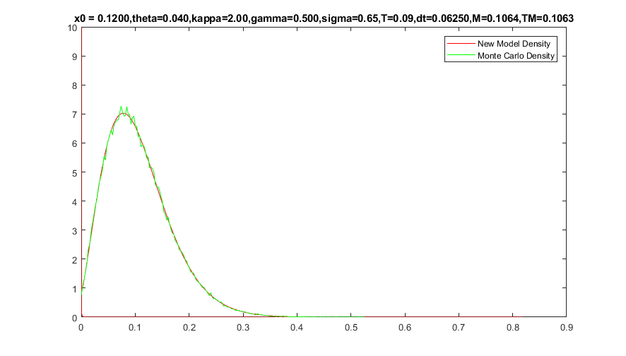](https://postimages.org/)

[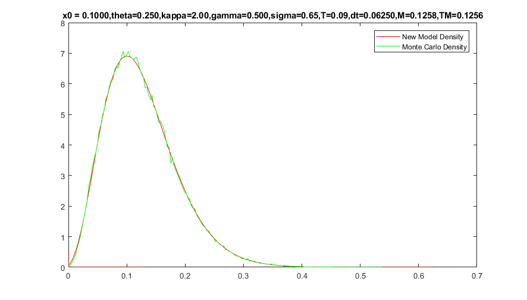](https://postimages.org/)

[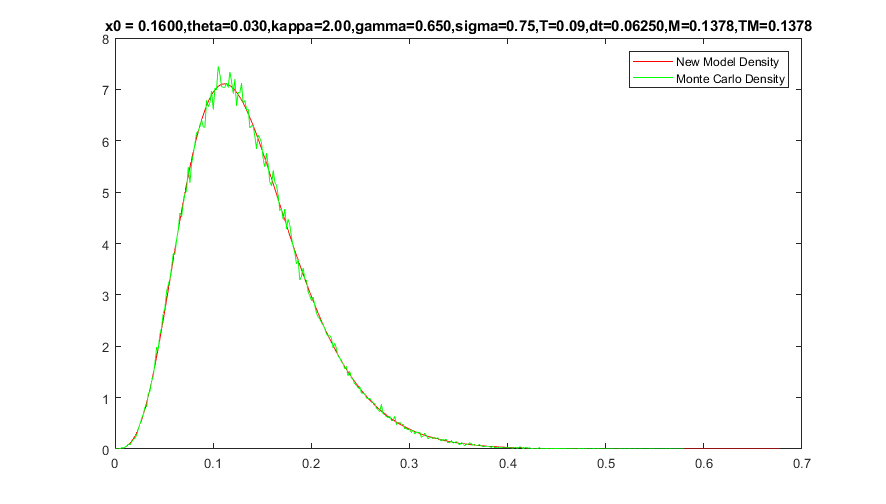](https://postimages.org/)

[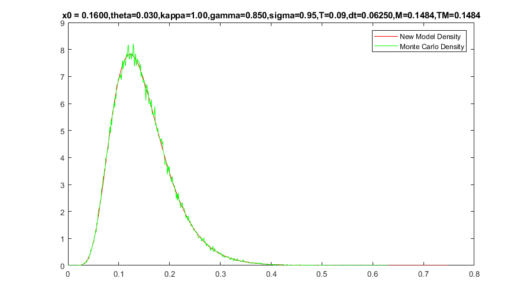](https://postimages.org/)

[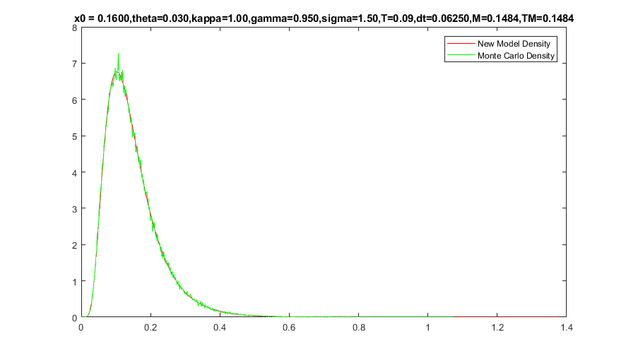](https://postimages.org/)

[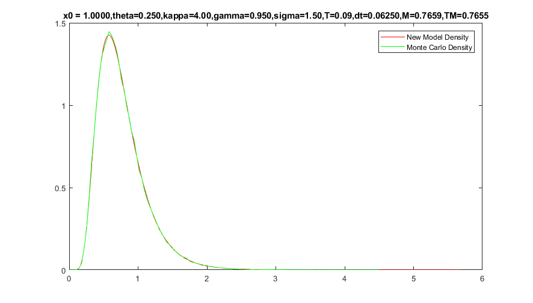](https://postimages.org/)

[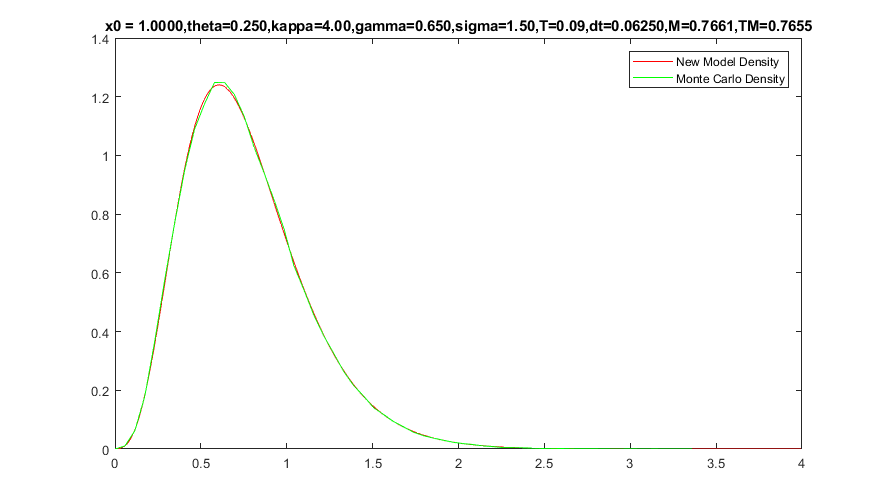](https://postimages.org/)

[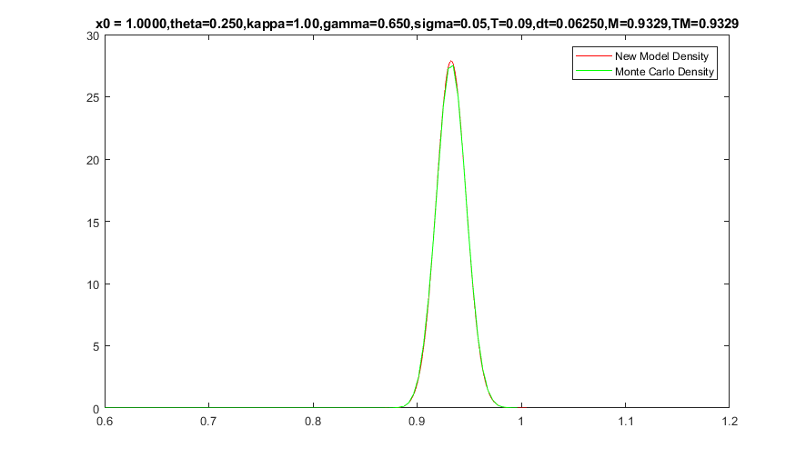](https://postimages.org/)

[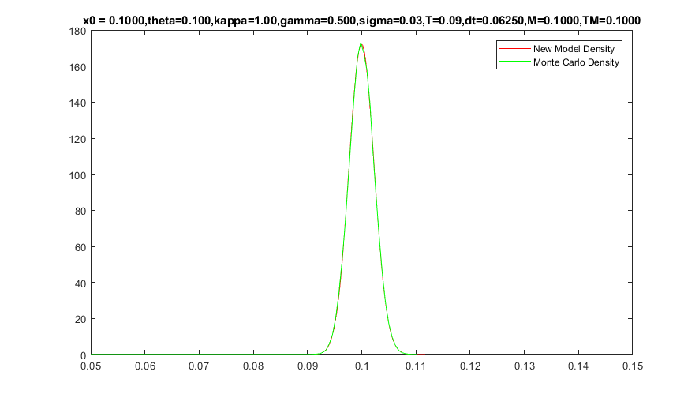](https://postimages.org/)

[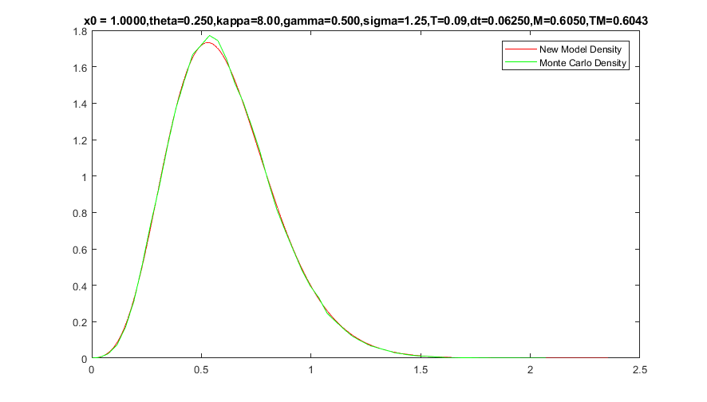](https://postimages.org/)

---

### #1109 — Amin (Topic Author)
*April 8, 2021, 4:30 AM*

The main program.

.

```
function [] = SDETransProb08WmtGrid200b53Drift()

%Copyright Ahsan Amin. Infiniti derivatives Technologies.
%Please fell free to connect on linkedin: linkedin.com/in/ahsan-amin-0a53334
%or skype ahsan.amin2999
%In this program, I am simulating the SDE given as
%dy(t)=mu1 x(t)^beta1 dt + mu2 x(t)^beta2 dt +sigma x(t)^gamma dz(t)

%I have not directly simulated the SDE but simulated the transformed
%Besse1 process version of the SDE and then changed coordinates to retreive
%the SDE in original coordinates.
%The present program will analytically evolve only the Bessel Process version of the
%SDE in transformed coordinates.

%In this program, I have simulated the density for first sixteen time
%intervals using a simple method. After first sixteen intervals, I start
%simulating with probability mass transfer method. I am presenting a
%simpler version which is easier to understand. I have advanced the density
%here for only two steps with mass transfer method. 17 to 18 intervals.
%My extrapolations at the boundaries are not very good and I suggest that
%you use your favorite method for that. Same for caclualtion of higher
%order derivatives. With above improvements, you can easily continue the
%method for whatever number of steps. Please experiment with step size and
%you will find the method robust enough. This is just an early version and
%I will be coming with better versions soon.

dt=.125/16/2/2/2;   % Regular Simulation time interval to advance the density before large step by CDF method.
             %decrease dt for accuracy.
dt2=1/16;% One step simulation step size for new method with CDF taylor expansion.
%T=Tt*dt;
Tt1=32;
Tt=Tt1+1;%Total time intervlas including small steps and large step.
T=(Tt-1)*dt+dt2;%Total time elapsed.
OrderA=4;  %
dtM=dt;%.125/2/4;%Monte carlo time interval size dtM.
TtM=Tt;%T*2*8*4;%Monte carlo number of simulation intervals.

dNn=.05;   % Normal density subdivisions width. would change with number of subdivisions
Nn=200;  % No of normal density subdivisions
NnMidl=100;%One half density Subdivision left from mid of normal density(low)
NnMidh=101;%One half density subdivision right from the mid of normal density(high)
NnMid=4.0;

Z(1:Nn)=(((1:Nn)-20.5)*dNn-NnMid)

%There are two indices. One goes to Nn=200. This is used for calculation of
%SDE simulation at next time level t+1. This covers -5 to +5 SDs of
%underlying Z.
%Second index Nn1 below goes from 1 to 240. This covers -6 to +6 SD of
%underlying Z. In probability mass transfer methos, we simulate the SDE
%from -5 SD to +5 SD and then extrapolate on both sides so that we have a
%new grid from -6 SD to +6 SD(1:Nn1). This extrapolated grid(which is assigned time t)
%is used to calculate the time t+1 grid from -5 SD to +5 SD(1:Nn).
%Grid spacing is the same on both grids.
Nn1=240;
%dNn1=.05;
Nn1Midl=120;
Nn1Midh=121;
Nn1Mid=6.025;

Z1(1:Nn1)=((1:Nn1)*dNn-Nn1Mid)
Z1Prob(1)=normcdf(-5.95)-normcdf(-6.0);
Z1Prob(Nn1)=normcdf(6.0)-normcdf(5.95);
Z1Prob(2:Nn1-1)=normcdf(.5*Z1(2:Nn1-1)+.5*Z1(3:Nn1),0,1)-normcdf(.5*Z1(2:Nn1-1)+.5*Z1(1:Nn1-2),0,1);

ZProb(1:Nn)=Z1Prob(21:Nn1-20);
Z(1:Nn)=Z1(21:Nn1-20);

Z1Prob
sum(Z1Prob(1:Nn1))
sum(ZProb(1:Nn))
str=input('Look at Zs');

x0=1;   % starting value of SDE
beta1=0.0;
beta2=1.00;   % Second drift term power.
gamma=.5;%50;   % volatility power.
kappa=8.0;%.950;   %mean reversion parameter.
theta=.25;%mean reversion target
sigma0=1.250;%Volatility value

%you can specify any general mu1 and mu2 and beta1 and beta2.
mu1=+1*theta*kappa;   %first drift coefficient.
mu2=-1*kappa;    % Second drift coefficient.
%mu1=0;
%mu2=0;

alpha=1;% x^alpha is being expanded. This is currently for monte carlo only.
alpha1=1-gamma;%This is for expansion of integrals for calculation of drift
%and volatility coefficients

w(1:Nn)=x0^(1-gamma)/(1-gamma);

Z
Z1
str=input('Look at Zs');
%%%%%%%%%%%%%%%%%%%%%%%%%%%%%%%%%%%%%%%%%%%%%%%%%%%%%%%%%%%%%%%%%%%%%%%%%%%%%%%%%%%%%%%%%%%%%%

sigma11(1:OrderA+1)=0;
mu11(1:OrderA+1)=0;
mu22(1:OrderA+1)=0;
sigma22(1:OrderA+1)=0;
% index 1 correponds to zero level since matlab indexing starts at one.
sigma11(1)=1;
mu11(1)=1;
mu22(1)=1;
sigma22(1)=1;

mu33(1)=1;
mu44(1)=1;
mu33(2:OrderA+1)=0;
mu44(2:OrderA+1)=0;

for k=1:(OrderA+1)
    if sigma0~=0
        sigma11(k)=sigma0^(k-1);
    end
    if mu1 ~= 0
        mu11(k)=mu1^(k-1);
    end
    if mu2 ~= 0
        mu22(k)=mu2^(k-1);
    end
    if sigma0~=0
        sigma22(k)=sigma0^(2*(k-1));
    end
end
%Ft(1:TtM+1,1:(OrderA+1),1:(OrderA+1),1:(OrderA+1),1:(OrderA+1))=0; %General time powers on hermite polynomials
Fp(1:(OrderA+1),1:(OrderA+1),1:(OrderA+1),1:(OrderA+1))=0;%General x powers on coefficients of hermite polynomials.
Fp1(1:(OrderA+1),1:(OrderA+1),1:(OrderA+1),1:(OrderA+1))=0;%General x powers for bessel transformed coordinates.

%YCoeff0 and YCoeff are coefficents for original coordinates monte carlo.
%YqCoeff0 and YqCoeff are bessel/lamperti version monte carlo.

YCoeff0(1:(OrderA+1),1:(OrderA+1),1:(OrderA+1),1:(OrderA+1))=0;
YqCoeff0(1:(OrderA+1),1:(OrderA+1),1:(OrderA+1),1:(OrderA+1))=0;
%Pre-compute the time and power exponent values in small multi-dimensional arrays
YCoeff = ItoTaylorCoeffsNew(alpha,beta1,beta2,gamma); %expand y^alpha where alpha=1;
YqCoeff = ItoTaylorCoeffsNew(alpha1,beta1,beta2,gamma);%expand y^alpha1 where alpha1=(1-gamma)
YqCoeff=YqCoeff/(1-gamma); %Transformed coordinates coefficients have to be
%further divided by (1-gamma)

for k = 0 : (OrderA)
    for m = 0:k
        l4 = k - m + 1;
        for n = 0 : m
            l3 = m - n + 1;
            for j = 0:n
                l2 = n - j + 1;
                l1 = j + 1;
                %Ft(l1,l2,l3,l4) = dtM^((l1-1) + (l2-1) + (l3-1) + .5* (l4-1));
                Fp(l1,l2,l3,l4) = (alpha + (l1-1) * beta1 + (l2-1) * beta2 + (l3-1) * 2* gamma + (l4-1) * gamma ...
                    - (l1-1) - (l2-1) - 2* (l3-1) - (l4-1));
                Fp1(l1,l2,l3,l4) = (alpha1 + (l1-1) * beta1 + (l2-1) * beta2 + (l3-1) * 2* gamma + (l4-1) * gamma ...
                    - (l1-1) - (l2-1) - 2* (l3-1) - (l4-1));

                YCoeff0(l1,l2,l3,l4) =YCoeff(l1,l2,l3,l4).*mu11(l1).*mu22(l2).*sigma22(l3).*sigma11(l4);
                YqCoeff0(l1,l2,l3,l4) =YqCoeff(l1,l2,l3,l4).*mu11(l1).*mu22(l2).*sigma22(l3).*sigma11(l4);
                YqzCoeff0(l1,l2,l3,l4) =YqCoeff(l1,l2,l3,l4).*mu33(l1).*mu44(l2).*sigma22(l3).*sigma11(l4);
            end
        end
    end
end

%%%%%%%%%%%%%%%%%%%%%%%%%%%%%%%%%%%%%%%%%%%%%%%%%%%%%%%%%%%%%%%%%%%%%%%%%%%%%%%%%%%%%%%%%%%%%%

wnStart=1;%
yy(wnStart:Nn)=((1-gamma)*w(wnStart:Nn)).^(1/(1-gamma));
%The above yy(wnStart:Nn)=x0;

tic

for tt=1:Tt
    t2=tt*dt;
    t1=(tt-1)*dt;
    if(tt==1)

        [wMu0dt,c1,c22] = CalculateDriftAndVolA8Trans(w,wnStart,Nn,YqCoeff0,Fp1,gamma,dt);
        w(1:Nn)=x0^(1-gamma)/(1-gamma)+wMu0dt(1)+c1(1).*Z(1:Nn);

    end
    if((tt>1) && (ttTt1)
        if(tt>Tt1)
            dt=dt2;
        end

        [wMu0dt,wMu1dt,dwMu0dtdw,d2wMu0dtdw2,c1,c2] = CalculateDriftAndVolA404B(w,wnStart,Nn,YqCoeff0,Fp1,gamma,dt);

        dw(wnStart:Nn)=c1(wnStart:Nn) ;% ...
        dw2(wnStart:Nn)=dw(wnStart:Nn).^2;
        %[wMid] =
InterpolateOrderN6(6,0,Z(NnMidl-2),Z(NnMidl-1),Z(NnMidl),Z(NnMidh),Z(NnMidh+1),Z(NnMidh+2),w(NnMidl-2),w(NnMidl-1),w(NnMidl),w(NnMidh),w(NnMidh+1),w(NnMidh+2));
        [wMid] =
InterpolateOrderN8(8,0,Z(NnMidl-3),Z(NnMidl-2),Z(NnMidl-1),Z(NnMidl),Z(NnMidh),Z(NnMidh+1),Z(NnMidh+2),Z(NnMidh+3),w(NnMidl-3),w(NnMidl-2),w(NnMidl-1),w(NnMidl),w(NnMidh),w(NnMidh+1),w(NnMidh+2),w(NnMidh+3));
        B(1:Nn)=w(1:Nn)-wMid;
        B1=B;
        [dBdZ_0,d2BdZ2_0,d3BdZ3_0] = First3Derivatives2ndOrderEqSpacedA(wnStart,Nn,dNn,B,Z);
        %Above are derivative names with an appended zero "_0". These are derivatives on the
        %Nn grid (time t+1 grid). When there are no appended zeros, those are
        %derivatives on the Nn1 grid i.e time t grid.

        if(ttTt1)
    dtM=dt2/8;
end
    Random1=randn(size(Random1));
    HermiteP1(1,1:paths)=1;
    HermiteP1(2,1:paths)=Random1(1:paths);
    HermiteP1(3,1:paths)=Random1(1:paths).^2-1;
    HermiteP1(4,1:paths)=Random1(1:paths).^3-3*Random1(1:paths);
    HermiteP1(5,1:paths)=Random1(1:paths).^4-6*Random1(1:paths).^2+3;

    YY(1:paths)=YY(1:paths) + ...
        (YCoeff0(1,1,2,1).*YY(1:paths).^Fp(1,1,2,1)+ ...
        YCoeff0(1,2,1,1).*YY(1:paths).^Fp(1,2,1,1)+ ...
        YCoeff0(2,1,1,1).*YY(1:paths).^Fp(2,1,1,1))*dtM + ...
        (YCoeff0(1,1,3,1).*YY(1:paths).^Fp(1,1,3,1)+ ...
        YCoeff0(1,2,2,1).*YY(1:paths).^Fp(1,2,2,1)+ ...
        YCoeff0(2,1,2,1).*YY(1:paths).^Fp(2,1,2,1)+ ...
        YCoeff0(1,3,1,1).*YY(1:paths).^Fp(1,3,1,1)+ ...
        YCoeff0(2,2,1,1).*YY(1:paths).^Fp(2,2,1,1)+ ...
        YCoeff0(3,1,1,1).*YY(1:paths).^Fp(3,1,1,1))*dtM^2 + ...
        ((YCoeff0(1,1,1,2).*YY(1:paths).^Fp(1,1,1,2).*sqrt(dtM))+ ...
        (YCoeff0(1,1,2,2).*YY(1:paths).^Fp(1,1,2,2)+ ...
        YCoeff0(1,2,1,2).*YY(1:paths).^Fp(1,2,1,2)+ ...
        YCoeff0(2,1,1,2).*YY(1:paths).^Fp(2,1,1,2)).*dtM^1.5) .*HermiteP1(2,1:paths) + ...
        ((YCoeff0(1,1,1,3).*YY(1:paths).^Fp(1,1,1,3) *dtM) + ...
        (YCoeff0(1,1,2,3).*YY(1:paths).^Fp(1,1,2,3)+ ...
        YCoeff0(1,2,1,3).*YY(1:paths).^Fp(1,2,1,3)+ ...
        YCoeff0(2,1,1,3).*YY(1:paths).^Fp(2,1,1,3)).*dtM^2).*HermiteP1(3,1:paths) + ...
        ((YCoeff0(1,1,1,4).*YY(1:paths).^Fp(1,1,1,4)*dtM^1.5 )).*HermiteP1(4,1:paths) + ...
        (YCoeff0(1,1,1,5).*YY(1:paths).^Fp(1,1,1,5)*dtM^2.0).*HermiteP1(5,1:paths);

end

YY(YY<0)=0;
disp('Original process average from monte carlo');
MCMean=sum(YY(:))/paths %origianl coordinates monte carlo average.
MCVar=sum((YY(:)-MCMean).^2)/paths
disp('Original process average from our simulation');
ItoHermiteMean=sum(y_w(wnStart+1:Nn-1).*ZProb(wnStart+1:Nn-1)) %Original process average from coordinates
ItoHermiteVar=sum((y_w(wnStart+1:Nn-1)-ItoHermiteMean).^2.*ZProb(wnStart+1:Nn-1))
disp('true Mean only applicble to standard SV mean reverting type models otherwise disregard');
TrueMean=theta+(x0-theta)*exp(-kappa*T)%Mean reverting SDE original variable true average

MaxCutOff=30;
NoOfBins=round(300*gamma^2*4*sigma0/sqrt(MCMean)/(1+kappa));%Decrease the number of bins if the graph is too
[YDensity,IndexOutY,IndexMaxY] = MakeDensityFromSimulation_Infiniti_NEW(YY,paths,NoOfBins,MaxCutOff );

%plot(y_w1(wnStart+1:Nn-1),py_w1(wnStart+1:Nn-1),'b',y_w(wnStart+1:Nn-1),py_w(wnStart+1:Nn-1),'r',IndexOutY(1:IndexMaxY),YDensity(1:IndexMaxY),'g');
%plot(y_w(wnStart+1:Nn-1),py_w(wnStart+1:Nn-1),'r',IndexOutY(1:IndexMaxY),YDensity(1:IndexMaxY),'g');
plot(y_w(wnStart+1:Nn-1),py_w(wnStart+1:Nn-1),'r',IndexOutY(1:IndexMaxY),YDensity(1:IndexMaxY),'g');

title(sprintf('x0 = %.4f,theta=%.3f,kappa=%.2f,gamma=%.3f,sigma=%.2f,T=%.2f,dt=%.5f,M=%.4f,TM=%.4f',
x0,theta,kappa,gamma,sigma0,T,dt,ItoHermiteMean,TrueMean));%,sprintf('theta= %f', theta), sprintf('kappa = %f',
kappa),sprintf('sigma = %f', sigma0),sprintf('T = %f', T));

legend({'New Model Density','Monte Carlo Density'},'Location','northeast')

str=input('red line is density of SDE from Ito-Hermite method, green is monte carlo.');
end
```

.

Sub Function one.

.

```
function [Pmn] =
CalculateCDFArraySignIndexDrift(Bn,Nn,Muw,dMuwdBm,d2MuwdBm2,d3MuwdBm3,d4MuwdBm4,d5MuwdBm5,d6MuwdBm6,Sigmaw,Bm0,Bm1,Bm2,dPm,pm0,dpm0,d2pm0,d3pm0,d4pm0,d5pm0)

%This function calculates CDF Pmn, PDF pmn, first derivative of Pdf dpmn,
%second derivative of PDF d2pmn, and third derivative of PDF d3pmn at an
%arbitrary point Bn on next time level grid. All these CDF, PDF and their
%derivatives are calculated from an entire subdivision Bm at time t grid.
%Bn is the array of target points at time t+1 and Nn is the fianl index of
%array Bn starting from one.
%Bm1 and Bm2 are boundaries of grid cell Bm and Bm0 is center of grid cell
%Bm.
% sigma0 is the volatility associated with transition gaussian originating
% from the center of grid Bm given as Bm0.
%dPm is the integrate probability mass in mth originating subdivision.
%pm0 is the value of probability distribution at the center of mth cell at
%Bm0.
%dpm0 is the value of first derivative of probability distribution at the
%center of mth subdivision at Bm0;
%and so on for d2pm0(second derivative of pdf at Bm0), d3pm0, d4pm0, d5pm0.
%pdf and all its derivatives at center of mth subdivsion Bm0 are input to
%the function.
%This program is not written with regard to efficiency at all and I will
%optimize the final version for efficiency.

%The following two loops assume that Bn array is arranged in an ascending
%order as it usually is. The lower two arrays find the lower and upper
%limit of indices such that target array index in between is withing -7 SD
%to + 7SD of the transition normal from the originating cell under question
%(change SDs appropriately if you wish).
nn1=1;
for nn=1:Nn
    if( (Bn(nn)-Bm0) 7*abs(Sigmaw))
        nn2=nn;
    end
end
size(Bn)
size(Bm0)

nn1
nn2
Zt(1:Nn)=0.0;
%Bt(mm1:mm2)=Bn(mm1:mm2)-Bm0;
Zt(nn1:nn2)=(Bn(nn1:nn2)-Bm0-Muw)/Sigmaw;
Zt2(nn1:nn2)=Zt(nn1:nn2).*Zt(nn1:nn2);
Zt3(nn1:nn2)=Zt2(nn1:nn2).*Zt(nn1:nn2);
Zt4(nn1:nn2)=Zt3(nn1:nn2).*Zt(nn1:nn2);
Zt5(nn1:nn2)=Zt4(nn1:nn2).*Zt(nn1:nn2);
Zt6(nn1:nn2)=Zt5(nn1:nn2).*Zt(nn1:nn2);

Pm0n(nn1:nn2)=normcdf(Zt(nn1:nn2),0,1);
dPm0ndZt(nn1:nn2)=normpdf(Zt(nn1:nn2),0,1);
pm0n(nn1:nn2)=normpdf(Zt(nn1:nn2),0,1);
d2Pm0ndZt2(nn1:nn2)=-pm0n(nn1:nn2).*(Zt(nn1:nn2));
d3Pm0ndZt3(nn1:nn2)=pm0n(nn1:nn2).*(Zt2(nn1:nn2)-1);
d4Pm0ndZt4(nn1:nn2)=-pm0n(nn1:nn2).*(Zt3(nn1:nn2)-3*Zt(nn1:nn2));
d5Pm0ndZt5(nn1:nn2)=pm0n(nn1:nn2).*(Zt4(nn1:nn2)-6*Zt2(nn1:nn2)+3);
d6Pm0ndZt6(nn1:nn2)=-pm0n(nn1:nn2).*(Zt5(nn1:nn2)-10*Zt3(nn1:nn2)+15*Zt(nn1:nn2));

 dZtdBm(nn1:nn2)=(-1-dMuwdBm)/Sigmaw;

 d2ZtdBm2(nn1:nn2)=-(d2MuwdBm2/Sigmaw);

  d3ZtdBm3(nn1:nn2)=-d3MuwdBm3/Sigmaw;

 d4ZtdBm4(nn1:nn2)=-d4MuwdBm4/Sigmaw;;

 d5ZtdBm5(nn1:nn2)=-d5MuwdBm5/Sigmaw;;

  d6ZtdBm6(nn1:nn2)=-d6MuwdBm6/Sigmaw;;

dPm0ndBm(nn1:nn2)=dPm0ndZt(nn1:nn2).*dZtdBm(nn1:nn2);
d2Pm0ndBm2(nn1:nn2)=d2Pm0ndZt2(nn1:nn2).*dZtdBm(nn1:nn2).^2+dPm0ndZt(nn1:nn2).*d2ZtdBm2(nn1:nn2);
d3Pm0ndBm3(nn1:nn2)=d3Pm0ndZt3(nn1:nn2).*dZtdBm(nn1:nn2).^3+3*d2Pm0ndZt2(nn1:nn2).*dZtdBm(nn1:nn2).*d2ZtdBm2(nn1:nn2)+dPm0ndZt(nn1:nn2).*d3ZtdBm3(nn1:nn2);
d4Pm0ndBm4(nn1:nn2)=d4Pm0ndZt4(nn1:nn2).*dZtdBm(nn1:nn2).^4+6*d3Pm0ndZt3(nn1:nn2).*dZtdBm(nn1:nn2).^2.*d2ZtdBm2(nn1:nn2)+4*d2Pm0ndZt2(nn1:nn2).*dZtdBm(nn1:nn2).*d3ZtdBm3(nn1:nn2)+
...
    3*d2Pm0ndZt2(nn1:nn2).*d2ZtdBm2(nn1:nn2).^2+dPm0ndZt(nn1:nn2).*d4ZtdBm4(nn1:nn2);
d5Pm0ndBm5(nn1:nn2)=d5Pm0ndZt5(nn1:nn2).*dZtdBm(nn1:nn2).^5+10*d4Pm0ndZt4(nn1:nn2).*dZtdBm(nn1:nn2).^3.*d2ZtdBm2(nn1:nn2)+15*d3Pm0ndZt3(nn1:nn2).*dZtdBm(nn1:nn2).*d2ZtdBm2(nn1:nn2).^2+
...
   
10*d3Pm0ndZt3(nn1:nn2).*dZtdBm(nn1:nn2).^2.*d3ZtdBm3(nn1:nn2)+10*d2Pm0ndZt2(nn1:nn2).*d2ZtdBm2(nn1:nn2).*d3ZtdBm3(nn1:nn2)+
...
    5*d2Pm0ndZt2(nn1:nn2).*dZtdBm(nn1:nn2).*d4ZtdBm4(nn1:nn2)+dPm0ndZt(nn1:nn2).*d5ZtdBm5(nn1:nn2);
d6Pm0ndBm6(nn1:nn2)=d6Pm0ndZt6(nn1:nn2).*dZtdBm(nn1:nn2).^6+15*d5Pm0ndZt5(nn1:nn2).*dZtdBm(nn1:nn2).^4.*d2ZtdBm2(nn1:nn2)+45*d4Pm0ndZt4(nn1:nn2).*dZtdBm(nn1:nn2).^2.*d2ZtdBm2(nn1:nn2).^2+
...
    20*d4Pm0ndZt4(nn1:nn2).*dZtdBm(nn1:nn2).^3.*d3ZtdBm3(nn1:nn2)+15*d3Pm0ndZt3(nn1:nn2).*d2ZtdBm2(nn1:nn2).^3+ ...
   
+60*d3Pm0ndZt3(nn1:nn2).*dZtdBm(nn1:nn2).*d2ZtdBm2(nn1:nn2).*d3ZtdBm3(nn1:nn2)+15*d3Pm0ndZt3(nn1:nn2).*dZtdBm(nn1:nn2).^2.*d4ZtdBm4(nn1:nn2)+
...
    +10*d2Pm0ndZt2(nn1:nn2).*d3ZtdBm3(nn1:nn2).^2+15*d2Pm0ndZt2(nn1:nn2).*d2ZtdBm2(nn1:nn2).*d4ZtdBm4(nn1:nn2)+ ...
    6*d2Pm0ndZt2(nn1:nn2).*dZtdBm(nn1:nn2).*d5ZtdBm5(nn1:nn2)+dPm0ndZt(nn1:nn2).*d6ZtdBm6(nn1:nn2);

dBm=Bm2-Bm1;
dBm1=1/2* ((Bm2 - Bm0)^2 - (Bm1 - Bm0)^2);
dBm2=1/3* ((Bm2 - Bm0)^3 - (Bm1 - Bm0)^3)/2;
dBm3=1/4* ((Bm2 - Bm0)^4 - (Bm1 - Bm0)^4)/6;
dBm4=1/5* ((Bm2 - Bm0)^5 - (Bm1 - Bm0)^5)/24;
dBm5=1/6* ((Bm2 - Bm0)^6 - (Bm1 - Bm0)^6)/120;
dBm6=1/7* ((Bm2 - Bm0)^7 - (Bm1 - Bm0)^7)/720;

Integral0(nn1:nn2)=dPm.*Pm0n(nn1:nn2); % G1 group of terms in wilmott explanation.

IntegralCDF(nn1:nn2)=Integral0(nn1:nn2)+ ...  %Integral0 is Group1(G1) in the explanation on wilmott.
    +pm0 * dPm0ndBm(nn1:nn2) *dBm1 + ...
    + (2* dpm0 * dPm0ndBm(nn1:nn2)+pm0 * d2Pm0ndBm2(nn1:nn2))  *dBm2 + ...
    + (3*d2pm0*dPm0ndBm(nn1:nn2) + 3*dpm0*d2Pm0ndBm2(nn1:nn2)+pm0 * d3Pm0ndBm3(nn1:nn2))*dBm3 + ...
    + (4*d3pm0*dPm0ndBm(nn1:nn2) + 6* d2pm0*d2Pm0ndBm2(nn1:nn2) + 4* dpm0 * d3Pm0ndBm3(nn1:nn2)+pm0 *
d4Pm0ndBm4(nn1:nn2))*dBm4 + ...
    + (5*d4pm0*dPm0ndBm(nn1:nn2) + 10* d3pm0*d2Pm0ndBm2(nn1:nn2)+ 10* d2pm0*d3Pm0ndBm3(nn1:nn2) + ...
    5* dpm0 * d4Pm0ndBm4(nn1:nn2) +pm0 * d5Pm0ndBm5(nn1:nn2))*dBm5 + ...
    + (6*d5pm0*dPm0ndBm(nn1:nn2) + 15* d4pm0*d2Pm0ndBm2(nn1:nn2)+ 20* d3pm0*d3Pm0ndBm3(nn1:nn2) + 15* d2pm0 *
d4Pm0ndBm4(nn1:nn2)+ ...
    6* dpm0 * d5Pm0ndBm5(nn1:nn2)+pm0 * d6Pm0ndBm6(nn1:nn2)) * dBm6;

Pmn(nn1:nn2)=IntegralCDF(nn1:nn2);
if(nn1>1)
Pmn(1:nn1-1)=0;
end
if (nn2<Nn)
Pmn(nn2+1:Nn)=dPm;
end
Pmn
%str=input('Look at Pmn');
end

```

.

---

### #1110 — Amin (Topic Author)
*April 8, 2021, 4:35 AM*

Sub Function two.

.

```
function [wMu0dt,dwMu0dtdw,d2wMu0dtdw2,d3wMu0dtdw3,d4wMu0dtdw4,d5wMu0dtdw5,d6wMu0dtdw6,c1] =
CalculateDriftAndVolA404B4Drift(w,wnStart,Nn,YqCoeff0,Fp1,gamma,dt)

yy(wnStart:Nn)=((1-gamma)*w(wnStart:Nn)).^(1/(1-gamma));

Fp2=Fp1/(1-gamma);

wMu0dt(wnStart:Nn)=(YqCoeff0(1,1,2,1).*yy(wnStart:Nn).^Fp1(1,1,2,1)+ ...
    YqCoeff0(1,2,1,1).*yy(wnStart:Nn).^Fp1(1,2,1,1)+ ...
    YqCoeff0(2,1,1,1).*yy(wnStart:Nn).^Fp1(2,1,1,1))*dt + ...
    (YqCoeff0(1,1,3,1).*yy(wnStart:Nn).^Fp1(1,1,3,1)+ ...
    YqCoeff0(1,2,2,1).*yy(wnStart:Nn).^Fp1(1,2,2,1)+ ...
    YqCoeff0(2,1,2,1).*yy(wnStart:Nn).^Fp1(2,1,2,1)+ ...
    YqCoeff0(1,3,1,1).*yy(wnStart:Nn).^Fp1(1,3,1,1)+ ...
    YqCoeff0(2,2,1,1).*yy(wnStart:Nn).^Fp1(2,2,1,1)+ ...
    YqCoeff0(3,1,1,1).*yy(wnStart:Nn).^Fp1(3,1,1,1))*dt^2 + ...
     (YqCoeff0(1,1,4,1).*yy(wnStart:Nn).^Fp1(1,1,4,1)+ ...
     YqCoeff0(1,2,3,1).*yy(wnStart:Nn).^Fp1(1,2,3,1)+ ...
     YqCoeff0(2,1,3,1).*yy(wnStart:Nn).^Fp1(2,1,3,1)+ ...
     YqCoeff0(1,3,2,1).*yy(wnStart:Nn).^Fp1(1,3,2,1)+ ...
     YqCoeff0(2,2,2,1).*yy(wnStart:Nn).^Fp1(2,2,2,1)+ ...
     YqCoeff0(3,1,2,1).*yy(wnStart:Nn).^Fp1(3,1,2,1)+ ...
     YqCoeff0(1,4,1,1).*yy(wnStart:Nn).^Fp1(1,4,1,1)+ ...
     YqCoeff0(2,3,1,1).*yy(wnStart:Nn).^Fp1(2,3,1,1)+ ...
     YqCoeff0(3,2,1,1).*yy(wnStart:Nn).^Fp1(3,2,1,1)+ ...
     YqCoeff0(4,1,1,1).*yy(wnStart:Nn).^Fp1(4,1,1,1))*dt^3+ ...
     (YqCoeff0(1,1,5,1).*yy(wnStart:Nn).^Fp1(1,1,5,1)+ ...
      YqCoeff0(1,2,4,1).*yy(wnStart:Nn).^Fp1(1,2,4,1)+ ...
      YqCoeff0(2,1,4,1).*yy(wnStart:Nn).^Fp1(2,1,4,1)+ ...
      YqCoeff0(2,1,1,1).*yy(wnStart:Nn).^Fp1(2,1,1,1)+ ...
       YqCoeff0(2,2,3,1).*yy(wnStart:Nn).^Fp1(2,2,3,1)+ ...
       YqCoeff0(3,1,3,1).*yy(wnStart:Nn).^Fp1(3,1,3,1)+ ...
       YqCoeff0(1,4,2,1).*yy(wnStart:Nn).^Fp1(1,4,2,1)+ ...
       YqCoeff0(2,3,2,1).*yy(wnStart:Nn).^Fp1(2,3,2,1)+ ...
       YqCoeff0(3,2,2,1).*yy(wnStart:Nn).^Fp1(3,2,2,1)+ ...
       YqCoeff0(4,1,2,1).*yy(wnStart:Nn).^Fp1(4,1,2,1)+ ...
       YqCoeff0(1,5,1,1).*yy(wnStart:Nn).^Fp1(1,5,1,1)+ ...
       YqCoeff0(2,4,1,1).*yy(wnStart:Nn).^Fp1(2,4,1,1)+ ...
       YqCoeff0(3,3,1,1).*yy(wnStart:Nn).^Fp1(3,3,1,1)+  ...
       YqCoeff0(4,2,1,1).*yy(wnStart:Nn).^Fp1(4,2,1,1)+ ...
       YqCoeff0(5,1,1,1).*yy(wnStart:Nn).^Fp1(5,1,1,1))*dt^4;

dwMu0dtdw(wnStart:Nn)=(YqCoeff0(1,1,2,1).*Fp1(1,1,2,1).*((1-gamma).*w(wnStart:Nn)).^(-1+Fp2(1,1,2,1))+ ...
    YqCoeff0(1,2,1,1).*Fp1(1,2,1,1).*((1-gamma).*w(wnStart:Nn)).^(-1+Fp2(1,2,1,1))+ ...
    YqCoeff0(2,1,1,1).*Fp1(2,1,1,1).*((1-gamma).*w(wnStart:Nn)).^(-1+Fp2(2,1,1,1)))*dt + ...
    (YqCoeff0(1,1,3,1).*Fp1(1,1,3,1).*((1-gamma).*w(wnStart:Nn)).^(-1+Fp2(1,1,3,1))+ ...
    YqCoeff0(1,2,2,1).*Fp1(1,2,2,1).*((1-gamma).*w(wnStart:Nn)).^(-1+Fp2(1,2,2,1))+ ...
    YqCoeff0(2,1,2,1).*Fp1(2,1,2,1).*((1-gamma).*w(wnStart:Nn)).^(-1+Fp2(2,1,2,1))+ ...
    YqCoeff0(1,3,1,1).*Fp1(1,3,1,1).*((1-gamma).*w(wnStart:Nn)).^(-1+Fp2(1,3,1,1))+ ...
    YqCoeff0(2,2,1,1).*Fp1(2,2,1,1).*((1-gamma).*w(wnStart:Nn)).^(-1+Fp2(2,2,1,1))+ ...
    YqCoeff0(3,1,1,1).*Fp1(3,1,1,1).*((1-gamma).*w(wnStart:Nn)).^(-1+Fp2(3,1,1,1)))*dt^2 + ...
     (YqCoeff0(1,1,4,1).*Fp1(1,1,4,1).*((1-gamma).*w(wnStart:Nn)).^(-1+Fp2(1,1,4,1))+ ...
     YqCoeff0(1,2,3,1).*Fp1(1,2,3,1).*((1-gamma).*w(wnStart:Nn)).^(-1+Fp2(1,2,3,1))+ ...
     YqCoeff0(2,1,3,1).*Fp1(2,1,3,1).*((1-gamma).*w(wnStart:Nn)).^(-1+Fp2(2,1,3,1))+ ...
     YqCoeff0(1,3,2,1).*Fp1(1,3,2,1).*((1-gamma).*w(wnStart:Nn)).^(-1+Fp2(1,3,2,1))+ ...
     YqCoeff0(2,2,2,1).*Fp1(2,2,2,1).*((1-gamma).*w(wnStart:Nn)).^(-1+Fp2(2,2,2,1))+ ...
     YqCoeff0(3,1,2,1).*Fp1(3,1,2,1).*((1-gamma).*w(wnStart:Nn)).^(-1+Fp2(3,1,2,1))+ ...
     YqCoeff0(1,4,1,1).*Fp1(1,4,1,1).*((1-gamma).*w(wnStart:Nn)).^(-1+Fp2(1,4,1,1))+ ...
     YqCoeff0(2,3,1,1).*Fp1(2,3,1,1).*((1-gamma).*w(wnStart:Nn)).^(-1+Fp2(2,3,1,1))+ ...
     YqCoeff0(3,2,1,1).*Fp1(3,2,1,1).*((1-gamma).*w(wnStart:Nn)).^(-1+Fp2(3,2,1,1))+ ...
     YqCoeff0(4,1,1,1).*Fp1(4,1,1,1).*((1-gamma).*w(wnStart:Nn)).^(-1+Fp2(4,1,1,1)))*dt^3 + ...
     (YqCoeff0(1,1,5,1).*Fp1(1,1,5,1).*((1-gamma).*w(wnStart:Nn)).^(-1+Fp2(1,1,5,1))+ ...
      YqCoeff0(1,2,4,1).*Fp1(1,2,4,1).*((1-gamma).*w(wnStart:Nn)).^(-1+Fp2(1,2,4,1))+ ...
      YqCoeff0(2,1,4,1).*Fp1(2,1,4,1).*((1-gamma).*w(wnStart:Nn)).^(-1+Fp2(2,1,4,1))+ ...
      YqCoeff0(2,1,1,1).*Fp1(2,1,1,1).*((1-gamma).*w(wnStart:Nn)).^(-1+Fp2(2,1,1,1))+ ...
       YqCoeff0(2,2,3,1).*Fp1(2,2,3,1).*((1-gamma).*w(wnStart:Nn)).^(-1+Fp2(2,2,3,1))+ ...
       YqCoeff0(3,1,3,1).*Fp1(3,1,3,1).*((1-gamma).*w(wnStart:Nn)).^(-1+Fp2(3,1,3,1))+ ...
       YqCoeff0(1,4,2,1).*Fp1(1,4,2,1).*((1-gamma).*w(wnStart:Nn)).^(-1+Fp2(1,4,2,1))+ ...
       YqCoeff0(2,3,2,1).*Fp1(2,3,2,1).*((1-gamma).*w(wnStart:Nn)).^(-1+Fp2(2,3,2,1))+ ...
       YqCoeff0(3,2,2,1).*Fp1(3,2,2,1).*((1-gamma).*w(wnStart:Nn)).^(-1+Fp2(3,2,2,1))+ ...
       YqCoeff0(4,1,2,1).*Fp1(4,1,2,1).*((1-gamma).*w(wnStart:Nn)).^(-1+Fp2(4,1,2,1))+ ...
       YqCoeff0(1,5,1,1).*Fp1(1,5,1,1).*((1-gamma).*w(wnStart:Nn)).^(-1+Fp2(1,5,1,1))+ ...
       YqCoeff0(2,4,1,1).*Fp1(2,4,1,1).*((1-gamma).*w(wnStart:Nn)).^(-1+Fp2(2,4,1,1))+ ...
       YqCoeff0(3,3,1,1).*Fp1(3,3,1,1).*((1-gamma).*w(wnStart:Nn)).^(-1+Fp2(3,3,1,1))+  ...
       YqCoeff0(4,2,1,1).*Fp1(4,2,1,1).*((1-gamma).*w(wnStart:Nn)).^(-1+Fp2(4,2,1,1))+ ...
       YqCoeff0(5,1,1,1).*Fp1(5,1,1,1).*((1-gamma).*w(wnStart:Nn)).^(-1+Fp2(5,1,1,1)))*dt^4;

d2wMu0dtdw2(wnStart:Nn)=(1-gamma).*((YqCoeff0(1,1,2,1).*Fp1(1,1,2,1).*(-1+Fp2(1,1,2,1)).*((1-gamma).*w(wnStart:Nn)).^(-2+Fp2(1,1,2,1))+
...
    YqCoeff0(1,2,1,1).*Fp1(1,2,1,1).*(-1+Fp2(1,2,1,1)).*((1-gamma).*w(wnStart:Nn)).^(-2+Fp2(1,2,1,1))+ ...
    YqCoeff0(2,1,1,1).*Fp1(2,1,1,1).*(-1+Fp2(2,1,1,1)).*((1-gamma).*w(wnStart:Nn)).^(-2+Fp2(2,1,1,1)))*dt + ...
    (YqCoeff0(1,1,3,1).*Fp1(1,1,3,1).*(-1+Fp2(1,1,3,1)).*((1-gamma).*w(wnStart:Nn)).^(-2+Fp2(1,1,3,1))+ ...
    YqCoeff0(1,2,2,1).*Fp1(1,2,2,1).*(-1+Fp2(1,2,2,1)).*((1-gamma).*w(wnStart:Nn)).^(-2+Fp2(1,2,2,1))+ ...
    YqCoeff0(2,1,2,1).*Fp1(2,1,2,1).*(-1+Fp2(2,1,2,1)).*((1-gamma).*w(wnStart:Nn)).^(-2+Fp2(2,1,2,1))+ ...
    YqCoeff0(1,3,1,1).*Fp1(1,3,1,1).*(-1+Fp2(1,3,1,1)).*((1-gamma).*w(wnStart:Nn)).^(-2+Fp2(1,3,1,1))+ ...
    YqCoeff0(2,2,1,1).*Fp1(2,2,1,1).*(-1+Fp2(2,2,1,1)).*((1-gamma).*w(wnStart:Nn)).^(-2+Fp2(2,2,1,1))+ ...
    YqCoeff0(3,1,1,1).*Fp1(3,1,1,1).*(-1+Fp2(3,1,1,1)).*((1-gamma).*w(wnStart:Nn)).^(-2+Fp2(3,1,1,1)))*dt^2+ ...
    (YqCoeff0(1,1,4,1).*Fp1(1,1,4,1).*(-1+Fp2(1,1,4,1)).*((1-gamma).*w(wnStart:Nn)).^(-2+Fp2(1,1,4,1))+ ...
     YqCoeff0(1,2,3,1).*Fp1(1,2,3,1).*(-1+Fp2(1,2,3,1)).*((1-gamma).*w(wnStart:Nn)).^(-2+Fp2(1,2,3,1))+ ...
     YqCoeff0(2,1,3,1).*Fp1(2,1,3,1).*(-1+Fp2(2,1,3,1)).*((1-gamma).*w(wnStart:Nn)).^(-2+Fp2(2,1,3,1))+ ...
     YqCoeff0(1,3,2,1).*Fp1(1,3,2,1).*(-1+Fp2(1,3,2,1)).*((1-gamma).*w(wnStart:Nn)).^(-2+Fp2(1,3,2,1))+ ...
     YqCoeff0(2,2,2,1).*Fp1(2,2,2,1).*(-1+Fp2(2,2,2,1)).*((1-gamma).*w(wnStart:Nn)).^(-2+Fp2(2,2,2,1))+ ...
     YqCoeff0(3,1,2,1).*Fp1(3,1,2,1).*(-1+Fp2(3,1,2,1)).*((1-gamma).*w(wnStart:Nn)).^(-2+Fp2(3,1,2,1))+ ...
     YqCoeff0(1,4,1,1).*Fp1(1,4,1,1).*(-1+Fp2(1,4,1,1)).*((1-gamma).*w(wnStart:Nn)).^(-2+Fp2(1,4,1,1))+ ...
     YqCoeff0(2,3,1,1).*Fp1(2,3,1,1).*(-1+Fp2(2,3,1,1)).*((1-gamma).*w(wnStart:Nn)).^(-2+Fp2(2,3,1,1))+ ...
     YqCoeff0(3,2,1,1).*Fp1(3,2,1,1).*(-1+Fp2(3,2,1,1)).*((1-gamma).*w(wnStart:Nn)).^(-2+Fp2(3,2,1,1))+ ...
     YqCoeff0(4,1,1,1).*Fp1(4,1,1,1).*(-1+Fp2(4,1,1,1)).*((1-gamma).*w(wnStart:Nn)).^(-2+Fp2(4,1,1,1)))*dt^3 + ...
     (YqCoeff0(1,1,5,1).*Fp1(1,1,5,1).*(-1+Fp2(1,1,5,1)).*((1-gamma).*w(wnStart:Nn)).^(-2+Fp2(1,1,5,1))+ ...
      YqCoeff0(1,2,4,1).*Fp1(1,2,4,1).*(-1+Fp2(1,2,4,1)).*((1-gamma).*w(wnStart:Nn)).^(-2+Fp2(1,2,4,1))+ ...
      YqCoeff0(2,1,4,1).*Fp1(2,1,4,1).*(-1+Fp2(2,1,4,1)).*((1-gamma).*w(wnStart:Nn)).^(-2+Fp2(2,1,4,1))+ ...
      YqCoeff0(2,1,1,1).*Fp1(2,1,1,1).*(-1+Fp2(2,1,1,1)).*((1-gamma).*w(wnStart:Nn)).^(-2+Fp2(2,1,1,1))+ ...
       YqCoeff0(2,2,3,1).*Fp1(2,2,3,1).*(-1+Fp2(2,2,3,1)).*((1-gamma).*w(wnStart:Nn)).^(-2+Fp2(2,2,3,1))+ ...
       YqCoeff0(3,1,3,1).*Fp1(3,1,3,1).*(-1+Fp2(3,1,3,1)).*((1-gamma).*w(wnStart:Nn)).^(-2+Fp2(3,1,3,1))+ ...
       YqCoeff0(1,4,2,1).*Fp1(1,4,2,1).*(-1+Fp2(1,4,2,1)).*((1-gamma).*w(wnStart:Nn)).^(-2+Fp2(1,4,2,1))+ ...
       YqCoeff0(2,3,2,1).*Fp1(2,3,2,1).*(-1+Fp2(2,3,2,1)).*((1-gamma).*w(wnStart:Nn)).^(-2+Fp2(2,3,2,1))+ ...
       YqCoeff0(3,2,2,1).*Fp1(3,2,2,1).*(-1+Fp2(3,2,2,1)).*((1-gamma).*w(wnStart:Nn)).^(-2+Fp2(3,2,2,1))+ ...
       YqCoeff0(4,1,2,1).*Fp1(4,1,2,1).*(-1+Fp2(4,1,2,1)).*((1-gamma).*w(wnStart:Nn)).^(-2+Fp2(4,1,2,1))+ ...
       YqCoeff0(1,5,1,1).*Fp1(1,5,1,1).*(-1+Fp2(1,5,1,1)).*((1-gamma).*w(wnStart:Nn)).^(-2+Fp2(1,5,1,1))+ ...
       YqCoeff0(2,4,1,1).*Fp1(2,4,1,1).*(-1+Fp2(2,4,1,1)).*((1-gamma).*w(wnStart:Nn)).^(-2+Fp2(2,4,1,1))+ ...
       YqCoeff0(3,3,1,1).*Fp1(3,3,1,1).*(-1+Fp2(3,3,1,1)).*((1-gamma).*w(wnStart:Nn)).^(-2+Fp2(3,3,1,1))+  ...
       YqCoeff0(4,2,1,1).*Fp1(4,2,1,1).*(-1+Fp2(4,2,1,1)).*((1-gamma).*w(wnStart:Nn)).^(-2+Fp2(4,2,1,1))+ ...
       YqCoeff0(5,1,1,1).*Fp1(5,1,1,1).*(-1+Fp2(5,1,1,1)).*((1-gamma).*w(wnStart:Nn)).^(-2+Fp2(5,1,1,1)))*dt^4);

d3wMu0dtdw3(wnStart:Nn)=(1-gamma)^2.* ...
   
((YqCoeff0(1,1,2,1).*Fp1(1,1,2,1).*(-1+Fp2(1,1,2,1)).*(-2+Fp2(1,1,2,1)).*((1-gamma).*w(wnStart:Nn)).^(-3+Fp2(1,1,2,1))+
...
   
YqCoeff0(1,2,1,1).*Fp1(1,2,1,1).*(-1+Fp2(1,2,1,1)).*(-2+Fp2(1,2,1,1)).*((1-gamma).*w(wnStart:Nn)).^(-3+Fp2(1,2,1,1))+
...
   
YqCoeff0(2,1,1,1).*Fp1(2,1,1,1).*(-1+Fp2(2,1,1,1)).*(-2+Fp2(2,1,1,1)).*((1-gamma).*w(wnStart:Nn)).^(-3+Fp2(2,1,1,1)))*dt
+ ...
   
(YqCoeff0(1,1,3,1).*Fp1(1,1,3,1).*(-1+Fp2(1,1,3,1)).*(-2+Fp2(1,1,3,1)).*((1-gamma).*w(wnStart:Nn)).^(-3+Fp2(1,1,3,1))+
...
   
YqCoeff0(1,2,2,1).*Fp1(1,2,2,1).*(-1+Fp2(1,2,2,1)).*(-2+Fp2(1,2,2,1)).*((1-gamma).*w(wnStart:Nn)).^(-3+Fp2(1,2,2,1))+
...
   
YqCoeff0(2,1,2,1).*Fp1(2,1,2,1).*(-1+Fp2(2,1,2,1)).*(-2+Fp2(2,1,2,1)).*((1-gamma).*w(wnStart:Nn)).^(-3+Fp2(2,1,2,1))+
...
   
YqCoeff0(1,3,1,1).*Fp1(1,3,1,1).*(-1+Fp2(1,3,1,1)).*(-2+Fp2(1,3,1,1)).*((1-gamma).*w(wnStart:Nn)).^(-3+Fp2(1,3,1,1))+
...
   
YqCoeff0(2,2,1,1).*Fp1(2,2,1,1).*(-1+Fp2(2,2,1,1)).*(-2+Fp2(2,2,1,1)).*((1-gamma).*w(wnStart:Nn)).^(-3+Fp2(2,2,1,1))+
...
   
YqCoeff0(3,1,1,1).*Fp1(3,1,1,1).*(-1+Fp2(3,1,1,1)).*(-2+Fp2(3,1,1,1)).*((1-gamma).*w(wnStart:Nn)).^(-3+Fp2(3,1,1,1)))*dt^2
+ ...
   
(YqCoeff0(1,1,4,1).*Fp1(1,1,4,1).*(-1+Fp2(1,1,4,1)).*(-2+Fp2(1,1,4,1)).*((1-gamma).*w(wnStart:Nn)).^(-3+Fp2(1,1,4,1))+
...
   
 YqCoeff0(1,2,3,1).*Fp1(1,2,3,1).*(-1+Fp2(1,2,3,1)).*(-2+Fp2(1,2,3,1)).*((1-gamma).*w(wnStart:Nn)).^(-3+Fp2(1,2,3,1))+
...
   
 YqCoeff0(2,1,3,1).*Fp1(2,1,3,1).*(-1+Fp2(2,1,3,1)).*(-2+Fp2(2,1,3,1)).*((1-gamma).*w(wnStart:Nn)).^(-3+Fp2(2,1,3,1))+
...
   
 YqCoeff0(1,3,2,1).*Fp1(1,3,2,1).*(-1+Fp2(1,3,2,1)).*(-2+Fp2(1,3,2,1)).*((1-gamma).*w(wnStart:Nn)).^(-3+Fp2(1,3,2,1))+
...
   
 YqCoeff0(2,2,2,1).*Fp1(2,2,2,1).*(-1+Fp2(2,2,2,1)).*(-2+Fp2(2,2,2,1)).*((1-gamma).*w(wnStart:Nn)).^(-3+Fp2(2,2,2,1))+
...
   
 YqCoeff0(3,1,2,1).*Fp1(3,1,2,1).*(-1+Fp2(3,1,2,1)).*(-2+Fp2(3,1,2,1)).*((1-gamma).*w(wnStart:Nn)).^(-3+Fp2(3,1,2,1))+
...
   
 YqCoeff0(1,4,1,1).*Fp1(1,4,1,1).*(-1+Fp2(1,4,1,1)).*(-2+Fp2(1,4,1,1)).*((1-gamma).*w(wnStart:Nn)).^(-3+Fp2(1,4,1,1))+
...
   
 YqCoeff0(2,3,1,1).*Fp1(2,3,1,1).*(-1+Fp2(2,3,1,1)).*(-2+Fp2(2,3,1,1)).*((1-gamma).*w(wnStart:Nn)).^(-3+Fp2(2,3,1,1))+
...
   
 YqCoeff0(3,2,1,1).*Fp1(3,2,1,1).*(-1+Fp2(3,2,1,1)).*(-2+Fp2(3,2,1,1)).*((1-gamma).*w(wnStart:Nn)).^(-3+Fp2(3,2,1,1))+
...
   
 YqCoeff0(4,1,1,1).*Fp1(4,1,1,1).*(-1+Fp2(4,1,1,1)).*(-2+Fp2(4,1,1,1)).*((1-gamma).*w(wnStart:Nn)).^(-3+Fp2(4,1,1,1)))*dt^3
+ ...
   
 (YqCoeff0(1,1,5,1).*Fp1(1,1,5,1).*(-1+Fp2(1,1,5,1)).*(-2+Fp2(1,1,5,1)).*((1-gamma).*w(wnStart:Nn)).^(-3+Fp2(1,1,5,1))+
...
     
YqCoeff0(1,2,4,1).*Fp1(1,2,4,1).*(-1+Fp2(1,2,4,1)).*(-2+Fp2(1,2,4,1)).*((1-gamma).*w(wnStart:Nn)).^(-3+Fp2(1,2,4,1))+
...
     
YqCoeff0(2,1,4,1).*Fp1(2,1,4,1).*(-1+Fp2(2,1,4,1)).*(-2+Fp2(2,1,4,1)).*((1-gamma).*w(wnStart:Nn)).^(-3+Fp2(2,1,4,1))+
...
     
YqCoeff0(2,1,1,1).*Fp1(2,1,1,1).*(-1+Fp2(2,1,1,1)).*(-2+Fp2(2,1,1,1)).*((1-gamma).*w(wnStart:Nn)).^(-3+Fp2(2,1,1,1))+
...
     
 YqCoeff0(2,2,3,1).*Fp1(2,2,3,1).*(-1+Fp2(2,2,3,1)).*(-2+Fp2(2,2,3,1)).*((1-gamma).*w(wnStart:Nn)).^(-3+Fp2(2,2,3,1))+
...
     
 YqCoeff0(3,1,3,1).*Fp1(3,1,3,1).*(-1+Fp2(3,1,3,1)).*(-2+Fp2(3,1,3,1)).*((1-gamma).*w(wnStart:Nn)).^(-3+Fp2(3,1,3,1))+
...
     
 YqCoeff0(1,4,2,1).*Fp1(1,4,2,1).*(-1+Fp2(1,4,2,1)).*(-2+Fp2(1,4,2,1)).*((1-gamma).*w(wnStart:Nn)).^(-3+Fp2(1,4,2,1))+
...
     
 YqCoeff0(2,3,2,1).*Fp1(2,3,2,1).*(-1+Fp2(2,3,2,1)).*(-2+Fp2(2,3,2,1)).*((1-gamma).*w(wnStart:Nn)).^(-3+Fp2(2,3,2,1))+
...
     
 YqCoeff0(3,2,2,1).*Fp1(3,2,2,1).*(-1+Fp2(3,2,2,1)).*(-2+Fp2(3,2,2,1)).*((1-gamma).*w(wnStart:Nn)).^(-3+Fp2(3,2,2,1))+
...
     
 YqCoeff0(4,1,2,1).*Fp1(4,1,2,1).*(-1+Fp2(4,1,2,1)).*(-2+Fp2(4,1,2,1)).*((1-gamma).*w(wnStart:Nn)).^(-3+Fp2(4,1,2,1))+
...
     
 YqCoeff0(1,5,1,1).*Fp1(1,5,1,1).*(-1+Fp2(1,5,1,1)).*(-2+Fp2(1,5,1,1)).*((1-gamma).*w(wnStart:Nn)).^(-3+Fp2(1,5,1,1))+
...
     
 YqCoeff0(2,4,1,1).*Fp1(2,4,1,1).*(-1+Fp2(2,4,1,1)).*(-2+Fp2(2,4,1,1)).*((1-gamma).*w(wnStart:Nn)).^(-3+Fp2(2,4,1,1))+
...
     
 YqCoeff0(3,3,1,1).*Fp1(3,3,1,1).*(-1+Fp2(3,3,1,1)).*(-2+Fp2(3,3,1,1)).*((1-gamma).*w(wnStart:Nn)).^(-3+Fp2(3,3,1,1))+ 
...
     
 YqCoeff0(4,2,1,1).*Fp1(4,2,1,1).*(-1+Fp2(4,2,1,1)).*(-2+Fp2(4,2,1,1)).*((1-gamma).*w(wnStart:Nn)).^(-3+Fp2(4,2,1,1))+
...
     
 YqCoeff0(5,1,1,1).*Fp1(5,1,1,1).*(-1+Fp2(5,1,1,1)).*(-2+Fp2(5,1,1,1)).*((1-gamma).*w(wnStart:Nn)).^(-3+Fp2(5,1,1,1)))*dt^4);

d4wMu0dtdw4(wnStart:Nn)=(1-gamma)^3.* ...
   
((YqCoeff0(1,1,2,1).*Fp1(1,1,2,1).*(-1+Fp2(1,1,2,1)).*(-2+Fp2(1,1,2,1)).*(-3+Fp2(1,1,2,1)).*((1-gamma).*w(wnStart:Nn)).^(-4+Fp2(1,1,2,1))+
...
   
YqCoeff0(1,2,1,1).*Fp1(1,2,1,1).*(-1+Fp2(1,2,1,1)).*(-2+Fp2(1,2,1,1)).*(-3+Fp2(1,2,1,1)).*((1-gamma).*w(wnStart:Nn)).^(-4+Fp2(1,2,1,1))+
...
   
YqCoeff0(2,1,1,1).*Fp1(2,1,1,1).*(-1+Fp2(2,1,1,1)).*(-2+Fp2(2,1,1,1)).*(-3+Fp2(2,1,1,1)).*((1-gamma).*w(wnStart:Nn)).^(-4+Fp2(2,1,1,1)))*dt
+ ...
   
(YqCoeff0(1,1,3,1).*Fp1(1,1,3,1).*(-1+Fp2(1,1,3,1)).*(-2+Fp2(1,1,3,1)).*(-3+Fp2(1,1,3,1)).*((1-gamma).*w(wnStart:Nn)).^(-4+Fp2(1,1,3,1))+
...
   
YqCoeff0(1,2,2,1).*Fp1(1,2,2,1).*(-1+Fp2(1,2,2,1)).*(-2+Fp2(1,2,2,1)).*(-3+Fp2(1,2,2,1)).*((1-gamma).*w(wnStart:Nn)).^(-4+Fp2(1,2,2,1))+
...
   
YqCoeff0(2,1,2,1).*Fp1(2,1,2,1).*(-1+Fp2(2,1,2,1)).*(-2+Fp2(2,1,2,1)).*(-3+Fp2(2,1,2,1)).*((1-gamma).*w(wnStart:Nn)).^(-4+Fp2(2,1,2,1))+
...
   
YqCoeff0(1,3,1,1).*Fp1(1,3,1,1).*(-1+Fp2(1,3,1,1)).*(-2+Fp2(1,3,1,1)).*(-3+Fp2(1,3,1,1)).*((1-gamma).*w(wnStart:Nn)).^(-4+Fp2(1,3,1,1))+
...
   
YqCoeff0(2,2,1,1).*Fp1(2,2,1,1).*(-1+Fp2(2,2,1,1)).*(-2+Fp2(2,2,1,1)).*(-3+Fp2(2,2,1,1)).*((1-gamma).*w(wnStart:Nn)).^(-4+Fp2(2,2,1,1))+
...
   
YqCoeff0(3,1,1,1).*Fp1(3,1,1,1).*(-1+Fp2(3,1,1,1)).*(-2+Fp2(3,1,1,1)).*(-3+Fp2(3,1,1,1)).*((1-gamma).*w(wnStart:Nn)).^(-4+Fp2(3,1,1,1)))*dt^2
+...
   
(YqCoeff0(1,1,4,1).*Fp1(1,1,4,1).*(-1+Fp2(1,1,4,1)).*(-2+Fp2(1,1,4,1)).*(-3+Fp2(1,1,4,1)).*((1-gamma).*w(wnStart:Nn)).^(-4+Fp2(1,1,4,1))+
...
   
 YqCoeff0(1,2,3,1).*Fp1(1,2,3,1).*(-1+Fp2(1,2,3,1)).*(-2+Fp2(1,2,3,1)).*(-3+Fp2(1,2,3,1)).*((1-gamma).*w(wnStart:Nn)).^(-4+Fp2(1,2,3,1))+
...
   
 YqCoeff0(2,1,3,1).*Fp1(2,1,3,1).*(-1+Fp2(2,1,3,1)).*(-2+Fp2(2,1,3,1)).*(-3+Fp2(2,1,3,1)).*((1-gamma).*w(wnStart:Nn)).^(-4+Fp2(2,1,3,1))+
...
   
 YqCoeff0(1,3,2,1).*Fp1(1,3,2,1).*(-1+Fp2(1,3,2,1)).*(-2+Fp2(1,3,2,1)).*(-3+Fp2(1,3,2,1)).*((1-gamma).*w(wnStart:Nn)).^(-4+Fp2(1,3,2,1))+
...
   
 YqCoeff0(2,2,2,1).*Fp1(2,2,2,1).*(-1+Fp2(2,2,2,1)).*(-2+Fp2(2,2,2,1)).*(-3+Fp2(2,2,2,1)).*((1-gamma).*w(wnStart:Nn)).^(-4+Fp2(2,2,2,1))+
...
   
 YqCoeff0(3,1,2,1).*Fp1(3,1,2,1).*(-1+Fp2(3,1,2,1)).*(-2+Fp2(3,1,2,1)).*(-3+Fp2(3,1,2,1)).*((1-gamma).*w(wnStart:Nn)).^(-4+Fp2(3,1,2,1))+
...
   
 YqCoeff0(1,4,1,1).*Fp1(1,4,1,1).*(-1+Fp2(1,4,1,1)).*(-2+Fp2(1,4,1,1)).*(-3+Fp2(1,4,1,1)).*((1-gamma).*w(wnStart:Nn)).^(-4+Fp2(1,4,1,1))+
...
   
 YqCoeff0(2,3,1,1).*Fp1(2,3,1,1).*(-1+Fp2(2,3,1,1)).*(-2+Fp2(2,3,1,1)).*(-3+Fp2(2,3,1,1)).*((1-gamma).*w(wnStart:Nn)).^(-4+Fp2(2,3,1,1))+
...
   
 YqCoeff0(3,2,1,1).*Fp1(3,2,1,1).*(-1+Fp2(3,2,1,1)).*(-2+Fp2(3,2,1,1)).*(-3+Fp2(3,2,1,1)).*((1-gamma).*w(wnStart:Nn)).^(-4+Fp2(3,2,1,1))+
...
   
 YqCoeff0(4,1,1,1).*Fp1(4,1,1,1).*(-1+Fp2(4,1,1,1)).*(-2+Fp2(4,1,1,1)).*(-3+Fp2(4,1,1,1)).*((1-gamma).*w(wnStart:Nn)).^(-4+Fp2(4,1,1,1)))*dt^3
+ ...
   
 (YqCoeff0(1,1,5,1).*Fp1(1,1,5,1).*(-1+Fp2(1,1,5,1)).*(-2+Fp2(1,1,5,1)).*(-3+Fp2(1,1,5,1)).*((1-gamma).*w(wnStart:Nn)).^(-4+Fp2(1,1,5,1))+
...
     
YqCoeff0(1,2,4,1).*Fp1(1,2,4,1).*(-1+Fp2(1,2,4,1)).*(-2+Fp2(1,2,4,1)).*(-3+Fp2(1,2,4,1)).*((1-gamma).*w(wnStart:Nn)).^(-4+Fp2(1,2,4,1))+
...
     
YqCoeff0(2,1,4,1).*Fp1(2,1,4,1).*(-1+Fp2(2,1,4,1)).*(-2+Fp2(2,1,4,1)).*(-3+Fp2(2,1,4,1)).*((1-gamma).*w(wnStart:Nn)).^(-4+Fp2(2,1,4,1))+
...
     
YqCoeff0(2,1,1,1).*Fp1(2,1,1,1).*(-1+Fp2(2,1,1,1)).*(-2+Fp2(2,1,1,1)).*(-3+Fp2(2,1,1,1)).*((1-gamma).*w(wnStart:Nn)).^(-4+Fp2(2,1,1,1))+
...
     
 YqCoeff0(2,2,3,1).*Fp1(2,2,3,1).*(-1+Fp2(2,2,3,1)).*(-2+Fp2(2,2,3,1)).*(-3+Fp2(2,2,3,1)).*((1-gamma).*w(wnStart:Nn)).^(-4+Fp2(2,2,3,1))+
...
     
 YqCoeff0(3,1,3,1).*Fp1(3,1,3,1).*(-1+Fp2(3,1,3,1)).*(-2+Fp2(3,1,3,1)).*(-3+Fp2(3,1,3,1)).*((1-gamma).*w(wnStart:Nn)).^(-4+Fp2(3,1,3,1))+
...
     
 YqCoeff0(1,4,2,1).*Fp1(1,4,2,1).*(-1+Fp2(1,4,2,1)).*(-2+Fp2(1,4,2,1)).*(-3+Fp2(1,4,2,1)).*((1-gamma).*w(wnStart:Nn)).^(-4+Fp2(1,4,2,1))+
...
     
 YqCoeff0(2,3,2,1).*Fp1(2,3,2,1).*(-1+Fp2(2,3,2,1)).*(-2+Fp2(2,3,2,1)).*(-3+Fp2(2,3,2,1)).*((1-gamma).*w(wnStart:Nn)).^(-4+Fp2(2,3,2,1))+
...
     
 YqCoeff0(3,2,2,1).*Fp1(3,2,2,1).*(-1+Fp2(3,2,2,1)).*(-2+Fp2(3,2,2,1)).*(-3+Fp2(3,2,2,1)).*((1-gamma).*w(wnStart:Nn)).^(-4+Fp2(3,2,2,1))+
...
     
 YqCoeff0(4,1,2,1).*Fp1(4,1,2,1).*(-1+Fp2(4,1,2,1)).*(-2+Fp2(4,1,2,1)).*(-3+Fp2(4,1,2,1)).*((1-gamma).*w(wnStart:Nn)).^(-4+Fp2(4,1,2,1))+
...
     
 YqCoeff0(1,5,1,1).*Fp1(1,5,1,1).*(-1+Fp2(1,5,1,1)).*(-2+Fp2(1,5,1,1)).*(-3+Fp2(1,5,1,1)).*((1-gamma).*w(wnStart:Nn)).^(-4+Fp2(1,5,1,1))+
...
     
 YqCoeff0(2,4,1,1).*Fp1(2,4,1,1).*(-1+Fp2(2,4,1,1)).*(-2+Fp2(2,4,1,1)).*(-3+Fp2(2,4,1,1)).*((1-gamma).*w(wnStart:Nn)).^(-4+Fp2(2,4,1,1))+
...
     
 YqCoeff0(3,3,1,1).*Fp1(3,3,1,1).*(-1+Fp2(3,3,1,1)).*(-2+Fp2(3,3,1,1)).*(-3+Fp2(3,3,1,1)).*((1-gamma).*w(wnStart:Nn)).^(-4+Fp2(3,3,1,1))+ 
...
     
 YqCoeff0(4,2,1,1).*Fp1(4,2,1,1).*(-1+Fp2(4,2,1,1)).*(-2+Fp2(4,2,1,1)).*(-3+Fp2(4,2,1,1)).*((1-gamma).*w(wnStart:Nn)).^(-4+Fp2(4,2,1,1))+
...
     
 YqCoeff0(5,1,1,1).*Fp1(5,1,1,1).*(-1+Fp2(5,1,1,1)).*(-2+Fp2(5,1,1,1)).*(-3+Fp2(5,1,1,1)).*((1-gamma).*w(wnStart:Nn)).^(-4+Fp2(5,1,1,1)))*dt^4);

      d5wMu0dtdw5(wnStart:Nn)=(1-gamma)^4.* ...
   
((YqCoeff0(1,1,2,1).*Fp1(1,1,2,1).*(-1+Fp2(1,1,2,1)).*(-2+Fp2(1,1,2,1)).*(-3+Fp2(1,1,2,1)).*(-4+Fp2(1,1,2,1)).*((1-gamma).*w(wnStart:Nn)).^(-5+Fp2(1,1,2,1))+
...
   
YqCoeff0(1,2,1,1).*Fp1(1,2,1,1).*(-1+Fp2(1,2,1,1)).*(-2+Fp2(1,2,1,1)).*(-3+Fp2(1,2,1,1)).*(-4+Fp2(1,2,1,1)).*((1-gamma).*w(wnStart:Nn)).^(-5+Fp2(1,2,1,1))+
...
   
YqCoeff0(2,1,1,1).*Fp1(2,1,1,1).*(-1+Fp2(2,1,1,1)).*(-2+Fp2(2,1,1,1)).*(-3+Fp2(2,1,1,1)).*(-4+Fp2(2,1,1,1)).*((1-gamma).*w(wnStart:Nn)).^(-5+Fp2(2,1,1,1)))*dt
+ ...
   
(YqCoeff0(1,1,3,1).*Fp1(1,1,3,1).*(-1+Fp2(1,1,3,1)).*(-2+Fp2(1,1,3,1)).*(-3+Fp2(1,1,3,1)).*(-4+Fp2(1,1,3,1)).*((1-gamma).*w(wnStart:Nn)).^(-5+Fp2(1,1,3,1))+
...
   
YqCoeff0(1,2,2,1).*Fp1(1,2,2,1).*(-1+Fp2(1,2,2,1)).*(-2+Fp2(1,2,2,1)).*(-3+Fp2(1,2,2,1)).*(-4+Fp2(1,2,2,1)).*((1-gamma).*w(wnStart:Nn)).^(-5+Fp2(1,2,2,1))+
...
   
YqCoeff0(2,1,2,1).*Fp1(2,1,2,1).*(-1+Fp2(2,1,2,1)).*(-2+Fp2(2,1,2,1)).*(-3+Fp2(2,1,2,1)).*(-4+Fp2(2,1,2,1)).*((1-gamma).*w(wnStart:Nn)).^(-5+Fp2(2,1,2,1))+
...
   
YqCoeff0(1,3,1,1).*Fp1(1,3,1,1).*(-1+Fp2(1,3,1,1)).*(-2+Fp2(1,3,1,1)).*(-3+Fp2(1,3,1,1)).*(-4+Fp2(1,3,1,1)).*((1-gamma).*w(wnStart:Nn)).^(-5+Fp2(1,3,1,1))+
...
   
YqCoeff0(2,2,1,1).*Fp1(2,2,1,1).*(-1+Fp2(2,2,1,1)).*(-2+Fp2(2,2,1,1)).*(-3+Fp2(2,2,1,1)).*(-4+Fp2(2,2,1,1)).*((1-gamma).*w(wnStart:Nn)).^(-5+Fp2(2,2,1,1))+
...
   
YqCoeff0(3,1,1,1).*Fp1(3,1,1,1).*(-1+Fp2(3,1,1,1)).*(-2+Fp2(3,1,1,1)).*(-3+Fp2(3,1,1,1)).*(-4+Fp2(3,1,1,1)).*((1-gamma).*w(wnStart:Nn)).^(-5+Fp2(3,1,1,1)))*dt^2
+...
   
(YqCoeff0(1,1,4,1).*Fp1(1,1,4,1).*(-1+Fp2(1,1,4,1)).*(-2+Fp2(1,1,4,1)).*(-3+Fp2(1,1,4,1)).*(-4+Fp2(1,1,4,1)).*((1-gamma).*w(wnStart:Nn)).^(-5+Fp2(1,1,4,1))+
...
   
 YqCoeff0(1,2,3,1).*Fp1(1,2,3,1).*(-1+Fp2(1,2,3,1)).*(-2+Fp2(1,2,3,1)).*(-3+Fp2(1,2,3,1)).*(-4+Fp2(1,2,3,1)).*((1-gamma).*w(wnStart:Nn)).^(-5+Fp2(1,2,3,1))+
...
   
 YqCoeff0(2,1,3,1).*Fp1(2,1,3,1).*(-1+Fp2(2,1,3,1)).*(-2+Fp2(2,1,3,1)).*(-3+Fp2(2,1,3,1)).*(-4+Fp2(2,1,3,1)).*((1-gamma).*w(wnStart:Nn)).^(-5+Fp2(2,1,3,1))+
...
   
 YqCoeff0(1,3,2,1).*Fp1(1,3,2,1).*(-1+Fp2(1,3,2,1)).*(-2+Fp2(1,3,2,1)).*(-3+Fp2(1,3,2,1)).*(-4+Fp2(1,3,2,1)).*((1-gamma).*w(wnStart:Nn)).^(-5+Fp2(1,3,2,1))+
...
   
 YqCoeff0(2,2,2,1).*Fp1(2,2,2,1).*(-1+Fp2(2,2,2,1)).*(-2+Fp2(2,2,2,1)).*(-3+Fp2(2,2,2,1)).*(-4+Fp2(2,2,2,1)).*((1-gamma).*w(wnStart:Nn)).^(-5+Fp2(2,2,2,1))+
...
   
 YqCoeff0(3,1,2,1).*Fp1(3,1,2,1).*(-1+Fp2(3,1,2,1)).*(-2+Fp2(3,1,2,1)).*(-3+Fp2(3,1,2,1)).*(-4+Fp2(3,1,2,1)).*((1-gamma).*w(wnStart:Nn)).^(-5+Fp2(3,1,2,1))+
...
   
 YqCoeff0(1,4,1,1).*Fp1(1,4,1,1).*(-1+Fp2(1,4,1,1)).*(-2+Fp2(1,4,1,1)).*(-3+Fp2(1,4,1,1)).*(-4+Fp2(1,4,1,1)).*((1-gamma).*w(wnStart:Nn)).^(-5+Fp2(1,4,1,1))+
...
   
 YqCoeff0(2,3,1,1).*Fp1(2,3,1,1).*(-1+Fp2(2,3,1,1)).*(-2+Fp2(2,3,1,1)).*(-3+Fp2(2,3,1,1)).*(-4+Fp2(2,3,1,1)).*((1-gamma).*w(wnStart:Nn)).^(-5+Fp2(2,3,1,1))+
...
   
 YqCoeff0(3,2,1,1).*Fp1(3,2,1,1).*(-1+Fp2(3,2,1,1)).*(-2+Fp2(3,2,1,1)).*(-3+Fp2(3,2,1,1)).*(-4+Fp2(3,2,1,1)).*((1-gamma).*w(wnStart:Nn)).^(-5+Fp2(3,2,1,1))+
...
   
 YqCoeff0(4,1,1,1).*Fp1(4,1,1,1).*(-1+Fp2(4,1,1,1)).*(-2+Fp2(4,1,1,1)).*(-3+Fp2(4,1,1,1)).*(-4+Fp2(4,1,1,1)).*((1-gamma).*w(wnStart:Nn)).^(-5+Fp2(4,1,1,1)))*dt^3
+ ...
   
 (YqCoeff0(1,1,5,1).*Fp1(1,1,5,1).*(-1+Fp2(1,1,5,1)).*(-2+Fp2(1,1,5,1)).*(-3+Fp2(1,1,5,1)).*(-4+Fp2(1,1,5,1)).*((1-gamma).*w(wnStart:Nn)).^(-5+Fp2(1,1,5,1))+
...
     
YqCoeff0(1,2,4,1).*Fp1(1,2,4,1).*(-1+Fp2(1,2,4,1)).*(-2+Fp2(1,2,4,1)).*(-3+Fp2(1,2,4,1)).*(-4+Fp2(1,2,4,1)).*((1-gamma).*w(wnStart:Nn)).^(-5+Fp2(1,2,4,1))+
...
     
YqCoeff0(2,1,4,1).*Fp1(2,1,4,1).*(-1+Fp2(2,1,4,1)).*(-2+Fp2(2,1,4,1)).*(-3+Fp2(2,1,4,1)).*(-4+Fp2(2,1,4,1)).*((1-gamma).*w(wnStart:Nn)).^(-5+Fp2(2,1,4,1))+
...
     
YqCoeff0(2,1,1,1).*Fp1(2,1,1,1).*(-1+Fp2(2,1,1,1)).*(-2+Fp2(2,1,1,1)).*(-3+Fp2(2,1,1,1)).*(-4+Fp2(2,1,1,1)).*((1-gamma).*w(wnStart:Nn)).^(-5+Fp2(2,1,1,1))+
...
     
 YqCoeff0(2,2,3,1).*Fp1(2,2,3,1).*(-1+Fp2(2,2,3,1)).*(-2+Fp2(2,2,3,1)).*(-3+Fp2(2,2,3,1)).*(-4+Fp2(2,2,3,1)).*((1-gamma).*w(wnStart:Nn)).^(-5+Fp2(2,2,3,1))+
...
     
 YqCoeff0(3,1,3,1).*Fp1(3,1,3,1).*(-1+Fp2(3,1,3,1)).*(-2+Fp2(3,1,3,1)).*(-3+Fp2(3,1,3,1)).*(-4+Fp2(3,1,3,1)).*((1-gamma).*w(wnStart:Nn)).^(-5+Fp2(3,1,3,1))+
...
     
 YqCoeff0(1,4,2,1).*Fp1(1,4,2,1).*(-1+Fp2(1,4,2,1)).*(-2+Fp2(1,4,2,1)).*(-3+Fp2(1,4,2,1)).*(-4+Fp2(1,4,2,1)).*((1-gamma).*w(wnStart:Nn)).^(-5+Fp2(1,4,2,1))+
...
     
 YqCoeff0(2,3,2,1).*Fp1(2,3,2,1).*(-1+Fp2(2,3,2,1)).*(-2+Fp2(2,3,2,1)).*(-3+Fp2(2,3,2,1)).*(-4+Fp2(2,3,2,1)).*((1-gamma).*w(wnStart:Nn)).^(-5+Fp2(2,3,2,1))+
...
     
 YqCoeff0(3,2,2,1).*Fp1(3,2,2,1).*(-1+Fp2(3,2,2,1)).*(-2+Fp2(3,2,2,1)).*(-3+Fp2(3,2,2,1)).*(-4+Fp2(3,2,2,1)).*((1-gamma).*w(wnStart:Nn)).^(-5+Fp2(3,2,2,1))+
...
     
 YqCoeff0(4,1,2,1).*Fp1(4,1,2,1).*(-1+Fp2(4,1,2,1)).*(-2+Fp2(4,1,2,1)).*(-3+Fp2(4,1,2,1)).*(-4+Fp2(4,1,2,1)).*((1-gamma).*w(wnStart:Nn)).^(-5+Fp2(4,1,2,1))+
...
     
 YqCoeff0(1,5,1,1).*Fp1(1,5,1,1).*(-1+Fp2(1,5,1,1)).*(-2+Fp2(1,5,1,1)).*(-3+Fp2(1,5,1,1)).*(-4+Fp2(1,5,1,1)).*((1-gamma).*w(wnStart:Nn)).^(-5+Fp2(1,5,1,1))+
...
     
 YqCoeff0(2,4,1,1).*Fp1(2,4,1,1).*(-1+Fp2(2,4,1,1)).*(-2+Fp2(2,4,1,1)).*(-3+Fp2(2,4,1,1)).*(-4+Fp2(2,4,1,1)).*((1-gamma).*w(wnStart:Nn)).^(-5+Fp2(2,4,1,1))+
...
     
 YqCoeff0(3,3,1,1).*Fp1(3,3,1,1).*(-1+Fp2(3,3,1,1)).*(-2+Fp2(3,3,1,1)).*(-3+Fp2(3,3,1,1)).*(-4+Fp2(3,3,1,1)).*((1-gamma).*w(wnStart:Nn)).^(-5+Fp2(3,3,1,1))+ 
...
     
 YqCoeff0(4,2,1,1).*Fp1(4,2,1,1).*(-1+Fp2(4,2,1,1)).*(-2+Fp2(4,2,1,1)).*(-3+Fp2(4,2,1,1)).*(-4+Fp2(4,2,1,1)).*((1-gamma).*w(wnStart:Nn)).^(-5+Fp2(4,2,1,1))+
...
     
 YqCoeff0(5,1,1,1).*Fp1(5,1,1,1).*(-1+Fp2(5,1,1,1)).*(-2+Fp2(5,1,1,1)).*(-3+Fp2(5,1,1,1)).*(-4+Fp2(5,1,1,1)).*((1-gamma).*w(wnStart:Nn)).^(-5+Fp2(5,1,1,1)))*dt^4);

   d6wMu0dtdw6(wnStart:Nn)=(1-gamma)^5.* ...
   
((YqCoeff0(1,1,2,1).*Fp1(1,1,2,1).*(-1+Fp2(1,1,2,1)).*(-2+Fp2(1,1,2,1)).*(-3+Fp2(1,1,2,1)).*(-4+Fp2(1,1,2,1)).*(-5+Fp2(1,1,2,1)).*((1-gamma).*w(wnStart:Nn)).^(-6+Fp2(1,1,2,1))+
...
   
YqCoeff0(1,2,1,1).*Fp1(1,2,1,1).*(-1+Fp2(1,2,1,1)).*(-2+Fp2(1,2,1,1)).*(-3+Fp2(1,2,1,1)).*(-4+Fp2(1,2,1,1)).*(-5+Fp2(1,2,1,1)).*((1-gamma).*w(wnStart:Nn)).^(-6+Fp2(1,2,1,1))+
...
   
YqCoeff0(2,1,1,1).*Fp1(2,1,1,1).*(-1+Fp2(2,1,1,1)).*(-2+Fp2(2,1,1,1)).*(-3+Fp2(2,1,1,1)).*(-4+Fp2(2,1,1,1)).*(-5+Fp2(2,1,1,1)).*((1-gamma).*w(wnStart:Nn)).^(-6+Fp2(2,1,1,1)))*dt
+ ...
   
(YqCoeff0(1,1,3,1).*Fp1(1,1,3,1).*(-1+Fp2(1,1,3,1)).*(-2+Fp2(1,1,3,1)).*(-3+Fp2(1,1,3,1)).*(-4+Fp2(1,1,3,1)).*(-5+Fp2(1,1,3,1)).*((1-gamma).*w(wnStart:Nn)).^(-6+Fp2(1,1,3,1))+
...
   
YqCoeff0(1,2,2,1).*Fp1(1,2,2,1).*(-1+Fp2(1,2,2,1)).*(-2+Fp2(1,2,2,1)).*(-3+Fp2(1,2,2,1)).*(-4+Fp2(1,2,2,1)).*(-5+Fp2(1,2,2,1)).*((1-gamma).*w(wnStart:Nn)).^(-6+Fp2(1,2,2,1))+
...
   
YqCoeff0(2,1,2,1).*Fp1(2,1,2,1).*(-1+Fp2(2,1,2,1)).*(-2+Fp2(2,1,2,1)).*(-3+Fp2(2,1,2,1)).*(-4+Fp2(2,1,2,1)).*(-5+Fp2(2,1,2,1)).*((1-gamma).*w(wnStart:Nn)).^(-6+Fp2(2,1,2,1))+
...
   
YqCoeff0(1,3,1,1).*Fp1(1,3,1,1).*(-1+Fp2(1,3,1,1)).*(-2+Fp2(1,3,1,1)).*(-3+Fp2(1,3,1,1)).*(-4+Fp2(1,3,1,1)).*(-5+Fp2(1,3,1,1)).*((1-gamma).*w(wnStart:Nn)).^(-6+Fp2(1,3,1,1))+
...
   
YqCoeff0(2,2,1,1).*Fp1(2,2,1,1).*(-1+Fp2(2,2,1,1)).*(-2+Fp2(2,2,1,1)).*(-3+Fp2(2,2,1,1)).*(-4+Fp2(2,2,1,1)).*(-5+Fp2(2,2,1,1)).*((1-gamma).*w(wnStart:Nn)).^(-6+Fp2(2,2,1,1))+
...
   
YqCoeff0(3,1,1,1).*Fp1(3,1,1,1).*(-1+Fp2(3,1,1,1)).*(-2+Fp2(3,1,1,1)).*(-3+Fp2(3,1,1,1)).*(-4+Fp2(3,1,1,1)).*(-5+Fp2(3,1,1,1)).*((1-gamma).*w(wnStart:Nn)).^(-6+Fp2(3,1,1,1)))*dt^2
+...
   
(YqCoeff0(1,1,4,1).*Fp1(1,1,4,1).*(-1+Fp2(1,1,4,1)).*(-2+Fp2(1,1,4,1)).*(-3+Fp2(1,1,4,1)).*(-4+Fp2(1,1,4,1)).*(-5+Fp2(1,1,4,1)).*((1-gamma).*w(wnStart:Nn)).^(-6+Fp2(1,1,4,1))+
...
   
 YqCoeff0(1,2,3,1).*Fp1(1,2,3,1).*(-1+Fp2(1,2,3,1)).*(-2+Fp2(1,2,3,1)).*(-3+Fp2(1,2,3,1)).*(-4+Fp2(1,2,3,1)).*(-5+Fp2(1,2,3,1)).*((1-gamma).*w(wnStart:Nn)).^(-6+Fp2(1,2,3,1))+
...
   
 YqCoeff0(2,1,3,1).*Fp1(2,1,3,1).*(-1+Fp2(2,1,3,1)).*(-2+Fp2(2,1,3,1)).*(-3+Fp2(2,1,3,1)).*(-4+Fp2(2,1,3,1)).*(-5+Fp2(2,1,3,1)).*((1-gamma).*w(wnStart:Nn)).^(-6+Fp2(2,1,3,1))+
...
   
 YqCoeff0(1,3,2,1).*Fp1(1,3,2,1).*(-1+Fp2(1,3,2,1)).*(-2+Fp2(1,3,2,1)).*(-3+Fp2(1,3,2,1)).*(-4+Fp2(1,3,2,1)).*(-5+Fp2(1,3,2,1)).*((1-gamma).*w(wnStart:Nn)).^(-6+Fp2(1,3,2,1))+
...
   
 YqCoeff0(2,2,2,1).*Fp1(2,2,2,1).*(-1+Fp2(2,2,2,1)).*(-2+Fp2(2,2,2,1)).*(-3+Fp2(2,2,2,1)).*(-4+Fp2(2,2,2,1)).*(-5+Fp2(2,2,2,1)).*((1-gamma).*w(wnStart:Nn)).^(-6+Fp2(2,2,2,1))+
...
   
 YqCoeff0(3,1,2,1).*Fp1(3,1,2,1).*(-1+Fp2(3,1,2,1)).*(-2+Fp2(3,1,2,1)).*(-3+Fp2(3,1,2,1)).*(-4+Fp2(3,1,2,1)).*(-5+Fp2(3,1,2,1)).*((1-gamma).*w(wnStart:Nn)).^(-6+Fp2(3,1,2,1))+
...
   
 YqCoeff0(1,4,1,1).*Fp1(1,4,1,1).*(-1+Fp2(1,4,1,1)).*(-2+Fp2(1,4,1,1)).*(-3+Fp2(1,4,1,1)).*(-4+Fp2(1,4,1,1)).*(-5+Fp2(1,4,1,1)).*((1-gamma).*w(wnStart:Nn)).^(-6+Fp2(1,4,1,1))+
...
   
 YqCoeff0(2,3,1,1).*Fp1(2,3,1,1).*(-1+Fp2(2,3,1,1)).*(-2+Fp2(2,3,1,1)).*(-3+Fp2(2,3,1,1)).*(-4+Fp2(2,3,1,1)).*(-5+Fp2(2,3,1,1)).*((1-gamma).*w(wnStart:Nn)).^(-6+Fp2(2,3,1,1))+
...
   
 YqCoeff0(3,2,1,1).*Fp1(3,2,1,1).*(-1+Fp2(3,2,1,1)).*(-2+Fp2(3,2,1,1)).*(-3+Fp2(3,2,1,1)).*(-4+Fp2(3,2,1,1)).*(-5+Fp2(3,2,1,1)).*((1-gamma).*w(wnStart:Nn)).^(-6+Fp2(3,2,1,1))+
...
   
 YqCoeff0(4,1,1,1).*Fp1(4,1,1,1).*(-1+Fp2(4,1,1,1)).*(-2+Fp2(4,1,1,1)).*(-3+Fp2(4,1,1,1)).*(-4+Fp2(4,1,1,1)).*(-5+Fp2(4,1,1,1)).*((1-gamma).*w(wnStart:Nn)).^(-6+Fp2(4,1,1,1)))*dt^3
+ ...
   
 (YqCoeff0(1,1,5,1).*Fp1(1,1,5,1).*(-1+Fp2(1,1,5,1)).*(-2+Fp2(1,1,5,1)).*(-3+Fp2(1,1,5,1)).*(-4+Fp2(1,1,5,1)).*(-5+Fp2(1,1,5,1)).*((1-gamma).*w(wnStart:Nn)).^(-6+Fp2(1,1,5,1))+
...
     
YqCoeff0(1,2,4,1).*Fp1(1,2,4,1).*(-1+Fp2(1,2,4,1)).*(-2+Fp2(1,2,4,1)).*(-3+Fp2(1,2,4,1)).*(-4+Fp2(1,2,4,1)).*(-5+Fp2(1,2,4,1)).*((1-gamma).*w(wnStart:Nn)).^(-6+Fp2(1,2,4,1))+
...
     
YqCoeff0(2,1,4,1).*Fp1(2,1,4,1).*(-1+Fp2(2,1,4,1)).*(-2+Fp2(2,1,4,1)).*(-3+Fp2(2,1,4,1)).*(-4+Fp2(2,1,4,1)).*(-5+Fp2(2,1,4,1)).*((1-gamma).*w(wnStart:Nn)).^(-6+Fp2(2,1,4,1))+
...
     
YqCoeff0(2,1,1,1).*Fp1(2,1,1,1).*(-1+Fp2(2,1,1,1)).*(-2+Fp2(2,1,1,1)).*(-3+Fp2(2,1,1,1)).*(-4+Fp2(2,1,1,1)).*(-5+Fp2(2,1,1,1)).*((1-gamma).*w(wnStart:Nn)).^(-6+Fp2(2,1,1,1))+
...
     
 YqCoeff0(2,2,3,1).*Fp1(2,2,3,1).*(-1+Fp2(2,2,3,1)).*(-2+Fp2(2,2,3,1)).*(-3+Fp2(2,2,3,1)).*(-4+Fp2(2,2,3,1)).*(-5+Fp2(2,2,3,1)).*((1-gamma).*w(wnStart:Nn)).^(-6+Fp2(2,2,3,1))+
...
     
 YqCoeff0(3,1,3,1).*Fp1(3,1,3,1).*(-1+Fp2(3,1,3,1)).*(-2+Fp2(3,1,3,1)).*(-3+Fp2(3,1,3,1)).*(-4+Fp2(3,1,3,1)).*(-5+Fp2(3,1,3,1)).*((1-gamma).*w(wnStart:Nn)).^(-6+Fp2(3,1,3,1))+
...
     
 YqCoeff0(1,4,2,1).*Fp1(1,4,2,1).*(-1+Fp2(1,4,2,1)).*(-2+Fp2(1,4,2,1)).*(-3+Fp2(1,4,2,1)).*(-4+Fp2(1,4,2,1)).*(-5+Fp2(1,4,2,1)).*((1-gamma).*w(wnStart:Nn)).^(-6+Fp2(1,4,2,1))+
...
     
 YqCoeff0(2,3,2,1).*Fp1(2,3,2,1).*(-1+Fp2(2,3,2,1)).*(-2+Fp2(2,3,2,1)).*(-3+Fp2(2,3,2,1)).*(-4+Fp2(2,3,2,1)).*(-5+Fp2(2,3,2,1)).*((1-gamma).*w(wnStart:Nn)).^(-6+Fp2(2,3,2,1))+
...
     
 YqCoeff0(3,2,2,1).*Fp1(3,2,2,1).*(-1+Fp2(3,2,2,1)).*(-2+Fp2(3,2,2,1)).*(-3+Fp2(3,2,2,1)).*(-4+Fp2(3,2,2,1)).*(-5+Fp2(3,2,2,1)).*((1-gamma).*w(wnStart:Nn)).^(-6+Fp2(3,2,2,1))+
...
     
 YqCoeff0(4,1,2,1).*Fp1(4,1,2,1).*(-1+Fp2(4,1,2,1)).*(-2+Fp2(4,1,2,1)).*(-3+Fp2(4,1,2,1)).*(-4+Fp2(4,1,2,1)).*(-5+Fp2(4,1,2,1)).*((1-gamma).*w(wnStart:Nn)).^(-6+Fp2(4,1,2,1))+
...
     
 YqCoeff0(1,5,1,1).*Fp1(1,5,1,1).*(-1+Fp2(1,5,1,1)).*(-2+Fp2(1,5,1,1)).*(-3+Fp2(1,5,1,1)).*(-4+Fp2(1,5,1,1)).*(-5+Fp2(1,5,1,1)).*((1-gamma).*w(wnStart:Nn)).^(-6+Fp2(1,5,1,1))+
...
     
 YqCoeff0(2,4,1,1).*Fp1(2,4,1,1).*(-1+Fp2(2,4,1,1)).*(-2+Fp2(2,4,1,1)).*(-3+Fp2(2,4,1,1)).*(-4+Fp2(2,4,1,1)).*(-5+Fp2(2,4,1,1)).*((1-gamma).*w(wnStart:Nn)).^(-6+Fp2(2,4,1,1))+
...
     
 YqCoeff0(3,3,1,1).*Fp1(3,3,1,1).*(-1+Fp2(3,3,1,1)).*(-2+Fp2(3,3,1,1)).*(-3+Fp2(3,3,1,1)).*(-4+Fp2(3,3,1,1)).*(-5+Fp2(3,3,1,1)).*((1-gamma).*w(wnStart:Nn)).^(-6+Fp2(3,3,1,1))+ 
...
     
 YqCoeff0(4,2,1,1).*Fp1(4,2,1,1).*(-1+Fp2(4,2,1,1)).*(-2+Fp2(4,2,1,1)).*(-3+Fp2(4,2,1,1)).*(-4+Fp2(4,2,1,1)).*(-5+Fp2(4,2,1,1)).*((1-gamma).*w(wnStart:Nn)).^(-6+Fp2(4,2,1,1))+
...
     
 YqCoeff0(5,1,1,1).*Fp1(5,1,1,1).*(-1+Fp2(5,1,1,1)).*(-2+Fp2(5,1,1,1)).*(-3+Fp2(5,1,1,1)).*(-4+Fp2(5,1,1,1)).*(-5+Fp2(5,1,1,1)).*((1-gamma).*w(wnStart:Nn)).^(-6+Fp2(5,1,1,1)))*dt^4);

c1(wnStart:Nn)=((YqCoeff0(1,1,1,2).*yy(wnStart:Nn).^Fp1(1,1,1,2).*sqrt(dt))+ ...
     (YqCoeff0(1,1,2,2).*yy(wnStart:Nn).^Fp1(1,1,2,2)+YqCoeff0(1,2,1,2).*yy(wnStart:Nn).^Fp1(1,2,1,2)+ ...
     YqCoeff0(2,1,1,2).*yy(wnStart:Nn).^Fp1(2,1,1,2)).*dt^1.5+ ...
     (YqCoeff0(1,1,3,2).*yy(wnStart:Nn).^Fp1(1,1,3,2)+YqCoeff0(1,2,2,2).*yy(wnStart:Nn).^Fp1(1,2,2,2)+ ...
     YqCoeff0(2,1,2,2).*yy(wnStart:Nn).^Fp1(2,1,2,2)+YqCoeff0(1,3,1,2).*yy(wnStart:Nn).^Fp1(1,3,1,2)+ ...
     YqCoeff0(2,2,1,2).*yy(wnStart:Nn).^Fp1(2,2,1,2)+YqCoeff0(3,1,1,2).*yy(wnStart:Nn).^Fp1(3,1,1,2)).*dt^2.5+ ...
     (YqCoeff0(1,1,4,2).*yy(wnStart:Nn).^Fp1(1,1,4,2)+YqCoeff0(1,2,3,2).*yy(wnStart:Nn).^Fp1(1,2,3,2)+ ...
     YqCoeff0(2,1,3,2).*yy(wnStart:Nn).^Fp1(2,1,3,2)+YqCoeff0(1,3,2,2).*yy(wnStart:Nn).^Fp1(1,3,2,2)+ ...
     YqCoeff0(2,2,2,2).*yy(wnStart:Nn).^Fp1(2,2,2,2)+ YqCoeff0(3,1,2,2).*yy(wnStart:Nn).^Fp1(3,1,2,2)+ ...
     YqCoeff0(1,4,1,2).*yy(wnStart:Nn).^Fp1(1,4,1,2)+YqCoeff0(2,3,1,2).*yy(wnStart:Nn).^Fp1(2,3,1,2)+ ...
     YqCoeff0(3,2,1,2).*yy(wnStart:Nn).^Fp1(3,2,1,2)+YqCoeff0(4,1,1,2).*yy(wnStart:Nn).^Fp1(4,1,1,2)).*dt^3.5);

end
```

.

Sub Function 3.

.

```
function [w] = InterpolateNewGrid(Bn,Znew,wnStart,Nn,dNn,Z)
%UNTITLED4 Summary of this function goes here
%   Detailed explanation goes here

for nn=wnStart+3:Nn-4
    x0(nn-wnStart-3+1)=Z(nn);
    %x0b(nn-wnStart-3+1)=Z(nn)-1/3*dNn;

    x1(nn-wnStart-3+1)=Znew(nn-3);
    x2(nn-wnStart-3+1)=Znew(nn-2);
    x3(nn-wnStart-3+1)=Znew(nn-1);
    x4(nn-wnStart-3+1)=Znew(nn);
    x5(nn-wnStart-3+1)=Znew(nn+1);
    x6(nn-wnStart-3+1)=Znew(nn+2);
    x7(nn-wnStart-3+1)=Znew(nn+3);

    y1(nn-wnStart-3+1)=Bn(nn-3);
    y2(nn-wnStart-3+1)=Bn(nn-2);
    y3(nn-wnStart-3+1)=Bn(nn-1);
    y4(nn-wnStart-3+1)=Bn(nn);
    y5(nn-wnStart-3+1)=Bn(nn+1);
    y6(nn-wnStart-3+1)=Bn(nn+2);
    y7(nn-wnStart-3+1)=Bn(nn+3);
end

N=7;
    [y0] = InterpolateOrderN8(N,x0,x1,x2,x3,x4,x5,x6,x7,0,y1,y2,y3,y4,y5,y6,y7,0);
    w(wnStart+3:Nn-4)=y0(1:Nn-4-wnStart-3+1);

    x0a=Z(wnStart+2);
    x0b=Z(wnStart+1);

    x1=Znew(wnStart);
    x2=Znew(wnStart+1);
    x3=Znew(wnStart+2);
    x4=Znew(wnStart+3);
    x5=Znew(wnStart+4);
    x6=0;

    y1=Bn(wnStart);
    y2=Bn(wnStart+1);
    y3=Bn(wnStart+2);
    y4=Bn(wnStart+3);
    y5=Bn(wnStart+4);
    y6=0;
    N=5;
    [y0a] = InterpolateOrderN6(N,x0a,x1,x2,x3,x4,x5,x6,y1,y2,y3,y4,y5,y6);

    w(wnStart+2)=y0a;

    [y0b] = InterpolateOrderN6(N,x0b,x1,x2,x3,x4,x5,x6,y1,y2,y3,y4,y5,y6);

    w(wnStart+1)=y0b;

    x0=Z(wnStart);

    x1=Znew(wnStart);
    x2=Znew(wnStart+1);
    x3=Znew(wnStart+2);
    x4=Znew(wnStart+3);

    y1=Bn(wnStart);
    y2=Bn(wnStart+1);
    y3=Bn(wnStart+2);
    y4=Bn(wnStart+3);

    N=4;
    [y0] = InterpolateOrderN6(N,x0,x1,x2,x3,x4,x5,x6,y1,y2,y3,y4,y5,y6);
    w(wnStart)=y0;

    x0a=Z(Nn-3);
    x0b=Z(Nn-2);
    x1=Znew(Nn-4);
    x2=Znew(Nn-3);
    x3=Znew(Nn-2);
    x4=Znew(Nn-1);
    x5=Znew(Nn);
    x6=0;

    y1=Bn(Nn-4);
    y2=Bn(Nn-3);
    y3=Bn(Nn-2);
    y4=Bn(Nn-1);
    y5=Bn(Nn);
    y6=0;
    N=5;
    [y0a] = InterpolateOrderN6(N,x0a,x1,x2,x3,x4,x5,x6,y1,y2,y3,y4,y5,y6);
    [y0b] = InterpolateOrderN6(N,x0b,x1,x2,x3,x4,x5,x6,y1,y2,y3,y4,y5,y6);

    w(Nn-3)=y0a;
    w(Nn-2)=y0b;
 %--------------------------------------------------
    x0a=Z(Nn-1);
    x0b=Z(Nn);

    x1=Znew(Nn-3);
    x2=Znew(Nn-2);
    x3=Znew(Nn-1);
    x4=Znew(Nn);
    x5=0;
    x6=0;

   y1=Bn(Nn-3);
    y2=Bn(Nn-2);
    y3=Bn(Nn-1);
    y4=Bn(Nn);
    y5=0;
    y6=0;
    N=4;
    [y0a] = InterpolateOrderN6(N,x0a,x1,x2,x3,x4,x5,x6,y1,y2,y3,y4,y5,y6);
    [y0b] = InterpolateOrderN6(N,x0b,x1,x2,x3,x4,x5,x6,y1,y2,y3,y4,y5,y6);

    w(Nn-1)=y0a;
    w(Nn)=y0b;
    end

```

.

Here is the output of the program.  You should see exactly the last graph two posts ago.

MCMean =

   0.604049346265947

MCVar =

   0.055687000767541

Original process average from our simulation

ItoHermiteMean =

   0.605016573179303

ItoHermiteVar =

   0.056959957487800

true Mean only applicble to standard SV mean reverting type models otherwise disregard

TrueMean =

   0.604274914555761

IndexMax =

    55

red line is density of SDE from Ito-Hermite method, green is monte carlo.>>

Again, I posted this program relatively prematurely since I wanted to make a few further changes and write comments
before posting it but I have to get an injection today so I quickly posted everything. If things go well, I will make
another post with a far better progam with proper comments in another 3-4 days. I am looking to make it multi-step,
possibly increase order of expansion and add the effect of second hermite polynomial for more accuracy, make it better
at zero and also improve structure of the program while removing uncecessary things I carried forward from previous
program.

---

### #1111 — Amin (Topic Author)
*April 11, 2021, 12:30 AM*

I am writing this post to let friends know that mind control torture is not decreasing at all. They use a huge amount of
sickening gas in my bath room  and in my room. Bottled water in the city is all drugged but water in public supply was
good almost everywhere when I arrived from Islamabad about ten days ago. But they are slowly drugging public supply
water in a lot of areas and if it continues it will become extremely difficult to get water in the city again. They
still continue to use all sort of ugly tricks for example they would focus low intensity microwave on my forehead and it
would cause light intensity but unsettling pain that would not let me concentrate on anything. food in home is also not
very good since it would almost always make me lethargic though it would not usually shock my brain as happened in the
past several times.

---

### #1112 — Amin (Topic Author)
*April 11, 2021, 9:25 AM*

Friends, I went ahead and added the effect of second hermite polynomial on top of the previous analytics. I was earlier
able to get my self to sit and try to work but could not do much due to effect of the injection. But I was able to work
out things on computer today and I did not do very advanced analytics like integrating the effect on the originating
grid cell. Though that can easily be done, I thought that it would be an overkill at least as a start. Adding second
hermite polynomial does improve the fit of shape of the density to monte carlo density.

The idea behind my improvisation is that if we want to solve an equation for Z given the final points and starting
points while two hermite polynomials are involved, we really have to solve a quadratic equation. But once we know what
the particular Z is which solves an equation given the final point and initial point with just one first hermite
polynomial, we could simply adjust the final point after adding the effect of second hermite polynomial with the same Z
which solved the first order equation and since Z remains the same, all CDF, PDF and derivatives with respect to Z will
be carried forward to the adjusted final point(which we have found after adding the effect of second hermite polynomial
for the particular Z that solved the "first final" and initial points with just one hermite polynomial). Only final
point is adjusted and since all derivatives of drift and volatility are calculated with respect to initial point grid
which does not change and is not adjusted so we do not need to alter those analytics at all. So if we have the liberty
of altering the actual grid, we can in essence, using this way, turn our implicit problem into a simpler problem with an
explicit solution.

Even though there is a great improvement due to addition of second hermite polynomial effect, I think even for step size
I used, we will also need third hermite when parameters are extreme. But that would follow just as simply.

Though I want to make further changes, I will still post the new program with this improvement most probably later
today.

---

### #1113 — Amin (Topic Author)
*April 11, 2021, 2:57 PM*

Post in progress.

Here are new intermediate version of programs without comments.

```
function [] = SDETransProb08WmtGrid200b53Drift()

%Copyright Ahsan Amin. Infiniti derivatives Technologies.
%Please fell free to connect on linkedin: linkedin.com/in/ahsan-amin-0a53334
%or skype ahsan.amin2999
%In this program, I am simulating the SDE given as
%dy(t)=mu1 x(t)^beta1 dt + mu2 x(t)^beta2 dt +sigma x(t)^gamma dz(t)

%I have not directly simulated the SDE but simulated the transformed
%Besse1 process version of the SDE and then changed coordinates to retreive
%the SDE in original coordinates.
%The present program will analytically evolve only the Bessel Process version of the
%SDE in transformed coordinates.

%In this program, I have simulated the density for first sixteen time
%intervals using a simple method. After first sixteen intervals, I start
%simulating with probability mass transfer method. I am presenting a
%simpler version which is easier to understand. I have advanced the density
%here for only two steps with mass transfer method. 17 to 18 intervals.
%My extrapolations at the boundaries are not very good and I suggest that
%you use your favorite method for that. Same for caclualtion of higher
%order derivatives. With above improvements, you can easily continue the
%method for whatever number of steps. Please experiment with step size and
%you will find the method robust enough. This is just an early version and
%I will be coming with better versions soon.

dt=.125/16/2/2/2;   % Regular Simulation time interval to advance the density before large step by CDF method.
             %decrease dt for accuracy.
dt2=1/16;% One step simulation step size for new method with CDF taylor expansion.
%T=Tt*dt;
Tt1=32;
Tt=Tt1+1;%Total time intervlas including small steps and large step.
T=(Tt-1)*dt+dt2;%Total time elapsed.
OrderA=4;  %
dtM=dt;%.125/2/4;%Monte carlo time interval size dtM.
TtM=Tt;%T*2*8*4;%Monte carlo number of simulation intervals.

dNn=.05;   % Normal density subdivisions width. would change with number of subdivisions
Nn=200;  % No of normal density subdivisions
NnMidl=100;%One half density Subdivision left from mid of normal density(low)
NnMidh=101;%One half density subdivision right from the mid of normal density(high)
NnMid=4.0;

Z(1:Nn)=(((1:Nn)-20.5)*dNn-NnMid)

%There are two indices. One goes to Nn=200. This is used for calculation of
%SDE simulation at next time level t+1. This covers -5 to +5 SDs of
%underlying Z.
%Second index Nn1 below goes from 1 to 240. This covers -6 to +6 SD of
%underlying Z. In probability mass transfer methos, we simulate the SDE
%from -5 SD to +5 SD and then extrapolate on both sides so that we have a
%new grid from -6 SD to +6 SD(1:Nn1). This extrapolated grid(which is assigned time t)
%is used to calculate the time t+1 grid from -5 SD to +5 SD(1:Nn).
%Grid spacing is the same on both grids.
Nn1=240;
%dNn1=.05;
Nn1Midl=120;
Nn1Midh=121;
Nn1Mid=6.025;

Z1(1:Nn1)=((1:Nn1)*dNn-Nn1Mid)
Z1Prob(1)=normcdf(-5.95)-normcdf(-6.0);
Z1Prob(Nn1)=normcdf(6.0)-normcdf(5.95);
Z1Prob(2:Nn1-1)=normcdf(.5*Z1(2:Nn1-1)+.5*Z1(3:Nn1),0,1)-normcdf(.5*Z1(2:Nn1-1)+.5*Z1(1:Nn1-2),0,1);

ZProb(1:Nn)=Z1Prob(21:Nn1-20);
Z(1:Nn)=Z1(21:Nn1-20);

Z1Prob
sum(Z1Prob(1:Nn1))
sum(ZProb(1:Nn))
str=input('Look at Zs');

x0=.1;   % starting value of SDE
beta1=0.0;
beta2=1.00;   % Second drift term power.
gamma=.65;%50;   % volatility power.
kappa=2.0;%.950;   %mean reversion parameter.
theta=.250;%mean reversion target
sigma0=.850;%Volatility value

%you can specify any general mu1 and mu2 and beta1 and beta2.
mu1=+1*theta*kappa;   %first drift coefficient.
mu2=-1*kappa;    % Second drift coefficient.
%mu1=0;
%mu2=0;

alpha=1;% x^alpha is being expanded. This is currently for monte carlo only.
alpha1=1-gamma;%This is for expansion of integrals for calculation of drift
%and volatility coefficients

w(1:Nn)=x0^(1-gamma)/(1-gamma);

Z
Z1
str=input('Look at Zs');
%%%%%%%%%%%%%%%%%%%%%%%%%%%%%%%%%%%%%%%%%%%%%%%%%%%%%%%%%%%%%%%%%%%%%%%%%%%%%%%%%%%%%%%%%%%%%%

sigma11(1:OrderA+1)=0;
mu11(1:OrderA+1)=0;
mu22(1:OrderA+1)=0;
sigma22(1:OrderA+1)=0;
% index 1 correponds to zero level since matlab indexing starts at one.
sigma11(1)=1;
mu11(1)=1;
mu22(1)=1;
sigma22(1)=1;

mu33(1)=1;
mu44(1)=1;
mu33(2:OrderA+1)=0;
mu44(2:OrderA+1)=0;

for k=1:(OrderA+1)
    if sigma0~=0
        sigma11(k)=sigma0^(k-1);
    end
    if mu1 ~= 0
        mu11(k)=mu1^(k-1);
    end
    if mu2 ~= 0
        mu22(k)=mu2^(k-1);
    end
    if sigma0~=0
        sigma22(k)=sigma0^(2*(k-1));
    end
end
%Ft(1:TtM+1,1:(OrderA+1),1:(OrderA+1),1:(OrderA+1),1:(OrderA+1))=0; %General time powers on hermite polynomials
Fp(1:(OrderA+1),1:(OrderA+1),1:(OrderA+1),1:(OrderA+1))=0;%General x powers on coefficients of hermite polynomials.
Fp1(1:(OrderA+1),1:(OrderA+1),1:(OrderA+1),1:(OrderA+1))=0;%General x powers for bessel transformed coordinates.

%YCoeff0 and YCoeff are coefficents for original coordinates monte carlo.
%YqCoeff0 and YqCoeff are bessel/lamperti version monte carlo.

YCoeff0(1:(OrderA+1),1:(OrderA+1),1:(OrderA+1),1:(OrderA+1))=0;
YqCoeff0(1:(OrderA+1),1:(OrderA+1),1:(OrderA+1),1:(OrderA+1))=0;
%Pre-compute the time and power exponent values in small multi-dimensional arrays
YCoeff = ItoTaylorCoeffsNew(alpha,beta1,beta2,gamma); %expand y^alpha where alpha=1;
YqCoeff = ItoTaylorCoeffsNew(alpha1,beta1,beta2,gamma);%expand y^alpha1 where alpha1=(1-gamma)
YqCoeff=YqCoeff/(1-gamma); %Transformed coordinates coefficients have to be
%further divided by (1-gamma)

for k = 0 : (OrderA)
    for m = 0:k
        l4 = k - m + 1;
        for n = 0 : m
            l3 = m - n + 1;
            for j = 0:n
                l2 = n - j + 1;
                l1 = j + 1;
                %Ft(l1,l2,l3,l4) = dtM^((l1-1) + (l2-1) + (l3-1) + .5* (l4-1));
                Fp(l1,l2,l3,l4) = (alpha + (l1-1) * beta1 + (l2-1) * beta2 + (l3-1) * 2* gamma + (l4-1) * gamma ...
                    - (l1-1) - (l2-1) - 2* (l3-1) - (l4-1));
                Fp1(l1,l2,l3,l4) = (alpha1 + (l1-1) * beta1 + (l2-1) * beta2 + (l3-1) * 2* gamma + (l4-1) * gamma ...
                    - (l1-1) - (l2-1) - 2* (l3-1) - (l4-1));

                YCoeff0(l1,l2,l3,l4) =YCoeff(l1,l2,l3,l4).*mu11(l1).*mu22(l2).*sigma22(l3).*sigma11(l4);
                YqCoeff0(l1,l2,l3,l4) =YqCoeff(l1,l2,l3,l4).*mu11(l1).*mu22(l2).*sigma22(l3).*sigma11(l4);
                YqzCoeff0(l1,l2,l3,l4) =YqCoeff(l1,l2,l3,l4).*mu33(l1).*mu44(l2).*sigma22(l3).*sigma11(l4);
            end
        end
    end
end

%%%%%%%%%%%%%%%%%%%%%%%%%%%%%%%%%%%%%%%%%%%%%%%%%%%%%%%%%%%%%%%%%%%%%%%%%%%%%%%%%%%%%%%%%%%%%%

wnStart=1;%
yy(wnStart:Nn)=((1-gamma)*w(wnStart:Nn)).^(1/(1-gamma));
%The above yy(wnStart:Nn)=x0;

tic

for tt=1:Tt
    t2=tt*dt;
    t1=(tt-1)*dt;
    if(tt==1)

        [wMu0dt,c1,c22] = CalculateDriftAndVolA8Trans(w,wnStart,Nn,YqCoeff0,Fp1,gamma,dt);
        w(1:Nn)=x0^(1-gamma)/(1-gamma)+wMu0dt(1)+c1(1).*Z(1:Nn);

    end
    if((tt>1) && (ttTt1)
        if(tt>Tt1)
            dt=dt2;
        end

        [wMu0dt,wMu1dt,dwMu0dtdw,d2wMu0dtdw2,c1,c2] = CalculateDriftAndVolA404B(w,wnStart,Nn,YqCoeff0,Fp1,gamma,dt);

        dw(wnStart:Nn)=c1(wnStart:Nn) ;% ...
        dw2(wnStart:Nn)=dw(wnStart:Nn).^2;
        %[wMid] =
InterpolateOrderN6(6,0,Z(NnMidl-2),Z(NnMidl-1),Z(NnMidl),Z(NnMidh),Z(NnMidh+1),Z(NnMidh+2),w(NnMidl-2),w(NnMidl-1),w(NnMidl),w(NnMidh),w(NnMidh+1),w(NnMidh+2));
        [wMid] =
InterpolateOrderN8(8,0,Z(NnMidl-3),Z(NnMidl-2),Z(NnMidl-1),Z(NnMidl),Z(NnMidh),Z(NnMidh+1),Z(NnMidh+2),Z(NnMidh+3),w(NnMidl-3),w(NnMidl-2),w(NnMidl-1),w(NnMidl),w(NnMidh),w(NnMidh+1),w(NnMidh+2),w(NnMidh+3));
        B(1:Nn)=w(1:Nn)-wMid;
        B1=B;
        [dBdZ_0,d2BdZ2_0,d3BdZ3_0] = First3Derivatives2ndOrderEqSpacedA(wnStart,Nn,dNn,B,Z);
        %Above are derivative names with an appended zero "_0". These are derivatives on the
        %Nn grid (time t+1 grid). When there are no appended zeros, those are
        %derivatives on the Nn1 grid i.e time t grid.

        if(ttTt1)
    dtM=dt2/8;
end
    Random1=randn(size(Random1));
    HermiteP1(1,1:paths)=1;
    HermiteP1(2,1:paths)=Random1(1:paths);
    HermiteP1(3,1:paths)=Random1(1:paths).^2-1;
    HermiteP1(4,1:paths)=Random1(1:paths).^3-3*Random1(1:paths);
    HermiteP1(5,1:paths)=Random1(1:paths).^4-6*Random1(1:paths).^2+3;

    YY(1:paths)=YY(1:paths) + ...
        (YCoeff0(1,1,2,1).*YY(1:paths).^Fp(1,1,2,1)+ ...
        YCoeff0(1,2,1,1).*YY(1:paths).^Fp(1,2,1,1)+ ...
        YCoeff0(2,1,1,1).*YY(1:paths).^Fp(2,1,1,1))*dtM + ...
        (YCoeff0(1,1,3,1).*YY(1:paths).^Fp(1,1,3,1)+ ...
        YCoeff0(1,2,2,1).*YY(1:paths).^Fp(1,2,2,1)+ ...
        YCoeff0(2,1,2,1).*YY(1:paths).^Fp(2,1,2,1)+ ...
        YCoeff0(1,3,1,1).*YY(1:paths).^Fp(1,3,1,1)+ ...
        YCoeff0(2,2,1,1).*YY(1:paths).^Fp(2,2,1,1)+ ...
        YCoeff0(3,1,1,1).*YY(1:paths).^Fp(3,1,1,1))*dtM^2 + ...
        ((YCoeff0(1,1,1,2).*YY(1:paths).^Fp(1,1,1,2).*sqrt(dtM))+ ...
        (YCoeff0(1,1,2,2).*YY(1:paths).^Fp(1,1,2,2)+ ...
        YCoeff0(1,2,1,2).*YY(1:paths).^Fp(1,2,1,2)+ ...
        YCoeff0(2,1,1,2).*YY(1:paths).^Fp(2,1,1,2)).*dtM^1.5) .*HermiteP1(2,1:paths) + ...
        ((YCoeff0(1,1,1,3).*YY(1:paths).^Fp(1,1,1,3) *dtM) + ...
        (YCoeff0(1,1,2,3).*YY(1:paths).^Fp(1,1,2,3)+ ...
        YCoeff0(1,2,1,3).*YY(1:paths).^Fp(1,2,1,3)+ ...
        YCoeff0(2,1,1,3).*YY(1:paths).^Fp(2,1,1,3)).*dtM^2).*HermiteP1(3,1:paths) + ...
        ((YCoeff0(1,1,1,4).*YY(1:paths).^Fp(1,1,1,4)*dtM^1.5 )).*HermiteP1(4,1:paths) + ...
        (YCoeff0(1,1,1,5).*YY(1:paths).^Fp(1,1,1,5)*dtM^2.0).*HermiteP1(5,1:paths);

end

YY(YY<0)=0;
disp('Original process average from monte carlo');
MCMean=sum(YY(:))/paths %origianl coordinates monte carlo average.
MCVar=sum((YY(:)-MCMean).^2)/paths
disp('Original process average from our simulation');
ItoHermiteMean=sum(y_w(wnStart+1:Nn-1).*ZProb(wnStart+1:Nn-1)) %Original process average from coordinates
ItoHermiteVar=sum((y_w(wnStart+1:Nn-1)-ItoHermiteMean).^2.*ZProb(wnStart+1:Nn-1))
disp('true Mean only applicble to standard SV mean reverting type models otherwise disregard');
TrueMean=theta+(x0-theta)*exp(-kappa*T)%Mean reverting SDE original variable true average

MaxCutOff=30;
NoOfBins=round(300*gamma^2*4*sigma0/sqrt(MCMean)/(1+kappa));%Decrease the number of bins if the graph is too
[YDensity,IndexOutY,IndexMaxY] = MakeDensityFromSimulation_Infiniti_NEW(YY,paths,NoOfBins,MaxCutOff );

%plot(y_w1(wnStart+1:Nn-1),py_w1(wnStart+1:Nn-1),'b',y_w(wnStart+1:Nn-1),py_w(wnStart+1:Nn-1),'r',IndexOutY(1:IndexMaxY),YDensity(1:IndexMaxY),'g');
%plot(y_w(wnStart+1:Nn-1),py_w(wnStart+1:Nn-1),'r',IndexOutY(1:IndexMaxY),YDensity(1:IndexMaxY),'g');
plot(y_w(wnStart+1:Nn-1),py_w(wnStart+1:Nn-1),'r',IndexOutY(1:IndexMaxY),YDensity(1:IndexMaxY),'g');

title(sprintf('x0 = %.4f,theta=%.3f,kappa=%.2f,gamma=%.3f,sigma=%.2f,T=%.2f,dt=%.5f,M=%.4f,TM=%.4f',
x0,theta,kappa,gamma,sigma0,T,dt,ItoHermiteMean,TrueMean));%,sprintf('theta= %f', theta), sprintf('kappa = %f',
kappa),sprintf('sigma = %f', sigma0),sprintf('T = %f', T));

legend({'New Model Density','Monte Carlo Density'},'Location','northeast')

str=input('red line is density of SDE from Ito-Hermite method, green is monte carlo.');
end
```

.

First Sub Function.

.

```
function [Pmn,pmn,ESecondHe] =
CalculateCDFArraySignIndexDrift(Bn,Nn,Muw,dMuwdBm,d2MuwdBm2,d3MuwdBm3,d4MuwdBm4,d5MuwdBm5,d6MuwdBm6,d7MuwdBm7,d8MuwdBm8,Sigmaw,dSigmawdBm,d2SigmawdBm2,Sigma2wA,Bm0,Bm1,Bm2,dPm,pm0,dpm0,d2pm0,d3pm0,d4pm0,d5pm0,d6pm0,d7pm0)

%This function calculates CDF Pmn, PDF pmn, first derivative of Pdf dpmn,
%second derivative of PDF d2pmn, and third derivative of PDF d3pmn at an
%arbitrary point Bn on next time level grid. All these CDF, PDF and their
%derivatives are calculated from an entire subdivision Bm at time t grid.
%Bn is the array of target points at time t+1 and Nn is the fianl index of
%array Bn starting from one.
%Bm1 and Bm2 are boundaries of grid cell Bm and Bm0 is center of grid cell
%Bm.
% sigma0 is the volatility associated with transition gaussian originating
% from the center of grid Bm given as Bm0.
%dPm is the integrate probability mass in mth originating subdivision.
%pm0 is the value of probability distribution at the center of mth cell at
%Bm0.
%dpm0 is the value of first derivative of probability distribution at the
%center of mth subdivision at Bm0;
%and so on for d2pm0(second derivative of pdf at Bm0), d3pm0, d4pm0, d5pm0.
%pdf and all its derivatives at center of mth subdivsion Bm0 are input to
%the function.
%This program is not written with regard to efficiency at all and I will
%optimize the final version for efficiency.

%The following two loops assume that Bn array is arranged in an ascending
%order as it usually is. The lower two arrays find the lower and upper
%limit of indices such that target array index in between is withing -7 SD
%to + 7SD of the transition normal from the originating cell under question
%(change SDs appropriately if you wish).
nn1=1;
for nn=1:Nn
    if( (Bn(nn)-Bm0) 7*abs(Sigmaw))
        nn2=nn;
    end
end
%size(Bn)
%size(Bm0)

%nn1
%nn2
Zt(1:Nn)=0.0;
%Bt(mm1:mm2)=Bn(mm1:mm2)-Bm0;
Zt(nn1:nn2)=(Bn(nn1:nn2)-Bm0-Muw)/Sigmaw;
Zt2(nn1:nn2)=Zt(nn1:nn2).*Zt(nn1:nn2);
Zt3(nn1:nn2)=Zt2(nn1:nn2).*Zt(nn1:nn2);
Zt4(nn1:nn2)=Zt3(nn1:nn2).*Zt(nn1:nn2);
Zt5(nn1:nn2)=Zt4(nn1:nn2).*Zt(nn1:nn2);
Zt6(nn1:nn2)=Zt5(nn1:nn2).*Zt(nn1:nn2);
Zt7(nn1:nn2)=Zt6(nn1:nn2).*Zt(nn1:nn2);
Zt8(nn1:nn2)=Zt7(nn1:nn2).*Zt(nn1:nn2);

Pm0n(nn1:nn2)=normcdf(Zt(nn1:nn2),0,1);
dPm0ndZt(nn1:nn2)=normpdf(Zt(nn1:nn2),0,1);
pm0n(nn1:nn2)=normpdf(Zt(nn1:nn2),0,1);
d2Pm0ndZt2(nn1:nn2)=-pm0n(nn1:nn2).*(Zt(nn1:nn2));
d3Pm0ndZt3(nn1:nn2)=pm0n(nn1:nn2).*(Zt2(nn1:nn2)-1);
d4Pm0ndZt4(nn1:nn2)=-pm0n(nn1:nn2).*(Zt3(nn1:nn2)-3*Zt(nn1:nn2));
d5Pm0ndZt5(nn1:nn2)=pm0n(nn1:nn2).*(Zt4(nn1:nn2)-6*Zt2(nn1:nn2)+3);
d6Pm0ndZt6(nn1:nn2)=-pm0n(nn1:nn2).*(Zt5(nn1:nn2)-10*Zt3(nn1:nn2)+15*Zt(nn1:nn2));
d7Pm0ndZt7(nn1:nn2)=pm0n(nn1:nn2).*(Zt6(nn1:nn2)-15*Zt4(nn1:nn2)+45*Zt2(nn1:nn2)-15);
d8Pm0ndZt8(nn1:nn2)=-pm0n(nn1:nn2).*(Zt7(nn1:nn2)-21*Zt5(nn1:nn2)+105*Zt3(nn1:nn2)-105*Zt(nn1:nn2));
%d9Pm0ndZt9(nn1:nn2)=pm0n(nn1:nn2).*(Zt8(nn1:nn2)-28*Zt6(nn1:nn2)+210*Zt4(nn1:nn2)-420*Zt2(nn1:nn2)+105);
%d9Pm0ndZt10(nn1:nn2)=-pm0n(nn1:nn2).*(Zt9(nn1:nn2)-36*Zt7(nn1:nn2)+378*Zt5(nn1:nn2)-1260*Zt3(nn1:nn2)+945.*Zt(nn1:nn2));

dZtdBm(nn1:nn2)=(-1-dMuwdBm)/Sigmaw;
d2ZtdBm2(nn1:nn2)=-(d2MuwdBm2/Sigmaw);
d3ZtdBm3(nn1:nn2)=-d3MuwdBm3/Sigmaw;
d4ZtdBm4(nn1:nn2)=-d4MuwdBm4/Sigmaw;
d5ZtdBm5(nn1:nn2)=-d5MuwdBm5/Sigmaw;
d6ZtdBm6(nn1:nn2)=-d6MuwdBm6/Sigmaw;
 d7ZtdBm7(nn1:nn2)=-d7MuwdBm7/Sigmaw;
 d8ZtdBm8(nn1:nn2)=-d8MuwdBm8/Sigmaw;
% d9ZtdBm9(nn1:nn2)=-d9MuwdBm9/Sigmaw;
% d10ZtdBm10(nn1:nn2)=-d10MuwdBm10/Sigmaw;

%  dZtdBm=(-1 - dMuwdBm )/ Sigmaw - ((Zt)* dSigmawdBm)/Sigmaw;
%
%
%  d2ZtdBm2=-(((-1-dMuwdBm).* dSigmawdBm)/Sigmaw^2)+(Zt.* dSigmawdBm^2)/Sigmaw^2-( dSigmawdBm.* dZtdBm)/Sigmaw- ...
%      d2MuwdBm2/Sigmaw-(Zt .* d2SigmawdBm2)/Sigmaw;
%
%   d3ZtdBm3=(2.* (-1-dMuwdBm).* dSigmawdBm.^2)/Sigmaw^3-(2.* Zt.* dSigmawdBm^3)/Sigmaw^3+(2 .*dSigmawdBm.^2 .* ...
%       dZtdBm)/Sigmaw.^2+(2.* dSigmawdBm.* d2MuwdBm2)/Sigmaw.^2-((-1-dMuwdBm).* d2SigmawdBm2)/Sigmaw.^2+ ...
%       (3.* Zt.* dSigmawdBm .*d2SigmawdBm2)/Sigmaw.^2-(2.* dZtdBm.* d2SigmawdBm2)/Sigmaw- ...
%       (dSigmawdBm.* d2ZtdBm2)/Sigmaw-d3MuwdBm3/Sigmaw;
%
%
%  d4ZtdBm4=-6.* d2MuwdBm2.* ((2.* dSigmawdBm.^2)/Sigmaw^3-d2SigmawdBm2/Sigmaw^2)+(4.* dSigmawdBm .*
d3MuwdBm3)/Sigmaw.^2+ ...
%       4.* (-1-dMuwdBm) .*(-((6 .*dSigmawdBm.^3)/Sigmaw^4)+(6.* dSigmawdBm .* d2SigmawdBm2)/Sigmaw^3)- ...
%       d4MuwdBm4/Sigmaw+(-Bm0+Bn-Muw).* ((24.* dSigmawdBm.^4)/Sigmaw^5-(36.* dSigmawdBm.^2 .*d2SigmawdBm2)/Sigmaw^4+
...
%       (6.* d2SigmawdBm2.^2)/Sigmaw^3);
%
%
%
%  d5ZtdBm5=-10.* ((2.* dSigmawdBm^2)/Sigmaw^3-d2SigmawdBm2/Sigmaw^2).* d3MuwdBm3-10.* d2MuwdBm2.* ...
%      (-((6.* dSigmawdBm^3)/Sigmaw^4)+(6 .*dSigmawdBm.* d2SigmawdBm2)/Sigmaw^3)+ ...
%      (5.* dSigmawdBm.* d4MuwdBm4)/Sigmaw^2+5.* (-1-dMuwdBm).* ((24.* dSigmawdBm^4)/Sigmaw^5- ...
%      (36.* dSigmawdBm^2.* d2SigmawdBm2)/Sigmaw^4+(6.* d2SigmawdBm2^2)/Sigmaw^3)-d5MuwdBm5/Sigmaw+(-Bm0+Bn-Muw).* ...
%      (-((120.* dSigmawdBm^5)/Sigmaw^6)+(240.* dSigmawdBm^3 .*d2SigmawdBm2)/Sigmaw^5- ...
%      (90.* dSigmawdBm.* d2SigmawdBm2^2)/Sigmaw^4);
%
%
%
%
%   d6ZtdBm6=-20.* d3MuwdBm3.* (-((6 .*dSigmawdBm.^3)/Sigmaw^4)+(6 .* dSigmawdBm.* d2SigmawdBm2)/Sigmaw^3)- ...
%       15.* ((2.* dSigmawdBm^2)/Sigmaw^3-d2SigmawdBm2/Sigmaw^2) .*d4MuwdBm4-15  .* ...
%       d2MuwdBm2 .*((24.* dSigmawdBm.^4)/Sigmaw^5-(36.* dSigmawdBm^2 .* d2SigmawdBm2)/Sigmaw^4+ ...
%       (6.* d2SigmawdBm2.^2)/Sigmaw^3)+ ...
%       (6.* dSigmawdBm .* d5MuwdBm5)/Sigmaw^2+6 .*(-1-dMuwdBm) .* (-((120.* dSigmawdBm.^5)/Sigmaw^6)+ ...
%       (240.* dSigmawdBm.^3.* d2SigmawdBm2)/Sigmaw^5-(90 .* dSigmawdBm .*
d2SigmawdBm2.^2)/Sigmaw^4)-d6MuwdBm6/Sigmaw+(-Bm0+Bn-Muw).* ...
%       ((720.* dSigmawdBm.^6)/Sigmaw^7-(1800.* dSigmawdBm.^4.* d2SigmawdBm2)/Sigmaw^6+(1080 .*dSigmawdBm.^2 .*
d2SigmawdBm2.^2)/Sigmaw^5- ...
%       (90.* d2SigmawdBm2^3)/Sigmaw^4);

dPm0ndBm(nn1:nn2)=dPm0ndZt(nn1:nn2).*dZtdBm(nn1:nn2);
d2Pm0ndBm2(nn1:nn2)=d2Pm0ndZt2(nn1:nn2).*dZtdBm(nn1:nn2).^2+dPm0ndZt(nn1:nn2).*d2ZtdBm2(nn1:nn2);
d3Pm0ndBm3(nn1:nn2)=d3Pm0ndZt3(nn1:nn2).*dZtdBm(nn1:nn2).^3+3*d2Pm0ndZt2(nn1:nn2).*dZtdBm(nn1:nn2).*d2ZtdBm2(nn1:nn2)+dPm0ndZt(nn1:nn2).*d3ZtdBm3(nn1:nn2);
d4Pm0ndBm4(nn1:nn2)=d4Pm0ndZt4(nn1:nn2).*dZtdBm(nn1:nn2).^4+6*d3Pm0ndZt3(nn1:nn2).*dZtdBm(nn1:nn2).^2.*d2ZtdBm2(nn1:nn2)+4*d2Pm0ndZt2(nn1:nn2).*dZtdBm(nn1:nn2).*d3ZtdBm3(nn1:nn2)+
...
    3*d2Pm0ndZt2(nn1:nn2).*d2ZtdBm2(nn1:nn2).^2+dPm0ndZt(nn1:nn2).*d4ZtdBm4(nn1:nn2);
d5Pm0ndBm5(nn1:nn2)=d5Pm0ndZt5(nn1:nn2).*dZtdBm(nn1:nn2).^5+10*d4Pm0ndZt4(nn1:nn2).*dZtdBm(nn1:nn2).^3.*d2ZtdBm2(nn1:nn2)+15*d3Pm0ndZt3(nn1:nn2).*dZtdBm(nn1:nn2).*d2ZtdBm2(nn1:nn2).^2+
...
   
10*d3Pm0ndZt3(nn1:nn2).*dZtdBm(nn1:nn2).^2.*d3ZtdBm3(nn1:nn2)+10*d2Pm0ndZt2(nn1:nn2).*d2ZtdBm2(nn1:nn2).*d3ZtdBm3(nn1:nn2)+
...
    5*d2Pm0ndZt2(nn1:nn2).*dZtdBm(nn1:nn2).*d4ZtdBm4(nn1:nn2)+dPm0ndZt(nn1:nn2).*d5ZtdBm5(nn1:nn2);
d6Pm0ndBm6(nn1:nn2)=d6Pm0ndZt6(nn1:nn2).*dZtdBm(nn1:nn2).^6+15*d5Pm0ndZt5(nn1:nn2).*dZtdBm(nn1:nn2).^4.*d2ZtdBm2(nn1:nn2)+45*d4Pm0ndZt4(nn1:nn2).*dZtdBm(nn1:nn2).^2.*d2ZtdBm2(nn1:nn2).^2+
...
    20*d4Pm0ndZt4(nn1:nn2).*dZtdBm(nn1:nn2).^3.*d3ZtdBm3(nn1:nn2)+15*d3Pm0ndZt3(nn1:nn2).*d2ZtdBm2(nn1:nn2).^3+ ...
   
+60*d3Pm0ndZt3(nn1:nn2).*dZtdBm(nn1:nn2).*d2ZtdBm2(nn1:nn2).*d3ZtdBm3(nn1:nn2)+15*d3Pm0ndZt3(nn1:nn2).*dZtdBm(nn1:nn2).^2.*d4ZtdBm4(nn1:nn2)+
...
    +10*d2Pm0ndZt2(nn1:nn2).*d3ZtdBm3(nn1:nn2).^2+15*d2Pm0ndZt2(nn1:nn2).*d2ZtdBm2(nn1:nn2).*d4ZtdBm4(nn1:nn2)+ ...
    6*d2Pm0ndZt2(nn1:nn2).*dZtdBm(nn1:nn2).*d5ZtdBm5(nn1:nn2)+dPm0ndZt(nn1:nn2).*d6ZtdBm6(nn1:nn2);

d7Pm0ndBm7(nn1:nn2)=105.* d2ZtdBm2(nn1:nn2).^2.* d3Pm0ndZt3(nn1:nn2).* d3ZtdBm3(nn1:nn2)+ ...
    70.* dZtdBm(nn1:nn2).* d3Pm0ndZt3(nn1:nn2).* d3ZtdBm3(nn1:nn2).^2+ ...
    105.* dZtdBm(nn1:nn2).* d2ZtdBm2(nn1:nn2).^3.* d4Pm0ndZt4(nn1:nn2)+ ...
    210.* dZtdBm(nn1:nn2).^2.* d2ZtdBm2(nn1:nn2).* d3ZtdBm3(nn1:nn2).* d4Pm0ndZt4(nn1:nn2)+ ...
    105.* dZtdBm(nn1:nn2).* d2ZtdBm2(nn1:nn2).* d3Pm0ndZt3(nn1:nn2).* d4ZtdBm4(nn1:nn2)+ ...
    35.* d2Pm0ndZt2(nn1:nn2).* d3ZtdBm3(nn1:nn2).* d4ZtdBm4(nn1:nn2)+ ...
    35.* dZtdBm(nn1:nn2).^3.* d4Pm0ndZt4(nn1:nn2).* d4ZtdBm4(nn1:nn2)+ ...
    105.* dZtdBm(nn1:nn2).^3.* d2ZtdBm2(nn1:nn2).^2.* d5Pm0ndZt5(nn1:nn2)+ ...
    35 .*dZtdBm(nn1:nn2).^4.* d3ZtdBm3(nn1:nn2).* d5Pm0ndZt5(nn1:nn2)+ ...
    21.* d2Pm0ndZt2(nn1:nn2).* d2ZtdBm2(nn1:nn2).* d5ZtdBm5(nn1:nn2)+ ...
    21.* dZtdBm(nn1:nn2).^2.* d3Pm0ndZt3(nn1:nn2).* d5ZtdBm5(nn1:nn2)+...
    21.* dZtdBm(nn1:nn2).^5.* d2ZtdBm2(nn1:nn2).* d6Pm0ndZt6(nn1:nn2)+ ...
    7 .*dZtdBm(nn1:nn2).* d2Pm0ndZt2(nn1:nn2).* d6ZtdBm6(nn1:nn2)+ ...
    dZtdBm(nn1:nn2).^7.* d7Pm0ndZt7(nn1:nn2)+ ...
    dPm0ndZt(nn1:nn2).* d7ZtdBm7(nn1:nn2);
d8Pm0ndBm8(nn1:nn2)=280.* d2ZtdBm2(nn1:nn2).* d3Pm0ndZt3(nn1:nn2).* d3ZtdBm3(nn1:nn2).^2+ ...
    105.* d2ZtdBm2(nn1:nn2).^4.* d4Pm0ndZt4(nn1:nn2)+ ...
    840.* dZtdBm(nn1:nn2).* d2ZtdBm2(nn1:nn2).^2.* d3ZtdBm3(nn1:nn2).* d4Pm0ndZt4(nn1:nn2)+ ...
    280.* dZtdBm(nn1:nn2).^2.* d3ZtdBm3(nn1:nn2).^2.* d4Pm0ndZt4(nn1:nn2)+ ...
    210.* d2ZtdBm2(nn1:nn2).^2.* d3Pm0ndZt3(nn1:nn2).* d4ZtdBm4(nn1:nn2)+ ...
    280.* dZtdBm(nn1:nn2).* d3Pm0ndZt3(nn1:nn2).* d3ZtdBm3(nn1:nn2).* d4ZtdBm4(nn1:nn2)+...
    420.* dZtdBm(nn1:nn2).^2.* d2ZtdBm2(nn1:nn2).* d4Pm0ndZt4(nn1:nn2) .*d4ZtdBm4(nn1:nn2)+ ...
    35.* d2Pm0ndZt2(nn1:nn2).* d4ZtdBm4(nn1:nn2).^2+ ...
    420.* dZtdBm(nn1:nn2).^2.* d2ZtdBm2(nn1:nn2).^3.* d5Pm0ndZt5(nn1:nn2)+ ...
    560.* dZtdBm(nn1:nn2).^3.* d2ZtdBm2(nn1:nn2).* d3ZtdBm3(nn1:nn2).* d5Pm0ndZt5(nn1:nn2)+ ...
    70.* dZtdBm(nn1:nn2).^4.* d4ZtdBm4(nn1:nn2).* d5Pm0ndZt5(nn1:nn2)+ ...
    168.* dZtdBm(nn1:nn2).* d2ZtdBm2(nn1:nn2).* d3Pm0ndZt3(nn1:nn2).* d5ZtdBm5(nn1:nn2)+ ...
    56.* d2Pm0ndZt2(nn1:nn2).* d3ZtdBm3(nn1:nn2).* d5ZtdBm5(nn1:nn2)+ ...
    56.*dZtdBm(nn1:nn2).^3.* d4Pm0ndZt4(nn1:nn2) .*d5ZtdBm5(nn1:nn2)+ ...
    210.* dZtdBm(nn1:nn2).^4.* d2ZtdBm2(nn1:nn2).^2.* d6Pm0ndZt6(nn1:nn2)+ ...
    56.* dZtdBm(nn1:nn2).^5.* d3ZtdBm3(nn1:nn2).* d6Pm0ndZt6(nn1:nn2)+ ...
    28.* d2Pm0ndZt2(nn1:nn2).* d2ZtdBm2(nn1:nn2) .*d6ZtdBm6(nn1:nn2)+ ...
    28.* dZtdBm(nn1:nn2).^2.* d3Pm0ndZt3(nn1:nn2).* d6ZtdBm6(nn1:nn2)+ ...
    28.* dZtdBm(nn1:nn2).^6.* d2ZtdBm2(nn1:nn2).* d7Pm0ndZt7(nn1:nn2)+ ...
    8.* dZtdBm(nn1:nn2).* d2Pm0ndZt2(nn1:nn2).* d7ZtdBm7(nn1:nn2)+ ...
    dZtdBm(nn1:nn2).^8.* d8Pm0ndZt8(nn1:nn2)+ ...
    dPm0ndZt(nn1:nn2).* d8ZtdBm8(nn1:nn2);

dBm=Bm2-Bm1;
dBm1=1/2* ((Bm2 - Bm0)^2 - (Bm1 - Bm0)^2);
dBm2=1/3* ((Bm2 - Bm0)^3 - (Bm1 - Bm0)^3)/2;
dBm3=1/4* ((Bm2 - Bm0)^4 - (Bm1 - Bm0)^4)/6;
dBm4=1/5* ((Bm2 - Bm0)^5 - (Bm1 - Bm0)^5)/24;
dBm5=1/6* ((Bm2 - Bm0)^6 - (Bm1 - Bm0)^6)/120;
dBm6=1/7* ((Bm2 - Bm0)^7 - (Bm1 - Bm0)^7)/720;
dBm7=1/8* ((Bm2 - Bm0)^8 - (Bm1 - Bm0)^8)/(720*7);
dBm8=1/9* ((Bm2 - Bm0)^9 - (Bm1 - Bm0)^9)/(720*7*8);

Integral0(nn1:nn2)=dPm.*Pm0n(nn1:nn2); % G1 group of terms in wilmott explanation.

IntegralCDF(nn1:nn2)=Integral0(nn1:nn2)+ ...  %Integral0 is Group1(G1) in the explanation on wilmott.
    +pm0 * dPm0ndBm(nn1:nn2) *dBm1 + ...
    + (2* dpm0 * dPm0ndBm(nn1:nn2)+pm0 * d2Pm0ndBm2(nn1:nn2))  *dBm2 + ...
    + (3*d2pm0*dPm0ndBm(nn1:nn2) + 3*dpm0*d2Pm0ndBm2(nn1:nn2)+pm0 * d3Pm0ndBm3(nn1:nn2))*dBm3 + ...
    + (4*d3pm0*dPm0ndBm(nn1:nn2) + 6* d2pm0*d2Pm0ndBm2(nn1:nn2) + 4* dpm0 * d3Pm0ndBm3(nn1:nn2)+pm0 *
d4Pm0ndBm4(nn1:nn2))*dBm4 + ...
    + (5*d4pm0*dPm0ndBm(nn1:nn2) + 10* d3pm0*d2Pm0ndBm2(nn1:nn2)+ 10* d2pm0*d3Pm0ndBm3(nn1:nn2) + ...
    5* dpm0 * d4Pm0ndBm4(nn1:nn2) +pm0 * d5Pm0ndBm5(nn1:nn2))*dBm5 + ...
    + (6*d5pm0*dPm0ndBm(nn1:nn2) + 15* d4pm0*d2Pm0ndBm2(nn1:nn2)+ 20* d3pm0*d3Pm0ndBm3(nn1:nn2) + 15* d2pm0 *
d4Pm0ndBm4(nn1:nn2)+ ...
    6* dpm0 * d5Pm0ndBm5(nn1:nn2)+pm0 * d6Pm0ndBm6(nn1:nn2)) * dBm6+ ...
    + (7*d6pm0*dPm0ndBm(nn1:nn2) + 21* d5pm0*d2Pm0ndBm2(nn1:nn2)+ 35* d4pm0*d3Pm0ndBm3(nn1:nn2) + 35* d3pm0 *
d4Pm0ndBm4(nn1:nn2)+ ...
    21* d2pm0 * d5Pm0ndBm5(nn1:nn2)+7*dpm0 * d6Pm0ndBm6(nn1:nn2)+pm0 * d7Pm0ndBm7(nn1:nn2)) * dBm7+ ...
    + (8*d7pm0*dPm0ndBm(nn1:nn2) + 28* d6pm0*d2Pm0ndBm2(nn1:nn2)+ 56* d5pm0*d3Pm0ndBm3(nn1:nn2) + 70* d4pm0 *
d4Pm0ndBm4(nn1:nn2)+ ...
    56* d3pm0 * d5Pm0ndBm5(nn1:nn2)+28*d2pm0 * d6Pm0ndBm6(nn1:nn2)+dpm0 * d7Pm0ndBm7(nn1:nn2)+pm0 * d8Pm0ndBm8(nn1:nn2))
* dBm8;

Zmn(1:Nn)=0.0;
pmn(1:Nn)=0.0;
Zmn(nn1:nn2)=norminv(IntegralCDF(nn1:nn2)./dPm);
%AmplificationFactor(nn1:nn2)=Zmn(nn1:nn2)./Zt(nn1:nn2);
%Zmn
pmn(nn1:nn2)=normpdf(Zmn(nn1:nn2)).*dPm;
%pmn
%nn1
%nn2
ESecondHe(nn1:nn2)=Sigma2wA.*(Zmn(nn1:nn2).^2-1).*pmn(nn1:nn2);
%ESecondHe

Pmn(nn1:nn2)=IntegralCDF(nn1:nn2);
if(nn1>1)
Pmn(1:nn1-1)=0;
pmn(1:nn1-1)=0;
ESecondHe(1:nn1-1)=0;
end
if (nn2<Nn)
Pmn(nn2+1:Nn)=dPm;
pmn(nn2+1:Nn)=0;
ESecondHe(nn2+1:Nn)=0;

end
%Pmn
%str=input('Look at Pmn');
end

```

.

.

Here are some graphs. The following graph shows Bn VS Zn with second hermite polynomial added(in Red) and without second
hermite added i.e just with first hremite polynomial added(in green.)

So Green $B_n$ line is defined as $B_n=B_m + \mu(B_m) + \sigma(B_m) Z_t$

while red $B_n$ line is defined as $B_n=B_m + \mu(B_m) + \sigma(B_m) Z_t+ \sigma_2(B_m) ({Z_t}^2-1)$

[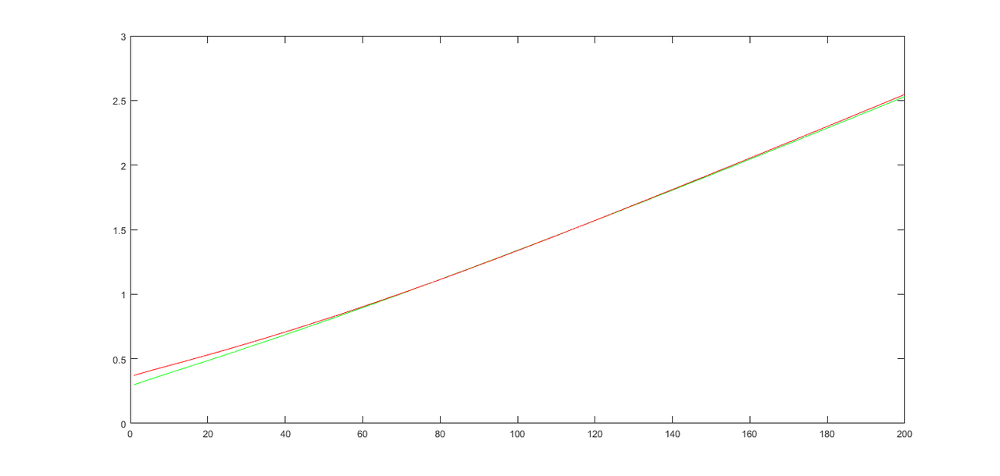](https://postimg.cc/3dJrz1zF)

Here is the final out put graph of the given program

[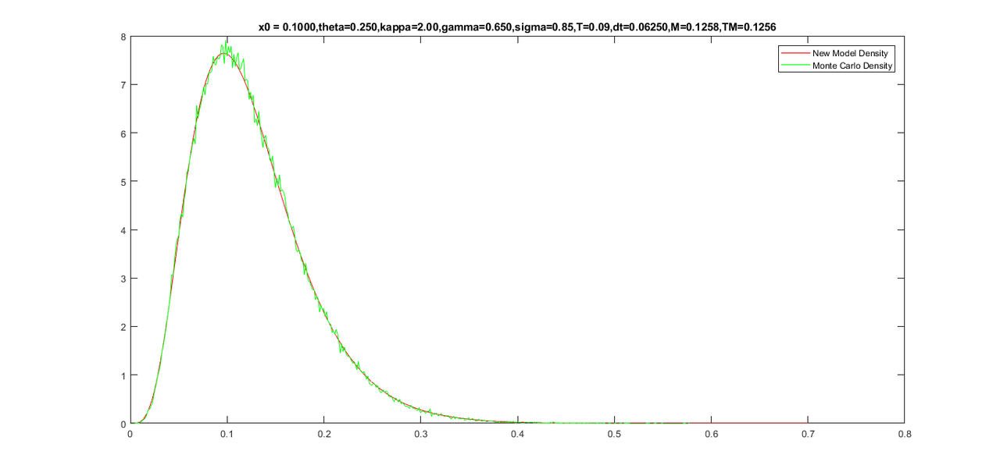](https://postimg.cc/gnScpRWF)

While final output of the program should be

ItoHermiteMean =

   0.125777842090532

true Mean only applicable to standard SV mean reverting type models otherwise disregard

TrueMean =

   0.125645632272940

Original process average from monte carlo

MCMean =

   0.125565310438908

MCVar =

   0.003453688619556

Original process average from our simulation

ItoHermiteMean =

   0.125777842090532

ItoHermiteVar =

   0.003518899352026

true Mean only applicble to standard SV mean reverting type models otherwise disregard

TrueMean =

   0.125645632272940

IndexMax =

   406

red line is density of SDE from Ito-Hermite method, green is monte carlo.

---

### #1114 — Amin (Topic Author)
*April 11, 2021, 3:06 PM*

Here is another sub function you will need. I have altered this one from before. Rest of the functions should be the
same ones as posted earlier in previous posts.

.

```
function
[wMu0dt,dwMu0dtdw,d2wMu0dtdw2,d3wMu0dtdw3,d4wMu0dtdw4,d5wMu0dtdw5,d6wMu0dtdw6,d7wMu0dtdw7,d8wMu0dtdw8,c1,dc1dw,d2c1dw2,c2]
= CalculateDriftAndVolA404B4Drift(w,wnStart,Nn,YqCoeff0,Fp1,gamma,dt)

yy(wnStart:Nn)=((1-gamma)*w(wnStart:Nn)).^(1/(1-gamma));

Fp2=Fp1/(1-gamma);

wMu0dt(wnStart:Nn)=(YqCoeff0(1,1,2,1).*yy(wnStart:Nn).^Fp1(1,1,2,1)+ ...
    YqCoeff0(1,2,1,1).*yy(wnStart:Nn).^Fp1(1,2,1,1)+ ...
    YqCoeff0(2,1,1,1).*yy(wnStart:Nn).^Fp1(2,1,1,1))*dt + ...
    (YqCoeff0(1,1,3,1).*yy(wnStart:Nn).^Fp1(1,1,3,1)+ ...
    YqCoeff0(1,2,2,1).*yy(wnStart:Nn).^Fp1(1,2,2,1)+ ...
    YqCoeff0(2,1,2,1).*yy(wnStart:Nn).^Fp1(2,1,2,1)+ ...
    YqCoeff0(1,3,1,1).*yy(wnStart:Nn).^Fp1(1,3,1,1)+ ...
    YqCoeff0(2,2,1,1).*yy(wnStart:Nn).^Fp1(2,2,1,1)+ ...
    YqCoeff0(3,1,1,1).*yy(wnStart:Nn).^Fp1(3,1,1,1))*dt^2 + ...
     (YqCoeff0(1,1,4,1).*yy(wnStart:Nn).^Fp1(1,1,4,1)+ ...
     YqCoeff0(1,2,3,1).*yy(wnStart:Nn).^Fp1(1,2,3,1)+ ...
     YqCoeff0(2,1,3,1).*yy(wnStart:Nn).^Fp1(2,1,3,1)+ ...
     YqCoeff0(1,3,2,1).*yy(wnStart:Nn).^Fp1(1,3,2,1)+ ...
     YqCoeff0(2,2,2,1).*yy(wnStart:Nn).^Fp1(2,2,2,1)+ ...
     YqCoeff0(3,1,2,1).*yy(wnStart:Nn).^Fp1(3,1,2,1)+ ...
     YqCoeff0(1,4,1,1).*yy(wnStart:Nn).^Fp1(1,4,1,1)+ ...
     YqCoeff0(2,3,1,1).*yy(wnStart:Nn).^Fp1(2,3,1,1)+ ...
     YqCoeff0(3,2,1,1).*yy(wnStart:Nn).^Fp1(3,2,1,1)+ ...
     YqCoeff0(4,1,1,1).*yy(wnStart:Nn).^Fp1(4,1,1,1))*dt^3+ ...
     (YqCoeff0(1,1,5,1).*yy(wnStart:Nn).^Fp1(1,1,5,1)+ ...
      YqCoeff0(1,2,4,1).*yy(wnStart:Nn).^Fp1(1,2,4,1)+ ...
      YqCoeff0(2,1,4,1).*yy(wnStart:Nn).^Fp1(2,1,4,1)+ ...
       YqCoeff0(2,2,3,1).*yy(wnStart:Nn).^Fp1(2,2,3,1)+ ...
       YqCoeff0(3,1,3,1).*yy(wnStart:Nn).^Fp1(3,1,3,1)+ ...
       YqCoeff0(1,4,2,1).*yy(wnStart:Nn).^Fp1(1,4,2,1)+ ...
       YqCoeff0(2,3,2,1).*yy(wnStart:Nn).^Fp1(2,3,2,1)+ ...
       YqCoeff0(3,2,2,1).*yy(wnStart:Nn).^Fp1(3,2,2,1)+ ...
       YqCoeff0(4,1,2,1).*yy(wnStart:Nn).^Fp1(4,1,2,1)+ ...
       YqCoeff0(1,5,1,1).*yy(wnStart:Nn).^Fp1(1,5,1,1)+ ...
       YqCoeff0(2,4,1,1).*yy(wnStart:Nn).^Fp1(2,4,1,1)+ ...
       YqCoeff0(3,3,1,1).*yy(wnStart:Nn).^Fp1(3,3,1,1)+  ...
       YqCoeff0(4,2,1,1).*yy(wnStart:Nn).^Fp1(4,2,1,1)+ ...
       YqCoeff0(5,1,1,1).*yy(wnStart:Nn).^Fp1(5,1,1,1))*dt^4;

   %       (YCoeff0(1,1,2,1).*YY(1:paths).^Fp(1,1,2,1)+YCoeff0(1,2,1,1).*YY(1:paths).^Fp(1,2,1,1)+ ...
%       YCoeff0(2,1,1,1).*YY(1:paths).^Fp(2,1,1,1))*dtM + ...
%       (YCoeff0(1,1,3,1).*YY(1:paths).^Fp(1,1,3,1)+YCoeff0(1,2,2,1).*YY(1:paths).^Fp(1,2,2,1)+ ...
%       YCoeff0(2,1,2,1).*YY(1:paths).^Fp(2,1,2,1)+YCoeff0(1,3,1,1).*YY(1:paths).^Fp(1,3,1,1)+ ...
%       YCoeff0(2,2,1,1).*YY(1:paths).^Fp(2,2,1,1)+YCoeff0(3,1,1,1).*YY(1:paths).^Fp(3,1,1,1))*dtM^2 + ...
%       (YCoeff0(1,1,4,1).*YY(1:paths).^Fp(1,1,4,1)+YCoeff0(1,2,3,1).*YY(1:paths).^Fp(1,2,3,1)+ ...
%       YCoeff0(2,1,3,1).*YY(1:paths).^Fp(2,1,3,1)+YCoeff0(1,3,2,1).*YY(1:paths).^Fp(1,3,2,1)+ ...
%       YCoeff0(2,2,2,1).*YY(1:paths).^Fp(2,2,2,1)+YCoeff0(3,1,2,1).*YY(1:paths).^Fp(3,1,2,1)+ ...
%       YCoeff0(1,4,1,1).*YY(1:paths).^Fp(1,4,1,1)+YCoeff0(2,3,1,1).*YY(1:paths).^Fp(2,3,1,1)+ ...
%       YCoeff0(3,2,1,1).*YY(1:paths).^Fp(3,2,1,1)+YCoeff0(4,1,1,1).*YY(1:paths).^Fp(4,1,1,1))*dtM^3 + ...
%        (YCoeff0(1,1,5,1).*YY(1:paths).^Fp(1,1,5,1)+YCoeff0(1,2,4,1).*YY(1:paths).^Fp(1,2,4,1)+ ...
%     YCoeff0(2,1,4,1).*YY(1:paths).^Fp(2,1,4,1)+YCoeff0(2,1,1,1).*YY(1:paths).^Fp(2,1,1,1)+ ...
%      YCoeff0(2,2,3,1).*YY(1:paths).^Fp(2,2,3,1)+ ...
%      YCoeff0(3,1,3,1).*YY(1:paths).^Fp(3,1,3,1)+YCoeff0(1,4,2,1).*YY(1:paths).^Fp(1,4,2,1)+ ...
%      YCoeff0(2,3,2,1).*YY(1:paths).^Fp(2,3,2,1)+YCoeff0(3,2,2,1).*YY(1:paths).^Fp(3,2,2,1)+ ...
%      YCoeff0(4,1,2,1).*YY(1:paths).^Fp(4,1,2,1)+YCoeff0(1,5,1,1).*YY(1:paths).^Fp(1,5,1,1)+ ...
%      YCoeff0(2,4,1,1).*YY(1:paths).^Fp(2,4,1,1)+ ...
%      YCoeff0(3,3,1,1).*YY(1:paths).^Fp(3,3,1,1)+YCoeff0(4,2,1,1).*YY(1:paths).^Fp(4,2,1,1)+ ...
%      YCoeff0(5,1,1,1).*YY(1:paths).^Fp(5,1,1,1))*dtM^4

dwMu0dtdw(wnStart:Nn)=(YqCoeff0(1,1,2,1).*Fp1(1,1,2,1).*((1-gamma).*w(wnStart:Nn)).^(-1+Fp2(1,1,2,1))+ ...
    YqCoeff0(1,2,1,1).*Fp1(1,2,1,1).*((1-gamma).*w(wnStart:Nn)).^(-1+Fp2(1,2,1,1))+ ...
    YqCoeff0(2,1,1,1).*Fp1(2,1,1,1).*((1-gamma).*w(wnStart:Nn)).^(-1+Fp2(2,1,1,1)))*dt + ...
    (YqCoeff0(1,1,3,1).*Fp1(1,1,3,1).*((1-gamma).*w(wnStart:Nn)).^(-1+Fp2(1,1,3,1))+ ...
    YqCoeff0(1,2,2,1).*Fp1(1,2,2,1).*((1-gamma).*w(wnStart:Nn)).^(-1+Fp2(1,2,2,1))+ ...
    YqCoeff0(2,1,2,1).*Fp1(2,1,2,1).*((1-gamma).*w(wnStart:Nn)).^(-1+Fp2(2,1,2,1))+ ...
    YqCoeff0(1,3,1,1).*Fp1(1,3,1,1).*((1-gamma).*w(wnStart:Nn)).^(-1+Fp2(1,3,1,1))+ ...
    YqCoeff0(2,2,1,1).*Fp1(2,2,1,1).*((1-gamma).*w(wnStart:Nn)).^(-1+Fp2(2,2,1,1))+ ...
    YqCoeff0(3,1,1,1).*Fp1(3,1,1,1).*((1-gamma).*w(wnStart:Nn)).^(-1+Fp2(3,1,1,1)))*dt^2 + ...
     (YqCoeff0(1,1,4,1).*Fp1(1,1,4,1).*((1-gamma).*w(wnStart:Nn)).^(-1+Fp2(1,1,4,1))+ ...
     YqCoeff0(1,2,3,1).*Fp1(1,2,3,1).*((1-gamma).*w(wnStart:Nn)).^(-1+Fp2(1,2,3,1))+ ...
     YqCoeff0(2,1,3,1).*Fp1(2,1,3,1).*((1-gamma).*w(wnStart:Nn)).^(-1+Fp2(2,1,3,1))+ ...
     YqCoeff0(1,3,2,1).*Fp1(1,3,2,1).*((1-gamma).*w(wnStart:Nn)).^(-1+Fp2(1,3,2,1))+ ...
     YqCoeff0(2,2,2,1).*Fp1(2,2,2,1).*((1-gamma).*w(wnStart:Nn)).^(-1+Fp2(2,2,2,1))+ ...
     YqCoeff0(3,1,2,1).*Fp1(3,1,2,1).*((1-gamma).*w(wnStart:Nn)).^(-1+Fp2(3,1,2,1))+ ...
     YqCoeff0(1,4,1,1).*Fp1(1,4,1,1).*((1-gamma).*w(wnStart:Nn)).^(-1+Fp2(1,4,1,1))+ ...
     YqCoeff0(2,3,1,1).*Fp1(2,3,1,1).*((1-gamma).*w(wnStart:Nn)).^(-1+Fp2(2,3,1,1))+ ...
     YqCoeff0(3,2,1,1).*Fp1(3,2,1,1).*((1-gamma).*w(wnStart:Nn)).^(-1+Fp2(3,2,1,1))+ ...
     YqCoeff0(4,1,1,1).*Fp1(4,1,1,1).*((1-gamma).*w(wnStart:Nn)).^(-1+Fp2(4,1,1,1)))*dt^3 + ...
     (YqCoeff0(1,1,5,1).*Fp1(1,1,5,1).*((1-gamma).*w(wnStart:Nn)).^(-1+Fp2(1,1,5,1))+ ...
      YqCoeff0(1,2,4,1).*Fp1(1,2,4,1).*((1-gamma).*w(wnStart:Nn)).^(-1+Fp2(1,2,4,1))+ ...
      YqCoeff0(2,1,4,1).*Fp1(2,1,4,1).*((1-gamma).*w(wnStart:Nn)).^(-1+Fp2(2,1,4,1))+ ...
       YqCoeff0(2,2,3,1).*Fp1(2,2,3,1).*((1-gamma).*w(wnStart:Nn)).^(-1+Fp2(2,2,3,1))+ ...
       YqCoeff0(3,1,3,1).*Fp1(3,1,3,1).*((1-gamma).*w(wnStart:Nn)).^(-1+Fp2(3,1,3,1))+ ...
       YqCoeff0(1,4,2,1).*Fp1(1,4,2,1).*((1-gamma).*w(wnStart:Nn)).^(-1+Fp2(1,4,2,1))+ ...
       YqCoeff0(2,3,2,1).*Fp1(2,3,2,1).*((1-gamma).*w(wnStart:Nn)).^(-1+Fp2(2,3,2,1))+ ...
       YqCoeff0(3,2,2,1).*Fp1(3,2,2,1).*((1-gamma).*w(wnStart:Nn)).^(-1+Fp2(3,2,2,1))+ ...
       YqCoeff0(4,1,2,1).*Fp1(4,1,2,1).*((1-gamma).*w(wnStart:Nn)).^(-1+Fp2(4,1,2,1))+ ...
       YqCoeff0(1,5,1,1).*Fp1(1,5,1,1).*((1-gamma).*w(wnStart:Nn)).^(-1+Fp2(1,5,1,1))+ ...
       YqCoeff0(2,4,1,1).*Fp1(2,4,1,1).*((1-gamma).*w(wnStart:Nn)).^(-1+Fp2(2,4,1,1))+ ...
       YqCoeff0(3,3,1,1).*Fp1(3,3,1,1).*((1-gamma).*w(wnStart:Nn)).^(-1+Fp2(3,3,1,1))+  ...
       YqCoeff0(4,2,1,1).*Fp1(4,2,1,1).*((1-gamma).*w(wnStart:Nn)).^(-1+Fp2(4,2,1,1))+ ...
       YqCoeff0(5,1,1,1).*Fp1(5,1,1,1).*((1-gamma).*w(wnStart:Nn)).^(-1+Fp2(5,1,1,1)))*dt^4;

d2wMu0dtdw2(wnStart:Nn)=(1-gamma).*((YqCoeff0(1,1,2,1).*Fp1(1,1,2,1).*(-1+Fp2(1,1,2,1)).*((1-gamma).*w(wnStart:Nn)).^(-2+Fp2(1,1,2,1))+
...
    YqCoeff0(1,2,1,1).*Fp1(1,2,1,1).*(-1+Fp2(1,2,1,1)).*((1-gamma).*w(wnStart:Nn)).^(-2+Fp2(1,2,1,1))+ ...
    YqCoeff0(2,1,1,1).*Fp1(2,1,1,1).*(-1+Fp2(2,1,1,1)).*((1-gamma).*w(wnStart:Nn)).^(-2+Fp2(2,1,1,1)))*dt + ...
    (YqCoeff0(1,1,3,1).*Fp1(1,1,3,1).*(-1+Fp2(1,1,3,1)).*((1-gamma).*w(wnStart:Nn)).^(-2+Fp2(1,1,3,1))+ ...
    YqCoeff0(1,2,2,1).*Fp1(1,2,2,1).*(-1+Fp2(1,2,2,1)).*((1-gamma).*w(wnStart:Nn)).^(-2+Fp2(1,2,2,1))+ ...
    YqCoeff0(2,1,2,1).*Fp1(2,1,2,1).*(-1+Fp2(2,1,2,1)).*((1-gamma).*w(wnStart:Nn)).^(-2+Fp2(2,1,2,1))+ ...
    YqCoeff0(1,3,1,1).*Fp1(1,3,1,1).*(-1+Fp2(1,3,1,1)).*((1-gamma).*w(wnStart:Nn)).^(-2+Fp2(1,3,1,1))+ ...
    YqCoeff0(2,2,1,1).*Fp1(2,2,1,1).*(-1+Fp2(2,2,1,1)).*((1-gamma).*w(wnStart:Nn)).^(-2+Fp2(2,2,1,1))+ ...
    YqCoeff0(3,1,1,1).*Fp1(3,1,1,1).*(-1+Fp2(3,1,1,1)).*((1-gamma).*w(wnStart:Nn)).^(-2+Fp2(3,1,1,1)))*dt^2+ ...
    (YqCoeff0(1,1,4,1).*Fp1(1,1,4,1).*(-1+Fp2(1,1,4,1)).*((1-gamma).*w(wnStart:Nn)).^(-2+Fp2(1,1,4,1))+ ...
     YqCoeff0(1,2,3,1).*Fp1(1,2,3,1).*(-1+Fp2(1,2,3,1)).*((1-gamma).*w(wnStart:Nn)).^(-2+Fp2(1,2,3,1))+ ...
     YqCoeff0(2,1,3,1).*Fp1(2,1,3,1).*(-1+Fp2(2,1,3,1)).*((1-gamma).*w(wnStart:Nn)).^(-2+Fp2(2,1,3,1))+ ...
     YqCoeff0(1,3,2,1).*Fp1(1,3,2,1).*(-1+Fp2(1,3,2,1)).*((1-gamma).*w(wnStart:Nn)).^(-2+Fp2(1,3,2,1))+ ...
     YqCoeff0(2,2,2,1).*Fp1(2,2,2,1).*(-1+Fp2(2,2,2,1)).*((1-gamma).*w(wnStart:Nn)).^(-2+Fp2(2,2,2,1))+ ...
     YqCoeff0(3,1,2,1).*Fp1(3,1,2,1).*(-1+Fp2(3,1,2,1)).*((1-gamma).*w(wnStart:Nn)).^(-2+Fp2(3,1,2,1))+ ...
     YqCoeff0(1,4,1,1).*Fp1(1,4,1,1).*(-1+Fp2(1,4,1,1)).*((1-gamma).*w(wnStart:Nn)).^(-2+Fp2(1,4,1,1))+ ...
     YqCoeff0(2,3,1,1).*Fp1(2,3,1,1).*(-1+Fp2(2,3,1,1)).*((1-gamma).*w(wnStart:Nn)).^(-2+Fp2(2,3,1,1))+ ...
     YqCoeff0(3,2,1,1).*Fp1(3,2,1,1).*(-1+Fp2(3,2,1,1)).*((1-gamma).*w(wnStart:Nn)).^(-2+Fp2(3,2,1,1))+ ...
     YqCoeff0(4,1,1,1).*Fp1(4,1,1,1).*(-1+Fp2(4,1,1,1)).*((1-gamma).*w(wnStart:Nn)).^(-2+Fp2(4,1,1,1)))*dt^3 + ...
     (YqCoeff0(1,1,5,1).*Fp1(1,1,5,1).*(-1+Fp2(1,1,5,1)).*((1-gamma).*w(wnStart:Nn)).^(-2+Fp2(1,1,5,1))+ ...
      YqCoeff0(1,2,4,1).*Fp1(1,2,4,1).*(-1+Fp2(1,2,4,1)).*((1-gamma).*w(wnStart:Nn)).^(-2+Fp2(1,2,4,1))+ ...
      YqCoeff0(2,1,4,1).*Fp1(2,1,4,1).*(-1+Fp2(2,1,4,1)).*((1-gamma).*w(wnStart:Nn)).^(-2+Fp2(2,1,4,1))+ ...
       YqCoeff0(2,2,3,1).*Fp1(2,2,3,1).*(-1+Fp2(2,2,3,1)).*((1-gamma).*w(wnStart:Nn)).^(-2+Fp2(2,2,3,1))+ ...
       YqCoeff0(3,1,3,1).*Fp1(3,1,3,1).*(-1+Fp2(3,1,3,1)).*((1-gamma).*w(wnStart:Nn)).^(-2+Fp2(3,1,3,1))+ ...
       YqCoeff0(1,4,2,1).*Fp1(1,4,2,1).*(-1+Fp2(1,4,2,1)).*((1-gamma).*w(wnStart:Nn)).^(-2+Fp2(1,4,2,1))+ ...
       YqCoeff0(2,3,2,1).*Fp1(2,3,2,1).*(-1+Fp2(2,3,2,1)).*((1-gamma).*w(wnStart:Nn)).^(-2+Fp2(2,3,2,1))+ ...
       YqCoeff0(3,2,2,1).*Fp1(3,2,2,1).*(-1+Fp2(3,2,2,1)).*((1-gamma).*w(wnStart:Nn)).^(-2+Fp2(3,2,2,1))+ ...
       YqCoeff0(4,1,2,1).*Fp1(4,1,2,1).*(-1+Fp2(4,1,2,1)).*((1-gamma).*w(wnStart:Nn)).^(-2+Fp2(4,1,2,1))+ ...
       YqCoeff0(1,5,1,1).*Fp1(1,5,1,1).*(-1+Fp2(1,5,1,1)).*((1-gamma).*w(wnStart:Nn)).^(-2+Fp2(1,5,1,1))+ ...
       YqCoeff0(2,4,1,1).*Fp1(2,4,1,1).*(-1+Fp2(2,4,1,1)).*((1-gamma).*w(wnStart:Nn)).^(-2+Fp2(2,4,1,1))+ ...
       YqCoeff0(3,3,1,1).*Fp1(3,3,1,1).*(-1+Fp2(3,3,1,1)).*((1-gamma).*w(wnStart:Nn)).^(-2+Fp2(3,3,1,1))+  ...
       YqCoeff0(4,2,1,1).*Fp1(4,2,1,1).*(-1+Fp2(4,2,1,1)).*((1-gamma).*w(wnStart:Nn)).^(-2+Fp2(4,2,1,1))+ ...
       YqCoeff0(5,1,1,1).*Fp1(5,1,1,1).*(-1+Fp2(5,1,1,1)).*((1-gamma).*w(wnStart:Nn)).^(-2+Fp2(5,1,1,1)))*dt^4);

d3wMu0dtdw3(wnStart:Nn)=(1-gamma)^2.* ...
   
((YqCoeff0(1,1,2,1).*Fp1(1,1,2,1).*(-1+Fp2(1,1,2,1)).*(-2+Fp2(1,1,2,1)).*((1-gamma).*w(wnStart:Nn)).^(-3+Fp2(1,1,2,1))+
...
   
YqCoeff0(1,2,1,1).*Fp1(1,2,1,1).*(-1+Fp2(1,2,1,1)).*(-2+Fp2(1,2,1,1)).*((1-gamma).*w(wnStart:Nn)).^(-3+Fp2(1,2,1,1))+
...
   
YqCoeff0(2,1,1,1).*Fp1(2,1,1,1).*(-1+Fp2(2,1,1,1)).*(-2+Fp2(2,1,1,1)).*((1-gamma).*w(wnStart:Nn)).^(-3+Fp2(2,1,1,1)))*dt
+ ...
   
(YqCoeff0(1,1,3,1).*Fp1(1,1,3,1).*(-1+Fp2(1,1,3,1)).*(-2+Fp2(1,1,3,1)).*((1-gamma).*w(wnStart:Nn)).^(-3+Fp2(1,1,3,1))+
...
   
YqCoeff0(1,2,2,1).*Fp1(1,2,2,1).*(-1+Fp2(1,2,2,1)).*(-2+Fp2(1,2,2,1)).*((1-gamma).*w(wnStart:Nn)).^(-3+Fp2(1,2,2,1))+
...
   
YqCoeff0(2,1,2,1).*Fp1(2,1,2,1).*(-1+Fp2(2,1,2,1)).*(-2+Fp2(2,1,2,1)).*((1-gamma).*w(wnStart:Nn)).^(-3+Fp2(2,1,2,1))+
...
   
YqCoeff0(1,3,1,1).*Fp1(1,3,1,1).*(-1+Fp2(1,3,1,1)).*(-2+Fp2(1,3,1,1)).*((1-gamma).*w(wnStart:Nn)).^(-3+Fp2(1,3,1,1))+
...
   
YqCoeff0(2,2,1,1).*Fp1(2,2,1,1).*(-1+Fp2(2,2,1,1)).*(-2+Fp2(2,2,1,1)).*((1-gamma).*w(wnStart:Nn)).^(-3+Fp2(2,2,1,1))+
...
   
YqCoeff0(3,1,1,1).*Fp1(3,1,1,1).*(-1+Fp2(3,1,1,1)).*(-2+Fp2(3,1,1,1)).*((1-gamma).*w(wnStart:Nn)).^(-3+Fp2(3,1,1,1)))*dt^2
+ ...
   
(YqCoeff0(1,1,4,1).*Fp1(1,1,4,1).*(-1+Fp2(1,1,4,1)).*(-2+Fp2(1,1,4,1)).*((1-gamma).*w(wnStart:Nn)).^(-3+Fp2(1,1,4,1))+
...
   
 YqCoeff0(1,2,3,1).*Fp1(1,2,3,1).*(-1+Fp2(1,2,3,1)).*(-2+Fp2(1,2,3,1)).*((1-gamma).*w(wnStart:Nn)).^(-3+Fp2(1,2,3,1))+
...
   
 YqCoeff0(2,1,3,1).*Fp1(2,1,3,1).*(-1+Fp2(2,1,3,1)).*(-2+Fp2(2,1,3,1)).*((1-gamma).*w(wnStart:Nn)).^(-3+Fp2(2,1,3,1))+
...
   
 YqCoeff0(1,3,2,1).*Fp1(1,3,2,1).*(-1+Fp2(1,3,2,1)).*(-2+Fp2(1,3,2,1)).*((1-gamma).*w(wnStart:Nn)).^(-3+Fp2(1,3,2,1))+
...
   
 YqCoeff0(2,2,2,1).*Fp1(2,2,2,1).*(-1+Fp2(2,2,2,1)).*(-2+Fp2(2,2,2,1)).*((1-gamma).*w(wnStart:Nn)).^(-3+Fp2(2,2,2,1))+
...
   
 YqCoeff0(3,1,2,1).*Fp1(3,1,2,1).*(-1+Fp2(3,1,2,1)).*(-2+Fp2(3,1,2,1)).*((1-gamma).*w(wnStart:Nn)).^(-3+Fp2(3,1,2,1))+
...
   
 YqCoeff0(1,4,1,1).*Fp1(1,4,1,1).*(-1+Fp2(1,4,1,1)).*(-2+Fp2(1,4,1,1)).*((1-gamma).*w(wnStart:Nn)).^(-3+Fp2(1,4,1,1))+
...
   
 YqCoeff0(2,3,1,1).*Fp1(2,3,1,1).*(-1+Fp2(2,3,1,1)).*(-2+Fp2(2,3,1,1)).*((1-gamma).*w(wnStart:Nn)).^(-3+Fp2(2,3,1,1))+
...
   
 YqCoeff0(3,2,1,1).*Fp1(3,2,1,1).*(-1+Fp2(3,2,1,1)).*(-2+Fp2(3,2,1,1)).*((1-gamma).*w(wnStart:Nn)).^(-3+Fp2(3,2,1,1))+
...
   
 YqCoeff0(4,1,1,1).*Fp1(4,1,1,1).*(-1+Fp2(4,1,1,1)).*(-2+Fp2(4,1,1,1)).*((1-gamma).*w(wnStart:Nn)).^(-3+Fp2(4,1,1,1)))*dt^3
+ ...
   
 (YqCoeff0(1,1,5,1).*Fp1(1,1,5,1).*(-1+Fp2(1,1,5,1)).*(-2+Fp2(1,1,5,1)).*((1-gamma).*w(wnStart:Nn)).^(-3+Fp2(1,1,5,1))+
...
     
YqCoeff0(1,2,4,1).*Fp1(1,2,4,1).*(-1+Fp2(1,2,4,1)).*(-2+Fp2(1,2,4,1)).*((1-gamma).*w(wnStart:Nn)).^(-3+Fp2(1,2,4,1))+
...
     
YqCoeff0(2,1,4,1).*Fp1(2,1,4,1).*(-1+Fp2(2,1,4,1)).*(-2+Fp2(2,1,4,1)).*((1-gamma).*w(wnStart:Nn)).^(-3+Fp2(2,1,4,1))+
...
     
YqCoeff0(2,2,3,1).*Fp1(2,2,3,1).*(-1+Fp2(2,2,3,1)).*(-2+Fp2(2,2,3,1)).*((1-gamma).*w(wnStart:Nn)).^(-3+Fp2(2,2,3,1))+
...
     
 YqCoeff0(3,1,3,1).*Fp1(3,1,3,1).*(-1+Fp2(3,1,3,1)).*(-2+Fp2(3,1,3,1)).*((1-gamma).*w(wnStart:Nn)).^(-3+Fp2(3,1,3,1))+
...
     
 YqCoeff0(1,4,2,1).*Fp1(1,4,2,1).*(-1+Fp2(1,4,2,1)).*(-2+Fp2(1,4,2,1)).*((1-gamma).*w(wnStart:Nn)).^(-3+Fp2(1,4,2,1))+
...
     
 YqCoeff0(2,3,2,1).*Fp1(2,3,2,1).*(-1+Fp2(2,3,2,1)).*(-2+Fp2(2,3,2,1)).*((1-gamma).*w(wnStart:Nn)).^(-3+Fp2(2,3,2,1))+
...
     
 YqCoeff0(3,2,2,1).*Fp1(3,2,2,1).*(-1+Fp2(3,2,2,1)).*(-2+Fp2(3,2,2,1)).*((1-gamma).*w(wnStart:Nn)).^(-3+Fp2(3,2,2,1))+
...
     
 YqCoeff0(4,1,2,1).*Fp1(4,1,2,1).*(-1+Fp2(4,1,2,1)).*(-2+Fp2(4,1,2,1)).*((1-gamma).*w(wnStart:Nn)).^(-3+Fp2(4,1,2,1))+
...
     
 YqCoeff0(1,5,1,1).*Fp1(1,5,1,1).*(-1+Fp2(1,5,1,1)).*(-2+Fp2(1,5,1,1)).*((1-gamma).*w(wnStart:Nn)).^(-3+Fp2(1,5,1,1))+
...
     
 YqCoeff0(2,4,1,1).*Fp1(2,4,1,1).*(-1+Fp2(2,4,1,1)).*(-2+Fp2(2,4,1,1)).*((1-gamma).*w(wnStart:Nn)).^(-3+Fp2(2,4,1,1))+
...
     
 YqCoeff0(3,3,1,1).*Fp1(3,3,1,1).*(-1+Fp2(3,3,1,1)).*(-2+Fp2(3,3,1,1)).*((1-gamma).*w(wnStart:Nn)).^(-3+Fp2(3,3,1,1))+ 
...
     
 YqCoeff0(4,2,1,1).*Fp1(4,2,1,1).*(-1+Fp2(4,2,1,1)).*(-2+Fp2(4,2,1,1)).*((1-gamma).*w(wnStart:Nn)).^(-3+Fp2(4,2,1,1))+
...
     
 YqCoeff0(5,1,1,1).*Fp1(5,1,1,1).*(-1+Fp2(5,1,1,1)).*(-2+Fp2(5,1,1,1)).*((1-gamma).*w(wnStart:Nn)).^(-3+Fp2(5,1,1,1)))*dt^4);

d4wMu0dtdw4(wnStart:Nn)=(1-gamma)^3.* ...
   
((YqCoeff0(1,1,2,1).*Fp1(1,1,2,1).*(-1+Fp2(1,1,2,1)).*(-2+Fp2(1,1,2,1)).*(-3+Fp2(1,1,2,1)).*((1-gamma).*w(wnStart:Nn)).^(-4+Fp2(1,1,2,1))+
...
   
YqCoeff0(1,2,1,1).*Fp1(1,2,1,1).*(-1+Fp2(1,2,1,1)).*(-2+Fp2(1,2,1,1)).*(-3+Fp2(1,2,1,1)).*((1-gamma).*w(wnStart:Nn)).^(-4+Fp2(1,2,1,1))+
...
   
YqCoeff0(2,1,1,1).*Fp1(2,1,1,1).*(-1+Fp2(2,1,1,1)).*(-2+Fp2(2,1,1,1)).*(-3+Fp2(2,1,1,1)).*((1-gamma).*w(wnStart:Nn)).^(-4+Fp2(2,1,1,1)))*dt
+ ...
   
(YqCoeff0(1,1,3,1).*Fp1(1,1,3,1).*(-1+Fp2(1,1,3,1)).*(-2+Fp2(1,1,3,1)).*(-3+Fp2(1,1,3,1)).*((1-gamma).*w(wnStart:Nn)).^(-4+Fp2(1,1,3,1))+
...
   
YqCoeff0(1,2,2,1).*Fp1(1,2,2,1).*(-1+Fp2(1,2,2,1)).*(-2+Fp2(1,2,2,1)).*(-3+Fp2(1,2,2,1)).*((1-gamma).*w(wnStart:Nn)).^(-4+Fp2(1,2,2,1))+
...
   
YqCoeff0(2,1,2,1).*Fp1(2,1,2,1).*(-1+Fp2(2,1,2,1)).*(-2+Fp2(2,1,2,1)).*(-3+Fp2(2,1,2,1)).*((1-gamma).*w(wnStart:Nn)).^(-4+Fp2(2,1,2,1))+
...
   
YqCoeff0(1,3,1,1).*Fp1(1,3,1,1).*(-1+Fp2(1,3,1,1)).*(-2+Fp2(1,3,1,1)).*(-3+Fp2(1,3,1,1)).*((1-gamma).*w(wnStart:Nn)).^(-4+Fp2(1,3,1,1))+
...
   
YqCoeff0(2,2,1,1).*Fp1(2,2,1,1).*(-1+Fp2(2,2,1,1)).*(-2+Fp2(2,2,1,1)).*(-3+Fp2(2,2,1,1)).*((1-gamma).*w(wnStart:Nn)).^(-4+Fp2(2,2,1,1))+
...
   
YqCoeff0(3,1,1,1).*Fp1(3,1,1,1).*(-1+Fp2(3,1,1,1)).*(-2+Fp2(3,1,1,1)).*(-3+Fp2(3,1,1,1)).*((1-gamma).*w(wnStart:Nn)).^(-4+Fp2(3,1,1,1)))*dt^2
+...
   
(YqCoeff0(1,1,4,1).*Fp1(1,1,4,1).*(-1+Fp2(1,1,4,1)).*(-2+Fp2(1,1,4,1)).*(-3+Fp2(1,1,4,1)).*((1-gamma).*w(wnStart:Nn)).^(-4+Fp2(1,1,4,1))+
...
   
 YqCoeff0(1,2,3,1).*Fp1(1,2,3,1).*(-1+Fp2(1,2,3,1)).*(-2+Fp2(1,2,3,1)).*(-3+Fp2(1,2,3,1)).*((1-gamma).*w(wnStart:Nn)).^(-4+Fp2(1,2,3,1))+
...
   
 YqCoeff0(2,1,3,1).*Fp1(2,1,3,1).*(-1+Fp2(2,1,3,1)).*(-2+Fp2(2,1,3,1)).*(-3+Fp2(2,1,3,1)).*((1-gamma).*w(wnStart:Nn)).^(-4+Fp2(2,1,3,1))+
...
   
 YqCoeff0(1,3,2,1).*Fp1(1,3,2,1).*(-1+Fp2(1,3,2,1)).*(-2+Fp2(1,3,2,1)).*(-3+Fp2(1,3,2,1)).*((1-gamma).*w(wnStart:Nn)).^(-4+Fp2(1,3,2,1))+
...
   
 YqCoeff0(2,2,2,1).*Fp1(2,2,2,1).*(-1+Fp2(2,2,2,1)).*(-2+Fp2(2,2,2,1)).*(-3+Fp2(2,2,2,1)).*((1-gamma).*w(wnStart:Nn)).^(-4+Fp2(2,2,2,1))+
...
   
 YqCoeff0(3,1,2,1).*Fp1(3,1,2,1).*(-1+Fp2(3,1,2,1)).*(-2+Fp2(3,1,2,1)).*(-3+Fp2(3,1,2,1)).*((1-gamma).*w(wnStart:Nn)).^(-4+Fp2(3,1,2,1))+
...
   
 YqCoeff0(1,4,1,1).*Fp1(1,4,1,1).*(-1+Fp2(1,4,1,1)).*(-2+Fp2(1,4,1,1)).*(-3+Fp2(1,4,1,1)).*((1-gamma).*w(wnStart:Nn)).^(-4+Fp2(1,4,1,1))+
...
   
 YqCoeff0(2,3,1,1).*Fp1(2,3,1,1).*(-1+Fp2(2,3,1,1)).*(-2+Fp2(2,3,1,1)).*(-3+Fp2(2,3,1,1)).*((1-gamma).*w(wnStart:Nn)).^(-4+Fp2(2,3,1,1))+
...
   
 YqCoeff0(3,2,1,1).*Fp1(3,2,1,1).*(-1+Fp2(3,2,1,1)).*(-2+Fp2(3,2,1,1)).*(-3+Fp2(3,2,1,1)).*((1-gamma).*w(wnStart:Nn)).^(-4+Fp2(3,2,1,1))+
...
   
 YqCoeff0(4,1,1,1).*Fp1(4,1,1,1).*(-1+Fp2(4,1,1,1)).*(-2+Fp2(4,1,1,1)).*(-3+Fp2(4,1,1,1)).*((1-gamma).*w(wnStart:Nn)).^(-4+Fp2(4,1,1,1)))*dt^3
+ ...
   
 (YqCoeff0(1,1,5,1).*Fp1(1,1,5,1).*(-1+Fp2(1,1,5,1)).*(-2+Fp2(1,1,5,1)).*(-3+Fp2(1,1,5,1)).*((1-gamma).*w(wnStart:Nn)).^(-4+Fp2(1,1,5,1))+
...
     
YqCoeff0(1,2,4,1).*Fp1(1,2,4,1).*(-1+Fp2(1,2,4,1)).*(-2+Fp2(1,2,4,1)).*(-3+Fp2(1,2,4,1)).*((1-gamma).*w(wnStart:Nn)).^(-4+Fp2(1,2,4,1))+
...
     
YqCoeff0(2,1,4,1).*Fp1(2,1,4,1).*(-1+Fp2(2,1,4,1)).*(-2+Fp2(2,1,4,1)).*(-3+Fp2(2,1,4,1)).*((1-gamma).*w(wnStart:Nn)).^(-4+Fp2(2,1,4,1))+
...
     
 YqCoeff0(2,2,3,1).*Fp1(2,2,3,1).*(-1+Fp2(2,2,3,1)).*(-2+Fp2(2,2,3,1)).*(-3+Fp2(2,2,3,1)).*((1-gamma).*w(wnStart:Nn)).^(-4+Fp2(2,2,3,1))+
...
     
 YqCoeff0(3,1,3,1).*Fp1(3,1,3,1).*(-1+Fp2(3,1,3,1)).*(-2+Fp2(3,1,3,1)).*(-3+Fp2(3,1,3,1)).*((1-gamma).*w(wnStart:Nn)).^(-4+Fp2(3,1,3,1))+
...
     
 YqCoeff0(1,4,2,1).*Fp1(1,4,2,1).*(-1+Fp2(1,4,2,1)).*(-2+Fp2(1,4,2,1)).*(-3+Fp2(1,4,2,1)).*((1-gamma).*w(wnStart:Nn)).^(-4+Fp2(1,4,2,1))+
...
     
 YqCoeff0(2,3,2,1).*Fp1(2,3,2,1).*(-1+Fp2(2,3,2,1)).*(-2+Fp2(2,3,2,1)).*(-3+Fp2(2,3,2,1)).*((1-gamma).*w(wnStart:Nn)).^(-4+Fp2(2,3,2,1))+
...
     
 YqCoeff0(3,2,2,1).*Fp1(3,2,2,1).*(-1+Fp2(3,2,2,1)).*(-2+Fp2(3,2,2,1)).*(-3+Fp2(3,2,2,1)).*((1-gamma).*w(wnStart:Nn)).^(-4+Fp2(3,2,2,1))+
...
     
 YqCoeff0(4,1,2,1).*Fp1(4,1,2,1).*(-1+Fp2(4,1,2,1)).*(-2+Fp2(4,1,2,1)).*(-3+Fp2(4,1,2,1)).*((1-gamma).*w(wnStart:Nn)).^(-4+Fp2(4,1,2,1))+
...
     
 YqCoeff0(1,5,1,1).*Fp1(1,5,1,1).*(-1+Fp2(1,5,1,1)).*(-2+Fp2(1,5,1,1)).*(-3+Fp2(1,5,1,1)).*((1-gamma).*w(wnStart:Nn)).^(-4+Fp2(1,5,1,1))+
...
     
 YqCoeff0(2,4,1,1).*Fp1(2,4,1,1).*(-1+Fp2(2,4,1,1)).*(-2+Fp2(2,4,1,1)).*(-3+Fp2(2,4,1,1)).*((1-gamma).*w(wnStart:Nn)).^(-4+Fp2(2,4,1,1))+
...
     
 YqCoeff0(3,3,1,1).*Fp1(3,3,1,1).*(-1+Fp2(3,3,1,1)).*(-2+Fp2(3,3,1,1)).*(-3+Fp2(3,3,1,1)).*((1-gamma).*w(wnStart:Nn)).^(-4+Fp2(3,3,1,1))+ 
...
     
 YqCoeff0(4,2,1,1).*Fp1(4,2,1,1).*(-1+Fp2(4,2,1,1)).*(-2+Fp2(4,2,1,1)).*(-3+Fp2(4,2,1,1)).*((1-gamma).*w(wnStart:Nn)).^(-4+Fp2(4,2,1,1))+
...
     
 YqCoeff0(5,1,1,1).*Fp1(5,1,1,1).*(-1+Fp2(5,1,1,1)).*(-2+Fp2(5,1,1,1)).*(-3+Fp2(5,1,1,1)).*((1-gamma).*w(wnStart:Nn)).^(-4+Fp2(5,1,1,1)))*dt^4);

      d5wMu0dtdw5(wnStart:Nn)=(1-gamma)^4.* ...
   
((YqCoeff0(1,1,2,1).*Fp1(1,1,2,1).*(-1+Fp2(1,1,2,1)).*(-2+Fp2(1,1,2,1)).*(-3+Fp2(1,1,2,1)).*(-4+Fp2(1,1,2,1)).*((1-gamma).*w(wnStart:Nn)).^(-5+Fp2(1,1,2,1))+
...
   
YqCoeff0(1,2,1,1).*Fp1(1,2,1,1).*(-1+Fp2(1,2,1,1)).*(-2+Fp2(1,2,1,1)).*(-3+Fp2(1,2,1,1)).*(-4+Fp2(1,2,1,1)).*((1-gamma).*w(wnStart:Nn)).^(-5+Fp2(1,2,1,1))+
...
   
YqCoeff0(2,1,1,1).*Fp1(2,1,1,1).*(-1+Fp2(2,1,1,1)).*(-2+Fp2(2,1,1,1)).*(-3+Fp2(2,1,1,1)).*(-4+Fp2(2,1,1,1)).*((1-gamma).*w(wnStart:Nn)).^(-5+Fp2(2,1,1,1)))*dt
+ ...
   
(YqCoeff0(1,1,3,1).*Fp1(1,1,3,1).*(-1+Fp2(1,1,3,1)).*(-2+Fp2(1,1,3,1)).*(-3+Fp2(1,1,3,1)).*(-4+Fp2(1,1,3,1)).*((1-gamma).*w(wnStart:Nn)).^(-5+Fp2(1,1,3,1))+
...
   
YqCoeff0(1,2,2,1).*Fp1(1,2,2,1).*(-1+Fp2(1,2,2,1)).*(-2+Fp2(1,2,2,1)).*(-3+Fp2(1,2,2,1)).*(-4+Fp2(1,2,2,1)).*((1-gamma).*w(wnStart:Nn)).^(-5+Fp2(1,2,2,1))+
...
   
YqCoeff0(2,1,2,1).*Fp1(2,1,2,1).*(-1+Fp2(2,1,2,1)).*(-2+Fp2(2,1,2,1)).*(-3+Fp2(2,1,2,1)).*(-4+Fp2(2,1,2,1)).*((1-gamma).*w(wnStart:Nn)).^(-5+Fp2(2,1,2,1))+
...
   
YqCoeff0(1,3,1,1).*Fp1(1,3,1,1).*(-1+Fp2(1,3,1,1)).*(-2+Fp2(1,3,1,1)).*(-3+Fp2(1,3,1,1)).*(-4+Fp2(1,3,1,1)).*((1-gamma).*w(wnStart:Nn)).^(-5+Fp2(1,3,1,1))+
...
   
YqCoeff0(2,2,1,1).*Fp1(2,2,1,1).*(-1+Fp2(2,2,1,1)).*(-2+Fp2(2,2,1,1)).*(-3+Fp2(2,2,1,1)).*(-4+Fp2(2,2,1,1)).*((1-gamma).*w(wnStart:Nn)).^(-5+Fp2(2,2,1,1))+
...
   
YqCoeff0(3,1,1,1).*Fp1(3,1,1,1).*(-1+Fp2(3,1,1,1)).*(-2+Fp2(3,1,1,1)).*(-3+Fp2(3,1,1,1)).*(-4+Fp2(3,1,1,1)).*((1-gamma).*w(wnStart:Nn)).^(-5+Fp2(3,1,1,1)))*dt^2
+...
   
(YqCoeff0(1,1,4,1).*Fp1(1,1,4,1).*(-1+Fp2(1,1,4,1)).*(-2+Fp2(1,1,4,1)).*(-3+Fp2(1,1,4,1)).*(-4+Fp2(1,1,4,1)).*((1-gamma).*w(wnStart:Nn)).^(-5+Fp2(1,1,4,1))+
...
   
 YqCoeff0(1,2,3,1).*Fp1(1,2,3,1).*(-1+Fp2(1,2,3,1)).*(-2+Fp2(1,2,3,1)).*(-3+Fp2(1,2,3,1)).*(-4+Fp2(1,2,3,1)).*((1-gamma).*w(wnStart:Nn)).^(-5+Fp2(1,2,3,1))+
...
   
 YqCoeff0(2,1,3,1).*Fp1(2,1,3,1).*(-1+Fp2(2,1,3,1)).*(-2+Fp2(2,1,3,1)).*(-3+Fp2(2,1,3,1)).*(-4+Fp2(2,1,3,1)).*((1-gamma).*w(wnStart:Nn)).^(-5+Fp2(2,1,3,1))+
...
   
 YqCoeff0(1,3,2,1).*Fp1(1,3,2,1).*(-1+Fp2(1,3,2,1)).*(-2+Fp2(1,3,2,1)).*(-3+Fp2(1,3,2,1)).*(-4+Fp2(1,3,2,1)).*((1-gamma).*w(wnStart:Nn)).^(-5+Fp2(1,3,2,1))+
...
   
 YqCoeff0(2,2,2,1).*Fp1(2,2,2,1).*(-1+Fp2(2,2,2,1)).*(-2+Fp2(2,2,2,1)).*(-3+Fp2(2,2,2,1)).*(-4+Fp2(2,2,2,1)).*((1-gamma).*w(wnStart:Nn)).^(-5+Fp2(2,2,2,1))+
...
   
 YqCoeff0(3,1,2,1).*Fp1(3,1,2,1).*(-1+Fp2(3,1,2,1)).*(-2+Fp2(3,1,2,1)).*(-3+Fp2(3,1,2,1)).*(-4+Fp2(3,1,2,1)).*((1-gamma).*w(wnStart:Nn)).^(-5+Fp2(3,1,2,1))+
...
   
 YqCoeff0(1,4,1,1).*Fp1(1,4,1,1).*(-1+Fp2(1,4,1,1)).*(-2+Fp2(1,4,1,1)).*(-3+Fp2(1,4,1,1)).*(-4+Fp2(1,4,1,1)).*((1-gamma).*w(wnStart:Nn)).^(-5+Fp2(1,4,1,1))+
...
   
 YqCoeff0(2,3,1,1).*Fp1(2,3,1,1).*(-1+Fp2(2,3,1,1)).*(-2+Fp2(2,3,1,1)).*(-3+Fp2(2,3,1,1)).*(-4+Fp2(2,3,1,1)).*((1-gamma).*w(wnStart:Nn)).^(-5+Fp2(2,3,1,1))+
...
   
 YqCoeff0(3,2,1,1).*Fp1(3,2,1,1).*(-1+Fp2(3,2,1,1)).*(-2+Fp2(3,2,1,1)).*(-3+Fp2(3,2,1,1)).*(-4+Fp2(3,2,1,1)).*((1-gamma).*w(wnStart:Nn)).^(-5+Fp2(3,2,1,1))+
...
   
 YqCoeff0(4,1,1,1).*Fp1(4,1,1,1).*(-1+Fp2(4,1,1,1)).*(-2+Fp2(4,1,1,1)).*(-3+Fp2(4,1,1,1)).*(-4+Fp2(4,1,1,1)).*((1-gamma).*w(wnStart:Nn)).^(-5+Fp2(4,1,1,1)))*dt^3
+ ...
   
 (YqCoeff0(1,1,5,1).*Fp1(1,1,5,1).*(-1+Fp2(1,1,5,1)).*(-2+Fp2(1,1,5,1)).*(-3+Fp2(1,1,5,1)).*(-4+Fp2(1,1,5,1)).*((1-gamma).*w(wnStart:Nn)).^(-5+Fp2(1,1,5,1))+
...
     
YqCoeff0(1,2,4,1).*Fp1(1,2,4,1).*(-1+Fp2(1,2,4,1)).*(-2+Fp2(1,2,4,1)).*(-3+Fp2(1,2,4,1)).*(-4+Fp2(1,2,4,1)).*((1-gamma).*w(wnStart:Nn)).^(-5+Fp2(1,2,4,1))+
...
     
YqCoeff0(2,1,4,1).*Fp1(2,1,4,1).*(-1+Fp2(2,1,4,1)).*(-2+Fp2(2,1,4,1)).*(-3+Fp2(2,1,4,1)).*(-4+Fp2(2,1,4,1)).*((1-gamma).*w(wnStart:Nn)).^(-5+Fp2(2,1,4,1))+
...
     
 YqCoeff0(2,2,3,1).*Fp1(2,2,3,1).*(-1+Fp2(2,2,3,1)).*(-2+Fp2(2,2,3,1)).*(-3+Fp2(2,2,3,1)).*(-4+Fp2(2,2,3,1)).*((1-gamma).*w(wnStart:Nn)).^(-5+Fp2(2,2,3,1))+
...
     
 YqCoeff0(3,1,3,1).*Fp1(3,1,3,1).*(-1+Fp2(3,1,3,1)).*(-2+Fp2(3,1,3,1)).*(-3+Fp2(3,1,3,1)).*(-4+Fp2(3,1,3,1)).*((1-gamma).*w(wnStart:Nn)).^(-5+Fp2(3,1,3,1))+
...
     
 YqCoeff0(1,4,2,1).*Fp1(1,4,2,1).*(-1+Fp2(1,4,2,1)).*(-2+Fp2(1,4,2,1)).*(-3+Fp2(1,4,2,1)).*(-4+Fp2(1,4,2,1)).*((1-gamma).*w(wnStart:Nn)).^(-5+Fp2(1,4,2,1))+
...
     
 YqCoeff0(2,3,2,1).*Fp1(2,3,2,1).*(-1+Fp2(2,3,2,1)).*(-2+Fp2(2,3,2,1)).*(-3+Fp2(2,3,2,1)).*(-4+Fp2(2,3,2,1)).*((1-gamma).*w(wnStart:Nn)).^(-5+Fp2(2,3,2,1))+
...
     
 YqCoeff0(3,2,2,1).*Fp1(3,2,2,1).*(-1+Fp2(3,2,2,1)).*(-2+Fp2(3,2,2,1)).*(-3+Fp2(3,2,2,1)).*(-4+Fp2(3,2,2,1)).*((1-gamma).*w(wnStart:Nn)).^(-5+Fp2(3,2,2,1))+
...
     
 YqCoeff0(4,1,2,1).*Fp1(4,1,2,1).*(-1+Fp2(4,1,2,1)).*(-2+Fp2(4,1,2,1)).*(-3+Fp2(4,1,2,1)).*(-4+Fp2(4,1,2,1)).*((1-gamma).*w(wnStart:Nn)).^(-5+Fp2(4,1,2,1))+
...
     
 YqCoeff0(1,5,1,1).*Fp1(1,5,1,1).*(-1+Fp2(1,5,1,1)).*(-2+Fp2(1,5,1,1)).*(-3+Fp2(1,5,1,1)).*(-4+Fp2(1,5,1,1)).*((1-gamma).*w(wnStart:Nn)).^(-5+Fp2(1,5,1,1))+
...
     
 YqCoeff0(2,4,1,1).*Fp1(2,4,1,1).*(-1+Fp2(2,4,1,1)).*(-2+Fp2(2,4,1,1)).*(-3+Fp2(2,4,1,1)).*(-4+Fp2(2,4,1,1)).*((1-gamma).*w(wnStart:Nn)).^(-5+Fp2(2,4,1,1))+
...
     
 YqCoeff0(3,3,1,1).*Fp1(3,3,1,1).*(-1+Fp2(3,3,1,1)).*(-2+Fp2(3,3,1,1)).*(-3+Fp2(3,3,1,1)).*(-4+Fp2(3,3,1,1)).*((1-gamma).*w(wnStart:Nn)).^(-5+Fp2(3,3,1,1))+ 
...
     
 YqCoeff0(4,2,1,1).*Fp1(4,2,1,1).*(-1+Fp2(4,2,1,1)).*(-2+Fp2(4,2,1,1)).*(-3+Fp2(4,2,1,1)).*(-4+Fp2(4,2,1,1)).*((1-gamma).*w(wnStart:Nn)).^(-5+Fp2(4,2,1,1))+
...
     
 YqCoeff0(5,1,1,1).*Fp1(5,1,1,1).*(-1+Fp2(5,1,1,1)).*(-2+Fp2(5,1,1,1)).*(-3+Fp2(5,1,1,1)).*(-4+Fp2(5,1,1,1)).*((1-gamma).*w(wnStart:Nn)).^(-5+Fp2(5,1,1,1)))*dt^4);

   d6wMu0dtdw6(wnStart:Nn)=(1-gamma)^5.* ...
   
((YqCoeff0(1,1,2,1).*Fp1(1,1,2,1).*(-1+Fp2(1,1,2,1)).*(-2+Fp2(1,1,2,1)).*(-3+Fp2(1,1,2,1)).*(-4+Fp2(1,1,2,1)).*(-5+Fp2(1,1,2,1)).*((1-gamma).*w(wnStart:Nn)).^(-6+Fp2(1,1,2,1))+
...
   
YqCoeff0(1,2,1,1).*Fp1(1,2,1,1).*(-1+Fp2(1,2,1,1)).*(-2+Fp2(1,2,1,1)).*(-3+Fp2(1,2,1,1)).*(-4+Fp2(1,2,1,1)).*(-5+Fp2(1,2,1,1)).*((1-gamma).*w(wnStart:Nn)).^(-6+Fp2(1,2,1,1))+
...
   
YqCoeff0(2,1,1,1).*Fp1(2,1,1,1).*(-1+Fp2(2,1,1,1)).*(-2+Fp2(2,1,1,1)).*(-3+Fp2(2,1,1,1)).*(-4+Fp2(2,1,1,1)).*(-5+Fp2(2,1,1,1)).*((1-gamma).*w(wnStart:Nn)).^(-6+Fp2(2,1,1,1)))*dt
+ ...
   
(YqCoeff0(1,1,3,1).*Fp1(1,1,3,1).*(-1+Fp2(1,1,3,1)).*(-2+Fp2(1,1,3,1)).*(-3+Fp2(1,1,3,1)).*(-4+Fp2(1,1,3,1)).*(-5+Fp2(1,1,3,1)).*((1-gamma).*w(wnStart:Nn)).^(-6+Fp2(1,1,3,1))+
...
   
YqCoeff0(1,2,2,1).*Fp1(1,2,2,1).*(-1+Fp2(1,2,2,1)).*(-2+Fp2(1,2,2,1)).*(-3+Fp2(1,2,2,1)).*(-4+Fp2(1,2,2,1)).*(-5+Fp2(1,2,2,1)).*((1-gamma).*w(wnStart:Nn)).^(-6+Fp2(1,2,2,1))+
...
   
YqCoeff0(2,1,2,1).*Fp1(2,1,2,1).*(-1+Fp2(2,1,2,1)).*(-2+Fp2(2,1,2,1)).*(-3+Fp2(2,1,2,1)).*(-4+Fp2(2,1,2,1)).*(-5+Fp2(2,1,2,1)).*((1-gamma).*w(wnStart:Nn)).^(-6+Fp2(2,1,2,1))+
...
   
YqCoeff0(1,3,1,1).*Fp1(1,3,1,1).*(-1+Fp2(1,3,1,1)).*(-2+Fp2(1,3,1,1)).*(-3+Fp2(1,3,1,1)).*(-4+Fp2(1,3,1,1)).*(-5+Fp2(1,3,1,1)).*((1-gamma).*w(wnStart:Nn)).^(-6+Fp2(1,3,1,1))+
...
   
YqCoeff0(2,2,1,1).*Fp1(2,2,1,1).*(-1+Fp2(2,2,1,1)).*(-2+Fp2(2,2,1,1)).*(-3+Fp2(2,2,1,1)).*(-4+Fp2(2,2,1,1)).*(-5+Fp2(2,2,1,1)).*((1-gamma).*w(wnStart:Nn)).^(-6+Fp2(2,2,1,1))+
...
   
YqCoeff0(3,1,1,1).*Fp1(3,1,1,1).*(-1+Fp2(3,1,1,1)).*(-2+Fp2(3,1,1,1)).*(-3+Fp2(3,1,1,1)).*(-4+Fp2(3,1,1,1)).*(-5+Fp2(3,1,1,1)).*((1-gamma).*w(wnStart:Nn)).^(-6+Fp2(3,1,1,1)))*dt^2
+...
   
(YqCoeff0(1,1,4,1).*Fp1(1,1,4,1).*(-1+Fp2(1,1,4,1)).*(-2+Fp2(1,1,4,1)).*(-3+Fp2(1,1,4,1)).*(-4+Fp2(1,1,4,1)).*(-5+Fp2(1,1,4,1)).*((1-gamma).*w(wnStart:Nn)).^(-6+Fp2(1,1,4,1))+
...
   
 YqCoeff0(1,2,3,1).*Fp1(1,2,3,1).*(-1+Fp2(1,2,3,1)).*(-2+Fp2(1,2,3,1)).*(-3+Fp2(1,2,3,1)).*(-4+Fp2(1,2,3,1)).*(-5+Fp2(1,2,3,1)).*((1-gamma).*w(wnStart:Nn)).^(-6+Fp2(1,2,3,1))+
...
   
 YqCoeff0(2,1,3,1).*Fp1(2,1,3,1).*(-1+Fp2(2,1,3,1)).*(-2+Fp2(2,1,3,1)).*(-3+Fp2(2,1,3,1)).*(-4+Fp2(2,1,3,1)).*(-5+Fp2(2,1,3,1)).*((1-gamma).*w(wnStart:Nn)).^(-6+Fp2(2,1,3,1))+
...
   
 YqCoeff0(1,3,2,1).*Fp1(1,3,2,1).*(-1+Fp2(1,3,2,1)).*(-2+Fp2(1,3,2,1)).*(-3+Fp2(1,3,2,1)).*(-4+Fp2(1,3,2,1)).*(-5+Fp2(1,3,2,1)).*((1-gamma).*w(wnStart:Nn)).^(-6+Fp2(1,3,2,1))+
...
   
 YqCoeff0(2,2,2,1).*Fp1(2,2,2,1).*(-1+Fp2(2,2,2,1)).*(-2+Fp2(2,2,2,1)).*(-3+Fp2(2,2,2,1)).*(-4+Fp2(2,2,2,1)).*(-5+Fp2(2,2,2,1)).*((1-gamma).*w(wnStart:Nn)).^(-6+Fp2(2,2,2,1))+
...
   
 YqCoeff0(3,1,2,1).*Fp1(3,1,2,1).*(-1+Fp2(3,1,2,1)).*(-2+Fp2(3,1,2,1)).*(-3+Fp2(3,1,2,1)).*(-4+Fp2(3,1,2,1)).*(-5+Fp2(3,1,2,1)).*((1-gamma).*w(wnStart:Nn)).^(-6+Fp2(3,1,2,1))+
...
   
 YqCoeff0(1,4,1,1).*Fp1(1,4,1,1).*(-1+Fp2(1,4,1,1)).*(-2+Fp2(1,4,1,1)).*(-3+Fp2(1,4,1,1)).*(-4+Fp2(1,4,1,1)).*(-5+Fp2(1,4,1,1)).*((1-gamma).*w(wnStart:Nn)).^(-6+Fp2(1,4,1,1))+
...
   
 YqCoeff0(2,3,1,1).*Fp1(2,3,1,1).*(-1+Fp2(2,3,1,1)).*(-2+Fp2(2,3,1,1)).*(-3+Fp2(2,3,1,1)).*(-4+Fp2(2,3,1,1)).*(-5+Fp2(2,3,1,1)).*((1-gamma).*w(wnStart:Nn)).^(-6+Fp2(2,3,1,1))+
...
   
 YqCoeff0(3,2,1,1).*Fp1(3,2,1,1).*(-1+Fp2(3,2,1,1)).*(-2+Fp2(3,2,1,1)).*(-3+Fp2(3,2,1,1)).*(-4+Fp2(3,2,1,1)).*(-5+Fp2(3,2,1,1)).*((1-gamma).*w(wnStart:Nn)).^(-6+Fp2(3,2,1,1))+
...
   
 YqCoeff0(4,1,1,1).*Fp1(4,1,1,1).*(-1+Fp2(4,1,1,1)).*(-2+Fp2(4,1,1,1)).*(-3+Fp2(4,1,1,1)).*(-4+Fp2(4,1,1,1)).*(-5+Fp2(4,1,1,1)).*((1-gamma).*w(wnStart:Nn)).^(-6+Fp2(4,1,1,1)))*dt^3
+ ...
   
 (YqCoeff0(1,1,5,1).*Fp1(1,1,5,1).*(-1+Fp2(1,1,5,1)).*(-2+Fp2(1,1,5,1)).*(-3+Fp2(1,1,5,1)).*(-4+Fp2(1,1,5,1)).*(-5+Fp2(1,1,5,1)).*((1-gamma).*w(wnStart:Nn)).^(-6+Fp2(1,1,5,1))+
...
     
YqCoeff0(1,2,4,1).*Fp1(1,2,4,1).*(-1+Fp2(1,2,4,1)).*(-2+Fp2(1,2,4,1)).*(-3+Fp2(1,2,4,1)).*(-4+Fp2(1,2,4,1)).*(-5+Fp2(1,2,4,1)).*((1-gamma).*w(wnStart:Nn)).^(-6+Fp2(1,2,4,1))+
...
     
YqCoeff0(2,1,4,1).*Fp1(2,1,4,1).*(-1+Fp2(2,1,4,1)).*(-2+Fp2(2,1,4,1)).*(-3+Fp2(2,1,4,1)).*(-4+Fp2(2,1,4,1)).*(-5+Fp2(2,1,4,1)).*((1-gamma).*w(wnStart:Nn)).^(-6+Fp2(2,1,4,1))+
...
     
 YqCoeff0(2,2,3,1).*Fp1(2,2,3,1).*(-1+Fp2(2,2,3,1)).*(-2+Fp2(2,2,3,1)).*(-3+Fp2(2,2,3,1)).*(-4+Fp2(2,2,3,1)).*(-5+Fp2(2,2,3,1)).*((1-gamma).*w(wnStart:Nn)).^(-6+Fp2(2,2,3,1))+
...
     
 YqCoeff0(3,1,3,1).*Fp1(3,1,3,1).*(-1+Fp2(3,1,3,1)).*(-2+Fp2(3,1,3,1)).*(-3+Fp2(3,1,3,1)).*(-4+Fp2(3,1,3,1)).*(-5+Fp2(3,1,3,1)).*((1-gamma).*w(wnStart:Nn)).^(-6+Fp2(3,1,3,1))+
...
     
 YqCoeff0(1,4,2,1).*Fp1(1,4,2,1).*(-1+Fp2(1,4,2,1)).*(-2+Fp2(1,4,2,1)).*(-3+Fp2(1,4,2,1)).*(-4+Fp2(1,4,2,1)).*(-5+Fp2(1,4,2,1)).*((1-gamma).*w(wnStart:Nn)).^(-6+Fp2(1,4,2,1))+
...
     
 YqCoeff0(2,3,2,1).*Fp1(2,3,2,1).*(-1+Fp2(2,3,2,1)).*(-2+Fp2(2,3,2,1)).*(-3+Fp2(2,3,2,1)).*(-4+Fp2(2,3,2,1)).*(-5+Fp2(2,3,2,1)).*((1-gamma).*w(wnStart:Nn)).^(-6+Fp2(2,3,2,1))+
...
     
 YqCoeff0(3,2,2,1).*Fp1(3,2,2,1).*(-1+Fp2(3,2,2,1)).*(-2+Fp2(3,2,2,1)).*(-3+Fp2(3,2,2,1)).*(-4+Fp2(3,2,2,1)).*(-5+Fp2(3,2,2,1)).*((1-gamma).*w(wnStart:Nn)).^(-6+Fp2(3,2,2,1))+
...
     
 YqCoeff0(4,1,2,1).*Fp1(4,1,2,1).*(-1+Fp2(4,1,2,1)).*(-2+Fp2(4,1,2,1)).*(-3+Fp2(4,1,2,1)).*(-4+Fp2(4,1,2,1)).*(-5+Fp2(4,1,2,1)).*((1-gamma).*w(wnStart:Nn)).^(-6+Fp2(4,1,2,1))+
...
     
 YqCoeff0(1,5,1,1).*Fp1(1,5,1,1).*(-1+Fp2(1,5,1,1)).*(-2+Fp2(1,5,1,1)).*(-3+Fp2(1,5,1,1)).*(-4+Fp2(1,5,1,1)).*(-5+Fp2(1,5,1,1)).*((1-gamma).*w(wnStart:Nn)).^(-6+Fp2(1,5,1,1))+
...
     
 YqCoeff0(2,4,1,1).*Fp1(2,4,1,1).*(-1+Fp2(2,4,1,1)).*(-2+Fp2(2,4,1,1)).*(-3+Fp2(2,4,1,1)).*(-4+Fp2(2,4,1,1)).*(-5+Fp2(2,4,1,1)).*((1-gamma).*w(wnStart:Nn)).^(-6+Fp2(2,4,1,1))+
...
     
 YqCoeff0(3,3,1,1).*Fp1(3,3,1,1).*(-1+Fp2(3,3,1,1)).*(-2+Fp2(3,3,1,1)).*(-3+Fp2(3,3,1,1)).*(-4+Fp2(3,3,1,1)).*(-5+Fp2(3,3,1,1)).*((1-gamma).*w(wnStart:Nn)).^(-6+Fp2(3,3,1,1))+ 
...
     
 YqCoeff0(4,2,1,1).*Fp1(4,2,1,1).*(-1+Fp2(4,2,1,1)).*(-2+Fp2(4,2,1,1)).*(-3+Fp2(4,2,1,1)).*(-4+Fp2(4,2,1,1)).*(-5+Fp2(4,2,1,1)).*((1-gamma).*w(wnStart:Nn)).^(-6+Fp2(4,2,1,1))+
...
     
 YqCoeff0(5,1,1,1).*Fp1(5,1,1,1).*(-1+Fp2(5,1,1,1)).*(-2+Fp2(5,1,1,1)).*(-3+Fp2(5,1,1,1)).*(-4+Fp2(5,1,1,1)).*(-5+Fp2(5,1,1,1)).*((1-gamma).*w(wnStart:Nn)).^(-6+Fp2(5,1,1,1)))*dt^4);

d7wMu0dtdw7(wnStart:Nn)=(1-gamma)^6.* ...
   
((YqCoeff0(1,1,2,1).*Fp1(1,1,2,1).*(-1+Fp2(1,1,2,1)).*(-2+Fp2(1,1,2,1)).*(-3+Fp2(1,1,2,1)).*(-4+Fp2(1,1,2,1)).*(-5+Fp2(1,1,2,1)).*(-6+Fp2(1,1,2,1)).*((1-gamma).*w(wnStart:Nn)).^(-7+Fp2(1,1,2,1))+
...
   
YqCoeff0(1,2,1,1).*Fp1(1,2,1,1).*(-1+Fp2(1,2,1,1)).*(-2+Fp2(1,2,1,1)).*(-3+Fp2(1,2,1,1)).*(-4+Fp2(1,2,1,1)).*(-5+Fp2(1,2,1,1)).*(-6+Fp2(1,2,1,1)).*((1-gamma).*w(wnStart:Nn)).^(-7+Fp2(1,2,1,1))+
...
   
YqCoeff0(2,1,1,1).*Fp1(2,1,1,1).*(-1+Fp2(2,1,1,1)).*(-2+Fp2(2,1,1,1)).*(-3+Fp2(2,1,1,1)).*(-4+Fp2(2,1,1,1)).*(-5+Fp2(2,1,1,1)).*(-6+Fp2(2,1,1,1)).*((1-gamma).*w(wnStart:Nn)).^(-7+Fp2(2,1,1,1)))*dt
+ ...
   
(YqCoeff0(1,1,3,1).*Fp1(1,1,3,1).*(-1+Fp2(1,1,3,1)).*(-2+Fp2(1,1,3,1)).*(-3+Fp2(1,1,3,1)).*(-4+Fp2(1,1,3,1)).*(-5+Fp2(1,1,3,1)).*(-6+Fp2(1,1,3,1)).*((1-gamma).*w(wnStart:Nn)).^(-7+Fp2(1,1,3,1))+
...
   
YqCoeff0(1,2,2,1).*Fp1(1,2,2,1).*(-1+Fp2(1,2,2,1)).*(-2+Fp2(1,2,2,1)).*(-3+Fp2(1,2,2,1)).*(-4+Fp2(1,2,2,1)).*(-5+Fp2(1,2,2,1)).*(-6+Fp2(1,2,2,1)).*((1-gamma).*w(wnStart:Nn)).^(-7+Fp2(1,2,2,1))+
...
   
YqCoeff0(2,1,2,1).*Fp1(2,1,2,1).*(-1+Fp2(2,1,2,1)).*(-2+Fp2(2,1,2,1)).*(-3+Fp2(2,1,2,1)).*(-4+Fp2(2,1,2,1)).*(-5+Fp2(2,1,2,1)).*(-6+Fp2(2,1,2,1)).*((1-gamma).*w(wnStart:Nn)).^(-7+Fp2(2,1,2,1))+
...
   
YqCoeff0(1,3,1,1).*Fp1(1,3,1,1).*(-1+Fp2(1,3,1,1)).*(-2+Fp2(1,3,1,1)).*(-3+Fp2(1,3,1,1)).*(-4+Fp2(1,3,1,1)).*(-5+Fp2(1,3,1,1)).*(-6+Fp2(1,3,1,1)).*((1-gamma).*w(wnStart:Nn)).^(-7+Fp2(1,3,1,1))+
...
   
YqCoeff0(2,2,1,1).*Fp1(2,2,1,1).*(-1+Fp2(2,2,1,1)).*(-2+Fp2(2,2,1,1)).*(-3+Fp2(2,2,1,1)).*(-4+Fp2(2,2,1,1)).*(-5+Fp2(2,2,1,1)).*(-6+Fp2(2,2,1,1)).*((1-gamma).*w(wnStart:Nn)).^(-7+Fp2(2,2,1,1))+
...
   
YqCoeff0(3,1,1,1).*Fp1(3,1,1,1).*(-1+Fp2(3,1,1,1)).*(-2+Fp2(3,1,1,1)).*(-3+Fp2(3,1,1,1)).*(-4+Fp2(3,1,1,1)).*(-5+Fp2(3,1,1,1)).*(-6+Fp2(3,1,1,1)).*((1-gamma).*w(wnStart:Nn)).^(-7+Fp2(3,1,1,1)))*dt^2
+...
   
(YqCoeff0(1,1,4,1).*Fp1(1,1,4,1).*(-1+Fp2(1,1,4,1)).*(-2+Fp2(1,1,4,1)).*(-3+Fp2(1,1,4,1)).*(-4+Fp2(1,1,4,1)).*(-5+Fp2(1,1,4,1)).*(-6+Fp2(1,1,4,1)).*((1-gamma).*w(wnStart:Nn)).^(-7+Fp2(1,1,4,1))+
...
   
 YqCoeff0(1,2,3,1).*Fp1(1,2,3,1).*(-1+Fp2(1,2,3,1)).*(-2+Fp2(1,2,3,1)).*(-3+Fp2(1,2,3,1)).*(-4+Fp2(1,2,3,1)).*(-5+Fp2(1,2,3,1)).*(-6+Fp2(1,2,3,1)).*((1-gamma).*w(wnStart:Nn)).^(-7+Fp2(1,2,3,1))+
...
   
 YqCoeff0(2,1,3,1).*Fp1(2,1,3,1).*(-1+Fp2(2,1,3,1)).*(-2+Fp2(2,1,3,1)).*(-3+Fp2(2,1,3,1)).*(-4+Fp2(2,1,3,1)).*(-5+Fp2(2,1,3,1)).*(-6+Fp2(2,1,3,1)).*((1-gamma).*w(wnStart:Nn)).^(-7+Fp2(2,1,3,1))+
...
   
 YqCoeff0(1,3,2,1).*Fp1(1,3,2,1).*(-1+Fp2(1,3,2,1)).*(-2+Fp2(1,3,2,1)).*(-3+Fp2(1,3,2,1)).*(-4+Fp2(1,3,2,1)).*(-5+Fp2(1,3,2,1)).*(-6+Fp2(1,3,2,1)).*((1-gamma).*w(wnStart:Nn)).^(-7+Fp2(1,3,2,1))+
...
   
 YqCoeff0(2,2,2,1).*Fp1(2,2,2,1).*(-1+Fp2(2,2,2,1)).*(-2+Fp2(2,2,2,1)).*(-3+Fp2(2,2,2,1)).*(-4+Fp2(2,2,2,1)).*(-5+Fp2(2,2,2,1)).*(-6+Fp2(2,2,2,1)).*((1-gamma).*w(wnStart:Nn)).^(-7+Fp2(2,2,2,1))+
...
   
 YqCoeff0(3,1,2,1).*Fp1(3,1,2,1).*(-1+Fp2(3,1,2,1)).*(-2+Fp2(3,1,2,1)).*(-3+Fp2(3,1,2,1)).*(-4+Fp2(3,1,2,1)).*(-5+Fp2(3,1,2,1)).*(-6+Fp2(3,1,2,1)).*((1-gamma).*w(wnStart:Nn)).^(-7+Fp2(3,1,2,1))+
...
   
 YqCoeff0(1,4,1,1).*Fp1(1,4,1,1).*(-1+Fp2(1,4,1,1)).*(-2+Fp2(1,4,1,1)).*(-3+Fp2(1,4,1,1)).*(-4+Fp2(1,4,1,1)).*(-5+Fp2(1,4,1,1)).*(-6+Fp2(1,4,1,1)).*((1-gamma).*w(wnStart:Nn)).^(-7+Fp2(1,4,1,1))+
...
   
 YqCoeff0(2,3,1,1).*Fp1(2,3,1,1).*(-1+Fp2(2,3,1,1)).*(-2+Fp2(2,3,1,1)).*(-3+Fp2(2,3,1,1)).*(-4+Fp2(2,3,1,1)).*(-5+Fp2(2,3,1,1)).*(-6+Fp2(2,3,1,1)).*((1-gamma).*w(wnStart:Nn)).^(-7+Fp2(2,3,1,1))+
...
   
 YqCoeff0(3,2,1,1).*Fp1(3,2,1,1).*(-1+Fp2(3,2,1,1)).*(-2+Fp2(3,2,1,1)).*(-3+Fp2(3,2,1,1)).*(-4+Fp2(3,2,1,1)).*(-5+Fp2(3,2,1,1)).*(-6+Fp2(3,2,1,1)).*((1-gamma).*w(wnStart:Nn)).^(-7+Fp2(3,2,1,1))+
...
   
 YqCoeff0(4,1,1,1).*Fp1(4,1,1,1).*(-1+Fp2(4,1,1,1)).*(-2+Fp2(4,1,1,1)).*(-3+Fp2(4,1,1,1)).*(-4+Fp2(4,1,1,1)).*(-5+Fp2(4,1,1,1)).*(-6+Fp2(4,1,1,1)).*((1-gamma).*w(wnStart:Nn)).^(-7+Fp2(4,1,1,1)))*dt^3
+ ...
   
 (YqCoeff0(1,1,5,1).*Fp1(1,1,5,1).*(-1+Fp2(1,1,5,1)).*(-2+Fp2(1,1,5,1)).*(-3+Fp2(1,1,5,1)).*(-4+Fp2(1,1,5,1)).*(-5+Fp2(1,1,5,1)).*(-6+Fp2(1,1,5,1)).*((1-gamma).*w(wnStart:Nn)).^(-7+Fp2(1,1,5,1))+
...
     
YqCoeff0(1,2,4,1).*Fp1(1,2,4,1).*(-1+Fp2(1,2,4,1)).*(-2+Fp2(1,2,4,1)).*(-3+Fp2(1,2,4,1)).*(-4+Fp2(1,2,4,1)).*(-5+Fp2(1,2,4,1)).*(-6+Fp2(1,2,4,1)).*((1-gamma).*w(wnStart:Nn)).^(-7+Fp2(1,2,4,1))+
...
     
YqCoeff0(2,1,4,1).*Fp1(2,1,4,1).*(-1+Fp2(2,1,4,1)).*(-2+Fp2(2,1,4,1)).*(-3+Fp2(2,1,4,1)).*(-4+Fp2(2,1,4,1)).*(-5+Fp2(2,1,4,1)).*(-6+Fp2(2,1,4,1)).*((1-gamma).*w(wnStart:Nn)).^(-7+Fp2(2,1,4,1))+
...
     
 YqCoeff0(2,2,3,1).*Fp1(2,2,3,1).*(-1+Fp2(2,2,3,1)).*(-2+Fp2(2,2,3,1)).*(-3+Fp2(2,2,3,1)).*(-4+Fp2(2,2,3,1)).*(-5+Fp2(2,2,3,1)).*(-6+Fp2(2,2,3,1)).*((1-gamma).*w(wnStart:Nn)).^(-7+Fp2(2,2,3,1))+
...
     
 YqCoeff0(3,1,3,1).*Fp1(3,1,3,1).*(-1+Fp2(3,1,3,1)).*(-2+Fp2(3,1,3,1)).*(-3+Fp2(3,1,3,1)).*(-4+Fp2(3,1,3,1)).*(-5+Fp2(3,1,3,1)).*(-6+Fp2(3,1,3,1)).*((1-gamma).*w(wnStart:Nn)).^(-7+Fp2(3,1,3,1))+
...
     
 YqCoeff0(1,4,2,1).*Fp1(1,4,2,1).*(-1+Fp2(1,4,2,1)).*(-2+Fp2(1,4,2,1)).*(-3+Fp2(1,4,2,1)).*(-4+Fp2(1,4,2,1)).*(-5+Fp2(1,4,2,1)).*(-6+Fp2(1,4,2,1)).*((1-gamma).*w(wnStart:Nn)).^(-7+Fp2(1,4,2,1))+
...
     
 YqCoeff0(2,3,2,1).*Fp1(2,3,2,1).*(-1+Fp2(2,3,2,1)).*(-2+Fp2(2,3,2,1)).*(-3+Fp2(2,3,2,1)).*(-4+Fp2(2,3,2,1)).*(-5+Fp2(2,3,2,1)).*(-6+Fp2(2,3,2,1)).*((1-gamma).*w(wnStart:Nn)).^(-7+Fp2(2,3,2,1))+
...
     
 YqCoeff0(3,2,2,1).*Fp1(3,2,2,1).*(-1+Fp2(3,2,2,1)).*(-2+Fp2(3,2,2,1)).*(-3+Fp2(3,2,2,1)).*(-4+Fp2(3,2,2,1)).*(-5+Fp2(3,2,2,1)).*(-6+Fp2(3,2,2,1)).*((1-gamma).*w(wnStart:Nn)).^(-7+Fp2(3,2,2,1))+
...
     
 YqCoeff0(4,1,2,1).*Fp1(4,1,2,1).*(-1+Fp2(4,1,2,1)).*(-2+Fp2(4,1,2,1)).*(-3+Fp2(4,1,2,1)).*(-4+Fp2(4,1,2,1)).*(-5+Fp2(4,1,2,1)).*(-6+Fp2(4,1,2,1)).*((1-gamma).*w(wnStart:Nn)).^(-7+Fp2(4,1,2,1))+
...
     
 YqCoeff0(1,5,1,1).*Fp1(1,5,1,1).*(-1+Fp2(1,5,1,1)).*(-2+Fp2(1,5,1,1)).*(-3+Fp2(1,5,1,1)).*(-4+Fp2(1,5,1,1)).*(-5+Fp2(1,5,1,1)).*(-6+Fp2(1,5,1,1)).*((1-gamma).*w(wnStart:Nn)).^(-7+Fp2(1,5,1,1))+
...
     
 YqCoeff0(2,4,1,1).*Fp1(2,4,1,1).*(-1+Fp2(2,4,1,1)).*(-2+Fp2(2,4,1,1)).*(-3+Fp2(2,4,1,1)).*(-4+Fp2(2,4,1,1)).*(-5+Fp2(2,4,1,1)).*(-6+Fp2(2,4,1,1)).*((1-gamma).*w(wnStart:Nn)).^(-7+Fp2(2,4,1,1))+
...
     
 YqCoeff0(3,3,1,1).*Fp1(3,3,1,1).*(-1+Fp2(3,3,1,1)).*(-2+Fp2(3,3,1,1)).*(-3+Fp2(3,3,1,1)).*(-4+Fp2(3,3,1,1)).*(-5+Fp2(3,3,1,1)).*(-6+Fp2(3,3,1,1)).*((1-gamma).*w(wnStart:Nn)).^(-7+Fp2(3,3,1,1))+ 
...
     
 YqCoeff0(4,2,1,1).*Fp1(4,2,1,1).*(-1+Fp2(4,2,1,1)).*(-2+Fp2(4,2,1,1)).*(-3+Fp2(4,2,1,1)).*(-4+Fp2(4,2,1,1)).*(-5+Fp2(4,2,1,1)).*(-6+Fp2(4,2,1,1)).*((1-gamma).*w(wnStart:Nn)).^(-7+Fp2(4,2,1,1))+
...
     
 YqCoeff0(5,1,1,1).*Fp1(5,1,1,1).*(-1+Fp2(5,1,1,1)).*(-2+Fp2(5,1,1,1)).*(-3+Fp2(5,1,1,1)).*(-4+Fp2(5,1,1,1)).*(-5+Fp2(5,1,1,1)).*(-6+Fp2(5,1,1,1)).*((1-gamma).*w(wnStart:Nn)).^(-7+Fp2(5,1,1,1)))*dt^4);

d8wMu0dtdw8(wnStart:Nn)=(1-gamma)^7.* ...
   
((YqCoeff0(1,1,2,1).*Fp1(1,1,2,1).*(-1+Fp2(1,1,2,1)).*(-2+Fp2(1,1,2,1)).*(-3+Fp2(1,1,2,1)).*(-4+Fp2(1,1,2,1)).*(-5+Fp2(1,1,2,1)).*(-6+Fp2(1,1,2,1)).*(-7+Fp2(1,1,2,1)).*((1-gamma).*w(wnStart:Nn)).^(-8+Fp2(1,1,2,1))+
...
   
YqCoeff0(1,2,1,1).*Fp1(1,2,1,1).*(-1+Fp2(1,2,1,1)).*(-2+Fp2(1,2,1,1)).*(-3+Fp2(1,2,1,1)).*(-4+Fp2(1,2,1,1)).*(-5+Fp2(1,2,1,1)).*(-6+Fp2(1,2,1,1)).*(-7+Fp2(1,2,1,1)).*((1-gamma).*w(wnStart:Nn)).^(-8+Fp2(1,2,1,1))+
...
   
YqCoeff0(2,1,1,1).*Fp1(2,1,1,1).*(-1+Fp2(2,1,1,1)).*(-2+Fp2(2,1,1,1)).*(-3+Fp2(2,1,1,1)).*(-4+Fp2(2,1,1,1)).*(-5+Fp2(2,1,1,1)).*(-6+Fp2(2,1,1,1)).*(-7+Fp2(2,1,1,1)).*((1-gamma).*w(wnStart:Nn)).^(-8+Fp2(2,1,1,1)))*dt
+ ...
   
(YqCoeff0(1,1,3,1).*Fp1(1,1,3,1).*(-1+Fp2(1,1,3,1)).*(-2+Fp2(1,1,3,1)).*(-3+Fp2(1,1,3,1)).*(-4+Fp2(1,1,3,1)).*(-5+Fp2(1,1,3,1)).*(-6+Fp2(1,1,3,1)).*(-7+Fp2(1,1,3,1)).*((1-gamma).*w(wnStart:Nn)).^(-8+Fp2(1,1,3,1))+
...
   
YqCoeff0(1,2,2,1).*Fp1(1,2,2,1).*(-1+Fp2(1,2,2,1)).*(-2+Fp2(1,2,2,1)).*(-3+Fp2(1,2,2,1)).*(-4+Fp2(1,2,2,1)).*(-5+Fp2(1,2,2,1)).*(-6+Fp2(1,2,2,1)).*(-7+Fp2(1,2,2,1)).*((1-gamma).*w(wnStart:Nn)).^(-8+Fp2(1,2,2,1))+
...
   
YqCoeff0(2,1,2,1).*Fp1(2,1,2,1).*(-1+Fp2(2,1,2,1)).*(-2+Fp2(2,1,2,1)).*(-3+Fp2(2,1,2,1)).*(-4+Fp2(2,1,2,1)).*(-5+Fp2(2,1,2,1)).*(-6+Fp2(2,1,2,1)).*(-7+Fp2(2,1,2,1)).*((1-gamma).*w(wnStart:Nn)).^(-8+Fp2(2,1,2,1))+
...
   
YqCoeff0(1,3,1,1).*Fp1(1,3,1,1).*(-1+Fp2(1,3,1,1)).*(-2+Fp2(1,3,1,1)).*(-3+Fp2(1,3,1,1)).*(-4+Fp2(1,3,1,1)).*(-5+Fp2(1,3,1,1)).*(-6+Fp2(1,3,1,1)).*(-7+Fp2(1,3,1,1)).*((1-gamma).*w(wnStart:Nn)).^(-8+Fp2(1,3,1,1))+
...
   
YqCoeff0(2,2,1,1).*Fp1(2,2,1,1).*(-1+Fp2(2,2,1,1)).*(-2+Fp2(2,2,1,1)).*(-3+Fp2(2,2,1,1)).*(-4+Fp2(2,2,1,1)).*(-5+Fp2(2,2,1,1)).*(-6+Fp2(2,2,1,1)).*(-7+Fp2(2,2,1,1)).*((1-gamma).*w(wnStart:Nn)).^(-8+Fp2(2,2,1,1))+
...
   
YqCoeff0(3,1,1,1).*Fp1(3,1,1,1).*(-1+Fp2(3,1,1,1)).*(-2+Fp2(3,1,1,1)).*(-3+Fp2(3,1,1,1)).*(-4+Fp2(3,1,1,1)).*(-5+Fp2(3,1,1,1)).*(-6+Fp2(3,1,1,1)).*(-7+Fp2(3,1,1,1)).*((1-gamma).*w(wnStart:Nn)).^(-8+Fp2(3,1,1,1)))*dt^2
+...
   
(YqCoeff0(1,1,4,1).*Fp1(1,1,4,1).*(-1+Fp2(1,1,4,1)).*(-2+Fp2(1,1,4,1)).*(-3+Fp2(1,1,4,1)).*(-4+Fp2(1,1,4,1)).*(-5+Fp2(1,1,4,1)).*(-6+Fp2(1,1,4,1)).*(-7+Fp2(1,1,4,1)).*((1-gamma).*w(wnStart:Nn)).^(-8+Fp2(1,1,4,1))+
...
   
 YqCoeff0(1,2,3,1).*Fp1(1,2,3,1).*(-1+Fp2(1,2,3,1)).*(-2+Fp2(1,2,3,1)).*(-3+Fp2(1,2,3,1)).*(-4+Fp2(1,2,3,1)).*(-5+Fp2(1,2,3,1)).*(-6+Fp2(1,2,3,1)).*(-7+Fp2(1,2,3,1)).*((1-gamma).*w(wnStart:Nn)).^(-8+Fp2(1,2,3,1))+
...
   
 YqCoeff0(2,1,3,1).*Fp1(2,1,3,1).*(-1+Fp2(2,1,3,1)).*(-2+Fp2(2,1,3,1)).*(-3+Fp2(2,1,3,1)).*(-4+Fp2(2,1,3,1)).*(-5+Fp2(2,1,3,1)).*(-6+Fp2(2,1,3,1)).*(-7+Fp2(2,1,3,1)).*((1-gamma).*w(wnStart:Nn)).^(-8+Fp2(2,1,3,1))+
...
   
 YqCoeff0(1,3,2,1).*Fp1(1,3,2,1).*(-1+Fp2(1,3,2,1)).*(-2+Fp2(1,3,2,1)).*(-3+Fp2(1,3,2,1)).*(-4+Fp2(1,3,2,1)).*(-5+Fp2(1,3,2,1)).*(-6+Fp2(1,3,2,1)).*(-7+Fp2(1,3,2,1)).*((1-gamma).*w(wnStart:Nn)).^(-8+Fp2(1,3,2,1))+
...
   
 YqCoeff0(2,2,2,1).*Fp1(2,2,2,1).*(-1+Fp2(2,2,2,1)).*(-2+Fp2(2,2,2,1)).*(-3+Fp2(2,2,2,1)).*(-4+Fp2(2,2,2,1)).*(-5+Fp2(2,2,2,1)).*(-6+Fp2(2,2,2,1)).*(-7+Fp2(2,2,2,1)).*((1-gamma).*w(wnStart:Nn)).^(-8+Fp2(2,2,2,1))+
...
   
 YqCoeff0(3,1,2,1).*Fp1(3,1,2,1).*(-1+Fp2(3,1,2,1)).*(-2+Fp2(3,1,2,1)).*(-3+Fp2(3,1,2,1)).*(-4+Fp2(3,1,2,1)).*(-5+Fp2(3,1,2,1)).*(-6+Fp2(3,1,2,1)).*(-7+Fp2(3,1,2,1)).*((1-gamma).*w(wnStart:Nn)).^(-8+Fp2(3,1,2,1))+
...
   
 YqCoeff0(1,4,1,1).*Fp1(1,4,1,1).*(-1+Fp2(1,4,1,1)).*(-2+Fp2(1,4,1,1)).*(-3+Fp2(1,4,1,1)).*(-4+Fp2(1,4,1,1)).*(-5+Fp2(1,4,1,1)).*(-6+Fp2(1,4,1,1)).*(-7+Fp2(1,4,1,1)).*((1-gamma).*w(wnStart:Nn)).^(-8+Fp2(1,4,1,1))+
...
   
 YqCoeff0(2,3,1,1).*Fp1(2,3,1,1).*(-1+Fp2(2,3,1,1)).*(-2+Fp2(2,3,1,1)).*(-3+Fp2(2,3,1,1)).*(-4+Fp2(2,3,1,1)).*(-5+Fp2(2,3,1,1)).*(-6+Fp2(2,3,1,1)).*(-7+Fp2(2,3,1,1)).*((1-gamma).*w(wnStart:Nn)).^(-8+Fp2(2,3,1,1))+
...
   
 YqCoeff0(3,2,1,1).*Fp1(3,2,1,1).*(-1+Fp2(3,2,1,1)).*(-2+Fp2(3,2,1,1)).*(-3+Fp2(3,2,1,1)).*(-4+Fp2(3,2,1,1)).*(-5+Fp2(3,2,1,1)).*(-6+Fp2(3,2,1,1)).*(-7+Fp2(3,2,1,1)).*((1-gamma).*w(wnStart:Nn)).^(-8+Fp2(3,2,1,1))+
...
   
 YqCoeff0(4,1,1,1).*Fp1(4,1,1,1).*(-1+Fp2(4,1,1,1)).*(-2+Fp2(4,1,1,1)).*(-3+Fp2(4,1,1,1)).*(-4+Fp2(4,1,1,1)).*(-5+Fp2(4,1,1,1)).*(-6+Fp2(4,1,1,1)).*(-7+Fp2(4,1,1,1)).*((1-gamma).*w(wnStart:Nn)).^(-8+Fp2(4,1,1,1)))*dt^3
+ ...
   
 (YqCoeff0(1,1,5,1).*Fp1(1,1,5,1).*(-1+Fp2(1,1,5,1)).*(-2+Fp2(1,1,5,1)).*(-3+Fp2(1,1,5,1)).*(-4+Fp2(1,1,5,1)).*(-5+Fp2(1,1,5,1)).*(-6+Fp2(1,1,5,1)).*(-7+Fp2(1,1,5,1)).*((1-gamma).*w(wnStart:Nn)).^(-8+Fp2(1,1,5,1))+
...
     
YqCoeff0(1,2,4,1).*Fp1(1,2,4,1).*(-1+Fp2(1,2,4,1)).*(-2+Fp2(1,2,4,1)).*(-3+Fp2(1,2,4,1)).*(-4+Fp2(1,2,4,1)).*(-5+Fp2(1,2,4,1)).*(-6+Fp2(1,2,4,1)).*(-7+Fp2(1,2,4,1)).*((1-gamma).*w(wnStart:Nn)).^(-8+Fp2(1,2,4,1))+
...
     
YqCoeff0(2,1,4,1).*Fp1(2,1,4,1).*(-1+Fp2(2,1,4,1)).*(-2+Fp2(2,1,4,1)).*(-3+Fp2(2,1,4,1)).*(-4+Fp2(2,1,4,1)).*(-5+Fp2(2,1,4,1)).*(-6+Fp2(2,1,4,1)).*(-7+Fp2(2,1,4,1)).*((1-gamma).*w(wnStart:Nn)).^(-8+Fp2(2,1,4,1))+
...
     
 YqCoeff0(2,2,3,1).*Fp1(2,2,3,1).*(-1+Fp2(2,2,3,1)).*(-2+Fp2(2,2,3,1)).*(-3+Fp2(2,2,3,1)).*(-4+Fp2(2,2,3,1)).*(-5+Fp2(2,2,3,1)).*(-6+Fp2(2,2,3,1)).*(-7+Fp2(2,2,3,1)).*((1-gamma).*w(wnStart:Nn)).^(-8+Fp2(2,2,3,1))+
...
     
 YqCoeff0(3,1,3,1).*Fp1(3,1,3,1).*(-1+Fp2(3,1,3,1)).*(-2+Fp2(3,1,3,1)).*(-3+Fp2(3,1,3,1)).*(-4+Fp2(3,1,3,1)).*(-5+Fp2(3,1,3,1)).*(-6+Fp2(3,1,3,1)).*(-7+Fp2(3,1,3,1)).*((1-gamma).*w(wnStart:Nn)).^(-8+Fp2(3,1,3,1))+
...
     
 YqCoeff0(1,4,2,1).*Fp1(1,4,2,1).*(-1+Fp2(1,4,2,1)).*(-2+Fp2(1,4,2,1)).*(-3+Fp2(1,4,2,1)).*(-4+Fp2(1,4,2,1)).*(-5+Fp2(1,4,2,1)).*(-6+Fp2(1,4,2,1)).*(-7+Fp2(1,4,2,1)).*((1-gamma).*w(wnStart:Nn)).^(-8+Fp2(1,4,2,1))+
...
     
 YqCoeff0(2,3,2,1).*Fp1(2,3,2,1).*(-1+Fp2(2,3,2,1)).*(-2+Fp2(2,3,2,1)).*(-3+Fp2(2,3,2,1)).*(-4+Fp2(2,3,2,1)).*(-5+Fp2(2,3,2,1)).*(-6+Fp2(2,3,2,1)).*(-7+Fp2(2,3,2,1)).*((1-gamma).*w(wnStart:Nn)).^(-8+Fp2(2,3,2,1))+
...
     
 YqCoeff0(3,2,2,1).*Fp1(3,2,2,1).*(-1+Fp2(3,2,2,1)).*(-2+Fp2(3,2,2,1)).*(-3+Fp2(3,2,2,1)).*(-4+Fp2(3,2,2,1)).*(-5+Fp2(3,2,2,1)).*(-6+Fp2(3,2,2,1)).*(-7+Fp2(3,2,2,1)).*((1-gamma).*w(wnStart:Nn)).^(-8+Fp2(3,2,2,1))+
...
     
 YqCoeff0(4,1,2,1).*Fp1(4,1,2,1).*(-1+Fp2(4,1,2,1)).*(-2+Fp2(4,1,2,1)).*(-3+Fp2(4,1,2,1)).*(-4+Fp2(4,1,2,1)).*(-5+Fp2(4,1,2,1)).*(-6+Fp2(4,1,2,1)).*(-7+Fp2(4,1,2,1)).*((1-gamma).*w(wnStart:Nn)).^(-8+Fp2(4,1,2,1))+
...
     
 YqCoeff0(1,5,1,1).*Fp1(1,5,1,1).*(-1+Fp2(1,5,1,1)).*(-2+Fp2(1,5,1,1)).*(-3+Fp2(1,5,1,1)).*(-4+Fp2(1,5,1,1)).*(-5+Fp2(1,5,1,1)).*(-6+Fp2(1,5,1,1)).*(-7+Fp2(1,5,1,1)).*((1-gamma).*w(wnStart:Nn)).^(-8+Fp2(1,5,1,1))+
...
     
 YqCoeff0(2,4,1,1).*Fp1(2,4,1,1).*(-1+Fp2(2,4,1,1)).*(-2+Fp2(2,4,1,1)).*(-3+Fp2(2,4,1,1)).*(-4+Fp2(2,4,1,1)).*(-5+Fp2(2,4,1,1)).*(-6+Fp2(2,4,1,1)).*(-7+Fp2(2,4,1,1)).*((1-gamma).*w(wnStart:Nn)).^(-8+Fp2(2,4,1,1))+
...
     
 YqCoeff0(3,3,1,1).*Fp1(3,3,1,1).*(-1+Fp2(3,3,1,1)).*(-2+Fp2(3,3,1,1)).*(-3+Fp2(3,3,1,1)).*(-4+Fp2(3,3,1,1)).*(-5+Fp2(3,3,1,1)).*(-6+Fp2(3,3,1,1)).*(-7+Fp2(3,3,1,1)).*((1-gamma).*w(wnStart:Nn)).^(-8+Fp2(3,3,1,1))+ 
...
     
 YqCoeff0(4,2,1,1).*Fp1(4,2,1,1).*(-1+Fp2(4,2,1,1)).*(-2+Fp2(4,2,1,1)).*(-3+Fp2(4,2,1,1)).*(-4+Fp2(4,2,1,1)).*(-5+Fp2(4,2,1,1)).*(-6+Fp2(4,2,1,1)).*(-7+Fp2(4,2,1,1)).*((1-gamma).*w(wnStart:Nn)).^(-8+Fp2(4,2,1,1))+
...
     
 YqCoeff0(5,1,1,1).*Fp1(5,1,1,1).*(-1+Fp2(5,1,1,1)).*(-2+Fp2(5,1,1,1)).*(-3+Fp2(5,1,1,1)).*(-4+Fp2(5,1,1,1)).*(-5+Fp2(5,1,1,1)).*(-6+Fp2(5,1,1,1)).*(-7+Fp2(5,1,1,1)).*((1-gamma).*w(wnStart:Nn)).^(-8+Fp2(5,1,1,1)))*dt^4);

c1(wnStart:Nn)=((YqCoeff0(1,1,1,2).*yy(wnStart:Nn).^Fp1(1,1,1,2).*sqrt(dt))+ ...
     (YqCoeff0(1,1,2,2).*yy(wnStart:Nn).^Fp1(1,1,2,2)+YqCoeff0(1,2,1,2).*yy(wnStart:Nn).^Fp1(1,2,1,2)+ ...
     YqCoeff0(2,1,1,2).*yy(wnStart:Nn).^Fp1(2,1,1,2)).*dt^1.5+ ...
     (YqCoeff0(1,1,3,2).*yy(wnStart:Nn).^Fp1(1,1,3,2)+YqCoeff0(1,2,2,2).*yy(wnStart:Nn).^Fp1(1,2,2,2)+ ...
     YqCoeff0(2,1,2,2).*yy(wnStart:Nn).^Fp1(2,1,2,2)+YqCoeff0(1,3,1,2).*yy(wnStart:Nn).^Fp1(1,3,1,2)+ ...
     YqCoeff0(2,2,1,2).*yy(wnStart:Nn).^Fp1(2,2,1,2)+YqCoeff0(3,1,1,2).*yy(wnStart:Nn).^Fp1(3,1,1,2)).*dt^2.5+ ...
     (YqCoeff0(1,1,4,2).*yy(wnStart:Nn).^Fp1(1,1,4,2)+YqCoeff0(1,2,3,2).*yy(wnStart:Nn).^Fp1(1,2,3,2)+ ...
     YqCoeff0(2,1,3,2).*yy(wnStart:Nn).^Fp1(2,1,3,2)+YqCoeff0(1,3,2,2).*yy(wnStart:Nn).^Fp1(1,3,2,2)+ ...
     YqCoeff0(2,2,2,2).*yy(wnStart:Nn).^Fp1(2,2,2,2)+ YqCoeff0(3,1,2,2).*yy(wnStart:Nn).^Fp1(3,1,2,2)+ ...
     YqCoeff0(1,4,1,2).*yy(wnStart:Nn).^Fp1(1,4,1,2)+YqCoeff0(2,3,1,2).*yy(wnStart:Nn).^Fp1(2,3,1,2)+ ...
     YqCoeff0(3,2,1,2).*yy(wnStart:Nn).^Fp1(3,2,1,2)+YqCoeff0(4,1,1,2).*yy(wnStart:Nn).^Fp1(4,1,1,2)).*dt^3.5);

 dc1dw(wnStart:Nn)=((YqCoeff0(1,1,1,2).*Fp1(1,1,1,2).*((1-gamma).*w(wnStart:Nn)).^(-1+Fp2(1,1,1,2)).*sqrt(dt))+ ...
     (YqCoeff0(1,1,2,2).*Fp1(1,1,2,2).*((1-gamma).*w(wnStart:Nn)).^(-1+Fp2(1,1,2,2))+ ...
     YqCoeff0(1,2,1,2).*Fp1(1,2,1,2).*((1-gamma).*w(wnStart:Nn)).^(-1+Fp2(1,2,1,2))+ ...
     YqCoeff0(2,1,1,2).*Fp1(2,1,1,2).*((1-gamma).*w(wnStart:Nn)).^(-1+Fp2(2,1,1,2))).*dt^1.5+ ...
     (YqCoeff0(1,1,3,2).*Fp1(1,1,3,2).*((1-gamma).*w(wnStart:Nn)).^(-1+Fp2(1,1,3,2))+ ...
     YqCoeff0(1,2,2,2).*Fp1(1,2,2,2).*((1-gamma).*w(wnStart:Nn)).^(-1+Fp2(1,2,2,2))+ ...
     YqCoeff0(2,1,2,2).*Fp1(2,1,2,2).*((1-gamma).*w(wnStart:Nn)).^(-1+Fp2(2,1,2,2))+ ...
     YqCoeff0(1,3,1,2).*Fp1(1,3,1,2).*((1-gamma).*w(wnStart:Nn)).^(-1+Fp2(1,3,1,2))+ ...
     YqCoeff0(2,2,1,2).*Fp1(2,2,1,2).*((1-gamma).*w(wnStart:Nn)).^(-1+Fp2(2,2,1,2))+ ...
     YqCoeff0(3,1,1,2).*Fp1(3,1,1,2).*((1-gamma).*w(wnStart:Nn)).^(-1+Fp2(3,1,1,2))).*dt^2.5+ ...
     (YqCoeff0(1,1,4,2).*Fp1(1,1,4,2).*((1-gamma).*w(wnStart:Nn)).^(-1+Fp2(1,1,4,2))+ ...
     YqCoeff0(1,2,3,2).*Fp1(1,2,3,2).*((1-gamma).*w(wnStart:Nn)).^(-1+Fp2(1,2,3,2))+ ...
     YqCoeff0(2,1,3,2).*Fp1(2,1,3,2).*((1-gamma).*w(wnStart:Nn)).^(-1+Fp2(2,1,3,2))+ ...
     YqCoeff0(1,3,2,2).*Fp1(1,3,2,2).*((1-gamma).*w(wnStart:Nn)).^(-1+Fp2(1,3,2,2))+ ...
     YqCoeff0(2,2,2,2).*Fp1(2,2,2,2).*((1-gamma).*w(wnStart:Nn)).^(-1+Fp2(2,2,2,2))+ ...
     YqCoeff0(3,1,2,2).*Fp1(3,1,2,2).*((1-gamma).*w(wnStart:Nn)).^(-1+Fp2(3,1,2,2))+ ...
     YqCoeff0(1,4,1,2).*Fp1(1,4,1,2).*((1-gamma).*w(wnStart:Nn)).^(-1+Fp2(1,4,1,2))+ ...
     YqCoeff0(2,3,1,2).*Fp1(2,3,1,2).*((1-gamma).*w(wnStart:Nn)).^(-1+Fp2(2,3,1,2))+ ...
     YqCoeff0(3,2,1,2).*Fp1(3,2,1,2).*((1-gamma).*w(wnStart:Nn)).^(-1+Fp2(3,2,1,2))+ ...
     YqCoeff0(4,1,1,2).*Fp1(4,1,1,2).*((1-gamma).*w(wnStart:Nn)).^(-1+Fp2(4,1,1,2))).*dt^3.5);

 d2c1dw2(wnStart:Nn)=(1-gamma).*((YqCoeff0(1,1,1,2).*Fp1(1,1,1,2).*(-1+Fp2(1,1,1,2)).*((1-gamma).*w(wnStart:Nn)).^(-2+Fp2(1,1,1,2)).*sqrt(dt))+
...
     (YqCoeff0(1,1,2,2).*Fp1(1,1,2,2).*(-1+Fp2(1,1,2,2)).*((1-gamma).*w(wnStart:Nn)).^(-2+Fp2(1,1,2,2))+ ...
     YqCoeff0(1,2,1,2).*Fp1(1,2,1,2).*(-1+Fp2(1,2,1,2)).*((1-gamma).*w(wnStart:Nn)).^(-2+Fp2(1,2,1,2))+ ...
     YqCoeff0(2,1,1,2).*Fp1(2,1,1,2).*(-1+Fp2(2,1,1,2)).*((1-gamma).*w(wnStart:Nn)).^(-2+Fp2(2,1,1,2))).*dt^1.5+ ...
     (YqCoeff0(1,1,3,2).*Fp1(1,1,3,2).*(-1+Fp2(1,1,3,2)).*((1-gamma).*w(wnStart:Nn)).^(-2+Fp2(1,1,3,2))+ ...
     YqCoeff0(1,2,2,2).*Fp1(1,2,2,2).*(-1+Fp2(1,2,2,2)).*((1-gamma).*w(wnStart:Nn)).^(-2+Fp2(1,2,2,2))+ ...
     YqCoeff0(2,1,2,2).*Fp1(2,1,2,2).*(-1+Fp2(2,1,2,2)).*((1-gamma).*w(wnStart:Nn)).^(-2+Fp2(2,1,2,2))+ ...
     YqCoeff0(1,3,1,2).*Fp1(1,3,1,2).*(-1+Fp2(1,3,1,2)).*((1-gamma).*w(wnStart:Nn)).^(-2+Fp2(1,3,1,2))+ ...
     YqCoeff0(2,2,1,2).*Fp1(2,2,1,2).*(-1+Fp2(2,2,1,2)).*((1-gamma).*w(wnStart:Nn)).^(-2+Fp2(2,2,1,2))+ ...
     YqCoeff0(3,1,1,2).*Fp1(3,1,1,2).*(-1+Fp2(3,1,1,2)).*((1-gamma).*w(wnStart:Nn)).^(-2+Fp2(3,1,1,2))).*dt^2.5+ ...
     (YqCoeff0(1,1,4,2).*Fp1(1,1,4,2).*(-1+Fp2(1,1,4,2)).*((1-gamma).*w(wnStart:Nn)).^(-2+Fp2(1,1,4,2))+ ...
     YqCoeff0(1,2,3,2).*Fp1(1,2,3,2).*(-1+Fp2(1,2,3,2)).*((1-gamma).*w(wnStart:Nn)).^(-2+Fp2(1,2,3,2))+ ...
     YqCoeff0(2,1,3,2).*Fp1(2,1,3,2).*(-1+Fp2(2,1,3,2)).*((1-gamma).*w(wnStart:Nn)).^(-2+Fp2(2,1,3,2))+ ...
     YqCoeff0(1,3,2,2).*Fp1(1,3,2,2).*(-1+Fp2(1,3,2,2)).*((1-gamma).*w(wnStart:Nn)).^(-2+Fp2(1,3,2,2))+ ...
     YqCoeff0(2,2,2,2).*Fp1(2,2,2,2).*(-1+Fp2(2,2,2,2)).*((1-gamma).*w(wnStart:Nn)).^(-2+Fp2(2,2,2,2))+ ...
     YqCoeff0(3,1,2,2).*Fp1(3,1,2,2).*(-1+Fp2(3,1,2,2)).*((1-gamma).*w(wnStart:Nn)).^(-2+Fp2(3,1,2,2))+ ...
     YqCoeff0(1,4,1,2).*Fp1(1,4,1,2).*(-1+Fp2(1,4,1,2)).*((1-gamma).*w(wnStart:Nn)).^(-2+Fp2(1,4,1,2))+ ...
     YqCoeff0(2,3,1,2).*Fp1(2,3,1,2).*(-1+Fp2(2,3,1,2)).*((1-gamma).*w(wnStart:Nn)).^(-2+Fp2(2,3,1,2))+ ...
     YqCoeff0(3,2,1,2).*Fp1(3,2,1,2).*(-1+Fp2(3,2,1,2)).*((1-gamma).*w(wnStart:Nn)).^(-2+Fp2(3,2,1,2))+ ...
     YqCoeff0(4,1,1,2).*Fp1(4,1,1,2).*(-1+Fp2(4,1,1,2)).*((1-gamma).*w(wnStart:Nn)).^(-2+Fp2(4,1,1,2))).*dt^3.5);

 c2(wnStart:Nn)=((YqCoeff0(1,1,1,3).*yy(wnStart:Nn).^Fp1(1,1,1,3) *dt) + ...
     (YqCoeff0(1,1,2,3).*yy(wnStart:Nn).^Fp1(1,1,2,3)+ ...
     YqCoeff0(1,2,1,3).*yy(wnStart:Nn).^Fp1(1,2,1,3)+ ...
     YqCoeff0(2,1,1,3).*yy(wnStart:Nn).^Fp1(2,1,1,3)).*dt^2+ ...
     (YqCoeff0(1,1,3,3).*yy(wnStart:Nn).^Fp1(1,1,3,3)+ ...
     YqCoeff0(1,2,2,3).*yy(wnStart:Nn).^Fp1(1,2,2,3)+ ...
     YqCoeff0(2,1,2,3).*yy(wnStart:Nn).^Fp1(2,1,2,3) + ...
     YqCoeff0(1,3,1,3).*yy(wnStart:Nn).^Fp1(1,3,1,3)+ ...
     YqCoeff0(2,2,1,3).*yy(wnStart:Nn).^Fp1(2,2,1,3)+ ...
     YqCoeff0(3,1,1,3).*yy(wnStart:Nn).^Fp1(3,1,1,3)).*dt^3);

end
```

.

I was thinking if volatility changes slowly with w i.e  it does not have substantial higher derivatives, may be we can
use just first two derivatives of volatility with respect to Bm (used in the program as dSigmawdBm and as its higher
derivatives.) in calculation of dBmdz and its higher derivatives.

---

### #1115 — Amin (Topic Author)
*April 12, 2021, 4:04 AM*

Friends,$B_n$ in the previous program is actually defined as
$B_n=B_m + \mu(B_m) + \sigma(B_m) Z_t+ \sigma_2(B_m) E[({Z_t}^2-1)]$

where the last term is an expectation over all$({Z_t}^2-1)$ coming to a particular Bn from all of the Bm's. The true
value would not be an expectation like this. I have decided to solve this with quadratic formula(which is really not
very expensive) using exact analytics to find out how much the error is and when to use exact formulas and when to use
any approximations. Hopefully, I will be doing it today and would also post the program here.

---

### #1116 — Amin (Topic Author)
*April 14, 2021, 8:42 AM*

Dear friends, I am so excited to break the good news that multistep version of my program is working well in a very
stable fashion for densities that do not go to zero. I wanted a basis point precision but I noticed that for
mean-reverting SDEs with kappa=2 - 4 , the error till one year is always within 2-15 bp with a step size of 1/32. I did
not post a program with exact analytics with quadratic equation for second hermite because (for one step), it had
results very similar to what I had earlier calculated with expected value but I will still post a program later with
quadratic equation analytics for friends but only a few days later after I complete this part. I have changed the
extrapolation at the ends that was very unstable with something better that is extremely stable so the program works
great for multistep. I will be posting graphs and also the program in another post later today. I will also cover SDEs
that go to zero but I want to do everything step by step.

---

### #1117 — Amin (Topic Author)
*April 14, 2021, 11:15 AM*

Here are a few graphs with the multistep version of the earlier method. Currently the program  is very sensitive for
zero since if any value goes below zero and some resulting calculations becomes complex, the program blows up but I will
fix that in next version.

I have taken extremely small 32 steps at start with small step size method and then took another 32 larger steps with
this new Taylor CDF method using step size dt=.03092 which is given in the graph.

Here are the graphs.

[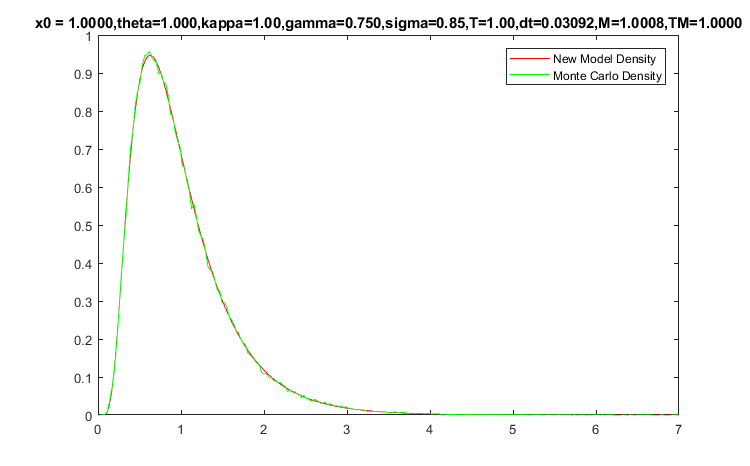](https://postimages.org/)

[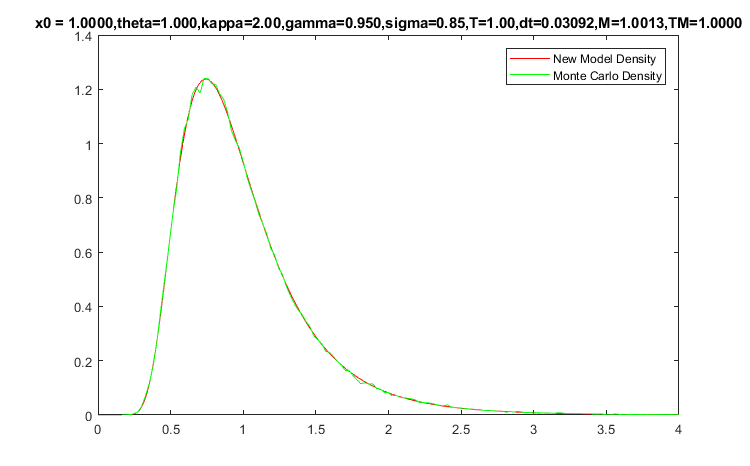](https://postimages.org/)

[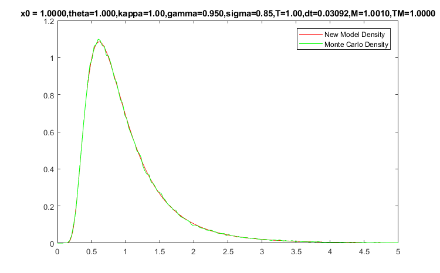](https://postimages.org/)

[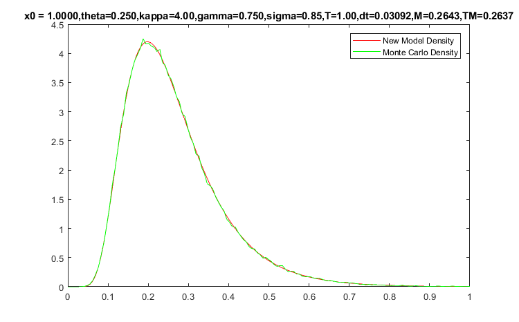](https://postimages.org/)

[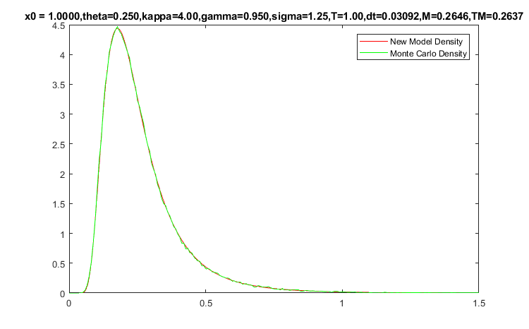](https://postimages.org/)

[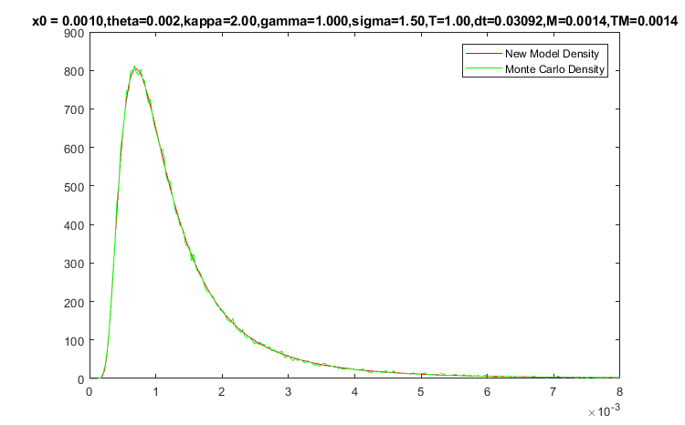](https://postimages.org/)

[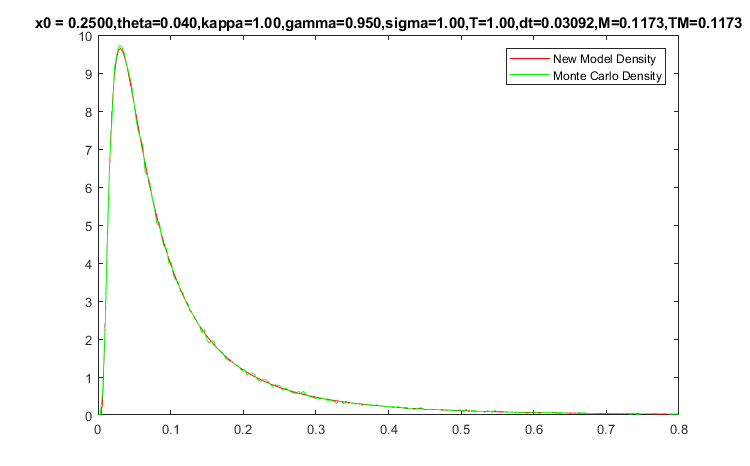](https://postimages.org/)

[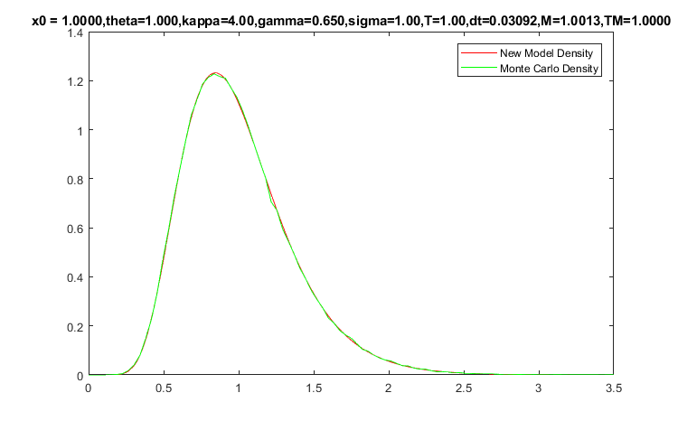](https://postimages.org/)

---

### #1118 — Amin (Topic Author)
*April 14, 2021, 11:24 AM*

Here are the files used to create the output and make above graphs.

.

```
function [] = SDETransProb08WmtGrid200b71Drift()

%Copyright Ahsan Amin. Infiniti derivatives Technologies.
%Please fell free to connect on linkedin: linkedin.com/in/ahsan-amin-0a53334
%or skype ahsan.amin2999
%In this program, I am simulating the SDE given as
%dy(t)=mu1 x(t)^beta1 dt + mu2 x(t)^beta2 dt +sigma x(t)^gamma dz(t)

%I have not directly simulated the SDE but simulated the transformed
%Besse1 process version of the SDE and then changed coordinates to retreive
%the SDE in original coordinates.
%The present program will analytically evolve only the Bessel Process version of the
%SDE in transformed coordinates.

%In this program, I have simulated the density for first few very small time
%intervals using a simple method. After first few intervals, I start
%simulating with probability mass transfer method.  Please experiment with step size and
%you will find the method robust enough. This is just an early version and
%I will be coming with better versions soon.

%dt=.125/16/2/2/2;   % Regular Simulation time interval to advance the density before large step by CDF method.
dt=1/48*1/2*1/32;             %decrease dt for accuracy.

Tt1=32;
Tt2=32;

T=1;
dt2=(T-dt*Tt1)/Tt2;
Tt=Tt1+Tt2;
T=dt*Tt1+dt2*Tt2;
OrderA=4;  %
%dtM=dt/8;%.125/2/4;%Monte carlo time interval size dtM.
%TtM=Tt*8;%T*2*8*4;%Monte carlo number of simulation intervals.
dtM=T/32;%.125/2/4;%Monte carlo time interval size dtM.
TtM=32;

dNn=.05;   % Normal density subdivisions width. would change with number of subdivisions
Nn=200;  % No of normal density subdivisions
NnMidl=100;%One half density Subdivision left from mid of normal density(low)
NnMidh=101;%One half density subdivision right from the mid of normal density(high)
NnMid=4.0;

Z(1:Nn)=(((1:Nn)-20.5)*dNn-NnMid)

%There are two indices. One goes to Nn=200. This is used for calculation of
%SDE simulation at next time level t+1. This covers -5 to +5 SDs of
%underlying Z.
%Second index Nn1 below goes from 1 to 240. This covers -6 to +6 SD of
%underlying Z. In probability mass transfer methos, we simulate the SDE
%from -5 SD to +5 SD and then extrapolate on both sides so that we have a
%new grid from -6 SD to +6 SD(1:Nn1). This extrapolated grid(which is assigned time t)
%is used to calculate the time t+1 grid from -5 SD to +5 SD(1:Nn).
%Grid spacing is the same on both grids.
Nn1=240;
%dNn1=.05;
Nn1Midl=120;
Nn1Midh=121;
Nn1Mid=6.025;

Z1(1:Nn1)=((1:Nn1)*dNn-Nn1Mid)
Z1Prob(1)=normcdf(-5.95)-normcdf(-6.0);
Z1Prob(Nn1)=normcdf(6.0)-normcdf(5.95);
Z1Prob(2:Nn1-1)=normcdf(.5*Z1(2:Nn1-1)+.5*Z1(3:Nn1),0,1)-normcdf(.5*Z1(2:Nn1-1)+.5*Z1(1:Nn1-2),0,1);

ZProb(1:Nn)=Z1Prob(21:Nn1-20);
Z(1:Nn)=Z1(21:Nn1-20);

Z1Prob
sum(Z1Prob(1:Nn1))
sum(ZProb(1:Nn))
str=input('Look at Zs');

x0=1.0;   % starting value of SDE
beta1=0.0;
beta2=1.00;   % Second drift term power.
gamma=.65;%50;   % volatility power.
kappa=4.0;%.950;   %mean reversion parameter.
theta=1.0;%mean reversion target
sigma0=1.0;%Volatility value

%you can specify any general mu1 and mu2 and beta1 and beta2.
mu1=+1*theta*kappa;   %first drift coefficient.
mu2=-1*kappa;    % Second drift coefficient.
%mu1=0;
%mu2=0;

alpha=1;% x^alpha is being expanded. This is currently for monte carlo only.
alpha1=1-gamma;%This is for expansion of integrals for calculation of drift
%and volatility coefficients

w(1:Nn)=x0^(1-gamma)/(1-gamma);

Z
Z1
str=input('Look at Zs');
%%%%%%%%%%%%%%%%%%%%%%%%%%%%%%%%%%%%%%%%%%%%%%%%%%%%%%%%%%%%%%%%%%%%%%%%%%%%%%%%%%%%%%%%%%%%%%

sigma11(1:OrderA+1)=0;
mu11(1:OrderA+1)=0;
mu22(1:OrderA+1)=0;
sigma22(1:OrderA+1)=0;
% index 1 correponds to zero level since matlab indexing starts at one.
sigma11(1)=1;
mu11(1)=1;
mu22(1)=1;
sigma22(1)=1;

mu33(1)=1;
mu44(1)=1;
mu33(2:OrderA+1)=0;
mu44(2:OrderA+1)=0;

for k=1:(OrderA+1)
    if sigma0~=0
        sigma11(k)=sigma0^(k-1);
    end
    if mu1 ~= 0
        mu11(k)=mu1^(k-1);
    end
    if mu2 ~= 0
        mu22(k)=mu2^(k-1);
    end
    if sigma0~=0
        sigma22(k)=sigma0^(2*(k-1));
    end
end
%Ft(1:TtM+1,1:(OrderA+1),1:(OrderA+1),1:(OrderA+1),1:(OrderA+1))=0; %General time powers on hermite polynomials
Fp(1:(OrderA+1),1:(OrderA+1),1:(OrderA+1),1:(OrderA+1))=0;%General x powers on coefficients of hermite polynomials.
Fp1(1:(OrderA+1),1:(OrderA+1),1:(OrderA+1),1:(OrderA+1))=0;%General x powers for bessel transformed coordinates.

%YCoeff0 and YCoeff are coefficents for original coordinates monte carlo.
%YqCoeff0 and YqCoeff are bessel/lamperti version monte carlo.

YCoeff0(1:(OrderA+1),1:(OrderA+1),1:(OrderA+1),1:(OrderA+1))=0;
YqCoeff0(1:(OrderA+1),1:(OrderA+1),1:(OrderA+1),1:(OrderA+1))=0;
%Pre-compute the time and power exponent values in small multi-dimensional arrays
YCoeff = ItoTaylorCoeffsNew(alpha,beta1,beta2,gamma); %expand y^alpha where alpha=1;
YqCoeff = ItoTaylorCoeffsNew(alpha1,beta1,beta2,gamma);%expand y^alpha1 where alpha1=(1-gamma)
YqCoeff=YqCoeff/(1-gamma); %Transformed coordinates coefficients have to be
%further divided by (1-gamma)

for k = 0 : (OrderA)
    for m = 0:k
        l4 = k - m + 1;
        for n = 0 : m
            l3 = m - n + 1;
            for j = 0:n
                l2 = n - j + 1;
                l1 = j + 1;
                %Ft(l1,l2,l3,l4) = dtM^((l1-1) + (l2-1) + (l3-1) + .5* (l4-1));
                Fp(l1,l2,l3,l4) = (alpha + (l1-1) * beta1 + (l2-1) * beta2 + (l3-1) * 2* gamma + (l4-1) * gamma ...
                    - (l1-1) - (l2-1) - 2* (l3-1) - (l4-1));
                Fp1(l1,l2,l3,l4) = (alpha1 + (l1-1) * beta1 + (l2-1) * beta2 + (l3-1) * 2* gamma + (l4-1) * gamma ...
                    - (l1-1) - (l2-1) - 2* (l3-1) - (l4-1));

                YCoeff0(l1,l2,l3,l4) =YCoeff(l1,l2,l3,l4).*mu11(l1).*mu22(l2).*sigma22(l3).*sigma11(l4);
                YqCoeff0(l1,l2,l3,l4) =YqCoeff(l1,l2,l3,l4).*mu11(l1).*mu22(l2).*sigma22(l3).*sigma11(l4);
                YqzCoeff0(l1,l2,l3,l4) =YqCoeff(l1,l2,l3,l4).*mu33(l1).*mu44(l2).*sigma22(l3).*sigma11(l4);
            end
        end
    end
end

%%%%%%%%%%%%%%%%%%%%%%%%%%%%%%%%%%%%%%%%%%%%%%%%%%%%%%%%%%%%%%%%%%%%%%%%%%%%%%%%%%%%%%%%%%%%%%

wnStart=1;%
yy(wnStart:Nn)=((1-gamma)*w(wnStart:Nn)).^(1/(1-gamma));
%The above yy(wnStart:Nn)=x0;

tic

for tt=1:Tt

   if(tt==1)

        w_00=x0^(1-gamma)/(1-gamma);
        %[wMu0dt,c1,c2,c3] = CalculateDriftAndVolA404B4Drift02(w_00,1,1,YqCoeff0,Fp1,gamma,dt);
        [wMu0dt,c1] = CalculateDriftAndVolA404(w_00,1,1,YqCoeff0,Fp1,gamma,dt);
        w(1:Nn)=x0^(1-gamma)/(1-gamma)+wMu0dt(1)+c1(1).*Z(1:Nn);%+c2(1).*(Z(1:Nn).^2-1)+c3(1).*(Z(1:Nn).^3-3*Z(1:Nn));

    end
     if((tt>1) && (ttTt1)

         dt=dt2;

        [wMu0dt,c1] = CalculateDriftAndVolA404(w,wnStart,Nn,YqCoeff0,Fp1,gamma,dt);

        [dwdZ_0,d2wdZ2_0,d3wdZ3_0] = First3Derivatives2ndOrderEqSpacedA(wnStart,Nn,dNn,w,Z);
        %Above are derivative names with an appended zero "_0". These are derivatives on the
        %Nn grid (time t+1 grid). When there are no appended zeros, those are
        %derivatives on the Nn1 grid i.e time t grid.

        BB1(21:Nn+20)=w(1:Nn);
        BB1(1:20)=BB1(21)-(20:-1:1).*dwdZ_0(1)*dNn;
       %Below we do extrapolation on right boundary from 5SD to 6 SD
       %and then assign it to BB1 which is Bm(t).

        BB1(Nn+20+1:Nn+20+20)=BB1(Nn+20)+(1:20).*dwdZ_0(Nn)*dNn;

        %Below is the loop version of above extrapolations
%        for nn=1:Nn
%            BB1(nn+20)=w(nn);
%        end

%        for nn=20:-1:1
%            %BB1(nn)=BB1(nn+1)-dwdZ_0(1)*dNn ;
%        end
%
%        for nn=Nn+20+1:Nn+20+20
%            BB1(nn)=BB1(nn-1)+ dwdZ_0(Nn)*dNn ;
%        end
     %
            %The function below calculates grid cell boundaries from mid
            %points of the grids using interpolation and relevant Z. The
            %grid is equidistant and symmetric with respect to underlying Z
            %but not with respect to the Bessel variable. We use the value
            %of Z at boundaries of each cell to interpolate the value of
            %bessel variable there.
            [BB1a,BB1b] = CalculateGridStartsAndEndsBoundedEnds(BB1,Z1,1,Nn1,dNn);

            %Below,I later assigned Z1 to ZZ1 and N1 to NN1 ans similarly for
            %Z1Prob since earlier I had several(three different) cases of
            %extrapolation ranging from 5 to 6 SD, and 5 to 5.5 SD and 5 to 5.25 SD.
            %I Was thinking when time would advance and grid would have
            %expanded and if dt would stay the same, the user might be
            %better off choosing a smaller grid with better extrapolation.

            ZZ1=Z1;
            NN1=Nn1;
            ZZProb(1:NN1)=Z1Prob(1:Nn1);

            %plot(ZZ1(1:NN1),BB1(1:NN1),'b',ZZ1(1:NN1),BB1a(1:NN1),'y',ZZ1(1:NN1),BB1b(1:NN1),'k',Z(1:Nn),B1(1:Nn),'r')
            %str=input('Look at B1 and BB1, original and extrapolated version and boundaries');

            %Below calculate first four derivatives. Please replace with your favorite
            %robust function.
            [dBdZ,d2BdZ2,d3BdZ3] = First3Derivatives2ndOrderEqSpacedA(1,NN1,dNn,BB1,Z1);
            [dwdZAA,d2wdZ2AA,d3wdZ3AA,d4BdZ4] = First4Derivatives2ndOrderEqSpaced(1,NN1,dNn,BB1,Z1);

            %plot((1:NN1),dBdZ(1:NN1),'r')
            %str=input('Look at 1st derivative');
            %plot((1:NN1),d2BdZ2(1:NN1),'r')
            %str=input('Look at 2nd derivative');
            %plot((1:NN1),d3BdZ3(1:NN1),'r')
            %str=input('Look at 3rd derivative');

            %Below calculate hermite polynomials of Z1 underlying the
            %Grid BB1 which is "Bm(t)" grid. We will use these hermite
            %polynomials and later derivatives to calculate the derivatives of
            %density of Bm with respect to Bm. dpdBm calcualted at centre
            %of the grid cells.

            He1(1:NN1)=Z1(1:NN1);
            He2(1:NN1)=Z1(1:NN1).^2-1;
            He3(1:NN1)=Z1(1:NN1).^3-3*Z1(1:NN1);
            He4(1:NN1)=Z1(1:NN1).^4-6*Z1(1:NN1).^2+3;
            He5(1:NN1)=Z1(1:NN1).^5-10*Z1(1:NN1).^3+15;
            He6(1:NN1)=Z1(1:NN1).^6-15*Z1(1:NN1).^4+45*Z1(1:NN1).^2-15;
            He7(1:NN1)=Z1(1:NN1).^7-21*Z1(1:NN1).^5+105*Z1(1:NN1).^3-105*Z1(1:NN1);
            He8(1:NN1)=Z1(1:NN1).^8-28*Z1(1:NN1).^6+210*Z1(1:NN1).^4-420*Z1(1:NN1).^2+105;
            He9(1:NN1)=Z1(1:NN1).^9-36*Z1(1:NN1).^7+378*Z1(1:NN1).^5-1260*Z1(1:NN1).^3+945*Z1(1:NN1);

            Zpdf(1:NN1)=normpdf(Z1(1:NN1),0,1);
            dZpdf(1:NN1)=-He1(1:NN1).*Zpdf(1:NN1);
            d2Zpdf(1:NN1)=He2(1:NN1).*Zpdf(1:NN1);
            d3Zpdf(1:NN1)=-He3(1:NN1).*Zpdf(1:NN1);
            d4Zpdf(1:NN1)=He4(1:NN1).*Zpdf(1:NN1);
            d5Zpdf(1:NN1)=-He5(1:NN1).*Zpdf(1:NN1);
            d6Zpdf(1:NN1)=He6(1:NN1).*Zpdf(1:NN1);
            d7Zpdf(1:NN1)=-He7(1:NN1).*Zpdf(1:NN1);
            d8Zpdf(1:NN1)=He8(1:NN1).*Zpdf(1:NN1);
            d9Zpdf(1:NN1)=-He9(1:NN1).*Zpdf(1:NN1);

            %Please note that in calculations below, we are using derivatives without
            %appended zeros since they are on BB1 "Bm(t)" grid that ranges from 1:Nn1 or equivalently 1:NN1.
            dZdB(1:NN1)=1.0./dBdZ(1:NN1);
            d2ZdB2(1:NN1)=-d2BdZ2(1:NN1).*dZdB(1:NN1).^3;
            d3ZdB3(1:NN1)=-d3BdZ3(1:NN1).*dZdB(1:NN1).^4+3*d2BdZ2(1:NN1).^2.*dZdB(1:NN1).^5;
            %d4ZdB4(1:NN1)=-d4BdZ4(1:NN1).*dZdB(1:NN1).^5-4*d3BdZ3(1:NN1).*d2ZdB2(1:NN1).*dZdB(1:NN1).^3+ ...
            %6*d2BdZ2(1:NN1).*d3BdZ3(1:NN1).*dZdB(1:NN1).^6+15*d2BdZ2(1:NN1).^2.*d2ZdB2(1:NN1).*dZdB(1:NN1).^6 ;
            d4ZdB4(1:NN1)=-d4BdZ4(1:NN1).*dZdB(1:NN1).^5+4*d3BdZ3(1:NN1).*d2ZdB2(1:NN1).*dZdB(1:NN1).^6+ ...
            6*d2BdZ2(1:NN1).*d3BdZ3(1:NN1).*dZdB(1:NN1).^6-15*d2BdZ2(1:NN1).^2.*d2ZdB2(1:NN1).*dZdB(1:NN1).^7 ;
            d5ZdB5(1:NN1)=0.0;
            d6ZdB6(1:NN1)=0.0;
            d7ZdB7(1:NN1)=0.0;
            d8ZdB8(1:NN1)=0.0;

            pm0(1:NN1)=Zpdf(1:NN1).*dZdB(1:NN1);
            dpm0(1:NN1)=dZpdf(1:NN1).*dZdB(1:NN1).^2+Zpdf(1:NN1).*d2ZdB2(1:NN1);
           
d2pm0(1:NN1)=d2Zpdf(1:NN1).*dZdB(1:NN1).^3+3*dZpdf(1:NN1).*dZdB(1:NN1).*d2ZdB2(1:NN1)+Zpdf(1:NN1).*d3ZdB3(1:NN1);
            d3pm0(1:NN1)=d3Zpdf(1:NN1).*dZdB(1:NN1).^4+6*d2Zpdf(1:NN1).*dZdB(1:NN1).^2.*d2ZdB2(1:NN1) + ...
                4*dZpdf(1:NN1).*dZdB(1:NN1).*d3ZdB3(1:NN1) + 3*dZpdf(1:NN1).*d2ZdB2(1:NN1).^2+
Zpdf(1:NN1).*d4ZdB4(1:NN1);

            d4pm0(1:NN1)=d4Zpdf(1:NN1).*dZdB(1:NN1).^5+10*d3Zpdf(1:NN1).*dZdB(1:NN1).^3.*d2ZdB2(1:NN1) + ...
                15*d2Zpdf(1:NN1).*dZdB(1:NN1).*d2ZdB2(1:NN1).^2 + ...
                10*d2Zpdf(1:NN1).*dZdB(1:NN1).^2.*d3ZdB3(1:NN1) + ...
                10*dZpdf(1:NN1).*d2ZdB2(1:NN1).*d3ZdB3(1:NN1) + ...
                5*dZpdf(1:NN1).*dZdB(1:NN1).*d4ZdB4(1:NN1)+ Zpdf(1:NN1).*d5ZdB5(1:NN1);

            d5pm0(1:NN1)=d5Zpdf(1:NN1).*dZdB(1:NN1).^6+15*d4Zpdf(1:NN1).*dZdB(1:NN1).^4.*d2ZdB2(1:NN1) + ...
                45*d3Zpdf(1:NN1).*dZdB(1:NN1).^2.*d2ZdB2(1:NN1).^2 + ...
                20*d3Zpdf(1:NN1).*dZdB(1:NN1).^3.*d3ZdB3(1:NN1) + ...
                15*d2Zpdf(1:NN1).*d2ZdB2(1:NN1).^3 + ...
                60*d2Zpdf(1:NN1).*dZdB(1:NN1).*d2ZdB2(1:NN1).*d3ZdB3(1:NN1) + ...
                15*d2Zpdf(1:NN1).*d2ZdB2(1:NN1).^2.*d4ZdB4(1:NN1)+ ...
                10*dZpdf(1:NN1).*d3ZdB3(1:NN1).^2+ ...
                15*dZpdf(1:NN1).*d2ZdB2(1:NN1).*d4ZdB4(1:NN1)+ ...
                6*dZpdf(1:NN1).*dZdB(1:NN1).*d5ZdB5(1:NN1)+ ...
                Zpdf(1:NN1).*d6ZdB6(1:NN1);

            d6pm0(1:NN1)=20.* (3.* dZdB(1:NN1).* d2Zpdf(1:NN1).* d2ZdB2(1:NN1)+dZdB(1:NN1).^3.* d3Zpdf(1:NN1)+ ...
                dZpdf(1:NN1).* d3ZdB3(1:NN1)).* d4ZdB4(1:NN1)+15.* d3ZdB3(1:NN1).* (3.* d2Zpdf(1:NN1).*
d2ZdB2(1:NN1).^2+ ...
                6 .*dZdB(1:NN1).^2.* d2ZdB2(1:NN1).* d3Zpdf(1:NN1)+4.* dZdB(1:NN1).* d2Zpdf(1:NN1).* d3ZdB3(1:NN1)+ ...
                dZdB(1:NN1).^4.* d4Zpdf(1:NN1)+dZpdf(1:NN1).* d4ZdB4(1:NN1))+15 .*(dZdB(1:NN1).^2.* d2Zpdf(1:NN1)+ ...
                dZpdf(1:NN1).* d2ZdB2(1:NN1)).* d5ZdB5(1:NN1)+6.* d2ZdB2(1:NN1).* (15.* dZdB(1:NN1).* d2ZdB2(1:NN1).^2.*
d3Zpdf(1:NN1)+ ...
                10.* d2Zpdf(1:NN1).* d2ZdB2(1:NN1).* d3ZdB3(1:NN1)+10.* dZdB(1:NN1).^2.* d3Zpdf(1:NN1).* d3ZdB3(1:NN1)+
...
                10.* dZdB(1:NN1).^3.* d2ZdB2(1:NN1).* d4Zpdf(1:NN1)+5 .*dZdB(1:NN1).* d2Zpdf(1:NN1) .*d4ZdB4(1:NN1)+ ...
                dZdB(1:NN1).^5.* d5Zpdf(1:NN1)+dZpdf(1:NN1).* d5ZdB5(1:NN1))+6.*dZpdf(1:NN1).* dZdB(1:NN1)
.*d6ZdB6(1:NN1)+ ...
                dZdB(1:NN1).* (15 .*d2ZdB2(1:NN1).^3.* d3Zpdf(1:NN1)+60.* dZdB(1:NN1).* d2ZdB2(1:NN1).* d3Zpdf(1:NN1).*
d3ZdB3(1:NN1)+ ...
                10.* d2Zpdf(1:NN1).* d3ZdB3(1:NN1).^2+45.* dZdB(1:NN1).^2.* d2ZdB2(1:NN1).^2.* d4Zpdf(1:NN1)+ ...
                20 .*dZdB(1:NN1).^3.* d3ZdB3(1:NN1).* d4Zpdf(1:NN1)+15 .*d2Zpdf(1:NN1).* d2ZdB2(1:NN1).* d4ZdB4(1:NN1)+
...
                15 .*dZdB(1:NN1).^2.* d3Zpdf(1:NN1).* d4ZdB4(1:NN1)+15.* dZdB(1:NN1).^4.* d2ZdB2(1:NN1).* d5Zpdf(1:NN1)+
...
                6 .*dZdB(1:NN1).* d2Zpdf(1:NN1).* d5ZdB5(1:NN1)+dZdB(1:NN1).^6 .*d6Zpdf(1:NN1)+dZpdf(1:NN1).*
d6ZdB6(1:NN1))+ ...
                Zpdf(1:NN1).* d7ZdB7(1:NN1);

            d7pm0(1:NN1)=35 .* d4ZdB4(1:NN1).* (3.*d2Zpdf(1:NN1) .*d2ZdB2(1:NN1).^2+6.* dZdB(1:NN1).^2.* d2ZdB2(1:NN1).*
d3Zpdf(1:NN1)+ ...
                4.* dZdB(1:NN1).*d2Zpdf(1:NN1) .*d3ZdB3(1:NN1)+dZdB(1:NN1).^4.* d4Zpdf(1:NN1)+dZpdf(1:NN1).*
d4ZdB4(1:NN1))+ ...
                35.* (3.* dZdB(1:NN1).*d2Zpdf(1:NN1).* d2ZdB2(1:NN1)+dZdB(1:NN1).^3 .*d3Zpdf(1:NN1)+ ...
                dZpdf(1:NN1) .*d3ZdB3(1:NN1)).* d5ZdB5(1:NN1)+21.* d3ZdB3(1:NN1).* (15.* dZdB(1:NN1).*
d2ZdB2(1:NN1).^2.* d3Zpdf(1:NN1)+ ...
                10.*d2Zpdf(1:NN1).* d2ZdB2(1:NN1).* d3ZdB3(1:NN1)+  10.* dZdB(1:NN1).^2 .*d3Zpdf(1:NN1).* d3ZdB3(1:NN1)+
...
                10 .*dZdB(1:NN1).^3.* d2ZdB2(1:NN1) .*d4Zpdf(1:NN1)+5.* dZdB(1:NN1).*d2Zpdf(1:NN1).* d4ZdB4(1:NN1)+ ...
                dZdB(1:NN1).^5.* d5Zpdf(1:NN1)+dZpdf(1:NN1) .*d5ZdB5(1:NN1))+21 .*(dZdB(1:NN1).^2.*d2Zpdf(1:NN1)+ ...
                dZpdf(1:NN1).* d2ZdB2(1:NN1)).* d6ZdB6(1:NN1)+7 .*d2ZdB2(1:NN1).* (15.* d2ZdB2(1:NN1).^3.*
d3Zpdf(1:NN1)+ ...
                60.* dZdB(1:NN1).* d2ZdB2(1:NN1).* d3Zpdf(1:NN1).* d3ZdB3(1:NN1)+10.*d2Zpdf(1:NN1).* d3ZdB3(1:NN1).^2+
...
                45.* dZdB(1:NN1).^2.* d2ZdB2(1:NN1).^2.* d4Zpdf(1:NN1)+20 .*dZdB(1:NN1).^3 .*d3ZdB3(1:NN1).*
d4Zpdf(1:NN1)+ ...
                15.*d2Zpdf(1:NN1).* d2ZdB2(1:NN1).* d4ZdB4(1:NN1)+15.* dZdB(1:NN1).^2 .*d3Zpdf(1:NN1).* d4ZdB4(1:NN1)+
...
                15.* dZdB(1:NN1).^4.* d2ZdB2(1:NN1).* d5Zpdf(1:NN1)+60.* dZdB(1:NN1).*d2Zpdf(1:NN1).* d5ZdB5(1:NN1)+ ...
                dZdB(1:NN1).^6 .*d6Zpdf(1:NN1)+dZpdf(1:NN1).* d6ZdB6(1:NN1))+7.*dZpdf(1:NN1) .*dZdB(1:NN1).*
d7ZdB7(1:NN1)+ ...
                dZdB(1:NN1).* (105 .*d2ZdB2(1:NN1).^2.* d3Zpdf(1:NN1).* d3ZdB3(1:NN1)+70.* dZdB(1:NN1) .*d3Zpdf(1:NN1)
.*d3ZdB3(1:NN1).^2+ ...
                105 .*dZdB(1:NN1).* d2ZdB2(1:NN1).^3.* d4Zpdf(1:NN1)+210.* dZdB(1:NN1).^2.* d2ZdB2(1:NN1).*
d3ZdB3(1:NN1).* d4Zpdf(1:NN1)+ ...
                105.* dZdB(1:NN1).* d2ZdB2(1:NN1).* d3Zpdf(1:NN1).* d4ZdB4(1:NN1)+35.*d2Zpdf(1:NN1).* d3ZdB3(1:NN1).*
d4ZdB4(1:NN1)+ ...
                35 * dZdB(1:NN1).^3.* d4Zpdf(1:NN1).* d4ZdB4(1:NN1)+105.* dZdB(1:NN1).^3 .*d2ZdB2(1:NN1).^2
.*d5Zpdf(1:NN1)+ ...
                35.* dZdB(1:NN1).^4.* d3ZdB3(1:NN1).* d5Zpdf(1:NN1)+21.*d2Zpdf(1:NN1).* d2ZdB2(1:NN1).* d5ZdB5(1:NN1)+
...
                21.* dZdB(1:NN1).^2.* d3Zpdf(1:NN1).* d5ZdB5(1:NN1)+21 .*dZdB(1:NN1).^5.* d2ZdB2(1:NN1) .*
d6Zpdf(1:NN1)+ ...
                7.* dZdB(1:NN1).*d2Zpdf(1:NN1).* d6ZdB6(1:NN1)+dZdB(1:NN1).^7.* d7Zpdf(1:NN1)+dZpdf(1:NN1)
.*d7ZdB7(1:NN1))+ ...
                Zpdf(1:NN1).* d8ZdB8(1:NN1);

            ww1(1:NN1)=BB1(1:NN1);%+wMid;
            ww1(ww1Tt1)
    %dtM=dt2/8;
end
    Random1=randn(size(Random1));
    HermiteP1(1,1:paths)=1;
    HermiteP1(2,1:paths)=Random1(1:paths);
    HermiteP1(3,1:paths)=Random1(1:paths).^2-1;
    HermiteP1(4,1:paths)=Random1(1:paths).^3-3*Random1(1:paths);
    HermiteP1(5,1:paths)=Random1(1:paths).^4-6*Random1(1:paths).^2+3;

    YY(1:paths)=YY(1:paths) + ...
        (YCoeff0(1,1,2,1).*YY(1:paths).^Fp(1,1,2,1)+ ...
        YCoeff0(1,2,1,1).*YY(1:paths).^Fp(1,2,1,1)+ ...
        YCoeff0(2,1,1,1).*YY(1:paths).^Fp(2,1,1,1))*dtM + ...
        (YCoeff0(1,1,3,1).*YY(1:paths).^Fp(1,1,3,1)+ ...
        YCoeff0(1,2,2,1).*YY(1:paths).^Fp(1,2,2,1)+ ...
        YCoeff0(2,1,2,1).*YY(1:paths).^Fp(2,1,2,1)+ ...
        YCoeff0(1,3,1,1).*YY(1:paths).^Fp(1,3,1,1)+ ...
        YCoeff0(2,2,1,1).*YY(1:paths).^Fp(2,2,1,1)+ ...
        YCoeff0(3,1,1,1).*YY(1:paths).^Fp(3,1,1,1))*dtM^2 + ...
        ((YCoeff0(1,1,1,2).*YY(1:paths).^Fp(1,1,1,2).*sqrt(dtM))+ ...
        (YCoeff0(1,1,2,2).*YY(1:paths).^Fp(1,1,2,2)+ ...
        YCoeff0(1,2,1,2).*YY(1:paths).^Fp(1,2,1,2)+ ...
        YCoeff0(2,1,1,2).*YY(1:paths).^Fp(2,1,1,2)).*dtM^1.5) .*HermiteP1(2,1:paths) + ...
        ((YCoeff0(1,1,1,3).*YY(1:paths).^Fp(1,1,1,3) *dtM) + ...
        (YCoeff0(1,1,2,3).*YY(1:paths).^Fp(1,1,2,3)+ ...
        YCoeff0(1,2,1,3).*YY(1:paths).^Fp(1,2,1,3)+ ...
        YCoeff0(2,1,1,3).*YY(1:paths).^Fp(2,1,1,3)).*dtM^2).*HermiteP1(3,1:paths) + ...
        ((YCoeff0(1,1,1,4).*YY(1:paths).^Fp(1,1,1,4)*dtM^1.5 )).*HermiteP1(4,1:paths) + ...
        (YCoeff0(1,1,1,5).*YY(1:paths).^Fp(1,1,1,5)*dtM^2.0).*HermiteP1(5,1:paths);

end

YY(YY<0)=0;
disp('Original process average from monte carlo');
MCMean=sum(YY(:))/paths %origianl coordinates monte carlo average.
MCVar=sum((YY(:)-MCMean).^2)/paths
disp('Original process average from our simulation');
ItoHermiteMean=sum(y_w(wnStart+1:Nn-1).*ZProb(wnStart+1:Nn-1)) %Original process average from coordinates
ItoHermiteVar=sum((y_w(wnStart+1:Nn-1)-ItoHermiteMean).^2.*ZProb(wnStart+1:Nn-1))
disp('true Mean only applicble to standard SV mean reverting type models otherwise disregard');
TrueMean=theta+(x0-theta)*exp(-kappa*T)%Mean reverting SDE original variable true average

MaxCutOff=30;
NoOfBins=round(300*gamma^2*4*sigma0/sqrt(MCMean)/(1+kappa));%Decrease the number of bins if the graph is too
[YDensity,IndexOutY,IndexMaxY] = MakeDensityFromSimulation_Infiniti_NEW(YY,paths,NoOfBins,MaxCutOff );

%plot(y_w1(wnStart+1:Nn-1),py_w1(wnStart+1:Nn-1),'b',y_w(wnStart+1:Nn-1),py_w(wnStart+1:Nn-1),'r',IndexOutY(1:IndexMaxY),YDensity(1:IndexMaxY),'g');
%plot(y_w(wnStart+1:Nn-1),py_w(wnStart+1:Nn-1),'r',IndexOutY(1:IndexMaxY),YDensity(1:IndexMaxY),'g');
plot(y_w(wnStart+1:Nn-1),py_w(wnStart+1:Nn-1),'r',IndexOutY(1:IndexMaxY),YDensity(1:IndexMaxY),'g');

title(sprintf('x0 = %.4f,theta=%.3f,kappa=%.2f,gamma=%.3f,sigma=%.2f,T=%.2f,dt=%.5f,M=%.4f,TM=%.4f',
x0,theta,kappa,gamma,sigma0,T,dt,ItoHermiteMean,TrueMean));%,sprintf('theta= %f', theta), sprintf('kappa = %f',
kappa),sprintf('sigma = %f', sigma0),sprintf('T = %f', T));

legend({'New Model Density','Monte Carlo Density'},'Location','northeast')

str=input('red line is density of SDE from Ito-Hermite method, green is monte carlo.');
end
```

.

First Sub Function.

.

```
function [Pmn,pmn,ESecondHe] =
CalculateCDFArraySignIndexDrift(Bn,Nn,Muw,dMuwdBm,d2MuwdBm2,d3MuwdBm3,d4MuwdBm4,d5MuwdBm5,d6MuwdBm6,d7MuwdBm7,d8MuwdBm8,Sigmaw,dSigmawdBm,d2SigmawdBm2,Sigma2w,Bm0,Bm1,Bm2,dPm,pm0,dpm0,d2pm0,d3pm0,d4pm0,d5pm0,d6pm0,d7pm0)

%This function calculates CDF Pmn, PDF pmn, first derivative of Pdf dpmn,
%second derivative of PDF d2pmn, and third derivative of PDF d3pmn at an
%arbitrary point Bn on next time level grid. All these CDF, PDF and their
%derivatives are calculated from an entire subdivision Bm at time t grid.
%Bn is the array of target points at time t+1 and Nn is the fianl index of
%array Bn starting from one.
%Bm1 and Bm2 are boundaries of grid cell Bm and Bm0 is center of grid cell
%Bm.
% sigma0 is the volatility associated with transition gaussian originating
% from the center of grid Bm given as Bm0.
%dPm is the integrate probability mass in mth originating subdivision.
%pm0 is the value of probability distribution at the center of mth cell at
%Bm0.
%dpm0 is the value of first derivative of probability distribution at the
%center of mth subdivision at Bm0;
%and so on for d2pm0(second derivative of pdf at Bm0), d3pm0, d4pm0, d5pm0.
%pdf and all its derivatives at center of mth subdivsion Bm0 are input to
%the function.
%This program is not written with regard to efficiency at all and I will
%optimize the final version for efficiency.

%The following two loops assume that Bn array is arranged in an ascending
%order as it usually is. The lower two arrays find the lower and upper
%limit of indices such that target array index in between is withing -7 SD
%to + 7SD of the transition normal from the originating cell under question
%(change SDs appropriately if you wish).
nn1=1;
for nn=1:Nn
    if( (Bn(nn)-Bm0) 7*abs(Sigmaw))
        nn2=nn;
    end
end
%size(Bn)
%size(Bm0)

%nn1
%nn2

%W2=W1+ mu* dt+ sigma *Z + sigma2 *(Z^2-1)

%Here mu*dt=wMu0dt; sigma=dw02; sigma2 =c22;

Zt(1:Nn)=0.0;
%Bt(mm1:mm2)=Bn(mm1:mm2)-Bm0;
Zt(nn1:nn2)=(Bn(nn1:nn2)-Bm0-Muw)/Sigmaw;

%if((Bn(nn1:nn2)-Bm0-Muw+Sigma2w)>0)
%    %Zt(mm,wnStart:Nn)=(-dw02(mm) +
sqrt(dw02(mm).^2+4*c22(mm).*(-W2(wnStart:Nn)+W1(mm)+1*wMu0dt2(mm)-c22(mm))))./(2*c22(mm));
%     Zt(nn1:nn2)=(2*(-Bn(nn1:nn2)+Bm0+Muw-Sigma2w))./(-Sigmaw +
sqrt(Sigmaw.^2+4*Sigma2w.*(-Bn(nn1:nn2)+Bm0+Muw-Sigma2w)));
%else
%     Zt(nn1:nn2)=(2*(-Bn(nn1:nn2)+Bm0+Muw-Sigma2w))./(-Sigmaw -
sqrt(Sigmaw.^2-4*Sigma2w.*(-Bn(nn1:nn2)+Bm0+Muw-Sigma2w)));
%end

Zt2(nn1:nn2)=Zt(nn1:nn2).*Zt(nn1:nn2);
Zt3(nn1:nn2)=Zt2(nn1:nn2).*Zt(nn1:nn2);
Zt4(nn1:nn2)=Zt3(nn1:nn2).*Zt(nn1:nn2);
Zt5(nn1:nn2)=Zt4(nn1:nn2).*Zt(nn1:nn2);
Zt6(nn1:nn2)=Zt5(nn1:nn2).*Zt(nn1:nn2);
Zt7(nn1:nn2)=Zt6(nn1:nn2).*Zt(nn1:nn2);
Zt8(nn1:nn2)=Zt7(nn1:nn2).*Zt(nn1:nn2);

Pm0n(nn1:nn2)=normcdf(Zt(nn1:nn2),0,1);
dPm0ndZt(nn1:nn2)=normpdf(Zt(nn1:nn2),0,1);
pm0n(nn1:nn2)=normpdf(Zt(nn1:nn2),0,1);
d2Pm0ndZt2(nn1:nn2)=-pm0n(nn1:nn2).*(Zt(nn1:nn2));
d3Pm0ndZt3(nn1:nn2)=pm0n(nn1:nn2).*(Zt2(nn1:nn2)-1);
d4Pm0ndZt4(nn1:nn2)=-pm0n(nn1:nn2).*(Zt3(nn1:nn2)-3*Zt(nn1:nn2));
d5Pm0ndZt5(nn1:nn2)=pm0n(nn1:nn2).*(Zt4(nn1:nn2)-6*Zt2(nn1:nn2)+3);
d6Pm0ndZt6(nn1:nn2)=-pm0n(nn1:nn2).*(Zt5(nn1:nn2)-10*Zt3(nn1:nn2)+15*Zt(nn1:nn2));
d7Pm0ndZt7(nn1:nn2)=pm0n(nn1:nn2).*(Zt6(nn1:nn2)-15*Zt4(nn1:nn2)+45*Zt2(nn1:nn2)-15);
d8Pm0ndZt8(nn1:nn2)=-pm0n(nn1:nn2).*(Zt7(nn1:nn2)-21*Zt5(nn1:nn2)+105*Zt3(nn1:nn2)-105*Zt(nn1:nn2));
%d9Pm0ndZt9(nn1:nn2)=pm0n(nn1:nn2).*(Zt8(nn1:nn2)-28*Zt6(nn1:nn2)+210*Zt4(nn1:nn2)-420*Zt2(nn1:nn2)+105);
%d9Pm0ndZt10(nn1:nn2)=-pm0n(nn1:nn2).*(Zt9(nn1:nn2)-36*Zt7(nn1:nn2)+378*Zt5(nn1:nn2)-1260*Zt3(nn1:nn2)+945.*Zt(nn1:nn2));

%dZtdBm(nn1:nn2)=(-1-dMuwdBm)./(Sigmaw+2*Zt(nn1:nn2).*Sigma2w);
%d2ZtdBm2(nn1:nn2)=-((2.* Sigma2w.* (-1-dMuwdBm).* dZtdBm(nn1:nn2))./(Sigmaw+2 .*Sigma2w
.*Zt(nn1:nn2)).^2)-d2MuwdBm2./(Sigmaw+2.* Sigma2w .*Zt(nn1:nn2));
%d3ZtdBm3(nn1:nn2)=(4.* Sigma2w.* dZtdBm(nn1:nn2).* d2MuwdBm2)./(Sigmaw+2.* Sigma2w.* Zt(nn1:nn2)).^2+(-1-dMuwdBm).*
((8.* Sigma2w.^2.* dZtdBm(nn1:nn2).^2)./(Sigmaw+2.* Sigma2w .*Zt(nn1:nn2)).^3-(2.* Sigma2w.*
d2ZtdBm2(nn1:nn2))./(Sigmaw+2.* Sigma2w.* Zt(nn1:nn2)).^2)-d3MuwdBm3./(Sigmaw+2.* Sigma2w.* Zt(nn1:nn2));
%d4ZtdBm4(nn1:nn2)=-3 .*d2MuwdBm2.* ((8.* Sigma2w^2.* dZtdBm(nn1:nn2).^2)./(Sigmaw+2 .*Sigma2w.* Zt(nn1:nn2)).^3-(2.*
Sigma2w.* d2ZtdBm2(nn1:nn2))./(Sigmaw+2.* Sigma2w.* Zt(nn1:nn2)).^2)+(6.* Sigma2w .*dZtdBm(nn1:nn2).*
d3MuwdBm3)./(Sigmaw+2.* Sigma2w.* Zt(nn1:nn2)).^2+(-1-dMuwdBm).* (-((48.* Sigma2w.^3.* dZtdBm(nn1:nn2).^3)./(Sigmaw+2
.*Sigma2w.* Zt(nn1:nn2)).^4)+(24 .*Sigma2w.^2 .*dZtdBm(nn1:nn2).* d2ZtdBm2(nn1:nn2))/(Sigmaw+2 .*Sigma2w.*
Zt(nn1:nn2)).^3-(2 .*Sigma2w.* d3ZtdBm3(nn1:nn2))./(Sigmaw+2 .*Sigma2w.* Zt(nn1:nn2)).^2)-d4MuwdBm4./(Sigmaw+2.*
Sigma2w.* Zt(nn1:nn2));

dZtdBm(nn1:nn2)=(-1-dMuwdBm)/Sigmaw;
d2ZtdBm2(nn1:nn2)=-(d2MuwdBm2/Sigmaw);
d3ZtdBm3(nn1:nn2)=-d3MuwdBm3/Sigmaw;
d4ZtdBm4(nn1:nn2)=-d4MuwdBm4/Sigmaw;
d5ZtdBm5(nn1:nn2)=-d5MuwdBm5/Sigmaw;
d6ZtdBm6(nn1:nn2)=-d6MuwdBm6/Sigmaw;
 d7ZtdBm7(nn1:nn2)=-d7MuwdBm7/Sigmaw;
 d8ZtdBm8(nn1:nn2)=-d8MuwdBm8/Sigmaw;
% d9ZtdBm9(nn1:nn2)=-d9MuwdBm9/Sigmaw;
% d10ZtdBm10(nn1:nn2)=-d10MuwdBm10/Sigmaw;

%   dZtdBm=(-1 - dMuwdBm )/ Sigmaw - ((Zt)* dSigmawdBm)/Sigmaw;
% %
% %
%   d2ZtdBm2=-(((-1-dMuwdBm).* dSigmawdBm)/Sigmaw^2)+(Zt.* dSigmawdBm^2)/Sigmaw^2-( dSigmawdBm.* dZtdBm)/Sigmaw- ...
%       d2MuwdBm2/Sigmaw-(Zt .* d2SigmawdBm2)/Sigmaw;
% %
%    d3ZtdBm3=(2.* (-1-dMuwdBm).* dSigmawdBm.^2)/Sigmaw^3-(2.* Zt.* dSigmawdBm^3)/Sigmaw^3+(2 .*dSigmawdBm.^2 .* ...
%        dZtdBm)/Sigmaw.^2+(2.* dSigmawdBm.* d2MuwdBm2)/Sigmaw.^2-((-1-dMuwdBm).* d2SigmawdBm2)/Sigmaw.^2+ ...
%        (3.* Zt.* dSigmawdBm .*d2SigmawdBm2)/Sigmaw.^2-(2.* dZtdBm.* d2SigmawdBm2)/Sigmaw- ...
%        (dSigmawdBm.* d2ZtdBm2)/Sigmaw-d3MuwdBm3/Sigmaw;
% %
% %
%   d4ZtdBm4=-6.* d2MuwdBm2.* ((2.* dSigmawdBm.^2)/Sigmaw^3-d2SigmawdBm2/Sigmaw^2)+(4.* dSigmawdBm .*
d3MuwdBm3)/Sigmaw.^2+ ...
%        4.* (-1-dMuwdBm) .*(-((6 .*dSigmawdBm.^3)/Sigmaw^4)+(6.* dSigmawdBm .* d2SigmawdBm2)/Sigmaw^3)- ...
%        d4MuwdBm4/Sigmaw+(-Bm0+Bn-Muw).* ((24.* dSigmawdBm.^4)/Sigmaw^5-(36.* dSigmawdBm.^2 .*d2SigmawdBm2)/Sigmaw^4+
...
%        (6.* d2SigmawdBm2.^2)/Sigmaw^3);
% %
% %
% %
%   d5ZtdBm5=-10.* ((2.* dSigmawdBm^2)/Sigmaw^3-d2SigmawdBm2/Sigmaw^2).* d3MuwdBm3-10.* d2MuwdBm2.* ...
%       (-((6.* dSigmawdBm^3)/Sigmaw^4)+(6 .*dSigmawdBm.* d2SigmawdBm2)/Sigmaw^3)+ ...
%       (5.* dSigmawdBm.* d4MuwdBm4)/Sigmaw^2+5.* (-1-dMuwdBm).* ((24.* dSigmawdBm^4)/Sigmaw^5- ...
%       (36.* dSigmawdBm^2.* d2SigmawdBm2)/Sigmaw^4+(6.* d2SigmawdBm2^2)/Sigmaw^3)-d5MuwdBm5/Sigmaw+(-Bm0+Bn-Muw).* ...
%       (-((120.* dSigmawdBm^5)/Sigmaw^6)+(240.* dSigmawdBm^3 .*d2SigmawdBm2)/Sigmaw^5- ...
%       (90.* dSigmawdBm.* d2SigmawdBm2^2)/Sigmaw^4);
% %
% %
% %
% %
%    d6ZtdBm6=-20.* d3MuwdBm3.* (-((6 .*dSigmawdBm.^3)/Sigmaw^4)+(6 .* dSigmawdBm.* d2SigmawdBm2)/Sigmaw^3)- ...
%        15.* ((2.* dSigmawdBm^2)/Sigmaw^3-d2SigmawdBm2/Sigmaw^2) .*d4MuwdBm4-15  .* ...
%        d2MuwdBm2 .*((24.* dSigmawdBm.^4)/Sigmaw^5-(36.* dSigmawdBm^2 .* d2SigmawdBm2)/Sigmaw^4+ ...
%        (6.* d2SigmawdBm2.^2)/Sigmaw^3)+ ...
%        (6.* dSigmawdBm .* d5MuwdBm5)/Sigmaw^2+6 .*(-1-dMuwdBm) .* (-((120.* dSigmawdBm.^5)/Sigmaw^6)+ ...
%        (240.* dSigmawdBm.^3.* d2SigmawdBm2)/Sigmaw^5-(90 .* dSigmawdBm .*
d2SigmawdBm2.^2)/Sigmaw^4)-d6MuwdBm6/Sigmaw+(-Bm0+Bn-Muw).* ...
%        ((720.* dSigmawdBm.^6)/Sigmaw^7-(1800.* dSigmawdBm.^4.* d2SigmawdBm2)/Sigmaw^6+(1080 .*dSigmawdBm.^2 .*
d2SigmawdBm2.^2)/Sigmaw^5- ...
%        (90.* d2SigmawdBm2^3)/Sigmaw^4);
%

dPm0ndBm(nn1:nn2)=dPm0ndZt(nn1:nn2).*dZtdBm(nn1:nn2);
d2Pm0ndBm2(nn1:nn2)=d2Pm0ndZt2(nn1:nn2).*dZtdBm(nn1:nn2).^2+dPm0ndZt(nn1:nn2).*d2ZtdBm2(nn1:nn2);
d3Pm0ndBm3(nn1:nn2)=d3Pm0ndZt3(nn1:nn2).*dZtdBm(nn1:nn2).^3+3*d2Pm0ndZt2(nn1:nn2).*dZtdBm(nn1:nn2).*d2ZtdBm2(nn1:nn2)+dPm0ndZt(nn1:nn2).*d3ZtdBm3(nn1:nn2);
d4Pm0ndBm4(nn1:nn2)=d4Pm0ndZt4(nn1:nn2).*dZtdBm(nn1:nn2).^4+6*d3Pm0ndZt3(nn1:nn2).*dZtdBm(nn1:nn2).^2.*d2ZtdBm2(nn1:nn2)+4*d2Pm0ndZt2(nn1:nn2).*dZtdBm(nn1:nn2).*d3ZtdBm3(nn1:nn2)+
...
    3*d2Pm0ndZt2(nn1:nn2).*d2ZtdBm2(nn1:nn2).^2+dPm0ndZt(nn1:nn2).*d4ZtdBm4(nn1:nn2);
d5Pm0ndBm5(nn1:nn2)=d5Pm0ndZt5(nn1:nn2).*dZtdBm(nn1:nn2).^5+10*d4Pm0ndZt4(nn1:nn2).*dZtdBm(nn1:nn2).^3.*d2ZtdBm2(nn1:nn2)+15*d3Pm0ndZt3(nn1:nn2).*dZtdBm(nn1:nn2).*d2ZtdBm2(nn1:nn2).^2+
...
   
10*d3Pm0ndZt3(nn1:nn2).*dZtdBm(nn1:nn2).^2.*d3ZtdBm3(nn1:nn2)+10*d2Pm0ndZt2(nn1:nn2).*d2ZtdBm2(nn1:nn2).*d3ZtdBm3(nn1:nn2)+
...
    5*d2Pm0ndZt2(nn1:nn2).*dZtdBm(nn1:nn2).*d4ZtdBm4(nn1:nn2)+dPm0ndZt(nn1:nn2).*d5ZtdBm5(nn1:nn2);
d6Pm0ndBm6(nn1:nn2)=d6Pm0ndZt6(nn1:nn2).*dZtdBm(nn1:nn2).^6+15*d5Pm0ndZt5(nn1:nn2).*dZtdBm(nn1:nn2).^4.*d2ZtdBm2(nn1:nn2)+45*d4Pm0ndZt4(nn1:nn2).*dZtdBm(nn1:nn2).^2.*d2ZtdBm2(nn1:nn2).^2+
...
    20*d4Pm0ndZt4(nn1:nn2).*dZtdBm(nn1:nn2).^3.*d3ZtdBm3(nn1:nn2)+15*d3Pm0ndZt3(nn1:nn2).*d2ZtdBm2(nn1:nn2).^3+ ...
   
+60*d3Pm0ndZt3(nn1:nn2).*dZtdBm(nn1:nn2).*d2ZtdBm2(nn1:nn2).*d3ZtdBm3(nn1:nn2)+15*d3Pm0ndZt3(nn1:nn2).*dZtdBm(nn1:nn2).^2.*d4ZtdBm4(nn1:nn2)+
...
    +10*d2Pm0ndZt2(nn1:nn2).*d3ZtdBm3(nn1:nn2).^2+15*d2Pm0ndZt2(nn1:nn2).*d2ZtdBm2(nn1:nn2).*d4ZtdBm4(nn1:nn2)+ ...
    6*d2Pm0ndZt2(nn1:nn2).*dZtdBm(nn1:nn2).*d5ZtdBm5(nn1:nn2)+dPm0ndZt(nn1:nn2).*d6ZtdBm6(nn1:nn2);

d7Pm0ndBm7(nn1:nn2)=105.* d2ZtdBm2(nn1:nn2).^2.* d3Pm0ndZt3(nn1:nn2).* d3ZtdBm3(nn1:nn2)+ ...
    70.* dZtdBm(nn1:nn2).* d3Pm0ndZt3(nn1:nn2).* d3ZtdBm3(nn1:nn2).^2+ ...
    105.* dZtdBm(nn1:nn2).* d2ZtdBm2(nn1:nn2).^3.* d4Pm0ndZt4(nn1:nn2)+ ...
    210.* dZtdBm(nn1:nn2).^2.* d2ZtdBm2(nn1:nn2).* d3ZtdBm3(nn1:nn2).* d4Pm0ndZt4(nn1:nn2)+ ...
    105.* dZtdBm(nn1:nn2).* d2ZtdBm2(nn1:nn2).* d3Pm0ndZt3(nn1:nn2).* d4ZtdBm4(nn1:nn2)+ ...
    35.* d2Pm0ndZt2(nn1:nn2).* d3ZtdBm3(nn1:nn2).* d4ZtdBm4(nn1:nn2)+ ...
    35.* dZtdBm(nn1:nn2).^3.* d4Pm0ndZt4(nn1:nn2).* d4ZtdBm4(nn1:nn2)+ ...
    105.* dZtdBm(nn1:nn2).^3.* d2ZtdBm2(nn1:nn2).^2.* d5Pm0ndZt5(nn1:nn2)+ ...
    35 .*dZtdBm(nn1:nn2).^4.* d3ZtdBm3(nn1:nn2).* d5Pm0ndZt5(nn1:nn2)+ ...
    21.* d2Pm0ndZt2(nn1:nn2).* d2ZtdBm2(nn1:nn2).* d5ZtdBm5(nn1:nn2)+ ...
    21.* dZtdBm(nn1:nn2).^2.* d3Pm0ndZt3(nn1:nn2).* d5ZtdBm5(nn1:nn2)+...
    21.* dZtdBm(nn1:nn2).^5.* d2ZtdBm2(nn1:nn2).* d6Pm0ndZt6(nn1:nn2)+ ...
    7 .*dZtdBm(nn1:nn2).* d2Pm0ndZt2(nn1:nn2).* d6ZtdBm6(nn1:nn2)+ ...
    dZtdBm(nn1:nn2).^7.* d7Pm0ndZt7(nn1:nn2)+ ...
    dPm0ndZt(nn1:nn2).* d7ZtdBm7(nn1:nn2);
d8Pm0ndBm8(nn1:nn2)=280.* d2ZtdBm2(nn1:nn2).* d3Pm0ndZt3(nn1:nn2).* d3ZtdBm3(nn1:nn2).^2+ ...
    105.* d2ZtdBm2(nn1:nn2).^4.* d4Pm0ndZt4(nn1:nn2)+ ...
    840.* dZtdBm(nn1:nn2).* d2ZtdBm2(nn1:nn2).^2.* d3ZtdBm3(nn1:nn2).* d4Pm0ndZt4(nn1:nn2)+ ...
    280.* dZtdBm(nn1:nn2).^2.* d3ZtdBm3(nn1:nn2).^2.* d4Pm0ndZt4(nn1:nn2)+ ...
    210.* d2ZtdBm2(nn1:nn2).^2.* d3Pm0ndZt3(nn1:nn2).* d4ZtdBm4(nn1:nn2)+ ...
    280.* dZtdBm(nn1:nn2).* d3Pm0ndZt3(nn1:nn2).* d3ZtdBm3(nn1:nn2).* d4ZtdBm4(nn1:nn2)+...
    420.* dZtdBm(nn1:nn2).^2.* d2ZtdBm2(nn1:nn2).* d4Pm0ndZt4(nn1:nn2) .*d4ZtdBm4(nn1:nn2)+ ...
    35.* d2Pm0ndZt2(nn1:nn2).* d4ZtdBm4(nn1:nn2).^2+ ...
    420.* dZtdBm(nn1:nn2).^2.* d2ZtdBm2(nn1:nn2).^3.* d5Pm0ndZt5(nn1:nn2)+ ...
    560.* dZtdBm(nn1:nn2).^3.* d2ZtdBm2(nn1:nn2).* d3ZtdBm3(nn1:nn2).* d5Pm0ndZt5(nn1:nn2)+ ...
    70.* dZtdBm(nn1:nn2).^4.* d4ZtdBm4(nn1:nn2).* d5Pm0ndZt5(nn1:nn2)+ ...
    168.* dZtdBm(nn1:nn2).* d2ZtdBm2(nn1:nn2).* d3Pm0ndZt3(nn1:nn2).* d5ZtdBm5(nn1:nn2)+ ...
    56.* d2Pm0ndZt2(nn1:nn2).* d3ZtdBm3(nn1:nn2).* d5ZtdBm5(nn1:nn2)+ ...
    56.*dZtdBm(nn1:nn2).^3.* d4Pm0ndZt4(nn1:nn2) .*d5ZtdBm5(nn1:nn2)+ ...
    210.* dZtdBm(nn1:nn2).^4.* d2ZtdBm2(nn1:nn2).^2.* d6Pm0ndZt6(nn1:nn2)+ ...
    56.* dZtdBm(nn1:nn2).^5.* d3ZtdBm3(nn1:nn2).* d6Pm0ndZt6(nn1:nn2)+ ...
    28.* d2Pm0ndZt2(nn1:nn2).* d2ZtdBm2(nn1:nn2) .*d6ZtdBm6(nn1:nn2)+ ...
    28.* dZtdBm(nn1:nn2).^2.* d3Pm0ndZt3(nn1:nn2).* d6ZtdBm6(nn1:nn2)+ ...
    28.* dZtdBm(nn1:nn2).^6.* d2ZtdBm2(nn1:nn2).* d7Pm0ndZt7(nn1:nn2)+ ...
    8.* dZtdBm(nn1:nn2).* d2Pm0ndZt2(nn1:nn2).* d7ZtdBm7(nn1:nn2)+ ...
    dZtdBm(nn1:nn2).^8.* d8Pm0ndZt8(nn1:nn2)+ ...
    dPm0ndZt(nn1:nn2).* d8ZtdBm8(nn1:nn2);

dBm=Bm2-Bm1;
dBm1=1/2* ((Bm2 - Bm0)^2 - (Bm1 - Bm0)^2);
dBm2=1/3* ((Bm2 - Bm0)^3 - (Bm1 - Bm0)^3)/2;
dBm3=1/4* ((Bm2 - Bm0)^4 - (Bm1 - Bm0)^4)/6;
dBm4=1/5* ((Bm2 - Bm0)^5 - (Bm1 - Bm0)^5)/24;
dBm5=1/6* ((Bm2 - Bm0)^6 - (Bm1 - Bm0)^6)/120;
dBm6=1/7* ((Bm2 - Bm0)^7 - (Bm1 - Bm0)^7)/720;
dBm7=1/8* ((Bm2 - Bm0)^8 - (Bm1 - Bm0)^8)/(720*7);
dBm8=1/9* ((Bm2 - Bm0)^9 - (Bm1 - Bm0)^9)/(720*7*8);

Integral0(nn1:nn2)=dPm.*Pm0n(nn1:nn2); % G1 group of terms in wilmott explanation.

IntegralCDF(nn1:nn2)=Integral0(nn1:nn2)+ ...  %Integral0 is Group1(G1) in the explanation on wilmott.
    +pm0 * dPm0ndBm(nn1:nn2) *dBm1 + ...
    + (2* dpm0 * dPm0ndBm(nn1:nn2)+pm0 * d2Pm0ndBm2(nn1:nn2))  *dBm2 + ...
    + (3*d2pm0*dPm0ndBm(nn1:nn2) + 3*dpm0*d2Pm0ndBm2(nn1:nn2)+pm0 * d3Pm0ndBm3(nn1:nn2))*dBm3 + ...
    + (4*d3pm0*dPm0ndBm(nn1:nn2) + 6* d2pm0*d2Pm0ndBm2(nn1:nn2) + 4* dpm0 * d3Pm0ndBm3(nn1:nn2)+pm0 *
d4Pm0ndBm4(nn1:nn2))*dBm4 + ...
    + (5*d4pm0*dPm0ndBm(nn1:nn2) + 10* d3pm0*d2Pm0ndBm2(nn1:nn2)+ 10* d2pm0*d3Pm0ndBm3(nn1:nn2) + ...
    5* dpm0 * d4Pm0ndBm4(nn1:nn2) +pm0 * d5Pm0ndBm5(nn1:nn2))*dBm5 + ...
    + (6*d5pm0*dPm0ndBm(nn1:nn2) + 15* d4pm0*d2Pm0ndBm2(nn1:nn2)+ 20* d3pm0*d3Pm0ndBm3(nn1:nn2) + 15* d2pm0 *
d4Pm0ndBm4(nn1:nn2)+ ...
    6* dpm0 * d5Pm0ndBm5(nn1:nn2)+pm0 * d6Pm0ndBm6(nn1:nn2)) * dBm6+ ...
    + (7*d6pm0*dPm0ndBm(nn1:nn2) + 21* d5pm0*d2Pm0ndBm2(nn1:nn2)+ 35* d4pm0*d3Pm0ndBm3(nn1:nn2) + 35* d3pm0 *
d4Pm0ndBm4(nn1:nn2)+ ...
    21* d2pm0 * d5Pm0ndBm5(nn1:nn2)+7*dpm0 * d6Pm0ndBm6(nn1:nn2)+pm0 * d7Pm0ndBm7(nn1:nn2)) * dBm7+ ...
    + (8*d7pm0*dPm0ndBm(nn1:nn2) + 28* d6pm0*d2Pm0ndBm2(nn1:nn2)+ 56* d5pm0*d3Pm0ndBm3(nn1:nn2) + 70* d4pm0 *
d4Pm0ndBm4(nn1:nn2)+ ...
    56* d3pm0 * d5Pm0ndBm5(nn1:nn2)+28*d2pm0 * d6Pm0ndBm6(nn1:nn2)+dpm0 * d7Pm0ndBm7(nn1:nn2)+pm0 * d8Pm0ndBm8(nn1:nn2))
* dBm8;

Zmn(1:Nn)=0.0;
pmn(1:Nn)=0.0;
Zmn(nn1:nn2)=norminv(IntegralCDF(nn1:nn2)./dPm);
%AmplificationFactor(nn1:nn2)=Zmn(nn1:nn2)./Zt(nn1:nn2);
%Zmn
pmn(nn1:nn2)=normpdf(Zmn(nn1:nn2)).*dPm;
%pmn
%nn1
%nn2
ESecondHe(nn1:nn2)=(Sigma2w.*(Zmn(nn1:nn2).^2-1)+0*.5*(Sigma2w.*(Zmn(nn1:nn2).^2-1)).^2).*pmn(nn1:nn2);
%ESecondHe
%EThirdHe(nn1:nn2)=(Sigma3wA.*(Zmn(nn1:nn2).^3-3*Zmn(nn1:nn2))).*pmn(nn1:nn2);

Pmn(nn1:nn2)=IntegralCDF(nn1:nn2);
if(nn1>1)
Pmn(1:nn1-1)=0;
pmn(1:nn1-1)=0;
ESecondHe(1:nn1-1)=0;
EThirdHe(1:nn1-1)=0;
end
if (nn2<Nn)
Pmn(nn2+1:Nn)=dPm;
pmn(nn2+1:Nn)=0;
ESecondHe(nn2+1:Nn)=0;
EThirdHe(nn2+1:Nn)=0;

end
%Pmn
%str=input('Look at Pmn');
end
```

.

Second Sub Function.

.

```
function [wMu0dt,c1] = CalculateDriftAndVolA404(w,wnStart,Nn,YqCoeff0,Fp1,gamma,dt)

yy(wnStart:Nn)=((1-gamma)*w(wnStart:Nn)).^(1/(1-gamma));

Fp2=Fp1/(1-gamma);

wMu0dt(wnStart:Nn)=(YqCoeff0(1,1,2,1).*yy(wnStart:Nn).^Fp1(1,1,2,1)+ ...
    YqCoeff0(1,2,1,1).*yy(wnStart:Nn).^Fp1(1,2,1,1)+ ...
    YqCoeff0(2,1,1,1).*yy(wnStart:Nn).^Fp1(2,1,1,1))*dt + ...
    (YqCoeff0(1,1,3,1).*yy(wnStart:Nn).^Fp1(1,1,3,1)+ ...
    YqCoeff0(1,2,2,1).*yy(wnStart:Nn).^Fp1(1,2,2,1)+ ...
    YqCoeff0(2,1,2,1).*yy(wnStart:Nn).^Fp1(2,1,2,1)+ ...
    YqCoeff0(1,3,1,1).*yy(wnStart:Nn).^Fp1(1,3,1,1)+ ...
    YqCoeff0(2,2,1,1).*yy(wnStart:Nn).^Fp1(2,2,1,1)+ ...
    YqCoeff0(3,1,1,1).*yy(wnStart:Nn).^Fp1(3,1,1,1))*dt^2 + ...
     (YqCoeff0(1,1,4,1).*yy(wnStart:Nn).^Fp1(1,1,4,1)+ ...
     YqCoeff0(1,2,3,1).*yy(wnStart:Nn).^Fp1(1,2,3,1)+ ...
     YqCoeff0(2,1,3,1).*yy(wnStart:Nn).^Fp1(2,1,3,1)+ ...
     YqCoeff0(1,3,2,1).*yy(wnStart:Nn).^Fp1(1,3,2,1)+ ...
     YqCoeff0(2,2,2,1).*yy(wnStart:Nn).^Fp1(2,2,2,1)+ ...
     YqCoeff0(3,1,2,1).*yy(wnStart:Nn).^Fp1(3,1,2,1)+ ...
     YqCoeff0(1,4,1,1).*yy(wnStart:Nn).^Fp1(1,4,1,1)+ ...
     YqCoeff0(2,3,1,1).*yy(wnStart:Nn).^Fp1(2,3,1,1)+ ...
     YqCoeff0(3,2,1,1).*yy(wnStart:Nn).^Fp1(3,2,1,1)+ ...
     YqCoeff0(4,1,1,1).*yy(wnStart:Nn).^Fp1(4,1,1,1))*dt^3+ ...
     (YqCoeff0(1,1,5,1).*yy(wnStart:Nn).^Fp1(1,1,5,1)+ ...
      YqCoeff0(1,2,4,1).*yy(wnStart:Nn).^Fp1(1,2,4,1)+ ...
      YqCoeff0(2,1,4,1).*yy(wnStart:Nn).^Fp1(2,1,4,1)+ ...
      YqCoeff0(2,1,1,1).*yy(wnStart:Nn).^Fp1(2,1,1,1)+ ...
       YqCoeff0(2,2,3,1).*yy(wnStart:Nn).^Fp1(2,2,3,1)+ ...
       YqCoeff0(3,1,3,1).*yy(wnStart:Nn).^Fp1(3,1,3,1)+ ...
       YqCoeff0(1,4,2,1).*yy(wnStart:Nn).^Fp1(1,4,2,1)+ ...
       YqCoeff0(2,3,2,1).*yy(wnStart:Nn).^Fp1(2,3,2,1)+ ...
       YqCoeff0(3,2,2,1).*yy(wnStart:Nn).^Fp1(3,2,2,1)+ ...
       YqCoeff0(4,1,2,1).*yy(wnStart:Nn).^Fp1(4,1,2,1)+ ...
       YqCoeff0(1,5,1,1).*yy(wnStart:Nn).^Fp1(1,5,1,1)+ ...
       YqCoeff0(2,4,1,1).*yy(wnStart:Nn).^Fp1(2,4,1,1)+ ...
       YqCoeff0(3,3,1,1).*yy(wnStart:Nn).^Fp1(3,3,1,1)+  ...
       YqCoeff0(4,2,1,1).*yy(wnStart:Nn).^Fp1(4,2,1,1)+ ...
       YqCoeff0(5,1,1,1).*yy(wnStart:Nn).^Fp1(5,1,1,1))*dt^4;

c1(wnStart:Nn)=((YqCoeff0(1,1,1,2).*yy(wnStart:Nn).^Fp1(1,1,1,2).*sqrt(dt))+ ...
     (YqCoeff0(1,1,2,2).*yy(wnStart:Nn).^Fp1(1,1,2,2)+YqCoeff0(1,2,1,2).*yy(wnStart:Nn).^Fp1(1,2,1,2)+ ...
     YqCoeff0(2,1,1,2).*yy(wnStart:Nn).^Fp1(2,1,1,2)).*dt^1.5+ ...
     (YqCoeff0(1,1,3,2).*yy(wnStart:Nn).^Fp1(1,1,3,2)+YqCoeff0(1,2,2,2).*yy(wnStart:Nn).^Fp1(1,2,2,2)+ ...
     YqCoeff0(2,1,2,2).*yy(wnStart:Nn).^Fp1(2,1,2,2)+YqCoeff0(1,3,1,2).*yy(wnStart:Nn).^Fp1(1,3,1,2)+ ...
     YqCoeff0(2,2,1,2).*yy(wnStart:Nn).^Fp1(2,2,1,2)+YqCoeff0(3,1,1,2).*yy(wnStart:Nn).^Fp1(3,1,1,2)).*dt^2.5+ ...
     (YqCoeff0(1,1,4,2).*yy(wnStart:Nn).^Fp1(1,1,4,2)+YqCoeff0(1,2,3,2).*yy(wnStart:Nn).^Fp1(1,2,3,2)+ ...
     YqCoeff0(2,1,3,2).*yy(wnStart:Nn).^Fp1(2,1,3,2)+YqCoeff0(1,3,2,2).*yy(wnStart:Nn).^Fp1(1,3,2,2)+ ...
     YqCoeff0(2,2,2,2).*yy(wnStart:Nn).^Fp1(2,2,2,2)+ YqCoeff0(3,1,2,2).*yy(wnStart:Nn).^Fp1(3,1,2,2)+ ...
     YqCoeff0(1,4,1,2).*yy(wnStart:Nn).^Fp1(1,4,1,2)+YqCoeff0(2,3,1,2).*yy(wnStart:Nn).^Fp1(2,3,1,2)+ ...
     YqCoeff0(3,2,1,2).*yy(wnStart:Nn).^Fp1(3,2,1,2)+YqCoeff0(4,1,1,2).*yy(wnStart:Nn).^Fp1(4,1,1,2)).*dt^3.5);

end
```

.

.

```
function [w] = InterpolateNewGrid(Bn,Znew,wnStart,Nn,dNn,Z)
%UNTITLED4 Summary of this function goes here
%   Detailed explanation goes here

for nn=wnStart+3:Nn-4
    x0(nn-wnStart-3+1)=Z(nn);
    %x0b(nn-wnStart-3+1)=Z(nn)-1/3*dNn;

    x1(nn-wnStart-3+1)=Znew(nn-3);
    x2(nn-wnStart-3+1)=Znew(nn-2);
    x3(nn-wnStart-3+1)=Znew(nn-1);
    x4(nn-wnStart-3+1)=Znew(nn);
    x5(nn-wnStart-3+1)=Znew(nn+1);
    x6(nn-wnStart-3+1)=Znew(nn+2);
    x7(nn-wnStart-3+1)=Znew(nn+3);

    y1(nn-wnStart-3+1)=Bn(nn-3);
    y2(nn-wnStart-3+1)=Bn(nn-2);
    y3(nn-wnStart-3+1)=Bn(nn-1);
    y4(nn-wnStart-3+1)=Bn(nn);
    y5(nn-wnStart-3+1)=Bn(nn+1);
    y6(nn-wnStart-3+1)=Bn(nn+2);
    y7(nn-wnStart-3+1)=Bn(nn+3);
end

N=7;
    [y0] = InterpolateOrderN8(N,x0,x1,x2,x3,x4,x5,x6,x7,0,y1,y2,y3,y4,y5,y6,y7,0);
    w(wnStart+3:Nn-4)=y0(1:Nn-4-wnStart-3+1);

    x0a=Z(wnStart+2);
    x0b=Z(wnStart+1);

    x1=Znew(wnStart);
    x2=Znew(wnStart+1);
    x3=Znew(wnStart+2);
    x4=Znew(wnStart+3);
    x5=Znew(wnStart+4);
    x6=0;

    y1=Bn(wnStart);
    y2=Bn(wnStart+1);
    y3=Bn(wnStart+2);
    y4=Bn(wnStart+3);
    y5=Bn(wnStart+4);
    y6=0;
    N=5;
    [y0a] = InterpolateOrderN6(N,x0a,x1,x2,x3,x4,x5,x6,y1,y2,y3,y4,y5,y6);

    w(wnStart+2)=y0a;

    [y0b] = InterpolateOrderN6(N,x0b,x1,x2,x3,x4,x5,x6,y1,y2,y3,y4,y5,y6);

    w(wnStart+1)=y0b;

    x0=Z(wnStart);

    x1=Znew(wnStart);
    x2=Znew(wnStart+1);
    x3=Znew(wnStart+2);
    x4=Znew(wnStart+3);

    y1=Bn(wnStart);
    y2=Bn(wnStart+1);
    y3=Bn(wnStart+2);
    y4=Bn(wnStart+3);

    N=4;
    [y0] = InterpolateOrderN6(N,x0,x1,x2,x3,x4,x5,x6,y1,y2,y3,y4,y5,y6);
    w(wnStart)=y0;

    x0a=Z(Nn-3);
    x0b=Z(Nn-2);
    x1=Znew(Nn-4);
    x2=Znew(Nn-3);
    x3=Znew(Nn-2);
    x4=Znew(Nn-1);
    x5=Znew(Nn);
    x6=0;

    y1=Bn(Nn-4);
    y2=Bn(Nn-3);
    y3=Bn(Nn-2);
    y4=Bn(Nn-1);
    y5=Bn(Nn);
    y6=0;
    N=5;
    [y0a] = InterpolateOrderN6(N,x0a,x1,x2,x3,x4,x5,x6,y1,y2,y3,y4,y5,y6);
    [y0b] = InterpolateOrderN6(N,x0b,x1,x2,x3,x4,x5,x6,y1,y2,y3,y4,y5,y6);

    w(Nn-3)=y0a;
    w(Nn-2)=y0b;
 %--------------------------------------------------
    x0a=Z(Nn-1);
    x0b=Z(Nn);

    x1=Znew(Nn-3);
    x2=Znew(Nn-2);
    x3=Znew(Nn-1);
    x4=Znew(Nn);
    x5=0;
    x6=0;

   y1=Bn(Nn-3);
    y2=Bn(Nn-2);
    y3=Bn(Nn-1);
    y4=Bn(Nn);
    y5=0;
    y6=0;
    N=4;
    [y0a] = InterpolateOrderN6(N,x0a,x1,x2,x3,x4,x5,x6,y1,y2,y3,y4,y5,y6);
    [y0b] = InterpolateOrderN6(N,x0b,x1,x2,x3,x4,x5,x6,y1,y2,y3,y4,y5,y6);

    w(Nn-1)=y0a;
    w(Nn)=y0b;
    end

```

---

### #1119 — Amin (Topic Author)
*April 14, 2021, 11:28 AM*

Here is another sub function.

.

```
function
[wMu0dt,dwMu0dtdw,d2wMu0dtdw2,d3wMu0dtdw3,d4wMu0dtdw4,d5wMu0dtdw5,d6wMu0dtdw6,d7wMu0dtdw7,d8wMu0dtdw8,c1,dc1dw,d2c1dw2,c2,c3]
= CalculateDriftAndVolA404B4Drift(w,wnStart,Nn,YqCoeff0,Fp1,gamma,dt)

yy(wnStart:Nn)=((1-gamma)*w(wnStart:Nn)).^(1/(1-gamma));

Fp2=Fp1/(1-gamma);

wMu0dt(wnStart:Nn)=(YqCoeff0(1,1,2,1).*yy(wnStart:Nn).^Fp1(1,1,2,1)+ ...
    YqCoeff0(1,2,1,1).*yy(wnStart:Nn).^Fp1(1,2,1,1)+ ...
    YqCoeff0(2,1,1,1).*yy(wnStart:Nn).^Fp1(2,1,1,1))*dt + ...
    (YqCoeff0(1,1,3,1).*yy(wnStart:Nn).^Fp1(1,1,3,1)+ ...
    YqCoeff0(1,2,2,1).*yy(wnStart:Nn).^Fp1(1,2,2,1)+ ...
    YqCoeff0(2,1,2,1).*yy(wnStart:Nn).^Fp1(2,1,2,1)+ ...
    YqCoeff0(1,3,1,1).*yy(wnStart:Nn).^Fp1(1,3,1,1)+ ...
    YqCoeff0(2,2,1,1).*yy(wnStart:Nn).^Fp1(2,2,1,1)+ ...
    YqCoeff0(3,1,1,1).*yy(wnStart:Nn).^Fp1(3,1,1,1))*dt^2 + ...
     (YqCoeff0(1,1,4,1).*yy(wnStart:Nn).^Fp1(1,1,4,1)+ ...
     YqCoeff0(1,2,3,1).*yy(wnStart:Nn).^Fp1(1,2,3,1)+ ...
     YqCoeff0(2,1,3,1).*yy(wnStart:Nn).^Fp1(2,1,3,1)+ ...
     YqCoeff0(1,3,2,1).*yy(wnStart:Nn).^Fp1(1,3,2,1)+ ...
     YqCoeff0(2,2,2,1).*yy(wnStart:Nn).^Fp1(2,2,2,1)+ ...
     YqCoeff0(3,1,2,1).*yy(wnStart:Nn).^Fp1(3,1,2,1)+ ...
     YqCoeff0(1,4,1,1).*yy(wnStart:Nn).^Fp1(1,4,1,1)+ ...
     YqCoeff0(2,3,1,1).*yy(wnStart:Nn).^Fp1(2,3,1,1)+ ...
     YqCoeff0(3,2,1,1).*yy(wnStart:Nn).^Fp1(3,2,1,1)+ ...
     YqCoeff0(4,1,1,1).*yy(wnStart:Nn).^Fp1(4,1,1,1))*dt^3+ ...
     (YqCoeff0(1,1,5,1).*yy(wnStart:Nn).^Fp1(1,1,5,1)+ ...
      YqCoeff0(1,2,4,1).*yy(wnStart:Nn).^Fp1(1,2,4,1)+ ...
      YqCoeff0(2,1,4,1).*yy(wnStart:Nn).^Fp1(2,1,4,1)+ ...
       YqCoeff0(2,2,3,1).*yy(wnStart:Nn).^Fp1(2,2,3,1)+ ...
       YqCoeff0(3,1,3,1).*yy(wnStart:Nn).^Fp1(3,1,3,1)+ ...
       YqCoeff0(1,4,2,1).*yy(wnStart:Nn).^Fp1(1,4,2,1)+ ...
       YqCoeff0(2,3,2,1).*yy(wnStart:Nn).^Fp1(2,3,2,1)+ ...
       YqCoeff0(3,2,2,1).*yy(wnStart:Nn).^Fp1(3,2,2,1)+ ...
       YqCoeff0(4,1,2,1).*yy(wnStart:Nn).^Fp1(4,1,2,1)+ ...
       YqCoeff0(1,5,1,1).*yy(wnStart:Nn).^Fp1(1,5,1,1)+ ...
       YqCoeff0(2,4,1,1).*yy(wnStart:Nn).^Fp1(2,4,1,1)+ ...
       YqCoeff0(3,3,1,1).*yy(wnStart:Nn).^Fp1(3,3,1,1)+  ...
       YqCoeff0(4,2,1,1).*yy(wnStart:Nn).^Fp1(4,2,1,1)+ ...
       YqCoeff0(5,1,1,1).*yy(wnStart:Nn).^Fp1(5,1,1,1))*dt^4;

   %       (YCoeff0(1,1,2,1).*YY(1:paths).^Fp(1,1,2,1)+YCoeff0(1,2,1,1).*YY(1:paths).^Fp(1,2,1,1)+ ...
%       YCoeff0(2,1,1,1).*YY(1:paths).^Fp(2,1,1,1))*dtM + ...
%       (YCoeff0(1,1,3,1).*YY(1:paths).^Fp(1,1,3,1)+YCoeff0(1,2,2,1).*YY(1:paths).^Fp(1,2,2,1)+ ...
%       YCoeff0(2,1,2,1).*YY(1:paths).^Fp(2,1,2,1)+YCoeff0(1,3,1,1).*YY(1:paths).^Fp(1,3,1,1)+ ...
%       YCoeff0(2,2,1,1).*YY(1:paths).^Fp(2,2,1,1)+YCoeff0(3,1,1,1).*YY(1:paths).^Fp(3,1,1,1))*dtM^2 + ...
%       (YCoeff0(1,1,4,1).*YY(1:paths).^Fp(1,1,4,1)+YCoeff0(1,2,3,1).*YY(1:paths).^Fp(1,2,3,1)+ ...
%       YCoeff0(2,1,3,1).*YY(1:paths).^Fp(2,1,3,1)+YCoeff0(1,3,2,1).*YY(1:paths).^Fp(1,3,2,1)+ ...
%       YCoeff0(2,2,2,1).*YY(1:paths).^Fp(2,2,2,1)+YCoeff0(3,1,2,1).*YY(1:paths).^Fp(3,1,2,1)+ ...
%       YCoeff0(1,4,1,1).*YY(1:paths).^Fp(1,4,1,1)+YCoeff0(2,3,1,1).*YY(1:paths).^Fp(2,3,1,1)+ ...
%       YCoeff0(3,2,1,1).*YY(1:paths).^Fp(3,2,1,1)+YCoeff0(4,1,1,1).*YY(1:paths).^Fp(4,1,1,1))*dtM^3 + ...
%        (YCoeff0(1,1,5,1).*YY(1:paths).^Fp(1,1,5,1)+YCoeff0(1,2,4,1).*YY(1:paths).^Fp(1,2,4,1)+ ...
%     YCoeff0(2,1,4,1).*YY(1:paths).^Fp(2,1,4,1)+YCoeff0(2,1,1,1).*YY(1:paths).^Fp(2,1,1,1)+ ...
%      YCoeff0(2,2,3,1).*YY(1:paths).^Fp(2,2,3,1)+ ...
%      YCoeff0(3,1,3,1).*YY(1:paths).^Fp(3,1,3,1)+YCoeff0(1,4,2,1).*YY(1:paths).^Fp(1,4,2,1)+ ...
%      YCoeff0(2,3,2,1).*YY(1:paths).^Fp(2,3,2,1)+YCoeff0(3,2,2,1).*YY(1:paths).^Fp(3,2,2,1)+ ...
%      YCoeff0(4,1,2,1).*YY(1:paths).^Fp(4,1,2,1)+YCoeff0(1,5,1,1).*YY(1:paths).^Fp(1,5,1,1)+ ...
%      YCoeff0(2,4,1,1).*YY(1:paths).^Fp(2,4,1,1)+ ...
%      YCoeff0(3,3,1,1).*YY(1:paths).^Fp(3,3,1,1)+YCoeff0(4,2,1,1).*YY(1:paths).^Fp(4,2,1,1)+ ...
%      YCoeff0(5,1,1,1).*YY(1:paths).^Fp(5,1,1,1))*dtM^4

dwMu0dtdw(wnStart:Nn)=(YqCoeff0(1,1,2,1).*Fp1(1,1,2,1).*((1-gamma).*w(wnStart:Nn)).^(-1+Fp2(1,1,2,1))+ ...
    YqCoeff0(1,2,1,1).*Fp1(1,2,1,1).*((1-gamma).*w(wnStart:Nn)).^(-1+Fp2(1,2,1,1))+ ...
    YqCoeff0(2,1,1,1).*Fp1(2,1,1,1).*((1-gamma).*w(wnStart:Nn)).^(-1+Fp2(2,1,1,1)))*dt + ...
    (YqCoeff0(1,1,3,1).*Fp1(1,1,3,1).*((1-gamma).*w(wnStart:Nn)).^(-1+Fp2(1,1,3,1))+ ...
    YqCoeff0(1,2,2,1).*Fp1(1,2,2,1).*((1-gamma).*w(wnStart:Nn)).^(-1+Fp2(1,2,2,1))+ ...
    YqCoeff0(2,1,2,1).*Fp1(2,1,2,1).*((1-gamma).*w(wnStart:Nn)).^(-1+Fp2(2,1,2,1))+ ...
    YqCoeff0(1,3,1,1).*Fp1(1,3,1,1).*((1-gamma).*w(wnStart:Nn)).^(-1+Fp2(1,3,1,1))+ ...
    YqCoeff0(2,2,1,1).*Fp1(2,2,1,1).*((1-gamma).*w(wnStart:Nn)).^(-1+Fp2(2,2,1,1))+ ...
    YqCoeff0(3,1,1,1).*Fp1(3,1,1,1).*((1-gamma).*w(wnStart:Nn)).^(-1+Fp2(3,1,1,1)))*dt^2 + ...
     (YqCoeff0(1,1,4,1).*Fp1(1,1,4,1).*((1-gamma).*w(wnStart:Nn)).^(-1+Fp2(1,1,4,1))+ ...
     YqCoeff0(1,2,3,1).*Fp1(1,2,3,1).*((1-gamma).*w(wnStart:Nn)).^(-1+Fp2(1,2,3,1))+ ...
     YqCoeff0(2,1,3,1).*Fp1(2,1,3,1).*((1-gamma).*w(wnStart:Nn)).^(-1+Fp2(2,1,3,1))+ ...
     YqCoeff0(1,3,2,1).*Fp1(1,3,2,1).*((1-gamma).*w(wnStart:Nn)).^(-1+Fp2(1,3,2,1))+ ...
     YqCoeff0(2,2,2,1).*Fp1(2,2,2,1).*((1-gamma).*w(wnStart:Nn)).^(-1+Fp2(2,2,2,1))+ ...
     YqCoeff0(3,1,2,1).*Fp1(3,1,2,1).*((1-gamma).*w(wnStart:Nn)).^(-1+Fp2(3,1,2,1))+ ...
     YqCoeff0(1,4,1,1).*Fp1(1,4,1,1).*((1-gamma).*w(wnStart:Nn)).^(-1+Fp2(1,4,1,1))+ ...
     YqCoeff0(2,3,1,1).*Fp1(2,3,1,1).*((1-gamma).*w(wnStart:Nn)).^(-1+Fp2(2,3,1,1))+ ...
     YqCoeff0(3,2,1,1).*Fp1(3,2,1,1).*((1-gamma).*w(wnStart:Nn)).^(-1+Fp2(3,2,1,1))+ ...
     YqCoeff0(4,1,1,1).*Fp1(4,1,1,1).*((1-gamma).*w(wnStart:Nn)).^(-1+Fp2(4,1,1,1)))*dt^3 + ...
     (YqCoeff0(1,1,5,1).*Fp1(1,1,5,1).*((1-gamma).*w(wnStart:Nn)).^(-1+Fp2(1,1,5,1))+ ...
      YqCoeff0(1,2,4,1).*Fp1(1,2,4,1).*((1-gamma).*w(wnStart:Nn)).^(-1+Fp2(1,2,4,1))+ ...
      YqCoeff0(2,1,4,1).*Fp1(2,1,4,1).*((1-gamma).*w(wnStart:Nn)).^(-1+Fp2(2,1,4,1))+ ...
       YqCoeff0(2,2,3,1).*Fp1(2,2,3,1).*((1-gamma).*w(wnStart:Nn)).^(-1+Fp2(2,2,3,1))+ ...
       YqCoeff0(3,1,3,1).*Fp1(3,1,3,1).*((1-gamma).*w(wnStart:Nn)).^(-1+Fp2(3,1,3,1))+ ...
       YqCoeff0(1,4,2,1).*Fp1(1,4,2,1).*((1-gamma).*w(wnStart:Nn)).^(-1+Fp2(1,4,2,1))+ ...
       YqCoeff0(2,3,2,1).*Fp1(2,3,2,1).*((1-gamma).*w(wnStart:Nn)).^(-1+Fp2(2,3,2,1))+ ...
       YqCoeff0(3,2,2,1).*Fp1(3,2,2,1).*((1-gamma).*w(wnStart:Nn)).^(-1+Fp2(3,2,2,1))+ ...
       YqCoeff0(4,1,2,1).*Fp1(4,1,2,1).*((1-gamma).*w(wnStart:Nn)).^(-1+Fp2(4,1,2,1))+ ...
       YqCoeff0(1,5,1,1).*Fp1(1,5,1,1).*((1-gamma).*w(wnStart:Nn)).^(-1+Fp2(1,5,1,1))+ ...
       YqCoeff0(2,4,1,1).*Fp1(2,4,1,1).*((1-gamma).*w(wnStart:Nn)).^(-1+Fp2(2,4,1,1))+ ...
       YqCoeff0(3,3,1,1).*Fp1(3,3,1,1).*((1-gamma).*w(wnStart:Nn)).^(-1+Fp2(3,3,1,1))+  ...
       YqCoeff0(4,2,1,1).*Fp1(4,2,1,1).*((1-gamma).*w(wnStart:Nn)).^(-1+Fp2(4,2,1,1))+ ...
       YqCoeff0(5,1,1,1).*Fp1(5,1,1,1).*((1-gamma).*w(wnStart:Nn)).^(-1+Fp2(5,1,1,1)))*dt^4;

d2wMu0dtdw2(wnStart:Nn)=(1-gamma).*...
    ((YqCoeff0(1,1,2,1).*Fp1(1,1,2,1).*(-1+Fp2(1,1,2,1)).*((1-gamma).*w(wnStart:Nn)).^(-2+Fp2(1,1,2,1))+ ...
    YqCoeff0(1,2,1,1).*Fp1(1,2,1,1).*(-1+Fp2(1,2,1,1)).*((1-gamma).*w(wnStart:Nn)).^(-2+Fp2(1,2,1,1))+ ...
    YqCoeff0(2,1,1,1).*Fp1(2,1,1,1).*(-1+Fp2(2,1,1,1)).*((1-gamma).*w(wnStart:Nn)).^(-2+Fp2(2,1,1,1)))*dt + ...
    (YqCoeff0(1,1,3,1).*Fp1(1,1,3,1).*(-1+Fp2(1,1,3,1)).*((1-gamma).*w(wnStart:Nn)).^(-2+Fp2(1,1,3,1))+ ...
    YqCoeff0(1,2,2,1).*Fp1(1,2,2,1).*(-1+Fp2(1,2,2,1)).*((1-gamma).*w(wnStart:Nn)).^(-2+Fp2(1,2,2,1))+ ...
    YqCoeff0(2,1,2,1).*Fp1(2,1,2,1).*(-1+Fp2(2,1,2,1)).*((1-gamma).*w(wnStart:Nn)).^(-2+Fp2(2,1,2,1))+ ...
    YqCoeff0(1,3,1,1).*Fp1(1,3,1,1).*(-1+Fp2(1,3,1,1)).*((1-gamma).*w(wnStart:Nn)).^(-2+Fp2(1,3,1,1))+ ...
    YqCoeff0(2,2,1,1).*Fp1(2,2,1,1).*(-1+Fp2(2,2,1,1)).*((1-gamma).*w(wnStart:Nn)).^(-2+Fp2(2,2,1,1))+ ...
    YqCoeff0(3,1,1,1).*Fp1(3,1,1,1).*(-1+Fp2(3,1,1,1)).*((1-gamma).*w(wnStart:Nn)).^(-2+Fp2(3,1,1,1)))*dt^2+ ...
    (YqCoeff0(1,1,4,1).*Fp1(1,1,4,1).*(-1+Fp2(1,1,4,1)).*((1-gamma).*w(wnStart:Nn)).^(-2+Fp2(1,1,4,1))+ ...
     YqCoeff0(1,2,3,1).*Fp1(1,2,3,1).*(-1+Fp2(1,2,3,1)).*((1-gamma).*w(wnStart:Nn)).^(-2+Fp2(1,2,3,1))+ ...
     YqCoeff0(2,1,3,1).*Fp1(2,1,3,1).*(-1+Fp2(2,1,3,1)).*((1-gamma).*w(wnStart:Nn)).^(-2+Fp2(2,1,3,1))+ ...
     YqCoeff0(1,3,2,1).*Fp1(1,3,2,1).*(-1+Fp2(1,3,2,1)).*((1-gamma).*w(wnStart:Nn)).^(-2+Fp2(1,3,2,1))+ ...
     YqCoeff0(2,2,2,1).*Fp1(2,2,2,1).*(-1+Fp2(2,2,2,1)).*((1-gamma).*w(wnStart:Nn)).^(-2+Fp2(2,2,2,1))+ ...
     YqCoeff0(3,1,2,1).*Fp1(3,1,2,1).*(-1+Fp2(3,1,2,1)).*((1-gamma).*w(wnStart:Nn)).^(-2+Fp2(3,1,2,1))+ ...
     YqCoeff0(1,4,1,1).*Fp1(1,4,1,1).*(-1+Fp2(1,4,1,1)).*((1-gamma).*w(wnStart:Nn)).^(-2+Fp2(1,4,1,1))+ ...
     YqCoeff0(2,3,1,1).*Fp1(2,3,1,1).*(-1+Fp2(2,3,1,1)).*((1-gamma).*w(wnStart:Nn)).^(-2+Fp2(2,3,1,1))+ ...
     YqCoeff0(3,2,1,1).*Fp1(3,2,1,1).*(-1+Fp2(3,2,1,1)).*((1-gamma).*w(wnStart:Nn)).^(-2+Fp2(3,2,1,1))+ ...
     YqCoeff0(4,1,1,1).*Fp1(4,1,1,1).*(-1+Fp2(4,1,1,1)).*((1-gamma).*w(wnStart:Nn)).^(-2+Fp2(4,1,1,1)))*dt^3 + ...
     (YqCoeff0(1,1,5,1).*Fp1(1,1,5,1).*(-1+Fp2(1,1,5,1)).*((1-gamma).*w(wnStart:Nn)).^(-2+Fp2(1,1,5,1))+ ...
      YqCoeff0(1,2,4,1).*Fp1(1,2,4,1).*(-1+Fp2(1,2,4,1)).*((1-gamma).*w(wnStart:Nn)).^(-2+Fp2(1,2,4,1))+ ...
      YqCoeff0(2,1,4,1).*Fp1(2,1,4,1).*(-1+Fp2(2,1,4,1)).*((1-gamma).*w(wnStart:Nn)).^(-2+Fp2(2,1,4,1))+ ...
       YqCoeff0(2,2,3,1).*Fp1(2,2,3,1).*(-1+Fp2(2,2,3,1)).*((1-gamma).*w(wnStart:Nn)).^(-2+Fp2(2,2,3,1))+ ...
       YqCoeff0(3,1,3,1).*Fp1(3,1,3,1).*(-1+Fp2(3,1,3,1)).*((1-gamma).*w(wnStart:Nn)).^(-2+Fp2(3,1,3,1))+ ...
       YqCoeff0(1,4,2,1).*Fp1(1,4,2,1).*(-1+Fp2(1,4,2,1)).*((1-gamma).*w(wnStart:Nn)).^(-2+Fp2(1,4,2,1))+ ...
       YqCoeff0(2,3,2,1).*Fp1(2,3,2,1).*(-1+Fp2(2,3,2,1)).*((1-gamma).*w(wnStart:Nn)).^(-2+Fp2(2,3,2,1))+ ...
       YqCoeff0(3,2,2,1).*Fp1(3,2,2,1).*(-1+Fp2(3,2,2,1)).*((1-gamma).*w(wnStart:Nn)).^(-2+Fp2(3,2,2,1))+ ...
       YqCoeff0(4,1,2,1).*Fp1(4,1,2,1).*(-1+Fp2(4,1,2,1)).*((1-gamma).*w(wnStart:Nn)).^(-2+Fp2(4,1,2,1))+ ...
       YqCoeff0(1,5,1,1).*Fp1(1,5,1,1).*(-1+Fp2(1,5,1,1)).*((1-gamma).*w(wnStart:Nn)).^(-2+Fp2(1,5,1,1))+ ...
       YqCoeff0(2,4,1,1).*Fp1(2,4,1,1).*(-1+Fp2(2,4,1,1)).*((1-gamma).*w(wnStart:Nn)).^(-2+Fp2(2,4,1,1))+ ...
       YqCoeff0(3,3,1,1).*Fp1(3,3,1,1).*(-1+Fp2(3,3,1,1)).*((1-gamma).*w(wnStart:Nn)).^(-2+Fp2(3,3,1,1))+  ...
       YqCoeff0(4,2,1,1).*Fp1(4,2,1,1).*(-1+Fp2(4,2,1,1)).*((1-gamma).*w(wnStart:Nn)).^(-2+Fp2(4,2,1,1))+ ...
       YqCoeff0(5,1,1,1).*Fp1(5,1,1,1).*(-1+Fp2(5,1,1,1)).*((1-gamma).*w(wnStart:Nn)).^(-2+Fp2(5,1,1,1)))*dt^4);

d3wMu0dtdw3(wnStart:Nn)=(1-gamma)^2.* ...
   
((YqCoeff0(1,1,2,1).*Fp1(1,1,2,1).*(-1+Fp2(1,1,2,1)).*(-2+Fp2(1,1,2,1)).*((1-gamma).*w(wnStart:Nn)).^(-3+Fp2(1,1,2,1))+
...
   
YqCoeff0(1,2,1,1).*Fp1(1,2,1,1).*(-1+Fp2(1,2,1,1)).*(-2+Fp2(1,2,1,1)).*((1-gamma).*w(wnStart:Nn)).^(-3+Fp2(1,2,1,1))+
...
   
YqCoeff0(2,1,1,1).*Fp1(2,1,1,1).*(-1+Fp2(2,1,1,1)).*(-2+Fp2(2,1,1,1)).*((1-gamma).*w(wnStart:Nn)).^(-3+Fp2(2,1,1,1)))*dt
+ ...
   
(YqCoeff0(1,1,3,1).*Fp1(1,1,3,1).*(-1+Fp2(1,1,3,1)).*(-2+Fp2(1,1,3,1)).*((1-gamma).*w(wnStart:Nn)).^(-3+Fp2(1,1,3,1))+
...
   
YqCoeff0(1,2,2,1).*Fp1(1,2,2,1).*(-1+Fp2(1,2,2,1)).*(-2+Fp2(1,2,2,1)).*((1-gamma).*w(wnStart:Nn)).^(-3+Fp2(1,2,2,1))+
...
   
YqCoeff0(2,1,2,1).*Fp1(2,1,2,1).*(-1+Fp2(2,1,2,1)).*(-2+Fp2(2,1,2,1)).*((1-gamma).*w(wnStart:Nn)).^(-3+Fp2(2,1,2,1))+
...
   
YqCoeff0(1,3,1,1).*Fp1(1,3,1,1).*(-1+Fp2(1,3,1,1)).*(-2+Fp2(1,3,1,1)).*((1-gamma).*w(wnStart:Nn)).^(-3+Fp2(1,3,1,1))+
...
   
YqCoeff0(2,2,1,1).*Fp1(2,2,1,1).*(-1+Fp2(2,2,1,1)).*(-2+Fp2(2,2,1,1)).*((1-gamma).*w(wnStart:Nn)).^(-3+Fp2(2,2,1,1))+
...
   
YqCoeff0(3,1,1,1).*Fp1(3,1,1,1).*(-1+Fp2(3,1,1,1)).*(-2+Fp2(3,1,1,1)).*((1-gamma).*w(wnStart:Nn)).^(-3+Fp2(3,1,1,1)))*dt^2
+ ...
   
(YqCoeff0(1,1,4,1).*Fp1(1,1,4,1).*(-1+Fp2(1,1,4,1)).*(-2+Fp2(1,1,4,1)).*((1-gamma).*w(wnStart:Nn)).^(-3+Fp2(1,1,4,1))+
...
   
 YqCoeff0(1,2,3,1).*Fp1(1,2,3,1).*(-1+Fp2(1,2,3,1)).*(-2+Fp2(1,2,3,1)).*((1-gamma).*w(wnStart:Nn)).^(-3+Fp2(1,2,3,1))+
...
   
 YqCoeff0(2,1,3,1).*Fp1(2,1,3,1).*(-1+Fp2(2,1,3,1)).*(-2+Fp2(2,1,3,1)).*((1-gamma).*w(wnStart:Nn)).^(-3+Fp2(2,1,3,1))+
...
   
 YqCoeff0(1,3,2,1).*Fp1(1,3,2,1).*(-1+Fp2(1,3,2,1)).*(-2+Fp2(1,3,2,1)).*((1-gamma).*w(wnStart:Nn)).^(-3+Fp2(1,3,2,1))+
...
   
 YqCoeff0(2,2,2,1).*Fp1(2,2,2,1).*(-1+Fp2(2,2,2,1)).*(-2+Fp2(2,2,2,1)).*((1-gamma).*w(wnStart:Nn)).^(-3+Fp2(2,2,2,1))+
...
   
 YqCoeff0(3,1,2,1).*Fp1(3,1,2,1).*(-1+Fp2(3,1,2,1)).*(-2+Fp2(3,1,2,1)).*((1-gamma).*w(wnStart:Nn)).^(-3+Fp2(3,1,2,1))+
...
   
 YqCoeff0(1,4,1,1).*Fp1(1,4,1,1).*(-1+Fp2(1,4,1,1)).*(-2+Fp2(1,4,1,1)).*((1-gamma).*w(wnStart:Nn)).^(-3+Fp2(1,4,1,1))+
...
   
 YqCoeff0(2,3,1,1).*Fp1(2,3,1,1).*(-1+Fp2(2,3,1,1)).*(-2+Fp2(2,3,1,1)).*((1-gamma).*w(wnStart:Nn)).^(-3+Fp2(2,3,1,1))+
...
   
 YqCoeff0(3,2,1,1).*Fp1(3,2,1,1).*(-1+Fp2(3,2,1,1)).*(-2+Fp2(3,2,1,1)).*((1-gamma).*w(wnStart:Nn)).^(-3+Fp2(3,2,1,1))+
...
   
 YqCoeff0(4,1,1,1).*Fp1(4,1,1,1).*(-1+Fp2(4,1,1,1)).*(-2+Fp2(4,1,1,1)).*((1-gamma).*w(wnStart:Nn)).^(-3+Fp2(4,1,1,1)))*dt^3
+ ...
   
 (YqCoeff0(1,1,5,1).*Fp1(1,1,5,1).*(-1+Fp2(1,1,5,1)).*(-2+Fp2(1,1,5,1)).*((1-gamma).*w(wnStart:Nn)).^(-3+Fp2(1,1,5,1))+
...
     
YqCoeff0(1,2,4,1).*Fp1(1,2,4,1).*(-1+Fp2(1,2,4,1)).*(-2+Fp2(1,2,4,1)).*((1-gamma).*w(wnStart:Nn)).^(-3+Fp2(1,2,4,1))+
...
     
YqCoeff0(2,1,4,1).*Fp1(2,1,4,1).*(-1+Fp2(2,1,4,1)).*(-2+Fp2(2,1,4,1)).*((1-gamma).*w(wnStart:Nn)).^(-3+Fp2(2,1,4,1))+
...
     
YqCoeff0(2,2,3,1).*Fp1(2,2,3,1).*(-1+Fp2(2,2,3,1)).*(-2+Fp2(2,2,3,1)).*((1-gamma).*w(wnStart:Nn)).^(-3+Fp2(2,2,3,1))+
...
     
 YqCoeff0(3,1,3,1).*Fp1(3,1,3,1).*(-1+Fp2(3,1,3,1)).*(-2+Fp2(3,1,3,1)).*((1-gamma).*w(wnStart:Nn)).^(-3+Fp2(3,1,3,1))+
...
     
 YqCoeff0(1,4,2,1).*Fp1(1,4,2,1).*(-1+Fp2(1,4,2,1)).*(-2+Fp2(1,4,2,1)).*((1-gamma).*w(wnStart:Nn)).^(-3+Fp2(1,4,2,1))+
...
     
 YqCoeff0(2,3,2,1).*Fp1(2,3,2,1).*(-1+Fp2(2,3,2,1)).*(-2+Fp2(2,3,2,1)).*((1-gamma).*w(wnStart:Nn)).^(-3+Fp2(2,3,2,1))+
...
     
 YqCoeff0(3,2,2,1).*Fp1(3,2,2,1).*(-1+Fp2(3,2,2,1)).*(-2+Fp2(3,2,2,1)).*((1-gamma).*w(wnStart:Nn)).^(-3+Fp2(3,2,2,1))+
...
     
 YqCoeff0(4,1,2,1).*Fp1(4,1,2,1).*(-1+Fp2(4,1,2,1)).*(-2+Fp2(4,1,2,1)).*((1-gamma).*w(wnStart:Nn)).^(-3+Fp2(4,1,2,1))+
...
     
 YqCoeff0(1,5,1,1).*Fp1(1,5,1,1).*(-1+Fp2(1,5,1,1)).*(-2+Fp2(1,5,1,1)).*((1-gamma).*w(wnStart:Nn)).^(-3+Fp2(1,5,1,1))+
...
     
 YqCoeff0(2,4,1,1).*Fp1(2,4,1,1).*(-1+Fp2(2,4,1,1)).*(-2+Fp2(2,4,1,1)).*((1-gamma).*w(wnStart:Nn)).^(-3+Fp2(2,4,1,1))+
...
     
 YqCoeff0(3,3,1,1).*Fp1(3,3,1,1).*(-1+Fp2(3,3,1,1)).*(-2+Fp2(3,3,1,1)).*((1-gamma).*w(wnStart:Nn)).^(-3+Fp2(3,3,1,1))+ 
...
     
 YqCoeff0(4,2,1,1).*Fp1(4,2,1,1).*(-1+Fp2(4,2,1,1)).*(-2+Fp2(4,2,1,1)).*((1-gamma).*w(wnStart:Nn)).^(-3+Fp2(4,2,1,1))+
...
     
 YqCoeff0(5,1,1,1).*Fp1(5,1,1,1).*(-1+Fp2(5,1,1,1)).*(-2+Fp2(5,1,1,1)).*((1-gamma).*w(wnStart:Nn)).^(-3+Fp2(5,1,1,1)))*dt^4);

d4wMu0dtdw4(wnStart:Nn)=(1-gamma)^3.* ...
   
((YqCoeff0(1,1,2,1).*Fp1(1,1,2,1).*(-1+Fp2(1,1,2,1)).*(-2+Fp2(1,1,2,1)).*(-3+Fp2(1,1,2,1)).*((1-gamma).*w(wnStart:Nn)).^(-4+Fp2(1,1,2,1))+
...
   
YqCoeff0(1,2,1,1).*Fp1(1,2,1,1).*(-1+Fp2(1,2,1,1)).*(-2+Fp2(1,2,1,1)).*(-3+Fp2(1,2,1,1)).*((1-gamma).*w(wnStart:Nn)).^(-4+Fp2(1,2,1,1))+
...
   
YqCoeff0(2,1,1,1).*Fp1(2,1,1,1).*(-1+Fp2(2,1,1,1)).*(-2+Fp2(2,1,1,1)).*(-3+Fp2(2,1,1,1)).*((1-gamma).*w(wnStart:Nn)).^(-4+Fp2(2,1,1,1)))*dt
+ ...
   
(YqCoeff0(1,1,3,1).*Fp1(1,1,3,1).*(-1+Fp2(1,1,3,1)).*(-2+Fp2(1,1,3,1)).*(-3+Fp2(1,1,3,1)).*((1-gamma).*w(wnStart:Nn)).^(-4+Fp2(1,1,3,1))+
...
   
YqCoeff0(1,2,2,1).*Fp1(1,2,2,1).*(-1+Fp2(1,2,2,1)).*(-2+Fp2(1,2,2,1)).*(-3+Fp2(1,2,2,1)).*((1-gamma).*w(wnStart:Nn)).^(-4+Fp2(1,2,2,1))+
...
   
YqCoeff0(2,1,2,1).*Fp1(2,1,2,1).*(-1+Fp2(2,1,2,1)).*(-2+Fp2(2,1,2,1)).*(-3+Fp2(2,1,2,1)).*((1-gamma).*w(wnStart:Nn)).^(-4+Fp2(2,1,2,1))+
...
   
YqCoeff0(1,3,1,1).*Fp1(1,3,1,1).*(-1+Fp2(1,3,1,1)).*(-2+Fp2(1,3,1,1)).*(-3+Fp2(1,3,1,1)).*((1-gamma).*w(wnStart:Nn)).^(-4+Fp2(1,3,1,1))+
...
   
YqCoeff0(2,2,1,1).*Fp1(2,2,1,1).*(-1+Fp2(2,2,1,1)).*(-2+Fp2(2,2,1,1)).*(-3+Fp2(2,2,1,1)).*((1-gamma).*w(wnStart:Nn)).^(-4+Fp2(2,2,1,1))+
...
   
YqCoeff0(3,1,1,1).*Fp1(3,1,1,1).*(-1+Fp2(3,1,1,1)).*(-2+Fp2(3,1,1,1)).*(-3+Fp2(3,1,1,1)).*((1-gamma).*w(wnStart:Nn)).^(-4+Fp2(3,1,1,1)))*dt^2
+...
   
(YqCoeff0(1,1,4,1).*Fp1(1,1,4,1).*(-1+Fp2(1,1,4,1)).*(-2+Fp2(1,1,4,1)).*(-3+Fp2(1,1,4,1)).*((1-gamma).*w(wnStart:Nn)).^(-4+Fp2(1,1,4,1))+
...
   
 YqCoeff0(1,2,3,1).*Fp1(1,2,3,1).*(-1+Fp2(1,2,3,1)).*(-2+Fp2(1,2,3,1)).*(-3+Fp2(1,2,3,1)).*((1-gamma).*w(wnStart:Nn)).^(-4+Fp2(1,2,3,1))+
...
   
 YqCoeff0(2,1,3,1).*Fp1(2,1,3,1).*(-1+Fp2(2,1,3,1)).*(-2+Fp2(2,1,3,1)).*(-3+Fp2(2,1,3,1)).*((1-gamma).*w(wnStart:Nn)).^(-4+Fp2(2,1,3,1))+
...
   
 YqCoeff0(1,3,2,1).*Fp1(1,3,2,1).*(-1+Fp2(1,3,2,1)).*(-2+Fp2(1,3,2,1)).*(-3+Fp2(1,3,2,1)).*((1-gamma).*w(wnStart:Nn)).^(-4+Fp2(1,3,2,1))+
...
   
 YqCoeff0(2,2,2,1).*Fp1(2,2,2,1).*(-1+Fp2(2,2,2,1)).*(-2+Fp2(2,2,2,1)).*(-3+Fp2(2,2,2,1)).*((1-gamma).*w(wnStart:Nn)).^(-4+Fp2(2,2,2,1))+
...
   
 YqCoeff0(3,1,2,1).*Fp1(3,1,2,1).*(-1+Fp2(3,1,2,1)).*(-2+Fp2(3,1,2,1)).*(-3+Fp2(3,1,2,1)).*((1-gamma).*w(wnStart:Nn)).^(-4+Fp2(3,1,2,1))+
...
   
 YqCoeff0(1,4,1,1).*Fp1(1,4,1,1).*(-1+Fp2(1,4,1,1)).*(-2+Fp2(1,4,1,1)).*(-3+Fp2(1,4,1,1)).*((1-gamma).*w(wnStart:Nn)).^(-4+Fp2(1,4,1,1))+
...
   
 YqCoeff0(2,3,1,1).*Fp1(2,3,1,1).*(-1+Fp2(2,3,1,1)).*(-2+Fp2(2,3,1,1)).*(-3+Fp2(2,3,1,1)).*((1-gamma).*w(wnStart:Nn)).^(-4+Fp2(2,3,1,1))+
...
   
 YqCoeff0(3,2,1,1).*Fp1(3,2,1,1).*(-1+Fp2(3,2,1,1)).*(-2+Fp2(3,2,1,1)).*(-3+Fp2(3,2,1,1)).*((1-gamma).*w(wnStart:Nn)).^(-4+Fp2(3,2,1,1))+
...
   
 YqCoeff0(4,1,1,1).*Fp1(4,1,1,1).*(-1+Fp2(4,1,1,1)).*(-2+Fp2(4,1,1,1)).*(-3+Fp2(4,1,1,1)).*((1-gamma).*w(wnStart:Nn)).^(-4+Fp2(4,1,1,1)))*dt^3
+ ...
   
 (YqCoeff0(1,1,5,1).*Fp1(1,1,5,1).*(-1+Fp2(1,1,5,1)).*(-2+Fp2(1,1,5,1)).*(-3+Fp2(1,1,5,1)).*((1-gamma).*w(wnStart:Nn)).^(-4+Fp2(1,1,5,1))+
...
     
YqCoeff0(1,2,4,1).*Fp1(1,2,4,1).*(-1+Fp2(1,2,4,1)).*(-2+Fp2(1,2,4,1)).*(-3+Fp2(1,2,4,1)).*((1-gamma).*w(wnStart:Nn)).^(-4+Fp2(1,2,4,1))+
...
     
YqCoeff0(2,1,4,1).*Fp1(2,1,4,1).*(-1+Fp2(2,1,4,1)).*(-2+Fp2(2,1,4,1)).*(-3+Fp2(2,1,4,1)).*((1-gamma).*w(wnStart:Nn)).^(-4+Fp2(2,1,4,1))+
...
     
 YqCoeff0(2,2,3,1).*Fp1(2,2,3,1).*(-1+Fp2(2,2,3,1)).*(-2+Fp2(2,2,3,1)).*(-3+Fp2(2,2,3,1)).*((1-gamma).*w(wnStart:Nn)).^(-4+Fp2(2,2,3,1))+
...
     
 YqCoeff0(3,1,3,1).*Fp1(3,1,3,1).*(-1+Fp2(3,1,3,1)).*(-2+Fp2(3,1,3,1)).*(-3+Fp2(3,1,3,1)).*((1-gamma).*w(wnStart:Nn)).^(-4+Fp2(3,1,3,1))+
...
     
 YqCoeff0(1,4,2,1).*Fp1(1,4,2,1).*(-1+Fp2(1,4,2,1)).*(-2+Fp2(1,4,2,1)).*(-3+Fp2(1,4,2,1)).*((1-gamma).*w(wnStart:Nn)).^(-4+Fp2(1,4,2,1))+
...
     
 YqCoeff0(2,3,2,1).*Fp1(2,3,2,1).*(-1+Fp2(2,3,2,1)).*(-2+Fp2(2,3,2,1)).*(-3+Fp2(2,3,2,1)).*((1-gamma).*w(wnStart:Nn)).^(-4+Fp2(2,3,2,1))+
...
     
 YqCoeff0(3,2,2,1).*Fp1(3,2,2,1).*(-1+Fp2(3,2,2,1)).*(-2+Fp2(3,2,2,1)).*(-3+Fp2(3,2,2,1)).*((1-gamma).*w(wnStart:Nn)).^(-4+Fp2(3,2,2,1))+
...
     
 YqCoeff0(4,1,2,1).*Fp1(4,1,2,1).*(-1+Fp2(4,1,2,1)).*(-2+Fp2(4,1,2,1)).*(-3+Fp2(4,1,2,1)).*((1-gamma).*w(wnStart:Nn)).^(-4+Fp2(4,1,2,1))+
...
     
 YqCoeff0(1,5,1,1).*Fp1(1,5,1,1).*(-1+Fp2(1,5,1,1)).*(-2+Fp2(1,5,1,1)).*(-3+Fp2(1,5,1,1)).*((1-gamma).*w(wnStart:Nn)).^(-4+Fp2(1,5,1,1))+
...
     
 YqCoeff0(2,4,1,1).*Fp1(2,4,1,1).*(-1+Fp2(2,4,1,1)).*(-2+Fp2(2,4,1,1)).*(-3+Fp2(2,4,1,1)).*((1-gamma).*w(wnStart:Nn)).^(-4+Fp2(2,4,1,1))+
...
     
 YqCoeff0(3,3,1,1).*Fp1(3,3,1,1).*(-1+Fp2(3,3,1,1)).*(-2+Fp2(3,3,1,1)).*(-3+Fp2(3,3,1,1)).*((1-gamma).*w(wnStart:Nn)).^(-4+Fp2(3,3,1,1))+ 
...
     
 YqCoeff0(4,2,1,1).*Fp1(4,2,1,1).*(-1+Fp2(4,2,1,1)).*(-2+Fp2(4,2,1,1)).*(-3+Fp2(4,2,1,1)).*((1-gamma).*w(wnStart:Nn)).^(-4+Fp2(4,2,1,1))+
...
     
 YqCoeff0(5,1,1,1).*Fp1(5,1,1,1).*(-1+Fp2(5,1,1,1)).*(-2+Fp2(5,1,1,1)).*(-3+Fp2(5,1,1,1)).*((1-gamma).*w(wnStart:Nn)).^(-4+Fp2(5,1,1,1)))*dt^4);

      d5wMu0dtdw5(wnStart:Nn)=(1-gamma)^4.* ...
   
((YqCoeff0(1,1,2,1).*Fp1(1,1,2,1).*(-1+Fp2(1,1,2,1)).*(-2+Fp2(1,1,2,1)).*(-3+Fp2(1,1,2,1)).*(-4+Fp2(1,1,2,1)).*((1-gamma).*w(wnStart:Nn)).^(-5+Fp2(1,1,2,1))+
...
   
YqCoeff0(1,2,1,1).*Fp1(1,2,1,1).*(-1+Fp2(1,2,1,1)).*(-2+Fp2(1,2,1,1)).*(-3+Fp2(1,2,1,1)).*(-4+Fp2(1,2,1,1)).*((1-gamma).*w(wnStart:Nn)).^(-5+Fp2(1,2,1,1))+
...
   
YqCoeff0(2,1,1,1).*Fp1(2,1,1,1).*(-1+Fp2(2,1,1,1)).*(-2+Fp2(2,1,1,1)).*(-3+Fp2(2,1,1,1)).*(-4+Fp2(2,1,1,1)).*((1-gamma).*w(wnStart:Nn)).^(-5+Fp2(2,1,1,1)))*dt
+ ...
   
(YqCoeff0(1,1,3,1).*Fp1(1,1,3,1).*(-1+Fp2(1,1,3,1)).*(-2+Fp2(1,1,3,1)).*(-3+Fp2(1,1,3,1)).*(-4+Fp2(1,1,3,1)).*((1-gamma).*w(wnStart:Nn)).^(-5+Fp2(1,1,3,1))+
...
   
YqCoeff0(1,2,2,1).*Fp1(1,2,2,1).*(-1+Fp2(1,2,2,1)).*(-2+Fp2(1,2,2,1)).*(-3+Fp2(1,2,2,1)).*(-4+Fp2(1,2,2,1)).*((1-gamma).*w(wnStart:Nn)).^(-5+Fp2(1,2,2,1))+
...
   
YqCoeff0(2,1,2,1).*Fp1(2,1,2,1).*(-1+Fp2(2,1,2,1)).*(-2+Fp2(2,1,2,1)).*(-3+Fp2(2,1,2,1)).*(-4+Fp2(2,1,2,1)).*((1-gamma).*w(wnStart:Nn)).^(-5+Fp2(2,1,2,1))+
...
   
YqCoeff0(1,3,1,1).*Fp1(1,3,1,1).*(-1+Fp2(1,3,1,1)).*(-2+Fp2(1,3,1,1)).*(-3+Fp2(1,3,1,1)).*(-4+Fp2(1,3,1,1)).*((1-gamma).*w(wnStart:Nn)).^(-5+Fp2(1,3,1,1))+
...
   
YqCoeff0(2,2,1,1).*Fp1(2,2,1,1).*(-1+Fp2(2,2,1,1)).*(-2+Fp2(2,2,1,1)).*(-3+Fp2(2,2,1,1)).*(-4+Fp2(2,2,1,1)).*((1-gamma).*w(wnStart:Nn)).^(-5+Fp2(2,2,1,1))+
...
   
YqCoeff0(3,1,1,1).*Fp1(3,1,1,1).*(-1+Fp2(3,1,1,1)).*(-2+Fp2(3,1,1,1)).*(-3+Fp2(3,1,1,1)).*(-4+Fp2(3,1,1,1)).*((1-gamma).*w(wnStart:Nn)).^(-5+Fp2(3,1,1,1)))*dt^2
+...
   
(YqCoeff0(1,1,4,1).*Fp1(1,1,4,1).*(-1+Fp2(1,1,4,1)).*(-2+Fp2(1,1,4,1)).*(-3+Fp2(1,1,4,1)).*(-4+Fp2(1,1,4,1)).*((1-gamma).*w(wnStart:Nn)).^(-5+Fp2(1,1,4,1))+
...
   
 YqCoeff0(1,2,3,1).*Fp1(1,2,3,1).*(-1+Fp2(1,2,3,1)).*(-2+Fp2(1,2,3,1)).*(-3+Fp2(1,2,3,1)).*(-4+Fp2(1,2,3,1)).*((1-gamma).*w(wnStart:Nn)).^(-5+Fp2(1,2,3,1))+
...
   
 YqCoeff0(2,1,3,1).*Fp1(2,1,3,1).*(-1+Fp2(2,1,3,1)).*(-2+Fp2(2,1,3,1)).*(-3+Fp2(2,1,3,1)).*(-4+Fp2(2,1,3,1)).*((1-gamma).*w(wnStart:Nn)).^(-5+Fp2(2,1,3,1))+
...
   
 YqCoeff0(1,3,2,1).*Fp1(1,3,2,1).*(-1+Fp2(1,3,2,1)).*(-2+Fp2(1,3,2,1)).*(-3+Fp2(1,3,2,1)).*(-4+Fp2(1,3,2,1)).*((1-gamma).*w(wnStart:Nn)).^(-5+Fp2(1,3,2,1))+
...
   
 YqCoeff0(2,2,2,1).*Fp1(2,2,2,1).*(-1+Fp2(2,2,2,1)).*(-2+Fp2(2,2,2,1)).*(-3+Fp2(2,2,2,1)).*(-4+Fp2(2,2,2,1)).*((1-gamma).*w(wnStart:Nn)).^(-5+Fp2(2,2,2,1))+
...
   
 YqCoeff0(3,1,2,1).*Fp1(3,1,2,1).*(-1+Fp2(3,1,2,1)).*(-2+Fp2(3,1,2,1)).*(-3+Fp2(3,1,2,1)).*(-4+Fp2(3,1,2,1)).*((1-gamma).*w(wnStart:Nn)).^(-5+Fp2(3,1,2,1))+
...
   
 YqCoeff0(1,4,1,1).*Fp1(1,4,1,1).*(-1+Fp2(1,4,1,1)).*(-2+Fp2(1,4,1,1)).*(-3+Fp2(1,4,1,1)).*(-4+Fp2(1,4,1,1)).*((1-gamma).*w(wnStart:Nn)).^(-5+Fp2(1,4,1,1))+
...
   
 YqCoeff0(2,3,1,1).*Fp1(2,3,1,1).*(-1+Fp2(2,3,1,1)).*(-2+Fp2(2,3,1,1)).*(-3+Fp2(2,3,1,1)).*(-4+Fp2(2,3,1,1)).*((1-gamma).*w(wnStart:Nn)).^(-5+Fp2(2,3,1,1))+
...
   
 YqCoeff0(3,2,1,1).*Fp1(3,2,1,1).*(-1+Fp2(3,2,1,1)).*(-2+Fp2(3,2,1,1)).*(-3+Fp2(3,2,1,1)).*(-4+Fp2(3,2,1,1)).*((1-gamma).*w(wnStart:Nn)).^(-5+Fp2(3,2,1,1))+
...
   
 YqCoeff0(4,1,1,1).*Fp1(4,1,1,1).*(-1+Fp2(4,1,1,1)).*(-2+Fp2(4,1,1,1)).*(-3+Fp2(4,1,1,1)).*(-4+Fp2(4,1,1,1)).*((1-gamma).*w(wnStart:Nn)).^(-5+Fp2(4,1,1,1)))*dt^3
+ ...
   
 (YqCoeff0(1,1,5,1).*Fp1(1,1,5,1).*(-1+Fp2(1,1,5,1)).*(-2+Fp2(1,1,5,1)).*(-3+Fp2(1,1,5,1)).*(-4+Fp2(1,1,5,1)).*((1-gamma).*w(wnStart:Nn)).^(-5+Fp2(1,1,5,1))+
...
     
YqCoeff0(1,2,4,1).*Fp1(1,2,4,1).*(-1+Fp2(1,2,4,1)).*(-2+Fp2(1,2,4,1)).*(-3+Fp2(1,2,4,1)).*(-4+Fp2(1,2,4,1)).*((1-gamma).*w(wnStart:Nn)).^(-5+Fp2(1,2,4,1))+
...
     
YqCoeff0(2,1,4,1).*Fp1(2,1,4,1).*(-1+Fp2(2,1,4,1)).*(-2+Fp2(2,1,4,1)).*(-3+Fp2(2,1,4,1)).*(-4+Fp2(2,1,4,1)).*((1-gamma).*w(wnStart:Nn)).^(-5+Fp2(2,1,4,1))+
...
     
 YqCoeff0(2,2,3,1).*Fp1(2,2,3,1).*(-1+Fp2(2,2,3,1)).*(-2+Fp2(2,2,3,1)).*(-3+Fp2(2,2,3,1)).*(-4+Fp2(2,2,3,1)).*((1-gamma).*w(wnStart:Nn)).^(-5+Fp2(2,2,3,1))+
...
     
 YqCoeff0(3,1,3,1).*Fp1(3,1,3,1).*(-1+Fp2(3,1,3,1)).*(-2+Fp2(3,1,3,1)).*(-3+Fp2(3,1,3,1)).*(-4+Fp2(3,1,3,1)).*((1-gamma).*w(wnStart:Nn)).^(-5+Fp2(3,1,3,1))+
...
     
 YqCoeff0(1,4,2,1).*Fp1(1,4,2,1).*(-1+Fp2(1,4,2,1)).*(-2+Fp2(1,4,2,1)).*(-3+Fp2(1,4,2,1)).*(-4+Fp2(1,4,2,1)).*((1-gamma).*w(wnStart:Nn)).^(-5+Fp2(1,4,2,1))+
...
     
 YqCoeff0(2,3,2,1).*Fp1(2,3,2,1).*(-1+Fp2(2,3,2,1)).*(-2+Fp2(2,3,2,1)).*(-3+Fp2(2,3,2,1)).*(-4+Fp2(2,3,2,1)).*((1-gamma).*w(wnStart:Nn)).^(-5+Fp2(2,3,2,1))+
...
     
 YqCoeff0(3,2,2,1).*Fp1(3,2,2,1).*(-1+Fp2(3,2,2,1)).*(-2+Fp2(3,2,2,1)).*(-3+Fp2(3,2,2,1)).*(-4+Fp2(3,2,2,1)).*((1-gamma).*w(wnStart:Nn)).^(-5+Fp2(3,2,2,1))+
...
     
 YqCoeff0(4,1,2,1).*Fp1(4,1,2,1).*(-1+Fp2(4,1,2,1)).*(-2+Fp2(4,1,2,1)).*(-3+Fp2(4,1,2,1)).*(-4+Fp2(4,1,2,1)).*((1-gamma).*w(wnStart:Nn)).^(-5+Fp2(4,1,2,1))+
...
     
 YqCoeff0(1,5,1,1).*Fp1(1,5,1,1).*(-1+Fp2(1,5,1,1)).*(-2+Fp2(1,5,1,1)).*(-3+Fp2(1,5,1,1)).*(-4+Fp2(1,5,1,1)).*((1-gamma).*w(wnStart:Nn)).^(-5+Fp2(1,5,1,1))+
...
     
 YqCoeff0(2,4,1,1).*Fp1(2,4,1,1).*(-1+Fp2(2,4,1,1)).*(-2+Fp2(2,4,1,1)).*(-3+Fp2(2,4,1,1)).*(-4+Fp2(2,4,1,1)).*((1-gamma).*w(wnStart:Nn)).^(-5+Fp2(2,4,1,1))+
...
     
 YqCoeff0(3,3,1,1).*Fp1(3,3,1,1).*(-1+Fp2(3,3,1,1)).*(-2+Fp2(3,3,1,1)).*(-3+Fp2(3,3,1,1)).*(-4+Fp2(3,3,1,1)).*((1-gamma).*w(wnStart:Nn)).^(-5+Fp2(3,3,1,1))+ 
...
     
 YqCoeff0(4,2,1,1).*Fp1(4,2,1,1).*(-1+Fp2(4,2,1,1)).*(-2+Fp2(4,2,1,1)).*(-3+Fp2(4,2,1,1)).*(-4+Fp2(4,2,1,1)).*((1-gamma).*w(wnStart:Nn)).^(-5+Fp2(4,2,1,1))+
...
     
 YqCoeff0(5,1,1,1).*Fp1(5,1,1,1).*(-1+Fp2(5,1,1,1)).*(-2+Fp2(5,1,1,1)).*(-3+Fp2(5,1,1,1)).*(-4+Fp2(5,1,1,1)).*((1-gamma).*w(wnStart:Nn)).^(-5+Fp2(5,1,1,1)))*dt^4);

   d6wMu0dtdw6(wnStart:Nn)=(1-gamma)^5.* ...
   
((YqCoeff0(1,1,2,1).*Fp1(1,1,2,1).*(-1+Fp2(1,1,2,1)).*(-2+Fp2(1,1,2,1)).*(-3+Fp2(1,1,2,1)).*(-4+Fp2(1,1,2,1)).*(-5+Fp2(1,1,2,1)).*((1-gamma).*w(wnStart:Nn)).^(-6+Fp2(1,1,2,1))+
...
   
YqCoeff0(1,2,1,1).*Fp1(1,2,1,1).*(-1+Fp2(1,2,1,1)).*(-2+Fp2(1,2,1,1)).*(-3+Fp2(1,2,1,1)).*(-4+Fp2(1,2,1,1)).*(-5+Fp2(1,2,1,1)).*((1-gamma).*w(wnStart:Nn)).^(-6+Fp2(1,2,1,1))+
...
   
YqCoeff0(2,1,1,1).*Fp1(2,1,1,1).*(-1+Fp2(2,1,1,1)).*(-2+Fp2(2,1,1,1)).*(-3+Fp2(2,1,1,1)).*(-4+Fp2(2,1,1,1)).*(-5+Fp2(2,1,1,1)).*((1-gamma).*w(wnStart:Nn)).^(-6+Fp2(2,1,1,1)))*dt
+ ...
   
(YqCoeff0(1,1,3,1).*Fp1(1,1,3,1).*(-1+Fp2(1,1,3,1)).*(-2+Fp2(1,1,3,1)).*(-3+Fp2(1,1,3,1)).*(-4+Fp2(1,1,3,1)).*(-5+Fp2(1,1,3,1)).*((1-gamma).*w(wnStart:Nn)).^(-6+Fp2(1,1,3,1))+
...
   
YqCoeff0(1,2,2,1).*Fp1(1,2,2,1).*(-1+Fp2(1,2,2,1)).*(-2+Fp2(1,2,2,1)).*(-3+Fp2(1,2,2,1)).*(-4+Fp2(1,2,2,1)).*(-5+Fp2(1,2,2,1)).*((1-gamma).*w(wnStart:Nn)).^(-6+Fp2(1,2,2,1))+
...
   
YqCoeff0(2,1,2,1).*Fp1(2,1,2,1).*(-1+Fp2(2,1,2,1)).*(-2+Fp2(2,1,2,1)).*(-3+Fp2(2,1,2,1)).*(-4+Fp2(2,1,2,1)).*(-5+Fp2(2,1,2,1)).*((1-gamma).*w(wnStart:Nn)).^(-6+Fp2(2,1,2,1))+
...
   
YqCoeff0(1,3,1,1).*Fp1(1,3,1,1).*(-1+Fp2(1,3,1,1)).*(-2+Fp2(1,3,1,1)).*(-3+Fp2(1,3,1,1)).*(-4+Fp2(1,3,1,1)).*(-5+Fp2(1,3,1,1)).*((1-gamma).*w(wnStart:Nn)).^(-6+Fp2(1,3,1,1))+
...
   
YqCoeff0(2,2,1,1).*Fp1(2,2,1,1).*(-1+Fp2(2,2,1,1)).*(-2+Fp2(2,2,1,1)).*(-3+Fp2(2,2,1,1)).*(-4+Fp2(2,2,1,1)).*(-5+Fp2(2,2,1,1)).*((1-gamma).*w(wnStart:Nn)).^(-6+Fp2(2,2,1,1))+
...
   
YqCoeff0(3,1,1,1).*Fp1(3,1,1,1).*(-1+Fp2(3,1,1,1)).*(-2+Fp2(3,1,1,1)).*(-3+Fp2(3,1,1,1)).*(-4+Fp2(3,1,1,1)).*(-5+Fp2(3,1,1,1)).*((1-gamma).*w(wnStart:Nn)).^(-6+Fp2(3,1,1,1)))*dt^2
+...
   
(YqCoeff0(1,1,4,1).*Fp1(1,1,4,1).*(-1+Fp2(1,1,4,1)).*(-2+Fp2(1,1,4,1)).*(-3+Fp2(1,1,4,1)).*(-4+Fp2(1,1,4,1)).*(-5+Fp2(1,1,4,1)).*((1-gamma).*w(wnStart:Nn)).^(-6+Fp2(1,1,4,1))+
...
   
 YqCoeff0(1,2,3,1).*Fp1(1,2,3,1).*(-1+Fp2(1,2,3,1)).*(-2+Fp2(1,2,3,1)).*(-3+Fp2(1,2,3,1)).*(-4+Fp2(1,2,3,1)).*(-5+Fp2(1,2,3,1)).*((1-gamma).*w(wnStart:Nn)).^(-6+Fp2(1,2,3,1))+
...
   
 YqCoeff0(2,1,3,1).*Fp1(2,1,3,1).*(-1+Fp2(2,1,3,1)).*(-2+Fp2(2,1,3,1)).*(-3+Fp2(2,1,3,1)).*(-4+Fp2(2,1,3,1)).*(-5+Fp2(2,1,3,1)).*((1-gamma).*w(wnStart:Nn)).^(-6+Fp2(2,1,3,1))+
...
   
 YqCoeff0(1,3,2,1).*Fp1(1,3,2,1).*(-1+Fp2(1,3,2,1)).*(-2+Fp2(1,3,2,1)).*(-3+Fp2(1,3,2,1)).*(-4+Fp2(1,3,2,1)).*(-5+Fp2(1,3,2,1)).*((1-gamma).*w(wnStart:Nn)).^(-6+Fp2(1,3,2,1))+
...
   
 YqCoeff0(2,2,2,1).*Fp1(2,2,2,1).*(-1+Fp2(2,2,2,1)).*(-2+Fp2(2,2,2,1)).*(-3+Fp2(2,2,2,1)).*(-4+Fp2(2,2,2,1)).*(-5+Fp2(2,2,2,1)).*((1-gamma).*w(wnStart:Nn)).^(-6+Fp2(2,2,2,1))+
...
   
 YqCoeff0(3,1,2,1).*Fp1(3,1,2,1).*(-1+Fp2(3,1,2,1)).*(-2+Fp2(3,1,2,1)).*(-3+Fp2(3,1,2,1)).*(-4+Fp2(3,1,2,1)).*(-5+Fp2(3,1,2,1)).*((1-gamma).*w(wnStart:Nn)).^(-6+Fp2(3,1,2,1))+
...
   
 YqCoeff0(1,4,1,1).*Fp1(1,4,1,1).*(-1+Fp2(1,4,1,1)).*(-2+Fp2(1,4,1,1)).*(-3+Fp2(1,4,1,1)).*(-4+Fp2(1,4,1,1)).*(-5+Fp2(1,4,1,1)).*((1-gamma).*w(wnStart:Nn)).^(-6+Fp2(1,4,1,1))+
...
   
 YqCoeff0(2,3,1,1).*Fp1(2,3,1,1).*(-1+Fp2(2,3,1,1)).*(-2+Fp2(2,3,1,1)).*(-3+Fp2(2,3,1,1)).*(-4+Fp2(2,3,1,1)).*(-5+Fp2(2,3,1,1)).*((1-gamma).*w(wnStart:Nn)).^(-6+Fp2(2,3,1,1))+
...
   
 YqCoeff0(3,2,1,1).*Fp1(3,2,1,1).*(-1+Fp2(3,2,1,1)).*(-2+Fp2(3,2,1,1)).*(-3+Fp2(3,2,1,1)).*(-4+Fp2(3,2,1,1)).*(-5+Fp2(3,2,1,1)).*((1-gamma).*w(wnStart:Nn)).^(-6+Fp2(3,2,1,1))+
...
   
 YqCoeff0(4,1,1,1).*Fp1(4,1,1,1).*(-1+Fp2(4,1,1,1)).*(-2+Fp2(4,1,1,1)).*(-3+Fp2(4,1,1,1)).*(-4+Fp2(4,1,1,1)).*(-5+Fp2(4,1,1,1)).*((1-gamma).*w(wnStart:Nn)).^(-6+Fp2(4,1,1,1)))*dt^3
+ ...
   
 (YqCoeff0(1,1,5,1).*Fp1(1,1,5,1).*(-1+Fp2(1,1,5,1)).*(-2+Fp2(1,1,5,1)).*(-3+Fp2(1,1,5,1)).*(-4+Fp2(1,1,5,1)).*(-5+Fp2(1,1,5,1)).*((1-gamma).*w(wnStart:Nn)).^(-6+Fp2(1,1,5,1))+
...
     
YqCoeff0(1,2,4,1).*Fp1(1,2,4,1).*(-1+Fp2(1,2,4,1)).*(-2+Fp2(1,2,4,1)).*(-3+Fp2(1,2,4,1)).*(-4+Fp2(1,2,4,1)).*(-5+Fp2(1,2,4,1)).*((1-gamma).*w(wnStart:Nn)).^(-6+Fp2(1,2,4,1))+
...
     
YqCoeff0(2,1,4,1).*Fp1(2,1,4,1).*(-1+Fp2(2,1,4,1)).*(-2+Fp2(2,1,4,1)).*(-3+Fp2(2,1,4,1)).*(-4+Fp2(2,1,4,1)).*(-5+Fp2(2,1,4,1)).*((1-gamma).*w(wnStart:Nn)).^(-6+Fp2(2,1,4,1))+
...
     
 YqCoeff0(2,2,3,1).*Fp1(2,2,3,1).*(-1+Fp2(2,2,3,1)).*(-2+Fp2(2,2,3,1)).*(-3+Fp2(2,2,3,1)).*(-4+Fp2(2,2,3,1)).*(-5+Fp2(2,2,3,1)).*((1-gamma).*w(wnStart:Nn)).^(-6+Fp2(2,2,3,1))+
...
     
 YqCoeff0(3,1,3,1).*Fp1(3,1,3,1).*(-1+Fp2(3,1,3,1)).*(-2+Fp2(3,1,3,1)).*(-3+Fp2(3,1,3,1)).*(-4+Fp2(3,1,3,1)).*(-5+Fp2(3,1,3,1)).*((1-gamma).*w(wnStart:Nn)).^(-6+Fp2(3,1,3,1))+
...
     
 YqCoeff0(1,4,2,1).*Fp1(1,4,2,1).*(-1+Fp2(1,4,2,1)).*(-2+Fp2(1,4,2,1)).*(-3+Fp2(1,4,2,1)).*(-4+Fp2(1,4,2,1)).*(-5+Fp2(1,4,2,1)).*((1-gamma).*w(wnStart:Nn)).^(-6+Fp2(1,4,2,1))+
...
     
 YqCoeff0(2,3,2,1).*Fp1(2,3,2,1).*(-1+Fp2(2,3,2,1)).*(-2+Fp2(2,3,2,1)).*(-3+Fp2(2,3,2,1)).*(-4+Fp2(2,3,2,1)).*(-5+Fp2(2,3,2,1)).*((1-gamma).*w(wnStart:Nn)).^(-6+Fp2(2,3,2,1))+
...
     
 YqCoeff0(3,2,2,1).*Fp1(3,2,2,1).*(-1+Fp2(3,2,2,1)).*(-2+Fp2(3,2,2,1)).*(-3+Fp2(3,2,2,1)).*(-4+Fp2(3,2,2,1)).*(-5+Fp2(3,2,2,1)).*((1-gamma).*w(wnStart:Nn)).^(-6+Fp2(3,2,2,1))+
...
     
 YqCoeff0(4,1,2,1).*Fp1(4,1,2,1).*(-1+Fp2(4,1,2,1)).*(-2+Fp2(4,1,2,1)).*(-3+Fp2(4,1,2,1)).*(-4+Fp2(4,1,2,1)).*(-5+Fp2(4,1,2,1)).*((1-gamma).*w(wnStart:Nn)).^(-6+Fp2(4,1,2,1))+
...
     
 YqCoeff0(1,5,1,1).*Fp1(1,5,1,1).*(-1+Fp2(1,5,1,1)).*(-2+Fp2(1,5,1,1)).*(-3+Fp2(1,5,1,1)).*(-4+Fp2(1,5,1,1)).*(-5+Fp2(1,5,1,1)).*((1-gamma).*w(wnStart:Nn)).^(-6+Fp2(1,5,1,1))+
...
     
 YqCoeff0(2,4,1,1).*Fp1(2,4,1,1).*(-1+Fp2(2,4,1,1)).*(-2+Fp2(2,4,1,1)).*(-3+Fp2(2,4,1,1)).*(-4+Fp2(2,4,1,1)).*(-5+Fp2(2,4,1,1)).*((1-gamma).*w(wnStart:Nn)).^(-6+Fp2(2,4,1,1))+
...
     
 YqCoeff0(3,3,1,1).*Fp1(3,3,1,1).*(-1+Fp2(3,3,1,1)).*(-2+Fp2(3,3,1,1)).*(-3+Fp2(3,3,1,1)).*(-4+Fp2(3,3,1,1)).*(-5+Fp2(3,3,1,1)).*((1-gamma).*w(wnStart:Nn)).^(-6+Fp2(3,3,1,1))+ 
...
     
 YqCoeff0(4,2,1,1).*Fp1(4,2,1,1).*(-1+Fp2(4,2,1,1)).*(-2+Fp2(4,2,1,1)).*(-3+Fp2(4,2,1,1)).*(-4+Fp2(4,2,1,1)).*(-5+Fp2(4,2,1,1)).*((1-gamma).*w(wnStart:Nn)).^(-6+Fp2(4,2,1,1))+
...
     
 YqCoeff0(5,1,1,1).*Fp1(5,1,1,1).*(-1+Fp2(5,1,1,1)).*(-2+Fp2(5,1,1,1)).*(-3+Fp2(5,1,1,1)).*(-4+Fp2(5,1,1,1)).*(-5+Fp2(5,1,1,1)).*((1-gamma).*w(wnStart:Nn)).^(-6+Fp2(5,1,1,1)))*dt^4);

d7wMu0dtdw7(wnStart:Nn)=(1-gamma)^6.* ...
   
((YqCoeff0(1,1,2,1).*Fp1(1,1,2,1).*(-1+Fp2(1,1,2,1)).*(-2+Fp2(1,1,2,1)).*(-3+Fp2(1,1,2,1)).*(-4+Fp2(1,1,2,1)).*(-5+Fp2(1,1,2,1)).*(-6+Fp2(1,1,2,1)).*((1-gamma).*w(wnStart:Nn)).^(-7+Fp2(1,1,2,1))+
...
   
YqCoeff0(1,2,1,1).*Fp1(1,2,1,1).*(-1+Fp2(1,2,1,1)).*(-2+Fp2(1,2,1,1)).*(-3+Fp2(1,2,1,1)).*(-4+Fp2(1,2,1,1)).*(-5+Fp2(1,2,1,1)).*(-6+Fp2(1,2,1,1)).*((1-gamma).*w(wnStart:Nn)).^(-7+Fp2(1,2,1,1))+
...
   
YqCoeff0(2,1,1,1).*Fp1(2,1,1,1).*(-1+Fp2(2,1,1,1)).*(-2+Fp2(2,1,1,1)).*(-3+Fp2(2,1,1,1)).*(-4+Fp2(2,1,1,1)).*(-5+Fp2(2,1,1,1)).*(-6+Fp2(2,1,1,1)).*((1-gamma).*w(wnStart:Nn)).^(-7+Fp2(2,1,1,1)))*dt
+ ...
   
(YqCoeff0(1,1,3,1).*Fp1(1,1,3,1).*(-1+Fp2(1,1,3,1)).*(-2+Fp2(1,1,3,1)).*(-3+Fp2(1,1,3,1)).*(-4+Fp2(1,1,3,1)).*(-5+Fp2(1,1,3,1)).*(-6+Fp2(1,1,3,1)).*((1-gamma).*w(wnStart:Nn)).^(-7+Fp2(1,1,3,1))+
...
   
YqCoeff0(1,2,2,1).*Fp1(1,2,2,1).*(-1+Fp2(1,2,2,1)).*(-2+Fp2(1,2,2,1)).*(-3+Fp2(1,2,2,1)).*(-4+Fp2(1,2,2,1)).*(-5+Fp2(1,2,2,1)).*(-6+Fp2(1,2,2,1)).*((1-gamma).*w(wnStart:Nn)).^(-7+Fp2(1,2,2,1))+
...
   
YqCoeff0(2,1,2,1).*Fp1(2,1,2,1).*(-1+Fp2(2,1,2,1)).*(-2+Fp2(2,1,2,1)).*(-3+Fp2(2,1,2,1)).*(-4+Fp2(2,1,2,1)).*(-5+Fp2(2,1,2,1)).*(-6+Fp2(2,1,2,1)).*((1-gamma).*w(wnStart:Nn)).^(-7+Fp2(2,1,2,1))+
...
   
YqCoeff0(1,3,1,1).*Fp1(1,3,1,1).*(-1+Fp2(1,3,1,1)).*(-2+Fp2(1,3,1,1)).*(-3+Fp2(1,3,1,1)).*(-4+Fp2(1,3,1,1)).*(-5+Fp2(1,3,1,1)).*(-6+Fp2(1,3,1,1)).*((1-gamma).*w(wnStart:Nn)).^(-7+Fp2(1,3,1,1))+
...
   
YqCoeff0(2,2,1,1).*Fp1(2,2,1,1).*(-1+Fp2(2,2,1,1)).*(-2+Fp2(2,2,1,1)).*(-3+Fp2(2,2,1,1)).*(-4+Fp2(2,2,1,1)).*(-5+Fp2(2,2,1,1)).*(-6+Fp2(2,2,1,1)).*((1-gamma).*w(wnStart:Nn)).^(-7+Fp2(2,2,1,1))+
...
   
YqCoeff0(3,1,1,1).*Fp1(3,1,1,1).*(-1+Fp2(3,1,1,1)).*(-2+Fp2(3,1,1,1)).*(-3+Fp2(3,1,1,1)).*(-4+Fp2(3,1,1,1)).*(-5+Fp2(3,1,1,1)).*(-6+Fp2(3,1,1,1)).*((1-gamma).*w(wnStart:Nn)).^(-7+Fp2(3,1,1,1)))*dt^2
+...
   
(YqCoeff0(1,1,4,1).*Fp1(1,1,4,1).*(-1+Fp2(1,1,4,1)).*(-2+Fp2(1,1,4,1)).*(-3+Fp2(1,1,4,1)).*(-4+Fp2(1,1,4,1)).*(-5+Fp2(1,1,4,1)).*(-6+Fp2(1,1,4,1)).*((1-gamma).*w(wnStart:Nn)).^(-7+Fp2(1,1,4,1))+
...
   
 YqCoeff0(1,2,3,1).*Fp1(1,2,3,1).*(-1+Fp2(1,2,3,1)).*(-2+Fp2(1,2,3,1)).*(-3+Fp2(1,2,3,1)).*(-4+Fp2(1,2,3,1)).*(-5+Fp2(1,2,3,1)).*(-6+Fp2(1,2,3,1)).*((1-gamma).*w(wnStart:Nn)).^(-7+Fp2(1,2,3,1))+
...
   
 YqCoeff0(2,1,3,1).*Fp1(2,1,3,1).*(-1+Fp2(2,1,3,1)).*(-2+Fp2(2,1,3,1)).*(-3+Fp2(2,1,3,1)).*(-4+Fp2(2,1,3,1)).*(-5+Fp2(2,1,3,1)).*(-6+Fp2(2,1,3,1)).*((1-gamma).*w(wnStart:Nn)).^(-7+Fp2(2,1,3,1))+
...
   
 YqCoeff0(1,3,2,1).*Fp1(1,3,2,1).*(-1+Fp2(1,3,2,1)).*(-2+Fp2(1,3,2,1)).*(-3+Fp2(1,3,2,1)).*(-4+Fp2(1,3,2,1)).*(-5+Fp2(1,3,2,1)).*(-6+Fp2(1,3,2,1)).*((1-gamma).*w(wnStart:Nn)).^(-7+Fp2(1,3,2,1))+
...
   
 YqCoeff0(2,2,2,1).*Fp1(2,2,2,1).*(-1+Fp2(2,2,2,1)).*(-2+Fp2(2,2,2,1)).*(-3+Fp2(2,2,2,1)).*(-4+Fp2(2,2,2,1)).*(-5+Fp2(2,2,2,1)).*(-6+Fp2(2,2,2,1)).*((1-gamma).*w(wnStart:Nn)).^(-7+Fp2(2,2,2,1))+
...
   
 YqCoeff0(3,1,2,1).*Fp1(3,1,2,1).*(-1+Fp2(3,1,2,1)).*(-2+Fp2(3,1,2,1)).*(-3+Fp2(3,1,2,1)).*(-4+Fp2(3,1,2,1)).*(-5+Fp2(3,1,2,1)).*(-6+Fp2(3,1,2,1)).*((1-gamma).*w(wnStart:Nn)).^(-7+Fp2(3,1,2,1))+
...
   
 YqCoeff0(1,4,1,1).*Fp1(1,4,1,1).*(-1+Fp2(1,4,1,1)).*(-2+Fp2(1,4,1,1)).*(-3+Fp2(1,4,1,1)).*(-4+Fp2(1,4,1,1)).*(-5+Fp2(1,4,1,1)).*(-6+Fp2(1,4,1,1)).*((1-gamma).*w(wnStart:Nn)).^(-7+Fp2(1,4,1,1))+
...
   
 YqCoeff0(2,3,1,1).*Fp1(2,3,1,1).*(-1+Fp2(2,3,1,1)).*(-2+Fp2(2,3,1,1)).*(-3+Fp2(2,3,1,1)).*(-4+Fp2(2,3,1,1)).*(-5+Fp2(2,3,1,1)).*(-6+Fp2(2,3,1,1)).*((1-gamma).*w(wnStart:Nn)).^(-7+Fp2(2,3,1,1))+
...
   
 YqCoeff0(3,2,1,1).*Fp1(3,2,1,1).*(-1+Fp2(3,2,1,1)).*(-2+Fp2(3,2,1,1)).*(-3+Fp2(3,2,1,1)).*(-4+Fp2(3,2,1,1)).*(-5+Fp2(3,2,1,1)).*(-6+Fp2(3,2,1,1)).*((1-gamma).*w(wnStart:Nn)).^(-7+Fp2(3,2,1,1))+
...
   
 YqCoeff0(4,1,1,1).*Fp1(4,1,1,1).*(-1+Fp2(4,1,1,1)).*(-2+Fp2(4,1,1,1)).*(-3+Fp2(4,1,1,1)).*(-4+Fp2(4,1,1,1)).*(-5+Fp2(4,1,1,1)).*(-6+Fp2(4,1,1,1)).*((1-gamma).*w(wnStart:Nn)).^(-7+Fp2(4,1,1,1)))*dt^3
+ ...
   
 (YqCoeff0(1,1,5,1).*Fp1(1,1,5,1).*(-1+Fp2(1,1,5,1)).*(-2+Fp2(1,1,5,1)).*(-3+Fp2(1,1,5,1)).*(-4+Fp2(1,1,5,1)).*(-5+Fp2(1,1,5,1)).*(-6+Fp2(1,1,5,1)).*((1-gamma).*w(wnStart:Nn)).^(-7+Fp2(1,1,5,1))+
...
     
YqCoeff0(1,2,4,1).*Fp1(1,2,4,1).*(-1+Fp2(1,2,4,1)).*(-2+Fp2(1,2,4,1)).*(-3+Fp2(1,2,4,1)).*(-4+Fp2(1,2,4,1)).*(-5+Fp2(1,2,4,1)).*(-6+Fp2(1,2,4,1)).*((1-gamma).*w(wnStart:Nn)).^(-7+Fp2(1,2,4,1))+
...
     
YqCoeff0(2,1,4,1).*Fp1(2,1,4,1).*(-1+Fp2(2,1,4,1)).*(-2+Fp2(2,1,4,1)).*(-3+Fp2(2,1,4,1)).*(-4+Fp2(2,1,4,1)).*(-5+Fp2(2,1,4,1)).*(-6+Fp2(2,1,4,1)).*((1-gamma).*w(wnStart:Nn)).^(-7+Fp2(2,1,4,1))+
...
     
 YqCoeff0(2,2,3,1).*Fp1(2,2,3,1).*(-1+Fp2(2,2,3,1)).*(-2+Fp2(2,2,3,1)).*(-3+Fp2(2,2,3,1)).*(-4+Fp2(2,2,3,1)).*(-5+Fp2(2,2,3,1)).*(-6+Fp2(2,2,3,1)).*((1-gamma).*w(wnStart:Nn)).^(-7+Fp2(2,2,3,1))+
...
     
 YqCoeff0(3,1,3,1).*Fp1(3,1,3,1).*(-1+Fp2(3,1,3,1)).*(-2+Fp2(3,1,3,1)).*(-3+Fp2(3,1,3,1)).*(-4+Fp2(3,1,3,1)).*(-5+Fp2(3,1,3,1)).*(-6+Fp2(3,1,3,1)).*((1-gamma).*w(wnStart:Nn)).^(-7+Fp2(3,1,3,1))+
...
     
 YqCoeff0(1,4,2,1).*Fp1(1,4,2,1).*(-1+Fp2(1,4,2,1)).*(-2+Fp2(1,4,2,1)).*(-3+Fp2(1,4,2,1)).*(-4+Fp2(1,4,2,1)).*(-5+Fp2(1,4,2,1)).*(-6+Fp2(1,4,2,1)).*((1-gamma).*w(wnStart:Nn)).^(-7+Fp2(1,4,2,1))+
...
     
 YqCoeff0(2,3,2,1).*Fp1(2,3,2,1).*(-1+Fp2(2,3,2,1)).*(-2+Fp2(2,3,2,1)).*(-3+Fp2(2,3,2,1)).*(-4+Fp2(2,3,2,1)).*(-5+Fp2(2,3,2,1)).*(-6+Fp2(2,3,2,1)).*((1-gamma).*w(wnStart:Nn)).^(-7+Fp2(2,3,2,1))+
...
     
 YqCoeff0(3,2,2,1).*Fp1(3,2,2,1).*(-1+Fp2(3,2,2,1)).*(-2+Fp2(3,2,2,1)).*(-3+Fp2(3,2,2,1)).*(-4+Fp2(3,2,2,1)).*(-5+Fp2(3,2,2,1)).*(-6+Fp2(3,2,2,1)).*((1-gamma).*w(wnStart:Nn)).^(-7+Fp2(3,2,2,1))+
...
     
 YqCoeff0(4,1,2,1).*Fp1(4,1,2,1).*(-1+Fp2(4,1,2,1)).*(-2+Fp2(4,1,2,1)).*(-3+Fp2(4,1,2,1)).*(-4+Fp2(4,1,2,1)).*(-5+Fp2(4,1,2,1)).*(-6+Fp2(4,1,2,1)).*((1-gamma).*w(wnStart:Nn)).^(-7+Fp2(4,1,2,1))+
...
     
 YqCoeff0(1,5,1,1).*Fp1(1,5,1,1).*(-1+Fp2(1,5,1,1)).*(-2+Fp2(1,5,1,1)).*(-3+Fp2(1,5,1,1)).*(-4+Fp2(1,5,1,1)).*(-5+Fp2(1,5,1,1)).*(-6+Fp2(1,5,1,1)).*((1-gamma).*w(wnStart:Nn)).^(-7+Fp2(1,5,1,1))+
...
     
 YqCoeff0(2,4,1,1).*Fp1(2,4,1,1).*(-1+Fp2(2,4,1,1)).*(-2+Fp2(2,4,1,1)).*(-3+Fp2(2,4,1,1)).*(-4+Fp2(2,4,1,1)).*(-5+Fp2(2,4,1,1)).*(-6+Fp2(2,4,1,1)).*((1-gamma).*w(wnStart:Nn)).^(-7+Fp2(2,4,1,1))+
...
     
 YqCoeff0(3,3,1,1).*Fp1(3,3,1,1).*(-1+Fp2(3,3,1,1)).*(-2+Fp2(3,3,1,1)).*(-3+Fp2(3,3,1,1)).*(-4+Fp2(3,3,1,1)).*(-5+Fp2(3,3,1,1)).*(-6+Fp2(3,3,1,1)).*((1-gamma).*w(wnStart:Nn)).^(-7+Fp2(3,3,1,1))+ 
...
     
 YqCoeff0(4,2,1,1).*Fp1(4,2,1,1).*(-1+Fp2(4,2,1,1)).*(-2+Fp2(4,2,1,1)).*(-3+Fp2(4,2,1,1)).*(-4+Fp2(4,2,1,1)).*(-5+Fp2(4,2,1,1)).*(-6+Fp2(4,2,1,1)).*((1-gamma).*w(wnStart:Nn)).^(-7+Fp2(4,2,1,1))+
...
     
 YqCoeff0(5,1,1,1).*Fp1(5,1,1,1).*(-1+Fp2(5,1,1,1)).*(-2+Fp2(5,1,1,1)).*(-3+Fp2(5,1,1,1)).*(-4+Fp2(5,1,1,1)).*(-5+Fp2(5,1,1,1)).*(-6+Fp2(5,1,1,1)).*((1-gamma).*w(wnStart:Nn)).^(-7+Fp2(5,1,1,1)))*dt^4);

d8wMu0dtdw8(wnStart:Nn)=(1-gamma)^7.* ...
   
((YqCoeff0(1,1,2,1).*Fp1(1,1,2,1).*(-1+Fp2(1,1,2,1)).*(-2+Fp2(1,1,2,1)).*(-3+Fp2(1,1,2,1)).*(-4+Fp2(1,1,2,1)).*(-5+Fp2(1,1,2,1)).*(-6+Fp2(1,1,2,1)).*(-7+Fp2(1,1,2,1)).*((1-gamma).*w(wnStart:Nn)).^(-8+Fp2(1,1,2,1))+
...
   
YqCoeff0(1,2,1,1).*Fp1(1,2,1,1).*(-1+Fp2(1,2,1,1)).*(-2+Fp2(1,2,1,1)).*(-3+Fp2(1,2,1,1)).*(-4+Fp2(1,2,1,1)).*(-5+Fp2(1,2,1,1)).*(-6+Fp2(1,2,1,1)).*(-7+Fp2(1,2,1,1)).*((1-gamma).*w(wnStart:Nn)).^(-8+Fp2(1,2,1,1))+
...
   
YqCoeff0(2,1,1,1).*Fp1(2,1,1,1).*(-1+Fp2(2,1,1,1)).*(-2+Fp2(2,1,1,1)).*(-3+Fp2(2,1,1,1)).*(-4+Fp2(2,1,1,1)).*(-5+Fp2(2,1,1,1)).*(-6+Fp2(2,1,1,1)).*(-7+Fp2(2,1,1,1)).*((1-gamma).*w(wnStart:Nn)).^(-8+Fp2(2,1,1,1)))*dt
+ ...
   
(YqCoeff0(1,1,3,1).*Fp1(1,1,3,1).*(-1+Fp2(1,1,3,1)).*(-2+Fp2(1,1,3,1)).*(-3+Fp2(1,1,3,1)).*(-4+Fp2(1,1,3,1)).*(-5+Fp2(1,1,3,1)).*(-6+Fp2(1,1,3,1)).*(-7+Fp2(1,1,3,1)).*((1-gamma).*w(wnStart:Nn)).^(-8+Fp2(1,1,3,1))+
...
   
YqCoeff0(1,2,2,1).*Fp1(1,2,2,1).*(-1+Fp2(1,2,2,1)).*(-2+Fp2(1,2,2,1)).*(-3+Fp2(1,2,2,1)).*(-4+Fp2(1,2,2,1)).*(-5+Fp2(1,2,2,1)).*(-6+Fp2(1,2,2,1)).*(-7+Fp2(1,2,2,1)).*((1-gamma).*w(wnStart:Nn)).^(-8+Fp2(1,2,2,1))+
...
   
YqCoeff0(2,1,2,1).*Fp1(2,1,2,1).*(-1+Fp2(2,1,2,1)).*(-2+Fp2(2,1,2,1)).*(-3+Fp2(2,1,2,1)).*(-4+Fp2(2,1,2,1)).*(-5+Fp2(2,1,2,1)).*(-6+Fp2(2,1,2,1)).*(-7+Fp2(2,1,2,1)).*((1-gamma).*w(wnStart:Nn)).^(-8+Fp2(2,1,2,1))+
...
   
YqCoeff0(1,3,1,1).*Fp1(1,3,1,1).*(-1+Fp2(1,3,1,1)).*(-2+Fp2(1,3,1,1)).*(-3+Fp2(1,3,1,1)).*(-4+Fp2(1,3,1,1)).*(-5+Fp2(1,3,1,1)).*(-6+Fp2(1,3,1,1)).*(-7+Fp2(1,3,1,1)).*((1-gamma).*w(wnStart:Nn)).^(-8+Fp2(1,3,1,1))+
...
   
YqCoeff0(2,2,1,1).*Fp1(2,2,1,1).*(-1+Fp2(2,2,1,1)).*(-2+Fp2(2,2,1,1)).*(-3+Fp2(2,2,1,1)).*(-4+Fp2(2,2,1,1)).*(-5+Fp2(2,2,1,1)).*(-6+Fp2(2,2,1,1)).*(-7+Fp2(2,2,1,1)).*((1-gamma).*w(wnStart:Nn)).^(-8+Fp2(2,2,1,1))+
...
   
YqCoeff0(3,1,1,1).*Fp1(3,1,1,1).*(-1+Fp2(3,1,1,1)).*(-2+Fp2(3,1,1,1)).*(-3+Fp2(3,1,1,1)).*(-4+Fp2(3,1,1,1)).*(-5+Fp2(3,1,1,1)).*(-6+Fp2(3,1,1,1)).*(-7+Fp2(3,1,1,1)).*((1-gamma).*w(wnStart:Nn)).^(-8+Fp2(3,1,1,1)))*dt^2
+...
   
(YqCoeff0(1,1,4,1).*Fp1(1,1,4,1).*(-1+Fp2(1,1,4,1)).*(-2+Fp2(1,1,4,1)).*(-3+Fp2(1,1,4,1)).*(-4+Fp2(1,1,4,1)).*(-5+Fp2(1,1,4,1)).*(-6+Fp2(1,1,4,1)).*(-7+Fp2(1,1,4,1)).*((1-gamma).*w(wnStart:Nn)).^(-8+Fp2(1,1,4,1))+
...
   
 YqCoeff0(1,2,3,1).*Fp1(1,2,3,1).*(-1+Fp2(1,2,3,1)).*(-2+Fp2(1,2,3,1)).*(-3+Fp2(1,2,3,1)).*(-4+Fp2(1,2,3,1)).*(-5+Fp2(1,2,3,1)).*(-6+Fp2(1,2,3,1)).*(-7+Fp2(1,2,3,1)).*((1-gamma).*w(wnStart:Nn)).^(-8+Fp2(1,2,3,1))+
...
   
 YqCoeff0(2,1,3,1).*Fp1(2,1,3,1).*(-1+Fp2(2,1,3,1)).*(-2+Fp2(2,1,3,1)).*(-3+Fp2(2,1,3,1)).*(-4+Fp2(2,1,3,1)).*(-5+Fp2(2,1,3,1)).*(-6+Fp2(2,1,3,1)).*(-7+Fp2(2,1,3,1)).*((1-gamma).*w(wnStart:Nn)).^(-8+Fp2(2,1,3,1))+
...
   
 YqCoeff0(1,3,2,1).*Fp1(1,3,2,1).*(-1+Fp2(1,3,2,1)).*(-2+Fp2(1,3,2,1)).*(-3+Fp2(1,3,2,1)).*(-4+Fp2(1,3,2,1)).*(-5+Fp2(1,3,2,1)).*(-6+Fp2(1,3,2,1)).*(-7+Fp2(1,3,2,1)).*((1-gamma).*w(wnStart:Nn)).^(-8+Fp2(1,3,2,1))+
...
   
 YqCoeff0(2,2,2,1).*Fp1(2,2,2,1).*(-1+Fp2(2,2,2,1)).*(-2+Fp2(2,2,2,1)).*(-3+Fp2(2,2,2,1)).*(-4+Fp2(2,2,2,1)).*(-5+Fp2(2,2,2,1)).*(-6+Fp2(2,2,2,1)).*(-7+Fp2(2,2,2,1)).*((1-gamma).*w(wnStart:Nn)).^(-8+Fp2(2,2,2,1))+
...
   
 YqCoeff0(3,1,2,1).*Fp1(3,1,2,1).*(-1+Fp2(3,1,2,1)).*(-2+Fp2(3,1,2,1)).*(-3+Fp2(3,1,2,1)).*(-4+Fp2(3,1,2,1)).*(-5+Fp2(3,1,2,1)).*(-6+Fp2(3,1,2,1)).*(-7+Fp2(3,1,2,1)).*((1-gamma).*w(wnStart:Nn)).^(-8+Fp2(3,1,2,1))+
...
   
 YqCoeff0(1,4,1,1).*Fp1(1,4,1,1).*(-1+Fp2(1,4,1,1)).*(-2+Fp2(1,4,1,1)).*(-3+Fp2(1,4,1,1)).*(-4+Fp2(1,4,1,1)).*(-5+Fp2(1,4,1,1)).*(-6+Fp2(1,4,1,1)).*(-7+Fp2(1,4,1,1)).*((1-gamma).*w(wnStart:Nn)).^(-8+Fp2(1,4,1,1))+
...
   
 YqCoeff0(2,3,1,1).*Fp1(2,3,1,1).*(-1+Fp2(2,3,1,1)).*(-2+Fp2(2,3,1,1)).*(-3+Fp2(2,3,1,1)).*(-4+Fp2(2,3,1,1)).*(-5+Fp2(2,3,1,1)).*(-6+Fp2(2,3,1,1)).*(-7+Fp2(2,3,1,1)).*((1-gamma).*w(wnStart:Nn)).^(-8+Fp2(2,3,1,1))+
...
   
 YqCoeff0(3,2,1,1).*Fp1(3,2,1,1).*(-1+Fp2(3,2,1,1)).*(-2+Fp2(3,2,1,1)).*(-3+Fp2(3,2,1,1)).*(-4+Fp2(3,2,1,1)).*(-5+Fp2(3,2,1,1)).*(-6+Fp2(3,2,1,1)).*(-7+Fp2(3,2,1,1)).*((1-gamma).*w(wnStart:Nn)).^(-8+Fp2(3,2,1,1))+
...
   
 YqCoeff0(4,1,1,1).*Fp1(4,1,1,1).*(-1+Fp2(4,1,1,1)).*(-2+Fp2(4,1,1,1)).*(-3+Fp2(4,1,1,1)).*(-4+Fp2(4,1,1,1)).*(-5+Fp2(4,1,1,1)).*(-6+Fp2(4,1,1,1)).*(-7+Fp2(4,1,1,1)).*((1-gamma).*w(wnStart:Nn)).^(-8+Fp2(4,1,1,1)))*dt^3
+ ...
   
 (YqCoeff0(1,1,5,1).*Fp1(1,1,5,1).*(-1+Fp2(1,1,5,1)).*(-2+Fp2(1,1,5,1)).*(-3+Fp2(1,1,5,1)).*(-4+Fp2(1,1,5,1)).*(-5+Fp2(1,1,5,1)).*(-6+Fp2(1,1,5,1)).*(-7+Fp2(1,1,5,1)).*((1-gamma).*w(wnStart:Nn)).^(-8+Fp2(1,1,5,1))+
...
     
YqCoeff0(1,2,4,1).*Fp1(1,2,4,1).*(-1+Fp2(1,2,4,1)).*(-2+Fp2(1,2,4,1)).*(-3+Fp2(1,2,4,1)).*(-4+Fp2(1,2,4,1)).*(-5+Fp2(1,2,4,1)).*(-6+Fp2(1,2,4,1)).*(-7+Fp2(1,2,4,1)).*((1-gamma).*w(wnStart:Nn)).^(-8+Fp2(1,2,4,1))+
...
     
YqCoeff0(2,1,4,1).*Fp1(2,1,4,1).*(-1+Fp2(2,1,4,1)).*(-2+Fp2(2,1,4,1)).*(-3+Fp2(2,1,4,1)).*(-4+Fp2(2,1,4,1)).*(-5+Fp2(2,1,4,1)).*(-6+Fp2(2,1,4,1)).*(-7+Fp2(2,1,4,1)).*((1-gamma).*w(wnStart:Nn)).^(-8+Fp2(2,1,4,1))+
...
     
 YqCoeff0(2,2,3,1).*Fp1(2,2,3,1).*(-1+Fp2(2,2,3,1)).*(-2+Fp2(2,2,3,1)).*(-3+Fp2(2,2,3,1)).*(-4+Fp2(2,2,3,1)).*(-5+Fp2(2,2,3,1)).*(-6+Fp2(2,2,3,1)).*(-7+Fp2(2,2,3,1)).*((1-gamma).*w(wnStart:Nn)).^(-8+Fp2(2,2,3,1))+
...
     
 YqCoeff0(3,1,3,1).*Fp1(3,1,3,1).*(-1+Fp2(3,1,3,1)).*(-2+Fp2(3,1,3,1)).*(-3+Fp2(3,1,3,1)).*(-4+Fp2(3,1,3,1)).*(-5+Fp2(3,1,3,1)).*(-6+Fp2(3,1,3,1)).*(-7+Fp2(3,1,3,1)).*((1-gamma).*w(wnStart:Nn)).^(-8+Fp2(3,1,3,1))+
...
     
 YqCoeff0(1,4,2,1).*Fp1(1,4,2,1).*(-1+Fp2(1,4,2,1)).*(-2+Fp2(1,4,2,1)).*(-3+Fp2(1,4,2,1)).*(-4+Fp2(1,4,2,1)).*(-5+Fp2(1,4,2,1)).*(-6+Fp2(1,4,2,1)).*(-7+Fp2(1,4,2,1)).*((1-gamma).*w(wnStart:Nn)).^(-8+Fp2(1,4,2,1))+
...
     
 YqCoeff0(2,3,2,1).*Fp1(2,3,2,1).*(-1+Fp2(2,3,2,1)).*(-2+Fp2(2,3,2,1)).*(-3+Fp2(2,3,2,1)).*(-4+Fp2(2,3,2,1)).*(-5+Fp2(2,3,2,1)).*(-6+Fp2(2,3,2,1)).*(-7+Fp2(2,3,2,1)).*((1-gamma).*w(wnStart:Nn)).^(-8+Fp2(2,3,2,1))+
...
     
 YqCoeff0(3,2,2,1).*Fp1(3,2,2,1).*(-1+Fp2(3,2,2,1)).*(-2+Fp2(3,2,2,1)).*(-3+Fp2(3,2,2,1)).*(-4+Fp2(3,2,2,1)).*(-5+Fp2(3,2,2,1)).*(-6+Fp2(3,2,2,1)).*(-7+Fp2(3,2,2,1)).*((1-gamma).*w(wnStart:Nn)).^(-8+Fp2(3,2,2,1))+
...
     
 YqCoeff0(4,1,2,1).*Fp1(4,1,2,1).*(-1+Fp2(4,1,2,1)).*(-2+Fp2(4,1,2,1)).*(-3+Fp2(4,1,2,1)).*(-4+Fp2(4,1,2,1)).*(-5+Fp2(4,1,2,1)).*(-6+Fp2(4,1,2,1)).*(-7+Fp2(4,1,2,1)).*((1-gamma).*w(wnStart:Nn)).^(-8+Fp2(4,1,2,1))+
...
     
 YqCoeff0(1,5,1,1).*Fp1(1,5,1,1).*(-1+Fp2(1,5,1,1)).*(-2+Fp2(1,5,1,1)).*(-3+Fp2(1,5,1,1)).*(-4+Fp2(1,5,1,1)).*(-5+Fp2(1,5,1,1)).*(-6+Fp2(1,5,1,1)).*(-7+Fp2(1,5,1,1)).*((1-gamma).*w(wnStart:Nn)).^(-8+Fp2(1,5,1,1))+
...
     
 YqCoeff0(2,4,1,1).*Fp1(2,4,1,1).*(-1+Fp2(2,4,1,1)).*(-2+Fp2(2,4,1,1)).*(-3+Fp2(2,4,1,1)).*(-4+Fp2(2,4,1,1)).*(-5+Fp2(2,4,1,1)).*(-6+Fp2(2,4,1,1)).*(-7+Fp2(2,4,1,1)).*((1-gamma).*w(wnStart:Nn)).^(-8+Fp2(2,4,1,1))+
...
     
 YqCoeff0(3,3,1,1).*Fp1(3,3,1,1).*(-1+Fp2(3,3,1,1)).*(-2+Fp2(3,3,1,1)).*(-3+Fp2(3,3,1,1)).*(-4+Fp2(3,3,1,1)).*(-5+Fp2(3,3,1,1)).*(-6+Fp2(3,3,1,1)).*(-7+Fp2(3,3,1,1)).*((1-gamma).*w(wnStart:Nn)).^(-8+Fp2(3,3,1,1))+ 
...
     
 YqCoeff0(4,2,1,1).*Fp1(4,2,1,1).*(-1+Fp2(4,2,1,1)).*(-2+Fp2(4,2,1,1)).*(-3+Fp2(4,2,1,1)).*(-4+Fp2(4,2,1,1)).*(-5+Fp2(4,2,1,1)).*(-6+Fp2(4,2,1,1)).*(-7+Fp2(4,2,1,1)).*((1-gamma).*w(wnStart:Nn)).^(-8+Fp2(4,2,1,1))+
...
     
 YqCoeff0(5,1,1,1).*Fp1(5,1,1,1).*(-1+Fp2(5,1,1,1)).*(-2+Fp2(5,1,1,1)).*(-3+Fp2(5,1,1,1)).*(-4+Fp2(5,1,1,1)).*(-5+Fp2(5,1,1,1)).*(-6+Fp2(5,1,1,1)).*(-7+Fp2(5,1,1,1)).*((1-gamma).*w(wnStart:Nn)).^(-8+Fp2(5,1,1,1)))*dt^4);

c1(wnStart:Nn)=((YqCoeff0(1,1,1,2).*yy(wnStart:Nn).^Fp1(1,1,1,2).*sqrt(dt))+ ...
     (YqCoeff0(1,1,2,2).*yy(wnStart:Nn).^Fp1(1,1,2,2)+YqCoeff0(1,2,1,2).*yy(wnStart:Nn).^Fp1(1,2,1,2)+ ...
      YqCoeff0(2,1,1,2).*yy(wnStart:Nn).^Fp1(2,1,1,2)).*dt^1.5+ ...
     (YqCoeff0(1,1,3,2).*yy(wnStart:Nn).^Fp1(1,1,3,2)+YqCoeff0(1,2,2,2).*yy(wnStart:Nn).^Fp1(1,2,2,2)+ ...
     YqCoeff0(2,1,2,2).*yy(wnStart:Nn).^Fp1(2,1,2,2)+YqCoeff0(1,3,1,2).*yy(wnStart:Nn).^Fp1(1,3,1,2)+ ...
     YqCoeff0(2,2,1,2).*yy(wnStart:Nn).^Fp1(2,2,1,2)+YqCoeff0(3,1,1,2).*yy(wnStart:Nn).^Fp1(3,1,1,2)).*dt^2.5+ ...
     (YqCoeff0(1,1,4,2).*yy(wnStart:Nn).^Fp1(1,1,4,2)+YqCoeff0(1,2,3,2).*yy(wnStart:Nn).^Fp1(1,2,3,2)+ ...
     YqCoeff0(2,1,3,2).*yy(wnStart:Nn).^Fp1(2,1,3,2)+YqCoeff0(1,3,2,2).*yy(wnStart:Nn).^Fp1(1,3,2,2)+ ...
     YqCoeff0(2,2,2,2).*yy(wnStart:Nn).^Fp1(2,2,2,2)+ YqCoeff0(3,1,2,2).*yy(wnStart:Nn).^Fp1(3,1,2,2)+ ...
     YqCoeff0(1,4,1,2).*yy(wnStart:Nn).^Fp1(1,4,1,2)+YqCoeff0(2,3,1,2).*yy(wnStart:Nn).^Fp1(2,3,1,2)+ ...
     YqCoeff0(3,2,1,2).*yy(wnStart:Nn).^Fp1(3,2,1,2)+YqCoeff0(4,1,1,2).*yy(wnStart:Nn).^Fp1(4,1,1,2)).*dt^3.5);

 dc1dw(wnStart:Nn)=((YqCoeff0(1,1,1,2).*Fp1(1,1,1,2).*((1-gamma).*w(wnStart:Nn)).^(-1+Fp2(1,1,1,2)).*sqrt(dt))+ ...
     (YqCoeff0(1,1,2,2).*Fp1(1,1,2,2).*((1-gamma).*w(wnStart:Nn)).^(-1+Fp2(1,1,2,2))+ ...
     YqCoeff0(1,2,1,2).*Fp1(1,2,1,2).*((1-gamma).*w(wnStart:Nn)).^(-1+Fp2(1,2,1,2))+ ...
     YqCoeff0(2,1,1,2).*Fp1(2,1,1,2).*((1-gamma).*w(wnStart:Nn)).^(-1+Fp2(2,1,1,2))).*dt^1.5+ ...
     (YqCoeff0(1,1,3,2).*Fp1(1,1,3,2).*((1-gamma).*w(wnStart:Nn)).^(-1+Fp2(1,1,3,2))+ ...
     YqCoeff0(1,2,2,2).*Fp1(1,2,2,2).*((1-gamma).*w(wnStart:Nn)).^(-1+Fp2(1,2,2,2))+ ...
     YqCoeff0(2,1,2,2).*Fp1(2,1,2,2).*((1-gamma).*w(wnStart:Nn)).^(-1+Fp2(2,1,2,2))+ ...
     YqCoeff0(1,3,1,2).*Fp1(1,3,1,2).*((1-gamma).*w(wnStart:Nn)).^(-1+Fp2(1,3,1,2))+ ...
     YqCoeff0(2,2,1,2).*Fp1(2,2,1,2).*((1-gamma).*w(wnStart:Nn)).^(-1+Fp2(2,2,1,2))+ ...
     YqCoeff0(3,1,1,2).*Fp1(3,1,1,2).*((1-gamma).*w(wnStart:Nn)).^(-1+Fp2(3,1,1,2))).*dt^2.5+ ...
     (YqCoeff0(1,1,4,2).*Fp1(1,1,4,2).*((1-gamma).*w(wnStart:Nn)).^(-1+Fp2(1,1,4,2))+ ...
     YqCoeff0(1,2,3,2).*Fp1(1,2,3,2).*((1-gamma).*w(wnStart:Nn)).^(-1+Fp2(1,2,3,2))+ ...
     YqCoeff0(2,1,3,2).*Fp1(2,1,3,2).*((1-gamma).*w(wnStart:Nn)).^(-1+Fp2(2,1,3,2))+ ...
     YqCoeff0(1,3,2,2).*Fp1(1,3,2,2).*((1-gamma).*w(wnStart:Nn)).^(-1+Fp2(1,3,2,2))+ ...
     YqCoeff0(2,2,2,2).*Fp1(2,2,2,2).*((1-gamma).*w(wnStart:Nn)).^(-1+Fp2(2,2,2,2))+ ...
     YqCoeff0(3,1,2,2).*Fp1(3,1,2,2).*((1-gamma).*w(wnStart:Nn)).^(-1+Fp2(3,1,2,2))+ ...
     YqCoeff0(1,4,1,2).*Fp1(1,4,1,2).*((1-gamma).*w(wnStart:Nn)).^(-1+Fp2(1,4,1,2))+ ...
     YqCoeff0(2,3,1,2).*Fp1(2,3,1,2).*((1-gamma).*w(wnStart:Nn)).^(-1+Fp2(2,3,1,2))+ ...
     YqCoeff0(3,2,1,2).*Fp1(3,2,1,2).*((1-gamma).*w(wnStart:Nn)).^(-1+Fp2(3,2,1,2))+ ...
     YqCoeff0(4,1,1,2).*Fp1(4,1,1,2).*((1-gamma).*w(wnStart:Nn)).^(-1+Fp2(4,1,1,2))).*dt^3.5);

 d2c1dw2(wnStart:Nn)=(1-gamma).*((YqCoeff0(1,1,1,2).*Fp1(1,1,1,2).*(-1+Fp2(1,1,1,2)).*((1-gamma).*w(wnStart:Nn)).^(-2+Fp2(1,1,1,2)).*sqrt(dt))+
...
     (YqCoeff0(1,1,2,2).*Fp1(1,1,2,2).*(-1+Fp2(1,1,2,2)).*((1-gamma).*w(wnStart:Nn)).^(-2+Fp2(1,1,2,2))+ ...
     YqCoeff0(1,2,1,2).*Fp1(1,2,1,2).*(-1+Fp2(1,2,1,2)).*((1-gamma).*w(wnStart:Nn)).^(-2+Fp2(1,2,1,2))+ ...
     YqCoeff0(2,1,1,2).*Fp1(2,1,1,2).*(-1+Fp2(2,1,1,2)).*((1-gamma).*w(wnStart:Nn)).^(-2+Fp2(2,1,1,2))).*dt^1.5+ ...
     (YqCoeff0(1,1,3,2).*Fp1(1,1,3,2).*(-1+Fp2(1,1,3,2)).*((1-gamma).*w(wnStart:Nn)).^(-2+Fp2(1,1,3,2))+ ...
     YqCoeff0(1,2,2,2).*Fp1(1,2,2,2).*(-1+Fp2(1,2,2,2)).*((1-gamma).*w(wnStart:Nn)).^(-2+Fp2(1,2,2,2))+ ...
     YqCoeff0(2,1,2,2).*Fp1(2,1,2,2).*(-1+Fp2(2,1,2,2)).*((1-gamma).*w(wnStart:Nn)).^(-2+Fp2(2,1,2,2))+ ...
     YqCoeff0(1,3,1,2).*Fp1(1,3,1,2).*(-1+Fp2(1,3,1,2)).*((1-gamma).*w(wnStart:Nn)).^(-2+Fp2(1,3,1,2))+ ...
     YqCoeff0(2,2,1,2).*Fp1(2,2,1,2).*(-1+Fp2(2,2,1,2)).*((1-gamma).*w(wnStart:Nn)).^(-2+Fp2(2,2,1,2))+ ...
     YqCoeff0(3,1,1,2).*Fp1(3,1,1,2).*(-1+Fp2(3,1,1,2)).*((1-gamma).*w(wnStart:Nn)).^(-2+Fp2(3,1,1,2))).*dt^2.5+ ...
     (YqCoeff0(1,1,4,2).*Fp1(1,1,4,2).*(-1+Fp2(1,1,4,2)).*((1-gamma).*w(wnStart:Nn)).^(-2+Fp2(1,1,4,2))+ ...
     YqCoeff0(1,2,3,2).*Fp1(1,2,3,2).*(-1+Fp2(1,2,3,2)).*((1-gamma).*w(wnStart:Nn)).^(-2+Fp2(1,2,3,2))+ ...
     YqCoeff0(2,1,3,2).*Fp1(2,1,3,2).*(-1+Fp2(2,1,3,2)).*((1-gamma).*w(wnStart:Nn)).^(-2+Fp2(2,1,3,2))+ ...
     YqCoeff0(1,3,2,2).*Fp1(1,3,2,2).*(-1+Fp2(1,3,2,2)).*((1-gamma).*w(wnStart:Nn)).^(-2+Fp2(1,3,2,2))+ ...
     YqCoeff0(2,2,2,2).*Fp1(2,2,2,2).*(-1+Fp2(2,2,2,2)).*((1-gamma).*w(wnStart:Nn)).^(-2+Fp2(2,2,2,2))+ ...
     YqCoeff0(3,1,2,2).*Fp1(3,1,2,2).*(-1+Fp2(3,1,2,2)).*((1-gamma).*w(wnStart:Nn)).^(-2+Fp2(3,1,2,2))+ ...
     YqCoeff0(1,4,1,2).*Fp1(1,4,1,2).*(-1+Fp2(1,4,1,2)).*((1-gamma).*w(wnStart:Nn)).^(-2+Fp2(1,4,1,2))+ ...
     YqCoeff0(2,3,1,2).*Fp1(2,3,1,2).*(-1+Fp2(2,3,1,2)).*((1-gamma).*w(wnStart:Nn)).^(-2+Fp2(2,3,1,2))+ ...
     YqCoeff0(3,2,1,2).*Fp1(3,2,1,2).*(-1+Fp2(3,2,1,2)).*((1-gamma).*w(wnStart:Nn)).^(-2+Fp2(3,2,1,2))+ ...
     YqCoeff0(4,1,1,2).*Fp1(4,1,1,2).*(-1+Fp2(4,1,1,2)).*((1-gamma).*w(wnStart:Nn)).^(-2+Fp2(4,1,1,2))).*dt^3.5);

 c2(wnStart:Nn)=((YqCoeff0(1,1,1,3).*yy(wnStart:Nn).^Fp1(1,1,1,3) *dt) + ...
     (YqCoeff0(1,1,2,3).*yy(wnStart:Nn).^Fp1(1,1,2,3)+ ...
     YqCoeff0(1,2,1,3).*yy(wnStart:Nn).^Fp1(1,2,1,3)+ ...
     YqCoeff0(2,1,1,3).*yy(wnStart:Nn).^Fp1(2,1,1,3)).*dt^2+ ...
     (YqCoeff0(1,1,3,3).*yy(wnStart:Nn).^Fp1(1,1,3,3)+ ...
     YqCoeff0(1,2,2,3).*yy(wnStart:Nn).^Fp1(1,2,2,3)+ ...
     YqCoeff0(2,1,2,3).*yy(wnStart:Nn).^Fp1(2,1,2,3) + ...
     YqCoeff0(1,3,1,3).*yy(wnStart:Nn).^Fp1(1,3,1,3)+ ...
     YqCoeff0(2,2,1,3).*yy(wnStart:Nn).^Fp1(2,2,1,3)+ ...
     YqCoeff0(3,1,1,3).*yy(wnStart:Nn).^Fp1(3,1,1,3)).*dt^3);

 c3(wnStart:Nn)=((YqCoeff0(1,1,1,4).*yy(wnStart:Nn).^Fp1(1,1,1,4)*dt^1.5 )+ ...
     (YqCoeff0(1,1,2,4).*yy(wnStart:Nn).^Fp1(1,1,2,4)+ ...
     YqCoeff0(1,2,1,4).*yy(wnStart:Nn).^Fp1(1,2,1,4)+ ...
     YqCoeff0(2,1,1,4).*yy(wnStart:Nn).^Fp1(2,1,1,4))*dt^2.5);

end

```

.

Another sub function.

.

```
function [dwdZ,d2wdZ2,d3wdZ3] = First3Derivatives2ndOrderEqSpacedA(wnStart,Nn,dNn,w,Z)

 [wS] =
InterpolateOrderN6(6,Z(wnStart)-dNn,Z(wnStart),Z(wnStart+1),Z(wnStart+2),Z(wnStart+3),Z(wnStart+4),Z(wnStart+5),w(wnStart),w(wnStart+1),w(wnStart+2),w(wnStart+3),w(wnStart+4),w(wnStart+5));
 [wE] =
InterpolateOrderN6(6,Z(Nn)+dNn,Z(Nn),Z(Nn-1),Z(Nn-2),Z(Nn-3),Z(Nn-4),Z(Nn-5),w(Nn),w(Nn-1),w(Nn-2),w(Nn-3),w(Nn-4),w(Nn-5));

 [wS2] =
InterpolateOrderN6(6,Z(wnStart)-2*dNn,Z(wnStart),Z(wnStart+1),Z(wnStart+2),Z(wnStart+3),Z(wnStart+4),Z(wnStart+5),w(wnStart),w(wnStart+1),w(wnStart+2),w(wnStart+3),w(wnStart+4),w(wnStart+5));
 [wE2] =
InterpolateOrderN6(6,Z(Nn)+2*dNn,Z(Nn),Z(Nn-1),Z(Nn-2),Z(Nn-3),Z(Nn-4),Z(Nn-5),w(Nn),w(Nn-1),w(Nn-2),w(Nn-3),w(Nn-4),w(Nn-5));

  d2wdZ2(wnStart)=(wS-2*w(wnStart)+w(wnStart+1))/(dNn.^2);
  d2wdZ2(wnStart+1:Nn-1)=(w(wnStart:Nn-2)-2*w(wnStart+1:Nn-1)+1*w(wnStart+2:Nn))/(dNn.^2);
  d2wdZ2(Nn)=(wE-2*w(Nn)+w(Nn-1))/(dNn.^2);

  dwdZ(wnStart)=(-1*wS+1*w(wnStart+1))/(2*dNn);
  dwdZ(wnStart+1:Nn-1)=(-1*w(wnStart:Nn-2)+1*w(wnStart+2:Nn))/(2*dNn);
  dwdZ(Nn)=(wE-w(Nn-1))/(2*dNn);

 dwdZ(wnStart+3:Nn-3) =
(-1*w(wnStart:Nn-6)+9*w(wnStart+1:Nn-5)-45*w(wnStart+2:Nn-4)+0*w(wnStart+3:Nn-3)+45*w(wnStart+4:Nn-2)- ...
     9*w(wnStart+5:Nn-1)+1*w(wnStart+6:Nn))/(60*dNn);

 [dwdZ(wnStart)] =
InterpolateOrderN6(5,Z(wnStart),Z(wnStart+1),Z(wnStart+2),Z(wnStart+3),Z(wnStart+4),Z(wnStart+5),0,dwdZ(wnStart+1),dwdZ(wnStart+2),dwdZ(wnStart+3),dwdZ(wnStart+4),dwdZ(wnStart+5),0);
 [dwdZ(Nn)] =
InterpolateOrderN6(5,Z(Nn),Z(Nn-1),Z(Nn-2),Z(Nn-3),Z(Nn-4),Z(Nn-5),0,dwdZ(Nn-1),dwdZ(Nn-2),dwdZ(Nn-3),dwdZ(Nn-4),dwdZ(Nn-5),0);

d2wdZ2(wnStart+3:Nn-3) =
(2*w(wnStart:Nn-6)-27*w(wnStart+1:Nn-5)+270*w(wnStart+2:Nn-4)-490*w(wnStart+3:Nn-3)+270*w(wnStart+4:Nn-2)- ...
     27*w(wnStart+5:Nn-1)+2*w(wnStart+6:Nn))/(180*dNn.^2);

% (2*f[i-3]-27*f[i-2]+270*f[i-1]-490*f[i+0]+270*f[i+1]-27*f[i+2]+2*f[i+3])/(180*1.0*h**2)

 [d2wdZ2(wnStart)] =
InterpolateOrderN6(5,Z(wnStart),Z(wnStart+1),Z(wnStart+2),Z(wnStart+3),Z(wnStart+4),Z(wnStart+5),0,d2wdZ2(wnStart+1),d2wdZ2(wnStart+2),d2wdZ2(wnStart+3),d2wdZ2(wnStart+4),d2wdZ2(wnStart+5),0);
 [d2wdZ2(Nn)] =
InterpolateOrderN6(5,Z(Nn),Z(Nn-1),Z(Nn-2),Z(Nn-3),Z(Nn-4),Z(Nn-5),0,d2wdZ2(Nn-1),d2wdZ2(Nn-2),d2wdZ2(Nn-3),d2wdZ2(Nn-4),d2wdZ2(Nn-5),0);

 d3wdZ3(wnStart+2:Nn-2)=(-1*w(wnStart:Nn-4)+2*w(wnStart+1:Nn-3)+0*w(wnStart+2:Nn-2)-2*w(wnStart+3:Nn-1)+w(wnStart+4:Nn))/(2*dNn^3);
 d3wdZ3(wnStart+1)=(-1*wS+2*w(wnStart)+0*w(wnStart+1)-2*w(wnStart+2)+w(wnStart+3))/(2*dNn^3);
 d3wdZ3(wnStart)=(-1*wS2+2*wS+0*w(wnStart)-2*w(wnStart+1)+w(wnStart+2))/(2*dNn^3);
 d3wdZ3(Nn-1)=(-1*w(Nn-3)+2*w(Nn-2)+0*w(Nn-1)-2*w(Nn)+wE)/(2*dNn^3);
 d3wdZ3(Nn)=(-1*w(Nn-2)+2*w(Nn-1)+0*w(Nn)-2*wE+wE2)/(2*dNn^3);

end
```

.

Another sub function.

.

```
function [dwdZ,d2wdZ2,d3wdZ3,d4wdZ4] = First4Derivatives2ndOrderEqSpaced(wnStart,Nn,dNn,w,Z)

 
d4wdZ4(wnStart)=(3*w(wnStart)-14*w(wnStart+1)+26*w(wnStart+2)-24*w(wnStart+3)+11*w(wnStart+4)-2*w(wnStart+5))/(dNn.^4);
 
d4wdZ4(wnStart+1)=(2*w(wnStart)-9*w(wnStart+1)+16*w(wnStart+2)-14*w(wnStart+3)+6*w(wnStart+4)-1*w(wnStart+5))/(dNn.^4);
 
d4wdZ4(wnStart+2:Nn-2)=(1*w(wnStart:Nn-4)-4*w(wnStart+1:Nn-3)+6*w(wnStart+2:Nn-2)-4*w(wnStart+3:Nn-1)+1*w(wnStart+4:Nn))/(dNn.^4);
  d4wdZ4(Nn-1)=(2*w(Nn)-9*w(Nn-1)+16*w(Nn-2)-14*w(Nn-3)+6*w(Nn-4)-1*w(Nn-5))/(dNn.^4);
  d4wdZ4(Nn)=(3*w(Nn)-14*w(Nn-1)+26*w(Nn-2)-24*w(Nn-3)+11*w(Nn-4)-2*w(Nn-5))/(dNn.^4);

  d3wdZ3(wnStart)=(-5*w(wnStart)+18*w(wnStart+1)-24*w(wnStart+2)+14*w(wnStart+3)-3*w(wnStart+4))/(2*dNn.^3);
  d3wdZ3(wnStart+1)=(-3*w(wnStart)+10*w(wnStart+1)-12*w(wnStart+2)+6*w(wnStart+3)-1*w(wnStart+4))/(2*dNn.^3);
 
d3wdZ3(wnStart+2:Nn-2)=(-1*w(wnStart:Nn-4)+2*w(wnStart+1:Nn-3)+0*w(wnStart+2:Nn-2)-2*w(wnStart+3:Nn-1)+1*w(wnStart+4:Nn))/(2*dNn.^3);
  d3wdZ3(Nn-1)=(3*w(Nn)-10*w(Nn-1)+12*w(Nn-2)-6*w(Nn-3)+1*w(Nn-4))/(2*dNn.^3);
  d3wdZ3(Nn)=(5*w(Nn)-18*w(Nn-1)+24*w(Nn-2)-14*w(Nn-3)+3*w(Nn-4))/(2*dNn.^3);

%d4wdZ4(wnStart:Nn)=0;
%d3wdZ3(wnStart:Nn)=0;

 [wS] =
InterpolateOrderN6(5,Z(wnStart)-dNn,Z(wnStart),Z(wnStart+1),Z(wnStart+2),Z(wnStart+3),Z(wnStart+4),Z(wnStart+5),w(wnStart),w(wnStart+1),w(wnStart+2),w(wnStart+3),w(wnStart+4),w(wnStart+5));
 [wE] =
InterpolateOrderN6(5,Z(Nn)+dNn,Z(Nn),Z(Nn-1),Z(Nn-2),Z(Nn-3),Z(Nn-4),Z(Nn-5),w(Nn),w(Nn-1),w(Nn-2),w(Nn-3),w(Nn-4),w(Nn-5));

 d2wdZ2(wnStart)=(wS-2*w(wnStart)+w(wnStart+1))/(dNn.^2);
 d2wdZ2(wnStart+1:Nn-1)=(w(wnStart:Nn-2)-2*w(wnStart+1:Nn-1)+1*w(wnStart+2:Nn))/(dNn.^2);
 d2wdZ2(Nn)=(wE-2*w(Nn)+w(Nn-1))/(dNn.^2);

 dwdZ(wnStart)=(-1*wS+1*w(wnStart+1))/(2*dNn);
 dwdZ(wnStart+1:Nn-1)=(-1*w(wnStart:Nn-2)+1*w(wnStart+2:Nn))/(2*dNn);
 dwdZ(Nn)=(wE-w(Nn-1))/(2*dNn);

 %dwdZ(wnStart)=(-3*w(wnStart)+4*w(wnStart+1)-1*w(wnStart+2))/(2*dNn);
 %dwdZ(wnStart+1:Nn-1)=(-1*w(wnStart:Nn-2)+1*w(wnStart+2:Nn))/(2*dNn);
 %dwdZ(Nn)=(3*w(Nn)-4*w(Nn-1)+1*w(Nn-2))/(2*dNn);

end

```

.

.

When you run the first main program with the values in it, you will get the following results

ItoHermiteMean =

   1.001330407913867

true Mean only applicable to standard SV mean reverting type models otherwise disregard

TrueMean =

     1

Original process average from monte carlo

MCMean =

   1.000349829748880

MCVar =

   0.130692067168452

Original process average from our simulation

ItoHermiteMean =

   1.001330407913867

ItoHermiteVar =

   0.130365031698457

true Mean only applicble to standard SV mean reverting type models otherwise disregard

TrueMean =

     1

IndexMax =

   102

red line is density of SDE from Ito-Hermite method, green is monte carlo.

.

And you will get the last graph posted in the first of the three posts with graphs.

---

### #1120 — Amin (Topic Author)
*April 15, 2021, 9:39 AM*

I was playing with the program and I tried expansion order zero i.e just the first principal term in Taylor expansion
with$P_{m,n}=P_{m0,n} dP_{m}$ (which is Integral0 in my program) and results were quite close to my eighth order
expansion. I noticed that for the kind of SDEs I have been working with, the accuracy decreased by 2-15 bp at most on
top of inaccuracy in eighth order expansion while graph was still indistinguishable from monte carlo or 8th order Taylor
expansion. Eighth order expansion was taking 25 secs on my very slow computer while zero order was taking slightly more
than two secs. When I increased order of taylor expansion from six to eight, I noticed no improvement but I continued to
carry the same order in my later programs to be on the safe side but now I think unless SDE is very difficult, we will
rarely need order beyond 4th order of Taylor expansion which can probably take 8-10 seconds on my computer. All of the
above numbers for accuracy are using a density simulation step size very close to 1/32.

I will soon be posting more programs.

---

### #1121 — Amin (Topic Author)
*April 15, 2021, 4:32 PM*

Here is the new program with Order zero Taylor expansion.

.

```
function [] = SDETransProb08WmtGrid200b74DriftO0()

%Copyright Ahsan Amin. Infiniti derivatives Technologies.
%Please fell free to connect on linkedin: linkedin.com/in/ahsan-amin-0a53334
%or skype ahsan.amin2999
%In this program, I am simulating the SDE given as
%dy(t)=mu1 x(t)^beta1 dt + mu2 x(t)^beta2 dt +sigma x(t)^gamma dz(t)

%I have not directly simulated the SDE but simulated the transformed
%Besse1 process version of the SDE and then changed coordinates to retreive
%the SDE in original coordinates.
%The present program will analytically evolve only the Bessel Process version of the
%SDE in transformed coordinates.

%In this program, I have simulated the density for first few very small time
%intervals using a simple method. After first few intervals, I start
%simulating with probability mass transfer method.  Please experiment with step size and
%you will find the method robust enough. This is just an early version and
%I will be coming with better versions soon.

%dt=.125/16/2/2/2;   % Regular Simulation time interval to advance the density before large step by CDF method.
dt=1/48*1/2*1/32;             %decrease dt for accuracy.

Tt1=32;
Tt2=32;

T=1;
dt2=(T-dt*Tt1)/Tt2;
Tt=Tt1+Tt2;
T=dt*Tt1+dt2*Tt2;
OrderA=4;  %
%dtM=dt/8;%.125/2/4;%Monte carlo time interval size dtM.
%TtM=Tt*8;%T*2*8*4;%Monte carlo number of simulation intervals.
dtM=T/32;%.125/2/4;%Monte carlo time interval size dtM.
TtM=32;

dNn=.05;   % Normal density subdivisions width. would change with number of subdivisions
Nn=200;  % No of normal density subdivisions
NnMidl=100;%One half density Subdivision left from mid of normal density(low)
NnMidh=101;%One half density subdivision right from the mid of normal density(high)
NnMid=4.0;

Z(1:Nn)=(((1:Nn)-20.5)*dNn-NnMid)

%There are two indices. One goes to Nn=200. This is used for calculation of
%SDE simulation at next time level t+1. This covers -5 to +5 SDs of
%underlying Z.
%Second index Nn1 below goes from 1 to 240. This covers -6 to +6 SD of
%underlying Z. In probability mass transfer methos, we simulate the SDE
%from -5 SD to +5 SD and then extrapolate on both sides so that we have a
%new grid from -6 SD to +6 SD(1:Nn1). This extrapolated grid(which is assigned time t)
%is used to calculate the time t+1 grid from -5 SD to +5 SD(1:Nn).
%Grid spacing is the same on both grids.
Nn1=240;
%dNn1=.05;
Nn1Midl=120;
Nn1Midh=121;
Nn1Mid=6.025;

Z1(1:Nn1)=((1:Nn1)*dNn-Nn1Mid)
Z1Prob(1)=normcdf(-5.95)-normcdf(-6.0);
Z1Prob(Nn1)=normcdf(6.0)-normcdf(5.95);
Z1Prob(2:Nn1-1)=normcdf(.5*Z1(2:Nn1-1)+.5*Z1(3:Nn1),0,1)-normcdf(.5*Z1(2:Nn1-1)+.5*Z1(1:Nn1-2),0,1);

ZProb(1:Nn)=Z1Prob(21:Nn1-20);
Z(1:Nn)=Z1(21:Nn1-20);

Z1Prob
sum(Z1Prob(1:Nn1))
sum(ZProb(1:Nn))
str=input('Look at Zs');

x0=.25;   % starting value of SDE
beta1=0.0;
beta2=1.00;   % Second drift term power.
gamma=.75;%50;   % volatility power.
kappa=1.0;%.950;   %mean reversion parameter.
theta=.040;%mean reversion target
sigma0=.650;%Volatility value

%you can specify any general mu1 and mu2 and beta1 and beta2.
mu1=+1*theta*kappa;   %first drift coefficient.
mu2=-1*kappa;    % Second drift coefficient.
%mu1=0;
%mu2=0;

alpha=1;% x^alpha is being expanded. This is currently for monte carlo only.
alpha1=1-gamma;%This is for expansion of integrals for calculation of drift
%and volatility coefficients

w(1:Nn)=x0^(1-gamma)/(1-gamma);

Z
Z1
str=input('Look at Zs');
%%%%%%%%%%%%%%%%%%%%%%%%%%%%%%%%%%%%%%%%%%%%%%%%%%%%%%%%%%%%%%%%%%%%%%%%%%%%%%%%%%%%%%%%%%%%%%

sigma11(1:OrderA+1)=0;
mu11(1:OrderA+1)=0;
mu22(1:OrderA+1)=0;
sigma22(1:OrderA+1)=0;
% index 1 correponds to zero level since matlab indexing starts at one.
sigma11(1)=1;
mu11(1)=1;
mu22(1)=1;
sigma22(1)=1;

mu33(1)=1;
mu44(1)=1;
mu33(2:OrderA+1)=0;
mu44(2:OrderA+1)=0;

for k=1:(OrderA+1)
    if sigma0~=0
        sigma11(k)=sigma0^(k-1);
    end
    if mu1 ~= 0
        mu11(k)=mu1^(k-1);
    end
    if mu2 ~= 0
        mu22(k)=mu2^(k-1);
    end
    if sigma0~=0
        sigma22(k)=sigma0^(2*(k-1));
    end
end
%Ft(1:TtM+1,1:(OrderA+1),1:(OrderA+1),1:(OrderA+1),1:(OrderA+1))=0; %General time powers on hermite polynomials
Fp(1:(OrderA+1),1:(OrderA+1),1:(OrderA+1),1:(OrderA+1))=0;%General x powers on coefficients of hermite polynomials.
Fp1(1:(OrderA+1),1:(OrderA+1),1:(OrderA+1),1:(OrderA+1))=0;%General x powers for bessel transformed coordinates.

%YCoeff0 and YCoeff are coefficents for original coordinates monte carlo.
%YqCoeff0 and YqCoeff are bessel/lamperti version monte carlo.

YCoeff0(1:(OrderA+1),1:(OrderA+1),1:(OrderA+1),1:(OrderA+1))=0;
YqCoeff0(1:(OrderA+1),1:(OrderA+1),1:(OrderA+1),1:(OrderA+1))=0;
%Pre-compute the time and power exponent values in small multi-dimensional arrays
YCoeff = ItoTaylorCoeffsNew(alpha,beta1,beta2,gamma); %expand y^alpha where alpha=1;
YqCoeff = ItoTaylorCoeffsNew(alpha1,beta1,beta2,gamma);%expand y^alpha1 where alpha1=(1-gamma)
YqCoeff=YqCoeff/(1-gamma); %Transformed coordinates coefficients have to be
%further divided by (1-gamma)

for k = 0 : (OrderA)
    for m = 0:k
        l4 = k - m + 1;
        for n = 0 : m
            l3 = m - n + 1;
            for j = 0:n
                l2 = n - j + 1;
                l1 = j + 1;
                %Ft(l1,l2,l3,l4) = dtM^((l1-1) + (l2-1) + (l3-1) + .5* (l4-1));
                Fp(l1,l2,l3,l4) = (alpha + (l1-1) * beta1 + (l2-1) * beta2 + (l3-1) * 2* gamma + (l4-1) * gamma ...
                    - (l1-1) - (l2-1) - 2* (l3-1) - (l4-1));
                Fp1(l1,l2,l3,l4) = (alpha1 + (l1-1) * beta1 + (l2-1) * beta2 + (l3-1) * 2* gamma + (l4-1) * gamma ...
                    - (l1-1) - (l2-1) - 2* (l3-1) - (l4-1));

                YCoeff0(l1,l2,l3,l4) =YCoeff(l1,l2,l3,l4).*mu11(l1).*mu22(l2).*sigma22(l3).*sigma11(l4);
                YqCoeff0(l1,l2,l3,l4) =YqCoeff(l1,l2,l3,l4).*mu11(l1).*mu22(l2).*sigma22(l3).*sigma11(l4);
                YqzCoeff0(l1,l2,l3,l4) =YqCoeff(l1,l2,l3,l4).*mu33(l1).*mu44(l2).*sigma22(l3).*sigma11(l4);
            end
        end
    end
end

%%%%%%%%%%%%%%%%%%%%%%%%%%%%%%%%%%%%%%%%%%%%%%%%%%%%%%%%%%%%%%%%%%%%%%%%%%%%%%%%%%%%%%%%%%%%%%

wnStart=1;%
yy(wnStart:Nn)=((1-gamma)*w(wnStart:Nn)).^(1/(1-gamma));
%The above yy(wnStart:Nn)=x0;

tic

for tt=1:Tt

   if(tt==1)

        w_00=x0^(1-gamma)/(1-gamma);
        %[wMu0dt,c1,c2,c3] = CalculateDriftAndVolA404B4Drift02(w_00,1,1,YqCoeff0,Fp1,gamma,dt);
        [wMu0dt,c1] = CalculateDriftAndVolA404(w_00,1,1,YqCoeff0,Fp1,gamma,dt);
        w(1:Nn)=x0^(1-gamma)/(1-gamma)+wMu0dt(1)+c1(1).*Z(1:Nn);%+c2(1).*(Z(1:Nn).^2-1)+c3(1).*(Z(1:Nn).^3-3*Z(1:Nn));

    end
     if((tt>1) && (ttTt1)

         dt=dt2;

        [wMu0dt,c1] = CalculateDriftAndVolA404(w,wnStart,Nn,YqCoeff0,Fp1,gamma,dt);

        %size(w)
        %w
        [dwdZ_0,d2wdZ2_0,d3wdZ3_0] = First3Derivatives2ndOrderEqSpacedA(wnStart,Nn,dNn,w,Z);
        %dwdZ_0(wnStart)=(w(wnStart+1)-w(wnStart))/dNn;

        %Above are derivative names with an appended zero "_0". These are derivatives on the
        %Nn grid (time t+1 grid). When there are no appended zeros, those are
        %derivatives on the Nn1 grid i.e time t grid.
%       if(wnStart==1)
        BB1(21:Nn+20)=w(1:Nn);
        BB1(1:20)=BB1(21)-(20:-1:1).*dwdZ_0(1)*dNn;
       %Below we do extrapolation on right boundary from 5SD to 6 SD
       %and then assign it to BB1 which is Bm(t).

        %BB1(Nn+20+1:Nn+20+20)=BB1(Nn+20)+(1:20).*dwdZ_0(Nn)*dNn;
        BB1(Nn-10+20+1:Nn+20+20)=BB1(Nn-10+20)+(1:30).*dwdZ_0(Nn-10)*dNn;

        wnStart1=1;
% %       else
%            BB1(1:20+wnStart)=0.0;
%             BB1(wnStart+20:Nn-10+20)=w(wnStart:Nn-10);
%             BB1(Nn-10+20+1:Nn+20+20)=BB1(Nn-10+20)+(1:30).*dwdZ_0(Nn-10)*dNn;
%         wnStart1=20+wnStart;
%        end
        %Below is the loop version of above extrapolations
%        for nn=1:Nn
%            BB1(nn+20)=w(nn);
%        end

%        for nn=20:-1:1
%            %BB1(nn)=BB1(nn+1)-dwdZ_0(1)*dNn ;
%        end
%
%        for nn=Nn+20+1:Nn+20+20
%            BB1(nn)=BB1(nn-1)+ dwdZ_0(Nn)*dNn ;
%        end
     %
            %The function below calculates grid cell boundaries from mid
            %points of the grids using interpolation and relevant Z. The
            %grid is equidistant and symmetric with respect to underlying Z
            %but not with respect to the Bessel variable. We use the value
            %of Z at boundaries of each cell to interpolate the value of
            %bessel variable there.
     %       BB1(BB16*abs(Sigmaw(mm)))
                        nn2=nn;
                    end
                end
                Zt(1:Nn)=0.0;
                Pmn(1:Nn)=0.0;
                ESecondHe(1:Nn)=0.0;
%Bt(mm1:mm2)=Bn(mm1:mm2)-Bm0;
                Zt(nn1:nn2)=(Bn(nn1:nn2)-Bm0(mm)-Muw(mm))/Sigmaw(mm);

                Zt(nn1:nn2)=real(Zt(nn1:nn2));
                Pm0n(nn1:nn2)=normcdf(Zt(nn1:nn2),0,1);
                pm0n(nn1:nn2)=normpdf(Zt(nn1:nn2),0,1);

                Pmn(nn1:nn2)=Pm0n(nn1:nn2).*ZZProb(mm);
                pmn(nn1:nn2)=pm0n(nn1:nn2).*ZZProb(mm);
                %[Pmn,pmn,ESecondHe] =
CalculateCDFArraySignIndexDrift(Bn,Nn,wMu0dtA(mm),dwMu0dtdwA(mm),d2wMu0dtdw2A(mm),d3wMu0dtdw3A(mm),d4wMu0dtdw4A(mm),d5wMu0dtdw5A(mm),d6wMu0dtdw6A(mm),d7wMu0dtdw7A(mm),d8wMu0dtdw8A(mm),SigmawA(mm),dSigmawdwA(mm),d2Sigmawdw2A(mm),Sigma2wA(mm),Bm0(mm),Bm1(mm),Bm2(mm),ZZProb(mm),pm0(mm),dpm0(mm),d2pm0(mm),d3pm0(mm),d4pm0(mm),d5pm0(mm),d6pm0(mm),d7pm0(mm));

                %ESecondHe(nn1:nn2)=(Sigma2w(mm).*(Zt(nn1:nn2).^2-1)).*ZZProb(mm);
                ESecondHe(nn1:nn2)=(Sigma2w(mm).*(Zt(nn1:nn2).^2-1)).*pmn(nn1:nn2);

                if(nn1>1)
                    Pmn(1:nn1-1)=0;
                    pmn(1:nn1-1)=0;
                    ESecondHe(1:nn1-1)=0;
                  %  EThirdHe(1:nn1-1)=0;
                end
                if (nn2w2(:))=0;%Be careful;might not universally hold;
%      %Change 3:7/25/2020: I have improved zero correction in above.
%         for nn=1:NnMid
%             if(w(nn+1)Tt1)
    %dtM=dt2/8;
end
    Random1=randn(size(Random1));
    HermiteP1(1,1:paths)=1;
    HermiteP1(2,1:paths)=Random1(1:paths);
    HermiteP1(3,1:paths)=Random1(1:paths).^2-1;
    HermiteP1(4,1:paths)=Random1(1:paths).^3-3*Random1(1:paths);
    HermiteP1(5,1:paths)=Random1(1:paths).^4-6*Random1(1:paths).^2+3;

    YY(1:paths)=YY(1:paths) + ...
        (YCoeff0(1,1,2,1).*YY(1:paths).^Fp(1,1,2,1)+ ...
        YCoeff0(1,2,1,1).*YY(1:paths).^Fp(1,2,1,1)+ ...
        YCoeff0(2,1,1,1).*YY(1:paths).^Fp(2,1,1,1))*dtM + ...
        (YCoeff0(1,1,3,1).*YY(1:paths).^Fp(1,1,3,1)+ ...
        YCoeff0(1,2,2,1).*YY(1:paths).^Fp(1,2,2,1)+ ...
        YCoeff0(2,1,2,1).*YY(1:paths).^Fp(2,1,2,1)+ ...
        YCoeff0(1,3,1,1).*YY(1:paths).^Fp(1,3,1,1)+ ...
        YCoeff0(2,2,1,1).*YY(1:paths).^Fp(2,2,1,1)+ ...
        YCoeff0(3,1,1,1).*YY(1:paths).^Fp(3,1,1,1))*dtM^2 + ...
        ((YCoeff0(1,1,1,2).*YY(1:paths).^Fp(1,1,1,2).*sqrt(dtM))+ ...
        (YCoeff0(1,1,2,2).*YY(1:paths).^Fp(1,1,2,2)+ ...
        YCoeff0(1,2,1,2).*YY(1:paths).^Fp(1,2,1,2)+ ...
        YCoeff0(2,1,1,2).*YY(1:paths).^Fp(2,1,1,2)).*dtM^1.5) .*HermiteP1(2,1:paths) + ...
        ((YCoeff0(1,1,1,3).*YY(1:paths).^Fp(1,1,1,3) *dtM) + ...
        (YCoeff0(1,1,2,3).*YY(1:paths).^Fp(1,1,2,3)+ ...
        YCoeff0(1,2,1,3).*YY(1:paths).^Fp(1,2,1,3)+ ...
        YCoeff0(2,1,1,3).*YY(1:paths).^Fp(2,1,1,3)).*dtM^2).*HermiteP1(3,1:paths) + ...
        ((YCoeff0(1,1,1,4).*YY(1:paths).^Fp(1,1,1,4)*dtM^1.5 )).*HermiteP1(4,1:paths) + ...
        (YCoeff0(1,1,1,5).*YY(1:paths).^Fp(1,1,1,5)*dtM^2.0).*HermiteP1(5,1:paths);

end

YY(YY<0)=0;
disp('Original process average from monte carlo');
MCMean=sum(YY(:))/paths %origianl coordinates monte carlo average.
MCVar=sum((YY(:)-MCMean).^2)/paths
disp('Original process average from our simulation');
ItoHermiteMean=sum(y_w(wnStart+1:Nn-1).*ZProb(wnStart+1:Nn-1)) %Original process average from coordinates
ItoHermiteVar=sum((y_w(wnStart+1:Nn-1)-ItoHermiteMean).^2.*ZProb(wnStart+1:Nn-1))
disp('true Mean only applicble to standard SV mean reverting type models otherwise disregard');
TrueMean=theta+(x0-theta)*exp(-kappa*T)%Mean reverting SDE original variable true average

MaxCutOff=30;
NoOfBins=round(300*gamma^2*4*sigma0/sqrt(MCMean)/(1+kappa));%Decrease the number of bins if the graph is too
[YDensity,IndexOutY,IndexMaxY] = MakeDensityFromSimulation_Infiniti_NEW(YY,paths,NoOfBins,MaxCutOff );

%plot(y_w1(wnStart+1:Nn-1),py_w1(wnStart+1:Nn-1),'b',y_w(wnStart+1:Nn-1),py_w(wnStart+1:Nn-1),'r',IndexOutY(1:IndexMaxY),YDensity(1:IndexMaxY),'g');
%plot(y_w(wnStart+1:Nn-1),py_w(wnStart+1:Nn-1),'r',IndexOutY(1:IndexMaxY),YDensity(1:IndexMaxY),'g');
plot(y_w(wnStart+1:Nn-1),py_w(wnStart+1:Nn-1),'r',IndexOutY(1:IndexMaxY),YDensity(1:IndexMaxY),'g');

title(sprintf('x0 = %.4f,theta=%.3f,kappa=%.2f,gamma=%.3f,sigma=%.2f,T=%.2f,dt=%.5f,M=%.4f,TM=%.4f',
x0,theta,kappa,gamma,sigma0,T,dt,ItoHermiteMean,TrueMean));%,sprintf('theta= %f', theta), sprintf('kappa = %f',
kappa),sprintf('sigma = %f', sigma0),sprintf('T = %f', T));

legend({'New Model Density','Monte Carlo Density'},'Location','northeast')

str=input('red line is density of SDE from Ito-Hermite method, green is monte carlo.');
end
```

.

One sub function.

.

```
function [wMu0dt,c1] = CalculateDriftAndVolA404(w,wnStart,Nn,YqCoeff0,Fp1,gamma,dt)

yy(wnStart:Nn)=((1-gamma)*w(wnStart:Nn)).^(1/(1-gamma));

Fp2=Fp1/(1-gamma);

wMu0dt(wnStart:Nn)=(YqCoeff0(1,1,2,1).*yy(wnStart:Nn).^Fp1(1,1,2,1)+ ...
    YqCoeff0(1,2,1,1).*yy(wnStart:Nn).^Fp1(1,2,1,1)+ ...
    YqCoeff0(2,1,1,1).*yy(wnStart:Nn).^Fp1(2,1,1,1))*dt + ...
    (YqCoeff0(1,1,3,1).*yy(wnStart:Nn).^Fp1(1,1,3,1)+ ...
    YqCoeff0(1,2,2,1).*yy(wnStart:Nn).^Fp1(1,2,2,1)+ ...
    YqCoeff0(2,1,2,1).*yy(wnStart:Nn).^Fp1(2,1,2,1)+ ...
    YqCoeff0(1,3,1,1).*yy(wnStart:Nn).^Fp1(1,3,1,1)+ ...
    YqCoeff0(2,2,1,1).*yy(wnStart:Nn).^Fp1(2,2,1,1)+ ...
    YqCoeff0(3,1,1,1).*yy(wnStart:Nn).^Fp1(3,1,1,1))*dt^2 + ...
     (YqCoeff0(1,1,4,1).*yy(wnStart:Nn).^Fp1(1,1,4,1)+ ...
     YqCoeff0(1,2,3,1).*yy(wnStart:Nn).^Fp1(1,2,3,1)+ ...
     YqCoeff0(2,1,3,1).*yy(wnStart:Nn).^Fp1(2,1,3,1)+ ...
     YqCoeff0(1,3,2,1).*yy(wnStart:Nn).^Fp1(1,3,2,1)+ ...
     YqCoeff0(2,2,2,1).*yy(wnStart:Nn).^Fp1(2,2,2,1)+ ...
     YqCoeff0(3,1,2,1).*yy(wnStart:Nn).^Fp1(3,1,2,1)+ ...
     YqCoeff0(1,4,1,1).*yy(wnStart:Nn).^Fp1(1,4,1,1)+ ...
     YqCoeff0(2,3,1,1).*yy(wnStart:Nn).^Fp1(2,3,1,1)+ ...
     YqCoeff0(3,2,1,1).*yy(wnStart:Nn).^Fp1(3,2,1,1)+ ...
     YqCoeff0(4,1,1,1).*yy(wnStart:Nn).^Fp1(4,1,1,1))*dt^3+ ...
     (YqCoeff0(1,1,5,1).*yy(wnStart:Nn).^Fp1(1,1,5,1)+ ...
      YqCoeff0(1,2,4,1).*yy(wnStart:Nn).^Fp1(1,2,4,1)+ ...
      YqCoeff0(2,1,4,1).*yy(wnStart:Nn).^Fp1(2,1,4,1)+ ...
      YqCoeff0(2,1,1,1).*yy(wnStart:Nn).^Fp1(2,1,1,1)+ ...
       YqCoeff0(2,2,3,1).*yy(wnStart:Nn).^Fp1(2,2,3,1)+ ...
       YqCoeff0(3,1,3,1).*yy(wnStart:Nn).^Fp1(3,1,3,1)+ ...
       YqCoeff0(1,4,2,1).*yy(wnStart:Nn).^Fp1(1,4,2,1)+ ...
       YqCoeff0(2,3,2,1).*yy(wnStart:Nn).^Fp1(2,3,2,1)+ ...
       YqCoeff0(3,2,2,1).*yy(wnStart:Nn).^Fp1(3,2,2,1)+ ...
       YqCoeff0(4,1,2,1).*yy(wnStart:Nn).^Fp1(4,1,2,1)+ ...
       YqCoeff0(1,5,1,1).*yy(wnStart:Nn).^Fp1(1,5,1,1)+ ...
       YqCoeff0(2,4,1,1).*yy(wnStart:Nn).^Fp1(2,4,1,1)+ ...
       YqCoeff0(3,3,1,1).*yy(wnStart:Nn).^Fp1(3,3,1,1)+  ...
       YqCoeff0(4,2,1,1).*yy(wnStart:Nn).^Fp1(4,2,1,1)+ ...
       YqCoeff0(5,1,1,1).*yy(wnStart:Nn).^Fp1(5,1,1,1))*dt^4;

c1(wnStart:Nn)=((YqCoeff0(1,1,1,2).*yy(wnStart:Nn).^Fp1(1,1,1,2).*sqrt(dt))+ ...
     (YqCoeff0(1,1,2,2).*yy(wnStart:Nn).^Fp1(1,1,2,2)+YqCoeff0(1,2,1,2).*yy(wnStart:Nn).^Fp1(1,2,1,2)+ ...
     YqCoeff0(2,1,1,2).*yy(wnStart:Nn).^Fp1(2,1,1,2)).*dt^1.5+ ...
     (YqCoeff0(1,1,3,2).*yy(wnStart:Nn).^Fp1(1,1,3,2)+YqCoeff0(1,2,2,2).*yy(wnStart:Nn).^Fp1(1,2,2,2)+ ...
     YqCoeff0(2,1,2,2).*yy(wnStart:Nn).^Fp1(2,1,2,2)+YqCoeff0(1,3,1,2).*yy(wnStart:Nn).^Fp1(1,3,1,2)+ ...
     YqCoeff0(2,2,1,2).*yy(wnStart:Nn).^Fp1(2,2,1,2)+YqCoeff0(3,1,1,2).*yy(wnStart:Nn).^Fp1(3,1,1,2)).*dt^2.5+ ...
     (YqCoeff0(1,1,4,2).*yy(wnStart:Nn).^Fp1(1,1,4,2)+YqCoeff0(1,2,3,2).*yy(wnStart:Nn).^Fp1(1,2,3,2)+ ...
     YqCoeff0(2,1,3,2).*yy(wnStart:Nn).^Fp1(2,1,3,2)+YqCoeff0(1,3,2,2).*yy(wnStart:Nn).^Fp1(1,3,2,2)+ ...
     YqCoeff0(2,2,2,2).*yy(wnStart:Nn).^Fp1(2,2,2,2)+ YqCoeff0(3,1,2,2).*yy(wnStart:Nn).^Fp1(3,1,2,2)+ ...
     YqCoeff0(1,4,1,2).*yy(wnStart:Nn).^Fp1(1,4,1,2)+YqCoeff0(2,3,1,2).*yy(wnStart:Nn).^Fp1(2,3,1,2)+ ...
     YqCoeff0(3,2,1,2).*yy(wnStart:Nn).^Fp1(3,2,1,2)+YqCoeff0(4,1,1,2).*yy(wnStart:Nn).^Fp1(4,1,1,2)).*dt^3.5);

end
```

.

.

Second Sub function.

.

```
function [wMu0dt,c1,c2] = CalculateDriftAndVolA404B4DriftO0(w,wnStart,Nn,YqCoeff0,Fp1,gamma,dt)

yy(wnStart:Nn)=((1-gamma)*w(wnStart:Nn)).^(1/(1-gamma));

Fp2=Fp1/(1-gamma);

wMu0dt(wnStart:Nn)=(YqCoeff0(1,1,2,1).*yy(wnStart:Nn).^Fp1(1,1,2,1)+ ...
    YqCoeff0(1,2,1,1).*yy(wnStart:Nn).^Fp1(1,2,1,1)+ ...
    YqCoeff0(2,1,1,1).*yy(wnStart:Nn).^Fp1(2,1,1,1))*dt + ...
    (YqCoeff0(1,1,3,1).*yy(wnStart:Nn).^Fp1(1,1,3,1)+ ...
    YqCoeff0(1,2,2,1).*yy(wnStart:Nn).^Fp1(1,2,2,1)+ ...
    YqCoeff0(2,1,2,1).*yy(wnStart:Nn).^Fp1(2,1,2,1)+ ...
    YqCoeff0(1,3,1,1).*yy(wnStart:Nn).^Fp1(1,3,1,1)+ ...
    YqCoeff0(2,2,1,1).*yy(wnStart:Nn).^Fp1(2,2,1,1)+ ...
    YqCoeff0(3,1,1,1).*yy(wnStart:Nn).^Fp1(3,1,1,1))*dt^2 + ...
     (YqCoeff0(1,1,4,1).*yy(wnStart:Nn).^Fp1(1,1,4,1)+ ...
     YqCoeff0(1,2,3,1).*yy(wnStart:Nn).^Fp1(1,2,3,1)+ ...
     YqCoeff0(2,1,3,1).*yy(wnStart:Nn).^Fp1(2,1,3,1)+ ...
     YqCoeff0(1,3,2,1).*yy(wnStart:Nn).^Fp1(1,3,2,1)+ ...
     YqCoeff0(2,2,2,1).*yy(wnStart:Nn).^Fp1(2,2,2,1)+ ...
     YqCoeff0(3,1,2,1).*yy(wnStart:Nn).^Fp1(3,1,2,1)+ ...
     YqCoeff0(1,4,1,1).*yy(wnStart:Nn).^Fp1(1,4,1,1)+ ...
     YqCoeff0(2,3,1,1).*yy(wnStart:Nn).^Fp1(2,3,1,1)+ ...
     YqCoeff0(3,2,1,1).*yy(wnStart:Nn).^Fp1(3,2,1,1)+ ...
     YqCoeff0(4,1,1,1).*yy(wnStart:Nn).^Fp1(4,1,1,1))*dt^3+ ...
     (YqCoeff0(1,1,5,1).*yy(wnStart:Nn).^Fp1(1,1,5,1)+ ...
      YqCoeff0(1,2,4,1).*yy(wnStart:Nn).^Fp1(1,2,4,1)+ ...
      YqCoeff0(2,1,4,1).*yy(wnStart:Nn).^Fp1(2,1,4,1)+ ...
       YqCoeff0(2,2,3,1).*yy(wnStart:Nn).^Fp1(2,2,3,1)+ ...
       YqCoeff0(3,1,3,1).*yy(wnStart:Nn).^Fp1(3,1,3,1)+ ...
       YqCoeff0(1,4,2,1).*yy(wnStart:Nn).^Fp1(1,4,2,1)+ ...
       YqCoeff0(2,3,2,1).*yy(wnStart:Nn).^Fp1(2,3,2,1)+ ...
       YqCoeff0(3,2,2,1).*yy(wnStart:Nn).^Fp1(3,2,2,1)+ ...
       YqCoeff0(4,1,2,1).*yy(wnStart:Nn).^Fp1(4,1,2,1)+ ...
       YqCoeff0(1,5,1,1).*yy(wnStart:Nn).^Fp1(1,5,1,1)+ ...
       YqCoeff0(2,4,1,1).*yy(wnStart:Nn).^Fp1(2,4,1,1)+ ...
       YqCoeff0(3,3,1,1).*yy(wnStart:Nn).^Fp1(3,3,1,1)+  ...
       YqCoeff0(4,2,1,1).*yy(wnStart:Nn).^Fp1(4,2,1,1)+ ...
       YqCoeff0(5,1,1,1).*yy(wnStart:Nn).^Fp1(5,1,1,1))*dt^4;

c1(wnStart:Nn)=((YqCoeff0(1,1,1,2).*yy(wnStart:Nn).^Fp1(1,1,1,2).*sqrt(dt))+ ...
     (YqCoeff0(1,1,2,2).*yy(wnStart:Nn).^Fp1(1,1,2,2)+YqCoeff0(1,2,1,2).*yy(wnStart:Nn).^Fp1(1,2,1,2)+ ...
      YqCoeff0(2,1,1,2).*yy(wnStart:Nn).^Fp1(2,1,1,2)).*dt^1.5+ ...
     (YqCoeff0(1,1,3,2).*yy(wnStart:Nn).^Fp1(1,1,3,2)+YqCoeff0(1,2,2,2).*yy(wnStart:Nn).^Fp1(1,2,2,2)+ ...
     YqCoeff0(2,1,2,2).*yy(wnStart:Nn).^Fp1(2,1,2,2)+YqCoeff0(1,3,1,2).*yy(wnStart:Nn).^Fp1(1,3,1,2)+ ...
     YqCoeff0(2,2,1,2).*yy(wnStart:Nn).^Fp1(2,2,1,2)+YqCoeff0(3,1,1,2).*yy(wnStart:Nn).^Fp1(3,1,1,2)).*dt^2.5+ ...
     (YqCoeff0(1,1,4,2).*yy(wnStart:Nn).^Fp1(1,1,4,2)+YqCoeff0(1,2,3,2).*yy(wnStart:Nn).^Fp1(1,2,3,2)+ ...
     YqCoeff0(2,1,3,2).*yy(wnStart:Nn).^Fp1(2,1,3,2)+YqCoeff0(1,3,2,2).*yy(wnStart:Nn).^Fp1(1,3,2,2)+ ...
     YqCoeff0(2,2,2,2).*yy(wnStart:Nn).^Fp1(2,2,2,2)+ YqCoeff0(3,1,2,2).*yy(wnStart:Nn).^Fp1(3,1,2,2)+ ...
     YqCoeff0(1,4,1,2).*yy(wnStart:Nn).^Fp1(1,4,1,2)+YqCoeff0(2,3,1,2).*yy(wnStart:Nn).^Fp1(2,3,1,2)+ ...
     YqCoeff0(3,2,1,2).*yy(wnStart:Nn).^Fp1(3,2,1,2)+YqCoeff0(4,1,1,2).*yy(wnStart:Nn).^Fp1(4,1,1,2)).*dt^3.5);

 c2(wnStart:Nn)=((YqCoeff0(1,1,1,3).*yy(wnStart:Nn).^Fp1(1,1,1,3) *dt) + ...
     (YqCoeff0(1,1,2,3).*yy(wnStart:Nn).^Fp1(1,1,2,3)+ ...
     YqCoeff0(1,2,1,3).*yy(wnStart:Nn).^Fp1(1,2,1,3)+ ...
     YqCoeff0(2,1,1,3).*yy(wnStart:Nn).^Fp1(2,1,1,3)).*dt^2+ ...
     (YqCoeff0(1,1,3,3).*yy(wnStart:Nn).^Fp1(1,1,3,3)+ ...
     YqCoeff0(1,2,2,3).*yy(wnStart:Nn).^Fp1(1,2,2,3)+ ...
     YqCoeff0(2,1,2,3).*yy(wnStart:Nn).^Fp1(2,1,2,3) + ...
     YqCoeff0(1,3,1,3).*yy(wnStart:Nn).^Fp1(1,3,1,3)+ ...
     YqCoeff0(2,2,1,3).*yy(wnStart:Nn).^Fp1(2,2,1,3)+ ...
     YqCoeff0(3,1,1,3).*yy(wnStart:Nn).^Fp1(3,1,1,3)).*dt^3);

 c3(wnStart:Nn)=((YqCoeff0(1,1,1,4).*yy(wnStart:Nn).^Fp1(1,1,1,4)*dt^1.5 )+ ...
     (YqCoeff0(1,1,2,4).*yy(wnStart:Nn).^Fp1(1,1,2,4)+ ...
     YqCoeff0(1,2,1,4).*yy(wnStart:Nn).^Fp1(1,2,1,4)+ ...
     YqCoeff0(2,1,1,4).*yy(wnStart:Nn).^Fp1(2,1,1,4))*dt^2.5);

end
```

.

.

Any Other sub functions are the same as old.

.

Here is the output of the program.

ItoHermiteMean =

   0.117442814511675

true Mean only applicable to standard SV mean reverting type models otherwise disregard

TrueMean =

   0.117254682646003

Original process average from monte carlo

MCMean =

   0.117364976282220

MCVar =

   0.013274708996826

Original process average from our simulation

ItoHermiteMean =

   0.117442814511675

ItoHermiteVar =

   0.013177477018960

true Mean only applicble to standard SV mean reverting type models otherwise disregard

TrueMean =

   0.117254682646003

IndexMax =

   641

red line is density of SDE from Ito-Hermite method, green is monte carlo.

---

### #1122 — Amin (Topic Author)
*April 15, 2021, 4:36 PM*

Here are some of the graphs that I made with the above program without any elaborate Taylor expansion.

[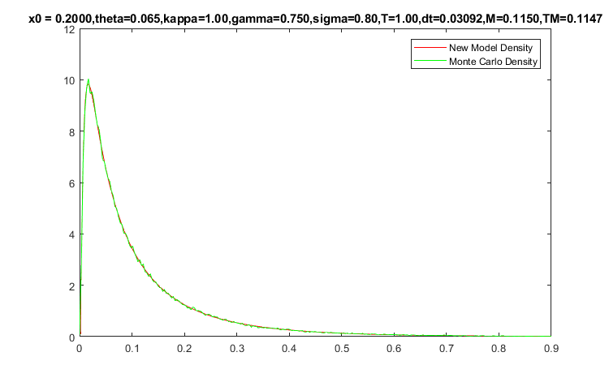](https://postimages.org/)

[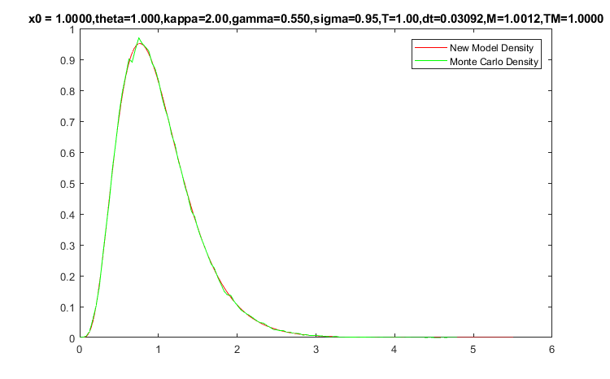](https://postimages.org/)

[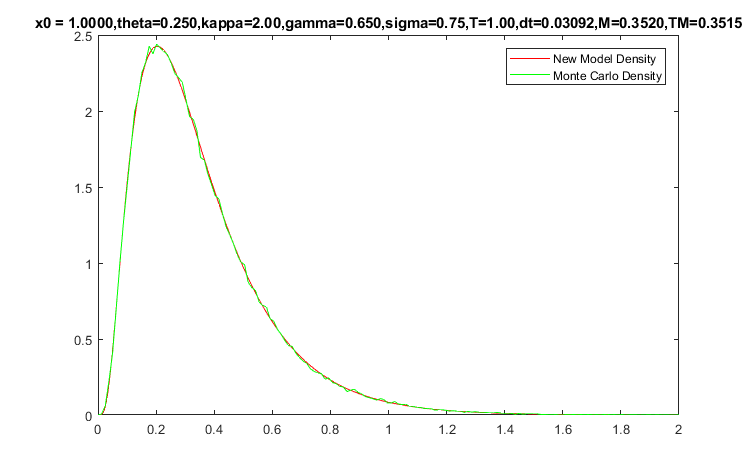](https://postimages.org/)

[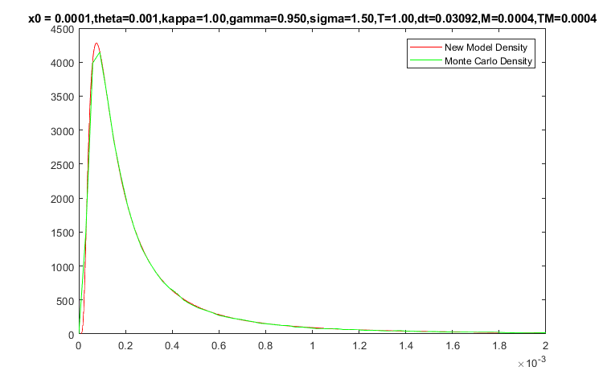](https://postimages.org/)

[](https://postimages.org/)

---

### #1123 — Amin (Topic Author)
*April 17, 2021, 2:31 PM*

Friends, I am working on tackling stochastic differential equations that go to zero. As a start, I am getting
encouraging results. But I noticed when a density has inaccuracy in left tail, there also arises some inaccuracy in
right tail since we are working with CDF. I am posting the following graph where density goes to zero but main body of
the density is well-captured by the new method however there is some inaccuracy in far right tail after +3 SDs that
throw the mean off even though body of the density is very well captured by the method. But I am working on it. Here is
the graph.

[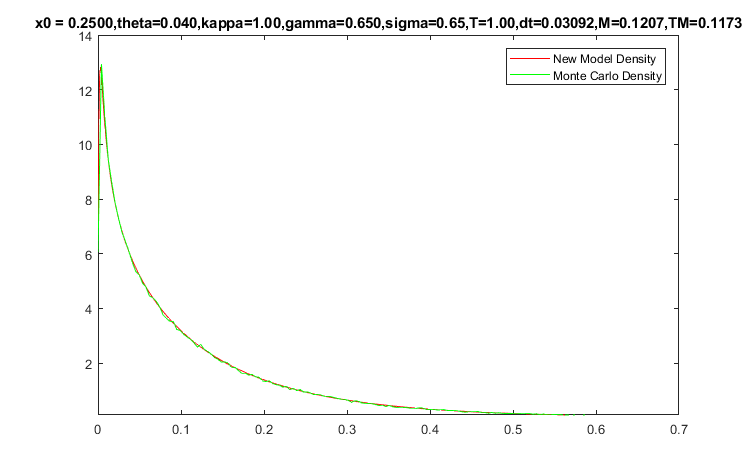](https://postimages.org/)

It may take a few days but I will be posting new programs here on the forum.

---

### #1124 — Amin (Topic Author)
*April 18, 2021, 7:28 AM*

Friends, I have been able to tackle the particular case I was working on with density of SDE going to zero perfectly
well. Now both extremes of the density when density of SDE goes to zero seem to be well captured by the new method. Only
thing I did was to turn the drift to zero at grid points that were very close to zero boundary where drift was seemingly
becoming too large or unstable. Here is the new graph with both the body of density and its mean perfectly captured. In
the density, 2.5 SDs to the left of zero from -5 to -2.5 SDs have their mass absorbed in zero.

[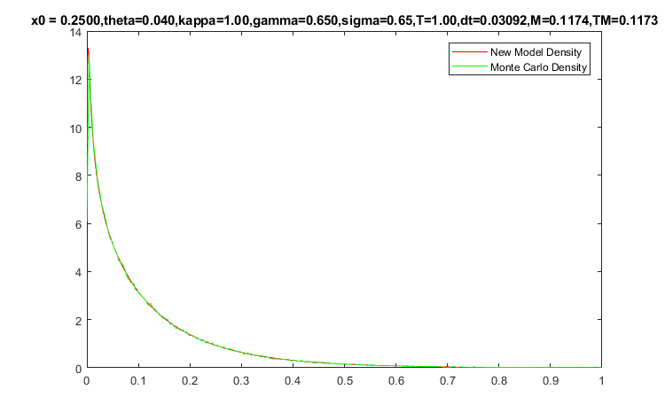](https://postimages.org/)

I will now work with cases where even more of the density goes to zero. Let us see how that goes.

---

### #1125 — Amin (Topic Author)
*April 20, 2021, 12:57 PM*

Sorry, double.

---

### #1126 — Amin (Topic Author)
*April 20, 2021, 12:57 PM*

Friends, I have been working with densities of SDEs that go into zero but I have had limited success when a lot of
density goes into zero since both drift and volatility become very unstable especially at volatility power gamma close
to .5. However when a small portion of density goes to zero, the whole method works quite well. I have simply turned
volatility to first order constant value$\sigma \sqrt{dt}$ close to zero and drift to zero when parameters become
unstable but when a lot of density goes into zero, this creates problems with right extreme boundary of the density. I
will be posting my programs with graphs either later today or early tomorrow.

However, I am writing this post to let friends know about my future plans. After completing this part of work on SDEs
and some of its extensions, I plan to continue for another 3-9 months working on parameter estimation and Bayesian
filtering with SDEs and densities in general. Later I want to work on "Statistical information calculus" with densities
and Artificial intelligence when information (various variables and related parameters) is given/or inferred in terms of
densities that are changing all the time and then artificial intelligence is used to make best sense(risk estimation,
projection, prediction and control of desired variables) of all the information we have. I hope that it will continue to
become more exciting  and more applied as time passes. I hope to continue for another 5-6 years working with densities
and artificial intelligence and will continue posting all my programs here on this forum. I am thinking of some kind of
business model so I can make some decent income to live comfortably while I could post all my new research on internet
as I have been doing for past several years and I will avoid any activity that will stop me from sharing  my new
research and programs with friends here. I will disclose my future research plans in even more detail in coming weeks
and would ask friends to wish me well in this endeavor to explore new things together with friends.

---

### #1127 — Amin (Topic Author)
*April 21, 2021, 7:32 AM*

Dear friends, I am posting some graphs that I have taken with my program. I will be posting the program in next post.

[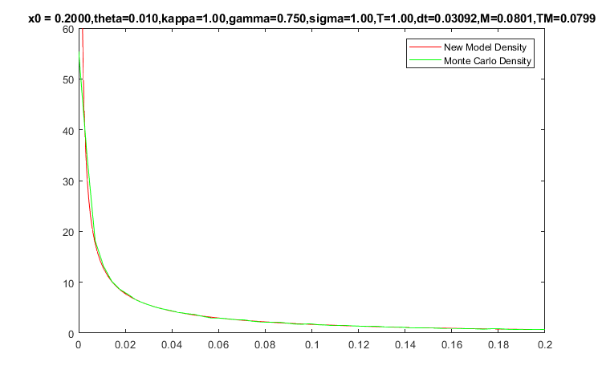](https://postimages.org/)

[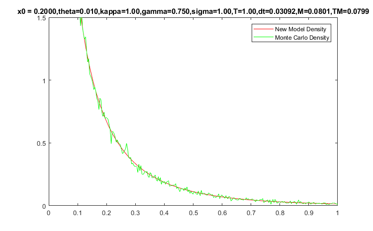](https://postimages.org/)

[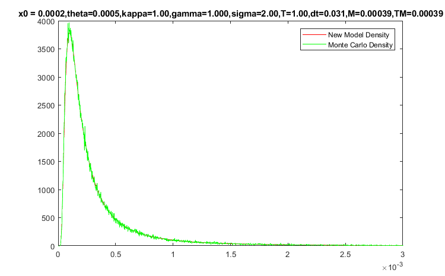](https://postimages.org/)

[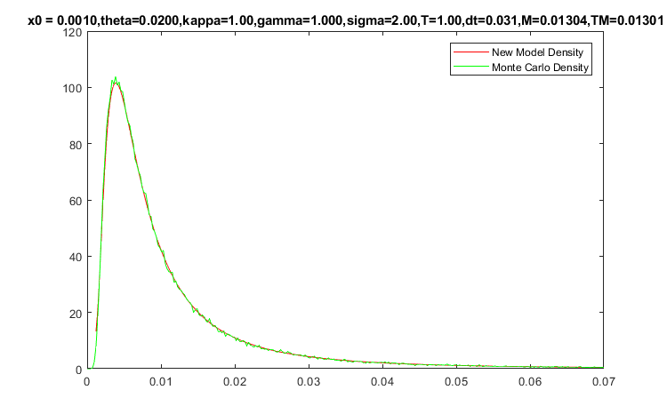](https://postimages.org/)

[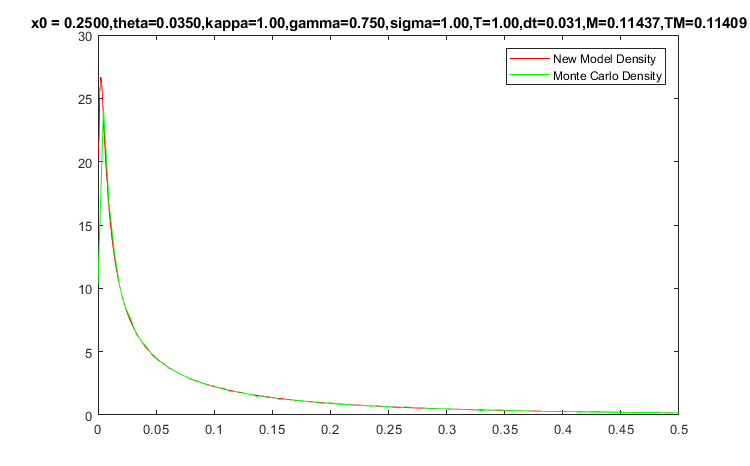](https://postimages.org/)

[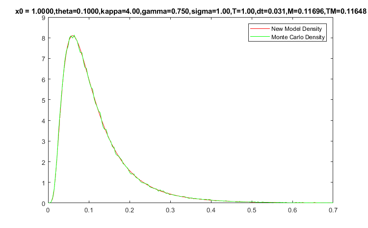](https://postimages.org/)

[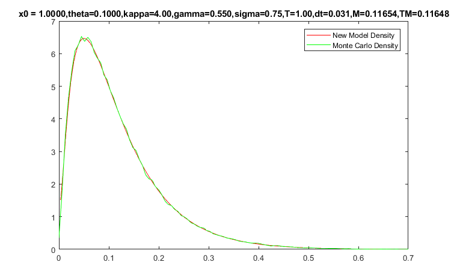](https://postimages.org/)

[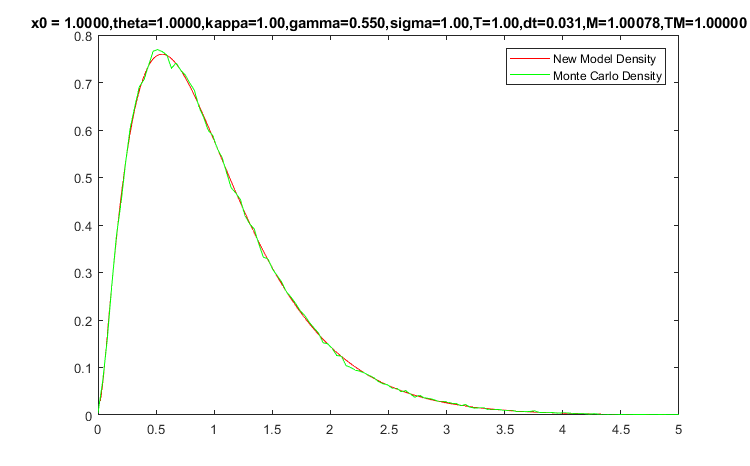](https://postimages.org/)

[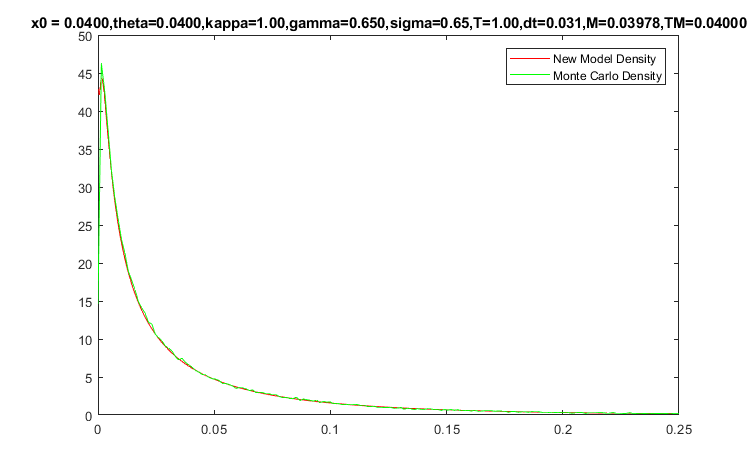](https://postimages.org/)

[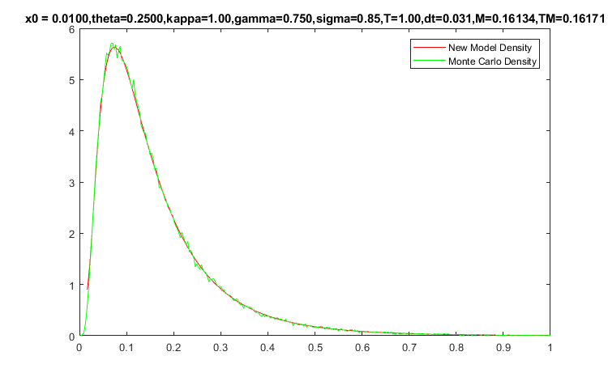](https://postimages.org/)

[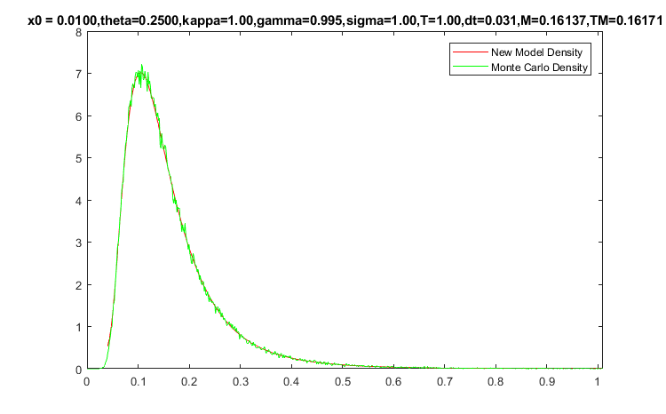](https://postimages.org/)

---

### #1128 — Amin (Topic Author)
*April 21, 2021, 9:04 AM*

Friends, here is the program. It is a bit messy but I will post a new neat program with explanatory comments in a few
hours.

.

```
function [] = SDETransProb08WmtGrid200b76DriftO0()

%Copyright Ahsan Amin. Infiniti derivatives Technologies.
%Please fell free to connect on linkedin: linkedin.com/in/ahsan-amin-0a53334
%or skype ahsan.amin2999
%In this program, I am simulating the SDE given as
%dy(t)=mu1 x(t)^beta1 dt + mu2 x(t)^beta2 dt +sigma x(t)^gamma dz(t)

%I have not directly simulated the SDE but simulated the transformed
%Besse1 process version of the SDE and then changed coordinates to retreive
%the SDE in original coordinates.
%The present program will analytically evolve only the Bessel Process version of the
%SDE in transformed coordinates.

%In this program, I have simulated the density for first few very small time
%intervals using a simple method. After first few intervals, I start
%simulating with probability mass transfer method.  Please experiment with step size and
%you will find the method robust enough. This is just an early version and
%I will be coming with better versions soon.

%dt=.125/16/2/2/2;   % Regular Simulation time interval to advance the density before large step by CDF method.
dt=1/48*1/2*1/32;             %decrease dt for accuracy.

Tt1=32;
Tt2=32;

T=1;
dt2=(T-dt*Tt1)/Tt2;
Tt=Tt1+Tt2;
T=dt*Tt1+dt2*Tt2;
OrderA=4;  %
%dtM=dt/8;%.125/2/4;%Monte carlo time interval size dtM.
%TtM=Tt*8;%T*2*8*4;%Monte carlo number of simulation intervals.
dtM=T/32;%.125/2/4;%Monte carlo time interval size dtM.
TtM=32;

dNn=.05;   % Normal density subdivisions width. would change with number of subdivisions
Nn=200;  % No of normal density subdivisions
NnMidl=100;%One half density Subdivision left from mid of normal density(low)
NnMidh=101;%One half density subdivision right from the mid of normal density(high)
NnMid=4.0;

Z(1:Nn)=(((1:Nn)-20.5)*dNn-NnMid)

%There are two indices. One goes to Nn=200. This is used for calculation of
%SDE simulation at next time level t+1. This covers -5 to +5 SDs of
%underlying Z.
%Second index Nn1 below goes from 1 to 240. This covers -6 to +6 SD of
%underlying Z. In probability mass transfer methos, we simulate the SDE
%from -5 SD to +5 SD and then extrapolate on both sides so that we have a
%new grid from -6 SD to +6 SD(1:Nn1). This extrapolated grid(which is assigned time t)
%is used to calculate the time t+1 grid from -5 SD to +5 SD(1:Nn).
%Grid spacing is the same on both grids.
Nn1=240;
%dNn1=.05;
Nn1Midl=120;
Nn1Midh=121;
Nn1Mid=6.025;

Z1(1:Nn1)=((1:Nn1)*dNn-Nn1Mid)
Z1Prob(1)=normcdf(-5.95)-normcdf(-6.0);
Z1Prob(Nn1)=normcdf(6.0)-normcdf(5.95);
Z1Prob(2:Nn1-1)=normcdf(.5*Z1(2:Nn1-1)+.5*Z1(3:Nn1),0,1)-normcdf(.5*Z1(2:Nn1-1)+.5*Z1(1:Nn1-2),0,1);

ZProb(1:Nn)=Z1Prob(21:Nn1-20);
Z(1:Nn)=Z1(21:Nn1-20);

Z1Prob
sum(Z1Prob(1:Nn1))
sum(ZProb(1:Nn))
str=input('Look at Zs');

x0=.01;   % starting value of SDE
beta1=0.0;
beta2=1.00;   % Second drift term power.
gamma=.75;%50;   % volatility power.
kappa=1.0;%.950;   %mean reversion parameter.
theta=.02;%mean reversion target
sigma0=.90;%Volatility value

%you can specify any general mu1 and mu2 and beta1 and beta2.
mu1=+1*theta*kappa;   %first drift coefficient.
mu2=-1*kappa;    % Second drift coefficient.
%mu1=0;
%mu2=0;

alpha=1;% x^alpha is being expanded. This is currently for monte carlo only.
alpha1=1-gamma;%This is for expansion of integrals for calculation of drift
%and volatility coefficients

w(1:Nn)=x0^(1-gamma)/(1-gamma);

Z
Z1
str=input('Look at Zs');
%%%%%%%%%%%%%%%%%%%%%%%%%%%%%%%%%%%%%%%%%%%%%%%%%%%%%%%%%%%%%%%%%%%%%%%%%%%%%%%%%%%%%%%%%%%%%%

sigma11(1:OrderA+1)=0;
mu11(1:OrderA+1)=0;
mu22(1:OrderA+1)=0;
sigma22(1:OrderA+1)=0;
% index 1 correponds to zero level since matlab indexing starts at one.
sigma11(1)=1;
mu11(1)=1;
mu22(1)=1;
sigma22(1)=1;

mu33(1)=1;
mu44(1)=1;
mu33(2:OrderA+1)=0;
mu44(2:OrderA+1)=0;

for k=1:(OrderA+1)
    if sigma0~=0
        sigma11(k)=sigma0^(k-1);
    end
    if mu1 ~= 0
        mu11(k)=mu1^(k-1);
    end
    if mu2 ~= 0
        mu22(k)=mu2^(k-1);
    end
    if sigma0~=0
        sigma22(k)=sigma0^(2*(k-1));
    end
end
%Ft(1:TtM+1,1:(OrderA+1),1:(OrderA+1),1:(OrderA+1),1:(OrderA+1))=0; %General time powers on hermite polynomials
Fp(1:(OrderA+1),1:(OrderA+1),1:(OrderA+1),1:(OrderA+1))=0;%General x powers on coefficients of hermite polynomials.
Fp1(1:(OrderA+1),1:(OrderA+1),1:(OrderA+1),1:(OrderA+1))=0;%General x powers for bessel transformed coordinates.

%YCoeff0 and YCoeff are coefficents for original coordinates monte carlo.
%YqCoeff0 and YqCoeff are bessel/lamperti version monte carlo.

YCoeff0(1:(OrderA+1),1:(OrderA+1),1:(OrderA+1),1:(OrderA+1))=0;
YqCoeff0(1:(OrderA+1),1:(OrderA+1),1:(OrderA+1),1:(OrderA+1))=0;
%Pre-compute the time and power exponent values in small multi-dimensional arrays
YCoeff = ItoTaylorCoeffsNew(alpha,beta1,beta2,gamma); %expand y^alpha where alpha=1;
YqCoeff = ItoTaylorCoeffsNew(alpha1,beta1,beta2,gamma);%expand y^alpha1 where alpha1=(1-gamma)
YqCoeff=YqCoeff/(1-gamma); %Transformed coordinates coefficients have to be
%further divided by (1-gamma)

for k = 0 : (OrderA)
    for m = 0:k
        l4 = k - m + 1;
        for n = 0 : m
            l3 = m - n + 1;
            for j = 0:n
                l2 = n - j + 1;
                l1 = j + 1;
                %Ft(l1,l2,l3,l4) = dtM^((l1-1) + (l2-1) + (l3-1) + .5* (l4-1));
                Fp(l1,l2,l3,l4) = (alpha + (l1-1) * beta1 + (l2-1) * beta2 + (l3-1) * 2* gamma + (l4-1) * gamma ...
                    - (l1-1) - (l2-1) - 2* (l3-1) - (l4-1));
                Fp1(l1,l2,l3,l4) = (alpha1 + (l1-1) * beta1 + (l2-1) * beta2 + (l3-1) * 2* gamma + (l4-1) * gamma ...
                    - (l1-1) - (l2-1) - 2* (l3-1) - (l4-1));

                YCoeff0(l1,l2,l3,l4) =YCoeff(l1,l2,l3,l4).*mu11(l1).*mu22(l2).*sigma22(l3).*sigma11(l4);
                YqCoeff0(l1,l2,l3,l4) =YqCoeff(l1,l2,l3,l4).*mu11(l1).*mu22(l2).*sigma22(l3).*sigma11(l4);
                YqzCoeff0(l1,l2,l3,l4) =YqCoeff(l1,l2,l3,l4).*mu33(l1).*mu44(l2).*sigma22(l3).*sigma11(l4);
            end
        end
    end
end

%%%%%%%%%%%%%%%%%%%%%%%%%%%%%%%%%%%%%%%%%%%%%%%%%%%%%%%%%%%%%%%%%%%%%%%%%%%%%%%%%%%%%%%%%%%%%%

wnStart=1;%
wnStart1=1;
yy(wnStart:Nn)=((1-gamma)*w(wnStart:Nn)).^(1/(1-gamma));
%The above yy(wnStart:Nn)=x0;

tic

for tt=1:Tt

   if(tt==1)

        w_00=x0^(1-gamma)/(1-gamma);
        %[wMu0dt,c1,c2,c3] = CalculateDriftAndVolA404B4Drift02(w_00,1,1,YqCoeff0,Fp1,gamma,dt);
        [wMu0dt,c1] = CalculateDriftAndVolA404(w_00,1,1,YqCoeff0,Fp1,gamma,dt);
        w(1:Nn)=x0^(1-gamma)/(1-gamma)+wMu0dt(1)+c1(1).*Z(1:Nn);%+c2(1).*(Z(1:Nn).^2-1)+c3(1).*(Z(1:Nn).^3-3*Z(1:Nn));

    end
     if((tt>1) && (ttTt1)
        %Nn=170;
        %Nn1=190;
         dt=dt2;

        [wMu0dt,c1] = CalculateDriftAndVolA404(w,wnStart,Nn,YqCoeff0,Fp1,gamma,dt);
        %[wMu0dt,wMu0O0dt,dwMu0dtdw,c1,dc1dw,Sigma2w] =
CalculateDriftAndVolA404B4DriftO0(w,wnStart,Nn,YqCoeff0,Fp1,gamma,dt);
        [dwdZ_0,d2wdZ2_0,d3wdZ3_0] = First3Derivatives2ndOrderEqSpacedA(wnStart,Nn,dNn,w,Z);
        [dwMu0dtdZ_0,d2wMu0dtdZ2_0,d3wMu0dtdZ3_0] = First3Derivatives2ndOrderEqSpacedA(wnStart,Nn,dNn,wMu0dt,Z);
        %BB1(Nn+20+1:Nn+20+20)=BB1(Nn+20)+(1:20).*dwdZ_0(Nn)*dNn;

        if(wnStart>=1)
        wnStart1=wnStart+20;
        end
        BB1(20+wnStart:Nn+20)=w(wnStart:Nn);
        if(wnStart1>=21)
            %BB1(1:20)=BB1(21)-(20:-1:1).*dwdZ_0(1)*dNn;
            BB1(wnStart1-20:wnStart1-1)=BB1(wnStart1)-(20:-1:1).*dwdZ_0(1)*dNn;
            %BB1(1:wnStart1-1)=BB1(wnStart1+10)-(wnStart1+10-1:-1:11).*dwdZ_0(wnStart+10)*dNn;

            wnStart1=wnStart1-20;
            LoopFlag=0;
            for mm=1:20
                if((BB1(mm)>=0)&&(LoopFlag==0))
                    wnStart1=mm;
                    LoopFlag=1;
                end
            end
           % for mm=Nnmid1:-1:wnStart1
           %     if(BB1(mm)>BB1(mm+1))
           %         wnStart1=mm+1;
           %         BB1(1:mm1)=0.0;
           %     end
           % end
            for mm=wnStart1:Nn1Midl
                if(BB1(mm)>=BB1(mm+1))
                    wnStart1=mm+1;
                    BB1(1:mm)=0.0;
                end
            end
        end
        BB1(Nn-10+20+1:Nn+20+20)=BB1(Nn-10+20)+(1:30).*dwdZ_0(Nn-10)*dNn;

        %wnStart=1;
            ZZ1=Z1;
            NN1=Nn1;
            ZZProb(1:NN1)=Z1Prob(1:Nn1);
            if(wnStart1>1)
                ZZProb(wnStart1)=Z1Prob(wnStart1)+sum(Z1Prob(1:wnStart1-1));
                ZZProb(1:wnStart1-1)=0.0;
            end

            %plot(ZZ1(1:NN1),BB1(1:NN1),'b',ZZ1(1:NN1),BB1a(1:NN1),'y',ZZ1(1:NN1),BB1b(1:NN1),'k',Z(1:Nn),B1(1:Nn),'r')
            %str=input('Look at B1 and BB1, original and extrapolated version and boundaries');

            %Below calculate first four derivatives. Please replace with your favorite
            %robust function.
      %      [dBdZ,d2BdZ2,d3BdZ3] = First3Derivatives2ndOrderEqSpacedA(1,NN1,dNn,BB1,Z1);
      %      [dwdZAA,d2wdZ2AA,d3wdZ3AA,d4BdZ4] = First4Derivatives2ndOrderEqSpaced(1,NN1,dNn,BB1,Z1);

            %plot((1:NN1),dBdZ(1:NN1),'r')
            %str=input('Look at 1st derivative');
            %plot((1:NN1),d2BdZ2(1:NN1),'r')
            %str=input('Look at 2nd derivative');
            %plot((1:NN1),d3BdZ3(1:NN1),'r')
            %str=input('Look at 3rd derivative');

            ww1(wnStart1:NN1)=BB1(wnStart1:NN1);%+wMid;
            ww1(ww1=.75)
                   
%wMu0dt(wnStart:wnStart+30)=wMu0dt(wnStart+30)-dwMu0dtdw(wnStart+30)*(w(wnStart+30)-w(w(wnStart:-1:wnStart-30)));
                    wMu0dtA(wnStart:wnStart+9)=wMu0dt(wnStart+10)-(10:-1:1).*dNn.*dwMu0dtdZ_0(wnStart+10);
                   
%wMu0dt(wnStart:wnStart+9)=wMu0dt(wnStart+10)-dwMu0dtdw(wnStart+10)*-1*(w(wnStart:wnStart+4)-w(wnStart+5));
            end

           plot((1:Nn),wMu0dt(1:Nn),'r',(1:Nn),wMu0dtA(1:Nn),'b');
           str=input('Look at wMu0dt linearly interpolated');

            Bn(wnStart:Nn)=w(wnStart:Nn)+wMu0dtA(wnStart:Nn)+(Sigmaw_0(wnStart:Nn)-dwdZ_0(wnStart:Nn)).*Z(wnStart:Nn);
            Bn(Bn1)
       %             SumThreshld=SumThreshld+Threshld(mm);
       %         end
       %     end

            ZZProb(1:NN1)=Z1Prob(1:Nn1);
            if(wnStart1>1)
                ZZProb(wnStart1)=Z1Prob(wnStart1)+sum(Z1Prob(1:wnStart1-1));
                ZZProb(1:wnStart1-1)=0.0;
            end

            for mm=wnStart1:NN1

                %if(Bm0(mm)1.5*MuwMedian)
               %     Threshld=mm-wnStart1;
               % end

                Threshld=0.0;
                yy(mm)=((1-gamma)*Bm0(mm)).^(1/(1-gamma));
                if(sigma0*(yy(mm)^(gamma-1))>2)
                  %  Threshld=mm-wnStart1;
                    %Threshld=floor(gamma*sigma0*yy(mm)^(gamma-1)+1)-1;
                    ThreshldT=mm-wnStart1;
                    %Threshld=floor(.375.^0*2*gamma.^2*sigma0.^2*yy(mm)^(2*gamma-2)+1);
                    if(ThreshldT>Threshld)
                        Threshld=ThreshldT;
                    end
                end
      %          Threshld
                %Bm0(mm)
                %yy(mm)

                if(wnStart140)&&(wnStart1=1)
       %             Muw(mm)=(1-Threshld(mm)/SumThreshld)*Muw(mm)   ;
       %              Sigmaw(mm)=sigma0*sqrt(dt);
       %              Sigma2w(mm)=0.0;

       %         end

                %frac=(mm-wnStart1)/Threshld;
                bound=wnStart1+Threshld;
                keata=log(.125);%./Threshld;

                 if(mm=wnStart1+.5*Threshld))
           %             Muw(mm)=Muw(mm)./(2+Threshld);
           %             Sigmaw(mm)=sigma0*sqrt(dt);
           %             Sigma2w(mm)=0.0;
 %         %               str=input('I am inside the loop you are looking for');
           %     end

             %    if((mm=wnStart1+.75*Threshld))
             %           Muw(mm)=Muw(mm)./(1+Threshld);
             %           Sigmaw(mm)=sigma0*sqrt(dt);
             %           Sigma2w(mm)=0.0;
 %           %             str=input('I am inside the loop you are looking for');
             %   end

                %if(Bm0(mm)5*abs(Sigmaw(mm)))
                        nn2=nn;
                    end
                end
                Zt(1:Nn)=0.0;
                Pmn(1:Nn)=0.0;
                ESecondHe(1:Nn)=0.0;
%Bt(mm1:mm2)=Bn(mm1:mm2)-Bm0;
                Zt(nn1:nn2)=(Bn(nn1:nn2)-Bm0(mm)-Muw(mm))/Sigmaw(mm);
                Zt(nn1:nn2)=real(Zt(nn1:nn2));
                Pm0n(nn1:nn2)=normcdf(Zt(nn1:nn2),0,1);
                pm0n(nn1:nn2)=normpdf(Zt(nn1:nn2),0,1);
                %ESecondHe(nn1:nn2)=(Sigma2w(mm).*(Zt(nn1:nn2).^2-1)).*pmn(nn1:nn2);

                Pmn(nn1:nn2)=Pm0n(nn1:nn2).*ZZProb(mm);
                pmn(nn1:nn2)=pm0n(nn1:nn2).*ZZProb(mm);
                %[Pmn,pmn,ESecondHe] =
CalculateCDFArraySignIndexDrift(Bn,Nn,wMu0dtA(mm),dwMu0dtdwA(mm),d2wMu0dtdw2A(mm),d3wMu0dtdw3A(mm),d4wMu0dtdw4A(mm),d5wMu0dtdw5A(mm),d6wMu0dtdw6A(mm),d7wMu0dtdw7A(mm),d8wMu0dtdw8A(mm),SigmawA(mm),dSigmawdwA(mm),d2Sigmawdw2A(mm),Sigma2wA(mm),Bm0(mm),Bm1(mm),Bm2(mm),ZZProb(mm),pm0(mm),dpm0(mm),d2pm0(mm),d3pm0(mm),d4pm0(mm),d5pm0(mm),d6pm0(mm),d7pm0(mm));

                ESecondHe(nn1:nn2)=(Sigma2w(mm).*(Zt(nn1:nn2).^2-1)).*pmn(nn1:nn2);

                if(nn1>wnStart)
                    Pmn(1:nn1-1)=0;
                    pmn(1:nn1-1)=0;
                    ESecondHe(1:nn1-1)=0;
                  %  EThirdHe(1:nn1-1)=0;
                end
                if (nn25)
            [w(wnStart-1)] =
InterpolateOrderN6(6,Z(wnStart-1),Znew(wnStart),Znew(wnStart+1),Znew(wnStart+2),Znew(wnStart+3),Znew(wnStart+4),Znew(wnStart+5),Bn2(wnStart),Bn2(wnStart+1),Bn2(wnStart+2),Bn2(wnStart+3),Bn2(wnStart+4),Bn2(wnStart+5));
            [w(wnStart-2)] =
InterpolateOrderN6(6,Z(wnStart-2),Znew(wnStart),Znew(wnStart+1),Znew(wnStart+2),Znew(wnStart+3),Znew(wnStart+4),Znew(wnStart+5),Bn2(wnStart),Bn2(wnStart+1),Bn2(wnStart+2),Bn2(wnStart+3),Bn2(wnStart+4),Bn2(wnStart+5));
            %[w(wnStart-3)] =
InterpolateOrderN6(6,Z(wnStart-3),Znew(wnStart),Znew(wnStart+1),Znew(wnStart+2),Znew(wnStart+3),Znew(wnStart+4),Znew(wnStart+5),Bn2(wnStart),Bn2(wnStart+1),Bn2(wnStart+2),Bn2(wnStart+3),Bn2(wnStart+4),Bn2(wnStart+5));
            %[w(wnStart-4)] =
InterpolateOrderN6(6,Z(wnStart-4),Znew(wnStart),Znew(wnStart+1),Znew(wnStart+2),Znew(wnStart+3),Znew(wnStart+4),Znew(wnStart+5),Bn2(wnStart),Bn2(wnStart+1),Bn2(wnStart+2),Bn2(wnStart+3),Bn2(wnStart+4),Bn2(wnStart+5));
            %[w(wnStart-5)] =
InterpolateOrderN6(6,Z(wnStart-5),Znew(wnStart),Znew(wnStart+1),Znew(wnStart+2),Znew(wnStart+3),Znew(wnStart+4),Znew(wnStart+5),Bn2(wnStart),Bn2(wnStart+1),Bn2(wnStart+2),Bn2(wnStart+3),Bn2(wnStart+4),Bn2(wnStart+5));
        wnStart=wnStart-2;
        end

    %   if(wnStart>5)
    %       [w(wnStart-1)] =
InterpolateOrderN6(6,Z(wnStart-1),Z(wnStart),Z(wnStart+1),Z(wnStart+2),Z(wnStart+3),Z(wnStart+4),Z(wnStart+5),w(wnStart),w(wnStart+1),w(wnStart+2),w(wnStart+3),w(wnStart+4),w(wnStart+5));
    %       [w(wnStart-2)] =
InterpolateOrderN6(6,Z(wnStart-2),Z(wnStart),Z(wnStart+1),Z(wnStart+2),Z(wnStart+3),Z(wnStart+4),Z(wnStart+5),w(wnStart),w(wnStart+1),w(wnStart+2),w(wnStart+3),w(wnStart+4),w(wnStart+5));
    %       [w(wnStart-3)] =
InterpolateOrderN6(6,Z(wnStart-3),Z(wnStart),Z(wnStart+1),Z(wnStart+2),Z(wnStart+3),Z(wnStart+4),Z(wnStart+5),w(wnStart),w(wnStart+1),w(wnStart+2),w(wnStart+3),w(wnStart+4),w(wnStart+5));
    %       [w(wnStart-4)] =
InterpolateOrderN6(6,Z(wnStart-4),Z(wnStart),Z(wnStart+1),Z(wnStart+2),Z(wnStart+3),Z(wnStart+4),Z(wnStart+5),w(wnStart),w(wnStart+1),w(wnStart+2),w(wnStart+3),w(wnStart+4),w(wnStart+5));
    %       [w(wnStart-5)] =
InterpolateOrderN6(6,Z(wnStart-5),Z(wnStart),Z(wnStart+1),Z(wnStart+2),Z(wnStart+3),Z(wnStart+4),Z(wnStart+5),w(wnStart),w(wnStart+1),w(wnStart+2),w(wnStart+3),w(wnStart+4),w(wnStart+5));
    %   wnStart=wnStart-5;
    %   end

       wnStartA=wnStart
       Nn
       1

       for nn=1:NnMid
                if(w(nn)35)
       w(Nn-30+1:Nn)=w(Nn-30)+(1:30).*dwdZ_1(Nn-30)*dNn;
  %     end
       % w(Nn-40+1:Nn)=w(Nn-40)+(1:40).*dwdZ_1(Nn-40)*dNn;
%      plot((1:Nn),w(1:Nn),'r');
%     str=input('Look at w graph');

%
%         w1(1:NnMid-1)=w(1:NnMid-1);
%         w1(NnMid)=w(NnMid);
%         w2(1:NnMid-1)=w(2:NnMid);
%         w2(NnMid)=w(NnMid+1);%+w1(Nn)-w1(Nn-1);
%         w(w1(:)>w2(:))=0;%Be careful;might not universally hold;
%      %Change 3:7/25/2020: I have improved zero correction in above.
%         for nn=1:NnMid
%             if(w(nn+1)Tt1)
    %dtM=dt2/8;
end
    Random1=randn(size(Random1));
    HermiteP1(1,1:paths)=1;
    HermiteP1(2,1:paths)=Random1(1:paths);
    HermiteP1(3,1:paths)=Random1(1:paths).^2-1;
    HermiteP1(4,1:paths)=Random1(1:paths).^3-3*Random1(1:paths);
    HermiteP1(5,1:paths)=Random1(1:paths).^4-6*Random1(1:paths).^2+3;

    YY(1:paths)=YY(1:paths) + ...
        (YCoeff0(1,1,2,1).*YY(1:paths).^Fp(1,1,2,1)+ ...
        YCoeff0(1,2,1,1).*YY(1:paths).^Fp(1,2,1,1)+ ...
        YCoeff0(2,1,1,1).*YY(1:paths).^Fp(2,1,1,1))*dtM + ...
        (YCoeff0(1,1,3,1).*YY(1:paths).^Fp(1,1,3,1)+ ...
        YCoeff0(1,2,2,1).*YY(1:paths).^Fp(1,2,2,1)+ ...
        YCoeff0(2,1,2,1).*YY(1:paths).^Fp(2,1,2,1)+ ...
        YCoeff0(1,3,1,1).*YY(1:paths).^Fp(1,3,1,1)+ ...
        YCoeff0(2,2,1,1).*YY(1:paths).^Fp(2,2,1,1)+ ...
        YCoeff0(3,1,1,1).*YY(1:paths).^Fp(3,1,1,1))*dtM^2 + ...
        ((YCoeff0(1,1,1,2).*YY(1:paths).^Fp(1,1,1,2).*sqrt(dtM))+ ...
        (YCoeff0(1,1,2,2).*YY(1:paths).^Fp(1,1,2,2)+ ...
        YCoeff0(1,2,1,2).*YY(1:paths).^Fp(1,2,1,2)+ ...
        YCoeff0(2,1,1,2).*YY(1:paths).^Fp(2,1,1,2)).*dtM^1.5) .*HermiteP1(2,1:paths) + ...
        ((YCoeff0(1,1,1,3).*YY(1:paths).^Fp(1,1,1,3) *dtM) + ...
        (YCoeff0(1,1,2,3).*YY(1:paths).^Fp(1,1,2,3)+ ...
        YCoeff0(1,2,1,3).*YY(1:paths).^Fp(1,2,1,3)+ ...
        YCoeff0(2,1,1,3).*YY(1:paths).^Fp(2,1,1,3)).*dtM^2).*HermiteP1(3,1:paths) + ...
        ((YCoeff0(1,1,1,4).*YY(1:paths).^Fp(1,1,1,4)*dtM^1.5 )).*HermiteP1(4,1:paths) + ...
        (YCoeff0(1,1,1,5).*YY(1:paths).^Fp(1,1,1,5)*dtM^2.0).*HermiteP1(5,1:paths);

end

YY(YY<0)=0;
disp('Original process average from monte carlo');
MCMean=sum(YY(:))/paths %origianl coordinates monte carlo average.
MCVar=sum((YY(:)-MCMean).^2)/paths
disp('Original process average from our simulation');
ItoHermiteMean=sum(y_w(wnStart+1:Nn-1).*ZProb(wnStart+1:Nn-1)) %Original process average from coordinates
ItoHermiteVar=sum((y_w(wnStart+1:Nn-1)-ItoHermiteMean).^2.*ZProb(wnStart+1:Nn-1))
disp('true Mean only applicble to standard SV mean reverting type models otherwise disregard');
TrueMean=theta+(x0-theta)*exp(-kappa*T)%Mean reverting SDE original variable true average

MaxCutOff=30;
NoOfBins=round(300*gamma^2*4*sigma0/sqrt(MCMean)/(1+kappa));%Decrease the number of bins if the graph is too
[YDensity,IndexOutY,IndexMaxY] = MakeDensityFromSimulation_Infiniti_NEW(YY,paths,NoOfBins,MaxCutOff );

%plot(y_w1(wnStart+1:Nn-1),py_w1(wnStart+1:Nn-1),'b',y_w(wnStart+1:Nn-1),py_w(wnStart+1:Nn-1),'r',IndexOutY(1:IndexMaxY),YDensity(1:IndexMaxY),'g');
%plot(y_w(wnStart+1:Nn-1),py_w(wnStart+1:Nn-1),'r',IndexOutY(1:IndexMaxY),YDensity(1:IndexMaxY),'g');
plot(y_w(wnStart+1:Nn-1),py_w(wnStart+1:Nn-1),'r',IndexOutY(1:IndexMaxY),YDensity(1:IndexMaxY),'g');

title(sprintf('x0 = %.4f,theta=%.4f,kappa=%.2f,gamma=%.3f,sigma=%.2f,T=%.2f,dt=%.3f,M=%.5f,TM=%.5f',
x0,theta,kappa,gamma,sigma0,T,dt,ItoHermiteMean,TrueMean));%,sprintf('theta= %f', theta), sprintf('kappa = %f',
kappa),sprintf('sigma = %f', sigma0),sprintf('T = %f', T));

legend({'New Model Density','Monte Carlo Density'},'Location','northeast')

str=input('red line is density of SDE from Ito-Hermite method, green is monte carlo.');
end
```

.

One sub function

.

```
function [wMu0dt,c1] = CalculateDriftAndVolA404(w,wnStart,Nn,YqCoeff0,Fp1,gamma,dt)

yy(wnStart:Nn)=((1-gamma)*w(wnStart:Nn)).^(1/(1-gamma));

Fp2=Fp1/(1-gamma);

wMu0dt(wnStart:Nn)=(YqCoeff0(1,1,2,1).*yy(wnStart:Nn).^Fp1(1,1,2,1)+ ...
    YqCoeff0(1,2,1,1).*yy(wnStart:Nn).^Fp1(1,2,1,1)+ ...
    YqCoeff0(2,1,1,1).*yy(wnStart:Nn).^Fp1(2,1,1,1))*dt + ...
    (YqCoeff0(1,1,3,1).*yy(wnStart:Nn).^Fp1(1,1,3,1)+ ...
    YqCoeff0(1,2,2,1).*yy(wnStart:Nn).^Fp1(1,2,2,1)+ ...
    YqCoeff0(2,1,2,1).*yy(wnStart:Nn).^Fp1(2,1,2,1)+ ...
    YqCoeff0(1,3,1,1).*yy(wnStart:Nn).^Fp1(1,3,1,1)+ ...
    YqCoeff0(2,2,1,1).*yy(wnStart:Nn).^Fp1(2,2,1,1)+ ...
    YqCoeff0(3,1,1,1).*yy(wnStart:Nn).^Fp1(3,1,1,1))*dt^2 + ...
     (YqCoeff0(1,1,4,1).*yy(wnStart:Nn).^Fp1(1,1,4,1)+ ...
     YqCoeff0(1,2,3,1).*yy(wnStart:Nn).^Fp1(1,2,3,1)+ ...
     YqCoeff0(2,1,3,1).*yy(wnStart:Nn).^Fp1(2,1,3,1)+ ...
     YqCoeff0(1,3,2,1).*yy(wnStart:Nn).^Fp1(1,3,2,1)+ ...
     YqCoeff0(2,2,2,1).*yy(wnStart:Nn).^Fp1(2,2,2,1)+ ...
     YqCoeff0(3,1,2,1).*yy(wnStart:Nn).^Fp1(3,1,2,1)+ ...
     YqCoeff0(1,4,1,1).*yy(wnStart:Nn).^Fp1(1,4,1,1)+ ...
     YqCoeff0(2,3,1,1).*yy(wnStart:Nn).^Fp1(2,3,1,1)+ ...
     YqCoeff0(3,2,1,1).*yy(wnStart:Nn).^Fp1(3,2,1,1)+ ...
     YqCoeff0(4,1,1,1).*yy(wnStart:Nn).^Fp1(4,1,1,1))*dt^3+ ...
     (YqCoeff0(1,1,5,1).*yy(wnStart:Nn).^Fp1(1,1,5,1)+ ...
      YqCoeff0(1,2,4,1).*yy(wnStart:Nn).^Fp1(1,2,4,1)+ ...
      YqCoeff0(2,1,4,1).*yy(wnStart:Nn).^Fp1(2,1,4,1)+ ...
      YqCoeff0(2,1,1,1).*yy(wnStart:Nn).^Fp1(2,1,1,1)+ ...
       YqCoeff0(2,2,3,1).*yy(wnStart:Nn).^Fp1(2,2,3,1)+ ...
       YqCoeff0(3,1,3,1).*yy(wnStart:Nn).^Fp1(3,1,3,1)+ ...
       YqCoeff0(1,4,2,1).*yy(wnStart:Nn).^Fp1(1,4,2,1)+ ...
       YqCoeff0(2,3,2,1).*yy(wnStart:Nn).^Fp1(2,3,2,1)+ ...
       YqCoeff0(3,2,2,1).*yy(wnStart:Nn).^Fp1(3,2,2,1)+ ...
       YqCoeff0(4,1,2,1).*yy(wnStart:Nn).^Fp1(4,1,2,1)+ ...
       YqCoeff0(1,5,1,1).*yy(wnStart:Nn).^Fp1(1,5,1,1)+ ...
       YqCoeff0(2,4,1,1).*yy(wnStart:Nn).^Fp1(2,4,1,1)+ ...
       YqCoeff0(3,3,1,1).*yy(wnStart:Nn).^Fp1(3,3,1,1)+  ...
       YqCoeff0(4,2,1,1).*yy(wnStart:Nn).^Fp1(4,2,1,1)+ ...
       YqCoeff0(5,1,1,1).*yy(wnStart:Nn).^Fp1(5,1,1,1))*dt^4;

wMu0dtOdt(wnStart:Nn)=(YqCoeff0(1,1,2,1).*yy(wnStart:Nn).^Fp1(1,1,2,1)*0+ ...
    YqCoeff0(1,2,1,1).*yy(wnStart:Nn).^Fp1(1,2,1,1)+ ...
    YqCoeff0(2,1,1,1).*yy(wnStart:Nn).^Fp1(2,1,1,1))*dt ;

c1(wnStart:Nn)=((YqCoeff0(1,1,1,2).*yy(wnStart:Nn).^Fp1(1,1,1,2).*sqrt(dt))+ ...
     (YqCoeff0(1,1,2,2).*yy(wnStart:Nn).^Fp1(1,1,2,2)+YqCoeff0(1,2,1,2).*yy(wnStart:Nn).^Fp1(1,2,1,2)+ ...
     YqCoeff0(2,1,1,2).*yy(wnStart:Nn).^Fp1(2,1,1,2)).*dt^1.5+ ...
     (YqCoeff0(1,1,3,2).*yy(wnStart:Nn).^Fp1(1,1,3,2)+YqCoeff0(1,2,2,2).*yy(wnStart:Nn).^Fp1(1,2,2,2)+ ...
     YqCoeff0(2,1,2,2).*yy(wnStart:Nn).^Fp1(2,1,2,2)+YqCoeff0(1,3,1,2).*yy(wnStart:Nn).^Fp1(1,3,1,2)+ ...
     YqCoeff0(2,2,1,2).*yy(wnStart:Nn).^Fp1(2,2,1,2)+YqCoeff0(3,1,1,2).*yy(wnStart:Nn).^Fp1(3,1,1,2)).*dt^2.5+ ...
     (YqCoeff0(1,1,4,2).*yy(wnStart:Nn).^Fp1(1,1,4,2)+YqCoeff0(1,2,3,2).*yy(wnStart:Nn).^Fp1(1,2,3,2)+ ...
     YqCoeff0(2,1,3,2).*yy(wnStart:Nn).^Fp1(2,1,3,2)+YqCoeff0(1,3,2,2).*yy(wnStart:Nn).^Fp1(1,3,2,2)+ ...
     YqCoeff0(2,2,2,2).*yy(wnStart:Nn).^Fp1(2,2,2,2)+ YqCoeff0(3,1,2,2).*yy(wnStart:Nn).^Fp1(3,1,2,2)+ ...
     YqCoeff0(1,4,1,2).*yy(wnStart:Nn).^Fp1(1,4,1,2)+YqCoeff0(2,3,1,2).*yy(wnStart:Nn).^Fp1(2,3,1,2)+ ...
     YqCoeff0(3,2,1,2).*yy(wnStart:Nn).^Fp1(3,2,1,2)+YqCoeff0(4,1,1,2).*yy(wnStart:Nn).^Fp1(4,1,1,2)).*dt^3.5);

end
```

.

Second sub function.

.

```
function [wMu0dt,wMu0dtO0,dwMu0dtdw,c1,dc1dw,c2] = CalculateDriftAndVolA404B4DriftO0(w,wnStart,Nn,YqCoeff0,Fp1,gamma,dt)

yy(wnStart:Nn)=((1-gamma)*w(wnStart:Nn)).^(1/(1-gamma));

Fp2=Fp1/(1-gamma);
wMu0dtO0(wnStart:Nn)=(YqCoeff0(1,1,2,1).*yy(wnStart:Nn).^Fp1(1,1,2,1)+ ...
    YqCoeff0(1,2,1,1).*yy(wnStart:Nn).^Fp1(1,2,1,1)+ ...
    YqCoeff0(2,1,1,1).*yy(wnStart:Nn).^Fp1(2,1,1,1))*dt;

wMu0dt(wnStart:Nn)=(YqCoeff0(1,1,2,1).*yy(wnStart:Nn).^Fp1(1,1,2,1)+ ...
    YqCoeff0(1,2,1,1).*yy(wnStart:Nn).^Fp1(1,2,1,1)+ ...
    YqCoeff0(2,1,1,1).*yy(wnStart:Nn).^Fp1(2,1,1,1))*dt + ...
    (YqCoeff0(1,1,3,1).*yy(wnStart:Nn).^Fp1(1,1,3,1)+ ...
    YqCoeff0(1,2,2,1).*yy(wnStart:Nn).^Fp1(1,2,2,1)+ ...
    YqCoeff0(2,1,2,1).*yy(wnStart:Nn).^Fp1(2,1,2,1)+ ...
    YqCoeff0(1,3,1,1).*yy(wnStart:Nn).^Fp1(1,3,1,1)+ ...
    YqCoeff0(2,2,1,1).*yy(wnStart:Nn).^Fp1(2,2,1,1)+ ...
    YqCoeff0(3,1,1,1).*yy(wnStart:Nn).^Fp1(3,1,1,1))*dt^2 + ...
     (YqCoeff0(1,1,4,1).*yy(wnStart:Nn).^Fp1(1,1,4,1)+ ...
     YqCoeff0(1,2,3,1).*yy(wnStart:Nn).^Fp1(1,2,3,1)+ ...
     YqCoeff0(2,1,3,1).*yy(wnStart:Nn).^Fp1(2,1,3,1)+ ...
     YqCoeff0(1,3,2,1).*yy(wnStart:Nn).^Fp1(1,3,2,1)+ ...
     YqCoeff0(2,2,2,1).*yy(wnStart:Nn).^Fp1(2,2,2,1)+ ...
     YqCoeff0(3,1,2,1).*yy(wnStart:Nn).^Fp1(3,1,2,1)+ ...
     YqCoeff0(1,4,1,1).*yy(wnStart:Nn).^Fp1(1,4,1,1)+ ...
     YqCoeff0(2,3,1,1).*yy(wnStart:Nn).^Fp1(2,3,1,1)+ ...
     YqCoeff0(3,2,1,1).*yy(wnStart:Nn).^Fp1(3,2,1,1)+ ...
     YqCoeff0(4,1,1,1).*yy(wnStart:Nn).^Fp1(4,1,1,1))*dt^3+ ...
     (YqCoeff0(1,1,5,1).*yy(wnStart:Nn).^Fp1(1,1,5,1)+ ...
      YqCoeff0(1,2,4,1).*yy(wnStart:Nn).^Fp1(1,2,4,1)+ ...
      YqCoeff0(2,1,4,1).*yy(wnStart:Nn).^Fp1(2,1,4,1)+ ...
       YqCoeff0(2,2,3,1).*yy(wnStart:Nn).^Fp1(2,2,3,1)+ ...
       YqCoeff0(3,1,3,1).*yy(wnStart:Nn).^Fp1(3,1,3,1)+ ...
       YqCoeff0(1,4,2,1).*yy(wnStart:Nn).^Fp1(1,4,2,1)+ ...
       YqCoeff0(2,3,2,1).*yy(wnStart:Nn).^Fp1(2,3,2,1)+ ...
       YqCoeff0(3,2,2,1).*yy(wnStart:Nn).^Fp1(3,2,2,1)+ ...
       YqCoeff0(4,1,2,1).*yy(wnStart:Nn).^Fp1(4,1,2,1)+ ...
       YqCoeff0(1,5,1,1).*yy(wnStart:Nn).^Fp1(1,5,1,1)+ ...
       YqCoeff0(2,4,1,1).*yy(wnStart:Nn).^Fp1(2,4,1,1)+ ...
       YqCoeff0(3,3,1,1).*yy(wnStart:Nn).^Fp1(3,3,1,1)+  ...
       YqCoeff0(4,2,1,1).*yy(wnStart:Nn).^Fp1(4,2,1,1)+ ...
       YqCoeff0(5,1,1,1).*yy(wnStart:Nn).^Fp1(5,1,1,1))*dt^4;

  dwMu0dtdw(wnStart:Nn)=(YqCoeff0(1,1,2,1).*Fp1(1,1,2,1).*((1-gamma).*w(wnStart:Nn)).^(-1+Fp2(1,1,2,1))+ ...
    YqCoeff0(1,2,1,1).*Fp1(1,2,1,1).*((1-gamma).*w(wnStart:Nn)).^(-1+Fp2(1,2,1,1))+ ...
    YqCoeff0(2,1,1,1).*Fp1(2,1,1,1).*((1-gamma).*w(wnStart:Nn)).^(-1+Fp2(2,1,1,1)))*dt + ...
    (YqCoeff0(1,1,3,1).*Fp1(1,1,3,1).*((1-gamma).*w(wnStart:Nn)).^(-1+Fp2(1,1,3,1))+ ...
    YqCoeff0(1,2,2,1).*Fp1(1,2,2,1).*((1-gamma).*w(wnStart:Nn)).^(-1+Fp2(1,2,2,1))+ ...
    YqCoeff0(2,1,2,1).*Fp1(2,1,2,1).*((1-gamma).*w(wnStart:Nn)).^(-1+Fp2(2,1,2,1))+ ...
    YqCoeff0(1,3,1,1).*Fp1(1,3,1,1).*((1-gamma).*w(wnStart:Nn)).^(-1+Fp2(1,3,1,1))+ ...
    YqCoeff0(2,2,1,1).*Fp1(2,2,1,1).*((1-gamma).*w(wnStart:Nn)).^(-1+Fp2(2,2,1,1))+ ...
    YqCoeff0(3,1,1,1).*Fp1(3,1,1,1).*((1-gamma).*w(wnStart:Nn)).^(-1+Fp2(3,1,1,1)))*dt^2 + ...
     (YqCoeff0(1,1,4,1).*Fp1(1,1,4,1).*((1-gamma).*w(wnStart:Nn)).^(-1+Fp2(1,1,4,1))+ ...
     YqCoeff0(1,2,3,1).*Fp1(1,2,3,1).*((1-gamma).*w(wnStart:Nn)).^(-1+Fp2(1,2,3,1))+ ...
     YqCoeff0(2,1,3,1).*Fp1(2,1,3,1).*((1-gamma).*w(wnStart:Nn)).^(-1+Fp2(2,1,3,1))+ ...
     YqCoeff0(1,3,2,1).*Fp1(1,3,2,1).*((1-gamma).*w(wnStart:Nn)).^(-1+Fp2(1,3,2,1))+ ...
     YqCoeff0(2,2,2,1).*Fp1(2,2,2,1).*((1-gamma).*w(wnStart:Nn)).^(-1+Fp2(2,2,2,1))+ ...
     YqCoeff0(3,1,2,1).*Fp1(3,1,2,1).*((1-gamma).*w(wnStart:Nn)).^(-1+Fp2(3,1,2,1))+ ...
     YqCoeff0(1,4,1,1).*Fp1(1,4,1,1).*((1-gamma).*w(wnStart:Nn)).^(-1+Fp2(1,4,1,1))+ ...
     YqCoeff0(2,3,1,1).*Fp1(2,3,1,1).*((1-gamma).*w(wnStart:Nn)).^(-1+Fp2(2,3,1,1))+ ...
     YqCoeff0(3,2,1,1).*Fp1(3,2,1,1).*((1-gamma).*w(wnStart:Nn)).^(-1+Fp2(3,2,1,1))+ ...
     YqCoeff0(4,1,1,1).*Fp1(4,1,1,1).*((1-gamma).*w(wnStart:Nn)).^(-1+Fp2(4,1,1,1)))*dt^3 + ...
     (YqCoeff0(1,1,5,1).*Fp1(1,1,5,1).*((1-gamma).*w(wnStart:Nn)).^(-1+Fp2(1,1,5,1))+ ...
      YqCoeff0(1,2,4,1).*Fp1(1,2,4,1).*((1-gamma).*w(wnStart:Nn)).^(-1+Fp2(1,2,4,1))+ ...
      YqCoeff0(2,1,4,1).*Fp1(2,1,4,1).*((1-gamma).*w(wnStart:Nn)).^(-1+Fp2(2,1,4,1))+ ...
       YqCoeff0(2,2,3,1).*Fp1(2,2,3,1).*((1-gamma).*w(wnStart:Nn)).^(-1+Fp2(2,2,3,1))+ ...
       YqCoeff0(3,1,3,1).*Fp1(3,1,3,1).*((1-gamma).*w(wnStart:Nn)).^(-1+Fp2(3,1,3,1))+ ...
       YqCoeff0(1,4,2,1).*Fp1(1,4,2,1).*((1-gamma).*w(wnStart:Nn)).^(-1+Fp2(1,4,2,1))+ ...
       YqCoeff0(2,3,2,1).*Fp1(2,3,2,1).*((1-gamma).*w(wnStart:Nn)).^(-1+Fp2(2,3,2,1))+ ...
       YqCoeff0(3,2,2,1).*Fp1(3,2,2,1).*((1-gamma).*w(wnStart:Nn)).^(-1+Fp2(3,2,2,1))+ ...
       YqCoeff0(4,1,2,1).*Fp1(4,1,2,1).*((1-gamma).*w(wnStart:Nn)).^(-1+Fp2(4,1,2,1))+ ...
       YqCoeff0(1,5,1,1).*Fp1(1,5,1,1).*((1-gamma).*w(wnStart:Nn)).^(-1+Fp2(1,5,1,1))+ ...
       YqCoeff0(2,4,1,1).*Fp1(2,4,1,1).*((1-gamma).*w(wnStart:Nn)).^(-1+Fp2(2,4,1,1))+ ...
       YqCoeff0(3,3,1,1).*Fp1(3,3,1,1).*((1-gamma).*w(wnStart:Nn)).^(-1+Fp2(3,3,1,1))+  ...
       YqCoeff0(4,2,1,1).*Fp1(4,2,1,1).*((1-gamma).*w(wnStart:Nn)).^(-1+Fp2(4,2,1,1))+ ...
       YqCoeff0(5,1,1,1).*Fp1(5,1,1,1).*((1-gamma).*w(wnStart:Nn)).^(-1+Fp2(5,1,1,1)))*dt^4;

c1(wnStart:Nn)=((YqCoeff0(1,1,1,2).*yy(wnStart:Nn).^Fp1(1,1,1,2).*sqrt(dt))+ ...
     (YqCoeff0(1,1,2,2).*yy(wnStart:Nn).^Fp1(1,1,2,2)+ ...
     YqCoeff0(1,2,1,2).*yy(wnStart:Nn).^Fp1(1,2,1,2)+ ...
      YqCoeff0(2,1,1,2).*yy(wnStart:Nn).^Fp1(2,1,1,2)).*dt^1.5+ ...
     (YqCoeff0(1,1,3,2).*yy(wnStart:Nn).^Fp1(1,1,3,2)+ ...
     YqCoeff0(1,2,2,2).*yy(wnStart:Nn).^Fp1(1,2,2,2)+ ...
     YqCoeff0(2,1,2,2).*yy(wnStart:Nn).^Fp1(2,1,2,2)+ ...
     YqCoeff0(1,3,1,2).*yy(wnStart:Nn).^Fp1(1,3,1,2)+ ...
     YqCoeff0(2,2,1,2).*yy(wnStart:Nn).^Fp1(2,2,1,2)+ ...
     YqCoeff0(3,1,1,2).*yy(wnStart:Nn).^Fp1(3,1,1,2)).*dt^2.5+ ...
     (YqCoeff0(1,1,4,2).*yy(wnStart:Nn).^Fp1(1,1,4,2)+ ...
     YqCoeff0(1,2,3,2).*yy(wnStart:Nn).^Fp1(1,2,3,2)+ ...
     YqCoeff0(2,1,3,2).*yy(wnStart:Nn).^Fp1(2,1,3,2)+ ...
     YqCoeff0(1,3,2,2).*yy(wnStart:Nn).^Fp1(1,3,2,2)+ ...
     YqCoeff0(2,2,2,2).*yy(wnStart:Nn).^Fp1(2,2,2,2)+ ...
     YqCoeff0(3,1,2,2).*yy(wnStart:Nn).^Fp1(3,1,2,2)+ ...
     YqCoeff0(1,4,1,2).*yy(wnStart:Nn).^Fp1(1,4,1,2)+ ...
     YqCoeff0(2,3,1,2).*yy(wnStart:Nn).^Fp1(2,3,1,2)+ ...
     YqCoeff0(3,2,1,2).*yy(wnStart:Nn).^Fp1(3,2,1,2)+ ...
     YqCoeff0(4,1,1,2).*yy(wnStart:Nn).^Fp1(4,1,1,2)).*dt^3.5);

 dc1dw(wnStart:Nn)=((YqCoeff0(1,1,1,2).*Fp1(1,1,1,2).*((1-gamma).*w(wnStart:Nn)).^(-1+Fp2(1,1,1,2)).*sqrt(dt))+ ...
     (YqCoeff0(1,1,2,2).*Fp1(1,1,2,2).*((1-gamma).*w(wnStart:Nn)).^(-1+Fp2(1,1,2,2))+ ...
     YqCoeff0(1,2,1,2).*Fp1(1,2,1,2).*((1-gamma).*w(wnStart:Nn)).^(-1+Fp2(1,2,1,2))+ ...
     YqCoeff0(2,1,1,2).*Fp1(2,1,1,2).*((1-gamma).*w(wnStart:Nn)).^(-1+Fp2(2,1,1,2))).*dt^1.5+ ...
     (YqCoeff0(1,1,3,2).*Fp1(1,1,3,2).*((1-gamma).*w(wnStart:Nn)).^(-1+Fp2(1,1,3,2))+ ...
     YqCoeff0(1,2,2,2).*Fp1(1,2,2,2).*((1-gamma).*w(wnStart:Nn)).^(-1+Fp2(1,2,2,2))+ ...
     YqCoeff0(2,1,2,2).*Fp1(2,1,2,2).*((1-gamma).*w(wnStart:Nn)).^(-1+Fp2(2,1,2,2))+ ...
     YqCoeff0(1,3,1,2).*Fp1(1,3,1,2).*((1-gamma).*w(wnStart:Nn)).^(-1+Fp2(1,3,1,2))+ ...
     YqCoeff0(2,2,1,2).*Fp1(2,2,1,2).*((1-gamma).*w(wnStart:Nn)).^(-1+Fp2(2,2,1,2))+ ...
     YqCoeff0(3,1,1,2).*Fp1(3,1,1,2).*((1-gamma).*w(wnStart:Nn)).^(-1+Fp2(3,1,1,2))).*dt^2.5+ ...
     (YqCoeff0(1,1,4,2).*Fp1(1,1,4,2).*((1-gamma).*w(wnStart:Nn)).^(-1+Fp2(1,1,4,2))+ ...
     YqCoeff0(1,2,3,2).*Fp1(1,2,3,2).*((1-gamma).*w(wnStart:Nn)).^(-1+Fp2(1,2,3,2))+ ...
     YqCoeff0(2,1,3,2).*Fp1(2,1,3,2).*((1-gamma).*w(wnStart:Nn)).^(-1+Fp2(2,1,3,2))+ ...
     YqCoeff0(1,3,2,2).*Fp1(1,3,2,2).*((1-gamma).*w(wnStart:Nn)).^(-1+Fp2(1,3,2,2))+ ...
     YqCoeff0(2,2,2,2).*Fp1(2,2,2,2).*((1-gamma).*w(wnStart:Nn)).^(-1+Fp2(2,2,2,2))+ ...
     YqCoeff0(3,1,2,2).*Fp1(3,1,2,2).*((1-gamma).*w(wnStart:Nn)).^(-1+Fp2(3,1,2,2))+ ...
     YqCoeff0(1,4,1,2).*Fp1(1,4,1,2).*((1-gamma).*w(wnStart:Nn)).^(-1+Fp2(1,4,1,2))+ ...
     YqCoeff0(2,3,1,2).*Fp1(2,3,1,2).*((1-gamma).*w(wnStart:Nn)).^(-1+Fp2(2,3,1,2))+ ...
     YqCoeff0(3,2,1,2).*Fp1(3,2,1,2).*((1-gamma).*w(wnStart:Nn)).^(-1+Fp2(3,2,1,2))+ ...
     YqCoeff0(4,1,1,2).*Fp1(4,1,1,2).*((1-gamma).*w(wnStart:Nn)).^(-1+Fp2(4,1,1,2))).*dt^3.5);

 c2(wnStart:Nn)=((YqCoeff0(1,1,1,3).*yy(wnStart:Nn).^Fp1(1,1,1,3) *dt) + ...
     (YqCoeff0(1,1,2,3).*yy(wnStart:Nn).^Fp1(1,1,2,3)+ ...
     YqCoeff0(1,2,1,3).*yy(wnStart:Nn).^Fp1(1,2,1,3)+ ...
     YqCoeff0(2,1,1,3).*yy(wnStart:Nn).^Fp1(2,1,1,3)).*dt^2+ ...
     (YqCoeff0(1,1,3,3).*yy(wnStart:Nn).^Fp1(1,1,3,3)+ ...
     YqCoeff0(1,2,2,3).*yy(wnStart:Nn).^Fp1(1,2,2,3)+ ...
     YqCoeff0(2,1,2,3).*yy(wnStart:Nn).^Fp1(2,1,2,3) + ...
     YqCoeff0(1,3,1,3).*yy(wnStart:Nn).^Fp1(1,3,1,3)+ ...
     YqCoeff0(2,2,1,3).*yy(wnStart:Nn).^Fp1(2,2,1,3)+ ...
     YqCoeff0(3,1,1,3).*yy(wnStart:Nn).^Fp1(3,1,1,3)).*dt^3);

 c3(wnStart:Nn)=((YqCoeff0(1,1,1,4).*yy(wnStart:Nn).^Fp1(1,1,1,4)*dt^1.5 )+ ...
     (YqCoeff0(1,1,2,4).*yy(wnStart:Nn).^Fp1(1,1,2,4)+ ...
     YqCoeff0(1,2,1,4).*yy(wnStart:Nn).^Fp1(1,2,1,4)+ ...
     YqCoeff0(2,1,1,4).*yy(wnStart:Nn).^Fp1(2,1,1,4))*dt^2.5);

end
```

.

.

.Here is the output of the program with given hardcoded parameters.

.

ItoHermiteMean =

   0.016292515154324

true Mean only applicable to standard SV mean reverting type models otherwise disregard

TrueMean =

   0.016321205588286

Original process average from monte carlo

MCMean =

  0.016422305493483 - 0.000000075516855i

MCVar =

  0.001154848355913 - 0.000000008907504i

Original process average from our simulation

ItoHermiteMean =

   0.016292515154324

ItoHermiteVar =

   0.001114551566303

true Mean only applicble to standard SV mean reverting type models otherwise disregard

TrueMean =

   0.016321205588286

IndexMax =

        2371

red line is density of SDE from Ito-Hermite method, green is monte carlo.>>

Here is the output graph.

[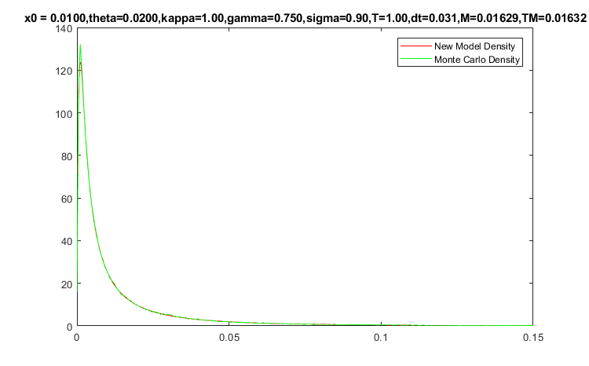](https://postimages.org/)

Please note that I very slightly modified the program after making graphs in previous post. Values there should be
closely but not identically retrieved. The above graph is exactly from the same program posted.

I will be posting another neat program with comments in a few hours(same thing but mess deleted and comments added).

Friends, I quickly noticed that first graph in previous post could not be produced by this program and it blew up.

Please change in the body of the main function

```
         wMu0dtA=wMu0dt;
            if(gamma>=.75)
                   
%wMu0dt(wnStart:wnStart+30)=wMu0dt(wnStart+30)-dwMu0dtdw(wnStart+30)*(w(wnStart+30)-w(w(wnStart:-1:wnStart-30)));
                    wMu0dtA(wnStart:wnStart+9)=wMu0dt(wnStart+10)-(10:-1:1).*dNn.*dwMu0dtdZ_0(wnStart+10);
                   
%wMu0dt(wnStart:wnStart+9)=wMu0dt(wnStart+10)-dwMu0dtdw(wnStart+10)*-1*(w(wnStart:wnStart+4)-w(wnStart+5));
            end

           plot((1:Nn),wMu0dt(1:Nn),'r',(1:Nn),wMu0dtA(1:Nn),'b');
           str=input('Look at wMu0dt linearly interpolated');

```

to

```
         wMu0dtA=wMu0dt;
         %   if(gamma>=.75)
         %       
 %wMu0dt(wnStart:wnStart+30)=wMu0dt(wnStart+30)-dwMu0dtdw(wnStart+30)*(w(wnStart+30)-w(w(wnStart:-1:wnStart-30)));
         %           wMu0dtA(wnStart:wnStart+9)=wMu0dt(wnStart+10)-(10:-1:1).*dNn.*dwMu0dtdZ_0(wnStart+10);
          %         
%wMu0dt(wnStart:wnStart+9)=wMu0dt(wnStart+10)-dwMu0dtdw(wnStart+10)*-1*(w(wnStart:wnStart+4)-w(wnStart+5));
           % end

           plot((1:Nn),wMu0dt(1:Nn),'r',(1:Nn),wMu0dtA(1:Nn),'b');
           str=input('Look at wMu0dt linearly interpolated');

```

and the above program will work perfectly. Just comment out the above if loop and program will work perfectly. Sorry
about this little problem.

---

### #1129 — Amin (Topic Author)
*April 21, 2021, 12:41 PM*

Friends, here is the neat and commented version of the main program. I have commented only the part that corresponds to
main new algorithm while comments at older section of the program are only legacy. I am sure friends will easily
understand the program.

Here is the program.

```
function [] = SDETransProb08WmtGrid200b80DriftO0()

%Copyright Ahsan Amin. Infiniti derivatives Technologies.
%Please fell free to connect on linkedin: linkedin.com/in/ahsan-amin-0a53334
%or skype ahsan.amin2999
%In this program, I am simulating the SDE given as
%dy(t)=mu1 x(t)^beta1 dt + mu2 x(t)^beta2 dt +sigma x(t)^gamma dz(t)

%I have not directly simulated the SDE but simulated the transformed
%Besse1 process version of the SDE and then changed coordinates to retreive
%the SDE in original coordinates.
%The present program will analytically evolve only the Bessel Process version of the
%SDE in transformed coordinates.

%In this program, I have simulated the density for first few very small time
%intervals using a simple method. After first few intervals, I start
%simulating with probability mass transfer method.  Please experiment with step size and
%you will find the method robust enough. This is just an early version and
%I will be coming with better versions soon.

%dt=.125/16/2/2/2;   % Regular Simulation time interval to advance the density before large step by CDF method.
dt=1/48*1/2*1/32;             %decrease dt for accuracy.

Tt1=32;
Tt2=32;

T=1;
dt2=(T-dt*Tt1)/Tt2;
Tt=Tt1+Tt2;
T=dt*Tt1+dt2*Tt2;
OrderA=4;  %
%dtM=dt/8;%.125/2/4;%Monte carlo time interval size dtM.
%TtM=Tt*8;%T*2*8*4;%Monte carlo number of simulation intervals.
dtM=T/32;%.125/2/4;%Monte carlo time interval size dtM.
TtM=32;

dNn=.05;   % Normal density subdivisions width. would change with number of subdivisions
Nn=200;  % No of normal density subdivisions
NnMidl=100;%One half density Subdivision left from mid of normal density(low)
NnMidh=101;%One half density subdivision right from the mid of normal density(high)
NnMid=4.0;

Z(1:Nn)=(((1:Nn)-20.5)*dNn-NnMid)

%There are two indices. One goes to Nn=200. This is used for calculation of
%SDE simulation at next time level t+1. This covers -5 to +5 SDs of
%underlying Z.
%Second index Nn1 below goes from 1 to 240. This covers -6 to +6 SD of
%underlying Z. In probability mass transfer methos, we simulate the SDE
%from -5 SD to +5 SD and then extrapolate on both sides so that we have a
%new grid from -6 SD to +6 SD(1:Nn1). This extrapolated grid(which is assigned time t)
%is used to calculate the time t+1 grid from -5 SD to +5 SD(1:Nn).
%Grid spacing is the same on both grids.
Nn1=240;
%dNn1=.05;
Nn1Midl=120;
Nn1Midh=121;
Nn1Mid=6.025;

Z1(1:Nn1)=((1:Nn1)*dNn-Nn1Mid)
Z1Prob(1)=normcdf(-5.95)-normcdf(-6.0);
Z1Prob(Nn1)=normcdf(6.0)-normcdf(5.95);
Z1Prob(2:Nn1-1)=normcdf(.5*Z1(2:Nn1-1)+.5*Z1(3:Nn1),0,1)-normcdf(.5*Z1(2:Nn1-1)+.5*Z1(1:Nn1-2),0,1);

ZProb(1:Nn)=Z1Prob(21:Nn1-20);
Z(1:Nn)=Z1(21:Nn1-20);

Z1Prob
sum(Z1Prob(1:Nn1))
sum(ZProb(1:Nn))
str=input('Look at Zs');

x0=.2;   % starting value of SDE
beta1=0.0;
beta2=1.00;   % Second drift term power.
gamma=.75;%50;   % volatility power.
kappa=1.0;%.950;   %mean reversion parameter.
theta=.01;%mean reversion target
sigma0=1.0;%Volatility value

%you can specify any general mu1 and mu2 and beta1 and beta2.
mu1=+1*theta*kappa;   %first drift coefficient.
mu2=-1*kappa;    % Second drift coefficient.
%mu1=0;
%mu2=0;

alpha=1;% x^alpha is being expanded. This is currently for monte carlo only.
alpha1=1-gamma;%This is for expansion of integrals for calculation of drift
%and volatility coefficients

w(1:Nn)=x0^(1-gamma)/(1-gamma);

Z
Z1
str=input('Look at Zs');
%%%%%%%%%%%%%%%%%%%%%%%%%%%%%%%%%%%%%%%%%%%%%%%%%%%%%%%%%%%%%%%%%%%%%%%%%%%%%%%%%%%%%%%%%%%%%%

sigma11(1:OrderA+1)=0;
mu11(1:OrderA+1)=0;
mu22(1:OrderA+1)=0;
sigma22(1:OrderA+1)=0;
% index 1 correponds to zero level since matlab indexing starts at one.
sigma11(1)=1;
mu11(1)=1;
mu22(1)=1;
sigma22(1)=1;

mu33(1)=1;
mu44(1)=1;
mu33(2:OrderA+1)=0;
mu44(2:OrderA+1)=0;

for k=1:(OrderA+1)
    if sigma0~=0
        sigma11(k)=sigma0^(k-1);
    end
    if mu1 ~= 0
        mu11(k)=mu1^(k-1);
    end
    if mu2 ~= 0
        mu22(k)=mu2^(k-1);
    end
    if sigma0~=0
        sigma22(k)=sigma0^(2*(k-1));
    end
end
%Ft(1:TtM+1,1:(OrderA+1),1:(OrderA+1),1:(OrderA+1),1:(OrderA+1))=0; %General time powers on hermite polynomials
Fp(1:(OrderA+1),1:(OrderA+1),1:(OrderA+1),1:(OrderA+1))=0;%General x powers on coefficients of hermite polynomials.
Fp1(1:(OrderA+1),1:(OrderA+1),1:(OrderA+1),1:(OrderA+1))=0;%General x powers for bessel transformed coordinates.

%YCoeff0 and YCoeff are coefficents for original coordinates monte carlo.
%YqCoeff0 and YqCoeff are bessel/lamperti version monte carlo.

YCoeff0(1:(OrderA+1),1:(OrderA+1),1:(OrderA+1),1:(OrderA+1))=0;
YqCoeff0(1:(OrderA+1),1:(OrderA+1),1:(OrderA+1),1:(OrderA+1))=0;
%Pre-compute the time and power exponent values in small multi-dimensional arrays
YCoeff = ItoTaylorCoeffsNew(alpha,beta1,beta2,gamma); %expand y^alpha where alpha=1;
YqCoeff = ItoTaylorCoeffsNew(alpha1,beta1,beta2,gamma);%expand y^alpha1 where alpha1=(1-gamma)
YqCoeff=YqCoeff/(1-gamma); %Transformed coordinates coefficients have to be
%further divided by (1-gamma)

for k = 0 : (OrderA)
    for m = 0:k
        l4 = k - m + 1;
        for n = 0 : m
            l3 = m - n + 1;
            for j = 0:n
                l2 = n - j + 1;
                l1 = j + 1;
                %Ft(l1,l2,l3,l4) = dtM^((l1-1) + (l2-1) + (l3-1) + .5* (l4-1));
                Fp(l1,l2,l3,l4) = (alpha + (l1-1) * beta1 + (l2-1) * beta2 + (l3-1) * 2* gamma + (l4-1) * gamma ...
                    - (l1-1) - (l2-1) - 2* (l3-1) - (l4-1));
                Fp1(l1,l2,l3,l4) = (alpha1 + (l1-1) * beta1 + (l2-1) * beta2 + (l3-1) * 2* gamma + (l4-1) * gamma ...
                    - (l1-1) - (l2-1) - 2* (l3-1) - (l4-1));

                YCoeff0(l1,l2,l3,l4) =YCoeff(l1,l2,l3,l4).*mu11(l1).*mu22(l2).*sigma22(l3).*sigma11(l4);
                YqCoeff0(l1,l2,l3,l4) =YqCoeff(l1,l2,l3,l4).*mu11(l1).*mu22(l2).*sigma22(l3).*sigma11(l4);
                YqzCoeff0(l1,l2,l3,l4) =YqCoeff(l1,l2,l3,l4).*mu33(l1).*mu44(l2).*sigma22(l3).*sigma11(l4);
            end
        end
    end
end

%%%%%%%%%%%%%%%%%%%%%%%%%%%%%%%%%%%%%%%%%%%%%%%%%%%%%%%%%%%%%%%%%%%%%%%%%%%%%%%%%%%%%%%%%%%%%%

wnStart=1;%
wnStart1=1;
yy(wnStart:Nn)=((1-gamma)*w(wnStart:Nn)).^(1/(1-gamma));
%The above yy(wnStart:Nn)=x0;
NN1=Nn1;
tic

for tt=1:Tt

   if(tt==1)

        w_00=x0^(1-gamma)/(1-gamma);
        %[wMu0dt,c1,c2,c3] = CalculateDriftAndVolA404B4Drift02(w_00,1,1,YqCoeff0,Fp1,gamma,dt);
        [wMu0dt,c1] = CalculateDriftAndVolA404(w_00,1,1,YqCoeff0,Fp1,gamma,dt);
        w(1:Nn)=x0^(1-gamma)/(1-gamma)+wMu0dt(1)+c1(1).*Z(1:Nn);%+c2(1).*(Z(1:Nn).^2-1)+c3(1).*(Z(1:Nn).^3-3*Z(1:Nn));

    end
     if((tt>1) && (ttTt1)    %Tt1 is when calculation with new method starts.

         dt=dt2;   %assign an appropriate step size to dt in this part of simulation.

        [wMu0dt,c1] = CalculateDriftAndVolA404(w,wnStart,Nn,YqCoeff0,Fp1,gamma,dt);
        [dwdZ_0,d2wdZ2_0,d3wdZ3_0] = First3Derivatives2ndOrderEqSpacedA(wnStart,Nn,dNn,w,Z);

        if(wnStart>=1)
            wnStart1=wnStart+20;%Because of 20 padded cells at start.
        end
        BB1(20+wnStart:Nn+20)=w(wnStart:Nn);  %Target grid from previous
        %step  is assigned to construct the starting grid. Index is changed
        %by amount of padding=20 on the left boundary od starting grid.
        if(wnStart1>=21)
            BB1(wnStart1-20:wnStart1-1)=BB1(wnStart1)-(20:-1:1).*dwdZ_0(wnStart)*dNn;

            %Above 20 cells are padded at starting boundary of starting
            %grid using linear extrapolation from the derivative on cell at
            %the boundary of the target grid from previous point.
            %"dwdZ_0(wnStart)" is derivative on first point on the left
            %boundary of previous grid.

            wnStart1=wnStart1-20;
            %Above:Now wnStart1 is appropriately decreased by 20 points after
            %padding 20 points using linear extrapolation.

            %Below: BB1 should strictly increase as we increase the index.
            %If some value is smaller than value to the left, it means that
            %grid has become corrupt there so we simply set that point as
            %starting point of our calculations and assign it as wnStart1.
            for mm=wnStart1:Nn1Midl
                if(BB1(mm)>=BB1(mm+1))
                    wnStart1=mm+1;
                    BB1(1:mm)=0.0;
                end
            end
        end
        BB1(Nn-10+20+1:Nn+20+20)=BB1(Nn-10+20)+(1:30).*dwdZ_0(Nn-10)*dNn;

        %Above extrapolated values using derivative at ten points to the
        %left of right boundary are padded to starting grid. Since
        %sometimes right side also becomes somewhat corrupt due to CDF
        %miscalculations on the right, I add thirty values to the right
        %using a value from ten points deep inside the left boundary. 20
        %values are to be padded to the right and ten extra points are
        %extrapolated in case they have gone bad and a total of thirty
        %points are being extrapolated.
        %wnStart=1;

            %plot(ZZ1(1:NN1),BB1(1:NN1),'b',ZZ1(1:NN1),BB1a(1:NN1),'y',ZZ1(1:NN1),BB1b(1:NN1),'k',Z(1:Nn),B1(1:Nn),'r')
            %str=input('Look at B1 and BB1, original and extrapolated version and boundaries');

            ww1(wnStart1:NN1)=BB1(wnStart1:NN1);

            [Muw,Sigmaw] = CalculateDriftAndVolA404(ww1,wnStart1,NN1,YqCoeff0,Fp1,gamma,dt);

    %        plot(ZZ1(wnStart1:NN1),ww1(wnStart1:NN1),'b',Z(wnStart1:Nn),w(wnStart1:Nn),'r')
            tt
    %        str=input('Look at comparison of interpolated and original w-0');

             %plot(ZZ1(1:NN1),Sigmaw(1:NN1),'b',Z(1:Nn),c1(1:Nn),'r')
    %         plot(ZZ1(1:NN1),Sigmaw(1:NN1),'b',ZZ1(1:NN1),dSigmawdw(1:NN1),'r')
    %        str=input('Look at comparison of original and interpolated vol coefficient-1');
            %plot(ZZ1(1:NN1),cc1(1:NN1),'b',Z(1:Nn),c1(1:Nn),'r')
            %str=input('Look at comparison of original and interpolated vol coefficient-1A');
            %plot(ZZ1(1:NN1),Muw(1:NN1),'b',Z(1:Nn),wMu0dt(1:Nn),'r')
     %       plot(ZZ1(1:NN1),Muw(1:NN1),'b',ZZ1(1:NN1),dMuwdw(1:NN1),'r')
     %       str=input('Look at drifts origianl and interpolated-2');
            %plot(ZZ1(1:NN1),ZZProb(1:NN1),'b',Z(1:Nn),ZProb(1:Nn),'r')
            %str=input('Look at Zprobss -3');
            %plot((1:Nn),Z(1:Nn),'r',(1:NN1)-20,ZZ1(1:NN1),'b')
            %str=input('Look at Zs -4');

            c1Guess(wnStart:Nn)=sigma0*sqrt(dt);
            Sigmaw_0(wnStart:Nn)=sqrt(dwdZ_0(wnStart:Nn).^2+ c1Guess(wnStart:Nn).^2);

%            plot(Z(wnStart:Nn),dwdZ_0(wnStart:Nn),'r');
%            str=input('Look at dwdZ_0 before addition to Bn');

%            plot(Z(wnStart:Nn),wMu0dt(wnStart:Nn),'r');
%            str=input('Look at dwdZ_0 before addition to Bn');

%Below: we project our (guess) target grid using estimate of volatility and
%drift which are being added to target grid at previous point.

            Bn(wnStart:Nn)=w(wnStart:Nn)+wMu0dt(wnStart:Nn)+(Sigmaw_0(wnStart:Nn)-dwdZ_0(wnStart:Nn)).*Z(wnStart:Nn);
            Bn(Bn1)
                ZZProb(wnStart1)=Z1Prob(wnStart1)+sum(Z1Prob(1:wnStart1-1));
                ZZProb(1:wnStart1-1)=0.0;
            end

            for mm=wnStart1:NN1

                %Below threshold is calculated using number of points on
                %the padded starting grid that are extra on top of wnstart
                %of the target grid of the previous time. These points were
                %padded using linear extrapolation and now we want to use them
                %with zero drift and constant first order volatility.
                Threshold=wnStart-wnStart1+20-1;

                %Below drift is turned to zero in the linearly extrapolated
                %padded zone and volatility is turned to first order value.
                 if(mm5*abs(Sigmaw(mm)))
                        nn2=nn;
                    end
                end
                Zt(1:Nn)=0.0;
                Pmn(1:Nn)=0.0;

                Zt(nn1:nn2)=(Bn(nn1:nn2)-Bm0(mm)-Muw(mm))/Sigmaw(mm);
                %Zt(nn1:nn2)=real(Zt(nn1:nn2));
                Pm0n(nn1:nn2)=normcdf(Zt(nn1:nn2),0,1);

                Pmn(nn1:nn2)=Pm0n(nn1:nn2).*ZZProb(mm);

                if(nn1>wnStart)
                    Pmn(1:nn1-1)=0;
                end
                if (nn235)
       w(Nn-30+1:Nn)=w(Nn-30)+(1:30).*dwdZ_1(Nn-30)*dNn;
  %     end

%Below is the grsph of newly calculated value of w.
%       plot((1:Nn),w(1:Nn),'r')
%       str=input('Calculated Value of w');
    end
end

%below D's (the names of variables starting with D) are
%change of probability derivatives.

y_w(1:Nn)=0;
y_w(wnStart:Nn) = ((1-gamma)*w(wnStart:Nn)).^(1/(1-gamma));
Dfy_w(wnStart:Nn)=0;
for nn=wnStart+1:Nn-1
    Dfy_w(nn) = (y_w(nn + 1) - y_w(nn - 1))/(Z(nn + 1) - Z(nn - 1));
    %Change of variable derivative for densities
end
py_w(1:Nn)=0;
for nn = wnStart:Nn-1
    py_w(nn) = (normpdf(Z(nn),0, 1))/abs(Dfy_w(nn));%Origianl coordinates density
end

toc

ItoHermiteMean=sum(y_w(wnStart+1:Nn-1).*ZProb(wnStart+1:Nn-1)) %Original process average from coordinates
disp('true Mean only applicable to standard SV mean reverting type models otherwise disregard');
TrueMean=theta+(x0-theta)*exp(-kappa*T)%Mean reverting SDE original variable true average

rng(29079137, 'twister')
paths=200000;
YY(1:paths)=x0;  %Original process monte carlo.
Random1(1:paths)=0;
%for tt=1:(Tt-1)+8
for tt=1:TtM
if(tt>Tt1)
    %dtM=dt2/8;
end
    Random1=randn(size(Random1));
    HermiteP1(1,1:paths)=1;
    HermiteP1(2,1:paths)=Random1(1:paths);
    HermiteP1(3,1:paths)=Random1(1:paths).^2-1;
    HermiteP1(4,1:paths)=Random1(1:paths).^3-3*Random1(1:paths);
    HermiteP1(5,1:paths)=Random1(1:paths).^4-6*Random1(1:paths).^2+3;

    YY(1:paths)=YY(1:paths) + ...
        (YCoeff0(1,1,2,1).*YY(1:paths).^Fp(1,1,2,1)+ ...
        YCoeff0(1,2,1,1).*YY(1:paths).^Fp(1,2,1,1)+ ...
        YCoeff0(2,1,1,1).*YY(1:paths).^Fp(2,1,1,1))*dtM + ...
        (YCoeff0(1,1,3,1).*YY(1:paths).^Fp(1,1,3,1)+ ...
        YCoeff0(1,2,2,1).*YY(1:paths).^Fp(1,2,2,1)+ ...
        YCoeff0(2,1,2,1).*YY(1:paths).^Fp(2,1,2,1)+ ...
        YCoeff0(1,3,1,1).*YY(1:paths).^Fp(1,3,1,1)+ ...
        YCoeff0(2,2,1,1).*YY(1:paths).^Fp(2,2,1,1)+ ...
        YCoeff0(3,1,1,1).*YY(1:paths).^Fp(3,1,1,1))*dtM^2 + ...
        ((YCoeff0(1,1,1,2).*YY(1:paths).^Fp(1,1,1,2).*sqrt(dtM))+ ...
        (YCoeff0(1,1,2,2).*YY(1:paths).^Fp(1,1,2,2)+ ...
        YCoeff0(1,2,1,2).*YY(1:paths).^Fp(1,2,1,2)+ ...
        YCoeff0(2,1,1,2).*YY(1:paths).^Fp(2,1,1,2)).*dtM^1.5) .*HermiteP1(2,1:paths) + ...
        ((YCoeff0(1,1,1,3).*YY(1:paths).^Fp(1,1,1,3) *dtM) + ...
        (YCoeff0(1,1,2,3).*YY(1:paths).^Fp(1,1,2,3)+ ...
        YCoeff0(1,2,1,3).*YY(1:paths).^Fp(1,2,1,3)+ ...
        YCoeff0(2,1,1,3).*YY(1:paths).^Fp(2,1,1,3)).*dtM^2).*HermiteP1(3,1:paths) + ...
        ((YCoeff0(1,1,1,4).*YY(1:paths).^Fp(1,1,1,4)*dtM^1.5 )).*HermiteP1(4,1:paths) + ...
        (YCoeff0(1,1,1,5).*YY(1:paths).^Fp(1,1,1,5)*dtM^2.0).*HermiteP1(5,1:paths);

end

YY(YY<0)=0;
disp('Original process average from monte carlo');
MCMean=sum(YY(:))/paths %origianl coordinates monte carlo average.
MCVar=sum((YY(:)-MCMean).^2)/paths
disp('Original process average from our simulation');
ItoHermiteMean=sum(y_w(wnStart+1:Nn-1).*ZProb(wnStart+1:Nn-1)) %Original process average from coordinates
ItoHermiteVar=sum((y_w(wnStart+1:Nn-1)-ItoHermiteMean).^2.*ZProb(wnStart+1:Nn-1))
disp('true Mean only applicble to standard SV mean reverting type models otherwise disregard');
TrueMean=theta+(x0-theta)*exp(-kappa*T)%Mean reverting SDE original variable true average

MaxCutOff=30;
NoOfBins=round(300*gamma^2*4*sigma0/sqrt(MCMean)/(1+kappa));%Decrease the number of bins if the graph is too
[YDensity,IndexOutY,IndexMaxY] = MakeDensityFromSimulation_Infiniti_NEW(YY,paths,NoOfBins,MaxCutOff );

%plot(y_w1(wnStart+1:Nn-1),py_w1(wnStart+1:Nn-1),'b',y_w(wnStart+1:Nn-1),py_w(wnStart+1:Nn-1),'r',IndexOutY(1:IndexMaxY),YDensity(1:IndexMaxY),'g');
%plot(y_w(wnStart+1:Nn-1),py_w(wnStart+1:Nn-1),'r',IndexOutY(1:IndexMaxY),YDensity(1:IndexMaxY),'g');
plot(y_w(wnStart+1:Nn-1),py_w(wnStart+1:Nn-1),'r',IndexOutY(1:IndexMaxY),YDensity(1:IndexMaxY),'g');

title(sprintf('x0 = %.4f,theta=%.4f,kappa=%.2f,gamma=%.3f,sigma=%.2f,T=%.2f,dt=%.3f,M=%.5f,TM=%.5f',
x0,theta,kappa,gamma,sigma0,T,dt,ItoHermiteMean,TrueMean));%,sprintf('theta= %f', theta), sprintf('kappa = %f',
kappa),sprintf('sigma = %f', sigma0),sprintf('T = %f', T));

legend({'New Model Density','Monte Carlo Density'},'Location','northeast')

str=input('red line is density of SDE from Ito-Hermite method, green is monte carlo.');
end
```

.

.

Here is the last output when you run this program:

Elapsed time is 2.476761 seconds.

ItoHermiteMean =

   0.080058929576259

true Mean only applicable to standard SV mean reverting type models otherwise disregard

TrueMean =

   0.079897093822574

Original process average from monte carlo

MCMean =

  0.080205149759109 - 0.000000084956820i

MCVar =

  0.025910900616490 + 0.000000011733038i

Original process average from our simulation

ItoHermiteMean =

   0.080058929576259

ItoHermiteVar =

   0.025206289664637

true Mean only applicble to standard SV mean reverting type models otherwise disregard

TrueMean =

   0.079897093822574

IndexMax =

        1193

red line is density of SDE from Ito-Hermite method, green is monte carlo.

And here is the graph, you will see when you run the program. I have adjusted the Axes scales to visualize the main body
of the graph.

[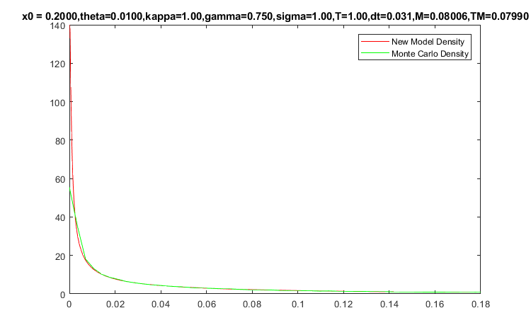](https://postimages.org/)

---

### #1130 — Amin (Topic Author)
*April 23, 2021, 7:31 AM*

Friends, I want to alter the above program and try to add second hermite polynomial in calculations using quadratic
formula(and not earlier approximation). I want to see whether adding second hermite polynomial improves the density on
the right boundary where it sometimes becomes unstable since in some of my other experiments I have seen that adding
second hermite polynomial adds to stability on the right. I am not sure if it would work but want to explore this and
will let friends know how it goes.

---

### #1131 — Amin (Topic Author)
*April 23, 2021, 9:56 AM*

Here I am posting the modified version of the previous program in which I have used quadratic formula with second
hermite polynomial for simulation of SDEs. I have removed(commented) the linear reconstruction on the right boundary of
the density with linear extrapolation and it seems to work perfectly well(without any extrapolation reconstruction) for
a lot of cases I ran with simulations but you can still uncomment it if you need it somewhere. After the final time of
the simulation, a lot of points on the left starting boundary of the density have been cut, I reconstruct them with
linear extrapolation that I did not do before. You can replace it with your favorite method of extrapolation.

Here is the program.

```
function [] = SDETransProb08WmtGrid200b80DriftO0()

%Copyright Ahsan Amin. Infiniti derivatives Technologies.
%Please fell free to connect on linkedin: linkedin.com/in/ahsan-amin-0a53334
%or skype ahsan.amin2999
%In this program, I am simulating the SDE given as
%dy(t)=mu1 x(t)^beta1 dt + mu2 x(t)^beta2 dt +sigma x(t)^gamma dz(t)

%I have not directly simulated the SDE but simulated the transformed
%Besse1 process version of the SDE and then changed coordinates to retreive
%the SDE in original coordinates.
%The present program will analytically evolve only the Bessel Process version of the
%SDE in transformed coordinates.

%In this program, I have simulated the density for first few very small time
%intervals using a simple method. After first few intervals, I start
%simulating with probability mass transfer method.  Please experiment with step size and
%you will find the method robust enough. This is just an early version and
%I will be coming with better versions soon.

%dt=.125/16/2/2/2;   % Regular Simulation time interval to advance the density before large step by CDF method.
dt=1/48*1/2*1/32;             %decrease dt for accuracy.

Tt1=32;
Tt2=32;

T=1;
dt2=(T-dt*Tt1)/Tt2;
Tt=Tt1+Tt2;
T=dt*Tt1+dt2*Tt2;
OrderA=4;  %
%dtM=dt/8;%.125/2/4;%Monte carlo time interval size dtM.
%TtM=Tt*8;%T*2*8*4;%Monte carlo number of simulation intervals.
dtM=T/32;%.125/2/4;%Monte carlo time interval size dtM.
TtM=32;

dNn=.05;   % Normal density subdivisions width. would change with number of subdivisions
Nn=200;  % No of normal density subdivisions
NnMidl=100;%One half density Subdivision left from mid of normal density(low)
NnMidh=101;%One half density subdivision right from the mid of normal density(high)
NnMid=4.0;

Z(1:Nn)=(((1:Nn)-20.5)*dNn-NnMid)

%There are two indices. One goes to Nn=200. This is used for calculation of
%SDE simulation at next time level t+1. This covers -5 to +5 SDs of
%underlying Z.
%Second index Nn1 below goes from 1 to 240. This covers -6 to +6 SD of
%underlying Z. In probability mass transfer methos, we simulate the SDE
%from -5 SD to +5 SD and then extrapolate on both sides so that we have a
%new grid from -6 SD to +6 SD(1:Nn1). This extrapolated grid(which is assigned time t)
%is used to calculate the time t+1 grid from -5 SD to +5 SD(1:Nn).
%Grid spacing is the same on both grids.
Nn1=240;
%dNn1=.05;
Nn1Midl=120;
Nn1Midh=121;
Nn1Mid=6.025;

Z1(1:Nn1)=((1:Nn1)*dNn-Nn1Mid)
Z1Prob(1)=normcdf(-5.95)-normcdf(-6.0);
Z1Prob(Nn1)=normcdf(6.0)-normcdf(5.95);
Z1Prob(2:Nn1-1)=normcdf(.5*Z1(2:Nn1-1)+.5*Z1(3:Nn1),0,1)-normcdf(.5*Z1(2:Nn1-1)+.5*Z1(1:Nn1-2),0,1);

ZProb(1:Nn)=Z1Prob(21:Nn1-20);
Z(1:Nn)=Z1(21:Nn1-20);

Z1Prob
sum(Z1Prob(1:Nn1))
sum(ZProb(1:Nn))
str=input('Look at Zs');

x0=.014;   % starting value of SDE
beta1=0.0;
beta2=1.00;   % Second drift term power.
gamma=.85;%50;   % volatility power.
kappa=1.0;%.950;   %mean reversion parameter.
theta=.014;%mean reversion target
sigma0=1.0;%Volatility value

%you can specify any general mu1 and mu2 and beta1 and beta2.
mu1=+1*theta*kappa;   %first drift coefficient.
mu2=-1*kappa;    % Second drift coefficient.
%mu1=0;
%mu2=0;

alpha=1;% x^alpha is being expanded. This is currently for monte carlo only.
alpha1=1-gamma;%This is for expansion of integrals for calculation of drift
%and volatility coefficients

w(1:Nn)=x0^(1-gamma)/(1-gamma);

Z
Z1
str=input('Look at Zs');
%%%%%%%%%%%%%%%%%%%%%%%%%%%%%%%%%%%%%%%%%%%%%%%%%%%%%%%%%%%%%%%%%%%%%%%%%%%%%%%%%%%%%%%%%%%%%%

sigma11(1:OrderA+1)=0;
mu11(1:OrderA+1)=0;
mu22(1:OrderA+1)=0;
sigma22(1:OrderA+1)=0;
% index 1 correponds to zero level since matlab indexing starts at one.
sigma11(1)=1;
mu11(1)=1;
mu22(1)=1;
sigma22(1)=1;

mu33(1)=1;
mu44(1)=1;
mu33(2:OrderA+1)=0;
mu44(2:OrderA+1)=0;

for k=1:(OrderA+1)
    if sigma0~=0
        sigma11(k)=sigma0^(k-1);
    end
    if mu1 ~= 0
        mu11(k)=mu1^(k-1);
    end
    if mu2 ~= 0
        mu22(k)=mu2^(k-1);
    end
    if sigma0~=0
        sigma22(k)=sigma0^(2*(k-1));
    end
end
%Ft(1:TtM+1,1:(OrderA+1),1:(OrderA+1),1:(OrderA+1),1:(OrderA+1))=0; %General time powers on hermite polynomials
Fp(1:(OrderA+1),1:(OrderA+1),1:(OrderA+1),1:(OrderA+1))=0;%General x powers on coefficients of hermite polynomials.
Fp1(1:(OrderA+1),1:(OrderA+1),1:(OrderA+1),1:(OrderA+1))=0;%General x powers for bessel transformed coordinates.

%YCoeff0 and YCoeff are coefficents for original coordinates monte carlo.
%YqCoeff0 and YqCoeff are bessel/lamperti version monte carlo.

YCoeff0(1:(OrderA+1),1:(OrderA+1),1:(OrderA+1),1:(OrderA+1))=0;
YqCoeff0(1:(OrderA+1),1:(OrderA+1),1:(OrderA+1),1:(OrderA+1))=0;
%Pre-compute the time and power exponent values in small multi-dimensional arrays
YCoeff = ItoTaylorCoeffsNew(alpha,beta1,beta2,gamma); %expand y^alpha where alpha=1;
YqCoeff = ItoTaylorCoeffsNew(alpha1,beta1,beta2,gamma);%expand y^alpha1 where alpha1=(1-gamma)
YqCoeff=YqCoeff/(1-gamma); %Transformed coordinates coefficients have to be
%further divided by (1-gamma)

for k = 0 : (OrderA)
    for m = 0:k
        l4 = k - m + 1;
        for n = 0 : m
            l3 = m - n + 1;
            for j = 0:n
                l2 = n - j + 1;
                l1 = j + 1;
                %Ft(l1,l2,l3,l4) = dtM^((l1-1) + (l2-1) + (l3-1) + .5* (l4-1));
                Fp(l1,l2,l3,l4) = (alpha + (l1-1) * beta1 + (l2-1) * beta2 + (l3-1) * 2* gamma + (l4-1) * gamma ...
                    - (l1-1) - (l2-1) - 2* (l3-1) - (l4-1));
                Fp1(l1,l2,l3,l4) = (alpha1 + (l1-1) * beta1 + (l2-1) * beta2 + (l3-1) * 2* gamma + (l4-1) * gamma ...
                    - (l1-1) - (l2-1) - 2* (l3-1) - (l4-1));

                YCoeff0(l1,l2,l3,l4) =YCoeff(l1,l2,l3,l4).*mu11(l1).*mu22(l2).*sigma22(l3).*sigma11(l4);
                YqCoeff0(l1,l2,l3,l4) =YqCoeff(l1,l2,l3,l4).*mu11(l1).*mu22(l2).*sigma22(l3).*sigma11(l4);
                YqzCoeff0(l1,l2,l3,l4) =YqCoeff(l1,l2,l3,l4).*mu33(l1).*mu44(l2).*sigma22(l3).*sigma11(l4);
            end
        end
    end
end

%%%%%%%%%%%%%%%%%%%%%%%%%%%%%%%%%%%%%%%%%%%%%%%%%%%%%%%%%%%%%%%%%%%%%%%%%%%%%%%%%%%%%%%%%%%%%%

wnStart=1;%
wnStart1=1;
yy(wnStart:Nn)=((1-gamma)*w(wnStart:Nn)).^(1/(1-gamma));
%The above yy(wnStart:Nn)=x0;
NN1=Nn1;
tic

for tt=1:Tt

   if(tt==1)

        w_00=x0^(1-gamma)/(1-gamma);
        %[wMu0dt,c1,c2,c3] = CalculateDriftAndVolA404B4Drift02(w_00,1,1,YqCoeff0,Fp1,gamma,dt);
        [wMu0dt,c1] = CalculateDriftAndVolA404(w_00,1,1,YqCoeff0,Fp1,gamma,dt);
        w(1:Nn)=x0^(1-gamma)/(1-gamma)+wMu0dt(1)+c1(1).*Z(1:Nn);%+c2(1).*(Z(1:Nn).^2-1)+c3(1).*(Z(1:Nn).^3-3*Z(1:Nn));

    end
     if((tt>1) && (ttTt1)    %Tt1 is when calculation with new method starts.

         dt=dt2;   %assign an appropriate step size to dt in this part of simulation.

        [wMu0dt,c1] = CalculateDriftAndVolA404(w,wnStart,Nn,YqCoeff0,Fp1,gamma,dt);
        [dwdZ_0,d2wdZ2_0,d3wdZ3_0] = First3Derivatives2ndOrderEqSpacedA(wnStart,Nn,dNn,w,Z);

        if(wnStart>=1)
            wnStart1=wnStart+20;%Because of 20 padded cells at start.
        end
        BB1(20+wnStart:Nn+20)=w(wnStart:Nn);  %Target grid from previous
        %step  is assigned to construct the starting grid. Index is changed
        %by amount of padding=20 on the left boundary od starting grid.
        if(wnStart1>=21)
            BB1(wnStart1-20:wnStart1-1)=BB1(wnStart1)-(20:-1:1).*dwdZ_0(wnStart)*dNn;

            %Above 20 cells are padded at starting boundary of starting
            %grid using linear extrapolation from the derivative on cell at
            %the boundary of the target grid from previous point.
            %"dwdZ_0(wnStart)" is derivative on first point on the left
            %boundary of previous grid.

            wnStart1=wnStart1-20;
            %Above:Now wnStart1 is appropriately decreased by 20 points after
            %padding 20 points using linear extrapolation.

            %Below: BB1 should strictly increase as we increase the index.
            %If some value is smaller than value to the left, it means that
            %grid has become corrupt there so we simply set that point as
            %starting point of our calculations and assign it as wnStart1.
            for mm=wnStart1:Nn1Midl
                if(BB1(mm)>=BB1(mm+1))
                    wnStart1=mm+1;
                    BB1(1:mm)=0.0;
                end
            end
        end
        BB1(Nn-10+20+1:Nn+20+20)=BB1(Nn-10+20)+(1:30).*dwdZ_0(Nn-10)*dNn;

        %Above extrapolated values using derivative at ten points to the
        %left of right boundary are padded to starting grid. Since
        %sometimes right side also becomes somewhat corrupt due to CDF
        %miscalculations on the right, I add thirty values to the right
        %using a value from ten points deep inside the left boundary. 20
        %values are to be padded to the right and ten extra points are
        %extrapolated in case they have gone bad and a total of thirty
        %points are being extrapolated.
        %wnStart=1;

            %plot(ZZ1(1:NN1),BB1(1:NN1),'b',ZZ1(1:NN1),BB1a(1:NN1),'y',ZZ1(1:NN1),BB1b(1:NN1),'k',Z(1:Nn),B1(1:Nn),'r')
            %str=input('Look at B1 and BB1, original and extrapolated version and boundaries');

            %ww1(wnStart1:NN1)=BB1(wnStart1:NN1);

            %[Muw,Sigmaw] = CalculateDriftAndVolA404(ww1,wnStart1,NN1,YqCoeff0,Fp1,gamma,dt);

            [Muw,Sigmaw,Sigma2w,Sigma3w] = CalculateDriftAndVolA404B4Drift02(BB1,wnStart1,NN1,YqCoeff0,Fp1,gamma,dt);

    %        plot(ZZ1(wnStart1:NN1),ww1(wnStart1:NN1),'b',Z(wnStart1:Nn),w(wnStart1:Nn),'r')
            tt
    %        str=input('Look at comparison of interpolated and original w-0');

             %plot(ZZ1(1:NN1),Sigmaw(1:NN1),'b',Z(1:Nn),c1(1:Nn),'r')
    %         plot(ZZ1(1:NN1),Sigmaw(1:NN1),'b',ZZ1(1:NN1),dSigmawdw(1:NN1),'r')
    %        str=input('Look at comparison of original and interpolated vol coefficient-1');
            %plot(ZZ1(1:NN1),cc1(1:NN1),'b',Z(1:Nn),c1(1:Nn),'r')
            %str=input('Look at comparison of original and interpolated vol coefficient-1A');
            %plot(ZZ1(1:NN1),Muw(1:NN1),'b',Z(1:Nn),wMu0dt(1:Nn),'r')
     %       plot(ZZ1(1:NN1),Muw(1:NN1),'b',ZZ1(1:NN1),dMuwdw(1:NN1),'r')
     %       str=input('Look at drifts origianl and interpolated-2');
            %plot(ZZ1(1:NN1),ZZProb(1:NN1),'b',Z(1:Nn),ZProb(1:Nn),'r')
            %str=input('Look at Zprobss -3');
            %plot((1:Nn),Z(1:Nn),'r',(1:NN1)-20,ZZ1(1:NN1),'b')
            %str=input('Look at Zs -4');

            c1Guess(wnStart:Nn)=sigma0*sqrt(dt);
            Sigmaw_0(wnStart:Nn)=sqrt(dwdZ_0(wnStart:Nn).^2+ c1Guess(wnStart:Nn).^2);

%            plot(Z(wnStart:Nn),dwdZ_0(wnStart:Nn),'r');
%            str=input('Look at dwdZ_0 before addition to Bn');

%            plot(Z(wnStart:Nn),wMu0dt(wnStart:Nn),'r');
%            str=input('Look at dwdZ_0 before addition to Bn');

%Below: we project our (guess) target grid using estimate of volatility and
%drift which are being added to target grid at previous point.

            Bn(wnStart:Nn)=w(wnStart:Nn)+wMu0dt(wnStart:Nn)+(Sigmaw_0(wnStart:Nn)-dwdZ_0(wnStart:Nn)).*Z(wnStart:Nn);
            Bn(Bn1)
                ZZProb(wnStart1)=Z1Prob(wnStart1)+sum(Z1Prob(1:wnStart1-1));
                ZZProb(1:wnStart1-1)=0.0;
            end

            for mm=wnStart1:NN1

                %Below threshold is calculated using number of points on
                %the padded starting grid that are extra on top of wnstart
                %of the target grid of the previous time. These points were
                %padded using linear extrapolation and now we want to use them
                %with zero drift and constant first order volatility.
                Threshold=wnStart-wnStart1+20-1;

                %Below drift is turned to zero in the linearly extrapolated
                %padded zone and volatility is turned to first order value.
                 if(mm5*abs(Sigmaw(mm)))
                        nn2=nn;
                    end
                end
                Zt(1:Nn)=0.0;
                Pmn(1:Nn)=0.0;

                if(mm0)
                %    %Zt(mm,wnStart:Nn)=(-dw02(mm) +
sqrt(dw02(mm).^2+4*c22(mm).*(-W2(wnStart:Nn)+W1(mm)+1*wMu0dt2(mm)-c22(mm))))./(2*c22(mm));
                        Zt(nn1:nn2)=(2*(-Bn(nn1:nn2)+Bm0(mm)+Muw(mm)-Sigma2w(mm)))./(-Sigmaw(mm) +
sqrt(Sigmaw(mm).^2+4*Sigma2w(mm).*(-Bn(nn1:nn2)+Bm0(mm)+Muw(mm)-Sigma2w(mm))));
                    else
                        Zt(nn1:nn2)=(2*(-Bn(nn1:nn2)+Bm0(mm)+Muw(mm)-Sigma2w(mm)))./(-Sigmaw(mm) -
sqrt(Sigmaw(mm).^2-4*Sigma2w(mm).*(-Bn(nn1:nn2)+Bm0(mm)+Muw(mm)-Sigma2w(mm))));
                    end

                end
                Zt(nn1:nn2)=real(Zt(nn1:nn2));
                Pm0n(nn1:nn2)=normcdf(Zt(nn1:nn2),0,1);

                Pmn(nn1:nn2)=Pm0n(nn1:nn2).*ZZProb(mm);

                if(nn1>wnStart)
                    Pmn(1:nn1-1)=0;
                end
                if (nn235)
%       w(Nn-30+1:Nn)=w(Nn-30)+(1:30).*dwdZ_1(Nn-30)*dNn;
  %     end

%Below is the grsph of newly calculated value of w.
%       plot((1:Nn),w(1:Nn),'r')
%       str=input('Calculated Value of w');
    end
end

%Below: After the final point in simulation has reached,
%Since a lot of points on the left side of the density have been
%cut, we reconstruct them with linear extrapolation. This extrapolation is
%relatively poor, replace with your favorite method to extrapolate the
%first few points of the density.
[dwdZ_2,d2wdZ2_2,d3wdZ3_2] = First3Derivatives2ndOrderEqSpacedA(wnStart,Nn,dNn,w,Z);
  %w(1:wnStart-1)=w(wnStart)-(wnStart-1:-1:1).*dwdZ_2(wnStart)*dNn;
  w(1:wnStart+1)=w(wnStart+2)-(wnStart+1:-1:1).*dwdZ_2(wnStart+2)*dNn;%
  wnStart=1;
     for nn=1:NnMid
                if(w(nn)Tt1)
    %dtM=dt2/8;
end
    Random1=randn(size(Random1));
    HermiteP1(1,1:paths)=1;
    HermiteP1(2,1:paths)=Random1(1:paths);
    HermiteP1(3,1:paths)=Random1(1:paths).^2-1;
    HermiteP1(4,1:paths)=Random1(1:paths).^3-3*Random1(1:paths);
    HermiteP1(5,1:paths)=Random1(1:paths).^4-6*Random1(1:paths).^2+3;

    YY(1:paths)=YY(1:paths) + ...
        (YCoeff0(1,1,2,1).*YY(1:paths).^Fp(1,1,2,1)+ ...
        YCoeff0(1,2,1,1).*YY(1:paths).^Fp(1,2,1,1)+ ...
        YCoeff0(2,1,1,1).*YY(1:paths).^Fp(2,1,1,1))*dtM + ...
        (YCoeff0(1,1,3,1).*YY(1:paths).^Fp(1,1,3,1)+ ...
        YCoeff0(1,2,2,1).*YY(1:paths).^Fp(1,2,2,1)+ ...
        YCoeff0(2,1,2,1).*YY(1:paths).^Fp(2,1,2,1)+ ...
        YCoeff0(1,3,1,1).*YY(1:paths).^Fp(1,3,1,1)+ ...
        YCoeff0(2,2,1,1).*YY(1:paths).^Fp(2,2,1,1)+ ...
        YCoeff0(3,1,1,1).*YY(1:paths).^Fp(3,1,1,1))*dtM^2 + ...
        ((YCoeff0(1,1,1,2).*YY(1:paths).^Fp(1,1,1,2).*sqrt(dtM))+ ...
        (YCoeff0(1,1,2,2).*YY(1:paths).^Fp(1,1,2,2)+ ...
        YCoeff0(1,2,1,2).*YY(1:paths).^Fp(1,2,1,2)+ ...
        YCoeff0(2,1,1,2).*YY(1:paths).^Fp(2,1,1,2)).*dtM^1.5) .*HermiteP1(2,1:paths) + ...
        ((YCoeff0(1,1,1,3).*YY(1:paths).^Fp(1,1,1,3) *dtM) + ...
        (YCoeff0(1,1,2,3).*YY(1:paths).^Fp(1,1,2,3)+ ...
        YCoeff0(1,2,1,3).*YY(1:paths).^Fp(1,2,1,3)+ ...
        YCoeff0(2,1,1,3).*YY(1:paths).^Fp(2,1,1,3)).*dtM^2).*HermiteP1(3,1:paths) + ...
        ((YCoeff0(1,1,1,4).*YY(1:paths).^Fp(1,1,1,4)*dtM^1.5 )).*HermiteP1(4,1:paths) + ...
        (YCoeff0(1,1,1,5).*YY(1:paths).^Fp(1,1,1,5)*dtM^2.0).*HermiteP1(5,1:paths);

end

YY(YY<0)=0;
disp('Original process average from monte carlo');
MCMean=sum(YY(:))/paths %origianl coordinates monte carlo average.
MCVar=sum((YY(:)-MCMean).^2)/paths
disp('Original process average from our simulation');
ItoHermiteMean=sum(y_w(wnStart+1:Nn-1).*ZProb(wnStart+1:Nn-1)) %Original process average from coordinates
ItoHermiteVar=sum((y_w(wnStart+1:Nn-1)-ItoHermiteMean).^2.*ZProb(wnStart+1:Nn-1))
disp('true Mean only applicble to standard SV mean reverting type models otherwise disregard');
TrueMean=theta+(x0-theta)*exp(-kappa*T)%Mean reverting SDE original variable true average

MaxCutOff=30;
NoOfBins=round(300*gamma^2*4*sigma0/sqrt(MCMean)/(1+kappa));%Decrease the number of bins if the graph is too
[YDensity,IndexOutY,IndexMaxY] = MakeDensityFromSimulation_Infiniti_NEW(YY,paths,NoOfBins,MaxCutOff );

%plot(y_w1(wnStart+1:Nn-1),py_w1(wnStart+1:Nn-1),'b',y_w(wnStart+1:Nn-1),py_w(wnStart+1:Nn-1),'r',IndexOutY(1:IndexMaxY),YDensity(1:IndexMaxY),'g');
%plot(y_w(wnStart+1:Nn-1),py_w(wnStart+1:Nn-1),'r',IndexOutY(1:IndexMaxY),YDensity(1:IndexMaxY),'g');
plot(y_w(wnStart+1:Nn-1),py_w(wnStart+1:Nn-1),'r',IndexOutY(1:IndexMaxY),YDensity(1:IndexMaxY),'g');

title(sprintf('x0 = %.4f,theta=%.4f,kappa=%.2f,gamma=%.3f,sigma=%.2f,T=%.2f,dt=%.3f,M=%.5f,TM=%.5f',
x0,theta,kappa,gamma,sigma0,T,dt,ItoHermiteMean,TrueMean));%,sprintf('theta= %f', theta), sprintf('kappa = %f',
kappa),sprintf('sigma = %f', sigma0),sprintf('T = %f', T));

legend({'New Model Density','Monte Carlo Density'},'Location','northeast')

str=input('red line is density of SDE from Ito-Hermite method, green is monte carlo.');
end
```

.

Here is another function you will need.

.

.

```
function [wMu0dt,c1,c2,c3] = CalculateDriftAndVolA404B4Drift02(w,wnStart,Nn,YqCoeff0,Fp1,gamma,dt)

yy(wnStart:Nn)=((1-gamma)*w(wnStart:Nn)).^(1/(1-gamma));

Fp2=Fp1/(1-gamma);

wMu0dt(wnStart:Nn)=(YqCoeff0(1,1,2,1).*yy(wnStart:Nn).^Fp1(1,1,2,1)+ ...
    YqCoeff0(1,2,1,1).*yy(wnStart:Nn).^Fp1(1,2,1,1)+ ...
    YqCoeff0(2,1,1,1).*yy(wnStart:Nn).^Fp1(2,1,1,1))*dt + ...
    (YqCoeff0(1,1,3,1).*yy(wnStart:Nn).^Fp1(1,1,3,1)+ ...
    YqCoeff0(1,2,2,1).*yy(wnStart:Nn).^Fp1(1,2,2,1)+ ...
    YqCoeff0(2,1,2,1).*yy(wnStart:Nn).^Fp1(2,1,2,1)+ ...
    YqCoeff0(1,3,1,1).*yy(wnStart:Nn).^Fp1(1,3,1,1)+ ...
    YqCoeff0(2,2,1,1).*yy(wnStart:Nn).^Fp1(2,2,1,1)+ ...
    YqCoeff0(3,1,1,1).*yy(wnStart:Nn).^Fp1(3,1,1,1))*dt^2 + ...
     (YqCoeff0(1,1,4,1).*yy(wnStart:Nn).^Fp1(1,1,4,1)+ ...
     YqCoeff0(1,2,3,1).*yy(wnStart:Nn).^Fp1(1,2,3,1)+ ...
     YqCoeff0(2,1,3,1).*yy(wnStart:Nn).^Fp1(2,1,3,1)+ ...
     YqCoeff0(1,3,2,1).*yy(wnStart:Nn).^Fp1(1,3,2,1)+ ...
     YqCoeff0(2,2,2,1).*yy(wnStart:Nn).^Fp1(2,2,2,1)+ ...
     YqCoeff0(3,1,2,1).*yy(wnStart:Nn).^Fp1(3,1,2,1)+ ...
     YqCoeff0(1,4,1,1).*yy(wnStart:Nn).^Fp1(1,4,1,1)+ ...
     YqCoeff0(2,3,1,1).*yy(wnStart:Nn).^Fp1(2,3,1,1)+ ...
     YqCoeff0(3,2,1,1).*yy(wnStart:Nn).^Fp1(3,2,1,1)+ ...
     YqCoeff0(4,1,1,1).*yy(wnStart:Nn).^Fp1(4,1,1,1))*dt^3+ ...
     (YqCoeff0(1,1,5,1).*yy(wnStart:Nn).^Fp1(1,1,5,1)+ ...
      YqCoeff0(1,2,4,1).*yy(wnStart:Nn).^Fp1(1,2,4,1)+ ...
      YqCoeff0(2,1,4,1).*yy(wnStart:Nn).^Fp1(2,1,4,1)+ ...
       YqCoeff0(2,2,3,1).*yy(wnStart:Nn).^Fp1(2,2,3,1)+ ...
       YqCoeff0(3,1,3,1).*yy(wnStart:Nn).^Fp1(3,1,3,1)+ ...
       YqCoeff0(1,4,2,1).*yy(wnStart:Nn).^Fp1(1,4,2,1)+ ...
       YqCoeff0(2,3,2,1).*yy(wnStart:Nn).^Fp1(2,3,2,1)+ ...
       YqCoeff0(3,2,2,1).*yy(wnStart:Nn).^Fp1(3,2,2,1)+ ...
       YqCoeff0(4,1,2,1).*yy(wnStart:Nn).^Fp1(4,1,2,1)+ ...
       YqCoeff0(1,5,1,1).*yy(wnStart:Nn).^Fp1(1,5,1,1)+ ...
       YqCoeff0(2,4,1,1).*yy(wnStart:Nn).^Fp1(2,4,1,1)+ ...
       YqCoeff0(3,3,1,1).*yy(wnStart:Nn).^Fp1(3,3,1,1)+  ...
       YqCoeff0(4,2,1,1).*yy(wnStart:Nn).^Fp1(4,2,1,1)+ ...
       YqCoeff0(5,1,1,1).*yy(wnStart:Nn).^Fp1(5,1,1,1))*dt^4;

c1(wnStart:Nn)=((YqCoeff0(1,1,1,2).*yy(wnStart:Nn).^Fp1(1,1,1,2).*sqrt(dt))+ ...
     (YqCoeff0(1,1,2,2).*yy(wnStart:Nn).^Fp1(1,1,2,2)+...
     YqCoeff0(1,2,1,2).*yy(wnStart:Nn).^Fp1(1,2,1,2)+ ...
      YqCoeff0(2,1,1,2).*yy(wnStart:Nn).^Fp1(2,1,1,2)).*dt^1.5+ ...
     (YqCoeff0(1,1,3,2).*yy(wnStart:Nn).^Fp1(1,1,3,2)+ ...
     YqCoeff0(1,2,2,2).*yy(wnStart:Nn).^Fp1(1,2,2,2)+ ...
     YqCoeff0(2,1,2,2).*yy(wnStart:Nn).^Fp1(2,1,2,2)+ ...
     YqCoeff0(1,3,1,2).*yy(wnStart:Nn).^Fp1(1,3,1,2)+ ...
     YqCoeff0(2,2,1,2).*yy(wnStart:Nn).^Fp1(2,2,1,2)+...
     YqCoeff0(3,1,1,2).*yy(wnStart:Nn).^Fp1(3,1,1,2)).*dt^2.5+ ...
     (YqCoeff0(1,1,4,2).*yy(wnStart:Nn).^Fp1(1,1,4,2)+YqCoeff0(1,2,3,2).*yy(wnStart:Nn).^Fp1(1,2,3,2)+ ...
     YqCoeff0(2,1,3,2).*yy(wnStart:Nn).^Fp1(2,1,3,2)+YqCoeff0(1,3,2,2).*yy(wnStart:Nn).^Fp1(1,3,2,2)+ ...
     YqCoeff0(2,2,2,2).*yy(wnStart:Nn).^Fp1(2,2,2,2)+ YqCoeff0(3,1,2,2).*yy(wnStart:Nn).^Fp1(3,1,2,2)+ ...
     YqCoeff0(1,4,1,2).*yy(wnStart:Nn).^Fp1(1,4,1,2)+YqCoeff0(2,3,1,2).*yy(wnStart:Nn).^Fp1(2,3,1,2)+ ...
     YqCoeff0(3,2,1,2).*yy(wnStart:Nn).^Fp1(3,2,1,2)+YqCoeff0(4,1,1,2).*yy(wnStart:Nn).^Fp1(4,1,1,2)).*dt^3.5);

 c2(wnStart:Nn)=((YqCoeff0(1,1,1,3).*yy(wnStart:Nn).^Fp1(1,1,1,3) *dt) + ...
     (YqCoeff0(1,1,2,3).*yy(wnStart:Nn).^Fp1(1,1,2,3)+ ...
     YqCoeff0(1,2,1,3).*yy(wnStart:Nn).^Fp1(1,2,1,3)+ ...
     YqCoeff0(2,1,1,3).*yy(wnStart:Nn).^Fp1(2,1,1,3)).*dt^2+ ...
     (YqCoeff0(1,1,3,3).*yy(wnStart:Nn).^Fp1(1,1,3,3)+ ...
     YqCoeff0(1,2,2,3).*yy(wnStart:Nn).^Fp1(1,2,2,3)+ ...
     YqCoeff0(2,1,2,3).*yy(wnStart:Nn).^Fp1(2,1,2,3) + ...
     YqCoeff0(1,3,1,3).*yy(wnStart:Nn).^Fp1(1,3,1,3)+ ...
     YqCoeff0(2,2,1,3).*yy(wnStart:Nn).^Fp1(2,2,1,3)+ ...
     YqCoeff0(3,1,1,3).*yy(wnStart:Nn).^Fp1(3,1,1,3)).*dt^3);

 c3(wnStart:Nn)=((YqCoeff0(1,1,1,4).*yy(wnStart:Nn).^Fp1(1,1,1,4)*dt^1.5 )+ ...
     (YqCoeff0(1,1,2,4).*yy(wnStart:Nn).^Fp1(1,1,2,4)+ ...
     YqCoeff0(1,2,1,4).*yy(wnStart:Nn).^Fp1(1,2,1,4)+ ...
     YqCoeff0(2,1,1,4).*yy(wnStart:Nn).^Fp1(2,1,1,4))*dt^2.5);

end
```

.

.

Here is the final output of the program when you will run it.

ItoHermiteMean =

   0.014086993873228

true Mean only applicable to standard SV mean reverting type models otherwise disregard

TrueMean =

   0.014000000000000

Original process average from monte carlo

MCMean =

   0.014070563722125

MCVar =

     6.298015695360379e-04

Original process average from our simulation

ItoHermiteMean =

   0.014086993873228

ItoHermiteVar =

     6.098922224266122e-04

true Mean only applicble to standard SV mean reverting type models otherwise disregard

TrueMean =

   0.014000000000000

IndexMax =

        3656

red line is density of SDE from Ito-Hermite method, green is monte carlo.

and here is the graph you will get.

[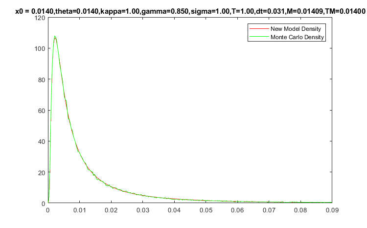](https://postimages.org/)

---

### #1132 — Amin (Topic Author)
*April 23, 2021, 2:55 PM*

Many times when SDE is in a very close range to zero and you want to use very high volatility and you notice that
simulation has become unstable, it helps to decrease the time step size for simulation. You can sometimes drastically
increase the vol and still be able to simulate if you drastically decrease the step size. For example I could never
simulate the two high volatility scenarios below but when I decreased step size from 1/32 to 1/100, I was able to
simulate them perfectly. Here are the graphs with parameters for two high volatility scenarios I am mentioning.

[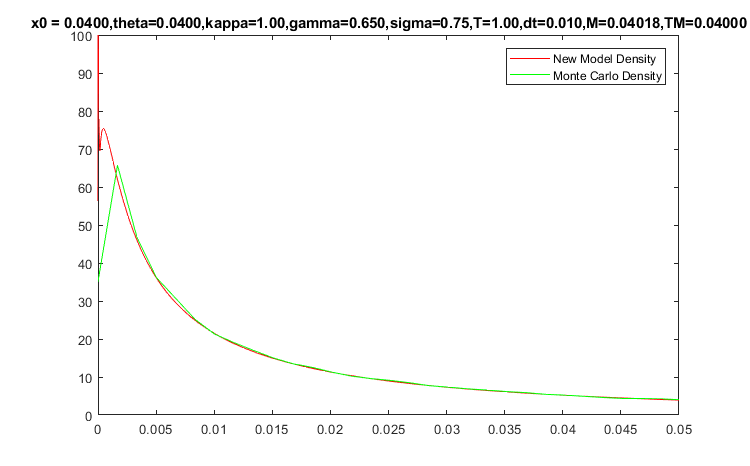](https://postimages.org/)

[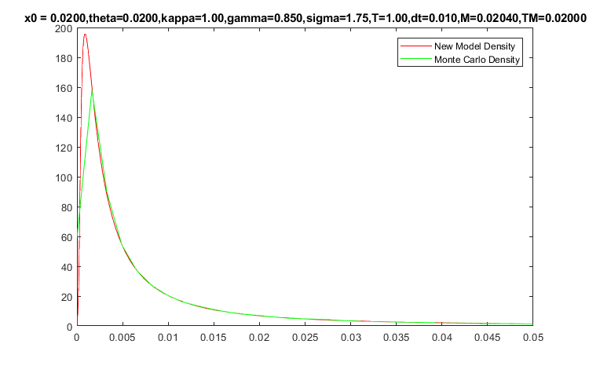](https://postimages.org/)

---

### #1133 — Amin (Topic Author)
*April 24, 2021, 3:55 AM*

With this method in previous posts, we can also tackle probably SDEs that have more than one diffusion term but it would
require some hack. It is probably not simple to convert such SDEs to Bessel coordinates with Lamperti transform but we
do not necessarily need everything in Bessel coordinates. We can still convert one of the two diffusion terms to a
constant form considering which one of the two diffusion terms is easier to deal with.

If the target point at time t+1 is Bn and starting point at time t is Bm. we can have the relationship

$B_n=B_m + \mu(B_m) + \sigma_{11}(B_m) Z_1 + \sigma_{12}(B_m) Z_2$

The above relationship can be tackled since coefficients of Z's become constant at any particular point on starting
density grid and can be added in squared fashion and replaced by a single Z.

But that will work well only for low volatilities and we will have to add a second hermite polynomial to above
expression when volatilities are even slightly above average and our equation would become

$B_n=B_m + \mu(B_m) + \sigma_{11}(B_m) Z_1 + \sigma_{12}(B_m) Z_2+ \sigma_{21}(B_m) ({Z_1}^2-1) + \sigma_{22}(B_m) ({Z_2}^2-1)$

but here sum of two squared normals with different variances would be a generalized chi-square density and some hack
would have to be used to tackle it but I am sure it can somehow be done. I thought it would be interesting to share it
with friends. I did not think hard but may be we can replace the sum of square gaussian terms with some function of
square of resulting gaussian( that is sum of two gaussians).

---

### #1134 — Amin (Topic Author)
*April 28, 2021, 10:35 AM*

Dear friends, I am working on solution of stochastic path integrals of SDEs (that I have been previously calling
dt-integrals and dz_integrals) as an extension of the method for the calculation of the solution of densities of SDEs
that we recently did in previous few posts. I have done a lot of the work and I hope to post the programs for
calculation of above stochastic integrals in a a few(2-3) days.

---

### #1135 — Amin (Topic Author)
*April 28, 2021, 1:12 PM*

I made this post on my off-topic thread and I am copying it here and want to request friends to help me weather this summer by forcing mind control agencies to be better with me. Please ask American embassy in Pakistan to not vigorously lobby for my persecution. I am copying my post here from off-topic forum where I originally posted it:https://forum.wilmott.com/viewtopic.php?f=15&t=94796&p=865546#p865546

Friends, I have not written on this thread for a long while now but it really does not mean that my persecution has
stopped. Persecution activity continues but at the same time it is not extreme either. Water is good at a lot of places
but at the same time water is increasingly drugged in some parts of the neighborhoods where I live. I found that five
liter nestle water bottle had good water and started using but they have started to catch up and have drugged it in some
parts of  neighborhoods close to where I live. For example today when I bought 5 liter water bottle, I believed it to be
good as usual only to find out after a few hours that my consciousness was decreasing and I was being extremely sluggish
and I realized that it was due to drugged water. Water or any drink that I like gets drugged in all close neighborhoods
in a few(1-2) weeks. Though this is not good but this is not extremely drastic as compared to bad times when I had to
drive around the city to get good water and I would be able to find good water in remote neighborhoods only when I would
be lucky somewhere. Now when I try to get good water I can find it somewhere in 1-2 hours but I am afraid that it would
continue to become increasingly difficult since mind control agencies continue to study my water finding patters and
continue to slowly work to drug places where I can get good water. Summer is already here and trying to get good water
and drinks in scorching heat is going to be very difficult especially when I do not use air conditioning in my car.

Another thing I wanted to tell friends that when President Biden won, I was so sure that I would be using air
conditioning in coming summer and would do my morning walk in T-shirt and shorts like normal. I use air-conditioning in
my room extremely rarely due to huge amount of sickening gas that comes out of air-conditioner in my room and in my car.
In fact for at least five-six years in the past fifteen years, I slept on a cot in the open in the extended balcony of
our house to be able to weather the scorching heat of the night when I could not use air-conditioning(And they would
many times respond by releasing gases out of the pedestal fan that I would use to cool me in the open balcony). And for
past six years, I rarely wear T-shirts and shorts in summers because exposed parts of our body can easily help us get
into strong mind control and decreasing consciousness and I would have to wear cotton pants and shirts even though it
would be very difficult to go out in scorching heat with all the sweat in cotton clothes. I would love to go back to
times when I could wear simple shorts and T-shirts (or other loose clothes at night) and enjoy my morning walk even in
summers but this cannot be a possibility until there is a marked decrease in mind control.

I also want to take this opportunity to request American friends to force mind control crooks to not use gases in my
air-conditioning this summer. Though I am sure that even if they decrease use of gases in AC due to pressure from
friends, they would still always use some gas of lower intensity that would slow me down but would be harder to detect
right away and would be less sickening to be able to be noticed right away.

---

### #1136 — Amin (Topic Author)
*May 3, 2021, 9:51 AM*

Friends, I have been able to calculate the arithmetic sum path integrals(dt-integrals type) for mean reverting
diffusions quite well. I changed some parts of my strategy to solve the integrals and that seems to work remarkably
well. It especially seems to work very well close to zero even for kappa=2 and higher but performance does deteriorate
slightly for high kappas(mean reversion speed) as we get to values close to one and higher. I was just recently able to
make the breakthrough as I changed my strategy otherwise, employing methods that I have presented before, I was getting
rather poor results. But now results are strikingly precise for a large range of parameters. For cases that do not work
with precision, I think I know the reason and I will be fixing them in next 2-3 days and improving the method there. I
hope to post the new programs in 3-4 days.

---

### #1137 — Amin (Topic Author)
*May 7, 2021, 5:24 PM*

Friends, I think I have found a way to write ODE for constant CDF lines of stochastic differential equations. As a start
I applied it to brownian motion from origin and was able to retrieve the ODE whose solution is constant CDF lines of
brownian motion. I was able to do it with the density of brownian motion. Before I write the details of the method, it
is important to recognize that when we write the density of brownian motion, we need to emphasize that brownian motion
is a function of t. I took CDF of the brownian motion density by integrating it from -infinity to Z(t) and then
differentiated the resulting equation with respect to t and then equated all of that to zero (meaning CDF does not
change as we take its derivative with respect to time.) and when I simplified the equation to get rid of the common
density and other terms, it was a simple ODE And solving the ODE led to constant CDF lines of brownian motion. Now I
will explain that with equations and also walk the friends through mathematica steps I used to find the results. Density
of brownian motion emphasizing that Z is dependent on t would be.

$\frac{1}{\sqrt{2 \pi t}} \exp[-.5 \frac{{Z(t)}^2}{t}] $

I found the CDF of the density as

$\int_{-\infty}^{Z(t)} \frac{1}{\sqrt{2 \pi t}} \exp[-.5 \frac{{Z(t)}^2}{t}] dZ$

I differentiated the above equation in mathematica where I had emphasized the dependence of Z[t] on t and equated it to
zero as previously suggested. I am writing the equation as

$\frac{d}{dt}[\int_{-\infty}^{Z(t)} \frac{1}{\sqrt{2 \pi t}} \exp[-.5 \frac{{Z(t)}^2}{t}] dZ]=0$

After a few manipulations, I got the simple ODE as a result of the above equation as

$-0.5 Z(t) + t \frac{dZ(t)}{dt} =0$

I solved the above simple ODE in mathematica to get the answer which is also solution for constant CDF lines of brownian
motion as

${{Z[t]->t^{0.5} C[1]}}$

I am sure it would easily be possible to write the normal form of evolution SDEs in general and then solve them to find
an ODE that can be cheaply solved with this using numerical methods(to give constant CDF line solutions) as I am afraid
that getting analytical results for all of the SDEs evolution on constant CDF lines would be impossible.

I used mathematica for all of this and I am going to walk the friends through mathematica commands used to find the
above solution.

First use the command

1.

D[Integrate[1/Sqrt[2 Pi t] Exp[-.5  (Z[t]^2)/t], {Z[t], -Infinity, Z[t]}], t]

It will give you a relatively complicated solution. I am not writing the solution but I represent it here with
'Solution' in mathematica code.

2.

Simplify[Solution == 0]

The above equation means that we have asked mathematica to equate the result of command 1 with zero and simplify it.
(You have to copy the result of command 1 and copy it in command 2 in place of 'solution' words I have written there)

3.  As a result of simplification, you will get the following (I have written it in Latex form now.

$\frac{e^{-\frac{0.5 Z(t)^2}{t}} \left( t  Z'(t)-0.5 Z(t)\right)}{\sqrt{t}}=0$

from which you easily retrieve the ODE

$t Z'(t)-0.5 Z(t)=0$

4. I used the mathematica command to solve this ODE as

DSolve[-0.5 Z[t]+t Z'[t] == 0, Z[t], t]

which gave me the solution to constant CDF lines of brownian motion as

${{Z[t] -> t^{0.5} C[1]}}$

In next few days, I will spend time trying to write ODEs for various SDEs and solving them numerically and would be
pasting the code here. I have placed the stochastic integrals project for a small hold but many things we will learn
here would be useful in solution of stochastic integrals as well as thinking about them led me to this. I will be
posting a lot of code in next few days.

I have not done this so I could not be perfectly certain but I believe that you do not need to know the universal
density of SDE diffusions as they are mostly not known but I think that we could just have a density representation of
instantaneous evolution of SDEs over small time steps and then use that with numerical solution of ODEs to find the
solution of SDEs along constant CDF lines. I will keep friends posted as I do more work on this.

---

### #1138 — Amin (Topic Author)
*May 7, 2021, 6:24 PM*

I want to take this opportunity to thank friends who tried to protect me from severe persecution. If it were not for
their efforts, I would never have been able to do any decent research in mathematics. Really a lot of time the
persecution activity markedly decreased due to pressure from friends and I was more able to concentrate on my research.
Though my persecution still continues and sometime there is marked increase and especially sometimes it becomes
difficult to get good water but this is very little as compared to bad times I have seen previously. And my persecution
would have been very extreme  if it were not for pressure from good people and their efforts to decrease my persecution.
I sincerely thank and I am seriously indebted to all friends and good people who tried to help end my persecution or
decrease it. I do hope that persecution and victimization of a large number of totally innocent intelligent people with
mind control finally ends and all these good and innocent victims are allowed to freely make their contribution to our
society in a good way. I want to thank all good people who stood against mind control  and would request them to
continue their efforts until this ill ends from our societies. There are a large number of mind control victims who are
targeted only because some bad people simply do not want the intelligent victims to find expression for themselves in a
good and positive way which is something extremely cruel of these bad people.

---

### #1139 — Amin (Topic Author)
*May 8, 2021, 9:06 AM*

What I have been calling Ito-Taylor expansion (and I also used the same method for monte carlo simulation) is basically
a Taylor expansion with repeated application of Ito change of variable formula. Many friends would have read my paper on
ODEs in which I used the very same Taylor expansion method(Iterated Integrals) for ODEs. We all know that ODEs work very
well with Taylor expansion method and we can take a large number of time steps and apply the series expansion at each
step to finally calculate the solution of ODE at terminal time. Barring monte carlo which is different, my attempts at
multistep Taylor expansions of SDEs never worked well despite several years of attempts. One step analytic Taylor
expansion of SDEs could work well for several years but when I would try the same expansion with smaller multiple time
steps(on the normal Z-grid) accuracy would always decrease in my experiments. It was only when I approximately solved
the Fokker-planck equation using derivatives of the PDE that I was able to get a tree that branches once at origin and
continues to advance each branch in time on the Z-grid. I always wondered why we could not use analytic Taylor expansion
with small multiple steps successfully on a Z-grid with small time steps. But I think that I know the reason behind it
now. When Taylor coefficients are evaluated at starting time zero, they work well but when they are evaluated in forward
time, they do not work perfectly well unlike in ODEs where they work very well. I have some ideas again and I want to
spend some time on them again using stochastic integral formulas that adapt to changing variance(due to drift) and also
looking at the fact that forward coefficients are themselves stochastic and there evolution as coefficients of hermite
polynomials have to be seen as stochastic evolution of product of two random variables. If I can get it to work, it may
be the simplest way to solve the SDEs and their stochastic integrals.

---

### #1140 — Amin (Topic Author)
*May 9, 2021, 7:58 AM*

Friends, I was doing research on ODE like formulas for constant CDF lines of the SDE densities. I realized that only
transition SDE is probably not enough to calculate the constant CDF lines and I wanted to explore ways to find a
complete density for small steps that takes into account the previous density. I was able to find a simple series
formula that could update the entire density for short steps using convolution. It would not work for long steps since I
am only using first hermite though I really think that it could be possible to extend this series formula to two hermite
polynomials in volatility with a bit of hack( I will share that if that works in my experiments since I still cannot be
sure.). Here is the derivation of the new formula.

 We are in Bessel/Lamperti format and we are taking a constant  volatility $\sigma$. I write the SDE as

$dy(t)= \mu(y) dt + \sigma dz(t)$

In general when we expand the SDE using Taylor, we get multiple terms in drift that can have several powers of t and
similarly for volatility so I write the above equation in discrete form and use symbols$\mu$ and$\sigma$ to represent
sum of all the terms and I have absorbed t or dt in the same symbol representation since it will help keep focus on the
main derivation so I write the discrete form of SDE as

$y_2=y_1+ \mu(y_1,t)  + \sigma(t) Z $

Here $y_2$ denotes the SDE variable at time $t_2$ and $y_1$ is the starting density variable of SDE at time $t_1$.

We can write the evolution equation for the density at next step using convolution as

$p(y_2) =\int_{-\infty}^{\infty} f(y_1) g(\frac{(y_2-y_1- \mu(y_1,t))}{ \sigma(t) }) dy_1$

here $f(y_1)$ is the original density at time $t_1$ and $g(.)$ is a normal density.

We write the above integral equation with normal density explicitly as

$p(y_2) =\int_{-\infty}^{\infty} f(y_1)  \frac{1}{\sigma \sqrt{2 \pi}} \exp(-.5 \big [\frac{(y_2-y_1- \mu(y_1,t))}{ \sigma(t) } \big ]^2 ) dy_1$

Expanding the terms inside the normal exponential, we get

$p(y_2) =\int_{-\infty}^{\infty} f(y_1)  \frac{1}{\sigma \sqrt{2 \pi}} \exp(-.5 \big [\frac{( {y_2}^2- 2 y_2(y_1+\mu(y_1,t))+ {(\mu(y_1,t)+{y_1})}^2 ) }{ {\sigma(t)}^2 } \big ] ) dy_1$

and further re-arrangement of terms gives

$p(y_2) =\frac{1}{\sigma \sqrt{2 \pi}}   \exp(-.5 \big [\frac{ {y_2}^2}{ {\sigma(t)}^2 } \big ]) \int_{-\infty}^{\infty} f(y_1)  \exp(-.5 \big [\frac{(- 2 y_2(y_1+\mu(y_1,t)) }{ {\sigma(t)}^2 } \big ]) \exp(-.5 \big [\frac{( {(\mu(y_1,t)+{y_1})}^2 ) }{ {\sigma(t)}^2 } \big ] ) dy_1$

We can expand the integral as expectation of a series evaluated with respect to density$f(y_1)$ . Below whenever I write
expectation symbol E, it means that expectation is taken over the density$f(y_1)$ , so we can write the above integral
as an expansion as

$p(y_2) =\frac{1}{\sigma(t) \sqrt{2 \pi}}   \exp(-.5 \big [\frac{ {y_2}^2}{ {\sigma(t)}^2 } \big ]) E \Big [\exp(-.5 \big [\frac{( {(\mu(y_1,t)+{y_1})}^2 ) }{ {\sigma(t)}^2 } \big ] )\Big ] *(1 + y_2 E \big [(\frac{(- 2 (y_1+\mu(y_1,t)) }{ {\sigma(t)}^2 }) \big ] $

$+ \frac{ {y_2}^2}{2}  E \big [(\frac{(- 2 (y_1+\mu(y_1,t)) }{ {\sigma(t)}^2 }) \big ]^2 + \frac{ {y_2}^3}{6}  E \big [(\frac{(- 2 (y_1+\mu(y_1,t)) }{ {\sigma(t)}^2 }) \big ]^3 + . . .) $

please notice that I have taken$\frac{1}{\sigma(t) \sqrt{2 \pi}}$ out of integral since even if we have expanded
$\sigma(t)$ to higher order terms in t, its dependence on$y_1$ is totally negligible in Bessel coordinates unless we are
extremely close to zero.

So this way we can easily expand the resulting density of SDE to next steps but we will have to keep time steps
reasonable. I have not shown this to keep exposition simple, but the powers of time terms would also explicitly appear
in the expansion and can be easily differentiated to work with the ODEs etc. We may have to take a lot of terms in the
expansion depending upon what the parameters are but it should not be difficult at all.

So eventually we get an expansion for the density of  $y_2$  in the form

$p(y_2) =C_0  \exp(-.5 \big [\frac{ {y_2}^2}{ {\sigma(t)}^2 } \big ])  *(1 +C_1 y_2  +C_2 \frac{ {y_2}^2}{2}  + C_3 \frac{ {y_2}^3}{6} + . . .) $

where all the constants$C_0$ ,$C_1$ ,$C_2$ and further are evaluated as expectations over the original density of$y_1$
at starting time.

---

### #1141 — Amin (Topic Author)
*May 9, 2021, 2:17 PM*

>
> Friends, I was doing research on ODE like formulas for constant CDF lines of the SDE densities. I realized that only
transition SDE is probably not enough to calculate the constant CDF lines and I wanted to explore ways to find a
complete density for small steps that takes into account the previous density. I was able to find a simple series
formula that could update the entire density for short steps using convolution. It would not work for long steps since I
am only using first hermite though I really think that it could be possible to extend this series formula to two hermite
polynomials in volatility with a bit of hack( I will share that if that works in my experiments since I still cannot be
sure.). Here is the derivation of the new formula.
>
>
>
>  We are in Bessel/Lamperti format and we are taking a constant  volatility $\sigma$. I write the SDE as
>
>
>
> $dy(t)= \mu(y) dt + \sigma dz(t)$
>
>
>
> In general when we expand the SDE using Taylor, we get multiple terms in drift that can have several powers of t and
similarly for volatility so I write the above equation in discrete form and use symbols$\mu$ and$\sigma$ to represent
sum of all the terms and I have absorbed t or dt in the same symbol representation since it will help keep focus on the
main derivation so I write the discrete form of SDE as
>
>
>
> $y_2=y_1+ \mu(y_1,t)  + \sigma(t) Z $
>
> Here $y_2$ denotes the SDE variable at time $t_2$ and $y_1$ is the starting density variable of SDE at time $t_1$.
>
>
>
> We can write the evolution equation for the density at next step using convolution as
>
>
>
> $p(y_2) =\int_{-\infty}^{\infty} f(y_1) g(\frac{(y_2-y_1- \mu(y_1,t))}{ \sigma(t) }) dy_1$
>
>
>
> here $f(y_1)$ is the original density at time $t_1$ and $g(.)$ is a normal density.
>
> We write the above integral equation with normal density explicitly as
>
>
>
>
$p(y_2) =\int_{-\infty}^{\infty} f(y_1)  \frac{1}{\sigma \sqrt{2 \pi}} \exp(-.5 \big [\frac{(y_2-y_1- \mu(y_1,t))}{ \sigma(t) } \big ]^2 ) dy_1$
>
>
>
> Expanding the terms inside the normal exponential, we get
>
>
>
>
$p(y_2) =\int_{-\infty}^{\infty} f(y_1)  \frac{1}{\sigma \sqrt{2 \pi}} \exp(-.5 \big [\frac{( {y_2}^2- 2 y_2(y_1+\mu(y_1,t))+ {(\mu(y_1,t)+{y_1})}^2 ) }{ {\sigma(t)}^2 } \big ] ) dy_1$
>
>
>
> and further re-arrangement of terms gives
>
>
>
>
$p(y_2) =\frac{1}{\sigma \sqrt{2 \pi}}   \exp(-.5 \big [\frac{ {y_2}^2}{ {\sigma(t)}^2 } \big ]) \int_{-\infty}^{\infty} f(y_1)  \exp(-.5 \big [\frac{(- 2 y_2(y_1+\mu(y_1,t)) }{ {\sigma(t)}^2 } \big ]) \exp(-.5 \big [\frac{( {(\mu(y_1,t)+{y_1})}^2 ) }{ {\sigma(t)}^2 } \big ] ) dy_1$
>
>
>
> We can expand the integral as expectation of a series evaluated with respect to density$f(y_1)$ . Below whenever I
write expectation symbol E, it means that expectation is taken over the density$f(y_1)$ , so we can write the above
integral as an expansion as
>
>
>
>
$p(y_2) =\frac{1}{\sigma(t) \sqrt{2 \pi}}   \exp(-.5 \big [\frac{ {y_2}^2}{ {\sigma(t)}^2 } \big ]) E \Big [\exp(-.5 \big [\frac{( {(\mu(y_1,t)+{y_1})}^2 ) }{ {\sigma(t)}^2 } \big ] )\Big ] *(1 + y_2 E \big [(\frac{(- 2 (y_1+\mu(y_1,t)) }{ {\sigma(t)}^2 }) \big ] $
>
>
$+ \frac{ {y_2}^2}{2}  E \big [(\frac{(- 2 (y_1+\mu(y_1,t)) }{ {\sigma(t)}^2 }) \big ]^2 + \frac{ {y_2}^3}{6}  E \big [(\frac{(- 2 (y_1+\mu(y_1,t)) }{ {\sigma(t)}^2 }) \big ]^3 + . . .) $
>
>
>
> please notice that I have taken$\frac{1}{\sigma(t) \sqrt{2 \pi}}$ out of integral since even if we have expanded
$\sigma(t)$ to higher order terms in t, its dependence on$y_1$ is totally negligible in Bessel coordinates unless we are
extremely close to zero.
>
> So this way we can easily expand the resulting density of SDE to next steps but we will have to keep time steps
reasonable. I have not shown this to keep exposition simple, but the powers of time terms would also explicitly appear
in the expansion and can be easily differentiated to work with the ODEs etc. We may have to take a lot of terms in the
expansion depending upon what the parameters are but it should not be difficult at all.
>
> So eventually we get an expansion for the density of  $y_2$  in the form
>
>
>
>
$p(y_2) =C_0  \exp(-.5 \big [\frac{ {y_2}^2}{ {\sigma(t)}^2 } \big ])  *(1 +C_1 y_2  +C_2 \frac{ {y_2}^2}{2}  + C_3 \frac{ {y_2}^3}{6} + . . .) $
>
> where all the constants$C_0$ ,$C_1$ ,$C_2$ and further are evaluated as expectations over the original density of$y_1$
at starting time.
>
Friends, I made some small mistakes in the previous post. I had not taken detailed notes and finessed some equations
writing them on the forum. I would have corrected earlier but a fortnightly antipsychotic injection was due and I had to
run to take the injection. Anyway here are the corrections which I am sure would have already been obvious to most
friends but still I will write them.

I take up from the following equation.

$p(y_2) =\frac{1}{\sigma \sqrt{2 \pi}}   \exp(-.5 \big [\frac{ {y_2}^2}{ {\sigma(t)}^2 } \big ]) \int_{-\infty}^{\infty} f(y_1)  \exp(-.5 \big [\frac{(- 2 y_2(y_1+\mu(y_1,t)) }{ {\sigma(t)}^2 } \big ]) \exp(-.5 \big [\frac{( {(\mu(y_1,t)+{y_1})}^2 ) }{ {\sigma(t)}^2 } \big ] ) dy_1$

We expand the first exponential under integral sign and write as

$p(y_2) =  \exp(-.5 \big [\frac{ {y_2}^2}{ {\sigma(t)}^2 } \big ]) \int_{-\infty}^{\infty} f(y_1) \frac{1}{\sigma \sqrt{2 \pi}}  \Big[ 1+ y_2   \big [ -.5  \frac{(- 2 (y_1+\mu(y_1,t)) }{ {\sigma(t)}^2 } \big ] $

$+  \frac{ {y_2}^2}{2}   {\big [ -.5  \frac{(- 2 (y_1+\mu(y_1,t)) }{ {\sigma(t)}^2 } \big ]}^2 +  \frac{ {y_2}^3}{6}   {\big [ -.5  \frac{(- 2 (y_1+\mu(y_1,t)) }{ {\sigma(t)}^2 } \big ]}^3 + . . .  \Big] \exp(-.5 \big [\frac{( {(\mu(y_1,t)+{y_1})}^2 ) }{ {\sigma(t)}^2 } \big ] ) dy_1$

So we get an expansion in the form of series where

$p(y_2) =  \exp(-.5 \big [\frac{ {y_2}^2}{ {\sigma(t)}^2 } \big ])  *(C_0 +C_1 y_2  +C_2 \frac{ {y_2}^2}{2}  + C_3 \frac{ {y_2}^3}{6} + . . .) $

and

$C_0=\int_{-\infty}^{\infty} f(y_1) \frac{1}{\sigma \sqrt{2 \pi}}\exp(-.5 \big [\frac{( {(\mu(y_1,t)+{y_1})}^2 ) }{ {\sigma(t)}^2 } \big ] ) dy_1$

$=E \Big[\frac{1}{\sigma \sqrt{2 \pi}}\exp(-.5 \big [\frac{( {(\mu(y_1,t)+{y_1})}^2 ) }{ {\sigma(t)}^2 } \big ] ) \Big] $

and

$C_1=\int_{-\infty}^{\infty} f(y_1) \frac{1}{\sigma \sqrt{2 \pi}} \big [ -.5  \frac{(- 2 (y_1+\mu(y_1,t)) }{ {\sigma(t)}^2 } \big ] \exp(-.5 \big [\frac{( {(\mu(y_1,t)+{y_1})}^2 ) }{ {\sigma(t)}^2 } \big ] ) dy_1$

$=E \Big[ \frac{1}{\sigma \sqrt{2 \pi}} \big [ -.5  \frac{(- 2 (y_1+\mu(y_1,t)) }{ {\sigma(t)}^2 } \big ] \exp(-.5 \big [\frac{( {(\mu(y_1,t)+{y_1})}^2 ) }{ {\sigma(t)}^2 } \big ] ) \Big] $

$C_2=\int_{-\infty}^{\infty} f(y_1) \frac{1}{\sigma \sqrt{2 \pi}} {\big [ -.5  \frac{(- 2 (y_1+\mu(y_1,t)) }{ {\sigma(t)}^2 } \big ]}^2 \exp(-.5 \big [\frac{( {(\mu(y_1,t)+{y_1})}^2 ) }{ {\sigma(t)}^2 } \big ] ) dy_1$

$=E \Big[ \frac{1}{\sigma \sqrt{2 \pi}} {\big [ -.5  \frac{(- 2 (y_1+\mu(y_1,t)) }{ {\sigma(t)}^2 } \big ]}^2 \exp(-.5 \big [\frac{( {(\mu(y_1,t)+{y_1})}^2 ) }{ {\sigma(t)}^2 } \big ] ) \Big] $

$C_3=\int_{-\infty}^{\infty} f(y_1) \frac{1}{\sigma \sqrt{2 \pi}} {\big [ -.5  \frac{(- 2 (y_1+\mu(y_1,t)) }{ {\sigma(t)}^2 } \big ]}^3 \exp(-.5 \big [\frac{( {(\mu(y_1,t)+{y_1})}^2 ) }{ {\sigma(t)}^2 } \big ] ) dy_1$

$=E \Big[ \frac{1}{\sigma \sqrt{2 \pi}} {\big [ -.5  \frac{(- 2 (y_1+\mu(y_1,t)) }{ {\sigma(t)}^2 } \big ]}^3 \exp(-.5 \big [\frac{( {(\mu(y_1,t)+{y_1})}^2 ) }{ {\sigma(t)}^2 } \big ] ) \Big] $

and nth coefficient is

$C_n=\int_{-\infty}^{\infty} f(y_1) \frac{1}{\sigma \sqrt{2 \pi}} {\big [ -.5  \frac{(- 2 (y_1+\mu(y_1,t)) }{ {\sigma(t)}^2 } \big ]}^n \exp(-.5 \big [\frac{( {(\mu(y_1,t)+{y_1})}^2 ) }{ {\sigma(t)}^2 } \big ] ) dy_1$

$=E \Big[ \frac{1}{\sigma \sqrt{2 \pi}} {\big [ -.5  \frac{(- 2 (y_1+\mu(y_1,t)) }{ {\sigma(t)}^2 } \big ]}^n \exp(-.5 \big [\frac{( {(\mu(y_1,t)+{y_1})}^2 ) }{ {\sigma(t)}^2 } \big ] ) \Big] $

All these coefficients are expectations over the probability density$f(y_1)$ . If our grid is refined enough, we can
easily replace these integrations with summations over the density$f(y_1)$ on the grid. Multiplying Terms in various
coefficients are either the same or powers of each other which can easily be calculated once and summed or even
integrated if you like in the same one pass over the density.

So we get an expansion in the form of series where

$p(y_2) =  \exp(-.5 \big [\frac{ {y_2}^2}{ {\sigma(t)}^2 } \big ])  *(C_0 +C_1 y_2  +C_2 \frac{ {y_2}^2}{2}  + C_3 \frac{ {y_2}^3}{6} + . . .) $

I have already taken the antipsychotic injection shot in my arm and I will lose most facility of thought in a day or so
only to come back after 7-10 days if I continue to struggle.

---

### #1142 — Amin (Topic Author)
*May 10, 2021, 6:42 AM*

Friends, I have previously mentioned that getting good water everyday remains a difficult thing but it is becoming
increasingly difficult everyday. I had told friends that water in all residential areas of the city close to where I
live has been drugged but I could still get good water since I got water from areas far away from Johar town. But it is
becoming extremely difficult to get good water even from many remote areas of the city. Today I was able to get decent
water after trying several times from different remote areas of the city and even then water I got was lightly drugged
and I strongly suspect that they are adding mind control drugs to underground water deposits in a lot of adjacent and
remote parts of the cities. Water I got today was lightly drugged which means that they had drugged underground water
deposits in some other nearby part of the city close to where I got water and its effect spilled over to the place from
where I got water.

I want to request good Americans to please protest against widespread drugging of water supply and underground water
deposits with mind control chemicals throughout Lahore city. Crook generals in Pakistan army are getting the realization
that I have been able to create some awareness about mind control in our societies and they are very afraid that tens of
millions of dollars each crook makes would end if people across the world raise their voice against mind control and
American agencies decide to decrease mind control and then hefty bribes would not be given to crooks in Pakistan army. I
am very very afraid that American mind control agencies want to detain me again in a week or two and if good Americans
do not raise their voice against evil of mind control, a lot of mind control victims like me would face a bleak future.
I want to beg all good humans to please protest against mind control in your country and in other countries across the
world and do whatever you can to end this ill from every human society.

---

### #1143 — Amin (Topic Author)
*May 10, 2021, 9:14 AM*

I think I have been able to outline a way to add second hermite polynomial in my proposed solution I posted yesterday.
It is not very difficult and if things go well I would be posting a new program that will advance the SDE density(in
bessel coordinates) using this new algorithm in another 3-4 days or even earlier.

---

### #1144 — Amin (Topic Author)
*May 10, 2021, 3:09 PM*

I was feeling sick due to bad water(that I called decent water in my previous post) and again in the evening I went to
remote parts of the city across the river to get good water and I got some water that was not from a public water supply
but was pulled from earth using a pump at that place but water was still lightly drugged meaning mind control agencies
are actively drugging underground water deposits all across the city.

It seems that crooks in American army and mind control  are unable to pay a heed to civilized calls by good American
people and others to end their animal cruel practices and remain bent on mischief. If crooks in American army and mind
control remain adamant on continuing evil practices, the only solution seems that some brave investigative journalists
expose them by running a comprehensive story on mind control practices by American army. It seems that doing a civilized
dialogue with hardened crooks in mind control gives them a strong sense of weakness of good people and makes the crooks
even more adamant to continue their evil practices.  Reminds me of  Abu-Gharib. Very similarly, Crooks in defense had no
conception that they were doing any wrong thing when there was a culture of openly urinating on human captives. It was
an open thing in army and most crooks thought it was indeed a very right thing to do( and I am sure some of those crooks
still believe that it was a right thing they did even after being reprimanded by the broader American society). It was
not until brave people at CNN did a daring story against animal practices by crooks that evil practices stopped. Though
American army crooks retard intelligent people of all color and creed, these ultra right wing army crooks love to retard
blacks and muslims with great relish. Blacks are only 8-10% of US population but make a very large proportion of victims
in united states since many ultra right wing crooks in US army would rather die than let those intelligent blacks
succeed in American society in a big way.

I want to request CNN, New York Times, Washington Post and large reputed European media outlets to run a comprehensive
story on mind control torture, retarding and victimization of intelligent people of US and other nations by crooks in US
army on behest of some powerful people in United States and due to rightwing extremist biases of these crooks. If you
would like to do investigative research about animal practices of US army, one great resource would be mainland European
embassies in Muslim countries who keep a detailed account of mind control persecution of intelligent muslims in these
countries by crooks in US army. Many of the staff in mainland European embassies are very good human beings who abhor
such practices and would love to cooperate with good journalists in exposing the evil animal practices of US army
crooks. Only the accounts of people at mainland European embassies in muslim countries thorough animal practices of
American army's mind control wing would be enough to drop a great bombshell in the media and general public all across
the world. I want to warn all the good people who try to have a civilized dialogue with crooks in American army to end
their evil practices that their being nice with crooks is a very misguided approach. Since good people do not have the
power to forcefully end the evil practices of US army crooks, only way to end the evil practices of US army crooks is by
exposing them openly in US public and all across the world.

---

### #1145 — Amin (Topic Author)
*May 11, 2021, 8:54 AM*

Friends, I was able to get good water today. I tried water from public supply in another remote area and it was also
drugged but then I drove into a different neighborhood where I have not been going for a long time and I was able to buy
very good 5 Litre Nestle water bottles. I earlier mentioned that 5 Liter Nestle bottled water is very good in the market
but Pak army crooks went into several markets and drugged the Nestle 5 Liter water bottles and it was becoming difficult
to get that water good in many areas of the city so I turned to water from public supply and underground water pulled
with pumps in remote areas. I am sure 5 Liter Nestle water bottles are still good in several areas and now Pak Army
crooks will go into different markets to drug that Nestle water. I want good Pakistanis and foreign embassies in
Pakistan to watch out carefully how army crooks drug 5 Liter Nestle water bottles in different parts of Lahore city.

Good thing is that I am working again carefully on writing my program and if all things go well, it will be ready in
another day or two and I will post it on the forum. I am working full time on the program I mentioned.

---

### #1146 — Amin (Topic Author)
*May 16, 2021, 8:10 AM*

Friends, I earlier thought that it would be rather easy to include the effect of second hermite polynomial but it turned
out that my intuition about it was not correct and I had to think of all sort of ways how to expand the equations. I
even tried to think of a series inside the exponential and tried to tackle it. But later I was able to find a rather
simpler expression(though still not extremely simple) that is also very accurate. Here are the details.

If the Stochastic differential equation is written in discrete form as

$y_2 = y_1 + \mu + \sigma_1 Z + \sigma_2 (Z^2-1) $

The transition normal that appears in transition exponential is given with second hermite polynomial as

$Z_t(y_2,y_1)=\frac{(y_2 - y_1 - \mu + \sigma_2)}{.5 (\sigma_1 + \sqrt{{\sigma_1}^2 -4 \sigma_2 (y_2 - y_1 - \mu + \sigma_2) })}$

It turns out that we can faithfully expand the above expression in terms of two terms as

$ Z_t(y_2,y_1)=\frac{(y_2 - y_1 - \mu + \sigma_2)}{ \sigma_1}- C_1 \frac{{(y_2 - y_1 - \mu + \sigma_2)}^2 \sigma_2}{\sigma_1}$

Where I found$C_1$ by equating the true transition normal at a certain one value of$y_2$ with the equation below and it
holds extremely closely to five or six digits(The whole second term is a small but still significant number) for all
values of$y_2$ when originating from a certain$y_1$ (or also other values of$y_1$ )

So our transition normal we have to expand now becomes

$\exp \Big[-.5 \big[\frac{(y_2 - y_1 - \mu + \sigma_2)}{ \sigma_1}- C_1 \frac{{(y_2 - y_1 - \mu + \sigma_2)}^2 \sigma_2}{\sigma_1} \big]^2 \Big] *\Big[\frac{1}{ \sigma_1}- C_1 \frac{{(y_2 - y_1 - \mu + \sigma_2)} \sigma_2}{\sigma_1} \Big]/\sqrt{2 \pi}$

We have to find expectation of above exponential with respect to probability density of $y_1$

The above expression can be handled in several ways with a bit of tact and I will be doing that in next several days.
Sorry to friends for the already delay. I had antipsychotic injection and that was showing effect and I could not work
properly but I hope to have a working program ready in a few days.

Though$C_1$ is time dependent on time step size, I am sure its dependence on time can be explicitly found and stated in
equations if needed.

---

### #1147 — Amin (Topic Author)
*May 16, 2021, 8:32 AM*

As a start, I hope to have an expression for the resulting density in terms of$y_2$ only with a given time step. Once
that is done in a good manner, I will make a more advanced version that will have explicit dependence on time step as
well so friends could try different time step sizes. I also think that it should be possible to find CDF (Cumulative
distribution function) of the resulting density analytically by finding CDF at zero and integrating from there so we
would be able to find associated value of Z everywhere if needed.

---

### #1148 — Amin (Topic Author)
*May 21, 2021, 4:54 AM*

Friends, I am dividing my time on solution of stochastic integrals project and convolution series solution of SDEs. I
was having some difficulty in tackling the series and would be trying to handle that in next few days. In stochastic
integrals project I made some headway in calculation of variance of multiple nested stochastic integrals with time in
them so things look better. In a few days I will be coming back with more code and analytics about solution to both the
projects.

In the meantime I want to share an old file with friends. As I earlier mentioned for friends that after simulation of
SDEs we will move to bayesian filtering and inference with SDEs. So I am sharing a very old file that describes how to
do algorithmic trading based on bayesian filtering. What we have in the old file is a lognormal stochastic differential
equation for asset with a drift(trend) and volatility in it. Both drift and volatility are slowly moving parameters with
their own SDEs and the density of drift/trend and volatility is continuously updated after a very small discrete period
of time. If the drift variable is more significant than volatility, we can say that market is trending in a particular
direction and if drift is very small compared to volatility, we would say that market is mean-reverting. model can be
used on various time scales and in a typical market on a short time scale, the drift(trend variable) will be changing
directions every few minutes and if used for trading  on this scale, our trade life would be a few minutes at most.
Sometimes even on this time scale drift will remain far less significant than volatility variable and we could be making
mean-reverting trades even on this time scale.

Similar model can be used for pairs trading and other relative value where a substantial dynamic drift in relative value
would show that pairs are diverging or converging.

It is not just in finance, in most physical and many social sciences there are many time series that dynamically change
and can be modelled like this and our bayesian filtering exercise will be very helpful there as well.

The paper is only for review, what we want to do would be different as SDEs for drift and volatility would change and
timescales for change for both drift and volatility variables will be different. As a start, we will take volatility
locally constant(but evolving slowly with time as we will see) and only drift would be totally dynamically changing. So
we will be dealing with a lot of very interesting stuff in the future.

Here is the file that I wrote on algorithmic trading using bayesian methods more than ten years ago.

 [Algorithmic Trading in Financial Markets using Non-Linear Filtering Theory_2
.zip](./download/file.php?id=9736&sid=e75c0ce5d30c2c34e3cb4522d4bba652)
(69.24 KiB) Downloaded 151 times

Though there is very little financial information in the writeup file and it is purely technical, we will make up for
that now by applying the bayesian methods on real S&P 500 data and I will be explaining everything in detail. The
writeup is only for reference and most things would change though spirit of the idea would remain the same.

---

### #1149 — Amin (Topic Author)
*May 21, 2021, 3:27 PM*

In the previous post I mentioned that I have made headway in calculation of variances in stochastic dt-integrals. I am
making this post to explain that. But please let me put things in context.

Let us suppose we have an SDE of the form

$dx(t) = \mu(x) dt + \sigma(x) dz(t)$

and we want to calculate integrals of the kind  $\int {x(t)}^{\alpha} dt $

To calculate these integrals we know the formula

$\int_{t_1}^{t_2} {x(t)}^{\alpha} dt = \int_{t_1}^{t_2} d[ t {x(t)}^{\alpha}]- \int_{t_1}^{t_2} t d[{x(t)}^{\alpha}]$

and we have to know how to expand the second integral correctly which is

$\int_{t_1}^{t_2} t \, d[{x(t)}^{\alpha}] $

$ =\int_{t_1}^{t_2} t \, \alpha \, {x(t)}^{\alpha-1} \mu(x) dt $

$+ \int_{t_1}^{t_2} t \, \alpha \, {x(t)}^{\alpha-1} \sigma(x) dz(t)$

$ +\int_{t_1}^{t_2} .5 t \, \alpha \, (\alpha-1) \, {x(t)}^{\alpha-2} {\sigma(x)}^2 dt$

The above equation follows from Ito change of variable formula but generally it would not be accurate enough for
simulations so we expand it further like we have done  for monte carlo simulations of SDEs. Expanding inside the
integrals we get a more suitable equation for correct simulation as

$\int_{t_1}^{t_2} t \, d[{x(t)}^{\alpha}] $

$ =\int_{t_1}^{t_2} t \, \alpha \, {x(t_1)}^{\alpha-1} \mu(x(t_1)) dt + \int_{t_1}^{t_2} t  \, \int_{t_1}^t \frac{d[\alpha \, {x(s)}^{\alpha-1} \mu(x(s))]}{dx} \mu(x(s)) ds \,   dt$

$ + \int_{t_1}^{t_2} t \,  \int_{t_1}^t \frac{d[\alpha \,{x(s)}^{\alpha-1} \mu(x(s))]}{dx} \sigma(x(s)) dz(s) \, dt+ \int_{t_1}^{t_2} t \, \int_{t_1}^t \frac{d^2[\alpha \,{x(s)}^{\alpha-1} \mu(x(s))]}{dx^2} {\sigma(x(s))}^2 ds \, dt$

$+ \int_{t_1}^{t_2} t \, \alpha \, {x(t_1)}^{\alpha-1} \sigma(x(t_1)) dz(t)+ \int_{t_1}^{t_2} t  \, \int_{t_1}^t \frac{d[\alpha \, {x(s)}^{\alpha-1} \sigma(x(s))]}{dx} \mu(x(s)) ds \,   dz(t)$

$ + \int_{t_1}^{t_2} t \,  \int_{t_1}^t \frac{d[\alpha \,{x(s)}^{\alpha-1} \sigma(x(s))]}{dx} \sigma(x(s)) dz(s) \, dz(t)+ \int_{t_1}^{t_2} t \, \int_{t_1}^t \frac{d^2[\alpha \,{x(s)}^{\alpha-1} \sigma(x(s))]}{dx^2} {\sigma(x(s))}^2 ds \, dz(t)$

$ +\int_{t_1}^{t_2} .5 t \, \alpha \, (\alpha-1) \, {x(t_1)}^{\alpha-2} {\sigma(x(t_1))}^2 dt+ \int_{t_1}^{t_2} t  \, \int_{t_1}^t .5 \frac{d[\alpha \, (\alpha-1) \, {x(s)}^{\alpha-2} {\sigma(x(s))}^2]}{dx} \mu(x(s)) ds \,   dt$

$ + \int_{t_1}^{t_2} t \,  \int_{t_1}^t .5 \frac{d[\alpha \, (\alpha-1) \, {x(s)}^{\alpha-2} {\sigma(x(s))}^2]}{dx} \sigma(x(s)) dz(s) \, dt+ \int_{t_1}^{t_2} t \, \int_{t_1}^t .5 \frac{d^2[\alpha \, (\alpha-1) \, {x(s)}^{\alpha-2} {\sigma(x(s))}^2]}{dx^2} {\sigma(x(s))}^2 ds \, dt$

In many cases we will like to expand the integrals further but it becomes tedious so I end at double integrals. Finally
just like we did in single integrals, in double integrals we replace$x(s)$ like terms by their initial values at$ t_1$
as$x(t_1)$ and since we have taken the x-dependent terms inside the integrals as constant at initial value, we can take
them outside of the integrals to write the above equation as

$\int_{t_1}^{t_2} t \, d[{x(t)}^{\alpha}] $

$ =( \alpha \, {x(t_1)}^{\alpha-1} \mu(x(t_1))) \int_{t_1}^{t_2} t \, dt + (\frac{d[\alpha \, {x(t_1)}^{\alpha-1} \mu(x(t_1))]}{dx} \mu(x(t_1)) \int_{t_1}^{t_2} t  \, \int_{t_1}^t  ds \,   dt$

$ + (\frac{d[\alpha \,{x(t_1)}^{\alpha-1} \mu(x(t_1))]}{dx} \sigma(x(t_1)) \int_{t_1}^{t_2} t \,  \int_{t_1}^t  dz(s) \, dt+ (\frac{d^2[\alpha \,{x(t_1)}^{\alpha-1} \mu(x(t_1))]}{dx^2} {\sigma(x(t_1))}^2) \int_{t_1}^{t_2} t \, \int_{t_1}^t  ds \, dt$

$+(\alpha \, {x(t_1)}^{\alpha-1} \sigma(x(t_1))) \int_{t_1}^{t_2} t \,  dz(t)+ (\frac{d[\alpha \, {x(t_1)}^{\alpha-1} \sigma(x(t_1))]}{dx} \mu(x(t_1))) \int_{t_1}^{t_2} t  \, \int_{t_1}^t  ds \,   dz(t)$

$ +(\frac{d[\alpha \,{x(t_1)}^{\alpha-1} \sigma(x(t_1))]}{dx} \sigma(x(t_1))) \int_{t_1}^{t_2} t \,  \int_{t_1}^t  dz(s) \, dz(t)+(\frac{d^2[\alpha \,{x(t_1)}^{\alpha-1} \sigma(x(t_1))]}{dx^2} {\sigma(x(t_1))}^2) \int_{t_1}^{t_2} t \, \int_{t_1}^t  ds \, dz(t)$

$ +(.5 \, \alpha \, (\alpha-1) \, {x(t_1)}^{\alpha-2} {\sigma(x(t_1)))}^2)\int_{t_1}^{t_2}  t \,  dt+(.5 \, \frac{d[\alpha \, (\alpha-1) \, {x(t_1)}^{\alpha-2} {\sigma(x(t_1))}^2]}{dx} \mu(x(t_1))) \int_{t_1}^{t_2} t  \, \int_{t_1}^t  ds \,   dt$

$ +(.5 \, \frac{d[\alpha \, (\alpha-1) \, {x(t_1)}^{\alpha-2} {\sigma(x(t_1))}^2]}{dx} \sigma(x(t_1))) \int_{t_1}^{t_2} t \,  \int_{t_1}^t  dz(s) \, dt+ (.5 \, \frac{d^2[\alpha \, (\alpha-1) \, {x(s)}^{\alpha-2} {\sigma(x(t_1))}^2]}{dx^2} {\sigma(x(t_1))}^2)\int_{t_1}^{t_2} t \, \int_{t_1}^t  ds \, dt$

So we are basically left with how to solve the integrals of the type(leaving the obvious to solve integrals)
$ \int_{t_1}^{t_2} t \, \int_{t_1}^t  ds \, dz(t)$ ,$\int_{t_1}^{t_2} t \,  \int_{t_1}^t  dz(s) \, dt$ and if we go to
higher order, we need to solve other integrals like
$ \int_{t_1}^{t_2} t \, \int_{t_1}^t \, \int_{t_1}^s dz(v) \, ds \, dz(t)$ ,
$ \int_{t_1}^{t_2} t \, \int_{t_1}^t \, \int_{t_1}^s dv \, dz(s) \, dz(t)$ ,
$ \int_{t_1}^{t_2} t \, \int_{t_1}^t \, \int_{t_1}^s dz(v) \, dz(s) \, dt$ . After putting these integrlas in context,
in next post I describe how to solve these integrals.

---

### #1150 — Amin (Topic Author)
*May 21, 2021, 5:13 PM*

>
> In the previous post I mentioned that I have made headway in calculation of variances in stochastic dt-integrals. I am
making this post to explain that. But please let me put things in context.
>
> Let us suppose we have an SDE of the form
>
> $dx(t) = \mu(x) dt + \sigma(x) dz(t)$
>
> and we want to calculate integrals of the kind  $\int {x(t)}^{\alpha} dt $
>
> To calculate these integrals we know the formula
>
> $\int_{t_1}^{t_2} {x(t)}^{\alpha} dt = \int_{t_1}^{t_2} d[ t {x(t)}^{\alpha}]- \int_{t_1}^{t_2} t d[{x(t)}^{\alpha}]$
>
> and we have to know how to expand the second integral correctly which is
>
> $\int_{t_1}^{t_2} t \, d[{x(t)}^{\alpha}] $
>
> $ =\int_{t_1}^{t_2} t \, \alpha \, {x(t)}^{\alpha-1} \mu(x) dt $
>
> $+ \int_{t_1}^{t_2} t \, \alpha \, {x(t)}^{\alpha-1} \sigma(x) dz(t)$
>
> $ +\int_{t_1}^{t_2} .5 t \, \alpha \, (\alpha-1) \, {x(t)}^{\alpha-2} {\sigma(x)}^2 dt$
>
> The above equation follows from Ito change of variable formula but generally it would not be accurate enough for
simulations so we expand it further like we have done  for monte carlo simulations of SDEs. Expanding inside the
integrals we get a more suitable equation for correct simulation as
>
>
>
> $\int_{t_1}^{t_2} t \, d[{x(t)}^{\alpha}] $
>
>
$ =\int_{t_1}^{t_2} t \, \alpha \, {x(t_1)}^{\alpha-1} \mu(x(t_1)) dt + \int_{t_1}^{t_2} t  \, \int_{t_1}^t \frac{d[\alpha \, {x(s)}^{\alpha-1} \mu(x(s))]}{dx} \mu(x(s)) ds \,   dt$
>
>
$ + \int_{t_1}^{t_2} t \,  \int_{t_1}^t \frac{d[\alpha \,{x(s)}^{\alpha-1} \mu(x(s))]}{dx} \sigma(x(s)) dz(s) \, dt+ \int_{t_1}^{t_2} t \, \int_{t_1}^t \frac{d^2[\alpha \,{x(s)}^{\alpha-1} \mu(x(s))]}{dx^2} {\sigma(x(s))}^2 ds \, dt$
>
>
$+ \int_{t_1}^{t_2} t \, \alpha \, {x(t_1)}^{\alpha-1} \sigma(x(t_1)) dz(t)+ \int_{t_1}^{t_2} t  \, \int_{t_1}^t \frac{d[\alpha \, {x(s)}^{\alpha-1} \sigma(x(s))]}{dx} \mu(x(s)) ds \,   dz(t)$
>
>
$ + \int_{t_1}^{t_2} t \,  \int_{t_1}^t \frac{d[\alpha \,{x(s)}^{\alpha-1} \sigma(x(s))]}{dx} \sigma(x(s)) dz(s) \, dz(t)+ \int_{t_1}^{t_2} t \, \int_{t_1}^t \frac{d^2[\alpha \,{x(s)}^{\alpha-1} \sigma(x(s))]}{dx^2} {\sigma(x(s))}^2 ds \, dz(t)$
>
>
$ +\int_{t_1}^{t_2} .5 t \, \alpha \, (\alpha-1) \, {x(t_1)}^{\alpha-2} {\sigma(x(t_1))}^2 dt+ \int_{t_1}^{t_2} t  \, \int_{t_1}^t .5 \frac{d[\alpha \, (\alpha-1) \, {x(s)}^{\alpha-2} {\sigma(x(s))}^2]}{dx} \mu(x(s)) ds \,   dt$
>
>
$ + \int_{t_1}^{t_2} t \,  \int_{t_1}^t .5 \frac{d[\alpha \, (\alpha-1) \, {x(s)}^{\alpha-2} {\sigma(x(s))}^2]}{dx} \sigma(x(s)) dz(s) \, dt+ \int_{t_1}^{t_2} t \, \int_{t_1}^t .5 \frac{d^2[\alpha \, (\alpha-1) \, {x(s)}^{\alpha-2} {\sigma(x(s))}^2]}{dx^2} {\sigma(x(s))}^2 ds \, dt$
>
> In many cases we will like to expand the integrals further but it becomes tedious so I end at double integrals.
Finally just like we did in single integrals, in double integrals we replace$x(s)$ like terms by their initial values at
$ t_1$ as$x(t_1)$ and since we have taken the x-dependent terms inside the integrals as constant at initial value, we
can take them outside of the integrals to write the above equation as
>
>
>
> $\int_{t_1}^{t_2} t \, d[{x(t)}^{\alpha}] $
>
>
$ =( \alpha \, {x(t_1)}^{\alpha-1} \mu(x(t_1))) \int_{t_1}^{t_2} t \, dt + (\frac{d[\alpha \, {x(t_1)}^{\alpha-1} \mu(x(t_1))]}{dx} \mu(x(t_1)) \int_{t_1}^{t_2} t  \, \int_{t_1}^t  ds \,   dt$
>
>
$ + (\frac{d[\alpha \,{x(t_1)}^{\alpha-1} \mu(x(t_1))]}{dx} \sigma(x(t_1)) \int_{t_1}^{t_2} t \,  \int_{t_1}^t  dz(s) \, dt+ (\frac{d^2[\alpha \,{x(t_1)}^{\alpha-1} \mu(x(t_1))]}{dx^2} {\sigma(x(t_1))}^2) \int_{t_1}^{t_2} t \, \int_{t_1}^t  ds \, dt$
>
>
$+(\alpha \, {x(t_1)}^{\alpha-1} \sigma(x(t_1))) \int_{t_1}^{t_2} t \,  dz(t)+ (\frac{d[\alpha \, {x(t_1)}^{\alpha-1} \sigma(x(t_1))]}{dx} \mu(x(t_1))) \int_{t_1}^{t_2} t  \, \int_{t_1}^t  ds \,   dz(t)$
>
>
$ +(\frac{d[\alpha \,{x(t_1)}^{\alpha-1} \sigma(x(t_1))]}{dx} \sigma(x(t_1))) \int_{t_1}^{t_2} t \,  \int_{t_1}^t  dz(s) \, dz(t)+(\frac{d^2[\alpha \,{x(t_1)}^{\alpha-1} \sigma(x(t_1))]}{dx^2} {\sigma(x(t_1))}^2) \int_{t_1}^{t_2} t \, \int_{t_1}^t  ds \, dz(t)$
>
>
$ +(.5 \, \alpha \, (\alpha-1) \, {x(t_1)}^{\alpha-2} {\sigma(x(t_1)))}^2)\int_{t_1}^{t_2}  t \,  dt+(.5 \, \frac{d[\alpha \, (\alpha-1) \, {x(t_1)}^{\alpha-2} {\sigma(x(t_1))}^2]}{dx} \mu(x(t_1))) \int_{t_1}^{t_2} t  \, \int_{t_1}^t  ds \,   dt$
>
>
$ +(.5 \, \frac{d[\alpha \, (\alpha-1) \, {x(t_1)}^{\alpha-2} {\sigma(x(t_1))}^2]}{dx} \sigma(x(t_1))) \int_{t_1}^{t_2} t \,  \int_{t_1}^t  dz(s) \, dt+ (.5 \, \frac{d^2[\alpha \, (\alpha-1) \, {x(s)}^{\alpha-2} {\sigma(x(t_1))}^2]}{dx^2} {\sigma(x(t_1))}^2)\int_{t_1}^{t_2} t \, \int_{t_1}^t  ds \, dt$
>
>
>
> So we are basically left with how to solve the integrals of the type(leaving the obvious to solve integrals)
$ \int_{t_1}^{t_2} t \, \int_{t_1}^t  ds \, dz(t)$ ,$\int_{t_1}^{t_2} t \,  \int_{t_1}^t  dz(s) \, dt$ and if we go to
higher order, we need to solve other integrals like
$ \int_{t_1}^{t_2} t \, \int_{t_1}^t \, \int_{t_1}^s dz(v) \, ds \, dz(t)$ ,
$ \int_{t_1}^{t_2} t \, \int_{t_1}^t \, \int_{t_1}^s dv \, dz(s) \, dz(t)$ ,
$ \int_{t_1}^{t_2} t \, \int_{t_1}^t \, \int_{t_1}^s dz(v) \, dz(s) \, dt$ . After putting these integrlas in context,
in next post I describe how to solve these integrals.
>
I continued to try how to solve for variance of the above integrals when they start in forward time and not from zero.
multiple Integrals ending with dt were not easy but finally it turned out that all integrals were very simple. I will
start with simplest integrals

$Variance \Big[\int_{t_1}^{t_2} t \, dz(t) \Big]= \frac{{t_2}^3}{3}-\frac{{t_1}^3}{3}$

We notice that we can write the integral $\int_{t_1}^{t_2} t \, dz(t)$ as $\int_{0}^{t_2-t_1} (t_1+t) \, dz(t)$

When we apply Ito Isometry on the second integral we find that its variance indeed matches the variance of the first
integral.

$Variance \Big[\int_{0}^{t_2-t_1} (t_1+t) \, dz(t) \Big]=\int_{0}^{t_2-t_1} {(t_1+t)}^2 \, dt= \frac{{t_2}^3}{3}-\frac{{t_1}^3}{3}$

We use the same simple strategy to solve all nested integrals with t in it and limits equal to$t_1$ and$t_2$ . We
replace t with$t_1+t$ and put the starting limit of integrals to zero and final limit to$t_2-t_1$ and we easily get all
the results.

$Variance[\int_{t_1}^{t_2} t \, \int_{t_1}^{t} ds dz(t)]$

$=Variance[\int_{0}^{t_2-t_1} (t_1+t) \, \int_{0}^{t} ds dz(t)]$

$=\int_0^{t_2-t_1} {(t_1+t)}^2 t^2 dt=(1/30) ( t_2-t_1)^3 ({t_1}^2 + 3 \, t_1 \, t_2 + 6 \, {t_2}^2)$

which is the right variance

Now we come to integral

$\int_{t_1}^{t_2} t \, \int_{t_1}^{t} dz(s) dt$

$=\int_{0}^{t_2-t_1} (t_1+t) \, \int_{0}^{t} dz(s) dt$

$=\int_{0}^{t_2-t_1} (t_1+t) \,  z(t) dt$

$=\int_{0}^{t_2-t_1} d[\frac{(t_1+t)^2 \, z(t)}{2}] - \int_0^{t_2-t_1} \, \frac{(t_1+t)^2}{2} \, dz(t)$

Please note that initial value on first complete integral goes to zero and We solve the second part with Ito-isometry to
get a representation of the above integral as

$(\frac{{t_2}^2 \, \sqrt{t_2-t_1}}{2} - \sqrt{\frac{{t_2}^5-{t_1}^5}{20}} ) \,  Z$  where Z is a standard normal

Similarly we solve third order integrals. I give some of them here as

$\int_{t_1}^{t_2} t \, \int_{t_1}^{t} \int_{t_1}^{s} dv dz(s) dz(t)$

$=\int_{0}^{t_2-t_1} (t_1+t) \, \int_{0}^{t} \int_{0}^{s} dv dz(s) dz(t)$

$=\int_{0}^{t_2-t_1} (t_1+t) \,  \frac{t \, z(t)}{\sqrt{3}} dz(t)$

going to variance now

$=\int_{0}^{t_2-t_1} {(t_1+t)}^2 \frac{t^3}{3} dt$

$=(1/180) \, {(t_2-t_1)}^4 \, (10 {t_2}^2 + 4 t_1 t_2 + {t_1}^2) $

above integral is variance

and

$\int_{t_1}^{t_2} t \, \int_{t_1}^{t} \int_{t_1}^{s} dz(v) ds dz(t)$

$=\int_{0}^{t_2-t_1} (t_1+t) \, \int_{0}^{t} \int_{0}^{s} dz(v) ds dz(t)$

$=\int_{0}^{t_2-t_1} (t_1+t) \, (1-1/\sqrt{3}) \, t \, z(t)   dz(t)$

going to variance now

$=\int_{0}^{t_2-t_1} {(t_1+t)}^2 \,{(1-1/\sqrt{3})}^2 \, t^3 \, dt$

$=(1/60) \, {(1-1/\sqrt{3})}^2 {(t_2-t_1)}^4 \, (10 {t_2}^2 + 4 t_1 t_2 + {t_1}^2) $

Above integral is variance. Please note that for both of the above integrals, we will multiply the square root of their
variances with  second hermite polynomial and there will be an additional division by square root of two which is
variance of second hermite polynomial with standard normal.

Now the integral

$\int_{t_1}^{t_2} t \, \int_{t_1}^{t} \int_{t_1}^{s} dz(v) dz(s) dt$

$=\int_{0}^{t_2-t_1} (t_1+t) \, \int_{0}^{t} \int_{0}^{s} dz(v) dz(s) dt$

$=\int_{0}^{t_2-t_1} d[\frac{{(t_1+t)}^2}{2} \, H_2(z(t))] -\int_{0}^{t_2-t_1} \, {(t_1+t)}^2 \, z(t) \, dz(t)$

$=\frac{{t_2}^2}{2} \, H_2(z(t_2-t_1)) - \sqrt{\frac{{t_1}^6}{30}-\frac{t_1{t_2}^5}{5}+\frac{{t_2}^6}{6}} \, H_2(Z)/\sqrt{2}$

in the above equation$H_2(z(t_2-t_1))$ is second hermite polynomial with a z that has variance$t_2-t_1$ and H_2(Z) is
second hermite polynomial with standard normal.

---

[← Previous](page_022.md) | [Index](index.md) | [Next →](page_024.md)
