# Breakthrough in the theory of stochastic differential equations and their simulation

**Page 24 of 65** — Posts #1151–#1200

[← Previous](page_023.md) | [Index](index.md) | [Next →](page_025.md)

---

### #1151 — Amin (Topic Author)
*May 23, 2021, 4:04 PM*

Friends, I had been thinking about the filtering model for statistical trading. I had a lot of interesting ideas and I
want to share them with friends.

First of all the model we want to develop could be used in for vanilla trading on a sub-minute scale to a few minutes
scale(or much more as we will later see.) The model could also be used in an excellent fashion in pairs and relative
value trading(in scalar and vector form for a group of several pairs simultaneously with covariances involved).

1. We will start with a simple linear model, gain intuition, learn stylized facts a and then see if we need to extend
it  to non-linear filtering models. Here I describe the model with SDEs(or an equivalent form in discrete state space
version). First we take volatility constant and suppose that drift has its own dynamics dictated by another SDE.

2. Since we are dealing with a level of minutes at maximum, we will not consider the asset dynamics as lognormal and
just consider its noise as normal scaled by volatility. Our discrete time  spacing can range from five seconds to twenty
seconds for vanilla trading. At this level, considering a lognormal SDE would be a bad choice.

3. since we are working/trading on a level of few minutes at max, units of time will not be years but rather possibly in
minutes or hours.

4. In order to decrease noise due to bid-ask crossing, we will work with mid-prices.

5. drift cannot continue to increase so it must be slowly mean-reverting.

Here is the SDE of financial asset or pair ratio

$X(t+1)=X(t) \,+ \mu(t) \, dt + \sigma \, dz(t)$

while $\mu(t)$ has its SDE given as

$\mu(t+1)=\mu(t) \, - \theta  \, \mu(t) \, dt+ \sigma_{mu} dw(t)$

Keeping the SDE for drift the same, We can write the SDE for financial asset in returns form for the asset as

$dX(t)=\, \mu(t) \, dt + \sigma \, dz(t)$

If the model(SDEs and parameters) is well-specified, its variance with drift will be smaller than its variance without
drift and if model is poorly specified, its variance will be larger as compared to without drift variance.

We notice that asset price is fully observable while drift is a hidden variable and the two SDEs are exactly in Gaussian
Kalman filter form. I write the two SDEs again

$dX(t)= \, \mu(t) \, dt + \sigma \, dz(t)$

while $\mu(t)$ has its SDE given as

$\mu(t+1)=\mu(t) \, - \theta  \, \mu(t) \, dt+ \sigma_{mu} dw(t)$

So we can use the huge literature and machinery developed for Kalman filter to solve this problem.

Returns of financial are highly notorious to defy attempts at finding structure but I am sure the above simple model
would work successfully in a large number of cases in reality. With properly optimized parameters, The above model would
continue to tell us when the drift is significantly different from zero and help us in trading decisions.

As I stated in my previous post, with a properly optimized model,  if the level of drift constantly stays insignificant
and far smaller than volatility, we can say that we are in a mean-reverting regime and we need to trade accordingly. On
the other hand, when the drift continues to remain in significant range, we can make directional trades according to
short-term trend dictated by direction of drift.

Since we are in a Kalman filter mode, we can make our model very interesting by making it large dimensional and by
adding covariances across different financial assets  and their drifts and the model will still remain robust and
tractable.

I will be coming with worked out programs and more equations in a few days.

---

### #1152 — Amin (Topic Author)
*May 24, 2021, 9:16 PM*

>
> Friends, I had been thinking about the filtering model for statistical trading. I had a lot of interesting ideas and I
want to share them with friends.
>
> First of all the model we want to develop could be used in for vanilla trading on a sub-minute scale to a few minutes
scale(or much more as we will later see.) The model could also be used in an excellent fashion in pairs and relative
value trading(in scalar and vector form for a group of several pairs simultaneously with covariances involved).
>
> 1. We will start with a simple linear model, gain intuition, learn stylized facts a and then see if we need to extend
it  to non-linear filtering models. Here I describe the model with SDEs(or an equivalent form in discrete state space
version). First we take volatility constant and suppose that drift has its own dynamics dictated by another SDE.
>
> 2. Since we are dealing with a level of minutes at maximum, we will not consider the asset dynamics as lognormal and
just consider its noise as normal scaled by volatility. Our discrete time  spacing can range from five seconds to twenty
seconds for vanilla trading. At this level, considering a lognormal SDE would be a bad choice.
>
> 3. since we are working/trading on a level of few minutes at max, units of time will not be years but rather possibly
in minutes or hours.
>
> 4. In order to decrease noise due to bid-ask crossing, we will work with mid-prices.
>
> 5. drift cannot continue to increase so it must be slowly mean-reverting.
>
>
>
> Here is the SDE of financial asset or pair ratio
>
> $X(t+1)=X(t) \,+ \mu(t) \, dt + \sigma \, dz(t)$
>
> while $\mu(t)$ has its SDE given as
>
> $\mu(t+1)=\mu(t) \, - \theta  \, \mu(t) \, dt+ \sigma_{mu} dw(t)$
>
>
>
> Keeping the SDE for drift the same, We can write the SDE for financial asset in returns form for the asset as
>
> $dX(t)=\, \mu(t) \, dt + \sigma \, dz(t)$
>
>
>
> If the model(SDEs and parameters) is well-specified, its variance with drift will be smaller than its variance without
drift and if model is poorly specified, its variance will be larger as compared to without drift variance.
>
> We notice that asset price is fully observable while drift is a hidden variable and the two SDEs are exactly in
Gaussian Kalman filter form. I write the two SDEs again
>
> $dX(t)= \, \mu(t) \, dt + \sigma \, dz(t)$
>
> while $\mu(t)$ has its SDE given as
>
> $\mu(t+1)=\mu(t) \, - \theta  \, \mu(t) \, dt+ \sigma_{mu} dw(t)$
>
>
>
> So we can use the huge literature and machinery developed for Kalman filter to solve this problem.
>
> Returns of financial are highly notorious to defy attempts at finding structure but I am sure the above simple model
would work successfully in a large number of cases in reality. With properly optimized parameters, The above model would
continue to tell us when the drift is significantly different from zero and help us in trading decisions.
>
> As I stated in my previous post, with a properly optimized model,  if the level of drift constantly stays
insignificant and far smaller than volatility, we can say that we are in a mean-reverting regime and we need to trade
accordingly. On the other hand, when the drift continues to remain in significant range, we can make directional trades
according to short-term trend dictated by direction of drift.
>
> Since we are in a Kalman filter mode, we can make our model very interesting by making it large dimensional and by
adding covariances across different financial assets  and their drifts and the model will still remain robust and
tractable.
>
> I will be coming with worked out programs and more equations in a few days.
>
..

.

I thought more about the model I presented yesterday and I want to add some more ideas to that so I decided to write
this post. Here is my motivation for making new changes.

1. local volatility continues to change remarkably during any trading day and we have to find a way to capture this
change.

2. I wrongly stated yesterday that a low drift and relatively high volatility would imply mean-reversion. High
volatility itself has nothing to do with mean reversion. But we know that there are times of high mean reversion in most
financial asset price series.

Therefore I decided to add a mean-reversion term to asset price dynamics where mean-reversion speed would be a slowly
changing parameter that will  have its own hidden SDE. When stochastic slowly varying mean-reversion parameter would
increase, it would decrease the effect of mean and the volatility even if they are both high enough. Now we will have
two hidden processes, a time varying mean and a time varying mean-reversion speed  in our kalman filter and both these
processes would have their own SDE dynamics. We have to add new framework while keeping the model as a tractable linear
multivariate Kalman filter.

We notice that asset price is fully observable while drift and mean-reversion are hidden variables and now we have three
SDEs and we write them here.

SDE we observe is given as

$X(t+1)=X(t)+ \, \mu(t) \, dt - \kappa(t) \, (X(t+1)-X(t)) \, dt+\sigma \, dz(t)$

In the above equation, I have given mean-reversion around $X(t-1)$ with hidden mean-reversion speed $\kappa(t)$

or equivalently

$dX(t)=\, \mu(t) \, dt - \kappa(t) \, dX(t) \, dt+\sigma \, dz(t)$

I have not solved the above SDE since that would result in kappa appearing in exponentials and that would make the model
non-tractable in state space form. We could possibly remain content with first order mean-reversion effect to keep the
filter fast, simple and tractable besides time intervals would be reasonably small.

The above equation would be written in Kalman form as

$dX(t)=\, \mu(t) \, dt - \kappa(t) \, dX(t) \, dt+\sigma \, dz(t)$

while $\mu(t)$ has its SDE given as

$\mu(t+1)=\mu(t) \, - \theta  \, \mu(t) \, dt+ \sigma_{\mu} \, dw(t)$

and simple  mean reversion sde could be written as

$\kappa(t+1)= \,  \kappa(t)+ \, \sigma_{\kappa} \, dv(t)$

The above three equations are in an exact linear Kalman filter form and therefore we can easily find the changing means,
covariances and densities associated with hidden variables$\mu(t)$ and$\kappa(t)$ .

Relative significance of$\mu(t)$ and$\kappa(t)$ especially in a multivariate framework would greatly help us in deciding
what type of market regime(mean-reverting or trending) we are in and relative strength of market regime would help us
decide what kind of trade has to be done to statistically make money in the market.

I have given mean-reversion around$X(t-1)$ but you might want to change it to some weighted sum of previous few values
of X(t). If a multivariate version with good specification of covariances could be properly calibrated, it will make a
powerful filter that can be very helpful in automated algorithmic trading.

---

### #1153 — Amin (Topic Author)
*May 25, 2021, 7:11 AM*

>
>
> Friends, I had been thinking about the filtering model for statistical trading. I had a lot of interesting ideas and I
want to share them with friends.
>
> First of all the model we want to develop could be used in for vanilla trading on a sub-minute scale to a few minutes
scale(or much more as we will later see.) The model could also be used in an excellent fashion in pairs and relative
value trading(in scalar and vector form for a group of several pairs simultaneously with covariances involved).
>
> 1. We will start with a simple linear model, gain intuition, learn stylized facts a and then see if we need to extend
it  to non-linear filtering models. Here I describe the model with SDEs(or an equivalent form in discrete state space
version). First we take volatility constant and suppose that drift has its own dynamics dictated by another SDE.
>
> 2. Since we are dealing with a level of minutes at maximum, we will not consider the asset dynamics as lognormal and
just consider its noise as normal scaled by volatility. Our discrete time  spacing can range from five seconds to twenty
seconds for vanilla trading. At this level, considering a lognormal SDE would be a bad choice.
>
> 3. since we are working/trading on a level of few minutes at max, units of time will not be years but rather possibly
in minutes or hours.
>
> 4. In order to decrease noise due to bid-ask crossing, we will work with mid-prices.
>
> 5. drift cannot continue to increase so it must be slowly mean-reverting.
>
>
>
> Here is the SDE of financial asset or pair ratio
>
> $X(t+1)=X(t) \,+ \mu(t) \, dt + \sigma \, dz(t)$
>
> while $\mu(t)$ has its SDE given as
>
> $\mu(t+1)=\mu(t) \, - \theta  \, \mu(t) \, dt+ \sigma_{mu} dw(t)$
>
>
>
> Keeping the SDE for drift the same, We can write the SDE for financial asset in returns form for the asset as
>
> $dX(t)=\, \mu(t) \, dt + \sigma \, dz(t)$
>
>
>
> If the model(SDEs and parameters) is well-specified, its variance with drift will be smaller than its variance without
drift and if model is poorly specified, its variance will be larger as compared to without drift variance.
>
> We notice that asset price is fully observable while drift is a hidden variable and the two SDEs are exactly in
Gaussian Kalman filter form. I write the two SDEs again
>
> $dX(t)= \, \mu(t) \, dt + \sigma \, dz(t)$
>
> while $\mu(t)$ has its SDE given as
>
> $\mu(t+1)=\mu(t) \, - \theta  \, \mu(t) \, dt+ \sigma_{mu} dw(t)$
>
>
>
> So we can use the huge literature and machinery developed for Kalman filter to solve this problem.
>
> Returns of financial are highly notorious to defy attempts at finding structure but I am sure the above simple model
would work successfully in a large number of cases in reality. With properly optimized parameters, The above model would
continue to tell us when the drift is significantly different from zero and help us in trading decisions.
>
> As I stated in my previous post, with a properly optimized model,  if the level of drift constantly stays
insignificant and far smaller than volatility, we can say that we are in a mean-reverting regime and we need to trade
accordingly. On the other hand, when the drift continues to remain in significant range, we can make directional trades
according to short-term trend dictated by direction of drift.
>
> Since we are in a Kalman filter mode, we can make our model very interesting by making it large dimensional and by
adding covariances across different financial assets  and their drifts and the model will still remain robust and
tractable.
>
> I will be coming with worked out programs and more equations in a few days.
>
..

.

I thought more about the model I presented yesterday and I want to add some more ideas to that so I decided to write
this post. Here is my motivation for making new changes.

1. local volatility continues to change remarkably during any trading day and we have to find a way to capture this
change.

2. I wrongly stated yesterday that a low drift and relatively high volatility would imply mean-reversion. High
volatility itself has nothing to do with mean reversion. But we know that there are times of high mean reversion in most
financial asset price series.

Therefore I decided to add a mean-reversion term to asset price dynamics where mean-reversion speed would be a slowly
changing parameter that will  have its own hidden SDE. When stochastic slowly varying mean-reversion parameter would
increase, it would decrease the effect of mean and the volatility even if they are both high enough. Now we will have
two hidden processes, a time varying mean and a time varying mean-reversion speed  in our kalman filter and both these
processes would have their own SDE dynamics. We have to add new framework while keeping the model as a tractable linear
multivariate Kalman filter.

We notice that asset price is fully observable while drift and mean-reversion are hidden variables and now we have three
SDEs and we write them here.

SDE we observe is given as

$X(t+1)=X(t)+ \, \mu(t) \, dt - \kappa(t) \, (X(t+1)-X(t)) \, dt+\sigma \, dz(t)$

In the above equation, I have given mean-reversion around $X(t-1)$ with hidden mean-reversion speed $\kappa(t)$

or equivalently

$dX(t)=\, \mu(t) \, dt - \kappa(t) \, dX(t) \, dt+\sigma \, dz(t)$

I have not solved the above SDE since that would result in kappa appearing in exponentials and that would make the model
non-tractable in state space form. We could possibly remain content with first order mean-reversion effect to keep the
filter fast, simple and tractable besides time intervals would be reasonably small.

The above equation would be written in Kalman form as

$dX(t)=\, \mu(t) \, dt - \kappa(t) \, dX(t) \, dt+\sigma \, dz(t)$

while $\mu(t)$ has its SDE given as

$\mu(t+1)=\mu(t) \, - \theta  \, \mu(t) \, dt+ \sigma_{\mu} \, dw(t)$

and simple  mean reversion sde could be written as

$\kappa(t+1)= \,  \kappa(t)+ \, \sigma_{\kappa} \, dv(t)$

The above three equations are in an exact linear Kalman filter form and therefore we can easily find the changing means,
covariances and densities associated with hidden variables$\mu(t)$ and$\kappa(t)$ .

Relative significance of$\mu(t)$ and$\kappa(t)$ especially in a multivariate framework would greatly help us in deciding
what type of market regime(mean-reverting or trending) we are in and relative strength of market regime would help us
decide what kind of trade has to be done to statistically make money in the market.

I have given mean-reversion around$X(t-1)$ but you might want to change it to some weighted sum of previous few values
of X(t). If a multivariate version with good specification of covariances could be properly calibrated, it will make a
powerful filter that can be very helpful in automated algorithmic trading.

..

.

For pairs trading and many fixed income relative value trades, it would be more interesting to have simple
mean-reversion type models where mean reversion is a slowly changing stochastic parameter and find it using Kalman
filtering. In that case our simple SDEs for Kalman filtering would be usually simpler since we would not need the
stochastic mean as a hidden variable(though sometimes you would still need both a stochastic mean and stochastic
mean-reversion)

$dX(t)=\, \kappa(t) \, (\theta \, - \,X(t) \, dt+\sigma \, dz(t)$

and simple  mean reversion sde could be written as

$\kappa(t+1)= \,  \kappa(t)+ \, \sigma_{\kappa} \, dv(t)$

We suppose that theta is approximately known and we have done some research about it though a robust model may not
greatly depend on mean reversion target and stochastic kappa would adjust for minor changes in it. So in pairs trading
and relative value trades, when kappa is significantly positive, we will know that our pair is converging towards the
specified mean reversion target and when kappa is significantly negative, we will know that our pair is diverging away
from the mean reversion target. And we would be able to finesse our strategies according to prevailing mean-reversion
speed, kappa.

In large fixed income relative value portfolios, we could easily do a  high dimensional kalman filter of rates with
proper specification of covariances and appropriate calibration  and that would greatly help in understanding how rates
are changing and we could calculate sensitivities of portfolio with respect to stochastic mean reversion and use that
information for trading decision making and risk management. It would also be very useful information in interest
options, swaptions and exotic interest derivatives risk management.

---

### #1154 — Amin (Topic Author)
*May 26, 2021, 9:11 AM*

Friends, I had an antipsychotic injection yesterday and next week will be difficult. Antipsychotic injections are a big
problem and I remain mentally stunted for a week after I get the injections. But I can still continue to work with them
especially a week after I get the injection. But bad people who are embarrassed by my doing good work and  bent on
retarding me somehow now bitterly want to end the injections and put me on daily antipsychotic medication so, every few
days, they can add different mind control chemicals in the medicine tailored to particular neurotransmitters I have in
my mind to control my changing neurotransmitters and successfully stop me from doing any productive work.

I want to request American friends who helped me so many times in the past by forcing mind control agencies to be better
to please protest to mind control agencies against putting me on antipsychotics forcefully despite that everybody knows
that I am perfectly mentally healthy. Please ask the mind control agencies to refrain from putting me on daily oral
medication (that would surely be contaminated on a regular basis to add mind control chemicals in it so that work of
mind control agencies becomes easy and simple.) Though injections are difficult and hard for me, daily oral medication
will be extremely tough and far more difficult if they would add mind control chemicals to that on a regular basis. I am
in Lahore and my psychiatrist is in Islamabad and we would have a whatsapp meeting in a few days. I want to request good
people and foreign embassies in Pakistan to please record my conversation with the psychiatrist and you would surely
know that he would unduly insist on ending injections and putting me on daily medication despite that I remain very nice
and perfectly amicable with my family and others(as I always was even when not on medications) and keep taking food from
home to debunk the accusations that I am psychologically afraid of taking food at home. Friends would know that doctor
would bitterly insist on daily medication as instructed to him by crooks in army.

I again want to request good Americans to please forcefully protest to American government against my persecution and I
also want to request embassies of good European countries to protest to civilian Pakistani government(that just want
wants to please army crooks to remain in power) against my inhuman persecution in Pakistan.

---

### #1155 — Amin (Topic Author)
*May 27, 2021, 9:28 AM*

>
> Friends, I had been thinking about the filtering model for statistical trading. I had a lot of interesting ideas and I
want to share them with friends.
>
> First of all the model we want to develop could be used in for vanilla trading on a sub-minute scale to a few minutes
scale(or much more as we will later see.) The model could also be used in an excellent fashion in pairs and relative
value trading(in scalar and vector form for a group of several pairs simultaneously with covariances involved).
>
> 1. We will start with a simple linear model, gain intuition, learn stylized facts a and then see if we need to extend
it  to non-linear filtering models. Here I describe the model with SDEs(or an equivalent form in discrete state space
version). First we take volatility constant and suppose that drift has its own dynamics dictated by another SDE.
>
> 2. Since we are dealing with a level of minutes at maximum, we will not consider the asset dynamics as lognormal and
just consider its noise as normal scaled by volatility. Our discrete time  spacing can range from five seconds to twenty
seconds for vanilla trading. At this level, considering a lognormal SDE would be a bad choice.
>
> 3. since we are working/trading on a level of few minutes at max, units of time will not be years but rather possibly
in minutes or hours.
>
> 4. In order to decrease noise due to bid-ask crossing, we will work with mid-prices.
>
> 5. drift cannot continue to increase so it must be slowly mean-reverting.
>
>
>
> Here is the SDE of financial asset or pair ratio
>
> $X(t+1)=X(t) \,+ \mu(t) \, dt + \sigma \, dz(t)$
>
> while $\mu(t)$ has its SDE given as
>
> $\mu(t+1)=\mu(t) \, - \theta  \, \mu(t) \, dt+ \sigma_{mu} dw(t)$
>
>
>
> Keeping the SDE for drift the same, We can write the SDE for financial asset in returns form for the asset as
>
> $dX(t)=\, \mu(t) \, dt + \sigma \, dz(t)$
>
>
>
> If the model(SDEs and parameters) is well-specified, its variance with drift will be smaller than its variance without
drift and if model is poorly specified, its variance will be larger as compared to without drift variance.
>
> We notice that asset price is fully observable while drift is a hidden variable and the two SDEs are exactly in
Gaussian Kalman filter form. I write the two SDEs again
>
> $dX(t)= \, \mu(t) \, dt + \sigma \, dz(t)$
>
> while $\mu(t)$ has its SDE given as
>
> $\mu(t+1)=\mu(t) \, - \theta  \, \mu(t) \, dt+ \sigma_{mu} dw(t)$
>
>
>
> So we can use the huge literature and machinery developed for Kalman filter to solve this problem.
>
> Returns of financial are highly notorious to defy attempts at finding structure but I am sure the above simple model
would work successfully in a large number of cases in reality. With properly optimized parameters, The above model would
continue to tell us when the drift is significantly different from zero and help us in trading decisions.
>
> As I stated in my previous post, with a properly optimized model,  if the level of drift constantly stays
insignificant and far smaller than volatility, we can say that we are in a mean-reverting regime and we need to trade
accordingly. On the other hand, when the drift continues to remain in significant range, we can make directional trades
according to short-term trend dictated by direction of drift.
>
> Since we are in a Kalman filter mode, we can make our model very interesting by making it large dimensional and by
adding covariances across different financial assets  and their drifts and the model will still remain robust and
tractable.
>
> I will be coming with worked out programs and more equations in a few days.
>

In the above post, I have hinted at high dimension Kalman filter with a hidden vector process of drift but even if we
make the drift stochastic, volatility would still not be constant and would continue to remain stochastic and I was
thinking of simpler ways to factor in the effect of changing volatility.

In the equation below upper case bold letters represent matrices, lower case bold letters represent vectors and non-bold
lower case represent scalars. Writing the observation equation for the financial asset, we have

$\textbf{dx(t)} \, = \, \boldsymbol{\mu(t)} \, dt \, +  \eta \, \boldsymbol{R \, z_1(t)} \, +  \,  \boldsymbol{\Sigma \, z_2(t)} $

In hte above equation scalar$\eta$ is a single dimensional hidden variable with its own hidden state space dynamics and
total noise variance that enters the observation equation now becomes${\eta}^2 \boldsymbol{RR' \,+\, \Sigma {\Sigma}' }$
. The matrices$\boldsymbol{R}$ and$\boldsymbol{\Sigma}$ are kept constant and have been pre-calculated in the
optimization phase. So we have a constant variance and there is a time changing variance that is scaled by a single
hidden parameter$\eta$ that has its own dynamics.

So we can write the filtering equations as

$\textbf{dx(t)} \, = \, \boldsymbol{\mu(t)} \, dt \, +  \eta \, \boldsymbol{R \, z_1(t)} \, +  \,  \boldsymbol{\Sigma \, z_2(t)} $

$\boldsymbol{\mu(t+1)}=\boldsymbol{\mu(t)} \, - \boldsymbol{\Theta  \, \mu(t) }\, dt+ \boldsymbol{\sigma_{mu} \, w(t)}$

and scalar $\eta$ process follows its own simple dynamics as

$\eta(t+1)=\eta(t) \, - \theta  \, \eta(t) \, dt+ \sigma_{eta} v(t)$

due to$\eta$ this filter will not be a kalman filter and will require some hack to solve this intelligently somehow.
This may not be extremely difficult since we kept it as a single dimensional variable in a large vector-matrix system.

We could try other recipes for variance by choosing$eta$ as the scalar magnitude of largest stochastic eigenvalue with a
system of the sort like

$\textbf{dx(t)} \, = \, \boldsymbol{\mu(t)} \, dt \, +  \eta_1 \, \boldsymbol{r_1} \, z_1(t) \,+  \eta_2 \, \boldsymbol{r_2} \, z_2(t) \, +  \,  \boldsymbol{\Sigma \, z_3(t)} $

---

### #1156 — Amin (Topic Author)
*May 27, 2021, 10:18 AM*

>
>
> Friends, I had been thinking about the filtering model for statistical trading. I had a lot of interesting ideas and I
want to share them with friends.
>
> First of all the model we want to develop could be used in for vanilla trading on a sub-minute scale to a few minutes
scale(or much more as we will later see.) The model could also be used in an excellent fashion in pairs and relative
value trading(in scalar and vector form for a group of several pairs simultaneously with covariances involved).
>
> 1. We will start with a simple linear model, gain intuition, learn stylized facts a and then see if we need to extend
it  to non-linear filtering models. Here I describe the model with SDEs(or an equivalent form in discrete state space
version). First we take volatility constant and suppose that drift has its own dynamics dictated by another SDE.
>
> 2. Since we are dealing with a level of minutes at maximum, we will not consider the asset dynamics as lognormal and
just consider its noise as normal scaled by volatility. Our discrete time  spacing can range from five seconds to twenty
seconds for vanilla trading. At this level, considering a lognormal SDE would be a bad choice.
>
> 3. since we are working/trading on a level of few minutes at max, units of time will not be years but rather possibly
in minutes or hours.
>
> 4. In order to decrease noise due to bid-ask crossing, we will work with mid-prices.
>
> 5. drift cannot continue to increase so it must be slowly mean-reverting.
>
>
>
> Here is the SDE of financial asset or pair ratio
>
> $X(t+1)=X(t) \,+ \mu(t) \, dt + \sigma \, dz(t)$
>
> while $\mu(t)$ has its SDE given as
>
> $\mu(t+1)=\mu(t) \, - \theta  \, \mu(t) \, dt+ \sigma_{mu} dw(t)$
>
>
>
> Keeping the SDE for drift the same, We can write the SDE for financial asset in returns form for the asset as
>
> $dX(t)=\, \mu(t) \, dt + \sigma \, dz(t)$
>
>
>
> If the model(SDEs and parameters) is well-specified, its variance with drift will be smaller than its variance without
drift and if model is poorly specified, its variance will be larger as compared to without drift variance.
>
> We notice that asset price is fully observable while drift is a hidden variable and the two SDEs are exactly in
Gaussian Kalman filter form. I write the two SDEs again
>
> $dX(t)= \, \mu(t) \, dt + \sigma \, dz(t)$
>
> while $\mu(t)$ has its SDE given as
>
> $\mu(t+1)=\mu(t) \, - \theta  \, \mu(t) \, dt+ \sigma_{mu} dw(t)$
>
>
>
> So we can use the huge literature and machinery developed for Kalman filter to solve this problem.
>
> Returns of financial are highly notorious to defy attempts at finding structure but I am sure the above simple model
would work successfully in a large number of cases in reality. With properly optimized parameters, The above model would
continue to tell us when the drift is significantly different from zero and help us in trading decisions.
>
> As I stated in my previous post, with a properly optimized model,  if the level of drift constantly stays
insignificant and far smaller than volatility, we can say that we are in a mean-reverting regime and we need to trade
accordingly. On the other hand, when the drift continues to remain in significant range, we can make directional trades
according to short-term trend dictated by direction of drift.
>
> Since we are in a Kalman filter mode, we can make our model very interesting by making it large dimensional and by
adding covariances across different financial assets  and their drifts and the model will still remain robust and
tractable.
>
> I will be coming with worked out programs and more equations in a few days.
>

In the above post, I have hinted at high dimension Kalman filter with a hidden vector process of drift but even if we
make the drift stochastic, volatility would still not be constant and would continue to remain stochastic and I was
thinking of simpler ways to factor in the effect of changing volatility.

In the equation below upper case bold letters represent matrices, lower case bold letters represent vectors and non-bold
lower case represent scalars. Writing the observation equation for the financial asset, we have

$\textbf{dx(t)} \, = \, \boldsymbol{\mu(t)} \, dt \, +  \eta \, \boldsymbol{R \, z_1(t)} \, +  \,  \boldsymbol{\Sigma \, z_2(t)} $

In hte above equation scalar$\eta$ is a single dimensional hidden variable with its own hidden state space dynamics and
total noise variance that enters the observation equation now becomes${\eta}^2 \boldsymbol{RR' \,+\, \Sigma {\Sigma}' }$
. The matrices$\boldsymbol{R}$ and$\boldsymbol{\Sigma}$ are kept constant and have been pre-calculated in the
optimization phase. So we have a constant variance and there is a time changing variance that is scaled by a single
hidden parameter$\eta$ that has its own dynamics.

So we can write the filtering equations as

$\textbf{dx(t)} \, = \, \boldsymbol{\mu(t)} \, dt \, +  \eta \, \boldsymbol{R \, z_1(t)} \, +  \,  \boldsymbol{\Sigma \, z_2(t)} $

$\boldsymbol{\mu(t+1)}=\boldsymbol{\mu(t)} \, - \boldsymbol{\Theta  \, \mu(t) }\, dt+ \boldsymbol{\sigma_{mu} \, w(t)}$

and scalar $\eta$ process follows its own simple dynamics as

$\eta(t+1)=\eta(t) \, - \theta  \, \eta(t) \, dt+ \sigma_{eta} v(t)$

due to$\eta$ this filter will not be a kalman filter and will require some hack to solve this intelligently somehow.
This may not be extremely difficult since we kept it as a single dimensional variable in a large vector-matrix system.

We could try other recipes for variance by choosing$eta$ as the scalar magnitude of largest stochastic eigenvalue with a
system of the sort like

$\textbf{dx(t)} \, = \, \boldsymbol{\mu(t)} \, dt \, +  \eta_1 \, \boldsymbol{r_1} \, z_1(t) \,+  \eta_2 \, \boldsymbol{r_2} \, z_2(t) \, +  \,  \boldsymbol{\Sigma \, z_3(t)} $

..

.

I could not complete the previous post so I am writing it again.

In the above post, I have hinted at high dimension Kalman filter with a hidden vector process of drift but even if we
make the drift stochastic, volatility would still not be constant and would continue to remain stochastic and I was
thinking of simpler ways to factor in the effect of changing volatility.

In the equation below upper case bold letters represent matrices, lower case bold letters represent vectors and non-bold
lower case represent scalars. Writing the observation equation for the financial asset, we have

$\textbf{dx(t)} \, = \, \boldsymbol{\mu(t)} \, dt \, +  \eta \, \boldsymbol{R \, z_1(t)} \, +  \,  \boldsymbol{\Sigma \, z_2(t)} $

In hte above equation scalar$\eta$ is a single dimensional hidden variable with its own hidden state space dynamics and
total noise variance that enters the observation equation now becomes${\eta}^2 \boldsymbol{RR' \,+\, \Sigma {\Sigma}' }$
. The matrices$\boldsymbol{R}$ and$\boldsymbol{\Sigma}$ are kept constant and have been pre-calculated in the
optimization phase. So we have a constant variance and there is a time changing variance that is scaled by a single
hidden parameter$\eta$ that has its own dynamics.

So we can write the filtering equations as

$\textbf{dx(t)} \, = \, \boldsymbol{\mu(t)} \, dt \, +  \eta \, \boldsymbol{R \, z_1(t)} \, +  \,  \boldsymbol{\Sigma \, z_2(t)} $

$\boldsymbol{\mu(t+1)}=\boldsymbol{\mu(t)} \, - \boldsymbol{\Theta  \, \mu(t) }\, dt+ \boldsymbol{\sigma_{mu} \, w(t)}$

and scalar $\eta$ process follows its own simple dynamics as

$\eta(t+1)=\eta(t) \, - \theta  \, \eta(t) \, dt+ \sigma_{eta} v(t)$

due to$\eta$ this filter will not be a kalman filter and will require some hack to solve this intelligently somehow.
This may not be extremely difficult since we kept it as a single dimensional variable in a large vector-matrix system.

We could try other recipes for variance by choosing$\eta$ as the scalar magnitude of largest stochastic eigenvalue with
a system of the sort like

$\textbf{dx(t)} \, = \, \boldsymbol{\mu(t)} \, dt \, +  \eta_1 \, \boldsymbol{r_1} \, z_1(t) \,+  \eta_2 \, \boldsymbol{r_2} \, z_2(t) \, +  \,  \boldsymbol{\Sigma \, z_3(t)} $

here$\eta_1$ is the largest eigenvalue and$\boldsymbol{r_1}$ is the eigenvector associated with the variable variance
that is calculated after taking into account constant variance and variance associated with the drift and similarly
$\eta_2$ is the second largest eigenvalue and associated second largest eigenvector is$\boldsymbol{r_2}$ and The matrix
$\boldsymbol{\Sigma}$ is a pre-optimized matrix of coefficients associated with constant variance component.

So in both of the above scenarios, we have divided the volatility into a constant component and a stochastic component
with parsimonious but hidden parameters that have to be additionally filtered. Due to hidden stochastic volatility
parameters our filter is not a traditional Kalman filter but I expect that we can remain close to Kalman framework and
solve for volatility using some hack.

We have to understand that our estimates of$\eta_1$ ,$\boldsymbol{r_1}$ ,$\eta_2$ ,$\boldsymbol{r_2}$ would be very
different from traditional estimates of first two eigenvectors and their eigenvalues since stochastic drift would
possibly take up a large part of explainable structural variance that is usually assigned to significant eigenvectors in
traditional analysis without proper specification of drift vector and its dynamics. So we would have to optimize for
these vector parameters and others in our filtering framework after taking into account the stochastic drift..

I have just given these examples to include stochastic volatility component in filtering in a parsimonious way but they
are just meant to stimulate thought and I am sure there can be better specifications and I am sure friends would like to
think about interesting models and would have many more innovative ideas.

---

### #1157 — Amin (Topic Author)
*May 28, 2021, 11:01 AM*

My phone was stolen today from my car. I have written this post in the off-topic about it. Please protest to mind
control agencies and ask them to end my persecution and stop any further machinations.

https://forum.wilmott.com/viewtopic.php?f=15&t=94796&p=866345#p866345

---

### #1158 — Amin (Topic Author)
*May 29, 2021, 4:24 AM*

I have subscribed to CNN's "Meanwhile in America" and I was reading that new President wants to honor the memory of dead
in a massacre of American blacks in Tulsa a hundred years ago. Though it is a great gesture by the new President, there
are many times when I wonder why American establishment and government are so late to acknowledge the wrongs in American
society and redress them.

We can recall when Martin Luther King Jr. was trying to lead the civil rights movement towards success, he was called a
great traitor by American government and American intelligence agencies were trying to do everything in their power to
sabotage him. Though Martin Luther King made a great impact on American society, the government apparatus remained
antagonistic during his life and he was finally murdered. But It is a great thing that American society today
acknowledges his contribution to American society and Martin Luther king is known as one of the great leaders in
American history.

They say that the new President owes his presidency to African American voters. And I must say gain that it is a great
symbolic gesture by the new President to visit the site of massacre of Black Americans. But I would like to say that is
far more important (and probably less politically convenient) to bring a change in the life of living and end torture on
them than honor the dead. I am trying to point towards mind control torture on thousands of intelligent blacks who have
been victimized by racist hardliners in American army and mind control agencies.

Because racism has greatly decreased in American society, it is very difficult to openly continue racist practices in US
society. But there is still a substantial segment of hardliners in American society who would do everything in their
power to fail people of color especially when they could recognize brilliant people very early due to their
neurotransmitters long before these people have distinguished themselves in American society. When many intelligent
people(of color) would not have done anything extraordinary in their early life and their talent would be recognized by
crooks in American army and mind control agencies, these racist crooks are quick to put such people of color and
foreigners on mind control on all sort of totally false pretexts. Many large American universities proudly engage in
this practice.

I want to request the new president if he really means to bring a great and rightful change in the life of American
blacks, please end the mind control of thousands of intelligent blacks who are running around all over the country to
avoid mind control torture. While it may not be politically expedient, it may be the perfectly right thing to do.

I had subscribed to a mind control group on yahoo (Yahoo has ended groups now) and I used to receive heartbreaking
accounts of torture on this extremely nice and intelligent black woman who would post all the stories of torture every
week or two on yahoo mind control group. I always knew that there is very little humanity in mind control crooks and
even women of color are not safe from their inhuman animal torture since racist crooks are very sure they can get away
with it.

A very large number of Americans and people all over the world rightfully praise American society for its great
diversity but there are still a significant segment of population that does not like this diversity and when these
racist crooks become powerful in American army and mind control agencies, they do everything in their power to fail
foreigners, blacks and other people of color.

As history tell us again and again, I am very sure that evil of mind control will definitely end in American society but
I will request Americans to end it before a large number of people, who are a victim of mind control torture for
decades, finally have died. I am sure most people would agree that it is far better to end the wrong on living humans
than celebrate the memory of dead who had been wronged.

---

### #1159 — Amin (Topic Author)
*May 29, 2021, 12:44 PM*

I want to tell friends about another machinatory thing that mind control crooks have done. I had bought ten years tick
data for S&P500 two years ago till the end of 2019. I checked four or five days ago when I made the first post on this
forum about kalman filtering for drift and the ten year S&P500 data was there on one of my external hard drives. But
when I checked today for the data to plan everything in tackling the data step by step, I found that all data had been
deleted from my external hard drive. Crooks of Pakistan army openly come to my house in my absence and do whatever they
want with my stuff especially lowly things like stealing my under-wears or jeans that do not allow mind control
frequencies to be effective (once they stole some of my books that I was using for research) and my family fully
cooperates with them. When I complain about any such thing to my mother, she starts laughing in a goofy style and 
blames everything on my schizophrenia.

I still have a lot of Nasdaq ITCH file data and I have my C++ programs to construct limit order book from ITCH data so I
might be able to play with Nasdaq data with my filters for now if they do not delete my ITCH files.

I want to tell friends that I have a meeting with my psychiatrist over wahtsapp around 2:00 pm on Monday. I do not have
a phone at the moment so I would talk using my mother's phone or my sister's phone who is already here from Islamabad. I
want to request American friends and European embassies to please record my conversation with the psychiatrist who will
be very bitter and desperate to put me on daily medication because fortnightly injections are not being successful in
retarding me.

I want to request good Americans to please stop these racist mind control crooks from stealing my things and continuing
my persecution forever.

---

### #1160 — Amin (Topic Author)
*May 29, 2021, 1:52 PM*

Friends, I would soon be sharing my C++ program to construct the limit order book from Nasdaq ITCH protocol data. Though
I have quickly saved a copy of the C++ program on my USB, I am afraid that crooks will still try to alter my program. I
will be running the program several time in next 2-3 days to make sure everything is alright and output of the program
is exact and then share it probably on Tuesday after writing explanatory comments on the program. Please stop mind
control crooks from altering my programs.

---

### #1161 — Amin (Topic Author)
*June 5, 2021, 4:43 PM*

Friends, sorry for being away so long. Lots of things were happening and I had to spend some time away from my research.
The update is that I have checked my C++ programs to construct the limit order book from Nasdaq ITCH data and they seem
to work perfectly fine. I expect very similar book construction programs to work well for NYSE tick data format as well.
I need another day to write detailed comments on LOB construction programs so that friends can easily understand the
logic and then I will post the C++ program with comments in another day or two.

---

### #1162 — Amin (Topic Author)
*June 7, 2021, 1:07 PM*

Friends, I still could not add comments therefore I have given a brief overview of program logic and I am posting the
programs. There are just two files in my program. A header file and a .cpp file.

My algorithm for limit order book construction is very different. There are two deques for "bid limit order book volume"
and "ask limit order book volume". These deques start from top of each side of the book and every element of deques
stores volume of corresponding limit order book based on its distance(no of levels) from top of the book on that side.
These deques only keep track of volume in both bid and ask books. You can limit the size of deque to some large number
in order to avoid limit order book being too large due to orders at zero or other other orders much away from the top of
the book.

As new limit orders come, they are stored in a vector(of structure with all the characteristics like volume, price, time
etc. in the structure) in a serial fashion with length of the "limit order vector" increasing with each new limit order.

When a new limit order arrives in the market, we update the limit order book at the order price by adding appropriate
volume and also append the limit order vector with push_back of the structure containing all order information.

The key to algorithm is a map that stores Nasdaq order number when it arrives and maps it to the end of the limit order
array where the new order is appended in the limit order vector so whenever we are given NAsdaq Order number, we use the
map to look up the appropriate entry in limit order vector where the limit order(with Nasdaq Order number) was stored.

When there is a cancel or delete order, we use the Nasdaq order number and map the position of the Nasdaq order in the
limit order vector and limit order vector iterator is pointed to appropriate element of limit order vector and then we
retrieve the order price and order size from the limit order vector and use it to decrease the volume at appropriate
place in the bid or ask volume deque.

When we have an execute or Fill order with Nasdaq order number, we again look at corresponding element of the limit
order vector(using the map) to find out order size and decrease the volume on relevant element of the appropriate limit
order volume book. We also check if the Fill or execute order does not lie on top of the book by matching the price
information from the appropriate element of limit order vector and in that case algorithm flags an error that book has
not been constructed properly.(This error is not flagged in my programs since construction of limit order book remain
good.)

After an order has been completely filled or completely deleted, we know that it will not be recalled again and so we
delete that entry from the map that points each Nasdaq limit order number to corresponding limit order entry in limit
order vector.

```
#ifndef ConstructLOB02_H
#define ConstructLOB02_H
#pragma once
#include
#include
#include
#include
#include
#include
#include
#include
#include
#include
#include
#include
#include

struct OrderFormat {
	uint32_t TimeStamp;
	std::string OrderSymbol;
	uint64_t OrderNumber;
	char OrderAction;
	uint32_t OrderSize;
	uint32_t OrderPrice;
};

struct LimitOrderRecord {

	uint64_t OrderNumber;
	uint32_t OrderArrivalTime;//Original Time Stamp;
	char OrderType;//B or S;
	char OrderStatus;//U=unfilled,P=partiallyFilled,E=filled,C=Cancelled;
	uint32_t OrderPrice;//Bid or Ask Price;
	uint32_t OrderBookLevel;//BidBookLevel or AskBookLevel;
	uint32_t OrderVolume;//
	uint32_t OrderExecuteOrCancelTime;//Execution Time Stamp;

};

struct LimitOrderLevelDataRecord {

	uint32_t DataTime0;//Original Time Stamp;
	uint32_t BidLevel3;
	uint32_t BidLevel3Volume;
	uint32_t BidLevel2;
	uint32_t BidLevel2Volume;
	uint32_t BidLevel1;
	uint32_t BidLevel1Volume;
	uint32_t AskLevel1;
	uint32_t AskLevel1Volume;
	uint32_t AskLevel2;
	uint32_t AskLevel2Volume;
	uint32_t AskLevel3;
	uint32_t AskLevel3Volume;
};

class LimitOrderBook {

public:
	LimitOrderBook::LimitOrderBook(void);
	void ShowTheOrderFlowRecord(std::string ReasonForJump, uint32_t TimeStamp, uint32_t MBOArrivalRAte,
		uint32_t MSOArrivalRate, int32_t LOBBArrivaRate, int32_t LOBAArivalRate);
	void AskLimitOrderArrivalActionOnLimitOrderBook(uint32_t OrderPrice, uint32_t OrderSize);
	void AskLimitOrderArrivalActionOnLimitOrderVector(uint64_t OrderNumber, uint32_t TimeStamp, uint32_t OrderPrice,
		uint32_t OrderSize);
	void LimitOrderArrivalActionOnOrder_struct(uint64_t OrderNumber);

	void BidLimitOrderArrivalActionOnLimitOrderBook(uint32_t OrderPrice, uint32_t OrderSize);
	void BidLimitOrderArrivalActionOnLimitOrderVector(uint64_t OrderNumber, uint32_t TimeStamp, uint32_t OrderPrice,
		uint32_t OrderSize);
	void BidLimitOrderDeleteOrCancelActionOnLimitOrderBook(uint32_t OrderPrice, uint32_t OrderSize);
	//void BidLimitOrderDeleteActionOnLimitOrderBook(uint64_t OrderNumber);
	//void LimitOrderDeleteActionOnLimitOrderList(uint64_t OrderNumber, uint32_t TimeStamp);
	//void AskLimitOrderDeleteActionOnLimitOrderBook(uint64_t OrderNumber);
	void AskLimitOrderDeleteOrCancelActionOnLimitOrderBook(uint32_t OrderPrice, uint32_t OrderSize);
	//void BidLimitOrderCancelActionOnLimitOrderBook(uint64_t OrderNumber, uint32_t OrderSize);
	//void AskLimitOrderCancelActionOnLimitOrderBook(uint64_t OrderNumber, uint32_t OrderSize);
	//void LimitOrderCancelActionOnLimitOrderList(uint64_t OrderNumber, uint32_t OrderSize, uint32_t TimeStamp);
	void LimitOrderCancelActionOnLimitOrderList(uint32_t DeletedOrderSerialNumber, uint32_t OrderSize, uint32_t TimeStamp);

	void BidLimitOrderFillOrExecuteActionOnLimitOrderBook(uint32_t OrderSize);
	void AskLimitOrderFillOrExecuteActionOnLimitOrderBook(uint32_t OrderSize);
        void LimitOrderExecuteActionOnLimitOrderList(uint32_t ExecutedOrderSerialNumber, uint32_t OrderSize, uint32_t
TimeStamp);

	LimitOrderLevelDataRecord LimitOrderLevelData;
	//void ConstructLimitOrderLevelDataRecord(uint32_t DataTime);
	LimitOrderLevelDataRecord ConstructLimitOrderLevelDataRecord(uint32_t DataTime);

	std::vector  LimitOrderLevelDataList;
	//LimitOrderLevelDataRecord LimitOrderLevelData;

	uint32_t TopOfAskBook;
	uint32_t TopOfBidBook;

	uint32_t BottomOfAskBook;
	uint32_t BottomOfBidBook;

	std::dequeBidLimitOrderBookVolume;
	std::dequeAskLimitOrderBookVolume;
	std::map Order_struct;
	uint32_t OrderSerialNumber;
	std::vector  LimitOrderList;
private:
	std::deque::iterator Dit1;

};

//Line::Line(void) {
//	cout = 3) ? (BidLimitOrderBookVolume[2]) : (0);
	LimitOrderLevelData.BidLevel2 = TopOfBidBook - 1;
	LimitOrderLevelData.BidLevel2Volume = (BidLimitOrderBookVolume.size() >= 2) ? (BidLimitOrderBookVolume[1]) : (0);
	LimitOrderLevelData.BidLevel1 = TopOfBidBook;
	LimitOrderLevelData.BidLevel1Volume = (BidLimitOrderBookVolume.size() >= 1) ? (BidLimitOrderBookVolume[0]) : (0);
	LimitOrderLevelData.AskLevel1 = TopOfAskBook;
	LimitOrderLevelData.AskLevel1Volume = (AskLimitOrderBookVolume.size() >= 1) ? (AskLimitOrderBookVolume[0]) : (0);
	LimitOrderLevelData.AskLevel2 = TopOfAskBook + 1;
	LimitOrderLevelData.AskLevel2Volume = (AskLimitOrderBookVolume.size() >= 2) ? (AskLimitOrderBookVolume[1]) : (0);
	LimitOrderLevelData.AskLevel3 = TopOfAskBook + 2;
	LimitOrderLevelData.AskLevel3Volume = (AskLimitOrderBookVolume.size() >= 3) ? (AskLimitOrderBookVolume[2]) : (0);

	return(LimitOrderLevelData);
}

void LimitOrderBook::BidLimitOrderArrivalActionOnLimitOrderBook(uint32_t OrderPrice, uint32_t OrderSize)
{
	//OrderPrice = (uint32_t)std::round(OrderPrice / 100);

	if (BidLimitOrderBookVolume.size() > 0)
	{
		if ((OrderPrice = TopOfBidBook - BidLimitOrderBookVolume.size() + 1))
		{
			uint32_t index = TopOfBidBook - OrderPrice;
			Dit1 = BidLimitOrderBookVolume.begin() + index;
			//*Dit1 = *Dit1 + it1->OrderSize;
			*Dit1 = *Dit1 + OrderSize;

		}
		else if (OrderPrice > TopOfBidBook)
		{

			uint32_t IndicesToAdd = OrderPrice - TopOfBidBook;
			TopOfBidBook = OrderPrice;
			for (uint32_t ii = 0; ii OrderSize);
		BidLimitOrderBookVolume.push_back(OrderSize);

	}
}

void LimitOrderBook::BidLimitOrderArrivalActionOnLimitOrderVector(uint64_t OrderNumber, uint32_t TimeStamp, uint32_t
OrderPrice,
	uint32_t OrderSize)
{
	LimitOrderRecord NewLimitOrder;
	NewLimitOrder.OrderNumber = OrderNumber;
	NewLimitOrder.OrderArrivalTime = TimeStamp;
	NewLimitOrder.OrderPrice = OrderPrice;
	NewLimitOrder.OrderStatus = 'U';
	NewLimitOrder.OrderType = 'B';
	NewLimitOrder.OrderVolume = OrderSize;
	NewLimitOrder.OrderBookLevel = TopOfBidBook - (NewLimitOrder.OrderPrice);
	NewLimitOrder.OrderExecuteOrCancelTime = 0;

	LimitOrderList.push_back(NewLimitOrder);

}

void LimitOrderBook::LimitOrderArrivalActionOnOrder_struct(uint64_t OrderNumber)
{
	//Order_struct.insert({ it1->OrderNumber, OrderSerialNumber });
	Order_struct.insert({ OrderNumber, OrderSerialNumber });
	OrderSerialNumber++;
}

void LimitOrderBook::AskLimitOrderArrivalActionOnLimitOrderBook(uint32_t OrderPrice, uint32_t OrderSize)
{
	//OrderPrice = (uint32_t)std::round(OrderPrice / 100);

	if (AskLimitOrderBookVolume.size() > 0)
	{
                if ((OrderPrice >= TopOfAskBook) && (OrderPrice  TopOfAskBook + AskLimitOrderBookVolume.size() -
1)//check to make sure that ends are aligned.
		//{
		//	uint32_t IndicesToAdd = OrderPrice - (TopOfAskBook + AskLimitOrderBookVolume.size() - 1);
                //      for (uint32_t ii = 0; ii  TopOfAskBook + AskLimitOrderBookVolume.size() - 1)//check to make sure
that ends are aligned.
		{
			BottomOfAskBook = OrderPrice;
			uint32_t IndicesToAdd = OrderPrice - (TopOfAskBook + AskLimitOrderBookVolume.size() - 1);
			if (IndicesToAdd OrderPrice; //has already been assigned value
	NewLimitOrder.OrderStatus = 'U';
	NewLimitOrder.OrderType = 'S';
	NewLimitOrder.OrderVolume = OrderSize;
	NewLimitOrder.OrderBookLevel = (NewLimitOrder.OrderPrice) - TopOfAskBook;
	NewLimitOrder.OrderExecuteOrCancelTime = 0;

	LimitOrderList.push_back(NewLimitOrder);
}

//void LimitOrderBook::BidLimitOrderDeleteActionOnLimitOrderBook(uint64_t OrderNumber)
//{
//	std::map::iterator findIter = Order_struct.find(OrderNumber);
//	uint32_t DeletedOrderSerialNumber = findIter->second;
//	Order_struct.erase(findIter);
//
//	uint32_t OrderPrice = LimitOrderList[DeletedOrderSerialNumber].OrderPrice;
//	uint32_t OrderSize = LimitOrderList[DeletedOrderSerialNumber].OrderVolume;
void LimitOrderBook::BidLimitOrderDeleteOrCancelActionOnLimitOrderBook(uint32_t OrderPrice, uint32_t OrderSize)
{
	if ((OrderPrice  TopOfBidBook - BidLimitOrderBookVolume.size() + 1))
	{
		uint32_t index = TopOfBidBook - OrderPrice;
		Dit1 = BidLimitOrderBookVolume.begin() + index;
		//	std::cout = OrderSize) ? OrderSize : *Dit1);

	}
	else if (OrderPrice == TopOfBidBook)
	{

		Dit1 = BidLimitOrderBookVolume.begin();
		*Dit1 = *Dit1 - ((*Dit1 >= OrderSize) ? OrderSize : *Dit1);
		if (*Dit1 == 0)
		{
			bool DeleteFlag = 1;
			while (DeleteFlag)
			{
				BidLimitOrderBookVolume.pop_front();
				TopOfBidBook = TopOfBidBook - 1;
				if (!BidLimitOrderBookVolume.empty())
				{
					Dit1 = BidLimitOrderBookVolume.begin();
					if (*Dit1 == 0)
					{
						DeleteFlag = 1;

					}
					else
					{
						DeleteFlag = 0;
					}
				}
				else
				{
					DeleteFlag = 0;
					TopOfBidBook = 0;
					BottomOfBidBook = 0;
				}

			}
		}

	}
	else if (OrderPrice == TopOfBidBook - BidLimitOrderBookVolume.size() + 1)
	{
		uint32_t index = BidLimitOrderBookVolume.size() - 1;

		Dit1 = BidLimitOrderBookVolume.end() - 1;
		*Dit1 = *Dit1 - ((*Dit1 >= OrderSize) ? OrderSize : *Dit1);
		//*Dit1 = *Dit1 - LimitOrderDeleted.OrderVolume;
		if (*Dit1 == 0)
		{
			bool DeleteFlag = 1;
			while (DeleteFlag)
			{
				BidLimitOrderBookVolume.pop_back();
				BottomOfBidBook = BottomOfBidBook + 1;
				if (!BidLimitOrderBookVolume.empty())
				{
					Dit1 = BidLimitOrderBookVolume.end() - 1;
					if (*Dit1 == 0)
					{
						DeleteFlag = 1;

					}
					else
					{
						DeleteFlag = 0;
					}
				}
				else
				{
					DeleteFlag = 0;
					TopOfBidBook = 0;
					BottomOfBidBook = 0;
				}

			}
		}

	}
}

//void LimitOrderBook::LimitOrderDeletionActionOnLimitOrderList(uint64_t OrderNumber, uint32_t TimeStamp)
//{
//	std::map::iterator findIter = Order_struct.find(OrderNumber);
//	uint32_t DeletedOrderSerialNumber = findIter->second;
//	Order_struct.erase(findIter);
//
//	LimitOrderList[DeletedOrderSerialNumber].OrderExecuteOrCancelTime = TimeStamp;
//	LimitOrderList[DeletedOrderSerialNumber].OrderStatus = 'D';
//	//For OrderAction D, volume of deleted Limit Order is not changed.
//}

//void LimitOrderBook::AskLimitOrderDeleteActionOnLimitOrderBook(uint64_t OrderNumber)
//{
//	std::map::iterator findIter = Order_struct.find(OrderNumber);
//	uint32_t DeletedOrderSerialNumber = findIter->second;
//	Order_struct.erase(findIter);
//
//	uint32_t OrderPrice = LimitOrderList[DeletedOrderSerialNumber].OrderPrice;
//	uint32_t OrderSize = LimitOrderList[DeletedOrderSerialNumber].OrderVolume;

void LimitOrderBook::AskLimitOrderDeleteOrCancelActionOnLimitOrderBook(uint32_t OrderPrice, uint32_t OrderSize)
{
	if ((OrderPrice > TopOfAskBook) && (OrderPrice = OrderSize) ? OrderSize : *Dit1);
		//*Dit1 = *Dit1 - LimitOrderDeleted.OrderVolume;
	}
	else if (OrderPrice == TopOfAskBook)
	{

		Dit1 = AskLimitOrderBookVolume.begin();
		*Dit1 = *Dit1 - ((*Dit1 >= OrderSize) ? OrderSize : *Dit1);
		if (*Dit1 == 0)
		{
			bool DeleteFlag = 1;
			while (DeleteFlag)
			{
				AskLimitOrderBookVolume.pop_front();
				TopOfAskBook = TopOfAskBook + 1;
				if (!AskLimitOrderBookVolume.empty())
				{
					Dit1 = AskLimitOrderBookVolume.begin();
					if (*Dit1 == 0)
					{
						DeleteFlag = 1;

					}
					else
					{
						DeleteFlag = 0;
					}
				}
				else
				{
					DeleteFlag = 0;
					TopOfAskBook = 0;
					BottomOfAskBook = 0;
				}

			}
		}
	}
	else if (OrderPrice == TopOfAskBook + AskLimitOrderBookVolume.size() - 1)
	{
		uint32_t index = AskLimitOrderBookVolume.size() - 1;
		Dit1 = AskLimitOrderBookVolume.end() - 1;
		*Dit1 = *Dit1 - ((*Dit1 >= OrderSize) ? OrderSize : *Dit1);
		//*Dit1 = *Dit1 - LimitOrderDeleted.OrderVolume;
		if (*Dit1 == 0)
		{
			bool DeleteFlag = 1;
			while (DeleteFlag)
			{
				AskLimitOrderBookVolume.pop_back();
				BottomOfAskBook = BottomOfAskBook - 1;
				if (!AskLimitOrderBookVolume.empty())
				{
					Dit1 = AskLimitOrderBookVolume.end() - 1;
					if (*Dit1 == 0)
					{
						DeleteFlag = 1;
					}
					else
					{
						DeleteFlag = 0;
					}
				}
				else
				{
					DeleteFlag = 0;
					TopOfAskBook = 0;
					BottomOfAskBook = 0;
				}
			}
		}
	}
}

//void LimitOrderBook::BidLimitOrderCancelActionOnLimitOrderBook(uint64_t OrderPrice, uint32_t OrderSize)
//{
////	std::map::iterator findIter = Order_struct.find(OrderNumber);
////	uint32_t DeletedOrderSerialNumber = findIter->second;
////	//Order_struct.erase(findIter);//must not be erased in partial cancel/delete.
//
//	uint32_t OrderPrice = LimitOrderList[DeletedOrderSerialNumber].OrderPrice;
//
//	if ((OrderPrice  TopOfBidBook - BidLimitOrderBookVolume.size() + 1))
//	{
//		uint32_t index = TopOfBidBook - OrderPrice;
//		Dit1 = BidLimitOrderBookVolume.begin() + index;
//		//	std::cout = OrderSize) ? OrderSize : *Dit1);
//
//	}
//	else if (OrderPrice == TopOfBidBook)
//	{
//
//		Dit1 = BidLimitOrderBookVolume.begin();
//		*Dit1 = *Dit1 - ((*Dit1 >= OrderSize) ? OrderSize : *Dit1);
//		if (*Dit1 == 0)
//		{
//			bool DeleteFlag = 1;
//			while (DeleteFlag)
//			{
//				BidLimitOrderBookVolume.pop_front();
//				TopOfBidBook = TopOfBidBook - 1;
//				if (!BidLimitOrderBookVolume.empty())
//				{
//					Dit1 = BidLimitOrderBookVolume.begin();
//					if (*Dit1 == 0)
//					{
//						DeleteFlag = 1;
//
//					}
//					else
//					{
//						DeleteFlag = 0;
//					}
//				}
//				else
//				{
//					DeleteFlag = 0;
//					TopOfBidBook = 0;
//				}
//
//			}
//		}
//
//	}
//	else if (OrderPrice == TopOfBidBook - BidLimitOrderBookVolume.size() + 1)
//	{
//		uint32_t index = BidLimitOrderBookVolume.size() - 1;
//
//		Dit1 = BidLimitOrderBookVolume.end() - 1;
//		*Dit1 = *Dit1 - ((*Dit1 >= OrderSize) ? OrderSize : *Dit1);
//		//*Dit1 = *Dit1 - LimitOrderDeleted.OrderVolume;
//		if (*Dit1 == 0)
//		{
//			bool DeleteFlag = 1;
//			while (DeleteFlag)
//			{
//				BidLimitOrderBookVolume.pop_back();
//				if (!BidLimitOrderBookVolume.empty())
//				{
//					Dit1 = BidLimitOrderBookVolume.end() - 1;
//					if (*Dit1 == 0)
//					{
//						DeleteFlag = 1;
//
//					}
//					else
//					{
//						DeleteFlag = 0;
//					}
//				}
//				else
//				{
//					DeleteFlag = 0;
//					TopOfBidBook = 0;
//				}
//
//			}
//		}
//
//	}
//}
//
////void LimitOrderBook::AskLimitOrderCancelActionOnLimitOrderBook(uint64_t OrderNumber, uint32_t OrderSize);
//
//void LimitOrderBook::AskLimitOrderCancelActionOnLimitOrderBook(uint64_t OrderNumber, uint32_t OrderSize)
//{
//	std::map::iterator findIter = Order_struct.find(OrderNumber);
//	uint32_t DeletedOrderSerialNumber = findIter->second;
//	//Order_struct.erase(findIter);//must not be erased in partial cancel/delete.
//
//	uint32_t OrderPrice = LimitOrderList[DeletedOrderSerialNumber].OrderPrice;
//	//uint32_t OrderSize = LimitOrderList[DeletedOrderSerialNumber].OrderVolume;
//
//	if ((OrderPrice > TopOfAskBook) && (OrderPrice = OrderSize) ? OrderSize : *Dit1);
//		//*Dit1 = *Dit1 - LimitOrderDeleted.OrderVolume;
//	}
//	else if (OrderPrice == TopOfAskBook)
//	{
//
//		Dit1 = AskLimitOrderBookVolume.begin();
//		*Dit1 = *Dit1 - ((*Dit1 >= OrderSize) ? OrderSize : *Dit1);
//		if (*Dit1 == 0)
//		{
//			bool DeleteFlag = 1;
//			while (DeleteFlag)
//			{
//				AskLimitOrderBookVolume.pop_front();
//				TopOfAskBook = TopOfAskBook + 1;
//				if (!AskLimitOrderBookVolume.empty())
//				{
//					Dit1 = AskLimitOrderBookVolume.begin();
//					if (*Dit1 == 0)
//					{
//						DeleteFlag = 1;
//
//					}
//					else
//					{
//						DeleteFlag = 0;
//					}
//				}
//				else
//				{
//					DeleteFlag = 0;
//					TopOfAskBook = 0;
//				}
//
//			}
//		}
//	}
//	else if (OrderPrice == TopOfAskBook + AskLimitOrderBookVolume.size() - 1)
//	{
//		uint32_t index = AskLimitOrderBookVolume.size() - 1;
//		Dit1 = AskLimitOrderBookVolume.end() - 1;
//		*Dit1 = *Dit1 - ((*Dit1 >= OrderSize) ? OrderSize : *Dit1);
//		//*Dit1 = *Dit1 - LimitOrderDeleted.OrderVolume;
//		if (*Dit1 == 0)
//		{
//			bool DeleteFlag = 1;
//			while (DeleteFlag)
//			{
//				AskLimitOrderBookVolume.pop_back();
//				if (!AskLimitOrderBookVolume.empty())
//				{
//					Dit1 = AskLimitOrderBookVolume.end() - 1;
//					if (*Dit1 == 0)
//					{
//						DeleteFlag = 1;
//					}
//					else
//					{
//						DeleteFlag = 0;
//					}
//				}
//				else
//				{
//					DeleteFlag = 0;
//					TopOfAskBook = 0;
//				}
//			}
//		}
//	}
//}

void LimitOrderBook::LimitOrderCancelActionOnLimitOrderList(uint32_t DeletedOrderSerialNumber, uint32_t OrderSize,
uint32_t TimeStamp)
{
	//std::map::iterator findIter = Order_struct.find(OrderNumber);
	//uint32_t DeletedOrderSerialNumber = findIter->second;
	////Order_struct.erase(findIter);

	LimitOrderList[DeletedOrderSerialNumber].OrderExecuteOrCancelTime = TimeStamp;
	LimitOrderList[DeletedOrderSerialNumber].OrderStatus = 'C';
	if (OrderSize OrderNumber;
////FilledOrderIn.OrderSerialNumber = 0;
//FilledOrderIn = it1->OrderNumber;
//
////goodliffe::skip_list::iterator findIter = Order_struct.find(FilledOrderIn);
//std::map::iterator findIter = Order_struct.find(FilledOrderIn);
//FilledOrderOut = findIter->second;
//Order_struct.erase(findIter);
//
//LimitOrderFilled = LimitOrderList[FilledOrderOut];
//
//void LimitOrderBook::BidLimitOrderFillActionOnLimitOrderBook(uint64_t OrderNumber, uint32_t OrderSize);
//{
//	//NewMarketOrder.OrderSerialNumber = MarketOrderSerialNumber;
//	//NewMarketOrder.OrderArrivalTime = it1->TimeStamp;//Original Time Stamp;
//	//NewMarketOrder.OrderType = 'S';//B or S;
//	//NewMarketOrder.OrderPrice1stLevel = LimitOrderFilled.OrderPrice;//Bid or Ask Price;
//	MarketOrderList[MarketOrderSerialNumber - 1].OrderPriceLastLevel = LimitOrderFilled.OrderPrice;//Bid or Ask Price;
//	MarketOrderList[MarketOrderSerialNumber - 1].LimitOrdersFilledCount++;
//	MarketOrderList[MarketOrderSerialNumber - 1].OrderVolume =
//		MarketOrderList[MarketOrderSerialNumber - 1].OrderVolume + LimitOrderFilled.OrderVolume;//
//

//if ((LimitOrderFilled.OrderType == 'B') && (BPrevTimeStamp != it1->TimeStamp))
//{
//	NewMarketOrder.OrderSerialNumber = MarketOrderSerialNumber;
//	NewMarketOrder.OrderArrivalTime = it1->TimeStamp;//Original Time Stamp;
//	NewMarketOrder.OrderType = 'S';//B or S;
//	NewMarketOrder.OrderPrice1stLevel = LimitOrderFilled.OrderPrice;//Bid or Ask Price;
//	NewMarketOrder.OrderPriceLastLevel = LimitOrderFilled.OrderPrice;//Bid or Ask Price;
//	NewMarketOrder.LimitOrdersFilledCount = 1;
//	NewMarketOrder.OrderVolume = LimitOrderFilled.OrderVolume;//
//
//
//
//	MarketOrderList.push_back(NewMarketOrder);
//	MarketOrderSerialNumber++;
//	BPrevTimeStamp = it1->TimeStamp;
//	}
//}

void LimitOrderBook::BidLimitOrderFillOrExecuteActionOnLimitOrderBook(uint32_t OrderSize)
{

	Dit1 = BidLimitOrderBookVolume.begin();
	*Dit1 = *Dit1 - ((*Dit1 >= OrderSize) ? OrderSize : *Dit1);
	//*Dit1 = *Dit1 - LimitOrderFilled.OrderVolume;
	if (*Dit1 == 0)
	{
		bool DeleteFlag = 1;
		while (DeleteFlag)
		{
			BidLimitOrderBookVolume.pop_front();
			TopOfBidBook = TopOfBidBook - 1;

			if (!BidLimitOrderBookVolume.empty())
			{
				Dit1 = BidLimitOrderBookVolume.begin();
				if (*Dit1 == 0)
				{
					DeleteFlag = 1;

				}
				else
				{
					DeleteFlag = 0;
				}
			}
			else
			{
				DeleteFlag = 0;
				TopOfBidBook = 0;
				BottomOfBidBook = 0;
			}

		}
	}

}

void LimitOrderBook::AskLimitOrderFillOrExecuteActionOnLimitOrderBook(uint32_t OrderSize)
{

	Dit1 = AskLimitOrderBookVolume.begin();
	*Dit1 = *Dit1 - ((*Dit1 >= OrderSize) ? OrderSize : *Dit1);
	//*Dit1 = *Dit1 - LimitOrderFilled.OrderVolume;
	if (*Dit1 == 0)
	{
		bool DeleteFlag = 1;
		while (DeleteFlag)
		{
			AskLimitOrderBookVolume.pop_front();
			TopOfAskBook = TopOfAskBook + 1;
			if (!AskLimitOrderBookVolume.empty())
			{
				Dit1 = AskLimitOrderBookVolume.begin();
				if (*Dit1 == 0)
				{
					DeleteFlag = 1;
				}
				else
				{
					DeleteFlag = 0;
				}
			}
			else
			{
				DeleteFlag = 0;
				TopOfAskBook = 0;
				BottomOfAskBook = 0;
			}
		}

	}
}
void LimitOrderBook::LimitOrderExecuteActionOnLimitOrderList(uint32_t ExecutedOrderSerialNumber, uint32_t OrderSize,
uint32_t TimeStamp)
{
	//std::map::iterator findIter = Order_struct.find(OrderNumber);
	//uint32_t DeletedOrderSerialNumber = findIter->second;
	////Order_struct.erase(findIter);

	LimitOrderList[ExecutedOrderSerialNumber].OrderExecuteOrCancelTime = TimeStamp;
	LimitOrderList[ExecutedOrderSerialNumber].OrderStatus = 'E';
	if (OrderSize <= LimitOrderList[ExecutedOrderSerialNumber].OrderVolume)
	{
		LimitOrderList[ExecutedOrderSerialNumber].OrderVolume =
			LimitOrderList[ExecutedOrderSerialNumber].OrderVolume - OrderSize;
	}
	else
	{
		LimitOrderList[ExecutedOrderSerialNumber].OrderVolume = 0;
	}
}

#endif

```

.

.Here is the cpp file.

```
#include "stdafx.h"
#include "ConstructLOB02.h"

int main()
{

        //const char* filename = "C:\\Users\\Ahsan\\Documents\\Visual Studio
2015\\Projects\\ConstructLOB02\\20150109_EBAY.txt";
	const char* filename = "C:\\Users\\Ahsan\\Documents\\Visual Studio 2015\\Projects\\ConstructLOB02\\20150106_BMRN.txt";
	std::ifstream ItchFile(filename);
	OrderFormat OrderNew;
	if (!ItchFile.is_open())
	{
		std::cerr  OrderT;// (1, OrderNew);

	std::string OrderMPID;
	char X;

	uint32_t tnn = 0;

	std::string str;
	while (getline(ItchFile, str)) { // Read the entire line
		std::istringstream ss(str);
                ss >> OrderNew.TimeStamp >> OrderNew.OrderSymbol >> OrderNew.OrderNumber >> OrderNew.OrderAction >>
OrderNew.OrderSize >> OrderNew.OrderPrice;
		OrderT.push_back(OrderNew);
	}

	//	while (!ItchFile.eof())
	//	{
	//		ItchFile >> OrderNew.TimeStamp;
	//		ItchFile >> OrderNew.OrderSymbol;
	//		ItchFile >> OrderNew.OrderNumber;
	//		ItchFile >> OrderNew.OrderAction;
	//		ItchFile >> OrderNew.OrderSize;
	//		ItchFile >> OrderNew.OrderPrice;
	//		ItchFile >> OrderMPID;
	//		ItchFile >> X;
	//		OrderT.push_back(OrderNew);
	//	}

	LimitOrderBook LimitOrderBookLive;

	uint32_t OrderPrice0;
	uint32_t OrderSize0;
	uint64_t OrderNumber0;
	uint32_t TimeStamp0;
	//uint32_t OrderSerialNumber = 0;

	uint32_t TimeGranularity_Deltat = 1000;
	uint32_t MarketStart_T = 34200000;
	uint32_t MarketEnd_T = 57600000;
	uint32_t CurrentPeriodStart_T = MarketStart_T;
	uint32_t CurrentPeriodEnd_T = CurrentPeriodStart_T + TimeGranularity_Deltat;
	uint32_t TimeStamp_T;

	uint32_t TopOfBidBookBefore = 0;
	uint32_t TopOfBidBookAfter = 0;
	uint32_t TopOfAskBookBefore = 0;
	uint32_t TopOfAskBookAfter = 0;

	std::string ReasonForJump;

	std::ofstream BidAndAskLevelSeries;
        BidAndAskLevelSeries.open("C:\\Users\\Ahsan\\Documents\\Visual Studio
2015\\Projects\\ConstructLOB02\\BidAndAskSeries_20150106_BMRN.csv");

	uint32_t Time_t2 = MarketStart_T;
	//uint32_t Time_t2;
	//Time_t2 = Time_t1 + TimeGranularity_Deltat;

	for (std::vector::const_iterator it1 = OrderT.cbegin(); it1 TimeStamp;

		LimitOrderLevelDataRecord LimitOrderBookLevelData0;
		uint32_t tt;
		if ((TimeStamp_T > Time_t2) && (TimeStamp_TOrderNumber TimeStamp OrderPrice / 100);
		OrderSize0 = it1->OrderSize;
		OrderNumber0 = it1->OrderNumber;
		TimeStamp0 = it1->TimeStamp;
		if (it1->OrderAction == 'B')
		{

			TopOfBidBookBefore = LimitOrderBookLive.TopOfBidBook;
			LimitOrderBookLive.BidLimitOrderArrivalActionOnLimitOrderBook(OrderPrice0, OrderSize0);
			LimitOrderBookLive.BidLimitOrderArrivalActionOnLimitOrderVector(OrderNumber0, TimeStamp0, OrderPrice0, OrderSize0);
			LimitOrderBookLive.LimitOrderArrivalActionOnOrder_struct(OrderNumber0);
			TopOfBidBookAfter = LimitOrderBookLive.TopOfBidBook;
		}

		if (it1->OrderAction == 'S')
		{

			TopOfAskBookBefore = LimitOrderBookLive.TopOfAskBook;

			LimitOrderBookLive.AskLimitOrderArrivalActionOnLimitOrderBook(OrderPrice0, OrderSize0);
			LimitOrderBookLive.AskLimitOrderArrivalActionOnLimitOrderVector(OrderNumber0, TimeStamp0, OrderPrice0, OrderSize0);
			LimitOrderBookLive.LimitOrderArrivalActionOnOrder_struct(OrderNumber0);
			TopOfAskBookAfter = LimitOrderBookLive.TopOfAskBook;
		}
		if (it1->OrderAction == 'D')
		{

			std::map::iterator findIter = LimitOrderBookLive.Order_struct.find(OrderNumber0);
			uint32_t DeletedOrderSerialNumber = findIter->second;
			LimitOrderBookLive.Order_struct.erase(findIter);

			uint32_t OrderPrice1 = LimitOrderBookLive.LimitOrderList[DeletedOrderSerialNumber].OrderPrice;
			uint32_t OrderSize1 = LimitOrderBookLive.LimitOrderList[DeletedOrderSerialNumber].OrderVolume;
			char OrderType1 = LimitOrderBookLive.LimitOrderList[DeletedOrderSerialNumber].OrderType;

			if (OrderType1 == 'B')
			{

				TopOfBidBookBefore = LimitOrderBookLive.TopOfBidBook;

				LimitOrderBookLive.BidLimitOrderDeleteOrCancelActionOnLimitOrderBook(OrderPrice1, OrderSize1);
				TopOfBidBookAfter = LimitOrderBookLive.TopOfBidBook;

			}
			if (OrderType1 == 'S')
			{
				TopOfAskBookBefore = LimitOrderBookLive.TopOfAskBook;

				LimitOrderBookLive.AskLimitOrderDeleteOrCancelActionOnLimitOrderBook(OrderPrice1, OrderSize1);
				TopOfAskBookAfter = LimitOrderBookLive.TopOfAskBook;
			}
		}
		if (it1->OrderAction == 'C')
		{

			std::map::iterator findIter = LimitOrderBookLive.Order_struct.find(OrderNumber0);
			uint32_t DeletedOrderSerialNumber = findIter->second;
			//LimitOrderBookLive.Order_struct.erase(findIter);

			uint32_t OrderPrice1 = LimitOrderBookLive.LimitOrderList[DeletedOrderSerialNumber].OrderPrice;
			uint32_t OrderSize1 = OrderSize0;
			char OrderType1 = LimitOrderBookLive.LimitOrderList[DeletedOrderSerialNumber].OrderType;

			if (OrderType1 == 'B')
			{

				TopOfBidBookBefore = LimitOrderBookLive.TopOfBidBook;
				LimitOrderBookLive.BidLimitOrderDeleteOrCancelActionOnLimitOrderBook(OrderPrice1, OrderSize1);
				LimitOrderBookLive.LimitOrderCancelActionOnLimitOrderList(DeletedOrderSerialNumber, OrderSize1, TimeStamp0);
				TopOfBidBookAfter = LimitOrderBookLive.TopOfBidBook;
			}
			if (OrderType1 == 'S')
			{
				TopOfAskBookBefore = LimitOrderBookLive.TopOfAskBook;
				LimitOrderBookLive.AskLimitOrderDeleteOrCancelActionOnLimitOrderBook(OrderPrice1, OrderSize1);
				LimitOrderBookLive.LimitOrderCancelActionOnLimitOrderList(DeletedOrderSerialNumber, OrderSize1, TimeStamp0);
				TopOfAskBookAfter = LimitOrderBookLive.TopOfAskBook;
			}
		}
		if (it1->OrderAction == 'F')
		{
			std::map::iterator findIter = LimitOrderBookLive.Order_struct.find(OrderNumber0);
			uint32_t LimitOrderSerialNumber = findIter->second;
			LimitOrderBookLive.Order_struct.erase(findIter);

			uint32_t OrderSize1 = LimitOrderBookLive.LimitOrderList[LimitOrderSerialNumber].OrderVolume;
			char OrderType1 = LimitOrderBookLive.LimitOrderList[LimitOrderSerialNumber].OrderType;
			//LimitOrderBookLive.LimitOrderList[DeletedOrderSerialNumber].OrderPrice;
			uint32_t OrderPrice1 = LimitOrderBookLive.LimitOrderList[LimitOrderSerialNumber].OrderPrice;

			if (OrderType1 == 'B')
			{
				TopOfBidBookBefore = LimitOrderBookLive.TopOfBidBook;
				if (OrderPrice1 != TopOfBidBookBefore)
				{
					std::cout OrderAction == 'E')
		{
			//		std::cout OrderNumber;
			//FilledOrderIn.OrderSerialNumber = 0;
			//uint64_t FilledOrderSerialNumber = it1->OrderNumber;

			//goodliffe::skip_list::iterator findIter = Order_struct.find(FilledOrderIn);
			std::map::iterator findIter = LimitOrderBookLive.Order_struct.find(OrderNumber0);
			uint32_t LimitOrderSerialNumber = findIter->second;
			//LimitOrderBookLive.Order_struct.erase(findIter);

			uint32_t OrderSize1 = OrderSize0;
			char OrderType1 = LimitOrderBookLive.LimitOrderList[LimitOrderSerialNumber].OrderType;
			uint32_t OrderPrice1 = LimitOrderBookLive.LimitOrderList[LimitOrderSerialNumber].OrderPrice;
			if (OrderType1 == 'B')
			{
				TopOfBidBookBefore = LimitOrderBookLive.TopOfBidBook;
				if (OrderPrice1 != TopOfBidBookBefore)
				{
					std::cout << " There is an error. Market Order Does not match with Price; MarketExecute " << std::endl;
					std::cout << "  Limit Order Price is " << OrderPrice1 << std::endl;
					std::cout << "  Top Of Bid Book is " << TopOfBidBookBefore << std::endl;
				}
				LimitOrderBookLive.BidLimitOrderFillOrExecuteActionOnLimitOrderBook(OrderSize1);
				TopOfBidBookAfter = LimitOrderBookLive.TopOfBidBook;
				LimitOrderBookLive.LimitOrderExecuteActionOnLimitOrderList(LimitOrderSerialNumber, OrderSize1, TimeStamp0);

			}
			if (OrderType1 == 'S')
			{
				TopOfAskBookBefore = LimitOrderBookLive.TopOfAskBook;
				if (OrderPrice1 != TopOfAskBookBefore)
				{
					std::cout << " There is an error. Market Order Does not match with Price; Market Execute " << std::endl;
					std::cout << "  Limit Order Price is " << OrderPrice1 << std::endl;
					std::cout << "  Top Of Ask Book is " << TopOfAskBookBefore << std::endl;
				}
				LimitOrderBookLive.AskLimitOrderFillOrExecuteActionOnLimitOrderBook(OrderSize1);
				TopOfAskBookBefore = LimitOrderBookLive.TopOfAskBook;
				LimitOrderBookLive.LimitOrderExecuteActionOnLimitOrderList(LimitOrderSerialNumber, OrderSize1, TimeStamp0);
			}
		}
	}
	BidAndAskLevelSeries.close();

	return 0;
}

```

---

### #1163 — Amin (Topic Author)
*June 7, 2021, 1:25 PM*

Friends, we have been  working for a long time with solution of SDEs and it seems reasonable that we need to at least
achieve our benchmark of stochastic volatility option pricing with one SDE specified for asset price and another SDE
specified for stochastic volatility and a description of correlation. I recently posted (post:1150) how to calculate
variance of dt-integrals and that is an important step in our direction. We will be continuing on that theme for several
months and I hope that we would be able to achieve stochastic volatility pricing out to 2-4 years with an arbitrary
asset price SDE and an arbitrary stochastic volatility SDE and assuming a constant correlation between them.

I will keep friends posted with a lot of interesting material.

---

### #1164 — Amin (Topic Author)
*June 7, 2021, 1:35 PM*

Here is a sample Nasdaq ITCH file that I downloaded several years ago and I am attaching it for friends to be able to
run it with my C++ program that I uploaded two posts ago.

 [20150109_EBAY.zip](./download/file.php?id=9758&sid=352f19f4a0347256ab6eae83443a9039)
(4.44 MiB) Downloaded 114 times

---

### #1165 — Amin (Topic Author)
*June 9, 2021, 8:44 AM*

>
> Friends, we have been  working for a long time with solution of SDEs and it seems reasonable that we need to at least
achieve our benchmark of stochastic volatility option pricing with one SDE specified for asset price and another SDE
specified for stochastic volatility and a description of correlation. I recently posted (post:1150) how to calculate
variance of dt-integrals and that is an important step in our direction. We will be continuing on that theme for several
months and I hope that we would be able to achieve stochastic volatility pricing out to 2-4 years with an arbitrary
asset price SDE and an arbitrary stochastic volatility SDE and assuming a constant correlation between them.
>
> I will keep friends posted with a lot of interesting material.
>
Though I have several other ideas that I want to try(and see how they work), I want to start on correlated stochastic
volatility option pricing by doing a two dimensional Ito-Taylor expansion with eight orders of expansion in each
dimension(and crosses) with two arbitrary SDEs. I want two series expansions of which one will be for stochastic
volatility in asset price and the other would be for square-root of stochastic variance in the asset price. I hope that
this series solution could work for anywhere between .5 years to 2 years for SDEs that take gamma(volatility power) in
stochastic volatility SDEs reasonably larger than  .5. Since it is not simple to calculate the coefficients of these
SDEs by hand, I will have to automate everything so it can take a bit of time (7-10 days) to do everything and verify
its accuracy. I will keep friends posted about progress on my work.

---

### #1166 — Amin (Topic Author)
*June 13, 2021, 6:32 PM*

Friends, I had been thinking about organization of my new program but then I wanted to ask the question whether we could
take a large step for stochastic volatility SDE using higher order asymptotic expansion. If we cannot take a large step
with SV SDE with accuracy, then there is no point in applying it to the asset. And therefore I took my already written
8th order expansion (that I had also previously posted on this forum) and I realized that we can take a one year step
size with 8th order expansion in original coordinates but not in bessel coordinates. For a larger stepping (with high
order expansions) original coordinates faithfully capture the shape of distribution and far more so than expansions in
bessel coordinates.

Now, I am very sure that we can easily take the step size in our 1-D quantizers-like simulation (that I like to call
probability mass transfer method) to half a year, if we wish, by increasing the order of simulation but it may not be
possible in Bessel coordinates easily. So it should also be relatively simple to take a higher order expansion in two
dimensions(volatility and asset) in original coordinates and solve it using quantizer-like method (or probability mass
transfer method).

Though tail and body of the mean reverting SDE distribution(even reasonably close to zero with good volatility) is
perfectly captured out to one year by an 8th order expansion, I still see some minor problems in left tail and I will
try increasing the order of expansion to 12 or 16 and see if I could fix the problems in left tail. In another day or
two, I will post comparison graphs of 4th order, 8th order, 12th order and 16th order expansions for typical parameters
close to zero and away from zero.

---

### #1167 — Amin (Topic Author)
*June 14, 2021, 4:22 PM*

I completed work on 12th order Ito-Taylor expansion of a single SDE and I will soon(in another day) posting my all my
high order expansion programs so friends can play with and compare 4th, 8th and 12th order expansions in both original
and bessel coordinates.

I will also be (hopefully tomorrow or in another day) posting monte carlo simulation programs for two different kinds of
multi-dimensional correlated simulations.

a) A monte carlo system of correlated N SDEs of the kind we have in basket pricing. In this drift dynamics are single
dimensional but brownian motions are correlated and are traditionally need cholesky or SVD of the
correlation/variance-covariance matrix.

b) A system of two correlated SDEs of the kind we have in stochastic volatility option pricing simulations.

Since in high dimensions things quickly get complicated and number of terms increase very fast, for monte carlo
simulations, I will simply present programs with 2nd order Ito-Taylor expansions.

I will first be posting monte carlo simulation programs for above multi-dmensional SDE structures and then we would move
again towards analytics for stochastic volatility option pricing.

---

### #1168 — Amin (Topic Author)
*June 15, 2021, 2:51 PM*

Friends here is the program for SDE series expansion order  4-12. I have given some instructions at the start how to
change order of the program.

.

```
function [] = NewHermiteExpansionO8()
%Copyright Ahsan Amin. Infiniti derivatives Technologies.
%Please fell free to connect on linkedin: linkedin.com/in/ahsan-amin-0a53334
%or skype ahsan.amin2999
%In this program, I am simulating the SDE given as
%dy(t)=mu1 x(t)^beta1 dt + mu2 x(t)^beta2 dt +sigma x(t)^gamma dz(t)
%where mu1=kappa*theta and mu2=-kappa with
%beta1=0 and beta2=1;
%Instructions for changing the Expansion Order of the Program
%1. OrderA has to be given appropriate order value for the program
%This can be anywhere between 2-12%
%2. For Order four use the function (Look for the appropriate block below
%where these functions appear and uncomment the ones with right order and
%comment the other ones.)
%ItoTaylorCoeffsNew(alpha,beta1,beta2,gamma); for original coordinates
%%ItoTaylorCoeffsNew(alpha1,beta1,beta2,gamma); for Bessel coordinates
%For Order eight use the function
%ItoTaylorCoeffsNewOrder8(alpha,beta1,beta2,gamma); for original
%coordinates
%ItoTaylorCoeffsNewOrder8(alpha1,beta1,beta2,gamma); for Bessel coordinates
% For Order twelve use the function
%ItoTaylorCoeffsNewOrder12(alpha,beta1,beta2,gamma); for original
%coordinates
%ItoTaylorCoeffsNewOrder12(alpha1,beta1,beta2,gamma); for Bessel coordinates

%Both OrderA has to be given the right order value and functions for
%appropriate order have to be chosen as I previously explained.

dt=.5;   % Simulation time interval.%Fodiffusions close to zero
             %decrease dt for accuracy.
Tt=1;     % Number of simulation levels. Terminal time= Tt*dt; //.125/32*32*16=2 year;
OrderA=8;  %Keep at appropriate order.
OrderM=2;  %Keep at two.
T=Tt*dt;
TtM=8*2;%Monte carlo number of simulation intervals.
dtM=T/TtM;%Monte carlo time interval size dtM.

dNn=.2/1;   % Normal density subdivisions width. would change with number of subdivisions
Nn=50;  % No of normal density subdivisions
NnMidl=25;%One half left from mid of normal density(low)
NnMidh=26;%One half right from the mid of normal density(high)
NnMid=4.0;

x0=.150;   % starting value of SDE
beta1=0.0;   % the first drift term power.
beta2=1.0;   % Second drift term power.
gamma=.60;   % volatility power.
kappa=1.0;   %mean reversion parameter.
theta=.04;   %mean reversion target
%MonteTp5dtp03125x0p1Thp1Ka1Gap75Sip8

mu1=1*theta*kappa;   %first drift coefficient.
mu2=-1*kappa;    % Second drift coefficient.
sigma0=.60;%Volatility value
alpha=1;% x^alpha is being expanded. This is currently for monte carlo only.
alpha1=1-gamma;

w(1:Nn)=x0^(1-gamma)/(1-gamma);
Z(1:Nn)=(((1:Nn)-5.5)*dNn-NnMid);

Z
str=input('Look at Z');
ZProb(1)=normcdf(.5*Z(1)+.5*Z(2),0,1)-normcdf(.5*Z(1)+.5*Z(2)-dNn,0,1);
ZProb(Nn)=normcdf(.5*Z(Nn)+.5*Z(Nn-1)+dNn,0,1)-normcdf(.5*Z(Nn)+.5*Z(Nn-1),0,1);

for nn=2:Nn-1
    ZProb(nn)=normcdf(.5*Z(nn)+.5*Z(nn+1),0,1)-normcdf(.5*Z(nn)+.5*Z(nn-1),0,1);
    %Above calculate probability mass in each probability subdivision.
end

tic

wnStart=1;%\\\\\\\\\\\\\\\\\\\\\\\\\\\\\\\\\\\\\\\\\\\\\\\\\\\\\\\\\\\\\\\\\\\\\\\\\\\\\\\\\\\\\\\\\\\\\\1;

sigma11(1:OrderA+1)=0;
mu11(1:OrderA+1)=0;
mu22(1:OrderA+1)=0;
sigma22(1:OrderA+1)=0;
% index 1 correponds to zero level since matlab indexing starts at one.
sigma11(1)=1;
mu11(1)=1;
mu22(1)=1;
sigma22(1)=1;

for k=1:(OrderA+1)
    if sigma0~=0
        sigma11(k)=sigma0^(k-1);
    end
    if mu1 ~= 0
        mu11(k)=mu1^(k-1);
    end
    if mu2 ~= 0
        mu22(k)=mu2^(k-1);
    end
    if sigma0~=0
        sigma22(k)=sigma0^(2*(k-1));
    end
end
Ft(1:Tt+1,1:(OrderA+1),1:(OrderA+1),1:(OrderA+1),1:(OrderA+1))=0; %General time powers on hermite polynomials
Fp(1:(OrderA+1),1:(OrderA+1),1:(OrderA+1),1:(OrderA+1))=0;%General x powers on coefficients of hermite polynomials.
Fp1(1:(OrderA+1),1:(OrderA+1),1:(OrderA+1),1:(OrderA+1))=0;%General x powers for bessel transformed coordinates.
%Pre-compute the time and power exponent values in small multi-dimensional arrays
for k = 0 : (OrderA+1)
    for m = 0:k
        l4 = k - m + 1;
        for n = 0 : m
            l3 = m - n + 1;
            for j = 0:n
                l2 = n - j + 1;
                l1 = j + 1;
                Ft(l1,l2,l3,l4) = dt^((l1-1) + (l2-1) + (l3-1) + .5* (l4-1));
                Fp(l1,l2,l3,l4) = (alpha + (l1-1) * beta1 + (l2-1) * beta2 + (l3-1) * 2* gamma + (l4-1) * gamma ...
                    - (l1-1) - (l2-1) - 2* (l3-1) - (l4-1));
                Fp1(l1,l2,l3,l4) = (alpha1 + (l1-1) * beta1 + (l2-1) * beta2 + (l3-1) * 2* gamma + (l4-1) * gamma ...
                    - (l1-1) - (l2-1) - 2* (l3-1) - (l4-1));

            end
        end
    end
end
% %Below call the program that calculates the Ito-Taylor coeffs to 12th order of expansion.
% YCoeff = ItoTaylorCoeffsNewOrder12(alpha,beta1,beta2,gamma);
% Yq=ItoTaylorCoeffsNewOrder12(alpha1,beta1,beta2,gamma);
% %Below call the program that calculates the Ito-Taylor coeffs to 8th order of expansion.
 YCoeff = ItoTaylorCoeffsNewOrder8(alpha,beta1,beta2,gamma);
 Yq=ItoTaylorCoeffsNewOrder8(alpha1,beta1,beta2,gamma);
%Below call the program that calculates the Ito-Taylor coeffs to 4th order of expansion.
%YCoeff = ItoTaylorCoeffsNew(alpha,beta1,beta2,gamma);
%Yq=ItoTaylorCoeffsNew(alpha1,beta1,beta2,gamma);

YqCoeff=Yq/(1-gamma);%These Bessel coordinates are divided by (1-gamma)
 %Calculate the density with monte carlo below.

  HermiteP(1,1:Nn)=1;
  HermiteP(2,1:Nn)=Z(1:Nn);
  HermiteP(3,1:Nn)=Z(1:Nn).^2-1;
  HermiteP(4,1:Nn)=Z(1:Nn).^3-3*Z(1:Nn);
  HermiteP(5,1:Nn)=Z(1:Nn).^4-6*Z(1:Nn).^2+3;
  HermiteP(6,1:Nn)=Z(1:Nn).^5-10*Z(1:Nn).^3+15*Z(1:Nn);
  HermiteP(7,1:Nn)=Z(1:Nn).^6-15*Z(1:Nn).^4+45*Z(1:Nn).^2-15;
  HermiteP(8,1:Nn)=Z(1:Nn).^7-21*Z(1:Nn).^5+105*Z(1:Nn).^3-105*Z(1:Nn);
  HermiteP(9,1:Nn)=Z(1:Nn).^8-28*Z(1:Nn).^6+210*Z(1:Nn).^4-420*Z(1:Nn).^2+105;
  HermiteP(10,1:Nn)=Z(1:Nn).^9-36*Z(1:Nn).^7+378*Z(1:Nn).^5-1260*Z(1:Nn).^3+945*Z(1:Nn);
  HermiteP(11,1:Nn)=Z(1:Nn).^10-45*Z(1:Nn).^8+630*Z(1:Nn).^6-3150*Z(1:Nn).^4+4725*Z(1:Nn).^2-945;
  HermiteP(12,1:Nn)=Z(1:Nn).*HermiteP(11,1:Nn)-10*HermiteP(10,1:Nn);
  HermiteP(13,1:Nn)=Z(1:Nn).*HermiteP(12,1:Nn)-11*HermiteP(11,1:Nn);

     yy0=x0;
     ww0=x0^(1-gamma)/(1-gamma);
     yy(1:Nn)=x0;  %Original process monte carlo.
     ww(1:Nn)=ww0;
     for k = 0 : OrderA
         for m = 0:k
             l4 = k - m + 1;
             for n = 0 : m
                 l3 = m - n + 1;
                 for j = 0:n
                     l2 = n - j + 1;
                     l1 = j + 1;
                     if(l4<=5)

                      ww(1:Nn)=ww(1:Nn) + YqCoeff(l1,l2,l3,l4) * ...
                     mu11(l1)*mu22(l2)*sigma22(l3)*sigma11(l4)* ...
                     ((1-gamma)*ww0).^(Fp1(l1,l2,l3,l4)/(1-gamma)) .* ...
                     HermiteP(l4,1:Nn) * Ft(l1,l2,l3,l4);

                     yy(1:Nn)=yy(1:Nn) + YCoeff(l1,l2,l3,l4) * ...
                     mu11(l1)*mu22(l2)*sigma22(l3)*sigma11(l4)* ...
                     yy0.^Fp(l1,l2,l3,l4) .* HermiteP(l4,1:Nn) * Ft(l1,l2,l3,l4);
                 %Above is original coordinates monte carlo equation.
                     end
                 end
             end
         end
     end

 y_w(1:Nn)=0;
 y_w(wnStart:Nn) = ((1-gamma)*ww(1:Nn)).^(1/(1-gamma));

 Dfy_w(wnStart:Nn)=0;
 Dfy(wnStart:Nn)=0;

for nn=wnStart+1:Nn-1
    Dfy_w(nn) = (y_w(nn + 1) - y_w(nn - 1))/(Z(nn + 1) - Z(nn - 1));

    Dfy(nn) = (yy(nn + 1) - yy(nn - 1))/(Z(nn + 1) - Z(nn - 1));
    %Change of variable derivative for densities
end
fy_w(1:Nn)=0;

fy(1:Nn)=0;
for nn = wnStart:Nn-1
    fy_w(nn) = (normpdf(Z(nn),0, 1))/abs(Dfy_w(nn));%Origianl coordinates density

    fy(nn) = (normpdf(Z(nn),0, 1))/abs(Dfy(nn));
end
toc
%str=input('Analytic Values calculated; Press a key to start monte carlo');

sigma11(1:OrderM+1)=0;
mu11(1:OrderM+1)=0;
mu22(1:OrderM+1)=0;
sigma22(1:OrderM+1)=0;
% index 1 correponds to zero level since matlab indexing starts at one.
sigma11(1)=1;
mu11(1)=1;
mu22(1)=1;
sigma22(1)=1;

for k=1:(OrderM+1)
    if sigma0~=0
        sigma11(k)=sigma0^(k-1);
    end
    if mu1 ~= 0
        mu11(k)=mu1^(k-1);
    end
    if mu2 ~= 0
        mu22(k)=mu2^(k-1);
    end
    if sigma0~=0
        sigma22(k)=sigma0^(2*(k-1));
    end
end
Ft(1:TtM+1,1:(OrderM+1),1:(OrderM+1),1:(OrderM+1),1:(OrderM+1))=0; %General time powers on hermite polynomials
Fp(1:(OrderM+1),1:(OrderM+1),1:(OrderM+1),1:(OrderM+1))=0;%General x powers on coefficients of hermite polynomials.
Fp1(1:(OrderM+1),1:(OrderM+1),1:(OrderM+1),1:(OrderM+1))=0;%General x powers for bessel transformed coordinates.
%Pre-compute the time and power exponent values in small multi-dimensional arrays
for k = 0 : (OrderM+1)
    for m = 0:k
        l4 = k - m + 1;
        for n = 0 : m
            l3 = m - n + 1;
            for j = 0:n
                l2 = n - j + 1;
                l1 = j + 1;
                Ft(l1,l2,l3,l4) = dtM^((l1-1) + (l2-1) + (l3-1) + .5* (l4-1));
                Fp(l1,l2,l3,l4) = (alpha + (l1-1) * beta1 + (l2-1) * beta2 + (l3-1) * 2* gamma + (l4-1) * gamma ...
                    - (l1-1) - (l2-1) - 2* (l3-1) - (l4-1));
                Fp1(l1,l2,l3,l4) = (alpha1 + (l1-1) * beta1 + (l2-1) * beta2 + (l3-1) * 2* gamma + (l4-1) * gamma ...
                    - (l1-1) - (l2-1) - 2* (l3-1) - (l4-1));

            end
        end
    end
end
%Below call the program that calculates the Ito-Taylor coeffs.
YCoeff = ItoTaylorCoeffsNew(alpha,beta1,beta2,gamma);
%Yq=ItoTaylorCoeffsNew(alpha1,beta1,beta2,gamma);
%YqCoeff=Yq/(1-gamma);%These coordinates are divided by (1-gamma)
 %Calculate the density with monte carlo below.
 rng(85109634, 'twister')
 paths=250000;
 YY(1:paths)=x0;  %Original process monte carlo.
% YY2dt(1:paths)=0.0;
 %YY4dt(1:paths)=0.0;
 X(1:paths)=x0^(1-gamma)/(1-gamma);
 Random1(1:paths)=0;
 for tt=1:TtM
 %    t1=tt*dtM;
 %    t0=(tt-1)*dtM;
     Random1=randn(size(Random1));
     HermiteP1(1,1:paths)=1;
     HermiteP1(2,1:paths)=Random1(1:paths);
     HermiteP1(3,1:paths)=Random1(1:paths).^2-1;
     HermiteP1(4,1:paths)=Random1(1:paths).^3-3*Random1(1:paths);
     HermiteP1(5,1:paths)=Random1(1:paths).^4-6*Random1(1:paths).^2+3;
     YY0=YY;
  %   YYPrev=YY;
  %   XX0=X;

     for k = 0 : OrderM
         for m = 0:k
             l4 = k - m + 1;
             for n = 0 : m
                 l3 = m - n + 1;
                 for j = 0:n
                     l2 = n - j + 1;
                     l1 = j + 1;
                     if(l4<=5)

  %                    X(1:paths)=X(1:paths) + YqCoeff(l1,l2,l3,l4) * ...
  %                   mu11(l1)*mu22(l2)*sigma22(l3)*sigma11(l4)* ...
  %                   ((1-gamma)*XX0(1:paths)).^(Fp1(l1,l2,l3,l4)/(1-gamma)) .* ...
  %                   HermiteP1(l4,1:paths) * Ft(l1,l2,l3,l4);

                     YY(1:paths)=YY(1:paths) + YCoeff(l1,l2,l3,l4) * ...
                     mu11(l1)*mu22(l2)*sigma22(l3)*sigma11(l4)* ...
                     YY0(1:paths).^Fp(l1,l2,l3,l4) .* HermiteP1(l4,1:paths) * Ft(l1,l2,l3,l4);
                 %Above is original coordinates monte carlo equation.
                     end
                 end
             end
         end
     end
 end
 YY(YY<0)=0;

% sum(YY(:))/paths %origianl coordinates monte carlo average.
% sum(y_w(wnStart:Nn).*ZProb(wnStart:Nn)) %Original process average from coordinates
% sum(yy(wnStart:Nn).*ZProb(wnStart:Nn)) %Original process average from coordinates
TrueMean= theta+(x0-theta)*exp(-kappa*dt*Tt)%Mean reverting SDE original variable true average
MCMean=sum(YY(:))/paths %origianl coordinates monte carlo average.
MCVar=sum((YY(:)-MCMean).^2)/paths
disp('Original process average from our simulation');
ItoHermiteMeanBes=sum(y_w(wnStart+1:Nn-1).*ZProb(wnStart+1:Nn-1)) %Original process average from coordinates
ItoHermiteMeanOrig=sum(yy(wnStart+1:Nn-1).*ZProb(wnStart+1:Nn-1)) %Original process average from coordinates
ItoHermiteVarBes=sum((y_w(wnStart+1:Nn-1)-ItoHermiteMeanBes).^2.*ZProb(wnStart+1:Nn-1))
ItoHermiteVarOrig=sum((yy(wnStart+1:Nn-1)-ItoHermiteMeanOrig).^2.*ZProb(wnStart+1:Nn-1))
disp('true Mean only applicble to standard SV mean reverting type models otherwise disregard');

 MaxCutOff=30;
NoOfBins=round(300*gamma^2*4*sigma0/sqrt(MCMean)/(1+kappa));%Decrease the number of bins if the graph is too
[YDensity,IndexOutY,IndexMaxY] = MakeDensityFromSimulation_Infiniti_NEW(YY,paths,NoOfBins,MaxCutOff );

%plot(y_w1(wnStart+1:Nn-1),py_w1(wnStart+1:Nn-1),'b',y_w(wnStart+1:Nn-1),py_w(wnStart+1:Nn-1),'r',IndexOutY(1:IndexMaxY),YDensity(1:IndexMaxY),'g');
%plot(y_w(wnStart+1:Nn-1),py_w(wnStart+1:Nn-1),'r',IndexOutY(1:IndexMaxY),YDensity(1:IndexMaxY),'g');
plot(yy(wnStart+1:Nn-1),fy(wnStart+1:Nn-1),'r',y_w(wnStart+1:Nn-1),fy_w(wnStart+1:Nn-1),'b',IndexOutY(1:IndexMaxY),YDensity(1:IndexMaxY),'g');
%plot(yy(wnStart+1:Nn-1),fy(wnStart+1:Nn-1),'r',IndexOutY(1:IndexMaxY),YDensity(1:IndexMaxY),'g');

title(sprintf('x0 = %.4f,theta=%.4f,kappa=%.2f,gamma=%.3f,sigma=%.2f,T=%.2f,dt=%.3f,MOrig=%.5f,MBes=%.5f,TM=%.5f',
x0,theta,kappa,gamma,sigma0,T,dt,ItoHermiteMeanOrig,ItoHermiteMeanBes,TrueMean));%,sprintf('theta= %f', theta),
sprintf('kappa = %f', kappa),sprintf('sigma = %f', sigma0),sprintf('T = %f', T));

legend({'OriginalCoordinates Density','Bessel Coordinates Density','Monte Carlo Density'},'Location','northeast')

str=input('red line is density of SDE from Ito-Hermite method, green is monte carlo.');
end
```

.

Here are the functions for eighth and twelfth order

.

.

```
function [IntegralCoeff] = ComputeIntegralCoeffsOrder12()

IntegralCoeff(1:3,1:3,1:3,1:3,1:3,1:3,1:3,1:3,1:3,1:3,1:3,1:3)=0;
%IntegralCoeffdt(1:3,1:3,1:3,1:3)=0;
%IntegralCoeffdz(1:3,1:3,1:3,1:3)=0;

IntegralCoeff0(1:3,1:3,1:3,1:3)=0;

IntegralCoeff0(1,1,1,2)=1;
IntegralCoeff0(1,1,1,3)=1;

IntegralCoeff0(1,1,2,2)=1/2;
IntegralCoeff0(1,1,3,2)=1-1/sqrt(3);
IntegralCoeff0(1,1,2,3)=1/sqrt(3);
IntegralCoeff0(1,1,3,3)=1/2;

IntegralCoeff0(1,2,2,2)=1/6;
IntegralCoeff0(1,3,2,2)=(1-1/sqrt(3))*1/2*(1-1/sqrt(5));
IntegralCoeff0(1,2,3,2)=1/sqrt(3)/2*(1-1/sqrt(5));
IntegralCoeff0(1,3,3,2)=1/2*(1-sqrt(2)/2);
IntegralCoeff0(1,2,2,3)=1/2*1/sqrt(5);
IntegralCoeff0(1,3,2,3)=(1-1/sqrt(3))*1/sqrt(2)*1/2;
IntegralCoeff0(1,2,3,3)=1/sqrt(3)/sqrt(2)*1/(2);
IntegralCoeff0(1,3,3,3)=1/6;

IntegralCoeff0(2,2,2,2)=1/24;
IntegralCoeff0(2,2,3,2)=1/2*1/sqrt(5)*1/3*(1-1/sqrt(7));
IntegralCoeff0(2,3,2,2)=1/sqrt(3)*1/2*(1-1/sqrt(5))*1/3*(1-1/sqrt(7));
IntegralCoeff0(3,2,2,2)=(1-1/sqrt(3))*1/2*(1-1/sqrt(5))*1/3*(1-1/sqrt(7));
IntegralCoeff0(3,3,2,2)=1/2*(1-sqrt(2)/2)*1/2*(1-sqrt(2)/sqrt(6));
IntegralCoeff0(2,3,3,2)=1/sqrt(3)*1/sqrt(2)*1/2*1/2*(1-sqrt(2)/sqrt(6));
IntegralCoeff0(3,2,3,2)=(1-1/sqrt(3))*1/sqrt(2)*1/2*1/2*(1-sqrt(2)/sqrt(6));
IntegralCoeff0(3,3,3,2)=1/6*(1-sqrt(3)/sqrt(5));

IntegralCoeff0(2,2,2,3)=1/6*1/sqrt(7);
IntegralCoeff0(2,2,3,3)=1/2*1/sqrt(5)*1/sqrt(2)*1/sqrt(6);
IntegralCoeff0(2,3,2,3)=1/sqrt(3)*1/2*(1-1/sqrt(5))*1/sqrt(2)*1/sqrt(6);
IntegralCoeff0(3,2,2,3)=(1-1/sqrt(3))*1/2*(1-1/sqrt(5))*1/sqrt(2)*1/sqrt(6);
IntegralCoeff0(3,3,2,3)=1/2*(1-sqrt(2)/2)*1/sqrt(3)*1/sqrt(5);
IntegralCoeff0(2,3,3,3)=1/sqrt(3)*1/sqrt(2)*1/sqrt(4)*1/sqrt(3)*(1/sqrt(5));
IntegralCoeff0(3,2,3,3)=(1-1/sqrt(3))*1/sqrt(2)*1/2*1/sqrt(3)*1/sqrt(5);
IntegralCoeff0(3,3,3,3)=1/24;

%Can also be calculated with algorithm below.
%here IntegralCoeffdt indicates the coefficients of a dt-integral.
%This dt-integral means that you are calculating the Ito-hermite expansion
%of  Integral X(t)^alpha dt with X(t) dynamics given by the SDE
%here IntegralCoeffdz indicates the coefficients of a dz-integral.
%This dz-integral means that you are calculating the Ito-hermite expansion
%of  Integral X(t)^alpha dz(t) with X(t) dynamics given by the SDE

%IntegralCoeff is is associated with expansion of X(t)^alpha.
%IntegralCoeff below is not returned and IntegralCoeff0 manually calculated
%above is returned but both are the same.

l0(1:2)=1;

for m12=1:2
    l0(1)=1;
    l0(2)=1;

    %IntegralCoeff4(m4,1,1,1)=1;
    %IntegralCoeff4(m4,1,1,1)=1;
    %1 is added to m8 since index 1 stands for zero, 2 for one and three
    %for two.
    IntegralCoeff(1,1,1,1,1,1,1,1,1,1,1,m12+1)=1;
    for m11=1:2
        l0(1)=1;
        l0(2)=1;
        l0(m12)=l0(m12)+1;

        if(m11==1)
           
IntegralCoeff(1,1,1,1,1,1,1,1,1,1,m12+1,m11+1)=1/(l0(1)-1+1)*(1-sqrt(l0(2)-1)/sqrt(2*(l0(1)-1)+(l0(2)-1)+2));
        end
        if(m11==2)
            IntegralCoeff(1,1,1,1,1,1,1,1,1,1,m12+1,m11+1)= 1/sqrt(l0(2)-1+1)/sqrt(2*(l0(1)-1)+(l0(2)-1)+1);
        end
        for m10=1:2
            l0(1)=1;
            l0(2)=1;
            l0(m12)=l0(m12)+1;
            l0(m11)=l0(m11)+1;

            if(m10==1)
               
IntegralCoeff(1,1,1,1,1,1,1,1,1,m12+1,m11+1,m10+1)=IntegralCoeff(1,1,1,1,1,1,1,1,1,1,m12+1,m11+1)*1/(l0(1)-1+1)*(1-sqrt(l0(2)-1)/sqrt(2*(l0(1)-1)+(l0(2)-1)+2));
            end
            if(m10==2)
               
IntegralCoeff(1,1,1,1,1,1,1,1,1,m12+1,m11+1,m10+1)=IntegralCoeff(1,1,1,1,1,1,1,1,1,1,m12+1,m11+1)*1/sqrt(l0(2)-1+1)/sqrt(2*(l0(1)-1)+(l0(2)-1)+1);
            end

            for m9=1:2
                l0(1)=1;
                l0(2)=1;
                l0(m12)=l0(m12)+1;
                l0(m11)=l0(m11)+1;
                l0(m10)=l0(m10)+1;

                if(m9==1)
                   
IntegralCoeff(1,1,1,1,1,1,1,1,m12+1,m11+1,m10+1,m9+1)=IntegralCoeff(1,1,1,1,1,1,1,1,1,m12+1,m11+1,m10+1)*1/(l0(1)-1+1)*(1-sqrt(l0(2)-1)/sqrt(2*(l0(1)-1)+(l0(2)-1)+2));
                end
                if(m9==2)
                   
IntegralCoeff(1,1,1,1,1,1,1,1,m12+1,m11+1,m10+1,m9+1)=IntegralCoeff(1,1,1,1,1,1,1,1,1,m12+1,m11+1,m10+1)*1/sqrt(l0(2)-1+1)/sqrt(2*(l0(1)-1)+(l0(2)-1)+1);
                end
                for m8=1:2
                    l0(1)=1;
                    l0(2)=1;
                    l0(m12)=l0(m12)+1;
                    l0(m11)=l0(m11)+1;
                    l0(m10)=l0(m10)+1;
                    l0(m9)=l0(m9)+1;
                    if(m8==1)
                       
IntegralCoeff(1,1,1,1,1,1,1,m12+1,m11+1,m10+1,m9+1,m8+1)=IntegralCoeff(1,1,1,1,1,1,1,1,m12+1,m11+1,m10+1,m9+1)*1/(l0(1)-1+1)*(1-sqrt(l0(2)-1)/sqrt(2*(l0(1)-1)+(l0(2)-1)+2));
                    end
                    if(m8==2)
                       
IntegralCoeff(1,1,1,1,1,1,1,m12+1,m11+1,m10+1,m9+1,m8+1)=IntegralCoeff(1,1,1,1,1,1,1,1,m12+1,m11+1,m10+1,m9+1)*1/sqrt(l0(2)-1+1)/sqrt(2*(l0(1)-1)+(l0(2)-1)+1);
                    end
                    for m7=1:2
                        l0(1)=1;
                        l0(2)=1;
                        l0(m12)=l0(m12)+1;
                        l0(m11)=l0(m11)+1;
                        l0(m10)=l0(m10)+1;
                        l0(m9)=l0(m9)+1;
                        l0(m8)=l0(m8)+1;
                        if(m7==1)
                           
IntegralCoeff(1,1,1,1,1,1,m12+1,m11+1,m10+1,m9+1,m8+1,m7+1)=IntegralCoeff(1,1,1,1,1,1,1,m12+1,m11+1,m10+1,m9+1,m8+1)*1/(l0(1)-1+1)*(1-sqrt(l0(2)-1)/sqrt(2*(l0(1)-1)+(l0(2)-1)+2));
                        end
                        if(m7==2)
                           
IntegralCoeff(1,1,1,1,1,1,m12+1,m11+1,m10+1,m9+1,m8+1,m7+1)=IntegralCoeff(1,1,1,1,1,1,1,m12+1,m11+1,m10+1,m9+1,m8+1)*1/sqrt(l0(2)-1+1)/sqrt(2*(l0(1)-1)+(l0(2)-1)+1);
                        end
                        for m6=1:2
                            l0(1)=1;
                            l0(2)=1;
                            l0(m12)=l0(m12)+1;
                            l0(m11)=l0(m11)+1;
                            l0(m10)=l0(m10)+1;
                            l0(m9)=l0(m9)+1;
                            l0(m8)=l0(m8)+1;
                            l0(m7)=l0(m7)+1;
                            if(m6==1)
                               
IntegralCoeff(1,1,1,1,1,m12+1,m11+1,m10+1,m9+1,m8+1,m7+1,m6+1)=IntegralCoeff(1,1,1,1,1,1,m12+1,m11+1,m10+1,m9+1,m8+1,m7+1)*1/(l0(1)-1+1)*(1-sqrt(l0(2)-1)/sqrt(2*(l0(1)-1)+(l0(2)-1)+2));
                            end
                            if(m6==2)
                               
IntegralCoeff(1,1,1,1,1,m12+1,m11+1,m10+1,m9+1,m8+1,m7+1,m6+1)=IntegralCoeff(1,1,1,1,1,1,m12+1,m11+1,m10+1,m9+1,m8+1,m7+1)*1/sqrt(l0(2)-1+1)/sqrt(2*(l0(1)-1)+(l0(2)-1)+1);
                            end
                            for m5=1:2
                                l0(1)=1;
                                l0(2)=1;
                                l0(m12)=l0(m12)+1;
                                l0(m11)=l0(m11)+1;
                                l0(m10)=l0(m10)+1;
                                l0(m9)=l0(m9)+1;
                                l0(m8)=l0(m8)+1;
                                l0(m7)=l0(m7)+1;
                                l0(m6)=l0(m6)+1;

                                if(m5==1)
                                   
IntegralCoeff(1,1,1,1,m12+1,m11+1,m10+1,m9+1,m8+1,m7+1,m6+1,m5+1)=IntegralCoeff(1,1,1,1,1,m12+1,m11+1,m10+1,m9+1,m8+1,m7+1,m6+1)*1/(l0(1)-1+1)*(1-sqrt(l0(2)-1)/sqrt(2*(l0(1)-1)+(l0(2)-1)+2));
                                end
                                if(m5==2)
                                   
IntegralCoeff(1,1,1,1,m12+1,m11+1,m10+1,m9+1,m8+1,m7+1,m6+1,m5+1)=IntegralCoeff(1,1,1,1,1,m12+1,m11+1,m10+1,m9+1,m8+1,m7+1,m6+1)*1/sqrt(l0(2)-1+1)/sqrt(2*(l0(1)-1)+(l0(2)-1)+1);
                                end
                                for m4=1:2
                                    l0(1)=1;
                                    l0(2)=1;
                                    l0(m12)=l0(m12)+1;
                                    l0(m11)=l0(m11)+1;
                                    l0(m10)=l0(m10)+1;
                                    l0(m9)=l0(m9)+1;
                                    l0(m8)=l0(m8)+1;
                                    l0(m7)=l0(m7)+1;
                                    l0(m6)=l0(m6)+1;
                                    l0(m5)=l0(m5)+1;
                                    if(m4==1)
                                       
IntegralCoeff(1,1,1,m12+1,m11+1,m10+1,m9+1,m8+1,m7+1,m6+1,m5+1,m4+1)=IntegralCoeff(1,1,1,1,m12+1,m11+1,m10+1,m9+1,m8+1,m7+1,m6+1,m5+1)*1/(l0(1)-1+1)*(1-sqrt(l0(2)-1)/sqrt(2*(l0(1)-1)+(l0(2)-1)+2));
                                    end
                                    if(m4==2)
                                       
IntegralCoeff(1,1,1,m12+1,m11+1,m10+1,m9+1,m8+1,m7+1,m6+1,m5+1,m4+1)=IntegralCoeff(1,1,1,1,m12+1,m11+1,m10+1,m9+1,m8+1,m7+1,m6+1,m5+1)*1/sqrt(l0(2)-1+1)/sqrt(2*(l0(1)-1)+(l0(2)-1)+1);
                                    end
                                    for m3=1:2
                                        l0(1)=1;
                                        l0(2)=1;
                                        l0(m12)=l0(m12)+1;
                                        l0(m11)=l0(m11)+1;
                                        l0(m10)=l0(m10)+1;
                                        l0(m9)=l0(m9)+1;
                                        l0(m8)=l0(m8)+1;
                                        l0(m7)=l0(m7)+1;
                                        l0(m6)=l0(m6)+1;
                                        l0(m5)=l0(m5)+1;
                                        l0(m4)=l0(m4)+1;
                                        if(m3==1)
                                           
IntegralCoeff(1,1,m12+1,m11+1,m10+1,m9+1,m8+1,m7+1,m6+1,m5+1,m4+1,m3+1)=IntegralCoeff(1,1,1,m12+1,m11+1,m10+1,m9+1,m8+1,m7+1,m6+1,m5+1,m4+1)*1/(l0(1)-1+1)*(1-sqrt(l0(2)-1)/sqrt(2*(l0(1)-1)+(l0(2)-1)+2));
                                        end
                                        if(m3==2)
                                           
IntegralCoeff(1,1,m12+1,m11+1,m10+1,m9+1,m8+1,m7+1,m6+1,m5+1,m4+1,m3+1)=IntegralCoeff(1,1,1,m12+1,m11+1,m10+1,m9+1,m8+1,m7+1,m6+1,m5+1,m4+1)*1/sqrt(l0(2)-1+1)/sqrt(2*(l0(1)-1)+(l0(2)-1)+1);
                                        end
                                        for m2=1:2
                                            l0(1)=1;
                                            l0(2)=1;
                                            l0(m12)=l0(m12)+1;
                                            l0(m11)=l0(m11)+1;
                                            l0(m10)=l0(m10)+1;
                                            l0(m9)=l0(m9)+1;
                                            l0(m8)=l0(m8)+1;
                                            l0(m7)=l0(m7)+1;
                                            l0(m6)=l0(m6)+1;
                                            l0(m5)=l0(m5)+1;
                                            l0(m4)=l0(m4)+1;
                                            l0(m3)=l0(m3)+1;
                                            if(m2==1)
                                               
IntegralCoeff(1,m12+1,m11+1,m10+1,m9+1,m8+1,m7+1,m6+1,m5+1,m4+1,m3+1,m2+1)=IntegralCoeff(1,1,m12+1,m11+1,m10+1,m9+1,m8+1,m7+1,m6+1,m5+1,m4+1,m3+1)*1/(l0(1)-1+1)*(1-sqrt(l0(2)-1)/sqrt(2*(l0(1)-1)+(l0(2)-1)+2));
                                            end
                                            if(m2==2)
                                               
IntegralCoeff(1,m12+1,m11+1,m10+1,m9+1,m8+1,m7+1,m6+1,m5+1,m4+1,m3+1,m2+1)=IntegralCoeff(1,1,m12+1,m11+1,m10+1,m9+1,m8+1,m7+1,m6+1,m5+1,m4+1,m3+1)*1/sqrt(l0(2)-1+1)/sqrt(2*(l0(1)-1)+(l0(2)-1)+1);
                                            end
                                            for m1=1:2
                                                l0(1)=1;
                                                l0(2)=1;
                                                l0(m12)=l0(m12)+1;
                                                l0(m11)=l0(m11)+1;
                                                l0(m10)=l0(m10)+1;
                                                l0(m9)=l0(m9)+1;
                                                l0(m8)=l0(m8)+1;
                                                l0(m7)=l0(m7)+1;
                                                l0(m6)=l0(m6)+1;
                                                l0(m5)=l0(m5)+1;
                                                l0(m4)=l0(m4)+1;
                                                l0(m3)=l0(m3)+1;
                                                l0(m2)=l0(m2)+1;
                                                if(m1==1)
                                                   
IntegralCoeff(m12+1,m11+1,m10+1,m9+1,m8+1,m7+1,m6+1,m5+1,m4+1,m3+1,m2+1,m1+1)=IntegralCoeff(1,m12+1,m11+1,m10+1,m9+1,m8+1,m7+1,m6+1,m5+1,m4+1,m3+1,m2+1)*1/(l0(1)-1+1)*(1-sqrt(l0(2)-1)/sqrt(2*(l0(1)-1)+(l0(2)-1)+2));
                                                end
                                                if(m1==2)
                                                   
IntegralCoeff(m12+1,m11+1,m10+1,m9+1,m8+1,m7+1,m6+1,m5+1,m4+1,m3+1,m2+1,m1+1)=IntegralCoeff(1,m12+1,m11+1,m10+1,m9+1,m8+1,m7+1,m6+1,m5+1,m4+1,m3+1,m2+1)*1/sqrt(l0(2)-1+1)/sqrt(2*(l0(1)-1)+(l0(2)-1)+1);
                                                end
                                            end
                                        end
                                    end

                                end

                            end
                        end
                    end
                end
            end

        end
    end
end
end

```

.

.

```
function [Y] = ItoTaylorCoeffsNewOrder12(alpha,beta1,beta2,gamma)

%In the coefficient calculation program which calculates Y(l1,l2,l3,l4),
%I have used four levels of looping each for relevant expansion order.
%The first loop takes four values and second loop takes 16 values and
%third loop takes 64 values and so on. And then each coefficient
%term can be individually calculated while carefully accounting
%for path dependence.
%So for example in a nested loop structure
%m1= 1:mDim
% m2=1:mDim
% m3=1:mDim
%    l(m1)=l(m1)+1;
%    l(m2)=l(m2)+1;
%    l(m3)=l(m3)+1;

%in the above looping loop takes values from one to four with one
%indicating the first drift term, two indicating the second drift term
%and three indicating quadratic variation term and
%four indicating the volatility term. And with this looping structure
%we can So in the above looping m1=1 would mean that all terms are
%descendent of first drift term and m2=4 would mean that all terms are
%descendent of first drift term on first expansion order and descendent
%of volatility term on the second order and so we can keep track of path
%dependence perfectly.
%And on each level, we individually calculate the descendent terms. While
%keeping track of path dependence and calculating the coefficients with
%careful path dependence consideration, we update the appropriate element
%in our polynomial like expansion coefficient array

%explaining the part of code
%m1= 1:mDim
% m2=1:mDim
% m3=1:mDim
%    l(m1)=l(m1)+1;
%    l(m2)=l(m2)+1;
%    l(m3)=l(m3)+1;
%Y(l(1)+1,l(2),l(3),l(4))=Y(l(1)+1,l(2),l(3),l(4))+Coeff1st*IntegralCoeff(1,1,1,2);

%Here l(1) denotes l1 but written as l(1) so it can be conveniently
%updated with the loop variable when the loop variable takes value one
%indicating first drift term . And l(2) could be conveniently updated when
%the loop variable takes value equal to two indicating second
%drift term and so on.
%Here is the part of code snippet for that

%for m1=1:mDim
%    l(1)=1;
%    l(2)=1;
%    l(3)=1;
%    l(4)=1;
%    l(m1)=l(m1)+1;
%CoeffDX1 = alpha + (l(1)-1) *beta1 + (l(2)-1) *beta2 + (l(3)-1) *2*gamma + (l(4)-1)*gamma - (l(1)-1) - (l(2)-1) -
2*(l(3)-1) - (l(4)-1);
%    CoeffDX2 = CoeffDX1 - 1;
%    ArrIndex0=m1;
%    ArrIndex=(m1-1)*mDim;
%    Coeff1st=Y1(ArrIndex0)*CoeffDX1;
%    Coeff2nd=Y1(ArrIndex0)*.5*CoeffDX1*CoeffDX2;
%    Y2(1+ArrIndex)=Coeff1st;
%    Y(l(1)+1,l(2),l(3),l(4))=Y(l(1)+1,l(2),l(3),l(4))+Coeff1st*IntegralCoeff(1,1,2,n1(m1));
%    Y2(2+ArrIndex)=Coeff1st;
%    Y(l(1),l(2)+1,l(3),l(4))=Y(l(1),l(2)+1,l(3),l(4))+Coeff1st*IntegralCoeff(1,1,2,n1(m1));
%    Y2(3+ArrIndex)=Coeff2nd;
%    Y(l(1),l(2),l(3)+1,l(4))=Y(l(1),l(2),l(3)+1,l(4))+Coeff2nd*IntegralCoeff(1,1,2,n1(m1));
%    Y2(4+ArrIndex)=Coeff1st;
%    Y(l(1),l(2),l(3),l(4)+1)=Y(l(1),l(2),l(3),l(4)+1)+Coeff1st*IntegralCoeff(1,1,3,n1(m1));

%The first four lines update the array indices according to the parent term.
%And then CoeffDX1 and CoeffDX2 are calculated according to algebraic exponents on parent terms.
%ArrIndex0=m1; calculates the array index of the parent term
%And ArrIndex=(m1-1)*mDim; calculates the array index of the descendent terms
%And coefficient of the drift and volatility descendent terms is
%calculated by multiplying the coefficient of the parent term by
%Coeff1st=Y1(ArrIndex0)*CoeffDX1;
%And coefficient of the quadratic variation descendent terms is
%calculated by multiplying the coefficient of the parent term by
%Coeff2nd=Y1(ArrIndex0)*.5*CoeffDX1*CoeffDX2;
%And then each of the four descendent terms are updated with Coeff1st
%if they are drift or volatility descendent terms or Coeff2nd if
%they are quadratic variation descendent terms.
%Here Y1 indicates the temporary coefficient array with parent terms on
%first level. And Y2 denotes temporary coefficient array with parent terms
%on second level and Y3 indicates temporary coefficient array with parent terms on third level.

[IntegralCoeff] = ComputeIntegralCoeffsOrder12();
%[IntegralCoeff1] = ComputeIntegralCoeffsOrder8();
%IntegralCoeff(1,1,1,1,:,:,:,:,:,:,:,:)=IntegralCoeff1(:,:,:,:,:,:,:,:);

%IntegralCoeff2(1,1,1,1,:,:,:,:,:,:,:,:)-IntegralCoeff(1,1,1,1,:,:,:,:,:,:,:,:)
% for m1=1:3
%     for m2=1:3
%         for m3=1:3
%             for m4=1:3
%                 for m5=1:3
%                     for m6=1:3
%                         for m7=1:3
%                             for m8=1:3
%                                 if(IntegralCoeff2(1,1,1,1,m8,m7,m6,m5,m4,m3,m2,m1) ~=
IntegralCoeff(1,1,1,1,m8,m7,m6,m5,m4,m3,m2,m1))
%                                     IntegralCoeff2(1,1,1,1,m8,m7,m6,m5,m4,m3,m2,m1)-
IntegralCoeff(1,1,1,1,m8,m7,m6,m5,m4,m3,m2,m1)
%                                     IntegralCoeff2(1,1,1,1,m8,m7,m6,m5,m4,m3,m2,m1)
%                                     IntegralCoeff(1,1,1,1,m8,m7,m6,m5,m4,m3,m2,m1)
%                                     m8
%                                     m7
%                                     m6
%                                     m5
%                                     m4
%                                     m3
%                                     m2
%                                     m1
%                                     str=input('Look at difference of integrals');
%                                 end
%                             end
%                         end
%                     end
%                 end
%             end
%         end
%     end
% end

%str=input('Look at difference of integrals');

n1(1)=2;
n1(2)=2;
n1(3)=2;
n1(4)=3;
%n1(1), n1(2), n1(3) are drift and quadratic variation term variables
%and take a value equal to 2 indicating a dt integral.
%n1(4) is volatility term variable and indicates a dz-integral by taking a
%value of 3.

mDim=4; % four descendent terms in each expansion
Y(1:13,1:13,1:13,1:13)=0;
Y1(1:mDim)=0;
Y2(1:mDim*mDim)=0;
Y3(1:mDim*mDim*mDim)=0;
Y4(1:mDim*mDim*mDim*mDim)=0;
Y5(1:mDim*mDim*mDim*mDim*mDim)=0;
Y6(1:mDim*mDim*mDim*mDim*mDim*mDim)=0;
Y7(1:mDim*mDim*mDim*mDim*mDim*mDim*mDim)=0;
Y8(1:mDim*mDim*mDim*mDim*mDim*mDim*mDim*mDim)=0;
Y9(1:mDim*mDim*mDim*mDim*mDim*mDim*mDim*mDim*mDim)=0;
Y10(1:mDim*mDim*mDim*mDim*mDim*mDim*mDim*mDim*mDim*mDim)=0;
Y11(1:mDim*mDim*mDim*mDim*mDim*mDim*mDim*mDim*mDim*mDim*mDim)=0;

%First Ito-hermite expansion level starts here. No loops but four
%descendent terms.
l(1)=1;
l(2)=1;
l(3)=1;
l(4)=1;
CoeffDX1 = alpha;
CoeffDX2 = CoeffDX1 - 1;
Coeff1st=CoeffDX1;
Coeff2nd=.5*CoeffDX1*CoeffDX2;

Y1(1)=Coeff1st;
Y(l(1)+1,l(2),l(3),l(4))=Y(l(1)+1,l(2),l(3),l(4))+Coeff1st*IntegralCoeff(1,1,1,1,1,1,1,1,1,1,1,2);
Y1(2)=Coeff1st;
Y(l(1),l(2)+1,l(3),l(4))=Y(l(1),l(2)+1,l(3),l(4))+Coeff1st*IntegralCoeff(1,1,1,1,1,1,1,1,1,1,1,2);
Y1(3)=Coeff2nd;
Y(l(1),l(2),l(3)+1,l(4))=Y(l(1),l(2),l(3)+1,l(4))+Coeff2nd*IntegralCoeff(1,1,1,1,1,1,1,1,1,1,1,2);
Y1(4)=Coeff1st;
Y(l(1),l(2),l(3),l(4)+1)=Y(l(1),l(2),l(3),l(4)+1)+Coeff1st*IntegralCoeff(1,1,1,1,1,1,1,1,1,1,1,3);

%Second Ito-hermite expansion level starts. It has a loop over four parent
%terms and there are four descendent terms for each parent term.
%The coefficient terms are then lumped in a polynomial-like expansion
%array of coefficients.
for m1=1:mDim
    l(1)=1;
    l(2)=1;
    l(3)=1;
    l(4)=1;
    l(m1)=l(m1)+1;
    CoeffDX1 = alpha + (l(1)-1) *beta1 + (l(2)-1) *beta2 + (l(3)-1) *2*gamma + (l(4)-1)*gamma ...
                        - (l(1)-1) - (l(2)-1) - 2*(l(3)-1) - (l(4)-1);
    CoeffDX2 = CoeffDX1 - 1;
    ArrIndex0=m1;
    ArrIndex=(m1-1)*mDim;
    Coeff1st=Y1(ArrIndex0)*CoeffDX1;
    Coeff2nd=Y1(ArrIndex0)*.5*CoeffDX1*CoeffDX2;
    Y2(1+ArrIndex)=Coeff1st;
    Y(l(1)+1,l(2),l(3),l(4))=Y(l(1)+1,l(2),l(3),l(4))+Coeff1st*IntegralCoeff(1,1,1,1,1,1,1,1,1,1,2,n1(m1));
    Y2(2+ArrIndex)=Coeff1st;
    Y(l(1),l(2)+1,l(3),l(4))=Y(l(1),l(2)+1,l(3),l(4))+Coeff1st*IntegralCoeff(1,1,1,1,1,1,1,1,1,1,2,n1(m1));
    Y2(3+ArrIndex)=Coeff2nd;
    Y(l(1),l(2),l(3)+1,l(4))=Y(l(1),l(2),l(3)+1,l(4))+Coeff2nd*IntegralCoeff(1,1,1,1,1,1,1,1,1,1,2,n1(m1));
    Y2(4+ArrIndex)=Coeff1st;
    Y(l(1),l(2),l(3),l(4)+1)=Y(l(1),l(2),l(3),l(4)+1)+Coeff1st*IntegralCoeff(1,1,1,1,1,1,1,1,1,1,3,n1(m1));
    %Third Ito-hermite expansion level starts and it is a nested loop with
    %a total of sixteen parents and each parent takes four descendent
    %terms.
    for m2=1:mDim
        l(1)=1;
        l(2)=1;
        l(3)=1;
        l(4)=1;
        l(m1)=l(m1)+1;
        l(m2)=l(m2)+1;
        CoeffDX1 = alpha + (l(1)-1) *beta1 + (l(2)-1) *beta2 + (l(3)-1) *2*gamma + (l(4)-1)*gamma ...
                        - (l(1)-1) - (l(2)-1) - 2*(l(3)-1) - (l(4)-1);
        CoeffDX2=CoeffDX1-1;
        ArrIndex0=(m1-1)*mDim+m2;
        ArrIndex=((m1-1)*mDim+(m2-1))*mDim;
        Coeff1st=Y2(ArrIndex0)*CoeffDX1;
        Coeff2nd=Y2(ArrIndex0)*.5*CoeffDX1*CoeffDX2;
        Y3(1+ArrIndex)=Coeff1st;
        Y(l(1)+1,l(2),l(3),l(4))=Y(l(1)+1,l(2),l(3),l(4))+Coeff1st*IntegralCoeff(1,1,1,1,1,1,1,1,1,2,n1(m2),n1(m1));
        Y3(2+ArrIndex)=Coeff1st;
        Y(l(1),l(2)+1,l(3),l(4))=Y(l(1),l(2)+1,l(3),l(4))+Coeff1st*IntegralCoeff(1,1,1,1,1,1,1,1,1,2,n1(m2),n1(m1));
        Y3(3+ArrIndex)=Coeff2nd;
        Y(l(1),l(2),l(3)+1,l(4))=Y(l(1),l(2),l(3)+1,l(4))+Coeff2nd*IntegralCoeff(1,1,1,1,1,1,1,1,1,2,n1(m2),n1(m1));
        Y3(4+ArrIndex)=Coeff1st;
        Y(l(1),l(2),l(3),l(4)+1)=Y(l(1),l(2),l(3),l(4)+1)+Coeff1st*IntegralCoeff(1,1,1,1,1,1,1,1,1,3,n1(m2),n1(m1));
        %fourht Ito-hermite expansion level starts and it is a triply-nested loop with
        %a total of sixteen parents and each parent takes four descendent
        %terms. We then lump the terms in a relatively sparse polynomial
        %like expansion coefficient array that has smaller number of
        %non-zero terms.

        for m3=1:mDim
            l(1)=1;
            l(2)=1;
            l(3)=1;
            l(4)=1;
            l(m1)=l(m1)+1;
            l(m2)=l(m2)+1;
            l(m3)=l(m3)+1;
            CoeffDX1 = alpha + (l(1)-1) *beta1 + (l(2)-1) *beta2 + (l(3)-1) *2*gamma + (l(4)-1)*gamma ...
                        - (l(1)-1) - (l(2)-1) - 2*(l(3)-1) - (l(4)-1);
            CoeffDX2=CoeffDX1-1;
            ArrIndex0=((m1-1)*mDim+(m2-1))*mDim+m3;
            ArrIndex=(((m1-1)*mDim+(m2-1))*mDim+(m3-1))*mDim;
            Coeff1st=Y3(ArrIndex0)*CoeffDX1;
            Coeff2nd=Y3(ArrIndex0)*.5*CoeffDX1*CoeffDX2;
            Y4(1+ArrIndex)=Coeff1st;
           
Y(l(1)+1,l(2),l(3),l(4))=Y(l(1)+1,l(2),l(3),l(4))+Coeff1st*IntegralCoeff(1,1,1,1,1,1,1,1,2,n1(m3),n1(m2),n1(m1));
            Y4(2+ArrIndex)=Coeff1st;
           
Y(l(1),l(2)+1,l(3),l(4))=Y(l(1),l(2)+1,l(3),l(4))+Coeff1st*IntegralCoeff(1,1,1,1,1,1,1,1,2,n1(m3),n1(m2),n1(m1));
            Y4(3+ArrIndex)=Coeff2nd;
           
Y(l(1),l(2),l(3)+1,l(4))=Y(l(1),l(2),l(3)+1,l(4))+Coeff2nd*IntegralCoeff(1,1,1,1,1,1,1,1,2,n1(m3),n1(m2),n1(m1));
            Y4(4+ArrIndex)=Coeff1st;
           
Y(l(1),l(2),l(3),l(4)+1)=Y(l(1),l(2),l(3),l(4)+1)+Coeff1st*IntegralCoeff(1,1,1,1,1,1,1,1,3,n1(m3),n1(m2),n1(m1));
            for m4=1:mDim
                l(1)=1;
                l(2)=1;
                l(3)=1;
                l(4)=1;
                l(m1)=l(m1)+1;
                l(m2)=l(m2)+1;
                l(m3)=l(m3)+1;
                l(m4)=l(m4)+1;
                CoeffDX1 = alpha + (l(1)-1) *beta1 + (l(2)-1) *beta2 + (l(3)-1) *2*gamma + (l(4)-1)*gamma ...
                        - (l(1)-1) - (l(2)-1) - 2*(l(3)-1) - (l(4)-1);
                CoeffDX2=CoeffDX1-1;

                ArrIndex0=(((m1-1)*mDim+(m2-1))*mDim+(m3-1))*mDim+m4;
                ArrIndex=((((m1-1)*mDim+(m2-1))*mDim+(m3-1))*mDim+(m4-1))*mDim;

                Coeff1st=Y4(ArrIndex0)*CoeffDX1;
                Coeff2nd=Y4(ArrIndex0)*.5*CoeffDX1*CoeffDX2;
                Y5(1+ArrIndex)=Coeff1st;
               
Y(l(1)+1,l(2),l(3),l(4))=Y(l(1)+1,l(2),l(3),l(4))+Coeff1st*IntegralCoeff(1,1,1,1,1,1,1,2,n1(m4),n1(m3),n1(m2),n1(m1));
                Y5(2+ArrIndex)=Coeff1st;
               
Y(l(1),l(2)+1,l(3),l(4))=Y(l(1),l(2)+1,l(3),l(4))+Coeff1st*IntegralCoeff(1,1,1,1,1,1,1,2,n1(m4),n1(m3),n1(m2),n1(m1));
                Y5(3+ArrIndex)=Coeff2nd;
               
Y(l(1),l(2),l(3)+1,l(4))=Y(l(1),l(2),l(3)+1,l(4))+Coeff2nd*IntegralCoeff(1,1,1,1,1,1,1,2,n1(m4),n1(m3),n1(m2),n1(m1));
                Y5(4+ArrIndex)=Coeff1st;
               
Y(l(1),l(2),l(3),l(4)+1)=Y(l(1),l(2),l(3),l(4)+1)+Coeff1st*IntegralCoeff(1,1,1,1,1,1,1,3,n1(m4),n1(m3),n1(m2),n1(m1));
                for m5=1:mDim
                    l(1)=1;
                    l(2)=1;
                    l(3)=1;
                    l(4)=1;
                    l(m1)=l(m1)+1;
                    l(m2)=l(m2)+1;
                    l(m3)=l(m3)+1;
                    l(m4)=l(m4)+1;
                    l(m5)=l(m5)+1;
                    CoeffDX1 = alpha + (l(1)-1) *beta1 + (l(2)-1) *beta2 + (l(3)-1) *2*gamma + (l(4)-1)*gamma ...
                        - (l(1)-1) - (l(2)-1) - 2*(l(3)-1) - (l(4)-1);
                    CoeffDX2=CoeffDX1-1;

                    ArrIndex0=((((m1-1)*mDim+(m2-1))*mDim+(m3-1))*mDim+(m4-1))*mDim+m5;
                    ArrIndex=(((((m1-1)*mDim+(m2-1))*mDim+(m3-1))*mDim+(m4-1))*mDim+(m5-1))*mDim;

                    Coeff1st=Y5(ArrIndex0)*CoeffDX1;
                    Coeff2nd=Y5(ArrIndex0)*.5*CoeffDX1*CoeffDX2;
                    Y6(1+ArrIndex)=Coeff1st;
                   
Y(l(1)+1,l(2),l(3),l(4))=Y(l(1)+1,l(2),l(3),l(4))+Coeff1st*IntegralCoeff(1,1,1,1,1,1,2,n1(m5),n1(m4),n1(m3),n1(m2),n1(m1));
                    Y6(2+ArrIndex)=Coeff1st;
                   
Y(l(1),l(2)+1,l(3),l(4))=Y(l(1),l(2)+1,l(3),l(4))+Coeff1st*IntegralCoeff(1,1,1,1,1,1,2,n1(m5),n1(m4),n1(m3),n1(m2),n1(m1));
                    Y6(3+ArrIndex)=Coeff2nd;
                   
Y(l(1),l(2),l(3)+1,l(4))=Y(l(1),l(2),l(3)+1,l(4))+Coeff2nd*IntegralCoeff(1,1,1,1,1,1,2,n1(m5),n1(m4),n1(m3),n1(m2),n1(m1));
                    Y6(4+ArrIndex)=Coeff1st;
                   
Y(l(1),l(2),l(3),l(4)+1)=Y(l(1),l(2),l(3),l(4)+1)+Coeff1st*IntegralCoeff(1,1,1,1,1,1,3,n1(m5),n1(m4),n1(m3),n1(m2),n1(m1));
                    for m6=1:mDim
                        l(1)=1;
                        l(2)=1;
                        l(3)=1;
                        l(4)=1;
                        l(m1)=l(m1)+1;
                        l(m2)=l(m2)+1;
                        l(m3)=l(m3)+1;
                        l(m4)=l(m4)+1;
                        l(m5)=l(m5)+1;
                        l(m6)=l(m6)+1;
                        CoeffDX1 = alpha + (l(1)-1) *beta1 + (l(2)-1) *beta2 + (l(3)-1) *2*gamma + (l(4)-1)*gamma ...
                            - (l(1)-1) - (l(2)-1) - 2*(l(3)-1) - (l(4)-1);
                        CoeffDX2=CoeffDX1-1;

                        ArrIndex0=(((((m1-1)*mDim+(m2-1))*mDim+(m3-1))*mDim+(m4-1))*mDim+(m5-1))*mDim+m6;
                        ArrIndex=((((((m1-1)*mDim+(m2-1))*mDim+(m3-1))*mDim+(m4-1))*mDim+(m5-1))*mDim+(m6-1))*mDim;

                        Coeff1st=Y6(ArrIndex0)*CoeffDX1;
                        Coeff2nd=Y6(ArrIndex0)*.5*CoeffDX1*CoeffDX2;
                        Y7(1+ArrIndex)=Coeff1st;
                       
Y(l(1)+1,l(2),l(3),l(4))=Y(l(1)+1,l(2),l(3),l(4))+Coeff1st*IntegralCoeff(1,1,1,1,1,2,n1(m6),n1(m5),n1(m4),n1(m3),n1(m2),n1(m1));
                        Y7(2+ArrIndex)=Coeff1st;
                       
Y(l(1),l(2)+1,l(3),l(4))=Y(l(1),l(2)+1,l(3),l(4))+Coeff1st*IntegralCoeff(1,1,1,1,1,2,n1(m6),n1(m5),n1(m4),n1(m3),n1(m2),n1(m1));
                        Y7(3+ArrIndex)=Coeff2nd;
                       
Y(l(1),l(2),l(3)+1,l(4))=Y(l(1),l(2),l(3)+1,l(4))+Coeff2nd*IntegralCoeff(1,1,1,1,1,2,n1(m6),n1(m5),n1(m4),n1(m3),n1(m2),n1(m1));
                        Y7(4+ArrIndex)=Coeff1st;
                       
Y(l(1),l(2),l(3),l(4)+1)=Y(l(1),l(2),l(3),l(4)+1)+Coeff1st*IntegralCoeff(1,1,1,1,1,3,n1(m6),n1(m5),n1(m4),n1(m3),n1(m2),n1(m1));
                        for m7=1:mDim
                            l(1)=1;
                            l(2)=1;
                            l(3)=1;
                            l(4)=1;
                            l(m1)=l(m1)+1;
                            l(m2)=l(m2)+1;
                            l(m3)=l(m3)+1;
                            l(m4)=l(m4)+1;
                            l(m5)=l(m5)+1;
                            l(m6)=l(m6)+1;
                            l(m7)=l(m7)+1;
                            CoeffDX1 = alpha + (l(1)-1) *beta1 + (l(2)-1) *beta2 + (l(3)-1) *2*gamma + (l(4)-1)*gamma
...
                                - (l(1)-1) - (l(2)-1) - 2*(l(3)-1) - (l(4)-1);
                            CoeffDX2=CoeffDX1-1;

                           
ArrIndex0=((((((m1-1)*mDim+(m2-1))*mDim+(m3-1))*mDim+(m4-1))*mDim+(m5-1))*mDim+(m6-1))*mDim+m7;
                           
ArrIndex=(((((((m1-1)*mDim+(m2-1))*mDim+(m3-1))*mDim+(m4-1))*mDim+(m5-1))*mDim+(m6-1))*mDim+(m7-1))*mDim;

                            Coeff1st=Y7(ArrIndex0)*CoeffDX1;
                            Coeff2nd=Y7(ArrIndex0)*.5*CoeffDX1*CoeffDX2;
                            Y8(1+ArrIndex)=Coeff1st;
                           
Y(l(1)+1,l(2),l(3),l(4))=Y(l(1)+1,l(2),l(3),l(4))+Coeff1st*IntegralCoeff(1,1,1,1,2,n1(m7),n1(m6),n1(m5),n1(m4),n1(m3),n1(m2),n1(m1));
                            Y8(2+ArrIndex)=Coeff1st;
                           
Y(l(1),l(2)+1,l(3),l(4))=Y(l(1),l(2)+1,l(3),l(4))+Coeff1st*IntegralCoeff(1,1,1,1,2,n1(m7),n1(m6),n1(m5),n1(m4),n1(m3),n1(m2),n1(m1));
                            Y8(3+ArrIndex)=Coeff2nd;
                           
Y(l(1),l(2),l(3)+1,l(4))=Y(l(1),l(2),l(3)+1,l(4))+Coeff2nd*IntegralCoeff(1,1,1,1,2,n1(m7),n1(m6),n1(m5),n1(m4),n1(m3),n1(m2),n1(m1));
                            Y8(4+ArrIndex)=Coeff1st;
                           
Y(l(1),l(2),l(3),l(4)+1)=Y(l(1),l(2),l(3),l(4)+1)+Coeff1st*IntegralCoeff(1,1,1,1,3,n1(m7),n1(m6),n1(m5),n1(m4),n1(m3),n1(m2),n1(m1));

                            for m8=1:mDim
                                l(1)=1;
                                l(2)=1;
                                l(3)=1;
                                l(4)=1;
                                l(m1)=l(m1)+1;
                                l(m2)=l(m2)+1;
                                l(m3)=l(m3)+1;
                                l(m4)=l(m4)+1;
                                l(m5)=l(m5)+1;
                                l(m6)=l(m6)+1;
                                l(m7)=l(m7)+1;
                                l(m8)=l(m8)+1;
                                CoeffDX1 = alpha + (l(1)-1) *beta1 + (l(2)-1) *beta2 + (l(3)-1) *2*gamma +
(l(4)-1)*gamma ...
                                    - (l(1)-1) - (l(2)-1) - 2*(l(3)-1) - (l(4)-1);
                                CoeffDX2=CoeffDX1-1;

                               
ArrIndex0=(((((((m1-1)*mDim+(m2-1))*mDim+(m3-1))*mDim+(m4-1))*mDim+(m5-1))*mDim+(m6-1))*mDim+(m7-1))*mDim+m8;
                               
ArrIndex=((((((((m1-1)*mDim+(m2-1))*mDim+(m3-1))*mDim+(m4-1))*mDim+(m5-1))*mDim+(m6-1))*mDim+(m7-1))*mDim+(m8-1))*mDim;

                                Coeff1st=Y8(ArrIndex0)*CoeffDX1;
                                Coeff2nd=Y8(ArrIndex0)*.5*CoeffDX1*CoeffDX2;
                                Y9(1+ArrIndex)=Coeff1st;
                               
Y(l(1)+1,l(2),l(3),l(4))=Y(l(1)+1,l(2),l(3),l(4))+Coeff1st*IntegralCoeff(1,1,1,2,n1(m8),n1(m7),n1(m6),n1(m5),n1(m4),n1(m3),n1(m2),n1(m1));
                                Y9(2+ArrIndex)=Coeff1st;
                               
Y(l(1),l(2)+1,l(3),l(4))=Y(l(1),l(2)+1,l(3),l(4))+Coeff1st*IntegralCoeff(1,1,1,2,n1(m8),n1(m7),n1(m6),n1(m5),n1(m4),n1(m3),n1(m2),n1(m1));
                                Y9(3+ArrIndex)=Coeff2nd;
                               
Y(l(1),l(2),l(3)+1,l(4))=Y(l(1),l(2),l(3)+1,l(4))+Coeff2nd*IntegralCoeff(1,1,1,2,n1(m8),n1(m7),n1(m6),n1(m5),n1(m4),n1(m3),n1(m2),n1(m1));
                                Y9(4+ArrIndex)=Coeff1st;
                               
Y(l(1),l(2),l(3),l(4)+1)=Y(l(1),l(2),l(3),l(4)+1)+Coeff1st*IntegralCoeff(1,1,1,3,n1(m8),n1(m7),n1(m6),n1(m5),n1(m4),n1(m3),n1(m2),n1(m1));
                                for m9=1:mDim
                                    l(1)=1;
                                    l(2)=1;
                                    l(3)=1;
                                    l(4)=1;
                                    l(m1)=l(m1)+1;
                                    l(m2)=l(m2)+1;
                                    l(m3)=l(m3)+1;
                                    l(m4)=l(m4)+1;
                                    l(m5)=l(m5)+1;
                                    l(m6)=l(m6)+1;
                                    l(m7)=l(m7)+1;
                                    l(m8)=l(m8)+1;
                                    l(m9)=l(m9)+1;
                                    CoeffDX1 = alpha + (l(1)-1) *beta1 + (l(2)-1) *beta2 + (l(3)-1) *2*gamma +
(l(4)-1)*gamma ...
                                        - (l(1)-1) - (l(2)-1) - 2*(l(3)-1) - (l(4)-1);
                                    CoeffDX2=CoeffDX1-1;

                                   
 ArrIndex0=((((((((m1-1)*mDim+(m2-1))*mDim+(m3-1))*mDim+(m4-1))*mDim+(m5-1))*mDim+(m6-1))*mDim+(m7-1))*mDim+(m8-1))*mDim+m9;
                                   
ArrIndex=(((((((((m1-1)*mDim+(m2-1))*mDim+(m3-1))*mDim+(m4-1))*mDim+(m5-1))*mDim+(m6-1))*mDim+(m7-1))*mDim+(m8-1))*mDim+(m9-1))*mDim;

                                    Coeff1st=Y9(ArrIndex0)*CoeffDX1;
                                    Coeff2nd=Y9(ArrIndex0)*.5*CoeffDX1*CoeffDX2;
                                    Y10(1+ArrIndex)=Coeff1st;
                                   
Y(l(1)+1,l(2),l(3),l(4))=Y(l(1)+1,l(2),l(3),l(4))+Coeff1st*IntegralCoeff(1,1,2,n1(m9),n1(m8),n1(m7),n1(m6),n1(m5),n1(m4),n1(m3),n1(m2),n1(m1));
                                    Y10(2+ArrIndex)=Coeff1st;
                                   
Y(l(1),l(2)+1,l(3),l(4))=Y(l(1),l(2)+1,l(3),l(4))+Coeff1st*IntegralCoeff(1,1,2,n1(m9),n1(m8),n1(m7),n1(m6),n1(m5),n1(m4),n1(m3),n1(m2),n1(m1));
                                    Y10(3+ArrIndex)=Coeff2nd;
                                   
Y(l(1),l(2),l(3)+1,l(4))=Y(l(1),l(2),l(3)+1,l(4))+Coeff2nd*IntegralCoeff(1,1,2,n1(m9),n1(m8),n1(m7),n1(m6),n1(m5),n1(m4),n1(m3),n1(m2),n1(m1));
                                    Y10(4+ArrIndex)=Coeff1st;
                                   
Y(l(1),l(2),l(3),l(4)+1)=Y(l(1),l(2),l(3),l(4)+1)+Coeff1st*IntegralCoeff(1,1,3,n1(m9),n1(m8),n1(m7),n1(m6),n1(m5),n1(m4),n1(m3),n1(m2),n1(m1));
                                    for m10=1:mDim
                                        l(1)=1;
                                        l(2)=1;
                                        l(3)=1;
                                        l(4)=1;
                                        l(m1)=l(m1)+1;
                                        l(m2)=l(m2)+1;
                                        l(m3)=l(m3)+1;
                                        l(m4)=l(m4)+1;
                                        l(m5)=l(m5)+1;
                                        l(m6)=l(m6)+1;
                                        l(m7)=l(m7)+1;
                                        l(m8)=l(m8)+1;
                                        l(m9)=l(m9)+1;
                                        l(m10)=l(m10)+1;
                                        CoeffDX1 = alpha + (l(1)-1) *beta1 + (l(2)-1) *beta2 + (l(3)-1) *2*gamma +
(l(4)-1)*gamma ...
                                            - (l(1)-1) - (l(2)-1) - 2*(l(3)-1) - (l(4)-1);
                                        CoeffDX2=CoeffDX1-1;

                                       
ArrIndex0=(((((((((m1-1)*mDim+(m2-1))*mDim+(m3-1))*mDim+(m4-1))*mDim+(m5-1))*mDim+(m6-1))*mDim+(m7-1))*mDim+(m8-1))*mDim+(m9-1))*mDim+m10;
                                       
ArrIndex=((((((((((m1-1)*mDim+(m2-1))*mDim+(m3-1))*mDim+(m4-1))*mDim+(m5-1))*mDim+(m6-1))*mDim+(m7-1))*mDim+(m8-1))*mDim+(m9-1))*mDim+(m10-1))*mDim;

                                        Coeff1st=Y10(ArrIndex0)*CoeffDX1;
                                        Coeff2nd=Y10(ArrIndex0)*.5*CoeffDX1*CoeffDX2;
                                        Y11(1+ArrIndex)=Coeff1st;
                                       
Y(l(1)+1,l(2),l(3),l(4))=Y(l(1)+1,l(2),l(3),l(4))+Coeff1st*IntegralCoeff(1,2,n1(m10),n1(m9),n1(m8),n1(m7),n1(m6),n1(m5),n1(m4),n1(m3),n1(m2),n1(m1));
                                        Y11(2+ArrIndex)=Coeff1st;
                                       
Y(l(1),l(2)+1,l(3),l(4))=Y(l(1),l(2)+1,l(3),l(4))+Coeff1st*IntegralCoeff(1,2,n1(m10),n1(m9),n1(m8),n1(m7),n1(m6),n1(m5),n1(m4),n1(m3),n1(m2),n1(m1));
                                        Y11(3+ArrIndex)=Coeff2nd;
                                       
Y(l(1),l(2),l(3)+1,l(4))=Y(l(1),l(2),l(3)+1,l(4))+Coeff2nd*IntegralCoeff(1,2,n1(m10),n1(m9),n1(m8),n1(m7),n1(m6),n1(m5),n1(m4),n1(m3),n1(m2),n1(m1));
                                        Y11(4+ArrIndex)=Coeff1st;
                                       
Y(l(1),l(2),l(3),l(4)+1)=Y(l(1),l(2),l(3),l(4)+1)+Coeff1st*IntegralCoeff(1,3,n1(m10),n1(m9),n1(m8),n1(m7),n1(m6),n1(m5),n1(m4),n1(m3),n1(m2),n1(m1));
                                        for m11=1:mDim
                                            l(1)=1;
                                            l(2)=1;
                                            l(3)=1;
                                            l(4)=1;
                                            l(m1)=l(m1)+1;
                                            l(m2)=l(m2)+1;
                                            l(m3)=l(m3)+1;
                                            l(m4)=l(m4)+1;
                                            l(m5)=l(m5)+1;
                                            l(m6)=l(m6)+1;
                                            l(m7)=l(m7)+1;
                                            l(m8)=l(m8)+1;
                                            l(m9)=l(m9)+1;
                                            l(m10)=l(m10)+1;
                                            l(m11)=l(m11)+1;
                                            CoeffDX1 = alpha + (l(1)-1) *beta1 + (l(2)-1) *beta2 + (l(3)-1) *2*gamma +
(l(4)-1)*gamma ...
                                                - (l(1)-1) - (l(2)-1) - 2*(l(3)-1) - (l(4)-1);
                                            CoeffDX2=CoeffDX1-1;

                                           
ArrIndex0=((((((((((m1-1)*mDim+(m2-1))*mDim+(m3-1))*mDim+(m4-1))*mDim+(m5-1))*mDim+(m6-1))*mDim+(m7-1))*mDim+(m8-1))*mDim+(m9-1))*mDim+(m10-1))*mDim+m11;
                                           
ArrIndex=(((((((((((m1-1)*mDim+(m2-1))*mDim+(m3-1))*mDim+(m4-1))*mDim+(m5-1))*mDim+(m6-1))*mDim+(m7-1))*mDim+(m8-1))*mDim+(m9-1))*mDim+(m10-1))*mDim+(m11-1))*mDim;

                                            Coeff1st=Y11(ArrIndex0)*CoeffDX1;
                                            Coeff2nd=Y11(ArrIndex0)*.5*CoeffDX1*CoeffDX2;
                                            %Y12(1+ArrIndex)=Coeff1st;
                                           
Y(l(1)+1,l(2),l(3),l(4))=Y(l(1)+1,l(2),l(3),l(4))+Coeff1st*IntegralCoeff(2,n1(m11),n1(m10),n1(m9),n1(m8),n1(m7),n1(m6),n1(m5),n1(m4),n1(m3),n1(m2),n1(m1));
                                            %Y12(2+ArrIndex)=Coeff1st;
                                           
Y(l(1),l(2)+1,l(3),l(4))=Y(l(1),l(2)+1,l(3),l(4))+Coeff1st*IntegralCoeff(2,n1(m11),n1(m10),n1(m9),n1(m8),n1(m7),n1(m6),n1(m5),n1(m4),n1(m3),n1(m2),n1(m1));
                                            %Y12(3+ArrIndex)=Coeff2nd;
                                           
Y(l(1),l(2),l(3)+1,l(4))=Y(l(1),l(2),l(3)+1,l(4))+Coeff2nd*IntegralCoeff(2,n1(m11),n1(m10),n1(m9),n1(m8),n1(m7),n1(m6),n1(m5),n1(m4),n1(m3),n1(m2),n1(m1));
                                            %Y12(4+ArrIndex)=Coeff1st;
                                           
Y(l(1),l(2),l(3),l(4)+1)=Y(l(1),l(2),l(3),l(4)+1)+Coeff1st*IntegralCoeff(3,n1(m11),n1(m10),n1(m9),n1(m8),n1(m7),n1(m6),n1(m5),n1(m4),n1(m3),n1(m2),n1(m1));
                                        end
                                    end
                                end
                            end
                        end
                    end
                end
            end

         end
    end
end

end

```

.

.

---

### #1169 — Amin (Topic Author)
*June 15, 2021, 3:03 PM*

I could not post the functions required for eighth order expansion since they increased the size of maximum characters
in a single post. I am posting them here.

.

.

```
function [IntegralCoeff] = ComputeIntegralCoeffsOrder8()

IntegralCoeff(1:3,1:3,1:3,1:3,1:3,1:3,1:3,1:3)=0;
%IntegralCoeffdt(1:3,1:3,1:3,1:3)=0;
%IntegralCoeffdz(1:3,1:3,1:3,1:3)=0;

IntegralCoeff0(1:3,1:3,1:3,1:3)=0;

IntegralCoeff0(1,1,1,2)=1;
IntegralCoeff0(1,1,1,3)=1;

IntegralCoeff0(1,1,2,2)=1/2;
IntegralCoeff0(1,1,3,2)=1-1/sqrt(3);
IntegralCoeff0(1,1,2,3)=1/sqrt(3);
IntegralCoeff0(1,1,3,3)=1/2;

IntegralCoeff0(1,2,2,2)=1/6;
IntegralCoeff0(1,3,2,2)=(1-1/sqrt(3))*1/2*(1-1/sqrt(5));
IntegralCoeff0(1,2,3,2)=1/sqrt(3)/2*(1-1/sqrt(5));
IntegralCoeff0(1,3,3,2)=1/2*(1-sqrt(2)/2);
IntegralCoeff0(1,2,2,3)=1/2*1/sqrt(5);
IntegralCoeff0(1,3,2,3)=(1-1/sqrt(3))*1/sqrt(2)*1/2;
IntegralCoeff0(1,2,3,3)=1/sqrt(3)/sqrt(2)*1/(2);
IntegralCoeff0(1,3,3,3)=1/6;

IntegralCoeff0(2,2,2,2)=1/24;
IntegralCoeff0(2,2,3,2)=1/2*1/sqrt(5)*1/3*(1-1/sqrt(7));
IntegralCoeff0(2,3,2,2)=1/sqrt(3)*1/2*(1-1/sqrt(5))*1/3*(1-1/sqrt(7));
IntegralCoeff0(3,2,2,2)=(1-1/sqrt(3))*1/2*(1-1/sqrt(5))*1/3*(1-1/sqrt(7));
IntegralCoeff0(3,3,2,2)=1/2*(1-sqrt(2)/2)*1/2*(1-sqrt(2)/sqrt(6));
IntegralCoeff0(2,3,3,2)=1/sqrt(3)*1/sqrt(2)*1/2*1/2*(1-sqrt(2)/sqrt(6));
IntegralCoeff0(3,2,3,2)=(1-1/sqrt(3))*1/sqrt(2)*1/2*1/2*(1-sqrt(2)/sqrt(6));
IntegralCoeff0(3,3,3,2)=1/6*(1-sqrt(3)/sqrt(5));

IntegralCoeff0(2,2,2,3)=1/6*1/sqrt(7);
IntegralCoeff0(2,2,3,3)=1/2*1/sqrt(5)*1/sqrt(2)*1/sqrt(6);
IntegralCoeff0(2,3,2,3)=1/sqrt(3)*1/2*(1-1/sqrt(5))*1/sqrt(2)*1/sqrt(6);
IntegralCoeff0(3,2,2,3)=(1-1/sqrt(3))*1/2*(1-1/sqrt(5))*1/sqrt(2)*1/sqrt(6);
IntegralCoeff0(3,3,2,3)=1/2*(1-sqrt(2)/2)*1/sqrt(3)*1/sqrt(5);
IntegralCoeff0(2,3,3,3)=1/sqrt(3)*1/sqrt(2)*1/sqrt(4)*1/sqrt(3)*(1/sqrt(5));
IntegralCoeff0(3,2,3,3)=(1-1/sqrt(3))*1/sqrt(2)*1/2*1/sqrt(3)*1/sqrt(5);
IntegralCoeff0(3,3,3,3)=1/24;

%Can also be calculated with algorithm below.
%here IntegralCoeffdt indicates the coefficients of a dt-integral.
%This dt-integral means that you are calculating the Ito-hermite expansion
%of  Integral X(t)^alpha dt with X(t) dynamics given by the SDE
%here IntegralCoeffdz indicates the coefficients of a dz-integral.
%This dz-integral means that you are calculating the Ito-hermite expansion
%of  Integral X(t)^alpha dz(t) with X(t) dynamics given by the SDE

%IntegralCoeff is is associated with expansion of X(t)^alpha.
%IntegralCoeff below is not returned and IntegralCoeff0 manually calculated
%above is returned but both are the same.

l0(1:2)=1;

for m8=1:2
    l0(1)=1;
    l0(2)=1;

    %IntegralCoeff4(m4,1,1,1)=1;
    %IntegralCoeff4(m4,1,1,1)=1;
    %1 is added to m8 since index 1 stands for zero, 2 for one and three
    %for two.
    IntegralCoeff(1,1,1,1,1,1,1,m8+1)=1;
    for m7=1:2
        l0(1)=1;
        l0(2)=1;
        l0(m8)=l0(m8)+1;

        if(m7==1)
            IntegralCoeff(1,1,1,1,1,1,m8+1,m7+1)=1/(l0(1)-1+1)*(1-sqrt(l0(2)-1)/sqrt(2*(l0(1)-1)+(l0(2)-1)+2));
        end
        if(m7==2)
            IntegralCoeff(1,1,1,1,1,1,m8+1,m7+1)= 1/sqrt(l0(2)-1+1)/sqrt(2*(l0(1)-1)+(l0(2)-1)+1);
        end
        for m6=1:2
            l0(1)=1;
            l0(2)=1;
            l0(m8)=l0(m8)+1;
            l0(m7)=l0(m7)+1;

            if(m6==1)
               
IntegralCoeff(1,1,1,1,1,m8+1,m7+1,m6+1)=IntegralCoeff(1,1,1,1,1,1,m8+1,m7+1)*1/(l0(1)-1+1)*(1-sqrt(l0(2)-1)/sqrt(2*(l0(1)-1)+(l0(2)-1)+2));
            end
            if(m6==2)
               
IntegralCoeff(1,1,1,1,1,m8+1,m7+1,m6+1)=IntegralCoeff(1,1,1,1,1,1,m8+1,m7+1)*1/sqrt(l0(2)-1+1)/sqrt(2*(l0(1)-1)+(l0(2)-1)+1);
            end

            for m5=1:2
                l0(1)=1;
                l0(2)=1;
                l0(m8)=l0(m8)+1;
                l0(m7)=l0(m7)+1;
                l0(m6)=l0(m6)+1;
                if(m5==1)
                   
IntegralCoeff(1,1,1,1,m8+1,m7+1,m6+1,m5+1)=IntegralCoeff(1,1,1,1,1,m8+1,m7+1,m6+1)*1/(l0(1)-1+1)*(1-sqrt(l0(2)-1)/sqrt(2*(l0(1)-1)+(l0(2)-1)+2));
                end
                if(m5==2)
                   
IntegralCoeff(1,1,1,1,m8+1,m7+1,m6+1,m5+1)=IntegralCoeff(1,1,1,1,1,m8+1,m7+1,m6+1)*1/sqrt(l0(2)-1+1)/sqrt(2*(l0(1)-1)+(l0(2)-1)+1);
                end
                for m4=1:2
                    l0(1)=1;
                    l0(2)=1;
                    l0(m8)=l0(m8)+1;
                    l0(m7)=l0(m7)+1;
                    l0(m6)=l0(m6)+1;
                    l0(m5)=l0(m5)+1;
                    if(m4==1)
                       
IntegralCoeff(1,1,1,m8+1,m7+1,m6+1,m5+1,m4+1)=IntegralCoeff(1,1,1,1,m8+1,m7+1,m6+1,m5+1)*1/(l0(1)-1+1)*(1-sqrt(l0(2)-1)/sqrt(2*(l0(1)-1)+(l0(2)-1)+2));
                    end
                    if(m4==2)
                       
IntegralCoeff(1,1,1,m8+1,m7+1,m6+1,m5+1,m4+1)=IntegralCoeff(1,1,1,1,m8+1,m7+1,m6+1,m5+1)*1/sqrt(l0(2)-1+1)/sqrt(2*(l0(1)-1)+(l0(2)-1)+1);
                    end
                    for m3=1:2
                        l0(1)=1;
                        l0(2)=1;
                        l0(m8)=l0(m8)+1;
                        l0(m7)=l0(m7)+1;
                        l0(m6)=l0(m6)+1;
                        l0(m5)=l0(m5)+1;
                        l0(m4)=l0(m4)+1;
                        if(m3==1)
                           
IntegralCoeff(1,1,m8+1,m7+1,m6+1,m5+1,m4+1,m3+1)=IntegralCoeff(1,1,1,m8+1,m7+1,m6+1,m5+1,m4+1)*1/(l0(1)-1+1)*(1-sqrt(l0(2)-1)/sqrt(2*(l0(1)-1)+(l0(2)-1)+2));
                        end
                        if(m3==2)
                           
IntegralCoeff(1,1,m8+1,m7+1,m6+1,m5+1,m4+1,m3+1)=IntegralCoeff(1,1,1,m8+1,m7+1,m6+1,m5+1,m4+1)*1/sqrt(l0(2)-1+1)/sqrt(2*(l0(1)-1)+(l0(2)-1)+1);
                        end
                        for m2=1:2
                            l0(1)=1;
                            l0(2)=1;
                            l0(m8)=l0(m8)+1;
                            l0(m7)=l0(m7)+1;
                            l0(m6)=l0(m6)+1;
                            l0(m5)=l0(m5)+1;
                            l0(m4)=l0(m4)+1;
                            l0(m3)=l0(m3)+1;
                            if(m2==1)
                               
IntegralCoeff(1,m8+1,m7+1,m6+1,m5+1,m4+1,m3+1,m2+1)=IntegralCoeff(1,1,m8+1,m7+1,m6+1,m5+1,m4+1,m3+1)*1/(l0(1)-1+1)*(1-sqrt(l0(2)-1)/sqrt(2*(l0(1)-1)+(l0(2)-1)+2));
                            end
                            if(m2==2)
                               
IntegralCoeff(1,m8+1,m7+1,m6+1,m5+1,m4+1,m3+1,m2+1)=IntegralCoeff(1,1,m8+1,m7+1,m6+1,m5+1,m4+1,m3+1)*1/sqrt(l0(2)-1+1)/sqrt(2*(l0(1)-1)+(l0(2)-1)+1);
                            end
                            for m1=1:2
                                l0(1)=1;
                                l0(2)=1;
                                l0(m8)=l0(m8)+1;
                                l0(m7)=l0(m7)+1;
                                l0(m6)=l0(m6)+1;
                                l0(m5)=l0(m5)+1;
                                l0(m4)=l0(m4)+1;
                                l0(m3)=l0(m3)+1;
                                l0(m2)=l0(m2)+1;
                                if(m1==1)
                                   
IntegralCoeff(m8+1,m7+1,m6+1,m5+1,m4+1,m3+1,m2+1,m1+1)=IntegralCoeff(1,m8+1,m7+1,m6+1,m5+1,m4+1,m3+1,m2+1)*1/(l0(1)-1+1)*(1-sqrt(l0(2)-1)/sqrt(2*(l0(1)-1)+(l0(2)-1)+2));
                                end
                                if(m1==2)
                                   
IntegralCoeff(m8+1,m7+1,m6+1,m5+1,m4+1,m3+1,m2+1,m1+1)=IntegralCoeff(1,m8+1,m7+1,m6+1,m5+1,m4+1,m3+1,m2+1)*1/sqrt(l0(2)-1+1)/sqrt(2*(l0(1)-1)+(l0(2)-1)+1);
                                end
                            end
                        end
                    end
                end
            end

        end
    end
end
end

```

.

,

.

```
function [Y] = ItoTaylorCoeffsNewOrder8(alpha,beta1,beta2,gamma)

%In the coefficient calculation program which calculates Y(l1,l2,l3,l4),
%I have used four levels of looping each for relevant expansion order.
%The first loop takes four values and second loop takes 16 values and
%third loop takes 64 values and so on. And then each coefficient
%term can be individually calculated while carefully accounting
%for path dependence.
%So for example in a nested loop structure
%m1= 1:mDim
% 	m2=1:mDim
%		m3=1:mDim
%    l(m1)=l(m1)+1;
%    l(m2)=l(m2)+1;
%    l(m3)=l(m3)+1;

%in the above looping loop takes values from one to four with one
%indicating the first drift term, two indicating the second drift term
%and three indicating quadratic variation term and
%four indicating the volatility term. And with this looping structure
%we can So in the above looping m1=1 would mean that all terms are
%descendent of first drift term and m2=4 would mean that all terms are
%descendent of first drift term on first expansion order and descendent
%of volatility term on the second order and so we can keep track of path
%dependence perfectly.
%And on each level, we individually calculate the descendent terms. While
%keeping track of path dependence and calculating the coefficients with
%careful path dependence consideration, we update the appropriate element
%in our polynomial like expansion coefficient array

%explaining the part of code
%m1= 1:mDim
%	m2=1:mDim
%		m3=1:mDim
%    l(m1)=l(m1)+1;
%    l(m2)=l(m2)+1;
%    l(m3)=l(m3)+1;
%Y(l(1)+1,l(2),l(3),l(4))=Y(l(1)+1,l(2),l(3),l(4))+Coeff1st*IntegralCoeff(1,1,1,2);

%Here l(1) denotes l1 but written as l(1) so it can be conveniently
%updated with the loop variable when the loop variable takes value one
%indicating first drift term . And l(2) could be conveniently updated when
%the loop variable takes value equal to two indicating second
%drift term and so on.
%Here is the part of code snippet for that

%for m1=1:mDim
%    l(1)=1;
%    l(2)=1;
%    l(3)=1;
%    l(4)=1;
%    l(m1)=l(m1)+1;
%CoeffDX1 = alpha + (l(1)-1) *beta1 + (l(2)-1) *beta2 + (l(3)-1) *2*gamma + (l(4)-1)*gamma - (l(1)-1) - (l(2)-1) -
2*(l(3)-1) - (l(4)-1);
%    CoeffDX2 = CoeffDX1 - 1;
%    ArrIndex0=m1;
%    ArrIndex=(m1-1)*mDim;
%    Coeff1st=Y1(ArrIndex0)*CoeffDX1;
%    Coeff2nd=Y1(ArrIndex0)*.5*CoeffDX1*CoeffDX2;
%    Y2(1+ArrIndex)=Coeff1st;
%    Y(l(1)+1,l(2),l(3),l(4))=Y(l(1)+1,l(2),l(3),l(4))+Coeff1st*IntegralCoeff(1,1,2,n1(m1));
%    Y2(2+ArrIndex)=Coeff1st;
%    Y(l(1),l(2)+1,l(3),l(4))=Y(l(1),l(2)+1,l(3),l(4))+Coeff1st*IntegralCoeff(1,1,2,n1(m1));
%    Y2(3+ArrIndex)=Coeff2nd;
%    Y(l(1),l(2),l(3)+1,l(4))=Y(l(1),l(2),l(3)+1,l(4))+Coeff2nd*IntegralCoeff(1,1,2,n1(m1));
%    Y2(4+ArrIndex)=Coeff1st;
%    Y(l(1),l(2),l(3),l(4)+1)=Y(l(1),l(2),l(3),l(4)+1)+Coeff1st*IntegralCoeff(1,1,3,n1(m1));

%The first four lines update the array indices according to the parent term.
%And then CoeffDX1 and CoeffDX2 are calculated according to algebraic exponents on parent terms.
%ArrIndex0=m1; calculates the array index of the parent term
%And ArrIndex=(m1-1)*mDim; calculates the array index of the descendent terms
%And coefficient of the drift and volatility descendent terms is
%calculated by multiplying the coefficient of the parent term by
%Coeff1st=Y1(ArrIndex0)*CoeffDX1;
%And coefficient of the quadratic variation descendent terms is
%calculated by multiplying the coefficient of the parent term by
%Coeff2nd=Y1(ArrIndex0)*.5*CoeffDX1*CoeffDX2;
%And then each of the four descendent terms are updated with Coeff1st
%if they are drift or volatility descendent terms or Coeff2nd if
%they are quadratic variation descendent terms.
%Here Y1 indicates the temporary coefficient array with parent terms on
%first level. And Y2 denotes temporary coefficient array with parent terms
%on second level and Y3 indicates temporary coefficient array with parent terms on third level.

[IntegralCoeff] = ComputeIntegralCoeffsOrder8();

n1(1)=2;
n1(2)=2;
n1(3)=2;
n1(4)=3;
%n1(1), n1(2), n1(3) are drift and quadratic variation term variables
%and take a value equal to 2 indicating a dt integral.
%n1(4) is volatility term variable and indicates a dz-integral by taking a
%value of 3.

mDim=4; % four descendent terms in each expansion
Y(1:9,1:9,1:9,1:9)=0;
Y1(1:mDim)=0;
Y2(1:mDim*mDim)=0;
Y3(1:mDim*mDim*mDim)=0;
Y4(1:mDim*mDim*mDim*mDim)=0;
Y5(1:mDim*mDim*mDim*mDim*mDim)=0;
Y6(1:mDim*mDim*mDim*mDim*mDim*mDim)=0;
Y7(1:mDim*mDim*mDim*mDim*mDim*mDim*mDim)=0;

%First Ito-hermite expansion level starts here. No loops but four
%descendent terms.
l(1)=1;
l(2)=1;
l(3)=1;
l(4)=1;
CoeffDX1 = alpha;
CoeffDX2 = CoeffDX1 - 1;
Coeff1st=CoeffDX1;
Coeff2nd=.5*CoeffDX1*CoeffDX2;

Y1(1)=Coeff1st;
Y(l(1)+1,l(2),l(3),l(4))=Y(l(1)+1,l(2),l(3),l(4))+Coeff1st*IntegralCoeff(1,1,1,1,1,1,1,2);
Y1(2)=Coeff1st;
Y(l(1),l(2)+1,l(3),l(4))=Y(l(1),l(2)+1,l(3),l(4))+Coeff1st*IntegralCoeff(1,1,1,1,1,1,1,2);
Y1(3)=Coeff2nd;
Y(l(1),l(2),l(3)+1,l(4))=Y(l(1),l(2),l(3)+1,l(4))+Coeff2nd*IntegralCoeff(1,1,1,1,1,1,1,2);
Y1(4)=Coeff1st;
Y(l(1),l(2),l(3),l(4)+1)=Y(l(1),l(2),l(3),l(4)+1)+Coeff1st*IntegralCoeff(1,1,1,1,1,1,1,3);

%Second Ito-hermite expansion level starts. It has a loop over four parent
%terms and there are four descendent terms for each parent term.
%The coefficient terms are then lumped in a polynomial-like expansion
%array of coefficients.
for m1=1:mDim
    l(1)=1;
    l(2)=1;
    l(3)=1;
    l(4)=1;
    l(m1)=l(m1)+1;
    CoeffDX1 = alpha + (l(1)-1) *beta1 + (l(2)-1) *beta2 + (l(3)-1) *2*gamma + (l(4)-1)*gamma ...
                        - (l(1)-1) - (l(2)-1) - 2*(l(3)-1) - (l(4)-1);
    CoeffDX2 = CoeffDX1 - 1;
    ArrIndex0=m1;
    ArrIndex=(m1-1)*mDim;
    Coeff1st=Y1(ArrIndex0)*CoeffDX1;
    Coeff2nd=Y1(ArrIndex0)*.5*CoeffDX1*CoeffDX2;
    Y2(1+ArrIndex)=Coeff1st;
    Y(l(1)+1,l(2),l(3),l(4))=Y(l(1)+1,l(2),l(3),l(4))+Coeff1st*IntegralCoeff(1,1,1,1,1,1,2,n1(m1));
    Y2(2+ArrIndex)=Coeff1st;
    Y(l(1),l(2)+1,l(3),l(4))=Y(l(1),l(2)+1,l(3),l(4))+Coeff1st*IntegralCoeff(1,1,1,1,1,1,2,n1(m1));
    Y2(3+ArrIndex)=Coeff2nd;
    Y(l(1),l(2),l(3)+1,l(4))=Y(l(1),l(2),l(3)+1,l(4))+Coeff2nd*IntegralCoeff(1,1,1,1,1,1,2,n1(m1));
    Y2(4+ArrIndex)=Coeff1st;
    Y(l(1),l(2),l(3),l(4)+1)=Y(l(1),l(2),l(3),l(4)+1)+Coeff1st*IntegralCoeff(1,1,1,1,1,1,3,n1(m1));
    %Third Ito-hermite expansion level starts and it is a nested loop with
    %a total of sixteen parents and each parent takes four descendent
    %terms.
    for m2=1:mDim
        l(1)=1;
        l(2)=1;
        l(3)=1;
        l(4)=1;
        l(m1)=l(m1)+1;
        l(m2)=l(m2)+1;
        CoeffDX1 = alpha + (l(1)-1) *beta1 + (l(2)-1) *beta2 + (l(3)-1) *2*gamma + (l(4)-1)*gamma ...
                        - (l(1)-1) - (l(2)-1) - 2*(l(3)-1) - (l(4)-1);
        CoeffDX2=CoeffDX1-1;
        ArrIndex0=(m1-1)*mDim+m2;
        ArrIndex=((m1-1)*mDim+(m2-1))*mDim;
        Coeff1st=Y2(ArrIndex0)*CoeffDX1;
        Coeff2nd=Y2(ArrIndex0)*.5*CoeffDX1*CoeffDX2;
        Y3(1+ArrIndex)=Coeff1st;
        Y(l(1)+1,l(2),l(3),l(4))=Y(l(1)+1,l(2),l(3),l(4))+Coeff1st*IntegralCoeff(1,1,1,1,1,2,n1(m2),n1(m1));
        Y3(2+ArrIndex)=Coeff1st;
        Y(l(1),l(2)+1,l(3),l(4))=Y(l(1),l(2)+1,l(3),l(4))+Coeff1st*IntegralCoeff(1,1,1,1,1,2,n1(m2),n1(m1));
        Y3(3+ArrIndex)=Coeff2nd;
        Y(l(1),l(2),l(3)+1,l(4))=Y(l(1),l(2),l(3)+1,l(4))+Coeff2nd*IntegralCoeff(1,1,1,1,1,2,n1(m2),n1(m1));
        Y3(4+ArrIndex)=Coeff1st;
        Y(l(1),l(2),l(3),l(4)+1)=Y(l(1),l(2),l(3),l(4)+1)+Coeff1st*IntegralCoeff(1,1,1,1,1,3,n1(m2),n1(m1));
        %fourht Ito-hermite expansion level starts and it is a triply-nested loop with
        %a total of sixteen parents and each parent takes four descendent
        %terms. We then lump the terms in a relatively sparse polynomial
        %like expansion coefficient array that has smaller number of
        %non-zero terms.

        for m3=1:mDim
            l(1)=1;
            l(2)=1;
            l(3)=1;
            l(4)=1;
            l(m1)=l(m1)+1;
            l(m2)=l(m2)+1;
            l(m3)=l(m3)+1;
            CoeffDX1 = alpha + (l(1)-1) *beta1 + (l(2)-1) *beta2 + (l(3)-1) *2*gamma + (l(4)-1)*gamma ...
                        - (l(1)-1) - (l(2)-1) - 2*(l(3)-1) - (l(4)-1);
            CoeffDX2=CoeffDX1-1;
            ArrIndex0=((m1-1)*mDim+(m2-1))*mDim+m3;
            ArrIndex=(((m1-1)*mDim+(m2-1))*mDim+(m3-1))*mDim;
            Coeff1st=Y3(ArrIndex0)*CoeffDX1;
            Coeff2nd=Y3(ArrIndex0)*.5*CoeffDX1*CoeffDX2;
            Y4(1+ArrIndex)=Coeff1st;
            Y(l(1)+1,l(2),l(3),l(4))=Y(l(1)+1,l(2),l(3),l(4))+Coeff1st*IntegralCoeff(1,1,1,1,2,n1(m3),n1(m2),n1(m1));
            Y4(2+ArrIndex)=Coeff1st;
            Y(l(1),l(2)+1,l(3),l(4))=Y(l(1),l(2)+1,l(3),l(4))+Coeff1st*IntegralCoeff(1,1,1,1,2,n1(m3),n1(m2),n1(m1));
            Y4(3+ArrIndex)=Coeff2nd;
            Y(l(1),l(2),l(3)+1,l(4))=Y(l(1),l(2),l(3)+1,l(4))+Coeff2nd*IntegralCoeff(1,1,1,1,2,n1(m3),n1(m2),n1(m1));
            Y4(4+ArrIndex)=Coeff1st;
            Y(l(1),l(2),l(3),l(4)+1)=Y(l(1),l(2),l(3),l(4)+1)+Coeff1st*IntegralCoeff(1,1,1,1,3,n1(m3),n1(m2),n1(m1));
            for m4=1:mDim
                l(1)=1;
                l(2)=1;
                l(3)=1;
                l(4)=1;
                l(m1)=l(m1)+1;
                l(m2)=l(m2)+1;
                l(m3)=l(m3)+1;
                l(m4)=l(m4)+1;
                CoeffDX1 = alpha + (l(1)-1) *beta1 + (l(2)-1) *beta2 + (l(3)-1) *2*gamma + (l(4)-1)*gamma ...
                        - (l(1)-1) - (l(2)-1) - 2*(l(3)-1) - (l(4)-1);
                CoeffDX2=CoeffDX1-1;

                ArrIndex0=(((m1-1)*mDim+(m2-1))*mDim+(m3-1))*mDim+m4;
                ArrIndex=((((m1-1)*mDim+(m2-1))*mDim+(m3-1))*mDim+(m4-1))*mDim;

                Coeff1st=Y4(ArrIndex0)*CoeffDX1;
                Coeff2nd=Y4(ArrIndex0)*.5*CoeffDX1*CoeffDX2;
                Y5(1+ArrIndex)=Coeff1st;
               
Y(l(1)+1,l(2),l(3),l(4))=Y(l(1)+1,l(2),l(3),l(4))+Coeff1st*IntegralCoeff(1,1,1,2,n1(m4),n1(m3),n1(m2),n1(m1));
                Y5(2+ArrIndex)=Coeff1st;
               
Y(l(1),l(2)+1,l(3),l(4))=Y(l(1),l(2)+1,l(3),l(4))+Coeff1st*IntegralCoeff(1,1,1,2,n1(m4),n1(m3),n1(m2),n1(m1));
                Y5(3+ArrIndex)=Coeff2nd;
               
Y(l(1),l(2),l(3)+1,l(4))=Y(l(1),l(2),l(3)+1,l(4))+Coeff2nd*IntegralCoeff(1,1,1,2,n1(m4),n1(m3),n1(m2),n1(m1));
                Y5(4+ArrIndex)=Coeff1st;
               
Y(l(1),l(2),l(3),l(4)+1)=Y(l(1),l(2),l(3),l(4)+1)+Coeff1st*IntegralCoeff(1,1,1,3,n1(m4),n1(m3),n1(m2),n1(m1));
                for m5=1:mDim
                    l(1)=1;
                    l(2)=1;
                    l(3)=1;
                    l(4)=1;
                    l(m1)=l(m1)+1;
                    l(m2)=l(m2)+1;
                    l(m3)=l(m3)+1;
                    l(m4)=l(m4)+1;
                    l(m5)=l(m5)+1;
                    CoeffDX1 = alpha + (l(1)-1) *beta1 + (l(2)-1) *beta2 + (l(3)-1) *2*gamma + (l(4)-1)*gamma ...
                        - (l(1)-1) - (l(2)-1) - 2*(l(3)-1) - (l(4)-1);
                    CoeffDX2=CoeffDX1-1;

                    ArrIndex0=((((m1-1)*mDim+(m2-1))*mDim+(m3-1))*mDim+(m4-1))*mDim+m5;
                    ArrIndex=(((((m1-1)*mDim+(m2-1))*mDim+(m3-1))*mDim+(m4-1))*mDim+(m5-1))*mDim;

                    Coeff1st=Y5(ArrIndex0)*CoeffDX1;
                    Coeff2nd=Y5(ArrIndex0)*.5*CoeffDX1*CoeffDX2;
                    Y6(1+ArrIndex)=Coeff1st;
                   
Y(l(1)+1,l(2),l(3),l(4))=Y(l(1)+1,l(2),l(3),l(4))+Coeff1st*IntegralCoeff(1,1,2,n1(m5),n1(m4),n1(m3),n1(m2),n1(m1));
                    Y6(2+ArrIndex)=Coeff1st;
                   
Y(l(1),l(2)+1,l(3),l(4))=Y(l(1),l(2)+1,l(3),l(4))+Coeff1st*IntegralCoeff(1,1,2,n1(m5),n1(m4),n1(m3),n1(m2),n1(m1));
                    Y6(3+ArrIndex)=Coeff2nd;
                   
Y(l(1),l(2),l(3)+1,l(4))=Y(l(1),l(2),l(3)+1,l(4))+Coeff2nd*IntegralCoeff(1,1,2,n1(m5),n1(m4),n1(m3),n1(m2),n1(m1));
                    Y6(4+ArrIndex)=Coeff1st;
                   
Y(l(1),l(2),l(3),l(4)+1)=Y(l(1),l(2),l(3),l(4)+1)+Coeff1st*IntegralCoeff(1,1,3,n1(m5),n1(m4),n1(m3),n1(m2),n1(m1));
                    for m6=1:mDim
                        l(1)=1;
                        l(2)=1;
                        l(3)=1;
                        l(4)=1;
                        l(m1)=l(m1)+1;
                        l(m2)=l(m2)+1;
                        l(m3)=l(m3)+1;
                        l(m4)=l(m4)+1;
                        l(m5)=l(m5)+1;
                        l(m6)=l(m6)+1;
                        CoeffDX1 = alpha + (l(1)-1) *beta1 + (l(2)-1) *beta2 + (l(3)-1) *2*gamma + (l(4)-1)*gamma ...
                            - (l(1)-1) - (l(2)-1) - 2*(l(3)-1) - (l(4)-1);
                        CoeffDX2=CoeffDX1-1;

                        ArrIndex0=(((((m1-1)*mDim+(m2-1))*mDim+(m3-1))*mDim+(m4-1))*mDim+(m5-1))*mDim+m6;
                        ArrIndex=((((((m1-1)*mDim+(m2-1))*mDim+(m3-1))*mDim+(m4-1))*mDim+(m5-1))*mDim+(m6-1))*mDim;

                        Coeff1st=Y6(ArrIndex0)*CoeffDX1;
                        Coeff2nd=Y6(ArrIndex0)*.5*CoeffDX1*CoeffDX2;
                        Y7(1+ArrIndex)=Coeff1st;
                       
Y(l(1)+1,l(2),l(3),l(4))=Y(l(1)+1,l(2),l(3),l(4))+Coeff1st*IntegralCoeff(1,2,n1(m6),n1(m5),n1(m4),n1(m3),n1(m2),n1(m1));
                        Y7(2+ArrIndex)=Coeff1st;
                       
Y(l(1),l(2)+1,l(3),l(4))=Y(l(1),l(2)+1,l(3),l(4))+Coeff1st*IntegralCoeff(1,2,n1(m6),n1(m5),n1(m4),n1(m3),n1(m2),n1(m1));
                        Y7(3+ArrIndex)=Coeff2nd;
                       
Y(l(1),l(2),l(3)+1,l(4))=Y(l(1),l(2),l(3)+1,l(4))+Coeff2nd*IntegralCoeff(1,2,n1(m6),n1(m5),n1(m4),n1(m3),n1(m2),n1(m1));
                        Y7(4+ArrIndex)=Coeff1st;
                       
Y(l(1),l(2),l(3),l(4)+1)=Y(l(1),l(2),l(3),l(4)+1)+Coeff1st*IntegralCoeff(1,3,n1(m6),n1(m5),n1(m4),n1(m3),n1(m2),n1(m1));
                        for m7=1:mDim
                            l(1)=1;
                            l(2)=1;
                            l(3)=1;
                            l(4)=1;
                            l(m1)=l(m1)+1;
                            l(m2)=l(m2)+1;
                            l(m3)=l(m3)+1;
                            l(m4)=l(m4)+1;
                            l(m5)=l(m5)+1;
                            l(m6)=l(m6)+1;
                            l(m7)=l(m7)+1;
                            CoeffDX1 = alpha + (l(1)-1) *beta1 + (l(2)-1) *beta2 + (l(3)-1) *2*gamma + (l(4)-1)*gamma
...
                                - (l(1)-1) - (l(2)-1) - 2*(l(3)-1) - (l(4)-1);
                            CoeffDX2=CoeffDX1-1;

                           
ArrIndex0=((((((m1-1)*mDim+(m2-1))*mDim+(m3-1))*mDim+(m4-1))*mDim+(m5-1))*mDim+(m6-1))*mDim+m7;
                           
ArrIndex=(((((((m1-1)*mDim+(m2-1))*mDim+(m3-1))*mDim+(m4-1))*mDim+(m5-1))*mDim+(m6-1))*mDim+(m7-1))*mDim;

                            Coeff1st=Y7(ArrIndex0)*CoeffDX1;
                            Coeff2nd=Y7(ArrIndex0)*.5*CoeffDX1*CoeffDX2;
                            %Y8(1+ArrIndex)=Coeff1st;
                           
Y(l(1)+1,l(2),l(3),l(4))=Y(l(1)+1,l(2),l(3),l(4))+Coeff1st*IntegralCoeff(2,n1(m7),n1(m6),n1(m5),n1(m4),n1(m3),n1(m2),n1(m1));
                            %Y8(2+ArrIndex)=Coeff1st;
                           
Y(l(1),l(2)+1,l(3),l(4))=Y(l(1),l(2)+1,l(3),l(4))+Coeff1st*IntegralCoeff(2,n1(m7),n1(m6),n1(m5),n1(m4),n1(m3),n1(m2),n1(m1));
                            %Y8(3+ArrIndex)=Coeff2nd;
                           
Y(l(1),l(2),l(3)+1,l(4))=Y(l(1),l(2),l(3)+1,l(4))+Coeff2nd*IntegralCoeff(2,n1(m7),n1(m6),n1(m5),n1(m4),n1(m3),n1(m2),n1(m1));
                            %Y8(4+ArrIndex)=Coeff1st;
                           
Y(l(1),l(2),l(3),l(4)+1)=Y(l(1),l(2),l(3),l(4)+1)+Coeff1st*IntegralCoeff(3,n1(m7),n1(m6),n1(m5),n1(m4),n1(m3),n1(m2),n1(m1));
                        end
                    end
                end
            end

         end
    end
end

end

```

.

.

Here is the output and graph you will see when you run the first main program.

Elapsed time is 0.195409 seconds.

TrueMean =

   0.106718372568390

MCMean =

  0.106777299997107 - 0.000000070142151i

MCVar =

  0.009680496098567 + 0.000000008389328i

Original process average from our simulation

ItoHermiteMeanBes =

   0.108129928675028

ItoHermiteMeanOrig =

   0.106806958066734

ItoHermiteVarBes =

   0.010086160986542

ItoHermiteVarOrig =

   0.009977942913806

true Mean only applicble to standard SV mean reverting type models otherwise disregard

IndexMax =

   398

red line is density of SDE from Ito-Hermite method, green is monte carlo.

[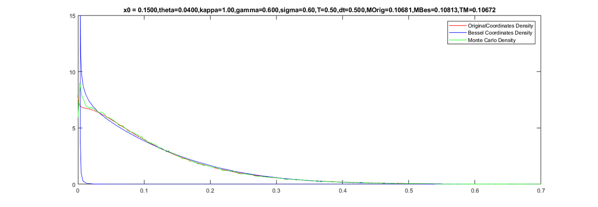](https://postimg.cc/WFYTszsv)

---

### #1170 — Amin (Topic Author)
*June 15, 2021, 3:24 PM*

Explaining again, the above program makes a single step high order expansion of a single dimensional SDE and compares
its density  with short stepping monte carlo simulation density of the same SDE.

---

### #1171 — Amin (Topic Author)
*June 17, 2021, 5:37 AM*

I am writing this post to tell friends about my increasing persecution again. I mentioned that I used to buy 5 Liter
Nestle water bottles but Nestle bottles that were manufactured in May 2021 were not good and I survived for a long time
by buying 5L Nestle water bottles that had been lying in stores from April 2021 and earlier. A few weeks ago heat really
increased and all older 5L Nestle water bottles were gone. Then I survived for a week or so by buying another water from
Dunkin Donuts that was reasonable but that water was quickly drugged at all Dunkin Donut stores by mind control
agencies. Luckily, in the meantime, Nestle 1.5 L water bottles became good and new 1.5 L water that came out in June was
good. For past few (2) weeks I have survived by drinking Nestle 1.5 L water. But since past two days, they have started
drugging Nestle 1.5 L Water in the adjacent areas of Lahore city where I live. Day before yesterday they drugged some
water in nearby markets and yesterday I went to areas a bit farther to avoid drugged water and was reasonably successful
but today I found that 1.5 L water bottles on shelves in a lot of areas even away were drugged. Mind control agencies
are actively drugging water in adjacent areas of the city again to control me so I would not be able to do any
productive work. I want to request good Americans and good people all over the world to please do anything you can to
stop mind control agencies from drugging water in Lahore city.

---

### #1172 — Amin (Topic Author)
*June 17, 2021, 6:42 PM*

Friends, I wanted to share the analytics for multidimensional monte carlo simulations of the kind we have in equity
basket pricing where each of the N SDEs in the basket of N assets is largely single-dimensional but their driving
brownian motions are correlated.

I suppose that we have already done cholesky decomposition or SVD decomposition of the correlation matrix and we have
written each of the N SDEs with their volatility coefficients explicitly stated after cholesky or SVD. I will just write
one of the N SDEs in the basket as

$dX_1 = \mu_1 \, {X_1}^{\beta_1} \, dt + \sum_{n=1}^{N} \, \sigma_{1n} \, {X_1}^{\gamma_1} \, dZ_n$

In particular we want to notice that $\sum_{n=1}^{N} \, {\sigma_{1n}}^2 \, = \, {\sigma_1}^2 $

Please note that after cholesky or SVD, all of the above brownian motions $Z_n$ are orthogonal.

Since I am playing with only one SDE, I will drop the subscript "1" from the bottom of each variable since it is
unnecessary in case we are dealing with one SDE only.

expanding the above SDE as we have previously done, we write the equation after applying repeated Ito as

$dX = \mu \, {X}^{\beta} \, \int_0^t ds + \, {X}^{\gamma} \, \sum_{n=1}^{N} \, \sigma_{1n}  \, \int_0^t dZ_n(s) $

$+(\mu \, \beta {X}^{\beta-1} ) \, (\mu \, {X}^{\beta}) \, \int_0^t \int_0^s dv \, ds$

$+(\mu \, \beta {X}^{\beta-1} ) \, ({X}^{\gamma} ) \, \sum_{n=1}^{N} \, \sigma_{1n}  \, \int_0^t \int_0^s dZ_n(v) ds$

$+.5 (\mu \, \beta \, (\beta-1) \, {X}^{\beta-2} ) \, ({X}^{2 \gamma} ) \, \sum_{n=1}^{N} \, {\sigma_{1n}}^2  \, \int_0^t \int_0^s dv \, ds$

$+(\gamma {X}^{\gamma-1} ) \, (\mu \, {X}^{\beta}) \, \sum_{n=1}^{N} \, \sigma_{1n}  \, \int_0^t \int_0^s dv \, dZ_n(s)$

$+(\gamma {X}^{\gamma-1} ) \, ({X}^{\gamma}) \, \sum_{n=1}^{N} \, \sum_{m=1}^{N} \, \sigma_{1m} \, \sigma_{1n}  \, \int_0^t \int_0^s dZ_m(v) \, dZ_n(s)$

$+.5 (\gamma (\gamma-1) \, {X}^{\gamma-2} ) \, ({X}^{2 \gamma}) \, \sum_{n=1}^{N} \, \sum_{m=1}^{N} \, {\sigma_{1m}}^2 \, \sigma_{1n}  \, \int_0^t \int_0^s dv \, dZ_n(s)$

since in quadratic variations,$\sum_{n=1}^{N} \, {\sigma_{1n}}^2 \, = \, {\sigma_1}^2 $ , we can slightly simplify the
above equations by using this identity that changes double summations in quadratic variations to single summations and
write the above equation again as

$dX = \mu \, {X}^{\beta} \, \int_0^t ds +\, {X}^{\gamma} \, \sum_{n=1}^{N} \, \sigma_{1n}  \, \int_0^t dZ_n(s) $

$+(\mu \, \beta {X}^{\beta-1} ) \, (\mu \, {X}^{\beta}) \, \int_0^t \int_0^s dv \, ds$

$+(\mu \, \beta {X}^{\beta-1} ) \, ({X}^{\gamma} ) \, \sum_{n=1}^{N} \, \sigma_{1n}  \, \int_0^t \int_0^s dZ_n(v) ds$

$+.5 (\mu \, \beta \, (\beta-1) \, {X}^{\beta-2} ) \, ({X}^{2 \gamma} ) \, {\sigma_1}^2  \, \int_0^t \int_0^s dv \, ds$

$+(\gamma {X}^{\gamma-1} ) \, (\mu \, {X}^{\beta}) \, \sum_{n=1}^{N} \, \sigma_{1n}  \, \int_0^t \int_0^s dv \, dZ_n(s)$

$+(\gamma {X}^{\gamma-1} ) \, ({X}^{\gamma}) \, \sum_{n=1}^{N} \, \sum_{m=1}^{N} \, \sigma_{1m} \, \sigma_{1n}  \, \int_0^t \int_0^s dZ_m(v) \, dZ_n(s)$

$+.5 (\gamma (\gamma-1) \, {X}^{\gamma-2} ) \, ({X}^{2 \gamma}) \,  {\sigma_1}^2\, \sum_{n=1}^{N}  \, \sigma_{1n}  \, \int_0^t \int_0^s dv \, dZ_n(s)$

We can solve all of the above integrals analytically.

$\int_0^t \int_0^s dZ_n(v) ds= \frac{1}{\sqrt{3}} t Z_n(t)$

$\int_0^t \int_0^s dZ_n(v) dZ_n(s)= \frac{1}{2}  ({Z_n(t)}^2-t)=H_2(Z_n(t))$

only difficult integral is

$\int_0^t \int_0^s dZ_m(v) dZ_n(s)= Z_n(t) \sqrt{[{Z_m(t)}^2-t] (1-\frac{\sqrt{2}}{2}) +\frac{t}{2} }$

where we get this integral from Ito Isometry as

$\int_0^t \int_0^s dZ_m(v) dZ_n(s)$

$=\int_0^t Z_m(s) dZ_n(s)$

and its variance is given as

$=\int_0^t {Z_m(s)}^2 ds$

$=\int_0^t d[{Z_m(s)}^2 s]-\int_0^t s d[{Z_m(s)}^2]$

$= t \, {Z_m(t)}^2 - \int_0^t 2 s \, Z_m(s) \, dZ_m(s)- \int_0^t s \, ds $

$= t \, H_2(Z_m(t)) (1-\frac{\sqrt{2}}{2}) + t^2/2$

its representation will be given as

$ \sqrt{(H_2(Z_m(t)) (1-\frac{\sqrt{2}}{2}) + t/2)} \, \sqrt{t} \, N_n$

where $N_n$ is standard normal associated with brownian motion $Z_n$

writing $\sqrt{t} \, N_n = Z_n(t)$ in the above equation we get

$ \sqrt{(H_2(Z_m(t)) (1-\frac{\sqrt{2}}{2}) + t/2)} \, Z_n(t)$

$= Z_n(t) \sqrt{[{Z_m(t)}^2-t] (1-\frac{\sqrt{2}}{2}) +\frac{t}{2} }$

So we can write the integral as

$\int_0^t \int_0^s dZ_m(v) dZ_n(s)= Z_n(t) \sqrt{[{Z_m(t)}^2-t] (1-\frac{\sqrt{2}}{2}) +\frac{t}{2} }$

We can now solve all the integrals and easily simulate a basket option to 2nd expansion order of Ito-Taylor expansion.

---

### #1173 — Amin (Topic Author)
*June 19, 2021, 8:50 AM*

>
>
>
> $dX = \mu \, {X}^{\beta} \, \int_0^t ds +\, {X}^{\gamma} \, \sum_{n=1}^{N} \, \sigma_{1n}  \, \int_0^t dZ_n(s) $
>
> $+(\mu \, \beta {X}^{\beta-1} ) \, (\mu \, {X}^{\beta}) \, \int_0^t \int_0^s dv \, ds$
>
> $+(\mu \, \beta {X}^{\beta-1} ) \, ({X}^{\gamma} ) \, \sum_{n=1}^{N} \, \sigma_{1n}  \, \int_0^t \int_0^s dZ_n(v) ds$
>
>$+.5 (\mu \, \beta \, (\beta-1) \, {X}^{\beta-2} ) \, ({X}^{2 \gamma} ) \, {\sigma_1}^2  \, \int_0^t \int_0^s dv \, ds$
>
>
$+(\gamma {X}^{\gamma-1} ) \, (\mu \, {X}^{\beta}) \, \sum_{n=1}^{N} \, \sigma_{1n}  \, \int_0^t \int_0^s dv \, dZ_n(s)$
>
>
$+(\gamma {X}^{\gamma-1} ) \, ({X}^{\gamma}) \, \sum_{n=1}^{N} \, \sum_{m=1}^{N} \, \sigma_{1m} \, \sigma_{1n}  \, \int_0^t \int_0^s dZ_m(v) \, dZ_n(s)$
>
>
$+.5 (\gamma (\gamma-1) \, {X}^{\gamma-2} ) \, ({X}^{2 \gamma}) \,  {\sigma_1}^2\, \sum_{n=1}^{N}  \, \sigma_{1n}  \, \int_0^t \int_0^s dv \, dZ_n(s)$
>
Friends, we do not need the Ito-isometry of the difficult integral as I did in the last post. Above I have copied the
expansion term that we need to deal with. All terms in the above expansion are very similar to single dimensional SDEs
except the term I am copying down here.

$+(\gamma {X}^{\gamma-1} ) \, ({X}^{\gamma}) \, \sum_{n=1}^{N} \, \sum_{m=1}^{N} \, \sigma_{1m} \, \sigma_{1n}  \, \int_0^t \int_0^s dZ_m(v) \, dZ_n(s)$

Diagonal terms in above are similar to one dimensional SDEs. We notice that non-diagonal terms appear in pairs of
integrals with common coefficients and each pair of integrals can be seen as a integral of complete differential of
product of two brownian motions. For example we have pair of terms like

$\sigma_{1m} \, \sigma_{1n}  \, \int_0^t \int_0^s dZ_m(v) \, dZ_n(s)+\sigma_{1n} \, \sigma_{1m}  \, \int_0^t \int_0^s dZ_n(v) \, dZ_m(s)$

which can be written as

$=\sigma_{1m} \, \sigma_{1n}  \, \int_0^t Z_m(s) \, dZ_n(s)+\sigma_{1n} \, \sigma_{1m}  \, \int_0^t Z_n(s) \, dZ_m(s)$

$=\sigma_{1m} \, \sigma_{1n}  \, \Big[ \int_0^t Z_m(s) \, dZ_n(s)+ \, \int_0^t Z_n(s) \, dZ_m(s) \Big]$

We notice that terms in large brackets are integral of a complete differential as

$=\sigma_{1m} \, \sigma_{1n}  \,  \int_0^t d \big[Z_m(s) \, Z_n(s) \big] $

$=\sigma_{1m} \, \sigma_{1n}  \,  Z_m(t) \, Z_n(t) $

So we do not need any special treatment for the cross-volatility terms and we simply need to take pairs of
cross-volatility terms and join them in the form of product of driving brownian increments multiplied by common
volatility product coefficients. rest of the integrals are the same as in single dimensional SDEs.

---

### #1174 — Amin (Topic Author)
*June 24, 2021, 11:00 AM*

Friends, my current post is about market trading and it has to be seen in context of the following previous posts.

https://forum.wilmott.com/viewtopic.php?f=4&t=99702&start=1140#p866202

https://forum.wilmott.com/viewtopic.php?f=4&t=99702&start=1140#p866241

https://forum.wilmott.com/viewtopic.php?f=4&t=99702&start=1155#p866316

I am copying the most relevant post about filtering mean-reversion coefficient here

>
> For pairs trading and many fixed income relative value trades, it would be more interesting to have simple
mean-reversion type models where mean reversion is a slowly changing stochastic parameter and find it using Kalman
filtering. In that case our simple SDEs for Kalman filtering would be usually simpler since we would not need the
stochastic mean as a hidden variable(though sometimes you would still need both a stochastic mean and stochastic
mean-reversion)
>
>
>
> $dX(t)=\, \kappa(t) \, (\theta \, - \,X(t) \, dt+\sigma \, dz(t)$
>
>
>
> and simple  mean reversion sde could be written as
>
> $\kappa(t+1)= \,  \kappa(t)+ \, \sigma_{\kappa} \, dv(t)$
>
>
>
> We suppose that theta is approximately known and we have done some research about it though a robust model may not
greatly depend on mean reversion target and stochastic kappa would adjust for minor changes in it. So in pairs trading
and relative value trades, when kappa is significantly positive, we will know that our pair is converging towards the
specified mean reversion target and when kappa is significantly negative, we will know that our pair is diverging away
from the mean reversion target. And we would be able to finesse our strategies according to prevailing mean-reversion
speed, kappa.
>
> In large fixed income relative value portfolios, we could easily do a  high dimensional kalman filter of rates with
proper specification of covariances and appropriate calibration  and that would greatly help in understanding how rates
are changing and we could calculate sensitivities of portfolio with respect to stochastic mean reversion and use that
information for trading decision making and risk management. It would also be very useful information in interest
options, swaptions and exotic interest derivatives risk management.
>
.

..

I believe trading is about relative value and in "market" we have to put dynamics of every financial asset in context
relative to each other or relative to a common market. Though there are several ways of describing a market, one good
way would be to describe it in reasonably large number of independent orthogonal factors. Again there could be several
ways of finding orthogonal factors but (as a start) one good way is through principle component analysis(PCA) of matrix
of covariance of logarithmic returns of various financial assets traded in the market.

In what follows I am dealing with logarithmic returns and their orthogonal factors and PCA where all terms can be
linearly added.

Again (as a start) we suppose that price of an asset when described in terms of orthogonal factors or principle
components represents its theoretical projected price(or theoretical projected return) once the factor returns have been
known. I write the accumulated theoretical projected return of one single stock, after T periods have elapsed from a
benchmark starting time zero, in terms of realization of M orthogonal factors over the span of T periods as

Theoretical Projected Price
$= \sum_{t=0}^{T} \, \Big[ c_1 \, r_{1,t} + c_2 \, r_{2,t} +\, ....\, + c_M \, r_{M,t} \Big] =\sum_{t=0}^{T} \sum_{m=1}^{M} \, c_m \, r_{m,t}$

where$c_m$ is eigenvector coefficient for the stock for mth factor and$ r_{m,t} $ is return of the mth orthogonal factor
in t-th time interval.

But in general the realized  return of the stock after (accumulation over) T intervals R(T) would not be equal to
theoretical projected return calculated from orthogonal factor returns due to factor misspecification or due to
idiosyncratic factors. Usually many stocks would remain within a very small error limit from the theoretical projected
returns but some few stocks would seriously start to diverge from the theoretical projected returns. And that is
precisely what we want to find. We want to find the dynamics of stocks that are diverging from the theoretical projected
returns(in either direction) and try to capture the dynamics of this divergence of returns.

We can postulate that accumulated stock returns R(t) (over a period of t intervals starting from a chosen benchmark time
zero) usually mean-revert to their (accumulated) theoretical projected returns and write the stochastic differential
equation for (accumulated over T periods) returns denoted as R as

$ dR(t)= \kappa(t) \Big[ \sum_{s=0}^{t} \sum_{m=1}^{M} \, c_m \, r_{m,s} -R(t) \Big] + \sigma_{R} \, dz(t)$

while $\kappa$ is modelled as a slowly moving hidden parameter that has its own dynamics given as

$\kappa(t+1)= \,  \kappa(t)+ \, \sigma_{\kappa} \, dw(t)$

Now magnitude and sign of filtered value of hidden parameter$\kappa$ would tell us how fast and in which direction
accumulated return on stock in question is changing as compared to theoretical return. Is it converging towards
theoretical value or diverging? At the same time we also know how much the stock return has diverged from theoretical
return over the benchmark period and this is calculated as
$\Big[ \sum_{t=0}^{T} \sum_{m=1}^{M} \, c_m \, r_{m,t} -R(T) \Big]$ and with combined knowledge of total divergence of
stock return from its theoretical value over a period and rate of this divergence, we can construct a large number of
very successful trading strategies.

We can have a multivariate version of the above equation and that can be successfully used towards algorithmic trading.

We can also apply this modeling on a time frame of days or weeks in addition to my intention of applying it to intraday
trading.

For friends who are working on option pricing with stochastic volatility, I want to mention that I am dividing my time
between algorithmic trading and SV option pricing. I would continue to post code on option pricing. For algorithmic
trading I am working with my cousin who is (assistant) professor at a university in New York state. I would not be
posting my code on algorithmic trading but I will regularly share any insights that I can think of. I think I will make
a new different thread for algorithmic trading work and copy some of these posts there.

I also want to take this opportunity to thank those kind Americans who tried to save me from persecution and torture
when times were extremely tough and I was able to survive because there was a large decrease in my persecution due to
pressure on mind control agencies from good people. If I have been able to do any decent and original research work, I
owe it to those good and kind Americans who helped me when it was difficult for me to survive. I am very grateful to
those kind and good natured American friends who helped me in difficult times. I truly want to thank them for their
favors. I also want to thank people of other countries who wished me well when I was facing difficulties.

---

### #1175 — Amin (Topic Author)
*June 25, 2021, 2:34 AM*

What I have suggested in previous post has been reviewed in slightly different mathematical framework especially by Dr. Marco Avellaneda in one of his papers on pairs trading. I have not read his paper for years but I think when I was brainstorming with pairs trading with klamn filtering, many of the ideas I learnt in his paper were getting processed in back of my brain. Here is link to his paper that where he gives the concept of eigenportfolio returns which I have called theoretical expected return in previous post: https://www.math.nyu.edu/~avellane/AvellanedaLeeStatArb071108.pdf

I think my contribution is that I presented mean-reversion in a kalman filtering framework. I think uses of this Kalman
filtering application to find dynamics of divergence between eigenportfolio returns and actual realized return go beyond
pairs trading and can be used in many other types of algorithmic trading strategies. And it is also not limited to
equities.

---

### #1176 — Amin (Topic Author)
*June 29, 2021, 2:08 PM*

Friends, many times in mathematical modelling of financial assets, we have a time changing drift in prices of financial
assets due to changing supply and demand imbalance pressure on the asset prices but on the longer run we have a
mean-reversion towards a theoretical target price which can be itself time dependent. This theoretical target price
could be an interpolated value with respect to other assets with similar financial characteristic, or some regression on
suitably chosen factors, some eigenportfolio or some other suitably chosen time dependent target value around which
asset price is supposed to mean-revert. In such cases, we can model the changing drift due to supply and demand
imbalance as a hidden variable whose dynamics are given by another SDE. We suppose that we know the mean reversion
parameter$\kappa$ 's value and it is not modelled as a hidden variable and rather its value is a locally constant
parameter and is found (like other unknown parameters) by optimization of the likelihood function of the filtering
equations. So we propose a model in which$\mu(t)$ is a hidden variable with its own SDE while mean-reversion rate
$\kappa$ is a locally constant parameter as (in below lowercase are vectors and uppercase are matrices)

$\boldsymbol{dx(t)} \, = \, \boldsymbol{\mu(t)} \, dt \, +  \boldsymbol{\kappa} \, \Big[\boldsymbol{\theta(t) \, - \, x(t) } \Big] \, +  \,  \boldsymbol{\Sigma \, dz(t)} $

$\boldsymbol{\mu(t+1)}=\boldsymbol{\mu(t)} \, - \boldsymbol{\Theta  \, \mu(t) }\, dt+ \boldsymbol{\sigma_{\mu} \, dw(t)}$

The values of coefficients$\boldsymbol{\kappa} $ ,$\boldsymbol{\Sigma}$ ,$\boldsymbol{\Theta} $ ,
$\boldsymbol{\sigma_{\mu}}$ would have to be found by optimization of the likelihood function of the local data after
filtering. The above SDEs can easily be written in the form of a multivariate Kalman filter where hidden parameter
$\boldsymbol{\mu(t)}$ is being filtered. For assets that actually have mean-reversion dynamics, the filtering equation
of drift in above SDEs are likely to be far more accurate as compared to modelling approaches in which we do not
explicitly include mean-reversion. Since our dynamics of drift are multivariate, we would be collecting a lot of
information about drift of a particular asset from cross-section of market drift of other correlated financial assets.
Again$\boldsymbol{\kappa} $ would also be slowly changing with time but we do not give it any hidden dynamics and only
change its value when we recalibrate/re-optimize the model possibly after every few hours.

We can have several variations on the theme on lines of the previous post https://forum.wilmott.com/viewtopic.php?f=4&t=99702&start=1170#p866859 where we can replace mean-reversion term

$\boldsymbol{\kappa} \, \Big[\boldsymbol{\theta(t) \, - \, x(t) } \Big] \,$

by

$\boldsymbol{\kappa \,\Big[ \sum_{t=0}^{T} \sum_{m=1}^{M} \, c_m \, r_{m,t} -\sum_{t=0}^{T} dx(t) \Big] }$

and try a lot of other such interesting possibilities.

---

### #1177 — Amin (Topic Author)
*June 29, 2021, 9:35 PM*

https://forum.wilmott.com/viewtopic.php?f=15&t=94796&p=866997#p866997

I mentioned on this forum that mind control crooks had stolen my phone about a month ago and I had to cancel the sim and
get a different phone. Now they have stolen my phone again. Stealing my stuff is one thing in which proud American army
crooks excel at. A week ago they stole some of my boxer shorts from my room but I did not write here. Not that army army
crooks have some psychological disease to steal boxer shorts, it just happened that I had bought some new cotton boxers
that were thick and sturdy and mind control does not work properly unless our private body parts are properly charged so
american army crooks love stealing such things so that they could continue mind control.

Last night after writing my post on technical forum, I went out on my car and crooks stole my phone again since I forgot
it at my home and did not take it with me. It seems that venom-filled American army agents have run out of all
justifications to continue to persecute me and now they want to use my phone to concoct some justification to retard me
by using my phone. When they stole my previous phone a month ago, I made a warning to all friends that my phone had been
stolen and anything said out of my phone did not belong to me and  that machinatory American army crooks might use my
phone to create a justification to continue my persecution. Basically purpose of my writing this post is to tell good
people that my phone has been stolen by crooks and therefore please do not believe in anything said out of it. (After
killing a million people in Iraq due to their venom, American army crooks were innocently claiming that an Iraqi
chemistry professor had fooled us. How innocent. So they might innocently say something out of my phone and then start
innocently claiming that we were led by things said out of his phone. Not a new thing for these crooks)

As I had told friends that mind control crooks are assisted by several mathematical finance experts and these experts
continue to brief the crooks about how good my ideas are about my work. So after I made my last post on technical forum,
mind control crook who was speaking in my brain became stayed and started to chew words and was thoroughly annoyed.

After I came back to home from outside, and came to know that my phone had been stolen from my home, I did not work and
decided to sleep. I just woke up in the middle of the night at (2:00 am) because there was an extreme amount of foreign
substance that had been forced into my mouth (that settles on the tongue and upper jaw where we have most taste buds)
that felt extremely bitter and I woke up in the middle of my sleep to brush my mouth to clear the chemical substance
forced into my mouth( I had complained about it several times on this forum but to no avail).

---

### #1178 — Amin (Topic Author)
*July 1, 2021, 3:23 AM*

For the context of my persecution, please see

In this thread I have given some account of my persecution spread over past 23 years.

[My Letter to HRW About My Human Rights Abuse](https://forum.wilmott.com/viewtopic.php?f=15&t=102298) : [https://forum.wilmott.com/viewtopic.php?f=15&t=102298](http://https//forum.wilmott.com/viewtopic.php?f=15&t=102298)

In the thread below I have given some discrete hints about why American defense is so rabid to persecute me and other
muslims like me(and blacks) (and why no president finds it politically expedient to end mind control on innocent human
beings.)

[Muslims, mind control, Muslim-Jewish relationship and American defense](https://forum.wilmott.com/viewtopic.php?f=15&t=101453): https://forum.wilmott.com/viewtopic.php?f=15&t=101453

In the thread below I tried in vain to request prime minister of my country to end mind control here but he is helpless
before crook generals in Pakistan army who take hundreds of millions of dollars in bribes from CIA.

[My Open Letter to Prime Minister of Pakistan, Imran Khan, to Intervene In Order to Protect the Interests of Pakistan](https://forum.wilmott.com/viewtopic.php?f=15&t=94796&start=1125#p858119)  https://forum.wilmott.com/viewtopic.php?f=15&t=94796&start=1125#p858119

---

### #1179 — Amin (Topic Author)
*July 1, 2021, 3:50 AM*

Here are some more relevant posts for American readers

[Barack Obama and Mind Control](https://forum.wilmott.com/viewtopic.php?f=15&p=864314#p864253): https://forum.wilmott.com/viewtopic.php?f=15&p=864314#p864253

and finally appeal to new president Joe Biden to end mind control

https://forum.wilmott.com/viewtopic.php?f=15&p=864314#p864314

---

### #1180 — Amin (Topic Author)
*July 2, 2021, 2:02 AM*

I had told friends that American army mind control crooks have control over my computer. Just two or three days ago I
noticed in my activity that there were two posts they had liked out of my account. I just "unliked" the posts and did
not make a deal about it. But tonight, they liked another two posts from my account and I had to unlike the posts again
and then decided to write this post.

My phone(that I mentioned was stolen) was returned in the morning after the night I wrote the post. When I woke up, my
mother told me that my phone was lying in the drawing room. Before sleeping I had checked the drawing room very
carefully several times and also rang my phone several times from my mother's phone and there was no sound there. They
simply returned the phone to my mother and asked her to give it to me.

I might have not written but I do not believe in religion and they like deeply religious posts out of my linkedin
account.

Machinations of spiteful and malicious mind control crooks of American army are simply not ending.

---

### #1181 — Amin (Topic Author)
*July 3, 2021, 2:06 PM*

Friends, sorry about my past few posts. If my persecution were not steadily increasing, I would not have cared but I
really had to say something here to force mind control agency to decrease my mind control.

Back to business now. I had written a simple univariate Kalman filter routine with fixed variances. It was a very simple
filter. (My real idea about Kalman filtering was to do a properly calibrated multivariate filter to interpolate the
drift in returns from multivariate data. ) Anyway, when I was playing with univariate filter, I tried some other ideas
that I want to share with friends.

First I want to show friends a graph of filtered logarithmic returns and filtered  logarithmic prices(generated from
putting together filtered returns) VS original returns and original logarithmic prices. This is  "MSFT" stock data
on "14\04\2021"

[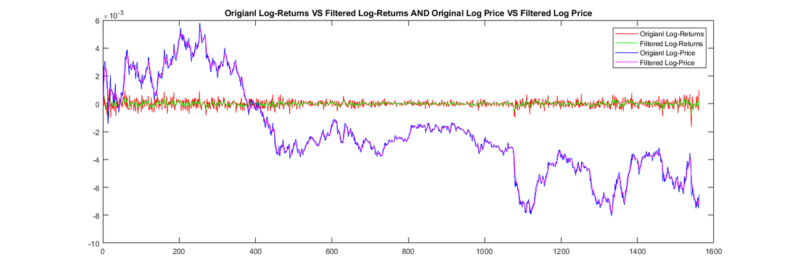](https://postimg.cc/MM7bNHk6)

I have subtracted starting Log price from the log price graphs so that graphs remain visible on the same scale.

I want to mention for friends again that blue graphs has been constructed from red returns and magenta graph has been
constructed from filtered green returns. Please notice how closely blue and magenta graphs follow each other.

Then I had the idea to try regression for auto-correlation on filtered returns VS regression for auto-correlation on
original returns. The underlying idea is that in original returns there is extreme noise in both the variable being
regressed and also in the explanatory variable and that strongly spoils explanatory power of regression. I regressed the
filtered returns and original returns (on previous values) after every hundred instances of data(we have 1560 data
points in total during the day at an interval of fifteen seconds).

I am copying a typical matlab regression diagnostics for auto-correlation on filtered returns and auto-correlation on
original returns data.

Following is diagnostics for auto-correlation on filtered returns.

mdl =

Linear regression model:

    y ~ 1 + x1

Estimated Coefficients:

                         Estimate                    SE                   tStat                  pValue

                   _____________________    ____________________    __________________    _____________________

    (Intercept)    -1.08931289638274e-06    2.49865366333489e-06    -0.435959938092766         0.66293315332688

    x1                 0.643305860461598      0.0204953915720911      31.3878297079036    4.18295581915735e-164

Number of observations: 1399, Error degrees of freedom: 1397

Root Mean Squared Error: 9.34e-05

R-squared: 0.414,  Adjusted R-Squared 0.413

F-statistic vs. constant model: 985, p-value = 4.18e-164

Following is diagnostics for auto-correlation on original non-filtered returns.

md2 =

Linear regression model:

    y ~ 1 + x1

Estimated Coefficients:

                         Estimate                    SE                   tStat                pValue

                   _____________________    ____________________    __________________    _________________

    (Intercept)    -3.02773437841068e-06    6.66354594477685e-06    -0.454372852457622    0.649631076236237

    x1               0.00509943026632265       0.026769288642365      0.19049554638715    0.848948510416014

Number of observations: 1399, Error degrees of freedom: 1397

Root Mean Squared Error: 0.000249

R-squared: 2.6e-05,  Adjusted R-Squared -0.00069

F-statistic vs. constant model: 0.0363, p-value = 0.849

Interesting thing is that autocorrelation coefficient on filtered returns is  0.643305860461598      with   R-squared:
0.414

while   autocorrelation coefficient on original returns is  0.00509943026632265  with  R-squared: 2.6e-05

while we notice that both filtered price(reconstructed from filtered returns) and original price follow each other very
faithfully.

SO we probably need to slightly smooth the financial data before we use for regressions, artificial intelligence and
other statistical calculations to get meaningful results because mostly in financial calculations both the input data
and resultant data re too noisy which causes all sort of noise in the inference process.

Tomorrow, I will be posting my programs used to generate these simple results.

---

### #1182 — Amin (Topic Author)
*July 6, 2021, 3:54 PM*

Friends, I have decided to go to China and find work in some good financial firm there. I love my country and wanted to
live here for the rest of my life but my life is no more than a joke in hands of American mind control crooks. In last
few days, I had worked out some strategies that were working on some stocks with certain characteristics. In very raw
form the strategies were generating .5% to 4% on an average of 100-300 trades a day without including transaction costs
irrespective of whether the stock went up or down. I was a bit excited and continued to play with the models for several
days. But this morning when I wanted to try my ideas to improve the models and I ran my programs, I was surprised to
find that there were miniscule profits and all losses. I looked at my programs very carefully. It was not a big program
rather very small matlab files. And there were not a large amount of data. I had tried my programs on four very liquid
stocks on two months of data. I had large tick data files and I had converted (two months of) them to data on fifteen
seconds grid so I can experiment with this and then go to full scale data later. I tried everything and even undid all
of the small changes since yesterday using the undo button on editor but nothing worked. Mind control crooks used to
change my program very frequently before 2016 and I have very bitter memories of that time. They can especially change
output in matlab. Now mind control crooks will give my programs to black sheep of my old university (who were behind
instigating my persecution) who will make profits from my program and in turn support American mind control crooks in
Pakistan who would swindle several tens of millions of dollars and this symbiotic relationship between black sheep and
mind control crooks would continue to my peril. I am sick of being manipulated and abused for a large portion of my
adult life and therefore I have finally decided that may be I should leave my country and go to China and try to work
with some good financial firm and try to find some peace in my life out of the reach of American mind control crooks.

Now I am afraid that lowly and machinatory American mind control crooks would start blocking my emails and linkedin
messages to Chinese friends with request for employment. I want to request all good Americans and good people of all
other countries to please force these machinatory crooks to let me restart my life peacefully in China where I could
live a free life without any mind control torture and forced abuse for the rest of my life.

---

### #1183 — Amin (Topic Author)
*July 7, 2021, 3:54 AM*

Friends, I want to share my "little secret algorithm" that I used to make money as I mentioned in the previous post (If
it were in my powers, I would give everyone money equal to Jeff Bezos' wealth)

First some background. I have been of the view that there are three types of markets

a. market that hovers around in a certain band. A much better and scientific definition of this market is that it has
negative  auto-correlation between logarithmic stock returns (log price differences).

b. Positive autocorrelation with positive drift.

c. Positive autocorrelation with negative drift.

I was able to handle the markets where autocorrelation between returns is negative with a very simple algorithm. You do
not need very high negative correlation for the algorithm to work. It would work great when market has autocorrelation
coefficient on regression lesser than  -.025. For autocorrelation coefficients on regression below -.05, the method
would work wonders. For this you do not use autocorrelation on filtered returns but on realized returns.

I took trading signals from Kalman filtered returns and not from realized returns even though autocorrelation was
measured on realized returns. In my filter, I had arbitrarily divided the variance between brownian motion associated
with hidden process and brownian motion associated with observation process (that is realized returns). I will post my
filter matlab algorithm later today or possibly tomorrow. I had noticed how you divide the variance between two brownian
motions affects the quality and profits of the algorithm quite a bit.

Coming to the algorithm, when filtered value of log returns would exceed +.0001 (this can be altered but it was a great
benchmark value probably since it was log difference. Please note that this value was from filtered returns and not
realized returns.), I would go short and end the trade by buying when I would encounter another negative return of
-.00008. And similarly when I would encounter a negative log return of value -.0001, I would buy the stock only to end
the trade by selling when I encounter a return of +.00008. As long as the correlation coefficient on regression on
previous values remains negative, this algorithm works wonders. Sorry I forgot to mention that all logarithmic returns
are on 15 seconds interval. As long as regression coefficient on autocorrelation regression remains even mildly negative
the algorithm makes good profits. I was playing with returns that are differences of log prices.

However the algorithm has pitfalls that I wanted to fix in my later research. When stock price moves consistently in a
certain direction in episodes of sentiment, the algorithm loses big money. This can be fixed by making stop loss so
algorithm ends the trade when stock moves significantly in a certain direction. I wanted to find out from the market
cross-section about episodes of sentiment in the market to be able to trade on sentiment appropriately and differently
but that is only future research. For the two month time period I had AMZN had great profits in "log difference" terms
since this stock had larger negative auto-correlation between log returns during most of this period. "TSLA" was second
with large profits. AAPL also had nice profits. Only "MSFT" had small profits since its autocorrelation was most
positive of all four stocks and it had more bursts of sentiment and correlated activity. I still think that even MSFT
can be very profitably traded but for that to do, you would need to know about intervals of sentiment in the market
possibly from market cross-section data.

I will post my filter matlab algorithm later today or possibly tomorrow but I will not include the whole trade setup.

---

### #1184 — Amin (Topic Author)
*July 7, 2021, 8:21 AM*

I forgot to mention in the previous post that  in very raw form the strategies were generating .5% to 4% on an average
of 100-300 trades a day without including transaction costs irrespective of whether the stock went up or down. AMZN was
the nicest stock and on more than one date AMZN returned close to or more than 6% and this was without any stop-loss.
AMZN easily yielded more than one percent on most of the dates and was usually close to 2% or 3%. Without stop-loss
"MSFT" had several negative days and even on most positive days, it returned less than one percent.

---

### #1185 — Amin (Topic Author)
*July 11, 2021, 12:16 PM*

Friends, I am writing this post to warn the friends about possibility of concocting some proof of my wrongdoing by mind
control agency. They have stolen my phone twice in past 45 days and every time I had to post a warning that my phone had
been stolen. I really think that purpose of stealing my phone was to say something out of it that might be possibly
"terrorist-like" or possibly something that just shows malicious mentality towards good-natured American people or nice
people somewhere else in the world.

Without sounding like I am giving explanations, I want to tell friends that my persecution has continued for at least 23
years now. There are times when I have been upset (in thought) at psychiatrists, mind control agency or even my family
but my angry thoughts only resulted in my intention to make complaints to authority about wrongdoings of the
psychiatrists, exposing the mind control agency in public and thinking of living alone when I would be financially
independent of my family while still wishing genuinely good to members of my family. Despite that I would be a bit upset
in thought, I would still be nice and never on a single time turned violent or lost control.

But I have this feeling now that some people in mind control agencies who are behind my persecution are losing patience
and want to prove by hook or crook that I am indeed a bad or evil person and stealing of my phone again and again is
expression of their desire to do something concrete once for all to end my exposing them continuously in public all over
the world and also to find a valid justification of their otherwise racist crimes.

At this point I want to recall that a British bank stole my thousand pounds when I was in UK during 2010-2011. I have written about it here: https://forum.wilmott.com/viewtopic.php?f=15&t=102298#p857494

Anyway the bank had stolen my thousand pounds and had bitterly refused to make any written correspondence about it. When
I went to the same branch of the bank an official there walked with me out of the bank and talked to me about the issue
outside the bank building close to the entrance of the bank. I had been writing about the issue on wilmott in detail.
But when the bank official told me that they would show me a video of my walking inside the bank and withdrawing money
out of the bank, earth slipped beneath my feet and I realized that the bank was ready for high level technological
forgery to prove me wrong. Once they would have forged a tape proving me wrong, I would have absolutely no reprieve in a
foreign country and everybody would have blamed me. British secret services were already forcefully stopping me from
meeting law firms to discuss my case with them. Close to British supreme court building there is a large walled compound
where there are many law firms and I was asked to leave the compound after I had gotten inside through security checks
at the gate by a security staff that came from behind and I was told that police would be called if I did not comply.
Once I tried to approach the law firms on the main streets, British secret services were already prepared and a guy
would approach me at every law firm's door and ask me that they were not willing to accept any documents from me and
nobody would be willing to meet me in person and I would be told that only way to communicate with them would be through
email because my emails were routinely stopped whenever mind control agencies wished to this day(even now). I was again
and again told that in Britain you could not get a lawyer by yourself and you had to go to a solicitor and he would
assign you a lawyer.

Anyway long story short, I knew that after high level technical forgery by the bank, there would not be any possibility
for me to say that I was innocent and no expert  would ever be willing to help me in proving that bank had forged the
tapes and I would have to bear all the blame.

I have written about law firms and the stealing of the money by British bank in detail in the address of the post given
above.

I want people to know that forging evidence is not a new things for crooks of American defense and they are experts at
such things and when these hardliner crooks want bitterly to continue their racist practices, they are sure to resort to
such evil practices. And the way these crooks are getting impatient, I am sure that sooner or later they would resort to
their machinatory practice of forging and concocting evidence to somehow continue my persecution.

I really hope that good people would hear my argument and would be careful to believe these crooks.

---

### #1186 — Amin (Topic Author)
*July 12, 2021, 3:32 PM*

Friends, I have tried to approach some people with the request for consulting work. And I am posting the same letter
here for Wilmott audience if somebody would want to hire me for my expertise. I have written the following letter to 4-5
special people among my linkedin connections asking for the possibility of consulting work. So any friends here who
could be interested can contact me at anan2999(at)yahoo(dot)com.  I am copying the letter here:

I am reaching out to you to explore the possibility of consulting work with your firm. This work could be about
something you want to get done and it requires different and innovative thinking. It could possibly be the case that you
have some challenging research ideas but it would not be obvious how to solve them or literature does not exist about
their solution or your firm lacks the niche expertise to find the solution. If you like the idea of my doing such
consulting work for you, please share your thoughts about things that need to be done and if the ideas lie within my
area of expertise, I would love to devote time and energy to solve them for you.

In order to give an idea about my areas of expertise and to show that I can fulfill your expectations, I will cite some
of my research work that I have done in past few years.

1. I found solution to the problem of high order monte carlo simulation of Stochastic differential equations and now you
can easily do accurate monte carlo simulations to any order based on my work.

2. I found an approximate way to find the numerical solution of Fokker-Planck equation for SDEs in Bessel coordinates.

3. I suggested a new method to evolve and discretize the solution of SDEs on a transition probabilities grid. My method
represents the next generation version of quantizers algorithm.

4. I suggested a new method to construct the densities that can match moments of any order to the density with
precision. The method ensures that density is perfectly positive, completely normalized, and simultaneously matches all
given moments. Now you would not need edgeworth expansions, Gram-Charlier or anything of the sort.

5. I gave a new analytic algorithm to find the solution of nth order ordinary differential equations and systems of
arbitrary order ODEs.

I hope you like my research portfolio and so if you want something different and innovative to get done and you have
some initial thoughts about it, please share with me and I would love to discuss my ideas with you.

Wishing you a good day.

Kind regards,

Ahsan Amin

---

### #1187 — Amin (Topic Author)
*July 13, 2021, 3:48 PM*

Friends, I have been able to evolve the densities of SDEs analytically without resorting to Fokker-Planck Equation. I
construct a Z-grid similar to the grid we constructed for solution of FPE. But stochastic integrals are solved
analytically with the same value of Z that is associated with each grid point. I solved these integrals analytically as
I had been showing in some previous posts. Coefficients on these integrals are the same as Ito-Taylor coefficients that
we also use for monte carlo simulations. In addition to all of this a correction term is added on top of analytic
Ito-Taylor terms which is equal to second derivative of the Z-grid (d2wdZ2 is the notation we used for this derivative
in previous programs) multiplied by time interval spacing dt or "delta t". I had been making attempts to solve for the
densities of SDEs without resorting to FPE for years but it never worked and some problems always remained. however
recently I had some new ideas and I used them to successfully solve for the evolution of densities. I really hope
friends would like my program since it is a nice breakthrough and might open up ways for even simpler and novel methods
to solve for the densities of SDEs. I will be sharing my programs as usual but please give me a day or two for writing
comments and making my programs presentable after I have done some further experiments.

Another good thing is that there are no instabilities in the middle of the density like we had when we solved for
densities of SDEs using derivatives from Fokker-plank equation.

---

### #1188 — Amin (Topic Author)
*July 15, 2021, 12:35 PM*

Friends I am posting a few graphs of SDE densities from the new algorithm. It is faster, more accurate and simpler than
the Fokker-planck algorithm I had earlier used several months ago. The new algorithm is accurate to just within a few
basis points almost everywhere. Unlike previous FPE algorithm, I am sure we can carry this algorithm over to original
coordinates and two dimensions as well.  In this post I am showing the graphs. In next post, I will attach the code and
in the third post, I will explain the algorithm. Here are the graphs. The SDE parameters associated with every graph are
given on title of each graph.

[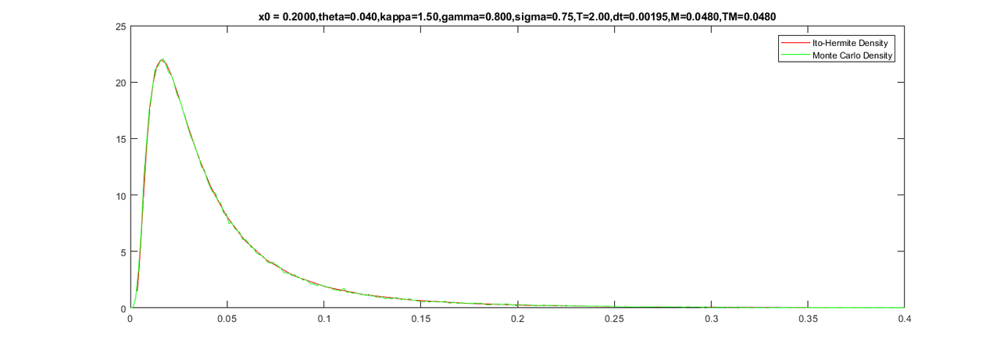](https://postimg.cc/K49wKjH3)

[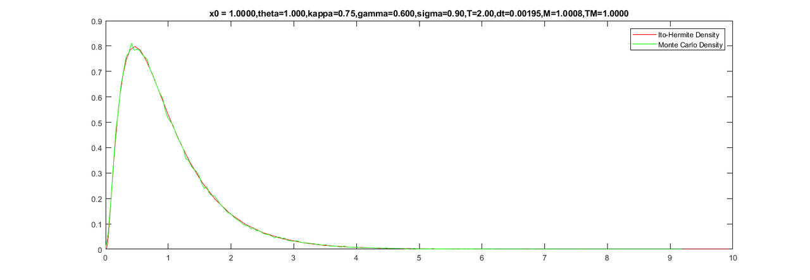](https://postimg.cc/2VVJnYsc)

[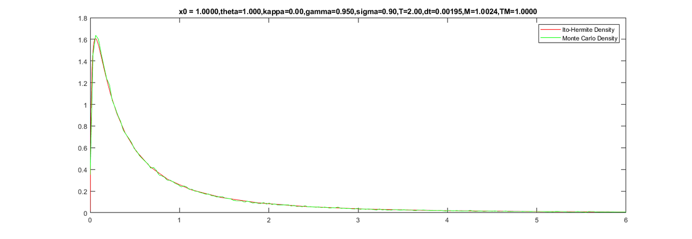](https://postimg.cc/sQm84gf8)

[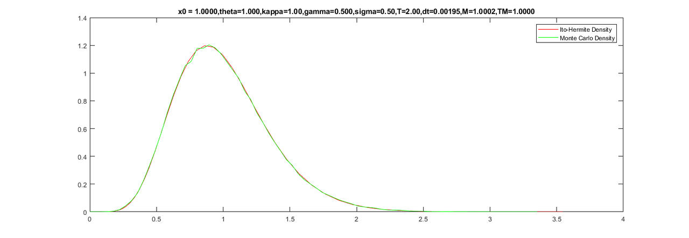](https://postimg.cc/CnK2PpzK)

[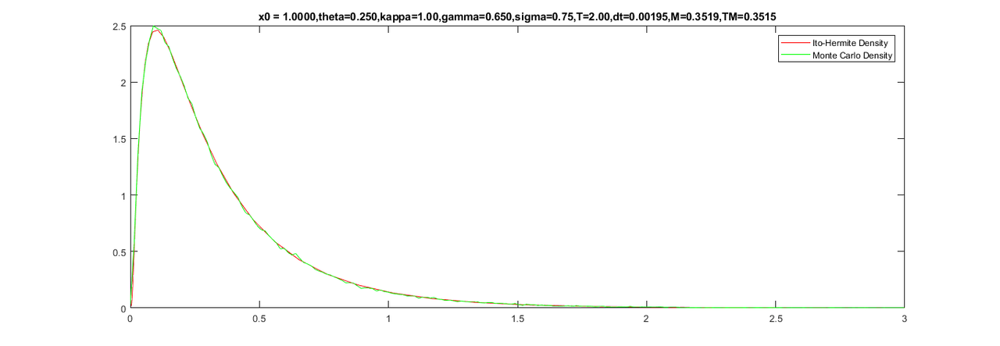](https://postimg.cc/DJnHGXhL)

[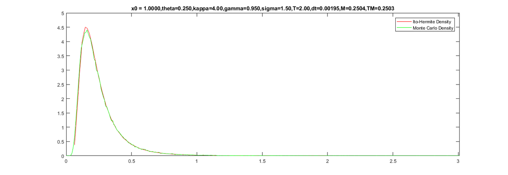](https://postimg.cc/NLGZfmpw)

[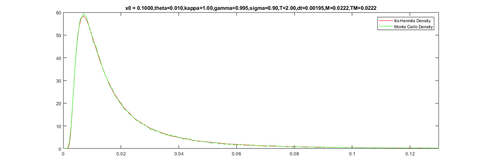](https://postimg.cc/5HwDjmhf)

[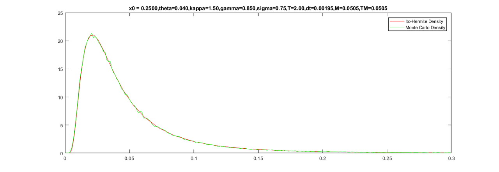](https://postimg.cc/5HcZxrkP)

[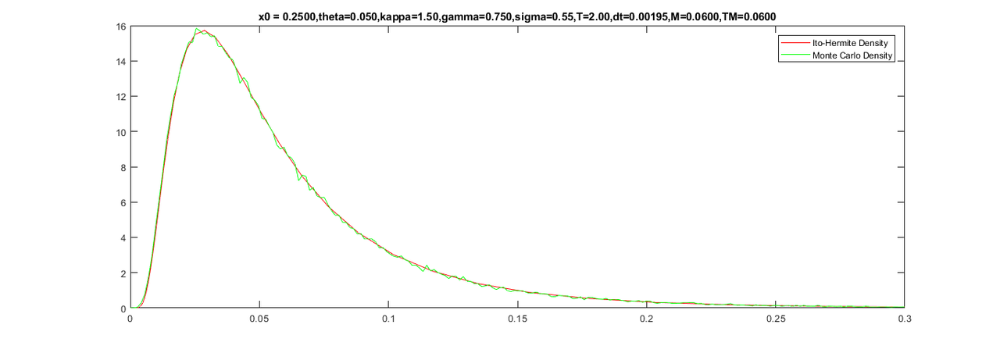](https://postimg.cc/4YHDRGw7)

[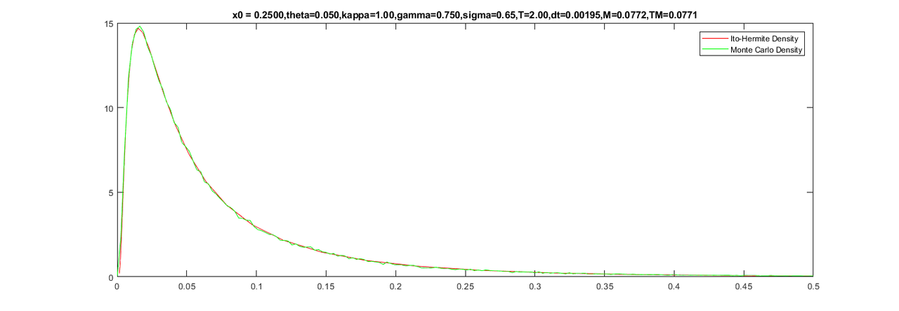](https://postimg.cc/hf5kYv8R)

---

### #1189 — Amin (Topic Author)
*July 15, 2021, 12:41 PM*

All of the above graphs have been made with the following program. All the function routines required to run the program
have been posted earlier by me in the same thread.

```
function [] = FPERevisitedTransProb08ABwNew04()

%Copyright Ahsan Amin. Infiniti derivatives Technologies.
%Please fell free to connect on linkedin: linkedin.com/in/ahsan-amin-0a53334
%or skype ahsan.amin2999
%In this program, I am simulating the SDE given as
%dy(t)=mu1 x(t)^beta1 dt + mu2 x(t)^beta2 dt +sigma x(t)^gamma dz(t)

%I have not directly simulated the SDE but simulated the transformed
%Besse1l process version of the SDE and then changed coordinates to retreive
%the SDE in original coo
%rdinates.
%The present program will analytically evolve only the Bessel Process version of the
%SDE in transformed coordinates.

dt=.125/16/2/2;   % Simulation time interval.%Fodiffusions close to zero
             %decrease dt for accuracy.
Tt=128*2*2*2;     % Number of simulation levels. Terminal time= Tt*dt; //.125/32*32*16=2 year;
T=Tt*dt;
OrderA=4;  %
OrderM=4;  %
dtM=dt*4*2*4;
TtM=Tt/4/2/4;

dNn=.2/1;   % Normal density subdivisions width. would change with number of subdivisions
Nn=50;  % No of normal density subdivisions
NnMidl=25;%One half density Subdivision left from mid of normal density(low)
NnMidh=26;%One half density subdivision right from the mid of normal density(high)
NnMid=4.0;

x0=.25;   % starting value of SDE
beta1=0.0;
beta2=1.0;   % Second drift term power.
gamma=.75;%50;   % volatility power.
kappa=1.0;%.950;   %mean reversion parameter.
theta=.05;%mean reversion target
sigma0=.650;%Volatility value

%you can specify any general mu1 and mu2 and beta1 and beta2.
mu1=1*theta*kappa;   %first drift coefficient.
mu2=-1*kappa;    % Second drift coefficient.
%mu1=0;
%mu2=0;

alpha=1;% x^alpha is being expanded. This is currently for monte carlo only.
alpha1=1-gamma;%This is for expansion of integrals for calculation of drift
%and volatility coefficients
yy(1:Nn)=x0;
w(1:Nn)=x0^(1-gamma)/(1-gamma);

%Z(1:Nn)=(((1:Nn)-5.5)*dNn-NnMid);
Z(1:Nn)=(((1:Nn)-5.5)*dNn-NnMid);

Z
str=input('Look at Z');
ZProb(1)=normcdf(.5*Z(1)+.5*Z(2),0,1)-normcdf(.5*Z(1)+.5*Z(2)-dNn,0,1);
ZProb(Nn)=normcdf(.5*Z(Nn)+.5*Z(Nn-1)+dNn,0,1)-normcdf(.5*Z(Nn)+.5*Z(Nn-1),0,1);
ZProb(2:Nn-1)=normcdf(.5*Z(2:Nn-1)+.5*Z(3:Nn),0,1)-normcdf(.5*Z(2:Nn-1)+.5*Z(1:Nn-2),0,1);
    %Above calculate probability mass in each probability subdivision.

%%%%%%%%%%%%%%%%%%%%%%%%%%%%%%%%%%%%%%%%%%%%%%%%%%%%%%%%%%%%%%%%%%%%%%%%%%%%%%%%%%%%%%%%%%%%%%

sigma11(1:OrderA+1)=0;
mu11(1:OrderA+1)=0;
mu22(1:OrderA+1)=0;
sigma22(1:OrderA+1)=0;
% index 1 correponds to zero level since matlab indexing starts at one.
sigma11(1)=1;
mu11(1)=1;
mu22(1)=1;
sigma22(1)=1;

for k=1:(OrderA+1)
    if sigma0~=0
        sigma11(k)=sigma0^(k-1);
    end
    if mu1 ~= 0
        mu11(k)=mu1^(k-1);
    end
    if mu2 ~= 0
        mu22(k)=mu2^(k-1);
    end
    if sigma0~=0
        sigma22(k)=sigma0^(2*(k-1));
    end
end
%Ft(1:TtM+1,1:(OrderA+1),1:(OrderA+1),1:(OrderA+1),1:(OrderA+1))=0; %General time powers on hermite polynomials
Fp(1:(OrderA+1),1:(OrderA+1),1:(OrderA+1),1:(OrderA+1))=0;%General x powers on coefficients of hermite polynomials.
Fp1(1:(OrderA+1),1:(OrderA+1),1:(OrderA+1),1:(OrderA+1))=0;%General x powers for bessel transformed coordinates.

%YCoeff0 and YCoeff are coefficents for original coordinates monte carlo.
%YqCoeff0 and YqCoeff are bessel/lamperti version monte carlo.

YCoeff0(1:(OrderA+1),1:(OrderA+1),1:(OrderA+1),1:(OrderA+1))=0;
YqCoeff0(1:(OrderA+1),1:(OrderA+1),1:(OrderA+1),1:(OrderA+1))=0;
%Pre-compute the time and power exponent values in small multi-dimensional arrays
YCoeff = ItoTaylorCoeffsNew(alpha,beta1,beta2,gamma); %expand y^alpha where alpha=1;
YqCoeff = ItoTaylorCoeffsNew(alpha1,beta1,beta2,gamma);%expand y^alpha1 where alpha1=(1-gamma)
YqCoeff=YqCoeff/(1-gamma); %Transformed coordinates coefficients have to be
%further divided by (1-gamma)

for k = 0 : (OrderA)
    for m = 0:k
        l4 = k - m + 1;
        for n = 0 : m
            l3 = m - n + 1;
            for j = 0:n
                l2 = n - j + 1;
                l1 = j + 1;
                %Ft(l1,l2,l3,l4) = dtM^((l1-1) + (l2-1) + (l3-1) + .5* (l4-1));
                Fp(l1,l2,l3,l4) = (alpha + (l1-1) * beta1 + (l2-1) * beta2 + (l3-1) * 2* gamma + (l4-1) * gamma ...
                    - (l1-1) - (l2-1) - 2* (l3-1) - (l4-1));
                Fp1(l1,l2,l3,l4) = (alpha1 + (l1-1) * beta1 + (l2-1) * beta2 + (l3-1) * 2* gamma + (l4-1) * gamma ...
                    - (l1-1) - (l2-1) - 2* (l3-1) - (l4-1));

                YCoeff0(l1,l2,l3,l4) =YCoeff(l1,l2,l3,l4).*mu11(l1).*mu22(l2).*sigma22(l3).*sigma11(l4);
                YqCoeff0(l1,l2,l3,l4) =YqCoeff(l1,l2,l3,l4).*mu11(l1).*mu22(l2).*sigma22(l3).*sigma11(l4);
            end
        end
    end
end

%%%%%%%%%%%%%%%%%%%%%%%%%%%%%%%%%%%%%%%%%%%%%%%%%%%%%%%%%%%%%%%%%%%%%%%%%%%%%%%%%%%%%%%%%%%%%%

wnStart=1;%
tic

Zt1(wnStart:Nn)=0.0;
Zt2(wnStart:Nn)=0.0;
for tt=1:Tt

    [wMu0dt,dwMu0dtdw,c1] = CalculateDriftAndVolA4(w,wnStart,Nn,YqCoeff0,Fp1,gamma,dt);

    [wMid] =
InterpolateOrderN8(8,0,Z(NnMidl-3),Z(NnMidl-2),Z(NnMidl-1),Z(NnMidl),Z(NnMidh),Z(NnMidh+1),Z(NnMidh+2),Z(NnMidh+3),w(NnMidl-3),w(NnMidl-2),w(NnMidl-1),w(NnMidl),w(NnMidh),w(NnMidh+1),w(NnMidh+2),w(NnMidh+3));

    Zt1(wnStart:Nn)=w(wnStart:Nn)-wMid;

    [dwdZ,d2wdZ2A,d3wdZ3A] = First3Derivatives2ndOrderEqSpacedA(wnStart,Nn,dNn,Zt1,Z);

    C0(wnStart:Nn)=Zt1(wnStart:Nn)-dwdZ(wnStart:Nn).*Z(wnStart:Nn);

    Zt2(wnStart:Nn)=C0(wnStart:Nn)+abs(sqrt((dwdZ(wnStart:Nn)).^2+sigma0^2*dt)).*Z(wnStart:Nn);

    if(tt>20)
        w(wnStart:Nn)=w(wnStart:Nn)+ ...
            wMu0dt(wnStart:Nn)+Zt2(wnStart:Nn)-Zt1(wnStart:Nn)+ ...
            .5*sigma0^2*dwdZ(wnStart:Nn).^(-2).*d2wdZ2A(wnStart:Nn).*dt;%+ ...
    else
        w(wnStart:Nn)=w(wnStart:Nn)+ ...
            wMu0dt(wnStart:Nn)+Zt2(wnStart:Nn)-Zt1(wnStart:Nn);%+ ...
    end
    %yy(wnStart:Nn)=((1-gamma).*w(wnStart:Nn)).^(1/(1-gamma));

    [wE] =
InterpolateOrderN6(6,Z(Nn)+dNn,Z(Nn),Z(Nn-1),Z(Nn-2),Z(Nn-3),Z(Nn-4),Z(Nn-5),w(Nn),w(Nn-1),w(Nn-2),w(Nn-3),w(Nn-4),w(Nn-5));

     w1(1:Nn-1)=w(1:Nn-1);
     w1(Nn)=w(Nn);
     w2(1:Nn-1)=w(2:Nn);
     w2(Nn)=wE;
     w(w1(:)>w2(:))=0;%Be careful;might not universally hold;
      %Change 3:7/25/2020: I have improved zero correction in above.
     w(w<0)=0.0;
     for nn=1:Nn
         if(w(nn)<=0)
            wnStart=nn+1;
         end
     end

end
yy(wnStart:Nn)=((1-gamma).*w(wnStart:Nn)).^(1/(1-gamma));
Dfyy(wnStart:Nn)=0;
for nn=wnStart+1:Nn-1

    Dfyy(nn) = (yy(nn + 1) - yy(nn - 1))/(Z(nn + 1) - Z(nn - 1));
    %Change of variable derivative for densities
end

pyy(1:Nn)=0;
for nn = wnStart:Nn-1

    pyy(nn) = (normpdf(Z(nn),0, 1))/abs(Dfyy(nn));
end

toc

ItoHermiteMean=sum(yy(wnStart+1:Nn-1).*ZProb(wnStart+1:Nn-1)) %Original process average from coordinates
disp('true Mean only applicable to standard SV mean reverting type models otherwise disregard');
TrueMean=theta+(x0-theta)*exp(-kappa*dt*Tt)%Mean reverting SDE original variable true average

theta1=1;
rng(29079137, 'twister')
paths=200000;
YY(1:paths)=x0;  %Original process monte carlo.
Random1(1:paths)=0;
for tt=1:TtM

    Random1=randn(size(Random1));
    HermiteP1(1,1:paths)=1;
    HermiteP1(2,1:paths)=Random1(1:paths);
    HermiteP1(3,1:paths)=Random1(1:paths).^2-1;
    HermiteP1(4,1:paths)=Random1(1:paths).^3-3*Random1(1:paths);
    HermiteP1(5,1:paths)=Random1(1:paths).^4-6*Random1(1:paths).^2+3;

    YY(1:paths)=YY(1:paths) + ...
        (YCoeff0(1,1,2,1).*YY(1:paths).^Fp(1,1,2,1)+ ...
        YCoeff0(1,2,1,1).*YY(1:paths).^Fp(1,2,1,1)+ ...
        YCoeff0(2,1,1,1).*YY(1:paths).^Fp(2,1,1,1))*dtM + ...
        (YCoeff0(1,1,3,1).*YY(1:paths).^Fp(1,1,3,1)+ ...
        YCoeff0(1,2,2,1).*YY(1:paths).^Fp(1,2,2,1)+ ...
        YCoeff0(2,1,2,1).*YY(1:paths).^Fp(2,1,2,1)+ ...
        YCoeff0(1,3,1,1).*YY(1:paths).^Fp(1,3,1,1)+ ...
        YCoeff0(2,2,1,1).*YY(1:paths).^Fp(2,2,1,1)+ ...
        YCoeff0(3,1,1,1).*YY(1:paths).^Fp(3,1,1,1))*dtM^2 + ...
        ((YCoeff0(1,1,1,2).*YY(1:paths).^Fp(1,1,1,2).*sqrt(dtM))+ ...
        (YCoeff0(1,1,2,2).*YY(1:paths).^Fp(1,1,2,2)+ ...
        YCoeff0(1,2,1,2).*YY(1:paths).^Fp(1,2,1,2)+ ...
        YCoeff0(2,1,1,2).*YY(1:paths).^Fp(2,1,1,2)).*dtM^1.5) .*HermiteP1(2,1:paths) + ...
        ((YCoeff0(1,1,1,3).*YY(1:paths).^Fp(1,1,1,3) *dtM) + ...
        (YCoeff0(1,1,2,3).*YY(1:paths).^Fp(1,1,2,3)+ ...
        YCoeff0(1,2,1,3).*YY(1:paths).^Fp(1,2,1,3)+ ...
        YCoeff0(2,1,1,3).*YY(1:paths).^Fp(2,1,1,3)).*dtM^2).*HermiteP1(3,1:paths) + ...
        ((YCoeff0(1,1,1,4).*YY(1:paths).^Fp(1,1,1,4)*dtM^1.5 )).*HermiteP1(4,1:paths) + ...
        (YCoeff0(1,1,1,5).*YY(1:paths).^Fp(1,1,1,5)*dtM^2.0).*HermiteP1(5,1:paths);

end

YY(YY<0)=0;
disp('Original process average from monte carlo');
MCMean=sum(YY(:))/paths %origianl coordinates monte carlo average.
disp('Original process average from our simulation');
ItoHermiteMean=sum(yy(wnStart+1:Nn-1).*ZProb(wnStart+1:Nn-1)) %Original process average from coordinates

disp('true Mean only applicble to standard SV mean reverting type models otherwise disregard');
TrueMean=theta+(x0-theta)*exp(-kappa*dt*Tt)%Mean reverting SDE original variable true average

MaxCutOff=30;
NoOfBins=round(300*gamma^2*4*sigma0/sqrt(MCMean)/(1+kappa));%Decrease the number of bins if the graph is too
[YDensity,IndexOutY,IndexMaxY] = MakeDensityFromSimulation_Infiniti_NEW(YY,paths,NoOfBins,MaxCutOff );
plot(yy(wnStart+1:Nn-1),pyy(wnStart+1:Nn-1),'r',IndexOutY(1:IndexMaxY),YDensity(1:IndexMaxY),'g');
 %plot(y_w(wnStart+1:Nn-1),fy_w(wnStart+1:Nn-1),'r',IndexOutY(1:IndexMaxY),YDensity(1:IndexMaxY),'g',Z(wnStart+1:Nn-1),fy_w(wnStart+1:Nn-1),'b');

title(sprintf('x0 = %.4f,theta=%.3f,kappa=%.2f,gamma=%.3f,sigma=%.2f,T=%.2f,dt=%.5f,M=%.4f,TM=%.4f',
x0,theta,kappa,gamma,sigma0,T,dt,ItoHermiteMean,TrueMean));%,sprintf('theta= %f', theta), sprintf('kappa = %f',
kappa),sprintf('sigma = %f', sigma0),sprintf('T = %f', T));

legend({'Ito-Hermite Density','Monte Carlo Density'},'Location','northeast')

str=input('red line is density of SDE from Ito-Hermite method, green is monte carlo.');

end
```

Here is the final output from the program. And graph associated with this output is the last graph in previous post with
a mean of 772 bp.

ItoHermiteMean =

   0.077207720973047

true Mean only applicble to standard SV mean reverting type models otherwise disregard

TrueMean =

   0.077067056647323

IndexMax =

   790

red line is density of SDE from Ito-Hermite method, green is monte carlo.

---

### #1190 — Amin (Topic Author)
*July 15, 2021, 12:52 PM*

I will explain the algorithm in the next post but just a few remarks. It seems that Bessel coordinates expansion is
great for volatility coefficient gamma greater than .75 and original coordinates are better for gamma smaller than .75.
Though original coordinates are far more stable for large step sizes. Friends would see that some graphs close to zero
have been truncated but this problem would go away in original coordinates especially for coefficients smaller than .75
that will smoothly go to zero in original coordinates. I will later post a new version of the program in original
coordinates but I am sure once I explain the algorithm for the program in previous post, friends would easily do that on
their own.

---

### #1191 — Amin (Topic Author)
*July 15, 2021, 1:06 PM*

In order for friends to avoid searching for sub-functions of the above program in previous posts, I am attaching them
here. (Explanation of the program will follow in a few hours.)

```
function [Y] = ItoTaylorCoeffsNew(alpha,beta1,beta2,gamma)

%In the coefficient calculation program which calculates Y(l1,l2,l3,l4),
%I have used four levels of looping each for relevant expansion order.
%The first loop takes four values and second loop takes 16 values and
%third loop takes 64 values and so on. And then each coefficient
%term can be individually calculated while carefully accounting
%for path dependence.
%So for example in a nested loop structure
%m1= 1:mDim
% m2=1:mDim
% m3=1:mDim
%    l(m1)=l(m1)+1;
%    l(m2)=l(m2)+1;
%    l(m3)=l(m3)+1;

%in the above looping loop takes values from one to four with one
%indicating the first drift term, two indicating the second drift term
%and three indicating quadratic variation term and
%four indicating the volatility term. And with this looping structure
%we can So in the above looping m1=1 would mean that all terms are
%descendent of first drift term and m2=4 would mean that all terms are
%descendent of first drift term on first expansion order and descendent
%of volatility term on the second order and so we can keep track of path
%dependence perfectly.
%And on each level, we individually calculate the descendent terms. While
%keeping track of path dependence and calculating the coefficients with
%careful path dependence consideration, we update the appropriate element
%in our polynomial like expansion coefficient array

%explaining the part of code
%m1= 1:mDim
% m2=1:mDim
% m3=1:mDim
%    l(m1)=l(m1)+1;
%    l(m2)=l(m2)+1;
%    l(m3)=l(m3)+1;
%Y(l(1)+1,l(2),l(3),l(4))=Y(l(1)+1,l(2),l(3),l(4))+Coeff1st*IntegralCoeff(1,1,1,2);

%Here l(1) denotes l1 but written as l(1) so it can be conveniently
%updated with the loop variable when the loop variable takes value one
%indicating first drift term . And l(2) could be conveniently updated when
%the loop variable takes value equal to two indicating second
%drift term and so on.
%Here is the part of code snippet for that

%for m1=1:mDim
%    l(1)=1;
%    l(2)=1;
%    l(3)=1;
%    l(4)=1;
%    l(m1)=l(m1)+1;
%CoeffDX1 = alpha + (l(1)-1) *beta1 + (l(2)-1) *beta2 + (l(3)-1) *2*gamma + (l(4)-1)*gamma - (l(1)-1) - (l(2)-1) -
2*(l(3)-1) - (l(4)-1);
%    CoeffDX2 = CoeffDX1 - 1;
%    ArrIndex0=m1;
%    ArrIndex=(m1-1)*mDim;
%    Coeff1st=Y1(ArrIndex0)*CoeffDX1;
%    Coeff2nd=Y1(ArrIndex0)*.5*CoeffDX1*CoeffDX2;
%    Y2(1+ArrIndex)=Coeff1st;
%    Y(l(1)+1,l(2),l(3),l(4))=Y(l(1)+1,l(2),l(3),l(4))+Coeff1st*IntegralCoeff(1,1,2,n1(m1));
%    Y2(2+ArrIndex)=Coeff1st;
%    Y(l(1),l(2)+1,l(3),l(4))=Y(l(1),l(2)+1,l(3),l(4))+Coeff1st*IntegralCoeff(1,1,2,n1(m1));
%    Y2(3+ArrIndex)=Coeff2nd;
%    Y(l(1),l(2),l(3)+1,l(4))=Y(l(1),l(2),l(3)+1,l(4))+Coeff2nd*IntegralCoeff(1,1,2,n1(m1));
%    Y2(4+ArrIndex)=Coeff1st;
%    Y(l(1),l(2),l(3),l(4)+1)=Y(l(1),l(2),l(3),l(4)+1)+Coeff1st*IntegralCoeff(1,1,3,n1(m1));

%The first four lines update the array indices according to the parent term.
%And then CoeffDX1 and CoeffDX2 are calculated according to algebraic exponents on parent terms.
%ArrIndex0=m1; calculates the array index of the parent term
%And ArrIndex=(m1-1)*mDim; calculates the array index of the descendent terms
%And coefficient of the drift and volatility descendent terms is
%calculated by multiplying the coefficient of the parent term by
%Coeff1st=Y1(ArrIndex0)*CoeffDX1;
%And coefficient of the quadratic variation descendent terms is
%calculated by multiplying the coefficient of the parent term by
%Coeff2nd=Y1(ArrIndex0)*.5*CoeffDX1*CoeffDX2;
%And then each of the four descendent terms are updated with Coeff1st
%if they are drift or volatility descendent terms or Coeff2nd if
%they are quadratic variation descendent terms.
%Here Y1 indicates the temporary coefficient array with parent terms on
%first level. And Y2 denotes temporary coefficient array with parent terms
%on second level and Y3 indicates temporary coefficient array with parent terms on third level.

[IntegralCoeff,IntegralCoeffdt,IntegralCoeffdz] = ComputeIntegralCoeffs();

n1(1)=2;
n1(2)=2;
n1(3)=2;
n1(4)=3;
%n1(1), n1(2), n1(3) are drift and quadratic variation term variables
%and take a value equal to 2 indicating a dt integral.
%n1(4) is volatility term variable and indicates a dz-integral by taking a
%value of 3.

mDim=4; % four descendent terms in each expansion
Y(1:5,1:5,1:5,1:5)=0;
Y1(1:mDim)=0;
Y2(1:mDim*mDim)=0;
Y3(1:mDim*mDim*mDim)=0;

%First Ito-hermite expansion level starts here. No loops but four
%descendent terms.
l(1)=1;
l(2)=1;
l(3)=1;
l(4)=1;
CoeffDX1 = alpha;
CoeffDX2 = CoeffDX1 - 1;
Coeff1st=CoeffDX1;
Coeff2nd=.5*CoeffDX1*CoeffDX2;

Y1(1)=Coeff1st;
Y(l(1)+1,l(2),l(3),l(4))=Y(l(1)+1,l(2),l(3),l(4))+Coeff1st*IntegralCoeff(1,1,1,2);
Y1(2)=Coeff1st;
Y(l(1),l(2)+1,l(3),l(4))=Y(l(1),l(2)+1,l(3),l(4))+Coeff1st*IntegralCoeff(1,1,1,2);
Y1(3)=Coeff2nd;
Y(l(1),l(2),l(3)+1,l(4))=Y(l(1),l(2),l(3)+1,l(4))+Coeff2nd*IntegralCoeff(1,1,1,2);
Y1(4)=Coeff1st;
Y(l(1),l(2),l(3),l(4)+1)=Y(l(1),l(2),l(3),l(4)+1)+Coeff1st*IntegralCoeff(1,1,1,3);

%Second Ito-hermite expansion level starts. It has a loop over four parent
%terms and there are four descendent terms for each parent term.
%The coefficient terms are then lumped in a polynomial-like expansion
%array of coefficients.
for m1=1:mDim
    l(1)=1;
    l(2)=1;
    l(3)=1;
    l(4)=1;
    l(m1)=l(m1)+1;
    CoeffDX1 = alpha + (l(1)-1) *beta1 + (l(2)-1) *beta2 + (l(3)-1) *2*gamma + (l(4)-1)*gamma ...
                        - (l(1)-1) - (l(2)-1) - 2*(l(3)-1) - (l(4)-1);
    CoeffDX2 = CoeffDX1 - 1;
    ArrIndex0=m1;
    ArrIndex=(m1-1)*mDim;
    Coeff1st=Y1(ArrIndex0)*CoeffDX1;
    Coeff2nd=Y1(ArrIndex0)*.5*CoeffDX1*CoeffDX2;
    Y2(1+ArrIndex)=Coeff1st;
    Y(l(1)+1,l(2),l(3),l(4))=Y(l(1)+1,l(2),l(3),l(4))+Coeff1st*IntegralCoeff(1,1,2,n1(m1));
    Y2(2+ArrIndex)=Coeff1st;
    Y(l(1),l(2)+1,l(3),l(4))=Y(l(1),l(2)+1,l(3),l(4))+Coeff1st*IntegralCoeff(1,1,2,n1(m1));
    Y2(3+ArrIndex)=Coeff2nd;
    Y(l(1),l(2),l(3)+1,l(4))=Y(l(1),l(2),l(3)+1,l(4))+Coeff2nd*IntegralCoeff(1,1,2,n1(m1));
    Y2(4+ArrIndex)=Coeff1st;
    Y(l(1),l(2),l(3),l(4)+1)=Y(l(1),l(2),l(3),l(4)+1)+Coeff1st*IntegralCoeff(1,1,3,n1(m1));
    %Third Ito-hermite expansion level starts and it is a nested loop with
    %a total of sixteen parents and each parent takes four descendent
    %terms.
    for m2=1:mDim
        l(1)=1;
        l(2)=1;
        l(3)=1;
        l(4)=1;
        l(m1)=l(m1)+1;
        l(m2)=l(m2)+1;
        CoeffDX1 = alpha + (l(1)-1) *beta1 + (l(2)-1) *beta2 + (l(3)-1) *2*gamma + (l(4)-1)*gamma ...
                        - (l(1)-1) - (l(2)-1) - 2*(l(3)-1) - (l(4)-1);
        CoeffDX2=CoeffDX1-1;
        ArrIndex0=(m1-1)*mDim+m2;
        ArrIndex=((m1-1)*mDim+(m2-1))*mDim;
        Coeff1st=Y2(ArrIndex0)*CoeffDX1;
        Coeff2nd=Y2(ArrIndex0)*.5*CoeffDX1*CoeffDX2;
        Y3(1+ArrIndex)=Coeff1st;
        Y(l(1)+1,l(2),l(3),l(4))=Y(l(1)+1,l(2),l(3),l(4))+Coeff1st*IntegralCoeff(1,2,n1(m2),n1(m1));
        Y3(2+ArrIndex)=Coeff1st;
        Y(l(1),l(2)+1,l(3),l(4))=Y(l(1),l(2)+1,l(3),l(4))+Coeff1st*IntegralCoeff(1,2,n1(m2),n1(m1));
        Y3(3+ArrIndex)=Coeff2nd;
        Y(l(1),l(2),l(3)+1,l(4))=Y(l(1),l(2),l(3)+1,l(4))+Coeff2nd*IntegralCoeff(1,2,n1(m2),n1(m1));
        Y3(4+ArrIndex)=Coeff1st;
        Y(l(1),l(2),l(3),l(4)+1)=Y(l(1),l(2),l(3),l(4)+1)+Coeff1st*IntegralCoeff(1,3,n1(m2),n1(m1));
        %fourht Ito-hermite expansion level starts and it is a triply-nested loop with
        %a total of sixteen parents and each parent takes four descendent
        %terms. We then lump the terms in a relatively sparse polynomial
        %like expansion coefficient array that has smaller number of
        %non-zero terms.

        for m3=1:mDim
            l(1)=1;
            l(2)=1;
            l(3)=1;
            l(4)=1;
            l(m1)=l(m1)+1;
            l(m2)=l(m2)+1;
            l(m3)=l(m3)+1;
            CoeffDX1 = alpha + (l(1)-1) *beta1 + (l(2)-1) *beta2 + (l(3)-1) *2*gamma + (l(4)-1)*gamma ...
                        - (l(1)-1) - (l(2)-1) - 2*(l(3)-1) - (l(4)-1);
            CoeffDX2=CoeffDX1-1;
            ArrIndex0=((m1-1)*mDim+(m2-1))*mDim+m3;
            %ArrIndex=(((m1-1)*mDim+(m2-1))*mDim+(m3-1))*mDim;
            Coeff1st=Y3(ArrIndex0)*CoeffDX1;
            Coeff2nd=Y3(ArrIndex0)*.5*CoeffDX1*CoeffDX2;
            %Y4(1+ArrIndex)=Coeff1st;
            Y(l(1)+1,l(2),l(3),l(4))=Y(l(1)+1,l(2),l(3),l(4))+Coeff1st*IntegralCoeff(2,n1(m3),n1(m2),n1(m1));
            %Y4(2+ArrIndex)=Coeff1st;
            Y(l(1),l(2)+1,l(3),l(4))=Y(l(1),l(2)+1,l(3),l(4))+Coeff1st*IntegralCoeff(2,n1(m3),n1(m2),n1(m1));
            %Y4(3+ArrIndex)=Coeff2nd;
            Y(l(1),l(2),l(3)+1,l(4))=Y(l(1),l(2),l(3)+1,l(4))+Coeff2nd*IntegralCoeff(2,n1(m3),n1(m2),n1(m1));
            %Y4(4+ArrIndex)=Coeff1st;
            Y(l(1),l(2),l(3),l(4)+1)=Y(l(1),l(2),l(3),l(4)+1)+Coeff1st*IntegralCoeff(3,n1(m3),n1(m2),n1(m1));
         end
    end
end

end

```

.

.

.

```
function [IntegralCoeff0,IntegralCoeffdt,IntegralCoeffdz] = ComputeIntegralCoeffs()

IntegralCoeff(1:3,1:3,1:3,1:3)=0;
IntegralCoeffdt(1:3,1:3,1:3,1:3)=0;
IntegralCoeffdz(1:3,1:3,1:3,1:3)=0;

IntegralCoeff0(1:3,1:3,1:3,1:3)=0;

IntegralCoeff0(1,1,1,2)=1;
IntegralCoeff0(1,1,1,3)=1;

IntegralCoeff0(1,1,2,2)=1/2;
IntegralCoeff0(1,1,3,2)=1-1/sqrt(3);
IntegralCoeff0(1,1,2,3)=1/sqrt(3);
IntegralCoeff0(1,1,3,3)=1/2;

IntegralCoeff0(1,2,2,2)=1/6;
IntegralCoeff0(1,3,2,2)=(1-1/sqrt(3))*1/2*(1-1/sqrt(5));
IntegralCoeff0(1,2,3,2)=1/sqrt(3)/2*(1-1/sqrt(5));
IntegralCoeff0(1,3,3,2)=1/2*(1-sqrt(2)/2);
IntegralCoeff0(1,2,2,3)=1/2*1/sqrt(5);
IntegralCoeff0(1,3,2,3)=(1-1/sqrt(3))*1/sqrt(2)*1/2;
IntegralCoeff0(1,2,3,3)=1/sqrt(3)/sqrt(2)*1/(2);
IntegralCoeff0(1,3,3,3)=1/6;

IntegralCoeff0(2,2,2,2)=1/24;
IntegralCoeff0(2,2,3,2)=1/2*1/sqrt(5)*1/3*(1-1/sqrt(7));
IntegralCoeff0(2,3,2,2)=1/sqrt(3)*1/2*(1-1/sqrt(5))*1/3*(1-1/sqrt(7));
IntegralCoeff0(3,2,2,2)=(1-1/sqrt(3))*1/2*(1-1/sqrt(5))*1/3*(1-1/sqrt(7));
IntegralCoeff0(3,3,2,2)=1/2*(1-sqrt(2)/2)*1/2*(1-sqrt(2)/sqrt(6));
IntegralCoeff0(2,3,3,2)=1/sqrt(3)*1/sqrt(2)*1/2*1/2*(1-sqrt(2)/sqrt(6));
IntegralCoeff0(3,2,3,2)=(1-1/sqrt(3))*1/sqrt(2)*1/2*1/2*(1-sqrt(2)/sqrt(6));
IntegralCoeff0(3,3,3,2)=1/6*(1-sqrt(3)/sqrt(5));

IntegralCoeff0(2,2,2,3)=1/6*1/sqrt(7);
IntegralCoeff0(2,2,3,3)=1/2*1/sqrt(5)*1/sqrt(2)*1/sqrt(6);
IntegralCoeff0(2,3,2,3)=1/sqrt(3)*1/2*(1-1/sqrt(5))*1/sqrt(2)*1/sqrt(6);
IntegralCoeff0(3,2,2,3)=(1-1/sqrt(3))*1/2*(1-1/sqrt(5))*1/sqrt(2)*1/sqrt(6);
IntegralCoeff0(3,3,2,3)=1/2*(1-sqrt(2)/2)*1/sqrt(3)*1/sqrt(5);
IntegralCoeff0(2,3,3,3)=1/sqrt(3)*1/sqrt(2)*1/sqrt(4)*1/sqrt(3)*(1/sqrt(5));
IntegralCoeff0(3,2,3,3)=(1-1/sqrt(3))*1/sqrt(2)*1/2*1/sqrt(3)*1/sqrt(5);
IntegralCoeff0(3,3,3,3)=1/24;

%Can also be calculated with algorithm below.
%here IntegralCoeffdt indicates the coefficients of a dt-integral.
%This dt-integral means that you are calculating the Ito-hermite expansion
%of  Integral X(t)^alpha dt with X(t) dynamics given by the SDE
%here IntegralCoeffdz indicates the coefficients of a dz-integral.
%This dz-integral means that you are calculating the Ito-hermite expansion
%of  Integral X(t)^alpha dz(t) with X(t) dynamics given by the SDE

%IntegralCoeff is is associated with expansion of X(t)^alpha.
%IntegralCoeff below is not returned and IntegralCoeff0 manually calculated
%above is returned but both are the same.

l0(1:2)=1;

for m4=1:2
    l0(1)=1;
    l0(2)=1;

    %IntegralCoeff4(m4,1,1,1)=1;
    %IntegralCoeff4(m4,1,1,1)=1;
    %1 is added to m4 since index 1 stands for zero, 2 for one and three
    %for two.
    IntegralCoeff(1,1,1,m4+1)=1;
    l0(m4)=l0(m4)+1;
    IntegralCoeffdt(1,1,1,m4+1)=IntegralCoeff(1,1,1,m4+1)* ...
        1/(l0(1)-1+1)*(1-sqrt(l0(2)-1)/sqrt(2*(l0(1)-1)+(l0(2)-1)+2));
    IntegralCoeffdz(1,1,1,m4+1)= IntegralCoeff(1,1,1,m4+1)* ...
        1/sqrt(l0(2)-1+1)/sqrt(2*(l0(1)-1)+(l0(2)-1)+1);
    for m3=1:2
        l0(1)=1;
        l0(2)=1;
        l0(m4)=l0(m4)+1;

        if(m3==1)
            IntegralCoeff(1,1,m4+1,m3+1)=1/(l0(1)-1+1)*(1-sqrt(l0(2)-1)/sqrt(2*(l0(1)-1)+(l0(2)-1)+2));
        end
        if(m3==2)
            IntegralCoeff(1,1,m4+1,m3+1)= 1/sqrt(l0(2)-1+1)/sqrt(2*(l0(1)-1)+(l0(2)-1)+1);
        end
        l0(m3)=l0(m3)+1;
        %IntegralCoeff(1,1,m4+1,m3+1)=IntegralCoeff4(m4,m3,1,1);
        IntegralCoeffdt(1,1,m4+1,m3+1)=IntegralCoeff(1,1,m4+1,m3+1)* ...
            1/(l0(1)-1+1)*(1-sqrt(l0(2)-1)/sqrt(2*(l0(1)-1)+(l0(2)-1)+2));
        IntegralCoeffdz(1,1,m4+1,m3+1)= IntegralCoeff(1,1,m4+1,m3+1)* ...
            1/sqrt(l0(2)-1+1)/sqrt(2*(l0(1)-1)+(l0(2)-1)+1);
        for m2=1:2
            l0(1)=1;
            l0(2)=1;
            l0(m4)=l0(m4)+1;
            l0(m3)=l0(m3)+1;

            if(m2==1)
               
IntegralCoeff(1,m4+1,m3+1,m2+1)=IntegralCoeff(1,1,m4+1,m3+1)*1/(l0(1)-1+1)*(1-sqrt(l0(2)-1)/sqrt(2*(l0(1)-1)+(l0(2)-1)+2));
            end
            if(m2==2)
                IntegralCoeff(1,m4+1,m3+1,m2+1)=
IntegralCoeff(1,1,m4+1,m3+1)*1/sqrt(l0(2)-1+1)/sqrt(2*(l0(1)-1)+(l0(2)-1)+1);
            end
            l0(m2)=l0(m2)+1;
            %IntegralCoeff(1,m4+1,m3+1,m2+1)=IntegralCoeff4(m4,m3,m2,1);
            IntegralCoeffdt(1,m4+1,m3+1,m2+1)=IntegralCoeff(1,m4+1,m3+1,m2+1)* ...
                1/(l0(1)-1+1)*(1-sqrt(l0(2)-1)/sqrt(2*(l0(1)-1)+(l0(2)-1)+2));
            IntegralCoeffdz(1,m4+1,m3+1,m2+1)= IntegralCoeff(1,m4+1,m3+1,m2+1)* ...
                1/sqrt(l0(2)-1+1)/sqrt(2*(l0(1)-1)+(l0(2)-1)+1);

            for m1=1:2
                l0(1)=1;
                l0(2)=1;
                l0(m4)=l0(m4)+1;
                l0(m3)=l0(m3)+1;
                l0(m2)=l0(m2)+1;
                if(m1==1)
                   
IntegralCoeff(m4+1,m3+1,m2+1,m1+1)=IntegralCoeff(1,m4+1,m3+1,m2+1)*1/(l0(1)-1+1)*(1-sqrt(l0(2)-1)/sqrt(2*(l0(1)-1)+(l0(2)-1)+2));
                end
                if(m1==2)
                    IntegralCoeff(m4+1,m3+1,m2+1,m1+1)=
IntegralCoeff(1,m4+1,m3+1,m2+1)*1/sqrt(l0(2)-1+1)/sqrt(2*(l0(1)-1)+(l0(2)-1)+1);
                end
                l0(m1)=l0(m1)+1;
                %IntegralCoeff(m4+1,m3+1,m2+1,m1+1)=IntegralCoeff4(m4,m3,m2,m1);
                IntegralCoeffdt(m4+1,m3+1,m2+1,m1+1)=IntegralCoeff(m4+1,m3+1,m2+1,m1+1)* ...
                    1/(l0(1)-1+1)*(1-sqrt(l0(2)-1)/sqrt(2*(l0(1)-1)+(l0(2)-1)+2));
                IntegralCoeffdz(m4+1,m3+1,m2+1,m1+1)= IntegralCoeff(m4+1,m3+1,m2+1,m1+1)* ...
                    1/sqrt(l0(2)-1+1)/sqrt(2*(l0(1)-1)+(l0(2)-1)+1);
            end
        end
    end
end

end
```

.

.

.

```
function [wMu0dt,dwMu0dtdw,c1] = CalculateDriftAndVolA4(w,wnStart,Nn,YqCoeff0,Fp1,gamma,dt)

yy(wnStart:Nn)=((1-gamma)*w(wnStart:Nn)).^(1/(1-gamma));

Fp2=Fp1/(1-gamma);

wMu0dt(wnStart:Nn)=(YqCoeff0(1,1,2,1).*yy(wnStart:Nn).^Fp1(1,1,2,1)+ ...
    YqCoeff0(1,2,1,1).*yy(wnStart:Nn).^Fp1(1,2,1,1)+ ...
    YqCoeff0(2,1,1,1).*yy(wnStart:Nn).^Fp1(2,1,1,1))*dt + ...
    (YqCoeff0(1,1,3,1).*yy(wnStart:Nn).^Fp1(1,1,3,1)+ ...
    YqCoeff0(1,2,2,1).*yy(wnStart:Nn).^Fp1(1,2,2,1)+ ...
    YqCoeff0(2,1,2,1).*yy(wnStart:Nn).^Fp1(2,1,2,1)+ ...
    YqCoeff0(1,3,1,1).*yy(wnStart:Nn).^Fp1(1,3,1,1)+ ...
    YqCoeff0(2,2,1,1).*yy(wnStart:Nn).^Fp1(2,2,1,1)+ ...
    YqCoeff0(3,1,1,1).*yy(wnStart:Nn).^Fp1(3,1,1,1))*dt^2;% + ...
%     (YqCoeff0(1,1,4,1).*yy(wnStart:Nn).^Fp1(1,1,4,1)+ ...
%     YqCoeff0(1,2,3,1).*yy(wnStart:Nn).^Fp1(1,2,3,1)+ ...
%     YqCoeff0(2,1,3,1).*yy(wnStart:Nn).^Fp1(2,1,3,1)+ ...
%     YqCoeff0(1,3,2,1).*yy(wnStart:Nn).^Fp1(1,3,2,1)+ ...
%     YqCoeff0(2,2,2,1).*yy(wnStart:Nn).^Fp1(2,2,2,1)+ ...
%     YqCoeff0(3,1,2,1).*yy(wnStart:Nn).^Fp1(3,1,2,1)+ ...
%     YqCoeff0(1,4,1,1).*yy(wnStart:Nn).^Fp1(1,4,1,1)+ ...
%     YqCoeff0(2,3,1,1).*yy(wnStart:Nn).^Fp1(2,3,1,1)+ ...
%     YqCoeff0(3,2,1,1).*yy(wnStart:Nn).^Fp1(3,2,1,1)+ ...
%     YqCoeff0(4,1,1,1).*yy(wnStart:Nn).^Fp1(4,1,1,1))*dt^3;%+ ...
%     (YqCoeff0(1,1,5,1).*yy(wnStart:Nn).^Fp1(1,1,5,1)+ ...
%      YqCoeff0(1,2,4,1).*yy(wnStart:Nn).^Fp1(1,2,4,1)+ ...
%      YqCoeff0(2,1,4,1).*yy(wnStart:Nn).^Fp1(2,1,4,1)+ ...
%      YqCoeff0(2,1,1,1).*yy(wnStart:Nn).^Fp1(2,1,1,1)+ ...
%       YqCoeff0(2,2,3,1).*yy(wnStart:Nn).^Fp1(2,2,3,1)+ ...
%       YqCoeff0(3,1,3,1).*yy(wnStart:Nn).^Fp1(3,1,3,1)+ ...
%       YqCoeff0(1,4,2,1).*yy(wnStart:Nn).^Fp1(1,4,2,1)+ ...
%       YqCoeff0(2,3,2,1).*yy(wnStart:Nn).^Fp1(2,3,2,1)+ ...
%       YqCoeff0(3,2,2,1).*yy(wnStart:Nn).^Fp1(3,2,2,1)+ ...
%       YqCoeff0(4,1,2,1).*yy(wnStart:Nn).^Fp1(4,1,2,1)+ ...
%       YqCoeff0(1,5,1,1).*yy(wnStart:Nn).^Fp1(1,5,1,1)+ ...
%       YqCoeff0(2,4,1,1).*yy(wnStart:Nn).^Fp1(2,4,1,1)+ ...
%       YqCoeff0(3,3,1,1).*yy(wnStart:Nn).^Fp1(3,3,1,1)+  ...
%       YqCoeff0(4,2,1,1).*yy(wnStart:Nn).^Fp1(4,2,1,1)+ ...
%       YqCoeff0(5,1,1,1).*yy(wnStart:Nn).^Fp1(5,1,1,1))*dt^4;

dwMu0dtdw(wnStart:Nn)=(YqCoeff0(1,1,2,1).*Fp1(1,1,2,1).*((1-gamma).*w(wnStart:Nn)).^(-1+Fp2(1,1,2,1))+ ...
    YqCoeff0(1,2,1,1).*Fp1(1,2,1,1).*((1-gamma).*w(wnStart:Nn)).^(-1+Fp2(1,2,1,1))+ ...
    YqCoeff0(2,1,1,1).*Fp1(2,1,1,1).*((1-gamma).*w(wnStart:Nn)).^(-1+Fp2(2,1,1,1)))*dt + ...
    (YqCoeff0(1,1,3,1).*Fp1(1,1,3,1).*((1-gamma).*w(wnStart:Nn)).^(-1+Fp2(1,1,3,1))+ ...
    YqCoeff0(1,2,2,1).*Fp1(1,2,2,1).*((1-gamma).*w(wnStart:Nn)).^(-1+Fp2(1,2,2,1))+ ...
    YqCoeff0(2,1,2,1).*Fp1(2,1,2,1).*((1-gamma).*w(wnStart:Nn)).^(-1+Fp2(2,1,2,1))+ ...
    YqCoeff0(1,3,1,1).*Fp1(1,3,1,1).*((1-gamma).*w(wnStart:Nn)).^(-1+Fp2(1,3,1,1))+ ...
    YqCoeff0(2,2,1,1).*Fp1(2,2,1,1).*((1-gamma).*w(wnStart:Nn)).^(-1+Fp2(2,2,1,1))+ ...
    YqCoeff0(3,1,1,1).*Fp1(3,1,1,1).*((1-gamma).*w(wnStart:Nn)).^(-1+Fp2(3,1,1,1)))*dt^2;% + ...
%     (YqCoeff0(1,1,4,1).*Fp1(1,1,4,1).*((1-gamma).*w(wnStart:Nn)).^(-1+Fp2(1,1,4,1))+ ...
%     YqCoeff0(1,2,3,1).*Fp1(1,2,3,1).*((1-gamma).*w(wnStart:Nn)).^(-1+Fp2(1,2,3,1))+ ...
%     YqCoeff0(2,1,3,1).*Fp1(2,1,3,1).*((1-gamma).*w(wnStart:Nn)).^(-1+Fp2(2,1,3,1))+ ...
%     YqCoeff0(1,3,2,1).*Fp1(1,3,2,1).*((1-gamma).*w(wnStart:Nn)).^(-1+Fp2(1,3,2,1))+ ...
%     YqCoeff0(2,2,2,1).*Fp1(2,2,2,1).*((1-gamma).*w(wnStart:Nn)).^(-1+Fp2(2,2,2,1))+ ...
%     YqCoeff0(3,1,2,1).*Fp1(3,1,2,1).*((1-gamma).*w(wnStart:Nn)).^(-1+Fp2(3,1,2,1))+ ...
%     YqCoeff0(1,4,1,1).*Fp1(1,4,1,1).*((1-gamma).*w(wnStart:Nn)).^(-1+Fp2(1,4,1,1))+ ...
%     YqCoeff0(2,3,1,1).*Fp1(2,3,1,1).*((1-gamma).*w(wnStart:Nn)).^(-1+Fp2(2,3,1,1))+ ...
%     YqCoeff0(3,2,1,1).*Fp1(3,2,1,1).*((1-gamma).*w(wnStart:Nn)).^(-1+Fp2(3,2,1,1))+ ...
%     YqCoeff0(4,1,1,1).*Fp1(4,1,1,1).*((1-gamma).*w(wnStart:Nn)).^(-1+Fp2(4,1,1,1)))*dt^3;

c1(wnStart:Nn)=YqCoeff0(1,1,1,2).*yy(wnStart:Nn).^Fp1(1,1,1,2).*sqrt(dt)+ ...
    (YqCoeff0(1,1,2,2).*yy(wnStart:Nn).^Fp1(1,1,2,2)+YqCoeff0(1,2,1,2).*yy(wnStart:Nn).^Fp1(1,2,1,2)+ ...
    YqCoeff0(2,1,1,2).*yy(wnStart:Nn).^Fp1(2,1,1,2)).*dt^1.5;%+ ...

end
```

.

.

.

```
function [y0] = InterpolateOrderN8(N,x0,x1,x2,x3,x4,x5,x6,x7,x8,y1,y2,y3,y4,y5,y6,y7,y8)

if(N==8)
y0=(x0-x2).*(x0-x3).*(x0-x4).*(x0-x5).*(x0-x6).*(x0-x7).*(x0-x8)./((x1-x2).*(x1-x3).*(x1-x4).*(x1-x5).*(x1-x6).*(x1-x7).*(x1-x8)).*y1+
...
 
 (x0-x1).*(x0-x3).*(x0-x4).*(x0-x5).*(x0-x6).*(x0-x7).*(x0-x8)./((x2-x1).*(x2-x3).*(x2-x4).*(x2-x5).*(x2-x6).*(x2-x7).*(x2-x8)).*y2+
...
 
 (x0-x1).*(x0-x2).*(x0-x4).*(x0-x5).*(x0-x6).*(x0-x7).*(x0-x8)./((x3-x1).*(x3-x2).*(x3-x4).*(x3-x5).*(x3-x6).*(x3-x7).*(x3-x8)).*y3+
...
 
 (x0-x1).*(x0-x2).*(x0-x3).*(x0-x5).*(x0-x6).*(x0-x7).*(x0-x8)./((x4-x1).*(x4-x2).*(x4-x3).*(x4-x5).*(x4-x6).*(x4-x7).*(x4-x8)).*y4+
...
 
 (x0-x1).*(x0-x2).*(x0-x3).*(x0-x4).*(x0-x6).*(x0-x7).*(x0-x8)./((x5-x1).*(x5-x2).*(x5-x3).*(x5-x4).*(x5-x6).*(x5-x7).*(x5-x8)).*y5+
...
 
 (x0-x1).*(x0-x2).*(x0-x3).*(x0-x4).*(x0-x5).*(x0-x7).*(x0-x8)./((x6-x1).*(x6-x2).*(x6-x3).*(x6-x4).*(x6-x5).*(x6-x7).*(x6-x8)).*y6+
...
 
 (x0-x1).*(x0-x2).*(x0-x3).*(x0-x4).*(x0-x5).*(x0-x6).*(x0-x8)./((x7-x1).*(x7-x2).*(x7-x3).*(x7-x4).*(x7-x5).*(x7-x6).*(x7-x8)).*y7+
...
 
 (x0-x1).*(x0-x2).*(x0-x3).*(x0-x4).*(x0-x5).*(x0-x6).*(x0-x7)./((x8-x1).*(x8-x2).*(x8-x3).*(x8-x4).*(x8-x5).*(x8-x6).*(x8-x7)).*y8;

end

if(N==7)
y0=(x0-x2).*(x0-x3).*(x0-x4).*(x0-x5).*(x0-x6).*(x0-x7)./((x1-x2).*(x1-x3).*(x1-x4).*(x1-x5).*(x1-x6).*(x1-x7)).*y1+ ...
   (x0-x1).*(x0-x3).*(x0-x4).*(x0-x5).*(x0-x6).*(x0-x7)./((x2-x1).*(x2-x3).*(x2-x4).*(x2-x5).*(x2-x6).*(x2-x7)).*y2+ ...
   (x0-x1).*(x0-x2).*(x0-x4).*(x0-x5).*(x0-x6).*(x0-x7)./((x3-x1).*(x3-x2).*(x3-x4).*(x3-x5).*(x3-x6).*(x3-x7)).*y3+ ...
   (x0-x1).*(x0-x2).*(x0-x3).*(x0-x5).*(x0-x6).*(x0-x7)./((x4-x1).*(x4-x2).*(x4-x3).*(x4-x5).*(x4-x6).*(x4-x7)).*y4+ ...
   (x0-x1).*(x0-x2).*(x0-x3).*(x0-x4).*(x0-x6).*(x0-x7)./((x5-x1).*(x5-x2).*(x5-x3).*(x5-x4).*(x5-x6).*(x5-x7)).*y5+ ...
   (x0-x1).*(x0-x2).*(x0-x3).*(x0-x4).*(x0-x5).*(x0-x7)./((x6-x1).*(x6-x2).*(x6-x3).*(x6-x4).*(x6-x5).*(x6-x7)).*y6+ ...
   (x0-x1).*(x0-x2).*(x0-x3).*(x0-x4).*(x0-x5).*(x0-x6)./((x7-x1).*(x7-x2).*(x7-x3).*(x7-x4).*(x7-x5).*(x7-x6)).*y7;
end
if(N==6)
y0=(x0-x2).*(x0-x3).*(x0-x4).*(x0-x5).*(x0-x6)./((x1-x2).*(x1-x3).*(x1-x4).*(x1-x5).*(x1-x6)).*y1+ ...
   (x0-x1).*(x0-x3).*(x0-x4).*(x0-x5).*(x0-x6)./((x2-x1).*(x2-x3).*(x2-x4).*(x2-x5).*(x2-x6)).*y2+ ...
   (x0-x1).*(x0-x2).*(x0-x4).*(x0-x5).*(x0-x6)./((x3-x1).*(x3-x2).*(x3-x4).*(x3-x5).*(x3-x6)).*y3+ ...
   (x0-x1).*(x0-x2).*(x0-x3).*(x0-x5).*(x0-x6)./((x4-x1).*(x4-x2).*(x4-x3).*(x4-x5).*(x4-x6)).*y4+ ...
   (x0-x1).*(x0-x2).*(x0-x3).*(x0-x4).*(x0-x6)./((x5-x1).*(x5-x2).*(x5-x3).*(x5-x4).*(x5-x6)).*y5+ ...
   (x0-x1).*(x0-x2).*(x0-x3).*(x0-x4).*(x0-x5)./((x6-x1).*(x6-x2).*(x6-x3).*(x6-x4).*(x6-x5)).*y6;
end

if(N==5)
y0=(x0-x2).*(x0-x3).*(x0-x4).*(x0-x5)./((x1-x2).*(x1-x3).*(x1-x4).*(x1-x5)).*y1+ ...
   (x0-x1).*(x0-x3).*(x0-x4).*(x0-x5)./((x2-x1).*(x2-x3).*(x2-x4).*(x2-x5)).*y2+ ...
   (x0-x1).*(x0-x2).*(x0-x4).*(x0-x5)./((x3-x1).*(x3-x2).*(x3-x4).*(x3-x5)).*y3+ ...
   (x0-x1).*(x0-x2).*(x0-x3).*(x0-x5)./((x4-x1).*(x4-x2).*(x4-x3).*(x4-x5)).*y4+ ...
   (x0-x1).*(x0-x2).*(x0-x3).*(x0-x4)./((x5-x1).*(x5-x2).*(x5-x3).*(x5-x4)).*y5;
end

if(N==4)
y0=(x0-x2).*(x0-x3).*(x0-x4)./((x1-x2).*(x1-x3).*(x1-x4)).*y1+ ...
   (x0-x1).*(x0-x3).*(x0-x4)./((x2-x1).*(x2-x3).*(x2-x4)).*y2+ ...
   (x0-x1).*(x0-x2).*(x0-x4)./((x3-x1).*(x3-x2).*(x3-x4)).*y3+ ...
   (x0-x1).*(x0-x2).*(x0-x3)./((x4-x1).*(x4-x2).*(x4-x3)).*y4;
end
if(N==3)
y0=(x0-x2).*(x0-x3)./((x1-x2).*(x1-x3)).*y1+ ...
   (x0-x1).*(x0-x3)./((x2-x1).*(x2-x3)).*y2+ ...
   (x0-x1).*(x0-x2)./((x3-x1).*(x3-x2)).*y3;
end
if(N==2)
y0=(x0-x2)./((x1-x2)).*y1+ ...
   (x0-x1)./((x2-x1)).*y2;
end

%y0=(x0-x3)/(x2-x3)*y2+(x0-x2)/(x3-x2)*y3;

end
```

.

.

.

```
function [dwdZ,d2wdZ2,d3wdZ3] = First3Derivatives2ndOrderEqSpacedA(wnStart,Nn,dNn,w,Z)

 [wS] =
InterpolateOrderN6(6,Z(wnStart)-dNn,Z(wnStart),Z(wnStart+1),Z(wnStart+2),Z(wnStart+3),Z(wnStart+4),Z(wnStart+5),w(wnStart),w(wnStart+1),w(wnStart+2),w(wnStart+3),w(wnStart+4),w(wnStart+5));
 [wE] =
InterpolateOrderN6(6,Z(Nn)+dNn,Z(Nn),Z(Nn-1),Z(Nn-2),Z(Nn-3),Z(Nn-4),Z(Nn-5),w(Nn),w(Nn-1),w(Nn-2),w(Nn-3),w(Nn-4),w(Nn-5));

 [wS2] =
InterpolateOrderN6(6,Z(wnStart)-2*dNn,Z(wnStart),Z(wnStart+1),Z(wnStart+2),Z(wnStart+3),Z(wnStart+4),Z(wnStart+5),w(wnStart),w(wnStart+1),w(wnStart+2),w(wnStart+3),w(wnStart+4),w(wnStart+5));
 [wE2] =
InterpolateOrderN6(6,Z(Nn)+2*dNn,Z(Nn),Z(Nn-1),Z(Nn-2),Z(Nn-3),Z(Nn-4),Z(Nn-5),w(Nn),w(Nn-1),w(Nn-2),w(Nn-3),w(Nn-4),w(Nn-5));

  d2wdZ2(wnStart)=(wS-2*w(wnStart)+w(wnStart+1))/(dNn.^2);
  d2wdZ2(wnStart+1:Nn-1)=(w(wnStart:Nn-2)-2*w(wnStart+1:Nn-1)+1*w(wnStart+2:Nn))/(dNn.^2);
  d2wdZ2(Nn)=(wE-2*w(Nn)+w(Nn-1))/(dNn.^2);

  dwdZ(wnStart)=(-1*wS+1*w(wnStart+1))/(2*dNn);
  dwdZ(wnStart+1:Nn-1)=(-1*w(wnStart:Nn-2)+1*w(wnStart+2:Nn))/(2*dNn);
  dwdZ(Nn)=(wE-w(Nn-1))/(2*dNn);

 dwdZ(wnStart+3:Nn-3) =
(-1*w(wnStart:Nn-6)+9*w(wnStart+1:Nn-5)-45*w(wnStart+2:Nn-4)+0*w(wnStart+3:Nn-3)+45*w(wnStart+4:Nn-2)- ...
     9*w(wnStart+5:Nn-1)+1*w(wnStart+6:Nn))/(60*dNn);

 [dwdZ(wnStart)] =
InterpolateOrderN6(5,Z(wnStart),Z(wnStart+1),Z(wnStart+2),Z(wnStart+3),Z(wnStart+4),Z(wnStart+5),0,dwdZ(wnStart+1),dwdZ(wnStart+2),dwdZ(wnStart+3),dwdZ(wnStart+4),dwdZ(wnStart+5),0);
 [dwdZ(Nn)] =
InterpolateOrderN6(5,Z(Nn),Z(Nn-1),Z(Nn-2),Z(Nn-3),Z(Nn-4),Z(Nn-5),0,dwdZ(Nn-1),dwdZ(Nn-2),dwdZ(Nn-3),dwdZ(Nn-4),dwdZ(Nn-5),0);

d2wdZ2(wnStart+3:Nn-3) =
(2*w(wnStart:Nn-6)-27*w(wnStart+1:Nn-5)+270*w(wnStart+2:Nn-4)-490*w(wnStart+3:Nn-3)+270*w(wnStart+4:Nn-2)- ...
     27*w(wnStart+5:Nn-1)+2*w(wnStart+6:Nn))/(180*dNn.^2);

% (2*f[i-3]-27*f[i-2]+270*f[i-1]-490*f[i+0]+270*f[i+1]-27*f[i+2]+2*f[i+3])/(180*1.0*h**2)

 [d2wdZ2(wnStart)] =
InterpolateOrderN6(5,Z(wnStart),Z(wnStart+1),Z(wnStart+2),Z(wnStart+3),Z(wnStart+4),Z(wnStart+5),0,d2wdZ2(wnStart+1),d2wdZ2(wnStart+2),d2wdZ2(wnStart+3),d2wdZ2(wnStart+4),d2wdZ2(wnStart+5),0);
 [d2wdZ2(Nn)] =
InterpolateOrderN6(5,Z(Nn),Z(Nn-1),Z(Nn-2),Z(Nn-3),Z(Nn-4),Z(Nn-5),0,d2wdZ2(Nn-1),d2wdZ2(Nn-2),d2wdZ2(Nn-3),d2wdZ2(Nn-4),d2wdZ2(Nn-5),0);

 d3wdZ3(wnStart+2:Nn-2)=(-1*w(wnStart:Nn-4)+2*w(wnStart+1:Nn-3)+0*w(wnStart+2:Nn-2)-2*w(wnStart+3:Nn-1)+w(wnStart+4:Nn))/(2*dNn^3);
 d3wdZ3(wnStart+1)=(-1*wS+2*w(wnStart)+0*w(wnStart+1)-2*w(wnStart+2)+w(wnStart+3))/(2*dNn^3);
 d3wdZ3(wnStart)=(-1*wS2+2*wS+0*w(wnStart)-2*w(wnStart+1)+w(wnStart+2))/(2*dNn^3);
 d3wdZ3(Nn-1)=(-1*w(Nn-3)+2*w(Nn-2)+0*w(Nn-1)-2*w(Nn)+wE)/(2*dNn^3);
 d3wdZ3(Nn)=(-1*w(Nn-2)+2*w(Nn-1)+0*w(Nn)-2*wE+wE2)/(2*dNn^3);

end
```

.

.

.

```
function [y0] = InterpolateOrderN6(N,x0,x1,x2,x3,x4,x5,x6,y1,y2,y3,y4,y5,y6)

if(N==6)
y0=(x0-x2).*(x0-x3).*(x0-x4).*(x0-x5).*(x0-x6)./((x1-x2).*(x1-x3).*(x1-x4).*(x1-x5).*(x1-x6)).*y1+ ...
   (x0-x1).*(x0-x3).*(x0-x4).*(x0-x5).*(x0-x6)./((x2-x1).*(x2-x3).*(x2-x4).*(x2-x5).*(x2-x6)).*y2+ ...
   (x0-x1).*(x0-x2).*(x0-x4).*(x0-x5).*(x0-x6)./((x3-x1).*(x3-x2).*(x3-x4).*(x3-x5).*(x3-x6)).*y3+ ...
   (x0-x1).*(x0-x2).*(x0-x3).*(x0-x5).*(x0-x6)./((x4-x1).*(x4-x2).*(x4-x3).*(x4-x5).*(x4-x6)).*y4+ ...
   (x0-x1).*(x0-x2).*(x0-x3).*(x0-x4).*(x0-x6)./((x5-x1).*(x5-x2).*(x5-x3).*(x5-x4).*(x5-x6)).*y5+ ...
   (x0-x1).*(x0-x2).*(x0-x3).*(x0-x4).*(x0-x5)./((x6-x1).*(x6-x2).*(x6-x3).*(x6-x4).*(x6-x5)).*y6;
end

if(N==5)
y0=(x0-x2).*(x0-x3).*(x0-x4).*(x0-x5)./((x1-x2).*(x1-x3).*(x1-x4).*(x1-x5)).*y1+ ...
   (x0-x1).*(x0-x3).*(x0-x4).*(x0-x5)./((x2-x1).*(x2-x3).*(x2-x4).*(x2-x5)).*y2+ ...
   (x0-x1).*(x0-x2).*(x0-x4).*(x0-x5)./((x3-x1).*(x3-x2).*(x3-x4).*(x3-x5)).*y3+ ...
   (x0-x1).*(x0-x2).*(x0-x3).*(x0-x5)./((x4-x1).*(x4-x2).*(x4-x3).*(x4-x5)).*y4+ ...
   (x0-x1).*(x0-x2).*(x0-x3).*(x0-x4)./((x5-x1).*(x5-x2).*(x5-x3).*(x5-x4)).*y5;
end
if(N==4)
y0=(x0-x2).*(x0-x3).*(x0-x4)./((x1-x2).*(x1-x3).*(x1-x4)).*y1+ ...
   (x0-x1).*(x0-x3).*(x0-x4)./((x2-x1).*(x2-x3).*(x2-x4)).*y2+ ...
   (x0-x1).*(x0-x2).*(x0-x4)./((x3-x1).*(x3-x2).*(x3-x4)).*y3+ ...
   (x0-x1).*(x0-x2).*(x0-x3)./((x4-x1).*(x4-x2).*(x4-x3)).*y4;
end
if(N==3)
y0=(x0-x2).*(x0-x3)./((x1-x2).*(x1-x3)).*y1+ ...
   (x0-x1).*(x0-x3)./((x2-x1).*(x2-x3)).*y2+ ...
   (x0-x1).*(x0-x2)./((x3-x1).*(x3-x2)).*y3;
end
if(N==2)
y0=(x0-x2)./((x1-x2)).*y1+ ...
   (x0-x1)./((x2-x1)).*y2;
end

%y0=(x0-x3)/(x2-x3)*y2+(x0-x2)/(x3-x2)*y3;

end
```

.

.

.

```
function [XDensity,IndexOut,IndexMax] = MakeDensityFromSimulation_Infiniti_NEW(X,Paths,NoOfBins,MaxCutOff )
%Processes monte carlo paths to return a series Xdensity as a function of IndexOut. IndexMax is the maximum value of
index.
%

Xmin=0;
Xmax=0;
for p=1:Paths
if(X(p)>MaxCutOff)
X(p)=MaxCutOff;
end
%if(X(p)real(X(p)))
Xmin=real(X(p));
end
if(XmaxIndexMax)
index=IndexMax;
end

XDensity(index)=XDensity(index)+1.0/Paths/BinSize;

end

IndexOut(1:IndexMax)=Xmin+(0:(IndexMax-1))*BinSize;

end

```

---

### #1192 — Amin (Topic Author)
*July 16, 2021, 8:15 AM*

This intuition for this new algorithm was derived from the observation that a simple diffusion like brownian motion
"expands locally" but  its second derivative with respect to normal random variable is zero,  so therefore SDE
diffusions that have their second derivative with respect to normal random variable is non-zero must have some mode
other than simple "local expansion" that contributes to their simulation/diffusion.

This led me to consider the chain derivative of the second derivative of the density with respect to random variable
which is responsible for diffusion. This variable is written as$\frac{d^2P}{dX^2}$

$\frac{d^2P}{dX^2}=\frac{d^2}{dX^2}[P(X)]=\frac{d^2}{dX^2}[P(Z)\frac{dZ}{dX}]$

$=\frac{d^2P}{dZ^2}{[\frac{dZ}{dX}]}^3+ 3\frac{dP}{dZ}\frac{dZ}{dX}\frac{d^2 Z}{dX^2}+P(Z)\frac{d^3 Z}{dX^3}$

We can take the first$\frac{d^2P}{dZ^2}$ term as local expansion term which is also present in the brownian motion
density and depends solely on first derivatives with respect to normal random variable,$\frac{dX}{dZ}$ . And take the
second$\frac{dP}{dZ}$ term as local translation term which depends on second derivatives with respect to normal random
variable,$\frac{d^2 X}{dZ^2}$ and is not present in the brownian motion density and take the third$P(Z)$ term as local
killing/growth term which depends on third derivatives with respect to normal random variable ,$\frac{d^3 X}{dZ^3}$ ,

In later experiments I neglected the killing/growth term. I knew that I had local expansion term perfectly solved by
squared addition of volatilities (just like for brownian motion density) and I just added and experimented with the
second "local translation term" to get the method I have presented in the previous posts.

For local expansion term, I used the representation (Here w_n(t) represents the value of w(t) on nth point on Z-grid)

$w_n(t)=w(Z_0) + C_{n} + \frac{dw_n}{dZ_n} Z_n$

where $w(Z_0)$ is the value of w associated with the median of the distribution where Z=0.

This helps us to solve for $C_{n}$ for each grid subdivision value of w

$C_{n}=w_n(t)-w(Z_0)  - \frac{dw_n}{dZ_n} Z_n$

and later we can add instantaneous volatilities in a squared fashion(This is only for expansion part and we need to add
our translation terms) as

$w_n(t+\Delta t)=w(Z_0) + C_{n} + \big[{(\frac{dw_n}{dZ_n})}^2+ {(\sigma \sqrt{\Delta t})}^2 \big] Z_n$

I will soon follow with a formal proof of the method.

---

### #1193 — Amin (Topic Author)
*July 23, 2021, 3:32 PM*

I hope friends liked my program for the analytic solution of SDEs. I am writing this post to make a request to friends
to protest my continuing mind control. I decided to write this post earlier today when I was in tears due to mind
control frequencies focused on my eyes. When mind control waves are targeted on the eyes, the tissue in the eyes of the
victim become very sensitive and eyes start to tear or lose sight. I am sure continued exposure to mind control would
already have made a lasting damage to my eyes which will become more and more evident in my older years. I want to
request friends to please ask the mind control agents to stop targeting my eyes.

Every time I drive my car, they release a gas that settles on my face and beard and my consciousness sharply decreases
due to the gas and this gas smells terribly bad. I do not use body perfume and therefore this leaves me with a permanent
bad smell when I go around. I always have to wash my face and head/hair  in order to regain my consciousness after I am
back at home. If I do not wash my face and head, I remain in a state of decreased consciousness. In human mind control
agents have been using this tactic for years.

They continue to charge my private parts with gas that diffuses into my dress and there is continuous and painful itch
in my back.

I want to request friends again if they liked my work to please do something to make me free from mind control that has
continued for 23 years now.

---

### #1194 — Amin (Topic Author)
*July 24, 2021, 9:23 AM*

Friends my mind control continues with great vigor again. Today I went to see my cousin and I had some food that I had
already bought and the was lying in my car while I was inside the house talking to my cousin and their family. Mind
control agents added mind control drugs to food lying in my car(I came to know only when I ate the food at home a few
hours later.) My cousin's home in outskirts of the town and there is a Petrol pump nearby that I occasionally go to when
I visit my cousin. I filled three 6 Liter water bottles from the petrol pump and also took a drink. When I took the
drink, it was bad and mind control drugs had been added to it. I was still not thinking that water in three six liter
water bottles that I filled from the petrol pump would also be bad and brought it home as such. When I washed my head
with the water after coming back home, I realized that water also had mind control chemicals in it. They had anticipated
that I would go to the Petrol pump and drugged the tap water and the drinks at the same time. It is a sign of increasing
mind control activity and decreasing patience of mind control agencies with me. Please protest to mind control agencies
to end their nefarious activities and give me back my freedom.

---

### #1195 — Amin (Topic Author)
*July 26, 2021, 10:55 AM*

Friends, I am working on a system of two SDEs of the kind we usually see in stochastic volatility problem in the current
analytic simulation framework that I used in previous program and will be posting that new program here in a few days.

I wanted to mention that my calculation of numerical derivatives was unnecessarily complicated and relatively
unstable(when I had not found the proper solution many times my derivatives were blowing all over and I continued to
change the code in effort to somehow get rid of the problem.)  and if you change my derivatives discretization to
simplest 2nd order discretization, your program will become far more robust at zero than the code I posted. It can be
more even more robust by making the grid flexible at the zero boundary just for the boundary point but I will do that
later after I have completed the two SDE stochastic volatility system.

Another thing that I want to do is that on this SDE solution grid, with current technology, you cannot take arithmetic
sum of functions in time for a certain realization of the SDE as we could do for a monte carlo path by adding the  value
of SDE across time along the same path. Currently, We can find such arithmetic sum across time for each realization of
SDE for simple noises (that do not take a large second derivative in their bessel SDE representation) but we could not
find arithmetic sums along each realization of SDE for mean reverting SDEs and other arbitrary SDEs but I now hope that
we could accomplish that for mean reverting SDEs with a little of effort(I am starting work on this and I am very
hopeful) and then we could almost do anything on this grid that otherwise requires monte carlo simulations up to 3-4
dimensions.

I am not in touch with recent progress in interest rate models but you could do a 3 factor + stochastic volatility LMM
simulation on this grid for precision pricing, hedging and calibration of interest rate derivatives. All LIBOR rates/key
rates could be solved as a function of 3 orthogonal Z-factors  + 1 stochastic volatility factor on the same grid. But
this is only for future work (However PM me if you want me to do something interesting like this for you.)

---

### #1196 — Amin (Topic Author)
*July 26, 2021, 7:18 PM*

Friends, I improved the analytic simulation algorithm for SDEs to make it more robust and now it works far better at
zero boundary. You could take a step size that is at least eight times larger than my typical step size but for that you
have to make sure that your derivatives at zero are robust and you might have to make the underlying grid, that is
currently uniform in Z, slightly adaptive at zero boundary. I am posting some graphs at zero with simple improvements. I
will work on making Z-grid adaptive at zero boundary later. Here are some graphs with improved algorithm. I will copy my
matlab program in the next post.

[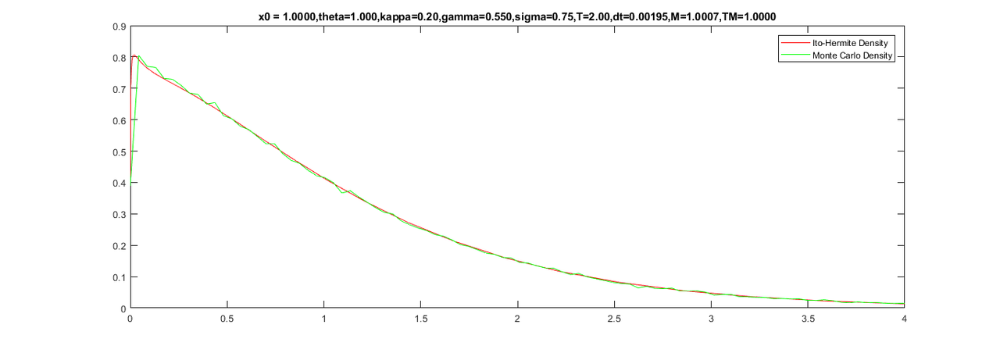](https://postimg.cc/B8FmRF5X)

[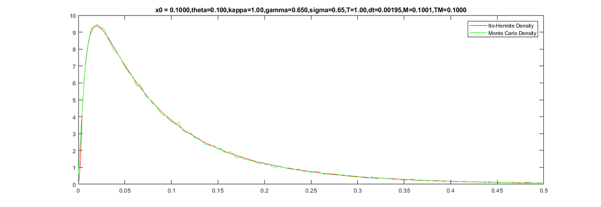](https://postimg.cc/JsvTTxkf)

[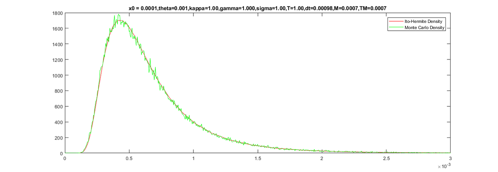](https://postimg.cc/3kdSCVdj)

[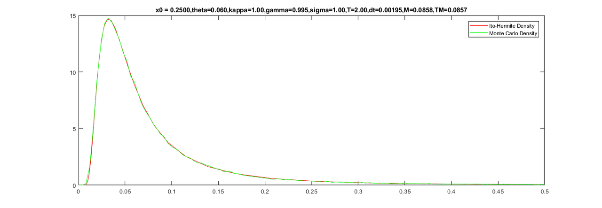](https://postimg.cc/2VH9Wr88)

[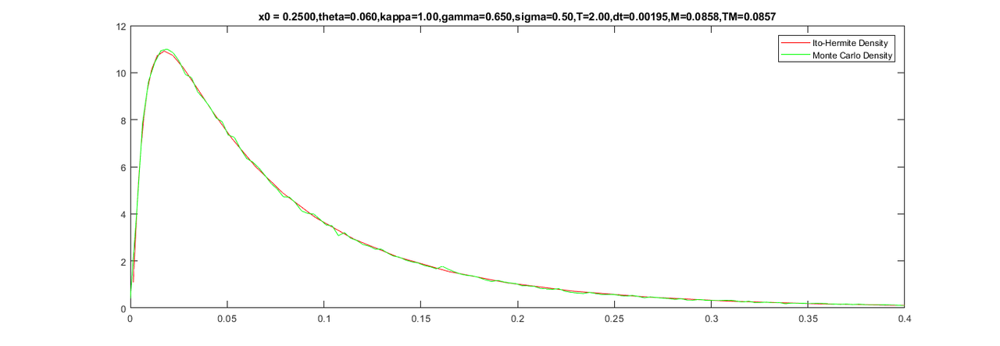](https://postimg.cc/pyJ62Kwj)

[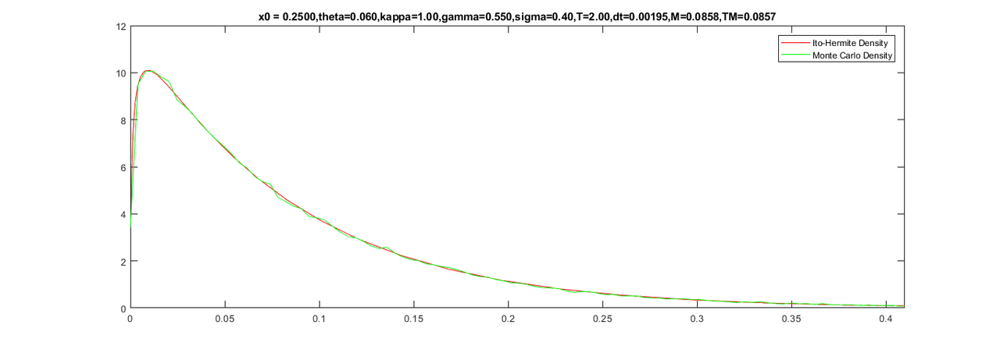](https://postimg.cc/7fPQbf4W)

[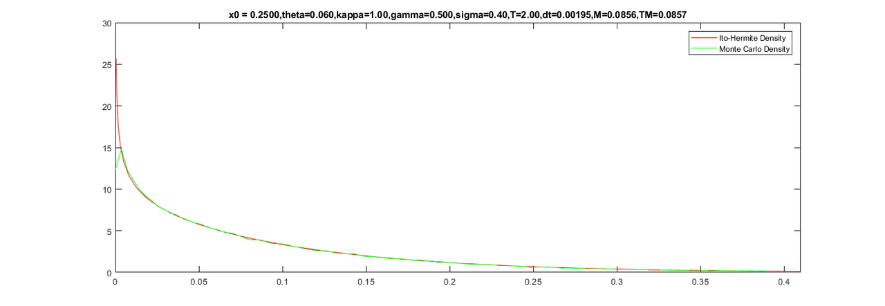](https://postimg.cc/7bkR8KWD)

[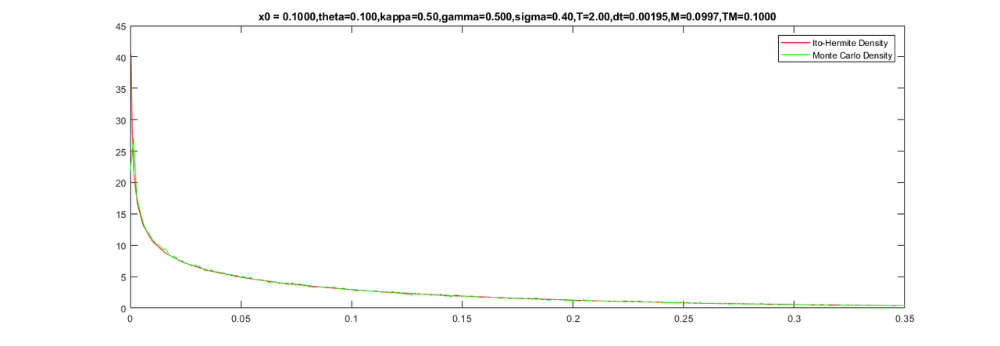](https://postimg.cc/5QgvZ4kH)

[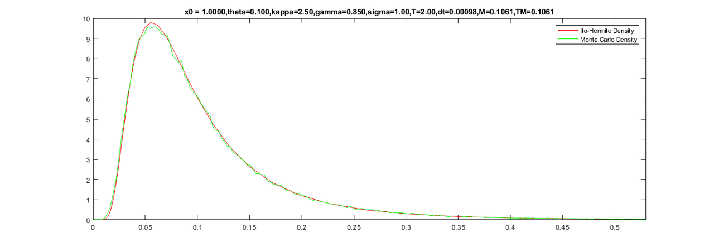](https://postimg.cc/WFM0w6Gw)

[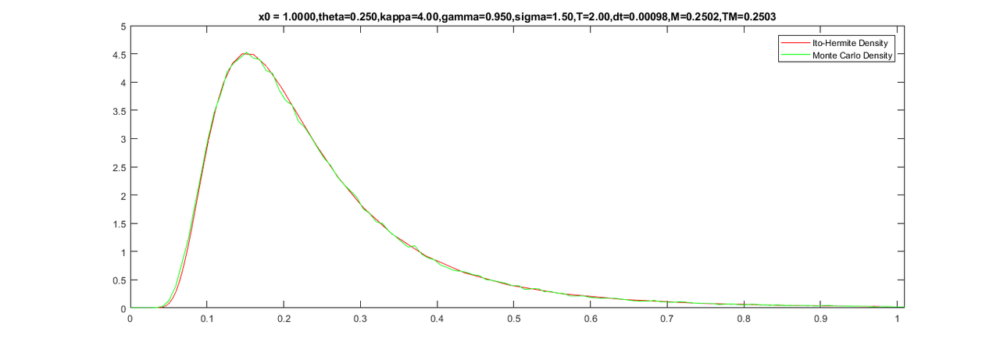](https://postimg.cc/62sdZ1vQ)

---

### #1197 — Amin (Topic Author)
*July 26, 2021, 7:27 PM*

Main function.

.

.

```
function [] = FPERevisitedTransProb08ABwNew04()

%Copyright Ahsan Amin. Infiniti derivatives Technologies.
%Please fell free to connect on linkedin: linkedin.com/in/ahsan-amin-0a53334
%or skype ahsan.amin2999
%In this program, I am simulating the SDE given as
%dy(t)=mu1 x(t)^beta1 dt + mu2 x(t)^beta2 dt +sigma x(t)^gamma dz(t)

%I have not directly simulated the SDE but simulated the transformed
%Besse1l process version of the SDE and then changed coordinates to retreive
%the SDE in original coo
%rdinates.
%The present program will analytically evolve only the Bessel Process version of the
%SDE in transformed coordinates.

dt=.125/16/2/2/2;   % Simulation time interval.%Fodiffusions close to zero
             %decrease dt for accuracy.
Tt=128*2*2*2*2;     % Number of simulation levels. Terminal time= Tt*dt; //.125/32*32*16=2 year;
T=Tt*dt;
OrderA=4;  %
OrderM=4;  %
dtM=.0625/2;
TtM=T/dtM;

dNn=.2/1;   % Normal density subdivisions width. would change with number of subdivisions
Nn=50;  % No of normal density subdivisions
NnMidl=25;%One half density Subdivision left from mid of normal density(low)
NnMidh=26;%One half density subdivision right from the mid of normal density(high)
NnMid=4.0;

x0=1;   % starting value of SDE
beta1=0.0;
beta2=1.0;   % Second drift term power.
gamma=.95;%50;   % volatility power.
kappa=4.0;%.950;   %mean reversion parameter.
theta=.25;%mean reversion target
sigma0=1.50;%Volatility value

%you can specify any general mu1 and mu2 and beta1 and beta2.
mu1=1*theta*kappa;   %first drift coefficient.
mu2=-1*kappa;    % Second drift coefficient.
%mu1=0;
%mu2=0;

alpha=1;% x^alpha is being expanded. This is currently for monte carlo only.
alpha1=1-gamma;%This is for expansion of integrals for calculation of drift
%and volatility coefficients
yy(1:Nn)=x0;
w(1:Nn)=x0^(1-gamma)/(1-gamma);

%Z(1:Nn)=(((1:Nn)-5.5)*dNn-NnMid);
Z(1:Nn)=(((1:Nn)-5.5)*dNn-NnMid);

Z
str=input('Look at Z');
ZProb(1)=normcdf(.5*Z(1)+.5*Z(2),0,1)-normcdf(.5*Z(1)+.5*Z(2)-dNn,0,1);
ZProb(Nn)=normcdf(.5*Z(Nn)+.5*Z(Nn-1)+dNn,0,1)-normcdf(.5*Z(Nn)+.5*Z(Nn-1),0,1);
ZProb(2:Nn-1)=normcdf(.5*Z(2:Nn-1)+.5*Z(3:Nn),0,1)-normcdf(.5*Z(2:Nn-1)+.5*Z(1:Nn-2),0,1);
    %Above calculate probability mass in each probability subdivision.

%%%%%%%%%%%%%%%%%%%%%%%%%%%%%%%%%%%%%%%%%%%%%%%%%%%%%%%%%%%%%%%%%%%%%%%%%%%%%%%%%%%%%%%%%%%%%%

sigma11(1:OrderA+1)=0;
mu11(1:OrderA+1)=0;
mu22(1:OrderA+1)=0;
sigma22(1:OrderA+1)=0;
% index 1 correponds to zero level since matlab indexing starts at one.
sigma11(1)=1;
mu11(1)=1;
mu22(1)=1;
sigma22(1)=1;

for k=1:(OrderA+1)
    if sigma0~=0
        sigma11(k)=sigma0^(k-1);
    end
    if mu1 ~= 0
        mu11(k)=mu1^(k-1);
    end
    if mu2 ~= 0
        mu22(k)=mu2^(k-1);
    end
    if sigma0~=0
        sigma22(k)=sigma0^(2*(k-1));
    end
end
%Ft(1:TtM+1,1:(OrderA+1),1:(OrderA+1),1:(OrderA+1),1:(OrderA+1))=0; %General time powers on hermite polynomials
Fp(1:(OrderA+1),1:(OrderA+1),1:(OrderA+1),1:(OrderA+1))=0;%General x powers on coefficients of hermite polynomials.
Fp1(1:(OrderA+1),1:(OrderA+1),1:(OrderA+1),1:(OrderA+1))=0;%General x powers for bessel transformed coordinates.

%YCoeff0 and YCoeff are coefficents for original coordinates monte carlo.
%YqCoeff0 and YqCoeff are bessel/lamperti version monte carlo.

YCoeff0(1:(OrderA+1),1:(OrderA+1),1:(OrderA+1),1:(OrderA+1))=0;
YqCoeff0(1:(OrderA+1),1:(OrderA+1),1:(OrderA+1),1:(OrderA+1))=0;
%Pre-compute the time and power exponent values in small multi-dimensional arrays
YCoeff = ItoTaylorCoeffsNew(alpha,beta1,beta2,gamma); %expand y^alpha where alpha=1;
YqCoeff = ItoTaylorCoeffsNew(alpha1,beta1,beta2,gamma);%expand y^alpha1 where alpha1=(1-gamma)
YqCoeff=YqCoeff/(1-gamma); %Transformed coordinates coefficients have to be
%further divided by (1-gamma)

for k = 0 : (OrderA)
    for m = 0:k
        l4 = k - m + 1;
        for n = 0 : m
            l3 = m - n + 1;
            for j = 0:n
                l2 = n - j + 1;
                l1 = j + 1;
                %Ft(l1,l2,l3,l4) = dtM^((l1-1) + (l2-1) + (l3-1) + .5* (l4-1));
                Fp(l1,l2,l3,l4) = (alpha + (l1-1) * beta1 + (l2-1) * beta2 + (l3-1) * 2* gamma + (l4-1) * gamma ...
                    - (l1-1) - (l2-1) - 2* (l3-1) - (l4-1));
                Fp1(l1,l2,l3,l4) = (alpha1 + (l1-1) * beta1 + (l2-1) * beta2 + (l3-1) * 2* gamma + (l4-1) * gamma ...
                    - (l1-1) - (l2-1) - 2* (l3-1) - (l4-1));

                YCoeff0(l1,l2,l3,l4) =YCoeff(l1,l2,l3,l4).*mu11(l1).*mu22(l2).*sigma22(l3).*sigma11(l4);
                YqCoeff0(l1,l2,l3,l4) =YqCoeff(l1,l2,l3,l4).*mu11(l1).*mu22(l2).*sigma22(l3).*sigma11(l4);
            end
        end
    end
end

%%%%%%%%%%%%%%%%%%%%%%%%%%%%%%%%%%%%%%%%%%%%%%%%%%%%%%%%%%%%%%%%%%%%%%%%%%%%%%%%%%%%%%%%%%%%%%

wnStart=1;%
tic

Zt1(wnStart:Nn)=0.0;
Zt2(wnStart:Nn)=0.0;
for tt=1:Tt

    [wMu0dt,dwMu0dtdw,c1] = CalculateDriftAndVolA4(w,wnStart,Nn,YqCoeff0,Fp1,gamma,dt);

    [wMid] =
InterpolateOrderN8(8,0,Z(NnMidl-3),Z(NnMidl-2),Z(NnMidl-1),Z(NnMidl),Z(NnMidh),Z(NnMidh+1),Z(NnMidh+2),Z(NnMidh+3),w(NnMidl-3),w(NnMidl-2),w(NnMidl-1),w(NnMidl),w(NnMidh),w(NnMidh+1),w(NnMidh+2),w(NnMidh+3));

    Zt1(wnStart:Nn)=w(wnStart:Nn)-wMid;

    [dwdZ,d2wdZ2A] = First2Derivatives2ndOrderEqSpacedA(wnStart,Nn,dNn,Zt1,Z);

    C0(wnStart:Nn)=Zt1(wnStart:Nn)-dwdZ(wnStart:Nn).*Z(wnStart:Nn);

    %Zt2(wnStart:Nn)=C0(wnStart:Nn)+abs(sqrt((dwdZ(wnStart:Nn)).^2+sigma0^2*dt)).*Z(wnStart:Nn);
    Zt2(wnStart:Nn)=C0(wnStart:Nn)+abs(sqrt((dwdZ(wnStart:Nn)).^2+c1(wnStart:Nn).^2)).*Z(wnStart:Nn);

    [dw2dZ,d2w2dZ2A] = First2Derivatives2ndOrderEqSpacedA(wnStart,Nn,dNn,Zt2,Z);
    if(tt>20)
        w(wnStart:Nn)=w(wnStart:Nn)+ ...
            wMu0dt(wnStart:Nn)+Zt2(wnStart:Nn)-Zt1(wnStart:Nn)+ ...
            0*.5*sigma0^2*(dwdZ(wnStart:Nn).^(-2)).*d2wdZ2A(wnStart:Nn).*dt+ ...
            .5*sigma0^2*(dw2dZ(wnStart:Nn).^(-2)).*d2w2dZ2A(wnStart:Nn).*dt;
    else
        w(wnStart:Nn)=w(wnStart:Nn)+ ...
            wMu0dt(wnStart:Nn)+Zt2(wnStart:Nn)-Zt1(wnStart:Nn);%+ ...
    end
    %yy(wnStart:Nn)=((1-gamma).*w(wnStart:Nn)).^(1/(1-gamma));

    [wE] =
InterpolateOrderN6(6,Z(Nn)+dNn,Z(Nn),Z(Nn-1),Z(Nn-2),Z(Nn-3),Z(Nn-4),Z(Nn-5),w(Nn),w(Nn-1),w(Nn-2),w(Nn-3),w(Nn-4),w(Nn-5));

     w1(1:Nn-1)=w(1:Nn-1);
     w1(Nn)=w(Nn);
     w2(1:Nn-1)=w(2:Nn);
     w2(Nn)=wE;
     w(w1(:)>w2(:))=0;%Be careful;might not universally hold;
      %Change 3:7/25/2020: I have improved zero correction in above.
     w(w<0)=0.0;
     for nn=1:Nn
         if(w(nn)<=0)
            wnStart=nn+1;
         end
     end

end
yy(wnStart:Nn)=((1-gamma).*w(wnStart:Nn)).^(1/(1-gamma));
Dfyy(wnStart:Nn)=0;
for nn=wnStart+1:Nn-1

    Dfyy(nn) = (yy(nn + 1) - yy(nn - 1))/(Z(nn + 1) - Z(nn - 1));
    %Change of variable derivative for densities
end

pyy(1:Nn)=0;
for nn = wnStart:Nn-1

    pyy(nn) = (normpdf(Z(nn),0, 1))/abs(Dfyy(nn));
end

toc

ItoHermiteMean=sum(yy(wnStart+1:Nn-1).*ZProb(wnStart+1:Nn-1)) %Original process average from coordinates
disp('true Mean only applicable to standard SV mean reverting type models otherwise disregard');
TrueMean=theta+(x0-theta)*exp(-kappa*dt*Tt)%Mean reverting SDE original variable true average

theta1=1;
rng(29079137, 'twister')
paths=200000;
YY(1:paths)=x0;  %Original process monte carlo.
Random1(1:paths)=0;
for tt=1:TtM

    Random1=randn(size(Random1));
    HermiteP1(1,1:paths)=1;
    HermiteP1(2,1:paths)=Random1(1:paths);
    HermiteP1(3,1:paths)=Random1(1:paths).^2-1;
    HermiteP1(4,1:paths)=Random1(1:paths).^3-3*Random1(1:paths);
    HermiteP1(5,1:paths)=Random1(1:paths).^4-6*Random1(1:paths).^2+3;

    YY(1:paths)=YY(1:paths) + ...
        (YCoeff0(1,1,2,1).*YY(1:paths).^Fp(1,1,2,1)+ ...
        YCoeff0(1,2,1,1).*YY(1:paths).^Fp(1,2,1,1)+ ...
        YCoeff0(2,1,1,1).*YY(1:paths).^Fp(2,1,1,1))*dtM + ...
        (YCoeff0(1,1,3,1).*YY(1:paths).^Fp(1,1,3,1)+ ...
        YCoeff0(1,2,2,1).*YY(1:paths).^Fp(1,2,2,1)+ ...
        YCoeff0(2,1,2,1).*YY(1:paths).^Fp(2,1,2,1)+ ...
        YCoeff0(1,3,1,1).*YY(1:paths).^Fp(1,3,1,1)+ ...
        YCoeff0(2,2,1,1).*YY(1:paths).^Fp(2,2,1,1)+ ...
        YCoeff0(3,1,1,1).*YY(1:paths).^Fp(3,1,1,1))*dtM^2 + ...
        ((YCoeff0(1,1,1,2).*YY(1:paths).^Fp(1,1,1,2).*sqrt(dtM))+ ...
        (YCoeff0(1,1,2,2).*YY(1:paths).^Fp(1,1,2,2)+ ...
        YCoeff0(1,2,1,2).*YY(1:paths).^Fp(1,2,1,2)+ ...
        YCoeff0(2,1,1,2).*YY(1:paths).^Fp(2,1,1,2)).*dtM^1.5) .*HermiteP1(2,1:paths) + ...
        ((YCoeff0(1,1,1,3).*YY(1:paths).^Fp(1,1,1,3) *dtM) + ...
        (YCoeff0(1,1,2,3).*YY(1:paths).^Fp(1,1,2,3)+ ...
        YCoeff0(1,2,1,3).*YY(1:paths).^Fp(1,2,1,3)+ ...
        YCoeff0(2,1,1,3).*YY(1:paths).^Fp(2,1,1,3)).*dtM^2).*HermiteP1(3,1:paths) + ...
        ((YCoeff0(1,1,1,4).*YY(1:paths).^Fp(1,1,1,4)*dtM^1.5 )).*HermiteP1(4,1:paths) + ...
        (YCoeff0(1,1,1,5).*YY(1:paths).^Fp(1,1,1,5)*dtM^2.0).*HermiteP1(5,1:paths);

end

YY(YY<0)=0;
disp('Original process average from monte carlo');
MCMean=sum(YY(:))/paths %origianl coordinates monte carlo average.
disp('Original process average from our simulation');
ItoHermiteMean=sum(yy(wnStart+1:Nn-1).*ZProb(wnStart+1:Nn-1)) %Original process average from coordinates

disp('true Mean only applicble to standard SV mean reverting type models otherwise disregard');
TrueMean=theta+(x0-theta)*exp(-kappa*dt*Tt)%Mean reverting SDE original variable true average

MaxCutOff=30;
NoOfBins=round(300*gamma^2*4*sigma0/sqrt(MCMean)/(1+kappa));%Decrease the number of bins if the graph is too
[YDensity,IndexOutY,IndexMaxY] = MakeDensityFromSimulation_Infiniti_NEW(YY,paths,NoOfBins,MaxCutOff );
plot(yy(wnStart+1:Nn-1),pyy(wnStart+1:Nn-1),'r',IndexOutY(1:IndexMaxY),YDensity(1:IndexMaxY),'g');
 %plot(y_w(wnStart+1:Nn-1),fy_w(wnStart+1:Nn-1),'r',IndexOutY(1:IndexMaxY),YDensity(1:IndexMaxY),'g',Z(wnStart+1:Nn-1),fy_w(wnStart+1:Nn-1),'b');

title(sprintf('x0 = %.4f,theta=%.3f,kappa=%.2f,gamma=%.3f,sigma=%.2f,T=%.2f,dt=%.5f,M=%.4f,TM=%.4f',
x0,theta,kappa,gamma,sigma0,T,dt,ItoHermiteMean,TrueMean));%,sprintf('theta= %f', theta), sprintf('kappa = %f',
kappa),sprintf('sigma = %f', sigma0),sprintf('T = %f', T));

legend({'Ito-Hermite Density','Monte Carlo Density'},'Location','northeast')

str=input('red line is density of SDE from Ito-Hermite method, green is monte carlo.');

end
```

.

.

Another function that you would need.

.

```
function [dwdZ,d2wdZ2] = First2Derivatives2ndOrderEqSpacedA(wnStart,Nn,dNn,w,Z)

  d2wdZ2(wnStart)=(2*w(wnStart)-5*w(wnStart+1)+4*w(wnStart+2)-1*w(wnStart+3))/(dNn.^2);
  d2wdZ2(wnStart+1:Nn-1)=(w(wnStart:Nn-2)-2*w(wnStart+1:Nn-1)+1*w(wnStart+2:Nn))/(dNn.^2);
  d2wdZ2(Nn)=(-1*w(Nn)+4*w(Nn-1)-5*w(Nn-2)+2*w(Nn-3))/(dNn.^2);

  dwdZ(wnStart) = (-11*w(wnStart)+18*w(wnStart+1)-9*w(wnStart+2)+2*w(wnStart+3))/(6*dNn);
  dwdZ(Nn) = (11*w(Nn)-18*w(Nn-1)+9*w(Nn-2)-2*w(Nn-3))/(6*dNn);
  dwdZ(wnStart+1:Nn-1)=(-1*w(wnStart:Nn-2)+1*w(wnStart+2:Nn))/(2*dNn);

end
```

.

.

Last graph in previous post is output graph of this copied program.

And you would see the following on the screen.

ItoHermiteMean =

   0.250230651876615

true Mean only applicable to standard SV mean reverting type models otherwise disregard

TrueMean =

   0.250251596970927

Original process average from monte carlo

MCMean =

   0.249542499753951

Original process average from our simulation

ItoHermiteMean =

   0.250230651876615

true Mean only applicble to standard SV mean reverting type models otherwise disregard

TrueMean =

   0.250251596970927

IndexMax =

   651

red line is density of SDE from Ito-Hermite method, green is monte carlo.

---

### #1198 — Amin (Topic Author)
*July 28, 2021, 5:49 PM*

Friends, I wanted to share a rough sketch of the proof of the method I presented in above programs. I hope friends would
like it.

I am not writing Fokker-planck equation in Bessel coordinates and I am sure most friends are familiar with it.

In our setting we have an SDE variable,$B$ , in Bessel coordinates on nth grid point$Z_n$ of underlying Z-grid. This is
represented as$B(Z_n)$ . As a function of time,$B(Z_n)$ is moving so as that CDF of the density at point$B(Z_n)$ remains
constant. This is written in equation form as below

$\frac{\partial}{\partial t} \big[\int_{-\infty}^{B(Z_n)} P(B) dB \big]=0$

applying the time derivative to terms in brackets, we get

$\int_{-\infty}^{B(Z_n)} \frac{\partial P(B)}{\partial t} dB +  \frac{\partial B}{\partial t} P(B(Z_n)) =0$

I will make it more formal but here, since we add drift separately and because we are in Bessel coordinates, I am just
replacing$\frac{\partial P(B)}{\partial t}$ by$.5 {\sigma}^2 \frac{\partial^2 P(B)}{\partial B^2}$ in the above
equation.

Making the substitution in above equation, we get

$\int_{-\infty}^{B(Z_n)} \big[.5 {\sigma}^2 \frac{\partial^2 P(B)}{\partial B^2} \big] dB +  \frac{\partial B}{\partial t} P(B(Z_n)) =0$

Applying the integral on first term, we get

$\big[.5 {\sigma}^2 \frac{\partial P(B(Z_n))}{\partial B} \big] +  \frac{\partial B}{\partial t} P(B(Z_n)) =0$

Now we want to make a change from $P(B)$ to $P(Z)$. In order to do that we have

$P(B)=P(Z)\frac{\partial Z}{\partial B}$

$\frac{\partial P(B)}{\partial B}=\frac{\partial P(Z)}{\partial Z} {(\frac{\partial Z}{\partial B})}^2 + P(Z) \frac{\partial^2 Z}{\partial B^2}$

---

### #1199 — Amin (Topic Author)
*July 28, 2021, 6:15 PM*

Sorry friends, I prematurely hit the submit button and so could not complete the previous post. Here is the actual
relevant post. Please disregard the previous incomplete post.

Friends, I wanted to share a rough sketch of the proof of the method I presented in above programs. I hope friends would
like it.

I am not writing Fokker-planck equation in Bessel coordinates and I am sure most friends are familiar with it.

In our setting we have an SDE variable,$B$ , in Bessel coordinates on nth grid point$Z_n$ of underlying Z-grid. This is
represented as$B(Z_n)$ . As a function of time,$B(Z_n)$ is moving so as that CDF of the density at point$B(Z_n)$ remains
constant. This is written in equation form as below

$\frac{\partial}{\partial t} \big[\int_{-\infty}^{B(Z_n)} P(B) dB \big]=0$

applying the time derivative to terms in brackets, we get

$\int_{-\infty}^{B(Z_n)} \frac{\partial P(B)}{\partial t} dB +  \frac{\partial B}{\partial t} P(B(Z_n)) =0$

I will make it more formal but here, since we add drift separately and because we are in Bessel coordinates, I am just
replacing$\frac{\partial P(B)}{\partial t}$ by$.5 {\sigma}^2 \frac{\partial^2 P(B)}{\partial B^2}$ in the above
equation.

Making the substitution in above equation, we get

$\int_{-\infty}^{B(Z_n)} \big[.5 {\sigma}^2 \frac{\partial^2 P(B)}{\partial B^2} \big] dB +  \frac{\partial B}{\partial t} P(B(Z_n)) =0$

Applying the integral on first term, we get

$\big[.5 {\sigma}^2 \frac{\partial P(B(Z_n))}{\partial B} \big] +  \frac{\partial B}{\partial t} P(B(Z_n)) =0$

Now we want to make a change from $P(B)$ to $P(Z)$. In order to do that we have two equations

$P(B)=P(Z)\frac{\partial Z}{\partial B}$ and

$\frac{\partial P(B)}{\partial B}=\frac{\partial P(Z)}{\partial Z} {(\frac{\partial Z}{\partial B})}^2 + P(Z) \frac{\partial^2 Z}{\partial B^2}$

Now substituting above two equations in previous equation, we get

$.5 {\sigma}^2 \big[\frac{\partial P(Z_n)}{\partial Z} {(\frac{\partial Z}{\partial B})}^2 + P(Z_n) \frac{\partial^2 Z}{\partial B^2} \big] + \frac{\partial B}{\partial t} P(Z_n) \frac{\partial Z}{\partial B}=0 $

substituting $\frac{\partial^2 Z}{\partial B^2} =-{(\frac{\partial Z}{\partial B})}^3 \frac{\partial^2 B}{\partial Z^2}$

we get

$.5 {\sigma}^2 \big[\frac{\partial P(Z_n)}{\partial Z} {(\frac{\partial Z}{\partial B})}^2 - P(Z_n) {(\frac{\partial Z}{\partial B})}^3 \frac{\partial^2 B}{\partial Z^2} \big] + \frac{\partial B}{\partial t} P(Z_n) \frac{\partial Z}{\partial B}=0 $

cancelling $\frac{\partial Z}{\partial B}$ on both sides, we get

$.5 {\sigma}^2 \big[\frac{\partial P(Z_n)}{\partial Z} {(\frac{\partial Z}{\partial B})} - P(Z_n) {(\frac{\partial Z}{\partial B})}^2 \frac{\partial^2 B}{\partial Z^2} \big] +\frac{\partial B}{\partial t} P(Z_n)=0 $

The first term in above is expansion that we have treated in the previous matlab program in a different analytic way by
adding squared volatilities . Matching the coefficients of second and third term, we get

$\frac{\partial B}{\partial t} = .5 {\sigma}^2 \big[{(\frac{\partial Z}{\partial B})}^2 \frac{\partial^2 B}{\partial Z^2} \big]$

the last equation is the analytic solution that I have used in my previous matlab programs to get the density of SDEs in
Bessel coordinates right.

---

### #1200 — Amin (Topic Author)
*July 31, 2021, 5:29 AM*

Friends here are a few notes about my derivation in previous post. I am sure most friends already are aware of this but
still writing.

1. you can easily substitute Fokker-planck equation in Bessel and original coordinates to get a nice solution to moving
boundary of the conserved probability mass.

2. What we derived in previous post is analogous to being sister equation of continuity equation of mathematical physics
but just the one with a moving boundary. And I am very sure it can be used at a large number of places where some
quantity(not just probability mass) is being conserved and a boundary is moving to get the solution to moving boundary.

Friends, I love sharing my research here but I want to request all the good people to please give me credit for my
original research even if I do not write a formal paper on it though I might as well write a formal paper in next few
weeks or months in Wilmott journal.

I hope to be coming back soon with new posts with solution to two dimensional system of stochastic volatility type SDEs.

---

[← Previous](page_023.md) | [Index](index.md) | [Next →](page_025.md)
