# Breakthrough in the theory of stochastic differential equations and their simulation

**Page 25 of 65** — Posts #1201–#1250

[← Previous](page_024.md) | [Index](index.md) | [Next →](page_026.md)

---

### #1201 — Amin (Topic Author)
*July 31, 2021, 5:53 AM*

>
> Friends here are a few notes about my derivation in previous post. I am sure most friends already are aware of this
but still writing.
>
> 1. you can easily substitute Fokker-planck equation in Bessel and original coordinates to get a nice solution to
moving boundary of the conserved probability mass.
>
> 2. What we derived in previous post is analogous to being sister equation of continuity equation of mathematical
physics but just the one with a moving boundary. And I am very sure it can be used at a large number of places where
some quantity(not just probability mass) is being conserved and a boundary is moving to get the solution to moving
boundary.
>
> Friends, I love sharing my research here but I want to request all the good people to please give me credit for my
original research even if I do not write a formal paper on it though I might as well write a formal paper in next few
weeks or months in Wilmott journal.
>
> I hope to be coming back soon with new posts with solution to two dimensional system of stochastic volatility type
SDEs.
>
I hope that my not writing a paper or keeping a low key/profile would never be a reason for friends to not give me
credit for my original research. I have always stated that once my research is in public on internet, everyone is free
to do their further research and extensions but they have to give me credit for my original research. I think friends
would agree to my fair request.

I was after this problem since 2014.

---

### #1202 — Amin (Topic Author)
*July 31, 2021, 10:03 AM*

>
> Sorry friends, I prematurely hit the submit button and so could not complete the previous post. Here is the actual
relevant post. Please disregard the previous incomplete post.
>
> Friends, I wanted to share a rough sketch of the proof of the method I presented in above programs. I hope friends
would like it.
>
> I am not writing Fokker-planck equation in Bessel coordinates and I am sure most friends are familiar with it.
>
> In our setting we have an SDE variable,$B$ , in Bessel coordinates on nth grid point$Z_n$ of underlying Z-grid. This
is represented as$B(Z_n)$ . As a function of time,$B(Z_n)$ is moving so as that CDF of the density at point$B(Z_n)$
remains constant. This is written in equation form as below
>
>
>
> $\frac{\partial}{\partial t} \big[\int_{-\infty}^{B(Z_n)} P(B) dB \big]=0$
>
>
>
> applying the time derivative to terms in brackets, we get
>
>
>
> $\int_{-\infty}^{B(Z_n)} \frac{\partial P(B)}{\partial t} dB +  \frac{\partial B}{\partial t} P(B(Z_n)) =0$
>
>
>
> I will make it more formal but here, since we add drift separately and because we are in Bessel coordinates, I am just
replacing$\frac{\partial P(B)}{\partial t}$ by$.5 {\sigma}^2 \frac{\partial^2 P(B)}{\partial B^2}$ in the above
equation.
>
> Making the substitution in above equation, we get
>
>
>
>
$\int_{-\infty}^{B(Z_n)} \big[.5 {\sigma}^2 \frac{\partial^2 P(B)}{\partial B^2} \big] dB +  \frac{\partial B}{\partial t} P(B(Z_n)) =0$
>
>
>
> Applying the integral on first term, we get
>
>
>
> $\big[.5 {\sigma}^2 \frac{\partial P(B(Z_n))}{\partial B} \big] +  \frac{\partial B}{\partial t} P(B(Z_n)) =0$
>
>
>
> Now we want to make a change from $P(B)$ to $P(Z)$. In order to do that we have two equations
>
> $P(B)=P(Z)\frac{\partial Z}{\partial B}$ and
>
>
$\frac{\partial P(B)}{\partial B}=\frac{\partial P(Z)}{\partial Z} {(\frac{\partial Z}{\partial B})}^2 + P(Z) \frac{\partial^2 Z}{\partial B^2}$
>
> Now substituting above two equations in previous equation, we get
>
>
$.5 {\sigma}^2 \big[\frac{\partial P(Z_n)}{\partial Z} {(\frac{\partial Z}{\partial B})}^2 + P(Z_n) \frac{\partial^2 Z}{\partial B^2} \big] + \frac{\partial B}{\partial t} P(Z_n) \frac{\partial Z}{\partial B}=0 $
>
> substituting
$\frac{\partial^2 Z}{\partial B^2} =-{(\frac{\partial Z}{\partial B})}^3 \frac{\partial^2 B}{\partial Z^2}$
>
> we get
>
>
$.5 {\sigma}^2 \big[\frac{\partial P(Z_n)}{\partial Z} {(\frac{\partial Z}{\partial B})}^2 - P(Z_n) {(\frac{\partial Z}{\partial B})}^3 \frac{\partial^2 B}{\partial Z^2} \big] + \frac{\partial B}{\partial t} P(Z_n) \frac{\partial Z}{\partial B}=0 $
>
> cancelling $\frac{\partial Z}{\partial B}$ on both sides, we get
>
>
$.5 {\sigma}^2 \big[\frac{\partial P(Z_n)}{\partial Z} {(\frac{\partial Z}{\partial B})} - P(Z_n) {(\frac{\partial Z}{\partial B})}^2 \frac{\partial^2 B}{\partial Z^2} \big] +\frac{\partial B}{\partial t} P(Z_n)=0 $
>
> The first term in above is expansion that we have treated in the previous matlab program in a different analytic way
by adding squared volatilities . Matching the coefficients of second and third term, we get
>
>
>
>
$\frac{\partial B}{\partial t} = .5 {\sigma}^2 \big[{(\frac{\partial Z}{\partial B})}^2 \frac{\partial^2 B}{\partial Z^2} \big]$
>
>
>
> the last equation is the analytic solution that I have used in my previous matlab programs to get the density of SDEs
in Bessel coordinates right.
>
.

.

.

Here I want to explain how the above analytics could be applied to Fokker-planck equation in original coordinates (and
it works seamlessly).

First I write the fokker-planck equation in original coordinates as

$\frac{\partial P(x,t)}{\partial t} = -\frac{\partial \big[\mu(x)P(x,t) \big]}{\partial x}\, +.5 \, \frac{\partial^2 \big[{\sigma(x)}^2P(x,t) \big]}{\partial x^2}$

We have our partial differential equation on a grid and we want to determine the movement of an arbitrary grid point
(boundary) along time so that mass within(total mass up till the grid point is conserved or associated CDF remains
constant) that grid point (boundary) remains constant as a function of time. we denote this arbitrary grid point as$x_b$
.

We write the conservation of probability mass up till (or associated constant CDF) the grid point (boundary) as a
function of time in equation form as

$\frac{\partial}{\partial t} \big[\int_{-\infty}^{x_b} P(x,t) dx \big]=0$

applying the time derivative to terms in brackets, we get

$\int_{-\infty}^{x_b} \frac{\partial P(x,t)}{\partial t} dx +  \frac{\partial x_b}{\partial t} P(x_b,t) =0$

But we know that term inside the integral is given by FP equation and is LHS of FP equation. We replace the time
derivative inside the integral  by RHS of FP equation as

$\int_{-\infty}^{x_b} \big[   -\frac{\partial [\mu(x)P(x,t)]}{\partial x}\, + \, .5\frac{\partial^2 \big[{\sigma(x)}^2P(x,t) \big]}{\partial x^2}\big] dx +  \frac{\partial x_b}{\partial t} P(x_b,t) =0$

Applying the integral to complete differentials inside square brackets, we get

$-\mu(x_b)P(x_b,t)\, + \, .5 \, \frac{\partial \big[{\sigma(x_b)}^2P(x_b,t) \big]}{\partial x} +  \frac{\partial x_b}{\partial t} P(x_b,t) =0$

$=-\mu(x_b)P(x_b,t)\, + .5 \, \frac{\partial \big[{\sigma(x_b)}^2 \big]}{\partial x}P(x_b,t) + .5\,{\sigma(x_b)}^2 \, \frac{\partial P(x_b,t)}{\partial x} +\,  \frac{\partial x_b}{\partial t} P(x_b,t) =0$

We have solved the equation in original coordinates and we could do an ODE in$\frac{\partial x_b}{\partial t}$ to find
the evolution of every grid point so that probability mass till that grid point is conserved. But it will be a lot
easier if we converted the above arbitrary density to underlying gaussian density as we have been doing and for that we
write the following substitution equations from change of probability derivatives as($Z_b$ is associated with each point
$x_b$ using common CDF as probability is being conserved.)

$P(x)=P(Z)\frac{\partial Z}{\partial x}$ and

$\frac{\partial P(x)}{\partial x}=\frac{\partial P(Z)}{\partial Z} {(\frac{\partial Z}{\partial x})}^2 + P(Z) \frac{\partial^2 Z}{\partial x^2}$

Substituting the above two equations in previous equation, we get

$-\mu(x_b) \, P(Z_b)\, \frac{\partial Z}{\partial x} \,+ .5 \, \frac{\partial \big[{\sigma(x_b)}^2 \big]}{\partial x}P(Z_b) \frac{\partial Z}{\partial x} + .5\,{\sigma(x_b)}^2 \, \big[ \frac{\partial P(Z_b)}{\partial Z} {(\frac{\partial Z}{\partial x})}^2 + P(Z_b) \frac{\partial^2 Z}{\partial x^2}    \big] +\,  \frac{\partial x_b}{\partial t} P(Z_b) \frac{\partial Z}{\partial x}=0$

We make the following substitutions in above equation

$\frac{\partial^2 Z}{\partial x^2} =-{(\frac{\partial Z}{\partial x})}^3 \frac{\partial^2 x}{\partial Z^2}$

and

$\frac{\partial P(Z_b)}{\partial Z}=-Z_b \, P(Z_b)$

$-\mu(x_b) \, P(Z_b)\, \frac{\partial Z}{\partial x} \,+ .5 \, \frac{\partial \big[{\sigma(x_b)}^2 \big]}{\partial x}P(Z_b) \frac{\partial Z}{\partial x} + .5\,{\sigma(x_b)}^2 \, (-Z_b) \, P(Z_b) {(\frac{\partial Z}{\partial x})}^2 - .5\,{\sigma(x_b)}^2 P(Z_b) {(\frac{\partial Z}{\partial x})}^3 \frac{\partial^2 x}{\partial Z^2}  +\,  \frac{\partial x_b}{\partial t} P(Z_b) \frac{\partial Z}{\partial x}=0$

Cancelling$P(Z_b) \frac{\partial Z}{\partial x}$ throughout the equation and rearranging, we get the first order very
simple ODE for our grid point that conserves the probability mass up till that grid point.

$  \frac{\partial x_b}{\partial t} =\mu(x_b) - .5 \, \frac{\partial \big[{\sigma(x_b)}^2 \big]}{\partial x}+ .5\,{\sigma(x_b)}^2 \, Z_b \, \frac{\partial Z}{\partial x} + \, .5\,{\sigma(x_b)}^2 \, {(\frac{\partial Z}{\partial x})}^2 \frac{\partial^2 x}{\partial Z^2}  $

The above is the first order ODE (that has to be solved in time) for the grid point with associated CDF or conserved
mass and this point seamlessly moves in time as a function of above ODE when we solve it. I was able to solve the above
ODE just as such (without any squared addition of volatilities separately) and got seamless results for the evolution of
CDF(or probability mass up till  that point) conservation point in original coordinates.

When you evolve the SDE in original coordinates, you have to take a few steps with an alternative method (until second
derivative is non-negligible) and then evolve with above method. I will be posting a program of simulation of densities
of SDEs with above method in a few hours.

The above method is sister equation to continuity equation of mathematical physics. You can apply it to other first
order equations or higher order equations. I am sure it can also be applied to Navier Stokes equation with some hack
when some boundary is in motion and momentum is conserved. Continuity equation works when boundaries are given while
this method works when boundary has to be solved.

---

### #1203 — Amin (Topic Author)
*August 1, 2021, 2:43 AM*

With a heavy heart, I want to tell all good Americans that my persecution continues unabated. There are marks and light
swelling on the body tissue on my back due to high frequency waves constantly being targeted to go inside from my back.
This is a constant torture and keeps target people irritated and is very unsettling for them but lowly animals of
American army love such tactics since it becomes extremely difficult for the target to concentrate on anything as the
target is kept irritated.

Yesterday, they drugged water bottles at a bakery where I went to take food and things like this this continue every
day.

I have been begging for help for years and years but to no avail and the torture by lowly crooks never ends at all.
These lowly racist crooks who are incapable of doing any good in this world want to stop every black, muslim or
foreigner from doing anything productive in this world. Is there any justice in this world or the these racist crooks
are the last words of justice? Please help me.

---

### #1204 — Amin (Topic Author)
*August 1, 2021, 5:55 AM*

I made this post a few months ago about inviting prominent investigative journalists to end the ill of mind control from
human societies. Every western newspaper runs large stories about persecution of people in Xinjiang which is a great
thing to do but why does these newspapers become tight-lipped when it comes to systematic torture by American army on
thousands of talented people of other color, religion, or nationality. Please speak vocally to end this torture now
before it is too late.

Here is my previous post:

It seems that crooks in American army and mind control  are unable to pay a heed to civilized calls by good American
people and others to end their animal cruel practices and remain bent on mischief. If crooks in American army and mind
control remain adamant on continuing evil practices, the only solution seems that some brave investigative journalists
expose them by running a comprehensive story on mind control practices by American army. It seems that doing a civilized
dialogue with hardened crooks in mind control gives them a strong sense of weakness of good people and makes the crooks
even more adamant to continue their evil practices.  Reminds me of  Abu-Gharib. Very similarly, Crooks in defense had no
conception that they were doing any wrong thing when there was a culture of openly urinating on human captives. It was
an open thing in army and most crooks thought it was indeed a very right thing to do( and I am sure some of those crooks
still believe that it was a right thing they did even after being reprimanded by the broader American society). It was
not until brave people at CNN did a daring story against animal practices by crooks that evil practices stopped. Though
American army crooks retard intelligent people of all color and creed, these ultra right wing army crooks love to retard
blacks and muslims with great relish. Blacks are only 8-10% of US population but make a very large proportion of victims
in united states since many ultra right wing crooks in US army would rather die than let those intelligent blacks
succeed in American society in a big way.

I want to request CNN, New York Times, Washington Post and large reputed European media outlets to run a comprehensive
story on mind control torture, retarding and victimization of intelligent people of US and other nations by crooks in US
army on behest of some powerful people in United States and due to rightwing extremist biases of these crooks. If you
would like to do investigative research about animal practices of US army, one great resource would be mainland European
embassies in Muslim countries who keep a detailed account of mind control persecution of intelligent muslims in these
countries by crooks in US army. Many of the staff in mainland European embassies are very good human beings who abhor
such practices and would love to cooperate with good journalists in exposing the evil animal practices of US army
crooks. Only the accounts of people at mainland European embassies in muslim countries thorough animal practices of
American army's mind control wing would be enough to drop a great bombshell in the media and general public all across
the world. I want to warn all the good people who try to have a civilized dialogue with crooks in American army to end
their evil practices that their being nice with crooks is a very misguided approach. Since good people do not have the
power to forcefully end the evil practices of US army crooks, only way to end the evil practices of US army crooks is by
exposing them openly in US public and all across the world.

---

### #1205 — Amin (Topic Author)
*August 1, 2021, 10:29 AM*

Friends, here is the program with ODE evolution of densities of SDEs in original coordinates. I have done first 15 steps
simulation in bessel coordinates since second derivative would be too small for stable evolution in original
coordinates. Zero boundary is still not covered and friends would have to work on that a bit carefully. For densities
that go into zero, program is still not appropriate in this basic form.

Again in this program, I have used the ODE for evolution of constant CDF points on the grid just as the ODE is derived
in previous few posts.

Here is the program.

.

```
function [] = FPERevisitedTransProb08ABwNew04B()

%Copyright Ahsan Amin. Infiniti derivatives Technologies.
%Please fell free to connect on linkedin: linkedin.com/in/ahsan-amin-0a53334
%or skype ahsan.amin2999
%In this program, I am simulating the SDE given as
%dy(t)=mu1 x(t)^beta1 dt + mu2 x(t)^beta2 dt +sigma x(t)^gamma dz(t)

%I have not directly simulated the SDE but simulated the transformed
%Besse1l process version of the SDE and then changed coordinates to retreive
%the SDE in original coo
%rdinates.
%The present program will analytically evolve only the Bessel Process version of the
%SDE in transformed coordinates.

dt=.125/16/2/2/2;   % Simulation time interval.%Fodiffusions close to zero
             %decrease dt for accuracy.
Tt=128*2*2*2*2;     % Number of simulation levels. Terminal time= Tt*dt; //.125/32*32*16=2 year;
T=Tt*dt;
OrderA=4;  %
OrderM=4;  %
dtM=dt*4*2*4;
TtM=Tt/4/2/4;

dNn=.2/1;   % Normal density subdivisions width. would change with number of subdivisions
Nn=50;  % No of normal density subdivisions
NnMidl=25;%One half density Subdivision left from mid of normal density(low)
NnMidh=26;%One half density subdivision right from the mid of normal density(high)
NnMid=4.0;

x0=1.0;   % starting value of SDE
beta1=0.0;
beta2=1.0;   % Second drift term power.
gamma=.95;%50;   % volatility power.
kappa=4.0;%.950;   %mean reversion parameter.
theta=.250;%mean reversion target
sigma0=1.50;%Volatility value

%you can specify any general mu1 and mu2 and beta1 and beta2.
mu1=1*theta*kappa;   %first drift coefficient.
mu2=-1*kappa;    % Second drift coefficient.
%mu1=0;
%mu2=0;

alpha=1;% x^alpha is being expanded. This is currently for monte carlo only.
alpha1=1-gamma;%This is for expansion of integrals for calculation of drift
%and volatility coefficients
yy(1:Nn)=x0;
w(1:Nn)=x0^(1-gamma)/(1-gamma);
x(1:Nn)=x0;

%Z(1:Nn)=(((1:Nn)-5.5)*dNn-NnMid);
Z(1:Nn)=(((1:Nn)-5.5)*dNn-NnMid);

Z
str=input('Look at Z');
ZProb(1)=normcdf(.5*Z(1)+.5*Z(2),0,1)-normcdf(.5*Z(1)+.5*Z(2)-dNn,0,1);
ZProb(Nn)=normcdf(.5*Z(Nn)+.5*Z(Nn-1)+dNn,0,1)-normcdf(.5*Z(Nn)+.5*Z(Nn-1),0,1);
ZProb(2:Nn-1)=normcdf(.5*Z(2:Nn-1)+.5*Z(3:Nn),0,1)-normcdf(.5*Z(2:Nn-1)+.5*Z(1:Nn-2),0,1);
    %Above calculate probability mass in each probability subdivision.

%%%%%%%%%%%%%%%%%%%%%%%%%%%%%%%%%%%%%%%%%%%%%%%%%%%%%%%%%%%%%%%%%%%%%%%%%%%%%%%%%%%%%%%%%%%%%%

sigma11(1:OrderA+1)=0;
mu11(1:OrderA+1)=0;
mu22(1:OrderA+1)=0;
sigma22(1:OrderA+1)=0;
% index 1 correponds to zero level since matlab indexing starts at one.
sigma11(1)=1;
mu11(1)=1;
mu22(1)=1;
sigma22(1)=1;

for k=1:(OrderA+1)
    if sigma0~=0
        sigma11(k)=sigma0^(k-1);
    end
    if mu1 ~= 0
        mu11(k)=mu1^(k-1);
    end
    if mu2 ~= 0
        mu22(k)=mu2^(k-1);
    end
    if sigma0~=0
        sigma22(k)=sigma0^(2*(k-1));
    end
end
%Ft(1:TtM+1,1:(OrderA+1),1:(OrderA+1),1:(OrderA+1),1:(OrderA+1))=0; %General time powers on hermite polynomials
Fp(1:(OrderA+1),1:(OrderA+1),1:(OrderA+1),1:(OrderA+1))=0;%General x powers on coefficients of hermite polynomials.
Fp1(1:(OrderA+1),1:(OrderA+1),1:(OrderA+1),1:(OrderA+1))=0;%General x powers for bessel transformed coordinates.

%YCoeff0 and YCoeff are coefficents for original coordinates monte carlo.
%YqCoeff0 and YqCoeff are bessel/lamperti version monte carlo.

YCoeff0(1:(OrderA+1),1:(OrderA+1),1:(OrderA+1),1:(OrderA+1))=0;
YqCoeff0(1:(OrderA+1),1:(OrderA+1),1:(OrderA+1),1:(OrderA+1))=0;
%Pre-compute the time and power exponent values in small multi-dimensional arrays
YCoeff = ItoTaylorCoeffsNew(alpha,beta1,beta2,gamma); %expand y^alpha where alpha=1;
YqCoeff = ItoTaylorCoeffsNew(alpha1,beta1,beta2,gamma);%expand y^alpha1 where alpha1=(1-gamma)
YqCoeff=YqCoeff/(1-gamma); %Transformed coordinates coefficients have to be
%further divided by (1-gamma)

for k = 0 : (OrderA)
    for m = 0:k
        l4 = k - m + 1;
        for n = 0 : m
            l3 = m - n + 1;
            for j = 0:n
                l2 = n - j + 1;
                l1 = j + 1;
                %Ft(l1,l2,l3,l4) = dtM^((l1-1) + (l2-1) + (l3-1) + .5* (l4-1));
                Fp(l1,l2,l3,l4) = (alpha + (l1-1) * beta1 + (l2-1) * beta2 + (l3-1) * 2* gamma + (l4-1) * gamma ...
                    - (l1-1) - (l2-1) - 2* (l3-1) - (l4-1));
                Fp1(l1,l2,l3,l4) = (alpha1 + (l1-1) * beta1 + (l2-1) * beta2 + (l3-1) * 2* gamma + (l4-1) * gamma ...
                    - (l1-1) - (l2-1) - 2* (l3-1) - (l4-1));

                YCoeff0(l1,l2,l3,l4) =YCoeff(l1,l2,l3,l4).*mu11(l1).*mu22(l2).*sigma22(l3).*sigma11(l4);
                YqCoeff0(l1,l2,l3,l4) =YqCoeff(l1,l2,l3,l4).*mu11(l1).*mu22(l2).*sigma22(l3).*sigma11(l4);
            end
        end
    end
end

%%%%%%%%%%%%%%%%%%%%%%%%%%%%%%%%%%%%%%%%%%%%%%%%%%%%%%%%%%%%%%%%%%%%%%%%%%%%%%%%%%%%%%%%%%%%%%

wnStart=1;%
tic

Zt1(wnStart:Nn)=0.0;
Zt2(wnStart:Nn)=0.0;
for tt=1:Tt

    x(isnan(x)==1)=0.00;

    [xMu0dt,c1] = CalculateDriftAndVolA4Original(x,wnStart,Nn,YCoeff0,Fp,gamma,dt);

    %Loop below tackles first ten time steps in Bessel coordinates
    if(tt10)

        x(wnStart:Nn)= +x(wnStart:Nn)-sigma0.^2*gamma*x(wnStart:Nn).^(2*gamma-1)*dt ...
            +xMu0dt(wnStart:Nn) ...
            +.5*sigma0^2*x(wnStart:Nn).^(2*gamma).*(dxdZ(wnStart:Nn)).^(-2).*(d2xdZ2A(wnStart:Nn)).*dt ...
            +.5*sigma0^2*x(wnStart:Nn).^(2*gamma).*Z(wnStart:Nn).*(dxdZ(wnStart:Nn)).^(-1)*dt;

    else
        %Bessel coordinates evolution associated with first ten steps.
        w(wnStart:Nn)= wMid+Zt2(wnStart:Nn)+wMu0dt(wnStart:Nn);
        x(wnStart:Nn)=((1-gamma).*w(wnStart:Nn)).^(1/(1-gamma));
        %x(wnStart:Nn)= +x2(wnStart:Nn)-sigma0.^2*gamma*x(wnStart:Nn).^(2*gamma-1)*dt+  ...
        %    xMu0dt(wnStart:Nn);%+Zt2(wnStart:Nn)-Zt1(wnStart:Nn);%+ ...
    end
    %yy(wnStart:Nn)=((1-gamma).*w(wnStart:Nn)).^(1/(1-gamma));
    w(wnStart:Nn)=x(wnStart:Nn).^(1-gamma)/(1-gamma);

%      [wE] =
InterpolateOrderN6(6,Z(Nn)+dNn,Z(Nn),Z(Nn-1),Z(Nn-2),Z(Nn-3),Z(Nn-4),Z(Nn-5),w(Nn),w(Nn-1),w(Nn-2),w(Nn-3),w(Nn-4),w(Nn-5));
%
%       w1(wnStart:Nn-1)=w(wnStart:Nn-1);
%       w1(Nn)=x(Nn);
%       w2(wnStart:Nn-1)=w(wnStart+1:Nn);
%       w2(Nn)=wE;
%       w(w1(:)>w2(:))=0;%Be careful;might not universally hold;
%       %  Change 3:7/25/2020: I have improved zero correction in above.
%       w(w<0)=0.0;
       for nn=wnStart:Nn
           if(x(nn)<=0)
              wnStart=nn+1;
           end
       end

end
%yy(wnStart:Nn)=((1-gamma).*w(wnStart:Nn)).^(1/(1-gamma));
yy(wnStart:Nn)=x(wnStart:Nn);
Dfyy(wnStart:Nn)=0;
for nn=wnStart+1:Nn-1

    Dfyy(nn) = (yy(nn + 1) - yy(nn - 1))/(Z(nn + 1) - Z(nn - 1));
    %Change of variable derivative for densities
end

pyy(1:Nn)=0;
for nn = wnStart:Nn-1

    pyy(nn) = (normpdf(Z(nn),0, 1))/abs(Dfyy(nn));
end

toc

ItoHermiteMean=sum(yy(wnStart+1:Nn-1).*ZProb(wnStart+1:Nn-1)) %Original process average from coordinates
disp('true Mean only applicable to standard SV mean reverting type models otherwise disregard');
TrueMean=theta+(x0-theta)*exp(-kappa*dt*Tt)%Mean reverting SDE original variable true average

theta1=1;
rng(29079137, 'twister')
paths=200000;
YY(1:paths)=x0;  %Original process monte carlo.
Random1(1:paths)=0;
for tt=1:TtM

    Random1=randn(size(Random1));
    HermiteP1(1,1:paths)=1;
    HermiteP1(2,1:paths)=Random1(1:paths);
    HermiteP1(3,1:paths)=Random1(1:paths).^2-1;
    HermiteP1(4,1:paths)=Random1(1:paths).^3-3*Random1(1:paths);
    HermiteP1(5,1:paths)=Random1(1:paths).^4-6*Random1(1:paths).^2+3;

    YY(1:paths)=YY(1:paths) + ...
        (YCoeff0(1,1,2,1).*YY(1:paths).^Fp(1,1,2,1)+ ...
        YCoeff0(1,2,1,1).*YY(1:paths).^Fp(1,2,1,1)+ ...
        YCoeff0(2,1,1,1).*YY(1:paths).^Fp(2,1,1,1))*dtM + ...
        (YCoeff0(1,1,3,1).*YY(1:paths).^Fp(1,1,3,1)+ ...
        YCoeff0(1,2,2,1).*YY(1:paths).^Fp(1,2,2,1)+ ...
        YCoeff0(2,1,2,1).*YY(1:paths).^Fp(2,1,2,1)+ ...
        YCoeff0(1,3,1,1).*YY(1:paths).^Fp(1,3,1,1)+ ...
        YCoeff0(2,2,1,1).*YY(1:paths).^Fp(2,2,1,1)+ ...
        YCoeff0(3,1,1,1).*YY(1:paths).^Fp(3,1,1,1))*dtM^2 + ...
        ((YCoeff0(1,1,1,2).*YY(1:paths).^Fp(1,1,1,2).*sqrt(dtM))+ ...
        (YCoeff0(1,1,2,2).*YY(1:paths).^Fp(1,1,2,2)+ ...
        YCoeff0(1,2,1,2).*YY(1:paths).^Fp(1,2,1,2)+ ...
        YCoeff0(2,1,1,2).*YY(1:paths).^Fp(2,1,1,2)).*dtM^1.5) .*HermiteP1(2,1:paths) + ...
        ((YCoeff0(1,1,1,3).*YY(1:paths).^Fp(1,1,1,3) *dtM) + ...
        (YCoeff0(1,1,2,3).*YY(1:paths).^Fp(1,1,2,3)+ ...
        YCoeff0(1,2,1,3).*YY(1:paths).^Fp(1,2,1,3)+ ...
        YCoeff0(2,1,1,3).*YY(1:paths).^Fp(2,1,1,3)).*dtM^2).*HermiteP1(3,1:paths) + ...
        ((YCoeff0(1,1,1,4).*YY(1:paths).^Fp(1,1,1,4)*dtM^1.5 )).*HermiteP1(4,1:paths) + ...
        (YCoeff0(1,1,1,5).*YY(1:paths).^Fp(1,1,1,5)*dtM^2.0).*HermiteP1(5,1:paths);

end

YY(YY<0)=0;
disp('Original process average from monte carlo');
MCMean=sum(YY(:))/paths %origianl coordinates monte carlo average.
disp('Original process average from our simulation');
ItoHermiteMean=sum(yy(wnStart+1:Nn-1).*ZProb(wnStart+1:Nn-1)) %Original process average from coordinates

disp('true Mean only applicble to standard SV mean reverting type models otherwise disregard');
TrueMean=theta+(x0-theta)*exp(-kappa*dt*Tt)%Mean reverting SDE original variable true average

MaxCutOff=30;
NoOfBins=round(300*gamma^2*4*sigma0/sqrt(MCMean)/(1+kappa));%Decrease the number of bins if the graph is too
[YDensity,IndexOutY,IndexMaxY] = MakeDensityFromSimulation_Infiniti_NEW(YY,paths,NoOfBins,MaxCutOff );
plot(yy(wnStart+1:Nn-1),pyy(wnStart+1:Nn-1),'r',IndexOutY(1:IndexMaxY),YDensity(1:IndexMaxY),'g');
 %plot(y_w(wnStart+1:Nn-1),fy_w(wnStart+1:Nn-1),'r',IndexOutY(1:IndexMaxY),YDensity(1:IndexMaxY),'g',Z(wnStart+1:Nn-1),fy_w(wnStart+1:Nn-1),'b');

title(sprintf('x0 = %.4f,theta=%.3f,kappa=%.2f,gamma=%.3f,sigma=%.2f,T=%.2f,dt=%.5f,M=%.4f,TM=%.4f',
x0,theta,kappa,gamma,sigma0,T,dt,ItoHermiteMean,TrueMean));%,sprintf('theta= %f', theta), sprintf('kappa = %f',
kappa),sprintf('sigma = %f', sigma0),sprintf('T = %f', T));

legend({'Ito-Hermite Density','Monte Carlo Density'},'Location','northeast')

str=input('red line is density of SDE from Ito-Hermite method, green is monte carlo.');

end
```

.

.

.

Here is the output of the program

ItoHermiteMean =

   0.249565254868068

true Mean only applicable to standard SV mean reverting type models otherwise disregard

TrueMean =

   0.250251596970927

Original process average from monte carlo

MCMean =

   0.249542499753951

Original process average from our simulation

ItoHermiteMean =

   0.249565254868068

true Mean only applicble to standard SV mean reverting type models otherwise disregard

TrueMean =

   0.250251596970927

IndexMax =

   651

and here is the output graph(I have changed the scale)

[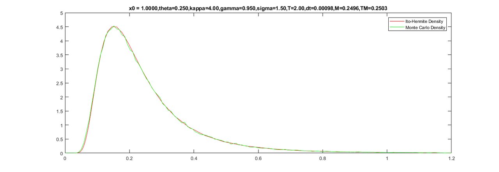](https://postimg.cc/XXtGpspP)

---

### #1206 — Amin (Topic Author)
*August 2, 2021, 5:05 AM*

There was an immediate relief in my back after after I wrote my previous two posts complaining about it and requesting
investigative journalists to consider writing a story about mind control torture. I remained far better all through
yesterday and even later today but when I slept last night, they continued to target my back with EM frequency weapons
and there was a lot of pain in my back at several places when I woke up from sleep this morning.

Today when I went out for breakfast, I also bought some water bottles and diet coke and both water bottles and diet coke
had mind control chemicals. They had already realized possible places I could go to get breakfast and had already
contaminated water and other drinks before I reached there.

So yes, there was some let up on torture on my back but it would restart in full swing in a few days again when the
whole thing goes out of limelight otherwise they continued to add mind control drugs to food and water just as usual.

---

### #1207 — Amin (Topic Author)
*August 3, 2021, 4:39 AM*

I remained quite better all through yesterday except for a few things.

1. It was not otherwise an extremely serious problem but when I was doing new research yesterday, they continued to
target my back with lasers.

2. I slept in air-conditioning in a different room(my room has terrible air-conditioning and gas that comes out of AC in
my room is just thoroughly killing.) which has far better air-conditioning but they still use some light gases in
air-conditioner and when I woke up, I was feeling frail and without any energy due to gas I had inhaled. I would have
loved to live without air-conditioning but it is way too humid and warm at the moment.

3. When I went out in my car, they charged my head and face with gas that settles on exposed body. It makes me totally
dull and takes all energy out of my body.

But still it was a far better day since they decreased laser on my back remarkably especially when I am just moving
around and doing nothing very significant.

---

### #1208 — Amin (Topic Author)
*August 4, 2021, 6:44 AM*

Friends, I have shifted further posts with my ongoing problems with mind control agencies to off-topic forum. Please
continue to read there.

https://forum.wilmott.com/viewtopic.php?f=15&t=94796&p=867743#p867743

I hope friends would be sympathetic to me and try to get me off mind control. Thank you.

---

### #1209 — Amin (Topic Author)
*August 5, 2021, 5:38 PM*

As I earlier mentioned, in a few days, I will be posting another worked out matlab program for solution of arbitrary
stochastic volatility type system of stochastic differential equations. Please put the thread in your favorites as a lot
more interesting stuff is on the way.

---

### #1210 — Amin (Topic Author)
*August 11, 2021, 1:14 PM*

My post in off-topic where I candidly discuss mind control, religion, holocaust, Jews and anti-semitism. https://forum.wilmott.com/viewtopic.php?f=15&t=94796&p=867809#p867809

---

### #1211 — Amin (Topic Author)
*August 12, 2021, 10:36 PM*

Friends, I am posting a monte carlo program for Stochastic volatility type SDEs. I have given two drift terms in both
asset and SV  SDEs. You can specify your correlation rho as well. Here are the SDEs.

dX(t)=(a X(t)^alpha1 + b X(t)^alpha2) dt + sqrt(1-rho^2) sigma1 V(t)^gammaV X(t)^gammaX dZ1(t) + rho sigma1 V(t)^gammaV
X(t)^gammaX dZ2(t)

dV(t)=(mu1 V(t)^beta1 + mu2 V(t)^beta2)*dt + sigma0 V(t)^gamma dZ2(t)

I will be posting analytic solution to the same PDE associated with these two SDEs framework in another two days. I have
worked out the solution details of analytic solution.

Here is the monte carlo program. I have not made it computationally efficient and emphasis is on clarity of how I
derived the solution so I have written every term as such. This is a quick post and I will make more detailed posts with
2D graphs of overlaid solution from monte carlo and analytic PDE solutions.

```
function [] = MonteCarlo2D()

% dX(t)=(a X(t)^alpha1 + b X(t)^alpha2) dt + sqrt(1-rho^2) sigma1 V(t)^gammaV X(t)^gammaX dZ1(t) + rho sigma1
V(t)^gammaV X(t)^gammaX dZ2(t)
% dV(t)=(mu1 V(t)^beta1 + mu2 V(t)^beta2)*dt + sigma0 V(t)^gamma dZ2(t)

%%%%%%%%%%%%%
X0=1.0;
alpha1=0;
alpha2=1;
kappaX=2.0;
thetaX=.5;
a=kappaX*thetaX;
b=-kappaX;
a=0;
b=0;
rho=-.7;
sigma1=.85;
gammaV=.5;
gammaX=.95;
%%%%%%%%%%%%%
V0=1.0;
thetaV=.25;
kappaV=4.0;
mu1=kappaV*thetaV;
mu2=-kappaV;
beta1=0;
beta2=1;
gamma=.95;
sigma0=1.25;
%%%%%%%%%%%%

dt=.03125;
Tt=32;

T=Tt*dt;
%paths=100000;

%%%%%%%%%%%%%%%%%%%%%%%%5

%rng(29079137, 'twister')
rng(15898837, 'twister')
paths=1000000;
V(1:paths)=V0;  %Original process monte carlo.
X(1:paths)=X0;
Random1(1:paths)=0;
Random2(1:paths)=0;

for tt=1:Tt
Random1=randn(size(Random1));
Random2=randn(size(Random2));

X(1:paths)=X(1:paths)+ ...
    (a* X(1:paths).^alpha1 + b* X(1:paths).^alpha2)* dt + ...
    sqrt(1-rho^2)* sigma1* V(1:paths).^gammaV.* X(1:paths).^gammaX .*Random1(1:paths) * sqrt(dt) + ...
    rho* sigma1* V(1:paths).^gammaV .*X(1:paths).^gammaX .*Random2(1:paths)*sqrt(dt) + ...
    (a*alpha1* X(1:paths).^(alpha1-1)+b*alpha2* X(1:paths).^(alpha2-1)).* ...
    (((a* X(1:paths).^alpha1 + b* X(1:paths).^alpha2)* dt^2/2)+ ...
    (sqrt(1-rho^2)* sigma1* V(1:paths).^gammaV.* X(1:paths).^gammaX .*Random1(1:paths) *(1-1/sqrt(3)).*dt^1.5+ ...
    rho* sigma1* V(1:paths).^gammaV .*X(1:paths).^gammaX .*Random2(1:paths)*(1-1/sqrt(3)).*dt^1.5))+ ...
    .5*(a*alpha1*(alpha1-1)* X(1:paths).^(alpha1-2)+b*alpha2*(alpha2-1).* X(1:paths).^(alpha2-2)).* ...
    ( sigma1^2* V(1:paths).^(2*gammaV).* X(1:paths).^(2*gammaX)) *dt^2/2 + ...
    sqrt(1-rho^2)* sigma1* V(1:paths).^gammaV.*gammaX.* X(1:paths).^(gammaX-1).* ...
    ((a* X(1:paths).^alpha1 + b* X(1:paths).^alpha2).*Random1(1:paths) * 1/sqrt(3).* dt^1.5 + ...
    sqrt(1-rho^2)* sigma1* V(1:paths).^gammaV.* X(1:paths).^gammaX .*(Random1(1:paths).^2-1) * dt/2 + ...
    rho* sigma1* V(1:paths).^gammaV .*X(1:paths).^gammaX .*Random1(1:paths).*Random2(1:paths)*dt/2)+ ...
    .5*sqrt(1-rho^2)* sigma1* V(1:paths).^gammaV.*gammaX.*(gammaX-1).* X(1:paths).^(gammaX-2).* ...
    (sigma1^2* V(1:paths).^(2*gammaV).* X(1:paths).^(2*gammaX) .*Random1(1:paths).*1/sqrt(3).*dt^1.5)+ ...
    sqrt(1-rho^2)* sigma1*gammaV.* V(1:paths).^(gammaV-1).* X(1:paths).^(gammaX).* ...
    ((mu1.*V(1:paths).^beta1 + mu2.*V(1:paths).^beta2).*Random1(1:paths) * 1/sqrt(3).* dt^1.5 + ...
    sigma0*V(1:paths).^gamma.*Random1(1:paths).*Random2(1:paths)*dt/2)+ ...
    .5*sqrt(1-rho^2)* sigma1*gammaV.*(gammaV-1).* V(1:paths).^(gammaV-2).* X(1:paths).^(gammaX).* ...
    (sigma0^2*V(1:paths).^(2*gamma).*Random1(1:paths)*1/sqrt(3)*dt^1.5)+ ...
    sqrt(1-rho^2)* sigma1*gammaV.* V(1:paths).^(gammaV-1).*gammaX.* X(1:paths).^(gammaX-1).* ...
    rho.* sigma1.* V(1:paths).^gammaV .*X(1:paths).^gammaX
.*sigma0.*V(1:paths).^gamma.*Random1(1:paths)*1/sqrt(3)*dt^1.5+ ...
    rho* sigma1* V(1:paths).^gammaV.*gammaX.* X(1:paths).^(gammaX-1).* ...
    ((a* X(1:paths).^alpha1 + b* X(1:paths).^alpha2).*Random2(1:paths) * 1/sqrt(3).* dt^1.5 + ...
    sqrt(1-rho^2)* sigma1* V(1:paths).^gammaV.* X(1:paths).^gammaX .*Random1(1:paths).*Random2(1:paths) * dt/2 + ...
    rho* sigma1* V(1:paths).^gammaV .*X(1:paths).^gammaX .*(Random2(1:paths).^2-1)*dt/2)+ ...
    .5*rho* sigma1* V(1:paths).^gammaV.*gammaX.*(gammaX-1).* X(1:paths).^(gammaX-2).* ...
    (sigma1^2* V(1:paths).^(2*gammaV).* X(1:paths).^(2*gammaX) .*Random2(1:paths).*1/sqrt(3).*dt^1.5)+ ...
    rho* sigma1*gammaV.* V(1:paths).^(gammaV-1).* X(1:paths).^(gammaX).* ...
    ((mu1.*V(1:paths).^beta1 + mu2.*V(1:paths).^beta2).*Random2(1:paths) * 1/sqrt(3).* dt^1.5 + ...
    sigma0*V(1:paths).^gamma.*(Random2(1:paths).^2-1)*dt/2)+ ...
    .5*rho* sigma1*gammaV.*(gammaV-1).* V(1:paths).^(gammaV-2).* X(1:paths).^(gammaX).* ...
    sigma0^2.*V(1:paths).^(2*gamma).*Random2(1:paths) * 1/sqrt(3).* dt^1.5+ ...
    rho* sigma1*gammaV.* V(1:paths).^(gammaV-1).*gammaX.* X(1:paths).^(gammaX-1).* ...
    rho.* sigma1.* V(1:paths).^gammaV .*X(1:paths).^gammaX
.*sigma0.*V(1:paths).^gamma.*Random2(1:paths)*1/sqrt(3)*dt^1.5;

    V(1:paths)=V(1:paths)+ ...
        (mu1.*V(1:paths).^beta1 + mu2.*V(1:paths).^beta2)*dt + ...
        sigma0*V(1:paths).^gamma .*Random2(1:paths)*sqrt(dt) + ...
        (mu1.*beta1*V(1:paths).^(beta1-1) + mu2.*beta2.*V(1:paths).^(beta2-1)).* ...
        ((mu1.*V(1:paths).^beta1 + mu2.*V(1:paths).^beta2)*dt^2/2 + ...
        sigma0*V(1:paths).^gamma .*Random2(1:paths)*(1-1/sqrt(3))*dt^1.5) + ...
        .5*(mu1.*beta1.*(beta1-1).*V(1:paths).^(beta1-2) + mu2.*beta2.*(beta2-1).*V(1:paths).^(beta2-2)).* ...
        sigma0^2.*V(1:paths).^(2*gamma).*dt^2/2 + ...
        sigma0*gamma*V(1:paths).^(gamma-1) .* ...
        ((mu1.*V(1:paths).^beta1 + mu2.*V(1:paths).^beta2).*Random2(1:paths).*1/sqrt(3)*dt^1.5 + ...
        sigma0.*V(1:paths).^gamma .*(Random2(1:paths).^2-1)*dt/2) + ...
        .5*sigma0*gamma*(gamma-1).*V(1:paths).^(gamma-2) .* ...
        sigma0^2.*V(1:paths).^(2*gamma) .*Random2(1:paths).*1/sqrt(3)*dt^1.5;

end

thetaV+exp(-kappaV*T)*(V0-thetaV)
sum(V(1:paths))/paths
thetaX+exp(-kappaX*T)*(X0-thetaX)
sum(X(1:paths))/paths

end

```

Here is the output of this quick program.

>> MonteCarlo2D

ans =

   0.263736729166551

ans =

   0.263871276320159

ans =

   0.567667641618306

ans =

   0.999643417736976

---

### #1212 — Amin (Topic Author)
*August 13, 2021, 11:48 AM*

>
> Friends I have been writing about my persecution for more than a decade but still to no avail. The people who are
behind my persecution are too strong and too full of venom that they continue to make sure that I remain under mind
control. I had previously told friends that it were some Jewish professors at my old school who were behind starting my
persecution. I want to be candid. Let us discuss it without naming anyone. Once the evil jewish crooks realized that I
had talent and they referred my case to mind control agency so I could be retarded. Once mind control agencies told them
that I had several special neurotransmitters, the evil crooks made sure for the rest of my life that I had to be
controlled and retarded with an iron fist. Before I write any further, I want to apologize to all "the nicest as it can
ever get" jews for using the term "evil jewish crooks". I want to say again that Jews are a great people and most of
them are very nice human beings like so many others of us or even better than many of us. I have not the slightest hard
feelings for jews as a people and I admire many of them but every group has some bad sheep that are full of venom,
spite, malice and hatred. This is what humanity is like and there is no escape from this fact. I want to request people
to not call me anti-semite for being very candid and frank. In fact I have been called anti-semite about a dozen times
on internet by people when I mentioned that there were some "bad" jewish professors were behind my persecution. I would
request people to try to be fair and when somebody complains, please try to know the truth on your own instead of
automatically calling the victims anti-semite. It is good to safeguard the jews from hatred of other groups since they
have been wronged more than any other people throughout the course of human history, it would still be nice to be
critical and try to find out if some victim might as well be trying to tell you some truth. In the same spirit, when we
recall holocaust we realize that antisemitism must end but at the same time we must not forget that holocaust was just
not a Jewish tragedy, it was a great human tragedy and when we recall holocaust, we must resolve to wrong no human in
the name of religion or race or ethnicity. One of my favorite quotes is from Hillary Clinton who said, "My soul shudders
when people are wronged in the name of religion." Though at this stage in my life, I have outgrown belief in any
religion because of critical thought and because science absolutely does not support the truth about any religion but I
did use to have a religion when I was in US though even then I was a very innocent and nice boy. So I stand with Jews
when it comes to commemorating the souls that were persecuted and killed but I still want to tell them(to the bad ones)
that it still does not mean that they have the prerogative to make decisions about who to retard and who to not retard
just because of the venom of bad and evil jewish crooks. Everybody knows I am perfectly innocent but my persecution and
that of a large number of other muslims and blacks never ends because of the venom of many evil jewish crooks in our
society.
>
Friends my above post has to be read in context of another post I made on the same topic exactly three years earlier. Here is the link to my previous post: [Muslims, mind control, Muslim-Jewish relationship and American defense](https://forum.wilmott.com/viewtopic.php?f=15&t=101453) https://forum.wilmott.com/viewtopic.php?f=15&t=101453

When I wrote that previous post I tried to be as discrete as possible. Please note that my persecution started in year
1997 with mind control. So even when I was writing the above post after 21 years of mind control torture, persecution
and insults, I never wanted to give any mild hints of anything anti-jewish. I was appealing to sympathies and humanity
of good jews and other people thinking they will intervene to end my persecution. If I had any intentions to arouse
resentment against jews, my wording of above post would have been extremely different. But my taking a mild stance only
emboldened the evil jewish crooks and my persecution only increased and never decreased. I can take only enough abuse
and torture for the rest of my life and therefore I had to write the post that I made two days ago. I am sure some
people will call me anti-semite even after knowing the context of my persecution but I can tell you that if I am an
anti-semite then any human being other than Christ will become an anti-semite when you will put him in my shoes.

I will request good and responsible people among Jews to take some concrete steps to stop the evil jewish crooks who
have gone on a mind control rampage across the United States and rest of the world.

For the context of my persecution, please also read: [My Letter To HRW About My Human Rights Abuse](https://forum.wilmott.com/viewtopic.php?f=15&t=102298) https://forum.wilmott.com/viewtopic.php?f=15&t=102298

In the thread below I tried in vain to request prime minister of my country to end mind control here but he is helpless before crook generals in Pakistan army who take hundreds of millions of dollars in bribes from CIA. https://forum.wilmott.com/viewtopic.php?f=15&t=94796&start=1125#p858119

---

### #1213 — Amin (Topic Author)
*August 13, 2021, 1:04 PM*

Friends, when I posted the last program, it was very late at night, it was almost morning therefore I could not add any
graphs for the monte carlo densities. I have added the graphs to monte carlo densities now and posting the program
again. Again it is a program with exactly the same main body and some initial parameters are different and graphs are
added. Here is the old program with graphs now

.

```
function [] = MonteCarlo2D()

% dX(t)=(a X(t)^alpha1 + b X(t)^alpha2) dt + sqrt(1-rho^2) sigma1 V(t)^gammaV X(t)^gammaX dZ1(t) + rho sigma1
V(t)^gammaV X(t)^gammaX dZ2(t)
% dV(t)=(mu1 V(t)^beta1 + mu2 V(t)^beta2)*dt + sigma0 V(t)^gamma dZ2(t)

%%%%%%%%%%%%%
X0=1.0;
alpha1=0;
alpha2=1;
%kappaX=2.0;
%thetaX=.5;
kappaX=0.0;
thetaX=0.0;
a=kappaX*thetaX;
b=-kappaX;
%a=0;
%b=0;
rho=-.99;
sigma1=.85;
gammaV=.5;
gammaX=.65;
%%%%%%%%%%%%%
V0=1.0;
thetaV=.25;
kappaV=4.0;
mu1=kappaV*thetaV;
mu2=-kappaV;
beta1=0;
beta2=1;
gamma=.95;
sigma0=1.25;
%%%%%%%%%%%%

dt=.03125;
Tt=32;

T=Tt*dt;
%paths=100000;

%%%%%%%%%%%%%%%%%%%%%%%%5

%rng(29079137, 'twister')
rng(15898837, 'twister')
paths=200000;
V(1:paths)=V0;  %Original process monte carlo.
X(1:paths)=X0;
Random1(1:paths)=0;
Random2(1:paths)=0;

for tt=1:Tt
Random1=randn(size(Random1));
Random2=randn(size(Random2));

X(1:paths)=X(1:paths)+ ...
    (a* X(1:paths).^alpha1 + b* X(1:paths).^alpha2)* dt + ...
    sqrt(1-rho^2)* sigma1* V(1:paths).^gammaV.* X(1:paths).^gammaX .*Random1(1:paths) * sqrt(dt) + ...
    rho* sigma1* V(1:paths).^gammaV .*X(1:paths).^gammaX .*Random2(1:paths)*sqrt(dt) + ...
    (a*alpha1* X(1:paths).^(alpha1-1)+b*alpha2* X(1:paths).^(alpha2-1)).* ...
    (((a* X(1:paths).^alpha1 + b* X(1:paths).^alpha2)* dt^2/2)+ ...
    (sqrt(1-rho^2)* sigma1* V(1:paths).^gammaV.* X(1:paths).^gammaX .*Random1(1:paths) *(1-1/sqrt(3)).*dt^1.5+ ...
    rho* sigma1* V(1:paths).^gammaV .*X(1:paths).^gammaX .*Random2(1:paths)*(1-1/sqrt(3)).*dt^1.5))+ ...
    .5*(a*alpha1*(alpha1-1)* X(1:paths).^(alpha1-2)+b*alpha2*(alpha2-1).* X(1:paths).^(alpha2-2)).* ...
    ( sigma1^2* V(1:paths).^(2*gammaV).* X(1:paths).^(2*gammaX)) *dt^2/2 + ...
    sqrt(1-rho^2)* sigma1* V(1:paths).^gammaV.*gammaX.* X(1:paths).^(gammaX-1).* ...
    ((a* X(1:paths).^alpha1 + b* X(1:paths).^alpha2).*Random1(1:paths) * 1/sqrt(3).* dt^1.5 + ...
    sqrt(1-rho^2)* sigma1* V(1:paths).^gammaV.* X(1:paths).^gammaX .*(Random1(1:paths).^2-1) * dt/2 + ...
    rho* sigma1* V(1:paths).^gammaV .*X(1:paths).^gammaX .*Random1(1:paths).*Random2(1:paths)*dt/2)+ ...
    .5*sqrt(1-rho^2)* sigma1* V(1:paths).^gammaV.*gammaX.*(gammaX-1).* X(1:paths).^(gammaX-2).* ...
    (sigma1^2* V(1:paths).^(2*gammaV).* X(1:paths).^(2*gammaX) .*Random1(1:paths).*1/sqrt(3).*dt^1.5)+ ...
    sqrt(1-rho^2)* sigma1*gammaV.* V(1:paths).^(gammaV-1).* X(1:paths).^(gammaX).* ...
    ((mu1.*V(1:paths).^beta1 + mu2.*V(1:paths).^beta2).*Random1(1:paths) * 1/sqrt(3).* dt^1.5 + ...
    sigma0*V(1:paths).^gamma.*Random1(1:paths).*Random2(1:paths)*dt/2)+ ...
    .5*sqrt(1-rho^2)* sigma1*gammaV.*(gammaV-1).* V(1:paths).^(gammaV-2).* X(1:paths).^(gammaX).* ...
    (sigma0^2*V(1:paths).^(2*gamma).*Random1(1:paths)*1/sqrt(3)*dt^1.5)+ ...
    sqrt(1-rho^2)* sigma1*gammaV.* V(1:paths).^(gammaV-1).*gammaX.* X(1:paths).^(gammaX-1).* ...
    rho.* sigma1.* V(1:paths).^gammaV .*X(1:paths).^gammaX
.*sigma0.*V(1:paths).^gamma.*Random1(1:paths)*1/sqrt(3)*dt^1.5+ ...
    rho* sigma1* V(1:paths).^gammaV.*gammaX.* X(1:paths).^(gammaX-1).* ...
    ((a* X(1:paths).^alpha1 + b* X(1:paths).^alpha2).*Random2(1:paths) * 1/sqrt(3).* dt^1.5 + ...
    sqrt(1-rho^2)* sigma1* V(1:paths).^gammaV.* X(1:paths).^gammaX .*Random1(1:paths).*Random2(1:paths) * dt/2 + ...
    rho* sigma1* V(1:paths).^gammaV .*X(1:paths).^gammaX .*(Random2(1:paths).^2-1)*dt/2)+ ...
    .5*rho* sigma1* V(1:paths).^gammaV.*gammaX.*(gammaX-1).* X(1:paths).^(gammaX-2).* ...
    (sigma1^2* V(1:paths).^(2*gammaV).* X(1:paths).^(2*gammaX) .*Random2(1:paths).*1/sqrt(3).*dt^1.5)+ ...
    rho* sigma1*gammaV.* V(1:paths).^(gammaV-1).* X(1:paths).^(gammaX).* ...
    ((mu1.*V(1:paths).^beta1 + mu2.*V(1:paths).^beta2).*Random2(1:paths) * 1/sqrt(3).* dt^1.5 + ...
    sigma0*V(1:paths).^gamma.*(Random2(1:paths).^2-1)*dt/2)+ ...
    .5*rho* sigma1*gammaV.*(gammaV-1).* V(1:paths).^(gammaV-2).* X(1:paths).^(gammaX).* ...
    sigma0^2.*V(1:paths).^(2*gamma).*Random2(1:paths) * 1/sqrt(3).* dt^1.5+ ...
    rho* sigma1*gammaV.* V(1:paths).^(gammaV-1).*gammaX.* X(1:paths).^(gammaX-1).* ...
    rho.* sigma1.* V(1:paths).^gammaV .*X(1:paths).^gammaX
.*sigma0.*V(1:paths).^gamma.*Random2(1:paths)*1/sqrt(3)*dt^1.5;

    V(1:paths)=V(1:paths)+ ...
        (mu1.*V(1:paths).^beta1 + mu2.*V(1:paths).^beta2)*dt + ...
        sigma0*V(1:paths).^gamma .*Random2(1:paths)*sqrt(dt) + ...
        (mu1.*beta1*V(1:paths).^(beta1-1) + mu2.*beta2.*V(1:paths).^(beta2-1)).* ...
        ((mu1.*V(1:paths).^beta1 + mu2.*V(1:paths).^beta2)*dt^2/2 + ...
        sigma0*V(1:paths).^gamma .*Random2(1:paths)*(1-1/sqrt(3))*dt^1.5) + ...
        .5*(mu1.*beta1.*(beta1-1).*V(1:paths).^(beta1-2) + mu2.*beta2.*(beta2-1).*V(1:paths).^(beta2-2)).* ...
        sigma0^2.*V(1:paths).^(2*gamma).*dt^2/2 + ...
        sigma0*gamma*V(1:paths).^(gamma-1) .* ...
        ((mu1.*V(1:paths).^beta1 + mu2.*V(1:paths).^beta2).*Random2(1:paths).*1/sqrt(3)*dt^1.5 + ...
        sigma0.*V(1:paths).^gamma .*(Random2(1:paths).^2-1)*dt/2) + ...
        .5*sigma0*gamma*(gamma-1).*V(1:paths).^(gamma-2) .* ...
        sigma0^2.*V(1:paths).^(2*gamma) .*Random2(1:paths).*1/sqrt(3)*dt^1.5;

end

SVolMeanAnalytic=thetaV+exp(-kappaV*T)*(V0-thetaV)
SVolMean=sum(V(1:paths))/paths
AssetMeanAnalytic=thetaX+exp(-kappaX*T)*(X0-thetaX)
AssetMean=sum(X(1:paths))/paths

MaxCutOff=30;
%NoOfBins=round(600*gamma^2*4*sigma0/sqrt(MCMean)/(1+kappa));%Decrease the number of bins if the graph is too
NoOfBins=2000;
[XDensity,IndexOutX,IndexMaxX] = MakeDensityFromSimulation_Infiniti_NEW(X,paths,NoOfBins,MaxCutOff );
plot(IndexOutX(1:IndexMaxX),XDensity(1:IndexMaxX),'g');
 %plot(y_w(wnStart+1:Nn-1),fy_w(wnStart+1:Nn-1),'r',IndexOutY(1:IndexMaxY),YDensity(1:IndexMaxY),'g',Z(wnStart+1:Nn-1),fy_w(wnStart+1:Nn-1),'b');

title(sprintf('X0 = %.4f,thetaX=%.3f,kappaX=%.2f,gammaX=%.3f,gammaV=%.3f,sigma1=%.2f,T=%.2f,dt=%.5f,M=%.4f,TM=%.4f',
X0,thetaX,kappaX,gammaX,gammaV,sigma1,T,dt,AssetMean,AssetMeanAnalytic));%,sprintf('theta= %f', theta), sprintf('kappa =
%f', kappa),sprintf('sigma = %f', sigma0),sprintf('T = %f', T));

%legend({'Ito-Hermite Density','Monte Carlo Density'},'Location','northeast')

str=input('Green line is density of Asset SDE.');

MaxCutOff=30;
%NoOfBins=round(600*gamma^2*4*sigma0/sqrt(MCMean)/(1+kappa));%Decrease the number of bins if the graph is too
NoOfBins=2000;
[VDensity,IndexOutV,IndexMaxV] = MakeDensityFromSimulation_Infiniti_NEW(V,paths,NoOfBins,MaxCutOff );
plot(IndexOutV(1:IndexMaxV),VDensity(1:IndexMaxX),'r');
 %plot(y_w(wnStart+1:Nn-1),fy_w(wnStart+1:Nn-1),'r',IndexOutY(1:IndexMaxY),YDensity(1:IndexMaxY),'g',Z(wnStart+1:Nn-1),fy_w(wnStart+1:Nn-1),'b');

title(sprintf('V0 =
%.4f,thetaV=%.3f,kappaV=%.2f,gamma=%.3f,sigma0=%.2f,T=%.2f,dt=%.5f,SVolMean=%.4f,SVolMeanAnalytic=%.4f',
V0,thetaV,kappaV,gamma,sigma0,T,dt,SVolMean,SVolMeanAnalytic));%,sprintf('theta= %f', theta), sprintf('kappa = %f',
kappa),sprintf('sigma = %f', sigma0),sprintf('T = %f', T));

%legend({'Ito-Hermite Density','Monte Carlo Density'},'Location','northeast')

str=input('red line is density of Asset SDE.');

end

```

.

.

Here is the final output of the program.

SVolMeanAnalytic =

   0.263736729166551

SVolMean =

   0.263748723062681

AssetMeanAnalytic =

     1

AssetMean =

  1.000894173714266 + 0.000003747246978i

IndexMax =

        2001

Green line is density of Asset SDE.

IndexMax =

        2001

red line is density of Asset SDE.

and following is the asset graph you will see.

[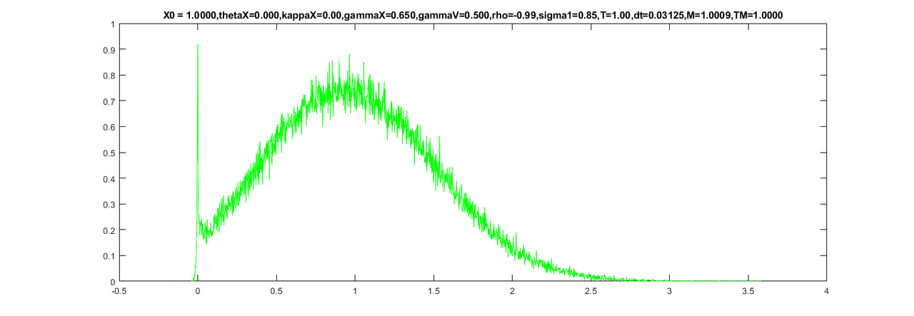](https://postimg.cc/hJx5BXk3)

---

### #1214 — Amin (Topic Author)
*August 14, 2021, 9:46 AM*

Friends, today I received biweekly antipsychotic injection that is forced on me to keep me in control. I have begged so
many times on this forum that I have been given antipsychotic drugs and injections for more than twenty years and now I
am (48 years old) and it is too difficult  to continue to take anti-psychotic drugs and still do everything nicely. I am
30 kg over weight due to antipsychotic injections and mind control. At this stage in my life, it is very difficult for
me to continue to take mind control and other abuse so I really request good Jews to intervene and force the crooks to
end my mind control and mind control of thousands of other victims like me.

I have fought a very long battle against mind control agencies and I believe my true contribution to our societies
(American and other)  is not in the field of mathematics, rather it is in exposing the actors behind mind control and
exposing the cruel nature of mind control practices and I am sure my efforts will have quite a reasonable effect in
stopping mind control of new victims who would otherwise be boldly(and surely) retarded if there were no awareness in
American society about mind control. I want to request all good Americans to do whatever they can to end the menace of
mind control from all human societies.

I had previously written about mind control by barack obama and requested the new president Biden to end mind control
practices in United States and all over the world. Please read my posts in light of the information I have revealed in
past few days.

[Obama and Mind Control](https://forum.wilmott.com/viewtopic.php?f=15&p=864314#p864253)     https://forum.wilmott.com/viewtopic.php?f=15&p=864314#p864253

and finally appeal to new president Joe Biden to end mind control

https://forum.wilmott.com/viewtopic.php?f=15&p=864314#p864314

And please read here how my tweets to American senators are stopped by American defense and mind control crooks.

https://forum.wilmott.com/viewtopic.php?f=15&p=864314#p864276

and finally Blacks and mind control

[Blacks and Mind Control](https://forum.wilmott.com/viewtopic.php?f=4&t=99702&start=1155#p866370)

---

### #1215 — Amin (Topic Author)
*August 15, 2021, 9:03 AM*

Sorry Double

---

### #1216 — Amin (Topic Author)
*August 15, 2021, 9:07 AM*

Friends, I continued coding the solution of 2D SV fokker-planck equation last night. I am sure I will complete the
coding part today and then post the matlab program in another two days. I have taken the same pair of SDEs for 2D
Fokker-Planck that I used for 2D SV monte carlo program that I posted a few days ago. I have first started with FPE in
bessel coordinates but later I will post a new program in original coordinates as well.

---

### #1217 — Amin (Topic Author)
*August 15, 2021, 9:08 AM*

Friends, my only intention behind the past few posts is that I want mind control to end from our societies. I do not
have any joy in mentioning that there are some bad jewish actors behind it. In American society there are a large number
of jews who have excelled in the professions of science, education, medicine and have made great contributions to our
societies. There are a very large number of jewish professors each of whom would have taught tens of thousands of
students on top of making extraordinary contributions to body of human knowledge through their great research. Then
there are accomplished jewish scientists whose work, research and inventions make our everyday life better. There are
great jewish doctors and surgeons who would treat countless sick people and make them recover from disease. The list of
contributions of jewish people to humanity is very long and it continues. Then there are a large number of ordinary
jewish folks who are known for their goodness and civility to other people in the society. When we know all of this, we
do not want to say anything anti-jewish to hurt the feelings of so many good jewish people. But I still have to say
there are really some bad people who are unconnected with most of the nice and accomplished jews and they instigate and
continue cruel mind control torture on talented people of other ethnicities, religions and countries based on their
personal dislike and hatred. But since my writing about bad jews might have some anti-jewish sentiments about the really
good and nice ones, I do not want to continue writing about this topic for a few weeks hoping that good and responsible
people in American society would intervene and good jews would also try to force an end to cruel mind control
victimization on the hands of bad ones. My purpose is only to end the mind control victimization and torture on
otherwise nice and talented people and I do not have any hidden intentions beyond that. And I am sure American society
knows very well about the contributions of good Jews to both their country and broader humanity and my exposing some bad
actors would never have any bad effect of any kind on these good and nice jews who we all respect and who are our role
models.

I will continue to write about torture and victimization experiences I face and write everyday about it in off-topic but
I would try to stay away from saying anything about mind control apparatus and I really hope that good people will
intervene to end my mind control and that of a large number of other intelligent victims and let them start their lives
again with their human dignity.

---

### #1218 — Amin (Topic Author)
*August 17, 2021, 9:02 PM*

Friends, I have been able to run my first prototype program with zero correlations but it currently seems to have a
small mismatch with monte carlo but I am quite close. I hope that I would be able to fix any errors and post the program
in a few days.

---

### #1219 — Amin (Topic Author)
*August 18, 2021, 3:32 PM*

Friends my program with SV SDEs without correlations is working well for many SDEs I initially tried. The program was
already fine but the way I was averaging density of assets to integrate over SV density to find marginal density of
asset had some problems since I was integrating along Z-lines and not along the asset value and that was a wrong
approach and changed the density shape. In another 2-3 days I would post this algorithm since I still have to improve
the density integration part somewhat, try to check the algorithm on wide range of scenarios and then write comments but
the good news is that the program without correlations is working perfectly fine. I have taken both SDEs in bessel
coordinates initially and then will switch to original coordinates later. I would post the new program in another 2-3
days.

---

### #1220 — Amin (Topic Author)
*August 18, 2021, 8:09 PM*

Friends, here are a few sample graphs for the asset price density in Stochastic volatility set up from the new program.
You can see some very minor discrepancy in the graphs. I will be changing my interpolation routine tomorrow and hope
that this discrepancy would end or at least decrease even further. Here are the graphs. You can notice fat tails of
asset price distributions due to SV. I will further work on improving the programs and post them here in 2-3 days.

[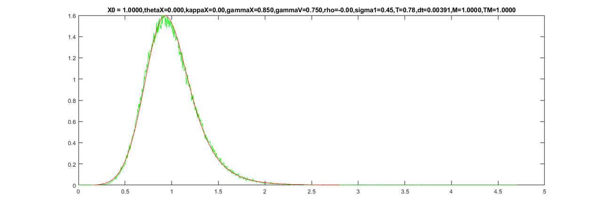](https://postimg.cc/gLYjsHk3)

[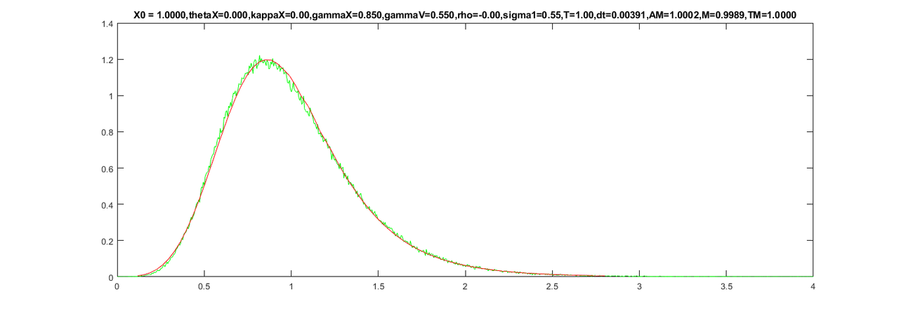](https://postimg.cc/F1mYhNg1)

[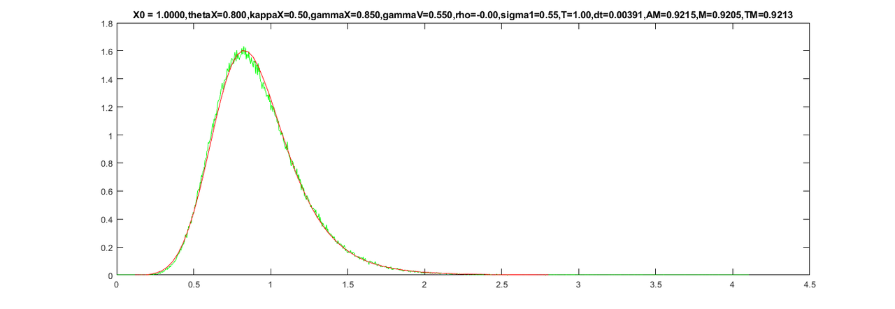](https://postimg.cc/G8nH81W7)

[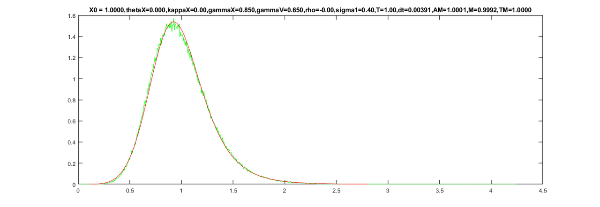](https://postimg.cc/YGNjQskp)

---

### #1221 — Amin (Topic Author)
*August 24, 2021, 10:56 AM*

Friends, I spent a lot of time figuring out how to solve the 2D SV PDE with correlations but could not succeed. I was
thinking if I could easily solve the correlated problem, I will post both the programs together but it seems to take
some more time therefore I have decided to post the work on non-correlated SV diffusions that I have already done. But
it will still take at least a day since I have to write one or two functions to convert asset prices from two dim
coordinates to 1 dim coordinates. I have written a function already that I had used to make the graphs I posted on
internet but that function is not robust and I have better ideas now to write a simple function. It will not be late now
since I will first complete and post the non-correlated SV program and then do any further work.

---

### #1222 — Amin (Topic Author)
*August 24, 2021, 1:05 PM*

After posting the non-correlated SV solution of PDE, I plan to work on a monte carlo simulation program that combines
stochastic volatility, correlation between asset and SV diffusions, and enhanced quadratic volatility type structure for
asset volatility so that we can have interesting shapes for implied volatility like bimodal implied volatility densities
and many other. I will add enhanced quadratic volatility structure in asset SDE on top of what I have already done in
previous SV monte carlo simulation program that I posted about ten days ago. I hope the program will be useful for
friends who want more interesting shapes in implied volatility.

---

### #1223 — Amin (Topic Author)
*August 25, 2021, 8:17 PM*

Friends here is the PDE solution of non-correlated set of SV SDEs. I will post more detailed notes later.

Here is the main program.

.

```
function [] = SVSDEAnalyticAndMonteCarlo2DWmtNew()

% dX(t)=(a X(t)^alpha1 + b X(t)^alpha2) dt + sqrt(1-rho^2) sigma1 V(t)^gammaV X(t)^gammaX dZ1(t) + rho sigma1
V(t)^gammaV X(t)^gammaX dZ2(t)
% dV(t)=(mu1 V(t)^beta1 + mu2 V(t)^beta2)*dt + sigma0 V(t)^gamma dZ2(t)

%%%%%%%%%%%%%
X0=1.0;
alpha1=0;
alpha2=1;
%kappaX=2.0;
% =.5;
kappaX=0.0;%If you give drift to density, you may have to decrease the step size.
thetaX=0.750;
a=kappaX*thetaX;
b=-kappaX;
%a=0;
%b=0;
rho=-.7*0;
sigma1=.5;
gammaV=.5;
gammaX=.75;
%%%%%%%%%%%%%
V0=.850;
thetaV=.25;
kappaV=2.0;
mu1=kappaV*thetaV;
mu2=-kappaV;
beta1=0;
beta2=1;
gamma=.95;
sigma0=.75;
%%%%%%%%%%%%

dtM=.03125;
TtM=32;%%%32 steps mean one year.

dt=dtM/16;
Tt=TtM*16;
T=TtM*dtM;

dNn=.2/1;   % Normal density subdivisions width. would change with number of subdivisions
Nn=50;  % No of normal density subdivisions
NnMidl=25;%One half density Subdivision left from mid of normal density(low)
NnMidh=26;%One half density subdivision right from the mid of normal density(high)
NnMid=4.0;

dMm=.25/1;   % Normal density subdivisions width. would change with number of subdivisions
Mm=40;  % No of normal density subdivisions
MmMidl=20;%One half density Subdivision left from mid of normal density(low)
MmMidh=21;%One half density subdivision right from the mid of normal density(high)
MmMid=4.0;

w(1:Nn)=V0^(1-gamma)/(1-gamma);
y(1:Nn,1:Mm)=X0^(1-gammaX)/(1-gammaX);

Z(1:Nn)=(((1:Nn)-5.5)*dNn-NnMid);

Z0(1:Mm)=(((1:Mm)-4.5)*dMm-MmMid);
Z
Z0
str=input('Look at Z');
ZProb(1)=normcdf(.5*Z(1)+.5*Z(2),0,1)-normcdf(.5*Z(1)+.5*Z(2)-dNn,0,1);
ZProb(Nn)=normcdf(.5*Z(Nn)+.5*Z(Nn-1)+dNn,0,1)-normcdf(.5*Z(Nn)+.5*Z(Nn-1),0,1);
ZProb(2:Nn-1)=normcdf(.5*Z(2:Nn-1)+.5*Z(3:Nn),0,1)-normcdf(.5*Z(2:Nn-1)+.5*Z(1:Nn-2),0,1);

ZCProb(1:Nn)=normcdf(Z(1:Nn));

Z0Prob(1)=normcdf(.5*Z0(1)+.5*Z0(2),0,1)-normcdf(.5*Z0(1)+.5*Z0(2)-dMm,0,1);
Z0Prob(Mm)=normcdf(.5*Z0(Mm)+.5*Z0(Mm-1)+dMm,0,1)-normcdf(.5*Z0(Mm)+.5*Z0(Mm-1),0,1);
Z0Prob(2:Mm-1)=normcdf(.5*Z0(2:Mm-1)+.5*Z0(3:Mm),0,1)-normcdf(.5*Z0(2:Mm-1)+.5*Z0(1:Mm-2),0,1);

Z0CProb(1:Mm)=normcdf(Z0(1:Mm));

%%%%%%%%%%%%%%%%%%%%%%%%5
wnStart=1;
ynStart=1;
dwdZ(wnStart:Nn)=0.0;
tic
for tt=1:Tt

    V(wnStart:Nn)=((1-gamma)*w(wnStart:Nn)).^(1/(1-gamma));
    X(wnStart:Nn,ynStart:Mm)=((1-gammaX)*y(wnStart:Nn,ynStart:Mm)).^(1/(1-gammaX));

wMu0dt(wnStart:Nn)= (mu1*V(wnStart:Nn).^(beta1-gamma)+mu2*V(wnStart:Nn).^(beta2-gamma) - ...
    .5*gamma*sigma0^2*V(wnStart:Nn).^(gamma-1))*dt + ...
    (mu1*(beta1-gamma).*V(wnStart:Nn).^(beta1-gamma-1)+mu2*(beta2-gamma)*V(wnStart:Nn).^(beta2-gamma-1) - ...
    .5*gamma*sigma0^2*(gamma-1)*V(wnStart:Nn).^(gamma-2)).* ...
    (mu1*V(wnStart:Nn).^(beta1-gamma)+mu2*V(wnStart:Nn).^(beta2-gamma))*dt^2/2+ ...
   
(mu1*(beta1-gamma).*(beta1-gamma-1).*V(wnStart:Nn).^(beta1-gamma-2)+mu2*(beta2-gamma-1).*(beta2-gamma)*V(wnStart:Nn).^(beta2-gamma-2)
- ...
    .5*gamma*sigma0^2*(gamma-1)*(gamma-2).*V(wnStart:Nn).^(gamma-3)).* ...
    .5.*sigma0^2.*V(wnStart:Nn).^(2*gamma)*dt^2/2;
for nn=wnStart:Nn
yMu0dt(nn,ynStart:Mm)= (a*X(nn,ynStart:Mm).^(alpha1-gammaX)+b*X(nn,ynStart:Mm).^(alpha2-gammaX) - ...
     .5*gammaX*sigma1^2*V(nn).^(2*gammaV).*X(nn,ynStart:Mm).^(gammaX-1))*dt + ...
     (a*(alpha1-gammaX).*X(nn,ynStart:Mm).^(alpha1-gammaX-1)+b*(alpha2-gammaX)*X(nn,ynStart:Mm).^(alpha2-gammaX-1) - ...
     .5*gammaX*sigma1^2*V(nn).^(2*gammaV).*(gammaX-1)*X(nn,ynStart:Mm).^(gammaX-2)).* ...
     (a*X(nn,ynStart:Mm).^(alpha1)+b*X(nn,ynStart:Mm).^(alpha2))*dt^2/2+ ...
     -(.5*gammaX*sigma1^2*(2*gammaV).*V(nn).^(2*gammaV-1).*X(nn,ynStart:Mm).^(gammaX-1)).* ...
     (mu1*V(nn).^(beta1)+mu2*V(nn).^(beta2))*dt^2/2 + ...
   
(a*(alpha1-gammaX).*(alpha1-gammaX-1).*X(nn,ynStart:Mm).^(alpha1-gammaX-2)+b*(alpha2-gammaX-1).*(alpha2-gammaX)*X(nn,ynStart:Mm).^(alpha2-gammaX-2)
- ...
    .5*gammaX*sigma1^2*(gammaX-1)*(gammaX-2)*V(nn).^(2*gammaV).*X(nn,ynStart:Mm).^(gammaX-3)).* ...
    .5*sigma1^2*V(nn).^(2*gammaV).*X(nn,ynStart:Mm).^(2*gammaX)*dt^2/2+ ...
    -(.5*gammaX*sigma1^2*(2*gammaV).*(2*gammaV-1).*V(nn).^(2*gammaV-2).*X(nn,ynStart:Mm).^(gammaX-1)).* ...
     (sigma0^2*V(nn).^(2*gamma))*dt^2/2;
end

  [dwdZ,d2wdZ2] = First2Derivatives2ndOrderEqSpacedA(wnStart,Nn,dNn,w,Z);

  for nn=wnStart:Nn
      yA(ynStart:Mm)=y(nn,ynStart:Mm);
      [dydZ0A,d2ydZ02A] = First2Derivatives2ndOrderEqSpacedA(ynStart,Mm,dMm,yA,Z0);
      dydZ0(nn,ynStart:Mm)=dydZ0A(ynStart:Mm);
      d2ydZ02(nn,ynStart:Mm)=d2ydZ02A(ynStart:Mm);
      d2ydZ02(nn,Mm-1:Mm)=0.0;
  end

%  for nn=ynStart:Mm
%      yA(wnStart:Nn)=y(wnStart:Nn,nn);
%      [dydZA,d2ydZ2A] = First2Derivatives2ndOrderEqSpacedA(wnStart,Nn,dNn,yA,Z);
%      dydZ(wnStart:Nn,nn)=dydZA(wnStart:Nn);
%      d2ydZ2(wnStart:Nn,nn)=d2ydZ2A(wnStart:Nn);
%      %d2ydZ02(nn,Mm-1:Mm)=0.0;
%  end
  if(tt>7)
  dwb(wnStart:Nn)= wMu0dt(wnStart:Nn)+.5*sigma0^2*dt*Z(wnStart:Nn).*dwdZ(wnStart:Nn).^(-1)+ ...
            .5*sigma0^2*dt*(dwdZ(wnStart:Nn).^(-2)).*d2wdZ2(wnStart:Nn);
  w(wnStart:Nn)=w(wnStart:Nn)+ dwb(wnStart:Nn);
  elseif((tt1))
   dwb(wnStart:Nn)= wMu0dt(wnStart:Nn)+.5*sigma0^2*dt*Z(wnStart:Nn).*dwdZ(wnStart:Nn).^(-1);

  w(wnStart:Nn)=w(wnStart:Nn)+ dwb(wnStart:Nn);

  elseif((tt==1))
  dwb(wnStart:Nn)= wMu0dt(wnStart:Nn)+sigma0*sqrt(dt).*Z(wnStart:Nn);
  w(wnStart:Nn)=w(wnStart:Nn)+ dwb(wnStart:Nn);

  end

  Vnew(wnStart:Nn)=((1-gamma).*w(wnStart:Nn)).^(1/(1-gamma));

  dwdZPrev(wnStart:Nn)=dwdZ(wnStart:Nn);
  d2wdZ2Prev(wnStart:Nn)=d2wdZ2(wnStart:Nn);
  %dwdZPrev(Nn)=dwdZPrev(Nn)*.999;
  [dwdZNew,d2wdZ2New] = First2Derivatives2ndOrderEqSpacedA(wnStart,Nn,dNn,w,Z);

 
Ratio(wnStart:Nn,ynStart:Mm)=(dwdZPrev(wnStart:Nn)*dNn+.25*d2wdZ2Prev(wnStart:Nn)*dNn^2)/(dwdZNew(wnStart:Nn)*dNn+.25*d2wdZ2New(wnStart:Nn)*dNn^2);

tt

  if(tt>=3)

      for nn=wnStart:Nn

    yv(nn,ynStart:Mm)=.5*sigma1^2*((V(nn).^(2*gammaV)).*dt).* ...
       (Z0(ynStart:Mm).*dydZ0(nn,ynStart:Mm).^(-1).* Ratio(nn,ynStart:Mm).^1+ ...
       (dydZ0(nn,ynStart:Mm).^(-2)).*d2ydZ02(nn,ynStart:Mm).* Ratio(nn,ynStart:Mm).^1);% + ...
      end
  y(wnStart:Nn,ynStart:Mm)=y(wnStart:Nn,ynStart:Mm)+yMu0dt(wnStart:Nn,ynStart:Mm)+ ...
      yv(wnStart:Nn,ynStart:Mm);

  elseif ((tt1))
      for nn=wnStart:Nn
      Ratio(nn,ynStart:Mm)=(dwdZPrev(nn)./dwdZNew(nn));
  yv(nn,ynStart:Mm)=.5*V(nn).^(2*gammaV).*dt.* ...
      (Z0(ynStart:Mm).*dydZ0(nn,ynStart:Mm).^(-1)).*Ratio(nn,ynStart:Mm);
      end

  y(wnStart:Nn,ynStart:Mm)=y(wnStart:Nn,ynStart:Mm)+yMu0dt(wnStart:Nn,ynStart:Mm)+yv(wnStart:Nn,ynStart:Mm);
  elseif(tt==1)
      for mm=1:Mm
      yv(wnStart:Nn,mm)=sigma1*V(:).^(gammaV).*sqrt(dt)*Z0(mm);%- ...
      end
   y(wnStart:Nn,ynStart:Mm)=y(wnStart:Nn,ynStart:Mm)+yMu0dt(wnStart:Nn,ynStart:Mm)+yv(wnStart:Nn,ynStart:Mm);
  end

end
Vw(wnStart:Nn)=((1-gamma).*w(wnStart:Nn)).^(1/(1-gamma));
DfVw(wnStart:Nn)=0;
for nn=wnStart+1:Nn-1

    DfVw(nn) = (Vw(nn + 1) - Vw(nn - 1))/(Z(nn + 1) - Z(nn - 1));
    %Change of variable derivative for densities
end

pVw(1:Nn)=0;
for nn = wnStart:Nn-1

    pVw(nn) = (normpdf(Z(nn),0, 1))/abs(DfVw(nn));
end

%Below algorithm caclulates minX and maxX which are the end points
%of new grid constructed to calculate the marginal probability of asset X.
%Any values larger than maxX are not considered towards calculation of
%probability density of X. The current grid has 400 cells equidistributed
%between minX and maxX.
minX=10;
maxX=.001;
for mm=ynStart:Mm
%Xy(mm)=sum(((1-gammaX).*y(wnStart:Nn,mm)).^(1/(1-gammaX)).*ZProb(wnStart:Nn));
Xy_limits(mm)=sum(((1-gammaX).*y(45,mm)).^(1/(1-gammaX)));

end

Xy_limits
if(Xy_limits(4)maxX)
    maxX=real(Xy_limits(31));
end

minX=minX-.025;
maxX=maxX+2.50;
minX=max(.001,minX);
minX
maxX
%minX=.001;
%maxX=6.0;
Mm0=400;
%[X,XProb] = AddXAcrossSVolGrids(y,wnStart,Nn,ynStart,Mm,dMm,ZProb,Z0Prob,Z0,gammaX);
%[X,XProb] = AddXAcrossSVolGrids(y,wnStart,Nn,ynStart,Mm,dMm,Mm0,ZProb,Z0Prob,Z0,gammaX,minX,maxX);
 [X,XProb] = AddXAcrossSVolGrids(y,wnStart,Nn,ynStart,Mm,dMm,Mm0,ZProb,gammaX,minX,maxX);
plot(X(1:Mm0),XProb(1:Mm0),'r');
XCDF(1:Mm0)=0.0;
XCDF(1)=XProb(1);
for mm0=2:Mm0
    XCDF(mm0)=XCDF(mm0-1)+XProb(mm0);
end
%XCDF=XCDF(:)./sum(XProb(:));
sum(XProb(:))
Zb(1:Mm0)=norminv(XCDF(1:Mm0));%is calculated at boundaries of cells
ZX(2:Mm0)=(Zb(2:Mm0)+Zb(1:Mm0-1))/2.0;%is calculated at center of grid cells.
dXdZX(3:Mm0-1)=(X(4:Mm0)-X(2:Mm0-2))./(ZX(4:Mm0)-ZX(2:Mm0-2))
[dXdZX(3)] = InterpolateOrderN6(4,ZX(3),ZX(4),ZX(5),ZX(6),ZX(7),0,0,dXdZX(4),dXdZX(5),dXdZX(6),dXdZX(7),0,0);
[dXdZX(2)] = InterpolateOrderN6(4,ZX(2),ZX(4),ZX(5),ZX(6),ZX(7),0,0,dXdZX(4),dXdZX(5),dXdZX(6),dXdZX(7),0,0);

%for nn = wnStart:Nn-1
for mm=2:398
    pX(mm) = (normpdf(ZX(mm),0, 1))/abs(dXdZX(mm));
end
ZX
    pX
    pX(isnan(pX)==1)=0.0;
    pX(isinf(pX)==1)=0.0;
%pX
XProb
XX=X;
plot(XX(2:380),pX(2:380),'r');
str=input('Look at graph');

for mm=ynStart:Mm
%Xy(mm)=sum(((1-gammaX).*y(wnStart:Nn,mm)).^(1/(1-gammaX)).*ZProb(wnStart:Nn));
Xy(mm)=sum(((1-gammaX).*y(:,mm)).^(1/(1-gammaX)).*ZProb(:));
end
DfXy(ynStart:Mm)=0;
for mm=ynStart+2:Mm-2

    DfXy(mm) = (Xy(mm + 1) - Xy(mm - 1))/(Z0(mm + 1) - Z0(mm - 1));
    %Change of variable derivative for densities
end

pXy(ynStart:Mm)=0;
for mm = ynStart+2:Mm-2

    pXy(mm) = (normpdf(Z0(mm),0, 1))/abs(DfXy(mm));
end

toc

%Xy
ItoHermiteMean=sum(Vw(wnStart+1:Nn-1).*ZProb(wnStart+1:Nn-1))
TrueMean=thetaV+(V0-thetaV)*exp(-kappaV*dt*Tt)

ItoHermiteMeanX=sum(Xy(ynStart+1:Mm-1).*Z0Prob(ynStart+1:Mm-1))
ItoHermiteMeanX2=sum(X(:).*XProb(:))
TrueMean=thetaX+(X0-thetaX)*exp(-kappaX*dt*Tt)

%%%%%%%%%%%%%%%%%%%%%%%%%%%%%%
%rng(29079137, 'twister')
rng(15898837, 'twister')
paths=100000;
V(1:paths)=V0;  %Original process monte carlo.
X=0.0;
X(1:paths)=X0;
Random1(1:paths)=0;
Random2(1:paths)=0;

for ttM=1:TtM
Random1=randn(size(Random1));
Random2=randn(size(Random2));

X(1:paths)=X(1:paths)+ ...
    (a* X(1:paths).^alpha1 + b* X(1:paths).^alpha2)* dtM + ...
    sqrt(1-rho^2)* sigma1* V(1:paths).^gammaV.* X(1:paths).^gammaX .*Random1(1:paths) * sqrt(dtM) + ...
    rho* sigma1* V(1:paths).^gammaV .*X(1:paths).^gammaX .*Random2(1:paths)*sqrt(dtM) + ...
    (a*alpha1* X(1:paths).^(alpha1-1)+b*alpha2* X(1:paths).^(alpha2-1)).* ...
    (((a* X(1:paths).^alpha1 + b* X(1:paths).^alpha2)* dtM^2/2)+ ...
    (sqrt(1-rho^2)* sigma1* V(1:paths).^gammaV.* X(1:paths).^gammaX .*Random1(1:paths) *(1-1/sqrt(3)).*dtM^1.5+ ...
    rho* sigma1* V(1:paths).^gammaV .*X(1:paths).^gammaX .*Random2(1:paths)*(1-1/sqrt(3)).*dtM^1.5))+ ...
    .5*(a*alpha1*(alpha1-1)* X(1:paths).^(alpha1-2)+b*alpha2*(alpha2-1).* X(1:paths).^(alpha2-2)).* ...
    ( sigma1^2* V(1:paths).^(2*gammaV).* X(1:paths).^(2*gammaX)) *dtM^2/2 + ...
    sqrt(1-rho^2)* sigma1* V(1:paths).^gammaV.*gammaX.* X(1:paths).^(gammaX-1).* ...
    ((a* X(1:paths).^alpha1 + b* X(1:paths).^alpha2).*Random1(1:paths) * 1/sqrt(3).* dtM^1.5 + ...
    sqrt(1-rho^2)* sigma1* V(1:paths).^gammaV.* X(1:paths).^gammaX .*(Random1(1:paths).^2-1) * dtM/2 + ...
    rho* sigma1* V(1:paths).^gammaV .*X(1:paths).^gammaX .*Random1(1:paths).*Random2(1:paths)*dtM/2)+ ...
    .5*sqrt(1-rho^2)* sigma1* V(1:paths).^gammaV.*gammaX.*(gammaX-1).* X(1:paths).^(gammaX-2).* ...
    (sigma1^2* V(1:paths).^(2*gammaV).* X(1:paths).^(2*gammaX) .*Random1(1:paths).*1/sqrt(3).*dtM^1.5)+ ...
    sqrt(1-rho^2)* sigma1*gammaV.* V(1:paths).^(gammaV-1).* X(1:paths).^(gammaX).* ...
    ((mu1.*V(1:paths).^beta1 + mu2.*V(1:paths).^beta2).*Random1(1:paths) * 1/sqrt(3).* dtM^1.5 + ...
    sigma0*V(1:paths).^gamma.*Random1(1:paths).*Random2(1:paths)*dtM/2)+ ...
    .5*sqrt(1-rho^2)* sigma1*gammaV.*(gammaV-1).* V(1:paths).^(gammaV-2).* X(1:paths).^(gammaX).* ...
    (sigma0^2*V(1:paths).^(2*gamma).*Random1(1:paths)*1/sqrt(3)*dtM^1.5)+ ...
    sqrt(1-rho^2)* sigma1*gammaV.* V(1:paths).^(gammaV-1).*gammaX.* X(1:paths).^(gammaX-1).* ...
    rho.* sigma1.* V(1:paths).^gammaV .*X(1:paths).^gammaX
.*sigma0.*V(1:paths).^gamma.*Random1(1:paths)*1/sqrt(3)*dtM^1.5+ ...
    rho* sigma1* V(1:paths).^gammaV.*gammaX.* X(1:paths).^(gammaX-1).* ...
    ((a* X(1:paths).^alpha1 + b* X(1:paths).^alpha2).*Random2(1:paths) * 1/sqrt(3).* dtM^1.5 + ...
    sqrt(1-rho^2)* sigma1* V(1:paths).^gammaV.* X(1:paths).^gammaX .*Random1(1:paths).*Random2(1:paths) * dtM/2 + ...
    rho* sigma1* V(1:paths).^gammaV .*X(1:paths).^gammaX .*(Random2(1:paths).^2-1)*dtM/2)+ ...
    .5*rho* sigma1* V(1:paths).^gammaV.*gammaX.*(gammaX-1).* X(1:paths).^(gammaX-2).* ...
    (sigma1^2* V(1:paths).^(2*gammaV).* X(1:paths).^(2*gammaX) .*Random2(1:paths).*1/sqrt(3).*dtM^1.5)+ ...
    rho* sigma1*gammaV.* V(1:paths).^(gammaV-1).* X(1:paths).^(gammaX).* ...
    ((mu1.*V(1:paths).^beta1 + mu2.*V(1:paths).^beta2).*Random2(1:paths) * 1/sqrt(3).* dtM^1.5 + ...
    sigma0*V(1:paths).^gamma.*(Random2(1:paths).^2-1)*dtM/2)+ ...
    .5*rho* sigma1*gammaV.*(gammaV-1).* V(1:paths).^(gammaV-2).* X(1:paths).^(gammaX).* ...
    sigma0^2.*V(1:paths).^(2*gamma).*Random2(1:paths) * 1/sqrt(3).* dtM^1.5+ ...
    rho* sigma1*gammaV.* V(1:paths).^(gammaV-1).*gammaX.* X(1:paths).^(gammaX-1).* ...
    rho.* sigma1.* V(1:paths).^gammaV .*X(1:paths).^gammaX
.*sigma0.*V(1:paths).^gamma.*Random2(1:paths)*1/sqrt(3)*dtM^1.5;

    V(1:paths)=V(1:paths)+ ...
        (mu1.*V(1:paths).^beta1 + mu2.*V(1:paths).^beta2)*dtM + ...
        sigma0*V(1:paths).^gamma .*Random2(1:paths)*sqrt(dtM) + ...
        (mu1.*beta1*V(1:paths).^(beta1-1) + mu2.*beta2.*V(1:paths).^(beta2-1)).* ...
        ((mu1.*V(1:paths).^beta1 + mu2.*V(1:paths).^beta2)*dtM^2/2 + ...
        sigma0*V(1:paths).^gamma .*Random2(1:paths)*(1-1/sqrt(3))*dtM^1.5) + ...
        .5*(mu1.*beta1.*(beta1-1).*V(1:paths).^(beta1-2) + mu2.*beta2.*(beta2-1).*V(1:paths).^(beta2-2)).* ...
        sigma0^2.*V(1:paths).^(2*gamma).*dtM^2/2 + ...
        sigma0*gamma*V(1:paths).^(gamma-1) .* ...
        ((mu1.*V(1:paths).^beta1 + mu2.*V(1:paths).^beta2).*Random2(1:paths).*1/sqrt(3)*dtM^1.5 + ...
        sigma0.*V(1:paths).^gamma .*(Random2(1:paths).^2-1)*dtM/2) + ...
        .5*sigma0*gamma*(gamma-1).*V(1:paths).^(gamma-2) .* ...
        sigma0^2.*V(1:paths).^(2*gamma) .*Random2(1:paths).*1/sqrt(3)*dtM^1.5;

end

SVolMeanAnalytic=thetaV+(V0-thetaV)*exp(-kappaV*dt*Tt)
SVolMean=sum(V(1:paths))/paths
AssetMeanAnalytic=thetaX+exp(-kappaX*T)*(X0-thetaX)
AssetMean=sum(X(1:paths))/paths

MaxCutOff=30;
%NoOfBins=round(600*gamma^2*4*sigma0/sqrt(MCMean)/(1+kappa));%Decrease the number of bins if the graph is too
NoOfBins=1000;
[XDensity,IndexOutX,IndexMaxX] = MakeDensityFromSimulation_Infiniti_NEW(X,paths,NoOfBins,MaxCutOff );
%plot(IndexOutX(1:IndexMaxX),XDensity(1:IndexMaxX),'g',Xy(ynStart+2:Mm-2),pXy(ynStart+2:Mm-2),'r');
plot(IndexOutX(1:IndexMaxX),XDensity(1:IndexMaxX),'g',XX(2:398),pX(2:398),'r');
 %plot(y_w(wnStart+1:Nn-1),fy_w(wnStart+1:Nn-1),'r',IndexOutY(1:IndexMaxY),YDensity(1:IndexMaxY),'g',Z(wnStart+1:Nn-1),fy_w(wnStart+1:Nn-1),'b');

title(sprintf('X0 =
%.4f,thetaX=%.3f,kappaX=%.2f,gammaX=%.3f,gammaV=%.3f,rho=%.2f,sigma1=%.2f,T=%.2f,dt=%.5f,AM=%.4f,M=%.4f,TM=%.4f',
X0,thetaX,kappaX,gammaX,gammaV,rho,sigma1,T,dt,ItoHermiteMeanX2,AssetMean,AssetMeanAnalytic));%,sprintf('theta= %f',
theta), sprintf('kappa = %f', kappa),sprintf('sigma = %f', sigma0),sprintf('T = %f', T));

%legend({'Ito-Hermite Density','Monte Carlo Density'},'Location','northeast')

str=input('Green line is density of Asset SDE.');

MaxCutOff=30;
%NoOfBins=round(600*gamma^2*4*sigma0/sqrt(MCMean)/(1+kappa));%Decrease the number of bins if the graph is too
NoOfBins=2000;
[VDensity,IndexOutV,IndexMaxV] = MakeDensityFromSimulation_Infiniti_NEW(V,paths,NoOfBins,MaxCutOff );
plot(IndexOutV(1:IndexMaxV),VDensity(1:IndexMaxV),'g',Vw(wnStart+1:Nn-1),pVw(wnStart+1:Nn-1),'r');
 %plot(y_w(wnStart+1:Nn-1),fy_w(wnStart+1:Nn-1),'r',IndexOutY(1:IndexMaxY),YDensity(1:IndexMaxY),'g',Z(wnStart+1:Nn-1),fy_w(wnStart+1:Nn-1),'b');
%plot(v(wnStart+1:Nn-1),pv(wnStart+1:Nn-1),'r',IndexOutY(1:IndexMaxY),YDensity(1:IndexMaxY),'g');

title(sprintf('V0 =
%.4f,thetaV=%.3f,kappaV=%.2f,gamma=%.3f,sigma0=%.2f,T=%.2f,dt=%.5f,SVolMean=%.4f,SVolMeanAnalytic=%.4f',
V0,thetaV,kappaV,gamma,sigma0,T,dt,SVolMean,SVolMeanAnalytic));%,sprintf('theta= %f', theta), sprintf('kappa = %f',
kappa),sprintf('sigma = %f', sigma0),sprintf('T = %f', T));

%legend({'Ito-Hermite Density','Monte Carlo Density'},'Location','northeast')

str=input('red line is density of Asset SDE.');

end

```

.

You will need three sub-functions. The first one.

.

```
function [X,XProb] = AddXAcrossSVolGrids(y,wnStart,Nn,ynStart,Mm,dMm,Mm0,ZProb,gammaX,minX,maxX)
%function [X,XProb] = AddXAcrossSVolGrids(y,wnStart,Nn,ynStart,Mm,dMm,Mm0,ZProb,Z0Prob,Z0,gammaX,minX,maxX)

%Mm0=75;
%maxX=0;
%minX=10;

Xy(wnStart:Nn,ynStart:Mm)=((1-gammaX).*y(wnStart:Nn,ynStart:Mm)).^(1/(1-gammaX));
Xy(real(Xy)=Xa(mm0))&&(Xyb(nn,mm)=Xa(mm0))&&(Xyb(nn,mm)==Xb(mm0)))
            XProb(mm0)=XProb(mm0)+Z0Prob(mm).*ZProb(nn);
            if(mm=Xa(mm0))&&(Xyb(nn,mm)>Xb(mm0)) &&(Xya(nn,mm)Xa(mm0)))
            XProb(mm0)=XProb(mm0)+Z0Prob(mm).*ZProb(nn).*(Xyb(nn,mm)-Xa(mm0))./(Xyb(nn,mm)-Xya(nn,mm));
            if(mmXa(mm0)))
            XProb(mm0)=XProb(mm0)+Z0Prob(mm).*ZProb(nn).*(Xyb(nn,mm)-Xa(mm0))./(Xyb(nn,mm)-Xya(nn,mm));
            if(mmXb(mm0)))
            XProb(mm0)=XProb(mm0)+Z0Prob(mm).*ZProb(nn).*(Xb(mm0)-Xa(mm0))./(Xyb(nn,mm)-Xya(nn,mm));
            if(mm0=Xb(mm0))&&(Xyb(nn,mm)>Xb(mm0)))
            if(mm0<Mm0)
            mm0=mm0+1;
            end
        end
    end

end
end

```

.

.

2nd sub-function.

.

```
function [wI] = InterpolateFPEGrid40To200(w,wnStart,Nn)
%UNTITLED2 Summary of this function goes here
%   Detailed explanation goes here

dNn=.25;
dMm=.05;
Nn=40;
Mm=200;
NnMid=4.0;
Z(1:Nn)=(((1:Nn)-4.5)*dNn-NnMid);
Z2(1:Mm)=(((1:Mm)-20.5)*dMm-NnMid);
wI(1:Mm)=0.0;

for nn=wnStart+3:Nn-4
    nn;
    Z0=(((nn)-4.5)*dNn-NnMid);
    %Z01=Z0+.025;
    %Z02=Z0+.075;
    %Z03=Z0+.125;
    %Z04=Z0+.175;

    Z01=Z0+.05;
    Z02=Z0+.1;
    Z03=Z0+.15;
    Z04=Z0+.2;

    mm0=round((Z0+NnMid)/dMm+20.5);
    mm1=round((Z01+NnMid)/dMm+20.5);
    mm2=round((Z02+NnMid)/dMm+20.5);
    mm3=round((Z03+NnMid)/dMm+20.5);
    mm4=round((Z04+NnMid)/dMm+20.5);

    nn1=nn-3;
    nn2=nn-2;
    nn3=nn-1;
    nn4=nn;
    nn5=nn+1;
    nn6=nn+2;
    nn7=nn+3;
    nn8=nn+4;

    wI(mm0)=w(nn);
    wI(mm1)
=InterpolateOrderN8(8,Z2(mm1),Z(nn1),Z(nn2),Z(nn3),Z(nn4),Z(nn5),Z(nn6),Z(nn7),Z(nn8),w(nn1),w(nn2),w(nn3),w(nn4),w(nn5),w(nn6),w(nn7),w(nn8));
    wI(mm2)
=InterpolateOrderN8(8,Z2(mm2),Z(nn1),Z(nn2),Z(nn3),Z(nn4),Z(nn5),Z(nn6),Z(nn7),Z(nn8),w(nn1),w(nn2),w(nn3),w(nn4),w(nn5),w(nn6),w(nn7),w(nn8));
    wI(mm3)
=InterpolateOrderN8(8,Z2(mm3),Z(nn1),Z(nn2),Z(nn3),Z(nn4),Z(nn5),Z(nn6),Z(nn7),Z(nn8),w(nn1),w(nn2),w(nn3),w(nn4),w(nn5),w(nn6),w(nn7),w(nn8));
    wI(mm4)
=InterpolateOrderN8(8,Z2(mm4),Z(nn1),Z(nn2),Z(nn3),Z(nn4),Z(nn5),Z(nn6),Z(nn7),Z(nn8),w(nn1),w(nn2),w(nn3),w(nn4),w(nn5),w(nn6),w(nn7),w(nn8));

end

nn=wnStart;
    nn;
    nn1=nn;
    nn2=nn+1;
    nn3=nn+2;
    nn4=nn+3;
    nn5=nn+4;
    nn6=nn+5;

    Z0=(((nn)-4.5)*dNn-NnMid);

    Z01=Z0-.1;
    Z02=Z0-.05;
    Z00=Z0;
    Z03=Z0+.05;
    Z04=Z0+.1;
    Z05=Z0+.15;
    Z06=Z0+.2;

    mm0=round((Z0+NnMid)/dMm+20.5);
    mm1=round((Z01+NnMid)/dMm+20.5);
    mm2=round((Z02+NnMid)/dMm+20.5);
    mm3=round((Z03+NnMid)/dMm+20.5);
    mm4=round((Z04+NnMid)/dMm+20.5);
    mm5=round((Z05+NnMid)/dMm+20.5);
    mm6=round((Z06+NnMid)/dMm+20.5);

    wI(mm0) =w(nn);
    wI(mm1)
=InterpolateOrderN6(6,Z2(mm1),Z(nn1),Z(nn2),Z(nn3),Z(nn4),Z(nn5),Z(nn6),w(nn1),w(nn2),w(nn3),w(nn4),w(nn5),w(nn6));
    wI(mm2)
=InterpolateOrderN6(6,Z2(mm2),Z(nn1),Z(nn2),Z(nn3),Z(nn4),Z(nn5),Z(nn6),w(nn1),w(nn2),w(nn3),w(nn4),w(nn5),w(nn6));
    wI(mm3)
=InterpolateOrderN6(6,Z2(mm3),Z(nn1),Z(nn2),Z(nn3),Z(nn4),Z(nn5),Z(nn6),w(nn1),w(nn2),w(nn3),w(nn4),w(nn5),w(nn6));
    wI(mm4)
=InterpolateOrderN6(6,Z2(mm4),Z(nn1),Z(nn2),Z(nn3),Z(nn4),Z(nn5),Z(nn6),w(nn1),w(nn2),w(nn3),w(nn4),w(nn5),w(nn6));
    wI(mm5)
=InterpolateOrderN6(6,Z2(mm5),Z(nn1),Z(nn2),Z(nn3),Z(nn4),Z(nn5),Z(nn6),w(nn1),w(nn2),w(nn3),w(nn4),w(nn5),w(nn6));
    wI(mm6)
=InterpolateOrderN6(6,Z2(mm6),Z(nn1),Z(nn2),Z(nn3),Z(nn4),Z(nn5),Z(nn6),w(nn1),w(nn2),w(nn3),w(nn4),w(nn5),w(nn6));

nn=wnStart+1;
    nn;
    nn1=nn-1;
    nn2=nn;
    nn3=nn+1;
    nn4=nn+2;
    nn5=nn+3;
    nn6=nn+4;

    Z0=(((nn)-4.5)*dNn-NnMid);
    Z01=Z0+.05;
    Z02=Z0+.1;
    Z03=Z0+.15;
    Z04=Z0+.2;

    mm0=round((Z0+NnMid)/dMm+20.5);
    mm1=round((Z01+NnMid)/dMm+20.5);
    mm2=round((Z02+NnMid)/dMm+20.5);
    mm3=round((Z03+NnMid)/dMm+20.5);
    mm4=round((Z04+NnMid)/dMm+20.5);

    wI(mm0)=w(nn);
    wI(mm1)
=InterpolateOrderN6(6,Z2(mm1),Z(nn1),Z(nn2),Z(nn3),Z(nn4),Z(nn5),Z(nn6),w(nn1),w(nn2),w(nn3),w(nn4),w(nn5),w(nn6));
    wI(mm2)
=InterpolateOrderN6(6,Z2(mm2),Z(nn1),Z(nn2),Z(nn3),Z(nn4),Z(nn5),Z(nn6),w(nn1),w(nn2),w(nn3),w(nn4),w(nn5),w(nn6));
    wI(mm3)
=InterpolateOrderN6(6,Z2(mm3),Z(nn1),Z(nn2),Z(nn3),Z(nn4),Z(nn5),Z(nn6),w(nn1),w(nn2),w(nn3),w(nn4),w(nn5),w(nn6));
    wI(mm4)
=InterpolateOrderN6(6,Z2(mm4),Z(nn1),Z(nn2),Z(nn3),Z(nn4),Z(nn5),Z(nn6),w(nn1),w(nn2),w(nn3),w(nn4),w(nn5),w(nn6));

    nn=wnStart+2;
    nn;
    nn1=nn-2;
    nn2=nn-1;
    nn3=nn;
    nn4=nn+1;
    nn5=nn+2;
    nn6=nn+3;
    nn7=nn+4;

    Z0=(((nn)-4.5)*dNn-NnMid);
    Z01=Z0+.05;
    Z02=Z0+.1;
    Z03=Z0+.15;
    Z04=Z0+.2;

    mm0=round((Z0+NnMid)/dMm+20.5);
    mm1=round((Z01+NnMid)/dMm+20.5);
    mm2=round((Z02+NnMid)/dMm+20.5);
    mm3=round((Z03+NnMid)/dMm+20.5);
    mm4=round((Z04+NnMid)/dMm+20.5);

    wI(mm0)=w(nn);
    wI(mm1)
=InterpolateOrderN8(7,Z2(mm1),Z(nn1),Z(nn2),Z(nn3),Z(nn4),Z(nn5),Z(nn6),Z(nn7),0,w(nn1),w(nn2),w(nn3),w(nn4),w(nn5),w(nn6),w(nn7),0);
    wI(mm2)
=InterpolateOrderN8(7,Z2(mm2),Z(nn1),Z(nn2),Z(nn3),Z(nn4),Z(nn5),Z(nn6),Z(nn7),0,w(nn1),w(nn2),w(nn3),w(nn4),w(nn5),w(nn6),w(nn7),0);
    wI(mm3)
=InterpolateOrderN8(7,Z2(mm3),Z(nn1),Z(nn2),Z(nn3),Z(nn4),Z(nn5),Z(nn6),Z(nn7),0,w(nn1),w(nn2),w(nn3),w(nn4),w(nn5),w(nn6),w(nn7),0);
    wI(mm4)
=InterpolateOrderN8(7,Z2(mm4),Z(nn1),Z(nn2),Z(nn3),Z(nn4),Z(nn5),Z(nn6),Z(nn7),0,w(nn1),w(nn2),w(nn3),w(nn4),w(nn5),w(nn6),w(nn7),0);

    nn=Nn-3;
    nn;
    nn1=nn-3;
    nn2=nn-2;
    nn3=nn-1;
    nn4=nn;
    nn5=nn+1;
    nn6=nn+2;
    nn7=nn+3;

    Z0=(((nn)-4.5)*dNn-NnMid);
    Z01=Z0+.05;
    Z02=Z0+.1;
    Z03=Z0+.15;
    Z04=Z0+.2;

    mm0=round((Z0+NnMid)/dMm+20.5);
    mm1=round((Z01+NnMid)/dMm+20.5);
    mm2=round((Z02+NnMid)/dMm+20.5);
    mm3=round((Z03+NnMid)/dMm+20.5);
    mm4=round((Z04+NnMid)/dMm+20.5);

    wI(mm0)=w(nn);
    wI(mm1)
=InterpolateOrderN8(7,Z2(mm1),Z(nn1),Z(nn2),Z(nn3),Z(nn4),Z(nn5),Z(nn6),Z(nn7),0,w(nn1),w(nn2),w(nn3),w(nn4),w(nn5),w(nn6),w(nn7),0);
    wI(mm2)
=InterpolateOrderN8(7,Z2(mm2),Z(nn1),Z(nn2),Z(nn3),Z(nn4),Z(nn5),Z(nn6),Z(nn7),0,w(nn1),w(nn2),w(nn3),w(nn4),w(nn5),w(nn6),w(nn7),0);
    wI(mm3)
=InterpolateOrderN8(7,Z2(mm3),Z(nn1),Z(nn2),Z(nn3),Z(nn4),Z(nn5),Z(nn6),Z(nn7),0,w(nn1),w(nn2),w(nn3),w(nn4),w(nn5),w(nn6),w(nn7),0);
    wI(mm4)
=InterpolateOrderN8(7,Z2(mm4),Z(nn1),Z(nn2),Z(nn3),Z(nn4),Z(nn5),Z(nn6),Z(nn7),0,w(nn1),w(nn2),w(nn3),w(nn4),w(nn5),w(nn6),w(nn7),0);

    nn=Nn-2;
    nn;
    nn1=nn-3;
    nn2=nn-2;
    nn3=nn-1;
    nn4=nn;
    nn5=nn+1;
    nn6=nn+2;

    Z0=(((nn)-4.5)*dNn-NnMid);
    Z01=Z0+.05;
    Z02=Z0+.1;
    Z03=Z0+.15;
    Z04=Z0+.2;

    mm0=round((Z0+NnMid)/dMm+20.5);
    mm1=round((Z01+NnMid)/dMm+20.5);
    mm2=round((Z02+NnMid)/dMm+20.5);
    mm3=round((Z03+NnMid)/dMm+20.5);
    mm4=round((Z04+NnMid)/dMm+20.5);

    wI(mm0)=w(nn);
    wI(mm1)
=InterpolateOrderN6(6,Z2(mm1),Z(nn1),Z(nn2),Z(nn3),Z(nn4),Z(nn5),Z(nn6),w(nn1),w(nn2),w(nn3),w(nn4),w(nn5),w(nn6));
    wI(mm2)
=InterpolateOrderN6(6,Z2(mm2),Z(nn1),Z(nn2),Z(nn3),Z(nn4),Z(nn5),Z(nn6),w(nn1),w(nn2),w(nn3),w(nn4),w(nn5),w(nn6));
    wI(mm3)
=InterpolateOrderN6(6,Z2(mm3),Z(nn1),Z(nn2),Z(nn3),Z(nn4),Z(nn5),Z(nn6),w(nn1),w(nn2),w(nn3),w(nn4),w(nn5),w(nn6));
    wI(mm4)
=InterpolateOrderN6(6,Z2(mm4),Z(nn1),Z(nn2),Z(nn3),Z(nn4),Z(nn5),Z(nn6),w(nn1),w(nn2),w(nn3),w(nn4),w(nn5),w(nn6));

    nn=Nn-1;
    nn;
    nn1=nn-4;
    nn2=nn-3;
    nn3=nn-2;
    nn4=nn-1;
    nn5=nn;
    nn6=nn+1;

    Z0=(((nn)-5.5)*dNn-NnMid);
    Z01=Z0+.05;
    Z02=Z0+.1;
    Z03=Z0+.15;
    Z04=Z0+.2;
    Z05=Z0+.25;
    Z06=Z0+.3;
    Z07=Z0+.35;

    mm0=round((Z0+NnMid)/dMm+20.5);
    mm1=round((Z01+NnMid)/dMm+20.5);
    mm2=round((Z02+NnMid)/dMm+20.5);
    mm3=round((Z03+NnMid)/dMm+20.5);
    mm4=round((Z04+NnMid)/dMm+20.5);
    mm5=round((Z05+NnMid)/dMm+20.5);
    mm6=round((Z06+NnMid)/dMm+20.5);
    mm7=round((Z07+NnMid)/dMm+20.5);

    wI(mm0)=w(nn);
    wI(mm5)=w(nn+1);
    wI(mm1)
=InterpolateOrderN6(6,Z2(mm1),Z(nn1),Z(nn2),Z(nn3),Z(nn4),Z(nn5),Z(nn6),w(nn1),w(nn2),w(nn3),w(nn4),w(nn5),w(nn6));
    wI(mm2)
=InterpolateOrderN6(6,Z2(mm2),Z(nn1),Z(nn2),Z(nn3),Z(nn4),Z(nn5),Z(nn6),w(nn1),w(nn2),w(nn3),w(nn4),w(nn5),w(nn6));
    wI(mm3)
=InterpolateOrderN6(6,Z2(mm3),Z(nn1),Z(nn2),Z(nn3),Z(nn4),Z(nn5),Z(nn6),w(nn1),w(nn2),w(nn3),w(nn4),w(nn5),w(nn6));
    wI(mm4)
=InterpolateOrderN6(6,Z2(mm4),Z(nn1),Z(nn2),Z(nn3),Z(nn4),Z(nn5),Z(nn6),w(nn1),w(nn2),w(nn3),w(nn4),w(nn5),w(nn6));
    %wI(mm5)
=InterpolateOrderN6(6,Z2(mm5),Z(nn1),Z(nn2),Z(nn3),Z(nn4),Z(nn5),Z(nn6),w(nn1),w(nn2),w(nn3),w(nn4),w(nn5),w(nn6));
    wI(mm6)
=InterpolateOrderN6(6,Z2(mm6),Z(nn1),Z(nn2),Z(nn3),Z(nn4),Z(nn5),Z(nn6),w(nn1),w(nn2),w(nn3),w(nn4),w(nn5),w(nn6));
    wI(mm7)
=InterpolateOrderN6(6,Z2(mm7),Z(nn1),Z(nn2),Z(nn3),Z(nn4),Z(nn5),Z(nn6),w(nn1),w(nn2),w(nn3),w(nn4),w(nn5),w(nn6));
end

```

.

Thirs sub-function.

.

```
function [GridStarts,GridEnds] = CalculateGridStartsAndEndsBoundedEnds(w,Z,wnStart,Nn,dNn)
%UNTITLED4 Summary of this function goes here
%   Detailed explanation goes here

for nn=wnStart+2:Nn-3
    x0(nn-wnStart-2+1)=Z(nn)+.5*dNn;
    x1(nn-wnStart-2+1)=Z(nn-2);
    x2(nn-wnStart-2+1)=Z(nn-1);
    x3(nn-wnStart-2+1)=Z(nn);
    x4(nn-wnStart-2+1)=Z(nn+1);
    x5(nn-wnStart-2+1)=Z(nn+2);
    x6(nn-wnStart-2+1)=Z(nn+3);

    y1(nn-wnStart-2+1)=w(nn-2);
    y2(nn-wnStart-2+1)=w(nn-1);
    y3(nn-wnStart-2+1)=w(nn);
    y4(nn-wnStart-2+1)=w(nn+1);
    y5(nn-wnStart-2+1)=w(nn+2);
    y6(nn-wnStart-2+1)=w(nn+3);
end

N=6;
    [y0] = InterpolateOrderN6(N,x0,x1,x2,x3,x4,x5,x6,y1,y2,y3,y4,y5,y6);
    GridEnds(wnStart+2:Nn-3)=y0(1:Nn-3-wnStart-2+1);

    x0=Z(wnStart+1)+.5*dNn;
    x1=Z(wnStart);
    x2=Z(wnStart+1);
    x3=Z(wnStart+2);
    x4=Z(wnStart+3);
    x5=Z(wnStart+4);
    x6=0;

    y1=w(wnStart);
    y2=w(wnStart+1);
    y3=w(wnStart+2);
    y4=w(wnStart+3);
    y5=w(wnStart+4);
    y6=0;
    N=5;
    [y0] = InterpolateOrderN6(N,x0,x1,x2,x3,x4,x5,x6,y1,y2,y3,y4,y5,y6);

    GridEnds(wnStart+1)=y0;

    x01=Z(wnStart)+.5*dNn;
    x02=Z(wnStart)-.5*dNn;
    x1=Z(wnStart);
    x2=Z(wnStart+1);
    x3=Z(wnStart+2);
    x4=Z(wnStart+3);

    y1=w(wnStart);
    y2=w(wnStart+1);
    y3=w(wnStart+2);
    y4=w(wnStart+3);

    N=4;
    [y01] = InterpolateOrderN6(N,x01,x1,x2,x3,x4,x5,x6,y1,y2,y3,y4,y5,y6);
    [y02] = InterpolateOrderN6(N,x02,x1,x2,x3,x4,x5,x6,y1,y2,y3,y4,y5,y6);
    GridEnds(wnStart)=y01;
    GridStarts(wnStart)=y02;

    x0=Z(Nn-2)+.5*dNn;
    x1=Z(Nn-4);
    x2=Z(Nn-3);
    x3=Z(Nn-2);
    x4=Z(Nn-1);
    x5=Z(Nn);
    x6=0;

    y1=w(Nn-4);
    y2=w(Nn-3);
    y3=w(Nn-2);
    y4=w(Nn-1);
    y5=w(Nn);
    y6=0;
    N=5;
    [y0] = InterpolateOrderN6(N,x0,x1,x2,x3,x4,x5,x6,y1,y2,y3,y4,y5,y6);

    GridEnds(Nn-2)=y0;

    x01=Z(Nn-1)+.5*dNn;
    x02=Z(Nn)+.5*dNn;
    x1=Z(Nn-3);
    x2=Z(Nn-2);
    x3=Z(Nn-1);
    x4=Z(Nn);
    x5=0;
    x6=0;

   y1=w(Nn-3);
    y2=w(Nn-2);
    y3=w(Nn-1);
    y4=w(Nn);
    y5=0;
    y6=0;
    N=4;
    [y01] = InterpolateOrderN6(N,x01,x1,x2,x3,x4,x5,x6,y1,y2,y3,y4,y5,y6);
    [y02] = InterpolateOrderN6(N,x02,x1,x2,x3,x4,x5,x6,y1,y2,y3,y4,y5,y6);

    GridEnds(Nn-1)=y01;
    GridEnds(Nn)=y02;

    %GridEnds(Nn)=Inf;
    %GridStarts(wnStart)=-Inf;
    GridStarts(2:Nn)=GridEnds(1:Nn-1);

    end

```

.

.

Following is the output of the function.

ItoHermiteMean =

   0.331502245770817

TrueMean =

   0.331201169941968

ItoHermiteMeanX =

   1.034410761585111

ItoHermiteMeanX2 =

   1.000326543369098

TrueMean =

     1

SVolMeanAnalytic =

   0.331201169941968

SVolMean =

   0.331317893621948

AssetMeanAnalytic =

     1

AssetMean =

   0.999501853160871

IndexMax =

        1001

Green line is density of Asset SDE.

IndexMax =

        2001

red line is density of Asset SDE.

Here are the two graphs for SV SDEs you will see.

.

[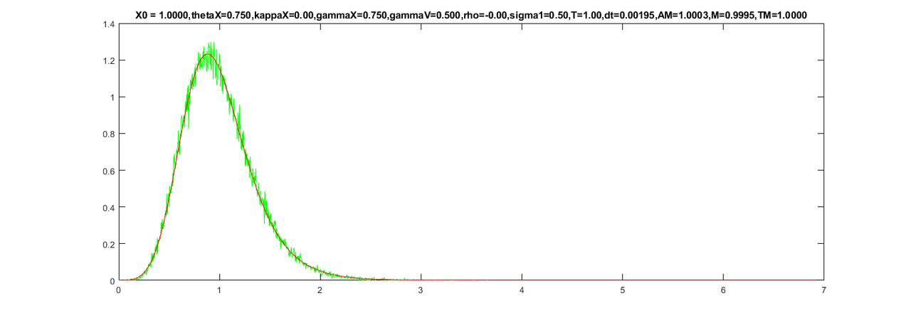](https://postimg.cc/hQt82ZnB)

[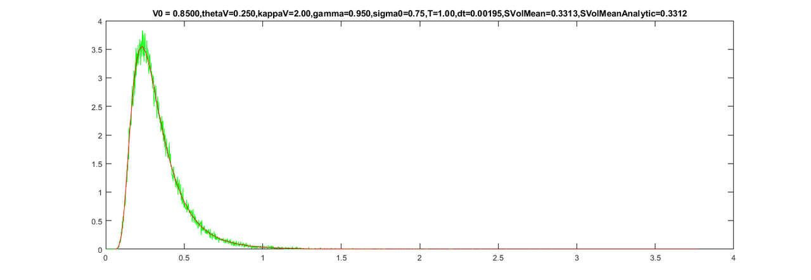](https://postimg.cc/r0JCCXvj)

---

### #1224 — Amin (Topic Author)
*August 26, 2021, 3:42 PM*

I want to write some notes and comments for friends who might like to play with the program I posted yesterday.

1. The grid for asset within each stochastic volatility subdivision has 40 grid points. Mm=40. There are 50 SV grid
points so there are a total of 50 X 40 grid points. I was earlier using a 50 X 50 grid but my solution would break down
and become unstable after 10-20 time steps. For several days I could not know the reason. While attempting to get the
program to run, I increased the grid points in asset from 50 to 100 and the grid became very unstable and could not do
more than 2-3 points. This prompted me to think if I could decrease grid points in reverse direction to increasing
points, the grid might become stable and I tried a grid with size 40 and only then grid became reasonably stable in time
with most SDEs. With precisely the same algorithm on grid size 50, I could not go beyond 20-25 small steps in time.
There is a lot to be known about stability of algorithm and I am sure numerical PDE experts could discover far better
algorithms that can take an arbitrary grid and quite large step sizes in time.

2. In the main simulation of asset price part of the algorithm, I will copy the equation from the program here as

yv(nn,ynStart:Mm)=.5*sigma1^2*((V(nn).^(2*gammaV)).*dt).* ...

       (Z0(ynStart:Mm).*dydZ0(nn,ynStart:Mm).^(-1).* Ratio(nn,ynStart:Mm).^1+ ...

       (dydZ0(nn,ynStart:Mm).^(-2)).*d2ydZ02(nn,ynStart:Mm).* Ratio(nn,ynStart:Mm).^1);

The whole line is derived from the solution of  similar 1st order PDEs but it is multiplied with  Ratio(nn,ynStart:Mm)
where

Ratio(nn,ynStart:Mm)=(dwdZPrev(nn)./dwdZNew(nn))

When I wrote the algorithm without ratio, there was large slack and then I had the intuitive idea that both sides of the
square are changing so while calculating the change in length of conditional side, we may have to account for how much
it has changed in the unconditional side already which is given by Ratio(nn,ynStart:Mm). I did not write proper
equations but just now I am thinking that we can probably write the equation for probability mass within each grid cell
at time t+dt after application of Fokker-planck equation and equate it with probability of grid cell at previous time t.

3. In our 2D solution of fokker-planck, the asset value is based on Z-grid or CDF lines that are different for each
value of SV grid. There are no absolute values on asset grid. In a situation like this, if we have to add the
probability of asset across different SV grids, we have to first convert the asset values from Z-grid(that is different
for each value of SV on SV grid) to some constant grid and then add probability across the constant grid. Sometimes due
to weakness in the simple algorithm or possibly due to volatility explosions, there are cells on extreme side of
volatility that blow or become unstable but with extremely small probability. So I came up with a quick ad-hoc way to
construct this constant grid so that whole of the interesting domain is covered. Here is the algorithm I used

minX=10;

maxX=.001;

for mm=ynStart:Mm

%Xy(mm)=sum(((1-gammaX).*y(wnStart:Nn,mm)).^(1/(1-gammaX)).*ZProb(wnStart:Nn));

Xy_limits(mm)=sum(((1-gammaX).*y(45,mm)).^(1/(1-gammaX)));

end

Xy_limits

if(Xy_limits(4)maxX)

    maxX=real(Xy_limits(31));             %please convert both to 33 or 31.

end

minX=minX-.025;

maxX=maxX+2.50;

minX=max(.001,minX);

In the above copied code, minX is the starting value of the constant asset grid and maxX is the highest value(largest
grid point) of the constant asset grid. For this I chose  "Xy_limits(mm)=sum(((1-gammaX).*y(45,mm)).^(1/(1-gammaX)));",
please note that y(45,mm) means that we have chosen asset values associated with +4 SD on the volatility grid.(45 out of
total 50 subdivisions corresponds to +4 on Z-grid) and then I chose

  minX=real(Xy_limits(4));  meaning -4 SD on asset grid(and +4 SD on vol grid)for minimum value and similarly

maximum value is chosen equal to 31 asset grid point on asset grid (and +4 SD on vol grid). I added 2.50 on top of this
maximum. This is all very ad-hoc but works reasonably for an initial program.

4.

[X,XProb] = AddXAcrossSVolGrids(y,wnStart,Nn,ynStart,Mm,dMm,Mm0,ZProb,gammaX,minX,maxX);

The above function returns a constant X-grid and probability mass associated with each grid point. It takes size of grid
Mm0=400 as an input. If this function goes into an infinite loop,  then reason is that there are too many NaNs in the y
(which is 40X 50 value of asset on 2D grid) input to the algorithm or it has gone into zero and these cases are not
covered yet. The algorithm is very basic and becomes unstable at too high volatility so if you come across an infinite
loop here, you would have to abort by pressing  Ctrl+C .

---

### #1225 — Amin (Topic Author)
*August 26, 2021, 8:39 PM*

Friends, I expect that 2D SV PDE with correlations is solvable based on conservation of mass just like we did for 1D PDE
from first principles. I have had some success and I hope that I will be able to solve the problem in a few days and
would post the solution here.

---

### #1226 — Amin (Topic Author)
*August 27, 2021, 1:20 PM*

I have been able to solve the 2D SV PDE without correlations from principle of conservation of mass just like we did for
one dimensional FPE PDE. In a day or two, I will be posting the program and also would write equations here on the forum
that I derived from principle of conservation of mass to solve the PDE.

---

### #1227 — Amin (Topic Author)
*August 28, 2021, 7:20 PM*

I am going to share the analytics for solution of 2D stochastic volatility equations. Before I give the solution, I want
to mention that in typical SV system of SDEs, there are two SDEs out of which one (usually Stochastic volatility) is
independent of the other SDE and its one dimensional PDE can be solved independently. If we had a system of two SDEs
which are both dependent on each other, in that case the solution though still possible would be more difficult.

I have taken both asset and SV Sdes in bessel coordinates. SV SDE can be solved independently and its PDE is given as

$\frac{\partial P(w,t)}{\partial t} \, = \, -\frac{\partial [\mu_w \, P(w,t)]}{\partial w} \, +\, .5 \, \frac{\partial^2 [{\sigma_w}^2 \, P(w,t)]}{\partial w^2} \,$

When we solve this equation with conservation of mass as I showed in a previous post, we get

$ -\mu_w \, \frac{\partial Z_1}{\partial w} - .5 {\sigma_w}^2 \big[ -Z_1  \, {(\frac{\partial Z_1}{\partial w})}^2- P(Z_1)\, {(\frac{\partial Z_1}{\partial w})}^3  \frac{\partial^2 w}{\partial {Z_1}^2} \, \big]  \,$

$ +  \frac{\partial w_b}{\partial t} \frac{\partial Z_1}{\partial w} =0 $

In the above equation b in$w_b$ denotes that it is the boundary point that is moving so as to keep the probability
conserved up till that point. We will need the above equation because when we move to two dimensional stochastic
volatility PDE, the whole of above equation would be integrated in another dimension but since it equates to zero, it
will also remain zero even after an extra integration and we will eliminate it from 2D equation.

our two dimensional SV and asset partial differential equation in bessel coordinates that we want to solve is

$\frac{\partial P(w,y,t)}{\partial t} \, = \, -\frac{\partial \big[\mu_y \, P(w,y,t) \big]}{\partial y} \, +\, .5 \, \frac{\partial^2 \big[{\sigma_y}^2 \, {V(w)}^{2 \gamma_V} \, P(w,y,t) \big]}{\partial y^2}  \, -\frac{\partial \big[\mu_w \, P(w,y,t) \big]}{\partial w} \, +\, .5 \, \frac{\partial^2 \big[{\sigma_w}^2 \, P(w,y,t) \big]}{\partial w^2} \,+ \,\rho \, \frac{\partial^2 \big[ \sigma_y \, \sigma_w  \, {V(w)}^{ \gamma_V} \, P(w,y,t) \big]}{\partial w \, \partial y} \, $

though correlation term is conceptually simple and when we do a two dimensional integration to preserve probability
mass, this term becomes even more easy but correlation has some other issues when taking derivatives with respect of
density of y with respect to Z_1 in diffusion terms. When there is no correlation our jacobian for two dimensional
density when taken with respect to two independent standard nromals becomes

$\frac{\partial (Z_1,Z_2)}{\partial (w,y)}=\frac{\partial Z_1}{\partial w} \, \frac{\partial Z_2}{\partial y}$

since $Z_1$ and $Z_2$ are independent, we can write

$P(w,y)=P(Z_1) \, P(Z_2) \, \frac{\partial Z_1}{\partial w} \, \frac{\partial Z_2}{\partial y} $

Now we set ourselves in the probability conservation set up, and we have to write a two dimensional integral from
infinity(or rather zero ) to moving boundary (boundary might be a misnomer since this is not grid boundary but rather
boundary of mass conserved till a certain grid point and this so called boundary is moving or alternatively the grid
point is moving) points$w_b$ and$y_b$ . Please note that on a two dimensional grid there are a series of these points
$w_b$ 's and$y_b$ 's. The grid in inependent SV dimension is given by index n and the grid on dependent asset dimension
is given by (n,m) and respective moving boundaries in conservation set up are indicated as$w_b(n)$ (that conserves mass
till nth point on SV grid) and$y_b(n,m)$ (that conserves mass till (n,m) points on the grid) . Please note that
$y_b(n,m)$ is not a straight line and is curved in both indices.

We apply the conservation of probability mass till arbitrary nth and mth points on the grid as

$ \frac{\partial \Big[\int_0^{w_b(n)} \, \int_0^{y_b(n,m)} \, P(w,y,t) \,\, dy \, dw  \Big]}{\partial t} \, =0 $

$=\int_0^{w_b(n)} \, \int_0^{y_b(n,m)} \, \frac{P(w,y,t)}{\partial t} \, \, dy \, dw   \, $

$+\frac{\partial w_b}{\partial t} \int_0^{y_b(n,m)} \, P(w_b(n),y,t) dy $

$+ \int_0^{w_b(n)}  \frac{\partial y_b(n,m)}{\partial t} \, P(w,y_b,t) dw =0 $

Substituting the 2D uncorrelated PDE in the first RHS integral, we get the expression

$=\int_0^{w_b(n)} \, \int_0^{y_b(n,m)} \, \Big[\, -\frac{\partial \big[\mu_y \, P(w,y,t) \big]}{\partial y} \, +\, .5 \, \frac{\partial^2 \big[{\sigma_y}^2 \, {V(w)}^{2 \gamma_V} \, P(w,y,t) \big]}{\partial y^2}  \, -\frac{\partial \big[\mu_w \, P(w,y,t) \big]}{\partial w} \, +\, .5 \, \frac{\partial^2 \big[{\sigma_w}^2 \, P(w,y,t) \big]}{\partial w^2} \, \Big] \, \, dy \, dw   \, $

$+\frac{\partial w_b}{\partial t} \int_0^{y_b(n,m)} \, P(w_b(n),y,t) dy $

$+ \int_0^{w_b(n)}  \frac{\partial y_b(n,m)}{\partial t} \, P(w,y_b,t) dw =0 $

We do the integrations in the first term to get

$=\int_0^{w_b(n)}  \, \Big[\, -\mu_y \, P(w,y,t)  \, +\, .5 \, \frac{\partial \big[{\sigma_y}^2 \, {V(w)}^{2 \gamma_V} \, P(w,y,t) \big]}{\partial y}  \, \Big] dw $

$\int_0^{y_b(n,m)} \Big[ -\mu_w \, P(w,y,t)  \, +\, .5 \, \frac{\partial \big[{\sigma_w}^2 \, P(w,y,t) \big]}{\partial w} \, \Big] \, \, dy   \, $

$+\frac{\partial w_b}{\partial t} \int_0^{y_b(n,m)} \, P(w_b(n),y,t) dy $

$+ \int_0^{w_b(n)}  \frac{\partial y_b(n,m)}{\partial t} \, P(w,y_b,t) dw =0 $

Now we convert our coordinates to $Z_1$ and $Z_2$ instead of w and y as

$=\int_0^{w_b(n)}  \, \Big[\, -\mu_y \, P(Z_1) \, P(Z_2) \, \frac{\partial Z_1}{\partial w} \, \frac{\partial Z_2}{\partial y}  \, +\, .5 \, \frac{\partial \big[{\sigma_y}^2 \, {V(w)}^{2 \gamma_V} \, P(Z_1) \, P(Z_2) \, \frac{\partial Z_1}{\partial w} \, \frac{\partial Z_2}{\partial y} \big]}{\partial y}  \, \Big] dw $

$\int_0^{y_b(n,m)} \Big[ -\mu_w \, P(Z_1) \, P(Z_2) \, \frac{\partial Z_1}{\partial w} \, \frac{\partial Z_2}{\partial y}  \, +\, .5 \, \frac{\partial \big[{\sigma_w}^2 \, P(Z_1) \, P(Z_2) \, \frac{\partial Z_1}{\partial w} \, \frac{\partial Z_2}{\partial y} \big]}{\partial w} \, \Big] \, \, dy   \, $

$+\frac{\partial w_b}{\partial t} \int_0^{y_b(n,m)} \, P(Z_1(n)) \, P(Z_2) \, \frac{\partial Z_1}{\partial w} \, \frac{\partial Z_2}{\partial y} dy $

$+ \int_0^{w_b(n)}  \frac{\partial y_b(n,m)}{\partial t} \, P(Z_1) \, P(Z_2) \, \frac{\partial Z_1(n)}{\partial w} \, \frac{\partial Z_2(m)}{\partial y} dw =0 $

which can be further simplified as

$=\int_0^{w_b(n)}  \, \Big[\, -\mu_y \,  \frac{\partial Z_2}{\partial y}  \, +\, .5 \, {\sigma_y}^2 \, {V(w)}^{2 \gamma_V}   \, \big[ -Z_2 \, {(\frac{\partial Z_2}{\partial y})}^2 - {(\frac{\partial Z_2}{\partial y})}^3 \frac{\partial^2 y}{\partial {Z_2}^2} \big]  \, \Big] dZ_1 $

$\int_0^{y_b(n,m)} \Big[ -\mu_w  \, \frac{\partial Z_1}{\partial w}   \, +\, .5 \, {\sigma_w}^2   \, \big[ -Z_1 \, {(\frac{\partial Z_1}{\partial w})}^2 - {(\frac{\partial Z_1}{\partial w})}^3 \frac{\partial^2 w}{\partial {Z_1}^2} \big]  \Big] \, \, dZ_2   \, $

$+\frac{\partial w_b}{\partial t} \int_0^{y_b(n,m)} \,  \frac{\partial Z_1}{\partial w} \,  dZ_2 $

$+ \int_0^{w_b(n)}  \frac{\partial y_b(n,m)}{\partial t}  \, \frac{\partial Z_2(m)}{\partial y} dZ_1 =0 $

But we notice that second and third term together are merely the solution of 1D independent PDE integrated in an extra
dimension and since the original solution of both terms for independent 1D PDE was zero, the integrated term should also
be zero. (Even if it were not zero, we could have found this solution from solving the 1D independent PDE), therefore

$\int_0^{y_b(n,m)} \Big[ -\mu_w  \, \frac{\partial Z_1}{\partial w}   \, +\, .5 \, {\sigma_w}^2   \, \big[ -Z_1 \, {(\frac{\partial Z_1}{\partial w})}^2 - {(\frac{\partial Z_1}{\partial w})}^3 \frac{\partial^2 w}{\partial {Z_1}^2} \big]  \Big] \, \, dZ_2   \,$

$+\frac{\partial w_b}{\partial t} \int_0^{y_b(n,m)} \,  \frac{\partial Z_1}{\partial w} \,  dZ_2=0 $

Now we are left with the terms to solve as

$=\int_0^{w_b(n)}  \, \Big[\, -\mu_y \,  \frac{\partial Z_2}{\partial y}  \, +\, .5 \, {\sigma_y}^2 \, {V(w)}^{2 \gamma_V}   \, \big[ -Z_2 \, {(\frac{\partial Z_2}{\partial y})}^2 - {(\frac{\partial Z_2}{\partial y})}^3 \frac{\partial^2 y}{\partial {Z_2}^2} \big]  \, \Big] dZ_1 $

$+ \int_0^{w_b(n)}  \frac{\partial y_b(n,m)}{\partial t}  \, \frac{\partial Z_2(m)}{\partial y} dZ_1 =0 $

For a given value of m, we can recursively solve the above PDE for each value of n. To make matters simple, I write the
above equation as

$=\int_0^{w_b(n)}  \, \Big[\, -\mu_y \,  \frac{\partial Z_2}{\partial y}  \, +\, .5 \, {\sigma_y}^2 \, {V(w)}^{2 \gamma_V}   \, \big[ -Z_2 \, {(\frac{\partial Z_2}{\partial y})}^2 - {(\frac{\partial Z_2}{\partial y})}^3 \frac{\partial^2 y}{\partial {Z_2}^2} \big]  \, \Big] dZ_1 $

$+ \int_0^{w_b(n-1)}  \frac{\partial y_b(n,m)}{\partial t}  \, \frac{\partial Z_2}{\partial y} dZ_1 $

$+ \int_{w_b(n-1)}^{w_b(n)}  \frac{\partial y_b(n,m)}{\partial t}  \, \frac{\partial Z_2}{\partial y} dZ_1 =0$

where in the above equation, I have expanded the last terms as sum of all previous terms and one current term to solve
and now the equation can be solved as

$ \frac{\partial y_b(n,m)}{\partial t} =\Bigg[ \int_0^{w_b(n)}  \, \Big[\, \mu_y \,  \frac{\partial Z_2}{\partial y}  \, +\, .5 \, {\sigma_y}^2 \, {V(w)}^{2 \gamma_V}   \, \big[ Z_2 \, {(\frac{\partial Z_2}{\partial y})}^2 + {(\frac{\partial Z_2}{\partial y})}^3 \frac{\partial^2 y}{\partial {Z_2}^2} \big]  \, \Big] dZ_1 $

$- \int_0^{w_b(n-1)}  \frac{\partial y_b(n,m)}{\partial t}  \, \frac{\partial Z_2}{\partial y} dZ_1 \Bigg] / \Big[ \int_{w_b(n-1)}^{w_b(n)}  \, \frac{\partial Z_2}{\partial y} dZ_1 \Big]$

please note that$\frac{\partial y_b(n,m)}{\partial t} \Delta t$ is the change in coordinates y(n,m) so as to conserve
the mass in a small time step according to given PDE dynamics.

The last equation solves the 2D PDE in the asset dimension. Adding correlation term should not be difficult but then we
have to make a few changes as correlation will appear in jacobian. Also derivatives of asset with respect to$Z_1$ would
have to be included something that was making my equation unstable when I tried it last time but I will try it again to
see if I could make it work.

I will be posting the program for uncorrelated PDE based on these analytics tomorrow.

---

### #1228 — Amin (Topic Author)
*August 28, 2021, 8:35 PM*

>
> I am going to share the analytics for solution of 2D stochastic volatility equations. Before I give the solution, I
want to mention that in typical SV system of SDEs, there are two SDEs out of which one (usually Stochastic volatility)
is independent of the other SDE and its one dimensional PDE can be solved independently. If we had a system of two SDEs
which are both dependent on each other, in that case the solution though still possible would be more difficult.
>
>
>
> I have taken both asset and SV Sdes in bessel coordinates. SV SDE can be solved independently and its PDE is given as
>
>
>
>
$\frac{\partial P(w,t)}{\partial t} \, = \, -\frac{\partial [\mu_w \, P(w,t)]}{\partial w} \, +\, .5 \, \frac{\partial^2 [{\sigma_w}^2 \, P(w,t)]}{\partial w^2} \,$
>
>
>
> When we solve this equation with conservation of mass as I showed in a previous post, we get
>
>
>
>
>
>
$ -\mu_w \, \frac{\partial Z_1}{\partial w} - .5 {\sigma_w}^2 \big[ -Z_1  \, {(\frac{\partial Z_1}{\partial w})}^2- P(Z_1)\, {(\frac{\partial Z_1}{\partial w})}^3  \frac{\partial^2 w}{\partial {Z_1}^2} \, \big]  \,$
>
> $ +  \frac{\partial w_b}{\partial t} \frac{\partial Z_1}{\partial w} =0 $
>
>
>
> In the above equation b in$w_b$ denotes that it is the boundary point that is moving so as to keep the probability
conserved up till that point. We will need the above equation because when we move to two dimensional stochastic
volatility PDE, the whole of above equation would be integrated in another dimension but since it equates to zero, it
will also remain zero even after an extra integration and we will eliminate it from 2D equation.
>
>
>
> our two dimensional SV and asset partial differential equation in bessel coordinates that we want to solve is
>
>
$\frac{\partial P(w,y,t)}{\partial t} \, = \, -\frac{\partial \big[\mu_y \, P(w,y,t) \big]}{\partial y} \, +\, .5 \, \frac{\partial^2 \big[{\sigma_y}^2 \, {V(w)}^{2 \gamma_V} \, P(w,y,t) \big]}{\partial y^2}  \, -\frac{\partial \big[\mu_w \, P(w,y,t) \big]}{\partial w} \, +\, .5 \, \frac{\partial^2 \big[{\sigma_w}^2 \, P(w,y,t) \big]}{\partial w^2} \,+ \,\rho \, \frac{\partial^2 \big[ \sigma_y \, \sigma_w  \, {V(w)}^{ \gamma_V} \, P(w,y,t) \big]}{\partial w \, \partial y} \, $
>
>
>
> though correlation term is conceptually simple and when we do a two dimensional integration to preserve probability
mass, this term becomes even more easy but correlation has some other issues when taking derivatives with respect of
density of y with respect to Z_1 in diffusion terms. When there is no correlation our jacobian for two dimensional
density when taken with respect to two independent standard nromals becomes
>
>
>
> $\frac{\partial (Z_1,Z_2)}{\partial (w,y)}=\frac{\partial Z_1}{\partial w} \, \frac{\partial Z_2}{\partial y}$
>
>
>
> since $Z_1$ and $Z_2$ are independent, we can write
>
>
>
> $P(w,y)=P(Z_1) \, P(Z_2) \, \frac{\partial Z_1}{\partial w} \, \frac{\partial Z_2}{\partial y} $
>
>
>
> Now we set ourselves in the probability conservation set up, and we have to write a two dimensional integral from
infinity(or rather zero ) to moving boundary (boundary might be a misnomer since this is not grid boundary but rather
boundary of mass conserved till a certain grid point and this so called boundary is moving or alternatively the grid
point is moving) points$w_b$ and$y_b$ . Please note that on a two dimensional grid there are a series of these points
$w_b$ 's and$y_b$ 's. The grid in inependent SV dimension is given by index n and the grid on dependent asset dimension
is given by (n,m) and respective moving boundaries in conservation set up are indicated as$w_b(n)$ (that conserves mass
till nth point on SV grid) and$y_b(n,m)$ (that conserves mass till (n,m) points on the grid) . Please note that
$y_b(n,m)$ is not a straight line and is curved in both indices.
>
>
>
> We apply the conservation of probability mass till arbitrary nth and mth points on the grid as
>
>
>
> $ \frac{\partial \Big[\int_0^{w_b(n)} \, \int_0^{y_b(n,m)} \, P(w,y,t) \,\, dy \, dw  \Big]}{\partial t} \, =0 $
>
> $=\int_0^{w_b(n)} \, \int_0^{y_b(n,m)} \, \frac{P(w,y,t)}{\partial t} \, \, dy \, dw   \, $
>
> $+\frac{\partial w_b}{\partial t} \int_0^{y_b(n,m)} \, P(w_b(n),y,t) dy $
>
> $+ \int_0^{w_b(n)}  \frac{\partial y_b(n,m)}{\partial t} \, P(w,y_b,t) dw =0 $
>
>
>
> Substituting the 2D uncorrelated PDE in the first RHS integral, we get the expression
>
>
>
>
$=\int_0^{w_b(n)} \, \int_0^{y_b(n,m)} \, \Big[\, -\frac{\partial \big[\mu_y \, P(w,y,t) \big]}{\partial y} \, +\, .5 \, \frac{\partial^2 \big[{\sigma_y}^2 \, {V(w)}^{2 \gamma_V} \, P(w,y,t) \big]}{\partial y^2}  \, -\frac{\partial \big[\mu_w \, P(w,y,t) \big]}{\partial w} \, +\, .5 \, \frac{\partial^2 \big[{\sigma_w}^2 \, P(w,y,t) \big]}{\partial w^2} \, \Big] \, \, dy \, dw   \, $
>
> $+\frac{\partial w_b}{\partial t} \int_0^{y_b(n,m)} \, P(w_b(n),y,t) dy $
>
> $+ \int_0^{w_b(n)}  \frac{\partial y_b(n,m)}{\partial t} \, P(w,y_b,t) dw =0 $
>
>
>
> We do the integrations in the first term to get
>
>
$=\int_0^{w_b(n)}  \, \Big[\, -\mu_y \, P(w,y,t)  \, +\, .5 \, \frac{\partial \big[{\sigma_y}^2 \, {V(w)}^{2 \gamma_V} \, P(w,y,t) \big]}{\partial y}  \, \Big] dw $
>
>
$\int_0^{y_b(n,m)} \Big[ -\mu_w \, P(w,y,t)  \, +\, .5 \, \frac{\partial \big[{\sigma_w}^2 \, P(w,y,t) \big]}{\partial w} \, \Big] \, \, dy   \, $
>
> $+\frac{\partial w_b}{\partial t} \int_0^{y_b(n,m)} \, P(w_b(n),y,t) dy $
>
> $+ \int_0^{w_b(n)}  \frac{\partial y_b(n,m)}{\partial t} \, P(w,y_b,t) dw =0 $
>
>
>
> Now we convert our coordinates to $Z_1$ and $Z_2$ instead of w and y as
>
>
>
>
$=\int_0^{w_b(n)}  \, \Big[\, -\mu_y \, P(Z_1) \, P(Z_2) \, \frac{\partial Z_1}{\partial w} \, \frac{\partial Z_2}{\partial y}  \, +\, .5 \, \frac{\partial \big[{\sigma_y}^2 \, {V(w)}^{2 \gamma_V} \, P(Z_1) \, P(Z_2) \, \frac{\partial Z_1}{\partial w} \, \frac{\partial Z_2}{\partial y} \big]}{\partial y}  \, \Big] dw $
>
>
$\int_0^{y_b(n,m)} \Big[ -\mu_w \, P(Z_1) \, P(Z_2) \, \frac{\partial Z_1}{\partial w} \, \frac{\partial Z_2}{\partial y}  \, +\, .5 \, \frac{\partial \big[{\sigma_w}^2 \, P(Z_1) \, P(Z_2) \, \frac{\partial Z_1}{\partial w} \, \frac{\partial Z_2}{\partial y} \big]}{\partial w} \, \Big] \, \, dy   \, $
>
>
$+\frac{\partial w_b}{\partial t} \int_0^{y_b(n,m)} \, P(Z_1(n)) \, P(Z_2) \, \frac{\partial Z_1}{\partial w} \, \frac{\partial Z_2}{\partial y} dy $
>
>
$+ \int_0^{w_b(n)}  \frac{\partial y_b(n,m)}{\partial t} \, P(Z_1) \, P(Z_2) \, \frac{\partial Z_1(n)}{\partial w} \, \frac{\partial Z_2(m)}{\partial y} dw =0 $
>
>
>
> which can be further simplified as
>
>
>
>
$=\int_0^{w_b(n)}  \, \Big[\, -\mu_y \,  \frac{\partial Z_2}{\partial y}  \, +\, .5 \, {\sigma_y}^2 \, {V(w)}^{2 \gamma_V}   \, \big[ -Z_2 \, {(\frac{\partial Z_2}{\partial y})}^2 - {(\frac{\partial Z_2}{\partial y})}^3 \frac{\partial^2 y}{\partial {Z_2}^2} \big]  \, \Big] dZ_1 $
>
>
$\int_0^{y_b(n,m)} \Big[ -\mu_w  \, \frac{\partial Z_1}{\partial w}   \, +\, .5 \, {\sigma_w}^2   \, \big[ -Z_1 \, {(\frac{\partial Z_1}{\partial w})}^2 - {(\frac{\partial Z_1}{\partial w})}^3 \frac{\partial^2 w}{\partial {Z_1}^2} \big]  \Big] \, \, dZ_2   \, $
>
> $+\frac{\partial w_b}{\partial t} \int_0^{y_b(n,m)} \,  \frac{\partial Z_1}{\partial w} \,  dZ_2 $
>
> $+ \int_0^{w_b(n)}  \frac{\partial y_b(n,m)}{\partial t}  \, \frac{\partial Z_2(m)}{\partial y} dZ_1 =0 $
>
>
>
> But we notice that second and third term together are merely the solution of 1D independent PDE integrated in an extra
dimension and since the original solution of both terms for independent 1D PDE was zero, the integrated term should also
be zero. (Even if it were not zero, we could have found this solution from solving the 1D independent PDE), therefore
>
>
$\int_0^{y_b(n,m)} \Big[ -\mu_w  \, \frac{\partial Z_1}{\partial w}   \, +\, .5 \, {\sigma_w}^2   \, \big[ -Z_1 \, {(\frac{\partial Z_1}{\partial w})}^2 - {(\frac{\partial Z_1}{\partial w})}^3 \frac{\partial^2 w}{\partial {Z_1}^2} \big]  \Big] \, \, dZ_2   \,$
>
> $+\frac{\partial w_b}{\partial t} \int_0^{y_b(n,m)} \,  \frac{\partial Z_1}{\partial w} \,  dZ_2=0 $
>
>
>
> Now we are left with the terms to solve as
>
>
>
>
$=\int_0^{w_b(n)}  \, \Big[\, -\mu_y \,  \frac{\partial Z_2}{\partial y}  \, +\, .5 \, {\sigma_y}^2 \, {V(w)}^{2 \gamma_V}   \, \big[ -Z_2 \, {(\frac{\partial Z_2}{\partial y})}^2 - {(\frac{\partial Z_2}{\partial y})}^3 \frac{\partial^2 y}{\partial {Z_2}^2} \big]  \, \Big] dZ_1 $
>
> $+ \int_0^{w_b(n)}  \frac{\partial y_b(n,m)}{\partial t}  \, \frac{\partial Z_2(m)}{\partial y} dZ_1 =0 $
>
>
>
> For a given value of m, we can recursively solve the above PDE for each value of n. To make matters simple, I write
the above equation as
>
>
>
>
$=\int_0^{w_b(n)}  \, \Big[\, -\mu_y \,  \frac{\partial Z_2}{\partial y}  \, +\, .5 \, {\sigma_y}^2 \, {V(w)}^{2 \gamma_V}   \, \big[ -Z_2 \, {(\frac{\partial Z_2}{\partial y})}^2 - {(\frac{\partial Z_2}{\partial y})}^3 \frac{\partial^2 y}{\partial {Z_2}^2} \big]  \, \Big] dZ_1 $
>
> $+ \int_0^{w_b(n-1)}  \frac{\partial y_b(n,m)}{\partial t}  \, \frac{\partial Z_2}{\partial y} dZ_1 $
>
> $+ \int_{w_b(n-1)}^{w_b(n)}  \frac{\partial y_b(n,m)}{\partial t}  \, \frac{\partial Z_2}{\partial y} dZ_1 =0$
>
>
>
> where in the above equation, I have expanded the last terms as sum of all previous terms and one current term to solve
and now the equation can be solved as
>
>
>
>
$ \frac{\partial y_b(n,m)}{\partial t} =\Bigg[ \int_0^{w_b(n)}  \, \Big[\, \mu_y \,  \frac{\partial Z_2}{\partial y}  \, +\, .5 \, {\sigma_y}^2 \, {V(w)}^{2 \gamma_V}   \, \big[ Z_2 \, {(\frac{\partial Z_2}{\partial y})}^2 + {(\frac{\partial Z_2}{\partial y})}^3 \frac{\partial^2 y}{\partial {Z_2}^2} \big]  \, \Big] dZ_1 $
>
>
$- \int_0^{w_b(n-1)}  \frac{\partial y_b(n,m)}{\partial t}  \, \frac{\partial Z_2}{\partial y} dZ_1 \Bigg] / \Big[ \int_{w_b(n-1)}^{w_b(n)}  \, \frac{\partial Z_2}{\partial y} dZ_1 \Big]$
>
>
>
> please note that$\frac{\partial y_b(n,m)}{\partial t} \Delta t$ is the change in coordinates y(n,m) so as to conserve
the mass in a small time step according to given PDE dynamics.
>
> The last equation solves the 2D PDE in the asset dimension. Adding correlation term should not be difficult but then
we have to make a few changes as correlation will appear in jacobian. Also derivatives of asset with respect to$Z_1$
would have to be included something that was making my equation unstable when I tried it last time but I will try it
again to see if I could make it work.
>
> I will be posting the program for uncorrelated PDE based on these analytics tomorrow.
>
.

.

.

Sorry friends, I made a mistake. I took both$P(Z_1) \, P(Z_2)$ common out of equations which is not possible due to
integrations. Sorry that I did these calculations while writing while I have not taken them common in my calculations
that I implemented in matlab. Here are modified equations

$=\int_0^{w_b(n)}  \, \Big[\, -\mu_y \, P(Z_1) \, P(Z_2) \,  \frac{\partial Z_2}{\partial y}  \, +\, .5 \, {\sigma_y}^2 \, {V(w)}^{2 \gamma_V}   \, P(Z_1) \, P(Z_2) \, \big[ -Z_2 \, {(\frac{\partial Z_2}{\partial y})}^2 - {(\frac{\partial Z_2}{\partial y})}^3 \frac{\partial^2 y}{\partial {Z_2}^2} \big]  \, \Big] dZ_1 $

$\int_0^{y_b(n,m)} \Big[ -\mu_w  \, P(Z_1) \, P(Z_2) \, \frac{\partial Z_1}{\partial w}   \, +\, .5 \, {\sigma_w}^2  \, P(Z_1) \, P(Z_2) \, \big[ -Z_1 \, {(\frac{\partial Z_1}{\partial w})}^2 - {(\frac{\partial Z_1}{\partial w})}^3 \frac{\partial^2 w}{\partial {Z_1}^2} \big]  \Big] \, \, dZ_2   \, $

$+\frac{\partial w_b}{\partial t} \int_0^{y_b(n,m)}  \, P(Z_1) \, P(Z_2) \,  \frac{\partial Z_1}{\partial w} \,  dZ_2 $

$+ \int_0^{w_b(n)}  \frac{\partial y_b(n,m)}{\partial t} \, P(Z_1) \, P(Z_2) \, \frac{\partial Z_2(m)}{\partial y} dZ_1 =0 $

independent PDE for SV still goes to zero, leaving us with

$=\int_0^{w_b(n)}  \, \Big[\, -\mu_y \, P(Z_1) \, P(Z_2) \,  \frac{\partial Z_2}{\partial y}  \, +\, .5 \, {\sigma_y}^2 \, {V(w)}^{2 \gamma_V}   \, P(Z_1) \, P(Z_2) \, \big[ -Z_2 \, {(\frac{\partial Z_2}{\partial y})}^2 - {(\frac{\partial Z_2}{\partial y})}^3 \frac{\partial^2 y}{\partial {Z_2}^2} \big]  \, \Big] dZ_1 $

$+ \int_0^{w_b(n)}  \frac{\partial y_b(n,m)}{\partial t} \, P(Z_1) \, P(Z_2) \, \frac{\partial Z_2(m)}{\partial y} dZ_1 =0 $

We solve the above equation for a given value of m recursively over different values of n so$P(Z_2)$ can be taken common
in the above equation. Please note that we can eliminate P(Z_2) which is constant for a given index m even when index n
changes but we cannot eliminate$ \frac{\partial Z_2}{\partial y} $ since we have curved lines and for given index m when
n is different the value of$ \frac{\partial Z_2}{\partial y} $ would be different. so it gives us

$=\int_0^{w_b(n)}  \, \Big[\, -\mu_y \, P(Z_1) \,  \frac{\partial Z_2}{\partial y}  \, +\, .5 \, {\sigma_y}^2 \, {V(w)}^{2 \gamma_V}   \, P(Z_1)  \, \big[ -Z_2 \, {(\frac{\partial Z_2}{\partial y})}^2 - {(\frac{\partial Z_2}{\partial y})}^3 \frac{\partial^2 y}{\partial {Z_2}^2} \big]  \, \Big] dZ_1 $

$+ \int_0^{w_b(n)}  \frac{\partial y_b(n,m)}{\partial t} \, P(Z_1) \, \frac{\partial Z_2(m)}{\partial y} dZ_1 =0 $

which takes us to final solution

$ \frac{\partial y_b(n,m)}{\partial t} =\Bigg[ \int_0^{w_b(n)}  \, P(Z_1) \, \Big[\, \mu_y \,  \frac{\partial Z_2}{\partial y}  \, +\, .5 \, {\sigma_y}^2 \, {V(w)}^{2 \gamma_V}   \, \big[ Z_2 \, {(\frac{\partial Z_2}{\partial y})}^2 + {(\frac{\partial Z_2}{\partial y})}^3 \frac{\partial^2 y}{\partial {Z_2}^2} \big]  \, \Big] dZ_1 $

$- \int_0^{w_b(n-1)}  \frac{\partial y_b(n,m)}{\partial t}  \, P(Z_1) \, \frac{\partial Z_2}{\partial y} dZ_1 \Bigg] / \Big[ \int_{w_b(n-1)}^{w_b(n)}  \, P(Z_1) \, \frac{\partial Z_2}{\partial y} dZ_1 \Big]$

---

### #1229 — Amin (Topic Author)
*August 28, 2021, 10:18 PM*

>
>
> I am going to share the analytics for solution of 2D stochastic volatility equations. Before I give the solution, I
want to mention that in typical SV system of SDEs, there are two SDEs out of which one (usually Stochastic volatility)
is independent of the other SDE and its one dimensional PDE can be solved independently. If we had a system of two SDEs
which are both dependent on each other, in that case the solution though still possible would be more difficult.
>
>
>
> I have taken both asset and SV Sdes in bessel coordinates. SV SDE can be solved independently and its PDE is given as
>
>
>
>
$\frac{\partial P(w,t)}{\partial t} \, = \, -\frac{\partial [\mu_w \, P(w,t)]}{\partial w} \, +\, .5 \, \frac{\partial^2 [{\sigma_w}^2 \, P(w,t)]}{\partial w^2} \,$
>
>
>
> When we solve this equation with conservation of mass as I showed in a previous post, we get
>
>
>
>
>
>
$ -\mu_w \, \frac{\partial Z_1}{\partial w} - .5 {\sigma_w}^2 \big[ -Z_1  \, {(\frac{\partial Z_1}{\partial w})}^2- P(Z_1)\, {(\frac{\partial Z_1}{\partial w})}^3  \frac{\partial^2 w}{\partial {Z_1}^2} \, \big]  \,$
>
> $ +  \frac{\partial w_b}{\partial t} \frac{\partial Z_1}{\partial w} =0 $
>
>
>
> In the above equation b in$w_b$ denotes that it is the boundary point that is moving so as to keep the probability
conserved up till that point. We will need the above equation because when we move to two dimensional stochastic
volatility PDE, the whole of above equation would be integrated in another dimension but since it equates to zero, it
will also remain zero even after an extra integration and we will eliminate it from 2D equation.
>
>
>
> our two dimensional SV and asset partial differential equation in bessel coordinates that we want to solve is
>
>
$\frac{\partial P(w,y,t)}{\partial t} \, = \, -\frac{\partial \big[\mu_y \, P(w,y,t) \big]}{\partial y} \, +\, .5 \, \frac{\partial^2 \big[{\sigma_y}^2 \, {V(w)}^{2 \gamma_V} \, P(w,y,t) \big]}{\partial y^2}  \, -\frac{\partial \big[\mu_w \, P(w,y,t) \big]}{\partial w} \, +\, .5 \, \frac{\partial^2 \big[{\sigma_w}^2 \, P(w,y,t) \big]}{\partial w^2} \,+ \,\rho \, \frac{\partial^2 \big[ \sigma_y \, \sigma_w  \, {V(w)}^{ \gamma_V} \, P(w,y,t) \big]}{\partial w \, \partial y} \, $
>
>
>
> though correlation term is conceptually simple and when we do a two dimensional integration to preserve probability
mass, this term becomes even more easy but correlation has some other issues when taking derivatives with respect of
density of y with respect to Z_1 in diffusion terms. When there is no correlation our jacobian for two dimensional
density when taken with respect to two independent standard nromals becomes
>
>
>
> $\frac{\partial (Z_1,Z_2)}{\partial (w,y)}=\frac{\partial Z_1}{\partial w} \, \frac{\partial Z_2}{\partial y}$
>
>
>
> since $Z_1$ and $Z_2$ are independent, we can write
>
>
>
> $P(w,y)=P(Z_1) \, P(Z_2) \, \frac{\partial Z_1}{\partial w} \, \frac{\partial Z_2}{\partial y} $
>
>
>
> Now we set ourselves in the probability conservation set up, and we have to write a two dimensional integral from
infinity(or rather zero ) to moving boundary (boundary might be a misnomer since this is not grid boundary but rather
boundary of mass conserved till a certain grid point and this so called boundary is moving or alternatively the grid
point is moving) points$w_b$ and$y_b$ . Please note that on a two dimensional grid there are a series of these points
$w_b$ 's and$y_b$ 's. The grid in inependent SV dimension is given by index n and the grid on dependent asset dimension
is given by (n,m) and respective moving boundaries in conservation set up are indicated as$w_b(n)$ (that conserves mass
till nth point on SV grid) and$y_b(n,m)$ (that conserves mass till (n,m) points on the grid) . Please note that
$y_b(n,m)$ is not a straight line and is curved in both indices.
>
>
>
> We apply the conservation of probability mass till arbitrary nth and mth points on the grid as
>
>
>
> $ \frac{\partial \Big[\int_0^{w_b(n)} \, \int_0^{y_b(n,m)} \, P(w,y,t) \,\, dy \, dw  \Big]}{\partial t} \, =0 $
>
> $=\int_0^{w_b(n)} \, \int_0^{y_b(n,m)} \, \frac{P(w,y,t)}{\partial t} \, \, dy \, dw   \, $
>
> $+\frac{\partial w_b}{\partial t} \int_0^{y_b(n,m)} \, P(w_b(n),y,t) dy $
>
> $+ \int_0^{w_b(n)}  \frac{\partial y_b(n,m)}{\partial t} \, P(w,y_b,t) dw =0 $
>
>
>
> Substituting the 2D uncorrelated PDE in the first RHS integral, we get the expression
>
>
>
>
$=\int_0^{w_b(n)} \, \int_0^{y_b(n,m)} \, \Big[\, -\frac{\partial \big[\mu_y \, P(w,y,t) \big]}{\partial y} \, +\, .5 \, \frac{\partial^2 \big[{\sigma_y}^2 \, {V(w)}^{2 \gamma_V} \, P(w,y,t) \big]}{\partial y^2}  \, -\frac{\partial \big[\mu_w \, P(w,y,t) \big]}{\partial w} \, +\, .5 \, \frac{\partial^2 \big[{\sigma_w}^2 \, P(w,y,t) \big]}{\partial w^2} \, \Big] \, \, dy \, dw   \, $
>
> $+\frac{\partial w_b}{\partial t} \int_0^{y_b(n,m)} \, P(w_b(n),y,t) dy $
>
> $+ \int_0^{w_b(n)}  \frac{\partial y_b(n,m)}{\partial t} \, P(w,y_b,t) dw =0 $
>
>
>
> We do the integrations in the first term to get
>
>
$=\int_0^{w_b(n)}  \, \Big[\, -\mu_y \, P(w,y,t)  \, +\, .5 \, \frac{\partial \big[{\sigma_y}^2 \, {V(w)}^{2 \gamma_V} \, P(w,y,t) \big]}{\partial y}  \, \Big] dw $
>
>
$\int_0^{y_b(n,m)} \Big[ -\mu_w \, P(w,y,t)  \, +\, .5 \, \frac{\partial \big[{\sigma_w}^2 \, P(w,y,t) \big]}{\partial w} \, \Big] \, \, dy   \, $
>
> $+\frac{\partial w_b}{\partial t} \int_0^{y_b(n,m)} \, P(w_b(n),y,t) dy $
>
> $+ \int_0^{w_b(n)}  \frac{\partial y_b(n,m)}{\partial t} \, P(w,y_b,t) dw =0 $
>
>
>
> Now we convert our coordinates to $Z_1$ and $Z_2$ instead of w and y as
>
>
>
>
$=\int_0^{w_b(n)}  \, \Big[\, -\mu_y \, P(Z_1) \, P(Z_2) \, \frac{\partial Z_1}{\partial w} \, \frac{\partial Z_2}{\partial y}  \, +\, .5 \, \frac{\partial \big[{\sigma_y}^2 \, {V(w)}^{2 \gamma_V} \, P(Z_1) \, P(Z_2) \, \frac{\partial Z_1}{\partial w} \, \frac{\partial Z_2}{\partial y} \big]}{\partial y}  \, \Big] dw $
>
>
$\int_0^{y_b(n,m)} \Big[ -\mu_w \, P(Z_1) \, P(Z_2) \, \frac{\partial Z_1}{\partial w} \, \frac{\partial Z_2}{\partial y}  \, +\, .5 \, \frac{\partial \big[{\sigma_w}^2 \, P(Z_1) \, P(Z_2) \, \frac{\partial Z_1}{\partial w} \, \frac{\partial Z_2}{\partial y} \big]}{\partial w} \, \Big] \, \, dy   \, $
>
>
$+\frac{\partial w_b}{\partial t} \int_0^{y_b(n,m)} \, P(Z_1(n)) \, P(Z_2) \, \frac{\partial Z_1}{\partial w} \, \frac{\partial Z_2}{\partial y} dy $
>
>
$+ \int_0^{w_b(n)}  \frac{\partial y_b(n,m)}{\partial t} \, P(Z_1) \, P(Z_2) \, \frac{\partial Z_1(n)}{\partial w} \, \frac{\partial Z_2(m)}{\partial y} dw =0 $
>
>
>
> which can be further simplified as
>
>
>
>
$=\int_0^{w_b(n)}  \, \Big[\, -\mu_y \,  \frac{\partial Z_2}{\partial y}  \, +\, .5 \, {\sigma_y}^2 \, {V(w)}^{2 \gamma_V}   \, \big[ -Z_2 \, {(\frac{\partial Z_2}{\partial y})}^2 - {(\frac{\partial Z_2}{\partial y})}^3 \frac{\partial^2 y}{\partial {Z_2}^2} \big]  \, \Big] dZ_1 $
>
>
$\int_0^{y_b(n,m)} \Big[ -\mu_w  \, \frac{\partial Z_1}{\partial w}   \, +\, .5 \, {\sigma_w}^2   \, \big[ -Z_1 \, {(\frac{\partial Z_1}{\partial w})}^2 - {(\frac{\partial Z_1}{\partial w})}^3 \frac{\partial^2 w}{\partial {Z_1}^2} \big]  \Big] \, \, dZ_2   \, $
>
> $+\frac{\partial w_b}{\partial t} \int_0^{y_b(n,m)} \,  \frac{\partial Z_1}{\partial w} \,  dZ_2 $
>
> $+ \int_0^{w_b(n)}  \frac{\partial y_b(n,m)}{\partial t}  \, \frac{\partial Z_2(m)}{\partial y} dZ_1 =0 $
>
>
>
> But we notice that second and third term together are merely the solution of 1D independent PDE integrated in an extra
dimension and since the original solution of both terms for independent 1D PDE was zero, the integrated term should also
be zero. (Even if it were not zero, we could have found this solution from solving the 1D independent PDE), therefore
>
>
$\int_0^{y_b(n,m)} \Big[ -\mu_w  \, \frac{\partial Z_1}{\partial w}   \, +\, .5 \, {\sigma_w}^2   \, \big[ -Z_1 \, {(\frac{\partial Z_1}{\partial w})}^2 - {(\frac{\partial Z_1}{\partial w})}^3 \frac{\partial^2 w}{\partial {Z_1}^2} \big]  \Big] \, \, dZ_2   \,$
>
> $+\frac{\partial w_b}{\partial t} \int_0^{y_b(n,m)} \,  \frac{\partial Z_1}{\partial w} \,  dZ_2=0 $
>
>
>
> Now we are left with the terms to solve as
>
>
>
>
$=\int_0^{w_b(n)}  \, \Big[\, -\mu_y \,  \frac{\partial Z_2}{\partial y}  \, +\, .5 \, {\sigma_y}^2 \, {V(w)}^{2 \gamma_V}   \, \big[ -Z_2 \, {(\frac{\partial Z_2}{\partial y})}^2 - {(\frac{\partial Z_2}{\partial y})}^3 \frac{\partial^2 y}{\partial {Z_2}^2} \big]  \, \Big] dZ_1 $
>
> $+ \int_0^{w_b(n)}  \frac{\partial y_b(n,m)}{\partial t}  \, \frac{\partial Z_2(m)}{\partial y} dZ_1 =0 $
>
>
>
> For a given value of m, we can recursively solve the above PDE for each value of n. To make matters simple, I write
the above equation as
>
>
>
>
$=\int_0^{w_b(n)}  \, \Big[\, -\mu_y \,  \frac{\partial Z_2}{\partial y}  \, +\, .5 \, {\sigma_y}^2 \, {V(w)}^{2 \gamma_V}   \, \big[ -Z_2 \, {(\frac{\partial Z_2}{\partial y})}^2 - {(\frac{\partial Z_2}{\partial y})}^3 \frac{\partial^2 y}{\partial {Z_2}^2} \big]  \, \Big] dZ_1 $
>
> $+ \int_0^{w_b(n-1)}  \frac{\partial y_b(n,m)}{\partial t}  \, \frac{\partial Z_2}{\partial y} dZ_1 $
>
> $+ \int_{w_b(n-1)}^{w_b(n)}  \frac{\partial y_b(n,m)}{\partial t}  \, \frac{\partial Z_2}{\partial y} dZ_1 =0$
>
>
>
> where in the above equation, I have expanded the last terms as sum of all previous terms and one current term to solve
and now the equation can be solved as
>
>
>
>
$ \frac{\partial y_b(n,m)}{\partial t} =\Bigg[ \int_0^{w_b(n)}  \, \Big[\, \mu_y \,  \frac{\partial Z_2}{\partial y}  \, +\, .5 \, {\sigma_y}^2 \, {V(w)}^{2 \gamma_V}   \, \big[ Z_2 \, {(\frac{\partial Z_2}{\partial y})}^2 + {(\frac{\partial Z_2}{\partial y})}^3 \frac{\partial^2 y}{\partial {Z_2}^2} \big]  \, \Big] dZ_1 $
>
>
$- \int_0^{w_b(n-1)}  \frac{\partial y_b(n,m)}{\partial t}  \, \frac{\partial Z_2}{\partial y} dZ_1 \Bigg] / \Big[ \int_{w_b(n-1)}^{w_b(n)}  \, \frac{\partial Z_2}{\partial y} dZ_1 \Big]$
>
>
>
> please note that$\frac{\partial y_b(n,m)}{\partial t} \Delta t$ is the change in coordinates y(n,m) so as to conserve
the mass in a small time step according to given PDE dynamics.
>
> The last equation solves the 2D PDE in the asset dimension. Adding correlation term should not be difficult but then
we have to make a few changes as correlation will appear in jacobian. Also derivatives of asset with respect to$Z_1$
would have to be included something that was making my equation unstable when I tried it last time but I will try it
again to see if I could make it work.
>
> I will be posting the program for uncorrelated PDE based on these analytics tomorrow.
>
.

.

.

Sorry friends, I made a mistake. I took both$P(Z_1) \, P(Z_2)$ common out of equations which is not possible due to
integrations. Sorry that I did these calculations while writing while I have not taken them common in my calculations
that I implemented in matlab. Here are modified equations

$=\int_0^{w_b(n)}  \, \Big[\, -\mu_y \, P(Z_1) \, P(Z_2) \,  \frac{\partial Z_2}{\partial y}  \, +\, .5 \, {\sigma_y}^2 \, {V(w)}^{2 \gamma_V}   \, P(Z_1) \, P(Z_2) \, \big[ -Z_2 \, {(\frac{\partial Z_2}{\partial y})}^2 - {(\frac{\partial Z_2}{\partial y})}^3 \frac{\partial^2 y}{\partial {Z_2}^2} \big]  \, \Big] dZ_1 $

$\int_0^{y_b(n,m)} \Big[ -\mu_w  \, P(Z_1) \, P(Z_2) \, \frac{\partial Z_1}{\partial w}   \, +\, .5 \, {\sigma_w}^2  \, P(Z_1) \, P(Z_2) \, \big[ -Z_1 \, {(\frac{\partial Z_1}{\partial w})}^2 - {(\frac{\partial Z_1}{\partial w})}^3 \frac{\partial^2 w}{\partial {Z_1}^2} \big]  \Big] \, \, dZ_2   \, $

$+\frac{\partial w_b}{\partial t} \int_0^{y_b(n,m)}  \, P(Z_1) \, P(Z_2) \,  \frac{\partial Z_1}{\partial w} \,  dZ_2 $

$+ \int_0^{w_b(n)}  \frac{\partial y_b(n,m)}{\partial t} \, P(Z_1) \, P(Z_2) \, \frac{\partial Z_2(m)}{\partial y} dZ_1 =0 $

independent PDE for SV still goes to zero, leaving us with

$=\int_0^{w_b(n)}  \, \Big[\, -\mu_y \, P(Z_1) \, P(Z_2) \,  \frac{\partial Z_2}{\partial y}  \, +\, .5 \, {\sigma_y}^2 \, {V(w)}^{2 \gamma_V}   \, P(Z_1) \, P(Z_2) \, \big[ -Z_2 \, {(\frac{\partial Z_2}{\partial y})}^2 - {(\frac{\partial Z_2}{\partial y})}^3 \frac{\partial^2 y}{\partial {Z_2}^2} \big]  \, \Big] dZ_1 $

$+ \int_0^{w_b(n)}  \frac{\partial y_b(n,m)}{\partial t} \, P(Z_1) \, P(Z_2) \, \frac{\partial Z_2(m)}{\partial y} dZ_1 =0 $

We solve the above equation for a given value of m recursively over different values of n so$P(Z_2)$ can be taken common
in the above equation. Please note that we can eliminate P(Z_2) which is constant for a given index m even when index n
changes but we cannot eliminate$ \frac{\partial Z_2}{\partial y} $ since we have curved lines and for given index m when
n is different the value of$ \frac{\partial Z_2}{\partial y} $ would be different. so it gives us

$=\int_0^{w_b(n)}  \, \Big[\, -\mu_y \, P(Z_1) \,  \frac{\partial Z_2}{\partial y}  \, +\, .5 \, {\sigma_y}^2 \, {V(w)}^{2 \gamma_V}   \, P(Z_1)  \, \big[ -Z_2 \, {(\frac{\partial Z_2}{\partial y})}^2 - {(\frac{\partial Z_2}{\partial y})}^3 \frac{\partial^2 y}{\partial {Z_2}^2} \big]  \, \Big] dZ_1 $

$+ \int_0^{w_b(n)}  \frac{\partial y_b(n,m)}{\partial t} \, P(Z_1) \, \frac{\partial Z_2(m)}{\partial y} dZ_1 =0 $

which takes us to final solution

$ \frac{\partial y_b(n,m)}{\partial t} =\Bigg[ \int_0^{w_b(n)}  \, P(Z_1) \, \Big[\, \mu_y \,  \frac{\partial Z_2}{\partial y}  \, +\, .5 \, {\sigma_y}^2 \, {V(w)}^{2 \gamma_V}   \, \big[ Z_2 \, {(\frac{\partial Z_2}{\partial y})}^2 + {(\frac{\partial Z_2}{\partial y})}^3 \frac{\partial^2 y}{\partial {Z_2}^2} \big]  \, \Big] dZ_1 $

$- \int_0^{w_b(n-1)}  \frac{\partial y_b(n,m)}{\partial t}  \, P(Z_1) \, \frac{\partial Z_2}{\partial y} dZ_1 \Bigg] / \Big[ \int_{w_b(n-1)}^{w_b(n)}  \, P(Z_1) \, \frac{\partial Z_2}{\partial y} dZ_1 \Big]$

.

.

Friends, very sorry. I feel so goofy making corrections again and again.

I wrote that when we have solved for the independent 1D PDE for volatility, it should go to zero when integrated over
$dZ_2$ which is a mistake. Below is the contribution from independent volatility PDE to our 2D PDE

$\int_0^{y_b(n,m)} \Big[ -\mu_w    \, \frac{\partial Z_1}{\partial w}   \, +\, .5 \, {\sigma_w}^2   \, \big[ -Z_1 \, {(\frac{\partial Z_1}{\partial w})}^2 - {(\frac{\partial Z_1}{\partial w})}^3 \frac{\partial^2 w}{\partial {Z_1}^2} \big]  \Big] \, P(Z_1) \, P(Z_2)  \, \, dZ_2   \,$

$+\frac{\partial w_b}{\partial t} \int_0^{y_b(n,m)} \,  \frac{\partial Z_1}{\partial w} \, P(Z_1) \, P(Z_2) \,  dZ_2=0 $

This contribution would have gone to zero only if we integrated over$dZ_1$ but our independent PDE for volatility with
individual values of index n does not equate to zero so we would have to include this effect in our calculations. Since
we have already calculated$frac{\partial w_b}{\partial t}$ from independent volatility PDE this is not a problem and we
can add this effect.

I just quickly made changes to my matlab implementation and I was really thrilled to see how sharply my implementation
matched with monte carlo simulations. There is a marked improvement in quality of fit from my earlier implementations in
which I neglected this effect. The new program though still dealing only with uncorrelated asset dynamics is better than
my implementation that I posted few days ago. The correct implementation based on proper conservation of mass is better
than the heuristic calculations based program that I posted a few days ago and stability is also much better.

I will post my matlab program tomorrow and hope that friends would like it.

---

### #1230 — Amin (Topic Author)
*August 29, 2021, 9:10 PM*

Friends, my previous post is erroneous. The contribution from independent volatility PDE solution to asset solution in
joint PDE indeed goes to zero.

I am posting a new program based on analytics I posted yesterday with independent volatility PDE contribution going to
zero. The program still deals with uncorrelated case only. It is a much improved program. The new 2D grid size is 32 X
40 only. The grid spacing is the same as old but I have decreased the grid boundaries to roughly Z=+4 to Z=-4  as
opposed to Z=+5 to Z=-5 earlier. Larger grid had no special benefit and it was blowing all the time.

I have also written a very good special function to aggregate probability weighted CDF for the asset and this function
very faithfully reproduces the assset density. Earlier function I used was very ad hoc but I went ahead and wrote this
special function that I really like.

Here is the new progam.

.

```
function [] = SVSDEAnalyticAndMonteCarlo2DCorrWmtNew08()

% dX(t)=(a X(t)^alpha1 + b X(t)^alpha2) dt + sqrt(1-rho^2) sigma1 V(t)^gammaV X(t)^gammaX dZ1(t) + rho sigma1
V(t)^gammaV X(t)^gammaX dZ2(t)
% dV(t)=(mu1 V(t)^beta1 + mu2 V(t)^beta2)*dt + sigma0 V(t)^gamma dZ2(t)

%%%%%%%%%%%%%
X0=1.0;
alpha1=0;
alpha2=1;
kappaX=0.0;
thetaX=0.750;
a=kappaX*thetaX;
b=-kappaX;
rho=-.7*0;
sigma1=.75;
gammaV=.5;
gammaX=.65;
%%%%%%%%%%%%%
V0=.35;
thetaV=.1;
kappaV=1.50;
mu1=kappaV*thetaV;
mu2=-kappaV;
beta1=0;
beta2=1;
gamma=.995;
sigma0=.950;
%%%%%%%%%%%%

dtM=.03125;
TtM=32;

dt=dtM/16;
Tt=TtM*16;
Tt=256*2;
dtM=dt*32;
TtM=Tt/32;
T=TtM*dtM;
%paths=100000;

% dNn=.2/1;   % Normal density subdivisions width. would change with number of subdivisions
% Nn=50;  % No of normal density subdivisions
% NnMidl=25;%One half density Subdivision left from mid of normal density(low)
% NnMidh=26;%One half density subdivision right from the mid of normal density(high)
% NnMid=4.0;
%
%
% dMm=.25/1;   % Normal density subdivisions width. would change with number of subdivisions
% Mm=40;  % No of normal density subdivisions
% MmMidl=20;%One half density Subdivision left from mid of normal density(low)
% MmMidh=21;%One half density subdivision right from the mid of normal density(high)
% MmMid=4.0;

dNn=.2/1;   % Normal density subdivisions width. would change with number of subdivisions
Nn=40;  % No of normal density subdivisions
NnMidl=20;%One half density Subdivision left from mid of normal density(low)
NnMidh=21;%One half density subdivision right from the mid of normal density(high)
NnMid=4.0;

dMm=.25/1;   % Normal density subdivisions width. would change with number of subdivisions
Mm=32;  % No of normal density subdivisions
MmMidl=16;%One half density Subdivision left from mid of normal density(low)
MmMidh=17;%One half density subdivision right from the mid of normal density(high)
MmMid=4.0;

w(1:Nn)=V0^(1-gamma)/(1-gamma);
y(1:Nn,1:Mm)=X0^(1-gammaX)/(1-gammaX);

Z(1:Nn)=(((1:Nn)-.5)*dNn-NnMid);

%Z0(1:Mm)=(((1:Mm)-1.50)*dMm-MmMid);
Z0(1:Mm)=(((1:Mm)-.50)*dMm-MmMid);
Z
Z0
str=input('Look at Z');
ZProb(1)=normcdf(.5*Z(1)+.5*Z(2),0,1)-normcdf(.5*Z(1)+.5*Z(2)-dNn,0,1);
ZProb(Nn)=normcdf(.5*Z(Nn)+.5*Z(Nn-1)+dNn,0,1)-normcdf(.5*Z(Nn)+.5*Z(Nn-1),0,1);
ZProb(2:Nn-1)=normcdf(.5*Z(2:Nn-1)+.5*Z(3:Nn),0,1)-normcdf(.5*Z(2:Nn-1)+.5*Z(1:Nn-2),0,1);

ZCProb(1:Nn)=normcdf(Z(1:Nn));
ZProb0(1)=normcdf(Z(1),0,1);
ZProb0(2:Nn)=normcdf(Z(2:Nn),0,1)-normcdf(Z(1:Nn-1),0,1);

Z0Prob(1)=normcdf(.5*Z0(1)+.5*Z0(2),0,1)-normcdf(.5*Z0(1)+.5*Z0(2)-dMm,0,1);
Z0Prob(Mm)=normcdf(.5*Z0(Mm)+.5*Z0(Mm-1)+dMm,0,1)-normcdf(.5*Z0(Mm)+.5*Z0(Mm-1),0,1);
Z0Prob(2:Mm-1)=normcdf(.5*Z0(2:Mm-1)+.5*Z0(3:Mm),0,1)-normcdf(.5*Z0(2:Mm-1)+.5*Z0(1:Mm-2),0,1);

Z0Prob0(1)=normcdf(Z0(1),0,1);
Z0Prob0(2:Mm)=normcdf(Z0(2:Mm),0,1)-normcdf(Z0(1:Mm-1),0,1);

Z0CProb(1:Mm)=normcdf(Z0(1:Mm));

%%%%%%%%%%%%%%%%%%%%%%%%5
wnStart=1;
ynStart=1;
dwdZ(wnStart:Nn)=0.0;
tic
for tt=1:Tt

    V(wnStart:Nn)=((1-gamma)*w(wnStart:Nn)).^(1/(1-gamma));
    X(wnStart:Nn,ynStart:Mm)=((1-gammaX)*y(wnStart:Nn,ynStart:Mm)).^(1/(1-gammaX));

wMu0dt(wnStart:Nn)= (mu1*V(wnStart:Nn).^(beta1-gamma)+mu2*V(wnStart:Nn).^(beta2-gamma) - ...
    .5*gamma*sigma0^2*V(wnStart:Nn).^(gamma-1))*dt + ...
    (mu1*(beta1-gamma).*V(wnStart:Nn).^(beta1-gamma-1)+mu2*(beta2-gamma)*V(wnStart:Nn).^(beta2-gamma-1) - ...
    .5*gamma*sigma0^2*(gamma-1)*V(wnStart:Nn).^(gamma-2)).* ...
    (mu1*V(wnStart:Nn).^(beta1-gamma)+mu2*V(wnStart:Nn).^(beta2-gamma))*dt^2/2+ ...
   
(mu1*(beta1-gamma).*(beta1-gamma-1).*V(wnStart:Nn).^(beta1-gamma-2)+mu2*(beta2-gamma-1).*(beta2-gamma)*V(wnStart:Nn).^(beta2-gamma-2)
- ...
    .5*gamma*sigma0^2*(gamma-1)*(gamma-2).*V(wnStart:Nn).^(gamma-3)).* ...
    .5.*sigma0^2.*V(wnStart:Nn).^(2*gamma)*dt^2/2;
for nn=wnStart:Nn
yMu0dt(nn,ynStart:Mm)= (a*X(nn,ynStart:Mm).^(alpha1-gammaX)+b*X(nn,ynStart:Mm).^(alpha2-gammaX) - ...
     .5*gammaX*sigma1^2*V(nn).^(2*gammaV).*X(nn,ynStart:Mm).^(gammaX-1))*dt + ...
     (a*(alpha1-gammaX).*X(nn,ynStart:Mm).^(alpha1-gammaX-1)+b*(alpha2-gammaX)*X(nn,ynStart:Mm).^(alpha2-gammaX-1) - ...
     .5*gammaX*sigma1^2*V(nn).^(2*gammaV).*(gammaX-1)*X(nn,ynStart:Mm).^(gammaX-2)).* ...
     (a*X(nn,ynStart:Mm).^(alpha1)+b*X(nn,ynStart:Mm).^(alpha2))*dt^2/2+ ...
     -(.5*gammaX*sigma1^2*(2*gammaV).*V(nn).^(2*gammaV-1).*X(nn,ynStart:Mm).^(gammaX-1)).* ...
     (mu1*V(nn).^(beta1)+mu2*V(nn).^(beta2))*dt^2/2 + ...
   
(a*(alpha1-gammaX).*(alpha1-gammaX-1).*X(nn,ynStart:Mm).^(alpha1-gammaX-2)+b*(alpha2-gammaX-1).*(alpha2-gammaX)*X(nn,ynStart:Mm).^(alpha2-gammaX-2)
- ...
    .5*gammaX*sigma1^2*(gammaX-1)*(gammaX-2)*V(nn).^(2*gammaV).*X(nn,ynStart:Mm).^(gammaX-3)).* ...
    .5*sigma1^2*V(nn).^(2*gammaV).*X(nn,ynStart:Mm).^(2*gammaX)*dt^2/2+ ...
    -(.5*gammaX*sigma1^2*(2*gammaV).*(2*gammaV-1).*V(nn).^(2*gammaV-2).*X(nn,ynStart:Mm).^(gammaX-1)).* ...
     (sigma0^2*V(nn).^(2*gamma))*dt^2/2;
end
 [dwdZ,d2wdZ2] = First2Derivatives2ndOrderEqSpacedA(wnStart,Nn,dNn,w,Z);

  for nn=wnStart:Nn
      yA(ynStart:Mm)=y(nn,ynStart:Mm);
      [dydZ0A,d2ydZ02A] = First2Derivatives2ndOrderEqSpacedA(ynStart,Mm,dMm,yA,Z0);
      dydZ0(nn,ynStart:Mm)=dydZ0A(ynStart:Mm);
      d2ydZ02(nn,ynStart:Mm)=d2ydZ02A(ynStart:Mm);
      d2ydZ02(nn,Mm-1:Mm)=0.0;
  end

  for nn=ynStart:Mm
      yA(wnStart:Nn)=y(wnStart:Nn,nn);
      [dydZA,d2ydZ2A] = First2Derivatives2ndOrderEqSpacedA(wnStart,Nn,dNn,yA,Z);
      dydZ(wnStart:Nn,nn)=dydZA(wnStart:Nn);
      d2ydZ2(wnStart:Nn,nn)=d2ydZ2A(wnStart:Nn);
      %d2ydZ02(nn,Mm-1:Mm)=0.0;
  end

    if(tt>7)
        dwb(wnStart:Nn)= wMu0dt(wnStart:Nn)+.5*sigma0^2*dt*Z(wnStart:Nn).*dwdZ(wnStart:Nn).^(-1)+ ...
            .5*sigma0^2*dt*(dwdZ(wnStart:Nn).^(-2)).*d2wdZ2(wnStart:Nn);
        w(wnStart:Nn)=w(wnStart:Nn)+ dwb(wnStart:Nn);
        dwbdt(wnStart:Nn)=dwb(wnStart:Nn)/dt;
    elseif((tt1))
        dwb(wnStart:Nn)= wMu0dt(wnStart:Nn)+.5*sigma0^2*dt*Z(wnStart:Nn).*dwdZ(wnStart:Nn).^(-1);

        w(wnStart:Nn)=w(wnStart:Nn)+ dwb(wnStart:Nn);
        dwbdt(wnStart:Nn)=dwb(wnStart:Nn)/dt;
    elseif((tt==1))
        dwb(wnStart:Nn)= wMu0dt(wnStart:Nn)+sigma0*sqrt(dt).*Z(wnStart:Nn);
        w(wnStart:Nn)=w(wnStart:Nn)+ dwb(wnStart:Nn);
        dwbdt(wnStart:Nn)=dwb(wnStart:Nn)/dt;
    end

    dwdZPrev(wnStart:Nn)=dwdZ(wnStart:Nn);
    d2wdZ2Prev(wnStart:Nn)=d2wdZ2(wnStart:Nn);

    [dwdZNew,d2wdZ2New] = First2Derivatives2ndOrderEqSpacedA(wnStart,Nn,dNn,w,Z);

%   
Ratio(wnStart:Nn,ynStart:Mm)=(dwdZPrev(wnStart:Nn)*dNn+.25*d2wdZ2Prev(wnStart:Nn)*dNn^2)/(dwdZNew(wnStart:Nn)*dNn+.25*d2wdZ2New(wnStart:Nn)*dNn^2);

tt

    if(tt>=3)
        for nn=wnStart:Nn
            if(nn>wnStart)

               
TMuy(nn,ynStart:Mm)=TMuy(nn-1,ynStart:Mm)+yMu0dt(nn,ynStart:Mm).*normpdf(Z0(ynStart:Mm)).*(.5*dydZ0(nn,ynStart:Mm)+.5*dydZ0(nn-1,ynStart:Mm)).^(-1).*ZProb0(nn);
                TDiffy(nn,ynStart:Mm)=TDiffy(nn-1,ynStart:Mm)+.5*sigma1^2* V(nn).^(2*gammaV).*  ...
                    (-sqrt(1-rho^2).^0.*Z0(ynStart:Mm).*dydZ0(nn,ynStart:Mm).^(-1) ...
                    -0*rho*-Z(nn).*dydZ(nn,ynStart:Mm).^(-1)- ...
               
(dydZ0(nn,ynStart:Mm).^(-2)).*d2ydZ02(nn,ynStart:Mm)).*normpdf(Z0(ynStart:Mm)).*(.5*dydZ0(nn,ynStart:Mm)+.5*dydZ0(nn-1,ynStart:Mm)).^(-1).*ZProb0(nn);
               
Tpydw(nn,ynStart:Mm)=Tpydw(nn-1,ynStart:Mm)+normpdf(Z0(ynStart:Mm)).*(.5*dydZ0(nn,ynStart:Mm)+.5*dydZ0(nn-1,ynStart:Mm)).^(-1).*ZProb0(nn);
            else
               
TMuy(nn,ynStart:Mm)=yMu0dt(nn,ynStart:Mm).*normpdf(Z0(ynStart:Mm)).*dydZ0(nn,ynStart:Mm).^(-1).*ZProb0(nn);
                TDiffy(nn,ynStart:Mm)=.5*sigma1^2* V(nn).^(2*gammaV).* ...
                    (-sqrt(1-rho^2)^0.*Z0(ynStart:Mm).*dydZ0(nn,ynStart:Mm).^(-1) ...
                    -0*rho*Z(nn).*dydZ(nn,ynStart:Mm).^(-1)- ...
                   
(dydZ0(nn,ynStart:Mm).^(-2)).*d2ydZ02(nn,ynStart:Mm)).*normpdf(Z0(ynStart:Mm)).*dydZ0(nn,ynStart:Mm).^(-1).*ZProb0(nn);
                Tpydw(nn,ynStart:Mm)=normpdf(Z0(ynStart:Mm)).*dydZ0(nn,ynStart:Mm).^(-1).*ZProb0(nn);

            end

               
Tcor(nn,ynStart:Mm)=rho*sigma0*sigma1*V(nn).^gammaV.*normpdf(Z0(ynStart:Mm)).*dydZ0(nn,ynStart:Mm).^(-1).* ...
                    normpdf(Z(nn)).*dwdZ(nn).^(-1);
                Ratio(nn,ynStart:Mm)=(dwdZPrev(nn)./dwdZNew(nn));
        end
        for nn=wnStart:Nn
            if(nn==wnStart)
                dyb(nn,ynStart:Mm)=-(-TMuy(nn,ynStart:Mm) + TDiffy(nn,ynStart:Mm)*dt + ...
                Tcor(nn,ynStart:Mm)*dt)./Tpydw(nn,ynStart:Mm);
                Tyb(nn,ynStart:Mm)=dyb(nn,ynStart:Mm).*normpdf(Z0(ynStart:Mm)).*dydZ0(nn,ynStart:Mm).^(-1).*ZProb0(nn);
            else
                dyb(nn,ynStart:Mm)=-((-TMuy(nn,ynStart:Mm) + TDiffy(nn,ynStart:Mm)*dt + ...
                    Tcor(nn,ynStart:Mm)*dt +   Tyb(nn-1,ynStart:Mm)))./ ...
                    ( normpdf(Z0(ynStart:Mm)).*(.5*dydZ0(nn,ynStart:Mm)+.5*dydZ0(nn-1,ynStart:Mm)).^(-1).*ZProb0(nn));
                   
Tyb(nn,ynStart:Mm)=Tyb(nn-1,ynStart:Mm)+dyb(nn,ynStart:Mm).*normpdf(Z0(ynStart:Mm)).*(.5*dydZ0(nn,ynStart:Mm)+.5*dydZ0(nn-1,ynStart:Mm)).^(-1).*ZProb0(nn);
            end

            y(nn,ynStart:Mm)=y(nn,ynStart:Mm)+dyb(nn,ynStart:Mm).*Ratio(nn,ynStart:Mm).^0;%

        end

    elseif ((tt1))
        for nn=wnStart:Nn
            Ratio(nn,ynStart:Mm)=(dwdZPrev(nn)./dwdZNew(nn));
            yv(nn,ynStart:Mm)=.5*sigma1^2.*V(nn).^(2*gammaV).*dt.* ...
                (Z0(ynStart:Mm).*dydZ0(nn,ynStart:Mm).^(-1)).*Ratio(nn,ynStart:Mm);
        end

        y(wnStart:Nn,ynStart:Mm)=y(wnStart:Nn,ynStart:Mm)+yMu0dt(wnStart:Nn,ynStart:Mm)+yv(wnStart:Nn,ynStart:Mm);
    elseif(tt==1)
        for mm=1:Mm
            yv(wnStart:Nn,mm)=sigma1*V(:).^(gammaV).*sqrt(dt)*Z0(mm);%- ...
        end

        y(wnStart:Nn,ynStart:Mm)=y(wnStart:Nn,ynStart:Mm)+yMu0dt(wnStart:Nn,ynStart:Mm)+yv(wnStart:Nn,ynStart:Mm);
    end

end
Vw(wnStart:Nn)=((1-gamma).*w(wnStart:Nn)).^(1/(1-gamma));
DfVw(wnStart:Nn)=0;
for nn=wnStart+1:Nn-1

    DfVw(nn) = (Vw(nn + 1) - Vw(nn - 1))/(Z(nn + 1) - Z(nn - 1));
    %Change of variable derivative for densities
end

pVw(1:Nn)=0;
for nn = wnStart:Nn-1

   pVw(nn) = (normpdf(Z(nn),0, 1))/abs(DfVw(nn));
end

minX=10;
maxX=.001;
for mm=ynStart:Mm
%Xy(mm)=sum(((1-gammaX).*y(wnStart:Nn,mm)).^(1/(1-gammaX)).*ZProb(wnStart:Nn));
    Xy_limits(mm)=sum(((1-gammaX).*y(38,mm)).^(1/(1-gammaX)));

end
w
Xy_limits
if(Xy_limits(2)maxX)
    maxX=real(Xy_limits(30));
end

minX=minX-.05;
maxX=maxX+1.50;
minX=max(.001,minX);
minX
maxX
Mm0=150;
dX=(maxX-minX)/(Mm0-1);

[X,XCdf] = ConstructCDFOnNewGrid02(y,wnStart,Nn,ynStart,Mm,Mm0,ZProb,Z0,gammaX,minX,maxX)

Zx(2:Mm0-1)=norminv(XCdf(2:Mm0-1));%is calculated at boundaries of cells
%ZX(2:Mm0)=(Zb(2:Mm0)+Zb(1:Mm0-1))/2.0;%is calculated at center of grid cells.
%Zx(2:Mm0-1)=Zb(2:Mm0-1);%is calculated at center of grid cells.
[Zx(1)] = InterpolateOrderN6(4,X(1),X(2),X(3),X(4),X(5),0,0,Zx(2),Zx(3),Zx(4),Zx(5),0,0);
dXdZx(3:Mm0-2)=(X(4:Mm0-1)-X(2:Mm0-3))./(Zx(4:Mm0-1)-Zx(2:Mm0-3))
[dXdZx(2)] = InterpolateOrderN6(4,Zx(2),Zx(3),Zx(4),Zx(5),Zx(6),0,0,dXdZx(3),dXdZx(4),dXdZx(5),dXdZx(6),0,0);
[dXdZx(1)] = InterpolateOrderN6(4,Zx(1),Zx(3),Zx(4),Zx(5),Zx(6),0,0,dXdZx(3),dXdZx(4),dXdZx(5),dXdZx(6),0,0);

Zb(1:Mm0-3)=(Zx(1:Mm0-3)+Zx(2:Mm0-2))/2;

ZbProb(1)=normcdf(Zb(1));
ZbProb(2:Mm0-3)=normcdf(Zb(2:Mm0-3))-normcdf(Zb(1:Mm0-4));

for mm=1:Mm0-10
    pX(mm) = (normpdf(Zx(mm),0, 1))/abs(dXdZx(mm));
end

toc
%Zx

%pX
    pX(isnan(pX)==1)=0.0;
    pX(isinf(pX)==1)=0.0;
%pX
%XProb
XX=X;
plot(XX(1:Mm0-10),XCdf(1:Mm0-10),'r');
str=input('Look at graph');
plot(XX(2:Mm0-10),pX(2:Mm0-10),'r');
str=input('Look at graph');

ItoHermiteSVMean=sum(Vw(wnStart+1:Nn-1).*ZProb(wnStart+1:Nn-1))
TrueSVMean=thetaV+(V0-thetaV)*exp(-kappaV*dt*Tt)

ItoHermiteAssetMeanX2=sum(X(2:Mm0-3).*ZbProb(2:Mm0-3))
TrueAssetMean=thetaX+(X0-thetaX)*exp(-kappaX*dt*Tt)

%%%%%%%%%%%%%%%%%%%%%%%%%%%%%%
%rng(29079137, 'twister')
rng(15898837, 'twister')
paths=100000;
V(1:paths)=V0;  %Original process monte carlo.
X=0.0;
X(1:paths)=X0;
Random1(1:paths)=0;
Random2(1:paths)=0;

for ttM=1:TtM
Random1=randn(size(Random1));
Random2=randn(size(Random2));

X(1:paths)=X(1:paths)+ ...
    (a* X(1:paths).^alpha1 + b* X(1:paths).^alpha2)* dtM + ...
    sqrt(1-rho^2)* sigma1* V(1:paths).^gammaV.* X(1:paths).^gammaX .*Random1(1:paths) * sqrt(dtM) + ...
    rho* sigma1* V(1:paths).^gammaV .*X(1:paths).^gammaX .*Random2(1:paths)*sqrt(dtM) + ...
    (a*alpha1* X(1:paths).^(alpha1-1)+b*alpha2* X(1:paths).^(alpha2-1)).* ...
    (((a* X(1:paths).^alpha1 + b* X(1:paths).^alpha2)* dtM^2/2)+ ...
    (sqrt(1-rho^2)* sigma1* V(1:paths).^gammaV.* X(1:paths).^gammaX .*Random1(1:paths) *(1-1/sqrt(3)).*dtM^1.5+ ...
    rho* sigma1* V(1:paths).^gammaV .*X(1:paths).^gammaX .*Random2(1:paths)*(1-1/sqrt(3)).*dtM^1.5))+ ...
    .5*(a*alpha1*(alpha1-1)* X(1:paths).^(alpha1-2)+b*alpha2*(alpha2-1).* X(1:paths).^(alpha2-2)).* ...
    ( sigma1^2* V(1:paths).^(2*gammaV).* X(1:paths).^(2*gammaX)) *dtM^2/2 + ...
    sqrt(1-rho^2)* sigma1* V(1:paths).^gammaV.*gammaX.* X(1:paths).^(gammaX-1).* ...
    ((a* X(1:paths).^alpha1 + b* X(1:paths).^alpha2).*Random1(1:paths) * 1/sqrt(3).* dtM^1.5 + ...
    sqrt(1-rho^2)* sigma1* V(1:paths).^gammaV.* X(1:paths).^gammaX .*(Random1(1:paths).^2-1) * dtM/2 + ...
    rho* sigma1* V(1:paths).^gammaV .*X(1:paths).^gammaX .*Random1(1:paths).*Random2(1:paths)*dtM/2)+ ...
    .5*sqrt(1-rho^2)* sigma1* V(1:paths).^gammaV.*gammaX.*(gammaX-1).* X(1:paths).^(gammaX-2).* ...
    (sigma1^2* V(1:paths).^(2*gammaV).* X(1:paths).^(2*gammaX) .*Random1(1:paths).*1/sqrt(3).*dtM^1.5)+ ...
    sqrt(1-rho^2)* sigma1*gammaV.* V(1:paths).^(gammaV-1).* X(1:paths).^(gammaX).* ...
    ((mu1.*V(1:paths).^beta1 + mu2.*V(1:paths).^beta2).*Random1(1:paths) * 1/sqrt(3).* dtM^1.5 + ...
    sigma0*V(1:paths).^gamma.*Random1(1:paths).*Random2(1:paths)*dtM/2)+ ...
    .5*sqrt(1-rho^2)* sigma1*gammaV.*(gammaV-1).* V(1:paths).^(gammaV-2).* X(1:paths).^(gammaX).* ...
    (sigma0^2*V(1:paths).^(2*gamma).*Random1(1:paths)*1/sqrt(3)*dtM^1.5)+ ...
    sqrt(1-rho^2)* sigma1*gammaV.* V(1:paths).^(gammaV-1).*gammaX.* X(1:paths).^(gammaX-1).* ...
    rho.* sigma1.* V(1:paths).^gammaV .*X(1:paths).^gammaX
.*sigma0.*V(1:paths).^gamma.*Random1(1:paths)*1/sqrt(3)*dtM^1.5+ ...
    rho* sigma1* V(1:paths).^gammaV.*gammaX.* X(1:paths).^(gammaX-1).* ...
    ((a* X(1:paths).^alpha1 + b* X(1:paths).^alpha2).*Random2(1:paths) * 1/sqrt(3).* dtM^1.5 + ...
    sqrt(1-rho^2)* sigma1* V(1:paths).^gammaV.* X(1:paths).^gammaX .*Random1(1:paths).*Random2(1:paths) * dtM/2 + ...
    rho* sigma1* V(1:paths).^gammaV .*X(1:paths).^gammaX .*(Random2(1:paths).^2-1)*dtM/2)+ ...
    .5*rho* sigma1* V(1:paths).^gammaV.*gammaX.*(gammaX-1).* X(1:paths).^(gammaX-2).* ...
    (sigma1^2* V(1:paths).^(2*gammaV).* X(1:paths).^(2*gammaX) .*Random2(1:paths).*1/sqrt(3).*dtM^1.5)+ ...
    rho* sigma1*gammaV.* V(1:paths).^(gammaV-1).* X(1:paths).^(gammaX).* ...
    ((mu1.*V(1:paths).^beta1 + mu2.*V(1:paths).^beta2).*Random2(1:paths) * 1/sqrt(3).* dtM^1.5 + ...
    sigma0*V(1:paths).^gamma.*(Random2(1:paths).^2-1)*dtM/2)+ ...
    .5*rho* sigma1*gammaV.*(gammaV-1).* V(1:paths).^(gammaV-2).* X(1:paths).^(gammaX).* ...
    sigma0^2.*V(1:paths).^(2*gamma).*Random2(1:paths) * 1/sqrt(3).* dtM^1.5+ ...
    rho* sigma1*gammaV.* V(1:paths).^(gammaV-1).*gammaX.* X(1:paths).^(gammaX-1).* ...
    rho.* sigma1.* V(1:paths).^gammaV .*X(1:paths).^gammaX
.*sigma0.*V(1:paths).^gamma.*Random2(1:paths)*1/sqrt(3)*dtM^1.5;

    V(1:paths)=V(1:paths)+ ...
        (mu1.*V(1:paths).^beta1 + mu2.*V(1:paths).^beta2)*dtM + ...
        sigma0*V(1:paths).^gamma .*Random2(1:paths)*sqrt(dtM) + ...
        (mu1.*beta1*V(1:paths).^(beta1-1) + mu2.*beta2.*V(1:paths).^(beta2-1)).* ...
        ((mu1.*V(1:paths).^beta1 + mu2.*V(1:paths).^beta2)*dtM^2/2 + ...
        sigma0*V(1:paths).^gamma .*Random2(1:paths)*(1-1/sqrt(3))*dtM^1.5) + ...
        .5*(mu1.*beta1.*(beta1-1).*V(1:paths).^(beta1-2) + mu2.*beta2.*(beta2-1).*V(1:paths).^(beta2-2)).* ...
        sigma0^2.*V(1:paths).^(2*gamma).*dtM^2/2 + ...
        sigma0*gamma*V(1:paths).^(gamma-1) .* ...
        ((mu1.*V(1:paths).^beta1 + mu2.*V(1:paths).^beta2).*Random2(1:paths).*1/sqrt(3)*dtM^1.5 + ...
        sigma0.*V(1:paths).^gamma .*(Random2(1:paths).^2-1)*dtM/2) + ...
        .5*sigma0*gamma*(gamma-1).*V(1:paths).^(gamma-2) .* ...
        sigma0^2.*V(1:paths).^(2*gamma) .*Random2(1:paths).*1/sqrt(3)*dtM^1.5;

end

SVolMeanAnalytic=thetaV+(V0-thetaV)*exp(-kappaV*dt*Tt)
SVolMeanMC=sum(V(1:paths))/paths
AssetMeanAnalytic=thetaX+exp(-kappaX*T)*(X0-thetaX)
AssetMeanMC=sum(X(1:paths))/paths

MaxCutOff=30;
%NoOfBins=round(600*gamma^2*4*sigma0/sqrt(MCMean)/(1+kappa));%Decrease the number of bins if the graph is too
NoOfBins=500;
[XDensity,IndexOutX,IndexMaxX] = MakeDensityFromSimulation_Infiniti_NEW(X,paths,NoOfBins,MaxCutOff );
plot(IndexOutX(1:IndexMaxX),XDensity(1:IndexMaxX),'g',XX(1:Mm0-10),pX(1:Mm0-10),'r');
%plot(IndexOutX(1:IndexMaxX),XDensity(1:IndexMaxX),'g',XX(3:80),pX(3:80),'r');
 %plot(y_w(wnStart+1:Nn-1),fy_w(wnStart+1:Nn-1),'r',IndexOutY(1:IndexMaxY),YDensity(1:IndexMaxY),'g',Z(wnStart+1:Nn-1),fy_w(wnStart+1:Nn-1),'b');

title(sprintf('X0 =
%.4f,thetaX=%.3f,kappaX=%.2f,gammaX=%.3f,gammaV=%.3f,rho=%.2f,sigma1=%.2f,T=%.2f,dt=%.5f,AMean=%.4f,McMean=%.4f,TMean=%.4f',
X0,thetaX,kappaX,gammaX,gammaV,rho,sigma1,T,dt,ItoHermiteAssetMeanX2,AssetMeanMC,AssetMeanAnalytic));%,sprintf('theta=
%f', theta), sprintf('kappa = %f', kappa),sprintf('sigma = %f', sigma0),sprintf('T = %f', T));

%legend({'Ito-Hermite Density','Monte Carlo Density'},'Location','northeast')

str=input('Green line is density of Asset SDE.');

MaxCutOff=30;
%NoOfBins=round(600*gamma^2*4*sigma0/sqrt(MCMean)/(1+kappa));%Decrease the number of bins if the graph is too
NoOfBins=1000;
[VDensity,IndexOutV,IndexMaxV] = MakeDensityFromSimulation_Infiniti_NEW(V,paths,NoOfBins,MaxCutOff );
plot(IndexOutV(1:IndexMaxV),VDensity(1:IndexMaxV),'g',Vw(wnStart+1:Nn-1),pVw(wnStart+1:Nn-1),'r');
 %plot(y_w(wnStart+1:Nn-1),fy_w(wnStart+1:Nn-1),'r',IndexOutY(1:IndexMaxY),YDensity(1:IndexMaxY),'g',Z(wnStart+1:Nn-1),fy_w(wnStart+1:Nn-1),'b');
%plot(v(wnStart+1:Nn-1),pv(wnStart+1:Nn-1),'r',IndexOutY(1:IndexMaxY),YDensity(1:IndexMaxY),'g');

title(sprintf('V0 =
%.4f,thetaV=%.3f,kappaV=%.2f,gamma=%.3f,sigma0=%.2f,T=%.2f,dt=%.5f,SVolMean=%.4f,SVolMeanAnalytic=%.4f',
V0,thetaV,kappaV,gamma,sigma0,T,dt,SVolMeanMC,SVolMeanAnalytic));%,sprintf('theta= %f', theta), sprintf('kappa = %f',
kappa),sprintf('sigma = %f', sigma0),sprintf('T = %f', T));

%legend({'Ito-Hermite Density','Monte Carlo Density'},'Location','northeast')

str=input('red line is density of Asset SDE.');

end

```

.

.

Here is the new sub-function

.

```
function [X,XCdf] = ConstructCDFOnNewGrid02(y,wnStart,Nn,ynStart,Mm,Mm0,ZProb,Z1,gammaX,minX,maxX)

Xyy(wnStart:Nn,ynStart:Mm)=((1-gammaX).*y(wnStart:Nn,ynStart:Mm)).^(1/(1-gammaX));

% maxX
% minX
% str=input('Look at numbers');

X(1)=minX;
X(Mm0)=maxX;
dX=(X(Mm0)-X(1))/(Mm0-1);
X(1:Mm0)=X(1)+(0:Mm0-1)*dX;
%Xa(1:Mm0)=X(1:Mm0)-dX/2;
%Xb(1:Mm0)=X(1:Mm0)+dX/2;
%Xa(1)=X(1)-dX/20;
%if(Xa(1)1)&&(Zx(mm0)1)&&(Zx(mm0)4) && (mm1)&&(Zx(mm0)1)&&(Zx(mm0)1)&&(Zx(mm0)Xy(mm))&&(mm01)&&(Zx(mm0)<Zx(mm0-1)))
                    Zx(mm0)=Zx(mm0-1);
                end
                XCdf(mm0)=XCdf(mm0)+normcdf(real(Zx(mm0))).*ZProb(nn);
                mm0=mm0+1;
            end
        end
    end

end

end

```

.

You will also need another minor function for interpolation.

.

```
function [y0] = InterpolateOrderN6(N,x0,x1,x2,x3,x4,x5,x6,y1,y2,y3,y4,y5,y6)

if(N==6)
y0=(x0-x2).*(x0-x3).*(x0-x4).*(x0-x5).*(x0-x6)./((x1-x2).*(x1-x3).*(x1-x4).*(x1-x5).*(x1-x6)).*y1+ ...
   (x0-x1).*(x0-x3).*(x0-x4).*(x0-x5).*(x0-x6)./((x2-x1).*(x2-x3).*(x2-x4).*(x2-x5).*(x2-x6)).*y2+ ...
   (x0-x1).*(x0-x2).*(x0-x4).*(x0-x5).*(x0-x6)./((x3-x1).*(x3-x2).*(x3-x4).*(x3-x5).*(x3-x6)).*y3+ ...
   (x0-x1).*(x0-x2).*(x0-x3).*(x0-x5).*(x0-x6)./((x4-x1).*(x4-x2).*(x4-x3).*(x4-x5).*(x4-x6)).*y4+ ...
   (x0-x1).*(x0-x2).*(x0-x3).*(x0-x4).*(x0-x6)./((x5-x1).*(x5-x2).*(x5-x3).*(x5-x4).*(x5-x6)).*y5+ ...
   (x0-x1).*(x0-x2).*(x0-x3).*(x0-x4).*(x0-x5)./((x6-x1).*(x6-x2).*(x6-x3).*(x6-x4).*(x6-x5)).*y6;
end

if(N==5)
y0=(x0-x2).*(x0-x3).*(x0-x4).*(x0-x5)./((x1-x2).*(x1-x3).*(x1-x4).*(x1-x5)).*y1+ ...
   (x0-x1).*(x0-x3).*(x0-x4).*(x0-x5)./((x2-x1).*(x2-x3).*(x2-x4).*(x2-x5)).*y2+ ...
   (x0-x1).*(x0-x2).*(x0-x4).*(x0-x5)./((x3-x1).*(x3-x2).*(x3-x4).*(x3-x5)).*y3+ ...
   (x0-x1).*(x0-x2).*(x0-x3).*(x0-x5)./((x4-x1).*(x4-x2).*(x4-x3).*(x4-x5)).*y4+ ...
   (x0-x1).*(x0-x2).*(x0-x3).*(x0-x4)./((x5-x1).*(x5-x2).*(x5-x3).*(x5-x4)).*y5;
end
if(N==4)
y0=(x0-x2).*(x0-x3).*(x0-x4)./((x1-x2).*(x1-x3).*(x1-x4)).*y1+ ...
   (x0-x1).*(x0-x3).*(x0-x4)./((x2-x1).*(x2-x3).*(x2-x4)).*y2+ ...
   (x0-x1).*(x0-x2).*(x0-x4)./((x3-x1).*(x3-x2).*(x3-x4)).*y3+ ...
   (x0-x1).*(x0-x2).*(x0-x3)./((x4-x1).*(x4-x2).*(x4-x3)).*y4;
end
if(N==3)
y0=(x0-x2).*(x0-x3)./((x1-x2).*(x1-x3)).*y1+ ...
   (x0-x1).*(x0-x3)./((x2-x1).*(x2-x3)).*y2+ ...
   (x0-x1).*(x0-x2)./((x3-x1).*(x3-x2)).*y3;
end
if(N==2)
y0=(x0-x2)./((x1-x2)).*y1+ ...
   (x0-x1)./((x2-x1)).*y2;
end

end
```

Here is the output of the program

ItoHermiteSVMean =

   0.155813360436568

TrueSVMean =

   0.155782540037107

ItoHermiteAssetMeanX2 =

   0.999871301686896

TrueAssetMean =

     1

SVolMeanAnalytic =

   0.155782540037107

SVolMeanMC =

   0.156372408825739

AssetMeanAnalytic =

     1

AssetMeanMC =

   1.000169980402764

IndexMax =

   501

Green line is density of Asset SDE.

Here are the graphs that you will see when you run this program.

[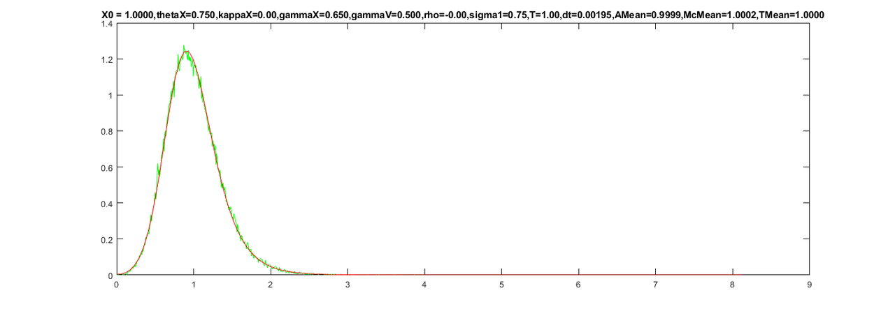](https://postimg.cc/nXKqT4DT)

[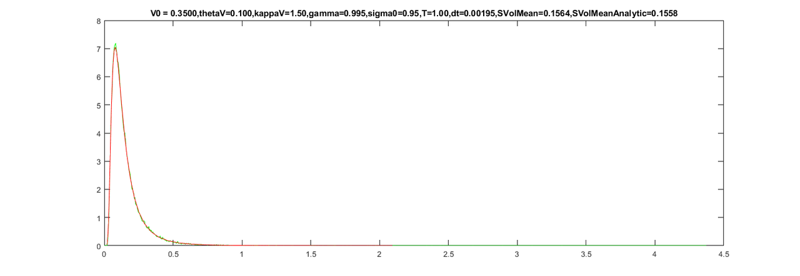](https://postimg.cc/7Cx0R514)

---

### #1231 — Amin (Topic Author)
*August 30, 2021, 4:03 PM*

Friends, we are just getting familiar with the problem of SV option pricing with this new method and getting our
orientation right with this new technique. The matlab program I posted is merely an initial framework on which we will
build to solve the problem in a very good manner and it requires many many improvements in a lot of aspects. So we will
continue to study and try to better solve the problem of SV option pricing for next few weeks and I will continue to
post re-worked versions of the program after every few days. The present program has a lot of pitfalls but we will
continue to improve it for at least several weeks until everything is properly finessed.

---

### #1232 — Amin (Topic Author)
*August 30, 2021, 9:37 PM*

I have gained some more insight towards the solution to the problem. In previous programs, the shape of density is
systematically different from monte carlo when viewed very closely. I think I know the reason why the density is
slightly but systematically off from true density and am trying to find a robust solution. I tried a decent fix and made
the graph below with changes to previous method. Now density fit is a lot better. I am attaching the graph of asset
density. Please notice how density changes (asymmetrically) close to peak to stay close to the true density.

I will be posting new matlab programs in another day or two.

.

[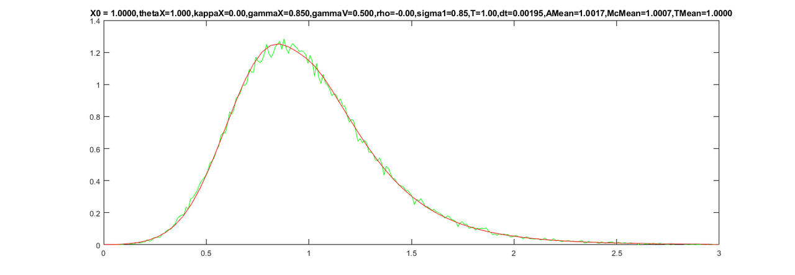](https://postimg.cc/T503pJNN)

---

### #1233 — Amin (Topic Author)
*August 31, 2021, 6:33 PM*

>
> I am going to share the analytics for solution of 2D stochastic volatility equations. Before I give the solution, I
want to mention that in typical SV system of SDEs, there are two SDEs out of which one (usually Stochastic volatility)
is independent of the other SDE and its one dimensional PDE can be solved independently. If we had a system of two SDEs
which are both dependent on each other, in that case the solution though still possible would be more difficult.
>
>
>
> I have taken both asset and SV Sdes in bessel coordinates. SV SDE can be solved independently and its PDE is given as
>
>
>
>
$\frac{\partial P(w,t)}{\partial t} \, = \, -\frac{\partial [\mu_w \, P(w,t)]}{\partial w} \, +\, .5 \, \frac{\partial^2 [{\sigma_w}^2 \, P(w,t)]}{\partial w^2} \,$
>
>
>
> When we solve this equation with conservation of mass as I showed in a previous post, we get
>
>
>
>
>
>
$ -\mu_w \, \frac{\partial Z_1}{\partial w} - .5 {\sigma_w}^2 \big[ -Z_1  \, {(\frac{\partial Z_1}{\partial w})}^2- P(Z_1)\, {(\frac{\partial Z_1}{\partial w})}^3  \frac{\partial^2 w}{\partial {Z_1}^2} \, \big]  \,$
>
> $ +  \frac{\partial w_b}{\partial t} \frac{\partial Z_1}{\partial w} =0 $
>
>
>
> In the above equation b in$w_b$ denotes that it is the boundary point that is moving so as to keep the probability
conserved up till that point. We will need the above equation because when we move to two dimensional stochastic
volatility PDE, the whole of above equation would be integrated in another dimension but since it equates to zero, it
will also remain zero even after an extra integration and we will eliminate it from 2D equation.
>
>
>
> our two dimensional SV and asset partial differential equation in bessel coordinates that we want to solve is
>
>
$\frac{\partial P(w,y,t)}{\partial t} \, = \, -\frac{\partial \big[\mu_y \, P(w,y,t) \big]}{\partial y} \, +\, .5 \, \frac{\partial^2 \big[{\sigma_y}^2 \, {V(w)}^{2 \gamma_V} \, P(w,y,t) \big]}{\partial y^2}  \, -\frac{\partial \big[\mu_w \, P(w,y,t) \big]}{\partial w} \, +\, .5 \, \frac{\partial^2 \big[{\sigma_w}^2 \, P(w,y,t) \big]}{\partial w^2} \,+ \,\rho \, \frac{\partial^2 \big[ \sigma_y \, \sigma_w  \, {V(w)}^{ \gamma_V} \, P(w,y,t) \big]}{\partial w \, \partial y} \, $
>
>
>
> though correlation term is conceptually simple and when we do a two dimensional integration to preserve probability
mass, this term becomes even more easy but correlation has some other issues when taking derivatives with respect of
density of y with respect to Z_1 in diffusion terms. When there is no correlation our jacobian for two dimensional
density when taken with respect to two independent standard nromals becomes
>
>
>
> $\frac{\partial (Z_1,Z_2)}{\partial (w,y)}=\frac{\partial Z_1}{\partial w} \, \frac{\partial Z_2}{\partial y}$
>
>
>
> since $Z_1$ and $Z_2$ are independent, we can write
>
>
>
> $P(w,y)=P(Z_1) \, P(Z_2) \, \frac{\partial Z_1}{\partial w} \, \frac{\partial Z_2}{\partial y} $
>
>
>
> Now we set ourselves in the probability conservation set up, and we have to write a two dimensional integral from
infinity(or rather zero ) to moving boundary (boundary might be a misnomer since this is not grid boundary but rather
boundary of mass conserved till a certain grid point and this so called boundary is moving or alternatively the grid
point is moving) points$w_b$ and$y_b$ . Please note that on a two dimensional grid there are a series of these points
$w_b$ 's and$y_b$ 's. The grid in inependent SV dimension is given by index n and the grid on dependent asset dimension
is given by (n,m) and respective moving boundaries in conservation set up are indicated as$w_b(n)$ (that conserves mass
till nth point on SV grid) and$y_b(n,m)$ (that conserves mass till (n,m) points on the grid) . Please note that
$y_b(n,m)$ is not a straight line and is curved in both indices.
>
>
>
> We apply the conservation of probability mass till arbitrary nth and mth points on the grid as
>
>
>
> $ \frac{\partial \Big[\int_0^{w_b(n)} \, \int_0^{y_b(n,m)} \, P(w,y,t) \,\, dy \, dw  \Big]}{\partial t} \, =0 $
>
> $=\int_0^{w_b(n)} \, \int_0^{y_b(n,m)} \, \frac{P(w,y,t)}{\partial t} \, \, dy \, dw   \, $
>
> $+\frac{\partial w_b}{\partial t} \int_0^{y_b(n,m)} \, P(w_b(n),y,t) dy $
>
> $+ \int_0^{w_b(n)}  \frac{\partial y_b(n,m)}{\partial t} \, P(w,y_b,t) dw =0 $
>
>
>
> Substituting the 2D uncorrelated PDE in the first RHS integral, we get the expression
>
>
>
>
$=\int_0^{w_b(n)} \, \int_0^{y_b(n,m)} \, \Big[\, -\frac{\partial \big[\mu_y \, P(w,y,t) \big]}{\partial y} \, +\, .5 \, \frac{\partial^2 \big[{\sigma_y}^2 \, {V(w)}^{2 \gamma_V} \, P(w,y,t) \big]}{\partial y^2}  \, -\frac{\partial \big[\mu_w \, P(w,y,t) \big]}{\partial w} \, +\, .5 \, \frac{\partial^2 \big[{\sigma_w}^2 \, P(w,y,t) \big]}{\partial w^2} \, \Big] \, \, dy \, dw   \, $
>
> $+\frac{\partial w_b}{\partial t} \int_0^{y_b(n,m)} \, P(w_b(n),y,t) dy $
>
> $+ \int_0^{w_b(n)}  \frac{\partial y_b(n,m)}{\partial t} \, P(w,y_b,t) dw =0 $
>
>
>
> We do the integrations in the first term to get
>
>
$=\int_0^{w_b(n)}  \, \Big[\, -\mu_y \, P(w,y,t)  \, +\, .5 \, \frac{\partial \big[{\sigma_y}^2 \, {V(w)}^{2 \gamma_V} \, P(w,y,t) \big]}{\partial y}  \, \Big] dw $
>
>
$\int_0^{y_b(n,m)} \Big[ -\mu_w \, P(w,y,t)  \, +\, .5 \, \frac{\partial \big[{\sigma_w}^2 \, P(w,y,t) \big]}{\partial w} \, \Big] \, \, dy   \, $
>
> $+\frac{\partial w_b}{\partial t} \int_0^{y_b(n,m)} \, P(w_b(n),y,t) dy $
>
> $+ \int_0^{w_b(n)}  \frac{\partial y_b(n,m)}{\partial t} \, P(w,y_b,t) dw =0 $
>
>
>
> Now we convert our coordinates to $Z_1$ and $Z_2$ instead of w and y as
>
>
>
>
$=\int_0^{w_b(n)}  \, \Big[\, -\mu_y \, P(Z_1) \, P(Z_2) \, \frac{\partial Z_1}{\partial w} \, \frac{\partial Z_2}{\partial y}  \, +\, .5 \, \frac{\partial \big[{\sigma_y}^2 \, {V(w)}^{2 \gamma_V} \, P(Z_1) \, P(Z_2) \, \frac{\partial Z_1}{\partial w} \, \frac{\partial Z_2}{\partial y} \big]}{\partial y}  \, \Big] dw $
>
>
$\int_0^{y_b(n,m)} \Big[ -\mu_w \, P(Z_1) \, P(Z_2) \, \frac{\partial Z_1}{\partial w} \, \frac{\partial Z_2}{\partial y}  \, +\, .5 \, \frac{\partial \big[{\sigma_w}^2 \, P(Z_1) \, P(Z_2) \, \frac{\partial Z_1}{\partial w} \, \frac{\partial Z_2}{\partial y} \big]}{\partial w} \, \Big] \, \, dy   \, $
>
>
$+\frac{\partial w_b}{\partial t} \int_0^{y_b(n,m)} \, P(Z_1(n)) \, P(Z_2) \, \frac{\partial Z_1}{\partial w} \, \frac{\partial Z_2}{\partial y} dy $
>
>
$+ \int_0^{w_b(n)}  \frac{\partial y_b(n,m)}{\partial t} \, P(Z_1) \, P(Z_2) \, \frac{\partial Z_1(n)}{\partial w} \, \frac{\partial Z_2(m)}{\partial y} dw =0 $
>
>
>
> which can be further simplified as
>
>
>
>
$=\int_0^{w_b(n)}  \, \Big[\, -\mu_y \,  \frac{\partial Z_2}{\partial y}  \, +\, .5 \, {\sigma_y}^2 \, {V(w)}^{2 \gamma_V}   \, \big[ -Z_2 \, {(\frac{\partial Z_2}{\partial y})}^2 - {(\frac{\partial Z_2}{\partial y})}^3 \frac{\partial^2 y}{\partial {Z_2}^2} \big]  \, \Big] dZ_1 $
>
>
$\int_0^{y_b(n,m)} \Big[ -\mu_w  \, \frac{\partial Z_1}{\partial w}   \, +\, .5 \, {\sigma_w}^2   \, \big[ -Z_1 \, {(\frac{\partial Z_1}{\partial w})}^2 - {(\frac{\partial Z_1}{\partial w})}^3 \frac{\partial^2 w}{\partial {Z_1}^2} \big]  \Big] \, \, dZ_2   \, $
>
> $+\frac{\partial w_b}{\partial t} \int_0^{y_b(n,m)} \,  \frac{\partial Z_1}{\partial w} \,  dZ_2 $
>
> $+ \int_0^{w_b(n)}  \frac{\partial y_b(n,m)}{\partial t}  \, \frac{\partial Z_2(m)}{\partial y} dZ_1 =0 $
>
>
>
> But we notice that second and third term together are merely the solution of 1D independent PDE integrated in an extra
dimension and since the original solution of both terms for independent 1D PDE was zero, the integrated term should also
be zero. (Even if it were not zero, we could have found this solution from solving the 1D independent PDE), therefore
>
>
$\int_0^{y_b(n,m)} \Big[ -\mu_w  \, \frac{\partial Z_1}{\partial w}   \, +\, .5 \, {\sigma_w}^2   \, \big[ -Z_1 \, {(\frac{\partial Z_1}{\partial w})}^2 - {(\frac{\partial Z_1}{\partial w})}^3 \frac{\partial^2 w}{\partial {Z_1}^2} \big]  \Big] \, \, dZ_2   \,$
>
> $+\frac{\partial w_b}{\partial t} \int_0^{y_b(n,m)} \,  \frac{\partial Z_1}{\partial w} \,  dZ_2=0 $
>
>
>
> Now we are left with the terms to solve as
>
>
>
>
$=\int_0^{w_b(n)}  \, \Big[\, -\mu_y \,  \frac{\partial Z_2}{\partial y}  \, +\, .5 \, {\sigma_y}^2 \, {V(w)}^{2 \gamma_V}   \, \big[ -Z_2 \, {(\frac{\partial Z_2}{\partial y})}^2 - {(\frac{\partial Z_2}{\partial y})}^3 \frac{\partial^2 y}{\partial {Z_2}^2} \big]  \, \Big] dZ_1 $
>
> $+ \int_0^{w_b(n)}  \frac{\partial y_b(n,m)}{\partial t}  \, \frac{\partial Z_2(m)}{\partial y} dZ_1 =0 $
>
>
>
> For a given value of m, we can recursively solve the above PDE for each value of n. To make matters simple, I write
the above equation as
>
>
>
>
$=\int_0^{w_b(n)}  \, \Big[\, -\mu_y \,  \frac{\partial Z_2}{\partial y}  \, +\, .5 \, {\sigma_y}^2 \, {V(w)}^{2 \gamma_V}   \, \big[ -Z_2 \, {(\frac{\partial Z_2}{\partial y})}^2 - {(\frac{\partial Z_2}{\partial y})}^3 \frac{\partial^2 y}{\partial {Z_2}^2} \big]  \, \Big] dZ_1 $
>
> $+ \int_0^{w_b(n-1)}  \frac{\partial y_b(n,m)}{\partial t}  \, \frac{\partial Z_2}{\partial y} dZ_1 $
>
> $+ \int_{w_b(n-1)}^{w_b(n)}  \frac{\partial y_b(n,m)}{\partial t}  \, \frac{\partial Z_2}{\partial y} dZ_1 =0$
>
>
>
> where in the above equation, I have expanded the last terms as sum of all previous terms and one current term to solve
and now the equation can be solved as
>
>
>
>
$ \frac{\partial y_b(n,m)}{\partial t} =\Bigg[ \int_0^{w_b(n)}  \, \Big[\, \mu_y \,  \frac{\partial Z_2}{\partial y}  \, +\, .5 \, {\sigma_y}^2 \, {V(w)}^{2 \gamma_V}   \, \big[ Z_2 \, {(\frac{\partial Z_2}{\partial y})}^2 + {(\frac{\partial Z_2}{\partial y})}^3 \frac{\partial^2 y}{\partial {Z_2}^2} \big]  \, \Big] dZ_1 $
>
>
$- \int_0^{w_b(n-1)}  \frac{\partial y_b(n,m)}{\partial t}  \, \frac{\partial Z_2}{\partial y} dZ_1 \Bigg] / \Big[ \int_{w_b(n-1)}^{w_b(n)}  \, \frac{\partial Z_2}{\partial y} dZ_1 \Big]$
>
>
>
> please note that$\frac{\partial y_b(n,m)}{\partial t} \Delta t$ is the change in coordinates y(n,m) so as to conserve
the mass in a small time step according to given PDE dynamics.
>
> The last equation solves the 2D PDE in the asset dimension. Adding correlation term should not be difficult but then
we have to make a few changes as correlation will appear in jacobian. Also derivatives of asset with respect to$Z_1$
would have to be included something that was making my equation unstable when I tried it last time but I will try it
again to see if I could make it work.
>
> I will be posting the program for uncorrelated PDE based on these analytics tomorrow.
>

Friends, in the term

Now we convert our coordinates to $Z_1$ and $Z_2$ instead of w and y as

$=\int_0^{w_b(n)}  \, \Big[\, -\mu_y \, P(Z_1) \, P(Z_2) \, \frac{\partial Z_1}{\partial w} \, \frac{\partial Z_2}{\partial y}  \, +\, .5 \, \frac{\partial \big[{\sigma_y}^2 \, {V(w)}^{2 \gamma_V} \, P(Z_1) \, P(Z_2) \, \frac{\partial Z_1}{\partial w} \, \frac{\partial Z_2}{\partial y} \big]}{\partial y}  \, \Big] dw $

$\int_0^{y_b(n,m)} \Big[ -\mu_w \, P(Z_1) \, P(Z_2) \, \frac{\partial Z_1}{\partial w} \, \frac{\partial Z_2}{\partial y}  \, +\, .5 \, \frac{\partial \big[{\sigma_w}^2 \, P(Z_1) \, P(Z_2) \, \frac{\partial Z_1}{\partial w} \, \frac{\partial Z_2}{\partial y} \big]}{\partial w} \, \Big] \, \, dy   \, $

$+\frac{\partial w_b}{\partial t} \int_0^{y_b(n,m)} \, P(Z_1(n)) \, P(Z_2) \, \frac{\partial Z_1}{\partial w} \, \frac{\partial Z_2}{\partial y} dy $

$+ \int_0^{w_b(n)}  \frac{\partial y_b(n,m)}{\partial t} \, P(Z_1) \, P(Z_2) \, \frac{\partial Z_1(n)}{\partial w} \, \frac{\partial Z_2(m)}{\partial y} dw =0 $

I have not properly handled the derivative given by expression
$\frac{\partial \big[{\sigma_y}^2 \, {V(w)}^{2 \gamma_V} \, P(Z_1) \, P(Z_2) \, \frac{\partial Z_1}{\partial w} \, \frac{\partial Z_2}{\partial y} \big]}{\partial y} $

y is changing in both$Z_1$ and$Z_2$ directions. Also${V(w)}^{2 \gamma_V}$ also takes a derivative with respect to y
through inverse derivative of y to w. I wanted to fix these things tonight but I have been given mind control chemicals
in food and I find it impossible to work tonight. I am in a very poor state mentally and totally unable to work. I also
received an antipsychotic injection today in my arm. I will try fixing the errors in next 2-3 days and then post the
program here. Please protest against my mind control. It is very painful to be unable to work when I need to work hard
to solve the problem.

---

### #1234 — Amin (Topic Author)
*September 4, 2021, 8:15 AM*

>
>
> I am going to share the analytics for solution of 2D stochastic volatility equations. Before I give the solution, I
want to mention that in typical SV system of SDEs, there are two SDEs out of which one (usually Stochastic volatility)
is independent of the other SDE and its one dimensional PDE can be solved independently. If we had a system of two SDEs
which are both dependent on each other, in that case the solution though still possible would be more difficult.
>
>
>
> I have taken both asset and SV Sdes in bessel coordinates. SV SDE can be solved independently and its PDE is given as
>
>
>
>
$\frac{\partial P(w,t)}{\partial t} \, = \, -\frac{\partial [\mu_w \, P(w,t)]}{\partial w} \, +\, .5 \, \frac{\partial^2 [{\sigma_w}^2 \, P(w,t)]}{\partial w^2} \,$
>
>
>
> When we solve this equation with conservation of mass as I showed in a previous post, we get
>
>
>
>
>
>
$ -\mu_w \, \frac{\partial Z_1}{\partial w} - .5 {\sigma_w}^2 \big[ -Z_1  \, {(\frac{\partial Z_1}{\partial w})}^2- P(Z_1)\, {(\frac{\partial Z_1}{\partial w})}^3  \frac{\partial^2 w}{\partial {Z_1}^2} \, \big]  \,$
>
> $ +  \frac{\partial w_b}{\partial t} \frac{\partial Z_1}{\partial w} =0 $
>
>
>
> In the above equation b in$w_b$ denotes that it is the boundary point that is moving so as to keep the probability
conserved up till that point. We will need the above equation because when we move to two dimensional stochastic
volatility PDE, the whole of above equation would be integrated in another dimension but since it equates to zero, it
will also remain zero even after an extra integration and we will eliminate it from 2D equation.
>
>
>
> our two dimensional SV and asset partial differential equation in bessel coordinates that we want to solve is
>
>
$\frac{\partial P(w,y,t)}{\partial t} \, = \, -\frac{\partial \big[\mu_y \, P(w,y,t) \big]}{\partial y} \, +\, .5 \, \frac{\partial^2 \big[{\sigma_y}^2 \, {V(w)}^{2 \gamma_V} \, P(w,y,t) \big]}{\partial y^2}  \, -\frac{\partial \big[\mu_w \, P(w,y,t) \big]}{\partial w} \, +\, .5 \, \frac{\partial^2 \big[{\sigma_w}^2 \, P(w,y,t) \big]}{\partial w^2} \,+ \,\rho \, \frac{\partial^2 \big[ \sigma_y \, \sigma_w  \, {V(w)}^{ \gamma_V} \, P(w,y,t) \big]}{\partial w \, \partial y} \, $
>
>
>
> though correlation term is conceptually simple and when we do a two dimensional integration to preserve probability
mass, this term becomes even more easy but correlation has some other issues when taking derivatives with respect of
density of y with respect to Z_1 in diffusion terms. When there is no correlation our jacobian for two dimensional
density when taken with respect to two independent standard nromals becomes
>
>
>
> $\frac{\partial (Z_1,Z_2)}{\partial (w,y)}=\frac{\partial Z_1}{\partial w} \, \frac{\partial Z_2}{\partial y}$
>
>
>
> since $Z_1$ and $Z_2$ are independent, we can write
>
>
>
> $P(w,y)=P(Z_1) \, P(Z_2) \, \frac{\partial Z_1}{\partial w} \, \frac{\partial Z_2}{\partial y} $
>
>
>
> Now we set ourselves in the probability conservation set up, and we have to write a two dimensional integral from
infinity(or rather zero ) to moving boundary (boundary might be a misnomer since this is not grid boundary but rather
boundary of mass conserved till a certain grid point and this so called boundary is moving or alternatively the grid
point is moving) points$w_b$ and$y_b$ . Please note that on a two dimensional grid there are a series of these points
$w_b$ 's and$y_b$ 's. The grid in inependent SV dimension is given by index n and the grid on dependent asset dimension
is given by (n,m) and respective moving boundaries in conservation set up are indicated as$w_b(n)$ (that conserves mass
till nth point on SV grid) and$y_b(n,m)$ (that conserves mass till (n,m) points on the grid) . Please note that
$y_b(n,m)$ is not a straight line and is curved in both indices.
>
>
>
> We apply the conservation of probability mass till arbitrary nth and mth points on the grid as
>
>
>
> $ \frac{\partial \Big[\int_0^{w_b(n)} \, \int_0^{y_b(n,m)} \, P(w,y,t) \,\, dy \, dw  \Big]}{\partial t} \, =0 $
>
> $=\int_0^{w_b(n)} \, \int_0^{y_b(n,m)} \, \frac{P(w,y,t)}{\partial t} \, \, dy \, dw   \, $
>
> $+\frac{\partial w_b}{\partial t} \int_0^{y_b(n,m)} \, P(w_b(n),y,t) dy $
>
> $+ \int_0^{w_b(n)}  \frac{\partial y_b(n,m)}{\partial t} \, P(w,y_b,t) dw =0 $
>
>
>
> Substituting the 2D uncorrelated PDE in the first RHS integral, we get the expression
>
>
>
>
$=\int_0^{w_b(n)} \, \int_0^{y_b(n,m)} \, \Big[\, -\frac{\partial \big[\mu_y \, P(w,y,t) \big]}{\partial y} \, +\, .5 \, \frac{\partial^2 \big[{\sigma_y}^2 \, {V(w)}^{2 \gamma_V} \, P(w,y,t) \big]}{\partial y^2}  \, -\frac{\partial \big[\mu_w \, P(w,y,t) \big]}{\partial w} \, +\, .5 \, \frac{\partial^2 \big[{\sigma_w}^2 \, P(w,y,t) \big]}{\partial w^2} \, \Big] \, \, dy \, dw   \, $
>
> $+\frac{\partial w_b}{\partial t} \int_0^{y_b(n,m)} \, P(w_b(n),y,t) dy $
>
> $+ \int_0^{w_b(n)}  \frac{\partial y_b(n,m)}{\partial t} \, P(w,y_b,t) dw =0 $
>
>
>
> We do the integrations in the first term to get
>
>
$=\int_0^{w_b(n)}  \, \Big[\, -\mu_y \, P(w,y,t)  \, +\, .5 \, \frac{\partial \big[{\sigma_y}^2 \, {V(w)}^{2 \gamma_V} \, P(w,y,t) \big]}{\partial y}  \, \Big] dw $
>
>
$\int_0^{y_b(n,m)} \Big[ -\mu_w \, P(w,y,t)  \, +\, .5 \, \frac{\partial \big[{\sigma_w}^2 \, P(w,y,t) \big]}{\partial w} \, \Big] \, \, dy   \, $
>
> $+\frac{\partial w_b}{\partial t} \int_0^{y_b(n,m)} \, P(w_b(n),y,t) dy $
>
> $+ \int_0^{w_b(n)}  \frac{\partial y_b(n,m)}{\partial t} \, P(w,y_b,t) dw =0 $
>
>
>
> Now we convert our coordinates to $Z_1$ and $Z_2$ instead of w and y as
>
>
>
>
$=\int_0^{w_b(n)}  \, \Big[\, -\mu_y \, P(Z_1) \, P(Z_2) \, \frac{\partial Z_1}{\partial w} \, \frac{\partial Z_2}{\partial y}  \, +\, .5 \, \frac{\partial \big[{\sigma_y}^2 \, {V(w)}^{2 \gamma_V} \, P(Z_1) \, P(Z_2) \, \frac{\partial Z_1}{\partial w} \, \frac{\partial Z_2}{\partial y} \big]}{\partial y}  \, \Big] dw $
>
>
$\int_0^{y_b(n,m)} \Big[ -\mu_w \, P(Z_1) \, P(Z_2) \, \frac{\partial Z_1}{\partial w} \, \frac{\partial Z_2}{\partial y}  \, +\, .5 \, \frac{\partial \big[{\sigma_w}^2 \, P(Z_1) \, P(Z_2) \, \frac{\partial Z_1}{\partial w} \, \frac{\partial Z_2}{\partial y} \big]}{\partial w} \, \Big] \, \, dy   \, $
>
>
$+\frac{\partial w_b}{\partial t} \int_0^{y_b(n,m)} \, P(Z_1(n)) \, P(Z_2) \, \frac{\partial Z_1}{\partial w} \, \frac{\partial Z_2}{\partial y} dy $
>
>
$+ \int_0^{w_b(n)}  \frac{\partial y_b(n,m)}{\partial t} \, P(Z_1) \, P(Z_2) \, \frac{\partial Z_1(n)}{\partial w} \, \frac{\partial Z_2(m)}{\partial y} dw =0 $
>
>
>
> which can be further simplified as
>
>
>
>
$=\int_0^{w_b(n)}  \, \Big[\, -\mu_y \,  \frac{\partial Z_2}{\partial y}  \, +\, .5 \, {\sigma_y}^2 \, {V(w)}^{2 \gamma_V}   \, \big[ -Z_2 \, {(\frac{\partial Z_2}{\partial y})}^2 - {(\frac{\partial Z_2}{\partial y})}^3 \frac{\partial^2 y}{\partial {Z_2}^2} \big]  \, \Big] dZ_1 $
>
>
$\int_0^{y_b(n,m)} \Big[ -\mu_w  \, \frac{\partial Z_1}{\partial w}   \, +\, .5 \, {\sigma_w}^2   \, \big[ -Z_1 \, {(\frac{\partial Z_1}{\partial w})}^2 - {(\frac{\partial Z_1}{\partial w})}^3 \frac{\partial^2 w}{\partial {Z_1}^2} \big]  \Big] \, \, dZ_2   \, $
>
> $+\frac{\partial w_b}{\partial t} \int_0^{y_b(n,m)} \,  \frac{\partial Z_1}{\partial w} \,  dZ_2 $
>
> $+ \int_0^{w_b(n)}  \frac{\partial y_b(n,m)}{\partial t}  \, \frac{\partial Z_2(m)}{\partial y} dZ_1 =0 $
>
>
>
> But we notice that second and third term together are merely the solution of 1D independent PDE integrated in an extra
dimension and since the original solution of both terms for independent 1D PDE was zero, the integrated term should also
be zero. (Even if it were not zero, we could have found this solution from solving the 1D independent PDE), therefore
>
>
$\int_0^{y_b(n,m)} \Big[ -\mu_w  \, \frac{\partial Z_1}{\partial w}   \, +\, .5 \, {\sigma_w}^2   \, \big[ -Z_1 \, {(\frac{\partial Z_1}{\partial w})}^2 - {(\frac{\partial Z_1}{\partial w})}^3 \frac{\partial^2 w}{\partial {Z_1}^2} \big]  \Big] \, \, dZ_2   \,$
>
> $+\frac{\partial w_b}{\partial t} \int_0^{y_b(n,m)} \,  \frac{\partial Z_1}{\partial w} \,  dZ_2=0 $
>
>
>
> Now we are left with the terms to solve as
>
>
>
>
$=\int_0^{w_b(n)}  \, \Big[\, -\mu_y \,  \frac{\partial Z_2}{\partial y}  \, +\, .5 \, {\sigma_y}^2 \, {V(w)}^{2 \gamma_V}   \, \big[ -Z_2 \, {(\frac{\partial Z_2}{\partial y})}^2 - {(\frac{\partial Z_2}{\partial y})}^3 \frac{\partial^2 y}{\partial {Z_2}^2} \big]  \, \Big] dZ_1 $
>
> $+ \int_0^{w_b(n)}  \frac{\partial y_b(n,m)}{\partial t}  \, \frac{\partial Z_2(m)}{\partial y} dZ_1 =0 $
>
>
>
> For a given value of m, we can recursively solve the above PDE for each value of n. To make matters simple, I write
the above equation as
>
>
>
>
$=\int_0^{w_b(n)}  \, \Big[\, -\mu_y \,  \frac{\partial Z_2}{\partial y}  \, +\, .5 \, {\sigma_y}^2 \, {V(w)}^{2 \gamma_V}   \, \big[ -Z_2 \, {(\frac{\partial Z_2}{\partial y})}^2 - {(\frac{\partial Z_2}{\partial y})}^3 \frac{\partial^2 y}{\partial {Z_2}^2} \big]  \, \Big] dZ_1 $
>
> $+ \int_0^{w_b(n-1)}  \frac{\partial y_b(n,m)}{\partial t}  \, \frac{\partial Z_2}{\partial y} dZ_1 $
>
> $+ \int_{w_b(n-1)}^{w_b(n)}  \frac{\partial y_b(n,m)}{\partial t}  \, \frac{\partial Z_2}{\partial y} dZ_1 =0$
>
>
>
> where in the above equation, I have expanded the last terms as sum of all previous terms and one current term to solve
and now the equation can be solved as
>
>
>
>
$ \frac{\partial y_b(n,m)}{\partial t} =\Bigg[ \int_0^{w_b(n)}  \, \Big[\, \mu_y \,  \frac{\partial Z_2}{\partial y}  \, +\, .5 \, {\sigma_y}^2 \, {V(w)}^{2 \gamma_V}   \, \big[ Z_2 \, {(\frac{\partial Z_2}{\partial y})}^2 + {(\frac{\partial Z_2}{\partial y})}^3 \frac{\partial^2 y}{\partial {Z_2}^2} \big]  \, \Big] dZ_1 $
>
>
$- \int_0^{w_b(n-1)}  \frac{\partial y_b(n,m)}{\partial t}  \, \frac{\partial Z_2}{\partial y} dZ_1 \Bigg] / \Big[ \int_{w_b(n-1)}^{w_b(n)}  \, \frac{\partial Z_2}{\partial y} dZ_1 \Big]$
>
>
>
> please note that$\frac{\partial y_b(n,m)}{\partial t} \Delta t$ is the change in coordinates y(n,m) so as to conserve
the mass in a small time step according to given PDE dynamics.
>
> The last equation solves the 2D PDE in the asset dimension. Adding correlation term should not be difficult but then
we have to make a few changes as correlation will appear in jacobian. Also derivatives of asset with respect to$Z_1$
would have to be included something that was making my equation unstable when I tried it last time but I will try it
again to see if I could make it work.
>
> I will be posting the program for uncorrelated PDE based on these analytics tomorrow.
>
.

.

Friends, in the term

Now we convert our coordinates to $Z_1$ and $Z_2$ instead of w and y as

$=\int_0^{w_b(n)}  \, \Big[\, -\mu_y \, P(Z_1) \, P(Z_2) \, \frac{\partial Z_1}{\partial w} \, \frac{\partial Z_2}{\partial y}  \, +\, .5 \, \frac{\partial \big[{\sigma_y}^2 \, {V(w)}^{2 \gamma_V} \, P(Z_1) \, P(Z_2) \, \frac{\partial Z_1}{\partial w} \, \frac{\partial Z_2}{\partial y} \big]}{\partial y}  \, \Big] dw $

$\int_0^{y_b(n,m)} \Big[ -\mu_w \, P(Z_1) \, P(Z_2) \, \frac{\partial Z_1}{\partial w} \, \frac{\partial Z_2}{\partial y}  \, +\, .5 \, \frac{\partial \big[{\sigma_w}^2 \, P(Z_1) \, P(Z_2) \, \frac{\partial Z_1}{\partial w} \, \frac{\partial Z_2}{\partial y} \big]}{\partial w} \, \Big] \, \, dy   \, $

$+\frac{\partial w_b}{\partial t} \int_0^{y_b(n,m)} \, P(Z_1(n)) \, P(Z_2) \, \frac{\partial Z_1}{\partial w} \, \frac{\partial Z_2}{\partial y} dy $

$+ \int_0^{w_b(n)}  \frac{\partial y_b(n,m)}{\partial t} \, P(Z_1) \, P(Z_2) \, \frac{\partial Z_1(n)}{\partial w} \, \frac{\partial Z_2(m)}{\partial y} dw =0 $

I have not properly handled the derivative given by expression
$\frac{\partial \big[{\sigma_y}^2 \, {V(w)}^{2 \gamma_V} \, P(Z_1) \, P(Z_2) \, \frac{\partial Z_1}{\partial w} \, \frac{\partial Z_2}{\partial y} \big]}{\partial y} $

y is changing in both$Z_1$ and$Z_2$ directions. Also${V(w)}^{2 \gamma_V}$ also takes a derivative with respect to y
through inverse derivative of y to w. I wanted to fix these things tonight but I have been given mind control chemicals
in food and I find it impossible to work tonight. I am in a very poor state mentally and totally unable to work. I also
received an antipsychotic injection today in my arm. I will try fixing the errors in next 2-3 days and then post the
program here. Please protest against my mind control. It is very painful to be unable to work when I need to work hard
to solve the problem.

.

.

Friends, I have been working on the model. The above derivatives in$Z_1$ directions are not relevant for uncorrelated
problem but they are very relevant when specify a positive or negative correlation between SV and asset. I have worked
with all these correlated terms and related derivatives and now working to complete the model with correlations. When we
are dealing with correlation coordinates, the nature of problem is very similar to as if we were in original non-bessel
coordinates

and we have to add (apart from other terms) an extra drift like term that appeared in solution with original coordinates
whose sigh now depends on sign of correlation. I hope to post the ( worked out but still preliminary)  program with
correlations in another two days possibly on monday.

---

### #1235 — Amin (Topic Author)
*September 6, 2021, 6:34 PM*

Though I have settled most of the issues with correlated stochastic volatility, there are still points that need a lot
of work and remain to be understood so it would be at least 3-4 days before I could post a properly working correlated
SV model. Since I have made a lot of changes to non-correlated version, I will be posting a properly commented version
of non-correlated SV model tomorrow.

---

### #1236 — Amin (Topic Author)
*September 7, 2021, 6:26 PM*

Friends, I meant to write comments on the program but rather continued to work on some stability issues. Earlier
versions were working with moderate volatilities only and if we increased volatility scaling factor of the asset sigma1
greater than .65, the program would not work. Today I worked on these issues and now you can run SV pricing scenarios
with high volatility and scaling factor sigma1 equal to one. It is a far more stable program and can also take mildly
negative values in the asset. Because I continued to work on stability issues, I did not get time to write comments. I
will post the commented program tomorrow.

---

### #1237 — Amin (Topic Author)
*September 8, 2021, 3:30 PM*

Friends, I continued to work to improve the behavior of program at zero and made some more improvements. When I was
working on the program in my room, mind control agents continued to repeatedly release very very sickening gas in my
room and now I have very little energy left to do any more work. The gas continued to sap all energy out of me. During
past few weeks, mind control agents have got far bolder in releasing the gas in my room ,out of the ACs in every room in
the house. Several rooms in our house had better air-conditioning but after I would work there for a few days, the would
start releasing large amounts of gas from the ACs. Now I do not turn on air-conditioning despite very high humidity but
they continue to release large amount of gas in my room and other places where I work.

I continued to write for a week to ten days about mind control torture on me but the torture was not decreasing so I
just simply gave up on writing about it everyday.

As a succession of what I revealed a few weeks ago, I will like to tell friends that a jewish billionaire is Godfather
of mind control. Though there are far richer billionaires in US who are staunchly opposed to mind control, they are not
ready to shell out hundreds of millions of dollars to bribe anyone to end mind control while mind control Godfather 
continues to give large bribes to people to continue mind control. Many of the people related to defense in mind control
are given extremely high paying jobs in Godfather's companies after they retire from mind control and Godfather is
extremely generous towards them and it is well established and well known to people in mind control after retarding
muslims, blacks and others in their career, they will move to paradise after they retire. No wonder there is no let up
in mind control whatever good people try. So much so for goodness in American society where at the end of the day it is
money that controls everything.

---

### #1238 — Amin (Topic Author)
*September 9, 2021, 4:44 PM*

Friends here is the new improved program with comments. It needs many further improvements but still lot better than the
earlier version.

.

```
function [] = SVSDEAnalyticAndMonteCarlo2DWilmott40()

%I have improved the program and if some of the asset goes to zero in a
%small fashion, it works but if volatility goes to zero, it does not work.
%There are still many improvements needed. It works fine with high
%stochastic volatility if there is very small mass at zero.
%Sometimes for high volatilities graph do not remain smooth and that has to
%be solved by an additional interpolation in next version.

%If parameters are extreme and the analytic distribution is smooth but has
%mismatch with monte carlo, try decreasing the step size of analytic
%simulation and monte carlo simulation.

% dX(t)=(a X(t)^alpha1 + b X(t)^alpha2) dt + sqrt(1-rho^2) sigma1 V(t)^gammaV X(t)^gammaX dZ1(t) + rho sigma1
V(t)^gammaV X(t)^gammaX dZ2(t)
% dV(t)=(mu1 V(t)^beta1 + mu2 V(t)^beta2)*dt + sigma0 V(t)^gamma dZ2(t)

%%%%%%%%%%%%%
X0=1.0;
alpha1=0;
alpha2=1;
kappaX=0.0;
thetaX=01.00;
a=kappaX*thetaX;
b=-kappaX;
rho=-.7*0;
sigma1=.85;
gammaV=.5;
gammaX=.95;
%%%%%%%%%%%%%
V0=.25;
thetaV=.075;
kappaV=2.0;
mu1=kappaV*thetaV;
mu2=-kappaV;
beta1=0;
beta2=1;
gamma=.95;
sigma0=.950;
%%%%%%%%%%%%

dtM=.03125;
TtM=32;

dt=dtM/32;
Tt=TtM*32;
Tt=256*4;
dtM=dt*16;
TtM=Tt/16;
T=TtM*dtM;
paths=100000;

dNn=.2/1;   % Normal density subdivisions width. would change with number of subdivisions
Nn=40;  % No of normal density subdivisions
NnMidl=20;%One half density Subdivision left from mid of normal density(low)
NnMidh=21;%One half density subdivision right from the mid of normal density(high)
NnMid=4.0;

dMm=.25/1;   % Normal density subdivisions width. would change with number of subdivisions
Mm=32;  % No of normal density subdivisions
MmMidl=16;%One half density Subdivision left from mid of normal density(low)
MmMidh=17;%One half density subdivision right from the mid of normal density(high)
MmMid=4.0;

w(1:Nn)=V0^(1-gamma)/(1-gamma); %Stochastic Volatility in bessel coordinates.
y(1:Nn,1:Mm)=X0^(1-gammaX)/(1-gammaX);%Asset in bessel coordinates

Z(1:Nn)=(((1:Nn)-.5)*dNn-NnMid);   %Z is standard gaussian associated with Stochastic volatility.

Z0(1:Mm)=(((1:Mm)-.5)*dMm-MmMid); %Z0 is standard gaussian associated with asset given a certain level of stochastic
volatility.
Z
Z0
str=input('Look at Z');

%Belwo ZProb is integrated probability within each Z grid cell for
%stochastic volatility.
ZProb(1)=normcdf(.5*Z(1)+.5*Z(2),0,1)-normcdf(.5*Z(1)+.5*Z(2)-dNn,0,1);
ZProb(Nn)=normcdf(.5*Z(Nn)+.5*Z(Nn-1)+dNn,0,1)-normcdf(.5*Z(Nn)+.5*Z(Nn-1),0,1);
ZProb(2:Nn-1)=normcdf(.5*Z(2:Nn-1)+.5*Z(3:Nn),0,1)-normcdf(.5*Z(2:Nn-1)+.5*Z(1:Nn-2),0,1);

%ZCProb(1:Nn)=normcdf(Z(1:Nn));
%ZProb0(1)=normcdf(Z(1),0,1);
%ZProb0(2:Nn)=normcdf(Z(2:Nn),0,1)-normcdf(Z(1:Nn-1),0,1);

%Belwo Z0Prob is integrated probability within each Z0 grid cell for
%asset given a certain level of stochastic volatility.
Z0Prob(1)=normcdf(.5*Z0(1)+.5*Z0(2),0,1)-normcdf(.5*Z0(1)+.5*Z0(2)-dMm,0,1);
Z0Prob(Mm)=normcdf(.5*Z0(Mm)+.5*Z0(Mm-1)+dMm,0,1)-normcdf(.5*Z0(Mm)+.5*Z0(Mm-1),0,1);
Z0Prob(2:Mm-1)=normcdf(.5*Z0(2:Mm-1)+.5*Z0(3:Mm),0,1)-normcdf(.5*Z0(2:Mm-1)+.5*Z0(1:Mm-2),0,1);

%Z0Prob0(1)=normcdf(Z0(1),0,1);
%Z0Prob0(2:Mm)=normcdf(Z0(2:Mm),0,1)-normcdf(Z0(1:Mm-1),0,1);

%Z0CProb(1:Mm)=normcdf(Z0(1:Mm));

%%%%%%%%%%%%%%%%%%%%%%%%5
%Below wnStart is starting grid cell for volatility. This remains one
%throughout the implementation something that will change in next version
%where we will tackle stochastic volatility going to zero.

wnStart=1;

%Below ynStart is starting grid cell for asset. This remains one
%throughout the implementation and is used where it is difficult to apply
%volatility dependent variable initial grid point.
ynStart0=1;

%Below ynStart is starting grid cell for asset and this starting grid cell
%varies with volatility level especially when at high volatility levels,
%the initial asset diffusion grid points have reached zero so they have to
%be treated differently while there are low Stochastic volatility grids
%where diffusion has not reached zero and it remains one at those places.
ynStart(1:Nn)=1;
ynStart(wnStart:Nn)=1;
dwdZ(wnStart:Nn)=0.0;
tic
for tt=1:Tt
%Below we calculate volatility and asset in original coordinates and then
%calculate wMu0dt which is drift in SV in bessel coordinates and yMu0dt
%which is drift in asset in bessel coordinates.
    V(wnStart:Nn)=((1-gamma)*w(wnStart:Nn)).^(1/(1-gamma));
    X(wnStart:Nn,ynStart0:Mm)=((1-gammaX)*y(wnStart:Nn,ynStart0:Mm)).^(1/(1-gammaX));

for nn=wnStart:Nn
    %yMu0dt is asset drift in bessel coordinates.
yMu0dt(nn,ynStart0:Mm)= (a*X(nn,ynStart0:Mm).^(alpha1-gammaX)+b*X(nn,ynStart0:Mm).^(alpha2-gammaX) - ...
     .5*gammaX*sigma1^2*V(nn).^(2*gammaV).*X(nn,ynStart0:Mm).^(gammaX-1))*dt + ...
     (a*(alpha1-gammaX).*X(nn,ynStart0:Mm).^(alpha1-gammaX-1)+b*(alpha2-gammaX)*X(nn,ynStart0:Mm).^(alpha2-gammaX-1) -
...
     .5*gammaX*sigma1^2*V(nn).^(2*gammaV).*(gammaX-1)*X(nn,ynStart0:Mm).^(gammaX-2)).* ...
     (a*X(nn,ynStart0:Mm).^(alpha1)+b*X(nn,ynStart0:Mm).^(alpha2))*dt^2/2+ ...
     -(.5*gammaX*sigma1^2*(2*gammaV).*V(nn).^(2*gammaV-1).*X(nn,ynStart0:Mm).^(gammaX-1)).* ...
     (mu1*V(nn).^(beta1)+mu2*V(nn).^(beta2))*dt^2/2 + ...
   
(a*(alpha1-gammaX).*(alpha1-gammaX-1).*X(nn,ynStart0:Mm).^(alpha1-gammaX-2)+b*(alpha2-gammaX-1).*(alpha2-gammaX)*X(nn,ynStart0:Mm).^(alpha2-gammaX-2)
- ...
    .5*gammaX*sigma1^2*(gammaX-1)*(gammaX-2)*V(nn).^(2*gammaV).*X(nn,ynStart0:Mm).^(gammaX-3)).* ...
    .5*sigma1^2*V(nn).^(2*gammaV).*X(nn,ynStart0:Mm).^(2*gammaX)*dt^2/2+ ...
    -(.5*gammaX*sigma1^2*(2*gammaV).*(2*gammaV-1).*V(nn).^(2*gammaV-2).*X(nn,ynStart0:Mm).^(gammaX-1)).* ...
     (sigma0^2*V(nn).^(2*gamma))*dt^2/2;
 %Below is Z0 dependent expanded volatility whose square needs to be used instead of sigma^2*dt;
    c1y(nn,ynStart0:Mm)=sigma1*V(nn).^(gammaV).*sqrt(dt)+ ...
        (a*(alpha1-gammaX).*X(nn,ynStart0:Mm).^(alpha1-gammaX-1)+b*(alpha2-gammaX)*X(nn,ynStart0:Mm).^(alpha2-gammaX-1)
- ...
        .5*gammaX*sigma1^2*V(nn).^(2*gammaV).*(gammaX-1)*X(nn,ynStart0:Mm).^(gammaX-2)).* ...
        sigma1*V(nn).^(gammaV).*X(nn,ynStart0:Mm).^(gammaX).*(1-1/sqrt(3)).*dt^1.5;
 %Below is Z (and not Z0) dependent volatility. Its square is not O(dt) but higher order but I believe it has to be
added
 %but more on it in next version of the program. It makes a very small difference in shape of density.
    c2y(nn,ynStart0:Mm)=-(.5*gammaX*sigma1^2*(2*gammaV).*V(nn).^(2*gammaV-1).*X(nn,ynStart0:Mm).^(gammaX-1)).* ...
        sigma0*V(nn).^gamma .*(1-1/sqrt(3)).*dt^1.5;

end

%%%%%%%%%%%%%%%%%%%%%%%%%%%%%%%%%%%%%%%%%%%%%%%%%%%%%%%%%%%%%%%%%%%%%%%%%%%%%%%%%%%%%
%Below we calculate drift of stochastic volatility in bessel coordinates.
    wMu0dt(wnStart:Nn)= (mu1*V(wnStart:Nn).^(beta1-gamma)+mu2*V(wnStart:Nn).^(beta2-gamma) - ...
    .5*gamma*sigma0^2*V(wnStart:Nn).^(gamma-1))*dt + ...
    (mu1*(beta1-gamma).*V(wnStart:Nn).^(beta1-gamma-1)+mu2*(beta2-gamma)*V(wnStart:Nn).^(beta2-gamma-1) - ...
    .5*gamma*sigma0^2*(gamma-1)*V(wnStart:Nn).^(gamma-2)).* ...
    (mu1*V(wnStart:Nn).^(beta1-gamma)+mu2*V(wnStart:Nn).^(beta2-gamma))*dt^2/2+ ...
   
(mu1*(beta1-gamma).*(beta1-gamma-1).*V(wnStart:Nn).^(beta1-gamma-2)+mu2*(beta2-gamma-1).*(beta2-gamma)*V(wnStart:Nn).^(beta2-gamma-2)
- ...
    .5*gamma*sigma0^2*(gamma-1)*(gamma-2).*V(wnStart:Nn).^(gamma-3)).* ...
    .5.*sigma0^2.*V(wnStart:Nn).^(2*gamma)*dt^2/2;
%Below we calculate volatility of stochastic volatility in bessel
%coordinates. Its square will be used in place of sigm0^2 dt.
    c1(wnStart:Nn)=sigma0.*sqrt(dt) + ...
        (mu1.*(beta1-gamma).*V(wnStart:Nn).^(beta1-gamma-1) + ...
        mu2.*(beta2-gamma).*V(wnStart:Nn).^(beta2-gamma-1) - ...
        .5*gamma* sigma0^2 .*(gamma-1).*V(wnStart:Nn).^(gamma-2)) .* sigma0.* V(wnStart:Nn).^(gamma).*(1-1/sqrt(3))
.*dt^1.5;

    %Below is the proper way to add volatility innovation in existing
    %density.
    %It has two parts a:squared addition  and b:diffusion smoothing.
    %Below is squared addition part.
    %wMid is point on w density that is associated with Z=0 or median point
    %of the density.
    [wMid] =
InterpolateOrderN8(8,0,Z(NnMidl-3),Z(NnMidl-2),Z(NnMidl-1),Z(NnMidl),Z(NnMidh),Z(NnMidh+1),Z(NnMidh+2),Z(NnMidh+3),w(NnMidl-3),w(NnMidl-2),w(NnMidl-1),w(NnMidl),w(NnMidh),w(NnMidh+1),w(NnMidh+2),w(NnMidh+3));

    Zt1(wnStart:Nn)=w(wnStart:Nn)-wMid;

    [dwdZ,d2wdZ2A] = First2Derivatives2ndOrderEqSpacedA(wnStart,Nn,dNn,Zt1,Z);

    C0(wnStart:Nn)=Zt1(wnStart:Nn)-dwdZ(wnStart:Nn).*Z(wnStart:Nn);

    Zt2(wnStart:Nn)=C0(wnStart:Nn)+sign((dwdZ(wnStart:Nn))+c1(wnStart:Nn)).* ...
        sqrt(abs(sign((dwdZ(wnStart:Nn))).*(dwdZ(wnStart:Nn)).^2+ ...
        sign(c1(wnStart:Nn)).*c1(wnStart:Nn).^2)).*Z(wnStart:Nn);

    [dw2dZ,d2w2dZ2A] = First2Derivatives2ndOrderEqSpacedA(wnStart,Nn,dNn,Zt2,Z);
    %below the line ".5*c1(wnStart:Nn).^2.*(dw2dZ(wnStart:Nn).^(-2)).*d2w2dZ2A(wnStart:Nn);
    %is equivalent to diffusion smoothing part.
    %SO three terms below in dwb are contributions from drift, squared addition and
    %diffusion smoothing. dwb is net change in displacement of nth grid
    %point.
    if(tt>20)

        dwb(wnStart:Nn)= wMu0dt(wnStart:Nn)+(Zt2(wnStart:Nn)-Zt1(wnStart:Nn))+ ...
            .5*c1(wnStart:Nn).^2.*(dw2dZ(wnStart:Nn).^(-2)).*d2w2dZ2A(wnStart:Nn);
    else

        dwb(wnStart:Nn)=wMu0dt(wnStart:Nn)+Zt2(wnStart:Nn)-Zt1(wnStart:Nn);%+ ...
    end
    dwb(isnan(dwb)==1)=0.0;
    dwb(isinf(dwb)==1)=0.0;
    %dwb(dwb>.5)=.50;
    w(wnStart:Nn)=w(wnStart:Nn)+dwb(wnStart:Nn);

  %%%%%%%%%%%%%%%%%%%%%%%%%%%%%%%%%%%%%%%%%%%%%%%%%%%%%%%%%%%%%%%%%%%%%%%%%%%%%%%%%%%%%%%%%%%%%%%%%%%%%%%%%%555
    %dwdZPrev(wnStart:Nn)=dwdZ(wnStart:Nn);
    %%d2wdZ2Prev(wnStart:Nn)=d2wdZ2(wnStart:Nn);
   %
   % [dwdZNew,d2wdZ2New] = First2Derivatives2ndOrderEqSpacedA(wnStart,Nn,dNn,w,Z);

tt
%%%%%%%%%%%%%%%%%%%%%%%%%%%%%%%%%%%%%%%%%%%%%%%%%%%%%%%%%%%%%%%%%%%%%%%%%%%%%%%%%

%%%%%%%%%%%%%%%%%%%%%%%%%%%%%%%%%%%%%%%%%%%%%%%%%%%%%%%%%%%%%%%%%%%%%%%%%%%%%%%%5
%Below we repeat(squared addition and diffusion smoothing) for every volatility conditional value of asset
%what we did for volatility itself in one dimension.
for nn=wnStart:Nn

    [yMid(nn)] =
InterpolateOrderN8(8,0,Z0(MmMidl-3),Z0(MmMidl-2),Z0(MmMidl-1),Z0(MmMidl),Z0(MmMidh),Z0(MmMidh+1),Z0(MmMidh+2),Z0(MmMidh+3),y(nn,MmMidl-3),y(nn,MmMidl-2),y(nn,MmMidl-1),y(nn,MmMidl),y(nn,MmMidh),y(nn,MmMidh+1),y(nn,MmMidh+2),y(nn,MmMidh+3));
    Zy1(nn,ynStart0:Mm)=y(nn,ynStart0:Mm)-yMid(nn);
    Zy10(ynStart0:Mm)= Zy1(nn,ynStart0:Mm);
    [dydZ0A,d2ydZ02A] = First2Derivatives2ndOrderEqSpacedA(ynStart(nn),Mm,dMm,Zy10,Z0);
    if(tt>1)
    dydZ0Prev(nn,ynStart(nn):Mm)=dydZ0(nn,ynStart(nn):Mm);
    end
    dydZ0(nn,ynStart(nn):Mm)=dydZ0A(ynStart(nn):Mm);
    Cy0(nn,ynStart(nn):Mm)=Zy1(nn,ynStart(nn):Mm)-dydZ0A(ynStart(nn):Mm).*Z0(ynStart(nn):Mm);

    %Zt2(wnStart:Nn)=C0(wnStart:Nn)+abs(sqrt((dwdZ(wnStart:Nn)).^2+sigma0^2*dt)).*Z(wnStart:Nn);
%    Zy2(nn,ynStart:Mm)=Cy0(nn,ynStart:Mm)+abs(sqrt((dydZ0A(ynStart:Mm)).^2+c1y(nn,ynStart:Mm).^2)).*Z0(ynStart:Mm);

    Zy2(nn,ynStart(nn):Mm)=Cy0(nn,ynStart(nn):Mm)+sign((dydZ0A(ynStart(nn):Mm))+c1y(nn,ynStart(nn):Mm)).* ...
        sqrt(abs(sign((dydZ0A(ynStart(nn):Mm))).*(dydZ0A(ynStart(nn):Mm)).^2+ ...
        sign(c1y(nn,ynStart(nn):Mm)).*c1y(nn,ynStart(nn):Mm).^2)).*Z0(ynStart(nn):Mm);

    Zy20(ynStart(nn):Mm)= Zy2(nn,ynStart(nn):Mm);
    [dy2dZ0B,d2y2dZ02B] = First2Derivatives2ndOrderEqSpacedA(ynStart(nn),Mm,dMm,Zy20,Z0);
    dy2dZ0(nn,ynStart(nn):Mm)=dy2dZ0B(ynStart(nn):Mm);
    dy2dZ0Inv(nn,ynStart(nn):Mm)=1.0 ./dy2dZ0(nn,ynStart(nn):Mm);
    dy2dZ0Inv(isnan(dy2dZ0Inv)==1)=0;

    d2y2dZ02(nn,ynStart(nn):Mm)=d2y2dZ02B(ynStart(nn):Mm);
    d2y2dZ02(isnan(d2y2dZ02)==1)=0.0;
    dydZ0(nn,ynStart(nn):Mm)=dy2dZ0(ynStart(nn):Mm);
    if(tt>10)
    %yDiff0(nn,ynStart:Mm)=Zy2(nn,ynStart:Mm)-Zy1(nn,ynStart:Mm) + ...
    %    .5*sigma1^2* V(nn).^(2*gammaV).*dt.*(dy2dZ0(nn,ynStart:Mm).^(-2)).*d2y2dZ02(nn,ynStart:Mm);
    yDiff0(nn,ynStart(nn):Mm)=
.5*c1y(nn,ynStart(nn):Mm).^2.*(dy2dZ0Inv(nn,ynStart(nn):Mm).^(2)).*d2y2dZ02(nn,ynStart(nn):Mm);
    else
        yDiff0(nn,ynStart(nn):Mm)=0.0;%Zy2(nn,ynStart:Mm)-Zy1(nn,ynStart:Mm);
    end
    yDiff0(isnan(yDiff0)==1)=0.0;
end

%%%%%%%%%%%%%%%%%%%%%%%%%%%%%%%%%%%%%%%%%%%%%%%%%%%%%%%%%%%%%%%%%%%%%%%%%%%%%%%%%%%%%%%%%5
%  for mm=ynStart0:Mm
% %
% %     c1y2A(wnStart:Nn)=c1y(wnStart:Nn,mm).^2;
% %     [dc1y2AdZ,d2c1y2AdZ2] = First2Derivatives2ndOrderEqSpacedA(wnStart,Nn,dNn,c1y2A,Z);
% %     dc1y2dZ(wnStart:Nn,mm)=dc1y2AdZ(wnStart:Nn);
% %
%      [ywMid(mm)] =
InterpolateOrderN8(8,0,Z(NnMidl-3),Z(NnMidl-2),Z(NnMidl-1),Z(NnMidl),Z(NnMidh),Z(NnMidh+1),Z(NnMidh+2),Z(NnMidh+3),y(NnMidl-3,mm),y(NnMidl-2,mm),y(NnMidl-1,mm),y(NnMidl,mm),y(NnMidh,mm),y(NnMidh+1,mm),y(NnMidh+2,mm),y(NnMidh+3,mm));
% %
%      Zyw1(wnStart:Nn,mm)=y(wnStart:Nn,mm)-ywMid(mm);
%      Zyw10(wnStart:Nn)= Zyw1(wnStart:Nn,mm);
%      if(tt>1)
%         dywdZPrev(wnStart:Nn,mm)=dywdZ(wnStart:Nn,mm);
%      end
%      [dywdZA,d2ywdZ2A] = First2Derivatives2ndOrderEqSpacedA(wnStart,Nn,dNn,Zyw10,Z);
% %
%      dywdZ(wnStart:Nn,mm)=dywdZA(wnStart:Nn);
% %     d2ywdZ2(wnStart:Nn,mm)=d2ywdZ2A(wnStart:Nn);
%  end

%In order to make interpolation easier, we sum together the drift, squared
%addition and diffusion smoothing in one term instead of three separate
%terms. Multiplication by .*dydZ0(nn,ynStart(nn):Mm).^-1 is in the
%algorithm.

for nn=wnStart:Nn
    for mm=wnStart:Mm
        if(y(nn,mm)>0)
            dy0(nn,ynStart(nn):Mm)=(yMu0dt(nn,ynStart(nn):Mm)+
Zy2(nn,ynStart(nn):Mm)-Zy1(nn,ynStart(nn):Mm)+yDiff0(nn,ynStart(nn):Mm) ...
                ).*dydZ0(nn,ynStart(nn):Mm).^-1;
        else
            dy0(nn,ynStart(nn):Mm)=real((yMu0dt(nn,ynStart(nn):Mm)+
Zy2(nn,ynStart(nn):Mm)-Zy1(nn,ynStart(nn):Mm))).*real(dydZ0(nn,ynStart(nn):Mm)).^-1;
        end
    end
end

%%%%%%%%%%%%%%%%%%%%%%%%%%%%%%%%%%%%%%%%%%%%%%%%%%%%%%%%%%%%%%%%%%%%%%%%%%%%%%%%%%%%%%%%%%5

%All the values below with capital I in them are interpolated values. Two additional grids
%are interpolated between any two existing grids so that n=1:Nn is 3*n-2:3*Nn-2 on interpolated grid.
%values with a like dy0Ia are starting values at start of grid cell.
%values withhout a and b like dy0I are middle values at center of grid cell.
%values with a like dy0Ib are values at end of grid cell.
%ZI are interpolated Z values at middle of grid cells.
%NnI = 3*Nn +2;
%dNnI = dNn/3.
%ZIProb is integrated probability in each interpolated grid cell.
[dy0I,dy0Ia,dy0Ib,ZI,NnI,dNnI,ZIProb] = InterpolateAssetAlongVolatilityWithEnds(dy0,Z,wnStart,Nn,dNn,ynStart0,Mm);
[dydZ0I,dydZ0Ia,dydZ0Ib,ZI,NnI,dNnI,ZIProb] =
InterpolateAssetAlongVolatilityWithEnds(dydZ0,Z,wnStart,Nn,dNn,ynStart0,Mm);

if(tt>10)

%copying from above.
%%All the values with capital I in them are interpolated values. Two additional grids
%are interpolated between any two existing grids so that n=1:Nn is 3*n-2:3*Nn-2 on interpolated grid.
%Below is the probbility mass conservation algorithm on interpolated stochastic volatility grid.
    cc1=0;
    cc2=.5;
    cc3=.5;
    Tdy0(1:NnI,1:Mm)=0.0;
    for nn=wnStart:Nn
        ynStartI(3*nn-2)=ynStart(nn);
        ynStartI(3*nn-1)=ynStart(nn);
        ynStartI(3*nn)=ynStart(nn);
    end

    for nn=wnStart:NnI

        if(nn==wnStart)
           
Tdy0(nn,ynStartI(nn):Mm)=(cc1*dy0Ia(nn,ynStartI(nn):Mm)+cc2*dy0I(nn,ynStartI(nn):Mm)+cc3*dy0Ib(nn,ynStartI(nn):Mm)).*ZIProb(nn);

            dyb(nn,ynStartI(nn):Mm)= (Tdy0(nn,ynStartI(nn):Mm))./(cc1*dydZ0Ia(nn,ynStartI(nn):Mm).^(-1).*ZIProb(nn)+ ...
                cc2*dydZ0I(nn,ynStartI(nn):Mm).^(-1).*ZIProb(nn)+cc3*dydZ0Ib(nn,ynStartI(nn):Mm).^(-1).*ZIProb(nn));

            Tyb(nn,ynStartI(nn):Mm)=dyb(nn,ynStartI(nn):Mm).*(cc1*dydZ0Ia(nn,ynStartI(nn):Mm).^(-1) + ...
                cc2*dydZ0I(nn,ynStartI(nn):Mm).^(-1)+cc3*dydZ0Ib(nn,ynStartI(nn):Mm).^(-1)).*ZIProb(nn);

        else

            Tdy0(nn,ynStartI(nn):Mm)=Tdy0(nn-1,ynStartI(nn):Mm)+ ...
                cc1*dy0Ia(nn,ynStartI(nn):Mm).*ZIProb(nn)+ ...
                cc2*dy0I(nn,ynStartI(nn):Mm).*ZIProb(nn)+...
                cc3*dy0Ib(nn,ynStartI(nn):Mm).*ZIProb(nn);
            dyb(nn,ynStartI(nn):Mm)= (Tdy0(nn,ynStartI(nn):Mm)-Tyb(nn-1,ynStartI(nn):Mm))./ ...
                (cc1*dydZ0Ia(nn,ynStartI(nn):Mm).^(-1).*ZIProb(nn)+cc2*dydZ0I(nn,ynStartI(nn):Mm).^(-1).*ZIProb(nn)+ ...
                +cc3*dydZ0Ib(nn,ynStartI(nn):Mm).^(-1).*ZIProb(nn));
            Tyb(nn,ynStartI(nn):Mm)=Tyb(nn-1,ynStartI(nn):Mm)+ ...
                cc1*dyb(nn,ynStartI(nn):Mm).*dydZ0Ia(nn,ynStartI(nn):Mm).^(-1).*ZIProb(nn) + ...
                cc2*dyb(nn,ynStartI(nn):Mm).*dydZ0I(nn,ynStartI(nn):Mm).^(-1).*ZIProb(nn)+ ...
                cc3*dyb(nn,ynStartI(nn):Mm).*dydZ0Ib(nn,ynStartI(nn):Mm).^(-1).*ZIProb(nn);
        end

    end

    %dyb
    %size(dyb)
    %str=input('Look at numbers_2');
    dyb(isnan(dyb)==1)=0.0;

    for nn=wnStart:Nn

        for mm=ynStart(nn):Mm

            ytemp(nn,mm)=y(nn,mm)+dyb(3*nn-2,mm);
                if(real(ytemp(nn,mm))=ynStart(nn)) && (mm maxX)
    maxX=real(Xy_limits(28));
end

minX=minX-.05;
maxX=maxX+1.250;
minX=max(.001,minX);

Mm00=300;
dX=(maxX-minX)/(Mm00-1)

minX
maxX
X5(1:Mm00)=minX+((1:Mm00)-1).*dX
%dX0(1:100-1)=dX
%dX0(100)=dX
%dX0(101:200)=dX
%X5(101:300)=X5(100)+(1:200).*dX
Mm0=Mm00;
%dX=(maxX-minX)/(Mm0-1);
X5
dX
str=input('Look at X');
%[X,XCdf] = ConstructCDFOnNewGrid02a(X5,y,wnStart,Nn,ynStart,Mm,Mm0,ZProb,Z0,gammaX)

[X,XCdf] = ConstructCDFOnNewGridWithInterpolation(X5,y,wnStart,Nn,dNn,Z,ynStart0,Mm,Mm0,Z0,gammaX);

Zx(2:Mm0-1)=norminv(XCdf(2:Mm0-1));%is calculated at boundaries of cells
%ZX(2:Mm0)=(Zb(2:Mm0)+Zb(1:Mm0-1))/2.0;%is calculated at center of grid cells.
%Zx(2:Mm0-1)=Zb(2:Mm0-1);%is calculated at center of grid cells.
[Zx(1)] = InterpolateOrderN6(4,X(1),X(2),X(3),X(4),X(5),0,0,Zx(2),Zx(3),Zx(4),Zx(5),0,0);
dXdZx(3:Mm0-2)=(X(4:Mm0-1)-X(2:Mm0-3))./(Zx(4:Mm0-1)-Zx(2:Mm0-3))
[dXdZx(2)] = InterpolateOrderN6(4,Zx(2),Zx(3),Zx(4),Zx(5),Zx(6),0,0,dXdZx(3),dXdZx(4),dXdZx(5),dXdZx(6),0,0);
[dXdZx(1)] = InterpolateOrderN6(4,Zx(1),Zx(3),Zx(4),Zx(5),Zx(6),0,0,dXdZx(3),dXdZx(4),dXdZx(5),dXdZx(6),0,0);

Zb(1:Mm0-3)=(Zx(1:Mm0-3)+Zx(2:Mm0-2))/2;

ZbProb(1)=normcdf(Zb(1));
ZbProb(2:Mm0-3)=normcdf(Zb(2:Mm0-3))-normcdf(Zb(1:Mm0-4));

for mm=1:Mm0-10
    pX(mm) = (normpdf(Zx(mm),0, 1))/abs(dXdZx(mm));
end

toc
%Zx

%pX
    pX(isnan(pX)==1)=0.0;
    pX(isinf(pX)==1)=0.0;
%pX
%XProb
XX=X;
plot(XX(1:Mm0-10),XCdf(1:Mm0-10),'r');
str=input('Look at graph');
plot(XX(2:Mm0-10),pX(2:Mm0-10),'r');
str=input('Look at graph');

ItoHermiteSVMean=sum(Vw(wnStart+1:Nn-1).*ZProb(wnStart+1:Nn-1))
TrueSVMean=thetaV+(V0-thetaV)*exp(-kappaV*dt*Tt)

ItoHermiteAssetMeanX2=sum(X(2:Mm0-3).*ZbProb(2:Mm0-3))
TrueAssetMean=thetaX+(X0-thetaX)*exp(-kappaX*dt*Tt)

%%%%%%%%%%%%%%%%%%%%%%%%%%%%%%
%rng(29079137, 'twister')
rng(15898837, 'twister')
paths=150000;
V(1:paths)=V0;  %Original process monte carlo.
X=0.0;
X(1:paths)=X0;
Random1(1:paths)=0;
Random2(1:paths)=0;

for ttM=1:TtM
Random1=randn(size(Random1));
Random2=randn(size(Random2));

X(1:paths)=X(1:paths)+ ...
    (a* X(1:paths).^alpha1 + b* X(1:paths).^alpha2)* dtM + ...
    sqrt(1-rho^2)* sigma1* V(1:paths).^gammaV.* X(1:paths).^gammaX .*Random1(1:paths) * sqrt(dtM) + ...
    rho* sigma1* V(1:paths).^gammaV .*X(1:paths).^gammaX .*Random2(1:paths)*sqrt(dtM) + ...
    (a*alpha1* X(1:paths).^(alpha1-1)+b*alpha2* X(1:paths).^(alpha2-1)).* ...
    (((a* X(1:paths).^alpha1 + b* X(1:paths).^alpha2)* dtM^2/2)+ ...
    (sqrt(1-rho^2)* sigma1* V(1:paths).^gammaV.* X(1:paths).^gammaX .*Random1(1:paths) *(1-1/sqrt(3)).*dtM^1.5+ ...
    rho* sigma1* V(1:paths).^gammaV .*X(1:paths).^gammaX .*Random2(1:paths)*(1-1/sqrt(3)).*dtM^1.5))+ ...
    .5*(a*alpha1*(alpha1-1)* X(1:paths).^(alpha1-2)+b*alpha2*(alpha2-1).* X(1:paths).^(alpha2-2)).* ...
    ( sigma1^2* V(1:paths).^(2*gammaV).* X(1:paths).^(2*gammaX)) *dtM^2/2 + ...
    sqrt(1-rho^2)* sigma1* V(1:paths).^gammaV.*gammaX.* X(1:paths).^(gammaX-1).* ...
    ((a* X(1:paths).^alpha1 + b* X(1:paths).^alpha2).*Random1(1:paths) * 1/sqrt(3).* dtM^1.5 + ...
    sqrt(1-rho^2)* sigma1* V(1:paths).^gammaV.* X(1:paths).^gammaX .*(Random1(1:paths).^2-1) * dtM/2 + ...
    rho* sigma1* V(1:paths).^gammaV .*X(1:paths).^gammaX .*Random1(1:paths).*Random2(1:paths)*dtM/2)+ ...
    .5*sqrt(1-rho^2)* sigma1* V(1:paths).^gammaV.*gammaX.*(gammaX-1).* X(1:paths).^(gammaX-2).* ...
    (sigma1^2* V(1:paths).^(2*gammaV).* X(1:paths).^(2*gammaX) .*Random1(1:paths).*1/sqrt(3).*dtM^1.5)+ ...
    sqrt(1-rho^2)* sigma1*gammaV.* V(1:paths).^(gammaV-1).* X(1:paths).^(gammaX).* ...
    ((mu1.*V(1:paths).^beta1 + mu2.*V(1:paths).^beta2).*Random1(1:paths) * 1/sqrt(3).* dtM^1.5 + ...
    sigma0*V(1:paths).^gamma.*Random1(1:paths).*Random2(1:paths)*dtM/2)+ ...
    .5*sqrt(1-rho^2)* sigma1*gammaV.*(gammaV-1).* V(1:paths).^(gammaV-2).* X(1:paths).^(gammaX).* ...
    (sigma0^2*V(1:paths).^(2*gamma).*Random1(1:paths)*1/sqrt(3)*dtM^1.5)+ ...
    sqrt(1-rho^2)* sigma1*gammaV.* V(1:paths).^(gammaV-1).*gammaX.* X(1:paths).^(gammaX-1).* ...
    rho.* sigma1.* V(1:paths).^gammaV .*X(1:paths).^gammaX
.*sigma0.*V(1:paths).^gamma.*Random1(1:paths)*1/sqrt(3)*dtM^1.5+ ...
    rho* sigma1* V(1:paths).^gammaV.*gammaX.* X(1:paths).^(gammaX-1).* ...
    ((a* X(1:paths).^alpha1 + b* X(1:paths).^alpha2).*Random2(1:paths) * 1/sqrt(3).* dtM^1.5 + ...
    sqrt(1-rho^2)* sigma1* V(1:paths).^gammaV.* X(1:paths).^gammaX .*Random1(1:paths).*Random2(1:paths) * dtM/2 + ...
    rho* sigma1* V(1:paths).^gammaV .*X(1:paths).^gammaX .*(Random2(1:paths).^2-1)*dtM/2)+ ...
    .5*rho* sigma1* V(1:paths).^gammaV.*gammaX.*(gammaX-1).* X(1:paths).^(gammaX-2).* ...
    (sigma1^2* V(1:paths).^(2*gammaV).* X(1:paths).^(2*gammaX) .*Random2(1:paths).*1/sqrt(3).*dtM^1.5)+ ...
    rho* sigma1*gammaV.* V(1:paths).^(gammaV-1).* X(1:paths).^(gammaX).* ...
    ((mu1.*V(1:paths).^beta1 + mu2.*V(1:paths).^beta2).*Random2(1:paths) * 1/sqrt(3).* dtM^1.5 + ...
    sigma0*V(1:paths).^gamma.*(Random2(1:paths).^2-1)*dtM/2)+ ...
    .5*rho* sigma1*gammaV.*(gammaV-1).* V(1:paths).^(gammaV-2).* X(1:paths).^(gammaX).* ...
    sigma0^2.*V(1:paths).^(2*gamma).*Random2(1:paths) * 1/sqrt(3).* dtM^1.5+ ...
    rho* sigma1*gammaV.* V(1:paths).^(gammaV-1).*gammaX.* X(1:paths).^(gammaX-1).* ...
    rho.* sigma1.* V(1:paths).^gammaV .*X(1:paths).^gammaX
.*sigma0.*V(1:paths).^gamma.*Random2(1:paths)*1/sqrt(3)*dtM^1.5;

    V(1:paths)=V(1:paths)+ ...
        (mu1.*V(1:paths).^beta1 + mu2.*V(1:paths).^beta2)*dtM + ...
        sigma0*V(1:paths).^gamma .*Random2(1:paths)*sqrt(dtM) + ...
        (mu1.*beta1*V(1:paths).^(beta1-1) + mu2.*beta2.*V(1:paths).^(beta2-1)).* ...
        ((mu1.*V(1:paths).^beta1 + mu2.*V(1:paths).^beta2)*dtM^2/2 + ...
        sigma0*V(1:paths).^gamma .*Random2(1:paths)*(1-1/sqrt(3))*dtM^1.5) + ...
        .5*(mu1.*beta1.*(beta1-1).*V(1:paths).^(beta1-2) + mu2.*beta2.*(beta2-1).*V(1:paths).^(beta2-2)).* ...
        sigma0^2.*V(1:paths).^(2*gamma).*dtM^2/2 + ...
        sigma0*gamma*V(1:paths).^(gamma-1) .* ...
        ((mu1.*V(1:paths).^beta1 + mu2.*V(1:paths).^beta2).*Random2(1:paths).*1/sqrt(3)*dtM^1.5 + ...
        sigma0.*V(1:paths).^gamma .*(Random2(1:paths).^2-1)*dtM/2) + ...
        .5*sigma0*gamma*(gamma-1).*V(1:paths).^(gamma-2) .* ...
        sigma0^2.*V(1:paths).^(2*gamma) .*Random2(1:paths).*1/sqrt(3)*dtM^1.5;

end

SVolMeanAnalytic=thetaV+(V0-thetaV)*exp(-kappaV*dt*Tt)
SVolMeanMC=sum(V(1:paths))/paths
AssetMeanAnalytic=thetaX+exp(-kappaX*T)*(X0-thetaX)
AssetMeanMC=sum(X(1:paths))/paths

MaxCutOff=30;
%NoOfBins=round(600*gamma^2*4*sigma0/sqrt(MCMean)/(1+kappa));%Decrease the number of bins if the graph is too
NoOfBins=750;
[XDensity,IndexOutX,IndexMaxX] = MakeDensityFromSimulation_Infiniti_NEW(X,paths,NoOfBins,MaxCutOff );
plot(IndexOutX(1:IndexMaxX),XDensity(1:IndexMaxX),'g',XX(1:Mm0-10),pX(1:Mm0-10),'r');
%plot(IndexOutX(1:IndexMaxX),XDensity(1:IndexMaxX),'g',XX(3:80),pX(3:80),'r');
 %plot(y_w(wnStart+1:Nn-1),fy_w(wnStart+1:Nn-1),'r',IndexOutY(1:IndexMaxY),YDensity(1:IndexMaxY),'g',Z(wnStart+1:Nn-1),fy_w(wnStart+1:Nn-1),'b');

title(sprintf('X0 =
%.4f,thetaX=%.3f,kappaX=%.2f,gammaX=%.3f,gammaV=%.3f,rho=%.2f,sigma1=%.2f,T=%.2f,dt=%.5f,AMean=%.4f,McMean=%.4f,TMean=%.4f',
X0,thetaX,kappaX,gammaX,gammaV,rho,sigma1,T,dt,ItoHermiteAssetMeanX2,AssetMeanMC,AssetMeanAnalytic));%,sprintf('theta=
%f', theta), sprintf('kappa = %f', kappa),sprintf('sigma = %f', sigma0),sprintf('T = %f', T));

%legend({'Ito-Hermite Density','Monte Carlo Density'},'Location','northeast')

str=input('Green line is Monte carlo density of Asset SDE while red line is analytic density.');

MaxCutOff=30;
%NoOfBins=round(600*gamma^2*4*sigma0/sqrt(MCMean)/(1+kappa));%Decrease the number of bins if the graph is too
NoOfBins=1000;
[VDensity,IndexOutV,IndexMaxV] = MakeDensityFromSimulation_Infiniti_NEW(V,paths,NoOfBins,MaxCutOff );
plot(IndexOutV(1:IndexMaxV),VDensity(1:IndexMaxV),'g',Vw(wnStart+1:Nn-1),pVw(wnStart+1:Nn-1),'r');
 %plot(y_w(wnStart+1:Nn-1),fy_w(wnStart+1:Nn-1),'r',IndexOutY(1:IndexMaxY),YDensity(1:IndexMaxY),'g',Z(wnStart+1:Nn-1),fy_w(wnStart+1:Nn-1),'b');
%plot(v(wnStart+1:Nn-1),pv(wnStart+1:Nn-1),'r',IndexOutY(1:IndexMaxY),YDensity(1:IndexMaxY),'g');

title(sprintf('V0 =
%.4f,thetaV=%.3f,kappaV=%.2f,gamma=%.3f,sigma0=%.2f,T=%.2f,dt=%.5f,SVolMean=%.4f,SVolMeanAnalytic=%.4f',
V0,thetaV,kappaV,gamma,sigma0,T,dt,SVolMeanMC,SVolMeanAnalytic));%,sprintf('theta= %f', theta), sprintf('kappa = %f',
kappa),sprintf('sigma = %f', sigma0),sprintf('T = %f', T));

%legend({'Ito-Hermite Density','Monte Carlo Density'},'Location','northeast')

str=input('Green line is Monte carlo density of volatility SDE while red line is analytic density.');

end

```

.

.

.

```
function [yI,yaI,ybI,ZI,NnI,dNnI,ZIProb] = InterpolateAssetAlongVolatilityWithEnds(y,Z,wnStart,Nn,dNn,ynStart,Mm)
%UNTITLED4 Summary of this function goes here
%   Detailed explanation goes here

    x01=Z(wnStart)+1/3*dNn;
    x02=Z(wnStart)+2/3*dNn;

    x0a=Z(wnStart)-1/6*dNn;
    x0b=Z(wnStart)+1/6*dNn;
    x0c=Z(wnStart)+1/2*dNn;

    x1=Z(wnStart);
    x2=Z(wnStart+1);
    x3=Z(wnStart+2);
    x4=Z(wnStart+3);
    x5=0;
    x6=0;

    y1=y(wnStart,ynStart:Mm);
    y2=y(wnStart+1,ynStart:Mm);
    y3=y(wnStart+2,ynStart:Mm);
    y4=y(wnStart+3,ynStart:Mm);
    y5=0;
    y6=0;

    N=4;
    [y01] = InterpolateOrderN6(N,x01,x1,x2,x3,x4,x5,x6,y1,y2,y3,y4,y5,y6);
    [y02] = InterpolateOrderN6(N,x02,x1,x2,x3,x4,x5,x6,y1,y2,y3,y4,y5,y6);

    [y0a] = InterpolateOrderN6(N,x0a,x1,x2,x3,x4,x5,x6,y1,y2,y3,y4,y5,y6);
    [y0b] = InterpolateOrderN6(N,x0b,x1,x2,x3,x4,x5,x6,y1,y2,y3,y4,y5,y6);
    [y0c] = InterpolateOrderN6(N,x0c,x1,x2,x3,x4,x5,x6,y1,y2,y3,y4,y5,y6);

    yI(wnStart,ynStart:Mm)=y(wnStart,ynStart:Mm);
    yI(wnStart+1,ynStart:Mm)=y01(ynStart:Mm);
    yI(wnStart+2,ynStart:Mm)=y02(ynStart:Mm);

    yaI(wnStart,ynStart:Mm)=y0a(ynStart:Mm);
    yaI(wnStart+1,ynStart:Mm)=y0b(ynStart:Mm);
    yaI(wnStart+2,ynStart:Mm)=y0c(ynStart:Mm);

    x0a=Z(wnStart+1)-1/6*dNn;
    x0b=Z(wnStart+1)+1/6*dNn;
    x0c=Z(wnStart+1)+1/2*dNn;

    x01=Z(wnStart+1)+1/3*dNn;
    x02=Z(wnStart+1)+2/3*dNn;
    x1=Z(wnStart);
    x2=Z(wnStart+1);
    x3=Z(wnStart+2);
    x4=Z(wnStart+3);
    x5=Z(wnStart+4);
    x6=0;

    y1=y(wnStart,ynStart:Mm);
    y2=y(wnStart+1,ynStart:Mm);
    y3=y(wnStart+2,ynStart:Mm);
    y4=y(wnStart+3,ynStart:Mm);
    y5=y(wnStart+4,ynStart:Mm);
    y6=0;
    N=5;
    [y01] = InterpolateOrderN6(N,x01,x1,x2,x3,x4,x5,x6,y1,y2,y3,y4,y5,y6);
    [y02] = InterpolateOrderN6(N,x02,x1,x2,x3,x4,x5,x6,y1,y2,y3,y4,y5,y6);

    [y0a] = InterpolateOrderN6(N,x0a,x1,x2,x3,x4,x5,x6,y1,y2,y3,y4,y5,y6);
    [y0b] = InterpolateOrderN6(N,x0b,x1,x2,x3,x4,x5,x6,y1,y2,y3,y4,y5,y6);
    [y0c] = InterpolateOrderN6(N,x0c,x1,x2,x3,x4,x5,x6,y1,y2,y3,y4,y5,y6);

    yI(wnStart+3,ynStart:Mm)=y(wnStart+1,ynStart:Mm);
    yI(wnStart+4,ynStart:Mm)=y01(ynStart:Mm);
    yI(wnStart+5,ynStart:Mm)=y02(ynStart:Mm);

    yaI(wnStart+3,ynStart:Mm)=y0a(ynStart:Mm);
    yaI(wnStart+4,ynStart:Mm)=y0b(ynStart:Mm);
    yaI(wnStart+5,ynStart:Mm)=y0c(ynStart:Mm);

for nn=wnStart+2:Nn-3
    x01=Z(nn)+1/3*dNn;
    x02=Z(nn)+2/3*dNn;

    x0a=Z(nn)-1/6*dNn;
    x0b=Z(nn)+1/6*dNn;
    x0c=Z(nn)+1/2*dNn;

    x1=Z(nn-2);
    x2=Z(nn-1);
    x3=Z(nn);
    x4=Z(nn+1);
    x5=Z(nn+2);
    x6=Z(nn+3);

    y1=y(nn-2,ynStart:Mm);
    y2=y(nn-1,ynStart:Mm);
    y3=y(nn,ynStart:Mm);
    y4=y(nn+1,ynStart:Mm);
    y5=y(nn+2,ynStart:Mm);
    y6=y(nn+3,ynStart:Mm);

    N=6;

    [y01] = InterpolateOrderN6(N,x01,x1,x2,x3,x4,x5,x6,y1,y2,y3,y4,y5,y6);
    [y02] = InterpolateOrderN6(N,x02,x1,x2,x3,x4,x5,x6,y1,y2,y3,y4,y5,y6);

    [y0a] = InterpolateOrderN6(N,x0a,x1,x2,x3,x4,x5,x6,y1,y2,y3,y4,y5,y6);
    [y0b] = InterpolateOrderN6(N,x0b,x1,x2,x3,x4,x5,x6,y1,y2,y3,y4,y5,y6);
    [y0c] = InterpolateOrderN6(N,x0c,x1,x2,x3,x4,x5,x6,y1,y2,y3,y4,y5,y6);

    yI(3*nn-2,ynStart:Mm)=y(nn,ynStart:Mm);
    yI(3*nn-1,ynStart:Mm)=y01(ynStart:Mm);
    yI(3*nn,ynStart:Mm)=y02(ynStart:Mm);

    yaI(3*nn-2,ynStart:Mm)=y0a(ynStart:Mm);
    yaI(3*nn-1,ynStart:Mm)=y0b(ynStart:Mm);
    yaI(3*nn,ynStart:Mm)=y0c(ynStart:Mm);

end

    x01=Z(Nn-2)+1/3*dNn;
    x02=Z(Nn-2)+2/3*dNn;

    x0a=Z(Nn-2)-1/6*dNn;
    x0b=Z(Nn-2)+1/6*dNn;
    x0c=Z(Nn-2)+1/2*dNn;

    x1=Z(Nn-4);
    x2=Z(Nn-3);
    x3=Z(Nn-2);
    x4=Z(Nn-1);
    x5=Z(Nn);
    x6=0;

    y1=y(Nn-4,ynStart:Mm);
    y2=y(Nn-3,ynStart:Mm);
    y3=y(Nn-2,ynStart:Mm);
    y4=y(Nn-1,ynStart:Mm);
    y5=y(Nn,ynStart:Mm);
    y6=0;
    N=5;
    [y01] = InterpolateOrderN6(N,x01,x1,x2,x3,x4,x5,x6,y1,y2,y3,y4,y5,y6);
    [y02] = InterpolateOrderN6(N,x02,x1,x2,x3,x4,x5,x6,y1,y2,y3,y4,y5,y6);

    [y0a] = InterpolateOrderN6(N,x0a,x1,x2,x3,x4,x5,x6,y1,y2,y3,y4,y5,y6);
    [y0b] = InterpolateOrderN6(N,x0b,x1,x2,x3,x4,x5,x6,y1,y2,y3,y4,y5,y6);
    [y0c] = InterpolateOrderN6(N,x0c,x1,x2,x3,x4,x5,x6,y1,y2,y3,y4,y5,y6);

    yI(3*(Nn-2)-2,ynStart:Mm)=y(Nn-2,ynStart:Mm);
    yI(3*(Nn-2)-1,ynStart:Mm)=y01(ynStart:Mm);
    yI(3*(Nn-2),ynStart:Mm)=y02(ynStart:Mm);

    yaI(3*(Nn-2)-2,ynStart:Mm)=y0a(ynStart:Mm);
    yaI(3*(Nn-2)-1,ynStart:Mm)=y0b(ynStart:Mm);
    yaI(3*(Nn-2),ynStart:Mm)=y0c(ynStart:Mm);

    x01=Z(Nn-1)+1/3*dNn;
    x02=Z(Nn-1)+2/3*dNn;

    x0a=Z(Nn-1)-1/6*dNn;
    x0b=Z(Nn-1)+1/6*dNn;
    x0c=Z(Nn-1)+1/2*dNn;
    x0d=Z(Nn-1)+5/6*dNn;
    x0e=Z(Nn-1)+7/6*dNn;

    x1=Z(Nn-3);
    x2=Z(Nn-2);
    x3=Z(Nn-1);
    x4=Z(Nn);
    x5=0;
    x6=0;

    y1=y(Nn-3,ynStart:Mm);
    y2=y(Nn-2,ynStart:Mm);
    y3=y(Nn-1,ynStart:Mm);
    y4=y(Nn,ynStart:Mm);
    y5=0;
    y6=0;
    N=4;
    [y01] = InterpolateOrderN6(N,x01,x1,x2,x3,x4,x5,x6,y1,y2,y3,y4,y5,y6);
    [y02] = InterpolateOrderN6(N,x02,x1,x2,x3,x4,x5,x6,y1,y2,y3,y4,y5,y6);

    [y0a] = InterpolateOrderN6(N,x0a,x1,x2,x3,x4,x5,x6,y1,y2,y3,y4,y5,y6);
    [y0b] = InterpolateOrderN6(N,x0b,x1,x2,x3,x4,x5,x6,y1,y2,y3,y4,y5,y6);
    [y0c] = InterpolateOrderN6(N,x0c,x1,x2,x3,x4,x5,x6,y1,y2,y3,y4,y5,y6);
    [y0d] = InterpolateOrderN6(N,x0d,x1,x2,x3,x4,x5,x6,y1,y2,y3,y4,y5,y6);
    [y0e] = InterpolateOrderN6(N,x0e,x1,x2,x3,x4,x5,x6,y1,y2,y3,y4,y5,y6);

    yI(3*(Nn-1)-2,ynStart:Mm)=y(Nn-1,ynStart:Mm);
    yI(3*(Nn-1)-1,ynStart:Mm)=y01(ynStart:Mm);
    yI(3*(Nn-1),ynStart:Mm)=y02(ynStart:Mm);

    yaI(3*(Nn-1)-2,ynStart:Mm)=y0a(ynStart:Mm);
    yaI(3*(Nn-1)-1,ynStart:Mm)=y0b(ynStart:Mm);
    yaI(3*(Nn-1),ynStart:Mm)=y0c(ynStart:Mm);

    yaI(3*Nn-2,ynStart:Mm)=y0d(ynStart:Mm);
    ybI(3*Nn-2,ynStart:Mm)=y0e(ynStart:Mm);

    ybI(1:3*(Nn-1),ynStart:Mm)=yaI(2:3*Nn-2,ynStart:Mm);

    yI(3*Nn-2,ynStart:Mm)=y(Nn,ynStart:Mm);

    for nn=1:Nn-1
       ZI(nn*3-2)=Z(nn);
       ZI(nn*3-1)=Z(nn)+1/3*dNn;
       ZI(nn*3)=Z(nn)+2/3*dNn;
    end
    ZI(3*Nn-2)=Z(Nn);

    NnI=3*Nn-2;
    dNnI=1/3*dNn;

    ZIProb(wnStart)=normcdf((.5*ZI(wnStart)+.5*ZI(wnStart+1)));
    for nn=wnStart+1:NnI-1
        ZIProb(nn)=normcdf((.5*ZI(nn)+.5*ZI(nn+1)))-normcdf((.5*ZI(nn)+.5*ZI(nn-1)));
    end

    ZIProb(NnI)=1-normcdf((.5*ZI(NnI)+.5*ZI(NnI-1)));

    end

```

.

.

.

```
function [X,XCdf] = ConstructCDFOnNewGridWithInterpolation(X,y,wnStart,Nn,dNn,Z,ynStart,Mm,Mm0,Z1,gammaX)

Xyy0(wnStart:Nn,ynStart:Mm)=((1-gammaX).*y(wnStart:Nn,ynStart:Mm)).^(1/(1-gammaX));

[yI,ZI,NnI,dNnI,ZIProb] = InterpolateAssetAlongVolatility(Xyy0,Z,wnStart,Nn,dNn,ynStart,Mm);

Xyy(wnStart:NnI,ynStart:Mm)=yI(wnStart:NnI,ynStart:Mm);

XCdf(1:Mm0)=0.0;

for nn=wnStart:NnI
    Xy(ynStart:Mm)=real(Xyy(nn,ynStart:Mm));
    %str=input('Look at Xy');
    mm=2;
    mm0=1;
    while(mm01)&&(Zx(mm0)1)&&(Zx(mm0)4) && (mm1)&&(Zx(mm0)1)&&(Zx(mm0)1)&&(Zx(mm0)Xy(mm))&&(mm01)&&(Zx(mm0)<Zx(mm0-1)))
                    Zx(mm0)=Zx(mm0-1);
                end
                XCdf(mm0)=XCdf(mm0)+normcdf(real(Zx(mm0))).*ZIProb(nn);
                mm0=mm0+1;
            end
        end
    end

end

end
```

.

.

.

```
function [yI,ZI,NnI,dNnI,ZIProb] = InterpolateAssetAlongVolatility(y,Z,wnStart,Nn,dNn,ynStart,Mm)
%UNTITLED4 Summary of this function goes here
%   Detailed explanation goes here

    x01=Z(wnStart)+1/3*dNn;
    x02=Z(wnStart)+2/3*dNn;
    x1=Z(wnStart);
    x2=Z(wnStart+1);
    x3=Z(wnStart+2);
    x4=Z(wnStart+3);
    x5=0;
    x6=0;

    y1=y(wnStart,ynStart:Mm);
    y2=y(wnStart+1,ynStart:Mm);
    y3=y(wnStart+2,ynStart:Mm);
    y4=y(wnStart+3,ynStart:Mm);
    y5=0;
    y6=0;

    N=4;
    [y01] = InterpolateOrderN6(N,x01,x1,x2,x3,x4,x5,x6,y1,y2,y3,y4,y5,y6);
    [y02] = InterpolateOrderN6(N,x02,x1,x2,x3,x4,x5,x6,y1,y2,y3,y4,y5,y6);

    yI(wnStart,ynStart:Mm)=y(wnStart,ynStart:Mm);
    yI(wnStart+1,ynStart:Mm)=y01(ynStart:Mm);
    yI(wnStart+2,ynStart:Mm)=y02(ynStart:Mm);

    x01=Z(wnStart+1)+1/3*dNn;
    x02=Z(wnStart+1)+2/3*dNn;
    x1=Z(wnStart);
    x2=Z(wnStart+1);
    x3=Z(wnStart+2);
    x4=Z(wnStart+3);
    x5=Z(wnStart+4);
    x6=0;

    y1=y(wnStart,ynStart:Mm);
    y2=y(wnStart+1,ynStart:Mm);
    y3=y(wnStart+2,ynStart:Mm);
    y4=y(wnStart+3,ynStart:Mm);
    y5=y(wnStart+4,ynStart:Mm);
    y6=0;
    N=5;
    [y01] = InterpolateOrderN6(N,x01,x1,x2,x3,x4,x5,x6,y1,y2,y3,y4,y5,y6);
    [y02] = InterpolateOrderN6(N,x02,x1,x2,x3,x4,x5,x6,y1,y2,y3,y4,y5,y6);

    yI(wnStart+3,ynStart:Mm)=y(wnStart+1,ynStart:Mm);
    yI(wnStart+4,ynStart:Mm)=y01(ynStart:Mm);
    yI(wnStart+5,ynStart:Mm)=y02(ynStart:Mm);

for nn=wnStart+2:Nn-3
    x01=Z(nn)+1/3*dNn;
    x02=Z(nn)+2/3*dNn;
    x1=Z(nn-2);
    x2=Z(nn-1);
    x3=Z(nn);
    x4=Z(nn+1);
    x5=Z(nn+2);
    x6=Z(nn+3);

    y1=y(nn-2,ynStart:Mm);
    y2=y(nn-1,ynStart:Mm);
    y3=y(nn,ynStart:Mm);
    y4=y(nn+1,ynStart:Mm);
    y5=y(nn+2,ynStart:Mm);
    y6=y(nn+3,ynStart:Mm);

    N=6;

    [y01] = InterpolateOrderN6(N,x01,x1,x2,x3,x4,x5,x6,y1,y2,y3,y4,y5,y6);
    [y02] = InterpolateOrderN6(N,x02,x1,x2,x3,x4,x5,x6,y1,y2,y3,y4,y5,y6);

    yI(3*nn-2,ynStart:Mm)=y(nn,ynStart:Mm);
    yI(3*nn-1,ynStart:Mm)=y01(ynStart:Mm);
    yI(3*nn,ynStart:Mm)=y02(ynStart:Mm);

end

    x01=Z(Nn-2)+1/3*dNn;
    x02=Z(Nn-2)+2/3*dNn;
    x1=Z(Nn-4);
    x2=Z(Nn-3);
    x3=Z(Nn-2);
    x4=Z(Nn-1);
    x5=Z(Nn);
    x6=0;

    y1=y(Nn-4,ynStart:Mm);
    y2=y(Nn-3,ynStart:Mm);
    y3=y(Nn-2,ynStart:Mm);
    y4=y(Nn-1,ynStart:Mm);
    y5=y(Nn,ynStart:Mm);
    y6=0;
    N=5;
    [y01] = InterpolateOrderN6(N,x01,x1,x2,x3,x4,x5,x6,y1,y2,y3,y4,y5,y6);
    [y02] = InterpolateOrderN6(N,x02,x1,x2,x3,x4,x5,x6,y1,y2,y3,y4,y5,y6);

    yI(3*(Nn-2)-2,ynStart:Mm)=y(Nn-2,ynStart:Mm);
    yI(3*(Nn-2)-1,ynStart:Mm)=y01(ynStart:Mm);
    yI(3*(Nn-2),ynStart:Mm)=y02(ynStart:Mm);

    x01=Z(Nn-1)+1/3*dNn;
    x02=Z(Nn-1)+2/3*dNn;
    x1=Z(Nn-3);
    x2=Z(Nn-2);
    x3=Z(Nn-1);
    x4=Z(Nn);
    x5=0;
    x6=0;

    y1=y(Nn-3,ynStart:Mm);
    y2=y(Nn-2,ynStart:Mm);
    y3=y(Nn-1,ynStart:Mm);
    y4=y(Nn,ynStart:Mm);
    y5=0;
    y6=0;
    N=4;
    [y01] = InterpolateOrderN6(N,x01,x1,x2,x3,x4,x5,x6,y1,y2,y3,y4,y5,y6);
    [y02] = InterpolateOrderN6(N,x02,x1,x2,x3,x4,x5,x6,y1,y2,y3,y4,y5,y6);

    yI(3*(Nn-1)-2,ynStart:Mm)=y(Nn-1,ynStart:Mm);
    yI(3*(Nn-1)-1,ynStart:Mm)=y01(ynStart:Mm);
    yI(3*(Nn-1),ynStart:Mm)=y02(ynStart:Mm);

    yI(3*Nn-2,ynStart:Mm)=y(Nn,ynStart:Mm);

    for nn=1:Nn-1
       ZI(nn*3-2)=Z(nn);
       ZI(nn*3-1)=Z(nn)+1/3*dNn;
       ZI(nn*3)=Z(nn)+2/3*dNn;
    end
    ZI(3*Nn-2)=Z(Nn);

    NnI=3*Nn-2;
    dNnI=1/3*dNn;

    ZIProb(wnStart)=normcdf((.5*ZI(wnStart)+.5*ZI(wnStart+1)));
    for nn=wnStart+1:NnI-1
        ZIProb(nn)=normcdf((.5*ZI(nn)+.5*ZI(nn+1)))-normcdf((.5*ZI(nn)+.5*ZI(nn-1)));
    end

    ZIProb(NnI)=1-normcdf((.5*ZI(NnI)+.5*ZI(NnI-1)));

    end

```

---

### #1239 — Amin (Topic Author)
*September 9, 2021, 5:02 PM*

Here is the last output you would have when you run the posted program.

ItoHermiteSVMean =

   0.098525095594031

TrueSVMean =

   0.098683674566407

ItoHermiteAssetMeanX2 =

   0.999916714578683

TrueAssetMean =

     1

SVolMeanAnalytic =

   0.098683674566407

SVolMeanMC =

   0.098605764361773

AssetMeanAnalytic =

     1

AssetMeanMC =

   1.000114617811523

IndexMax =

   751

[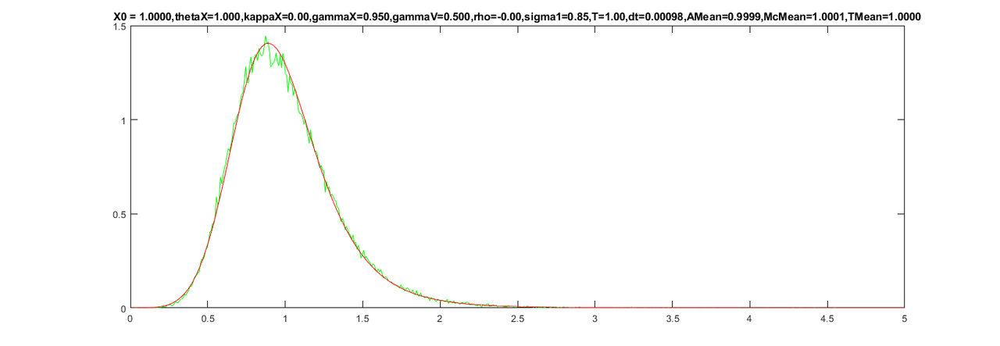](https://postimg.cc/4YqJWmBP)

[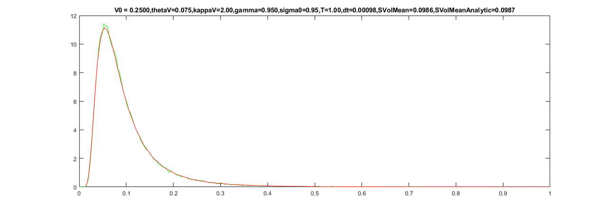](https://postimg.cc/w17q5hc3)

---

### #1240 — Amin (Topic Author)
*September 9, 2021, 6:05 PM*

Please in the main program, replace this

```
for nn=wnStart:Nn
    for mm=wnStart:Mm
        if(y(nn,mm)>0)
            dy0(nn,ynStart(nn):Mm)=(yMu0dt(nn,ynStart(nn):Mm)+
Zy2(nn,ynStart(nn):Mm)-Zy1(nn,ynStart(nn):Mm)+yDiff0(nn,ynStart(nn):Mm) ...
                ).*dydZ0(nn,ynStart(nn):Mm).^-1;
        else
            dy0(nn,ynStart(nn):Mm)=real((yMu0dt(nn,ynStart(nn):Mm)+
Zy2(nn,ynStart(nn):Mm)-Zy1(nn,ynStart(nn):Mm))).*real(dydZ0(nn,ynStart(nn):Mm)).^-1;
        end
    end
end
```

with this

,

```
for nn=wnStart:Nn

            dy0(nn,ynStart(nn):Mm)=(yMu0dt(nn,ynStart(nn):Mm)+
Zy2(nn,ynStart(nn):Mm)-Zy1(nn,ynStart(nn):Mm)+yDiff0(nn,ynStart(nn):Mm) ...
                ).*dydZ0(nn,ynStart(nn):Mm).^-1;

end
```

---

### #1241 — Amin (Topic Author)
*September 10, 2021, 4:56 AM*

Friends, I updated my resume and I am posting a copy of it here:

Ahsan Amin

Email: [[email protected]](/cdn-cgi/l/email-protection#59383738376b606060192038313636773a3634)

Phone: +92-336-2602125

Website: https://ahsanamin2999.wordpress.com/

Research Website: [https://papers.ssrn.com/sol3/cf_dev/Abs ... _id=435366](https://papers.ssrn.com/sol3/cf_dev/AbsByAuth.cfm?per_id=435366)

Education

New York University, New York, NY, USA.

Masters of Arts in Economics with a concentration in Mathematical Finance, September 2002.

Wrote my thesis on pricing of Bermudan Swaptions and other Bermudan structured Derivatives within the framework of Libor
Market Model. Libor Market Model was the newly introduced and most modern interest rate model at that time. My thesis
was titled, “Pricing Bermudan fixed income derivatives in multi-factor extended LIBOR market model.” My thesis was cited
in several other research papers/theses.

Northwestern University, Evanston, IL, USA.

Bachelor of Science in Electrical Engineering, March 97

Work

CEO, Infiniti Derivatives Technologies, Lahore, Pakistan

Feb 2012 - Present

1.       My company  web site is: [http://www.infinitiderivatives.com](http://www.infinitiderivatives.com/)

2.      Worked on research on the analytic solution of ordinary differential equations. I presented methods for analytic solution of general nth-order ordinary differential equations and also for the analytic solution of systems of nth-order ordinary differential equations. My research is discussed in the research paper, "On the General Solution of Initial Value Problems of Ordinary Differential Equations Using the Method of Iterated Integrals" downloadable at https://papers.ssrn.com/sol3/papers.cfm?abstract_id=2872598

3.      I found solution to the problem of high order monte carlo simulations of Stochastic differential equations and
now you can easily do accurate monte carlo simulations to arbitrarily higher order based on my work. This is probably my
best and most useful work. I have been able to simulate with great precision a correlated stochastic volatility system
of two SDEs with arbitrary drift and volatility parameters in each of the SDE with this method.

4.      I worked for a very accurate method to find the numerical solution of Fokker-Planck equation for SDEs in
original and Bessel coordinates. The method is extremely fast, explicit and works where many other methods fail. The new
method is based on principle of conservation of probability mass and results from an equation that I call sister
equation to continuity equation of physics.

5.      I have extended the method of solution of Fokker-planck equations by probability mass conservation to two
dimensions to find out the solution of a general 2D PDE where underlying SDEs have arbitrary parameters. This method
nests all models like Heston, SABR, ZABR, Cheyette and many other two dimensional stochastic volatility models but some
more work remains to be done to nest all these models.

6.      I suggested a new method to evolve and discretize the solution of SDEs on a transition probabilities grid. My
method represents the next generation version of quantizers algorithm. My next research goal is to do simulation of
smooth and non-smooth functionals of SDEs on this transition probabilities grid.

7.       I suggested a new method to construct the densities that can match moments of any order to the density with
precision. The method ensures that density is perfectly positive, completely normalized, and simultaneously matches all
given moments. Now you would not need Edgeworth expansions, or Gram-Charlier because my suggested method works better.

8.      My research paper titled, “Calibration, Simulation and Hedging in a Heston Libor Market Model with Stochastic Basis” was an invited publication in a Risk book “Interest Rate Modelling after the Financial Crisis.” Here is the link to Risk book web site: [http://riskbooks.com/interest-rate-mode ... ial-crisis](http://riskbooks.com/interest-rate-modelling-after-the-financial-crisis)

9.      I also successfully completed another research project which resulted in the research paper titled “Solution of Stochastic Volatility Models Using Variance Transition Probabilities and Path Integrals.” This paper can be downloaded at https://papers.ssrn.com/sol3/papers.cfm?abstract_id=2149231

10.  I worked with a method to predict an arbitrary volatile time series of the kind that appears in stocks and other
financial instruments trading using slowly moving parameters method applied through Kalman filtering. This method can
also be used to model the degree of mean-reversion in financial instruments and helps in mean-reversion and convergence
trades.

Quantitative Research Analyst, UP-FRONT Inc., Tokyo, Japan

Feb 2003 – Oct 2010

It was a research and development Role and I was based in Lahore, Pakistan. These were the major research projects I
completed with Upfront.

1.      I developed a stochastic volatility displaced diffusion LIBOR Market Model.  Worked on global Calibration of the
model to more than 2000 swaptions with forward curve out to sixty years. Priced callable structured derivatives and more
exotic deals as well as their deltas and vegas in this stochastic volatility model.

2.      Worked on advanced multi-factor skew extended calibration of LIBOR Market model. Very robust smoothing
constraints were implemented which were required for stability of hedges. Worked with calibration of four different
versions of skew extended LIBOR Market Models. Successfully dealt with the problem of simultaneous calibration of the
whole swaptions matrix.

3.      Worked extensively with pricing of most complex callable LIBOR exotics. The instruments include Bermudans
swaptions, Bermudan callable reverse floaters, Bermudan captions, Bermudan CMS floaters, Bermudan CMS reverse floaters,
Bermudan CMS spread options, CMS TARN structures, Bermudan Snowballs, snowblades, and Bermudan callable PRDC.

4.      Extended Longstaff and Schwartz method to deal with complex callable fixed income structured derivatives in my research paper, “Multi-Factor Cross Currency Libor Market Models: Implementation, Calibration and Examples.” The paper can be downloaded here: [https://papers.ssrn.com/sol3/papers.cfm ... id=1214042](https://papers.ssrn.com/sol3/papers.cfm?abstract_id=1214042)

5.      Worked on the pricing of Bermudan Callable and Trigger Power Reverse Dual Currency Note and other FX/IR hybrid
derivatives. Developed a multi-factor cross-currency LIBOR Market Model for the pricing of these instruments.
Implemented the advanced analytics of the model on Excel using VBA and C++.

6.      Worked on a three factor Hull White Cross Currency model in Cheyette framework for fast pricing of Bermudan
trigger PRDCs. This involved analytic calibration of the model to FX volatilities and to swaption volatilities of local
and foreign economy.

---

### #1242 — Amin (Topic Author)
*September 10, 2021, 9:14 AM*

>
> Friends, I continued to work to improve the behavior of program at zero and made some more improvements. When I was
working on the program in my room, mind control agents continued to repeatedly release very very sickening gas in my
room and now I have very little energy left to do any more work. The gas continued to sap all energy out of me. During
past few weeks, mind control agents have got far bolder in releasing the gas in my room ,out of the ACs in every room in
the house. Several rooms in our house had better air-conditioning but after I would work there for a few days, the would
start releasing large amounts of gas from the ACs. Now I do not turn on air-conditioning despite very high humidity but
they continue to release large amount of gas in my room and other places where I work.
>
> I continued to write for a week to ten days about mind control torture on me but the torture was not decreasing so I
just simply gave up on writing about it everyday.
>
> As a succession of what I revealed a few weeks ago, I will like to tell friends that a jewish billionaire is Godfather
of mind control. Though there are far richer billionaires in US who are staunchly opposed to mind control, they are not
ready to shell out hundreds of millions of dollars to bribe anyone to end mind control while mind control Godfather 
continues to give large bribes to people to continue mind control. Many of the people related to defense in mind control
are given extremely high paying jobs in Godfather's companies after they retire from mind control and Godfather is
extremely generous towards them and it is well established and well known to people in mind control after retarding
muslims, blacks and others in their career, they will move to paradise after they retire. No wonder there is no let up
in mind control whatever good people try. So much so for goodness in American society where at the end of the day it is
money that controls everything.
>
We know in almost all classic folk lore stories evil is too strong and too sure of itself while good is mostly weak and
just trying to protect itself from evil who is bent on damaging and eradicating the weak and the poor good but it is the
weak and poor good that finally prevails. I want to tell good American friends that evil at this stage has become too
bold and thousands of talented people are retarded every year. And it is just not muslims and blacks that are on the
line, several hundreds of brilliant whites are retarded across United States by mind control agency every year that has
become too emboldened due to lack of any accountability. Thousands of foreigners are also kept retarded in dozens of
countries including many European countries.

I want to tell friends something I have said before here that I am sure American society would eventually end the menace
of mind control from their and other countries. I want to request all good Americans and Europeans to come forward and
invite any investigative journalist you know to read my threads and ask them to help end the menace of mind control in
our societies through their investigative journalism. Without any accountability evil will continue to grow stronger and
then mind control would start to threaten even those people who consider themselves safe due to affiliations, status or
wealth.

I want to request CNN, New York Times, Washington Post and large reputed European media outlets to run a comprehensive
story on mind control torture, retarding and victimization of intelligent people of US and other nations by crooks in US
army on behest of some powerful people in United States and due to rightwing extremist biases of these crooks. If you
would like to do investigative research about animal practices of US army, one great resource would be mainland European
embassies in Muslim countries who keep a detailed account of mind control persecution of intelligent muslims in these
countries by crooks in US army. Many of the staff in mainland European embassies are very good human beings who abhor
such practices and would love to cooperate with good journalists in exposing the evil animal practices of US army
crooks. Only the accounts of people at mainland European embassies in muslim countries thorough animal practices of
American army's mind control wing would be enough to drop a great bombshell in the media and general public all across
the world. I want to warn all the good people who try to have a civilized dialogue with crooks in American army to end
their evil practices that their being nice with crooks is a very misguided approach. Since good people do not have the
power to forcefully end the evil practices of US army crooks, only way to end the evil practices of US army crooks is by
exposing them openly in US public and all across the world.

It seems that crooks in American army and mind control  are unable to pay a heed to civilized calls by good American
people and others to end their animal cruel practices and remain bent on mischief. If crooks in American army and mind
control remain adamant on continuing evil practices, the only solution seems that some brave investigative journalists
expose them by running a comprehensive story on mind control practices by American army. It seems that doing a civilized
dialogue with hardened crooks in mind control gives them a strong sense of weakness of good people and makes the crooks
even more adamant to continue their evil practices.  Reminds me of  Abu-Gharib. Very similarly, Crooks in defense had no
conception that they were doing any wrong thing when there was a culture of openly urinating on human captives. It was
an open thing in army and most crooks thought it was indeed a very right thing to do( and I am sure some of those crooks
still believe that it was a right thing they did even after being reprimanded by the broader American society). It was
not until brave people at CNN did a daring story against animal practices by crooks that evil practices stopped. Though
American army crooks retard intelligent people of all color and creed, these ultra right wing army crooks love to retard
blacks and muslims with great relish. Blacks are only 8-10% of US population but make a very large proportion of victims
in united states since many ultra right wing crooks in US army would rather die than let those intelligent blacks
succeed in American society in a big way.

---

### #1243 — Amin (Topic Author)
*September 10, 2021, 6:00 PM*

Friends, I am posting a transition probabilities calculation program for a 1 dimensional SDE. Friends would recall, at
the start of this year, when I was trying to do the same thing, we had to develop a lot of infrastructure for that but
now with precise calculations of  1D SDEs with probability conservation method, it has become almost trivial to
construct transition probabilities on this grid. I quickly wrote this program in past two hours and the purpose is to do
a full scale monte carlo like simulations with path integrals of smooth or non-smooth functionals of SDEs like forward
densities of swaps or other structured payoffs and later we could do a backward dynamic programming on the same grid to
find the values of American/bermudan/callable instruments and their hedges. I want to do this on 1D grid first and then
take it to 2D grid after we have successfully tackled 1D SDEs.

I have calculated transition probabilities in bessel coordinates but please note that they remain the same across bessel
transformation and can directly be used for original coordinates.

Here is the intermediate program I quickly wrote with transition probabilities calculations. Please note how simple
these calculations are as compared to what we were trying to do at the start of this year.

```
function [] = FPERevisitedTransProb08ABwNew04DownloadedAndPI()

%Copyright Ahsan Amin. Infiniti derivatives Technologies.
%Please fell free to connect on linkedin: linkedin.com/in/ahsan-amin-0a53334
%or skype ahsan.amin2999
%In this program, I am simulating the SDE given as
%dy(t)=mu1 x(t)^beta1 dt + mu2 x(t)^beta2 dt +sigma x(t)^gamma dz(t)

%I have not directly simulated the SDE but simulated the transformed
%Besse1l process version of the SDE and then changed coordinates to retreive
%the SDE in original coo
%rdinates.
%The present program will analytically evolve only the Bessel Process version of the
%SDE in transformed coordinates.

dt=.125/16/2/2/2;   % Simulation time interval.%Fodiffusions close to zero
             %decrease dt for accuracy.
Tt=128*2*2*2*2;     % Number of simulation levels. Terminal time= Tt*dt; //.125/32*32*16=2 year;
T=Tt*dt;
OrderA=4;  %
OrderM=4;  %
dtM=.0625/2;
TtM=T/dtM;

dNn=.2/1;   % Normal density subdivisions width. would change with number of subdivisions
Nn=50;  % No of normal density subdivisions
NnMidl=25;%One half density Subdivision left from mid of normal density(low)
NnMidh=26;%One half density subdivision right from the mid of normal density(high)
NnMid=4.0;

x0=1;   % starting value of SDE
beta1=0.0;
beta2=1.0;   % Second drift term power.
gamma=.95;%50;   % volatility power.
kappa=4.0;%.950;   %mean reversion parameter.
theta=.25;%mean reversion target
sigma0=1.50;%Volatility value

%you can specify any general mu1 and mu2 and beta1 and beta2.
mu1=1*theta*kappa;   %first drift coefficient.
mu2=-1*kappa;    % Second drift coefficient.
%mu1=0;
%mu2=0;

alpha=1;% x^alpha is being expanded. This is currently for monte carlo only.
alpha1=1-gamma;%This is for expansion of integrals for calculation of drift
%and volatility coefficients
yy(1:Nn)=x0;
w(1:Nn)=x0^(1-gamma)/(1-gamma);
ws2(1:Nn)=w(1:Nn);

%Z(1:Nn)=(((1:Nn)-5.5)*dNn-NnMid);
Z(1:Nn)=(((1:Nn)-5.5)*dNn-NnMid);

Z
str=input('Look at Z');
ZProb(1)=normcdf(.5*Z(1)+.5*Z(2),0,1)-normcdf(.5*Z(1)+.5*Z(2)-dNn,0,1);
ZProb(Nn)=normcdf(.5*Z(Nn)+.5*Z(Nn-1)+dNn,0,1)-normcdf(.5*Z(Nn)+.5*Z(Nn-1),0,1);
ZProb(2:Nn-1)=normcdf(.5*Z(2:Nn-1)+.5*Z(3:Nn),0,1)-normcdf(.5*Z(2:Nn-1)+.5*Z(1:Nn-2),0,1);
    %Above calculate probability mass in each probability subdivision.

%%%%%%%%%%%%%%%%%%%%%%%%%%%%%%%%%%%%%%%%%%%%%%%%%%%%%%%%%%%%%%%%%%%%%%%%%%%%%%%%%%%%%%%%%%%%%%

sigma11(1:OrderA+1)=0;
mu11(1:OrderA+1)=0;
mu22(1:OrderA+1)=0;
sigma22(1:OrderA+1)=0;
% index 1 correponds to zero level since matlab indexing starts at one.
sigma11(1)=1;
mu11(1)=1;
mu22(1)=1;
sigma22(1)=1;

for k=1:(OrderA+1)
    if sigma0~=0
        sigma11(k)=sigma0^(k-1);
    end
    if mu1 ~= 0
        mu11(k)=mu1^(k-1);
    end
    if mu2 ~= 0
        mu22(k)=mu2^(k-1);
    end
    if sigma0~=0
        sigma22(k)=sigma0^(2*(k-1));
    end
end
%Ft(1:TtM+1,1:(OrderA+1),1:(OrderA+1),1:(OrderA+1),1:(OrderA+1))=0; %General time powers on hermite polynomials
Fp(1:(OrderA+1),1:(OrderA+1),1:(OrderA+1),1:(OrderA+1))=0;%General x powers on coefficients of hermite polynomials.
Fp1(1:(OrderA+1),1:(OrderA+1),1:(OrderA+1),1:(OrderA+1))=0;%General x powers for bessel transformed coordinates.

%YCoeff0 and YCoeff are coefficents for original coordinates monte carlo.
%YqCoeff0 and YqCoeff are bessel/lamperti version monte carlo.

YCoeff0(1:(OrderA+1),1:(OrderA+1),1:(OrderA+1),1:(OrderA+1))=0;
YqCoeff0(1:(OrderA+1),1:(OrderA+1),1:(OrderA+1),1:(OrderA+1))=0;
%Pre-compute the time and power exponent values in small multi-dimensional arrays
YCoeff = ItoTaylorCoeffsNew(alpha,beta1,beta2,gamma); %expand y^alpha where alpha=1;
YqCoeff = ItoTaylorCoeffsNew(alpha1,beta1,beta2,gamma);%expand y^alpha1 where alpha1=(1-gamma)
YqCoeff=YqCoeff/(1-gamma); %Transformed coordinates coefficients have to be
%further divided by (1-gamma)

for k = 0 : (OrderA)
    for m = 0:k
        l4 = k - m + 1;
        for n = 0 : m
            l3 = m - n + 1;
            for j = 0:n
                l2 = n - j + 1;
                l1 = j + 1;
                %Ft(l1,l2,l3,l4) = dtM^((l1-1) + (l2-1) + (l3-1) + .5* (l4-1));
                Fp(l1,l2,l3,l4) = (alpha + (l1-1) * beta1 + (l2-1) * beta2 + (l3-1) * 2* gamma + (l4-1) * gamma ...
                    - (l1-1) - (l2-1) - 2* (l3-1) - (l4-1));
                Fp1(l1,l2,l3,l4) = (alpha1 + (l1-1) * beta1 + (l2-1) * beta2 + (l3-1) * 2* gamma + (l4-1) * gamma ...
                    - (l1-1) - (l2-1) - 2* (l3-1) - (l4-1));

                YCoeff0(l1,l2,l3,l4) =YCoeff(l1,l2,l3,l4).*mu11(l1).*mu22(l2).*sigma22(l3).*sigma11(l4);
                YqCoeff0(l1,l2,l3,l4) =YqCoeff(l1,l2,l3,l4).*mu11(l1).*mu22(l2).*sigma22(l3).*sigma11(l4);
            end
        end
    end
end

%%%%%%%%%%%%%%%%%%%%%%%%%%%%%%%%%%%%%%%%%%%%%%%%%%%%%%%%%%%%%%%%%%%%%%%%%%%%%%%%%%%%%%%%%%%%%%

wnStart=1;%
ss=0;
tic

Zt1(wnStart:Nn)=0.0;
Zt2(wnStart:Nn)=0.0;
for tt=1:Tt

    [wMu0dt,dwMu0dtdw,c1] = CalculateDriftAndVolA4(w,wnStart,Nn,YqCoeff0,Fp1,gamma,dt);

    [wMid] =
InterpolateOrderN8(8,0,Z(NnMidl-3),Z(NnMidl-2),Z(NnMidl-1),Z(NnMidl),Z(NnMidh),Z(NnMidh+1),Z(NnMidh+2),Z(NnMidh+3),w(NnMidl-3),w(NnMidl-2),w(NnMidl-1),w(NnMidl),w(NnMidh),w(NnMidh+1),w(NnMidh+2),w(NnMidh+3));

    Zt1(wnStart:Nn)=w(wnStart:Nn)-wMid;

    [dwdZ,d2wdZ2A] = First2Derivatives2ndOrderEqSpacedA(wnStart,Nn,dNn,Zt1,Z);

    C0(wnStart:Nn)=Zt1(wnStart:Nn)-dwdZ(wnStart:Nn).*Z(wnStart:Nn);

    %Zt2(wnStart:Nn)=C0(wnStart:Nn)+abs(sqrt((dwdZ(wnStart:Nn)).^2+sigma0^2*dt)).*Z(wnStart:Nn);
    Zt2(wnStart:Nn)=C0(wnStart:Nn)+abs(sqrt((dwdZ(wnStart:Nn)).^2+c1(wnStart:Nn).^2)).*Z(wnStart:Nn);

    [dw2dZ,d2w2dZ2A] = First2Derivatives2ndOrderEqSpacedA(wnStart,Nn,dNn,Zt2,Z);
    if(tt>20)
        w(wnStart:Nn)=w(wnStart:Nn)+ ...
            wMu0dt(wnStart:Nn)+Zt2(wnStart:Nn)-Zt1(wnStart:Nn)+ ...
            0*.5*sigma0^2*(dwdZ(wnStart:Nn).^(-2)).*d2wdZ2A(wnStart:Nn).*dt+ ...
            .5*sigma0^2*(dw2dZ(wnStart:Nn).^(-2)).*d2w2dZ2A(wnStart:Nn).*dt;
    else
        w(wnStart:Nn)=w(wnStart:Nn)+ ...
            wMu0dt(wnStart:Nn)+Zt2(wnStart:Nn)-Zt1(wnStart:Nn);%+ ...
    end
    %yy(wnStart:Nn)=((1-gamma).*w(wnStart:Nn)).^(1/(1-gamma));

    [wE] =
InterpolateOrderN6(6,Z(Nn)+dNn,Z(Nn),Z(Nn-1),Z(Nn-2),Z(Nn-3),Z(Nn-4),Z(Nn-5),w(Nn),w(Nn-1),w(Nn-2),w(Nn-3),w(Nn-4),w(Nn-5));

     w1(1:Nn-1)=w(1:Nn-1);
     w1(Nn)=w(Nn);
     w2(1:Nn-1)=w(2:Nn);
     w2(Nn)=wE;
     w(w1(:)>w2(:))=0;%Be careful;might not universally hold;
      %Change 3:7/25/2020: I have improved zero correction in above.
     w(w<0)=0.0;
     for nn=1:Nn
         if(w(nn)<=0)
            wnStart=nn+1;
         end
     end

     if(rem(tt,10)==0) %Since original grid is too fine in time, we want to find transition probabilities between grids
every ten time steps apart.
        ss=ss+1;
        ds=dt*10;
        ws1(wnStart:Nn)=ws2(wnStart:Nn);
        ws2(wnStart:Nn)=w(wnStart:Nn);

        [ws2a,ws2b] = CalculateGridStartsAndEndsBoundedEnds(ws2,Z,wnStart,Nn,dNn);

        [Muw,Sigmaw,Sigma2w,Sigma3w] = CalculateDriftAndVolA404B4Drift02(ws1,wnStart,Nn,YqCoeff0,Fp1,gamma,ds);
        Pn(1:Nn)=0.0;
        for mm=wnStart:Nn
            Zt(wnStart:Nn)=(2*(-ws2b(wnStart:Nn)+ws1(mm)+Muw(mm)-Sigma2w(mm)))./(-Sigmaw(mm) -
sqrt(Sigmaw(mm).^2-4*Sigma2w(mm).*(-ws2b(wnStart:Nn)+ws1(mm)+Muw(mm)-Sigma2w(mm))));

            Zt(wnStart:Nn)=real(Zt(wnStart:Nn));
            Pm0n(wnStart:Nn)=normcdf(Zt(wnStart:Nn),0,1);
            %Pmn below is integrated transition probability between grid
            %cell mm at time (ss-1)*ds to cells wnStart:Nn on next grid at
            %time ss*ds.
            Pmn(mm,wnStart)=Pm0n(wnStart).*ZProb(mm);
            Pmn(mm,wnStart+1:Nn-1)=(Pm0n(wnStart+1:Nn-1)-Pm0n(wnStart:Nn-2)).*ZProb(mm);
            Pmn(mm,Nn)=(1-Pm0n(Nn-1)).*ZProb(mm);
        %    Pn(wnStart:Nn)=Pn(wnStart:Nn)+Pmn(mm,wnStart:Nn);
        end

        %plot((wnStart:Nn),Pn(wnStart:Nn),'r',(wnStart:Nn),ZProb(wnStart:Nn),'g');
        %str=input('Look at graph comparison')
     end

end
yy(wnStart:Nn)=((1-gamma).*w(wnStart:Nn)).^(1/(1-gamma));
Dfyy(wnStart:Nn)=0;
for nn=wnStart+1:Nn-1

    Dfyy(nn) = (yy(nn + 1) - yy(nn - 1))/(Z(nn + 1) - Z(nn - 1));
    %Change of variable derivative for densities
end

pyy(1:Nn)=0;
for nn = wnStart:Nn-1

    pyy(nn) = (normpdf(Z(nn),0, 1))/abs(Dfyy(nn));
end

toc

ItoHermiteMean=sum(yy(wnStart+1:Nn-1).*ZProb(wnStart+1:Nn-1)) %Original process average from coordinates
disp('true Mean only applicable to standard SV mean reverting type models otherwise disregard');
TrueMean=theta+(x0-theta)*exp(-kappa*dt*Tt)%Mean reverting SDE original variable true average

theta1=1;
rng(29079137, 'twister')
paths=200000;
YY(1:paths)=x0;  %Original process monte carlo.
Random1(1:paths)=0;
for tt=1:TtM

    Random1=randn(size(Random1));
    HermiteP1(1,1:paths)=1;
    HermiteP1(2,1:paths)=Random1(1:paths);
    HermiteP1(3,1:paths)=Random1(1:paths).^2-1;
    HermiteP1(4,1:paths)=Random1(1:paths).^3-3*Random1(1:paths);
    HermiteP1(5,1:paths)=Random1(1:paths).^4-6*Random1(1:paths).^2+3;

    YY(1:paths)=YY(1:paths) + ...
        (YCoeff0(1,1,2,1).*YY(1:paths).^Fp(1,1,2,1)+ ...
        YCoeff0(1,2,1,1).*YY(1:paths).^Fp(1,2,1,1)+ ...
        YCoeff0(2,1,1,1).*YY(1:paths).^Fp(2,1,1,1))*dtM + ...
        (YCoeff0(1,1,3,1).*YY(1:paths).^Fp(1,1,3,1)+ ...
        YCoeff0(1,2,2,1).*YY(1:paths).^Fp(1,2,2,1)+ ...
        YCoeff0(2,1,2,1).*YY(1:paths).^Fp(2,1,2,1)+ ...
        YCoeff0(1,3,1,1).*YY(1:paths).^Fp(1,3,1,1)+ ...
        YCoeff0(2,2,1,1).*YY(1:paths).^Fp(2,2,1,1)+ ...
        YCoeff0(3,1,1,1).*YY(1:paths).^Fp(3,1,1,1))*dtM^2 + ...
        ((YCoeff0(1,1,1,2).*YY(1:paths).^Fp(1,1,1,2).*sqrt(dtM))+ ...
        (YCoeff0(1,1,2,2).*YY(1:paths).^Fp(1,1,2,2)+ ...
        YCoeff0(1,2,1,2).*YY(1:paths).^Fp(1,2,1,2)+ ...
        YCoeff0(2,1,1,2).*YY(1:paths).^Fp(2,1,1,2)).*dtM^1.5) .*HermiteP1(2,1:paths) + ...
        ((YCoeff0(1,1,1,3).*YY(1:paths).^Fp(1,1,1,3) *dtM) + ...
        (YCoeff0(1,1,2,3).*YY(1:paths).^Fp(1,1,2,3)+ ...
        YCoeff0(1,2,1,3).*YY(1:paths).^Fp(1,2,1,3)+ ...
        YCoeff0(2,1,1,3).*YY(1:paths).^Fp(2,1,1,3)).*dtM^2).*HermiteP1(3,1:paths) + ...
        ((YCoeff0(1,1,1,4).*YY(1:paths).^Fp(1,1,1,4)*dtM^1.5 )).*HermiteP1(4,1:paths) + ...
        (YCoeff0(1,1,1,5).*YY(1:paths).^Fp(1,1,1,5)*dtM^2.0).*HermiteP1(5,1:paths);

end

YY(YY<0)=0;
disp('Original process average from monte carlo');
MCMean=sum(YY(:))/paths %origianl coordinates monte carlo average.
disp('Original process average from our simulation');
ItoHermiteMean=sum(yy(wnStart+1:Nn-1).*ZProb(wnStart+1:Nn-1)) %Original process average from coordinates

disp('true Mean only applicble to standard SV mean reverting type models otherwise disregard');
TrueMean=theta+(x0-theta)*exp(-kappa*dt*Tt)%Mean reverting SDE original variable true average

MaxCutOff=30;
NoOfBins=round(300*gamma^2*4*sigma0/sqrt(MCMean)/(1+kappa));%Decrease the number of bins if the graph is too
[YDensity,IndexOutY,IndexMaxY] = MakeDensityFromSimulation_Infiniti_NEW(YY,paths,NoOfBins,MaxCutOff );
plot(yy(wnStart+1:Nn-1),pyy(wnStart+1:Nn-1),'r',IndexOutY(1:IndexMaxY),YDensity(1:IndexMaxY),'g');
 %plot(y_w(wnStart+1:Nn-1),fy_w(wnStart+1:Nn-1),'r',IndexOutY(1:IndexMaxY),YDensity(1:IndexMaxY),'g',Z(wnStart+1:Nn-1),fy_w(wnStart+1:Nn-1),'b');

title(sprintf('x0 = %.4f,theta=%.3f,kappa=%.2f,gamma=%.3f,sigma=%.2f,T=%.2f,dt=%.5f,M=%.4f,TM=%.4f',
x0,theta,kappa,gamma,sigma0,T,dt,ItoHermiteMean,TrueMean));%,sprintf('theta= %f', theta), sprintf('kappa = %f',
kappa),sprintf('sigma = %f', sigma0),sprintf('T = %f', T));

legend({'Ito-Hermite Density','Monte Carlo Density'},'Location','northeast')

str=input('red line is density of SDE from Ito-Hermite method, green is monte carlo.');

end
```

.

.

.

Here is the output of this program.

ItoHermiteMean =

   0.250230651876615

true Mean only applicable to standard SV mean reverting type models otherwise disregard

TrueMean =

   0.250251596970927

Original process average from monte carlo

MCMean =

   0.249542499753951

Original process average from our simulation

ItoHermiteMean =

   0.250230651876615

true Mean only applicble to standard SV mean reverting type models otherwise disregard

TrueMean =

   0.250251596970927

IndexMax =

   651

red line is density of SDE from Ito-Hermite method, green is monte carlo.

---

### #1244 — Amin (Topic Author)
*September 12, 2021, 8:37 PM*

Friends, I was able to make great progress on simulation of densities of smooth and non-smooth functionals on transition
probabilities grid. I was able to write very simple matrix equations that perfectly retrieve the expectations of
functionals of SDE forward into time on the transition probabilities grid. I had continued to try this earlier without
any luck but now it turned out to be  very easy and quite simple. There are still some very minor issues that I hope to
resolve in next 2-3 days. I have made the major breakthrough and I will be sharing the analytics through latex equations
very soon and of course post the program as well.

---

### #1245 — Amin (Topic Author)
*September 13, 2021, 7:24 PM*

Friends, I have been able to match analytic densities of path integrals of SDEs from transition probability grid with
path integral densities from monte carlo. Now it works quite well for mean-reverting SDEs. I will be finessing things
further and match analytic densities of path integrals of functions of SDEs with their monte carlo densities tomorrow.
And also work on weights on path integrals that are not smooth in time and change arbitrarily across time. I hope to be
posting initial programs in two to three days.

---

### #1246 — Amin (Topic Author)
*September 18, 2021, 2:16 PM*

Friends, I have been doing work on calculation of forward expectations of functionals of SDE on a transition
probabilities grid. I have been trying to put everything on a reasonable mathematical foundation. In forward simulation
important problem is how to faithfully retrieve the expectations of events that occurred on the previous time grids.
Usually, though not always, variance of underlying SDE distribution increases as we advance into next(or later) time
grids. But expectations of SDE related functions evaluated on previous time grids were calculated with respect to SDE
distribution at previous times when underlying SDE variance was (usually) slightly lesser. So in order to faithfully
retrieve the densities of functionals of SDE in future time grids we have to add some appropriate variance. This added
variance makes sure that we can retrieve the functionals densities with expectations evaluated at earlier times with
smaller underlying variance faithfully with respect to each of the later time SDE grids when underlying SDE distribution
variance has increased. But a side effect of this addition of variance is that covariances across time also increase in
proportion to added variance. Expectations of Path integrals are highly sensitive to covariances of the functionals
across different time grids so we have to make an accounting for how much appropriate relevant covariances have
increased. This can be done in several ways since we know how much extra variance was added to expectations of
functionals on each time step to convert the functionals expectation originally calculated with respect to lower
variance underlying SDE grid into expectations with respect to SDE grids at later times with higher variance.

I am working on various mathematical issues so that we can find expectations of functionals of every SDE even when we do
not analytically know the SDE covariances across time.

It may be still a few days before I could post a perfectly working program since I want to change a lot of things in my
previous program as my understanding of the problem has become better. I will be posting comments regularly for next few
days before I post a full-fledged worked out program.

---

### #1247 — Amin (Topic Author)
*September 20, 2021, 6:39 PM*

There is some different progress so I thought I will mention it here for friends. Though I had a completely worked out
plan how to convert the expectations of functions from an earlier SDE grid to a later time grid, I just thought that I
should try measure theory for this purpose and if things could work, it would be a far more elegant solution to finding
the densities of functionals of SDE. Towards that goal, I wrote down exponential likelihood function of general
(possibly mean-reverting) SDEs with drift and state dependent variances (By doing Ito change of variable on log of SDE
variable) and I was able to faithfully transport some very simple payoffs forward in time. However, it still remains to
be seen if slightly more difficult payoffs could be transported in time and I still have to work to see that. As only
seeing is believing, I still cannot be sure if the measure transport method would universally work but I am quite
optimistic. I will get more detailed results in another day and will let friends know how it goes as my research
progresses.

---

### #1248 — Amin (Topic Author)
*September 25, 2021, 12:20 PM*

Friends, I would not be writing this post if it were not for torture that started four days ago. I was working on my
projects at full speed when mind control agents targeted me with drugged water and started giving me attacks of very
strong anxiety and I was totally unable to work for past four days. These attacks of very strong anxiety lasted everyday
after that and therefore I decided to write more about mind control and not about mathematical finance that all of us
including myself love so much. I have not so huge interest about whining about mind control but if the torture
continues, I have lined up many posts about mind control that will follow.

I am copying an old post of mine and want to ask friends if mind control agencies were serving United States or trying
to please their godfather. I still recall when mind control agent who made more than 800 million dollars and when he
would narrate me incidents in which he would describe to his jewish backer professors at my previous school the stories
of how targeted talented Pakistani muslims would beg to end mind control torture on them and then mind control agent
would tell me how excited, amused and delighted some jewish professors at my old school would be when they would hear
how talented muslim targets were desperately begging to end mind control that would never end. I am not lying and
therefore the agent was able to make more than 800 million dollars.

Again I do not want to write such stuff but if my mind control continues, there is a lot more on the way.

I am copying an old post of mine and want to ask friends if mind control agencies were serving United States or trying
to please their godfather.

.

.
>
> Thank you Paul for your post. I will look at the website you mentioned. But I want to really thank you for letting me
write bold things on your forum that most forum owners would not allow. Though I might have different ideas than you on
a lot of issues, I am a staunch supporter of freedom of speech just like you are and I am sure both of us agree on one
slogan,"Je suis Charlie". I consider myself lucky to have been writing on your forum since 2003.
>
>
>
> I want to write this post to ask American tax payers to please cut funding of crooks in US army. I was reading that
there has not been a successful audit of spending by US army in past decade. You would probably ask me why you should do
anything to bridle spending by crooks in army. Here is why.
>
> Crooks in US defense have spent several billion dollars in attempts to retard me over past twenty years. I went to
Hong Kong in 2000 to find a job in finance and derivatives and I stayed there for three months. Crooks in US army
continues to drug food and water at large number of places in Hong Kong and Kowloon and continued to play all sort of
tricks with me. I still recall when I went to office of South China Morning Post to tell them how badly they had drugged
the city of Hong Kong, they had already set up someone who received me and told me after hearing my story that he did
not believe me.
>
> They gave me electric shocks twenty days after I returned from Hong Kong.
>
> Later I was asked by my Japanese employer to come to Tokyo (2005) and work in their office there(I was earlier working
from Lahore). They drugged large number of places in Tokyo city and mad e my life absolute hell and I resigned only
after one month of stay in Tokyo. I did not want to return to Pakistan due to huge persecution by my family and the army
so I decided to go somewhere where US military could not go and got Iranian visit visa from Tokyo and went to Tehran.
>
> Crooks in US defense gave huge amount of money to Iranian crooks(crooks everywhere know each other well) and they used
huge microwave and gases torture on me. I still recall on my first night in an Iranian hotel, I left the hotel after
midnight and randomly ran in streets of Tehran to somehow avoid pain due to directed microwave torture. Just after two
or three days in Tehran, I was trying to find refuge in embassies like Vatican in Tehran asking them to help me on human
grounds. I left Tehran after one week and flew back to Pakistan. I still recall that I arrived at Tehran airport a lot
earlier than flight departure. I had previously protested somewhere against unnecessary removal of shoes of Muslim
passengers and it was known to mind control agencies. They asked Iranians security on airport who approached me inside
the departure lounge and took me to a room and asked me to remove my shoes and had my body search.
>
> Since during all this, mind control agencies could not control me well and several of my neurotransmitters were coming
back, they had extremely huge amount of gases in washrooms in Dubai airport where I would stop for transit while going
to Karachi. No wonder ultra conservative crooks in US army align so well with Saudi(who dissolve their criticizers in
acid) and Dubai.
>
> Later I got British HSMP work visa and went to London in 2010. Crooks in US defense drugged several large cities of UK
on a large scale(it was impossible to get good beverages or bottled water. They even drugged beer, wine and pork at a
lot of places.) You can ask people in UK secret services(many of whom would love to tell you everything in detail) about
supernatural stories how they drugged food in cities of UK in 2010. I still recall that I wrote several page account of
my persecution and I would print hundred of copies of it and distribute them in London. When I was distributing those
papers outside of some London Newspapers, administration of those newspapers went to extreme length to point out that
certain part of sidewalk was their property and they would call police if I stepped there. I was forcefully removed from
the compound in London(after I had passed all security checks) when I went there to ask law firms for help and the law
firms on main street would refuse to meet me and say that I had to either email or send the letter by post and they
would not accept any papers from me(somebody would approach me at the door and tell me about it and ask me to leave.).
>
> They continued to drug food and beverages in entire city of Lahore numerous times in past ten years.
>
> Net worth of several mind control agents who continued to retard me in Pakistan is north of several hundred million
dollars each depending upon their seniority(with most senior agent worth 800 million USD).
>
> And this drugging of entire cities by crooks of US defense never ends. Now they are drugging the twin cities of
Rawalpindi/Islamabad.
>
> I am just telling about myself. There are tens of thousands of mind control victims all over the world.
>
> Please cut their funding before it is too late. They are not retarding just Muslims(I have no religion but of course I
am Muslim by birth) only, they retard a large number of totally innocent and talented Americans. Crooks love to bite the
same hand that feeds them(It is typical of crooks and large unbridled armies in human history)
>

---

### #1249 — Amin (Topic Author)
*October 2, 2021, 11:03 AM*

Friends, I have made several posts about jews and mind control and I hope this is my last post on the topic. I know when
I made first posts saying that some bad jews are behind targeting of most of the mind control victims, the reaction of
every non-jew would be something like,"I have a large number of jewish colleagues and as I know most of them, they
encourage muslim students to work hard and make something meaningful out of their lives and last thing my jewish
colleagues would wish for their muslim students is a life of inhuman mind control torture and abuse." And then most
people would shrug my accusations thinking I am somehow biased due to my life experiences. And this observation of most
people is exactly true about their jewish colleagues who are mostly good human beings like so many other nice and
good-natured Americans. Jews are like any other group of people in being inhomogeneous. While mainstream jews in America
would not do anything of the sort to hurt muslims or blacks, and many of them would encourage muslims and balcks to work
hard to excel in life, just like any other group there are enough bad jews that are connected together to make a ring
that keeps an eye on intelligent students and takes decisions who to retard. In an average university there would be on
average two or three or four mostly jewish academics (unconnected to a large number of accomplished jews in every
academic institution) who know very well about mind control infrastructure and are connected to  Jewish billionaire
Godfather's mind control personnel and also remain in touch with mind control agencies and routinely assign targets to
mind control agencies where incompetent crooks who want favors from billionaire godfather are always ready to oblige
them for their better future. Many of the good jewish professors do not know any more about these evil jewish academics
who are behind most mind control than their non-jewish colleagues. This nexus of jewish billionaire, mind control
agencies and two to three jewish academics in every university is spread over most of the academic institutions in
united states.

When I look at similarities and parallels, I find it interesting to notice that United States is becoming, just like
reactionary act of mind control, a country with more and more reactionary policies. For example I find that there is
more and more concern in United States about increasing might of China and a growing need to contain China. I want to
tell Americans that this is very misguided. If Americans were truly wise, they would never try to "contain" anyone, and
instead of containing anyone they would just do what needs to be done to make them a "country of excellence" something
they did so well over the past one century. When USSR was getting ahead in sciences and technology, America responded so
perfectly by emphasizing science and technology in its universities and Americans to this day reap the fruit of great
decisions for advancing science and mathematics in its academic institutions. Now when China is advancing so fast,
Americans need to make sure that they truly invest in education of their children and make sure that every intelligent
child becomes a star in its own right. Instead of so many other trillion dollar packages, Joe Biden would be far wiser
to spend 500 billion dollars to make sure that every child in US whether he is born in inner part of some large city or
some remote state would get the same great quality education, he would no longer need to worry about rising Chinese
might as American fortunes would continue to surpass any Chinese miracles. I really want to say to  American friends,
"Do not be reactionary. Just be original and genuine. Just do even better what you did so well over past one century."

It is interesting that the very people who could not get great education and had to become crooks in mind control
agencies instead of being doctors, lawyers and successful businessmen and then these crooks do all sort of evil things
in the society thinking that only way to get ahead in life is to join Godfather's paradise. Only great education in
backward states would decrease the mass of crap crooks doing evil things in US society.

---

### #1250 — Amin (Topic Author)
*October 6, 2021, 11:49 AM*

Friends, I have been writing on this thread since 2016 with occasional large breaks. I am going to take another break of
3-4 weeks now. I had been working on a market trading algorithm for quite some time and I took to improving it after my
post of 25th September. One reason my persecution continues is that I have not been able to make enough money to live
independently from my family. So I was thinking if I could write a great market trading algorithm and sell it, I could
try to get out of this problem of continuing mind control. I have been putting all my research other than market trading
research on internet so its value for me in terms of money sharply decreases so it was somewhat difficult to leverage it
to make enough money. Good thing is that my market trading research has matured enough and I have been able to write
great trading programs. Currently I am trying some methods to further improve my results. In two months' data I was able
to find returns ranging from 40% of notional to larger than 100% of notional which means that returns per month would
range from 20% to 50% of notional and I am not using any leverage. My algorithm is a market-making algorithm and enters
the trade only using limit orders but it is not a high frequency algorithm at all. Average time between  trades ranges
from one minute to 5 minutes and algorithm waits for opportune moments to start and end a trade. But you would like to
be filled quickly once the algorithm wants you to do that. I still have to calculate sensitivity to order execution
slippage but it should not be very large. Algorithm would work on highly liquid stocks but could be modified to deal
with moderately liquid stocks. One reason for high returns could be that I do not have to scale the algorithm to very
large amount of capital where investing like this would become difficult and would surely reduce the returns on large
capital though I still think that if larger amounts of capital are judiciously invested, returns would still be
far-better than many mainstream approaches.

Obviously, I am not going to post the algorithm since if I do that its effectiveness might end in a few weeks.

So I will be busy improving the algorithm and marketing it. I want to sell the algorithm to just 2-3 clients for money
in six figures. I am very afraid that mind control agencies would do everything in their power to thwart me here.

If I could successfully sell the algorithm, I will hire a team of 5-6 mathematicians and computer programmers and train
them in math finance and mathematics of trading. I want to tell friends that I actively want to continue doing research
in mathematical finance and would continue posting very interesting things and research in the future with a more
professional setup. I want to  keep posting my research and programs on Wilmott for several years into the future.

My post would be incomplete if I do not thank so many American people who protested to mind control agencies against my
continuing persecution when it was becoming very difficult for me to continue my research  and mind control activity
decreased due to protests from those good people and I was able to restart my research. And I also want to thank so many
readers of this forum across the world who wished me well and wanted me to succeed and do good research. And I want to
say to Americans that even if I succeeded in life, I will try to be a good human being and they will find a friend of
American people in me.

One last thing, please ask mind control agencies who have access to my computer to not distribute my program in their
favorites. Wrongdoing must not be encouraged like that.

---

[← Previous](page_024.md) | [Index](index.md) | [Next →](page_026.md)
