# Breakthrough in the theory of stochastic differential equations and their simulation

**Page 26 of 65** — Posts #1251–#1300

[← Previous](page_025.md) | [Index](index.md) | [Next →](page_027.md)

---

### #1251 — Amin (Topic Author)
*October 9, 2021, 1:44 AM*

I want to ask Americans a simple question. Isn't this true that if I were a jew, people all over the world would be full
of praise for me. On the contrary since I am born to a muslim family, everyday I am subjected to inhuman mind control
torture and several people in American government and defense continue to machinate how to fail me. Is this great
American democracy all of us are never tired of praising?

---

### #1252 — Amin (Topic Author)
*October 10, 2021, 12:13 PM*

Friends, please pardon my previous post. I was extremely down due to biweekly antipsychotic injection. I get half a
Fluanxol 40mg injection after every fifteen days and for first seven days after the injection, I remain very down and
usually unable to do anything meaningful. I become better seven days after injection and become relatively creative. I
am 48 years old and it is very difficult for me to stand these regular antipsychotic injections but mind control
agencies connived with my father and family and have forced injections and drugs on me for more than past twenty years.
I still remember when I was 28/29 years of age, at one stage, I was given many of these injections per week but I still
had energy and vitality but now I am too old to continue to take these injections regularly that are faced on me and it
is impossible to  remain active and many times I fall into despair.

Anyway good thing is that seven days have passed since last injection and I have some ideas about increasing the order
(in time) of solution of partial differential equations. I also have some ideas about converting my old derivation of
derivatives of Fokker-planck equation into a formal solution (unlike informal working solution I had presented earlier.)
I still cannot say what will come out of these ideas but I will be working on them for next several days and if there is
any progress then I will post my new programs. I hope to share some interesting stuff with friends in next few days.

---

### #1253 — Amin (Topic Author)
*October 11, 2021, 3:30 PM*

>
>
> Sorry friends, I prematurely hit the submit button and so could not complete the previous post. Here is the actual
relevant post. Please disregard the previous incomplete post.
>
> Friends, I wanted to share a rough sketch of the proof of the method I presented in above programs. I hope friends
would like it.
>
> I am not writing Fokker-planck equation in Bessel coordinates and I am sure most friends are familiar with it.
>
> In our setting we have an SDE variable,$B$ , in Bessel coordinates on nth grid point$Z_n$ of underlying Z-grid. This
is represented as$B(Z_n)$ . As a function of time,$B(Z_n)$ is moving so as that CDF of the density at point$B(Z_n)$
remains constant. This is written in equation form as below
>
>
>
> $\frac{\partial}{\partial t} \big[\int_{-\infty}^{B(Z_n)} P(B) dB \big]=0$
>
>
>
> applying the time derivative to terms in brackets, we get
>
>
>
> $\int_{-\infty}^{B(Z_n)} \frac{\partial P(B)}{\partial t} dB +  \frac{\partial B}{\partial t} P(B(Z_n)) =0$
>
>
>
> I will make it more formal but here, since we add drift separately and because we are in Bessel coordinates, I am just
replacing$\frac{\partial P(B)}{\partial t}$ by$.5 {\sigma}^2 \frac{\partial^2 P(B)}{\partial B^2}$ in the above
equation.
>
> Making the substitution in above equation, we get
>
>
>
>
$\int_{-\infty}^{B(Z_n)} \big[.5 {\sigma}^2 \frac{\partial^2 P(B)}{\partial B^2} \big] dB +  \frac{\partial B}{\partial t} P(B(Z_n)) =0$
>
>
>
> Applying the integral on first term, we get
>
>
>
> $\big[.5 {\sigma}^2 \frac{\partial P(B(Z_n))}{\partial B} \big] +  \frac{\partial B}{\partial t} P(B(Z_n)) =0$
>
>
>
> Now we want to make a change from $P(B)$ to $P(Z)$. In order to do that we have two equations
>
> $P(B)=P(Z)\frac{\partial Z}{\partial B}$ and
>
>
$\frac{\partial P(B)}{\partial B}=\frac{\partial P(Z)}{\partial Z} {(\frac{\partial Z}{\partial B})}^2 + P(Z) \frac{\partial^2 Z}{\partial B^2}$
>
> Now substituting above two equations in previous equation, we get
>
>
$.5 {\sigma}^2 \big[\frac{\partial P(Z_n)}{\partial Z} {(\frac{\partial Z}{\partial B})}^2 + P(Z_n) \frac{\partial^2 Z}{\partial B^2} \big] + \frac{\partial B}{\partial t} P(Z_n) \frac{\partial Z}{\partial B}=0 $
>
> substituting
$\frac{\partial^2 Z}{\partial B^2} =-{(\frac{\partial Z}{\partial B})}^3 \frac{\partial^2 B}{\partial Z^2}$
>
> we get
>
>
$.5 {\sigma}^2 \big[\frac{\partial P(Z_n)}{\partial Z} {(\frac{\partial Z}{\partial B})}^2 - P(Z_n) {(\frac{\partial Z}{\partial B})}^3 \frac{\partial^2 B}{\partial Z^2} \big] + \frac{\partial B}{\partial t} P(Z_n) \frac{\partial Z}{\partial B}=0 $
>
> cancelling $\frac{\partial Z}{\partial B}$ on both sides, we get
>
>
$.5 {\sigma}^2 \big[\frac{\partial P(Z_n)}{\partial Z} {(\frac{\partial Z}{\partial B})} - P(Z_n) {(\frac{\partial Z}{\partial B})}^2 \frac{\partial^2 B}{\partial Z^2} \big] +\frac{\partial B}{\partial t} P(Z_n)=0 $
>
> The first term in above is expansion that we have treated in the previous matlab program in a different analytic way
by adding squared volatilities . Matching the coefficients of second and third term, we get
>
>
>
>
$\frac{\partial B}{\partial t} = .5 {\sigma}^2 \big[{(\frac{\partial Z}{\partial B})}^2 \frac{\partial^2 B}{\partial Z^2} \big]$
>
>
>
> the last equation is the analytic solution that I have used in my previous matlab programs to get the density of SDEs
in Bessel coordinates right.
>
.

.

.

Here I want to explain how the above analytics could be applied to Fokker-planck equation in original coordinates (and
it works seamlessly).

First I write the fokker-planck equation in original coordinates as

$\frac{\partial P(x,t)}{\partial t} = -\frac{\partial \big[\mu(x)P(x,t) \big]}{\partial x}\, +.5 \, \frac{\partial^2 \big[{\sigma(x)}^2P(x,t) \big]}{\partial x^2}$

We have our partial differential equation on a grid and we want to determine the movement of an arbitrary grid point
(boundary) along time so that mass within(total mass up till the grid point is conserved or associated CDF remains
constant) that grid point (boundary) remains constant as a function of time. we denote this arbitrary grid point as$x_b$
.

We write the conservation of probability mass up till (or associated constant CDF) the grid point (boundary) as a
function of time in equation form as

$\frac{\partial}{\partial t} \big[\int_{-\infty}^{x_b} P(x,t) dx \big]=0$

applying the time derivative to terms in brackets, we get

$\int_{-\infty}^{x_b} \frac{\partial P(x,t)}{\partial t} dx +  \frac{\partial x_b}{\partial t} P(x_b,t) =0$

But we know that term inside the integral is given by FP equation and is LHS of FP equation. We replace the time
derivative inside the integral  by RHS of FP equation as

$\int_{-\infty}^{x_b} \big[   -\frac{\partial [\mu(x)P(x,t)]}{\partial x}\, + \, .5\frac{\partial^2 \big[{\sigma(x)}^2P(x,t) \big]}{\partial x^2}\big] dx +  \frac{\partial x_b}{\partial t} P(x_b,t) =0$

Applying the integral to complete differentials inside square brackets, we get

$-\mu(x_b)P(x_b,t)\, + \, .5 \, \frac{\partial \big[{\sigma(x_b)}^2P(x_b,t) \big]}{\partial x} +  \frac{\partial x_b}{\partial t} P(x_b,t) =0$

$=-\mu(x_b)P(x_b,t)\, + .5 \, \frac{\partial \big[{\sigma(x_b)}^2 \big]}{\partial x}P(x_b,t) + .5\,{\sigma(x_b)}^2 \, \frac{\partial P(x_b,t)}{\partial x} +\,  \frac{\partial x_b}{\partial t} P(x_b,t) =0$

We have solved the equation in original coordinates and we could do an ODE in$\frac{\partial x_b}{\partial t}$ to find
the evolution of every grid point so that probability mass till that grid point is conserved. But it will be a lot
easier if we converted the above arbitrary density to underlying gaussian density as we have been doing and for that we
write the following substitution equations from change of probability derivatives as($Z_b$ is associated with each point
$x_b$ using common CDF as probability is being conserved.)

$P(x)=P(Z)\frac{\partial Z}{\partial x}$ and

$\frac{\partial P(x)}{\partial x}=\frac{\partial P(Z)}{\partial Z} {(\frac{\partial Z}{\partial x})}^2 + P(Z) \frac{\partial^2 Z}{\partial x^2}$

Substituting the above two equations in previous equation, we get

$-\mu(x_b) \, P(Z_b)\, \frac{\partial Z}{\partial x} \,+ .5 \, \frac{\partial \big[{\sigma(x_b)}^2 \big]}{\partial x}P(Z_b) \frac{\partial Z}{\partial x} + .5\,{\sigma(x_b)}^2 \, \big[ \frac{\partial P(Z_b)}{\partial Z} {(\frac{\partial Z}{\partial x})}^2 + P(Z_b) \frac{\partial^2 Z}{\partial x^2}    \big] +\,  \frac{\partial x_b}{\partial t} P(Z_b) \frac{\partial Z}{\partial x}=0$

We make the following substitutions in above equation

$\frac{\partial^2 Z}{\partial x^2} =-{(\frac{\partial Z}{\partial x})}^3 \frac{\partial^2 x}{\partial Z^2}$

and

$\frac{\partial P(Z_b)}{\partial Z}=-Z_b \, P(Z_b)$

$-\mu(x_b) \, P(Z_b)\, \frac{\partial Z}{\partial x} \,+ .5 \, \frac{\partial \big[{\sigma(x_b)}^2 \big]}{\partial x}P(Z_b) \frac{\partial Z}{\partial x} + .5\,{\sigma(x_b)}^2 \, (-Z_b) \, P(Z_b) {(\frac{\partial Z}{\partial x})}^2 - .5\,{\sigma(x_b)}^2 P(Z_b) {(\frac{\partial Z}{\partial x})}^3 \frac{\partial^2 x}{\partial Z^2}  +\,  \frac{\partial x_b}{\partial t} P(Z_b) \frac{\partial Z}{\partial x}=0$

Cancelling$P(Z_b) \frac{\partial Z}{\partial x}$ throughout the equation and rearranging, we get the first order very
simple ODE for our grid point that conserves the probability mass up till that grid point.

$  \frac{\partial x_b}{\partial t} =\mu(x_b) - .5 \, \frac{\partial \big[{\sigma(x_b)}^2 \big]}{\partial x}+ .5\,{\sigma(x_b)}^2 \, Z_b \, \frac{\partial Z}{\partial x} + \, .5\,{\sigma(x_b)}^2 \, {(\frac{\partial Z}{\partial x})}^2 \frac{\partial^2 x}{\partial Z^2}  $

The above is the first order ODE (that has to be solved in time) for the grid point with associated CDF or conserved
mass and this point seamlessly moves in time as a function of above ODE when we solve it. I was able to solve the above
ODE just as such (without any squared addition of volatilities separately) and got seamless results for the evolution of
CDF(or probability mass up till  that point) conservation point in original coordinates.

When you evolve the SDE in original coordinates, you have to take a few steps with an alternative method (until second
derivative is non-negligible) and then evolve with above method. I will be posting a program of simulation of densities
of SDEs with above method in a few hours.

The above method is sister equation to continuity equation of mathematical physics. You can apply it to other first
order equations or higher order equations. I am sure it can also be applied to Navier Stokes equation with some hack
when some boundary is in motion and momentum is conserved. Continuity equation works when boundaries are given while
this method works when boundary has to be solved.

.

.

.

I was thinking of ways how to increase the order in time of solution of the FPE. One idea that struck me and I want to
work on is to take a further second derivative of equation

$  \frac{\partial x_b}{\partial t} =\mu(x_b) - .5 \, \frac{\partial \big[{\sigma(x_b)}^2 \big]}{\partial x}+ .5\,{\sigma(x_b)}^2 \, Z_b \, \frac{\partial Z}{\partial x} + \, .5\,{\sigma(x_b)}^2 \, {(\frac{\partial Z}{\partial x})}^2 \frac{\partial^2 x}{\partial Z^2}  $

with respect to time. On RHS we will have to take a further derivative with respect to x and multiply it (using chain
rule of partial derivatives) with$\frac{\partial x_b}{\partial t} $ which would have already been calculated using the
above equation. Once we would have calculated$ \frac{\partial^2 x_b}{\partial t^2} $ we can easily use it in a
Taylor-like fashion to increase the order in time of the solution of FPE. Currently it is just a suggestion as I have
not done it yet and cannot say for sure before hand if there would be any unforeseen problems. If third derivative is
problematic, we could possibly restrict our solution to terms containing just first two derivatives with respect to X
but all of this would have to be carefully seen.

---

### #1254 — Amin (Topic Author)
*October 14, 2021, 2:29 PM*

Friends, I noticed that our 1D SDE solution and 2D SDE solution both have instabilities close to zero. I worked on 1D
SDE solution to improve its behavior close to zero. Sometimes SDE does not necessarily go to zero but its dynamics take
extreme stress close to zero and it becomes unstable. I noticed when the solution is calculated to -5 SDs, there is
extreme stress in parameters close to -5SD and there is always a chance of their becoming unstable. It was rather far
more stable to simulate the SDE analytically to only -4.0 SDs and at the end (or when desired) extrapolate the solution
to -4.5 SDs. when negative Z boundary is taken to only -4SDs, there is considerably less stress on SDE dynamics and many
times it remains almost always stable even at very high volatilities. I made a few other modifications and so was able
to simulate CIR SDE that goes into zero with moderate volatilities. If the volatility close to zero is too high, CIR SDE
is very difficult to simulate. I have created some graphs to give friends some idea about zero behavior and accuracy of
SDEs. In these graphs, CIR SDEs have volatility close to maximum possible meaning if I increased volatility somewhat
more, my solution would become unstable while you could still increase volatility for SDEs with volatility exponents
greater than .5. I will post my program tomorrow. I want to work on improving the zero behavior for SDEs in original
coordinates and finally after that I will improve and make changes to 2D SDE simulation program. Here are the graphs of
densities of some SDEs with improved zero behavior.

.

.

.

[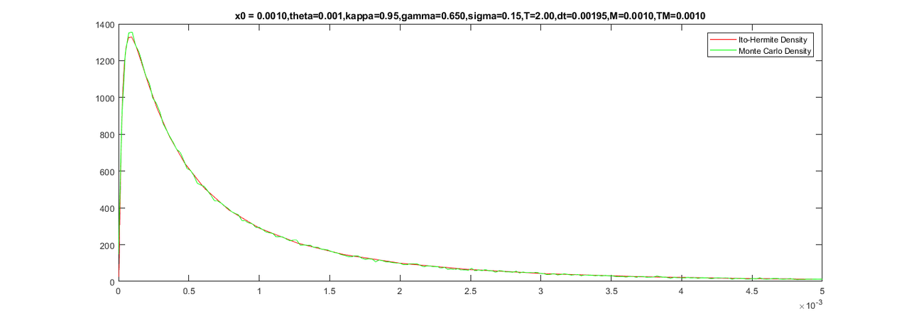](https://postimg.cc/GBQmwtfY)

[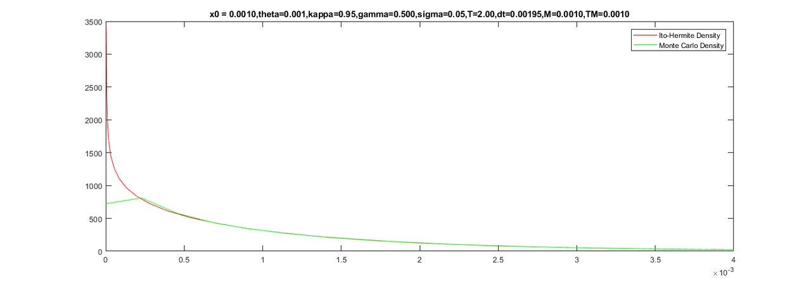](https://postimg.cc/Z9Z5Mpw4)

[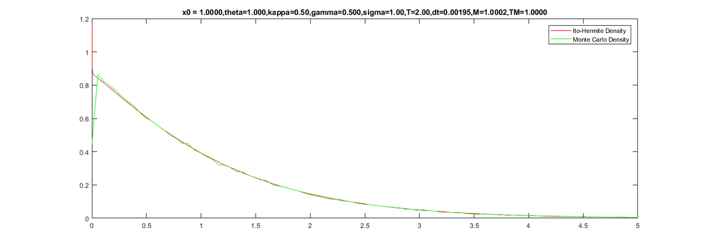](https://postimg.cc/zyTf70Sx)

[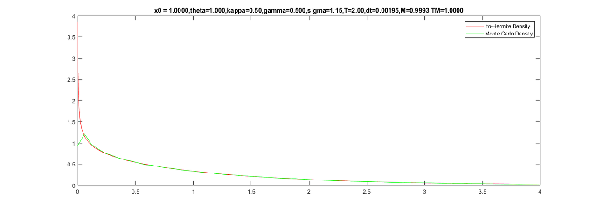](https://postimg.cc/WhB30QrD)

[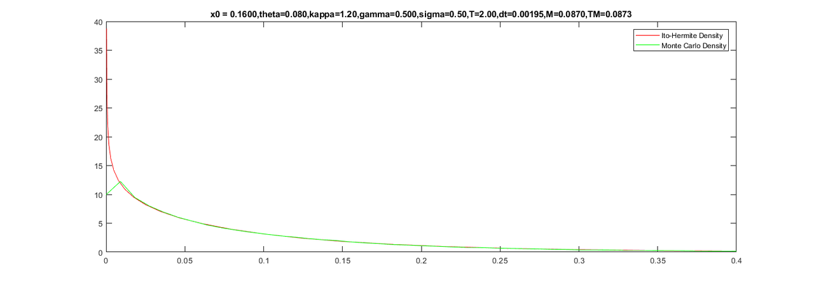](https://postimg.cc/2VbybzqR)

[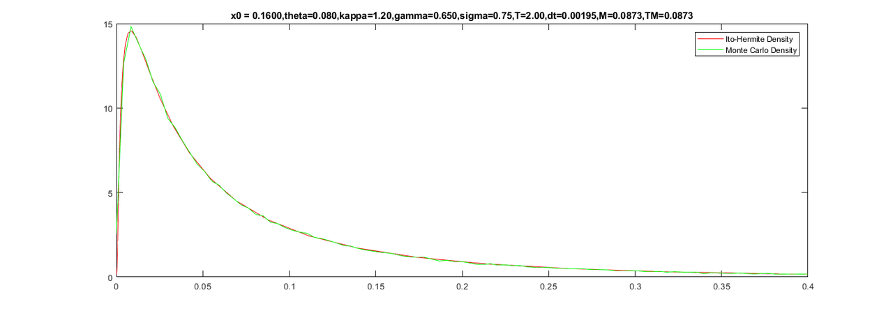](https://postimg.cc/wywMJMcH)

[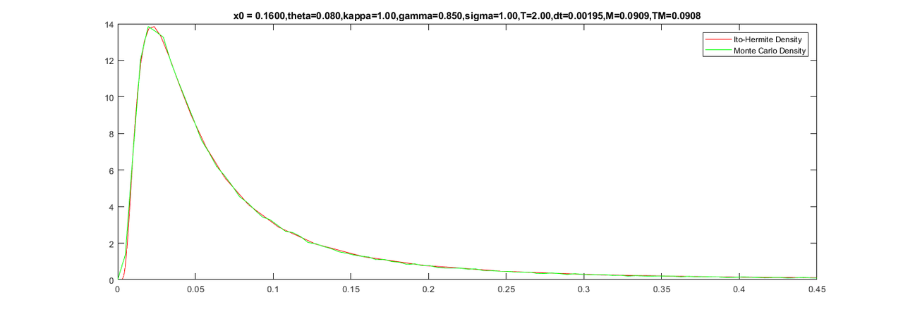](https://postimg.cc/JthG83Mh)

[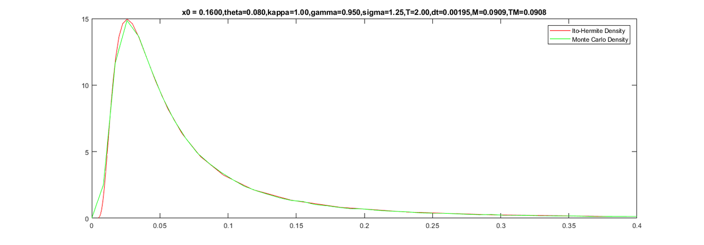](https://postimg.cc/grBr2w2H)

Please note that in the complete above graph, the tail goes out to 17-18. It is very close to lognormal with a specially
elongated tail.

[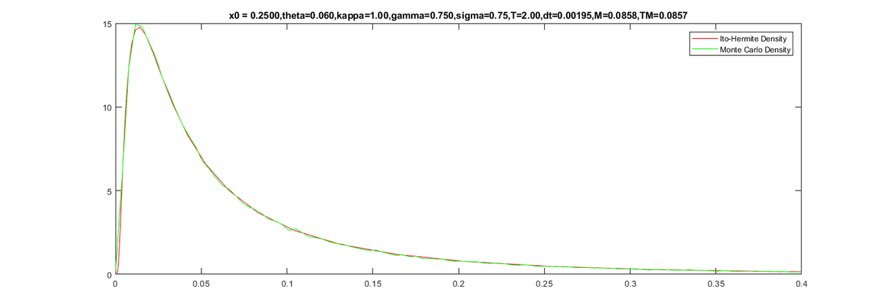](https://postimg.cc/D4mZchBG)

[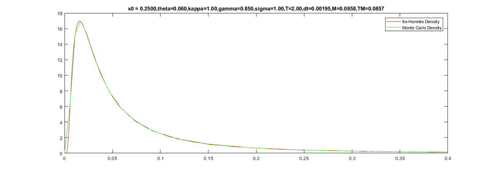](https://postimg.cc/dksDLrC4)

Please note that in the complete above graph, the tail goes out to 8. Its tail is much smaller than the tail with
exponent .95 but still it is quite pronounced.

---

### #1255 — Amin (Topic Author)
*October 16, 2021, 2:29 AM*

Friends, I have caught malaria and have very high fever. I will post the complete program after I recover. Here is the
tentative program and I wanted to change a lot of things in it to make it easy to understand but now I am posting as
such. I will post a reworked version once I recover.

.

.

```
function [] = FPERevisitedTransProb08ABwNew04DownloadedAB1()

%Copyright Ahsan Amin. Infiniti derivatives Technologies.
%Please fell free to connect on linkedin: linkedin.com/in/ahsan-amin-0a53334
%or skype ahsan.amin2999
%In this program, I am simulating the SDE given as
%dy(t)=mu1 x(t)^beta1 dt + mu2 x(t)^beta2 dt +sigma x(t)^gamma dz(t)

%I have not directly simulated the SDE but simulated the transformed
%Besse1l process version of the SDE and then changed coordinates to retreive
%the SDE in original coo
%rdinates.
%The present program will analytically evolve only the Bessel Process version of the
%SDE in transformed coordinates.

dt=.125/16/2/2;   % Simulation time interval.%Fodiffusions close to zero
             %decrease dt for accuracy.
Tt=128*2*2*2;     % Number of simulation levels. Terminal time= Tt*dt; //.125/32*32*16=2 year;
T=Tt*dt;
OrderA=4;  %
OrderM=4;  %
dtM=.0625/2;
TtM=T/dtM;

dNn=.2/1;   % Normal density subdivisions width. would change with number of subdivisions
Nn=41;  % No of normal density subdivisions
NnMidl=18;%One half density Subdivision left from mid of normal density(low)
NnMidh=19;%One half density subdivision right from the mid of normal density(high)
NnMid=4.0;
NnT=46;
%NnD=(NnT-Nn)/2;
NnD=5;

x0=.25;   % starting value of SDE
beta1=0.0;
beta2=1.0;   % Second drift term power.
gamma=.75;%50;   % volatility power.
kappa=1.0;%.950;   %mean reversion parameter.
theta=.06;%mean reversion target
sigma0=.9;%Volatility value

%you can specify any general mu1 and mu2 and beta1 and beta2.
mu1=1*theta*kappa;   %first drift coefficient.
mu2=-1*kappa;    % Second drift coefficient.
%mu1=0;
%mu2=0;

alpha=1;% x^alpha is being expanded. This is currently for monte carlo only.
alpha1=1-gamma;%This is for expansion of integrals for calculation of drift
%and volatility coefficients
yy(1:Nn)=x0;
w(1:Nn)=x0^(1-gamma)/(1-gamma);

%Z(1:Nn)=(((1:Nn)-5.5)*dNn-NnMid);
Z(1:Nn)=(((1:Nn)+1.5)*dNn-NnMid);
ZT(1:NnT)=(((1:NnT)-3.5)*dNn-NnMid);
ZT
Z
str=input('Look at Z');
ZProb(1)=normcdf(.5*Z(1)+.5*Z(2),0,1)-normcdf(.5*Z(1)+.5*Z(2)-dNn,0,1);
ZProb(Nn)=normcdf(.5*Z(Nn)+.5*Z(Nn-1)+dNn,0,1)-normcdf(.5*Z(Nn)+.5*Z(Nn-1),0,1);
ZProb(2:Nn-1)=normcdf(.5*Z(2:Nn-1)+.5*Z(3:Nn),0,1)-normcdf(.5*Z(2:Nn-1)+.5*Z(1:Nn-2),0,1);

ZProbT(1)=normcdf(.5*ZT(1)+.5*ZT(2),0,1)-normcdf(.5*ZT(1)+.5*ZT(2)-dNn,0,1);
ZProbT(NnT)=normcdf(.5*ZT(NnT)+.5*ZT(NnT-1)+dNn,0,1)-normcdf(.5*ZT(NnT)+.5*ZT(NnT-1),0,1);
ZProbT(2:NnT-1)=normcdf(.5*ZT(2:NnT-1)+.5*ZT(3:NnT),0,1)-normcdf(.5*ZT(2:NnT-1)+.5*ZT(1:NnT-2),0,1);
    %Above calculate probability mass in each probability subdivision.

%%%%%%%%%%%%%%%%%%%%%%%%%%%%%%%%%%%%%%%%%%%%%%%%%%%%%%%%%%%%%%%%%%%%%%%%%%%%%%%%%%%%%%%%%%%%%%

sigma11(1:OrderA+1)=0;
mu11(1:OrderA+1)=0;
mu22(1:OrderA+1)=0;
sigma22(1:OrderA+1)=0;
% index 1 correponds to zero level since matlab indexing starts at one.
sigma11(1)=1;
mu11(1)=1;
mu22(1)=1;
sigma22(1)=1;

for k=1:(OrderA+1)
    if sigma0~=0
        sigma11(k)=sigma0^(k-1);
    end
    if mu1 ~= 0
        mu11(k)=mu1^(k-1);
    end
    if mu2 ~= 0
        mu22(k)=mu2^(k-1);
    end
    if sigma0~=0
        sigma22(k)=sigma0^(2*(k-1));
    end
end
%Ft(1:TtM+1,1:(OrderA+1),1:(OrderA+1),1:(OrderA+1),1:(OrderA+1))=0; %General time powers on hermite polynomials
Fp(1:(OrderA+1),1:(OrderA+1),1:(OrderA+1),1:(OrderA+1))=0;%General x powers on coefficients of hermite polynomials.
Fp1(1:(OrderA+1),1:(OrderA+1),1:(OrderA+1),1:(OrderA+1))=0;%General x powers for bessel transformed coordinates.

%YCoeff0 and YCoeff are coefficents for original coordinates monte carlo.
%YqCoeff0 and YqCoeff are bessel/lamperti version monte carlo.

YCoeff0(1:(OrderA+1),1:(OrderA+1),1:(OrderA+1),1:(OrderA+1))=0;
YqCoeff0(1:(OrderA+1),1:(OrderA+1),1:(OrderA+1),1:(OrderA+1))=0;
%Pre-compute the time and power exponent values in small multi-dimensional arrays
YCoeff = ItoTaylorCoeffsNew(alpha,beta1,beta2,gamma); %expand y^alpha where alpha=1;
YqCoeff = ItoTaylorCoeffsNew(alpha1,beta1,beta2,gamma);%expand y^alpha1 where alpha1=(1-gamma)
YqCoeff=YqCoeff/(1-gamma); %Transformed coordinates coefficients have to be
%further divided by (1-gamma)

for k = 0 : (OrderA)
    for m = 0:k
        l4 = k - m + 1;
        for n = 0 : m
            l3 = m - n + 1;
            for j = 0:n
                l2 = n - j + 1;
                l1 = j + 1;
                %Ft(l1,l2,l3,l4) = dtM^((l1-1) + (l2-1) + (l3-1) + .5* (l4-1));
                Fp(l1,l2,l3,l4) = (alpha + (l1-1) * beta1 + (l2-1) * beta2 + (l3-1) * 2* gamma + (l4-1) * gamma ...
                    - (l1-1) - (l2-1) - 2* (l3-1) - (l4-1));
                Fp1(l1,l2,l3,l4) = (alpha1 + (l1-1) * beta1 + (l2-1) * beta2 + (l3-1) * 2* gamma + (l4-1) * gamma ...
                    - (l1-1) - (l2-1) - 2* (l3-1) - (l4-1));

                YCoeff0(l1,l2,l3,l4) =YCoeff(l1,l2,l3,l4).*mu11(l1).*mu22(l2).*sigma22(l3).*sigma11(l4);
                YqCoeff0(l1,l2,l3,l4) =YqCoeff(l1,l2,l3,l4).*mu11(l1).*mu22(l2).*sigma22(l3).*sigma11(l4);
            end
        end
    end
end

%%%%%%%%%%%%%%%%%%%%%%%%%%%%%%%%%%%%%%%%%%%%%%%%%%%%%%%%%%%%%%%%%%%%%%%%%%%%%%%%%%%%%%%%%%%%%%

wnStart=1;%
tic

Zt1(wnStart:Nn)=0.0;
Zt2(wnStart:Nn)=0.0;
for tt=1:Tt

    %[wMu0dt,dwMu0dtdw,c1] = CalculateDriftAndVolA4(w,wnStart,Nn,YqCoeff0,Fp1,gamma,dt);
    %[wMu0dt,c1,c2] = CalculateDriftAndVolA404AB(w,wnStart,Nn,YqCoeff0,Fp1,gamma,dt);
    [wMu0dt,c1,c2,dwMu0dtdw] = CalculateDriftAndVolA404AB(w,wnStart,Nn,YqCoeff0,Fp1,gamma,dt);

    [wMid] =
InterpolateOrderN8(8,0,Z(NnMidl-3),Z(NnMidl-2),Z(NnMidl-1),Z(NnMidl),Z(NnMidh),Z(NnMidh+1),Z(NnMidh+2),Z(NnMidh+3),w(NnMidl-3),w(NnMidl-2),w(NnMidl-1),w(NnMidl),w(NnMidh),w(NnMidh+1),w(NnMidh+2),w(NnMidh+3));

    Zt1(wnStart:Nn)=w(wnStart:Nn)-wMid;

    [dwdZ,d2wdZ2A] = First2Derivatives2ndOrderEqSpacedA(wnStart,Nn,dNn,Zt1,Z);
    [dwdZ,d2wdZ2,d3wdZ3] = First3Derivatives4thOrderEqSpaced(wnStart,Nn,dNn,Zt1,Z);

tt

    C0(wnStart:Nn)=Zt1(wnStart:Nn)-dwdZ(wnStart:Nn).*Z(wnStart:Nn);
    %c1(wnStart:Nn)=sigma0*sqrt(dt);
    Zt2(wnStart:Nn)=C0(wnStart:Nn)+sign(dwdZ(wnStart:Nn)+c1(wnStart:Nn)).* ...
        abs(sqrt(sign(dwdZ(wnStart:Nn)).*(dwdZ(wnStart:Nn)).^2+ ...
        sign(c1(wnStart:Nn)).*c1(wnStart:Nn).^2)).*Z(wnStart:Nn);
    [dwdZ,d2wdZ2,d3wdZ3] = First3Derivatives2ndOrderEqSpacedA(wnStart,Nn,dNn,Zt2,Z);
    [dw2dZ,d2w2dZ2A] = First2Derivatives2ndOrderEqSpacedA(wnStart,Nn,dNn,Zt2,Z);
    [dw2dZ,d2w2dZ2A,d3wdZ3] = First3Derivatives4thOrderEqSpaced(wnStart,Nn,dNn,Zt2,Z);
     if(tt>10)
     %    dwdt(wnStart:Nn)=(wMu0dt(wnStart:Nn)+Zt2(wnStart:Nn)-Zt1(wnStart:Nn)+ ...
     %        .5*sigma0^2*(dw2dZ(wnStart:Nn).^(-2)).*d2w2dZ2A(wnStart:Nn).*dt)/dt;
     else
     %    dwdt(wnStart:Nn)=(wMu0dt(wnStart:Nn)+Zt2(wnStart:Nn)-Zt1(wnStart:Nn))/dt;%+ ...
     end

     wnStart

     if(tt>10)
         dZdw(wnStart:Nn)=1./dw2dZ(wnStart:Nn);
         d2Zdw2(wnStart:Nn)=-d2w2dZ2A(wnStart:Nn).*dZdw(wnStart:Nn).^3;
         d3Zdw3(wnStart:Nn)=-d3wdZ3(wnStart:Nn).*dZdw(wnStart:Nn).^4+3*d2w2dZ2A(wnStart:Nn).^2.*dZdw(wnStart:Nn).^5;
         %w(wnStart:Nn)=w(wnStart:Nn)+ ...
         %    wMu0dt(wnStart:Nn)+ ...
         %     0*dwMu0dtdw(wnStart:Nn)./(-Z(wnStart:Nn).*dZdw(wnStart:Nn).^2+d2Zdw2(wnStart:Nn)) - ...
         %     +.5*sigma0^2*dt*( (Z(wnStart:Nn).^2-1).*dZdw(wnStart:Nn).^3- ...
         %    0*
3*Z(wnStart:Nn).*dZdw(wnStart:Nn).*d2Zdw2(wnStart:Nn))./(-Z(wnStart:Nn).*dZdw(wnStart:Nn).^2+d2Zdw2(wnStart:Nn));

          w(wnStart:Nn)=w(wnStart:Nn)+ ...
              wMu0dt(wnStart:Nn)+1*(Zt2(wnStart:Nn)-Zt1(wnStart:Nn))+ ...
              1*.5*sigma0^2*(dw2dZ(wnStart:Nn).^(-2)).*d2w2dZ2A(wnStart:Nn).*dt;
           else
         w(wnStart:Nn)=w(wnStart:Nn)+ ...
             wMu0dt(wnStart:Nn)+Zt2(wnStart:Nn)-Zt1(wnStart:Nn);
     end
%     %yy(wnStart:Nn)=((1-gamma).*w(wnStart:Nn)).^(1/(1-gamma));

  %  [dwdZ,d2wdZ2A,d3wdZ3] = First3Derivatives4thOrderEqSpaced(wnStart,Nn,dNn,w,Z);
    %FirstCoordinate
%     for nn=NnMidl-11:-1:wnStart+1
%         if((w(nn)-w(nn-1))>(w(nn+1)-w(nn)))
%
%             w(nn) =
InterpolateOrderN8(6,Z(nn),Z(nn+1),Z(nn+2),Z(nn+3),Z(nn+4),Z(nn+5),Z(nn+6),Z(nn+7),Z(nn+8),w(nn+1),w(nn+2),w(nn+3),w(nn+4),w(nn+5),w(nn+6),w(nn+7),w(nn+8));
%
%         end
%     end
%   if(w(wnStart+1)-w(wnStart)>w(wnStart+2)-w(wnStart+1))
%       nn=wnStart;
%       w(wnStart) =
InterpolateOrderN8(6,Z(wnStart),Z(wnStart+1),Z(wnStart+2),Z(wnStart+3),Z(wnStart+4),Z(wnStart+5),Z(wnStart+6),Z(wnStart+7),Z(wnStart+8),w(wnStart+1),w(wnStart+2),w(wnStart+3),w(wnStart+4),w(wnStart+5),w(wnStart+6),w(wnStart+7),w(wnStart+8));

   %    w(nn)=w(nn+1)-(w(nn+2)-w(nn+1));
%   end

    [wE] =
InterpolateOrderN6(6,Z(Nn)+dNn,Z(Nn),Z(Nn-1),Z(Nn-2),Z(Nn-3),Z(Nn-4),Z(Nn-5),w(Nn),w(Nn-1),w(Nn-2),w(Nn-3),w(Nn-4),w(Nn-5));

    for nn=wnStart:Nn-1
        if(w(nn)>w(nn+1))
            w(nn)=0;
        end
    end

  %   w1(wnStart:Nn-1)=w(wnStart:Nn-1);
  %   w1(Nn)=w(Nn);
  %   w2(wnStart:Nn-1)=w(wnStart+1:Nn);
  %   w2(Nn)=wE;
  %   w(w1(wnStart:Nn)>w2(:))=0;%Be careful;might not universally hold;
  %    %Change 3:7/25/2020: I have improved zero correction in above.

     %for nn=1:Nn
     %    if(w2(nn)>w1(nn))

     w(w=1)
     ws =
InterpolateOrderN8(8,Zs,Z(wnStart),Z(wnStart+1),Z(wnStart+2),Z(wnStart+3),Z(wnStart+4),Z(wnStart+5),Z(wnStart+6),Z(wnStart+7),w(wnStart),w(wnStart+1),w(wnStart+2),w(wnStart+3),w(wnStart+4),w(wnStart+5),w(wnStart+6),w(wnStart+7));
     ContinueFlag=1;
     end
     for mm=1:nnChange

         if((ws(mm)>0)&&(ws(mm)0)
%                 wnStart=wnStart-1;
%                 w(wnStart)=wStart1;
%                 InterpolatePrevFlag=1;
%             end
%             if(wnStart==wnStartPrev)
%             %    InterpolatePrevFlag=0;
%             end
%         end
%      end

%      if(nnChange>=1)
%          wStart1 =
InterpolateOrderN8(8,Z(wnStart)-dNn,Z(wnStart),Z(wnStart+1),Z(wnStart+2),Z(wnStart+3),Z(wnStart+4),Z(wnStart+5),Z(wnStart+6),Z(wnStart+7),w(wnStart),w(wnStart+1),w(wnStart+2),w(wnStart+3),w(wnStart+4),w(wnStart+5),w(wnStart+6),w(wnStart+7));
%          if(wStart1>0)
%              wnStart=wnStart-1
%              w(wnStart)=wStart1;
%              InterpolatePrevFlag=1;
%          end
%      end
%       if((nnChange>=2)&&( InterpolatePrevFlag==1))
%          wStart1 =
InterpolateOrderN8(8,Z(wnStart)-dNn,Z(wnStart),Z(wnStart+1),Z(wnStart+2),Z(wnStart+3),Z(wnStart+4),Z(wnStart+5),Z(wnStart+6),Z(wnStart+7),w(wnStart),w(wnStart+1),w(wnStart+2),w(wnStart+3),w(wnStart+4),w(wnStart+5),w(wnStart+6),w(wnStart+7));
%          InterpolatePrevFlag=0;
%          if(wStart1>0)
%              wnStart=wnStart-1
%              w(wnStart)=wStart1;
%              InterpolatePrevFlag=1;
%          end
%       end
%      if((nnChange>=3)&&( InterpolatePrevFlag==1))
%          wStart1 =
InterpolateOrderN8(8,Z(wnStart)-dNn,Z(wnStart),Z(wnStart+1),Z(wnStart+2),Z(wnStart+3),Z(wnStart+4),Z(wnStart+5),Z(wnStart+6),Z(wnStart+7),w(wnStart),w(wnStart+1),w(wnStart+2),w(wnStart+3),w(wnStart+4),w(wnStart+5),w(wnStart+6),w(wnStart+7));
%          InterpolatePrevFlag=0;
%          if(wStart1>0)
%              wnStart=wnStart-1
%              w(wnStart)=wStart1;
%              InterpolatePrevFlag=1;
%          end
%      end
%
w
wnStart
tt
end

wT(wnStart+NnD:Nn+NnD)=w(wnStart:Nn);
     Zs=0
     ws=0;
     for mm=1:wnStart+NnD-1
        Zs(mm)=Z(wnStart)-mm*dNn;
        ws(mm)=0.0
     end
 wnStartT=wnStart+NnD;
 %NnT=Nn+2*NnD;
     ws =
InterpolateOrderN8(8,Zs,Z(wnStart),Z(wnStart+1),Z(wnStart+2),Z(wnStart+3),Z(wnStart+4),Z(wnStart+5),Z(wnStart+6),Z(wnStart+7),w(wnStart),w(wnStart+1),w(wnStart+2),w(wnStart+3),w(wnStart+4),w(wnStart+5),w(wnStart+6),w(wnStart+7));
     ContinueFlag=1;
     wnStart0=wnStart+NnD-1;
     for mm=1:wnStart0
         if((ws(mm)>0)&&(ws(mm)0)&&(ws(mm)=23)
%plot(yy(wnStart:Nn),pyy(wnStart:Nn),'r');
%yy
%str=input('Look at the output graph');
end

toc

ItoHermiteMean=sum(yyT(wnStartT+1:NnT-1).*ZProbT(wnStartT+1:NnT-1)) %Original process average from coordinates
disp('true Mean only applicable to standard SV mean reverting type models otherwise disregard');
TrueMean=theta+(x0-theta)*exp(-kappa*dt*Tt)%Mean reverting SDE original variable true average

theta1=1;
rng(29079137, 'twister')
paths=200000;
YY(1:paths)=x0;  %Original process monte carlo.
Random1(1:paths)=0;
for tt=1:TtM

    Random1=randn(size(Random1));
    HermiteP1(1,1:paths)=1;
    HermiteP1(2,1:paths)=Random1(1:paths);
    HermiteP1(3,1:paths)=Random1(1:paths).^2-1;
    HermiteP1(4,1:paths)=Random1(1:paths).^3-3*Random1(1:paths);
    HermiteP1(5,1:paths)=Random1(1:paths).^4-6*Random1(1:paths).^2+3;

    YY(1:paths)=YY(1:paths) + ...
        (YCoeff0(1,1,2,1).*YY(1:paths).^Fp(1,1,2,1)+ ...
        YCoeff0(1,2,1,1).*YY(1:paths).^Fp(1,2,1,1)+ ...
        YCoeff0(2,1,1,1).*YY(1:paths).^Fp(2,1,1,1))*dtM + ...
        (YCoeff0(1,1,3,1).*YY(1:paths).^Fp(1,1,3,1)+ ...
        YCoeff0(1,2,2,1).*YY(1:paths).^Fp(1,2,2,1)+ ...
        YCoeff0(2,1,2,1).*YY(1:paths).^Fp(2,1,2,1)+ ...
        YCoeff0(1,3,1,1).*YY(1:paths).^Fp(1,3,1,1)+ ...
        YCoeff0(2,2,1,1).*YY(1:paths).^Fp(2,2,1,1)+ ...
        YCoeff0(3,1,1,1).*YY(1:paths).^Fp(3,1,1,1))*dtM^2 + ...
        ((YCoeff0(1,1,1,2).*YY(1:paths).^Fp(1,1,1,2).*sqrt(dtM))+ ...
        (YCoeff0(1,1,2,2).*YY(1:paths).^Fp(1,1,2,2)+ ...
        YCoeff0(1,2,1,2).*YY(1:paths).^Fp(1,2,1,2)+ ...
        YCoeff0(2,1,1,2).*YY(1:paths).^Fp(2,1,1,2)).*dtM^1.5) .*HermiteP1(2,1:paths) + ...
        ((YCoeff0(1,1,1,3).*YY(1:paths).^Fp(1,1,1,3) *dtM) + ...
        (YCoeff0(1,1,2,3).*YY(1:paths).^Fp(1,1,2,3)+ ...
        YCoeff0(1,2,1,3).*YY(1:paths).^Fp(1,2,1,3)+ ...
        YCoeff0(2,1,1,3).*YY(1:paths).^Fp(2,1,1,3)).*dtM^2).*HermiteP1(3,1:paths) + ...
        ((YCoeff0(1,1,1,4).*YY(1:paths).^Fp(1,1,1,4)*dtM^1.5 )).*HermiteP1(4,1:paths) + ...
        (YCoeff0(1,1,1,5).*YY(1:paths).^Fp(1,1,1,5)*dtM^2.0).*HermiteP1(5,1:paths);

end

YY(YY<0)=0;
disp('Original process average from monte carlo');
MCMean=sum(YY(:))/paths %origianl coordinates monte carlo average.
disp('Original process average from our simulation');
ItoHermiteMean=sum(yyT(wnStartT+1:NnT-1).*ZProbT(wnStartT+1:NnT-1)) %Original process average from coordinates

disp('true Mean only applicble to standard SV mean reverting type models otherwise disregard');
TrueMean=theta+(x0-theta)*exp(-kappa*dt*Tt)%Mean reverting SDE original variable true average

MaxCutOff=30;
NoOfBins=round(300*gamma^2*4*sigma0/sqrt(MCMean)/(1+kappa));%Decrease the number of bins if the graph is too
[YDensity,IndexOutY,IndexMaxY] = MakeDensityFromSimulation_Infiniti_NEW(YY,paths,NoOfBins,MaxCutOff );
plot(yyT(wnStartT+1:NnT-1),pyyT(wnStartT+1:NnT-1),'r',IndexOutY(1:IndexMaxY),YDensity(1:IndexMaxY),'g');
 %plot(y_w(wnStart+1:Nn-1),fy_w(wnStart+1:Nn-1),'r',IndexOutY(1:IndexMaxY),YDensity(1:IndexMaxY),'g',Z(wnStart+1:Nn-1),fy_w(wnStart+1:Nn-1),'b');

title(sprintf('x0 = %.4f,theta=%.3f,kappa=%.2f,gamma=%.3f,sigma=%.2f,T=%.2f,dt=%.5f,M=%.4f,TM=%.4f',
x0,theta,kappa,gamma,sigma0,T,dt,ItoHermiteMean,TrueMean));%,sprintf('theta= %f', theta), sprintf('kappa = %f',
kappa),sprintf('sigma = %f', sigma0),sprintf('T = %f', T));

legend({'Ito-Hermite Density','Monte Carlo Density'},'Location','northeast')

str=input('red line is density of SDE from Ito-Hermite method, green is monte carlo.');

end

```

.

.

```
function [wMu0dt,c1,c2,dwMu0dtdw] = CalculateDriftAndVolA404AB(w,wnStart,Nn,YqCoeff0,Fp1,gamma,dt)

yy(wnStart:Nn)=((1-gamma)*w(wnStart:Nn)).^(1/(1-gamma));

Fp2=Fp1/(1-gamma);

wMu0dt(wnStart:Nn)=(YqCoeff0(1,1,2,1).*yy(wnStart:Nn).^Fp1(1,1,2,1)+ ...
    YqCoeff0(1,2,1,1).*yy(wnStart:Nn).^Fp1(1,2,1,1)+ ...
    YqCoeff0(2,1,1,1).*yy(wnStart:Nn).^Fp1(2,1,1,1))*dt + ...
    (YqCoeff0(1,1,3,1).*yy(wnStart:Nn).^Fp1(1,1,3,1)+ ...
    YqCoeff0(1,2,2,1).*yy(wnStart:Nn).^Fp1(1,2,2,1)+ ...
    YqCoeff0(2,1,2,1).*yy(wnStart:Nn).^Fp1(2,1,2,1)+ ...
    YqCoeff0(1,3,1,1).*yy(wnStart:Nn).^Fp1(1,3,1,1)+ ...
    YqCoeff0(2,2,1,1).*yy(wnStart:Nn).^Fp1(2,2,1,1)+ ...
    YqCoeff0(3,1,1,1).*yy(wnStart:Nn).^Fp1(3,1,1,1))*dt^2 + ...
     (YqCoeff0(1,1,4,1).*yy(wnStart:Nn).^Fp1(1,1,4,1)+ ...
     YqCoeff0(1,2,3,1).*yy(wnStart:Nn).^Fp1(1,2,3,1)+ ...
     YqCoeff0(2,1,3,1).*yy(wnStart:Nn).^Fp1(2,1,3,1)+ ...
     YqCoeff0(1,3,2,1).*yy(wnStart:Nn).^Fp1(1,3,2,1)+ ...
     YqCoeff0(2,2,2,1).*yy(wnStart:Nn).^Fp1(2,2,2,1)+ ...
     YqCoeff0(3,1,2,1).*yy(wnStart:Nn).^Fp1(3,1,2,1)+ ...
     YqCoeff0(1,4,1,1).*yy(wnStart:Nn).^Fp1(1,4,1,1)+ ...
     YqCoeff0(2,3,1,1).*yy(wnStart:Nn).^Fp1(2,3,1,1)+ ...
     YqCoeff0(3,2,1,1).*yy(wnStart:Nn).^Fp1(3,2,1,1)+ ...
     YqCoeff0(4,1,1,1).*yy(wnStart:Nn).^Fp1(4,1,1,1))*dt^3+ ...
     (YqCoeff0(1,1,5,1).*yy(wnStart:Nn).^Fp1(1,1,5,1)+ ...
      YqCoeff0(1,2,4,1).*yy(wnStart:Nn).^Fp1(1,2,4,1)+ ...
      YqCoeff0(2,1,4,1).*yy(wnStart:Nn).^Fp1(2,1,4,1)+ ...
      YqCoeff0(1,3,3,1).*yy(wnStart:Nn).^Fp1(1,3,3,1)+ ...
       YqCoeff0(2,2,3,1).*yy(wnStart:Nn).^Fp1(2,2,3,1)+ ...
       YqCoeff0(3,1,3,1).*yy(wnStart:Nn).^Fp1(3,1,3,1)+ ...
       YqCoeff0(1,4,2,1).*yy(wnStart:Nn).^Fp1(1,4,2,1)+ ...
       YqCoeff0(2,3,2,1).*yy(wnStart:Nn).^Fp1(2,3,2,1)+ ...
       YqCoeff0(3,2,2,1).*yy(wnStart:Nn).^Fp1(3,2,2,1)+ ...
       YqCoeff0(4,1,2,1).*yy(wnStart:Nn).^Fp1(4,1,2,1)+ ...
       YqCoeff0(1,5,1,1).*yy(wnStart:Nn).^Fp1(1,5,1,1)+ ...
       YqCoeff0(2,4,1,1).*yy(wnStart:Nn).^Fp1(2,4,1,1)+ ...
       YqCoeff0(3,3,1,1).*yy(wnStart:Nn).^Fp1(3,3,1,1)+  ...
       YqCoeff0(4,2,1,1).*yy(wnStart:Nn).^Fp1(4,2,1,1)+ ...
       YqCoeff0(5,1,1,1).*yy(wnStart:Nn).^Fp1(5,1,1,1))*dt^4;

   dwMu0dtdw(wnStart:Nn)=(YqCoeff0(1,1,2,1).*Fp1(1,1,2,1).*((1-gamma)*w(wnStart:Nn)).^(Fp2(1,1,2,1)-1)+ ...
    YqCoeff0(1,2,1,1).*Fp1(1,2,1,1).*((1-gamma)*w(wnStart:Nn)).^(Fp2(1,2,1,1)-1)+ ...
    YqCoeff0(2,1,1,1).*Fp1(2,1,1,1).*((1-gamma)*w(wnStart:Nn)).^(Fp2(2,1,1,1)-1))*dt ;

%wMu0dtOdt(wnStart:Nn)=(YqCoeff0(1,1,2,1).*yy(wnStart:Nn).^Fp1(1,1,2,1)*0+ ...
%    YqCoeff0(1,2,1,1).*yy(wnStart:Nn).^Fp1(1,2,1,1)+ ...
%    YqCoeff0(2,1,1,1).*yy(wnStart:Nn).^Fp1(2,1,1,1))*dt ;

c1(wnStart:Nn)=((YqCoeff0(1,1,1,2).*yy(wnStart:Nn).^Fp1(1,1,1,2).*sqrt(dt))+ ...
     (YqCoeff0(1,1,2,2).*yy(wnStart:Nn).^Fp1(1,1,2,2)+YqCoeff0(1,2,1,2).*yy(wnStart:Nn).^Fp1(1,2,1,2)+ ...
     YqCoeff0(2,1,1,2).*yy(wnStart:Nn).^Fp1(2,1,1,2)).*dt^1.5+ ...
     (YqCoeff0(1,1,3,2).*yy(wnStart:Nn).^Fp1(1,1,3,2)+YqCoeff0(1,2,2,2).*yy(wnStart:Nn).^Fp1(1,2,2,2)+ ...
     YqCoeff0(2,1,2,2).*yy(wnStart:Nn).^Fp1(2,1,2,2)+YqCoeff0(1,3,1,2).*yy(wnStart:Nn).^Fp1(1,3,1,2)+ ...
     YqCoeff0(2,2,1,2).*yy(wnStart:Nn).^Fp1(2,2,1,2)+YqCoeff0(3,1,1,2).*yy(wnStart:Nn).^Fp1(3,1,1,2)).*dt^2.5+ ...
     (YqCoeff0(1,1,4,2).*yy(wnStart:Nn).^Fp1(1,1,4,2)+YqCoeff0(1,2,3,2).*yy(wnStart:Nn).^Fp1(1,2,3,2)+ ...
     YqCoeff0(2,1,3,2).*yy(wnStart:Nn).^Fp1(2,1,3,2)+YqCoeff0(1,3,2,2).*yy(wnStart:Nn).^Fp1(1,3,2,2)+ ...
     YqCoeff0(2,2,2,2).*yy(wnStart:Nn).^Fp1(2,2,2,2)+ YqCoeff0(3,1,2,2).*yy(wnStart:Nn).^Fp1(3,1,2,2)+ ...
     YqCoeff0(1,4,1,2).*yy(wnStart:Nn).^Fp1(1,4,1,2)+YqCoeff0(2,3,1,2).*yy(wnStart:Nn).^Fp1(2,3,1,2)+ ...
     YqCoeff0(3,2,1,2).*yy(wnStart:Nn).^Fp1(3,2,1,2)+YqCoeff0(4,1,1,2).*yy(wnStart:Nn).^Fp1(4,1,1,2)).*dt^3.5);

c2(wnStart:Nn)=(YqCoeff0(1,1,2,3).*yy(wnStart:Nn).^Fp1(1,1,2,3)+YqCoeff0(1,2,1,3).*yy(wnStart:Nn).^Fp1(1,2,1,3)+ ...
     YqCoeff0(2,1,1,3).*yy(wnStart:Nn).^Fp1(2,1,1,3)).*dt^2;%+ ...
     (YqCoeff0(1,1,3,3).*yy(wnStart:Nn).^Fp1(1,1,3,3)+YqCoeff0(1,2,2,3).*yy(wnStart:Nn).^Fp1(1,2,2,3)+ ...
     YqCoeff0(2,1,2,3).*yy(wnStart:Nn).^Fp1(2,1,2,3) + YqCoeff0(1,3,1,3).*yy(wnStart:Nn).^Fp1(1,3,1,3)+ ...
     YqCoeff0(2,2,1,3).*yy(wnStart:Nn).^Fp1(2,2,1,3)+YqCoeff0(3,1,1,3).*yy(wnStart:Nn).^Fp1(3,1,1,3)).*dt^3;

% (YCoeff0(1,1,1,2).*YY(1:paths).^Fp(1,1,1,2).*sqrt(dtM))+ ...
%     (YCoeff0(1,1,2,2).*YY(1:paths).^Fp(1,1,2,2)+YCoeff0(1,2,1,2).*YY(1:paths).^Fp(1,2,1,2)+ ...
%     YCoeff0(2,1,1,2).*YY(1:paths).^Fp(2,1,1,2)).*dtM^1.5+ ...
%     (YCoeff0(1,1,3,2).*YY(1:paths).^Fp(1,1,3,2)+YCoeff0(1,2,2,2).*YY(1:paths).^Fp(1,2,2,2)+ ...
%     YCoeff0(2,1,2,2).*YY(1:paths).^Fp(2,1,2,2)+YCoeff0(1,3,1,2).*YY(1:paths).^Fp(1,3,1,2)+ ...
%     YCoeff0(2,2,1,2).*YY(1:paths).^Fp(2,2,1,2)+YCoeff0(3,1,1,2).*YY(1:paths).^Fp(3,1,1,2)).*dtM^2.5+ ...
%     (YCoeff0(1,1,4,2).*YY(1:paths).^Fp(1,1,4,2)+YCoeff0(1,2,3,2).*YY(1:paths).^Fp(1,2,3,2)+ ...
%     YCoeff0(2,1,3,2).*YY(1:paths).^Fp(2,1,3,2)+YCoeff0(1,3,2,2).*YY(1:paths).^Fp(1,3,2,2)+ ...
%     YCoeff0(2,2,2,2).*YY(1:paths).^Fp(2,2,2,2)+ YCoeff0(3,1,2,2).*YY(1:paths).^Fp(3,1,2,2)+ ...
%     YCoeff0(1,4,1,2).*YY(1:paths).^Fp(1,4,1,2)+YCoeff0(2,3,1,2).*YY(1:paths).^Fp(2,3,1,2)+ ...
%     YCoeff0(3,2,1,2).*YY(1:paths).^Fp(3,2,1,2)+YCoeff0(4,1,1,2).*YY(1:paths).^Fp(4,1,1,2)).*dtM^3.5)
.*HermiteP1(2,1:paths)

end
```

.

.

.

```
function [dwdZ,d2wdZ2,d3wdZ3] = First3Derivatives4thOrderEqSpaced(wnStart,Nn,dNn,w,Z)

% [wS] =
InterpolateOrderN6(4,Z(wnStart)-dNn,Z(wnStart),Z(wnStart+1),Z(wnStart+2),Z(wnStart+3),Z(wnStart+4),Z(wnStart+5),w(wnStart),w(wnStart+1),w(wnStart+2),w(wnStart+3),w(wnStart+4),w(wnStart+5));
% [wE] =
InterpolateOrderN6(4,Z(Nn)+dNn,Z(Nn),Z(Nn-1),Z(Nn-2),Z(Nn-3),Z(Nn-4),Z(Nn-5),w(Nn),w(Nn-1),w(Nn-2),w(Nn-3),w(Nn-4),w(Nn-5));

% [wS] =
InterpolateOrderN8(7,Z(wnStart)-dNn,Z(wnStart),Z(wnStart+1),Z(wnStart+2),Z(wnStart+3),Z(wnStart+4),Z(wnStart+5),Z(wnStart+6),Z(wnStart+7),w(wnStart),w(wnStart+1),w(wnStart+2),w(wnStart+3),w(wnStart+4),w(wnStart+5),w(wnStart+6),w(wnStart+7));
% [wE] =
InterpolateOrderN8(7,Z(Nn)+dNn,Z(Nn),Z(Nn-1),Z(Nn-2),Z(Nn-3),Z(Nn-4),Z(Nn-5),Z(Nn-6),Z(Nn-7),w(Nn),w(Nn-1),w(Nn-2),w(Nn-3),w(Nn-4),w(Nn-5),w(Nn-6),w(Nn-7));

 [wS] =
InterpolateOrderN6(6,Z(wnStart)-dNn,Z(wnStart),Z(wnStart+1),Z(wnStart+2),Z(wnStart+3),Z(wnStart+4),Z(wnStart+5),w(wnStart),w(wnStart+1),w(wnStart+2),w(wnStart+3),w(wnStart+4),w(wnStart+5));
 [wE] =
InterpolateOrderN6(6,Z(Nn)+dNn,Z(Nn),Z(Nn-1),Z(Nn-2),Z(Nn-3),Z(Nn-4),Z(Nn-5),w(Nn),w(Nn-1),w(Nn-2),w(Nn-3),w(Nn-4),w(Nn-5));

 [wS2] =
InterpolateOrderN6(6,Z(wnStart)-2*dNn,Z(wnStart),Z(wnStart+1),Z(wnStart+2),Z(wnStart+3),Z(wnStart+4),Z(wnStart+5),w(wnStart),w(wnStart+1),w(wnStart+2),w(wnStart+3),w(wnStart+4),w(wnStart+5));
 [wE2] =
InterpolateOrderN6(6,Z(Nn)+2*dNn,Z(Nn),Z(Nn-1),Z(Nn-2),Z(Nn-3),Z(Nn-4),Z(Nn-5),w(Nn),w(Nn-1),w(Nn-2),w(Nn-3),w(Nn-4),w(Nn-5));

% 
Zi=[Z(wnStart),Z(wnStart+1),Z(wnStart+2),Z(wnStart+3),Z(wnStart+4),Z(wnStart+5),Z(wnStart+6),Z(wnStart+7),Z(wnStart+8),Z(wnStart+9)];
%     
 wi=[w(wnStart),w(wnStart+1),w(wnStart+2),w(wnStart+3),w(wnStart+4),w(wnStart+5),w(wnStart+6),w(wnStart+7),w(wnStart+8),w(wnStart+9)];
% %      Zi=[Z(Nn-6),Z(Nn-5),Z(Nn-4),Z(Nn-3),Z(Nn-2),Z(Nn-1),Z(Nn)];
% %      wi=[w(Nn-6),w(Nn-5),w(Nn-4),w(Nn-3),w(Nn-2),w(Nn-1),w(Nn)];
%
%       Zi=[Z(wnStart),Z(wnStart+1),Z(wnStart+2),Z(wnStart+3),Z(wnStart+4),Z(wnStart+5),Z(wnStart+6)];
%       wi=[w(wnStart),w(wnStart+1),w(wnStart+2),w(wnStart+3),w(wnStart+4),w(wnStart+5),w(wnStart+6)];
%       Zq=Z(wnStart)-dNn;
%       wS=spline(Zi,wi,Zq);
%
%       Zq=Z(wnStart)-2*dNn;
%       wS2=spline(Zi,wi,Zq);
%
%
%
% %      Zi=[Z(Nn-9),Z(Nn-8),Z(Nn-7),Z(Nn-6),Z(Nn-5),Z(Nn-4),Z(Nn-3),Z(Nn-2),Z(Nn-1),Z(Nn)];
% %      wi=[w(Nn-9),w(Nn-8),w(Nn-7),w(Nn-6),w(Nn-5),w(Nn-4),w(Nn-3),w(Nn-2),w(Nn-1),w(Nn)];
%       Zi=[Z(Nn-6),Z(Nn-5),Z(Nn-4),Z(Nn-3),Z(Nn-2),Z(Nn-1),Z(Nn)];
%       wi=[w(Nn-6),w(Nn-5),w(Nn-4),w(Nn-3),w(Nn-2),w(Nn-1),w(Nn)];
%       Zq=Z(Nn)+dNn;
%       wE=spline(Zi,wi,Zq);
%
%
%       Zq=Z(Nn)+2*dNn;
%       wE2=spline(Zi,wi,Zq);

 ZS=Z(wnStart)-dNn;
 ZE=Z(Nn)+dNn;

% d2wdZ2(wnStart)=(Z(wnStart)*wS-2*w(wnStart)*Z(wnStart)+w(wnStart+1).*Z(wnStart))/(dNn.^2);
%
d2wdZ2(wnStart+1:Nn-1)=(w(wnStart+1:Nn-1).*Z(wnStart+1:Nn-1)-2*w(wnStart+1:Nn-1).*Z(wnStart+1:Nn-1)+1*w(wnStart+2:Nn).*Z(wnStart+1:Nn-1))/(dNn.^2);
% d2wdZ2(Nn)=(wE.*Z(Nn)-2*w(Nn).*Z(Nn)+w(Nn-1).*Z(Nn))/(dNn.^2);

 
dwdZ(wnStart+2:Nn-2)=(1*w(wnStart:Nn-4)-8*w(wnStart+1:Nn-3)+0*w(wnStart+2:Nn-2)+8*w(wnStart+3:Nn-1)-1*w(wnStart+4:Nn))/(12*dNn);
  dwdZ(wnStart+1)=(-3*w(wnStart)-10*w(wnStart+1)+18*w(wnStart+2)-6*w(wnStart+3)+1*w(wnStart+4))/(12*dNn);
  dwdZ(wnStart)=(-25/12*w(wnStart)+4*w(wnStart+1)-3*w(wnStart+2)+4/3*w(wnStart+3)-1/4*w(wnStart+4))/dNn;%/(12*dNn);
  dwdZ(Nn-1)=(-1*w(Nn-4)+6*w(Nn-3)-18*w(Nn-2)+10*w(Nn-1)+3*w(Nn))/(12*dNn);
  dwdZ(Nn)=(1/4*w(Nn-4)-4/3*w(Nn-3)+3*w(Nn-2)-4*w(Nn-1)+25/12*w(Nn))/dNn;%/(12*dNn);

  %−25/12	4	−3	4/3	−1/4
  %(-3*f[i-1]-10*f[i+0]+18*f[i+1]-6*f[i+2]+1*f[i+3])/(12*1.0*h**1)
  % (-1*f[i-3]+6*f[i-2]-18*f[i-1]+10*f[i+0]+3*f[i+1])/(12*1.0*h**1)
 
d2wdZ2(wnStart+2:Nn-2)=(-1*w(wnStart:Nn-4)+16*w(wnStart+1:Nn-3)-30*w(wnStart+2:Nn-2)+16*w(wnStart+3:Nn-1)-1*w(wnStart+4:Nn))/(12*dNn^2);
 
d2wdZ2(wnStart+1)=(10*w(wnStart)-15*w(wnStart+1)-4*w(wnStart+2)+14*w(wnStart+3)-6*w(wnStart+4)+1*w(wnStart+5))/(12*dNn^2);
 
d2wdZ2(wnStart)=(15/4*w(wnStart)-77/6*w(wnStart+1)+107/6*w(wnStart+2)-13*w(wnStart+3)+61/12*w(wnStart+4)-5/6*w(wnStart+5))/(dNn^2);
  d2wdZ2(Nn-1)=(10*w(Nn)-15*w(Nn-1)-4*w(Nn-2)+14*w(Nn-3)-6*w(Nn-4)+1*w(Nn-5))/(12*dNn^2);
  %d2wdZ2(Nn)=(-1*w(Nn-2)+16*w(Nn-1)-30*w(Nn)+16*wE-1*wE2)/(12*dNn^2);
  d2wdZ2(Nn)=(15/4*w(Nn)-77/6*w(Nn-1)+107/6*w(Nn-2)-13*w(Nn-3)+61/12*w(Nn-4)-5/6*w(Nn-5))/(dNn^2);

 % (1*f[i-4]-6*f[i-3]+14*f[i-2]-4*f[i-1]-15*f[i+0]+10*f[i+1])/(12*1.0*h**2)
 % (10*f[i-1]-15*f[i+0]-4*f[i+1]+14*f[i+2]-6*f[i+3]+1*f[i+4])/(12*1.0*h**2)
 % 15/4	−77/6	107/6	−13	61/12	−5/6

%
%
%  d2wdZ2(wnStart)=(wS-2*w(wnStart)+w(wnStart+1))/(dNn.^2);
%  d2wdZ2(wnStart+1:Nn-1)=(w(wnStart:Nn-2)-2*w(wnStart+1:Nn-1)+1*w(wnStart+2:Nn))/(dNn.^2);
%  d2wdZ2(Nn)=(wE-2*w(Nn)+w(Nn-1))/(dNn.^2);
%
%
%  dwdZ(wnStart)=(-1*wS+1*w(wnStart+1))/(2*dNn);
%  dwdZ(wnStart+1:Nn-1)=(-1*w(wnStart:Nn-2)+1*w(wnStart+2:Nn))/(2*dNn);
%  dwdZ(Nn)=(wE-w(Nn-1))/(2*dNn);
%
 d3wdZ3(wnStart+2:Nn-2)=(-1*w(wnStart:Nn-4)+2*w(wnStart+1:Nn-3)+0*w(wnStart+2:Nn-2)-2*w(wnStart+3:Nn-1)+w(wnStart+4:Nn))/(2*dNn^3);
 d3wdZ3(wnStart+1)=(-1*wS+2*w(wnStart)+0*w(wnStart+1)-2*w(wnStart+2)+w(wnStart+3))/(2*dNn^3);
 d3wdZ3(wnStart)=(-1*wS2+2*wS+0*w(wnStart)-2*w(wnStart+1)+w(wnStart+2))/(2*dNn^3);
 d3wdZ3(Nn-1)=(-1*w(Nn-3)+2*w(Nn-2)+0*w(Nn-1)-2*w(Nn)+wE)/(2*dNn^3);
 d3wdZ3(Nn)=(-1*w(Nn-2)+2*w(Nn-1)+0*w(Nn)-2*wE+wE2)/(2*dNn^3);

end
```

---

### #1256 — Amin (Topic Author)
*October 16, 2021, 5:05 AM*

Made some very minor changes to the program.

.

```
function [] = FPERevisitedTransProb08ABwNew04DownloadedAB1()

%Copyright Ahsan Amin. Infiniti derivatives Technologies.
%Please fell free to connect on linkedin: linkedin.com/in/ahsan-amin-0a53334
%or skype ahsan.amin2999
%In this program, I am simulating the SDE given as
%dy(t)=mu1 x(t)^beta1 dt + mu2 x(t)^beta2 dt +sigma x(t)^gamma dz(t)

%I have not directly simulated the SDE but simulated the transformed
%Besse1l process version of the SDE and then changed coordinates to retreive
%the SDE in original coo
%rdinates.
%The present program will analytically evolve only the Bessel Process version of the
%SDE in transformed coordinates.

dt=.125/16/2/2;   % Simulation time interval.%Fodiffusions close to zero
             %decrease dt for accuracy.
Tt=128*2*2*2;     % Number of simulation levels. Terminal time= Tt*dt; //.125/32*32*16=2 year;
T=Tt*dt;
OrderA=4;  %
OrderM=4;  %
dtM=.0625/2;
TtM=T/dtM;

dNn=.2/1;   % Normal density subdivisions width. would change with number of subdivisions
Nn=41;  % No of normal density subdivisions
NnMidl=18;%One half density Subdivision left from mid of normal density(low)
NnMidh=19;%One half density subdivision right from the mid of normal density(high)
NnMid=4.0;
NnT=46;
%NnD=(NnT-Nn)/2;
NnD=5;

x0=.25;   % starting value of SDE
beta1=0.0;
beta2=1.0;   % Second drift term power.
gamma=.75;%50;   % volatility power.
kappa=1.0;%.950;   %mean reversion parameter.
theta=.06;%mean reversion target
sigma0=.9;%Volatility value

%you can specify any general mu1 and mu2 and beta1 and beta2.
mu1=1*theta*kappa;   %first drift coefficient.
mu2=-1*kappa;    % Second drift coefficient.
%mu1=0;
%mu2=0;

alpha=1;% x^alpha is being expanded. This is currently for monte carlo only.
alpha1=1-gamma;%This is for expansion of integrals for calculation of drift
%and volatility coefficients
yy(1:Nn)=x0;
w(1:Nn)=x0^(1-gamma)/(1-gamma);

%Z(1:Nn)=(((1:Nn)-5.5)*dNn-NnMid);
Z(1:Nn)=(((1:Nn)+1.5)*dNn-NnMid);
ZT(1:NnT)=(((1:NnT)-3.5)*dNn-NnMid);
ZT
Z
str=input('Look at Z');
ZProb(1)=normcdf(.5*Z(1)+.5*Z(2),0,1)-normcdf(.5*Z(1)+.5*Z(2)-dNn,0,1);
ZProb(Nn)=normcdf(.5*Z(Nn)+.5*Z(Nn-1)+dNn,0,1)-normcdf(.5*Z(Nn)+.5*Z(Nn-1),0,1);
ZProb(2:Nn-1)=normcdf(.5*Z(2:Nn-1)+.5*Z(3:Nn),0,1)-normcdf(.5*Z(2:Nn-1)+.5*Z(1:Nn-2),0,1);

ZProbT(1)=normcdf(.5*ZT(1)+.5*ZT(2),0,1)-normcdf(.5*ZT(1)+.5*ZT(2)-dNn,0,1);
ZProbT(NnT)=normcdf(.5*ZT(NnT)+.5*ZT(NnT-1)+dNn,0,1)-normcdf(.5*ZT(NnT)+.5*ZT(NnT-1),0,1);
ZProbT(2:NnT-1)=normcdf(.5*ZT(2:NnT-1)+.5*ZT(3:NnT),0,1)-normcdf(.5*ZT(2:NnT-1)+.5*ZT(1:NnT-2),0,1);
    %Above calculate probability mass in each probability subdivision.

%%%%%%%%%%%%%%%%%%%%%%%%%%%%%%%%%%%%%%%%%%%%%%%%%%%%%%%%%%%%%%%%%%%%%%%%%%%%%%%%%%%%%%%%%%%%%%

sigma11(1:OrderA+1)=0;
mu11(1:OrderA+1)=0;
mu22(1:OrderA+1)=0;
sigma22(1:OrderA+1)=0;
% index 1 correponds to zero level since matlab indexing starts at one.
sigma11(1)=1;
mu11(1)=1;
mu22(1)=1;
sigma22(1)=1;

for k=1:(OrderA+1)
    if sigma0~=0
        sigma11(k)=sigma0^(k-1);
    end
    if mu1 ~= 0
        mu11(k)=mu1^(k-1);
    end
    if mu2 ~= 0
        mu22(k)=mu2^(k-1);
    end
    if sigma0~=0
        sigma22(k)=sigma0^(2*(k-1));
    end
end
%Ft(1:TtM+1,1:(OrderA+1),1:(OrderA+1),1:(OrderA+1),1:(OrderA+1))=0; %General time powers on hermite polynomials
Fp(1:(OrderA+1),1:(OrderA+1),1:(OrderA+1),1:(OrderA+1))=0;%General x powers on coefficients of hermite polynomials.
Fp1(1:(OrderA+1),1:(OrderA+1),1:(OrderA+1),1:(OrderA+1))=0;%General x powers for bessel transformed coordinates.

%YCoeff0 and YCoeff are coefficents for original coordinates monte carlo.
%YqCoeff0 and YqCoeff are bessel/lamperti version monte carlo.

YCoeff0(1:(OrderA+1),1:(OrderA+1),1:(OrderA+1),1:(OrderA+1))=0;
YqCoeff0(1:(OrderA+1),1:(OrderA+1),1:(OrderA+1),1:(OrderA+1))=0;
%Pre-compute the time and power exponent values in small multi-dimensional arrays
YCoeff = ItoTaylorCoeffsNew(alpha,beta1,beta2,gamma); %expand y^alpha where alpha=1;
YqCoeff = ItoTaylorCoeffsNew(alpha1,beta1,beta2,gamma);%expand y^alpha1 where alpha1=(1-gamma)
YqCoeff=YqCoeff/(1-gamma); %Transformed coordinates coefficients have to be
%further divided by (1-gamma)

for k = 0 : (OrderA)
    for m = 0:k
        l4 = k - m + 1;
        for n = 0 : m
            l3 = m - n + 1;
            for j = 0:n
                l2 = n - j + 1;
                l1 = j + 1;
                %Ft(l1,l2,l3,l4) = dtM^((l1-1) + (l2-1) + (l3-1) + .5* (l4-1));
                Fp(l1,l2,l3,l4) = (alpha + (l1-1) * beta1 + (l2-1) * beta2 + (l3-1) * 2* gamma + (l4-1) * gamma ...
                    - (l1-1) - (l2-1) - 2* (l3-1) - (l4-1));
                Fp1(l1,l2,l3,l4) = (alpha1 + (l1-1) * beta1 + (l2-1) * beta2 + (l3-1) * 2* gamma + (l4-1) * gamma ...
                    - (l1-1) - (l2-1) - 2* (l3-1) - (l4-1));

                YCoeff0(l1,l2,l3,l4) =YCoeff(l1,l2,l3,l4).*mu11(l1).*mu22(l2).*sigma22(l3).*sigma11(l4);
                YqCoeff0(l1,l2,l3,l4) =YqCoeff(l1,l2,l3,l4).*mu11(l1).*mu22(l2).*sigma22(l3).*sigma11(l4);
            end
        end
    end
end

%%%%%%%%%%%%%%%%%%%%%%%%%%%%%%%%%%%%%%%%%%%%%%%%%%%%%%%%%%%%%%%%%%%%%%%%%%%%%%%%%%%%%%%%%%%%%%

wnStart=1;%
tic

Zt1(wnStart:Nn)=0.0;
Zt2(wnStart:Nn)=0.0;
for tt=1:Tt

    %[wMu0dt,dwMu0dtdw,c1] = CalculateDriftAndVolA4(w,wnStart,Nn,YqCoeff0,Fp1,gamma,dt);
    %[wMu0dt,c1,c2] = CalculateDriftAndVolA404AB(w,wnStart,Nn,YqCoeff0,Fp1,gamma,dt);
    [wMu0dt,c1,c2,dwMu0dtdw] = CalculateDriftAndVolA404AB(w,wnStart,Nn,YqCoeff0,Fp1,gamma,dt);

    [wMid] =
InterpolateOrderN8(8,0,Z(NnMidl-3),Z(NnMidl-2),Z(NnMidl-1),Z(NnMidl),Z(NnMidh),Z(NnMidh+1),Z(NnMidh+2),Z(NnMidh+3),w(NnMidl-3),w(NnMidl-2),w(NnMidl-1),w(NnMidl),w(NnMidh),w(NnMidh+1),w(NnMidh+2),w(NnMidh+3));

    Zt1(wnStart:Nn)=w(wnStart:Nn)-wMid;

  %  [dwdZ,d2wdZ2A] = First2Derivatives2ndOrderEqSpacedA(wnStart,Nn,dNn,Zt1,Z);
    [dwdZ,d2wdZ2,d3wdZ3] = First3Derivatives4thOrderEqSpaced(wnStart,Nn,dNn,Zt1,Z);

tt

    C0(wnStart:Nn)=Zt1(wnStart:Nn)-dwdZ(wnStart:Nn).*Z(wnStart:Nn);
    %c1(wnStart:Nn)=sigma0*sqrt(dt);
    Zt2(wnStart:Nn)=C0(wnStart:Nn)+sign(dwdZ(wnStart:Nn)+c1(wnStart:Nn)).* ...
        abs(sqrt(sign(dwdZ(wnStart:Nn)).*(dwdZ(wnStart:Nn)).^2+ ...
        sign(c1(wnStart:Nn)).*c1(wnStart:Nn).^2)).*Z(wnStart:Nn);
 %   [dwdZ,d2wdZ2,d3wdZ3] = First3Derivatives2ndOrderEqSpacedA(wnStart,Nn,dNn,Zt2,Z);
 %   [dw2dZ,d2w2dZ2A] = First2Derivatives2ndOrderEqSpacedA(wnStart,Nn,dNn,Zt2,Z);
    [dw2dZ,d2w2dZ2A,d3wdZ3] = First3Derivatives4thOrderEqSpaced(wnStart,Nn,dNn,Zt2,Z);
     if(tt>10)
     %    dwdt(wnStart:Nn)=(wMu0dt(wnStart:Nn)+Zt2(wnStart:Nn)-Zt1(wnStart:Nn)+ ...
     %        .5*sigma0^2*(dw2dZ(wnStart:Nn).^(-2)).*d2w2dZ2A(wnStart:Nn).*dt)/dt;
     else
     %    dwdt(wnStart:Nn)=(wMu0dt(wnStart:Nn)+Zt2(wnStart:Nn)-Zt1(wnStart:Nn))/dt;%+ ...
     end

     wnStart

     if(tt>10)
         dZdw(wnStart:Nn)=1./dw2dZ(wnStart:Nn);
         d2Zdw2(wnStart:Nn)=-d2w2dZ2A(wnStart:Nn).*dZdw(wnStart:Nn).^3;
         d3Zdw3(wnStart:Nn)=-d3wdZ3(wnStart:Nn).*dZdw(wnStart:Nn).^4+3*d2w2dZ2A(wnStart:Nn).^2.*dZdw(wnStart:Nn).^5;
         %w(wnStart:Nn)=w(wnStart:Nn)+ ...
         %    wMu0dt(wnStart:Nn)+ ...
         %     0*dwMu0dtdw(wnStart:Nn)./(-Z(wnStart:Nn).*dZdw(wnStart:Nn).^2+d2Zdw2(wnStart:Nn)) - ...
         %     +.5*sigma0^2*dt*( (Z(wnStart:Nn).^2-1).*dZdw(wnStart:Nn).^3- ...
         %    0*
3*Z(wnStart:Nn).*dZdw(wnStart:Nn).*d2Zdw2(wnStart:Nn))./(-Z(wnStart:Nn).*dZdw(wnStart:Nn).^2+d2Zdw2(wnStart:Nn));

          w(wnStart:Nn)=w(wnStart:Nn)+ ...
              wMu0dt(wnStart:Nn)+1*(Zt2(wnStart:Nn)-Zt1(wnStart:Nn))+ ...
              1*.5*sigma0^2*(dw2dZ(wnStart:Nn).^(-2)).*d2w2dZ2A(wnStart:Nn).*dt;
           else
         w(wnStart:Nn)=w(wnStart:Nn)+ ...
             wMu0dt(wnStart:Nn)+Zt2(wnStart:Nn)-Zt1(wnStart:Nn);
     end
%     %yy(wnStart:Nn)=((1-gamma).*w(wnStart:Nn)).^(1/(1-gamma));

  %  [dwdZ,d2wdZ2A,d3wdZ3] = First3Derivatives4thOrderEqSpaced(wnStart,Nn,dNn,w,Z);
    %FirstCoordinate
%     for nn=NnMidl-11:-1:wnStart+1
%         if((w(nn)-w(nn-1))>(w(nn+1)-w(nn)))
%
%             w(nn) =
InterpolateOrderN8(6,Z(nn),Z(nn+1),Z(nn+2),Z(nn+3),Z(nn+4),Z(nn+5),Z(nn+6),Z(nn+7),Z(nn+8),w(nn+1),w(nn+2),w(nn+3),w(nn+4),w(nn+5),w(nn+6),w(nn+7),w(nn+8));
%
%         end
%     end
%   if(w(wnStart+1)-w(wnStart)>w(wnStart+2)-w(wnStart+1))
%       nn=wnStart;
%       w(wnStart) =
InterpolateOrderN8(6,Z(wnStart),Z(wnStart+1),Z(wnStart+2),Z(wnStart+3),Z(wnStart+4),Z(wnStart+5),Z(wnStart+6),Z(wnStart+7),Z(wnStart+8),w(wnStart+1),w(wnStart+2),w(wnStart+3),w(wnStart+4),w(wnStart+5),w(wnStart+6),w(wnStart+7),w(wnStart+8));

   %    w(nn)=w(nn+1)-(w(nn+2)-w(nn+1));
%   end

    [wE] =
InterpolateOrderN6(6,Z(Nn)+dNn,Z(Nn),Z(Nn-1),Z(Nn-2),Z(Nn-3),Z(Nn-4),Z(Nn-5),w(Nn),w(Nn-1),w(Nn-2),w(Nn-3),w(Nn-4),w(Nn-5));

    for nn=wnStart:Nn-1
        if(w(nn)>w(nn+1))
            w(nn)=0;
        end
    end

  %   w1(wnStart:Nn-1)=w(wnStart:Nn-1);
  %   w1(Nn)=w(Nn);
  %   w2(wnStart:Nn-1)=w(wnStart+1:Nn);
  %   w2(Nn)=wE;
  %   w(w1(wnStart:Nn)>w2(:))=0;%Be careful;might not universally hold;
  %    %Change 3:7/25/2020: I have improved zero correction in above.

     %for nn=1:Nn
     %    if(w2(nn)>w1(nn))

     w(w=1)
     ws =
InterpolateOrderN8(8,Zs,Z(wnStart),Z(wnStart+1),Z(wnStart+2),Z(wnStart+3),Z(wnStart+4),Z(wnStart+5),Z(wnStart+6),Z(wnStart+7),w(wnStart),w(wnStart+1),w(wnStart+2),w(wnStart+3),w(wnStart+4),w(wnStart+5),w(wnStart+6),w(wnStart+7));
     ContinueFlag=1;
     end
     for mm=1:nnChange

         if((ws(mm)>0)&&(ws(mm)0)
%                 wnStart=wnStart-1;
%                 w(wnStart)=wStart1;
%                 InterpolatePrevFlag=1;
%             end
%             if(wnStart==wnStartPrev)
%             %    InterpolatePrevFlag=0;
%             end
%         end
%      end

%      if(nnChange>=1)
%          wStart1 =
InterpolateOrderN8(8,Z(wnStart)-dNn,Z(wnStart),Z(wnStart+1),Z(wnStart+2),Z(wnStart+3),Z(wnStart+4),Z(wnStart+5),Z(wnStart+6),Z(wnStart+7),w(wnStart),w(wnStart+1),w(wnStart+2),w(wnStart+3),w(wnStart+4),w(wnStart+5),w(wnStart+6),w(wnStart+7));
%          if(wStart1>0)
%              wnStart=wnStart-1
%              w(wnStart)=wStart1;
%              InterpolatePrevFlag=1;
%          end
%      end
%       if((nnChange>=2)&&( InterpolatePrevFlag==1))
%          wStart1 =
InterpolateOrderN8(8,Z(wnStart)-dNn,Z(wnStart),Z(wnStart+1),Z(wnStart+2),Z(wnStart+3),Z(wnStart+4),Z(wnStart+5),Z(wnStart+6),Z(wnStart+7),w(wnStart),w(wnStart+1),w(wnStart+2),w(wnStart+3),w(wnStart+4),w(wnStart+5),w(wnStart+6),w(wnStart+7));
%          InterpolatePrevFlag=0;
%          if(wStart1>0)
%              wnStart=wnStart-1
%              w(wnStart)=wStart1;
%              InterpolatePrevFlag=1;
%          end
%       end
%      if((nnChange>=3)&&( InterpolatePrevFlag==1))
%          wStart1 =
InterpolateOrderN8(8,Z(wnStart)-dNn,Z(wnStart),Z(wnStart+1),Z(wnStart+2),Z(wnStart+3),Z(wnStart+4),Z(wnStart+5),Z(wnStart+6),Z(wnStart+7),w(wnStart),w(wnStart+1),w(wnStart+2),w(wnStart+3),w(wnStart+4),w(wnStart+5),w(wnStart+6),w(wnStart+7));
%          InterpolatePrevFlag=0;
%          if(wStart1>0)
%              wnStart=wnStart-1
%              w(wnStart)=wStart1;
%              InterpolatePrevFlag=1;
%          end
%      end
%
w
wnStart
tt
end

wT(wnStart+NnD:Nn+NnD)=w(wnStart:Nn);
     Zs=0
     ws=0;
     for mm=1:wnStart+NnD-1
        Zs(mm)=Z(wnStart)-mm*dNn;
        ws(mm)=0.0
     end
 wnStartT=wnStart+NnD;
 %NnT=Nn+2*NnD;
     ws =
InterpolateOrderN8(8,Zs,Z(wnStart),Z(wnStart+1),Z(wnStart+2),Z(wnStart+3),Z(wnStart+4),Z(wnStart+5),Z(wnStart+6),Z(wnStart+7),w(wnStart),w(wnStart+1),w(wnStart+2),w(wnStart+3),w(wnStart+4),w(wnStart+5),w(wnStart+6),w(wnStart+7));
     ContinueFlag=1;
     wnStart0=wnStart+NnD-1;
     for mm=1:wnStart0
         if((ws(mm)>0)&&(ws(mm)0)&&(ws(mm)=23)
%plot(yy(wnStart:Nn),pyy(wnStart:Nn),'r');
%yy
%str=input('Look at the output graph');
end

toc

ItoHermiteMean=sum(yyT(wnStartT+1:NnT-1).*ZProbT(wnStartT+1:NnT-1)) %Original process average from coordinates
disp('true Mean only applicable to standard SV mean reverting type models otherwise disregard');
TrueMean=theta+(x0-theta)*exp(-kappa*dt*Tt)%Mean reverting SDE original variable true average

theta1=1;
rng(29079137, 'twister')
paths=200000;
YY(1:paths)=x0;  %Original process monte carlo.
Random1(1:paths)=0;
for tt=1:TtM

    Random1=randn(size(Random1));
    HermiteP1(1,1:paths)=1;
    HermiteP1(2,1:paths)=Random1(1:paths);
    HermiteP1(3,1:paths)=Random1(1:paths).^2-1;
    HermiteP1(4,1:paths)=Random1(1:paths).^3-3*Random1(1:paths);
    HermiteP1(5,1:paths)=Random1(1:paths).^4-6*Random1(1:paths).^2+3;

    YY(1:paths)=YY(1:paths) + ...
        (YCoeff0(1,1,2,1).*YY(1:paths).^Fp(1,1,2,1)+ ...
        YCoeff0(1,2,1,1).*YY(1:paths).^Fp(1,2,1,1)+ ...
        YCoeff0(2,1,1,1).*YY(1:paths).^Fp(2,1,1,1))*dtM + ...
        (YCoeff0(1,1,3,1).*YY(1:paths).^Fp(1,1,3,1)+ ...
        YCoeff0(1,2,2,1).*YY(1:paths).^Fp(1,2,2,1)+ ...
        YCoeff0(2,1,2,1).*YY(1:paths).^Fp(2,1,2,1)+ ...
        YCoeff0(1,3,1,1).*YY(1:paths).^Fp(1,3,1,1)+ ...
        YCoeff0(2,2,1,1).*YY(1:paths).^Fp(2,2,1,1)+ ...
        YCoeff0(3,1,1,1).*YY(1:paths).^Fp(3,1,1,1))*dtM^2 + ...
        ((YCoeff0(1,1,1,2).*YY(1:paths).^Fp(1,1,1,2).*sqrt(dtM))+ ...
        (YCoeff0(1,1,2,2).*YY(1:paths).^Fp(1,1,2,2)+ ...
        YCoeff0(1,2,1,2).*YY(1:paths).^Fp(1,2,1,2)+ ...
        YCoeff0(2,1,1,2).*YY(1:paths).^Fp(2,1,1,2)).*dtM^1.5) .*HermiteP1(2,1:paths) + ...
        ((YCoeff0(1,1,1,3).*YY(1:paths).^Fp(1,1,1,3) *dtM) + ...
        (YCoeff0(1,1,2,3).*YY(1:paths).^Fp(1,1,2,3)+ ...
        YCoeff0(1,2,1,3).*YY(1:paths).^Fp(1,2,1,3)+ ...
        YCoeff0(2,1,1,3).*YY(1:paths).^Fp(2,1,1,3)).*dtM^2).*HermiteP1(3,1:paths) + ...
        ((YCoeff0(1,1,1,4).*YY(1:paths).^Fp(1,1,1,4)*dtM^1.5 )).*HermiteP1(4,1:paths) + ...
        (YCoeff0(1,1,1,5).*YY(1:paths).^Fp(1,1,1,5)*dtM^2.0).*HermiteP1(5,1:paths);

end

YY(YY<0)=0;
disp('Original process average from monte carlo');
MCMean=sum(YY(:))/paths %origianl coordinates monte carlo average.
disp('Original process average from our simulation');
ItoHermiteMean=sum(yyT(wnStartT+1:NnT-1).*ZProbT(wnStartT+1:NnT-1)) %Original process average from coordinates

disp('true Mean only applicble to standard SV mean reverting type models otherwise disregard');
TrueMean=theta+(x0-theta)*exp(-kappa*dt*Tt)%Mean reverting SDE original variable true average

MaxCutOff=30;
NoOfBins=round(300*gamma^2*4*sigma0/sqrt(MCMean)/(1+kappa));%Decrease the number of bins if the graph is too
[YDensity,IndexOutY,IndexMaxY] = MakeDensityFromSimulation_Infiniti_NEW(YY,paths,NoOfBins,MaxCutOff );
plot(yyT(wnStartT+1:NnT-1),pyyT(wnStartT+1:NnT-1),'r',IndexOutY(1:IndexMaxY),YDensity(1:IndexMaxY),'g');
 %plot(y_w(wnStart+1:Nn-1),fy_w(wnStart+1:Nn-1),'r',IndexOutY(1:IndexMaxY),YDensity(1:IndexMaxY),'g',Z(wnStart+1:Nn-1),fy_w(wnStart+1:Nn-1),'b');

title(sprintf('x0 = %.4f,theta=%.3f,kappa=%.2f,gamma=%.3f,sigma=%.2f,T=%.2f,dt=%.5f,M=%.4f,TM=%.4f',
x0,theta,kappa,gamma,sigma0,T,dt,ItoHermiteMean,TrueMean));%,sprintf('theta= %f', theta), sprintf('kappa = %f',
kappa),sprintf('sigma = %f', sigma0),sprintf('T = %f', T));

legend({'Ito-Hermite Density','Monte Carlo Density'},'Location','northeast')

str=input('red line is density of SDE from Ito-Hermite method, green is monte carlo.');

end

```

---

### #1257 — Amin (Topic Author)
*October 17, 2021, 7:50 AM*

Friends I have malaria and very high fever, they still continue to charge my body and release sickening gases regularly
in my room.  Mind control crooks have absolutely no humanity. Please protest against such inhuman torture on innocent
civilians on hands of mind control crooks.

---

### #1258 — Amin (Topic Author)
*October 23, 2021, 5:35 AM*

Friends, I have recovered from disease but have extreme weakness. I hope to restart my research work in 2-3 days. I want
to thank friends who wished for my illness to end.

It was very difficult to fight the disease and also fight the mind control torture. I made a list of mind control
activities of  agents and will share that with friends later.

---

### #1259 — Amin (Topic Author)
*October 25, 2021, 3:26 PM*

Friends, I am very worried about continuing gas torture on me. I had told friends several time over past years about
mind control guy (with net worth exceeding 850 million dollars) who was incharge of torturing me. About month and a half
ago, mind control administration replaced this guy and the new mind control guy is a younger one but this new mind
control guy is also very ready (far more than the previous mind control guy) to use sickening gases on me. Since several
weeks ago, it was becoming very difficult for me to stand sickening mind control gases in my room when I sleep at night.
We have a large and airy car garage (with a ceiling fan) in our house and about three-four weeks ago, I started sleeping
at night in the garage to avoid sickening gases in my closed room. And that is where I was bit by dengue mosquito that
caused my high fever (104 F) and  the illness. Dengue is not a one time disease and multiple biting by mosquito mean
deadlier illness every time so I do not want to sleep in the garage again any time soon. But problem is that I still
have severe weakness and I have not fully recovered  but mind control guy has ramped up the sickening gases to levels
even larger than the level of gases they were using prior to my disease and it has become very very difficult to stand
the gases in my room while I sleep. The new mind control guy has little qualms about using sickening gases on me and he
continues to increase the intensity of gases on me. I want to request Americans who have any humanity to please protest
against increasing use of sickening mind control gases on me. Crooks in American army have little ethics and little
qualms about use of mind control gases (that is why I am never tired of making comparison with Abu-Gharib) but if good
American public does not protest against inhuman use of gases, I would continue to remain subjected to torture by
chemicals in gases. Please help me.

---

### #1260 — Amin (Topic Author)
*October 26, 2021, 9:57 AM*

Friends, I just recently changed my Avatar. I am from a very poor country where very few people do any science. And I
love my country as well. About five years ago, I had briefly changed my Avatar to Pakistani flag but then I had this
thought that most of my readers on Wilmott are foreigners and they do not see the flag (in such a benign way) as I see
it and it may be coming across to them as if I am showing some form of bravado or forcing my country's flag on them.
Therefore I removed my country's flag from the Avatar only after a week or two (It still remains my Avatar on
NuclearPhynance where I had made it my Avatar at the same time five years ago but I rarely use that forum.) Today I was
thinking that I should make my flag as my Avatar but not in a way as if I were showing some bravado or forcing anything
on other people. I want to use my Avatar in a way that it brings forward friendship and warmth between different people
and friends like it and it brings people of our countries closer so I changed to my new Avatar. Long live friendship
between good people of Pakistan and good Americans.

I keep bashing crooks in American army but I want to tell friends that I feel no differently towards crooks in Pakistan
Army and I am strongly of the opinion that confusing love for our countries with love for armies is a very misguided
notion. I have absolute repugnance for my country's army but I truly love my country and I do not mix up these two
things.

---

### #1261 — Amin (Topic Author)
*October 28, 2021, 1:43 PM*

Friends, I had an absolutely fantastic sleep last night since mind control agents did not use any gases. Perhaps one
reason was that I was not working seriously on anything. Today I decided to make changes to 2D analytic SV model on
lines of what I had done for 1D SDEs and try to make 2D model more robust. And mind control agents started giving me
extremely sickening gases again and it becomes almost impossible to work with calm. This morning mind control agents
also drugged water at the shop where I had been buying water for past few days. So mind control agents are ready to take
it easy on me if I do not work and when I start doing some serious research work, they start using all sort of sickening
gases and start drugging water and food again. Please protest against indiscriminate use of gases and drugging of food
and water.

---

### #1262 — Amin (Topic Author)
*October 29, 2021, 5:46 PM*

Friends, despite my writing again and again and repeated requests for help, mind control agents continue to use gas
(somewhat lighter than before) on me. Please protest against such use of gas on civilians by mind control agencies.
Please force mind control agency to stop using gas altogether on target victims.

---

### #1263 — Amin (Topic Author)
*October 30, 2021, 3:16 AM*

>
> Friends, I had an absolutely fantastic sleep last night since mind control agents did not use any gases. Perhaps one
reason was that I was not working seriously on anything. Today I decided to make changes to 2D analytic SV model on
lines of what I had done for 1D SDEs and try to make 2D model more robust. And mind control agents started giving me
extremely sickening gases again and it becomes almost impossible to work with calm. This morning mind control agents
also drugged water at the shop where I had been buying water for past few days. So mind control agents are ready to take
it easy on me if I do not work and when I start doing some serious research work, they start using all sort of sickening
gases and start drugging water and food again. Please protest against indiscriminate use of gases and drugging of food
and water.
>
.

.

As mentioned in the copied post when I got to know that water I had bought was drugged on morning of October 28, I drove
to a different store and bought water from there and it was perfectly good. But last night when I bought water from this
second store, it was drugged, I was really not expecting that they would drug the water on this store and therefore
never tried this water until I went out for a walk in the morning with water bottle in my hand. Only then I realized
that water had been drugged. So mind control agencies are not decreasing on use of gases and drugging of water on the
shelves in the market. I will continue to narrate here other instances of use of sickening gas and drugging of food and
water as they happen. Please protest against violation of human rights of innocent civilians on hands of crooks in
American defence who want big favors from jewish godfather in return for retarding totally innocent muslims(even though
I do not have a religion).

---

### #1264 — Amin (Topic Author)
*October 31, 2021, 3:19 AM*

Friends, they did not use gases on me last night but mind control agents kept on using other antics during my sleep at
night. I woke up five or six times during my sleep and there would be pain in my eyes due to laser targeting and it
would be difficult to open my eyes due to pain and there would be strange electric-like sensations in my hand and my
mouth would be dry. This has been going on for past several nights and I keep a bottle of water by my side when I sleep.
Before opening my eyes, I would throw water on my eyes and my pain would be gone and I could then easily open my eyes.
Similarly I would throw water on my hand with electric sensations and my hand would all of a sudden become perfectly
normal as it becomes wet. Then I would wash my mouth and I would feel better for dryness in my mouth. I later went for
walk at 4:00 am in the morning and they gave me heart-ache several times in my walk. I have complained about heart-ache
on hands of mind control agents several times a few years ago and recently they have never done it but this morning they
gave me heart-ache several times during my walk.

I want to tell Americans that American people are probably some of the best, nicest and most civilized people on earth.
But still there are good and bad people everywhere. Mind control agencies have been hiring like-minded people since the
times of bigger Bush. These are not very nice people and in a country where making money is considered one of the most
important things, these crooks in mind control agencies are very aware that they cannot become great surgeons,
engineers, scientists or programmers but they live in the same society that encourages becoming rich as in American
dream. Now only American dream that these crooks are left with is that somehow they would retard muslims or other
unwanteds and jewish godfather would reward them with great favors and millionaire jobs after they retire and then these
crooks would hang out with the rich elite. This practice has continued since the times of bigger Bush and it is so
entrenched among the crooks in mind control agencies and also since they have continued to hire their like-minded ilk
for decades, at this point I have no hope that mind control agency could ever become good. Though I am sure this will
never happen, I would suggest to President Biden to appoint the crooks in mind control agencies in other unimportant
branches in army and hire new good people to protect any rightful American interests.

---

### #1265 — Amin (Topic Author)
*November 4, 2021, 4:46 AM*

Friends, I have been working on 2D SV PDE solution of non-correlated SV system. I have made a lot of changes to the
program and added mean-correction. After I made the changes and ran the program out to several years, I was very
disappointed since even on moderately high vol of vol, the middle of the density for our PDE solution was systematically
moved to the right as compared to true monte carlo density. I had mentioned this problem of systematic mismatch with
monte carlo earlier but for solutions out to one year, the problem was not extremely severe but for two years and
higher, the problem continues to become more and more severe. I, then, tried to fix the problem and good news is that I
have been able to fix the problem to a very great extent and middle of the density for our solution aligns very well
with the true monte carlo density. I will be posting some graphs for the new solution improvement later today and then
post the new program in another two days after making small changes and making  it more presentable. This is a major
improvement since otherwise it would be very difficult to use the program for maturities out to 2-5 years with our
semi-analytic PDE solution not matching with the monte carlo solution.

I will be posting some graphs today and post the new program later.

---

### #1266 — Amin (Topic Author)
*November 4, 2021, 1:33 PM*

Friends, lot of work still remains to be done to make the new solution robust at moderately higher volatilities. I will
continue to try to do that in next few days. Here is a set of graphs that show how the systematic mismatch between our
semi-analytic density and monte carlo density are improved.

In the graphs below, green is monte carlo density and red is analytic density.

Below is the uncorrected solution that shows systematic mismatch with monte carlo in the middle of the density.

[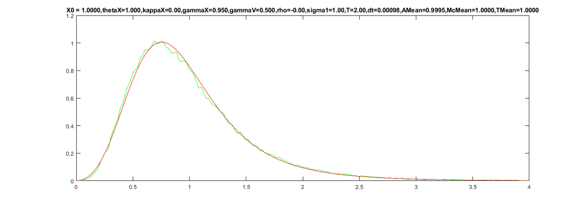](https://postimg.cc/PpPTK276)

Below is the corrected solution where systematic mismatch with monte carlo in the middle of the density has dramatically
decreased. However there is some larger mismatch towards the start of the density.

[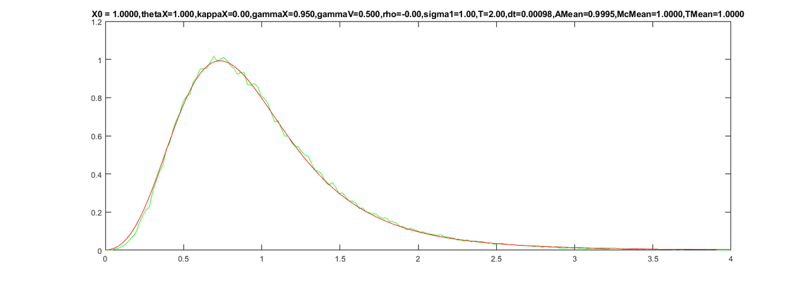](https://postimg.cc/0KSx1rPD)

Below is the terminal density of stochastic volatility at the final time that was used to generate both of the first two
asset graphs.

[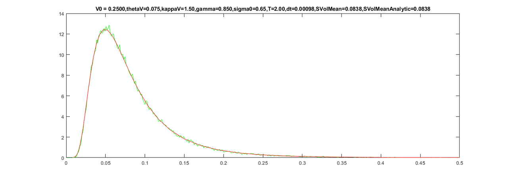](https://postimg.cc/sQqyL5d3)

I will be providing more details with equations tomorrow.

---

### #1267 — Amin (Topic Author)
*November 4, 2021, 3:12 PM*

Here is another set of graphs.

Below is the corrected graph

[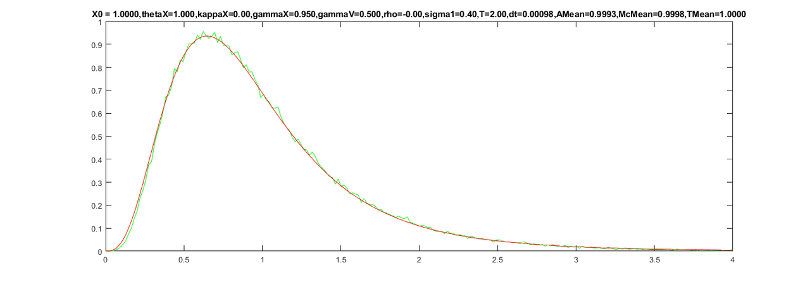](https://postimg.cc/bsbb3TcN)

Below is the uncorrected graph.

[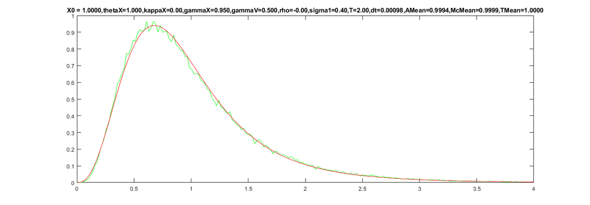](https://postimg.cc/HrgMKyd0)

Below is terminal SV graph.

[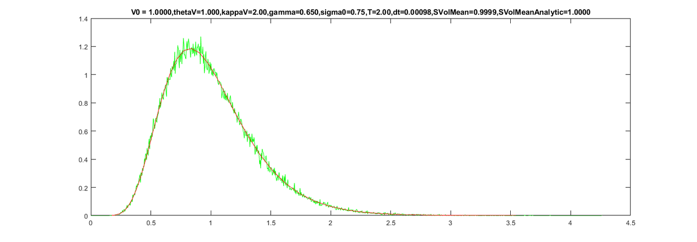](https://postimg.cc/HjFXwNNh)

More details with equations tomorrow.

---

### #1268 — Amin (Topic Author)
*November 5, 2021, 2:48 PM*

Friends, here I want to present the equations for the correction in the semi-analytic method that matches the shape of
our analytic density with monte carlo density but first I will present some other equations for friends to be oriented
with the problem.

The solution of one dimensional Fokker-Planck Equation was given as

$ \frac{\partial w_b}{\partial t}=\mu_w \,  + .5 {\sigma_w}^2 \big[ Z_1  \, {(\frac{\partial Z_1}{\partial w})} \, +  \, {(\frac{\partial Z_1}{\partial w})}^2  \frac{\partial^2 w}{\partial {Z_1}^2} \, \big]  \,$

In my new implementation for 2D Fokker-Planck PDE, I have bypassed full probability mass conservation equation and have
just used a 2D version of the above equation for one dimensional FPE. Though I may be wrong, In my basic exploratory
analysis, I found that after mean-correction applied to 2D version of one dimensional FPE, a full-fledged probability
mass conservation equation in two dimensional FP PDE is much slower and does not have any special advantages over the 2D
version of one dimensional FPE. Both equations yield similar results but a full-fledged probability mass conservation
implementation is relatively slower. I used the shape correction on 2D version of one dimensional FPE And you can easily
use it for full-fledged probability mass conservation solution with very similar improvement results.

Here I write the 2D version of one dimensional FPE solution as

$ \frac{\partial y_b(n,m)}{\partial t} =  \mu_y(n,m)  \, +\, .5 \, {\sigma_y}^2 \, {V(n)}^{2 \gamma_V}   \, \big[ Z_2(m) \, {(\frac{\partial Z_2}{\partial y})} + {(\frac{\partial Z_2}{\partial y})}^2 \frac{\partial^2 y}{\partial {Z_2}^2} \big]  $

The above solution is valid for each of the 1D asset PDEs on any nth node of the SV SDE.

When shape of the density did not perfectly match with monte carlo density, I tried several possibilities. One thing I
could think of was that there might be some slight amount of diffusion in asset PDE arising from SV coordinates. I tried
that by adding the following term in previous solution as

$ -\, .5 \, {\sigma_y}^2 \, {V(n)}^{2 \gamma_V}   \, \big[  {(\frac{\partial Z}{\partial w})}^2 \frac{\partial^2 w}{\partial {Z}^2} \big]  $

In the above equation Z is the normal random variable associated with the 1D stochastic volatility PDE solution. The
addition of above term in the previous solution fixed the mismatch and brought the new semi-analytic density in line
with monte carlo density. Interestingly the contribution from this above term is very small and its maximum value per
time step at the start of the simulation is roughly one thousandth of a basis point (1.0 * 10^-7) while the maximum
value of above term per time step increases to roughly one fourth of a basis point (2.5 * 10^-5) after two years for the
typical equations I was trying. So this is a very small correction but over a longer time frame helps to fix the
mismatch of our analytic density with the true monte carlo density.

So after adding the new term our full solution would be

$ \frac{\partial y_b(n,m)}{\partial t} =  \mu_y(n,m)  \, +\, .5 \, {\sigma_y}^2 \, {V(n)}^{2 \gamma_V}   \, \big[ Z_2(m) \, {(\frac{\partial Z_2}{\partial y})} + {(\frac{\partial Z_2}{\partial y})}^2 \frac{\partial^2 y}{\partial {Z_2}^2} \big]  $

$ -\, .5 \, {\sigma_y}^2 \, {V(n)}^{2 \gamma_V}   \, \big[  {(\frac{\partial Z}{\partial w})}^2 \frac{\partial^2 w}{\partial {Z}^2} \big]  $

You can make the same correction in full probability mass conservation framework but you might have to slightly alter
the last equation by multiplying it with$\frac{\partial Z_2}{\partial y}$ as I suspect.

Again I have no formal proof for this correction and I tried it while experimenting and it worked very well. So a formal
proof for this new equation is an open problem.

One thing I want to add again is that I have added mean-correction on every 1D asset PDE on nth SV PDE node(in 2D
version of 1D formal solution) and it is only after mean-correction that I find it to be comparable with full
probability mass conservation solution in two dimensions.

---

### #1269 — Amin (Topic Author)
*November 5, 2021, 3:07 PM*

Please note that in above post shape-correction and mean-correction are different. Shape correction refers to the new
term I have presented in the above post while mean-correction is the correction that brings mean of a probability
distribution in line with analytic mean and we have been using mean-correction on densities of SDEs for several years on
this forum.

---

### #1270 — Amin (Topic Author)
*November 6, 2021, 9:46 AM*

Friends, I have made a mistake in the previous post. The new term added to correct the analytic density is

$ -\, .5 \, {\sigma_y}^2 \, {V(n)}^{2 \gamma_V}   \, \big[  {(\frac{\partial Z}{\partial w})} \frac{\partial^2 w}{\partial {Z}^2} \big]  $

and not

$ -\, .5 \, {\sigma_y}^2 \, {V(n)}^{2 \gamma_V}   \, \big[  {(\frac{\partial Z}{\partial w})}^2 \frac{\partial^2 w}{\partial {Z}^2} \big]  $

as I wrote earlier.

So after adding the new term our full solution would be

$ \frac{\partial y_b(n,m)}{\partial t} =  \mu_y(n,m)  \, +\, .5 \, {\sigma_y}^2 \, {V(n)}^{2 \gamma_V}   \, \big[ Z_2(m) \, {(\frac{\partial Z_2}{\partial y})} + {(\frac{\partial Z_2}{\partial y})}^2 \frac{\partial^2 y}{\partial {Z_2}^2} \big]  $

$ -\, .5 \, {\sigma_y}^2 \, {V(n)}^{2 \gamma_V}   \, \big[  {(\frac{\partial Z}{\partial w})} \frac{\partial^2 w}{\partial {Z}^2} \big]  $

---

### #1271 — Amin (Topic Author)
*November 8, 2021, 11:09 AM*

>
> Friends, I have made a mistake in the previous post. The new term added to correct the analytic density is
>
>
$ -\, .5 \, {\sigma_y}^2 \, {V(n)}^{2 \gamma_V}   \, \big[  {(\frac{\partial Z}{\partial w})} \frac{\partial^2 w}{\partial {Z}^2} \big]  $
>
>
>
> and not
>
>
$ -\, .5 \, {\sigma_y}^2 \, {V(n)}^{2 \gamma_V}   \, \big[  {(\frac{\partial Z}{\partial w})}^2 \frac{\partial^2 w}{\partial {Z}^2} \big]  $
>
> as I wrote earlier.
>
>
>
> So after adding the new term our full solution would be
>
>
$ \frac{\partial y_b(n,m)}{\partial t} =  \mu_y(n,m)  \, +\, .5 \, {\sigma_y}^2 \, {V(n)}^{2 \gamma_V}   \, \big[ Z_2(m) \, {(\frac{\partial Z_2}{\partial y})} + {(\frac{\partial Z_2}{\partial y})}^2 \frac{\partial^2 y}{\partial {Z_2}^2} \big]  $
>
>
$ -\, .5 \, {\sigma_y}^2 \, {V(n)}^{2 \gamma_V}   \, \big[  {(\frac{\partial Z}{\partial w})} \frac{\partial^2 w}{\partial {Z}^2} \big]  $
>
Friends, please try in addition to the previously suggested correction

$ -\, .5 \, {\sigma_y}^2 \, {V(n)}^{2 \gamma_V}   \, \big[  {(\frac{\partial Z}{\partial w})} \frac{\partial^2 w}{\partial {Z}^2} \big]  $

another possible correction.

$ -\, .5 \, {\sigma_0}^2 \,  \, \big[  {(\frac{\partial w}{\partial Z})} \frac{\partial^2 w}{\partial {Z}^2} \big]  $

with full new possible solution

$ \frac{\partial y_b(n,m)}{\partial t} =  \mu_y(n,m)  \, +\, .5 \, {\sigma_y}^2 \, {V(n)}^{2 \gamma_V}   \, \big[ Z_2(m) \, {(\frac{\partial Z_2}{\partial y})} + {(\frac{\partial Z_2}{\partial y})}^2 \frac{\partial^2 y}{\partial {Z_2}^2} \big]  $

$ -\, .5 \, {\sigma_0}^2   \, \big[  {(\frac{\partial w}{\partial Z})} \frac{\partial^2 w}{\partial {Z}^2} \big]  $

As I believe these are both ad-hoc corrections that help to bring our semi-analytic density in line with monte carlo
density and could possibly be helpful until some friends who are actively doing research on the subject come up with
definitive true solution to the problem. For typical parameters, this new ad-hoc correction seems to work equally well
or even better than the previously suggested correction so please be sure to make a comparison.

---

### #1272 — Amin (Topic Author)
*November 11, 2021, 7:19 PM*

Friends I had some ideas about series solution of fokker-planck equation and I decided to share my initial ideas with
friends. I have not yet implemented anything but the ideas are interesting so I hope friends would like them. I intend
to represent the solution of PDE as a series in Z and then find an algorithm how to advance the series coefficients in
time. This is first part that I will discuss in this post. There is a second part in which I will represent the series
coefficients in powers of t and then find an iterated integral type solution for longer stepping of solution in time. I
will come to this second part in a later post in a few days.

First we suppose that we can express the solution of X(t) where X is the SDE/PDE variable as

$X(t)=a_0  \,+ a_1 \, Z + a_2 \, Z^2 + a_3 \, Z^3 +  a_4 \, Z^4 +\, ... $

its derivatives can be calculated as

$\frac{\partial X(t)}{\partial Z}= a_1 \, + 2 \,a_2 \, Z +3 \, a_3 \, Z^2 +4 \,  a_4 \, Z^3 +\, ... $

$\frac{\partial^2 X(t)}{\partial Z^2}=  2 \,a_2 \, +6 \, a_3 \, Z +12 \,  a_4 \, Z^2 +\, ... $

Let us suppose that we can represent the solution $X(t+\Delta t)$ as

$X(t+\Delta t)=c_0  \,+ c_1 \, Z + c_2 \, Z^2 + c_3 \, Z^3 +  c_4 \, Z^4 +\, ... $

All the coefficients c's at next time step variable$X(t+\Delta t)$ are supposedly unknown and these are the ones we want
to find out in our recursions.

For our analytics, we would have to also represent the time dependent drift as a series in Z

$\mu(X(t))=b_0  \,+ b_1 \, Z + b_2 \, Z^2 + b_3 \, Z^3 +  b_4 \, Z^4 +\, ... $

We do not want to use finite differences anywhere so in order to find the coefficients$b_0, \, b_1, \, b_2$ and so on we
use

$b_0 = \mu(X(Z_0))$  where $Z_0$ means calculating at  Z=0.

$b_1 = \frac{\partial \mu}{\partial X} \, \frac{\partial X}{\partial Z}=\frac{\partial \mu}{\partial X} \, [a_0  \,+ a_1 \, Z + a_2 \, Z^2 + a_3 \, Z^3 +  a_4 \, Z^4 ] |^{Z=0} $

$=a_1 \,\frac{\partial \mu}{\partial X}|^{Z=0}$

$b_2 = \frac{\partial^2 \mu}{\partial X^2} \, {(\frac{\partial X}{\partial Z})}^2 + \frac{\partial \mu}{\partial X} \, \frac{\partial^2 X}{\partial Z^2}=[\frac{\partial^2 \mu}{\partial X^2} \, {a_1}^2 + \frac{\partial \mu}{\partial X} 2 \, a_2 ] |^{Z=0} $

and so we can analytically find the derivatives of drift to any order analytically since derivatives with respect to X
are found by analytic differentiation.

Now we have the evolution equation of the solution of Fokker-planck equation along CDF lines as

$X(t+\Delta t)=X(t) \, + \, \mu(X(t))\, + .5 \sigma^2 \Delta t \, Z \, \frac{\partial Z}{\partial X} +  .5 \sigma^2 \Delta t \, {(\frac{\partial Z}{\partial X})}^2 \frac{\partial^2 X}{\partial Z^2}$

Now we want to insert the series for$X(t), \, X(t+\Delta t) ,\, \mu(X(t))$ and try to solve for the coefficients but
first We multiply both sides by${(\frac{\partial X}{\partial Z})}^2$ so that series in denominator goes to numerator.
This gives us

$X(t+\Delta t) \, {(\frac{\partial X}{\partial Z})}^2=X(t) \, {(\frac{\partial X}{\partial Z})}^2+ \, \mu(X(t))\, {(\frac{\partial X}{\partial Z})}^2+ .5 \sigma^2 \Delta t \, Z \, \frac{\partial X}{\partial Z} +  .5 \sigma^2 \Delta t \,  \frac{\partial^2 X}{\partial Z^2}$

Now we insert our series for each of the term in above expression as

$[c_0  \,+ c_1 \, Z + c_2 \, Z^2 + c_3 \, Z^3 + \, ...] \, {({a_1}^2+ 4 a_1 a_2 Z+ 4 {a_2}^2 Z^2+ 6 a_1 a_3 Z^2 + 12 a2 a_3 Z^3 + 8 a_1 a_4 Z^3 + 9 {a_3}^2 Z^4+ 16 a_2 a_4 Z^4 + \, ...)}$

$=[a_0  \,+ a_1 \, Z + a_2 \, Z^2 + a_3 \, Z^3 +  a_4 \, Z^4 +\, ...]  {({a_1}^2+ 4 a_1 a_2 Z+ 4 {a_2}^2 Z^2+ 6 a_1 a_3 Z^2 + 12 a2 a_3 Z^3 + 8 a_1 a_4 Z^3 + 9 {a_3}^2 Z^4+ 16 a_2 a_4 Z^4 + \, ...)}$

$+ \, [b_0  \,+ b_1 \, Z + b_2 \, Z^2 + b_3 \, Z^3 +  b_4 \, Z^4 +\, ...]  {({a_1}^2+ 4 a_1 a_2 Z+ 4 {a_2}^2 Z^2+ 6 a_1 a_3 Z^2 + 12 a2 a_3 Z^3 + 8 a_1 a_4 Z^3 + 9 {a_3}^2 Z^4+ 16 a_2 a_4 Z^4 + \, ...)}$

$+ .5 \sigma^2 \Delta t \, Z \, [a_1 \, + 2 \,a_2 \, Z +3 \, a_3 \, Z^2 +4 \,  a_4 \, Z^3 +\, ...] $

$+  .5 \sigma^2 \Delta t \,  [2 \,a_2 \, +6 \, a_3 \, Z +12 \,  a_4 \, Z^2 +\, ...]$

In the above
${(\frac{\partial X}{\partial Z})}^2={({a_1}^2+ 4 a_1 a_2 Z+ 4 {a_2}^2 Z^2+ 6 a_1 a_3 Z^2 + 12 a2 a_3 Z^3 + 8 a_1 a_4 Z^3 + 9 {a_3}^2 Z^4+ 16 a_2 a_4 Z^4 + \, ...)}$

This last few terms of the above series would depend on our order of expansion. Rest of the series substitutions are
obvious and are just copied from their description at the start.

Now we know the coefficients a's in the expansion of X(t) and b's in the expansion of drift and we want to determine the
coefficients of c's in the expansion of X(t+1). In order to that first we compare the constant terms(with zero power of
Z) on both sides of the equation. Then we compare the first power of Z in both sides of the equation and then second
power of Z and then so on towards comparing higher powers of Z.

Comparing the constant terms, we get

$c_0  \, {a_1}^2 =a_0  \, {a_1}^2 + b_0  \, {a_1}^2+  .5 \sigma^2 \Delta t \,  2 \,a_2$

from where we get the solution to constant in the series $c_0$ as

$c_0  =a_0  \, + b_0  \,+   \sigma^2 \Delta t  \, \frac{a_2}{{a_1}^2}$

In order to find $c_1$, we compare the coefficients of Z on both sides of the main series equation to find

$[ \, 4 \, c_0 \, a_1 a_2 Z+ c_1 \,{a_1}^2 \, Z ] =[4 a_0  \, a_1 a_2 Z+ {a_1}^3\, Z ] + [\,4 b_0 \,a_1 a_2 Z+ b_1 \,{a_1}^2\, Z ]$

$+ .5 \sigma^2 \Delta t \, Z \, a_1 \, +  3 \sigma^2 \Delta t  \, a_3 \, Z $

Solving for $c_1$, we get

$ c_1=-[\, 4 \, c_0 \ a_2/a_1 ] + [4 a_0   a_2/a_1 + {a_1}\,] + [\,4 b_0  a_2/a_1 + b_1 ]$

$+ .5 \sigma^2 \Delta t \, /a_1 \, +  3 \sigma^2 \Delta t  \, a_3/{a_1}^2 \, $

or

$c_1=a_1+b_1- \, 4 \, c_0 \ a_2/a_1 + 4 a_0   a_2/a_1 + \,4 b_0  a_2/a_1  $

$+ .5 \sigma^2 \Delta t \, /a_1 \, +  3 \sigma^2 \Delta t  \, a_3/{a_1}^2 \, $

In order to find $c_2$, we have to compare the coefficients of $Z^2$

$[4 c_0  \, {a_2}^2 Z^2+4 c_1 \,  a_1 a_2 Z^2+{a_1}^2 c_2 \, Z^2 ] \,=[4 a_0  \, {a_2}^2 Z^2+4 {a_1}^2 a_2 Z^2+{a_1}^2 a_2 \, Z^2 ] \,+[4 b_0  \, {a_2}^2 Z^2+4 b_1 \,  a_1 a_2 Z^2+{a_1}^2 b_2 \, Z^2 ] \,$

$+ .5 \sigma^2 \Delta t \, Z \, [2 \, a_2 \, Z^2 ] +  .5 \sigma^2 \Delta t \,  [12 \,  a_4 \, Z^2 ]$

solving for $c_2$, we get

$ c_2 \,=- [4 c_0  \, {a_2}^2/{a_1}^2 +4 c_1 \,  a_2/{a_1} ]+[4 a_0  \, {a_2}^2/{a_1}^2 +4  a_2 + a_2  ] \,+[4 b_0  \, {a_2}^2/{a_1}^2 +4 b_1 \,  a_2/{a_1} +b_2 ] \,$

$+ \sigma^2 \Delta t \, a_2 /{a_1}^2 +  6 \sigma^2 \Delta t \,  a_4 /{a_1}^2$

which gives us the solution for $c_2$ as

$ c_2 \,= a_2 +b_2- [4 c_0  \, {a_2}^2/{a_1}^2 +4 c_1 \,  a_2/{a_1} ]+[4 a_0  \, {a_2}^2/{a_1}^2 +4  a_2 ] \,+[4 b_0  \, {a_2}^2/{a_1}^2 +4 b_1 \,  a_2/{a_1} ] \,$

$+ \sigma^2 \Delta t  \,  a_2 /{a_1}^2 +  6 \sigma^2 \Delta t \,    a_4/{a_1}^2$

Please note in the recursions for c's we only need indices that have already been found. All a's and b's are supposed to
be known from previous time step.

Though the series is interesting, I must warn the friends that in order to get accuracy out to several years, they might
have to get 20 or 30 or even more terms in the expansion which can easily become very tedious.

My game plan is to increase order of the solution using "method of iterated integrals-like" solution and solve the
equations that are at least second order accurate in time.

Later we can see if we can get a reasonably fast algorithm in two dimensions.

---

### #1273 — Amin (Topic Author)
*November 11, 2021, 7:49 PM*

**(broken latex: Unbalanced $: 117)**

```latex
>
> Friends I had some ideas about series solution of fokker-planck equation and I decided to share my initial ideas with
friends. I have not yet implemented anything but the ideas are interesting so I hope friends would like them. I intend
to represent the solution of PDE as a series in Z and then find an algorithm how to advance the series coefficients in
time. This is first part that I will discuss in this post. There is a second part in which I will represent the series
coefficients in powers of t and then find an iterated integral type solution for longer stepping of solution in time. I
will come to this second part in a later post in a few days.
>
>
>
> First we suppose that we can express the solution of X(t) where X is the SDE/PDE variable as
>
>
>
> $X(t)=a_0  \,+ a_1 \, Z + a_2 \, Z^2 + a_3 \, Z^3 +  a_4 \, Z^4 +\, ... $
>
>
>
> its derivatives can be calculated as
>
>
>
> $\frac{\partial X(t)}{\partial Z}= a_1 \, + 2 \,a_2 \, Z +3 \, a_3 \, Z^2 +4 \,  a_4 \, Z^3 +\, ... $
>
> $\frac{\partial^2 X(t)}{\partial Z^2}=  2 \,a_2 \, +6 \, a_3 \, Z +12 \,  a_4 \, Z^2 +\, ... $
>
>
>
> Let us suppose that we can represent the solution $X(t+\Delta t)$ as
>
>
>
> $X(t+\Delta t)=c_0  \,+ c_1 \, Z + c_2 \, Z^2 + c_3 \, Z^3 +  c_4 \, Z^4 +\, ... $
>
>
>
> All the coefficients c's at next time step variable$X(t+\Delta t)$ are supposedly unknown and these are the ones we
want to find out in our recursions.
>
>
>
> For our analytics, we would have to also represent the time dependent drift as a series in Z
>
>
>
> $\mu(X(t))=b_0  \,+ b_1 \, Z + b_2 \, Z^2 + b_3 \, Z^3 +  b_4 \, Z^4 +\, ... $
>
>
>
> We do not want to use finite differences anywhere so in order to find the coefficients$b_0, \, b_1, \, b_2$ and so on
we use
>
>
>
> $b_0 = \mu(X(Z_0))$  where $Z_0$ means calculating at  Z=0.
>
>
>
>
$b_1 = \frac{\partial \mu}{\partial X} \, \frac{\partial X}{\partial Z}=\frac{\partial \mu}{\partial X} \, [a_0  \,+ a_1 \, Z + a_2 \, Z^2 + a_3 \, Z^3 +  a_4 \, Z^4 ] |^{Z=0} $
>
> $=a_1 \,\frac{\partial \mu}{\partial X}|^{Z=0}$
>
>
>
>
$b_2 = \frac{\partial^2 \mu}{\partial X^2} \, {(\frac{\partial X}{\partial Z})}^2 + \frac{\partial \mu}{\partial X} \, \frac{\partial^2 X}{\partial Z^2}=[\frac{\partial^2 \mu}{\partial X^2} \, {a_1}^2 + \frac{\partial \mu}{\partial X} 2 \, a_2 ] |^{Z=0} $
>
>
>
> and so we can analytically find the derivatives of drift to any order analytically since derivatives with respect to X
are found by analytic differentiation.
>
>
>
> Now we have the evolution equation of the solution of Fokker-planck equation along CDF lines as
>
>
>
>
$X(t+\Delta t)=X(t) \, + \, \mu(X(t))\, + .5 \sigma^2 \Delta t \, Z \, \frac{\partial Z}{\partial X} +  .5 \sigma^2 \Delta t \, {(\frac{\partial Z}{\partial X})}^2 \frac{\partial^2 X}{\partial Z^2}$
>
>
>
> Now we want to insert the series for$X(t), \, X(t+\Delta t) ,\, \mu(X(t))$ and try to solve for the coefficients but
first We multiply both sides by${(\frac{\partial X}{\partial Z})}^2$ so that series in denominator goes to numerator.
This gives us
>
>
>
>
$X(t+\Delta t) \, {(\frac{\partial X}{\partial Z})}^2=X(t) \, {(\frac{\partial X}{\partial Z})}^2+ \, \mu(X(t))\, {(\frac{\partial X}{\partial Z})}^2+ .5 \sigma^2 \Delta t \, Z \, \frac{\partial X}{\partial Z} +  .5 \sigma^2 \Delta t \,  \frac{\partial^2 X}{\partial Z^2}$
>
>
>
> Now we insert our series for each of the term in above expression as
>
>
>
>
$[c_0  \,+ c_1 \, Z + c_2 \, Z^2 + c_3 \, Z^3 + \, ...] \, {({a_1}^2+ 4 a_1 a_2 Z+ 4 {a_2}^2 Z^2+ 6 a_1 a_3 Z^2 + 12 a2 a_3 Z^3 + 8 a_1 a_4 Z^3 + 9 {a_3}^2 Z^4+ 16 a_2 a_4 Z^4 + \, ...)}$
>
>
$=[a_0  \,+ a_1 \, Z + a_2 \, Z^2 + a_3 \, Z^3 +  a_4 \, Z^4 +\, ...]  {({a_1}^2+ 4 a_1 a_2 Z+ 4 {a_2}^2 Z^2+ 6 a_1 a_3 Z^2 + 12 a2 a_3 Z^3 + 8 a_1 a_4 Z^3 + 9 {a_3}^2 Z^4+ 16 a_2 a_4 Z^4 + \, ...)}$
>
>
$+ \, [b_0  \,+ b_1 \, Z + b_2 \, Z^2 + b_3 \, Z^3 +  b_4 \, Z^4 +\, ...]  {({a_1}^2+ 4 a_1 a_2 Z+ 4 {a_2}^2 Z^2+ 6 a_1 a_3 Z^2 + 12 a2 a_3 Z^3 + 8 a_1 a_4 Z^3 + 9 {a_3}^2 Z^4+ 16 a_2 a_4 Z^4 + \, ...)}$
>
> $+ .5 \sigma^2 \Delta t \, Z \, [a_1 \, + 2 \,a_2 \, Z +3 \, a_3 \, Z^2 +4 \,  a_4 \, Z^3 +\, ...] $
>
> $+  .5 \sigma^2 \Delta t \,  [2 \,a_2 \, +6 \, a_3 \, Z +12 \,  a_4 \, Z^2 +\, ...]$
>
>
>
> In the above
${(\frac{\partial X}{\partial Z})}^2={({a_1}^2+ 4 a_1 a_2 Z+ 4 {a_2}^2 Z^2+ 6 a_1 a_3 Z^2 + 12 a2 a_3 Z^3 + 8 a_1 a_4 Z^3 + 9 {a_3}^2 Z^4+ 16 a_2 a_4 Z^4 + \, ...)}$
>
> This last few terms of the above series would depend on our order of expansion. Rest of the series substitutions are
obvious and are just copied from their description at the start.
>
> Now we know the coefficients a's in the expansion of X(t) and b's in the expansion of drift and we want to determine
the coefficients of c's in the expansion of X(t+1). In order to that first we compare the constant terms(with zero power
of Z) on both sides of the equation. Then we compare the first power of Z in both sides of the equation and then second
power of Z and then so on towards comparing higher powers of Z.
>
> Comparing the constant terms, we get
>
> $c_0  \, {a_1}^2 =a_0  \, {a_1}^2 + b_0  \, {a_1}^2+  .5 \sigma^2 \Delta t \,  2 \,a_2$
>
> from where we get the solution to constant in the series $c_0$ as
>
> $c_0  =a_0  \, + b_0  \,+   \sigma^2 \Delta t  \, \frac{a_2}{{a_1}^2}$
>
>
>
> In order to find $c_1$, we compare the coefficients of Z on both sides of the main series equation to find
>
>
>
>
$[ \, 4 \, c_0 \, a_1 a_2 Z+ c_1 \,{a_1}^2 \, Z ] =[4 a_0  \, a_1 a_2 Z+ {a_1}^3\, Z ] + [\,4 b_0 \,a_1 a_2 Z+ b_1 \,{a_1}^2\, Z ]$
>
> $+ .5 \sigma^2 \Delta t \, Z \, a_1 \, +  3 \sigma^2 \Delta t  \, a_3 \, Z $
>
>
>
> Solving for $c_1$, we get
>
>
>
> $ c_1=-[\, 4 \, c_0 \ a_2/a_1 ] + [4 a_0   a_2/a_1 + {a_1}\,] + [\,4 b_0  a_2/a_1 + b_1 ]$
>
> $+ .5 \sigma^2 \Delta t \, /a_1 \, +  3 \sigma^2 \Delta t  \, a_3/{a_1}^2 \, $
>
> or
>
> $c_1=a_1+b_1- \, 4 \, c_0 \ a_2/a_1 + 4 a_0   a_2/a_1 + \,4 b_0  a_2/a_1  $
>
> $+ .5 \sigma^2 \Delta t \, /a_1 \, +  3 \sigma^2 \Delta t  \, a_3/{a_1}^2 \, $
>
>
>
> In order to find $c_2$, we have to compare the coefficients of $Z^2$
>
>
>
>
$[4 c_0  \, {a_2}^2 Z^2+4 c_1 \,  a_1 a_2 Z^2+{a_1}^2 c_2 \, Z^2 ] \,=[4 a_0  \, {a_2}^2 Z^2+4 {a_1}^2 a_2 Z^2+{a_1}^2 a_2 \, Z^2 ] \,$
+[4 b_0 \, {a_2}^2 Z^2+4 b_1 \, a_1 a_2 Z^2+{a_1}^2 b_2 \, Z^2 ] \,$
>
> $+ .5 \sigma^2 \Delta t \, Z \, [2 \, a_2 \, Z^2 ] +  .5 \sigma^2 \Delta t \,  [12 \,  a_4 \, Z^2 ]$
>
> solving for $c_2$, we get
>
>
$ c_2 \,=- [4 c_0  \, {a_2}^2/{a_1}^2 +4 c_1 \,  a_2/{a_1} ]+[4 a_0  \, {a_2}^2/{a_1}^2 +4  a_2 + a_2  ] \,+[4 b_0  \, {a_2}^2/{a_1}^2 +4 b_1 \,  a_2/{a_1} +b_2 ] \,$
>
> $+ \sigma^2 \Delta t \, a_2 /{a_1}^2 +  6 \sigma^2 \Delta t \,  a_4 /{a_1}^2$
>
> which gives us the solution for $c_2$ as
>
>
$ c_2 \,= a_2 +b_2- [4 c_0  \, {a_2}^2/{a_1}^2 +4 c_1 \,  a_2/{a_1} ]+[4 a_0  \, {a_2}^2/{a_1}^2 +4  a_2 ] \,+[4 b_0  \, {a_2}^2/{a_1}^2 +4 b_1 \,  a_2/{a_1} ] \,$
>
> $+ \sigma^2 \Delta t  \,  a_2 /{a_1}^2 +  6 \sigma^2 \Delta t \,    a_4/{a_1}^2$
>
>
>
> Please note in the recursions for c's we only need indices that have already been found. All a's and b's are supposed
to be known from previous time step.
>
> Though the series is interesting, I must warn the friends that in order to get accuracy out to several years, they
might have to get 20 or 30 or even more terms in the expansion which can easily become very tedious.
>
> My game plan is to increase order of the solution using "method of iterated integrals-like" solution and solve the
equations that are at least second order accurate in time.
>
> Later we can see if we can get a reasonably fast algorithm in two dimensions.
>

Sorry, I missed a term in the recursion of $c_2$. The correct solution for $c_2$ should be

In order to find $c_2$, we have to compare the coefficients of $Z^2$

$[4 c_0  \, {a_2}^2 Z^2+ 6 c_0 \,a_1 a_3 Z^2+4 c_1 \,  a_1 a_2 Z^2+{a_1}^2 c_2 \, Z^2 ] \,=[4 a_0  \, {a_2}^2 Z^2+ 6 a_0 \,a_1 a_3 Z^2+4 {a_1}^2 a_2 Z^2+{a_1}^2 a_2 \, Z^2 ] \,$

$+[4 b_0  \, {a_2}^2 Z^2+ 6 b_0 \,a_1 a_3 Z^2+4 b_1 \,  a_1 a_2 Z^2+{a_1}^2 b_2 \, Z^2 ] \,$

$+ .5 \sigma^2 \Delta t \, Z \, [2 \, a_2 \, Z^2 ] +  .5 \sigma^2 \Delta t \,  [12 \,  a_4 \, Z^2 ]$

solving for $c_2$, we get

$ c_2 \,=- [4 c_0  \, {a_2}^2/{a_1}^2 + 6 c_0  a_3/a_1+4 c_1 \,  a_2/{a_1} ]+[4 a_0  \, {a_2}^2/{a_1}^2 + 6 a_0  a_3/a_1+4  a_2 + a_2  ] \,$

$+[4 b_0  \, {a_2}^2/{a_1}^2 + 6 b_0  a_3/a_1+4 b_1 \,  a_2/{a_1} +b_2 ] \,$

$+ \sigma^2 \Delta t \, a_2 /{a_1}^2 +  6 \sigma^2 \Delta t \,  a_4 /{a_1}^2$

which gives us the solution for $c_2$ as

$ c_2 \,= a_2 +b_2- [4 c_0  \, {a_2}^2/{a_1}^2+ 6 c_0  a_3/a_1  +4 c_1 \,  a_2/{a_1} ]+[4 a_0  \, {a_2}^2/{a_1}^2 + 6 a_0  a_3/a_1 +4  a_2 ] \,+[4 b_0  \, {a_2}^2/{a_1}^2 + 6 b_0  a_3/a_1 +4 b_1 \,  a_2/{a_1} ] \,$

$+ \sigma^2 \Delta t  \,  a_2 /{a_1}^2 +  6 \sigma^2 \Delta t \,    a_4/{a_1}^2$
```

---

### #1274 — Amin (Topic Author)
*November 16, 2021, 3:03 PM*

Friends, I am working with the initial versions of the proposed series solution in matlab but it is not precise and I
believe that lack of precision is due to lack of order in time in our series solution as it is hardly first order
accurate in time. I was able to work out more accurate solution in time by using "method of iterated integrals"-like
technique. This more accurate solution can also be used in finite difference solutions(that we have been working on
since past several months) for a longer stepping in time though I have still not implemented that on my computer. Here
are the details for higher order solution to constant CDF lines of SDEs.

We know that in bessel coordinates the solution to constant CDF lines of SDEs is given as

$\frac{dw}{dt}=\mu(w) \, + \, .5 {\sigma}^2 Z \frac{\partial Z}{\partial w} - \, .5 {\sigma}^2 \frac{\partial^2 Z}{\partial w^2} [\frac{\partial Z}{\partial w}]^{-1}$

I have changed the third term to a slightly different but equivalent form since we have to take derivatives with respect
to w. Here in the above equation, for the two term drift SDEs that we have been working with, the drift term in bessel
coordinates is given as

$\mu(w) \,= \mu_1 [(1-\gamma)w]^{\frac{\beta_1-\gamma}{1-\gamma}} + \mu_2 [(1-\gamma)w]^{\frac{\beta_2-\gamma}{1-\gamma}} -.5 {\sigma}^2 \gamma [(1-\gamma)w]^{-1}$

Now we do an iterated integral like expansion of first equation to find the second order solution in time for the
evolution of constant CDF lines of the SDE as

$w(t_1)=w(t_0)+ \mu(w(t_0)) \, \int_{t_0}^{t_1} dt + \, .5 {\sigma}^2 Z \frac{\partial Z}{\partial w} \, \int_{t_0}^{t_1} dt + \, \, .5 {\sigma}^2 \,  \frac{\partial^2 Z}{\partial w^2} [\frac{\partial Z}{\partial w}]^{-1}  \, \int_{t_0}^{t_1} dt$

$+\frac{\partial \mu(w(t_0))}{\partial w} \frac{dw}{dt} \, \int_{t_0}^{t_1}\int_{t_0}^{t} ds dt+\, \, .5 {\sigma}^2 \frac{\partial}{\partial w}[Z \frac{\partial Z}{\partial w}]  \,\frac{dw}{dt} \, \int_{t_0}^{t_1}\int_{t_0}^{t} ds dt+\, \, .5 {\sigma}^2 \frac{\partial}{\partial w} \big[ \frac{\partial^2 Z}{\partial w^2} {(\frac{\partial Z}{\partial w})}^{-1} \big]  \,\frac{dw}{dt} \, \int_{t_0}^{t_1}\int_{t_0}^{t} ds dt$

All the terms outside the integrals are evaluated at starting time$t_0$ and are constants for the time interval and
therefore have been taken out of the time dependent integrals.

Now we explain the constant terms outside the double integrals.

$\frac{\partial \mu(w(t_0))}{\partial w} \frac{dw}{dt}=\frac{\partial \mu(w(t_0))}{\partial w} \, \big[\mu(w(t_0)) \, + \, .5 {\sigma}^2 Z \frac{\partial Z}{\partial w} - \, .5 {\sigma}^2 \frac{\partial^2 Z}{\partial w^2} [\frac{\partial Z}{\partial w}]^{-1} \big] $

Please note that all values and derivatives in previous expression are evaluated at time $t_0$

Now coming towards second of the terms with double integrals

$ .5 {\sigma}^2 \frac{\partial}{\partial w}[Z \frac{\partial Z}{\partial w}]  \,\frac{dw}{dt}=.5 {\sigma}^2 \big[{(\frac{\partial Z}{\partial w})}^2+Z\frac{\partial^2 Z}{\partial w^2} \big]\, \big[\mu(w(t_0)) \, + \, .5 {\sigma}^2 Z \frac{\partial Z}{\partial w} - \, .5 {\sigma}^2 \frac{\partial^2 Z}{\partial w^2} [\frac{\partial Z}{\partial w}]^{-1} \big]$

Now coming towards third and last term with double integrals

$\, .5 {\sigma}^2 \frac{\partial}{\partial w} \big[ \frac{\partial^2 Z}{\partial w^2} {(\frac{\partial Z}{\partial w})}^{-1} \big]  \,\frac{dw}{dt}$

$=\, .5 {\sigma}^2 \Big[\frac{\partial^3 Z}{\partial w^3} {(\frac{\partial Z}{\partial w})}^{-1} - {(\frac{\partial^2 Z}{\partial w^2})}^2 {(\frac{\partial Z}{\partial w})}^{-2} \Big] \, \big[\mu(w(t_0)) \, + \, .5 {\sigma}^2 Z \frac{\partial Z}{\partial w} - \, .5 {\sigma}^2 \frac{\partial^2 Z}{\partial w^2} [\frac{\partial Z}{\partial w}]^{-1} \big]$

which gives us the complete expanded solution as

$w(t_1)=w(t_0)+ \mu(w(t_0)) \, \int_{t_0}^{t_1} dt + \, .5 {\sigma}^2 Z \frac{\partial Z}{\partial w} \, \int_{t_0}^{t_1} dt + \, \, .5 {\sigma}^2 \,  \frac{\partial^2 Z}{\partial w^2} [\frac{\partial Z}{\partial w}]^{-1}  \, \int_{t_0}^{t_1} dt$

$+\Big[\frac{\partial \mu(w(t_0))}{\partial w} \, \big[\mu(w(t_0)) \, + \, .5 {\sigma}^2 Z \frac{\partial Z}{\partial w} - \, .5 {\sigma}^2 \frac{\partial^2 Z}{\partial w^2} [\frac{\partial Z}{\partial w}]^{-1} \big] \Big] \, \int_{t_0}^{t_1}\int_{t_0}^{t} ds dt$

$+\Big[.5 {\sigma}^2 \big[{(\frac{\partial Z}{\partial w})}^2+Z\frac{\partial^2 Z}{\partial w^2} \big]\, \big[\mu(w(t_0)) \, + \, .5 {\sigma}^2 Z \frac{\partial Z}{\partial w} - \, .5 {\sigma}^2 \frac{\partial^2 Z}{\partial w^2} [\frac{\partial Z}{\partial w}]^{-1} \big] \Big] \, \int_{t_0}^{t_1}\int_{t_0}^{t} ds dt$

$+\, .5 {\sigma}^2 \Big[\frac{\partial^3 Z}{\partial w^3} {(\frac{\partial Z}{\partial w})}^{-1} - {(\frac{\partial^2 Z}{\partial w^2})}^2 {(\frac{\partial Z}{\partial w})}^{-2} \Big] \, \big[\mu(w(t_0)) \, + \, .5 {\sigma}^2 Z \frac{\partial Z}{\partial w} - \, .5 {\sigma}^2 \frac{\partial^2 Z}{\partial w^2} [\frac{\partial Z}{\partial w}]^{-1} \big] \int_{t_0}^{t_1}\int_{t_0}^{t} ds dt$

Please note that all terms and derivatives outside of the integrals are evaluated at start of the simulation time step.

The above is the raw solution that should be second order accurate in time. Since I have not implemented it, there can
possibly be stability issues but they would have to be worked out once we have a better understanding of the higher
order solution of the constant CDF lines of the SDE density.

Here is the link to my paper where I have used method of iterated integrals for ordinary differential equations. I later used the same technique for higher order monte carlo simulation schemes of the SDEs. https://papers.ssrn.com/sol3/papers.cfm?abstract_id=2872598

---

### #1275 — Amin (Topic Author)
*November 20, 2021, 1:12 PM*

Friends, I tried the new improved formula for simulation of constant CDF lines and densities of SDEs. It gives both
higher accuracy everywhere and more stability closer to zero. But there is not a highly marked difference from the
previous formula. We can easily increase the step size by two to four as compared to step size that we were earlier
using with first order version but it is still difficult to increase the step size by a factor of ten or more. After the
weekend, I will be posting a new program for simulation of one dimensional SDEs with the new advanced formula.

About the power series formula, its performance with first order was not very good and I want to try to see how it does
with improved order. I have several different and meaningful ideas about power series formula and I hope that I would be
able to make something interesting out of it but its results would also come out next week.

---

### #1276 — Amin (Topic Author)
*November 20, 2021, 1:39 PM*

>
> Friends, I tried the new improved formula for simulation of constant CDF lines and densities of SDEs. It gives both
higher accuracy everywhere and more stability closer to zero. But there is not a highly marked difference from the
previous formula. We can easily increase the step size by two to four as compared to step size that we were earlier
using with first order version but it is still difficult to increase the step size by a factor of ten or more. After the
weekend, I will be posting a new program for simulation of one dimensional SDEs with the new advanced formula.
>
> About the power series formula, its performance with first order was not very good and I want to try to see how it
does with improved order. I have several different and meaningful ideas about power series formula and I hope that I
would be able to make something interesting out of it but its results would also come out next week.
>
.

For most of the easy SDE diffusions where we earlier needed a step size of 1/512 or 1/256, we can now easily go by a
step size of 1/100 and still not lose accuracy(This is with initial shorter stepping at start of diffusion simulation at
delta origin). This is a good improvement but certainly not dramatic improvement. And closer to zero, you still need a
relatively larger step for accuracy.

---

### #1277 — Amin (Topic Author)
*November 21, 2021, 4:25 PM*

Friends, I was able to get the series recursive solution to work. I have retained only six powers in the series since
higher order beyond six was more off with several SDEs and would need second  order time correction. My programs are
still very initial and I have not done any higher 2nd order correction yet that I hope to do in next few days. Using
this initial basic solution, I have drawn some graphs with various values of SDE parameters out to one year. Though the
results are very encouraging, I believe there is huge room for improvement especially with second order correction that
I hope to implement very soon. I really hope that final series solution will be vastly improved as compared to this
version.

Here are the graphs from series solution. I will post the program used to create these graphs in the next post.

.

.

[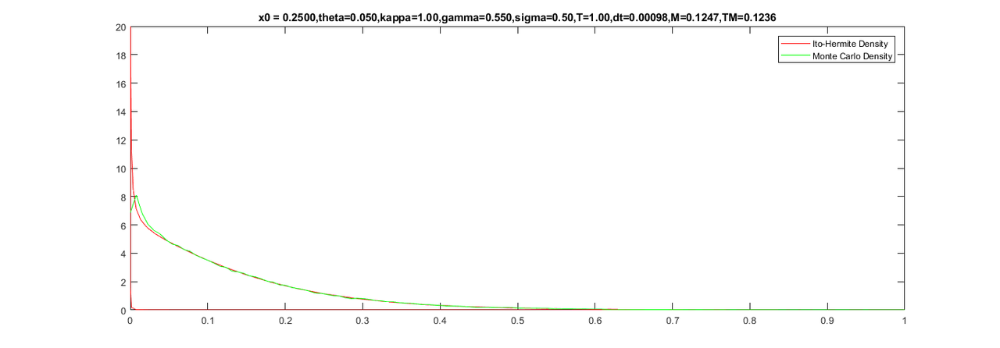](https://postimg.cc/fJS6mVgY)

[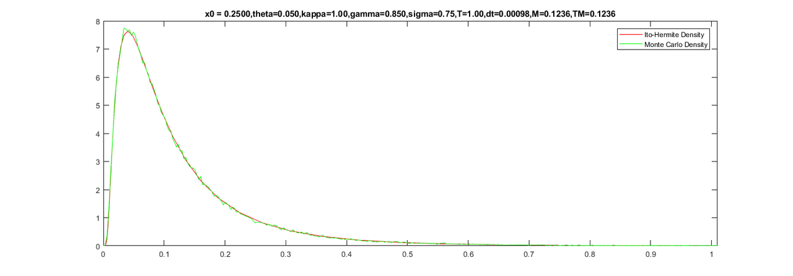](https://postimg.cc/jDVBXRGm)

[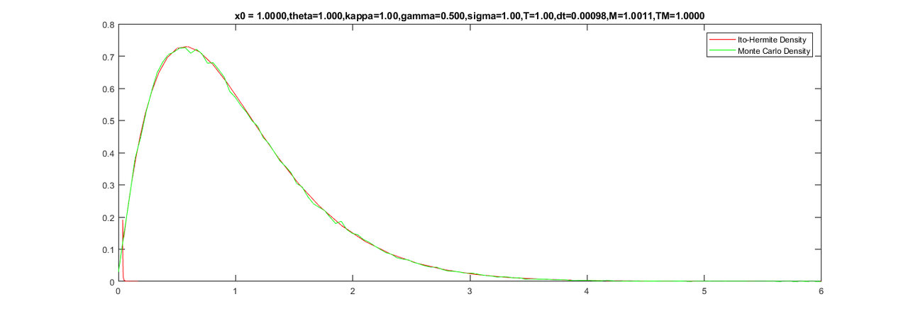](https://postimg.cc/kDGrM1Q1)

[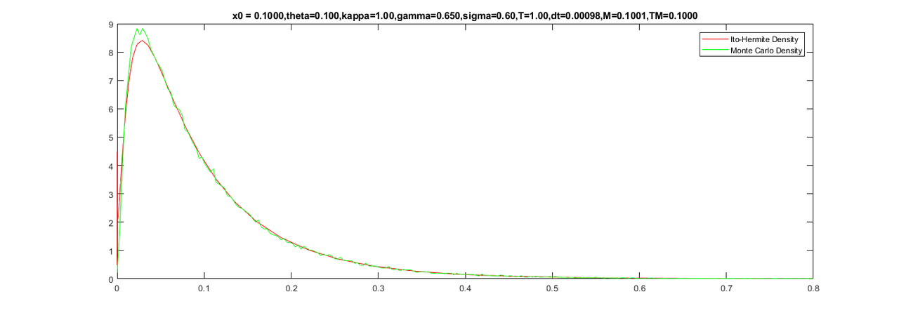](https://postimg.cc/yWbMDmnV)

[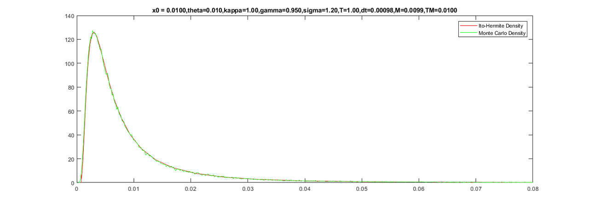](https://postimg.cc/MfvgsHZ2)

[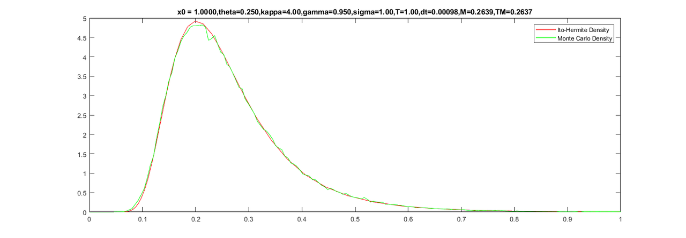](https://postimg.cc/DJf9X5tz)

[](https://postimg.cc/McYkHg34)

[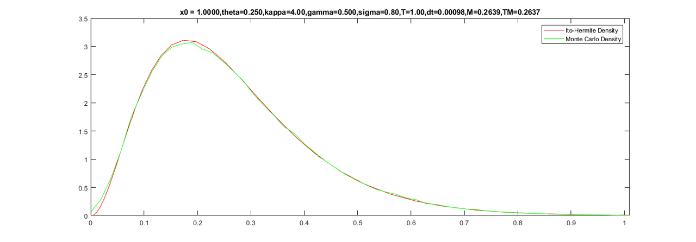](https://postimg.cc/YGXJfYHz)

---

### #1278 — Amin (Topic Author)
*November 21, 2021, 4:34 PM*

Here are the new files used to calculate the series solution. Please note that this is very basic initial solution and I
intend to do a lot of effort to improve it to second order accuracy. I have not run the SDE solutions with this program
beyond one year but I hope that with improved solution, we would easily be able to run it out to ten years.

.

```
function [] = FPESeriesCoeffsSolutionWilmott()

%Copyright Ahsan Amin. Infiniti derivatives Technologies.
%Please fell free to connect on linkedin: linkedin.com/in/ahsan-amin-0a53334
%or skype ahsan.amin2999
%In this program, I am simulating the SDE given as
%dy(t)=mu1 x(t)^beta1 dt + mu2 x(t)^beta2 dt +sigma x(t)^gamma dz(t)

%I have not directly simulated the SDE but simulated the transformed
%Besse1l process version of the SDE and then changed coordinates to retreive
%the SDE in original coo
%rdinates.
%The present program will analytically evolve only the Bessel Process version of the
%SDE in transformed coordinates.

dt=.125/16/2/2/2;   % Simulation time interval.%Fodiffusions close to zero
             %decrease dt for accuracy.
Tt=128*2*2*2;%128*2*2*2;     % Number of simulation levels. Terminal time= Tt*dt; //.125/32*32*16=2 year;
T=Tt*dt;
OrderA=4;  %
OrderM=4;  %
dtM=.0625/1;
TtM=T/dtM;

dNn=.2/1;   % Normal density subdivisions width. would change with number of subdivisions
Nn=50;  % No of normal density subdivisions
%NnMidl=18;%One half density Subdivision left from mid of normal density(low)
%NnMidh=19;%One half density subdivision right from the mid of normal density(high)
NnMid=4.0;
%NnT=46;
%NnD=(NnT-Nn)/2;
%NnD=5;

x0=1;   % starting value of SDE
beta1=0.0;
beta2=1.0;   % Second drift term power.
gamma=.5;%50;   % volatility power.
kappa=2.0;%.950;   %mean reversion parameter.
theta=.25;%mean reversion target
sigma0=.80;%Volatility value

%you can specify any general mu1 and mu2 and beta1 and beta2.
mu1=1*theta*kappa;   %first drift coefficient.
mu2=-1*kappa;    % Second drift coefficient.
%mu1=0;
%mu2=0;

alpha=1;% x^alpha is being expanded. This is currently for monte carlo only.
alpha1=1-gamma;%This is for expansion of integrals for calculation of drift
%and volatility coefficients
%yy(1:Nn)=x0;
w0=x0^(1-gamma)/(1-gamma);

Z(1:Nn)=(((1:Nn)-5.5)*dNn-NnMid);
%Z(1:Nn)=(((1:Nn)+1.5)*dNn-NnMid);
%ZT(1:NnT)=(((1:NnT)-3.5)*dNn-NnMid);
%ZT
Z
str=input('Look at Z');
ZProb(1)=normcdf(.5*Z(1)+.5*Z(2),0,1)-normcdf(.5*Z(1)+.5*Z(2)-dNn,0,1);
ZProb(Nn)=normcdf(.5*Z(Nn)+.5*Z(Nn-1)+dNn,0,1)-normcdf(.5*Z(Nn)+.5*Z(Nn-1),0,1);
ZProb(2:Nn-1)=normcdf(.5*Z(2:Nn-1)+.5*Z(3:Nn),0,1)-normcdf(.5*Z(2:Nn-1)+.5*Z(1:Nn-2),0,1);

%ZProbT(1)=normcdf(.5*ZT(1)+.5*ZT(2),0,1)-normcdf(.5*ZT(1)+.5*ZT(2)-dNn,0,1);
%ZProbT(NnT)=normcdf(.5*ZT(NnT)+.5*ZT(NnT-1)+dNn,0,1)-normcdf(.5*ZT(NnT)+.5*ZT(NnT-1),0,1);
%ZProbT(2:NnT-1)=normcdf(.5*ZT(2:NnT-1)+.5*ZT(3:NnT),0,1)-normcdf(.5*ZT(2:NnT-1)+.5*ZT(1:NnT-2),0,1);
    %Above calculate probability mass in each probability subdivision.

%%%%%%%%%%%%%%%%%%%%%%%%%%%%%%%%%%%%%%%%%%%%%%%%%%%%%%%%%%%%%%%%%%%%%%%%%%%%%%%%%%%%%%%%%%%%%%

sigma11(1:OrderA+1)=0;
mu11(1:OrderA+1)=0;
mu22(1:OrderA+1)=0;
sigma22(1:OrderA+1)=0;
% index 1 correponds to zero level since matlab indexing starts at one.
sigma11(1)=1;
mu11(1)=1;
mu22(1)=1;
sigma22(1)=1;

for k=1:(OrderA+1)
    if sigma0~=0
        sigma11(k)=sigma0^(k-1);
    end
    if mu1 ~= 0
        mu11(k)=mu1^(k-1);
    end
    if mu2 ~= 0
        mu22(k)=mu2^(k-1);
    end
    if sigma0~=0
        sigma22(k)=sigma0^(2*(k-1));
    end
end
%Ft(1:TtM+1,1:(OrderA+1),1:(OrderA+1),1:(OrderA+1),1:(OrderA+1))=0; %General time powers on hermite polynomials
Fp(1:(OrderA+1),1:(OrderA+1),1:(OrderA+1),1:(OrderA+1))=0;%General x powers on coefficients of hermite polynomials.
Fp1(1:(OrderA+1),1:(OrderA+1),1:(OrderA+1),1:(OrderA+1))=0;%General x powers for bessel transformed coordinates.

%YCoeff0 and YCoeff are coefficents for original coordinates monte carlo.
%YqCoeff0 and YqCoeff are bessel/lamperti version monte carlo.

YCoeff0(1:(OrderA+1),1:(OrderA+1),1:(OrderA+1),1:(OrderA+1))=0;
YqCoeff0(1:(OrderA+1),1:(OrderA+1),1:(OrderA+1),1:(OrderA+1))=0;
%Pre-compute the time and power exponent values in small multi-dimensional arrays
YCoeff = ItoTaylorCoeffsNew(alpha,beta1,beta2,gamma); %expand y^alpha where alpha=1;
YqCoeff = ItoTaylorCoeffsNew(alpha1,beta1,beta2,gamma);%expand y^alpha1 where alpha1=(1-gamma)
YqCoeff=YqCoeff/(1-gamma); %Transformed coordinates coefficients have to be
%further divided by (1-gamma)

for k = 0 : (OrderA)
    for m = 0:k
        l4 = k - m + 1;
        for n = 0 : m
            l3 = m - n + 1;
            for j = 0:n
                l2 = n - j + 1;
                l1 = j + 1;
                %Ft(l1,l2,l3,l4) = dtM^((l1-1) + (l2-1) + (l3-1) + .5* (l4-1));
                Fp(l1,l2,l3,l4) = (alpha + (l1-1) * beta1 + (l2-1) * beta2 + (l3-1) * 2* gamma + (l4-1) * gamma ...
                    - (l1-1) - (l2-1) - 2* (l3-1) - (l4-1));
                Fp1(l1,l2,l3,l4) = (alpha1 + (l1-1) * beta1 + (l2-1) * beta2 + (l3-1) * 2* gamma + (l4-1) * gamma ...
                    - (l1-1) - (l2-1) - 2* (l3-1) - (l4-1));

                YCoeff0(l1,l2,l3,l4) =YCoeff(l1,l2,l3,l4).*mu11(l1).*mu22(l2).*sigma22(l3).*sigma11(l4);
                YqCoeff0(l1,l2,l3,l4) =YqCoeff(l1,l2,l3,l4).*mu11(l1).*mu22(l2).*sigma22(l3).*sigma11(l4);
            end
        end
    end
end

%%%%%%%%%%%%%%%%%%%%%%%%%%%%%%%%%%%%%%%%%%%%%%%%%%%%%%%%%%%%%%%%%%%%%%%%%%%%%%%%%%%%%%%%%%%%%%

ExpnOrder=10;
wnStart=1;
tic
for tt=1:Tt
    if(tt==1)
        [wMu0dt,dwMu0dtdw] = BesselDriftAndDerivatives(w0,YqCoeff0,Fp1,gamma,dt,ExpnOrder);
        c0=wMu0dt+w0;
        c(1)=sigma0*sqrt(dt)
        c(2:10)=0.0;
        w0=c0;
    end

    %The program intended to find solution of Z-series to 10th power but
    %higher order coefficients would make some SDEs unstable so I just
    %turned the coefficients c(7:10) and b(7:10) into zero as soon as they
    %are calculated and just go with solution to 6th power of Z.

    if(tt>1)

    %The function below calculates drift and its derivatives at w(Z=0);
    [wMu0dt,dwMu0dtdw] = BesselDriftAndDerivatives(w0,YqCoeff0,Fp1,gamma,dt,ExpnOrder);

    a(7:10)=0.0;
    %The function below converts derivatives of drift into coefficients of
    %Z-series.
    [b0,b] = CalculateDriftbCoeffs04(wMu0dt,dwMu0dtdw,a);
%    b0
    b(7:10)=0.0;
    %The function below evolves the previous solution in coefficients of Z
    %into next time step solution in coefficietns of Z-series.
    [c0,c] = EvolveSDESeriesSolution04(a0,a,b0,b,sigma0,dt);
    c(7:10)=0.0;
    w0=c0;

%     tt
%     a0
%     a
%     b0
%     b
%     c0
%     c
%     tt
    %str=input('Look at solution');

    end

    %The newly calculated solution is assigned to previous solution
    %coefficients so that we could calculate further future solution with
    %these coefficients.
    a0=c0;
    a(1:6)=c(1:6);

end
wnStart=1;
    w(wnStart:Nn)=c0+c(1)*Z(wnStart:Nn)+c(2)*Z(wnStart:Nn).^2+c(3)*Z(wnStart:Nn).^3+ ...
        c(4)*Z(wnStart:Nn).^4+c(5)*Z(wnStart:Nn).^5+c(6)*Z(wnStart:Nn).^6+ ...
        c(7)*Z(wnStart:Nn).^7+c(8)*Z(wnStart:Nn).^8+c(9)*Z(wnStart:Nn).^9+ ...
        c(10)*Z(wnStart:Nn).^10;

%str=input('Look at numbers')
yy(wnStart:Nn)=((1-gamma).*w(wnStart:Nn)).^(1/(1-gamma));
yy0=((1-gamma).*w0).^(1/(1-gamma));

Dfyy(wnStart:Nn)=0;
for nn=wnStart+1:Nn-1

    Dfyy(nn) = (yy(nn + 1) - yy(nn - 1))/(Z(nn + 1) - Z(nn - 1));

    %Change of variable derivative for densities
end

% Dfyy(wnStart:Nn) =(c(1)+2*c(2)*Z(wnStart:Nn)+3*c(3)*Z(wnStart:Nn).^2+ ...
%         4*c(4)*Z(wnStart:Nn).^3+5*c(5)*Z(wnStart:Nn).^4+6*c(6)*Z(wnStart:Nn).^5+ ...
%         7*c(7)*Z(wnStart:Nn).^6+8*c(8)*Z(wnStart:Nn).^7+9*c(9)*Z(wnStart:Nn).^8+ ...
%         10*c(10)*Z(wnStart:Nn).^9)*dNn;

pyy(1:Nn)=0;
for nn = wnStart:Nn-1

    pyy(nn) = (normpdf(Z(nn),0, 1))/abs(Dfyy(nn));
end

toc

ItoHermiteMean=sum(yy(wnStart+1:Nn-1).*ZProb(wnStart+1:Nn-1)) %Original process average from coordinates
disp('true Mean only applicable to standard SV mean reverting type models otherwise disregard');
TrueMean=theta+(x0-theta)*exp(-kappa*dt*Tt)%Mean reverting SDE original variable true average
yy0

theta1=1;
rng(29079137, 'twister')
paths=200000;
YY(1:paths)=x0;  %Original process monte carlo.
Random1(1:paths)=0;
for tt=1:TtM

    Random1=randn(size(Random1));
    HermiteP1(1,1:paths)=1;
    HermiteP1(2,1:paths)=Random1(1:paths);
    HermiteP1(3,1:paths)=Random1(1:paths).^2-1;
    HermiteP1(4,1:paths)=Random1(1:paths).^3-3*Random1(1:paths);
    HermiteP1(5,1:paths)=Random1(1:paths).^4-6*Random1(1:paths).^2+3;

    YY(1:paths)=YY(1:paths) + ...
        (YCoeff0(1,1,2,1).*YY(1:paths).^Fp(1,1,2,1)+ ...
        YCoeff0(1,2,1,1).*YY(1:paths).^Fp(1,2,1,1)+ ...
        YCoeff0(2,1,1,1).*YY(1:paths).^Fp(2,1,1,1))*dtM + ...
        (YCoeff0(1,1,3,1).*YY(1:paths).^Fp(1,1,3,1)+ ...
        YCoeff0(1,2,2,1).*YY(1:paths).^Fp(1,2,2,1)+ ...
        YCoeff0(2,1,2,1).*YY(1:paths).^Fp(2,1,2,1)+ ...
        YCoeff0(1,3,1,1).*YY(1:paths).^Fp(1,3,1,1)+ ...
        YCoeff0(2,2,1,1).*YY(1:paths).^Fp(2,2,1,1)+ ...
        YCoeff0(3,1,1,1).*YY(1:paths).^Fp(3,1,1,1))*dtM^2 + ...
        ((YCoeff0(1,1,1,2).*YY(1:paths).^Fp(1,1,1,2).*sqrt(dtM))+ ...
        (YCoeff0(1,1,2,2).*YY(1:paths).^Fp(1,1,2,2)+ ...
        YCoeff0(1,2,1,2).*YY(1:paths).^Fp(1,2,1,2)+ ...
        YCoeff0(2,1,1,2).*YY(1:paths).^Fp(2,1,1,2)).*dtM^1.5) .*HermiteP1(2,1:paths) + ...
        ((YCoeff0(1,1,1,3).*YY(1:paths).^Fp(1,1,1,3) *dtM) + ...
        (YCoeff0(1,1,2,3).*YY(1:paths).^Fp(1,1,2,3)+ ...
        YCoeff0(1,2,1,3).*YY(1:paths).^Fp(1,2,1,3)+ ...
        YCoeff0(2,1,1,3).*YY(1:paths).^Fp(2,1,1,3)).*dtM^2).*HermiteP1(3,1:paths) + ...
        ((YCoeff0(1,1,1,4).*YY(1:paths).^Fp(1,1,1,4)*dtM^1.5 )).*HermiteP1(4,1:paths) + ...
        (YCoeff0(1,1,1,5).*YY(1:paths).^Fp(1,1,1,5)*dtM^2.0).*HermiteP1(5,1:paths);

end

YY(YY<0)=0;
disp('Original process average from monte carlo');
MCMean=sum(YY(:))/paths %origianl coordinates monte carlo average.
disp('Original process average from our simulation');
ItoHermiteMean=sum(yy(wnStart+1:Nn-1).*ZProb(wnStart+1:Nn-1)) %Original process average from coordinates

disp('true Mean only applicble to standard SV mean reverting type models otherwise disregard');
TrueMean=theta+(x0-theta)*exp(-kappa*dt*Tt)%Mean reverting SDE original variable true average

MaxCutOff=30;
NoOfBins=round(900*gamma^2*4*sigma0/sqrt(MCMean)/(1+kappa));%Decrease the number of bins if the graph is too
[YDensity,IndexOutY,IndexMaxY] = MakeDensityFromSimulation_Infiniti_NEW(YY,paths,NoOfBins,MaxCutOff );
plot(yy(wnStart+1:Nn-1),pyy(wnStart+1:Nn-1),'r',IndexOutY(1:IndexMaxY),YDensity(1:IndexMaxY),'g');
 %plot(y_w(wnStart+1:Nn-1),fy_w(wnStart+1:Nn-1),'r',IndexOutY(1:IndexMaxY),YDensity(1:IndexMaxY),'g',Z(wnStart+1:Nn-1),fy_w(wnStart+1:Nn-1),'b');

title(sprintf('x0 = %.4f,theta=%.3f,kappa=%.2f,gamma=%.3f,sigma=%.2f,T=%.2f,dt=%.5f,M=%.4f,TM=%.4f',
x0,theta,kappa,gamma,sigma0,T,dt,ItoHermiteMean,TrueMean));%,sprintf('theta= %f', theta), sprintf('kappa = %f',
kappa),sprintf('sigma = %f', sigma0),sprintf('T = %f', T));

legend({'Ito-Hermite Density','Monte Carlo Density'},'Location','northeast')

str=input('red line is density of SDE from Ito-Hermite method, green is monte carlo.');

end
```

.

.

```
function [wMu0dt,dwMu0dtdw] = BesselDriftAndDerivatives(w0,YqCoeff0,Fp1,gamma,dt,ExpnOrder)

Fp2=Fp1(1,1,2,1)/(1-gamma);

%ExpnOrder=10;
NoOfTerms=19;
NoOfTerms=9;%excluding dt^3 terms

YqCoeff(1:NoOfTerms)=0.0;
Fp(1:NoOfTerms)=0.0;

YqCoeff(1)=YqCoeff0(1,1,2,1)*dt;
YqCoeff(2)=YqCoeff0(1,2,1,1)*dt;
YqCoeff(3)=YqCoeff0(2,1,1,1)*dt;

YqCoeff(4)=YqCoeff0(1,1,3,1)*dt^2;
YqCoeff(5)=YqCoeff0(1,2,2,1)*dt^2;
YqCoeff(6)=YqCoeff0(2,1,2,1)*dt^2;
YqCoeff(7)=YqCoeff0(1,3,1,1)*dt^2;
YqCoeff(8)=YqCoeff0(2,2,1,1)*dt^2;
YqCoeff(9)=YqCoeff0(3,1,1,1)*dt^2;

YqCoeff(10)=YqCoeff0(1,1,4,1)*dt^3;
YqCoeff(11)=YqCoeff0(1,2,3,1)*dt^3;
YqCoeff(12)=YqCoeff0(2,1,3,1)*dt^3;
YqCoeff(13)=YqCoeff0(1,3,2,1)*dt^3;
YqCoeff(14)=YqCoeff0(2,2,2,1)*dt^3;
YqCoeff(15)=YqCoeff0(3,1,2,1)*dt^3;
YqCoeff(16)=YqCoeff0(1,4,1,1)*dt^3;
YqCoeff(17)=YqCoeff0(2,3,1,1)*dt^3;
YqCoeff(18)=YqCoeff0(3,2,1,1)*dt^3;
YqCoeff(19)=YqCoeff0(4,1,1,1)*dt^3;

Fp(1)=Fp1(1,1,2,1);
Fp(2)=Fp1(1,2,1,1);
Fp(3)=Fp1(2,1,1,1);

Fp(4)=Fp1(1,1,3,1);
Fp(5)=Fp1(1,2,2,1);
Fp(6)=Fp1(2,1,2,1);
Fp(7)=Fp1(1,3,1,1);
Fp(8)=Fp1(2,2,1,1);
Fp(9)=Fp1(3,1,1,1);

Fp(10)=Fp1(1,1,4,1);
Fp(11)=Fp1(1,2,3,1);
Fp(12)=Fp1(2,1,3,1);
Fp(13)=Fp1(1,3,2,1);
Fp(14)=Fp1(2,2,2,1);
Fp(15)=Fp1(3,1,2,1);
Fp(16)=Fp1(1,4,1,1);
Fp(17)=Fp1(2,3,1,1);
Fp(18)=Fp1(3,2,1,1);
Fp(19)=Fp1(4,1,1,1);

Fp2(1:19)=Fp(1:19)/(1-gamma);

wMu0dt0=0;
dwMu0dt(1:ExpnOrder)=0.0;

wMu0dt=0;
dwMu0dtdw(1:ExpnOrder)=0.0;

for mm=1:NoOfTerms

    wMu0dt0=YqCoeff(mm).*((1-gamma)*w0).^Fp2(mm);
    for nn=1:ExpnOrder
        if(nn==1)
            dwMu0dt(nn)=wMu0dt0*Fp2(mm)*(1-gamma)/((1-gamma)*w0);
        else
        dwMu0dt(nn)=dwMu0dt(nn-1)*(Fp2(mm)-(nn-1))*(1-gamma)/((1-gamma)*w0);
        end
    end
    wMu0dt=wMu0dt+wMu0dt0;
    for nn=1:ExpnOrder
        dwMu0dtdw(nn)=dwMu0dtdw(nn)+dwMu0dt(nn);
    end

end

end

```

.

.

```
function [b0,b] = CalculateDriftbCoeffs04(wMu0dt,dwMu0dtdw,a)

b0=wMu0dt;

b(1)=a(1) *dwMu0dtdw(1);

b(2)=1/2*(2* a(2) *dwMu0dtdw(1)+a(1)^2 *dwMu0dtdw(2));

b(3)=1/6*(6 *a(3) *dwMu0dtdw(1)+6 *a(1)* a(2) *dwMu0dtdw(2)+a(1)^3 *dwMu0dtdw(3));

b(4)=1/24*(24* a(4) *dwMu0dtdw(1)+12* a(2)^2 *dwMu0dtdw(2)+24 *a(1)* a(3) *dwMu0dtdw(2)+ ...
    12* a(1)^2* a(2) *dwMu0dtdw(3)+a(1)^4 *dwMu0dtdw(4));

b(5)=1/120*(120* a(5) *dwMu0dtdw(1)+120* a(2) *a(3) *dwMu0dtdw(2)+120* a(1)* a(4) *dwMu0dtdw(2)+ ...
    60 *a(1)* a(2)^2 *dwMu0dtdw(3)+60* a(1)^2* a(3) *dwMu0dtdw(3)+ ...
    20 *a(1)^3* a(2) *dwMu0dtdw(4)+a(1)^5 *dwMu0dtdw(5));

b(6)=1/720*(720* a(6) *dwMu0dtdw(1)+360* a(3)^2 *dwMu0dtdw(2)+720* a(2)* a(4) *dwMu0dtdw(2)+720* a(1)* a(5)
*dwMu0dtdw(2)+ ...
    120* a(2)^3 *dwMu0dtdw(3)+720* a(1)* a(2)* a(3) *dwMu0dtdw(3)+360* a(1)^2* a(4) *dwMu0dtdw(3)+ ...
    180* a(1)^2* a(2)^2 *dwMu0dtdw(4)+120* a(1)^3* a(3) *dwMu0dtdw(4)+ ...
    30* a(1)^4 *a(2) *dwMu0dtdw(5)+a(1)^6 *dwMu0dtdw(6));

b(7:10)=0.0;

% b(7)=1/(720*7)*(5040* a(7)*dwMu0dtdw(1)+5040* a(3)* a(4)*dwMu0dtdw(2)+5040* a(2)* a(5) *dwMu0dtdw(2)+5040 *a(1)* a(6)
*dwMu0dtdw(2)+ ...
%     2520* a(2)^2* a(3) *dwMu0dtdw(3)+2520* a(1)* a(3)^2 *dwMu0dtdw(3)+5040 *a(1)* a(2)* a(4) *dwMu0dtdw(3)+2520*
a(1)^2 *a(5) *dwMu0dtdw(3)+ ...
%     840* a(1)* a(2)^3 *dwMu0dtdw(4)+2520* a(1)^2* a(2)* a(3) *dwMu0dtdw(4)+840* a(1)^3* a(4) *dwMu0dtdw(4)+ ...
%     420* a(1)^3* a(2)^2 *dwMu0dtdw(5)+210* a(1)^4* a(3) *dwMu0dtdw(5)+ ...
%     42* a(1)^5* a(2) *dwMu0dtdw(6)+a(1)^7 *dwMu0dtdw(7));
%
%
%
% b(8)=1/(720*7*8)*(40320* a(8) *dwMu0dtdw(1)+20160* a(4)^2 *dwMu0dtdw(2)+40320* a(3)* a(5) *dwMu0dtdw(2)+40320* a(2)
*a(6) *dwMu0dtdw(2)+ ...
%     40320* a(1) *a(7) *dwMu0dtdw(2)+ ...
%     20160* a(2)* a(3)^2 *dwMu0dtdw(3)+20160* a(2)^2* a(4) *dwMu0dtdw(3)+40320* a(1)* a(3)* a(4) *dwMu0dtdw(3)+40320*
a(1)* a(2)* a(5) *dwMu0dtdw(3)+ ...
%     20160* a(1)^2* a(6) *dwMu0dtdw(3)+ ...
%     1680* a(2)^4 *dwMu0dtdw(4)+20160* a(1)* a(2)^2* a(3) *dwMu0dtdw(4)+10080* a(1)^2* a(3)^2 *dwMu0dtdw(4)+20160*
a(1)^2* a(2) *a(4) *dwMu0dtdw(4)+ ...
%     6720* a(1)^3* a(5) *dwMu0dtdw(4)+ ...
%     3360* a(1)^2* a(2)^3 *dwMu0dtdw(5)+6720* a(1)^3 *a(2)* a(3) *dwMu0dtdw(5)+1680* a(1)^4* a(4) *dwMu0dtdw(5)+ ...
%     840* a(1)^4* a(2)^2 *dwMu0dtdw(6)+336* a(1)^5* a(3) *dwMu0dtdw(6)+ ...
%     56* a(1)^6* a(2) *dwMu0dtdw(7)+a(1)^8 *dwMu0dtdw(8));
%
%
%
% b(9)=1/(720*7*8*9)*(362880* a(9) *dwMu0dtdw(1)+ ...
%     362880* a(4)* a(5) *dwMu0dtdw(2)+ 362880* a(3)* a(6) *dwMu0dtdw(2) +362880* a(2)* a(7) *dwMu0dtdw(2) +362880* a(1)
*a(8) *dwMu0dtdw(2) + ...
%     60480* a(3)^3 *dwMu0dtdw(3)+362880* a(2)* a(3)* a(4) *dwMu0dtdw(3)+181440* a(1)* a(4)^2 *dwMu0dtdw(3)+181440*
a(2)^2* a(5) *dwMu0dtdw(3) + ...
%     362880* a(1)* a(3)* a(5) *dwMu0dtdw(3)+362880 *a(1)* a(2)* a(6) *dwMu0dtdw(3) +181440 *a(1)^2* a(7) *dwMu0dtdw(3)+
...
%     60480* a(2)^3* a(3) *dwMu0dtdw(4)+181440* a(1)* a(2)* a(3)^2 *dwMu0dtdw(4)+181440* a(1)* a(2)^2 *a(4)
*dwMu0dtdw(4)+ ...
%     181440* a(1)^2* a(3)* a(4) *dwMu0dtdw(4)+181440* a(1)^2* a(2)* a(5) *dwMu0dtdw(4)+60480* a(1)^3* a(6)
*dwMu0dtdw(4)+ ...
%     15120* a(1)* a(2)^4 *dwMu0dtdw(5)+90720* a(1)^2* a(2)^2* a(3) *dwMu0dtdw(5)+30240* a(1)^3* a(3)^2 *dwMu0dtdw(5)+
...
%     60480 *a(1)^3* a(2)* a(4) *dwMu0dtdw(5)+15120* a(1)^4* a(5) *dwMu0dtdw(5)+ ...
%     10080* a(1)^3* a(2)^3 *dwMu0dtdw(6)+15120* a(1)^4 *a(2)* a(3) *dwMu0dtdw(6)+3024* a(1)^5* a(4) *dwMu0dtdw(6)+ ...
%     1512* a(1)^5* a(2)^2 *dwMu0dtdw(7)+504* a(1)^6* a(3) *dwMu0dtdw(7)+ ...
%     72* a(1)^7 *a(2) *dwMu0dtdw(8)+a(1)^9 *dwMu0dtdw(9));
%
%
%
%
% b(10)=1/(720*7*8*9*10)*(3628800* a(10)* dwMu0dtdw(1)+ ...
%     1814400 * a(5)^2 *dwMu0dtdw(2)+3628800 *a(4)* a(6)* dwMu0dtdw(2)+3628800* a(3)* a(7)* dwMu0dtdw(2)+3628800 *a(2)*
a(8)* dwMu0dtdw(2)+ ...
%     3628800* a(1)* a(9)* dwMu0dtdw(2)+ ...
%     1814400* a(3)^2* a(4)* dwMu0dtdw(3)+1814400* a(2)* a(4)^2* dwMu0dtdw(3)+3628800* a(2)* a(3)* a(5)*
dwMu0dtdw(3)+3628800* a(1)* a(4)* a(5) *dwMu0dtdw(3)+ ...
%     1814400* a(2)^2* a(6)* dwMu0dtdw(3)+3628800* a(1)* a(3)* a(6)* dwMu0dtdw(3)+3628800 *a(1)* a(2)* a(7)*
dwMu0dtdw(3)+1814400* a(1)^2* a(8)* dwMu0dtdw(3)+ ...
%     907200* a(2)^2 *a(3)^2* dwMu0dtdw(4)+604800* a(1)* a(3)^3* dwMu0dtdw(4)+604800* a(2)^3* a(4)*
dwMu0dtdw(4)+3628800* a(1)* a(2)* a(3)* a(4)* dwMu0dtdw(4)+ ...
%     907200* a(1)^2* a(4)^2* dwMu0dtdw(4)+1814400* a(1)* a(2)^2* a(5)* dwMu0dtdw(4)+1814400* a(1)^2* a(3)* a(5)*
dwMu0dtdw(4)+ ...
%     1814400* a(1)^2* a(2)* a(6)* dwMu0dtdw(4)+ 604800* a(1)^3* a(7) *dwMu0dtdw(4)+ ...
%     30240 *a(2)^5* dwMu0dtdw(5)+604800* a(1)* a(2)^3* a(3)* dwMu0dtdw(5)+907200 *a(1)^2* a(2)* a(3)^2*
dwMu0dtdw(5)+907200* a(1)^2* a(2)^2* a(4) *dwMu0dtdw(5)+ ...
%     604800* a(1)^3* a(3)* a(4)* dwMu0dtdw(5)+604800* a(1)^3* a(2)* a(5)* dwMu0dtdw(5)+151200* a(1)^4* a(6)*
dwMu0dtdw(5)+ ...
%     75600* a(1)^2* a(2)^4* dwMu0dtdw(6)+302400 *a(1)^3* a(2)^2* a(3)* dwMu0dtdw(6)+75600* a(1)^4 *a(3)^2*
dwMu0dtdw(6)+151200* a(1)^4* a(2)* a(4) *dwMu0dtdw(6)+ ...
%     30240* a(1)^5* a(5)* dwMu0dtdw(6)+ ...
%     25200* a(1)^4* a(2)^3* dwMu0dtdw(7)+30240* a(1)^5* a(2)* a(3)* dwMu0dtdw(7)+5040* a(1)^6* a(4)* dwMu0dtdw(7)+ ...
%     2520* a(1)^6* a(2)^2* dwMu0dtdw(8)+720* a(1)^7* a(3)* dwMu0dtdw(8)+ ...
%     90 *a(1)^8* a(2)* dwMu0dtdw(9)+ ...
%     a(1)^10* dwMu0dtdw(10));

end

```

.

.

.

```
function [c0,c] = EvolveSDESeriesSolution04(a0,a,b0,b,sigma0,dt)

c0=0.0;
c(1:10)=0.0;

c0=1/a(1)^2*(a0*a(1)^2+b0*a(1)^2+ ...
    (.5*sigma0^2*dt*0)+ ...
    (.5*sigma0^2*dt*2*a(2)));

% c(1)=1/a(1).^2*((+a(1).^3  + 4* a0* a(1)* a(2) ) + ...
%     (+4 *a(1)* a(2)* b0  + a(1).^2 *b(1) )- ...
%     (+4 *a(1)* a(2) *c0 )+ ...
%     (.5*sigma0^2*dt*a(1))+ ...
%     (.5*sigma0^2*dt*6*a(3)));

A1=(+a(1).^3  + 4* a0* a(1)* a(2));
B1=+4 *a(1)* a(2)* b0  + a(1).^2 *b(1);
C1=+4 *a(1)* a(2) *c0;
D1=.5*sigma0^2*dt*a(1);
%D1=sigma0*sqrt(dt)*a(1)^2;
E1=.5*sigma0^2*dt*6*a(3);

c(1)=1/a(1).^2*(A1+B1-C1+D1+E1);
%c(1)=1/a(1).^2*(A1-C1+sqrt((A1)^2+D1^2)+E1);

c(2)=1/a(1)^2*( (+5 *a(1)^2* a(2)  + 4* a0* a(2)^2  + 6* a0* a(1)* a(3) )+ ...
    +(+4* a(2)^2* b0  + 6 *a(1)* a(3)* b0  + 4* a(1)* a(2)* b(1)  + a(1)^2* b(2) )- ...
    (+4* a(2)^2* c0 +6* a(1)* a(3)* c0 +4* a(1)* a(2)* c(1) )+ ...
    (.5*sigma0^2*dt*2*a(2))+ ...
    (.5*sigma0^2*dt*12*a(4)));
c(3)=1/a(1)^2*((+8* a(1)* a(2)^2  + 7* a(1)^2* a(3)  + 12* a0* a(2)* a(3)  + 8* a0* a(1)* a(4) )+...
    (+12* a(2)* a(3)* b0  + 8* a(1)* a(4)* b0  + 4* a(2)^2* b(1)  + 6* a(1)* a(3)* b(1)  + ...
    4* a(1)* a(2)* b(2)  + a(1)^2* b(3)  )-...
    (+12* a(2)* a(3)* c0 +8* a(1)* a(4)* c0 +4* a(2)^2* c(1) +6* a(1)* a(3)* c(1) +4* a(1)* a(2)* c(2) )+ ...
    (.5*sigma0^2*dt*3* a(3) )+ ...
    (.5*sigma0^2*dt*20* a(5) ));

c(4)=1/a(1)^2*((+4* a(2)^3  + 22* a(1)* a(2)* a(3)  + 9* a0* a(3)^2  + 9* a(1)^2* a(4)  + ...
    16* a0* a(2)* a(4)  + 10* a0* a(1)* a(5) )+...
    (+9* a(3)^2* b0  + 16* a(2)* a(4)* b0  + 10* a(1)* a(5)* b0  + ...
    12* a(2)* a(3)* b(1)  + 8* a(1)* a(4)* b(1)  + 4* a(2)^2* b(2)  + 6* a(1)* a(3)* b(2)  + ...
    4* a(1)* a(2)* b(3)  + a(1)^2* b(4) )-...
    (+9* a(3)^2* c0 +16* a(2)* a(4)* c0 +10 *a(1)* a(5)* c0 +12* a(2)* a(3)* c(1) +8* a(1)* a(4)* c(1) +4* a(2)^2* c(2)
+6* a(1)* a(3)* c(2) + ...
    4* a(1)* a(2)* c(3) )+ ...
    (.5*sigma0^2*dt*4* a(4) )+ ...
    (.5*sigma0^2*dt*30* a(6) ));

c(5)=1/a(1)^2*((+16* a(2)^2* a(3)  + 15* a(1)* a(3)^2  + 28* a(1)* a(2)* a(4)  + ...
    24* a0* a(3)* a(4)  + 11* a(1)^2* a(5)  + 20* a0* a(2)* a(5)  + 12* a0* a(1)* a(6) )+ ...
    (+24* a(3)* a(4)* b0  + 20* a(2)* a(5)* b0  + 12* a(1)* a(6)* b0  + ...
    9* a(3)^2* b(1)  + 16* a(2)* a(4)* b(1)  + 10* a(1)* a(5)* b(1)  + ...
    12* a(2)* a(3)* b(2)  + 8* a(1)* a(4)* b(2)  + 4* a(2)^2* b(3)  + 6* a(1)* a(3)* b(3)  + ...
    4* a(1)* a(2)* b(4)  + a(1)^2* b(5) )-...
    (+24* a(3)* a(4)* c0 +20* a(2)* a(5)* c0 +12* a(1)* a(6)* c0 +9* a(3)^2* c(1) +16* a(2)* a(4)* c(1) +10* a(1)* a(5)*
c(1) +12* a(2)* a(3)* c(2) + ...
    8* a(1)* a(4)* c(2) +4* a(2)^2* c(3) +6* a(1)* a(3)* c(3) +4* a(1)* a(2)* c(4) )+...
    (.5*sigma0^2*dt*5* a(5) )+ ...
    (.5*sigma0^2*dt*42* a(7) ));

c(6)=1/a(1)^2*((+21* a(2)* a(3)^2  + 20* a(2)^2* a(4)  + 38* a(1)* a(3)* a(4)  + 16* a0* a(4)^2  + ...
    34* a(1)* a(2)* a(5)  + 30* a0* a(3)* a(5)  + 13* a(1)^2* a(6)  + ...
    24* a0* a(2)* a(6)  + 14* a0* a(1)* a(7) )+...
    (+16* a(4)^2* b0  + 30* a(3)* a(5)* b0  + 24* a(2)* a(6)* b0  + ...
    14* a(1)* a(7)* b0  + 24* a(3)* a(4)* b(1)  + 20* a(2)* a(5)* b(1)  + ...
    12* a(1)* a(6)* b(1)  + 9* a(3)^2* b(2)  + 16* a(2)* a(4)* b(2)  + ...
    10* a(1)* a(5)* b(2)  + 12* a(2)* a(3)* b(3)  + 8* a(1)* a(4)* b(3)  + 4* a(2)^2* b(4)  + ...
    6* a(1)* a(3)* b(4)  + 4* a(1)* a(2)* b(5)  + a(1)^2* b(6) )- ...
    (+16* a(4)^2* c0 +30* a(3)* a(5)* c0 +24* a(2)* a(6)* c0 +14* a(1)* a(7)* c0 +24 *a(3)* a(4)* c(1) +20* a(2)* a(5)*
c(1) +12* a(1)* a(6)* c(1) + ...
    9* a(3)^2* c(2) +16 *a(2)* a(4)* c(2) +10* a(1)* a(5)* c(2) +12* a(2)* a(3)* c(3) +8* a(1)* a(4)* c(3) +4* a(2)^2*
c(4) +6* a(1)* a(3)* c(4) + ...
    4* a(1)* a(2)* c(5) )+ ...
    (.5*sigma0^2*dt*6* a(6) )+ ...
    (.5*sigma0^2*dt*56* a(8) ));

c(7:10)=0.0;

% c(7)=1/a(1)^2*((+9* a(3)^3  + 52* a(2)* a(3)* a(4)  + 24* a(1)* a(4)^2  + 24* a(2)^2* a(5)  +...
%    46* a(1)* a(3)* a(5)  + 40* a0* a(4)* a(5)  + 40* a(1)* a(2)* a(6)  + ...
%    36* a0* a(3)* a(6)  + 15* a(1)^2* a(7)  + 28* a0* a(2)* a(7)  + 16* a0* a(1)* a(8) )+...
%    (+40* a(4)* a(5)* b0  + 36* a(3)* a(6)* b0  + 28* a(2)* a(7)* b0  + ...
%    16* a(1)* a(8)* b0  + 16* a(4)^2* b(1)  + 30* a(3)* a(5)* b(1)  + ...
%    24* a(2)* a(6)* b(1)  + 14* a(1)* a(7)* b(1)  + 24* a(3)* a(4)* b(2)  + ...
%    20* a(2)* a(5)* b(2)  + 12* a(1)* a(6)* b(2)  + 9* a(3)^2* b(3)  + ...
%    16* a(2)* a(4)* b(3)  + 10* a(1)* a(5)* b(3)  + 12* a(2)* a(3)* b(4)  + ...
%    8* a(1)* a(4)* b(4)  + 4* a(2)^2* b(5)  + 6* a(1)* a(3)* b(5)  + 4* a(1)* a(2)* b(6)  + ...
%    a(1)^2* b(7) )-...
%    (+40* a(4)* a(5)* c0 +36* a(3)* a(6)* c0 +28* a(2)* a(7)* c0 +16* a(1)* a(8)* c0 +16* a(4)^2* c(1) +30* a(3)* a(5)*
c(1) + ...
%     24* a(2)* a(6)* c(1) +14* a(1)* a(7)* c(1) +24* a(3)* a(4)* c(2) +20* a(2)* a(5)* c(2) +12* a(1)* a(6)* c(2) +9*
a(3)^2* c(3) + ...
%     16* a(2)* a(4)* c(3) +10* a(1)* a(5)* c(3) +12* a(2)* a(3)* c(4) +8* a(1)* a(4)* c(4) +4* a(2)^2* c(5) +6* a(1)*
a(3)* c(5) + ...
%     4* a(1)* a(2)* c(6) )+ ...
%     (.5*sigma0^2*dt*7* a(7) )+ ...
%     (.5*sigma0^2*dt* 72* a(9) ));
%
% c(8)=1/a(1)^2*((33* a(3)^2* a(4)  + 32* a(2)* a(4)^2  + 62* a(2)* a(3)* a(5)  + 58 *a(1) *a(4)* a(5)  +...
%    25* a0* a(5)^2  + 28* a(2)^2* a(6)  + 54 *a(1)* a(3)* a(6)  + ...
%    48* a0* a(4)* a(6)  + 46* a(1)* a(2)* a(7)  + 42* a0* a(3)* a(7)  + ...
%    17* a(1)^2* a(8)  + 32* a0* a(2)* a(8)  + 18* a0* a(1)* a(9) )+ ...
%    (+25* a(5)^2* b0  + 48* a(4)* a(6)* b0  + 42* a(3)* a(7)* b0  + ...
%    32* a(2)* a(8)* b0  + 18* a(1)* a(9)* b0  + 40* a(4)* a(5)* b(1)  + ...
%    36* a(3)* a(6)* b(1)  + 28* a(2)* a(7)* b(1)  + 16* a(1)* a(8)* b(1)  + ...
%    16* a(4)^2* b(2)  + 30* a(3)* a(5)* b(2)  + 24* a(2)* a(6)* b(2)  + ...
%    14* a(1)* a(7) *b(2)  + 24* a(3)* a(4)* b(3)  + 20* a(2)* a(5)* b(3)  + ...
%    12* a(1)* a(6)* b(3)  + 9* a(3)^2* b(4)  + 16* a(2)* a(4)* b(4)  + ...
%    10* a(1)* a(5)* b(4)  + 12* a(2)* a(3)* b(5)  + 8* a(1)* a(4)* b(5)  + 4* a(2)^2* b(6)  + ...
%    6* a(1)* a(3)* b(6)  + 4* a(1)* a(2)* b(7)  + a(1)^2* b(8) )-...
%    (+25* a(5)^2* c0 +48* a(4)* a(6)* c0 +42* a(3)* a(7)* c0 +32* a(2)* a(8)* c0 +18* a(1)* a(9)* c0 +40* a(4)* a(5)*
c(1) +36* a(3)* a(6)* c(1) + ...
%     28* a(2)* a(7)* c(1) +16* a(1)* a(8)* c(1) +16* a(4)^2* c(2) +30* a(3)* a(5)* c(2) +24* a(2)* a(6)* c(2) +14*
a(1)* a(7)* c(2) +24* a(3)* a(4)* c(3) +...
%     20* a(2)* a(5)* c(3) +12* a(1)* a(6)* c(3) +9* a(3)^2* c(4) +16* a(2)* a(4)* c(4) +10* a(1)* a(5)* c(4) +12* a(2)*
a(3)* c(5) +8* a(1)* a(4)* c(5) + ...
%     4* a(2)^2* c(6) +6* a(1)* a(3)* c(6) +4* a(1)* a(2)* c(7) )+...
%     (.5*sigma0^2*dt*8* a(8) )+ ...
%     (.5*sigma0^2*dt* 90* a(10) ));
%
%
% c(9)=1/a(1)^2*((+20* a0* a(1)* a(10)  + 40* a(3)* a(4)^2  + 39* a(3)^2* a(5)  + ...
%    76* a(2)* a(4)* a(5)  + 35* a(1)* a(5)^2  + 72* a(2)* a(3)* a(6)  + ...
%    68* a(1)* a(4)* a(6)  + 60* a0* a(5)* a(6)  + 32* a(2)^2* a(7)  + ...
%    62* a(1)* a(3)* a(7)  + 56* a0* a(4)* a(7)  + 52* a(1)* a(2)* a(8)  + ...
%    48* a0* a(3)* a(8)  + 19* a(1)^2* a(9)  + 36* a0* a(2)* a(9) )+ ...
%    (+20* a(1)* a(10)* b0  + 60* a(5)* a(6)* b0  + 56* a(4)* a(7)* b0  + ...
%     48* a(3)* a(8)* b0  + 36* a(2)* a(9)* b0  + 25* a(5)^2* b(1)  + ...
%     48* a(4)* a(6)* b(1)  + 42* a(3)* a(7)* b(1)  + 32* a(2)* a(8)* b(1)  + ...
%     18* a(1)* a(9)* b(1)  + 40* a(4)* a(5) *b(2)  + 36* a(3)* a(6)* b(2)  + ...
%     28* a(2)* a(7)* b(2)  + 16* a(1)* a(8)* b(2)  + 16* a(4)^2* b(3)  + ...
%     30* a(3)* a(5)* b(3)  + 24* a(2)* a(6)* b(3)  + 14* a(1)* a(7)* b(3)  + ...
%     24* a(3)* a(4)* b(4)  + 20* a(2)* a(5)* b(4)  + 12* a(1)* a(6)* b(4)  + ...
%     9* a(3)^2* b(5)  + 16* a(2)* a(4)* b(5)  + 10* a(1)* a(5)* b(5)  + ...
%     12* a(2)* a(3)* b(6)  + 8* a(1)* a(4)* b(6)  + 4* a(2)^2* b(7)  + 6* a(1)* a(3)* b(7)  + ...
%     4* a(1)* a(2)* b(8)  + a(1)^2* b(9) )-...
%     (+20* a(1)* a(10)* c0 +60* a(5)* a(6)* c0 +56* a(4)* a(7)* c0 +48* a(3)* a(8)* c0 +36* a(2)* a(9)* c0 +25* a(5)^2*
c(1) +48* a(4)* a(6)* c(1) + ...
%     42* a(3)* a(7)* c(1) +32* a(2)* a(8)* c(1) +18* a(1)* a(9)* c(1) +40* a(4)* a(5)* c(2) +36* a(3)* a(6)* c(2) +28*
a(2)* a(7)* c(2) +16* a(1)* a(8)* c(2) + ...
%     16* a(4)^2* c(3) +30* a(3)* a(5)* c(3) +24* a(2)* a(6)* c(3) +148* a(1)* a(7)* c(3) +24* a(3)* a(4)* c(4) +20*
a(2)* a(5)* c(4) +12* a(1)* a(6)* c(4) + ...
%     9* a(3)^2* c(5) +16* a(2)* a(4)* c(5) +10* a(1)* a(5)* c(5) +12* a(2)* a(3)* c(6) +8* a(1)* a(4)* c(6) +4* a(2)^2*
c(7) +6* a(1)* a(3)* c(7) + ...
%     4* a(1)* a(2)* c(8) )+ ...
%     (.5*sigma0^2*dt*9* a(9) )+ ...
%     (.5*sigma0^2*dt* 0));
%
% c(10)=1/a(1)^2*((+21* a(1)^2* a(10)  + 40* a0* a(10)* a(2)  + 16* a(4)^3  + ...
%     94* a(3)* a(4)* a(5)  + 45* a(2)* a(5)^2  + 45* a(3)^2* a(6)  + ...
%     88* a(2)* a(4)* a(6)  + 82* a(1)* a(5)* a(6)  + 36* a0* a(6)^2  + ...
%     82* a(2)* a(3)* a(7)  + 78* a(1)* a(4)* a(7)  + 70* a0* a(5)* a(7)  + ...
%     36* a(2)^2* a(8)  + 70* a(1)* a(3)* a(8)  + 64* a0* a(4)* a(8)  + ...
%     58* a(1)* a(2)* a(9)  + 54* a0* a(3)* a(9) )+ ...
%     (+40* a(10)* a(2)* b0  + 36* a(6)^2* b0  + 70* a(5)* a(7)* b0  + ...
%     64* a(4)* a(8)* b0  + 54* a(3)* a(9)* b0  + 20* a(1)* a(10)* b(1)  + ...
%     60* a(5)* a(6)* b(1)  + 56* a(4)* a(7)* b(1)  + 48* a(3)* a(8)* b(1)  + ...
%     36* a(2)* a(9)* b(1)  + a(1)^2* b(10)  + 25* a(5)^2* b(2)  + ...
%     48* a(4)* a(6)* b(2)  + 42* a(3)* a(7)* b(2)  + 32* a(2)* a(8)* b(2)  +...
%     18* a(1)* a(9)* b(2)  + 40* a(4)* a(5)* b(3)  + 36* a(3)* a(6)* b(3)  + ...
%     28* a(2)* a(7)* b(3)  + 16* a(1)* a(8)* b(3)  + 16* a(4)^2* b(4)  + ...
%     30* a(3)* a(5)* b(4)  + 24* a(2)* a(6)* b(4)  + 14* a(1)* a(7)* b(4)  + ...
%     24* a(3)* a(4)* b(5)  + 20* a(2)* a(5)* b(5)  + 12* a(1)* a(6)* b(5)  + ...
%     9* a(3)^2* b(6)  + 16* a(2)* a(4)* b(6)  + 10 *a(1) *a(5) *b(6)  + ...
%     12 *a(2) *a(3) *b(7)  + 8 *a(1) *a(4) *b(7)  + 4 *a(2)^2 *b(8)  + ...
%     6 *a(1)* a(3)* b(8)  + 4* a(1)* a(2)* b(9) )-...
%     (+40* a(10)* a(2)* c0 +36* a(6)^2* c0 +70* a(5)* a(7)* c0 +64* a(4)* a(8)* c0 +54* a(3)* a(9)* c0 +20* a(1)*
a(10)* c(1) +60* a(5)* a(6)* c(1) + ...
%     56* a(4)* a(7)* c(1) +48* a(3)* a(8)* c(1) +36* a(2)* a(9)* c(1) +25* a(5)^2* c(2) +48* a(4)* a(6)* c(2) +42*
a(3)* a(7)* c(2) + ...
%     32* a(2)* a(8)* c(2) +18* a(1)* a(9)* c(2) +40* a(4)* a(5)* c(3) +36* a(3)* a(6)* c(3) +28* a(2)* a(7)* c(3) +16*
a(1)* a(8)* c(3) +16* a(4)^2* c(4) + ...
%     30* a(3)* a(5)* c(4) +24* a(2)* a(6)* c(4) +14* a(1)* a(7)* c(4) +24* a(3)* a(4)* c(5) +20* a(2)* a(5)* c(5) +12*
a(1)* a(6)* c(5) +9* a(3)^2* c(6) + ...
%     16* a(2)* a(4)* c(6) +10* a(1)* a(5)* c(6) +12* a(2)* a(3)* c(7) +8* a(1)* a(4)* c(7) +4* a(2)^2* c(8) +6* a(1)*
a(3)* c(8) +4* a(1)* a(2)* c(9) )+ ...
%     (.5*sigma0^2*dt*10*a(10) )+ ...
%     (.5*sigma0^2*dt* 0 ));

%%%%%%%%%%%%%%%%%%%%%%%%%%%%%%%%%%%%%%%%%%%%%%%%%%%%%%%%%%%%%%%%%%%%%%%%%%%%%%%%%%%%%%%%%%%%%%%%%%%%%%%%%%%%%%%%%%%%%%%%%%%%%%%%%%55

end

```

.

.

.

```
function [wMu0dt,c1,c2,dwMu0dtdw] = CalculateDriftAndVolA404AB(w,wnStart,Nn,YqCoeff0,Fp1,gamma,dt)

yy(wnStart:Nn)=((1-gamma)*w(wnStart:Nn)).^(1/(1-gamma));

Fp2=Fp1/(1-gamma);

wMu0dt(wnStart:Nn)=(YqCoeff0(1,1,2,1).*yy(wnStart:Nn).^Fp1(1,1,2,1)+ ...
    YqCoeff0(1,2,1,1).*yy(wnStart:Nn).^Fp1(1,2,1,1)+ ...
    YqCoeff0(2,1,1,1).*yy(wnStart:Nn).^Fp1(2,1,1,1))*dt + ...
    (YqCoeff0(1,1,3,1).*yy(wnStart:Nn).^Fp1(1,1,3,1)+ ...
    YqCoeff0(1,2,2,1).*yy(wnStart:Nn).^Fp1(1,2,2,1)+ ...
    YqCoeff0(2,1,2,1).*yy(wnStart:Nn).^Fp1(2,1,2,1)+ ...
    YqCoeff0(1,3,1,1).*yy(wnStart:Nn).^Fp1(1,3,1,1)+ ...
    YqCoeff0(2,2,1,1).*yy(wnStart:Nn).^Fp1(2,2,1,1)+ ...
    YqCoeff0(3,1,1,1).*yy(wnStart:Nn).^Fp1(3,1,1,1))*dt^2 + ...
     (YqCoeff0(1,1,4,1).*yy(wnStart:Nn).^Fp1(1,1,4,1)+ ...
     YqCoeff0(1,2,3,1).*yy(wnStart:Nn).^Fp1(1,2,3,1)+ ...
     YqCoeff0(2,1,3,1).*yy(wnStart:Nn).^Fp1(2,1,3,1)+ ...
     YqCoeff0(1,3,2,1).*yy(wnStart:Nn).^Fp1(1,3,2,1)+ ...
     YqCoeff0(2,2,2,1).*yy(wnStart:Nn).^Fp1(2,2,2,1)+ ...
     YqCoeff0(3,1,2,1).*yy(wnStart:Nn).^Fp1(3,1,2,1)+ ...
     YqCoeff0(1,4,1,1).*yy(wnStart:Nn).^Fp1(1,4,1,1)+ ...
     YqCoeff0(2,3,1,1).*yy(wnStart:Nn).^Fp1(2,3,1,1)+ ...
     YqCoeff0(3,2,1,1).*yy(wnStart:Nn).^Fp1(3,2,1,1)+ ...
     YqCoeff0(4,1,1,1).*yy(wnStart:Nn).^Fp1(4,1,1,1))*dt^3+ ...
     (YqCoeff0(1,1,5,1).*yy(wnStart:Nn).^Fp1(1,1,5,1)+ ...
      YqCoeff0(1,2,4,1).*yy(wnStart:Nn).^Fp1(1,2,4,1)+ ...
      YqCoeff0(2,1,4,1).*yy(wnStart:Nn).^Fp1(2,1,4,1)+ ...
      YqCoeff0(1,3,3,1).*yy(wnStart:Nn).^Fp1(1,3,3,1)+ ...
       YqCoeff0(2,2,3,1).*yy(wnStart:Nn).^Fp1(2,2,3,1)+ ...
       YqCoeff0(3,1,3,1).*yy(wnStart:Nn).^Fp1(3,1,3,1)+ ...
       YqCoeff0(1,4,2,1).*yy(wnStart:Nn).^Fp1(1,4,2,1)+ ...
       YqCoeff0(2,3,2,1).*yy(wnStart:Nn).^Fp1(2,3,2,1)+ ...
       YqCoeff0(3,2,2,1).*yy(wnStart:Nn).^Fp1(3,2,2,1)+ ...
       YqCoeff0(4,1,2,1).*yy(wnStart:Nn).^Fp1(4,1,2,1)+ ...
       YqCoeff0(1,5,1,1).*yy(wnStart:Nn).^Fp1(1,5,1,1)+ ...
       YqCoeff0(2,4,1,1).*yy(wnStart:Nn).^Fp1(2,4,1,1)+ ...
       YqCoeff0(3,3,1,1).*yy(wnStart:Nn).^Fp1(3,3,1,1)+  ...
       YqCoeff0(4,2,1,1).*yy(wnStart:Nn).^Fp1(4,2,1,1)+ ...
       YqCoeff0(5,1,1,1).*yy(wnStart:Nn).^Fp1(5,1,1,1))*dt^4;

   dwMu0dtdw(wnStart:Nn)=(YqCoeff0(1,1,2,1).*Fp1(1,1,2,1).*((1-gamma)*w(wnStart:Nn)).^(Fp2(1,1,2,1)-1)+ ...
    YqCoeff0(1,2,1,1).*Fp1(1,2,1,1).*((1-gamma)*w(wnStart:Nn)).^(Fp2(1,2,1,1)-1)+ ...
    YqCoeff0(2,1,1,1).*Fp1(2,1,1,1).*((1-gamma)*w(wnStart:Nn)).^(Fp2(2,1,1,1)-1))*dt ;

%wMu0dtOdt(wnStart:Nn)=(YqCoeff0(1,1,2,1).*yy(wnStart:Nn).^Fp1(1,1,2,1)*0+ ...
%    YqCoeff0(1,2,1,1).*yy(wnStart:Nn).^Fp1(1,2,1,1)+ ...
%    YqCoeff0(2,1,1,1).*yy(wnStart:Nn).^Fp1(2,1,1,1))*dt ;

c1(wnStart:Nn)=((YqCoeff0(1,1,1,2).*yy(wnStart:Nn).^Fp1(1,1,1,2).*sqrt(dt))+ ...
     (YqCoeff0(1,1,2,2).*yy(wnStart:Nn).^Fp1(1,1,2,2)+YqCoeff0(1,2,1,2).*yy(wnStart:Nn).^Fp1(1,2,1,2)+ ...
     YqCoeff0(2,1,1,2).*yy(wnStart:Nn).^Fp1(2,1,1,2)).*dt^1.5+ ...
     (YqCoeff0(1,1,3,2).*yy(wnStart:Nn).^Fp1(1,1,3,2)+YqCoeff0(1,2,2,2).*yy(wnStart:Nn).^Fp1(1,2,2,2)+ ...
     YqCoeff0(2,1,2,2).*yy(wnStart:Nn).^Fp1(2,1,2,2)+YqCoeff0(1,3,1,2).*yy(wnStart:Nn).^Fp1(1,3,1,2)+ ...
     YqCoeff0(2,2,1,2).*yy(wnStart:Nn).^Fp1(2,2,1,2)+YqCoeff0(3,1,1,2).*yy(wnStart:Nn).^Fp1(3,1,1,2)).*dt^2.5+ ...
     (YqCoeff0(1,1,4,2).*yy(wnStart:Nn).^Fp1(1,1,4,2)+YqCoeff0(1,2,3,2).*yy(wnStart:Nn).^Fp1(1,2,3,2)+ ...
     YqCoeff0(2,1,3,2).*yy(wnStart:Nn).^Fp1(2,1,3,2)+YqCoeff0(1,3,2,2).*yy(wnStart:Nn).^Fp1(1,3,2,2)+ ...
     YqCoeff0(2,2,2,2).*yy(wnStart:Nn).^Fp1(2,2,2,2)+ YqCoeff0(3,1,2,2).*yy(wnStart:Nn).^Fp1(3,1,2,2)+ ...
     YqCoeff0(1,4,1,2).*yy(wnStart:Nn).^Fp1(1,4,1,2)+YqCoeff0(2,3,1,2).*yy(wnStart:Nn).^Fp1(2,3,1,2)+ ...
     YqCoeff0(3,2,1,2).*yy(wnStart:Nn).^Fp1(3,2,1,2)+YqCoeff0(4,1,1,2).*yy(wnStart:Nn).^Fp1(4,1,1,2)).*dt^3.5);

c2(wnStart:Nn)=(YqCoeff0(1,1,2,3).*yy(wnStart:Nn).^Fp1(1,1,2,3)+YqCoeff0(1,2,1,3).*yy(wnStart:Nn).^Fp1(1,2,1,3)+ ...
     YqCoeff0(2,1,1,3).*yy(wnStart:Nn).^Fp1(2,1,1,3)).*dt^2;%+ ...
     (YqCoeff0(1,1,3,3).*yy(wnStart:Nn).^Fp1(1,1,3,3)+YqCoeff0(1,2,2,3).*yy(wnStart:Nn).^Fp1(1,2,2,3)+ ...
     YqCoeff0(2,1,2,3).*yy(wnStart:Nn).^Fp1(2,1,2,3) + YqCoeff0(1,3,1,3).*yy(wnStart:Nn).^Fp1(1,3,1,3)+ ...
     YqCoeff0(2,2,1,3).*yy(wnStart:Nn).^Fp1(2,2,1,3)+YqCoeff0(3,1,1,3).*yy(wnStart:Nn).^Fp1(3,1,1,3)).*dt^3;

% (YCoeff0(1,1,1,2).*YY(1:paths).^Fp(1,1,1,2).*sqrt(dtM))+ ...
%     (YCoeff0(1,1,2,2).*YY(1:paths).^Fp(1,1,2,2)+YCoeff0(1,2,1,2).*YY(1:paths).^Fp(1,2,1,2)+ ...
%     YCoeff0(2,1,1,2).*YY(1:paths).^Fp(2,1,1,2)).*dtM^1.5+ ...
%     (YCoeff0(1,1,3,2).*YY(1:paths).^Fp(1,1,3,2)+YCoeff0(1,2,2,2).*YY(1:paths).^Fp(1,2,2,2)+ ...
%     YCoeff0(2,1,2,2).*YY(1:paths).^Fp(2,1,2,2)+YCoeff0(1,3,1,2).*YY(1:paths).^Fp(1,3,1,2)+ ...
%     YCoeff0(2,2,1,2).*YY(1:paths).^Fp(2,2,1,2)+YCoeff0(3,1,1,2).*YY(1:paths).^Fp(3,1,1,2)).*dtM^2.5+ ...
%     (YCoeff0(1,1,4,2).*YY(1:paths).^Fp(1,1,4,2)+YCoeff0(1,2,3,2).*YY(1:paths).^Fp(1,2,3,2)+ ...
%     YCoeff0(2,1,3,2).*YY(1:paths).^Fp(2,1,3,2)+YCoeff0(1,3,2,2).*YY(1:paths).^Fp(1,3,2,2)+ ...
%     YCoeff0(2,2,2,2).*YY(1:paths).^Fp(2,2,2,2)+ YCoeff0(3,1,2,2).*YY(1:paths).^Fp(3,1,2,2)+ ...
%     YCoeff0(1,4,1,2).*YY(1:paths).^Fp(1,4,1,2)+YCoeff0(2,3,1,2).*YY(1:paths).^Fp(2,3,1,2)+ ...
%     YCoeff0(3,2,1,2).*YY(1:paths).^Fp(3,2,1,2)+YCoeff0(4,1,1,2).*YY(1:paths).^Fp(4,1,1,2)).*dtM^3.5)
.*HermiteP1(2,1:paths)

end
```

---

### #1279 — Amin (Topic Author)
*November 22, 2021, 1:39 PM*

Friends, I made some improvements in the program. I just made the drift second order accurate while work still remains
to be done to add further terms that I will do in next few days. But the program was working great out to five years so
I decided to distribute a new interim version.

For volatility exponents close to .5, some condition has to be applied how fast the coefficients can be allowed to
increase. I hope it will increase substantially when I increase order. But the new program is still very good.

Here are some graphs for densities of SDEs out to five years. I am going to post the exact program used to create these
graphs in a minute in next post.

.

.

[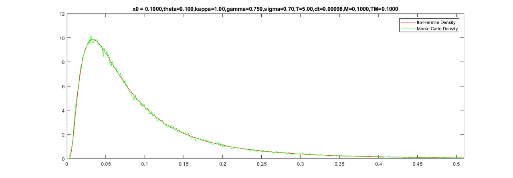](https://postimg.cc/3kNzC7FQ)

[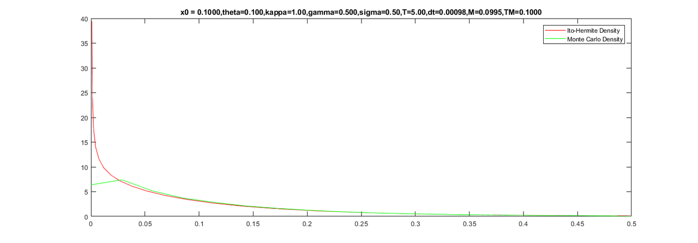](https://postimg.cc/tscwBfBZ)

[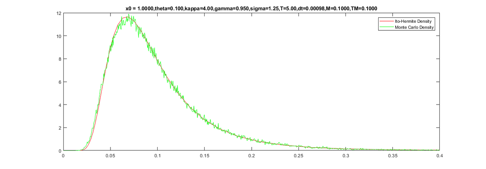](https://postimg.cc/vc3pVD9v)

[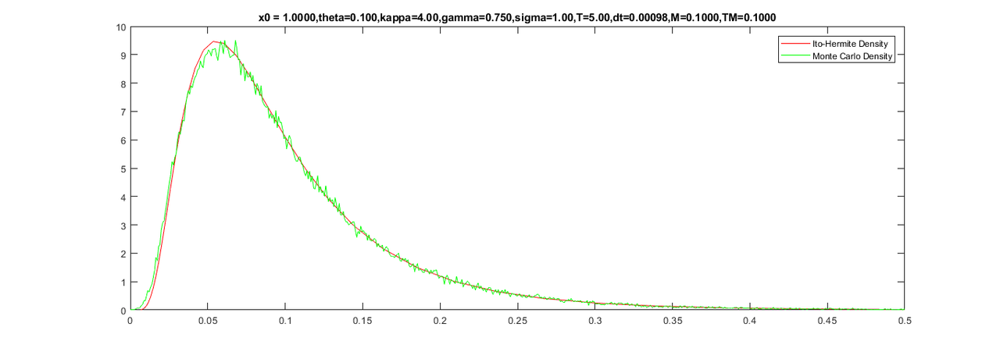](https://postimg.cc/0b8Tj76Q)

[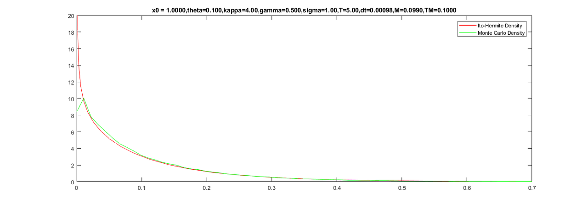](https://postimg.cc/CdHywcxX)

[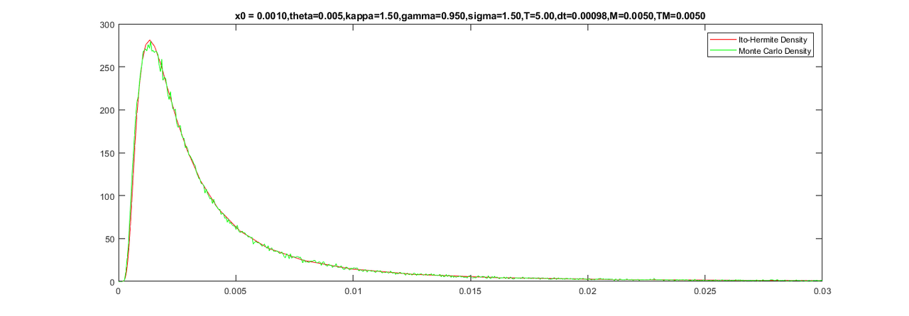](https://postimg.cc/YjwKc5MQ)

[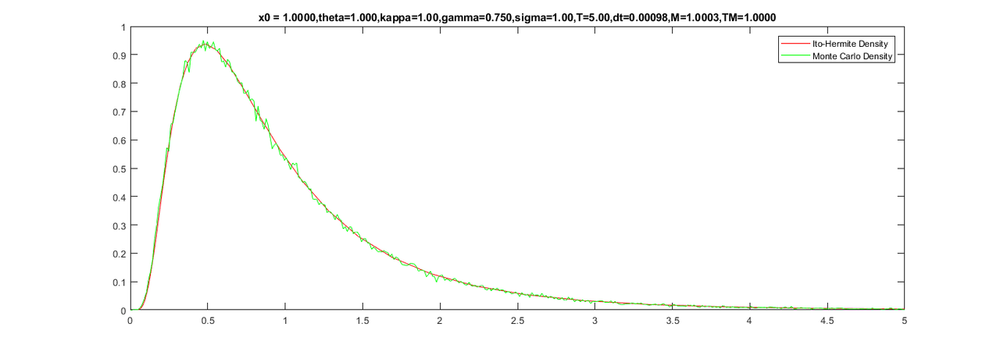](https://postimg.cc/QKqJv9sY)

---

### #1280 — Amin (Topic Author)
*November 22, 2021, 1:44 PM*

Here is the new interim program for recursive calculation of series solution to densities of SDEs.

.

.

```
function [] = FPESeriesCoeffsSolutionWilmott()

%Copyright Ahsan Amin. Infiniti derivatives Technologies.
%Please fell free to connect on linkedin: linkedin.com/in/ahsan-amin-0a53334
%or skype ahsan.amin2999
%In this program, I am simulating the SDE given as
%dy(t)=mu1 x(t)^beta1 dt + mu2 x(t)^beta2 dt +sigma x(t)^gamma dz(t)

%I have not directly simulated the SDE but simulated the transformed
%Besse1l process version of the SDE and then changed coordinates to retreive
%the SDE in original coo
%rdinates.
%The present program will analytically evolve only the Bessel Process version of the
%SDE in transformed coordinates.

dt=.125/16/2/2/2;   % Simulation time interval.%Fodiffusions close to zero
             %decrease dt for accuracy.
Tt=128*2*2*2*5;%128*2*2*2;     % Number of simulation levels. Terminal time= Tt*dt; //.125/32*32*16=2 year;
T=Tt*dt;
OrderA=4;  %
OrderM=4;  %
dtM=.0625/1;
TtM=T/dtM;

dNn=.2/1;   % Normal density subdivisions width. would change with number of subdivisions
Nn=46;  % No of normal density subdivisions
%NnMidl=18;%One half density Subdivision left from mid of normal density(low)
%NnMidh=19;%One half density subdivision right from the mid of normal density(high)
NnMid=4.0;
%NnT=46;
%NnD=(NnT-Nn)/2;
%NnD=5;

x0=1;   % starting value of SDE
beta1=0.0;
beta2=1.0;   % Second drift term power.
gamma=.75;%50;   % volatility power.
kappa=1.0;%.950;   %mean reversion parameter.
theta=1.0;%mean reversion target
sigma0=1.0;%Volatility value

%you can specify any general mu1 and mu2 and beta1 and beta2.
mu1=1*theta*kappa;   %first drift coefficient.
mu2=-1*kappa;    % Second drift coefficient.
%mu1=0;
%mu2=0;

alpha=1;% x^alpha is being expanded. This is currently for monte carlo only.
alpha1=1-gamma;%This is for expansion of integrals for calculation of drift
%and volatility coefficients
%yy(1:Nn)=x0;
w0=x0^(1-gamma)/(1-gamma);

Z(1:Nn)=(((1:Nn)-3.5)*dNn-NnMid);
%Z(1:Nn)=(((1:Nn)+1.5)*dNn-NnMid);
%ZT(1:NnT)=(((1:NnT)-3.5)*dNn-NnMid);
%ZT
Z
str=input('Look at Z');
ZProb(1)=normcdf(.5*Z(1)+.5*Z(2),0,1)-normcdf(.5*Z(1)+.5*Z(2)-dNn,0,1);
ZProb(Nn)=normcdf(.5*Z(Nn)+.5*Z(Nn-1)+dNn,0,1)-normcdf(.5*Z(Nn)+.5*Z(Nn-1),0,1);
ZProb(2:Nn-1)=normcdf(.5*Z(2:Nn-1)+.5*Z(3:Nn),0,1)-normcdf(.5*Z(2:Nn-1)+.5*Z(1:Nn-2),0,1);

%ZProbT(1)=normcdf(.5*ZT(1)+.5*ZT(2),0,1)-normcdf(.5*ZT(1)+.5*ZT(2)-dNn,0,1);
%ZProbT(NnT)=normcdf(.5*ZT(NnT)+.5*ZT(NnT-1)+dNn,0,1)-normcdf(.5*ZT(NnT)+.5*ZT(NnT-1),0,1);
%ZProbT(2:NnT-1)=normcdf(.5*ZT(2:NnT-1)+.5*ZT(3:NnT),0,1)-normcdf(.5*ZT(2:NnT-1)+.5*ZT(1:NnT-2),0,1);
    %Above calculate probability mass in each probability subdivision.

%%%%%%%%%%%%%%%%%%%%%%%%%%%%%%%%%%%%%%%%%%%%%%%%%%%%%%%%%%%%%%%%%%%%%%%%%%%%%%%%%%%%%%%%%%%%%%

sigma11(1:OrderA+1)=0;
mu11(1:OrderA+1)=0;
mu22(1:OrderA+1)=0;
sigma22(1:OrderA+1)=0;
% index 1 correponds to zero level since matlab indexing starts at one.
sigma11(1)=1;
mu11(1)=1;
mu22(1)=1;
sigma22(1)=1;

for k=1:(OrderA+1)
    if sigma0~=0
        sigma11(k)=sigma0^(k-1);
    end
    if mu1 ~= 0
        mu11(k)=mu1^(k-1);
    end
    if mu2 ~= 0
        mu22(k)=mu2^(k-1);
    end
    if sigma0~=0
        sigma22(k)=sigma0^(2*(k-1));
    end
end
%Ft(1:TtM+1,1:(OrderA+1),1:(OrderA+1),1:(OrderA+1),1:(OrderA+1))=0; %General time powers on hermite polynomials
Fp(1:(OrderA+1),1:(OrderA+1),1:(OrderA+1),1:(OrderA+1))=0;%General x powers on coefficients of hermite polynomials.
Fp1(1:(OrderA+1),1:(OrderA+1),1:(OrderA+1),1:(OrderA+1))=0;%General x powers for bessel transformed coordinates.

%YCoeff0 and YCoeff are coefficents for original coordinates monte carlo.
%YqCoeff0 and YqCoeff are bessel/lamperti version monte carlo.

YCoeff0(1:(OrderA+1),1:(OrderA+1),1:(OrderA+1),1:(OrderA+1))=0;
YqCoeff0(1:(OrderA+1),1:(OrderA+1),1:(OrderA+1),1:(OrderA+1))=0;
%Pre-compute the time and power exponent values in small multi-dimensional arrays
YCoeff = ItoTaylorCoeffsNew(alpha,beta1,beta2,gamma); %expand y^alpha where alpha=1;
YqCoeff = ItoTaylorCoeffsNew(alpha1,beta1,beta2,gamma);%expand y^alpha1 where alpha1=(1-gamma)
YqCoeff=YqCoeff/(1-gamma); %Transformed coordinates coefficients have to be
%further divided by (1-gamma)

for k = 0 : (OrderA)
    for m = 0:k
        l4 = k - m + 1;
        for n = 0 : m
            l3 = m - n + 1;
            for j = 0:n
                l2 = n - j + 1;
                l1 = j + 1;
                %Ft(l1,l2,l3,l4) = dtM^((l1-1) + (l2-1) + (l3-1) + .5* (l4-1));
                Fp(l1,l2,l3,l4) = (alpha + (l1-1) * beta1 + (l2-1) * beta2 + (l3-1) * 2* gamma + (l4-1) * gamma ...
                    - (l1-1) - (l2-1) - 2* (l3-1) - (l4-1));
                Fp1(l1,l2,l3,l4) = (alpha1 + (l1-1) * beta1 + (l2-1) * beta2 + (l3-1) * 2* gamma + (l4-1) * gamma ...
                    - (l1-1) - (l2-1) - 2* (l3-1) - (l4-1));

                YCoeff0(l1,l2,l3,l4) =YCoeff(l1,l2,l3,l4).*mu11(l1).*mu22(l2).*sigma22(l3).*sigma11(l4);
                YqCoeff0(l1,l2,l3,l4) =YqCoeff(l1,l2,l3,l4).*mu11(l1).*mu22(l2).*sigma22(l3).*sigma11(l4);
            end
        end
    end
end

%%%%%%%%%%%%%%%%%%%%%%%%%%%%%%%%%%%%%%%%%%%%%%%%%%%%%%%%%%%%%%%%%%%%%%%%%%%%%%%%%%%%%%%%%%%%%%

ExpnOrder=10;
wnStart=1;
tic
for tt=1:Tt
    if(tt==1)
        [wMu0dt,dwMu0dtdw] = BesselDriftAndDerivatives(w0,YqCoeff0,Fp1,gamma,dt,ExpnOrder);
        c0=wMu0dt+w0;
        c(1)=sigma0*sqrt(dt)
        c(2:10)=0.0;
        w0=c0;
    end

    %The program intended to find solution of Z-series to 10th power but
    %higher order coefficients would make some SDEs unstable so I just
    %turned the coefficients c(7:10) and b(7:10) into zero as soon as they
    %are calculated and just go with solution to 6th power of Z.

    if(tt>1)

    %The function below calculates drift and its derivatives at w(Z=0);
    %[wMu0dt,dwMu0dtdw] = BesselDriftAndDerivatives(w0,YqCoeff0,Fp1,gamma,dt,ExpnOrder);
    [wMu0dt,dwMu0dtdw] =BesselDriftAndDerivatives02(w0,mu1,mu2,beta1,beta2,sigma0,gamma,dt,ExpnOrder);

    a(7:10)=0.0;
    %The function below converts derivatives of drift into coefficients of
    %Z-series.
    [b0,b] = CalculateDriftbCoeffs04(wMu0dt,dwMu0dtdw,a);
%    b0
    b(7:10)=0.0;
    %The function below evolves the previous solution in coefficients of Z
    %into next time step solution in coefficietns of Z-series.
    [c0,c] = EvolveSDESeriesSolution04(a0,a,b0,b,sigma0,dt);
    c(7:10)=0.0;
    if(gammaw(nn+1))
        w(nn)=0;
        wnStart=nn+1;
    end
end

%str=input('Look at numbers')
yy(wnStart:Nn)=((1-gamma).*w(wnStart:Nn)).^(1/(1-gamma));
yy0=((1-gamma).*w0).^(1/(1-gamma));

Dfyy(wnStart:Nn)=0;
for nn=wnStart+1:Nn-1

    Dfyy(nn) = (yy(nn + 1) - yy(nn - 1))/(Z(nn + 1) - Z(nn - 1));

    %Change of variable derivative for densities
end

% Dfyy(wnStart:Nn) =(c(1)+2*c(2)*Z(wnStart:Nn)+3*c(3)*Z(wnStart:Nn).^2+ ...
%         4*c(4)*Z(wnStart:Nn).^3+5*c(5)*Z(wnStart:Nn).^4+6*c(6)*Z(wnStart:Nn).^5+ ...
%         7*c(7)*Z(wnStart:Nn).^6+8*c(8)*Z(wnStart:Nn).^7+9*c(9)*Z(wnStart:Nn).^8+ ...
%         10*c(10)*Z(wnStart:Nn).^9)*dNn;

pyy(1:Nn)=0;
for nn = wnStart:Nn-1

    pyy(nn) = (normpdf(Z(nn),0, 1))/abs(Dfyy(nn));
end

toc

ItoHermiteMean=sum(yy(wnStart+1:Nn-1).*ZProb(wnStart+1:Nn-1)) %Original process average from coordinates
disp('true Mean only applicable to standard SV mean reverting type models otherwise disregard');
TrueMean=theta+(x0-theta)*exp(-kappa*dt*Tt)%Mean reverting SDE original variable true average
yy0

theta1=1;
rng(29079137, 'twister')
paths=200000;
YY(1:paths)=x0;  %Original process monte carlo.
Random1(1:paths)=0;
for tt=1:TtM

    Random1=randn(size(Random1));
    HermiteP1(1,1:paths)=1;
    HermiteP1(2,1:paths)=Random1(1:paths);
    HermiteP1(3,1:paths)=Random1(1:paths).^2-1;
    HermiteP1(4,1:paths)=Random1(1:paths).^3-3*Random1(1:paths);
    HermiteP1(5,1:paths)=Random1(1:paths).^4-6*Random1(1:paths).^2+3;

    YY(1:paths)=YY(1:paths) + ...
        (YCoeff0(1,1,2,1).*YY(1:paths).^Fp(1,1,2,1)+ ...
        YCoeff0(1,2,1,1).*YY(1:paths).^Fp(1,2,1,1)+ ...
        YCoeff0(2,1,1,1).*YY(1:paths).^Fp(2,1,1,1))*dtM + ...
        (YCoeff0(1,1,3,1).*YY(1:paths).^Fp(1,1,3,1)+ ...
        YCoeff0(1,2,2,1).*YY(1:paths).^Fp(1,2,2,1)+ ...
        YCoeff0(2,1,2,1).*YY(1:paths).^Fp(2,1,2,1)+ ...
        YCoeff0(1,3,1,1).*YY(1:paths).^Fp(1,3,1,1)+ ...
        YCoeff0(2,2,1,1).*YY(1:paths).^Fp(2,2,1,1)+ ...
        YCoeff0(3,1,1,1).*YY(1:paths).^Fp(3,1,1,1))*dtM^2 + ...
        ((YCoeff0(1,1,1,2).*YY(1:paths).^Fp(1,1,1,2).*sqrt(dtM))+ ...
        (YCoeff0(1,1,2,2).*YY(1:paths).^Fp(1,1,2,2)+ ...
        YCoeff0(1,2,1,2).*YY(1:paths).^Fp(1,2,1,2)+ ...
        YCoeff0(2,1,1,2).*YY(1:paths).^Fp(2,1,1,2)).*dtM^1.5) .*HermiteP1(2,1:paths) + ...
        ((YCoeff0(1,1,1,3).*YY(1:paths).^Fp(1,1,1,3) *dtM) + ...
        (YCoeff0(1,1,2,3).*YY(1:paths).^Fp(1,1,2,3)+ ...
        YCoeff0(1,2,1,3).*YY(1:paths).^Fp(1,2,1,3)+ ...
        YCoeff0(2,1,1,3).*YY(1:paths).^Fp(2,1,1,3)).*dtM^2).*HermiteP1(3,1:paths) + ...
        ((YCoeff0(1,1,1,4).*YY(1:paths).^Fp(1,1,1,4)*dtM^1.5 )).*HermiteP1(4,1:paths) + ...
        (YCoeff0(1,1,1,5).*YY(1:paths).^Fp(1,1,1,5)*dtM^2.0).*HermiteP1(5,1:paths);

end

YY(YY<0)=0;
disp('Original process average from monte carlo');
MCMean=sum(YY(:))/paths %origianl coordinates monte carlo average.
disp('Original process average from our simulation');
ItoHermiteMean=sum(yy(wnStart+1:Nn-1).*ZProb(wnStart+1:Nn-1)) %Original process average from coordinates

disp('true Mean only applicble to standard SV mean reverting type models otherwise disregard');
TrueMean=theta+(x0-theta)*exp(-kappa*dt*Tt)%Mean reverting SDE original variable true average

MaxCutOff=30;
NoOfBins=round(900*gamma^2*4*sigma0/sqrt(MCMean)/(1+kappa));%Decrease the number of bins if the graph is too
[YDensity,IndexOutY,IndexMaxY] = MakeDensityFromSimulation_Infiniti_NEW(YY,paths,NoOfBins,MaxCutOff );
plot(yy(wnStart+1:Nn-1),pyy(wnStart+1:Nn-1),'r',IndexOutY(1:IndexMaxY),YDensity(1:IndexMaxY),'g');
 %plot(y_w(wnStart+1:Nn-1),fy_w(wnStart+1:Nn-1),'r',IndexOutY(1:IndexMaxY),YDensity(1:IndexMaxY),'g',Z(wnStart+1:Nn-1),fy_w(wnStart+1:Nn-1),'b');

title(sprintf('x0 = %.4f,theta=%.3f,kappa=%.2f,gamma=%.3f,sigma=%.2f,T=%.2f,dt=%.5f,M=%.4f,TM=%.4f',
x0,theta,kappa,gamma,sigma0,T,dt,ItoHermiteMean,TrueMean));%,sprintf('theta= %f', theta), sprintf('kappa = %f',
kappa),sprintf('sigma = %f', sigma0),sprintf('T = %f', T));

legend({'Ito-Hermite Density','Monte Carlo Density'},'Location','northeast')

str=input('red line is density of SDE from Ito-Hermite method, green is monte carlo.');

end
```

.

.

The function to calculate drift and its derivatives has changed and I am posting it again here. Rest of the functions
are old.

.

```
function [wMu0dt,dwMu0dtdw] = BesselDriftAndDerivatives02(w0,mu1,mu2,beta1,beta2,sigma0,gamma,dt,ExpnOrder)

NoOfTerms=9;%excluding dt^3 terms

YqCoeff(1:NoOfTerms)=0.0;
Fp(1:NoOfTerms)=0.0;

YqCoeff(1)=mu1*dt;
YqCoeff(2)=mu2*dt;
YqCoeff(3)=-.5*sigma0^2*gamma*dt;

YqCoeff(4)=mu1^2*(beta1-gamma)*dt^2;
YqCoeff(5)=mu2^2*(beta2-gamma)*dt^2;
YqCoeff(6)=-.25*sigma0^4*gamma^2*(1-gamma)*dt^2;
YqCoeff(7)=(mu1*mu2*(beta1-gamma)+mu1*mu2*(beta2-gamma))*dt^2;
YqCoeff(8)=.5*mu1*sigma0^2*gamma*(1-gamma)*dt^2;
YqCoeff(9)=.5*mu2*sigma0^2*gamma*(1-gamma)*dt^2;

% YqCoeff(10)=YqCoeff0(1,1,4,1)*dt^3;
% YqCoeff(11)=YqCoeff0(1,2,3,1)*dt^3;
% YqCoeff(12)=YqCoeff0(2,1,3,1)*dt^3;
% YqCoeff(13)=YqCoeff0(1,3,2,1)*dt^3;
% YqCoeff(14)=YqCoeff0(2,2,2,1)*dt^3;
% YqCoeff(15)=YqCoeff0(3,1,2,1)*dt^3;
% YqCoeff(16)=YqCoeff0(1,4,1,1)*dt^3;
% YqCoeff(17)=YqCoeff0(2,3,1,1)*dt^3;
% YqCoeff(18)=YqCoeff0(3,2,1,1)*dt^3;
% YqCoeff(19)=YqCoeff0(4,1,1,1)*dt^3;

Fp(1)=(beta1-gamma)/(1-gamma);
Fp(2)=(beta2-gamma)/(1-gamma);
Fp(3)=-1;

Fp(4)=2*(beta1-gamma)/(1-gamma)-1;
Fp(5)=2*(beta2-gamma)/(1-gamma)-2;
Fp(6)=-3;
Fp(7)=(beta1-gamma)/(1-gamma)+(beta2-gamma)/(1-gamma)-1;
Fp(8)=(beta1-gamma)/(1-gamma)-2;
Fp(9)=(beta2-gamma)/(1-gamma)-2;

% Fp(10)=Fp1(1,1,4,1);
% Fp(11)=Fp1(1,2,3,1);
% Fp(12)=Fp1(2,1,3,1);
% Fp(13)=Fp1(1,3,2,1);
% Fp(14)=Fp1(2,2,2,1);
% Fp(15)=Fp1(3,1,2,1);
% Fp(16)=Fp1(1,4,1,1);
% Fp(17)=Fp1(2,3,1,1);
% Fp(18)=Fp1(3,2,1,1);
% Fp(19)=Fp1(4,1,1,1);

Fp2(1:9)=Fp(1:9);%/(1-gamma);

wMu0dt0=0;
dwMu0dt(1:ExpnOrder)=0.0;

wMu0dt=0;
dwMu0dtdw(1:ExpnOrder)=0.0;

for mm=1:NoOfTerms

    wMu0dt0=YqCoeff(mm).*((1-gamma)*w0).^Fp2(mm);
    for nn=1:ExpnOrder
        if(nn==1)
            dwMu0dt(nn)=wMu0dt0*Fp2(mm)*(1-gamma)/((1-gamma)*w0);
        else
        dwMu0dt(nn)=dwMu0dt(nn-1)*(Fp2(mm)-(nn-1))*(1-gamma)/((1-gamma)*w0);
        end
    end
    wMu0dt=wMu0dt+wMu0dt0;
    for nn=1:ExpnOrder
        dwMu0dtdw(nn)=dwMu0dtdw(nn)+dwMu0dt(nn);
    end

end

end
```

.

.

---

### #1281 — Amin (Topic Author)
*November 23, 2021, 3:24 AM*

In my morning walk today, I was thinking of new possibilities that open up with a series(in Z) representation of SDEs.
Though I am sure experts in stochastics can tell about many more possibilities, here is what I could think apart from
obvious possibilities.

1. Some work would have to be done but we could tell about transition probabilities between evolution of an SDE between
two points in time when we have their series representation and values of Z at both points is given. I will come back to
it in a few days with examples.

2. A series representation has ramifications for calculation of pricing with a numeraire and measure change.

Suppose an asset

$X(Z)=a_1 \, Z+ a_2 \, Z^2 + a_3 \, Z^3+ ...$

while numeraire has a representation (with common Z in case of one factor model)

$\eta(Z)=b_1 \, Z+ b_2 \, Z^2 + b_3 \, Z^3+ ...$

Then numeraire discounted distribution could be given as

$\frac{X(Z)}{\eta(Z)} \,P(Z) $  where $P(Z)$ is density of standard normal.

which could be integrated to get the point estimate of expectation and variances of the numeraire discounted payoffs
etc.

measure change could be done easily and its distribution could be found as

$\frac{X(Z)}{\eta_1(Z)} \, \frac{\eta_1(Z)}{\eta_2(Z)} \,P(Z) $

3. There would be new possibilities in calculation of path integrals and other stochastic integrals of the diffusions.
Whenever I tried this earlier, I was hampered since SDE measure for path integrals would change from one time to other
time. It would be more interesting to remove the layer of complexity associated with probability density and directly
represent the evolution of path integrals and stochastic integrals in terms of a series in Z. I hope that this would
help in easy calculation of path integrals and other related stochastic integrals in time.

4. Lot of intelligent friends are working with monte carlo simulations with Artificial intelligence. I think it will be
far easier to be able to represent the time evolution of SDE variables in terms of a series in Z and try to find the
time dependent coefficients of this series with AI. If the coefficient representation is good and AI works well, it will
give a nice smooth distribution of SDE variable. I think this new approach would be far easier as compared to
approximating the full blown distribution of SDE with AI.

But a lot of work remains to be done how to calculate the coefficients correctly and it would be more difficult in
multiple dimensions. And research has to be done on relative structure and time growth of coefficients and their proper
bounds for valid densities etc.

I think I will write and distribute a new program that takes an SDE distribution and finds coefficients of its Z-series
using optimization so that a Z-series could be found when needed. Such a function would be very useful.

---

### #1282 — Amin (Topic Author)
*November 24, 2021, 9:11 AM*

Before writing this post, I want to apologize to good jews but want to tell them there are enough evil jews who are
doing every thing to tarnish the great goodwill jews have so rightly earned through generations of hard work and being
nice and kind to other people in the society. I want to request good jews to Please force these evil(jewish) people to
end the bad practices that are starting to take root in American and other societies on their behest and before it is
too late. I also really hope that my mind control would finally end(as I have been begging for past twenty years) and I
would never have to write a post like this again.

Friends I have been writing on this forum since its very starting years. And a lot of people people know me from very early years also because I had another web site LIBOR Market Model web that hosted almost all the papers (more than 40-50) about the then cutting edge LIBOR market model and people freely downloaded papers and code from my web site. I continued to mention about my mind control persecution from time to time but only started writing regularly about it when I arrived in UK on a Highly Skilled Migrant work visa. Mind control agencies did everything in their power to fail me in UK. People were asked to not give me a job. People I contacted were routinely told brazen lies about me totally shamelessly. When I realized that I had no future in UK, I returned to Pakistan after a six month stint in UK. Since my hard earned money had thoroughly insulted mind control infrastructure in UK as they had to drug entire cities with mind control chemicals in UK (read briefly about it in my application to HRW below) for a nobody like me and American government had to move all their grand and influential puppets in UK (again for a nobody like me) to force people to drug the manufactured food. British Banks went to the extent to steal my money to bleed me. Read here: https://forum.wilmott.com/viewtopic.php?f=15&t=102298#p857494. British police forcefully stopped me from seeing law firms(Brief details are given in my application to HRW attached as a link below).  Since my money had given mind control agencies a very tough time, mind control agencies decided to never let me make significant money after that. My old Japanese employer was told to not hire me after I returned to Pakistan. Whoever I would contact someone in Europe for job or consulting, mind control agencies would move American embassy infrastructure in that country and somebody highly influential (or army or secret services of that particular country)  in that particular country would approach my target employer and again brazen lies and fabricated stories would be told about me shamelessly. I am a fighter in life and I continued my research despite all economic, coercive and other hardships. All odds were against me but I tried my best to continue.  I have been presenting my research to friends on this forum for past five or six years. At this point, I want to request good American and friends from other countries who have come to know me through my research to please use their influence to end my mind control forever.

Since things might heat up after my writing this and my persecution might increase, I want to ask European embassies in
Pakistan to keep a vigil. I want to tell Europeans that my writing about mind control is in their great interest since
the very same people who instigate retarding of intelligent muslims are behind retarding of dozens of intelligent
europeans and once these people are exposed I am sure they will be far more careful in openly retarding European
talent(that they do not like).

I had told friends earlier that a jewish billionaire is Godfather of mind control. When my persecution started (in late
1997) at the university in New York which is a big time player in mind control of Muslims, blacks and foreigners, many
university officials were very pleased that they were getting written in good books of the billionaire jewish Godfather.
Though there are far richer billionaires in US who are staunchly opposed to mind control, they are not ready to shell
out hundreds of millions of dollars to bribe anyone to end mind control while mind control Godfather  continues to give
large bribes to people to continue mind control. Many of the people related to defense in mind control are given
extremely high paying jobs in Godfather and his other jewish friends' companies after they retire from mind control and
Godfather is extremely generous towards them and it is well established and well known to people in mind control that
after retarding muslims, blacks and others in their career, they will move to paradise after they retire. No wonder
there is no let up in mind control whatever good people try.

We know in almost all classic folk lore stories evil is too strong and too sure of itself while good is mostly weak and
just trying to protect itself from evil who is bent on damaging and eradicating the weak and the poor good but it is the
weak and poor good that finally prevails. I want to tell good American friends that evil at this stage has become too
bold and thousands of talented people are retarded every year. And it is just not muslims and blacks that are on the
line, several hundreds of brilliant whites are retarded across United States by mind control agency every year that has
become too emboldened due to lack of any accountability. Thousands of foreigners are also kept retarded in dozens of
countries including many European countries.

My only intention behind this post is that I want mind control to end from our societies. I do not have any joy in
mentioning that there are some bad jewish actors behind it. In American society there are a large number of jews who
have excelled in the professions of science, education, medicine and have made great contributions to our societies.
There are a very large number of jewish professors each of whom would have taught tens of thousands of students on top
of making extraordinary contributions to body of human knowledge through their great research. Then there are
accomplished jewish scientists whose work, research and inventions make our everyday life better. There are great jewish
doctors and surgeons who would treat countless sick people and make them recover from disease. The list of contributions
of jewish people to humanity is very long and it continues. Then there are a large number of ordinary jewish folks who
are known for their goodness and civility to other people in the society. When we know all of this, we do not want to
say anything anti-jewish to hurt the feelings of so many good jewish people. But I still have to say there are really
some bad people who are unconnected with most of the nice and accomplished jews and they instigate and continue cruel
mind control torture on talented people of other ethnicities, religions and countries based on their personal dislike
and hatred. My purpose is only to end the mind control victimization and torture on otherwise nice and talented people
and I do not have any hidden intentions beyond that. And I am sure American society knows very well about the
contributions of good Jews to both their country and broader humanity and my exposing some bad actors would never have
any bad effect of any kind on these good and nice jews who we all respect and who are our role models.I want to tell
friends something I have said before here that I am sure American society would eventually end the menace of mind
control from their and other countries. I want to request all good Americans and Europeans to come forward and invite
any investigative journalist you know to read my threads and ask them to help end the menace of mind control in our
societies through their investigative journalism. Without any accountability evil will continue to grow stronger and
then mind control would start to threaten even those people who consider themselves safe due to affiliations, status or
wealth.

I want to request CNN, New York Times, Washington Post and large reputed European media outlets to run a comprehensive
story on mind control torture, retarding and victimization of intelligent people of US and other nations by crooks in US
army on behest of some powerful people in United States and due to rightwing extremist biases of these crooks. If you
would like to do investigative research about animal practices of US army, one great resource would be mainland European
embassies in Muslim countries who keep a detailed account of mind control persecution of intelligent muslims in these
countries by crooks in US army. Many of the staff in mainland European embassies are very good human beings who abhor
such practices and would love to cooperate with good journalists in exposing the evil animal practices of US army
crooks. Only the accounts of people at mainland European embassies in muslim countries thorough animal practices of
American army's mind control wing would be enough to drop a great bombshell in the media and general public all across
the world. I want to warn all the good people who try to have a civilized dialogue with crooks in American army to end
their evil practices that their being nice with crooks is a very misguided approach. Since good people do not have the
power to forcefully end the evil practices of US army crooks, only way to end the evil practices of US army crooks is by
exposing them openly in US public and all across the world.

It seems that crooks in American army and mind control  are unable to pay a heed to civilized calls by good American
people and others to end their animal cruel practices and remain bent on mischief. If crooks in American army and mind
control remain adamant on continuing evil practices, the only solution seems that some brave investigative journalists
expose them by running a comprehensive story on mind control practices by American army. It seems that doing a civilized
dialogue with hardened crooks in mind control gives them a strong sense of weakness of good people and makes the crooks
even more adamant to continue their evil practices.  Reminds me of  Abu-Gharib. Very similarly, Crooks in defense had no
conception that they were doing any wrong thing when there was a culture of openly urinating on human captives. It was
an open thing in army and most crooks thought it was indeed a very right thing to do( and I am sure some of those crooks
still believe that it was a right thing they did even after being reprimanded by the broader American society). It was
not until brave people at CNN did a daring story against animal practices by crooks that evil practices stopped. Though
American army crooks retard intelligent people of all color and creed, these ultra right wing army crooks love to retard
blacks and muslims with great relish. Blacks are only 8-10% of US population but make a very large proportion of victims
in united states since many ultra right wing crooks in US army would rather die than let those intelligent blacks
succeed in American society in a big way.

For the context of my persecution, please see

In this thread I have given some account of my persecution spread over past 23 years.

[My Letter to HRW About My Human Rights Abuse](https://forum.wilmott.com/viewtopic.php?f=15&t=102298) : [https://forum.wilmott.com/viewtopic.php?f=15&t=102298](http://https//forum.wilmott.com/viewtopic.php?f=15&t=102298)

In the thread below I have given some discrete hints about why American defense is so rabid to persecute me and other
muslims like me(and blacks) (and why no president finds it politically expedient to end mind control on innocent human
beings.)

[Muslims, mind control, Muslim-Jewish relationship and American defense](https://forum.wilmott.com/viewtopic.php?f=15&t=101453): https://forum.wilmott.com/viewtopic.php?f=15&t=101453

In the thread below I tried in vain to request prime minister of my country to end mind control here but he is helpless
before crook generals in Pakistan army who take hundreds of millions of dollars in bribes from CIA.

[My Open Letter to Prime Minister of Pakistan, Imran Khan, to Intervene In Order to Protect the Interests of Pakistan](https://forum.wilmott.com/viewtopic.php?f=15&t=94796&start=1125#p858119)  https://forum.wilmott.com/viewtopic.php?f=15&t=94796&start=1125#p858119

I want to end this post by re-iterating my apology to good jews but want to say again there are enough evil jews who are
doing every thing to tarnish the great goodwill jews have so rightly earned through generations of hard work and being
nice and kind to other people in the society. I want to request good jews to Please force these evil(jewish) people to
end the bad practices that are starting to take root in American and other societies on their behest and before it is
too late.

---

### #1283 — Amin (Topic Author)
*November 24, 2021, 9:28 AM*

This is another post I am copying from before for reference of friends.

Thank you Paul for your post. I will look at the website you mentioned. But I want to really thank you for letting me
write bold things on your forum that most forum owners would not allow. Though I might have different ideas than you on
a lot of issues, I am a staunch supporter of freedom of speech just like you are and I am sure both of us agree on one
slogan,"Je suis Charlie". I consider myself lucky to have been writing on your forum since 2003.

I want to write this post to ask American tax payers to please cut funding of crooks in US army. I was reading that
there has not been a successful audit of spending by US army in past decade. You would probably ask me why you should do
anything to bridle spending by crooks in army. Here is why.

Crooks in US defense have spent several billion dollars in attempts to retard me over past twenty years. I went to Hong
Kong in 2000 to find a job in finance and derivatives and I stayed there for three months. Crooks in US army continues
to drug food and water at large number of places in Hong Kong and Kowloon and continued to play all sort of tricks with
me. I still recall when I went to office of South China Morning Post to tell them how badly they had drugged the city of
Hong Kong, they had already set up someone who received me and told me after hearing my story that he did not believe
me.

They gave me electric shocks twenty days after I returned from Hong Kong.

Later I was asked by my Japanese employer to come to Tokyo (2005) and work in their office there(I was earlier working
from Lahore). They drugged large number of places in Tokyo city and mad e my life absolute hell and I resigned only
after one month of stay in Tokyo. I did not want to return to Pakistan due to huge persecution by my family and the army
so I decided to go somewhere where US military could not go and got Iranian visit visa from Tokyo and went to Tehran.

Crooks in US defense gave huge amount of money to Iranian crooks(crooks everywhere know each other well) and they used
huge microwave and gases torture on me. I still recall on my first night in an Iranian hotel, I left the hotel after
midnight and randomly ran in streets of Tehran to somehow avoid pain due to directed microwave torture. Just after two
or three days in Tehran, I was trying to find refuge in embassies like Vatican in Tehran asking them to help me on human
grounds. I left Tehran after one week and flew back to Pakistan. I still recall that I arrived at Tehran airport a lot
earlier than flight departure. I had previously protested somewhere against unnecessary removal of shoes of Muslim
passengers and it was known to mind control agencies. They asked Iranians security on airport who approached me inside
the departure lounge and took me to a room and asked me to remove my shoes and had my body search.

Since during all this, mind control agencies could not control me well and several of my neurotransmitters were coming
back, they had extremely huge amount of gases in washrooms in Dubai airport where I would stop for transit while going
to Karachi. No wonder ultra conservative crooks in US army align so well with Saudi(who dissolve their criticizers in
acid) and Dubai.

Later I got British HSMP work visa and went to London in 2010. Crooks in US defense drugged several large cities of UK
on a large scale(it was impossible to get good beverages or bottled water. They even drugged beer, wine and pork at a
lot of places.) You can ask people in UK secret services(many of whom would love to tell you everything in detail) about
supernatural stories how they drugged food in cities of UK in 2010. I still recall that I wrote several page account of
my persecution and I would print hundred of copies of it and distribute them in London. When I was distributing those
papers outside of some London Newspapers, administration of those newspapers went to extreme length to point out that
certain part of sidewalk was their property and they would call police if I stepped there. I was forcefully removed from
the compound in London(after I had passed all security checks) when I went there to ask law firms for help and the law
firms on main street would refuse to meet me and say that I had to either email or send the letter by post and they
would not accept any papers from me(somebody would approach me at the door and tell me about it and ask me to leave.).

They continued to drug food and beverages in entire city of Lahore numerous times in past ten years.

Net worth of several mind control agents who continued to retard me in Pakistan is north of several hundred million
dollars each depending upon their seniority(with most senior agent worth 800 million USD).

And this drugging of entire cities by crooks of US defense never ends. Now they are drugging the twin cities of
Rawalpindi/Islamabad.

I am just telling about myself. There are tens of thousands of mind control victims all over the world.

Please cut their funding before it is too late. They are not retarding just Muslims(I have no religion but of course I
am Muslim by birth) only, they retard a large number of totally innocent and talented Americans. Crooks love to bite the
same hand that feeds them(It is typical of crooks and large unbridled armies in human history)

---

### #1284 — Amin (Topic Author)
*November 26, 2021, 11:14 AM*

I want to tell friends that I am on antipsychotics since spring 1999 when I came back to Pakistan( with some breaks for
example when I came to London or went to Tokyo and Hong Kong). My family was lured by grand promises made to them and
continued to force antipsychotics on me and it was also very easy for them since most Pakistan army generals are bribed
tens of millions of dollars each by mind control agencies and they force psychiatrists to declare me mentally ill when I
talk about mind control. I do everything normally and perfectly well, I have perfect and very organized language skills.
I love my life and have great regard for other people's life and their dignity. I am very cool tempered and almost never
get upset or angry and even if I am upset, I have complete restraint over myself and I do not show my anger. And eleven
years ago besides all of the above I was making USD 150,000 per year in Pakistan but still psychiatrists under the
coercion of Pakistan military declared me severely mentally ill.

Ok, coming to gist of it, I just want to enjoy my life whatever of it is left. But when I am given antipsychotic
injection, I do not even like music for many days. I love mathematics and I really enjoy working with SDEs and
stochastics and I would have been a miserable person if it were not for love of doing mathematics despite that my
facility of thought greatly decreases when I get antipsychotic injection. I have lived with bare minimum money for past
eleven years and if it were not for antipsychotics I would still be capable of thoroughly enjoying my life with little
money since I enjoyed doing mathematics. Though I think making money should not be a big problem for me in near future
since I have successfully worked with fantastic market trading algorithms (which would never have been possible if I had
been working on these algorithms all my life. These algorithms became possible since I exercised my brain on mathematics
and some ideas spilled over to market trading though the algorithms have little to do with SDEs), even if I have very
good money, I want to truly continue doing research on mathematics since I truly enjoy it. I am not in the business of
maligning anyone and would love to spend most of the rest of my life doing mathematics. And I would love to continue
sharing my research in mathematics with friends. And again I want to enjoy the rest of my life with my full brain
without antipsychotics and mind control. If I were given the choice of huge money with antipsychotics and mind control
as opposed to full brain without antipsychotics but little money, I can never imagine to choose money. I hope and plan
when I would have more money due to my market trading algorithms, I would still want to spend most of my time doing
research in mathematics.

I have absolutely no hard feelings towards anyone despite all the trauma, torture and coercion I have seen in my life. I
can imagine things might have been slightly different and I might naturally have had hard feelings because of gross
injustice meted out to me if I had not found expression in my research for mathematics. As an aside, I want to suggest
if somebody is in the low of his/her life due to failure or ill luck, please try to have a passion for some positive
activity that you like and you would be able to simply shrug your ill luck or failures and enjoy the life more. To enjoy
life, we have to exercise our brain, and the more connected (within its various parts) it is, the more we would be able
to enjoy life.

I used to have a religion but scientific facts and evidence tells me otherwise so I do not believe in religion any more
for quite sometime now.

Last of all I want to apologize to all good jews who might not have liked my previous posts and want to tell them that I
harbor absolutely no resentment against jews and consider them friends. From my irreligious perspective, I want to tell
them that Jews and Muslims in Israel and Palestine share the same land and all they have to learn is live side by side
peacefully and have regard for each other and for each other's dignity. If you ever have a religion, it should better
teach love for other human beings irrespective of their beliefs.

So I want to say again that I have absolutely no ill will or resentment about any wrong done to me, or injustice or ill
fate that I had. I want to move on with my life with continuing research in mathematics and truly enjoy my life and
doing mathematics. So I make this request to good Americans and also to good Jews to please do whatever you can to end
my mind control and ask the mind control agencies to not force antipsychotics on me anymore so I could live the rest of
my life with my human dignity intact and enjoy living it.

---

### #1285 — Amin (Topic Author)
*November 28, 2021, 10:15 PM*

I am here in Kot Addu for past several days. It is our old home where I have come after about two years and every place
was not properly covered for mind control. Though I slept late, I had a very great sleep last night. And I was able to
work on my research very well for the day after that. It is 3:00 am now in the night and I slept today a bit after ten
since I was very tired after working on my research continuously during the day. But mind control agencies continued
micro wave torture on me and I had an extremely poor and disturbing sleep due to directed microwave on my head.
Therefore I had to write this post in the mid of the night due to extreme frustration.  It seems that there is no plan
to decrease torture on me. I want to take this opportunity to warn the evil and malicious jews that if my tone over the
past few years remained good and I showed restraint, it was only because of the good people among jews that I greatly
regard, I want the evil and malicious jews to rest assured that I would continue to expose their hideous tactics and
true  reality for the rest of my life. If the evil billionaire jewish godfather thinks, he would continue to retard
muslims and others with impunity, he better think think again. I will come back with detailed posts in a few days again.
I never wanted to say this but it was similar practices that evil Jews had started in Germany where rich jews got
together and failed and squeezed every non-jew on Berlin stock exchange. As the irony goes all of these evil jews made
their way successfully to America (with all their riches)before anything could happen to them and all the good jews who
could never believe to hurt anyone or wrong anyone were left behind to burn in concentration camps(to pay for the crimes
of evil jews) while all the evil ones(who were cornering others) had already found their way out to America with their
riches and remain unscathed. I want to tell good jews that mind control victimization in today's America is a truth and
please stop (the evil jewish crooks) it.

---

### #1286 — Amin (Topic Author)
*November 29, 2021, 2:40 AM*

Friends, I have written the program series solution to SDEs and their density that is accurate to dt^2. I continued to
work on it yesterday and was able to complete it. I want to make a few more checks on the program today and will post it
later during the day or tonight. I have changed the structure of the program. Though program is very simple, I still
want to give enough explanations so that friends could relate equations in my next post to implementation of those
equations in the program.

I hope to post the new program this evening.

Exciting thing is that we can write equations for the greeks associated with the SDE and parameters of the SDE and run
their series solution in parallel to the original calculation of the solution of  SDE and be able to relate the solution
of greeks to the solution of SDE in a pointwise sense through a common Z.

---

### #1287 — Amin (Topic Author)
*November 29, 2021, 11:45 AM*

Friends I am posting some graphs of solution of densities of the SDEs using new Z-series method. In all of these graphs
step size is 1/32. I could even make most of the graphs below with step size 1/16 but then means would be off by another
3-5 basis points. The SDEs I have chosen are those that do not have extremely high volatility and do not go to zero. In
some cases we may still need a step size close to 1/128. Volatility exponents close to .5 near zero are still a problem
but I am sure they can be handled after some further research. For example, I was able to devise several ad-hoc methods
that would make the Z-series solution of densities close to zero stable but those methods still were not perfect. For
example we could restrict absolute value of (n+1)th coefficient of series to a limit of 1/5 of absolute value of nth
coefficient of the Z-series solution on each time step and do not let higher powers coefficients become bigger than a
fraction of consecutive lower power coefficients of the Z-series. Such methods would work many times but still would
fail sometimes. Since my approach was just ad-hoc, some research has to be done for  proper growth restrictions on
coefficients required for stability. Another thing I noticed was if we decreased series order from six to four and
decrease time step a bit, many caases(though not all) of volatility exponents close to .5 near zero would become stable.

I will be posting the program with comments in a few hours.

On my very slow computer a typical series solution out to five years was taking a time between .1 to .2 seconds in
matlab (with loops everywhere) when step size was 1/32 as in graphs below.

[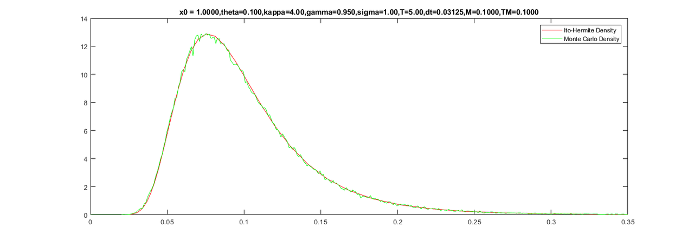](https://postimg.cc/64R9BW0S)

[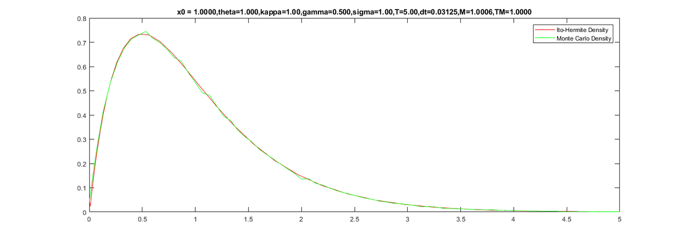](https://postimg.cc/7GjHvGg0)

[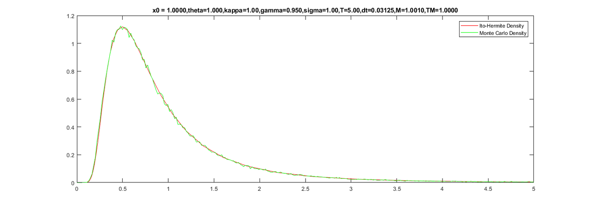](https://postimg.cc/r0DVYCtq)

[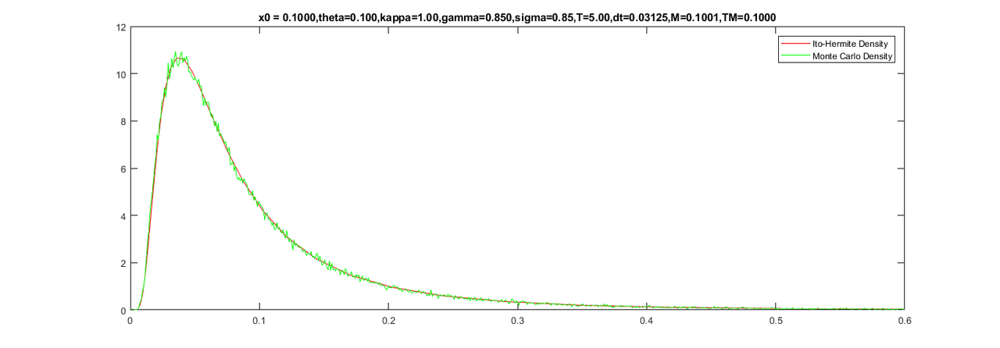](https://postimg.cc/DWjfgY0C)

[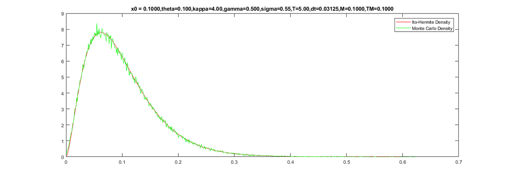](https://postimg.cc/KKvvtyGk)

---

### #1288 — Amin (Topic Author)
*November 29, 2021, 1:28 PM*

I am posting the program used to create above graphs. I will follow with explanation in the next post. Once you run this
program, it will produce the last graph in previous post.

.

```
function [] = FPESeriesCoeffsSolutionWilmottOdt2()

%Copyright Ahsan Amin. Infiniti derivatives Technologies.
%Please fell free to connect on linkedin: linkedin.com/in/ahsan-amin-0a53334
%or skype ahsan.amin2999
%In this program, I am simulating the SDE given as
%dy(t)=mu1 x(t)^beta1 dt + mu2 x(t)^beta2 dt +sigma x(t)^gamma dz(t)

%I have not directly simulated the SDE but simulated the transformed
%Besse1l process version of the SDE and then changed coordinates to retreive
%the SDE in original coo
%rdinates.
%The present program will analytically evolve only the Bessel Process version of the
%SDE in transformed coordinates.

dt=.125/16*4;   % Simulation time interval.%Fodiffusions close to zero
             %decrease dt for accuracy.
Tt=128*5/4;%128*2*2*2;     % Number of simulation levels. Terminal time= Tt*dt; //.125/32*32*16=2 year;
T=Tt*dt;
OrderA=4;  %
OrderM=4;  %
dtM=.0625/2;
TtM=T/dtM;

dNn=.2/1;   % Normal density subdivisions width. would change with number of subdivisions
Nn=46;  % No of normal density subdivisions
%NnMidl=18;%One half density Subdivision left from mid of normal density(low)
%NnMidh=19;%One half density subdivision right from the mid of normal density(high)
NnMid=4.0;
%NnT=46;
%NnD=(NnT-Nn)/2;
%NnD=5;

x0=.1;   % starting value of SDE
beta1=0.0;
beta2=1.0;   % Second drift term power.
gamma=.5;%50;   % volatility power.
kappa=4.0;%.950;   %mean reversion parameter.
theta=.10;%mean reversion target
sigma0=.55;%Volatility value

%you can specify any general mu1 and mu2 and beta1 and beta2.
mu1=1*theta*kappa;   %first drift coefficient.
mu2=-1*kappa;    % Second drift coefficient.
%mu1=0;
%mu2=0;

alpha=1;% x^alpha is being expanded. This is currently for monte carlo only.
alpha1=1-gamma;%This is for expansion of integrals for calculation of drift
%and volatility coefficients
%yy(1:Nn)=x0;
w0=x0^(1-gamma)/(1-gamma);

Z(1:Nn)=(((1:Nn)-3.5)*dNn-NnMid);
%Z(1:Nn)=(((1:Nn)+1.5)*dNn-NnMid);
%ZT(1:NnT)=(((1:NnT)-3.5)*dNn-NnMid);
%ZT
Z
str=input('Look at Z');
ZProb(1)=normcdf(.5*Z(1)+.5*Z(2),0,1)-normcdf(.5*Z(1)+.5*Z(2)-dNn,0,1);
ZProb(Nn)=normcdf(.5*Z(Nn)+.5*Z(Nn-1)+dNn,0,1)-normcdf(.5*Z(Nn)+.5*Z(Nn-1),0,1);
ZProb(2:Nn-1)=normcdf(.5*Z(2:Nn-1)+.5*Z(3:Nn),0,1)-normcdf(.5*Z(2:Nn-1)+.5*Z(1:Nn-2),0,1);

%%%%%%%%%%%%%%%%%%%%%%%%%%%%%%%%%%%%%%%%%%%%%%%%%%%%%%%%%%%%%%%%%%%%%%%%%%%%%%%%%%%%%%%%%%%%%%

sigma11(1:OrderA+1)=0;
mu11(1:OrderA+1)=0;
mu22(1:OrderA+1)=0;
sigma22(1:OrderA+1)=0;
% index 1 correponds to zero level since matlab indexing starts at one.
sigma11(1)=1;
mu11(1)=1;
mu22(1)=1;
sigma22(1)=1;

for k=1:(OrderA+1)
    if sigma0~=0
        sigma11(k)=sigma0^(k-1);
    end
    if mu1 ~= 0
        mu11(k)=mu1^(k-1);
    end
    if mu2 ~= 0
        mu22(k)=mu2^(k-1);
    end
    if sigma0~=0
        sigma22(k)=sigma0^(2*(k-1));
    end
end
%Ft(1:TtM+1,1:(OrderA+1),1:(OrderA+1),1:(OrderA+1),1:(OrderA+1))=0; %General time powers on hermite polynomials
Fp(1:(OrderA+1),1:(OrderA+1),1:(OrderA+1),1:(OrderA+1))=0;%General x powers on coefficients of hermite polynomials.
Fp1(1:(OrderA+1),1:(OrderA+1),1:(OrderA+1),1:(OrderA+1))=0;%General x powers for bessel transformed coordinates.

%YCoeff0 and YCoeff are coefficents for original coordinates monte carlo.
%YqCoeff0 and YqCoeff are bessel/lamperti version monte carlo.

YCoeff0(1:(OrderA+1),1:(OrderA+1),1:(OrderA+1),1:(OrderA+1))=0;
YqCoeff0(1:(OrderA+1),1:(OrderA+1),1:(OrderA+1),1:(OrderA+1))=0;
%Pre-compute the time and power exponent values in small multi-dimensional arrays
YCoeff = ItoTaylorCoeffsNew(alpha,beta1,beta2,gamma); %expand y^alpha where alpha=1;
YqCoeff = ItoTaylorCoeffsNew(alpha1,beta1,beta2,gamma);%expand y^alpha1 where alpha1=(1-gamma)
YqCoeff=YqCoeff/(1-gamma); %Transformed coordinates coefficients have to be
%further divided by (1-gamma)

for k = 0 : (OrderA)
    for m = 0:k
        l4 = k - m + 1;
        for n = 0 : m
            l3 = m - n + 1;
            for j = 0:n
                l2 = n - j + 1;
                l1 = j + 1;
                %Ft(l1,l2,l3,l4) = dtM^((l1-1) + (l2-1) + (l3-1) + .5* (l4-1));
                Fp(l1,l2,l3,l4) = (alpha + (l1-1) * beta1 + (l2-1) * beta2 + (l3-1) * 2* gamma + (l4-1) * gamma ...
                    - (l1-1) - (l2-1) - 2* (l3-1) - (l4-1));
                Fp1(l1,l2,l3,l4) = (alpha1 + (l1-1) * beta1 + (l2-1) * beta2 + (l3-1) * 2* gamma + (l4-1) * gamma ...
                    - (l1-1) - (l2-1) - 2* (l3-1) - (l4-1));

                YCoeff0(l1,l2,l3,l4) =YCoeff(l1,l2,l3,l4).*mu11(l1).*mu22(l2).*sigma22(l3).*sigma11(l4);
                YqCoeff0(l1,l2,l3,l4) =YqCoeff(l1,l2,l3,l4).*mu11(l1).*mu22(l2).*sigma22(l3).*sigma11(l4);
            end
        end
    end
end

%%%%%%%%%%%%%%%%%%%%%%%%%%%%%%%%%%%%%%%%%%%%%%%%%%%%%%%%%%%%%%%%%%%%%%%%%%%%%%%%%%%%%%%%%%%%%%

ExpnOrder=6;

wnStart=1;
tic

for tt=1:Tt
    if(tt==1)
        [wMu0dt,dwMu0dtdw] = BesselDriftAndDerivatives(w0,YqCoeff0,Fp1,gamma,dt,ExpnOrder);
        c0=wMu0dt+w0;
        c(1)=sigma0*sqrt(dt)
        c(2:10)=0.0;
        w0=c0;
    end

    %The program intended to find solution of Z-series to 10th power but
    %higher order coefficients would make some SDEs unstable so I just
    %turned the coefficients c(7:10) and b(7:10) into zero as soon as they
    %are calculated and just go with solution to 6th power of Z.

    if(tt>1)

    %below wMu0dta is drift and dwMu0dtdwa are its derivatives.
    %wMu1dt is its first derivative and dwMu1dtdw are derivatives of first
    %derivative.

     [wMu0dta,dwMu0dtdwa,wMu1dt,dwMu1dtdw] =
BesselDriftAndDerivatives08(w0,mu1,mu2,beta1,beta2,sigma0,gamma,dt,ExpnOrder+2);

     %The program CalculateDriftbCoeffs04 takes value of drift and its
     %derivatives wrt w and also takes Z-series of w and converts them into
     %Z-series of drift. It is used to calculate Z-series of drift and Then
     %to calculate Z_series of first derivative of drift wrt w.
     [b0,b] = CalculateDriftbCoeffs04(wMu0dta,dwMu0dtdwa,a);
     [b10,b1] = CalculateDriftbCoeffs04(wMu1dt,dwMu1dtdw,a);

     b(ExpnOrder+1:10)=0.0;

     b1(ExpnOrder+1:10)=0.0;
    %The function below evolves the previous solution in coefficients of Z
    %into next time step solution in coefficietns of Z-series.
    [c0,c] = EvolveSDESeriesSolution08New(a0,a,b0,b,b10,b1,sigma0,dt,ExpnOrder);
    c(ExpnOrder+1:10)=0.0;
%     if(gamma<=.75)
%     for mm=1:7
%         %if((sign(c(mm))~=sign(c(mm+1)))&&(abs(c(mm))<abs(c(mm+1)*5)))
%         if((abs(c(mm))<abs(c(mm+1)*5)))
%             %c(mm+1)=c(mm+1)*abs(c(mm)/c(mm+1)/11);
%             %c(mm+1)=sign(c(mm+1))*abs(c(mm)/4.5);
%             c(mm+1)=sign(c(mm+1))*abs(c(mm+1)/5.5);
%         end
%     end
%     end

    w0=c0;

    end

    a0=c0;
    a(1:ExpnOrder)=c(1:ExpnOrder);
    a(ExpnOrder+1:10)=0;

end
wnStart=1;

w(wnStart:Nn)=c0;
for nn=1:ExpnOrder
    w(wnStart:Nn)=w(wnStart:Nn)+c(nn)*Z(wnStart:Nn).^nn;
end
c

%str=input('Look at numbers')
yy(wnStart:Nn)=((1-gamma).*w(wnStart:Nn)).^(1/(1-gamma));
yy0=((1-gamma).*w0).^(1/(1-gamma));

Dfyy(wnStart:Nn)=0;
for nn=wnStart+1:Nn-1

    Dfyy(nn) = (yy(nn + 1) - yy(nn - 1))/(Z(nn + 1) - Z(nn - 1));

    %Change of variable derivative for densities
end

% Dfyy(wnStart:Nn) =(c(1)+2*c(2)*Z(wnStart:Nn)+3*c(3)*Z(wnStart:Nn).^2+ ...
%         4*c(4)*Z(wnStart:Nn).^3+5*c(5)*Z(wnStart:Nn).^4+6*c(6)*Z(wnStart:Nn).^5+ ...
%         7*c(7)*Z(wnStart:Nn).^6+8*c(8)*Z(wnStart:Nn).^7+9*c(9)*Z(wnStart:Nn).^8+ ...
%         10*c(10)*Z(wnStart:Nn).^9)*dNn;

pyy(1:Nn)=0;
for nn = wnStart:Nn-1

    pyy(nn) = (normpdf(Z(nn),0, 1))/abs(Dfyy(nn));
end

toc

ItoHermiteMean=sum(yy(wnStart+1:Nn-1).*ZProb(wnStart+1:Nn-1)) %Original process average from coordinates
disp('true Mean only applicable to standard SV mean reverting type models otherwise disregard');
TrueMean=theta+(x0-theta)*exp(-kappa*dt*Tt)%Mean reverting SDE original variable true average
yy0

theta1=1;
rng(29079137, 'twister')
paths=200000;
YY(1:paths)=x0;  %Original process monte carlo.
Random1(1:paths)=0;
for tt=1:TtM

    Random1=randn(size(Random1));
    HermiteP1(1,1:paths)=1;
    HermiteP1(2,1:paths)=Random1(1:paths);
    HermiteP1(3,1:paths)=Random1(1:paths).^2-1;
    HermiteP1(4,1:paths)=Random1(1:paths).^3-3*Random1(1:paths);
    HermiteP1(5,1:paths)=Random1(1:paths).^4-6*Random1(1:paths).^2+3;

    YY(1:paths)=YY(1:paths) + ...
        (YCoeff0(1,1,2,1).*YY(1:paths).^Fp(1,1,2,1)+ ...
        YCoeff0(1,2,1,1).*YY(1:paths).^Fp(1,2,1,1)+ ...
        YCoeff0(2,1,1,1).*YY(1:paths).^Fp(2,1,1,1))*dtM + ...
        (YCoeff0(1,1,3,1).*YY(1:paths).^Fp(1,1,3,1)+ ...
        YCoeff0(1,2,2,1).*YY(1:paths).^Fp(1,2,2,1)+ ...
        YCoeff0(2,1,2,1).*YY(1:paths).^Fp(2,1,2,1)+ ...
        YCoeff0(1,3,1,1).*YY(1:paths).^Fp(1,3,1,1)+ ...
        YCoeff0(2,2,1,1).*YY(1:paths).^Fp(2,2,1,1)+ ...
        YCoeff0(3,1,1,1).*YY(1:paths).^Fp(3,1,1,1))*dtM^2 + ...
        ((YCoeff0(1,1,1,2).*YY(1:paths).^Fp(1,1,1,2).*sqrt(dtM))+ ...
        (YCoeff0(1,1,2,2).*YY(1:paths).^Fp(1,1,2,2)+ ...
        YCoeff0(1,2,1,2).*YY(1:paths).^Fp(1,2,1,2)+ ...
        YCoeff0(2,1,1,2).*YY(1:paths).^Fp(2,1,1,2)).*dtM^1.5) .*HermiteP1(2,1:paths) + ...
        ((YCoeff0(1,1,1,3).*YY(1:paths).^Fp(1,1,1,3) *dtM) + ...
        (YCoeff0(1,1,2,3).*YY(1:paths).^Fp(1,1,2,3)+ ...
        YCoeff0(1,2,1,3).*YY(1:paths).^Fp(1,2,1,3)+ ...
        YCoeff0(2,1,1,3).*YY(1:paths).^Fp(2,1,1,3)).*dtM^2).*HermiteP1(3,1:paths) + ...
        ((YCoeff0(1,1,1,4).*YY(1:paths).^Fp(1,1,1,4)*dtM^1.5 )).*HermiteP1(4,1:paths) + ...
        (YCoeff0(1,1,1,5).*YY(1:paths).^Fp(1,1,1,5)*dtM^2.0).*HermiteP1(5,1:paths);

end

YY(YY<0)=0;
disp('Original process average from monte carlo');
MCMean=sum(YY(:))/paths %origianl coordinates monte carlo average.
disp('Original process average from our simulation');
ItoHermiteMean=sum(yy(wnStart+1:Nn-1).*ZProb(wnStart+1:Nn-1)) %Original process average from coordinates

disp('true Mean only applicble to standard SV mean reverting type models otherwise disregard');
TrueMean=theta+(x0-theta)*exp(-kappa*dt*Tt)%Mean reverting SDE original variable true average

MaxCutOff=30;
NoOfBins=round(2*900*gamma^2*4*sigma0/sqrt(MCMean)/(1+kappa));%Decrease the number of bins if the graph is too
[YDensity,IndexOutY,IndexMaxY] = MakeDensityFromSimulation_Infiniti_NEW(YY,paths,NoOfBins,MaxCutOff );
plot(yy(wnStart+1:Nn-1),pyy(wnStart+1:Nn-1),'r',IndexOutY(1:IndexMaxY),YDensity(1:IndexMaxY),'g');
 %plot(y_w(wnStart+1:Nn-1),fy_w(wnStart+1:Nn-1),'r',IndexOutY(1:IndexMaxY),YDensity(1:IndexMaxY),'g',Z(wnStart+1:Nn-1),fy_w(wnStart+1:Nn-1),'b');

title(sprintf('x0 = %.4f,theta=%.3f,kappa=%.2f,gamma=%.3f,sigma=%.2f,T=%.2f,dt=%.5f,M=%.4f,TM=%.4f',
x0,theta,kappa,gamma,sigma0,T,dt,ItoHermiteMean,TrueMean));%,sprintf('theta= %f', theta), sprintf('kappa = %f',
kappa),sprintf('sigma = %f', sigma0),sprintf('T = %f', T));

legend({'Ito-Hermite Density','Monte Carlo Density'},'Location','northeast')

str=input('red line is density of SDE from Ito-Hermite method, green is monte carlo.');

end
```

.

.

.

```
function [wMu0dt,dwMu0dtdw,wMu1dt,dwMu1dtdw] =
BesselDriftAndDerivatives08(w0,mu1,mu2,beta1,beta2,sigma0,gamma,dt,ExpnOrder)

NoOfTerms=3;

YqCoeff(1:NoOfTerms)=0.0;
Fp(1:NoOfTerms)=0.0;

YqCoeff(1)=mu1;
YqCoeff(2)=mu2;
YqCoeff(3)=-.5*sigma0^2*gamma;
Fp(1)=(beta1-gamma)/(1-gamma);
Fp(2)=(beta2-gamma)/(1-gamma);
Fp(3)=-1;

wMu0dt0=0;
dwMu0dt(1:ExpnOrder+1)=0.0;

wMu0dt=0;
dwMu0dtdw(1:ExpnOrder+1)=0.0;

for mm=1:NoOfTerms

    wMu0dt0=YqCoeff(mm).*((1-gamma)*w0).^Fp(mm);
    for nn=1:ExpnOrder+1
        if(nn==1)
            dwMu0dt(nn)=wMu0dt0*Fp(mm)*(1-gamma)/((1-gamma)*w0);
        else
        dwMu0dt(nn)=dwMu0dt(nn-1)*(Fp(mm)-(nn-1))*(1-gamma)/((1-gamma)*w0);
        end
    end
    wMu0dt=wMu0dt+wMu0dt0;
    for nn=1:ExpnOrder+1
        dwMu0dtdw(nn)=dwMu0dtdw(nn)+dwMu0dt(nn);
    end
wMu1dt=dwMu0dtdw(1);
dwMu1dtdw(1:ExpnOrder)=dwMu0dtdw(2:ExpnOrder+1);

end

end
```

.

.

.

```
function [b0,b] = CalculateDriftbCoeffs04(wMu0dt,dwMu0dtdw,a)

b0=wMu0dt;

b(1)=a(1) *dwMu0dtdw(1);

b(2)=1/2*(2* a(2) *dwMu0dtdw(1)+a(1)^2 *dwMu0dtdw(2));

b(3)=1/6*(6 *a(3) *dwMu0dtdw(1)+6 *a(1)* a(2) *dwMu0dtdw(2)+a(1)^3 *dwMu0dtdw(3));

b(4)=1/24*(24* a(4) *dwMu0dtdw(1)+12* a(2)^2 *dwMu0dtdw(2)+24 *a(1)* a(3) *dwMu0dtdw(2)+ ...
    12* a(1)^2* a(2) *dwMu0dtdw(3)+a(1)^4 *dwMu0dtdw(4));

b(5)=1/120*(120* a(5) *dwMu0dtdw(1)+120* a(2) *a(3) *dwMu0dtdw(2)+120* a(1)* a(4) *dwMu0dtdw(2)+ ...
    60 *a(1)* a(2)^2 *dwMu0dtdw(3)+60* a(1)^2* a(3) *dwMu0dtdw(3)+ ...
    20 *a(1)^3* a(2) *dwMu0dtdw(4)+a(1)^5 *dwMu0dtdw(5));

b(6)=1/720*(720* a(6) *dwMu0dtdw(1)+360* a(3)^2 *dwMu0dtdw(2)+720* a(2)* a(4) *dwMu0dtdw(2)+720* a(1)* a(5)
*dwMu0dtdw(2)+ ...
    120* a(2)^3 *dwMu0dtdw(3)+720* a(1)* a(2)* a(3) *dwMu0dtdw(3)+360* a(1)^2* a(4) *dwMu0dtdw(3)+ ...
    180* a(1)^2* a(2)^2 *dwMu0dtdw(4)+120* a(1)^3* a(3) *dwMu0dtdw(4)+ ...
    30* a(1)^4 *a(2) *dwMu0dtdw(5)+a(1)^6 *dwMu0dtdw(6));

 b(7)=1/(720*7)*(5040* a(7)*dwMu0dtdw(1)+5040* a(3)* a(4)*dwMu0dtdw(2)+5040* a(2)* a(5) *dwMu0dtdw(2)+5040 *a(1)* a(6)
*dwMu0dtdw(2)+ ...
     2520* a(2)^2* a(3) *dwMu0dtdw(3)+2520* a(1)* a(3)^2 *dwMu0dtdw(3)+5040 *a(1)* a(2)* a(4) *dwMu0dtdw(3)+2520* a(1)^2
*a(5) *dwMu0dtdw(3)+ ...
     840* a(1)* a(2)^3 *dwMu0dtdw(4)+2520* a(1)^2* a(2)* a(3) *dwMu0dtdw(4)+840* a(1)^3* a(4) *dwMu0dtdw(4)+ ...
     420* a(1)^3* a(2)^2 *dwMu0dtdw(5)+210* a(1)^4* a(3) *dwMu0dtdw(5)+ ...
     42* a(1)^5* a(2) *dwMu0dtdw(6)+a(1)^7 *dwMu0dtdw(7));

 b(8)=1/(720*7*8)*(40320* a(8) *dwMu0dtdw(1)+20160* a(4)^2 *dwMu0dtdw(2)+40320* a(3)* a(5) *dwMu0dtdw(2)+40320* a(2)
*a(6) *dwMu0dtdw(2)+ ...
     40320* a(1) *a(7) *dwMu0dtdw(2)+ ...
     20160* a(2)* a(3)^2 *dwMu0dtdw(3)+20160* a(2)^2* a(4) *dwMu0dtdw(3)+40320* a(1)* a(3)* a(4) *dwMu0dtdw(3)+40320*
a(1)* a(2)* a(5) *dwMu0dtdw(3)+ ...
     20160* a(1)^2* a(6) *dwMu0dtdw(3)+ ...
     1680* a(2)^4 *dwMu0dtdw(4)+20160* a(1)* a(2)^2* a(3) *dwMu0dtdw(4)+10080* a(1)^2* a(3)^2 *dwMu0dtdw(4)+20160*
a(1)^2* a(2) *a(4) *dwMu0dtdw(4)+ ...
     6720* a(1)^3* a(5) *dwMu0dtdw(4)+ ...
     3360* a(1)^2* a(2)^3 *dwMu0dtdw(5)+6720* a(1)^3 *a(2)* a(3) *dwMu0dtdw(5)+1680* a(1)^4* a(4) *dwMu0dtdw(5)+ ...
     840* a(1)^4* a(2)^2 *dwMu0dtdw(6)+336* a(1)^5* a(3) *dwMu0dtdw(6)+ ...
     56* a(1)^6* a(2) *dwMu0dtdw(7)+a(1)^8 *dwMu0dtdw(8));

b(9:10)=0.0;

 %
%
%
% b(9)=1/(720*7*8*9)*(362880* a(9) *dwMu0dtdw(1)+ ...
%     362880* a(4)* a(5) *dwMu0dtdw(2)+ 362880* a(3)* a(6) *dwMu0dtdw(2) +362880* a(2)* a(7) *dwMu0dtdw(2) +362880* a(1)
*a(8) *dwMu0dtdw(2) + ...
%     60480* a(3)^3 *dwMu0dtdw(3)+362880* a(2)* a(3)* a(4) *dwMu0dtdw(3)+181440* a(1)* a(4)^2 *dwMu0dtdw(3)+181440*
a(2)^2* a(5) *dwMu0dtdw(3) + ...
%     362880* a(1)* a(3)* a(5) *dwMu0dtdw(3)+362880 *a(1)* a(2)* a(6) *dwMu0dtdw(3) +181440 *a(1)^2* a(7) *dwMu0dtdw(3)+
...
%     60480* a(2)^3* a(3) *dwMu0dtdw(4)+181440* a(1)* a(2)* a(3)^2 *dwMu0dtdw(4)+181440* a(1)* a(2)^2 *a(4)
*dwMu0dtdw(4)+ ...
%     181440* a(1)^2* a(3)* a(4) *dwMu0dtdw(4)+181440* a(1)^2* a(2)* a(5) *dwMu0dtdw(4)+60480* a(1)^3* a(6)
*dwMu0dtdw(4)+ ...
%     15120* a(1)* a(2)^4 *dwMu0dtdw(5)+90720* a(1)^2* a(2)^2* a(3) *dwMu0dtdw(5)+30240* a(1)^3* a(3)^2 *dwMu0dtdw(5)+
...
%     60480 *a(1)^3* a(2)* a(4) *dwMu0dtdw(5)+15120* a(1)^4* a(5) *dwMu0dtdw(5)+ ...
%     10080* a(1)^3* a(2)^3 *dwMu0dtdw(6)+15120* a(1)^4 *a(2)* a(3) *dwMu0dtdw(6)+3024* a(1)^5* a(4) *dwMu0dtdw(6)+ ...
%     1512* a(1)^5* a(2)^2 *dwMu0dtdw(7)+504* a(1)^6* a(3) *dwMu0dtdw(7)+ ...
%     72* a(1)^7 *a(2) *dwMu0dtdw(8)+a(1)^9 *dwMu0dtdw(9));
%
%
%
%
% b(10)=1/(720*7*8*9*10)*(3628800* a(10)* dwMu0dtdw(1)+ ...
%     1814400 * a(5)^2 *dwMu0dtdw(2)+3628800 *a(4)* a(6)* dwMu0dtdw(2)+3628800* a(3)* a(7)* dwMu0dtdw(2)+3628800 *a(2)*
a(8)* dwMu0dtdw(2)+ ...
%     3628800* a(1)* a(9)* dwMu0dtdw(2)+ ...
%     1814400* a(3)^2* a(4)* dwMu0dtdw(3)+1814400* a(2)* a(4)^2* dwMu0dtdw(3)+3628800* a(2)* a(3)* a(5)*
dwMu0dtdw(3)+3628800* a(1)* a(4)* a(5) *dwMu0dtdw(3)+ ...
%     1814400* a(2)^2* a(6)* dwMu0dtdw(3)+3628800* a(1)* a(3)* a(6)* dwMu0dtdw(3)+3628800 *a(1)* a(2)* a(7)*
dwMu0dtdw(3)+1814400* a(1)^2* a(8)* dwMu0dtdw(3)+ ...
%     907200* a(2)^2 *a(3)^2* dwMu0dtdw(4)+604800* a(1)* a(3)^3* dwMu0dtdw(4)+604800* a(2)^3* a(4)*
dwMu0dtdw(4)+3628800* a(1)* a(2)* a(3)* a(4)* dwMu0dtdw(4)+ ...
%     907200* a(1)^2* a(4)^2* dwMu0dtdw(4)+1814400* a(1)* a(2)^2* a(5)* dwMu0dtdw(4)+1814400* a(1)^2* a(3)* a(5)*
dwMu0dtdw(4)+ ...
%     1814400* a(1)^2* a(2)* a(6)* dwMu0dtdw(4)+ 604800* a(1)^3* a(7) *dwMu0dtdw(4)+ ...
%     30240 *a(2)^5* dwMu0dtdw(5)+604800* a(1)* a(2)^3* a(3)* dwMu0dtdw(5)+907200 *a(1)^2* a(2)* a(3)^2*
dwMu0dtdw(5)+907200* a(1)^2* a(2)^2* a(4) *dwMu0dtdw(5)+ ...
%     604800* a(1)^3* a(3)* a(4)* dwMu0dtdw(5)+604800* a(1)^3* a(2)* a(5)* dwMu0dtdw(5)+151200* a(1)^4* a(6)*
dwMu0dtdw(5)+ ...
%     75600* a(1)^2* a(2)^4* dwMu0dtdw(6)+302400 *a(1)^3* a(2)^2* a(3)* dwMu0dtdw(6)+75600* a(1)^4 *a(3)^2*
dwMu0dtdw(6)+151200* a(1)^4* a(2)* a(4) *dwMu0dtdw(6)+ ...
%     30240* a(1)^5* a(5)* dwMu0dtdw(6)+ ...
%     25200* a(1)^4* a(2)^3* dwMu0dtdw(7)+30240* a(1)^5* a(2)* a(3)* dwMu0dtdw(7)+5040* a(1)^6* a(4)* dwMu0dtdw(7)+ ...
%     2520* a(1)^6* a(2)^2* dwMu0dtdw(8)+720* a(1)^7* a(3)* dwMu0dtdw(8)+ ...
%     90 *a(1)^8* a(2)* dwMu0dtdw(9)+ ...
%     a(1)^10* dwMu0dtdw(10));

end
```

.

.

.

```
function [c0,c] = EvolveSDESeriesSolution08New(a0,a,b0,b,b10,b1,sigma0,dt,ExpnOrder)

SeriesOrder=ExpnOrder;
d1(1:ExpnOrder)=0;
d10=a(1);
for nn=1:ExpnOrder-1
    d1(nn)=(nn+1)*a(nn+1);
end
d2(1:ExpnOrder)=0;
d20=2*a(2);
for nn=1:ExpnOrder-2
    d2(nn)=(nn+1)*(nn+2)*a(nn+2);
end
d3(1:ExpnOrder)=0;
d30=6*a(3);
for nn=1:ExpnOrder-3
    d3(nn)=(nn+1)*(nn+2)*(nn+3)*a(nn+3);
end

[d10Sq,d1Sq] =SeriesProduct(d10,d1,d10,d1,SeriesOrder);
[d10Cube,d1Cube] =SeriesProduct(d10Sq,d1Sq,d10,d1,SeriesOrder);
[d10Quad,d1Quad] =SeriesProduct(d10Cube,d1Cube,d10,d1,SeriesOrder);
[d10Inv,d1Inv] = SeriesReciprocal(d10,d1,SeriesOrder);
[d10SqInv,d1SqInv] = SeriesReciprocal(d10Sq,d1Sq,SeriesOrder);
[d10CubeInv,d1CubeInv] = SeriesReciprocal(d10Cube,d1Cube,SeriesOrder);
[d10QuadInv,d1QuadInv] = SeriesReciprocal(d10Quad,d1Quad,SeriesOrder);
[d20Sq,d2Sq] =SeriesProduct(d20,d2,d20,d2,SeriesOrder);

Z_d1Inv0=0;
Z_d1Inv(1)=d10Inv;
Z_d1Inv(2:SeriesOrder)=d1Inv(1:SeriesOrder-1);

[d2_d1SqInv0,d2_d1SqInv] =SeriesProduct(d20,d2,d10SqInv,d1SqInv,SeriesOrder);
T_Odt0=b0+.5*sigma0^2*d2_d1SqInv0;
T_Odt(1:SeriesOrder)=b(1:SeriesOrder)+.5*sigma0^2*(Z_d1Inv(1:SeriesOrder)+d2_d1SqInv(1:SeriesOrder));

[d2_d1CubeInv0,d2_d1CubeInv] =SeriesProduct(d20,d2,d10CubeInv,d1CubeInv,SeriesOrder);

Z_d2_d1CubeInv0=0;
Z_d2_d1CubeInv(1)=d2_d1CubeInv0;
Z_d2_d1CubeInv(2:SeriesOrder)=d2_d1CubeInv(1:SeriesOrder-1);

[d3_d1CubeInv0,d3_d1CubeInv]=SeriesProduct(d30,d3,d10CubeInv,d1CubeInv,SeriesOrder);
[d2Sq_d1QuadInv0,d2Sq_d1QuadInv]=SeriesProduct(d20Sq,d2Sq,d10QuadInv,d1QuadInv,SeriesOrder);

T_Odt2(1:SeriesOrder)=b1(1:SeriesOrder)+.5*sigma0^2*(d1SqInv(1:SeriesOrder)-Z_d2_d1CubeInv(1:SeriesOrder)+ ...
    d3_d1CubeInv(1:SeriesOrder)-2*d2Sq_d1QuadInv(1:SeriesOrder));

T_Odt20=b10+.5*sigma0^2*(d10SqInv+d3_d1CubeInv0-2*d2Sq_d1QuadInv0);

[Term20,Term2]=SeriesProduct(T_Odt0,T_Odt,T_Odt20,T_Odt2,SeriesOrder);

c0=a0+T_Odt0*dt+Term20*dt^2/2;
c(1:SeriesOrder)=a(1:SeriesOrder)+T_Odt(1:SeriesOrder)*dt+Term2(1:SeriesOrder)*dt^2/2;

end
```

.

.

.

```
function [c0,c] = SeriesReciprocal(a0,a,SeriesOrder)

c0=1/a0;
c(1:SeriesOrder)=0;
for nn=1:SeriesOrder
    c(nn)=c(nn)-c0/a0*a(nn);
    for kk=1:nn-1
        c(nn)=c(nn)-c(kk)/a0*a(nn-kk);
    end
end

end
```

.

.

.

```
function [c0,c] =SeriesProduct(a0,a,b0,b,SeriesOrder)

c0=a0*b0;
c(1:SeriesOrder)=0.0;
for nn=1:SeriesOrder
    c(nn)=c(nn)+a0*b(nn);
    c(nn)=c(nn)+b0*a(nn);
    for kk=1:nn-1
        c(nn)=c(nn)+a(kk)*b(nn-kk);
    end
end

end
```

.

.

.

---

### #1289 — Amin (Topic Author)
*November 30, 2021, 12:49 PM*

Friends, I was able to somewhat improve the performance of the program for SDEs close to zero. I placed a simple
constraint on the growth of derivatives of the drift that ratio between absolute values of consecutive derivatives
cannot be larger than ratio of absolute values of drift itself and its first derivative. This constraint helped make the
program stable for slightly larger range of SDEs close to zero. Another good thing about this constraint was that it did
not seem to (negatively) affect the performance of program for densities away from zero that were already good without
this constraint. I made some graphs for SDEs close to zero and I am attaching them. I was not able to find the solution
for densities of SDEs with the parameters in these graphs with yesterday's program. I will post the new program in next
post. For all of these graphs maximum order of series was only four and time step size was still 1/32 and terminal time
is five years.

[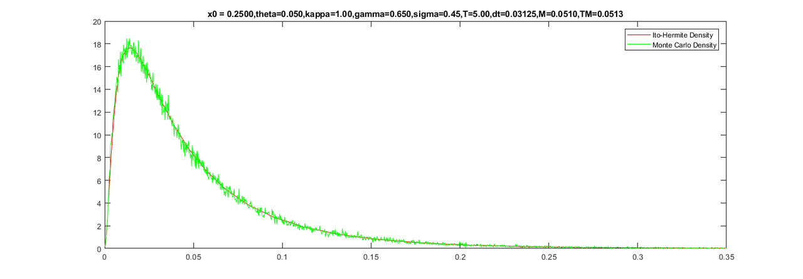](https://postimg.cc/wyxCWh30)

[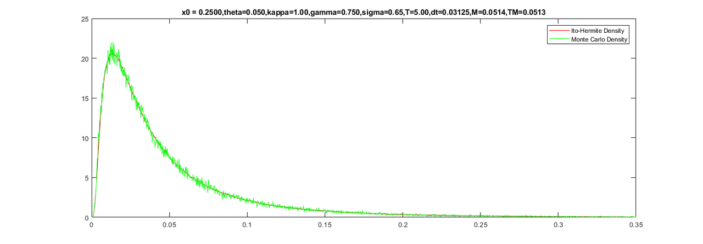](https://postimg.cc/VSwQtywy)

[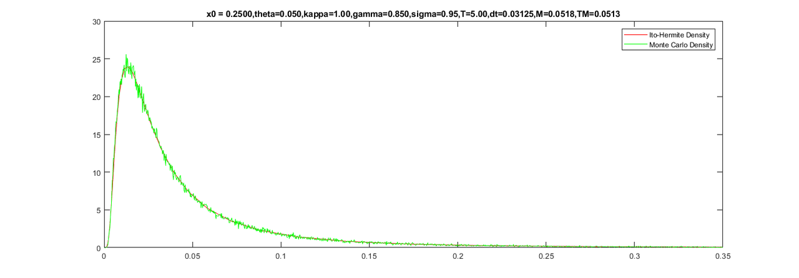](https://postimg.cc/FY3X1r2g)

[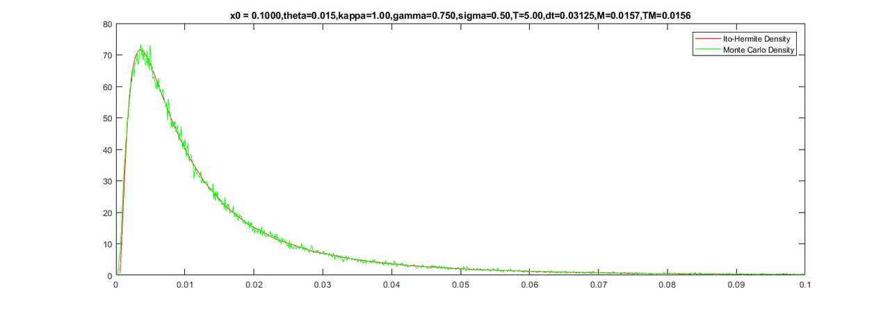](https://postimg.cc/7fpyxGQZ)

---

### #1290 — Amin (Topic Author)
*November 30, 2021, 1:00 PM*

Here is the new program for calculation of derivatives of drift in which I have implemented simple bounds.

```
function [wMu0dt,dwMu0dtdw,wMu1dt,dwMu1dtdw] =
BesselDriftAndDerivatives08Bounded(w0,mu1,mu2,beta1,beta2,sigma0,gamma,dt,ExpnOrder)

NoOfTerms=3;

YqCoeff(1:NoOfTerms)=0.0;
Fp(1:NoOfTerms)=0.0;

YqCoeff(1)=mu1;
YqCoeff(2)=mu2;
YqCoeff(3)=-.5*sigma0^2*gamma;
Fp(1)=(beta1-gamma)/(1-gamma);
Fp(2)=(beta2-gamma)/(1-gamma);
Fp(3)=-1;

wMu0dt0=0;
dwMu0dt(1:ExpnOrder+1)=0.0;

wMu0dt=0;
dwMu0dtdw(1:ExpnOrder+1)=0.0;

for mm=1:NoOfTerms

    wMu0dt0=YqCoeff(mm).*((1-gamma)*w0).^Fp(mm);
    for nn=1:ExpnOrder+1
        if(nn==1)
            dwMu0dt(nn)=wMu0dt0*Fp(mm)*(1-gamma)/((1-gamma)*w0);
        else
        dwMu0dt(nn)=dwMu0dt(nn-1)*(Fp(mm)-(nn-1))*(1-gamma)/((1-gamma)*w0);
        end
    end
    wMu0dt=wMu0dt+wMu0dt0;
    for nn=1:ExpnOrder+1
        dwMu0dtdw(nn)=dwMu0dtdw(nn)+dwMu0dt(nn);
    end

end

Bound=1/abs(wMu0dt/dwMu0dtdw(1));

for nn=1:ExpnOrder

    if(abs(dwMu0dtdw(nn+1))>abs(dwMu0dtdw(nn)*Bound))
        dwMu0dtdw(nn+1)=sign(dwMu0dtdw(nn+1))*abs(dwMu0dtdw(nn))*Bound;
    end
end

wMu1dt=dwMu0dtdw(1);
dwMu1dtdw(1:ExpnOrder)=dwMu0dtdw(2:ExpnOrder+1);

%wMu0dt
%dwMu0dtdw

%str=input('Look at drift derivatives');

end
```

,

Here is the main program that now works well with four series order.

.

```
function [] = FPESeriesCoeffsSolutionWilmottOdt2Downloaded()

%Copyright Ahsan Amin. Infiniti derivatives Technologies.
%Please fell free to connect on linkedin: linkedin.com/in/ahsan-amin-0a53334
%or skype ahsan.amin2999
%In this program, I am simulating the SDE given as
%dy(t)=mu1 x(t)^beta1 dt + mu2 x(t)^beta2 dt +sigma x(t)^gamma dz(t)

%I have not directly simulated the SDE but simulated the transformed
%Besse1l process version of the SDE and then changed coordinates to retreive
%the SDE in original coo
%rdinates.
%The present program will analytically evolve only the Bessel Process version of the
%SDE in transformed coordinates.

dt=.125/16*4;   % Simulation time interval.%Fodiffusions close to zero
             %decrease dt for accuracy.
Tt=128*5/4;%128*2*2*2;     % Number of simulation levels. Terminal time= Tt*dt; //.125/32*32*16=2 year;
T=Tt*dt;
OrderA=4;  %
OrderM=4;  %
dtM=.0625;
TtM=T/dtM;

dNn=.2/1;   % Normal density subdivisions width. would change with number of subdivisions
Nn=46;  % No of normal density subdivisions
%NnMidl=18;%One half density Subdivision left from mid of normal density(low)
%NnMidh=19;%One half density subdivision right from the mid of normal density(high)
NnMid=4.0;
%NnT=46;
%NnD=(NnT-Nn)/2;
%NnD=5;

x0=.10;   % starting value of SDE
beta1=0.0;
beta2=1.0;   % Second drift term power.
gamma=.75;%50;   % volatility power.
kappa=1.0;%.950;   %mean reversion parameter.
theta=.0150;%mean reversion target
sigma0=.5;%Volatility value

%you can specify any general mu1 and mu2 and beta1 and beta2.
mu1=1*theta*kappa;   %first drift coefficient.
mu2=-1*kappa;    % Second drift coefficient.
%mu1=0;
%mu2=0;

alpha=1;% x^alpha is being expanded. This is currently for monte carlo only.
alpha1=1-gamma;%This is for expansion of integrals for calculation of drift
%and volatility coefficients
%yy(1:Nn)=x0;
w0=x0^(1-gamma)/(1-gamma);

Z(1:Nn)=(((1:Nn)-3.5)*dNn-NnMid);
%Z(1:Nn)=(((1:Nn)+1.5)*dNn-NnMid);
%ZT(1:NnT)=(((1:NnT)-3.5)*dNn-NnMid);
%ZT
Z
str=input('Look at Z');
ZProb(1)=normcdf(.5*Z(1)+.5*Z(2),0,1)-normcdf(.5*Z(1)+.5*Z(2)-dNn,0,1);
ZProb(Nn)=normcdf(.5*Z(Nn)+.5*Z(Nn-1)+dNn,0,1)-normcdf(.5*Z(Nn)+.5*Z(Nn-1),0,1);
ZProb(2:Nn-1)=normcdf(.5*Z(2:Nn-1)+.5*Z(3:Nn),0,1)-normcdf(.5*Z(2:Nn-1)+.5*Z(1:Nn-2),0,1);

%%%%%%%%%%%%%%%%%%%%%%%%%%%%%%%%%%%%%%%%%%%%%%%%%%%%%%%%%%%%%%%%%%%%%%%%%%%%%%%%%%%%%%%%%%%%%%

sigma11(1:OrderA+1)=0;
mu11(1:OrderA+1)=0;
mu22(1:OrderA+1)=0;
sigma22(1:OrderA+1)=0;
% index 1 correponds to zero level since matlab indexing starts at one.
sigma11(1)=1;
mu11(1)=1;
mu22(1)=1;
sigma22(1)=1;

for k=1:(OrderA+1)
    if sigma0~=0
        sigma11(k)=sigma0^(k-1);
    end
    if mu1 ~= 0
        mu11(k)=mu1^(k-1);
    end
    if mu2 ~= 0
        mu22(k)=mu2^(k-1);
    end
    if sigma0~=0
        sigma22(k)=sigma0^(2*(k-1));
    end
end
%Ft(1:TtM+1,1:(OrderA+1),1:(OrderA+1),1:(OrderA+1),1:(OrderA+1))=0; %General time powers on hermite polynomials
Fp(1:(OrderA+1),1:(OrderA+1),1:(OrderA+1),1:(OrderA+1))=0;%General x powers on coefficients of hermite polynomials.
Fp1(1:(OrderA+1),1:(OrderA+1),1:(OrderA+1),1:(OrderA+1))=0;%General x powers for bessel transformed coordinates.

%YCoeff0 and YCoeff are coefficents for original coordinates monte carlo.
%YqCoeff0 and YqCoeff are bessel/lamperti version monte carlo.

YCoeff0(1:(OrderA+1),1:(OrderA+1),1:(OrderA+1),1:(OrderA+1))=0;
YqCoeff0(1:(OrderA+1),1:(OrderA+1),1:(OrderA+1),1:(OrderA+1))=0;
%Pre-compute the time and power exponent values in small multi-dimensional arrays
YCoeff = ItoTaylorCoeffsNew(alpha,beta1,beta2,gamma); %expand y^alpha where alpha=1;
YqCoeff = ItoTaylorCoeffsNew(alpha1,beta1,beta2,gamma);%expand y^alpha1 where alpha1=(1-gamma)
YqCoeff=YqCoeff/(1-gamma); %Transformed coordinates coefficients have to be
%further divided by (1-gamma)

for k = 0 : (OrderA)
    for m = 0:k
        l4 = k - m + 1;
        for n = 0 : m
            l3 = m - n + 1;
            for j = 0:n
                l2 = n - j + 1;
                l1 = j + 1;
                %Ft(l1,l2,l3,l4) = dtM^((l1-1) + (l2-1) + (l3-1) + .5* (l4-1));
                Fp(l1,l2,l3,l4) = (alpha + (l1-1) * beta1 + (l2-1) * beta2 + (l3-1) * 2* gamma + (l4-1) * gamma ...
                    - (l1-1) - (l2-1) - 2* (l3-1) - (l4-1));
                Fp1(l1,l2,l3,l4) = (alpha1 + (l1-1) * beta1 + (l2-1) * beta2 + (l3-1) * 2* gamma + (l4-1) * gamma ...
                    - (l1-1) - (l2-1) - 2* (l3-1) - (l4-1));

                YCoeff0(l1,l2,l3,l4) =YCoeff(l1,l2,l3,l4).*mu11(l1).*mu22(l2).*sigma22(l3).*sigma11(l4);
                YqCoeff0(l1,l2,l3,l4) =YqCoeff(l1,l2,l3,l4).*mu11(l1).*mu22(l2).*sigma22(l3).*sigma11(l4);
            end
        end
    end
end

%%%%%%%%%%%%%%%%%%%%%%%%%%%%%%%%%%%%%%%%%%%%%%%%%%%%%%%%%%%%%%%%%%%%%%%%%%%%%%%%%%%%%%%%%%%%%%

ExpnOrder=4;

wnStart=1;
tic

for tt=1:Tt
    if(tt==1)
        [wMu0dt,dwMu0dtdw] = BesselDriftAndDerivatives(w0,YqCoeff0,Fp1,gamma,dt,ExpnOrder);
        c0=wMu0dt+w0;
        c(1)=sigma0*sqrt(dt)
        c(2:10)=0.0;
        w0=c0;
    end

    %The program intended to find solution of Z-series to 10th power but
    %higher order coefficients would make some SDEs unstable so I just
    %turned the coefficients c(7:10) and b(7:10) into zero as soon as they
    %are calculated and just go with solution to 6th power of Z.

    if(tt>1)

    %below wMu0dta is drift and dwMu0dtdwa are its derivatives.
    %wMu1dt is its first derivative and dwMu1dtdw are derivatives of first
    %derivative.

     %[wMu0dta,dwMu0dtdwa,wMu1dt,dwMu1dtdw] = BesselDriftAndDerivatives08(w0,mu1,mu2,beta1,beta2,sigma0,gamma,dt,10);
     [wMu0dta,dwMu0dtdwa,wMu1dt,dwMu1dtdw] =
BesselDriftAndDerivatives08Bounded(w0,mu1,mu2,beta1,beta2,sigma0,gamma,dt,10);

     %The program CalculateDriftbCoeffs04 takes value of drift and its
     %derivatives wrt w and also takes Z-series of w and converts them into
     %Z-series of drift. It is used to calculate Z-series of drift and Then
     %to calculate Z_series of first derivative of drift wrt w.
     [b0,b] = CalculateDriftbCoeffs04(wMu0dta,dwMu0dtdwa,a);
     [b10,b1] = CalculateDriftbCoeffs04(wMu1dt,dwMu1dtdw,a);

     b(ExpnOrder+1:10)=0.0;

     b1(ExpnOrder+1:10)=0.0;
    %The function below evolves the previous solution in coefficients of Z
    %into next time step solution in coefficietns of Z-series.
    [c0,c] = EvolveSDESeriesSolution08New(a0,a,b0,b,b10,b1,sigma0,dt,ExpnOrder);
    c(ExpnOrder+1:10)=0.0;
%      for mm=1:ExpnOrder-1
%          %if((sign(c(mm))~=sign(c(mm+1)))&&(abs(c(mm))<abs(c(mm+1)*5)))
%          if((abs(c(mm))<abs(c(mm+1)/c0/(1-gamma)*(mm-1))))
%              %c(mm+1)=c(mm+1)*abs(c(mm)/c(mm+1)/11);
%              c(mm+1)=sign(c(mm+1))*abs(c(mm)*c0*(1-gamma)/(mm-1));
%              %c(mm+1)=sign(c(mm+1))*abs(c(mm+1)/7);
%          end
%      end
    T1=sqrt(((1-gamma)^2+gamma^2)/(gamma*(1-gamma)))*(2);

     for mm=1:ExpnOrder-1
    %T1=(1/(1-gamma))^(mm-1)/sqrt(2);
    T1=1/(1-gamma)*(2);
         %if((abs(c(mm))<abs(c(mm+1)/c0*(mm))))
         if((abs(c(mm))<abs(c(mm+1)/c0*(mm)*T1)))

%             c(mm+1)=sign(c(mm+1))*abs(c(mm)*c0/(mm)/T1);

         end
     end

%dwMu0dtdwa

%     if(gamma<=.75)
%     for mm=1:7
%         %if((sign(c(mm))~=sign(c(mm+1)))&&(abs(c(mm))<abs(c(mm+1)*5)))
%         if((abs(c(mm))<abs(c(mm+1)*5)))
%             %c(mm+1)=c(mm+1)*abs(c(mm)/c(mm+1)/11);
%             %c(mm+1)=sign(c(mm+1))*abs(c(mm)/4.5);
%             c(mm+1)=sign(c(mm+1))*abs(c(mm+1)/5.5);
%         end
%     end
%     end

    w0=c0;

    end

    a0=c0;
    a(1:ExpnOrder)=c(1:ExpnOrder);
    a(ExpnOrder+1:10)=0;

end
wnStart=1;

w(wnStart:Nn)=c0;
for nn=1:ExpnOrder
    w(wnStart:Nn)=w(wnStart:Nn)+c(nn)*Z(wnStart:Nn).^nn;
end
c

%str=input('Look at numbers')
yy(wnStart:Nn)=((1-gamma).*w(wnStart:Nn)).^(1/(1-gamma));
yy0=((1-gamma).*w0).^(1/(1-gamma));

Dfyy(wnStart:Nn)=0;
for nn=wnStart+1:Nn-1

    Dfyy(nn) = (yy(nn + 1) - yy(nn - 1))/(Z(nn + 1) - Z(nn - 1));

    %Change of variable derivative for densities
end

% Dfyy(wnStart:Nn) =(c(1)+2*c(2)*Z(wnStart:Nn)+3*c(3)*Z(wnStart:Nn).^2+ ...
%         4*c(4)*Z(wnStart:Nn).^3+5*c(5)*Z(wnStart:Nn).^4+6*c(6)*Z(wnStart:Nn).^5+ ...
%         7*c(7)*Z(wnStart:Nn).^6+8*c(8)*Z(wnStart:Nn).^7+9*c(9)*Z(wnStart:Nn).^8+ ...
%         10*c(10)*Z(wnStart:Nn).^9)*dNn;

pyy(1:Nn)=0;
for nn = wnStart:Nn-1

    pyy(nn) = (normpdf(Z(nn),0, 1))/abs(Dfyy(nn));
end

toc

ItoHermiteMean=sum(yy(wnStart+1:Nn-1).*ZProb(wnStart+1:Nn-1)) %Original process average from coordinates
disp('true Mean only applicable to standard SV mean reverting type models otherwise disregard');
TrueMean=theta+(x0-theta)*exp(-kappa*dt*Tt)%Mean reverting SDE original variable true average
yy0

theta1=1;
rng(29079137, 'twister')
paths=200000;
YY(1:paths)=x0;  %Original process monte carlo.
Random1(1:paths)=0;
for tt=1:TtM

    Random1=randn(size(Random1));
    HermiteP1(1,1:paths)=1;
    HermiteP1(2,1:paths)=Random1(1:paths);
    HermiteP1(3,1:paths)=Random1(1:paths).^2-1;
    HermiteP1(4,1:paths)=Random1(1:paths).^3-3*Random1(1:paths);
    HermiteP1(5,1:paths)=Random1(1:paths).^4-6*Random1(1:paths).^2+3;

    YY(1:paths)=YY(1:paths) + ...
        (YCoeff0(1,1,2,1).*YY(1:paths).^Fp(1,1,2,1)+ ...
        YCoeff0(1,2,1,1).*YY(1:paths).^Fp(1,2,1,1)+ ...
        YCoeff0(2,1,1,1).*YY(1:paths).^Fp(2,1,1,1))*dtM + ...
        (YCoeff0(1,1,3,1).*YY(1:paths).^Fp(1,1,3,1)+ ...
        YCoeff0(1,2,2,1).*YY(1:paths).^Fp(1,2,2,1)+ ...
        YCoeff0(2,1,2,1).*YY(1:paths).^Fp(2,1,2,1)+ ...
        YCoeff0(1,3,1,1).*YY(1:paths).^Fp(1,3,1,1)+ ...
        YCoeff0(2,2,1,1).*YY(1:paths).^Fp(2,2,1,1)+ ...
        YCoeff0(3,1,1,1).*YY(1:paths).^Fp(3,1,1,1))*dtM^2 + ...
        ((YCoeff0(1,1,1,2).*YY(1:paths).^Fp(1,1,1,2).*sqrt(dtM))+ ...
        (YCoeff0(1,1,2,2).*YY(1:paths).^Fp(1,1,2,2)+ ...
        YCoeff0(1,2,1,2).*YY(1:paths).^Fp(1,2,1,2)+ ...
        YCoeff0(2,1,1,2).*YY(1:paths).^Fp(2,1,1,2)).*dtM^1.5) .*HermiteP1(2,1:paths) + ...
        ((YCoeff0(1,1,1,3).*YY(1:paths).^Fp(1,1,1,3) *dtM) + ...
        (YCoeff0(1,1,2,3).*YY(1:paths).^Fp(1,1,2,3)+ ...
        YCoeff0(1,2,1,3).*YY(1:paths).^Fp(1,2,1,3)+ ...
        YCoeff0(2,1,1,3).*YY(1:paths).^Fp(2,1,1,3)).*dtM^2).*HermiteP1(3,1:paths) + ...
        ((YCoeff0(1,1,1,4).*YY(1:paths).^Fp(1,1,1,4)*dtM^1.5 )).*HermiteP1(4,1:paths) + ...
        (YCoeff0(1,1,1,5).*YY(1:paths).^Fp(1,1,1,5)*dtM^2.0).*HermiteP1(5,1:paths);

end

YY(YY<0)=0;
disp('Original process average from monte carlo');
MCMean=sum(YY(:))/paths %origianl coordinates monte carlo average.
disp('Original process average from our simulation');
ItoHermiteMean=sum(yy(wnStart+1:Nn-1).*ZProb(wnStart+1:Nn-1)) %Original process average from coordinates

disp('true Mean only applicble to standard SV mean reverting type models otherwise disregard');
TrueMean=theta+(x0-theta)*exp(-kappa*dt*Tt)%Mean reverting SDE original variable true average

MaxCutOff=30;
NoOfBins=round(1*900*gamma^2*4*sigma0/sqrt(MCMean)/(1+kappa));%Decrease the number of bins if the graph is too
[YDensity,IndexOutY,IndexMaxY] = MakeDensityFromSimulation_Infiniti_NEW(YY,paths,NoOfBins,MaxCutOff );
plot(yy(wnStart+1:Nn-1),pyy(wnStart+1:Nn-1),'r',IndexOutY(1:IndexMaxY),YDensity(1:IndexMaxY),'g');
 %plot(y_w(wnStart+1:Nn-1),fy_w(wnStart+1:Nn-1),'r',IndexOutY(1:IndexMaxY),YDensity(1:IndexMaxY),'g',Z(wnStart+1:Nn-1),fy_w(wnStart+1:Nn-1),'b');

title(sprintf('x0 = %.4f,theta=%.3f,kappa=%.2f,gamma=%.3f,sigma=%.2f,T=%.2f,dt=%.5f,M=%.4f,TM=%.4f',
x0,theta,kappa,gamma,sigma0,T,dt,ItoHermiteMean,TrueMean));%,sprintf('theta= %f', theta), sprintf('kappa = %f',
kappa),sprintf('sigma = %f', sigma0),sprintf('T = %f', T));

legend({'Ito-Hermite Density','Monte Carlo Density'},'Location','northeast')

str=input('red line is density of SDE from Ito-Hermite method, green is monte carlo.');

end
```

---

### #1291 — Amin (Topic Author)
*December 1, 2021, 7:27 AM*

Friends, I want to explain the series solution method for constant CDF lines of the density and relate it to my program
and then discuss improvements I have made.

Previously we had derived the differential equation of constant CDF lines of solution of an SDE from Fokker-planck equation of the SDE. Here (Post 1202) are the details of that derivation:  https://forum.wilmott.com/viewtopic.php?f=4&t=99702&start=1200#p867718

From the derivation above, we find that constant CDF lines of bessel form of the Fokker-planck equation are given as

$\frac{dw}{dt}=\mu(w) \, + \, .5 {\sigma}^2 Z \frac{\partial Z}{\partial w} - \, .5 {\sigma}^2 \frac{\partial^2 Z}{\partial w^2} [\frac{\partial Z}{\partial w}]^{-1}$

From method of iterated integrals for ordinary differential equations, For reference see: https://papers.ssrn.com/sol3/papers.cfm?abstract_id=2872598

we know that for a first order differential equation of the form

$\frac{dw}{dt}=f(w)$ ,

the solution to second order accuracy in time is given as

$w(t_1) \, =\, w(t_0)+ f(w(t_0)) \, \int_{t_0}^{t_1} \, dt +\, f'(w(t_0))  f(w(t_0)) \, \int_{t_0}^{t_1}  \int_{t_0}^t \, ds \, dt \,$

or

$w(t_1) \, =\, w(t_0)+ f(w(t_0)) \, (t_1-t_0)+\, f'(w(t_0))  f(w(t_0))  \,\frac{ {(t_1-t_0)}^2}{2} \,$

incidentally after the next higher order term, the third order accurate in time solution can be written as

$w(t_1) \, =\, w(t_0)+ f(w(t_0)) \, (t_1-t_0)+\, f'(w(t_0))  f(w(t_0))  \,\frac{ {(t_1-t_0)}^2}{2} \,+\, \Big[ f''(w(t_0))  {f(w(t_0))}^2 + {f'(w(t_0))}^2 f(w(t_0)) \Big] \,\frac{ {(t_1-t_0)}^3}{6} \,$

But we have not added third order term in our series solution to constant CDF lines solution to Fokker-planck equation
yet. In our case

$\frac{dw}{dt}=\mu(w) \, + \, .5 {\sigma}^2 Z \frac{\partial Z}{\partial w} - \, .5 {\sigma}^2 \frac{\partial^2 Z}{\partial w^2} [\frac{\partial Z}{\partial w}]^{-1}$

So

$f(w)=\mu(w) \, + \, .5 {\sigma}^2 Z \frac{\partial Z}{\partial w} - \, .5 {\sigma}^2 \frac{\partial^2 Z}{\partial w^2} [\frac{\partial Z}{\partial w}]^{-1}$

and

$f'(w)=\mu'(w) \, + \, .5 {\sigma}^2 \Big[{ (\frac{\partial Z}{\partial w})}^2 \,+Z \frac{\partial^2 Z}{\partial w^2}\, \Big] - \, .5 {\sigma}^2 \Big[ \frac{\partial^3 Z}{\partial w^3} [\frac{\partial Z}{\partial w}]^{-1} - \, {(\frac{\partial^2 Z}{\partial w^2})}^2 [\frac{\partial Z}{\partial w}]^{-2} \, \Big]$

Our second order solution to differential equation of constant CDF lines is given as

$w(t_1) \, =\, w(t_0)+ f(w(t_0)) \, \Delta t+\, f'(w(t_0))  f(w(t_0))  \,\frac{ {\Delta t}^2}{2} \,$

which becomes

$w(t_1) \, =\, w(t_0)+ \Bigg[ \mu(w) \, + \, .5 {\sigma}^2 Z \frac{\partial Z}{\partial w} - \, .5 {\sigma}^2 \frac{\partial^2 Z}{\partial w^2} [\frac{\partial Z}{\partial w}]^{-1}\Bigg] \, \Delta t \, $

$+\, \Bigg[ \mu'(w) \, + \, .5 {\sigma}^2 \Big[{ (\frac{\partial Z}{\partial w})}^2 \,+Z \frac{\partial^2 Z}{\partial w^2}\, \Big] - \, .5 {\sigma}^2 \Big[ \frac{\partial^3 Z}{\partial w^3} [\frac{\partial Z}{\partial w}]^{-1} - \, {(\frac{\partial^2 Z}{\partial w^2})}^2 [\frac{\partial Z}{\partial w}]^{-2} \, \Big]\Bigg] \, \Bigg[\mu(w) \, + \, .5 {\sigma}^2 Z \frac{\partial Z}{\partial w} - \, .5 {\sigma}^2 \frac{\partial^2 Z}{\partial w^2} [\frac{\partial Z}{\partial w}]^{-1} \Bigg]  \,\frac{ {\Delta t}^2}{2} \,$

If wanted, we could extend the solution to third order in time for well behaved SDEs using the third order expansion of
the differential equation that I described earlier.

In the next post, I will describe the series solution and then follow with another post to explain the program.

---

### #1292 — Amin (Topic Author)
*December 1, 2021, 11:56 AM*

To find the solution of density of SDE along constant CDF (or Constant Z-lines) lines, we suppose that we can express
the solution of w(t) where w is the SDE/PDE variable as a power series in Z. After all the research we have done in past
few months, it seems very natural that we express w(t) as a series in Z for any given time along time evolution of the
density. We find the coordinates of this series at median of the density where Z=0. If we can represent w(t) at any
given time as a valid series in Z, we can find all its derivatives and other smooth functions and also represent them as
a series in Z. For a given evolution equation of the constant CDF lines of the density, we can represent all the
variables in right hand side as a series in Z. The products, reciprocals and integrals of theses series again result as
answers in another series in Z. So we find power series in Z for all variables in the right hand side of evolution
equation and then do all mathematical operations on them in the form of series. The resulting answer is based on our
original series at time$t_0$ but generally has different series coefficients than that of series at time$t_0$ . This new
series that follows the application of SDE evolution equation at series coefficients at time$t_0$ represents the
solution of constant CDF lines of SDE density$w(t_1)$ at next time level$t_1$ as a power series in Z again. Now we take
this power series at time$t_1$ and find the series representations of its derivatives and other smooth functions and
substitute them again in SDE evolution equation to find the series representation at time$t_2$ .

I will write the proposed power series for w(t) and its derivatives and then explain how to find the power series of
smooth functions of w when power series for w is given. The series for w(t) is given as

$w(t)=a_0  \,+ a_1 \, Z + a_2 \, Z^2 + a_3 \, Z^3 +  a_4 \, Z^4 +\, ... $

The first, second and third  derivatives of w(t) w.r.t Z are given as

$\frac{\partial w(t)}{\partial Z}= a_1 \, + 2 \,a_2 \, Z +3 \, a_3 \, Z^2 +4 \,  a_4 \, Z^3 +\, ... $

$\frac{\partial^2 w(t)}{\partial Z^2}=  2 \,a_2 \, +6 \, a_3 \, Z +12 \,  a_4 \, Z^2 +\, ... $

$\frac{\partial^3 w(t)}{\partial Z^3}=  6 \, a_3 \,  +24 \,  a_4 \, Z \,+60 \,  a_5 \, Z^2 +\, ... $

We do all the calculations of series evolution equation at median where Z=0. here all the derivatives are given only by
leading coefficient associated with zeroth power of Z. So at Z=0,

$w(t)=a_0  \,$

$\frac{\partial w(t)}{\partial Z}= a_1 \,  $

$\frac{\partial^2 w(t)}{\partial Z^2}=  2 \,a_2 \, $

$\frac{\partial^3 w(t)}{\partial Z^3}=  6 \, a_3 \,  $

In order to represent smooth functions of w(t) as a series in Z, we suppose a form of the series and equate its
coefficients with analytic derivatives w.r.t Z and this calculation is done at median that is Z=0.

So let us take drift in SDE,$\mu(w)$ as a smooth function of w and represent it as a power series in Z. In what follows
$\mu(w)$ is considered a function operating on w just like we use symbol$f(w)$ to indicate that f is a function
operating on w. We suppose that functional form of$\mu(w)$ and its derivatives is known analytically.

Let us suppose we know the form of power series of $\mu(w)$ with the coefficients at yet unknown. This power series is

$\mu(w(t))=b_0  \,+ b_1 \, Z + b_2 \, Z^2 + b_3 \, Z^3 +  b_4 \, Z^4 +\, ... $

The first, second and third  derivatives of $\mu(w(t))$ w.r.t Z are given as

$\frac{\partial \mu(w(t))}{\partial Z}= b_1 \, + 2 \,b_2 \, Z +3 \, b_3 \, Z^2 +4 \,  b_4 \, Z^3 +\, ... $

$\frac{\partial^2 \mu(w(t))}{\partial Z^2}=  2 \,b_2 \, +6 \, b_3 \, Z +12 \,  b_4 \, Z^2 +\, ... $

$\frac{\partial^3 \mu(w(t))}{\partial Z^3}=  6 \, b_3 \,  +24 \,  b4 \, Z \,+60 \,  b_5 \, Z^2 +\, ... $

We know that values of above drift and its derivatives are given by leading coefficients of the series when Z=0. So at
Z=0,

$\mu(w(t))=b_0  \,$

$\frac{\partial \mu(w(t))}{\partial Z}= b_1 \,  $

$\frac{\partial^2 \mu(w(t))}{\partial Z^2}=  2 \,b_2 \, $

$\frac{\partial^3 \mu(w(t))}{\partial Z^3}=  6 \, b_3 \,  $

We also know the value of $w(t)$ at median which is $a_0$

but $\mu(w(t))=b_0  \,$  which means that $b_0=\mu(a_0)  \,$

To find the second coefficient, we equate first derivative of drift w.r.t Z at$w_0=a_0$ with its coefficient. We know
that

$\frac{\partial \mu(w(t))}{\partial Z} \,= \, \frac{\partial \mu(w(t))}{\partial w} \,\frac{\partial w(t)}{\partial Z} \,$
which equals

$=\, \frac{\partial \mu(w(t))}{\partial w} \, a_1$

but $\frac{\partial \mu(w(t))}{\partial Z}= b_1 \,  $

so

$b_1=\, \frac{\partial \mu(w(t))}{\partial w} \, a_1=\, \frac{\partial \mu(a_0)}{\partial w} \, a_1$

Similarly

$\frac{\partial^2 \mu(w(t))}{\partial Z^2} \,= \, \frac{\partial^2 \mu(w(t))}{\partial w^2} \, {(\frac{\partial w(t)}{\partial Z} )}^2+ \,  \, \frac{\partial \mu(w(t))}{\partial w} \,\frac{\partial^2 w(t)}{\partial Z^2} \,$

$= \, \frac{\partial^2 \mu(w(t))}{\partial w^2} {a_1}^2 \, + \, \,  \, \frac{\partial \mu(w(t))}{\partial w} (2a_2)$

We equate this with   $\frac{\partial^2 \mu(w(t))}{\partial Z^2}=  2 \,b_2 \, $  to find out that

$b_2= 1/2 \, \Big[\, \frac{\partial^2 \mu(w(t))}{\partial w^2} {a_1}^2 \, + \, \,  \, \frac{\partial \mu(w(t))}{\partial w} (2a_2) \Big]$

since above values of derivatives of w are calculated at $w=a_0$, we can write

$b_2= 1/2 \, \Big[\, \frac{\partial^2 \mu(a_0)}{\partial w^2} {a_1}^2 \, + \, \,  \, \frac{\partial \mu(a_0)}{\partial w} (2a_2) \Big]$

similarly equating third derivative we get

$6 b_3= \, \frac{\partial^3 \mu(w)}{\partial w^3} {(\frac{\partial w(t)}{\partial Z} )}^3 \, + \,3 \,  \frac{\partial^2 \mu(w)}{\partial w^2} \frac{\partial w(t)}{\partial Z} \frac{\partial^2 w(t)}{\partial Z^2} \, + \, \frac{\partial \mu(w)}{\partial w} \frac{\partial^3 w(t)}{\partial Z^3}  \, $

which means

$ b_3= 1/6 \, \Big[\, \frac{\partial^3 \mu(a_0)}{\partial w^3} {a_1}^3 \, + \,6 \,  \frac{\partial^2 \mu(a_0)}{\partial w^2}\, a_1 \, a_2 + \, \frac{\partial \mu(a_0)}{\partial w} \, 6a_3  \, \Big]$

So this way we continue to find the power series of smooth functions of w by equating the series coefficients for
derivatives at Z=0 with their functional form there and using chain rule of derivatives.

I am very sure that similar series method can be used for a lot of other partial differential equations where solution
remains smooth and well-behaved and series representation converges well.

In next relatively non-technical post, I will just give an idea how to relate to variables I have used in my matlab
implementation to equations in this and previous post. In another later post, I will explain some enhancements I have
used to get the series solution method to get to work better closer to zero.

---

### #1293 — Amin (Topic Author)
*December 1, 2021, 3:10 PM*

>
> Friends, I want to explain the series solution method for constant CDF lines of the density and relate it to my
program and then discuss improvements I have made.
>
> Previously we had derived the differential equation of constant CDF lines of solution of an SDE from Fokker-planck equation of the SDE. Here (Post 1202) are the details of that derivation:  https://forum.wilmott.com/viewtopic.php?f=4&t=99702&start=1200#p867718
>
>
>
> From the derivation above, we find that constant CDF lines of bessel form of the Fokker-planck equation are given as
>
>
$\frac{dw}{dt}=\mu(w) \, + \, .5 {\sigma}^2 Z \frac{\partial Z}{\partial w} - \, .5 {\sigma}^2 \frac{\partial^2 Z}{\partial w^2} [\frac{\partial Z}{\partial w}]^{-1}$
>
>
>
> From method of iterated integrals for ordinary differential equations, For reference see: https://papers.ssrn.com/sol3/papers.cfm?abstract_id=2872598
>
> we know that for a first order differential equation of the form
>
> $\frac{dw}{dt}=f(w)$ ,
>
>
>
> the solution to second order accuracy in time is given as
>
>
$w(t_1) \, =\, w(t_0)+ f(w(t_0)) \, \int_{t_0}^{t_1} \, dt +\, f'(w(t_0))  f(w(t_0)) \, \int_{t_0}^{t_1}  \int_{t_0}^t \, ds \, dt \,$
>
>
>
> or
>
> $w(t_1) \, =\, w(t_0)+ f(w(t_0)) \, (t_1-t_0)+\, f'(w(t_0))  f(w(t_0))  \,\frac{ {(t_1-t_0)}^2}{2} \,$
>
>
>
> incidentally after the next higher order term, the third order accurate in time solution can be written as
>
>
$w(t_1) \, =\, w(t_0)+ f(w(t_0)) \, (t_1-t_0)+\, f'(w(t_0))  f(w(t_0))  \,\frac{ {(t_1-t_0)}^2}{2} \,+\, \Big[ f''(w(t_0))  {f(w(t_0))}^2 + {f'(w(t_0))}^2 f(w(t_0)) \Big] \,\frac{ {(t_1-t_0)}^3}{6} \,$
>
>
>
> But we have not added third order term in our series solution to constant CDF lines solution to Fokker-planck equation
yet. In our case
>
>
$\frac{dw}{dt}=\mu(w) \, + \, .5 {\sigma}^2 Z \frac{\partial Z}{\partial w} - \, .5 {\sigma}^2 \frac{\partial^2 Z}{\partial w^2} [\frac{\partial Z}{\partial w}]^{-1}$
>
> So
>
>
$f(w)=\mu(w) \, + \, .5 {\sigma}^2 Z \frac{\partial Z}{\partial w} - \, .5 {\sigma}^2 \frac{\partial^2 Z}{\partial w^2} [\frac{\partial Z}{\partial w}]^{-1}$
>
> and
>
>
$f'(w)=\mu'(w) \, + \, .5 {\sigma}^2 \Big[{ (\frac{\partial Z}{\partial w})}^2 \,+Z \frac{\partial^2 Z}{\partial w^2}\, \Big] - \, .5 {\sigma}^2 \Big[ \frac{\partial^3 Z}{\partial w^3} [\frac{\partial Z}{\partial w}]^{-1} - \, {(\frac{\partial^2 Z}{\partial w^2})}^2 [\frac{\partial Z}{\partial w}]^{-2} \, \Big]$
>
>
>
> Our second order solution to differential equation of constant CDF lines is given as
>
> $w(t_1) \, =\, w(t_0)+ f(w(t_0)) \, \Delta t+\, f'(w(t_0))  f(w(t_0))  \,\frac{ {\Delta t}^2}{2} \,$
>
> which becomes
>
>
$w(t_1) \, =\, w(t_0)+ \Bigg[ \mu(w) \, + \, .5 {\sigma}^2 Z \frac{\partial Z}{\partial w} - \, .5 {\sigma}^2 \frac{\partial^2 Z}{\partial w^2} [\frac{\partial Z}{\partial w}]^{-1}\Bigg] \, \Delta t \, $
>
>
$+\, \Bigg[ \mu'(w) \, + \, .5 {\sigma}^2 \Big[{ (\frac{\partial Z}{\partial w})}^2 \,+Z \frac{\partial^2 Z}{\partial w^2}\, \Big] - \, .5 {\sigma}^2 \Big[ \frac{\partial^3 Z}{\partial w^3} [\frac{\partial Z}{\partial w}]^{-1} - \, {(\frac{\partial^2 Z}{\partial w^2})}^2 [\frac{\partial Z}{\partial w}]^{-2} \, \Big]\Bigg] \, \Bigg[\mu(w) \, + \, .5 {\sigma}^2 Z \frac{\partial Z}{\partial w} - \, .5 {\sigma}^2 \frac{\partial^2 Z}{\partial w^2} [\frac{\partial Z}{\partial w}]^{-1} \Bigg]  \,\frac{ {\Delta t}^2}{2} \,$
>
>
>
> If wanted, we could extend the solution to third order in time for well behaved SDEs using the third order expansion
of the differential equation that I described earlier.
>
> In the next post, I will describe the series solution and then follow with another post to explain the program.
>
.

Friends this is not a very technical post and what I am trying to do here is pretty much obvious but I still decided to
do some more algebra to bring the equations in copied post in line with equations used in the program.

We have that in copied post

$f(w)=\mu(w) \, + \, .5 {\sigma}^2 Z \frac{\partial Z}{\partial w} - \, .5 {\sigma}^2 \frac{\partial^2 Z}{\partial w^2} [\frac{\partial Z}{\partial w}]^{-1}$

and

$f'(w)=\mu'(w) \, + \, .5 {\sigma}^2 \Big[{ (\frac{\partial Z}{\partial w})}^2 \,+Z \frac{\partial^2 Z}{\partial w^2}\, \Big] - \, .5 {\sigma}^2 \Big[ \frac{\partial^3 Z}{\partial w^3} [\frac{\partial Z}{\partial w}]^{-1} - \, {(\frac{\partial^2 Z}{\partial w^2})}^2 [\frac{\partial Z}{\partial w}]^{-2} \, \Big]$

These equations use the form of derivatives with respect to w while our series derivatives are with respect to Z. We use
the following relationships

$\frac{\partial Z}{\partial w}= {\big[ \, \frac{\partial w}{\partial Z} \, \big]}^{-1}$

We can perform the above operation by series reciprocal function given with my matlab program. Higher derivatives cannot
be inverted like that and we have to use relationships below

$\frac{\partial^2 Z}{\partial w^2}=- \, \frac{\partial^2 w}{\partial Z^2} {\big[ \, \frac{\partial w}{\partial Z} \, \big]}^{-3}$

and

$\frac{\partial^3 Z}{\partial w^3}=- \, \frac{\partial^3 w}{\partial Z^3} {\big[ \, \frac{\partial w}{\partial Z} \, \big]}^{-4}+ 3 \, {(\frac{\partial^2 w}{\partial Z^2})}^2 \,  {\big[ \, \frac{\partial w}{\partial Z} \, \big]}^{-5}$

So all higher derivatives are with respect to Z and first derivative and its negative powers can be found by series
reciprocal program(which gives another power series for reciprocal of a variable).

Now we substitute the above relationships in$f(w)$ and$f'(w)$ to bring them in line with expressions used in my matlab
program.

Now

$f(w)=\mu(w) \, + \, .5 {\sigma}^2 Z \frac{\partial Z}{\partial w} - \, .5 {\sigma}^2 \Big[- \, \frac{\partial^2 w}{\partial Z^2} {\big[ \, \frac{\partial w}{\partial Z} \, \big]}^{-3} \, \Big] [\frac{\partial Z}{\partial w}]^{-1}$

$=\mu(w) \, + \, .5 {\sigma}^2 Z \big[\frac{\partial w}{\partial Z}\big]^{-1} + \, .5 {\sigma}^2  \, \frac{\partial^2 w}{\partial Z^2} {\big[ \, \frac{\partial w}{\partial Z} \, \big]}^{-2} \, $

while

$f'(w)=\mu'(w) \, + \, .5 {\sigma}^2 \Bigg[{ (\frac{\partial w}{\partial Z})}^{-2} \,+Z \Big[- \, \frac{\partial^2 w}{\partial Z^2}\,{\big[ \, \frac{\partial w}{\partial Z} \, \big]}^{-3} \,\Big] \Bigg] $

$- \, .5 {\sigma}^2 \Bigg[ \, \Big[- \, \frac{\partial^3 w}{\partial Z^3} {\big[ \, \frac{\partial w}{\partial Z} \, \big]}^{-4}+ 3 \, {(\frac{\partial^2 w}{\partial Z^2})}^2 \,  {\big[ \, \frac{\partial w}{\partial Z} \, \big]}^{-5} \Big][\frac{\partial Z}{\partial w}]^{-1} - \, \Big[{(- \, \frac{\partial^2 w}{\partial Z^2} {\big[ \, \frac{\partial w}{\partial Z} \, \big]}^{-3})}^2 \Big]\, [\frac{\partial Z}{\partial w}]^{-2} \, \Bigg]$

$=\mu'(w) \, + \, .5 {\sigma}^2 \Bigg[{ (\frac{\partial w}{\partial Z})}^{-2} \,-Z  \, \frac{\partial^2 w}{\partial Z^2}\,{\big[ \, \frac{\partial w}{\partial Z} \, \big]}^{-3} \, \Bigg] - \, .5 {\sigma}^2 \Bigg[ \, \Big[- \, \frac{\partial^3 w}{\partial Z^3} {\big[ \, \frac{\partial w}{\partial Z} \, \big]}^{-3}+ 3 \, {(\frac{\partial^2 w}{\partial Z^2})}^2 \,  {\big[ \, \frac{\partial w}{\partial Z} \, \big]}^{-4} \Big] - \, \Big[ \, {(\frac{\partial^2 w}{\partial Z^2})}^2 {\big[ \, \frac{\partial w}{\partial Z} \, \big]}^{-4}) \Big] \, \Bigg]$

$=\mu'(w) \, + \, .5 {\sigma}^2 \Bigg[{ (\frac{\partial w}{\partial Z})}^{-2} \,-Z  \, \frac{\partial^2 w}{\partial Z^2}\,{\big[ \, \frac{\partial w}{\partial Z} \, \big]}^{-3} \, \Bigg] + \, .5 {\sigma}^2 \Bigg[ \, \Big[ \, \frac{\partial^3 w}{\partial Z^3} {\big[ \, \frac{\partial w}{\partial Z} \, \big]}^{-3}- 2 \, {(\frac{\partial^2 w}{\partial Z^2})}^2 \,  {\big[ \, \frac{\partial w}{\partial Z} \, \big]}^{-4} \Big] \, \Bigg]$

So form of equations I have used in my program are

$f(w)=\mu(w) \, + \, .5 {\sigma}^2 Z \big[\frac{\partial w}{\partial Z}\big]^{-1} + \, .5 {\sigma}^2  \, \frac{\partial^2 w}{\partial Z^2} {\big[ \, \frac{\partial w}{\partial Z} \, \big]}^{-2} \, $

and

$f'(w)=\mu'(w) \, + \, .5 {\sigma}^2 \Bigg[{ (\frac{\partial w}{\partial Z})}^{-2} \,-Z  \, \frac{\partial^2 w}{\partial Z^2}\,{\big[ \, \frac{\partial w}{\partial Z} \, \big]}^{-3} \, \Bigg] + \, .5 {\sigma}^2 \Bigg[ \, \Big[ \, \frac{\partial^3 w}{\partial Z^3} {\big[ \, \frac{\partial w}{\partial Z} \, \big]}^{-3}- 2 \, {(\frac{\partial^2 w}{\partial Z^2})}^2 \,  {\big[ \, \frac{\partial w}{\partial Z} \, \big]}^{-4} \Big] \, \Bigg]$

---

### #1294 — Amin (Topic Author)
*December 1, 2021, 4:09 PM*

Now I will explain the program and try to get the readers oriented with it.

In the program all leading coefficients of zeroth power are followed by a zero while coefficients of higher power are
stored in an array.

In the expansion of w(t) given as

$w(t)=a_0  \,+ a_1 \, Z + a_2 \, Z^2 + a_3 \, Z^3 +  a_4 \, Z^4 +\, ... $

In our program leading coefficient a0=$a_0$ is handled and input to functions separately while in the program array a
has coefficients of higher powers of power series of w(t) so

a(1)=$a_1$

a(2)=$a_2$

a(3)=$a_3$

and so on.

In the matlab program expansion of $\mu(w(t))$ is  given as

$\mu(w(t))=b_0  \,+ b_1 \, Z + b_2 \, Z^2 + b_3 \, Z^3 +  b_4 \, Z^4 +\, ... $

In our program leading coefficient of drift b0=$b_0$ is handled and input to functions separately while in the program
array b has coefficients of higher powers of power series of$\mu(w(t))$ so

b(1)=$b_1$

b(2)=$b_2$

b(3)=$b_3$

and so on.

Similarly expansion of first derivative of drift w.r.t w(t)$\frac{\partial \mu(w)}{\partial w}$ is stored in array as b1
while its leading coefficient is denoted as b10 just like that of drift. Please note that first derivative of drift
w.r.t w has its own power series and it is treated as a different function from drift.

Main function of the program that evolves the series solution is given as

function [c0,c] = EvolveSDESeriesSolution08New(a0,a,b0,b,b10,b1,sigma0,dt,ExpnOrder)

Here all the input arguments should be obvious now. These are coefficients of w, its drift and first derivtive of its
drift followed by  by volatility coefficient, time step size and expansion order.

In output arguments c0 represents the leading coefficient of resulting power series at next time level and array c
contains coefficients of first and higher powers of the power series.

In this function  d1=$\frac{\partial w}{\partial Z}$

d10 is leading coefficient of power series for first derivative and d1 is the array that stores coefficients of first
and higher powers. d1(n) contains the coefficients of Z^n.

In this function  d2=$\frac{\partial^2 w}{\partial Z^2}$

d20 is leading coefficient of power series for second derivative derivative and d2 is the array that stores coefficients
of first and higher powers. d2(n) contains the coefficients of Z^n.

Similarly d3 represents the third derivative of w with respect to Z and d30 is leading coefficient while d3 array
contains coefficients of nth power of Z.

d1Sq array contains coefficients of power series of${(\frac{\partial w}{\partial Z})}^2$ while d10Sq is its leading
coefficient.

d1Cube array contains coefficients of power series of${(\frac{\partial w}{\partial Z})}^3$ while d10Cube is its leading
coefficient.

d1quad array contains coefficients of power series of${(\frac{\partial w}{\partial Z})}^4$ while d10Quad is its leading
coefficient.

d1SqInv array contains coefficients of power series of${(\frac{\partial w}{\partial Z})}^{-2}$ while d10SqInv is its
leading coefficient.

d1CubeInv array contains coefficients of power series of${(\frac{\partial w}{\partial Z})}^{-3}$ while d10CubeInv is its
leading coefficient.

d1quadInv array contains coefficients of power series of${(\frac{\partial w}{\partial Z})}^{-4}$ while d10QuadInv is its
leading coefficient.

d2Sq array contains coefficients of power series of${(\frac{\partial^2 w}{\partial Z^2})}^2$ while d20Sq is its leading
coefficient.

Z_d1Inv array contains coefficients of power series of$Z \,{(\frac{\partial w}{\partial Z})}^{-1}$ while Z_d1Inv0 is its
leading coefficient.

There are a few other series with similarly obvious nomenclature.

T_Odt array contains coefficients of power series of $f(w)$ while T_Odt0 is its leading coefficient.

T_Odt2 array contains coefficients of power series of $f'(w)$ while T_Odt20 is its leading coefficient.

Term2 array contains coefficients of power series of $f(w) \, f'(w)$ while Term20 is its leading coefficient.

With previous explanation working of this function should be obvious.

---

### #1295 — Amin (Topic Author)
*December 1, 2021, 4:42 PM*

I still have to explain the functions related to drift and calculation of its power series.

There is a  function that converts derivatives of drift with respect to w into power series of Z given the coefficients
of power series of w.

This function is

[b0,b] = CalculateDriftbCoeffs04(wMu0dt,dwMu0dtdw,a)

Its input is wMu0dt which is point value of drift at$w(Z_0)=a_0$ This is a scalar variable and not an array. while
dwMu0dtdw is an array whose nth term contains nth derivative of drift with respect to w calculated at median. While a is
an array whose nth term contains coefficient of nth power in power series of w.

In output, b0 is a scalar that is the leading coefficient of power series while b is an arry whose nth term contains
coefficient of nth power of power series of drift.

CalculateDriftbCoeffs04 is a very general function and can be used to convert any function of w into power series of w
when inputs that are derivatives of function with respect to w at median and an array that contains coefficients of
power series of w.

In light of my previous posts working of this function should become obvious.

For the two term drift SDEs that we have been working with, the drift term in bessel coordinates is given as

$\mu(w) \,= \mu_1 [(1-\gamma)w]^{\frac{\beta_1-\gamma}{1-\gamma}} + \mu_2 [(1-\gamma)w]^{\frac{\beta_2-\gamma}{1-\gamma}} -.5 {\sigma}^2 \gamma [(1-\gamma)w]^{-1}$

The above equation is the bessel drift function$\mu(w)$ that we have used in our program. The expansion of this drift is
used in calculation of$f(w)$ while expansion of its first derivative$\mu'(w)$ is used in the calculation of$f'(w)$

This is done in function

[wMu0dt,dwMu0dtdw,wMu1dt,dwMu1dtdw] = BesselDriftAndDerivatives08(w0,mu1,mu2,beta1,beta2,sigma0,gamma,dt,ExpnOrder)

In the input side w0 is value of w at median while rest of the parameters are from the above drift function that I have
latexed.

In the output  wMu0dt is the point value of drift at median and dwMu0dtdw is an array whose nth element contains nth
derivative(wrt w) of the drift at median.

while  wMu1dt is the point value of first derivative of drift and dwMu1dtdw is an array that contains nth further
derivative of the first derivative of drift calculated at median.

Incidentally  I want to mention that  wMu1dt=dwMu0dtdw(1) and  dwMu1dtdw(n)=dwMu0dtdw(n+1).

This should make working of this function obvious.

These point estimates and derivatives of drift are then fed to program

[b0,b] = CalculateDriftbCoeffs04(wMu0dt,dwMu0dtdw,a)

which converts them into power series of drift and its first derivative. This is done by calling the above program twice
as

[b0,b] = CalculateDriftbCoeffs04(wMu0dta,dwMu0dtdwa,a);

[b10,b1] = CalculateDriftbCoeffs04(wMu1dt,dwMu1dtdw,a);

I am travelling tomorrow and will come back (in a day or two) with a new program that contains further  enhancements
(that I did not have when I posted the last program yesterday) to get the series solution to work close to zero in a
better way.

---

### #1296 — Amin (Topic Author)
*December 2, 2021, 3:05 AM*

Though I am sure everything about my series solution to constant CDF lines of density of SDEs would have become obvious
to friends, some very basic things still might not be clear to some people who are still not oriented with the program
so I will use a toy example to relate my addition of arrays that contain coefficients of power series of SDE to the
addition of series coefficients.

Suppose we want to solve the following toy example with series solution

$w(t_1)=\mu(w(t_0)) + w(t_0)$

given that

$w(t_0)=a_0  \,+ a_1 \, Z + a_2 \, Z^2 + a_3 \, Z^3 +  a_4 \, Z^4 +\, ... $

$\mu(w(t_0))=b_0  \,+ b_1 \, Z + b_2 \, Z^2 + b_3 \, Z^3 +  b_4 \, Z^4 +\, ... $

$w(t_1)=c_0  \,+ c_1 \, Z + c_2 \, Z^2 + c_3 \, Z^3 +  c_4 \, Z^4 +\, ... $

We have to find c's the coefficients associated with$w(t_1)$ given the known a's and b's that are coefficients of
$w(t_0)$ and$\mu(w(t_0))$

Though we have found the series solution at Z=0, nowhere do we apply this zero value of Z(while calculating evolution
equation to find c's), we simply do arithmetic on coefficients of the series.

so for the leading coefficient

$c_0=b_0 \, + \, a_0$

and coefficient of nth power of the resulting series

$c_n=b_n \, + \, a_n$

relating this to my matlab program where the convention is that leading coefficients have a variable name followed by a
0 and higher coefficients are stored in arrays with nth element of the array representing coefficient of nth power of Z.

So in the program we simply do series addition by adding leading coefficients resulting in leading coefficient of the
new series. And then arrays containing higher coefficients are added to give the array whose nth element is coefficient
of nth power of Z.

Throughout these calculations to get the coefficients of resulting series, we do arithmetic on series coefficients and
never apply the value Z=0.

---

### #1297 — Amin (Topic Author)
*December 3, 2021, 5:20 AM*

Friends, I was in Kot Addu for past one week. I drove to Kot Addu last Thursday and drove back to Lahore yesterday. I am
writing this post to describe the tactics of mind control agency to control me in the meantime. Last Thursday while
going to Kot Addu, I took the route of Lahore-Multan motorway and got off the motorway at Khanewal exit. I knew that
petty crooks of Pakistan army would try to drug the food on the way and I had previously thought that I would buy food
and drinks from Lahore night before the journey but I recall that I was very tired at night before the travel and just
decided to sleep. On motorway there are special areas where one could get petrol and buy food and drinks. I stopped at
two of these recreation areas. At first place I just bought a diet coke and a sandwich from a small shop at the back.
Both of these were good. That encouraged me to think that they might not be drugging the food on motorway and I later
took another exit to a different recreation area some 120 kms ahead and bought water and red bull and another energy
drink. Solid food I bought was good but all drinks including bottled water were badly drugged. Later I bought some diet
cokes from a large store in Multan that lied on our path and found that all of them were drugged with mind control
chemicals. I did not buy any food or drinks after that  during my drive to Kot Addu.

My first three days in in Kot Addu were very good. Everyday in the morning I would take the motorbike and drive on roads
around the city with lush green fields and large trees. It was a very pleasant weather and I truly enjoyed driving
motorcycle around the countryside and on small roads on banks of streams in the pleasant weather. Food and drinks in the
Kot Addu city market were also very good. I was going to Kot Addu after two years and  there was far smaller mind
control since it would be difficult to move all the mind control infrastructure quickly from Lahore. There were very few
laser gadgets in my room since I had not lived in that room since more than eight years.

Probably since I was connecting more parts of my brain, I realized some urgency from mind control agencies to control me
after first three days. They planted some device in motorcycle's seat (that was earlier not there for first few days)
and it would constantly charge my anus as I drove the motorcycle and it was slightly painful ad disturbing. Then there
was constant and irritating  gas in my room for last three days that was earlier not there. I also noticed that my
family started to drug the food heavily in last three days. On Wednesday, My family ordered large amount of rice with
chicken  from a professional cooking business to distribute among family friends and neighbors and all the rice was
extremely heavily drugged. I had several cups of very strong tea after eating little rice and felt better. I went
upstairs to my room and wrote a post on Wilmott and decided to go down to kitchen and have tea again. I had just a few
sips of tea that I realized that I was fast losing my brain and I knew that somebody had drugged the tea in the
meantime. That day I baked large amount of sweet potatoes in microwave oven and lived on them. So in the  last two days
there was strong urgency among mind control agents to control me.

When I drove to Lahore yesterday from G.T.Road, I was able to buy some cheap energy drinks from rural surroundings of
Kot Addu that were good. Later I bought two red bulls and a sting from  from chicha watni  and they were all badly
drugged. I tried again to buy red bull and diet coke from Sahiwal and they were also drugged.

I stopped at a petrol pump close to Okara to defecate. I am very careful about bath rooms and do not trust public bath
rooms at all in Lahore city. In my home I take other measures that I am not describing to protect myself. Still, I was
really not concerned about bathroom on G.T.Road. After relieving myself on the toilet, I realized a stinging feeling in
my anus. It is hard to describe this feeling but it was somewhere between mild burning and mild injury(light cut) and it
was probably because of ionization of mind control chemicals that had settled on anus. My anus was perfectly without any
feeling before I had defecated. Once I noticed the strong ionization feeling in my anus, I knew I had been hit. They
plant some very small specially manufactured devices in toilet holes that are used for water to flush the toilet and a
tiny amount of ionizing chemical settles on the victim's anus after he has used the toilet. Anyway after I had been hit,
I knew that there was probably little I could do and started driving the car again. I had stayed very peaceful during my
previous drive and I had really enjoyed my drive but my anus was getting very irritating after my later drive. And then
I realized that I had all sort of mean thoughts and I knew that it was not me and I tried to shrug off the bad thoughts
but it was still difficult. Because of bad and mean thoughts and pinching feeling in the anus(that I would have probably
continued to withstand if it were not for bad thoughts)I knew that I really needed to do something to make myself
better. My mother was with me on the front seat. I saw large wild bush and shrubs by the road and stopped my car. I
asked my mother to excuse me for a bit since I urgently needed to urinate. I went behind the bush with a water bottle
and washed my anus very well with soap and a brush(it would not work without a brush). After I restarted riving my mood
was perfectly good again even though I still had a very mild ionizing feeling but they could not control me after that.
Rest of the drive was good as I avoided drinks after that. I went to tell friends that even though they can learn our
thoughts, it is still very difficult to control the victim until victim's anus is somehow ionized and waves go inside
the body from back so mind control agencies take extreme pains to charge the victim's anus and keep it charged. I
realized that crooks of Pak army had fitted devices in bath rooms of many of the 50 -70 petrol pumps that would lie on
my 300 kilometer path. This is what crooks of Pakistan army do in peace times when tens of millions of dollars each are
given to several generals of the army.

---

### #1298 — Amin (Topic Author)
*December 5, 2021, 6:41 AM*

I am writing this post to describe my experience for past few years after I arrived in Lahore. I had a good sleep
Thursday night and went out for my morning walk at 4:00 in the morning. Later during the day, I went out on my car to
have breakfast and I noticed that some people arrived in the bakery and took place among the salesmen. I did not care
much since I had already taken food. I was also given Fluanxol antipsychotic injection around noon that I had bought
carefully to avoid any special addition of mind control drugs other than what are added at manufacturing source. I
bought enough tea, water, milk and biscuits and noticed that mind control agents arrived in the shop after I had quickly
bought food stuff. I had enough food and  I continued to work through  the evening. At night I slept early since I had
gotten up very early the previous night. After a few hours, I woke up and my sleep was extremely poor. It was the kind
of sleep when you wake up and notice that your mind is far more tired after the sleep than it was when you slept. I
realized that they were targeting EM waves to kick neurotransmitters required for good sleep out of their pathways. I
changed location of my cot and took it to an extreme corner of my room and had a very good sleep after that.

Yesterday, I realized that mind control agents  had started drugging the city in a big way to target me. But Lahore is a
very big city and it is very hard to drug food and water in a few days and first few days are relatively easy if the
victim is smart enough. I had rice biryani from a place where I had never gone and they would least suspect I could go
(As I said it is relatively easy at start). Then I bought Nestle bottled water from inner streets of an area a few
kilometers away from where I live and I was surprised to find that water had already been drugged. I knew that Nestle
water had been very good for past few months and the water had absolutely not been drugged at the manufacturing source
and it must have been drugged in past two days. I knew that I would have to be very careful about water. I threw bottled
water and I was lucky to find a water-cooler on unpopulated side of the canal (It was outside a marble tiles business)
and I knew that water there would be good(at least in early days when drugging of water has just started) and was able
to fill the bottles with water. I continued to work in the evening yesterday. I had some mild suspicion that they were
changing my programs but I could not be certain therefore not emphasizing it.

---

### #1299 — Amin (Topic Author)
*December 7, 2021, 9:29 AM*

My past two days were very bad. Day before yesterday, I became a bit lax and had chicken biryani from a Biryani shop. It
was drugged. I could not tell very well until I had taken all of the biryani. And later again yesterday I was hit when I
had breakfast. I was returning from my morning walk and it would be around 7:00 am. I did not intend to eat anything but
saw chicken kachoris and had one. It was perfectly good and that prompted me to think that other food at that place
might be good as well. I had some chickpeas and they were drugged so I remained very down and sluggish all day
yesterday. They also used gases on me almost all night in my room and I was feeling sick when I woke up. Really please
ask them to stop using gases.

This morning I did not go for a walk ( I try to walk every other day) and I bought bottled Nestle water from a far off
place in Wapda town but the water was drugged. I threw water in the bottles and filled them with tap water at a society
in the maze of housing societies next to Valencia. This water had a slightly off taste and it also seemed very lightly
drugged. I did not fill all bottles with water and tried to fill them from a different society(probably UET employers
housing society) and the water was far more drugged with mind control chemicals there. I decided to use more drugged
water for washing my face and body and thought that I would drink very lightly drugged water as such. I also realized
that Pakistan army crooks had again drugged underwater reservoirs with mind control drugs in large parts of Lahore city.

I continue to take large amount of tea every day to lift myself and be able to do my research. If it were not for tea, I
would be very down all the time also because of antipsychotics. I cannot take coffee since every coffee brand I tried in
past one year was thoroughly drugged. I do not know how they do it but coffee beans are also drugged with mind control
chemicals. So taking coffee to stimulate the mind is not a possibility. I therefore started taking tea as a (obviously
less effective) substitute for coffee but now I am afraid they want to ask all tea manufacturers in Pakistan to drug the
tea with mind control chemicals. And of course, this is all arranged by Pakistan army since many of their generals take
huge bribes from mind control agencies in return for victimizing their own compatriots.

Finally I hope to post new version of the program with slightly better simulation of densities of SDEs close to zero. I
will try to post it later today or tomorrow. I would have already done it if it were not for highly increased mind
control activity in past few days after I came back to Lahore since I was hit by drugged food several times and remained
very sluggish for past two days.

---

### #1300 — Amin (Topic Author)
*December 8, 2021, 3:33 PM*

Friends, very sorry for delay in the new program that works somewhat better close to zero. I am copying the condition I
have imposed on coefficients from my matlab program.

for nn=1:ExpnOrder-1

    if(abs(a(nn+1))>abs(a(nn))*2^(-nn+1))

        a(nn+1)=sign(a(nn+1))*abs(a(nn))*2^(-nn+1);

    end

end

here a(nn) is nn'th coefficient of power series that multiplies  Z^nn, Please feel free to play around with this growth
restriction on absolute value of the coefficients.

I am posting the new program here.

```
function [] = FPESeriesCoeffsSolutionWilmottOdt2Downloaded()

%Copyright Ahsan Amin. Infiniti derivatives Technologies.
%Please fell free to connect on linkedin: linkedin.com/in/ahsan-amin-0a53334
%or skype ahsan.amin2999
%In this program, I am simulating the SDE given as
%dy(t)=mu1 x(t)^beta1 dt + mu2 x(t)^beta2 dt +sigma x(t)^gamma dz(t)

%I have not directly simulated the SDE but simulated the transformed
%Besse1l process version of the SDE and then changed coordinates to retreive
%the SDE in original coo
%rdinates.
%The present program will analytically evolve only the Bessel Process version of the
%SDE in transformed coordinates.

dt=.125/16*4;   % Simulation time interval.%Fodiffusions close to zero
             %decrease dt for accuracy.
Tt=128*5/4;%128*2*2*2;     % Number of simulation levels. Terminal time= Tt*dt; //.125/32*32*16=2 year;
T=Tt*dt;
OrderA=4;  %
OrderM=4;  %
dtM=.0625/1;
TtM=T/dtM;

dNn=.1/1;   % Normal density subdivisions width. would change with number of subdivisions
Nn=46*2;  % No of normal density subdivisions
%NnMidl=18;%One half density Subdivision left from mid of normal density(low)
%NnMidh=19;%One half density subdivision right from the mid of normal density(high)
NnMid=4.0;
%NnT=46;
%NnD=(NnT-Nn)/2;
%NnD=5;

x0=.250;   % starting value of SDE
beta1=0.0;
beta2=1.0;   % Second drift term power.
gamma=.65;%50;   % volatility power.
kappa=1.0;%.950;   %mean reversion parameter.
theta=.05;%mean reversion target
sigma0=.50;%Volatility value

%you can specify any general mu1 and mu2 and beta1 and beta2.
mu1=1*theta*kappa;   %first drift coefficient.
mu2=-1*kappa;    % Second drift coefficient.
%mu1=0;
%mu2=0;

alpha=1;% x^alpha is being expanded. This is currently for monte carlo only.
alpha1=1-gamma;%This is for expansion of integrals for calculation of drift
%and volatility coefficients
%yy(1:Nn)=x0;
w0=x0^(1-gamma)/(1-gamma);

Z(1:Nn)=(((1:Nn)-6.5)*dNn-NnMid);
%Z(1:Nn)=(((1:Nn)+1.5)*dNn-NnMid);
%ZT(1:NnT)=(((1:NnT)-3.5)*dNn-NnMid);
%ZT
Z
str=input('Look at Z');
ZProb(1)=normcdf(.5*Z(1)+.5*Z(2),0,1)-normcdf(.5*Z(1)+.5*Z(2)-dNn,0,1);
ZProb(Nn)=normcdf(.5*Z(Nn)+.5*Z(Nn-1)+dNn,0,1)-normcdf(.5*Z(Nn)+.5*Z(Nn-1),0,1);
ZProb(2:Nn-1)=normcdf(.5*Z(2:Nn-1)+.5*Z(3:Nn),0,1)-normcdf(.5*Z(2:Nn-1)+.5*Z(1:Nn-2),0,1);

%%%%%%%%%%%%%%%%%%%%%%%%%%%%%%%%%%%%%%%%%%%%%%%%%%%%%%%%%%%%%%%%%%%%%%%%%%%%%%%%%%%%%%%%%%%%%%

sigma11(1:OrderA+1)=0;
mu11(1:OrderA+1)=0;
mu22(1:OrderA+1)=0;
sigma22(1:OrderA+1)=0;
% index 1 correponds to zero level since matlab indexing starts at one.
sigma11(1)=1;
mu11(1)=1;
mu22(1)=1;
sigma22(1)=1;

for k=1:(OrderA+1)
    if sigma0~=0
        sigma11(k)=sigma0^(k-1);
    end
    if mu1 ~= 0
        mu11(k)=mu1^(k-1);
    end
    if mu2 ~= 0
        mu22(k)=mu2^(k-1);
    end
    if sigma0~=0
        sigma22(k)=sigma0^(2*(k-1));
    end
end
%Ft(1:TtM+1,1:(OrderA+1),1:(OrderA+1),1:(OrderA+1),1:(OrderA+1))=0; %General time powers on hermite polynomials
Fp(1:(OrderA+1),1:(OrderA+1),1:(OrderA+1),1:(OrderA+1))=0;%General x powers on coefficients of hermite polynomials.
Fp1(1:(OrderA+1),1:(OrderA+1),1:(OrderA+1),1:(OrderA+1))=0;%General x powers for bessel transformed coordinates.

%YCoeff0 and YCoeff are coefficents for original coordinates monte carlo.
%YqCoeff0 and YqCoeff are bessel/lamperti version monte carlo.

YCoeff0(1:(OrderA+1),1:(OrderA+1),1:(OrderA+1),1:(OrderA+1))=0;
YqCoeff0(1:(OrderA+1),1:(OrderA+1),1:(OrderA+1),1:(OrderA+1))=0;
%Pre-compute the time and power exponent values in small multi-dimensional arrays
YCoeff = ItoTaylorCoeffsNew(alpha,beta1,beta2,gamma); %expand y^alpha where alpha=1;
YqCoeff = ItoTaylorCoeffsNew(alpha1,beta1,beta2,gamma);%expand y^alpha1 where alpha1=(1-gamma)
YqCoeff=YqCoeff/(1-gamma); %Transformed coordinates coefficients have to be
%further divided by (1-gamma)

for k = 0 : (OrderA)
    for m = 0:k
        l4 = k - m + 1;
        for n = 0 : m
            l3 = m - n + 1;
            for j = 0:n
                l2 = n - j + 1;
                l1 = j + 1;
                %Ft(l1,l2,l3,l4) = dtM^((l1-1) + (l2-1) + (l3-1) + .5* (l4-1));
                Fp(l1,l2,l3,l4) = (alpha + (l1-1) * beta1 + (l2-1) * beta2 + (l3-1) * 2* gamma + (l4-1) * gamma ...
                    - (l1-1) - (l2-1) - 2* (l3-1) - (l4-1));
                Fp1(l1,l2,l3,l4) = (alpha1 + (l1-1) * beta1 + (l2-1) * beta2 + (l3-1) * 2* gamma + (l4-1) * gamma ...
                    - (l1-1) - (l2-1) - 2* (l3-1) - (l4-1));

                YCoeff0(l1,l2,l3,l4) =YCoeff(l1,l2,l3,l4).*mu11(l1).*mu22(l2).*sigma22(l3).*sigma11(l4);
                YqCoeff0(l1,l2,l3,l4) =YqCoeff(l1,l2,l3,l4).*mu11(l1).*mu22(l2).*sigma22(l3).*sigma11(l4);
            end
        end
    end
end

%%%%%%%%%%%%%%%%%%%%%%%%%%%%%%%%%%%%%%%%%%%%%%%%%%%%%%%%%%%%%%%%%%%%%%%%%%%%%%%%%%%%%%%%%%%%%%

ExpnOrder=6;

wnStart=1;
tic

for tt=1:Tt
    if(tt==1)
        [wMu0dt,dwMu0dtdw] = BesselDriftAndDerivatives(w0,YqCoeff0,Fp1,gamma,dt,ExpnOrder);
        c0=wMu0dt+w0;
        c(1)=sigma0*sqrt(dt)
        c(2:10)=0.0;
        w0=c0;
    end

    %The program intended to find solution of Z-series to 10th power but
    %higher order coefficients would make some SDEs unstable so I just
    %turned the coefficients c(7:10) and b(7:10) into zero as soon as they
    %are calculated and just go with solution to 6th power of Z.

    if(tt>1)

    %below wMu0dta is drift and dwMu0dtdwa are its derivatives.
    %wMu1dt is its first derivative and dwMu1dtdw are derivatives of first
    %derivative.

     %[wMu0dta,dwMu0dtdwa,wMu1dt,dwMu1dtdw] = BesselDriftAndDerivatives08(w0,mu1,mu2,beta1,beta2,sigma0,gamma,dt,10);
     [wMu0dta,dwMu0dtdwa,wMu1dt,dwMu1dtdw] =
BesselDriftAndDerivatives08Bounded(w0,mu1,mu2,beta1,beta2,sigma0,gamma,dt,10);

     %The program CalculateDriftbCoeffs04 takes value of drift and its
     %derivatives wrt w and also takes Z-series of w and converts them into
     %Z-series of drift. It is used to calculate Z-series of drift and Then
     %to calculate Z_series of first derivative of drift wrt w.
     [b0,b] = CalculateDriftbCoeffs08(wMu0dta,dwMu0dtdwa,a,gamma);
     [b10,b1] = CalculateDriftbCoeffs08(wMu1dt,dwMu1dtdw,a,gamma);

     b(ExpnOrder+1:10)=0.0;

     b1(ExpnOrder+1:10)=0.0;
    %The function below evolves the previous solution in coefficients of Z
    %into next time step solution in coefficietns of Z-series.
    [c0,c] = EvolveSDESeriesSolution08New(a0,a,b0,b,b10,b1,sigma0,dt,ExpnOrder,gamma);
    c(ExpnOrder+1:10)=0.0;

    w0=c0;

    end

    a0=c0;

    a(1:ExpnOrder)=c(1:ExpnOrder);
    a(ExpnOrder+1:10)=0;

    Bound=abs(a(1)/a0)*gamma/(1-gamma);

for nn=1:ExpnOrder-1

    %if(abs(a(nn+1))>abs(a(nn))*Bound)
    %    a(nn+1)=sign(a(nn+1))*abs(a(nn))*Bound;
    %end
    if(abs(a(nn+1))>abs(a(nn))*2^(-nn+1))
        a(nn+1)=sign(a(nn+1))*abs(a(nn))*2^(-nn+1);
    end

end

end
c0=a0;
c=a;
wnStart=1;

w(wnStart:Nn)=c0;
for nn=1:ExpnOrder
    w(wnStart:Nn)=w(wnStart:Nn)+c(nn)*Z(wnStart:Nn).^nn;
end
c0
c

%str=input('Look at numbers')
yy(wnStart:Nn)=((1-gamma).*w(wnStart:Nn)).^(1/(1-gamma));
yy0=((1-gamma).*w0).^(1/(1-gamma));

Dfyy(wnStart:Nn)=0;
for nn=wnStart+1:Nn-1

    Dfyy(nn) = (yy(nn + 1) - yy(nn - 1))/(Z(nn + 1) - Z(nn - 1));

    %Change of variable derivative for densities
end
Dfyy(Nn)=Dfyy(Nn-1);
Dfyy(1)=Dfyy(2);

pyy(1:Nn)=0;
for nn = wnStart:Nn

    pyy(nn) = (normpdf(Z(nn),0, 1))/abs(Dfyy(nn));
end

toc

ItoHermiteMean=sum(yy(wnStart:Nn).*ZProb(wnStart:Nn)) %Original process average from coordinates
disp('true Mean only applicable to standard SV mean reverting type models otherwise disregard');
TrueMean=theta+(x0-theta)*exp(-kappa*dt*Tt)%Mean reverting SDE original variable true average
yy0

theta1=1;
rng(29079137, 'twister')
paths=50000;
YY(1:paths)=x0;  %Original process monte carlo.
Random1(1:paths)=0;
for tt=1:TtM

    Random1=randn(size(Random1));
    HermiteP1(1,1:paths)=1;
    HermiteP1(2,1:paths)=Random1(1:paths);
    HermiteP1(3,1:paths)=Random1(1:paths).^2-1;
    HermiteP1(4,1:paths)=Random1(1:paths).^3-3*Random1(1:paths);
    HermiteP1(5,1:paths)=Random1(1:paths).^4-6*Random1(1:paths).^2+3;

    YY(1:paths)=YY(1:paths) + ...
        (YCoeff0(1,1,2,1).*YY(1:paths).^Fp(1,1,2,1)+ ...
        YCoeff0(1,2,1,1).*YY(1:paths).^Fp(1,2,1,1)+ ...
        YCoeff0(2,1,1,1).*YY(1:paths).^Fp(2,1,1,1))*dtM + ...
        (YCoeff0(1,1,3,1).*YY(1:paths).^Fp(1,1,3,1)+ ...
        YCoeff0(1,2,2,1).*YY(1:paths).^Fp(1,2,2,1)+ ...
        YCoeff0(2,1,2,1).*YY(1:paths).^Fp(2,1,2,1)+ ...
        YCoeff0(1,3,1,1).*YY(1:paths).^Fp(1,3,1,1)+ ...
        YCoeff0(2,2,1,1).*YY(1:paths).^Fp(2,2,1,1)+ ...
        YCoeff0(3,1,1,1).*YY(1:paths).^Fp(3,1,1,1))*dtM^2 + ...
        ((YCoeff0(1,1,1,2).*YY(1:paths).^Fp(1,1,1,2).*sqrt(dtM))+ ...
        (YCoeff0(1,1,2,2).*YY(1:paths).^Fp(1,1,2,2)+ ...
        YCoeff0(1,2,1,2).*YY(1:paths).^Fp(1,2,1,2)+ ...
        YCoeff0(2,1,1,2).*YY(1:paths).^Fp(2,1,1,2)).*dtM^1.5) .*HermiteP1(2,1:paths) + ...
        ((YCoeff0(1,1,1,3).*YY(1:paths).^Fp(1,1,1,3) *dtM) + ...
        (YCoeff0(1,1,2,3).*YY(1:paths).^Fp(1,1,2,3)+ ...
        YCoeff0(1,2,1,3).*YY(1:paths).^Fp(1,2,1,3)+ ...
        YCoeff0(2,1,1,3).*YY(1:paths).^Fp(2,1,1,3)).*dtM^2).*HermiteP1(3,1:paths) + ...
        ((YCoeff0(1,1,1,4).*YY(1:paths).^Fp(1,1,1,4)*dtM^1.5 )).*HermiteP1(4,1:paths) + ...
        (YCoeff0(1,1,1,5).*YY(1:paths).^Fp(1,1,1,5)*dtM^2.0).*HermiteP1(5,1:paths);

end

YY(YY<0)=0;
disp('Original process average from monte carlo');
MCMean=sum(YY(:))/paths %origianl coordinates monte carlo average.
disp('Original process average from our simulation');
ItoHermiteMean=sum(yy(wnStart:Nn).*ZProb(wnStart:Nn)) %Original process average from coordinates

disp('true Mean only applicble to standard SV mean reverting type models otherwise disregard');
TrueMean=theta+(x0-theta)*exp(-kappa*dt*Tt)%Mean reverting SDE original variable true average

MaxCutOff=30;
NoOfBins=round(1*900*gamma^2*4*sigma0/sqrt(MCMean)/(1+kappa));%Decrease the number of bins if the graph is too
[YDensity,IndexOutY,IndexMaxY] = MakeDensityFromSimulation_Infiniti_NEW(YY,paths,NoOfBins,MaxCutOff );
plot(yy(wnStart+1:Nn-1),pyy(wnStart+1:Nn-1),'r',IndexOutY(1:IndexMaxY),YDensity(1:IndexMaxY),'g');
 %plot(y_w(wnStart+1:Nn-1),fy_w(wnStart+1:Nn-1),'r',IndexOutY(1:IndexMaxY),YDensity(1:IndexMaxY),'g',Z(wnStart+1:Nn-1),fy_w(wnStart+1:Nn-1),'b');

title(sprintf('x0 = %.4f,theta=%.3f,kappa=%.2f,gamma=%.3f,sigma=%.2f,T=%.2f,dt=%.5f,M=%.4f,TM=%.4f',
x0,theta,kappa,gamma,sigma0,T,dt,ItoHermiteMean,TrueMean));%,sprintf('theta= %f', theta), sprintf('kappa = %f',
kappa),sprintf('sigma = %f', sigma0),sprintf('T = %f', T));

legend({'Ito-Hermite Density','Monte Carlo Density'},'Location','northeast')

str=input('red line is density of SDE from Ito-Hermite method, green is monte carlo.');

end
```

.

.

```
function [wMu0dt,dwMu0dtdw,wMu1dt,dwMu1dtdw] =
BesselDriftAndDerivatives08Bounded(w0,mu1,mu2,beta1,beta2,sigma0,gamma,dt,ExpnOrder)

NoOfTerms=3;

YqCoeff(1:NoOfTerms)=0.0;
Fp(1:NoOfTerms)=0.0;

YqCoeff(1)=mu1;
YqCoeff(2)=mu2;
YqCoeff(3)=-.5*sigma0^2*gamma;
Fp(1)=(beta1-gamma)/(1-gamma);
Fp(2)=(beta2-gamma)/(1-gamma);
Fp(3)=-1;

wMu0dt0=0;
dwMu0dt(1:ExpnOrder+1)=0.0;

wMu0dt=0;
dwMu0dtdw(1:ExpnOrder+1)=0.0;

for mm=1:NoOfTerms

    wMu0dt0=YqCoeff(mm).*((1-gamma)*w0).^Fp(mm);
    for nn=1:ExpnOrder+1
        if(nn==1)
            dwMu0dt(nn)=wMu0dt0*Fp(mm)*(1-gamma)/((1-gamma)*w0);
        else
        dwMu0dt(nn)=dwMu0dt(nn-1)*(Fp(mm)-(nn-1))*(1-gamma)/((1-gamma)*w0);
        end
    end
    wMu0dt=wMu0dt+wMu0dt0;
    for nn=1:ExpnOrder+1
        dwMu0dtdw(nn)=dwMu0dtdw(nn)+dwMu0dt(nn);
    end

end

Bound=1/abs(wMu0dt/dwMu0dtdw(1))*gamma^1;

for nn=1:ExpnOrder

    if(abs(dwMu0dtdw(nn+1))>abs(dwMu0dtdw(nn)*Bound))
        dwMu0dtdw(nn+1)=sign(dwMu0dtdw(nn+1))*abs(dwMu0dtdw(nn))*Bound;
    end
end

wMu1dt=dwMu0dtdw(1);
dwMu1dtdw(1:ExpnOrder)=dwMu0dtdw(2:ExpnOrder+1);

%wMu0dt
%dwMu0dtdw

%str=input('Look at drift derivatives');

end
```

Rest of the functions are old. When you run this program, you will get the output as

ItoHermiteMean =

   0.052494659280937

true Mean only applicable to standard SV mean reverting type models otherwise disregard

TrueMean =

   0.051347589399817

yy0 =

   0.033647208005418

Original process average from monte carlo

MCMean =

  0.051499886999017 - 0.000000442861801i

Original process average from our simulation

ItoHermiteMean =

   0.052494659280937

true Mean only applicble to standard SV mean reverting type models otherwise disregard

TrueMean =

   0.051347589399817

IndexMax =

        1677

red line is density of SDE from Ito-Hermite method, green is monte carlo.

and the following graph.

[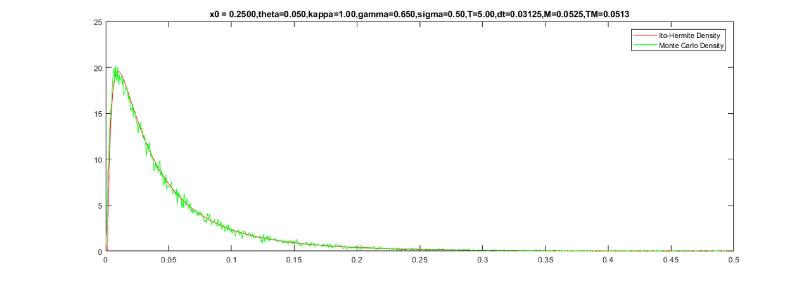](https://postimg.cc/Lh3m7Sth)

---

[← Previous](page_025.md) | [Index](index.md) | [Next →](page_027.md)
