# Breakthrough in the theory of stochastic differential equations and their simulation

**Page 27 of 59** — Posts #1301–#1350

[← Previous](page_026.md) | [Index](index.md) | [Next →](page_028.md)

---

### #1301 — Amin (Topic Author)
*December 8, 2021, 4:30 PM*

>
> Friends, very sorry for delay in the new program that works somewhat better close to zero. I am copying the condition
I have imposed on coefficients from my matlab program.
>
>
>
> for nn=1:ExpnOrder-1
>
>     if(abs(a(nn+1))>abs(a(nn))*2^(-nn+1))
>
>         a(nn+1)=sign(a(nn+1))*abs(a(nn))*2^(-nn+1);
>
>     end
>
> end
>
>
>
> here a(nn) is nn'th coefficient of power series that multiplies  Z^nn, Please feel free to play around with this
growth restriction on absolute value of the coefficients.
Please also try a related growth condition given as

if(abs(a(nn+1))>abs(a(nn))*2^(-nn/2))

        a(nn+1)=sign(a(nn+1))*abs(a(nn))*2^(-nn/2);

  end

---

### #1302 — Amin (Topic Author)
*December 9, 2021, 11:18 AM*

Friends, Mind control agencies have been incessantly trying to control me since my last few days at Kot Addu more than a
week ago. Whenever I am creative, it starts to ring bells in minds of people who want to fail me and they become active
again to persecute me. And mind control officials who want to enter Jewish Godfather's paradise start a new round of
extreme persecution.

Today I was hit again when I had a sting (which is a cheap energy drink) from Model Town and my condition remains
deteriorating after that. They forced feeling of anxiety on me after I took the drink and highly increased my back ache.
I have constant and increasing back ache for past 3-4 days which is caused since they pull neurotransmitters out of my
brain.

Everyday since past several months, they cause dryness in my mouth when I sleep and something settles on upper part of
my tongue and my upper jaw. When I wash my mouth with water, very large amount of foam comes out. I wash my mouth 2-4
times every night when I wake up during sleep.

Every time I sit in my car, they charge my head and face and I remain lightly tense after that. However when I wash my
head and face after getting out of my car or after I return home, all of a sudden I feel fresh and lively again.

They also continue to release similar gas from time to time in my room to charge my face, head, nose and inside of my
mouth. When I breath in gas that is when my nose and inside of my mouth gets charged.

I want to request friends to please help end my persecution since it never ends and continues to increase every day now.

---

### #1303 — Amin (Topic Author)
*December 9, 2021, 3:17 PM*

Friends, I had a sleep after writing the previous post and felt a bit better and was able to do some work.

Tomorrow I intend to write a post with the equations for solution of constant CDF lines of dz-integrals and dt-integrals
of functions of SDE through their fokker-planck equation overlaid on the fokker-planck  equation of original SDE. Both
fokker-planck equations are related by a common Z and we can solve the dependent fokker-planck equation of dz-integrals
and dt-integrals  after solving the FP equation of independent SDE. I am working out the details and will try to share
it with a nice post in the form of equations tomorrow. Though a worked out program might be about a week away.

---

### #1304 — Amin (Topic Author)
*December 10, 2021, 1:43 PM*

Friends we will try to find out how to find the series expansion and density of dt-integrals.

Suppose we are given an SDE of the form in bessel coordinates

$dw(t) \, = \, \mu(w) \, dt + \sigma_0 \,dz(t)$

please note that bessel transformation is given as $w(t)=\frac{{X(t)}^{(1-\gamma)}}{(1-\gamma)}$

So if our path integral in original coordinates is given by integral $\int_0^T \, X(t)^{\alpha} \, dt$

this integral in bessel coordinates would be given as
$\int_0^T \, \big[(1-\gamma) \, w(t) \big]^{\frac{\alpha}{(1-\gamma)}} \, dt$

We suppose $f_w(t)=\big[(1-\gamma) \, w(t) \big]^{\frac{\alpha}{(1-\gamma)}}$

and we want to find the integral  $\int_0^T \, f_w(t) \, dt$

We know that  $d\big[t \, f_w(t)]=\, t \, df_w(t) \, + \, f_w(t) \, dt$

giving us the formula  $ \, f_w(t) \, dt \, =\, d\big[t \, f_w(t)]\,-  t \, df_w(t) \, $

We know that $ t \, df_w(t) \,=\, t\, \mu_f(w) \, dt \,+\, t\, \sigma_f(w) \, dz(t) \, $

We introduce another function $dg_w(t)\, =\, t \, df_w(t) \,=\, t\, \mu_f(w) \, dt \,+\, t\, \sigma_f(w) \, dz(t) \,$

Since  $ \, f_w(t) \, dt \, =\, d\big[t \, f_w(t)]\,-  t \, df_w(t) \, $

It can be written as  $ \, f_w(t) \, dt \, =\, d\big[t \, f_w(t)]\,-  \, dg_w(t)\, \, $

Taking integral on the above formula, we get
$\int_0^T \, f_w(t) \, dt \, =\, \int_0^T\, d\big[t \, f_w(t)]\,-\, \int_0^T \, dg_w(t)\, \, $

$=\int_0^T \, f_w(t) \, dt \, =\, T \, f_w(T)\,-\, \int_0^T \, dg_w(t)\, \, $

The value of term$\, T \, f_w(T)\,$ can be found directly from the transformation of solution of the original
fokker-planck equation. It will be a power series in terms of Z in our case. We can write the fokker-planck equation of
$g_w(t)\,$ and once we solve this fokker-planck equation overlaid on the Fokker-planck equation of$w(t)$ , we would be
able to find the series solution in terms of Z given by the equation

$\int_0^T \, f_w(t) \, dt \, =\, T \, f_w(T)\,-\,  \, g_w(T)\, -\, g_w(0)$

The above equation will be an expression in terms of a series in Z and for that we would have to solve the dependent
fokker-planck equation of$g_w(t)$ .$g_w(0)$ in above equation would usually be zero.

The above equation could also be written for a small step as

$\int_{t_1}^{t_2} \, f_w(t) \, dt \, =\, t_2 \, f_w(t_2)\,- \, t_1 \, f_w(t_1)\, + \, g_w(t_2)\, -\, g_w(t_1)$

In next post, I will write equations that I have used to solve the fokker-planck equation of$g_w(t)$ overlaid on
fokker-planck equation of$w(t)$

---

### #1305 — Amin (Topic Author)
*December 10, 2021, 2:51 PM*

In previous post, we introduced a function by its differential equation as

$dg_w(t)\, =\, t \, df_w(t) \,=\, t\, \mu_f(w) \, dt \,+\, t\, \sigma_f(w) \, dz(t) \,$

it is$g_w(t)$ whose overlaid fokker-planck we want to find out. In some equations that follow, I have simply written$g$
instead of$g_w$ .

We write this fokker-planck equation as

$\frac{\partial P(g_w,t)}{\partial t} = -\frac{\partial \big[t \, \mu_f(w) \, P(g_w,t) \big]}{\partial g}\, +.5 \, \frac{\partial^2 \big[t^2 \, {\sigma_f(w)}^2 \, P(g_w,t) \big]}{\partial g^2}$

To find out the constant CDF lines of the above equation, We follow the steps given in the post https://forum.wilmott.com/viewtopic.php?f=4&t=99702&start=1200#p867718

After appropriate manipulations, we get the solution of above equation as

$  \frac{\partial g_b}{\partial t} =t \mu_f(w_b) - .5 \,  t^2 \, \frac{\partial \big[{\sigma_f(w_b)}^2 \big]}{\partial g}+ .5\, \, t^2 \,{\sigma_f(w_b)}^2 \, Z_b \, \frac{\partial Z}{\partial g} + \, .5\, t^2 \, {\sigma_f(w_b)}^2 \, {(\frac{\partial Z}{\partial g})}^2 \frac{\partial^2 g}{\partial Z^2}  $

In the above equation suffix b means that this equation is valid for moving along a particular CDF line or equivalently
by a particular value of Z indicated by$Z_b$

When finding out the series solution of$g_w(t)$ we would have to copy the power series (in terms of Z) of$\mu_f(w)$ and
$\sigma_f(w)$ from the fokker-planck of original SDE w(t) at every step in time and apply it to dependent fokker-planck
of$g_w(t)$ . This is done at median of both fokker-planck equations.

Another problem is that we need to find the derivative$ \, \frac{\partial \big[{\sigma_f(w_b)}^2 \big]}{\partial g}$
which is not straightforward since${\sigma_f(w_b)}$ is not in terms of g. We would have to calculate this derivative
with chain rule as

$ \, \frac{\partial \big[{\sigma_f(w_b)}^2 \big]}{\partial g} \,= \, \frac{\partial \big[{\sigma_f(w_b)}^2 \big]}{\partial w} \, \frac{\partial w}{\partial Z} \,  \frac{\partial Z}{\partial g}$

please note the in above equation all of the three terms$\frac{\partial \big[{\sigma_f(w_b)}^2 \big]}{\partial w}$ ,
$\frac{\partial w}{\partial Z}$ ,$\frac{\partial Z}{\partial g}$ would be different power series in Z evaluated at
median Z=0. The first two terms would be calculated at median of base fokker-planck equation and last third term would
be calculated at median of dependent fokker-planck equation.

So in order to solve the overlaid fokker-planck equations in a power series, all we need to do is copy the series of
w-terms (that are expressions in w) from their power series at median from the original fokker-planck equation and plug
them in the dependent fokker-planck equation at median. We will also use chain rule to convert the derivatives of these
w-terms with respect to$g_w$ and all involved terms are expressed as power-series in Z and are calculated at median of
the both fokker-planck equations.

I have not yet calculated 2nd order expansion of the fokker-planck in terms of a Z power series. In next few days I will
be working on this equation and code it in matlab and post the matlab program here.

---

### #1306 — Amin (Topic Author)
*December 11, 2021, 2:35 AM*

Friends my persecution never ends. Things were still better when I had not presented the series solution to densities of
SDEs. Since there has been a marked increase in my persecution activity,  I am copying my older post to present my view
to friends and request them deeply for help.

Before writing this post, I want to apologize to good jews but want to tell them there are enough evil jews who are
doing every thing to tarnish the great goodwill jews have so rightly earned through generations of hard work and being
nice and kind to other people in the society. I want to request good jews to Please force these evil(jewish) people to
end the bad practices that are starting to take root in American and other societies on their behest and before it is
too late. I also really hope that my mind control would finally end(as I have been begging for past twenty years) and I
would never have to write a post like this again.

Friends I have been writing on this forum since its very starting years. And a lot of people people know me from very early years also because I had another web site LIBOR Market Model web that hosted almost all the papers (more than 40-50) about the then cutting edge LIBOR market model and people freely downloaded papers and code from my web site. I continued to mention about my mind control persecution from time to time but only started writing regularly about it when I arrived in UK on a Highly Skilled Migrant work visa. Mind control agencies did everything in their power to fail me in UK. People were asked to not give me a job. People I contacted were routinely told brazen lies about me totally shamelessly. When I realized that I had no future in UK, I returned to Pakistan after a six month stint in UK. Since my hard earned money had thoroughly insulted mind control infrastructure in UK as they had to drug entire cities with mind control chemicals in UK (read briefly about it in my application to HRW below) for a nobody like me and American government had to move all their grand and influential puppets in UK (again for a nobody like me) to force people to drug the manufactured food. British Banks went to the extent to steal my money to bleed me. Read here: https://forum.wilmott.com/viewtopic.php?f=15&t=102298#p857494. British police forcefully stopped me from seeing law firms(Brief details are given in my application to HRW attached as a link below).  Since my money had given mind control agencies a very tough time, mind control agencies decided to never let me make significant money after that. My old Japanese employer was told to not hire me after I returned to Pakistan. Whoever I would contact someone in Europe for job or consulting, mind control agencies would move American embassy infrastructure in that country and somebody highly influential (or army or secret services of that particular country)  in that particular country would approach my target employer and again brazen lies and fabricated stories would be told about me shamelessly. I am a fighter in life and I continued my research despite all economic, coercive and other hardships. All odds were against me but I tried my best to continue.  I have been presenting my research to friends on this forum for past five or six years. At this point, I want to request good American and friends from other countries who have come to know me through my research to please use their influence to end my mind control forever.

Since things might heat up after my writing this and my persecution might increase, I want to ask European embassies in
Pakistan to keep a vigil. I want to tell Europeans that my writing about mind control is in their great interest since
the very same people who instigate retarding of intelligent muslims are behind retarding of dozens of intelligent
europeans and once these people are exposed I am sure they will be far more careful in openly retarding European
talent(that they do not like).

I had told friends earlier that a jewish billionaire is Godfather of mind control. When my persecution started (in late
1997) at the university in New York which is a big time player in mind control of Muslims, blacks and foreigners, many
university officials were very pleased that they were getting written in good books of the billionaire jewish Godfather.
Though there are far richer billionaires in US who are staunchly opposed to mind control, they are not ready to shell
out hundreds of millions of dollars to bribe anyone to end mind control while mind control Godfather  continues to give
large bribes to people to continue mind control. Many of the people related to defense in mind control are given
extremely high paying jobs in Godfather and his other jewish friends' companies after they retire from mind control and
Godfather is extremely generous towards them and it is well established and well known to people in mind control that
after retarding muslims, blacks and others in their career, they will move to paradise after they retire. No wonder
there is no let up in mind control whatever good people try.

We know in almost all classic folk lore stories evil is too strong and too sure of itself while good is mostly weak and
just trying to protect itself from evil who is bent on damaging and eradicating the weak and the poor good but it is the
weak and poor good that finally prevails. I want to tell good American friends that evil at this stage has become too
bold and thousands of talented people are retarded every year. And it is just not muslims and blacks that are on the
line, several hundreds of brilliant whites are retarded across United States by mind control agency every year that has
become too emboldened due to lack of any accountability. Thousands of foreigners are also kept retarded in dozens of
countries including many European countries.

My only intention behind this post is that I want mind control to end from our societies. I do not have any joy in
mentioning that there are some bad jewish actors behind it. In American society there are a large number of jews who
have excelled in the professions of science, education, medicine and have made great contributions to our societies.
There are a very large number of jewish professors each of whom would have taught tens of thousands of students on top
of making extraordinary contributions to body of human knowledge through their great research. Then there are
accomplished jewish scientists whose work, research and inventions make our everyday life better. There are great jewish
doctors and surgeons who would treat countless sick people and make them recover from disease. The list of contributions
of jewish people to humanity is very long and it continues. Then there are a large number of ordinary jewish folks who
are known for their goodness and civility to other people in the society. When we know all of this, we do not want to
say anything anti-jewish to hurt the feelings of so many good jewish people. But I still have to say there are really
some bad people who are unconnected with most of the nice and accomplished jews and they instigate and continue cruel
mind control torture on talented people of other ethnicities, religions and countries based on their personal dislike
and hatred. My purpose is only to end the mind control victimization and torture on otherwise nice and talented people
and I do not have any hidden intentions beyond that. And I am sure American society knows very well about the
contributions of good Jews to both their country and broader humanity and my exposing some bad actors would never have
any bad effect of any kind on these good and nice jews who we all respect and who are our role models.I want to tell
friends something I have said before here that I am sure American society would eventually end the menace of mind
control from their and other countries. I want to request all good Americans and Europeans to come forward and invite
any investigative journalist you know to read my threads and ask them to help end the menace of mind control in our
societies through their investigative journalism. Without any accountability evil will continue to grow stronger and
then mind control would start to threaten even those people who consider themselves safe due to affiliations, status or
wealth.

I want to request CNN, New York Times, Washington Post and large reputed European media outlets to run a comprehensive
story on mind control torture, retarding and victimization of intelligent people of US and other nations by crooks in US
army on behest of some powerful people in United States and due to rightwing extremist biases of these crooks. If you
would like to do investigative research about animal practices of US army, one great resource would be mainland European
embassies in Muslim countries who keep a detailed account of mind control persecution of intelligent muslims in these
countries by crooks in US army. Many of the staff in mainland European embassies are very good human beings who abhor
such practices and would love to cooperate with good journalists in exposing the evil animal practices of US army
crooks. Only the accounts of people at mainland European embassies in muslim countries thorough animal practices of
American army's mind control wing would be enough to drop a great bombshell in the media and general public all across
the world. I want to warn all the good people who try to have a civilized dialogue with crooks in American army to end
their evil practices that their being nice with crooks is a very misguided approach. Since good people do not have the
power to forcefully end the evil practices of US army crooks, only way to end the evil practices of US army crooks is by
exposing them openly in US public and all across the world.

It seems that crooks in American army and mind control  are unable to pay a heed to civilized calls by good American
people and others to end their animal cruel practices and remain bent on mischief. If crooks in American army and mind
control remain adamant on continuing evil practices, the only solution seems that some brave investigative journalists
expose them by running a comprehensive story on mind control practices by American army. It seems that doing a civilized
dialogue with hardened crooks in mind control gives them a strong sense of weakness of good people and makes the crooks
even more adamant to continue their evil practices.  Reminds me of  Abu-Gharib. Very similarly, Crooks in defense had no
conception that they were doing any wrong thing when there was a culture of openly urinating on human captives. It was
an open thing in army and most crooks thought it was indeed a very right thing to do( and I am sure some of those crooks
still believe that it was a right thing they did even after being reprimanded by the broader American society). It was
not until brave people at CNN did a daring story against animal practices by crooks that evil practices stopped. Though
American army crooks retard intelligent people of all color and creed, these ultra right wing army crooks love to retard
blacks and muslims with great relish. Blacks are only 8-10% of US population but make a very large proportion of victims
in united states since many ultra right wing crooks in US army would rather die than let those intelligent blacks
succeed in American society in a big way.

For the context of my persecution, please see

In this thread I have given some account of my persecution spread over past 23 years.

[My Letter to HRW About My Human Rights Abuse](https://forum.wilmott.com/viewtopic.php?f=15&t=102298) : [https://forum.wilmott.com/viewtopic.php?f=15&t=102298](http://https//forum.wilmott.com/viewtopic.php?f=15&t=102298)

In the thread below I have given some discrete hints about why American defense is so rabid to persecute me and other
muslims like me(and blacks) (and why no president finds it politically expedient to end mind control on innocent human
beings.)

[Muslims, mind control, Muslim-Jewish relationship and American defense](https://forum.wilmott.com/viewtopic.php?f=15&t=101453): https://forum.wilmott.com/viewtopic.php?f=15&t=101453

In the thread below I tried in vain to request prime minister of my country to end mind control here but he is helpless
before crook generals in Pakistan army who take hundreds of millions of dollars in bribes from CIA.

[My Open Letter to Prime Minister of Pakistan, Imran Khan, to Intervene In Order to Protect the Interests of Pakistan](https://forum.wilmott.com/viewtopic.php?f=15&t=94796&start=1125#p858119)  https://forum.wilmott.com/viewtopic.php?f=15&t=94796&start=1125#p858119

I want to end this post by re-iterating my apology to good jews but want to say again there are enough evil jews who are
doing every thing to tarnish the great goodwill jews have so rightly earned through generations of hard work and being
nice and kind to other people in the society. I want to request good jews to Please force these evil(jewish) people to
end the bad practices that are starting to take root in American and other societies on their behest and before it is
too late.

This is another post I am copying from before for reference of friends.

Thank you Paul for your post. I will look at the website you mentioned. But I want to really thank you for letting me
write bold things on your forum that most forum owners would not allow. Though I might have different ideas than you on
a lot of issues, I am a staunch supporter of freedom of speech just like you are and I am sure both of us agree on one
slogan,"Je suis Charlie". I consider myself lucky to have been writing on your forum since 2003.

I want to write this post to ask American tax payers to please cut funding of crooks in US army. I was reading that
there has not been a successful audit of spending by US army in past decade. You would probably ask me why you should do
anything to bridle spending by crooks in army. Here is why.

Crooks in US defense have spent several billion dollars in attempts to retard me over past twenty years. I went to Hong
Kong in 2000 to find a job in finance and derivatives and I stayed there for three months. Crooks in US army continues
to drug food and water at large number of places in Hong Kong and Kowloon and continued to play all sort of tricks with
me. I still recall when I went to office of South China Morning Post to tell them how badly they had drugged the city of
Hong Kong, they had already set up someone who received me and told me after hearing my story that he did not believe
me.

They gave me electric shocks twenty days after I returned from Hong Kong.

Later I was asked by my Japanese employer to come to Tokyo (2005) and work in their office there(I was earlier working
from Lahore). They drugged large number of places in Tokyo city and mad e my life absolute hell and I resigned only
after one month of stay in Tokyo. I did not want to return to Pakistan due to huge persecution by my family and the army
so I decided to go somewhere where US military could not go and got Iranian visit visa from Tokyo and went to Tehran.

Crooks in US defense gave huge amount of money to Iranian crooks(crooks everywhere know each other well) and they used
huge microwave and gases torture on me. I still recall on my first night in an Iranian hotel, I left the hotel after
midnight and randomly ran in streets of Tehran to somehow avoid pain due to directed microwave torture. Just after two
or three days in Tehran, I was trying to find refuge in embassies like Vatican in Tehran asking them to help me on human
grounds. I left Tehran after one week and flew back to Pakistan. I still recall that I arrived at Tehran airport a lot
earlier than flight departure. I had previously protested somewhere against unnecessary removal of shoes of Muslim
passengers and it was known to mind control agencies. They asked Iranians security on airport who approached me inside
the departure lounge and took me to a room and asked me to remove my shoes and had my body search.

Since during all this, mind control agencies could not control me well and several of my neurotransmitters were coming
back, they had extremely huge amount of gases in washrooms in Dubai airport where I would stop for transit while going
to Karachi. No wonder ultra conservative crooks in US army align so well with Saudi(who dissolve their criticizers in
acid) and Dubai.

Later I got British HSMP work visa and went to London in 2010. Crooks in US defense drugged several large cities of UK
on a large scale(it was impossible to get good beverages or bottled water. They even drugged beer, wine and pork at a
lot of places.) You can ask people in UK secret services(many of whom would love to tell you everything in detail) about
supernatural stories how they drugged food in cities of UK in 2010. I still recall that I wrote several page account of
my persecution and I would print hundred of copies of it and distribute them in London. When I was distributing those
papers outside of some London Newspapers, administration of those newspapers went to extreme length to point out that
certain part of sidewalk was their property and they would call police if I stepped there. I was forcefully removed from
the compound in London(after I had passed all security checks) when I went there to ask law firms for help and the law
firms on main street would refuse to meet me and say that I had to either email or send the letter by post and they
would not accept any papers from me(somebody would approach me at the door and tell me about it and ask me to leave.).

They continued to drug food and beverages in entire city of Lahore numerous times in past ten years.

Net worth of several mind control agents who continued to retard me in Pakistan is north of several hundred million
dollars each depending upon their seniority(with most senior agent worth 800 million USD).

And this drugging of entire cities by crooks of US defense never ends. Now they are drugging the twin cities of
Rawalpindi/Islamabad.

I am just telling about myself. There are tens of thousands of mind control victims all over the world.

Please cut their funding before it is too late. They are not retarding just Muslims(I have no religion but of course I
am Muslim by birth) only, they retard a large number of totally innocent and talented Americans. Crooks love to bite the
same hand that feeds them(It is typical of crooks and large unbridled armies in human history)

---

### #1307 — Amin (Topic Author)
*December 11, 2021, 7:03 AM*

I am writing another post today to request people to help me against abuse by psychiatrists who have been bribed to
detain and declare healthy persons as mentally ill. American mind control agencies open the gates of their treasury to
bribe psychiatrists and other influential people in our poor countries. Here I have written about my treatment by a
psychiatrist who was bribed by mind control agencies to maltreat and abuse me.

I am recalling my experience with another psychiatrist I saw in April 2015. It was a lady psychiatrist and she had her
clinic in garden town, Lahore. At that time my family was being very restless and I was afraid that they would detain me
again. I went to this psychiatrist myself. I did not know about her at all but passed on the road outside her clinic and
noticed the board that it was a psychiatrist clinic and decided to see her. It was already evening and I parked my car
and waited to meet her after an hour or so. It was probably 13th or 14th of April, 2015. I met the lady psychiatrist and
told her that I was perfectly fine but my family insisted that I was mentally sick so she should make an assessment if I
was fine or not and then tell my family to not overly worry. She interviewed me and told me that she thought I was
perfectly fine but she needed to talk to my family and she gave me an appointment to visit her again on 20th of April,
2015. I took my mother to visit her on 20th April, 2015 and she interviewed us together. My mother really had no
argument at all but the psychiatrist said that she was not sure to make a diagnosis and she wanted to see me again on
27th of April. Another thing I noticed in this meeting that psychiatrist's husband who was a high level official in
police was also present in our meeting and there were actually four people in the room including me, my mother, the lady
psychiatrist and her husband. Her husband came when I paid her the visit and left after that. I came to know that it was
her husband as there was a large framed picture of the same guy in her office. Later I realized that her husband was
present in the meeting to help her make the assessment how to deal with me and he must have realized in the meeting that
I was a nice guy who could never do anything against her even if she maltreated me and showed professional dishonesty.

When I took my mother again to see the lady psychiatrist on 27th of April as she had instructed, I was sitting in the
sofa in the waiting room and five people came into the waiting room and started beating me. I was sitting in the sofa so
only my head and neck was exposed and they gave me slaps and blows continuously for more than 15 minutes. Then they tied
my hands and legs in the waiting room and lifted me to another patient's room and put me on a bed and kept my hands and
legs tied for more than one hour. And then another nightmare started. I have some posts from that time on the same
thread and I will copy them for the friends here.

The following are slightly disarranged notes that I made on my computer while I was in detention by the lady psychiatrist just so that I could recall things later. These are from the post# 344 you can view here https://forum.wilmott.com/viewtopic.php?f=15&t=94796&start=330#p749623

These notes are not very well composed and the formatting is lost but they are still very easily understandable if
friends carefully read them. These are slightly disarranged notes for first two days. When I made the post below on
April 30, 2015, they took my USB after that from me and I was asked to not write on internet and I was unable to post on
internet. I was only able to post on internet after more than three weeks when I was able to leave the detention and
that is when I made a more detailed post which is shown below after this post.

Please note that the "Diary" below was probably written two days after my detention started, probably on 29th April 2105
as I could recall, and it does not describe the beating(that had occured two days ago) in detail which I described in
the later post. Please note the last sentence of the diary as

> At many times during the day, I could barely walk and had extreme difficulty speaking.
Please read the post # 344 below with the link given two paragraphs earlier.

>
> My Diary for Past two days4/27/2015I had two sessions with the doctor N previously on the 29th of April and once
before at 13 or 14 th of April. I remained away from home during this time and second meeting on 20thth of April,
evening after the night when I remained away from home. I had told the doctor about my circumstances in the first
meeting with her. She had said that I looked perfectly fine mentally but she needed to talk to my family. On 20th of
April, I took my mother for a second joint session of myself and my and the psychiatrist said, after the meeting, that
 said she really could not call me schizophrenic but she needed one more session and asked me to come to her facility on
27th of April.  When I arrived at the psychiatric facility,  a psychologist had asked me to accompany her which I did
and on the way to the her room, I asked for the reason, after which she replied that she wanted to take a session of
mine. I told her that I already had a session with another psychologist and also with a psychiatrist so I would prefer
to have a new session with the psychiatrist now. She agreed and I returned to the waiting room. I was sitting on a sofa
in the waiting room on 27th at 8:00 PM (PST) in the line to see the psychiatrist when about five guards took control of
me, while I was sitting on a sofa in the waiting room to see the doctor, and gave me an injection. I was beaten and my
legs and hands were very strictly tied for more than hour. Though the doctor was in her consultation room and a lot of
people were waiting to see her, I was told again and again that doctor was not present at the facility.In the previous
two sessions, she had given the impression I was healthy mentally but she used force without interviewing for the third
time or seeing me and without requests to comply. If she was given any special information, she should have talked to me
about it and she should have verified with me any change in circumstances.One injection was given around 8 PM when I
arrived for third session with the doctor N. I really think that the doctor was there since  there was a large rush of
visitors and her SUV was parked in the hospital but everybody among the staff continued to say that doctor did not come
to the facility this evening.I was kept tied for more than one hour. I was taken tied from the waiting room to my room.
All these rooms have video cameras so you can ask Dr. N for a video of the events though she might make the excuse that
cameras were not working. One of the staff had mentioned when they brought me into a patient room in the facility, that
everything was watched by cameras.I would request people familiar with the matter to request her to show them footage of
the cameras. Of course, there  could be many excuses that cameras were not working but I insist that cameras were
working. Good Mental health facilities try to avoid treating humans like this.Another injection was given at night
before I slept. and my internet USB device was also taken. They simply took possession of everything out of my pockets
and also took my laptop.When I asked why they gave me injections, one of the staff told me you were ?hyper? and I was
totally surprised since I was quietly sitting on the sofa in the waiting lounge for the doctor. I was told that I would
stay in the hospital for three days. I am sure this matter can be resolved who is lying and who is truthful once you
look apt video  footage of cameras in most rooms.4/28/2015One injection was given in the morning. One injection was
given  around noon. All injections were IM (given in the muscle.)Unknown pills(some pills in the morning +5 pills around
noon  + 3 pills  at night) were given and I was told,? We will tell you know the names of these pills only when you
leave.?Computer was returned today but I was told that we did not take your mobile and they continued to say we never
took my mobile. My mobile was never returned( despite I always keep my mobile on me.) I was also not given my EVO USB
device and I was told you cannot write anything on internet. However the USB device was returned to my mother at night.I
was told today by the psychologist that doctor N had gone to America and will come back after seven days and only then
she would be able to see you.  I was told we are adjusting your medicine and see what was a good medicine.  I was told
they were discussing the drugs with her on phone and skype There were several conflicting statements about where Dr. N
was. Somebody said she was just out of city and had gone to Islamabad.When I asked my mother who is living with me at
the hospital,  I wanted a second opinion, because of beating and other irresponsible behavior of the psychiatrist, my
mother would make all sort of excuses while the staff would  say that you cannot leave the hospital until Dr. N arrives
who is currently out of country.Earlier today, I was told that I would live at the hospital for fifteen days and later I
was told that I would live at the facility for seven days. When I was tied, somebody had told me that I would live in
the hospital for three days only.My mother told me please do not write anything wrong on internet otherwise, they would
take your USB forcefully like Dr. A had done more than one year ago. The purpose was to threaten me to not write about
any maltreatment so that the doctor would continue to freely manipulate me.7-8 pills wer given in the afternoon and
similar number of pills were given at night.  At many times during the day, I could barely walk and had extreme
difficulty speaking.
>
.

.

There is another post I made a few weeks later on May 25, 2015 when I had been discharged from the hospital in which I
described the beating in more detail as the earlier notes were meant only that I could recall events in case something
happens to my memory. Again I was unable to make any post in detention because my USB was taken and I was told
explicitly to not write on internet ever about this. Here is the second post I made about the treatment with the same
lady psychiatrist in which I described the beating and other things in more detail..

I have copied the post# 349 below written on May 25, 2015.

[forum.wilmott.com/viewtopic.php?f=15&t=94796&start=345#p751698](https://forum.wilmott.com/forum.wilmott.com/viewtopic.php?f=15&t=94796&start=345#p751698)

.

>
> When I went to psychiatrist N's psychiatric facility on 27th April, I was sitting at the sofa and was waiting for the
meeting with the psychiatrist N. About six people came to me and forcefully gave me an injection and starting beating
me. They literally continued to beat me and I continued to beg them to stop. They were very violent with all sort of
slaps and blows on my face as I was sitting and they were standing. The beating lasted for more than twenty minutes and
then they tied my hands and legs very tightly and put me on a bed and gave me another injection. I continued to ask them
to loosen the knots but they continued to make fun of me. I was totally surprised since Dr. N had behaved very nicely in
the previous meeting held at 20th with my mother and myself and I was sure she would declare me mentally sane on this
meeting. After I was kept tied for about half an hour, a new guard came and opened my hands and legs and said that they
would keep me at the facility for three days. The next day my medication in the form of pills started and I was also
given two more injections. I was given about nine pills at night and about eight pills in the morning. I was still not
given the opportunity to meet the psychiatrist N, and I was told several different things by different people including
that psychiatrist N had gone to America, and she had gone to Islamabad. About three days into my treatment, I saw
through the glass walls that psychiatrist N was interviewing her clients in her office. When I mentioned it to the
staff, I was surprised that next day psychiatrist N had the glass walls treated and it was made dull so nobody could see
through the glass but psychiatrist N still did not see me. After seven days, I was asked to meet psychiatrist N, and she
said that she was unaware of the beating as she was in a meeting something that nobody could ever believe in their
wildest imaginative parts of the brain. Psychiatrist N also assured me that I had no schizophrenia but it was a case of
some mania. I was very surprised since I was not doing anything including my work very seriously in those days. I was
just haphazardly devoting time to various activities. I am also known as the coldest person in house and I also have
good relations with everyone while everyone else has some serious fights with others in our family. Psychiatrist N had
to concoct some excuses to give me very large doses of medicine. Her staff continued to say that we are giving you drugs
so that the effect of other drugs given to you by previous psychiatrists decreases while psychiatrist N had prescribed
more antipsychotics of any other doctor I ever had before. I would write the details of drugs in a later post.Another
acute problem I am facing is that my computers were taken in custody by the psychiatrist N?s staff and the computers
that were working better with less gadgets on them remained in custody and they installed more devices on them to change
my work and create problems for my research. I would request Americans that I have been sharing my research with
everyone previously and I could have made large money out of some of that research but I still decided to distribute
everything freely and this was the case even ten years ago when I had made Libor Market Model web and I had freely
distributed my programs. I would request Americans to press upon their government to not change my programs and let me
continue with my research. This is one activity that I would request Americans to ask their government to refrain from.
If any American could help me with this, I would be very thankful to them and consider it their great deed for me. I
would request American government again to not change my programs in anyway. I will be thankful to you guys if you could
do this for me.They also continue to use gases on me and the gases settle on the body and when I Take a shower almost
everyday, the water that comes off the body is dark black. I would again request Americans to ask their government to
avoid the use of gases and let me live a natural life as a human. Again I will make this appeal to Americans, I am not a
bad human and I do not wish anything wrong to your nation. I have used very different language here but that is mainly
because I started to lose control after sixteen years of persecution. For about ten years into my persecution, I had not
even told people at Wilmott about my persecution at all and I just thought that this bad patch of my life would simply
just pass away. Most good humans would realize that this is not the fate of any human(especially the good ones) to be
treated like this ever. Please help stop this activity if you can.
>
.

Here I copy last few lines from the above post.

.

>  I would again request Americans to ask their government to avoid the use of gases and let me live a natural life as a
human. Again I will make this appeal to Americans, I am not a bad human and I do not wish anything wrong to your nation.
I have used very different language here but that is mainly because I started to lose control after sixteen years of
persecution. For about ten years into my persecution, I had not even told people at Wilmott about my persecution at all
and I just thought that this bad patch of my life would simply just pass away. Most good humans would realize that this
is not the fate of any human(especially the good ones) to be treated like this ever. Please help stop this activity if
you can.
.

Five years ago, I was begging for help. Today I am begging for help again. I really request good Americans to do
something to end my persecution and mind control. I really hope that good American people have enough humanity to
protest to their government to finally stop this inhuman torture on me that is repeated every year again and again for
past twenty years.

---

### #1308 — Amin (Topic Author)
*December 11, 2021, 8:04 AM*

Here I will tell friends about how I was detained in 2016 by a psychiatrist. I have been detained by many other
psychiatrists over totally flimsy excuses. And this frequency to detain me increased remarkably as I became somewhat
more creative over the years.

Post 459: Sun May 29, 2016 9:05 pm

> **Amin:**This evening when I returned to my home from the office, there were three people from a psychiatrist facility
already waiting for me. I was totally shocked since my family had mentioned no such intentions at all.The three staff
took me with them to the psychiatrist Dr. A of facility called P in Gulberg. where I was interviewed by the
psychiatrist. After a quite long interview the psychiatrist said that I was in the residual phase where there were still
no symptoms of schizophrenia but it would surely come back. He said that patients of paranoid schizophrenia never
recover unless they recover in the first two years of treatment. He said that symptoms had not appeared but he really
had to take some action and he had to give me a small continuous dose of anti-psychotics. He has detained me on his
psychiatric health facility.  I continued to argue that I could periodically visit him so if the symptoms ever appear, I
could start taking medication but he refused and insisted that I must be detained and anti-psychotics must be given to
me.I kept my computer with me so I am able to post on internet. If I am unable to post for a few days, it would mean
that my computer has been snatched from me.
.

Here is the next post 460: Mon May 30, 2016 1:23 am

.
> **Amin:**I had asked the Doctor to make a written diagnosis of my case. He wrote the following three points.
>
> Paranoid Schizophrenia.
>
> 1. Taping doors, vents, shank, washroom.
>
> 2. Prefer eating from outside with reasoning that home food makes him fatter while food from outside has caused
significant weight gain.
>
> 3. Safeguarding water bottles as if someone will pollute/mix  something/medicine in water.
>
> I will explain my point of view here for his diagnosis, point by point.
>
> 1. Taping doors, vents, shank, washroom.doors:
>
> I do apply a small amount of paper tape to both doors of the room when I sleep since the locks can be opened from
outside. There is no special worry just that I really want to be aware if anything wrong ever happens.
>
> vents:I taped airconditioner air outlet when it was winters more than six months ago. Some tape came off after a few
days. Most tape came off after two weeks and the outlet was open again. I did not tape it again. If it is schizophrenia,
I would be taping it many times a day. I just taped it once more than six months ago and the doctor considers it as an
evidence of schizophrenia. This was a one time incident more than six months ago.
>
> Shank: I also applied two inches of tape on two holes close to top of the basin. It was also more than six months ago.
The tape stayed and I never cared after that. Doctor cites it as an evidence of schizophrenia.This was a one time
incident more than six months ago.
>
> Washroom:
>
> I never applied tape on the washroom doors. I did tape the shank/wash basin as I mentioned in the above but there was
never tape on the washroom door. Doctor hastily added it to fabricate more substance since there was reference to tape
on shank/wash basin.
>
> 2. Prefer eating from outside with reasoning that home food makes him fatter while food from outside has caused
significant weight gain.
>
> My weight actually increased significantly due to anti-psychotics that were given to me more than six months earlier.
When I left anti-psychotics, the weight might have slightly increased but most increase was due to anti-psychotics.I
mentioned that I do eat from home once a week. But doctor thought that I was violating the society norm in which we
should eat at home.
>
> 3. Safeguarding water bottles as if someone will pollute/mix  something/medicine in water.
>
> This is based on my mother's statement of a single incident that a few days ago, I stopped her from entering my room.
There was no mention of water but she said she thought that must be the reason. I had not alluded to water and it was
her reasoning. I did stop her from entering my room but she made up her reasoning that I was thinking that she would do
any harm to water. I really had no such thought at all. This stopping her from entering the room was just one time
incident and never a repetition. There has never been any other incident with my family when I would stop them from
entering my room. Doctor cited this one time incident as evidence of schizophrenia.
>
> Everybody in my family and people around agree that I do everything perfectly normally. I do not get angry at all. I
am very very rarely if ever upset with any one and I cannot recall any incident of the sort in past few years. I am
totally composed most of the times and make perfectly rational decisions and talk perfect sense.  In past ten years, I
never had a fight with anyone.
.

In the above post and in the post below it is completely clear that I was detained on most frivolous excuses and
declared sick.

.

Post 461: Thu Jun 02, 2016 4:32 am
> **Amin:**My mother had presented another evidence of schizophrenia to the doctor that I will tell friends here. I have
about five soaps in my washroom some of them I tried but I did not like so I simply discontinued their use and they
remained in the wash room. My mother never talked to me about the soaps. But she told the doctor that his disease is so
severe he has more than five soaps in his washroom. He must be thinking something is wrong with the soaps. Would you
guys believe how the doctor responded,"Ahsan, now five soaps in the wash room are too much and I consider that really
abnormal and I have started to think that this must be a disease." He continued to insist that five soaps in the
washroom must be considered abnormal by me. However, he did not mention the soaps in the three symptoms he wrote for me
in the diagnosis and I copied exactly in the previous post.The doctor asked me a day after he detained me if I would
like injections or pills. I said that I would prefer pills since there might be lesser side effects. He said I will
start with Risp 1mg and see how it goes. The first day they gave a round indigo colored tablet wrapped in paper. I did
not make a big deal and took the tablet and requested the staff to bring the tablet in original packaging the next time.
The next day, the staff brought a white tablet with Risp 1 written on it wrapped in paper again. When I asked why the
tablet they had given me the previous night was different. The staff replied that they could not get hold of Risp 1 mg
from the market that day and they had to give me some other tablet at the start.So I have had an unknown tablet for a
day and two Risp tablets for two other days. I have already started to feel the left side of my brain being numb(I am
right handed). I have started to lose facility of thought and good reasoning and yesterday, I told the doctor that drugs
already had started to have an effect. I also requested the doctor that he should now let me go free since the disease
was only residual as he had told me and there was no excuse about keeping me detained but the doctor did not say
anything about when he would let me go out and explicitly said that he could not give me a date when he would let me
leave his facility.
.

I want to tell friends that doctor who detained was not a professional psychiatrist and he was just a simple doctor but
he was owner of the mental facility and he had no legal authority to diagnose me. Then he asked me to choose another
professional qualified visiting psychiatrist who would give opinion about my disease. This is when I met Dr. N who I
have always praised and who was an extremely nice guy and interestingly he had no religion. This was a doctor who had
practiced for more than fifteen years in United States before coming to Pakistan. Dr. N said that I Was perfectly fine
and seemed to have no disease. Here is a post I wrote on this forum.

Post 462. Wed Jun 08, 2016 12:25 pm

> **Amin:**I met Dr. A of facility P. yesterday and requested him to let me out of detention but he said that my parents
thought my disease was severe and Dr. A was not giving me enough medicine. He had still kept me on Risp 1. Dr. A said
that he wanted me to meet another psychiatrist to get a second opinion and then he would know when to let me out of his
facility. He mentioned another psychiatrist that I did not know from before but I yielded and said that I would be
willing to have a session with Dr. N. Today morning I had a meeting with Dr. N and he was one of the nicest guys I ever
came across. No psychiatrist since I came to Pakistan about 17 years ago ever gave me so much time for a single session.
Finally he told me that he did not think I should be given any medicine. He also said that I should not live with my
family and then frivolous issues like putting some tape on the door could not be cited to make up things like a serious
disease. He really wanted me to have a plan ready to get out of my current home and live elsewhere since nobody would be
able to find little issues and make a mountain out of molehill. He also told me that the practice of previous
psychiatrists like giving electric shocks for several weeks at the start of the therapy without trying medicine for a
long time and that too without interviewing me at the start of the therapy and many other similar issues I mentioned,
seemed criminal to him and such things are called crimes in psychiatry and such psychiatrists should be punished
according to law.I met Dr. A today again who is incharge of facility P. and asked him if he would let me leave since Dr.
N had already given me opinion that I was not sick. But Dr. A told me a totally different story and said that Dr. N
thinks we should put you on injections. He said that Doctors say such things like,"you have no disease." to make repo
with the patient. He also said that Dr. N had told me that I was in denial. I was shocked to hear such statements from
Dr. A and asked him that in such a case I will like a written assessment from Dr. N as well. Dr. A agreed that he will
get a written assessment from Dr. N for me. Dr. A also said that he wanted me to sign papers from him but I totally
refused to sign any papers. Let us see if he threatens force to make me sign some papers. Dr. A also said that I will
get a chance to talk to Dr. N again once and then he will decide my medication. He continued to insist that he wanted to
give me injections for four to five years while I said that I am not ready to take any injections.In the meeting with
Dr. A yesterday, when I talked about points in his written diagnosis, he said that I just made up a diagnosis since you
were insisting on written diagnosis. It was not serious. Please do not consider it a formal diagnosis.
.

I was kept detained for more than a week and then there was another meeting with Dr. N and here is my post about that
meeting.

Post 468: Mon Jun 13, 2016 6:23 am
> **Amin:**Later at night last Saturday, I had a second meeting with Dr. N and he told me that he had already talked to
my family and they were more worried so he decided to have a session with me again. The session on Saturday went quite
well and I was able to address the worries of Dr. N. But Dr. N and I agreed that there will be another third session
when my mother and myself will meet with Dr. N together to sort out everything. Today we had a session again and my
mother arrived in the clinic and Dr. N listened to me and my mother and after hearing our arguments he told me that I
seemed fine and he would just ask me to keep taking a low dose of Risperidone 1 mg. He also asked my mother that some
people are different and they have no psychiatric problems but we have to try to understand them. He also told me that I
should keep visiting him periodically so he could stay in touch and every problem could be amicably settled. I did agree
since I found him more caring and thoughtful than any other doctor I had seen since I came to Pakistan seventeen years
ago. In past no psychiatrist was ready to listen to me and all of them diagnosed a disease after summary hearing.
Whenever I would argue, every doctor would simply respond saying, "I am the doctor and I know what to do." Dr. N also
said that he would make a recommendation to Dr. A to discharge me from his facility as he had realized that there was no
need to detain me now. He said that it was now left to Dr. A who is incharge of clinic P. to make his decision when to
let me walk out of his clinic.
.

After this meeting I was kept detained and my family and the owner of the MBBS facility told that I would no longer see
Dr. N who had declared me mentally healthy. I was given injections and more drugs and MBBS doctor (owner of the
psychiatrist facility)  who was not even a qualified psychiatrist continued to give me drugs he wished. In the post
below Dr. AS is owner of the psychiatrist facility.

Post 472: Mon Jun 13, 2016 2:50 pm
> **Amin:**The staff gave me an injection about an hour ago. I really think that Dr. AS(or Dr. A, Dr. A in previous
posts) should have talked to me before giving me the injection since Dr. N had suggested that I should be given no
injections and Dr. AS(Dr. A) is only an MBBS and he cannot revoke the decisions of a psychiatrist. Staff told me that
they would have to detain me for a longer period and I would not be leaving in next day or two and staff did not know
how long Dr. AS(Dr. A) would have to detain me.I am afraid since Dr. N did not want to give any strong medication, Dr.
AS would now talk to another psychiatrist Dr. M to write a diagnosis of Dr. AS's choice. Dr.M is another psychiatrist
who practices criminal psychiatry. For example Dr. M, when I came to this clinic in 2014 more than two years ago, had
told me that he would restrict my right for a second opinion under Mental health law of Pakistan and under mental health
law only DR.M would treat me. No psychiatrist could ever take away my right for a second opinion (There is no such law)
but he knew he could enforce anything in detention in the psychiatric facility of Dr. AS since he had also asked the
staff to use force when needed. I was detained for about fifty days back then. I am sure since an opinion of Dr. AS'
choice has not been given by Dr. N, he would call Dr. M to make a diagnosis and treatment of Dr. AS' choice.
.

Here I have made a post in the following days of detention. When I asked Dr. AS that Dr. N had declared me mentally
healthy, he said that I am no longer being treated by Dr. N and now it is another psychiatrist who is treating me. The
other psychiatrist had not physically seen me at all. But Dr. AS said that Dr. AS had told the other psychiatrist about
my condition and the other psychiatrist had proposed injections and my meeting the psychiatrist was not necessary.

.

Post 476: Thu Jun 16, 2016 1:15 am
> **Amin:**Since I wrote about high blood pressure and mentioned high blood pressure before the hospital staff, they
have started to doctor blood pressure. Now, everyday they tell me that my blood pressure is 120/80 or 110/70. While they
always told me that my blood pressure was 130/90 or 140/100 prior to injections. I have never had so good blood pressure
for years that they have started to tell me now. Friends would recall a previous post when I could not sleep at night
and had to take a sleeping pill. When the dispenser came to me at night(The hospital has no MBBS who stays here at night
in Ramadan. Dr. AS used to stay here on some nights earlier but has been totally absent in Ramadan). When the dispenser
checked my blood pressure, he told me that it upper blood pressure is 110. I did not believe him at all. He asked me to
check on my own and put the stethoscope head assembly in my ears. I could easily tell that upper blood pressure was more
than 140 and lower was more than 100. The staff has already started to doctor blood pressure.My parents are going to
Saudi Arabia for two weeks in a few days. Now Dr. AS has the plan to hold me in detention while my parents are abroad. I
had a complete settlement with Dr. N and we(I and the doctor N) both agreed that I would be visiting him every fifteen
days and all modalities were agreed. I do think as a patient it is my right to choose the psychiatrist and Dr. AS( who
is incharge of facility Pav.) has no right to change the doctor after I have selected a psychiatrist and we both agree
on terms of any treatment. Dr. AS has imposed another psychiatrist Dr. M who has not even seen me and has already
started giving me injections and increased medicine without looking at my present condition. Dr. N had explicitly stated
that I would be free to leave if it were his facility. Most major reason for detaining me now is that Dr.AS wants to
continue to detain me while my parents are leaving for abroad for more than two weeks.
.

When I would ask my mother to let me out of facility telling her that Dr. N has already said that I Was healthy, she
would say that hospital staff is not letting her meet me at all and she was helpless.

Post 477: Sat Jun 18, 2016 10:46 am
> **Amin:**I have yet to see a psychiatrist after having a meeting with Dr. N on Monday. Though I was given an injection
and my dose was doubled and I was told that it is another Dr. M who has advised new medication, I have yet to see Dr. M
who had seen me last time more than nine months ago. I have also not seen Dr. AS for more than a week now. I think
according to medical rules there should be an MBBS doctor at night in the psychiatric facility but Dr. AS does not show
up these days as he used to stay in the clinic on most nights before the start of Ramadan. It was decided after our
joint meeting with Dr. N and my mother on Monday that matter has been settled and my mother had told me that she would
come to take me out of the facility after paying the dues but when we talked on phone she complained that hospital staff
was not allowing her to meet me and did not let her take me out of the facility. She told me that she was helpless and
could not do anything before the hospital staff. She later told me that my father would come to Lahore on coming Monday
and then she would see what to do.Let us see if my family takes me out of the hospital in next few days or want to
extend my detention for another few weeks after my parents go to Saudi Arabia.
>
>
.

Ok Dr. AS decided to hold me for a far longer period without my seeing any other qualified psychiatrist and then my
parents decided to go to Saudi Arabia and I was told that I would be kept detained until they return. I was extremely
worried and then I promised my family to take injections and drugs if they let me out of detention. When my parents
became confident of my promise, they told Dr. AS to let me go to my sister's home who would make sure that I would keep
on taking injections and drugs while my parents would be abroad in Saudi Arabia. Here is a post I made about it.

Here is a post I made after my release.

Post 478: Wed Jun 29, 2016 6:01
> **Amin:**Sorry friends, I missed to update here. My detention has ended and I was allowed to leave the facility on
23rd of June. I was given another injection on that day and there will be another injection every fifteen days and I was
asked to take 3 mg Risp every night. So I am out but I still have to endure heavy drugs. However since I am not detained
anymore, I will be seeking advice of some other psychiatrist and I look forward to no medicine or very little medicine
after getting second opinion. I will have to wait for a few weeks before doing that since I am bound by an agreement
with the doctor and my family on the conditions of my release from detention.I  have started to contact various people
for starting various projects and let us see how that goes and I will keep updating friends here about it.
.

Here is a later post. I was given injections but I had realized that my blood pressure increased with the injections. I
had earlier told the Doctor. AS to not give me Ariparizole since it affects the heart and I already used to feel pain in
my heart but Dr. AS insisted that I must take the same injections. I was later living with my sister and she asked me to
take next injection due but I requested her to check my blood pressure first. And when my blood pressure was tested in a
laboratory, lower blood pressure was at 110. The hospital asked that I should be admitted for blood pressure relief. My
sister had to stop giving me injections since it became clear that it was seriously affecting my heart. I took
appointment with a cardiologist after that. Here is the relevant post.

Post 481: Fri Jul 08, 2016 10:30 am
> **Amin:**My sister insisted that the next injection is due today and I should get the injection. I resisted and tried
to explain that earlier injection already had too many side effects. I told her the following recent side effects.
>
> a. Every night my mouth is extremely dry from inside and I would wake up several times and go to washroom and wash my
mouth with water. This happens every night.
>
> b. I would feel short of breath several times. Of course, my breathing would not stop but I would have to breathe
harder after that.
>
> c. After eating something sweet, the taste inside my mouth would change and become extremely unpleasant.
>
> d. I also spoke about my previous heart problems with the injections.
>
> She was however firm that I really should get the injections. We talked to another doctor that was known to my sister.
He said that if his blood pressure and pulse are fine there is no problem, he should get the injections. I had not
checked my blood pressure after I left the facility P. of Doctor A.When the blood pressure was checked, it was 110/140
and my pulse was 110. It was a random blood pressure check and I was not feeling any headache etc. My sister had to
abandon the plans of injecting me and we decided to check with a cardiologist now. I also spoke to my mother in Saudi
Arabia and we decided that I would follow treatment and advice of Dr. N after talking to him again.I have earlier
claimed that some Americans involved in my persecution want my early death. I also make the claim that they block some
neuro-transmitters that are related to most vital functions of the body like heart beat and other things with similar
vital importance to sustain life in ourselves. I am extremely sure of this.Only five years ago when I went to Britain, I
used to run for more than ten kilometers everyday in London for more than a month while carrying a small bagpack on my
shoulders that had my important stuff in it and I would not have any issue of any sort.I would request good humans
everywhere (including America) to raise voice against my persecution and strongly insist that EM waves frequencies
related to neurotransmitters that are supposed to be vital to our life must not be used on me or any other human.
.

If you want to read all of it, you can start reading from post 459 here. https://forum.wilmott.com/viewtopic.php?f=15&t=94796&start=450

---

### #1309 — Amin (Topic Author)
*December 11, 2021, 8:48 AM*

I have written past two posts to give people some better idea about my wrongful treatment. Events like that continued to
happen every year over past twenty four years.

I have been given extreme torture and trauma over past twenty four years and there are many many numerous incidents of
this type that happened all along. I would request good Americans and good people all across the world to please give me
respect and let me live with human dignity. Please do not treat me like an animal. I am a good natured guy who does not
want to hurt any human being. The kind of person I am, I am completely unable to hurt an human being.

Though I have been thoroughly wronged with great cruelty, I do not want to wrong anyone at all and wish good of all
humans and also wish good and prosperity to all Americans but please do not treat me with cruelty. I do not believe if
people are cruel and bad to me, I would have to be cruel and bad to them and reciprocate in the same coin because
answering one wrong with another wrong is exactly the worst thing. I respect all good humans and all good Americans and
I am sure most of them would sympathize with me because most of them would have enough compassion to at least think that
my treatment with torture and force is totally wrong and inhuman. I am not a person who would raise even a finger to
hurt any human. Please give me respect I deserve as a human.

---

### #1310 — Amin (Topic Author)
*December 12, 2021, 2:18 PM*

Since my persecution was insinuated by some bad Jews, and I strongly believe that it is good Jews who have to take
strong action to end my persecution and all other mind control persecution on the hand of evil Jews, I decided to say
something here.

First of all I want to thank the Jews that they commemorate holocaust dead so strongly every year and tell the world
about horrors of some of the most atrocious racial crimes ever committed in the history of mankind. But I strongly
believe that when we holocaust is remembered, we should not speak merely about the dangers of anti-Semitism,  we must
speak against all kinds of injustice that is done in the name of race, religion or ethnicity. Since millions of Jews
were killed, I believe it should rather be a Jewish thing to tell the world how wrong and undignified it is to  commit
cruelties in the name of race or religion and try to stop these injustices in every part of the world (rather go on a
mind control spree to retard thousands of totally innocent people in US and all over the world because evil Jews do not
want them (non-Jews) to excel in their careers and distinguish themselves in their professions) . I believe holocaust
has meanings that rise above wrongs of anti-Semitism, the spirit of keeping alive the memory of holocaust dead means
that such wrongs must not be repeated against humans in the name of race or religion.

As an aside (even though I do not believe in religion), one of my favorite quote is from Hillary Clinton who said," My
soul shudders when people are wronged in the name of religion."

I always had the same views so I am copying some of my old posts here.

Post # 828, on my other thread in off-topic written on Mon May 28, 2018 10:32 pm: https://forum.wilmott.com/viewtopic.php?f=15&t=94796&p=828271

.

> And speaking of second world war and the great cruelties during the war that had never been seen by mankind on such a
huge scale, I believe it should be jews among other people who should strongly condemn and try to stop torture on human
beings everywhere. When they tell people about holocaust, it is not just about horrors of anti-Semitism, it is also
about how horrors when humans possibly become extraordinarily cruel and hatreds are created and exercised due to race,
religions and nations. Most of the good people who recall the human tragedy and cruelty in holocaust, they feel for it,
not because extreme cruelty was shown to jews, but because cruelty was shown to human beings on an unprecedented scale.
Of course it has to remind people about horrors of anti-Semitism but it also has to remind people about the results,
consequences and horrors of hatred due to race and religions. I am sure many good people and most jews do not mention
holocaust just to recall the cruelty shown to jews but mention it to make people aware of dangers of what racial and
religious hatred is capable of doing something that has to be avoided at all cost. I was thinking of this when I had
thoughts about how nascent science was used to commit cruelties in second world war and thought I should mention this as
well.
.

.

Here is another post I made on different forum on May 12, 2016. I was not sure whether it would be nice to copy it here
but then I decided to copy it. Before writing this post, I want to make a very serious apology to most Jews and tell
them that this post is not about Jews and it is only about those hardliner Jews who harbor irrational hatred for
Muslims. I am against all forms of anti-Semitism but when some people commit atrocities, I believe that sometimes
victims have to speak against the wrong things and my attempts to end my persecution and speaking the truth about it
must not be confused with anti-Semitism. Here is the post.

.

> I strongly think that I would do a great wrong to myself by not speaking about various aspects of motivation of people
actively trying to retard me for past eighteen years especially when lies and fabricated things are said about me by
people out of hatred and malice. So I decided to say my mind clearly on my forum. In the meantime, I have also decided
to write a letter to higher educational institutions accreditation body in United States to suspend accreditation of (An
American University) where I was student when my religious persecution started. My letter will be primarily based on
arguments I have discussed in this post.
>
>
>
> We have seen similar phenomenon in the fight between Zac Goldsmith and Sadiq Khan where a smear campaign was launched
and innovative ways used to malign Sadiq Khan. We know how easy it is to brand even those Muslims, who are great humans
and are thoroughly respected in their communities for their actions and life-time contribution to the communities where
they live, as terrorist affiliates solely leveraging the stigma associated with Muslim religion in eyes of many
westerners.
>
>
>
> I will start with pointing towards the Jewish character of (An American University) where I was a student when my
persecution started and many many efforts were made to retard me while I was there. To me, Jewish Character of (An
American University) is a very welcome thing and it is something to be cherished. But when hardliner Jews use this
Jewish character to retard Muslim students and good Jews and others on the sidelines do not put up a solid opposition to
hardliner Jews, this Jewish character that was to be celebrated otherwise, becomes a menace to Muslim minority
students(especially if they have exceptional talent) towards which hardliner Jews hold a lot of poison and hatred and do
not stop short of expressing this poison when they ask US agencies to retard Muslim students.
>
>
>
> I, myself, admire human virtues of hard work and love for scholarship abundantly found in Jewish community and cite
these virtues as the reason why they are so successful and I mention these great virtues in Jewish communities to other
human communities as a model to follow if they want to succeed.
>
>
>
> I am a staunch opponent of racial crimes against humanity everywhere and I think of holocaust in a similar light as
one of the darkest chapter in the history of crimes committed due to racial reasons. But I also think that every
commemoration of holocaust and every condemnation of Nazi crimes should be inclusive of condemnation of all forms of
human crimes due to racism obviously starting with a condemnation of anti-semitism but also including condemnation of
all other emotions of hatred due to racism. This should be a universal day when all racist crimes happening in today's
world are condemned in memory of those innocent humans who had to suffer extreme torture and face death, so that none of
these racist crimes are ever repeated in the history of mankind.
>
>
>
> However sometimes I feel that a small group of Jews use the occasions of memory of holocaust to earn sympathies for
Jews with the sole intention to validate injustices done by Jews in some parts of the worlds. I would caution that this
is totally against the spirit of condemnation of holocaust and a great crime against the very innocent souls who became
the target of worst racist cruelties ever practiced in the history of mankind. I would say that this is the worst form
of hypocrisy to mention an injustice with the intention to earn sympathies to validate another injustice. Let us
remember holocaust a crime solely against innocent humanity due to racism inspired motives and defeat racism everywhere
in the world in any shape or form.
>
>
>
> Many people would scoff at me when I mention holocaust and racial crimes and make a comparison between United States
practice of retarding people and Nazi burning of Jews and others in gas chambers. As a proud human, who always at least
tries to follow the right path for myself in life, I will like to tell people that many more humans like me would prefer
violent torture of a few minutes leading to death over a whole life time of humiliation and indignation after being
retarded as happens to thousands of victims of US defence department today.

.

.

---

### #1311 — Amin (Topic Author)
*December 12, 2021, 3:46 PM*

My persecution started very late 1997. That should help people know that Jewish billionaire Godfather of mind control
was a billionaire even at that time. Lot of Jews became billionaire in this century and I only know of good things about
them as far as I am concerned.

---

### #1312 — Amin (Topic Author)
*December 13, 2021, 11:30 AM*

Friends, I am working today and later tonight on the dt-integral matlab program. I hope that analytics I presented work
out smoothly even though we could not be sure until we are able to match the results with monte carlo. If things work
out well, I would be posting a matlab program possibly tomorrow or another day later. I will keep the friends posted
about the progress on the program.

In my program, for the dependent fokker-planck equation, I am not using full order two but just order two in drift and
derivative of squared volatility. Since this is merely a dependent diffusion, I think things would work out well.

---

### #1313 — Amin (Topic Author)
*December 15, 2021, 5:52 PM*

Friends, very sorry that my program for calculation of dt-integrals is a bit delayed. Unexpectedly yesterday, I had to
stand in a line the whole day to renew my national identity card that had expired because the expired card was creating
problems with my banking. I was very tired in the evening and could not get much work done. Then I realized that the
monte carlo program for dt-integrals that I had previously posted several months ago on internet had errors in it. I
solved all the integrals again for stochastic differential equations with a  t multiplier in drift and volatility terms.
I think I have got the solution of dt-integrals very right in monte carlo simulations this time.  I have also done most
of the work with analytic series expansion of dt-integrals. I hope to post the monte carlo program for dt-integrals
tomorrow and post the analytic series solution one day after that. I have done most of the coding for both monte carlo
simulations of dt-integrals with second order accuracy and also for the series solution to dt-integrals.

---

### #1314 — Amin (Topic Author)
*December 17, 2021, 5:59 PM*

Friends, Fokker-planck for process g proposed in post https://forum.wilmott.com/viewtopic.php?f=4&t=99702&start=1290#p868684  does not seem to work. I may have some errors in my program but I could not get it to work perfectly well. One reason might be that in derivation of "Master Equation", it is assumed that transition probability depends on difference of time between two states  $\Delta t =\, t_2 \, - \, t_1$  and this transition probability is stationary in time. So our SDE in g that has non-stationary transition probability may not work.

But I have other ideas to solve for the densities of dependent stochastic integrals that would hopefully work well. I
want to solve primary base SDE with series method or any other method that we have already worked out and use transition
probabilities to find out the densities of dependent integrals. I had tried similar methods without luck previously. But
I was earlier trying to find the densities of dependent integrals as an expectation with respect to probability density
of original SDE and there were all sort of problems with those expectations. However now I do not want to find any such
expectations but rather would try to find the full densities of dependent integrals themselves as a function of
underlying Z. I have several ideas for fast and accurate calculation of transition Z's. I am very sure that in a few
weeks time, we would be able to get a working program for calculation of densities of all sort of stochastic integrals
that depend on a base stochastic differential equation.

---

### #1315 — Amin (Topic Author)
*December 19, 2021, 4:46 AM*

Friends, this morning I thought of another way to solve for solution of densities of SDEs and stochastic integrals. I
decided to share the basic details with friends now.  Please pardon any errors.

To keep things simple, I suppose I am in Bessel SDE setup. A typical SDE in Bessel coordinates is

$dw(t) \, = \, \mu(w) dt \, + \, \sigma dZ(t)$

We can write the above SDE a bit differently as

$w(t_2) \, = \, w(t_1) \, + \mu(w) dt \, + \, \sigma dZ(t)$

where $t_2 = t_1 + \Delta t$

We want to find the Z-series representation for$w(t_2)$ when we are given the Z-series representation of$w(t_1)$ .
Suppose Z-series representation of$w(t_1)$ is known and is given as

$w(t_1)= a_0 \, + \, a_1 \, Z \,+ \, a_2 \, Z^2 \, + a_3 \, Z^3 + ...$

We can also find a Z-series representation of $ \mu(w(t_1)) $ which is given as

$\mu(w(t_1)) \Delta t= b_0 \, + \, b_1 \, Z \,+ \, b_2 \, Z^2 \, + b_3 \, Z^3 + ...$

We substitute the Z-series of $w(t_1)$ and $\mu(w(t_1))$ in SDE to find

$w(t_2) \, = \, \sum a_n Z^n + \, \sum b_n Z^n+ \, \sigma \sqrt{(\Delta t)} Z_1$

Please note that original gaussian at t_1 is represented as Z while innovation gausssian is represented as $Z_1$

Now using the fact the$Z$ and$ Z_1$ are independent and suppose their standard normal densities are denoted respectively
as$P(Z)$ and$P(Z_1)$ , we can write the joint density by introducing repsective normal densities in the above expression
for$w(t_2)$ as

$P[w(t_2) | (Z,Z_1)]= \, \Big[ \, \sum a_n Z^n + \, \sum b_n Z^n+ \, \sigma \sqrt{\Delta t} Z_1 \Big] \, P(Z_1) \, P(Z) \,$

To represent the density of $w(t_2)$ as a Z_series, we introduce a new gaussian variable such that $Z_2=Z+Z_1$

So $Z=Z_2 - Z_1$ and we substitute it in the above equation to find as

$P[w(t_2) | (Z_2,Z_1)]= \, \Big[ \, \sum a_n {(Z_2-Z_1)}^n + \, \sum b_n {(Z_2-Z_1)}^n+ \, \sigma \sqrt{\Delta t} Z_1 \Big] \, P(Z_1) \, P(Z_2-Z_1) \,$

We integrate over$Z_1$ in the above joint density to find only an expression of marginal density of$w(t_2)$ in terms of
a Z-series in$Z_2$ . This is done as

$P[w(t_2) | (Z_2)]=\, \int_{-\infty}^{+\infty} \Big[ \, \sum a_n {(Z_2-Z_1)}^n + \, \sum b_n {(Z_2-Z_1)}^n+ \, \sigma \sqrt{\Delta t} Z_1 \Big] \, P(Z_1) \, P(Z_2-Z_1) \,dZ_1 \,$

After integrating over$Z_1$ , we can represent the above expression in the form (In a few hours, I will show a detailed
derivation of different steps of this integration and conversion into form in next equation in a new post)

$P[w(t_2) | (Z_2)]=\, \Big[\, c_0 \, + \, c_1 \, Z_2 \,+ \, c_2 \, {Z_2}^2 \, + c_3 \, {Z_2}^3 + ...\Big] \, P(Z_2) \, $
,

we can easily identify the Z_series of $w(t_2)$ in above expression given as

$\, w(t_2)=\, c_0 \, + \, c_1 \, Z_2 \,+ \, c_2 \, {Z_2}^2 \, + c_3 \, {Z_2}^3 + ...\,$

So we have a simple "monte carlo-like" algorithm to advance the density of an SDE and its stochastic integrals.

---

### #1316 — Amin (Topic Author)
*December 20, 2021, 8:19 AM*

>
> Friends, this morning I thought of another way to solve for solution of densities of SDEs and stochastic integrals. I
decided to share the basic details with friends now.  Please pardon any errors.
>
> To keep things simple, I suppose I am in Bessel SDE setup. A typical SDE in Bessel coordinates is
>
>
>
> $dw(t) \, = \, \mu(w) dt \, + \, \sigma dZ(t)$
>
>
>
> We can write the above SDE a bit differently as
>
>
>
> $w(t_2) \, = \, w(t_1) \, + \mu(w) dt \, + \, \sigma dZ(t)$
>
>
>
> where $t_2 = t_1 + \Delta t$
>
>
>
> We want to find the Z-series representation for$w(t_2)$ when we are given the Z-series representation of$w(t_1)$ .
Suppose Z-series representation of$w(t_1)$ is known and is given as
>
>
>
> $w(t_1)= a_0 \, + \, a_1 \, Z \,+ \, a_2 \, Z^2 \, + a_3 \, Z^3 + ...$
>
>
>
> We can also find a Z-series representation of $ \mu(w(t_1)) $ which is given as
>
>
>
> $\mu(w(t_1)) \Delta t= b_0 \, + \, b_1 \, Z \,+ \, b_2 \, Z^2 \, + b_3 \, Z^3 + ...$
>
>
>
> We substitute the Z-series of $w(t_1)$ and $\mu(w(t_1))$ in SDE to find
>
>
>
> $w(t_2) \, = \, \sum a_n Z^n + \, \sum b_n Z^n+ \, \sigma \sqrt{(\Delta t)} Z_1$
>
>
>
> Please note that original gaussian at t_1 is represented as Z while innovation gausssian is represented as $Z_1$
>
>
>
> Now using the fact the$Z$ and$ Z_1$ are independent and suppose their standard normal densities are denoted
respectively as$P(Z)$ and$P(Z_1)$ , we can write the joint density by introducing repsective normal densities in the
above expression for$w(t_2)$ as
>
>
>
>
$P[w(t_2) | (Z,Z_1)]= \, \Big[ \, \sum a_n Z^n + \, \sum b_n Z^n+ \, \sigma \sqrt{\Delta t} Z_1 \Big] \, P(Z_1) \, P(Z) \,$
>
>
>
> To represent the density of $w(t_2)$ as a Z_series, we introduce a new gaussian variable such that $Z_2=Z+Z_1$
>
> So $Z=Z_2 - Z_1$ and we substitute it in the above equation to find as
>
>
>
>
$P[w(t_2) | (Z_2,Z_1)]= \, \Big[ \, \sum a_n {(Z_2-Z_1)}^n + \, \sum b_n {(Z_2-Z_1)}^n+ \, \sigma \sqrt{\Delta t} Z_1 \Big] \, P(Z_1) \, P(Z_2-Z_1) \,$
>
>
>
> We integrate over$Z_1$ in the above joint density to find only an expression of marginal density of$w(t_2)$ in terms
of a Z-series in$Z_2$ . This is done as
>
>
>
>
$P[w(t_2) | (Z_2)]=\, \int_{-\infty}^{+\infty} \Big[ \, \sum a_n {(Z_2-Z_1)}^n + \, \sum b_n {(Z_2-Z_1)}^n+ \, \sigma \sqrt{\Delta t} Z_1 \Big] \, P(Z_1) \, P(Z_2-Z_1) \,dZ_1 \,$
>
>
>
> After integrating over$Z_1$ , we can represent the above expression in the form (In a few hours, I will show a
detailed derivation of different steps of this integration and conversion into form in next equation in a new post)
>
>
>
>
$P[w(t_2) | (Z_2)]=\, \Big[\, c_0 \, + \, c_1 \, Z_2 \,+ \, c_2 \, {Z_2}^2 \, + c_3 \, {Z_2}^3 + ...\Big] \, P(Z_2) \, $
,
>
> we can easily identify the Z_series of $w(t_2)$ in above expression given as
>
>
>
> $\, w(t_2)=\, c_0 \, + \, c_1 \, Z_2 \,+ \, c_2 \, {Z_2}^2 \, + c_3 \, {Z_2}^3 + ...\,$
>
>
>
> So we have a simple "monte carlo-like" algorithm to advance the density of an SDE and its stochastic integrals.
>
.

.

Copying the related equation from above, I think we can solve this equation by using additive property of central
moments/cumulants and then mapping the resulting moments on our coefficients. I have not worked out everything but it
should be relatively simple. I will come back with details in a day or two. Here is the equation on which we can use
additive property of cumulants.

$w(t_2) \, = \, \sum a_n Z^n + \, \sum b_n Z^n+ \, \sigma \sqrt{(\Delta t)} Z_1$

briefly there are two independent gaussian random variables $Z$ and $Z_1$.

We can write the above equation as

$w(t_2) \, = \, X_0 \,+ \, X_1$

where

$X_0 \,=   \, \sum a_n Z^n + \, \sum b_n Z^n $

and

$X_1 \,=   \, \sigma \sqrt{(\Delta t)} Z_1 $

For example mth raw moments would be

$E[{(X_0)}^m]=E[{(\, \sum a_n Z^n + \, \sum b_n Z^n)}^m ]$       $Z$ is a standard normal.

$E[{(X_1)}^m]=E[{( \, \sigma \sqrt{(\Delta t)} Z_1)}^m ]$   $Z_1$ is a standard normal.

which can easily be calculated since nth coefficients and moments of standard normal are known to us. Only thing we need
is an algorithm to be able to project the added cumulants back to coefficients of powers of Z which I think can be done
iteratively starting from smaller moments/cumulants and moving to higher moments/cumulants. At every step$c_0$ would
give us value of median where we could do expansion for drift function (and volatility function if we are not in bessel
coordinates) and continue to use the expansion to solve for value of coefficients on next step.

The above holds for SDEs in Bessel coordinates but finding a solution  would be more difficult in original coordinates
and for dependent functions but I am very sure it can be done.

---

### #1317 — Amin (Topic Author)
*December 21, 2021, 7:26 PM*

>
>
> Friends, this morning I thought of another way to solve for solution of densities of SDEs and stochastic integrals. I
decided to share the basic details with friends now.  Please pardon any errors.
>
> To keep things simple, I suppose I am in Bessel SDE setup. A typical SDE in Bessel coordinates is
>
>
>
> $dw(t) \, = \, \mu(w) dt \, + \, \sigma dZ(t)$
>
>
>
> We can write the above SDE a bit differently as
>
>
>
> $w(t_2) \, = \, w(t_1) \, + \mu(w) dt \, + \, \sigma dZ(t)$
>
>
>
> where $t_2 = t_1 + \Delta t$
>
>
>
> We want to find the Z-series representation for$w(t_2)$ when we are given the Z-series representation of$w(t_1)$ .
Suppose Z-series representation of$w(t_1)$ is known and is given as
>
>
>
> $w(t_1)= a_0 \, + \, a_1 \, Z \,+ \, a_2 \, Z^2 \, + a_3 \, Z^3 + ...$
>
>
>
> We can also find a Z-series representation of $ \mu(w(t_1)) $ which is given as
>
>
>
> $\mu(w(t_1)) \Delta t= b_0 \, + \, b_1 \, Z \,+ \, b_2 \, Z^2 \, + b_3 \, Z^3 + ...$
>
>
>
> We substitute the Z-series of $w(t_1)$ and $\mu(w(t_1))$ in SDE to find
>
>
>
> $w(t_2) \, = \, \sum a_n Z^n + \, \sum b_n Z^n+ \, \sigma \sqrt{(\Delta t)} Z_1$
>
>
>
> Please note that original gaussian at t_1 is represented as Z while innovation gausssian is represented as $Z_1$
>
>
>
> Now using the fact the$Z$ and$ Z_1$ are independent and suppose their standard normal densities are denoted
respectively as$P(Z)$ and$P(Z_1)$ , we can write the joint density by introducing repsective normal densities in the
above expression for$w(t_2)$ as
>
>
>
>
$P[w(t_2) | (Z,Z_1)]= \, \Big[ \, \sum a_n Z^n + \, \sum b_n Z^n+ \, \sigma \sqrt{\Delta t} Z_1 \Big] \, P(Z_1) \, P(Z) \,$
>
>
>
> To represent the density of $w(t_2)$ as a Z_series, we introduce a new gaussian variable such that $Z_2=Z+Z_1$
>
> So $Z=Z_2 - Z_1$ and we substitute it in the above equation to find as
>
>
>
>
$P[w(t_2) | (Z_2,Z_1)]= \, \Big[ \, \sum a_n {(Z_2-Z_1)}^n + \, \sum b_n {(Z_2-Z_1)}^n+ \, \sigma \sqrt{\Delta t} Z_1 \Big] \, P(Z_1) \, P(Z_2-Z_1) \,$
>
>
>
> We integrate over$Z_1$ in the above joint density to find only an expression of marginal density of$w(t_2)$ in terms
of a Z-series in$Z_2$ . This is done as
>
>
>
>
$P[w(t_2) | (Z_2)]=\, \int_{-\infty}^{+\infty} \Big[ \, \sum a_n {(Z_2-Z_1)}^n + \, \sum b_n {(Z_2-Z_1)}^n+ \, \sigma \sqrt{\Delta t} Z_1 \Big] \, P(Z_1) \, P(Z_2-Z_1) \,dZ_1 \,$
>
>
>
> After integrating over$Z_1$ , we can represent the above expression in the form (In a few hours, I will show a
detailed derivation of different steps of this integration and conversion into form in next equation in a new post)
>
>
>
>
$P[w(t_2) | (Z_2)]=\, \Big[\, c_0 \, + \, c_1 \, Z_2 \,+ \, c_2 \, {Z_2}^2 \, + c_3 \, {Z_2}^3 + ...\Big] \, P(Z_2) \, $
,
>
> we can easily identify the Z_series of $w(t_2)$ in above expression given as
>
>
>
> $\, w(t_2)=\, c_0 \, + \, c_1 \, Z_2 \,+ \, c_2 \, {Z_2}^2 \, + c_3 \, {Z_2}^3 + ...\,$
>
>
>
> So we have a simple "monte carlo-like" algorithm to advance the density of an SDE and its stochastic integrals.
>
.

.

Copying the related equation from above, I think we can solve this equation by using additive property of central
moments/cumulants and then mapping the resulting moments on our coefficients. I have not worked out everything but it
should be relatively simple. I will come back with details in a day or two. Here is the equation on which we can use
additive property of cumulants.

$w(t_2) \, = \, \sum a_n Z^n + \, \sum b_n Z^n+ \, \sigma \sqrt{(\Delta t)} Z_1$

briefly there are two independent gaussian random variables $Z$ and $Z_1$.

We can write the above equation as

$w(t_2) \, = \, X_0 \,+ \, X_1$

where

$X_0 \,=   \, \sum a_n Z^n + \, \sum b_n Z^n $

and

$X_1 \,=   \, \sigma \sqrt{(\Delta t)} Z_1 $

For example mth raw moments would be

$E[{(X_0)}^m]=E[{(\, \sum a_n Z^n + \, \sum b_n Z^n)}^m ]$       $Z$ is a standard normal.

$E[{(X_1)}^m]=E[{( \, \sigma \sqrt{(\Delta t)} Z_1)}^m ]$   $Z_1$ is a standard normal.

which can easily be calculated since nth coefficients and moments of standard normal are known to us. Only thing we need
is an algorithm to be able to project the added cumulants back to coefficients of powers of Z which I think can be done
iteratively starting from smaller moments/cumulants and moving to higher moments/cumulants. At every step$c_0$ would
give us value of median where we could do expansion for drift function (and volatility function if we are not in bessel
coordinates) and continue to use the expansion to solve for value of coefficients on next step.

The above holds for SDEs in Bessel coordinates but finding a solution  would be more difficult in original coordinates
and for dependent functions but I am very sure it can be done.

.

Friends my analytic calculations for solution of densities of SDEs by cumulant matching is going well. I want to explain
some simple details of my suggested method.

Suppose initial SDE variable at start of simulation time step is given as

$X_0 \,=   \, \sum a_n Z^n + \, \sum b_n Z^n = \, \sum c_n Z^n $ where $c_n \,=\, a_n \,+ \,b_n$

Initially I am working with fourth order so our initial SDE variable is given as

$X_0 \,= c_0\, + \, c_ 1 \, Z + \, c_ 2 \, Z^2 + \, c_ 3 \, Z^3 + \, c_ 4 \, Z^4$

I suppose that after a small time step the coefficients have changed by a small value each

$X_2 \,= (c_0\, + dc_0) + \,( c_ 1 +dc_1) \, Z + \,( c_ 2 +dc_2) \, Z^2 + \, ( c_ 3 +dc_3) \, Z + \, (c_ 4+dc_4) \, Z^4$

I write the cumulants before the simulation step$C_n(X_0)$ and after the simulation step$C_n(X_2)$ from the coefficients
of Z in above two respective equation and match them with change in cumulant values due to addition of$X_1$ as

$C_n(X_2) \, = \, C_n(X_0) \, + C_n(X_1) \,$

I suppose that$dc_2$ ,$dc_3$ and$dc_4$ are very small for a small time step and their squares and higher powers can be
neglected. I retain the square of leading variance coefficient$dc_1$ that is change in coefficient of Z. It gives me
system of equations of sort

$dc_0 + dc_2 + 3dc_4=C_1(X_1)$

$A_1 \, {(dc_1)}^2 \, + \, B_1 \, dc_1 \, + \, C_1 \, dc_2 \,  + \, D_1 \, dc_3 \,  + \, E_1 \, dc_4 \,= \, C_2(X_1)$

$A_2 \, {(dc_1)}^2 \, + \, B_2 \, dc_1 \, + \, C_2 \, dc_2 \,  + \, D_2 \, dc_3 \,  + \, E_2 \, dc_4 \,= \, C_3(X_1)$

$A_3 \, {(dc_1)}^2 \, + \, B_3 \, dc_1 \, + \, C_3 \, dc_2 \,  + \, D_3 \, dc_3 \,  + \, E_3 \, dc_4 \,= \, C_4(X_1)$

In above syatem of equations,$A_n, \, B_n, \, C_n, D_n , \, E_n $ are coefficients that are already known(These are
(polynomial-like) expressions in terms of$c_1, \, c_2, \, c_3, \, c_4$ which are known at start of simulation step and
their values can be calculated at start of simulation. The above system of equations can easily be solved in mathematica
and this solution can be imported into matlab or C++.

Just to elaborate a bit further, I am copying the second of the above system of equations based on difference in second
cumulant from mathematica as

$ ({dc_1})^2 +(2 c_1 + 6 c_3) dc_1 + (4 c_2 + 24 c_4) dc_2 + (6 c_1 + 30 c_3) dc_3 + (24 c_2 + 192 c_4) dc_4= \, C_2(X_1)$

meaning$A_1=1$ ,$B_1=(2 c_1 + 6 c_3) $ ,$C_1=(4 c_2 + 24 c_4)$ ,$D_1\,=\,(6 c_1 + 30 c_3) $ and
$E_1=\,  (24 c_2 + 192 c_4)$

However we have to exogeneously specify the value of$dc_0$ that is change in median. I could not find a simple analytic
way to solve for median and I used leading order of fokker-planck equation solution for that and it is a very simple
equation in leading coefficients. I will try to find some other easy way to solve for median and continue to think about
it later. I have still not get the analytic solution to numbers but I hope to provide more details and post a working
program in another two days.

---

### #1318 — Amin (Topic Author)
*December 21, 2021, 7:47 PM*

Copying from previous post and adding (Since I could not edit.)

Just to elaborate a bit further, I am copying the second of the above system of equations based on difference in second
cumulant from mathematica as

$ ({dc_1})^2 +(2 c_1 + 6 c_3) dc_1 + (4 c_2 + 24 c_4) dc_2 + (6 c_1 + 30 c_3) dc_3 + (24 c_2 + 192 c_4) dc_4= \, C_2(X_1)$

meaning$A_1=1$ ,$B_1=(2 c_1 + 6 c_3) $ ,$C_1=(4 c_2 + 24 c_4)$ ,$D_1\,=\,(6 c_1 + 30 c_3) $ and
$E_1=\,  (24 c_2 + 192 c_4)$

which justifies neglecting squares and higher powers of change in coefficients ($dc_2$ ,$dc_3$ and$dc_4$ ) as these
squares and higher powers would be negligible for a small time step as compared to expressions consisting of ($c_1$ ,
$c_2$ ,$c_3$ and$c_4$ ) .

---

### #1319 — Amin (Topic Author)
*December 23, 2021, 10:51 PM*

Friends, I hope to be able to post the completed program sometime over the weekend. But I am writing this post for
something different. I just hit upon some ideas to find inverse of a function using Taylor series with inverse function
derivatives. This can be useful in root-finding of polynomials and other equations and for many other purposes. Since we
have been working with series solutions and many times we want to quickly invert a series so this Taylor expansion with
inverse derivatives would be very useful. If expansion converges, we can always add extra terms to explicit expansion
solution to make sure that our series converges and we have a valid functional inverse form in terms of another series.
Please note that this is different from reversion of a series and should be more accurate than that if enough terms are
added to expansion.

Suppose we have a function y=f(x) and g(f(x)) is its inverse so that

$y=\, f(x)$

$g(f(x))=x $

We are given an initial pair of solution$(x_0,y_0)$ , and we want to find out x given a certain value of function y.
This can easily be done by a Taylor expansion in terms of inverse derivatives of g as

$ x \, = \, x_0 \, + \, g'(f(x)) \, (y-y_0) \, + 1/2 \, g''(f(x)) \, {(y-y_0)}^2 \,+ 1/6 \, g'''(f(x)) \, {(y-y_0)}^3 \, + 1/24 \, g^{iv}(f(x)) \, {(y-y_0)}^4 \,+ ....$

All these inverse derivatives can easily be found from derivatives of $f(x)$ as

$g'(f(x)) = 1/f'(x)$       %First derivative of inverse function

$g''(f(x)) = -f''(x)/{f'(x)}^3$   %second derivative of inverse function

$g'''(f(x)) =3  \, {f''(x)}^2/{f'(x)}^5 - f'''(x)/{f'(x)}^4$; %Third derivative of inverse function

$g^{iv}(f(x)) = -15 \, {f''(x)}^3/{f'(x)}^7 + 10 \, f''(x) \, f'''(x)/{f'(x)}^6 - f^{iv}(x)/{f'(x)}^5 $ ;%Fourth
derivative of inverse function

If you take enough terms in Taylor series and it converges well, you can easily approximate the inverse function over a
large enough domain. According to my understanding it will only give a real root if derivatives are real and that can be
both helpful in some cases but may be undesirable in some other cases. For root search, you can easily do one or two
extra iterations of the explicit function to get to the root.

I am attaching a program that does root-search of a simple quadratic equation.

.

```
function [] = InverseFunctionRoot()

%y=f(x); here f(x) is simply a quadratic equation.
%Given an inital pair (x0,y0), the program finds x that corresponds to the target value y.
%For a real root make sure that b^2-4*a*c>0;
%The method works for real roots.

a=.05;
b=1;
c=5.0;
x0=4;

y0=a*x0^2 + b * x0+ c
F1=2*a*x0+b;  %first derivative of f(x)
F2=2*a; %second derivative of f(x)
F3=0;  %Third derivative of f(x)
F4=0;  %Fourth derivative of f(x)

G1 = 1/F1;       %First derivative of inverse function
G2 = -F2/F1^3;   %second derivative of inverse function
G3 =(3 *F2^2)/F1^5 - F3/F1^4; %Third derivative of inverse function
G4 = -15* F2^3/F1^7 + 10*F2* F3/F1^6 - F4/F1^5 ;%Fourth derivative of inverse function

y=6;  %The target value for which we want to find x.

c1=c-y;
x_true1=(-b+sqrt(b^2-4*a*c1))/(2*a);
x_true2=(-b-sqrt(b^2-4*a*c1))/(2*a);

%Taylor expansion for x using inverse derivatives.
x=x0+G1*(y-y0)+1/2*G2*(y-y0)^2+1/6*G3*(y-y0)^3+1/24*G4*(y-y0)^4;

x0
y0
y
x_true1
x_true2
x
end

```

---

### #1320 — Amin (Topic Author)
*December 24, 2021, 6:29 AM*

Same program for functional inverse but to a higher eighth order of Taylor expansion.

.

```
function [] = InverseFunctionRoot()

%y=f(x); here f(x) is simply a quadratic equation.
%Given an inital pair (x0,y0), the program finds x that corresponds to the target value y.
%For a real root make sure that b^2-4*a*c>0;
%The method works for real roots.

a=.05;
b=1;
c=5.0;
x0=4;

y0=a*x0^2 + b * x0+ c
F1=2*a*x0+b;  %first derivative of f(x)
F2=2*a; %second derivative of f(x)
F3=0;  %Third derivative of f(x)
F4=0;  %Fourth derivative of f(x)
F5=0;
F6=0;
F7=0;
F8=0;

G1 = 1/F1;       %First derivative of inverse function
G2 = -F2/F1^3;   %second derivative of inverse function
G3 =(3 *F2^2)/F1^5 - F3/F1^4; %Third derivative of inverse function
G4 = -15* F2^3/F1^7 + 10*F2* F3/F1^6 - F4/F1^5 ;%Fourth derivative of inverse function
G5=(105* F2^4 - 105* F1 *F2^2* F3 + 10* F1^2* F3^2 + 15* F1^2* F2* F4 - F1^3* F5)/F1^9;
G6=(1/(F1^11))*(-945* F2^5 + 1260* F1* F2^3* F3 - 280* F1^2* F2* F3^2 - ...
  210* F1^2 * F2^2* F4 + 35* F1^3* F3* F4 + 21* F1^3 *F2* F5 - F1^4* F6);
G7=(1/(F1^13))*(10395* F2^6 - 17325* F1* F2^4 *F3 + 6300* F1^2* F2^2* F3^2 - ...
  280* F1^3* F3^3 + 3150* F1^2* F2^3* F4 - 1260* F1^3* F2* F3* F4 + ...
  35 *F1^4* F4^2 - 378* F1^3* F2^2* F5 + 56* F1^4* F3* F5 + 28* F1^4* F2* F6 - ...
  F1^5* F7);

G8=(1/(F1^15))*(155925* F2^7 - 214830* F1* F2^5 *F3 + 37800 *F1^2 *F2^3* F3^2 + ...
  7560* F1^3* F2* F3^3 + 36225* F1^2* F2^4* F4 - 630* F1^3* F2^2* F3* F4 - ...
  2100* F1^4 *F3^2* F4 - 595* F1^4* F2* F4^2 - 3654* F1^3* F2^3* F5 - ...
  952* F1^4* F2* F3* F5 + 126* F1^5* F4* F5 + 154* F1^4* F2^2* F6 + ...
  84* F1^5 *F3 *F6 + 8* F1^5* F2* F7 - F1^6* F8 - 28* F1^13* F2* G7);

y=5;  %The target value for which we want to find x.

c1=c-y;
x_true1=(-b+sqrt(b^2-4*a*c1))/(2*a);
x_true2=(-b-sqrt(b^2-4*a*c1))/(2*a);

%Taylor expansion for x using inverse derivatives.
x=x0+G1*(y-y0)+1/2*G2*(y-y0)^2+1/6*G3*(y-y0)^3+1/24*G4*(y-y0)^4;
x6=x0+G1*(y-y0)+1/2*G2*(y-y0)^2+1/6*G3*(y-y0)^3+1/24*G4*(y-y0)^4+1/120*G5*(y-y0)^5 + 1/720*G6*(y-y0)^6;
x7=x0+G1*(y-y0)+1/2*G2*(y-y0)^2+1/6*G3*(y-y0)^3+1/24*G4*(y-y0)^4+1/120*G5*(y-y0)^5 + 1/720*G6*(y-y0)^6
+1/(7*720)*G7*(y-y0)^7;
x8=x0+G1*(y-y0)+1/2*G2*(y-y0)^2+1/6*G3*(y-y0)^3+1/24*G4*(y-y0)^4+1/120*G5*(y-y0)^5 + 1/720*G6*(y-y0)^6
+1/(7*720)*G7*(y-y0)^7+1/(8*7*720)*G8*(y-y0)^8;

y0
y
x_true1
x_true2
x0
x
x6
x7
x8
x_true1
end

```

---

### #1321 — Amin (Topic Author)
*December 26, 2021, 9:33 AM*

Friends I was not able to succesfully complete the project I mentioned. When I solved the linearized equations for
change in cumulant values, I could not get the coefficients of Z any close to right. Apparently linearization was not a
good idea but otherwise it might be too difficult to solve these equations. I have several other ideas that I want to
develop fully to see if they can be useful in advancing coefficients of Z using the "monte carlo like equation" I will
continue to work with these ideas and let the friends know of the results as they become available.

But I am writing this post to describe the tough torture I have faced in past few days. I had not written about it in
past few days since all my energy was concentrated towards completing my work. Past few days have been a nightmare. I
was so totally down because they keep taking neurotransmitters out of my brain. They have been using gases in my room,
living room and in my car. They continue to use special gases in my car so that whenever I return home, I am totally
energy-less and very tired. Mostly for past few days, I would simply sleep after coming back from driving outside in my
car to get somewhat better.

A few days ago mind control agents asked my mother to give me drugged food since I had been having good food from
outside. She especially cooked food (mutton chops) for me and I had to eat enough food. The food was badly drugged and I
remained very down for several days after that. My walk is usually extremely easy for me but when I walked the next
morning, I had to take several large breaks to sit next to the road because it was so difficult walking.

They continue to charge my eyes and many times it becomes very unnerving experience for me and I would have fits of
extreme anxiety.

More than four months ago, I would sometimes work in drawing room of our house but they have consistently increased some
heavy gas there that whenever I go inside the drawing room, my pants become charged and start to stick to my body and it
feels very uncomfortable in the lower body.

---

### #1322 — Amin (Topic Author)
*December 30, 2021, 10:47 AM*

I want to wish a wonderful new year to all friends and hope that this new year brings health and success to all of us.

I am very sure that on my thread we will remain more busy than ever during this new year. We have successfully developed
several tools and it would be a pity if we do not find their intelligent applications in mathematical finance. Giving
friends some idea, I would be working on the general stochastic volatility solution that I had started to work with a
few months earlier but we were bogged down by problems. Then I want to find a simple semi-analytic type solution for
stochastic volatility Cheyette model which is one of the most interesting interest rate models. In the meantime, I want
to keep brainstorming how to easily solve for stochastic integrals of SDEs ( I have several ideas about it and I hope we
will find a good solution to this problem pretty soon) So I hope that we will remain quite busy exploring new things
during this coming year.

An important thing about previous work that I recall is that I have to upload a new version of SeriesReciprocal routine
that I earlier distributed because the previous routine becomes unstable when the leading coefficient of the series is
small. Frankly I am not an expert at series at all (though I dabbled with them before while doing time-dependent monte
carlo that includes time exponentials). And I copied my series routines from math.stackexchange which is a wonderful
website. In fact somebody there had mentioned that it would be helpful to convert the leading coefficient of series to
unity when finding series reciprocal but when I started working with simple problems at start, my simple routine worked
very well and all warnings went to back of my mind. I will be pasting my new routine for Series Reciprocal in the next
post in a few hours. With this new routine, we would be able to find solution for larger range of parameters close to
zero where series reciprocal was blowing with older routine. I am sure most experts in mathematics would already have
realized my mistake but I am sure there are still many friends like me who were unaware of the problem so new routine
would be helpful for them.

Lastly I want to tell friends that my persecution activity has remarkably decreased since my last post (even though mind
control agents continue some bad things from time to time) and I am very thankful to good people who have taken a stand
to force mind control agencies to end or decrease my persecution. If it were not for good people in US who have
repeatedly tried to end my persecution in the past, I would never have been able to do anything meaningful. I was able
to do interesting research since there were many times when my persecution activity remarkably decreased for long
periods of time due to pressure from good friends in US. But I would still say that every time mind control agencies
decreased my persecution activity, they increased it again after a few weeks or months to new levels since they did not
like that I was doing interesting work. Please try to end my persecution forever. I am already 48 and it is very
difficult for me to continue taking antipsychotics now as they take all energy out of my body so I will request friends
to please force mind control agencies to stop giving me any antipsychotics. Other than trying to do good mathematics, my
greatest wish is to live a life free of antipsychotics that are forced on me. But I am very thankful to friends who
tried to help me in the past and tried to decrease mind control activity against me. I really owe them for their favors.

---

### #1323 — Amin (Topic Author)
*December 30, 2021, 2:41 PM*

>
>
>
> Friends, this morning I thought of another way to solve for solution of densities of SDEs and stochastic integrals. I
decided to share the basic details with friends now.  Please pardon any errors.
>
> To keep things simple, I suppose I am in Bessel SDE setup. A typical SDE in Bessel coordinates is
>
>
>
> $dw(t) \, = \, \mu(w) dt \, + \, \sigma dZ(t)$
>
>
>
> We can write the above SDE a bit differently as
>
>
>
> $w(t_2) \, = \, w(t_1) \, + \mu(w) dt \, + \, \sigma dZ(t)$
>
>
>
> where $t_2 = t_1 + \Delta t$
>
>
>
> We want to find the Z-series representation for$w(t_2)$ when we are given the Z-series representation of$w(t_1)$ .
Suppose Z-series representation of$w(t_1)$ is known and is given as
>
>
>
> $w(t_1)= a_0 \, + \, a_1 \, Z \,+ \, a_2 \, Z^2 \, + a_3 \, Z^3 + ...$
>
>
>
> We can also find a Z-series representation of $ \mu(w(t_1)) $ which is given as
>
>
>
> $\mu(w(t_1)) \Delta t= b_0 \, + \, b_1 \, Z \,+ \, b_2 \, Z^2 \, + b_3 \, Z^3 + ...$
>
>
>
> We substitute the Z-series of $w(t_1)$ and $\mu(w(t_1))$ in SDE to find
>
>
>
> $w(t_2) \, = \, \sum a_n Z^n + \, \sum b_n Z^n+ \, \sigma \sqrt{(\Delta t)} Z_1$
>
>
>
> Please note that original gaussian at t_1 is represented as Z while innovation gausssian is represented as $Z_1$
>
>
>
> Now using the fact the$Z$ and$ Z_1$ are independent and suppose their standard normal densities are denoted
respectively as$P(Z)$ and$P(Z_1)$ , we can write the joint density by introducing repsective normal densities in the
above expression for$w(t_2)$ as
>
>
>
>
$P[w(t_2) | (Z,Z_1)]= \, \Big[ \, \sum a_n Z^n + \, \sum b_n Z^n+ \, \sigma \sqrt{\Delta t} Z_1 \Big] \, P(Z_1) \, P(Z) \,$
>
>
>
> To represent the density of $w(t_2)$ as a Z_series, we introduce a new gaussian variable such that $Z_2=Z+Z_1$
>
> So $Z=Z_2 - Z_1$ and we substitute it in the above equation to find as
>
>
>
>
$P[w(t_2) | (Z_2,Z_1)]= \, \Big[ \, \sum a_n {(Z_2-Z_1)}^n + \, \sum b_n {(Z_2-Z_1)}^n+ \, \sigma \sqrt{\Delta t} Z_1 \Big] \, P(Z_1) \, P(Z_2-Z_1) \,$
>
>
>
> We integrate over$Z_1$ in the above joint density to find only an expression of marginal density of$w(t_2)$ in terms
of a Z-series in$Z_2$ . This is done as
>
>
>
>
$P[w(t_2) | (Z_2)]=\, \int_{-\infty}^{+\infty} \Big[ \, \sum a_n {(Z_2-Z_1)}^n + \, \sum b_n {(Z_2-Z_1)}^n+ \, \sigma \sqrt{\Delta t} Z_1 \Big] \, P(Z_1) \, P(Z_2-Z_1) \,dZ_1 \,$
>
>
>
> After integrating over$Z_1$ , we can represent the above expression in the form (In a few hours, I will show a
detailed derivation of different steps of this integration and conversion into form in next equation in a new post)
>
>
>
>
$P[w(t_2) | (Z_2)]=\, \Big[\, c_0 \, + \, c_1 \, Z_2 \,+ \, c_2 \, {Z_2}^2 \, + c_3 \, {Z_2}^3 + ...\Big] \, P(Z_2) \, $
,
>
> we can easily identify the Z_series of $w(t_2)$ in above expression given as
>
>
>
> $\, w(t_2)=\, c_0 \, + \, c_1 \, Z_2 \,+ \, c_2 \, {Z_2}^2 \, + c_3 \, {Z_2}^3 + ...\,$
>
>
>
> So we have a simple "monte carlo-like" algorithm to advance the density of an SDE and its stochastic integrals.
>
.

.

Copying the related equation from above, I think we can solve this equation by using additive property of central
moments/cumulants and then mapping the resulting moments on our coefficients. I have not worked out everything but it
should be relatively simple. I will come back with details in a day or two. Here is the equation on which we can use
additive property of cumulants.

$w(t_2) \, = \, \sum a_n Z^n + \, \sum b_n Z^n+ \, \sigma \sqrt{(\Delta t)} Z_1$

briefly there are two independent gaussian random variables $Z$ and $Z_1$.

We can write the above equation as

$w(t_2) \, = \, X_0 \,+ \, X_1$

where

$X_0 \,=   \, \sum a_n Z^n + \, \sum b_n Z^n $

and

$X_1 \,=   \, \sigma \sqrt{(\Delta t)} Z_1 $

For example mth raw moments would be

$E[{(X_0)}^m]=E[{(\, \sum a_n Z^n + \, \sum b_n Z^n)}^m ]$       $Z$ is a standard normal.

$E[{(X_1)}^m]=E[{( \, \sigma \sqrt{(\Delta t)} Z_1)}^m ]$   $Z_1$ is a standard normal.

which can easily be calculated since nth coefficients and moments of standard normal are known to us. Only thing we need
is an algorithm to be able to project the added cumulants back to coefficients of powers of Z which I think can be done
iteratively starting from smaller moments/cumulants and moving to higher moments/cumulants. At every step$c_0$ would
give us value of median where we could do expansion for drift function (and volatility function if we are not in bessel
coordinates) and continue to use the expansion to solve for value of coefficients on next step.

The above holds for SDEs in Bessel coordinates but finding a solution  would be more difficult in original coordinates
and for dependent functions but I am very sure it can be done.

.

Friends my analytic calculations for solution of densities of SDEs by cumulant matching is going well. I want to explain
some simple details of my suggested method.

Suppose initial SDE variable at start of simulation time step is given as

$X_0 \,=   \, \sum a_n Z^n + \, \sum b_n Z^n = \, \sum c_n Z^n $ where $c_n \,=\, a_n \,+ \,b_n$

Initially I am working with fourth order so our initial SDE variable is given as

$X_0 \,= c_0\, + \, c_ 1 \, Z + \, c_ 2 \, Z^2 + \, c_ 3 \, Z^3 + \, c_ 4 \, Z^4$

I suppose that after a small time step the coefficients have changed by a small value each

$X_2 \,= (c_0\, + dc_0) + \,( c_ 1 +dc_1) \, Z + \,( c_ 2 +dc_2) \, Z^2 + \, ( c_ 3 +dc_3) \, Z + \, (c_ 4+dc_4) \, Z^4$

I write the cumulants before the simulation step$C_n(X_0)$ and after the simulation step$C_n(X_2)$ from the coefficients
of Z in above two respective equation and match them with change in cumulant values due to addition of$X_1$ as

$C_n(X_2) \, = \, C_n(X_0) \, + C_n(X_1) \,$

I suppose that$dc_2$ ,$dc_3$ and$dc_4$ are very small for a small time step and their squares and higher powers can be
neglected. I retain the square of leading variance coefficient$dc_1$ that is change in coefficient of Z. It gives me
system of equations of sort

$dc_0 + dc_2 + 3dc_4=C_1(X_1)$

$A_1 \, {(dc_1)}^2 \, + \, B_1 \, dc_1 \, + \, C_1 \, dc_2 \,  + \, D_1 \, dc_3 \,  + \, E_1 \, dc_4 \,= \, C_2(X_1)$

$A_2 \, {(dc_1)}^2 \, + \, B_2 \, dc_1 \, + \, C_2 \, dc_2 \,  + \, D_2 \, dc_3 \,  + \, E_2 \, dc_4 \,= \, C_3(X_1)$

$A_3 \, {(dc_1)}^2 \, + \, B_3 \, dc_1 \, + \, C_3 \, dc_2 \,  + \, D_3 \, dc_3 \,  + \, E_3 \, dc_4 \,= \, C_4(X_1)$

In above syatem of equations,$A_n, \, B_n, \, C_n, D_n , \, E_n $ are coefficients that are already known(These are
(polynomial-like) expressions in terms of$c_1, \, c_2, \, c_3, \, c_4$ which are known at start of simulation step and
their values can be calculated at start of simulation. The above system of equations can easily be solved in mathematica
and this solution can be imported into matlab or C++.

Just to elaborate a bit further, I am copying the second of the above system of equations based on difference in second
cumulant from mathematica as

$ ({dc_1})^2 +(2 c_1 + 6 c_3) dc_1 + (4 c_2 + 24 c_4) dc_2 + (6 c_1 + 30 c_3) dc_3 + (24 c_2 + 192 c_4) dc_4= \, C_2(X_1)$

meaning$A_1=1$ ,$B_1=(2 c_1 + 6 c_3) $ ,$C_1=(4 c_2 + 24 c_4)$ ,$D_1\,=\,(6 c_1 + 30 c_3) $ and
$E_1=\,  (24 c_2 + 192 c_4)$

However we have to exogeneously specify the value of$dc_0$ that is change in median. I could not find a simple analytic
way to solve for median and I used leading order of fokker-planck equation solution for that and it is a very simple
equation in leading coefficients. I will try to find some other easy way to solve for median and continue to think about
it later. I have still not get the analytic solution to numbers but I hope to provide more details and post a working
program in another two days.

.

https://forum.wilmott.com/viewtopic.php?f=4&t=99702&start=1305#p868904

May be friends who are experts at neural networks might want to find the solution by root-finding(of system of
equations) and then train neural networks on it. Can be a very interesting problem to work.

---

### #1324 — Amin (Topic Author)
*December 30, 2021, 4:45 PM*

https://forum.wilmott.com/viewtopic.php?f=4&t=99702&start=1305#p868904

Friends, I have decided to give above problem a try again by inverting for parameters by matrix version of Newton
iteration to find roots at every step. I am using matlab so it should be helpful to play with matrices. For the problem
formulation I had, the condition number might be a problem in matrix inversion but I want to see how it goes. I will
keep friends updated.

---

### #1325 — Amin (Topic Author)
*January 1, 2022, 11:45 AM*

>
>
>
> Friends, this morning I thought of another way to solve for solution of densities of SDEs and stochastic integrals. I
decided to share the basic details with friends now.  Please pardon any errors.
>
> To keep things simple, I suppose I am in Bessel SDE setup. A typical SDE in Bessel coordinates is
>
>
>
> $dw(t) \, = \, \mu(w) dt \, + \, \sigma dZ(t)$
>
>
>
> We can write the above SDE a bit differently as
>
>
>
> $w(t_2) \, = \, w(t_1) \, + \mu(w) dt \, + \, \sigma dZ(t)$
>
>
>
> where $t_2 = t_1 + \Delta t$
>
>
>
> We want to find the Z-series representation for$w(t_2)$ when we are given the Z-series representation of$w(t_1)$ .
Suppose Z-series representation of$w(t_1)$ is known and is given as
>
>
>
> $w(t_1)= a_0 \, + \, a_1 \, Z \,+ \, a_2 \, Z^2 \, + a_3 \, Z^3 + ...$
>
>
>
> We can also find a Z-series representation of $ \mu(w(t_1)) $ which is given as
>
>
>
> $\mu(w(t_1)) \Delta t= b_0 \, + \, b_1 \, Z \,+ \, b_2 \, Z^2 \, + b_3 \, Z^3 + ...$
>
>
>
> We substitute the Z-series of $w(t_1)$ and $\mu(w(t_1))$ in SDE to find
>
>
>
> $w(t_2) \, = \, \sum a_n Z^n + \, \sum b_n Z^n+ \, \sigma \sqrt{(\Delta t)} Z_1$
>
>
>
> Please note that original gaussian at t_1 is represented as Z while innovation gausssian is represented as $Z_1$
>
>
>
> Now using the fact the$Z$ and$ Z_1$ are independent and suppose their standard normal densities are denoted
respectively as$P(Z)$ and$P(Z_1)$ , we can write the joint density by introducing repsective normal densities in the
above expression for$w(t_2)$ as
>
>
>
>
$P[w(t_2) | (Z,Z_1)]= \, \Big[ \, \sum a_n Z^n + \, \sum b_n Z^n+ \, \sigma \sqrt{\Delta t} Z_1 \Big] \, P(Z_1) \, P(Z) \,$
>
>
>
> To represent the density of $w(t_2)$ as a Z_series, we introduce a new gaussian variable such that $Z_2=Z+Z_1$
>
> So $Z=Z_2 - Z_1$ and we substitute it in the above equation to find as
>
>
>
>
$P[w(t_2) | (Z_2,Z_1)]= \, \Big[ \, \sum a_n {(Z_2-Z_1)}^n + \, \sum b_n {(Z_2-Z_1)}^n+ \, \sigma \sqrt{\Delta t} Z_1 \Big] \, P(Z_1) \, P(Z_2-Z_1) \,$
>
>
>
> We integrate over$Z_1$ in the above joint density to find only an expression of marginal density of$w(t_2)$ in terms
of a Z-series in$Z_2$ . This is done as
>
>
>
>
$P[w(t_2) | (Z_2)]=\, \int_{-\infty}^{+\infty} \Big[ \, \sum a_n {(Z_2-Z_1)}^n + \, \sum b_n {(Z_2-Z_1)}^n+ \, \sigma \sqrt{\Delta t} Z_1 \Big] \, P(Z_1) \, P(Z_2-Z_1) \,dZ_1 \,$
>
>
>
> After integrating over$Z_1$ , we can represent the above expression in the form (In a few hours, I will show a
detailed derivation of different steps of this integration and conversion into form in next equation in a new post)
>
>
>
>
$P[w(t_2) | (Z_2)]=\, \Big[\, c_0 \, + \, c_1 \, Z_2 \,+ \, c_2 \, {Z_2}^2 \, + c_3 \, {Z_2}^3 + ...\Big] \, P(Z_2) \, $
,
>
> we can easily identify the Z_series of $w(t_2)$ in above expression given as
>
>
>
> $\, w(t_2)=\, c_0 \, + \, c_1 \, Z_2 \,+ \, c_2 \, {Z_2}^2 \, + c_3 \, {Z_2}^3 + ...\,$
>
>
>
> So we have a simple "monte carlo-like" algorithm to advance the density of an SDE and its stochastic integrals.
>
.

.

Copying the related equation from above, I think we can solve this equation by using additive property of central
moments/cumulants and then mapping the resulting moments on our coefficients. I have not worked out everything but it
should be relatively simple. I will come back with details in a day or two. Here is the equation on which we can use
additive property of cumulants.

$w(t_2) \, = \, \sum a_n Z^n + \, \sum b_n Z^n+ \, \sigma \sqrt{(\Delta t)} Z_1$

briefly there are two independent gaussian random variables $Z$ and $Z_1$.

We can write the above equation as

$w(t_2) \, = \, X_0 \,+ \, X_1$

where

$X_0 \,=   \, \sum a_n Z^n + \, \sum b_n Z^n $

and

$X_1 \,=   \, \sigma \sqrt{(\Delta t)} Z_1 $

For example mth raw moments would be

$E[{(X_0)}^m]=E[{(\, \sum a_n Z^n + \, \sum b_n Z^n)}^m ]$       $Z$ is a standard normal.

$E[{(X_1)}^m]=E[{( \, \sigma \sqrt{(\Delta t)} Z_1)}^m ]$   $Z_1$ is a standard normal.

which can easily be calculated since nth coefficients and moments of standard normal are known to us. Only thing we need
is an algorithm to be able to project the added cumulants back to coefficients of powers of Z which I think can be done
iteratively starting from smaller moments/cumulants and moving to higher moments/cumulants. At every step$c_0$ would
give us value of median where we could do expansion for drift function (and volatility function if we are not in bessel
coordinates) and continue to use the expansion to solve for value of coefficients on next step.

The above holds for SDEs in Bessel coordinates but finding a solution  would be more difficult in original coordinates
and for dependent functions but I am very sure it can be done.

.

Friends my analytic calculations for solution of densities of SDEs by cumulant matching is going well. I want to explain
some simple details of my suggested method.

Suppose initial SDE variable at start of simulation time step is given as

$X_0 \,=   \, \sum a_n Z^n + \, \sum b_n Z^n = \, \sum c_n Z^n $ where $c_n \,=\, a_n \,+ \,b_n$

Initially I am working with fourth order so our initial SDE variable is given as

$X_0 \,= c_0\, + \, c_ 1 \, Z + \, c_ 2 \, Z^2 + \, c_ 3 \, Z^3 + \, c_ 4 \, Z^4$

I suppose that after a small time step the coefficients have changed by a small value each

$X_2 \,= (c_0\, + dc_0) + \,( c_ 1 +dc_1) \, Z + \,( c_ 2 +dc_2) \, Z^2 + \, ( c_ 3 +dc_3) \, Z + \, (c_ 4+dc_4) \, Z^4$

I write the cumulants before the simulation step$C_n(X_0)$ and after the simulation step$C_n(X_2)$ from the coefficients
of Z in above two respective equation and match them with change in cumulant values due to addition of$X_1$ as

$C_n(X_2) \, = \, C_n(X_0) \, + C_n(X_1) \,$

I suppose that$dc_2$ ,$dc_3$ and$dc_4$ are very small for a small time step and their squares and higher powers can be
neglected. I retain the square of leading variance coefficient$dc_1$ that is change in coefficient of Z. It gives me
system of equations of sort

$dc_0 + dc_2 + 3dc_4=C_1(X_1)$

$A_1 \, {(dc_1)}^2 \, + \, B_1 \, dc_1 \, + \, C_1 \, dc_2 \,  + \, D_1 \, dc_3 \,  + \, E_1 \, dc_4 \,= \, C_2(X_1)$

$A_2 \, {(dc_1)}^2 \, + \, B_2 \, dc_1 \, + \, C_2 \, dc_2 \,  + \, D_2 \, dc_3 \,  + \, E_2 \, dc_4 \,= \, C_3(X_1)$

$A_3 \, {(dc_1)}^2 \, + \, B_3 \, dc_1 \, + \, C_3 \, dc_2 \,  + \, D_3 \, dc_3 \,  + \, E_3 \, dc_4 \,= \, C_4(X_1)$

In above syatem of equations,$A_n, \, B_n, \, C_n, D_n , \, E_n $ are coefficients that are already known(These are
(polynomial-like) expressions in terms of$c_1, \, c_2, \, c_3, \, c_4$ which are known at start of simulation step and
their values can be calculated at start of simulation. The above system of equations can easily be solved in mathematica
and this solution can be imported into matlab or C++.

Just to elaborate a bit further, I am copying the second of the above system of equations based on difference in second
cumulant from mathematica as

$ ({dc_1})^2 +(2 c_1 + 6 c_3) dc_1 + (4 c_2 + 24 c_4) dc_2 + (6 c_1 + 30 c_3) dc_3 + (24 c_2 + 192 c_4) dc_4= \, C_2(X_1)$

meaning$A_1=1$ ,$B_1=(2 c_1 + 6 c_3) $ ,$C_1=(4 c_2 + 24 c_4)$ ,$D_1\,=\,(6 c_1 + 30 c_3) $ and
$E_1=\,  (24 c_2 + 192 c_4)$

However we have to exogeneously specify the value of$dc_0$ that is change in median. I could not find a simple analytic
way to solve for median and I used leading order of fokker-planck equation solution for that and it is a very simple
equation in leading coefficients. I will try to find some other easy way to solve for median and continue to think about
it later. I have still not get the analytic solution to numbers but I hope to provide more details and post a working
program in another two days.

.

Friends, I have been able to find a solution to simulating the probability density of diffusions by matching first four
cumulants as I mentioned in the copied post. It works very well and is very stable as well. I modelled series solution
of SDE plus its drift as one random variable and SDE volatility term as second random variable and was able to retrieve
coefficients of SDE solution series expansion at next step by matching first four cumulants using additive property of
cumulants. It works extremely well and matrix inversion in Newton root-finding is also stable. I will be sharing my
program in another day. I have only solved the problem in bessel coordinates only but I expect that original coordinates
would be just as easy. I took the series to fourth power of Z only and it can easily be extended to six  powers (seven
terms in the series) but it would be a lot more tedious to deal with first seven terms as cumulant expansions become a
bit cumbersome but it is certainly doable. I hope to post my program tomorrow or on Monday morning.

---

### #1326 — Amin (Topic Author)
*January 2, 2022, 12:59 PM*

Friends, I am posting some graphs from SDE density simulation program based on cumulant matching.

I will be copying the prototype matlab program in next post. I want to work on this problem for a few weeks and prepare
a formal paper on it and submit it to Wilmott Journal. However, I will still be explaining most details in a post
tomorrow. I will also upload my mathematica notebook used to calculate cumulants and derivatives of the cumulant
equation that is used for Newton root finding of system of equations.

I want to warn friends that it is just a prototype quickly prepared over a few days and it is not the final program. It
has to be improved in many aspects.

Current solution has many minor problems like.

1. There is some slack in calculation of drift.

2. I have just assumed that volatility term is perfectly normal which is true over very small periods of time and other
volatility terms in powers of Z have to be added.

3. Median calculation has to be improved. It works well but can break down under stress when volatility is very high or
in some other cases

4. Since volatility accuracy is only of order of sqrt(dt), step size is very small.

5. Mean can become too off for extreme parameters.

Here are the graphs. Parameters and all other information is on the title.

[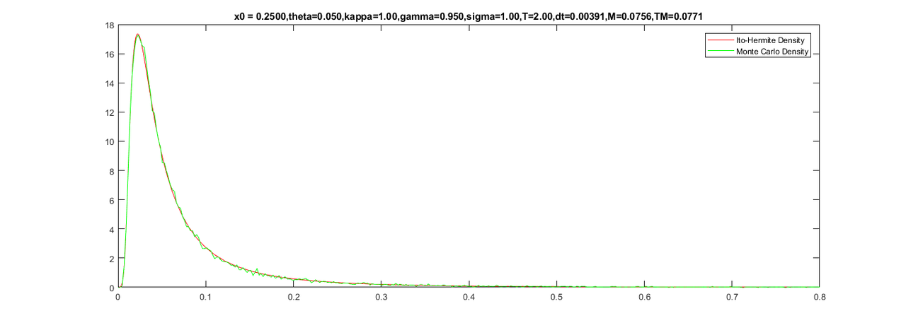](https://postimg.cc/xX2RXRHc)

[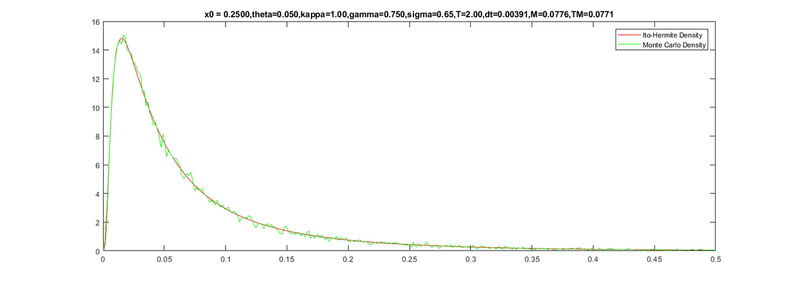](https://postimg.cc/jD4hP7Qv)

[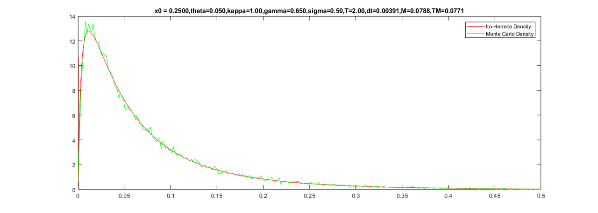](https://postimg.cc/bd4Lh8w0)

[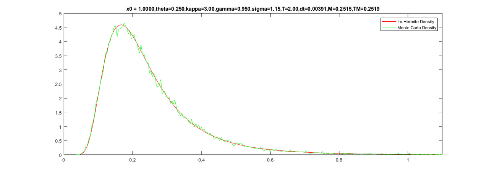](https://postimg.cc/56vg9GXh)

[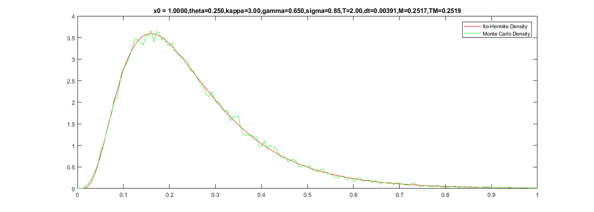](https://postimg.cc/bdZLWdpN)

[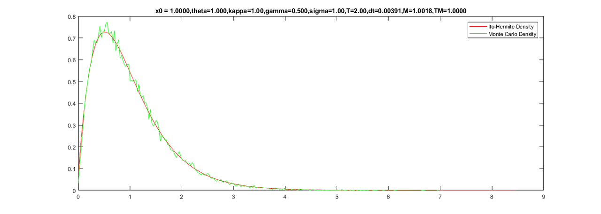](https://postimg.cc/6440vbYG)

[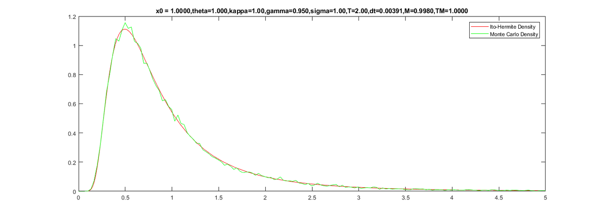](https://postimg.cc/gXTsrbqW)

[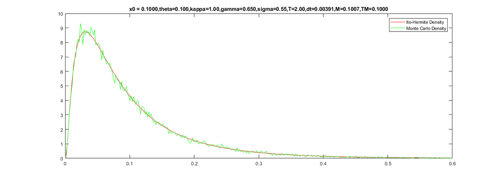](https://postimg.cc/9RM1WQ9b)

[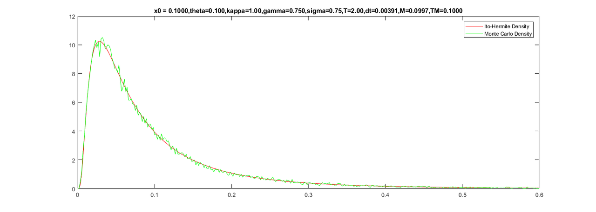](https://postimg.cc/2qT2RZ13)

[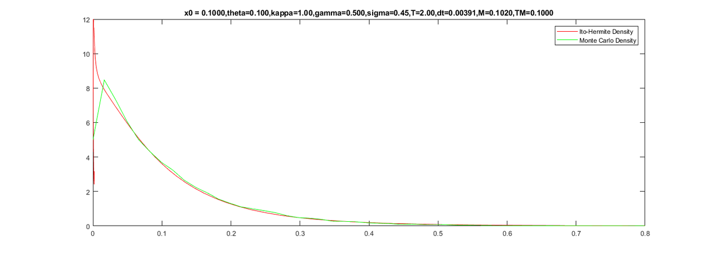](https://postimg.cc/d7J4xBtz)

---

### #1327 — Amin (Topic Author)
*January 2, 2022, 2:00 PM*

I am copying the matlab program in this post. I will come back with a detailed post explaining both analytics and my
matlab program. I will also upload my mathamtica notebook used to calculate different cumulants and their derivatives.

Here is the main routine.

,

```
function [] = FPESeriesCoeffsFromCumulantsWilmott()

%Copyright Ahsan Amin. Infiniti derivatives Technologies.
%Please fell free to connect on linkedin: linkedin.com/in/ahsan-amin-0a53334
%or skype ahsan.amin2999
%In this program, I am simulating the SDE given as
%dy(t)=mu1 x(t)^beta1 dt + mu2 x(t)^beta2 dt +sigma x(t)^gamma dz(t)

%I have not directly simulated the SDE but simulated the transformed
%Besse1l process version of the SDE and then changed coordinates to retreive
%the SDE in original coo
%rdinates.
%The present program will analytically evolve only the Bessel Process version of the
%SDE in transformed coordinates.

dt=.125/16*1/2;   % Simulation time interval.%Fodiffusions close to zero
             %decrease dt for accuracy.
Tt=128*2*2;%128*4*4*1;%*4;%128*2*2*2;     % Number of simulation levels. Terminal time= Tt*dt; //.125/32*32*16=2 year;
T=Tt*dt;

%Below I have done calculations for smaller step size at start.

ds(1:64)=dt/16;
ds(65:128)=dt/4;
if(Tt4)&&(Tt20)
Ts=(64)+((20-4)*4)+(Tt-20);
ds(1:64)=dt/16;
ds(65:128)=dt/4;
ds(129:Ts)=dt;
end
T
sum(ds(1:Ts))
Ts
%str=input('Check if time is right');

OrderA=4;  %
OrderM=4;  %

if(T>=1)
dtM=1/16;%.0625/1;
TtM=T/dtM;
else
dtM=T/16;%.0625/1;
TtM=T/dtM;
end

dNn=.1/1;   % Normal density subdivisions width. would change with number of subdivisions
Nn=46*2;  % No of normal density subdivisions

NnMid=4.0;

x0=1.0;   % starting value of SDE
beta1=0.0;
beta2=1.0;   % Second drift term power.
gamma=.75;%50;   % volatility power.
kappa=1.0;%.950;   %mean reversion parameter.
theta=1.0;%mean reversion target
sigma0=1.0;%Volatility value

%you can specify any general mu1 and mu2 and beta1 and beta2.
mu1=1*theta*kappa;   %first drift coefficient.
mu2=-1*kappa;    % Second drift coefficient.
%mu1=0;
%mu2=0;

alpha=1;% x^alpha is being expanded. This is currently for monte carlo only.
alpha1=1-gamma;%This is for expansion of integrals for calculation of drift
%and volatility coefficients
%yy(1:Nn)=x0;
w0=x0^(1-gamma)/(1-gamma);

Z(1:Nn)=(((1:Nn)-6.5)*dNn-NnMid);
Z
str=input('Look at Z');
ZProb(1)=normcdf(.5*Z(1)+.5*Z(2),0,1)-normcdf(.5*Z(1)+.5*Z(2)-dNn,0,1);
ZProb(Nn)=normcdf(.5*Z(Nn)+.5*Z(Nn-1)+dNn,0,1)-normcdf(.5*Z(Nn)+.5*Z(Nn-1),0,1);
ZProb(2:Nn-1)=normcdf(.5*Z(2:Nn-1)+.5*Z(3:Nn),0,1)-normcdf(.5*Z(2:Nn-1)+.5*Z(1:Nn-2),0,1);

%%%%%%%%%%%%%%%%%%%%%%%%%%%%%%%%%%%%%%%%%%%%%%%%%%%%%%%%%%%%%%%%%%%%%%%%%%%%%%%%%%%%%%%%%%%%%%

sigma11(1:OrderA+1)=0;
mu11(1:OrderA+1)=0;
mu22(1:OrderA+1)=0;
sigma22(1:OrderA+1)=0;
% index 1 correponds to zero level since matlab indexing starts at one.
sigma11(1)=1;
mu11(1)=1;
mu22(1)=1;
sigma22(1)=1;

for k=1:(OrderA+1)
    if sigma0~=0
        sigma11(k)=sigma0^(k-1);
    end
    if mu1 ~= 0
        mu11(k)=mu1^(k-1);
    end
    if mu2 ~= 0
        mu22(k)=mu2^(k-1);
    end
    if sigma0~=0
        sigma22(k)=sigma0^(2*(k-1));
    end
end
%Ft(1:TtM+1,1:(OrderA+1),1:(OrderA+1),1:(OrderA+1),1:(OrderA+1))=0; %General time powers on hermite polynomials
Fp(1:(OrderA+1),1:(OrderA+1),1:(OrderA+1),1:(OrderA+1))=0;%General x powers on coefficients of hermite polynomials.
Fp1(1:(OrderA+1),1:(OrderA+1),1:(OrderA+1),1:(OrderA+1))=0;%General x powers for bessel transformed coordinates.

%YCoeff0 and YCoeff are coefficents for original coordinates monte carlo.
%YqCoeff0 and YqCoeff are bessel/lamperti version monte carlo.

YCoeff0(1:(OrderA+1),1:(OrderA+1),1:(OrderA+1),1:(OrderA+1))=0;
YqCoeff0(1:(OrderA+1),1:(OrderA+1),1:(OrderA+1),1:(OrderA+1))=0;
%Pre-compute the time and power exponent values in small multi-dimensional arrays
YCoeff = ItoTaylorCoeffsNew(alpha,beta1,beta2,gamma); %expand y^alpha where alpha=1;
YqCoeff = ItoTaylorCoeffsNew(alpha1,beta1,beta2,gamma);%expand y^alpha1 where alpha1=(1-gamma)
YqCoeff=YqCoeff/(1-gamma); %Transformed coordinates coefficients have to be
%further divided by (1-gamma)

for k = 0 : (OrderA)
    for m = 0:k
        l4 = k - m + 1;
        for n = 0 : m
            l3 = m - n + 1;
            for j = 0:n
                l2 = n - j + 1;
                l1 = j + 1;
                %Ft(l1,l2,l3,l4) = dtM^((l1-1) + (l2-1) + (l3-1) + .5* (l4-1));
                Fp(l1,l2,l3,l4) = (alpha + (l1-1) * beta1 + (l2-1) * beta2 + (l3-1) * 2* gamma + (l4-1) * gamma ...
                    - (l1-1) - (l2-1) - 2* (l3-1) - (l4-1));
                Fp1(l1,l2,l3,l4) = (alpha1 + (l1-1) * beta1 + (l2-1) * beta2 + (l3-1) * 2* gamma + (l4-1) * gamma ...
                    - (l1-1) - (l2-1) - 2* (l3-1) - (l4-1));

                YCoeff0(l1,l2,l3,l4) =YCoeff(l1,l2,l3,l4).*mu11(l1).*mu22(l2).*sigma22(l3).*sigma11(l4);
                YqCoeff0(l1,l2,l3,l4) =YqCoeff(l1,l2,l3,l4).*mu11(l1).*mu22(l2).*sigma22(l3).*sigma11(l4);
            end
        end
    end
end

%%%%%%%%%%%%%%%%%%%%%%%%%%%%%%%%%%%%%%%%%%%%%%%%%%%%%%%%%%%%%%%%%%%%%%%%%%%%%%%%%%%%%%%%%%%%%%

ExpnOrder=4;
SeriesOrder=4;

wnStart=1;
tic

for tt=1:Ts
   % t1=(tt-1)*dt;
   % t2=(tt)*dt;
    if(tt==1)
        %dt=ds(1);
        %[wMu0dt,dwMu0dtdw] = BesselDriftAndDerivatives(w0,YqCoeff0,Fp1,gamma,dt,ExpnOrder);
        [wMu0dt,dwMu0dtdw] = BesselDriftAndDerivatives02(w0,mu1,mu2,beta1,beta2,sigma0,gamma,ds(tt),ExpnOrder);
        c0=wMu0dt+w0;
        c(1)=sigma0*sqrt(ds(tt))
        c(2:10)=0.0;
        w0=c0;

    elseif(tt==2)

    %dt=ds(tt);

    [wMu0dt,dwMu0dtdw] = BesselDriftAndDerivatives02(w0,mu1,mu2,beta1,beta2,sigma0,gamma,ds(tt),8);
     [b0,b] = CalculateDriftbCoeffs08(wMu0dt,dwMu0dtdw,c,gamma);

     c0=c0+b0;
     c(1)=b(1)+sqrt(c(1)^2+sigma0^2*ds(tt));
     c(2)=b(2);
     c(3)=b(3);
     c(4)=b(4);

    else

    %dt=ds(tt);
    %below wMu0dta is drift and dwMu0dtdwa are its derivatives.
    %wMu1dt is its first derivative and dwMu1dtdw are derivatives of first
    %derivative.

     %[wMu0dta,dwMu0dtdwa,wMu1dt,dwMu1dtdw] = BesselDriftAndDerivatives08(w0,mu1,mu2,beta1,beta2,sigma0,gamma,dt,10);

     [wMu0dt,dwMu0dtdw] = BesselDriftAndDerivatives02(w0,mu1,mu2,beta1,beta2,sigma0,gamma,ds(tt),8);
     [b0,b] = CalculateDriftbCoeffs08(wMu0dt,dwMu0dtdw,c,gamma);
%b0
%b
%str=input('Look at drift values');

%Below bm0 and bm10 are used for claulations of median.

      [wMu0dta,dwMu0dtdwa,wMu1dt,dwMu1dtdw] =
BesselDriftAndDerivatives08Bounded(w0,mu1,mu2,beta1,beta2,sigma0,gamma,ds(tt),10);
      bm0=wMu0dta;
      bm10=wMu1dt;

      [NewMedian] = CalculateTotalChangeInMedian(c0,c,bm0,bm10,sigma0,ds(tt));

   %  da0=NewMedian-w0-bm0*dt*1.0-0*bm10*bm0*dt^2;

   %  da0=.5*sigma0^2*(2*c(2))/c(1)^2*dt;%+(.5*sigma0^2*(2*c(2))/c(1)^2).*( .5*sigma0^2*(6*c(3))/c(1)^3-
sigma0^2*(2*c(2))^2/c(1)^4)*dt^2/2;
     da0=NewMedian-w0-b0;

     a0=NewMedian;

     %Initial random variable is determined by coefficients given in a
     %below.
     a(1:4)=c(1:4)+b(1:4);

    [da1,da2,da3,da4] = AdvanceSeriesCumulantSolution(da0,a,sigma0,ds(tt));

    c0=a0;
    c(1)=a(1)+da1;
    c(2)=a(2)+da2;
    c(3)=a(3)+da3;
    c(4)=a(4)+da4;

    w0=c0;

    end

end
wnStart=1;

w(1:Nn)=c0;
for nn=1:ExpnOrder
    w(1:Nn)=w(1:Nn)+c(nn)*Z(1:Nn).^nn;
end
Flag=0;
for nn=Nn-1:-1:1
    if((w(nn)>w(nn+1))&&(Flag==0))
        wnStart=nn+1;
        Flag=1;
    end
end

c0
c

%str=input('Look at numbers')
yy(wnStart:Nn)=((1-gamma).*w(wnStart:Nn)).^(1/(1-gamma));
yy0=((1-gamma).*w0).^(1/(1-gamma));

Dfyy(wnStart:Nn)=0;
for nn=wnStart+1:Nn-1

    Dfyy(nn) = (yy(nn + 1) - yy(nn - 1))/(Z(nn + 1) - Z(nn - 1));

    %Change of variable derivative for densities
end
Dfyy(Nn)=Dfyy(Nn-1);
Dfyy(1)=Dfyy(2);

pyy(1:Nn)=0;
for nn = wnStart:Nn

    pyy(nn) = (normpdf(Z(nn),0, 1))/abs(Dfyy(nn));
end

toc

ItoHermiteMean=sum(yy(wnStart:Nn).*ZProb(wnStart:Nn)) %Original process average from coordinates
disp('true Mean only applicable to standard SV mean reverting type models otherwise disregard');
TrueMean=theta+(x0-theta)*exp(-kappa*T)%Mean reverting SDE original variable true average
yy0

theta1=1;
rng(29079137, 'twister')
paths=50000;
YY(1:paths)=x0;  %Original process monte carlo.
Random1(1:paths)=0;
for tt=1:TtM

    Random1=randn(size(Random1));
    HermiteP1(1,1:paths)=1;
    HermiteP1(2,1:paths)=Random1(1:paths);
    HermiteP1(3,1:paths)=Random1(1:paths).^2-1;
    HermiteP1(4,1:paths)=Random1(1:paths).^3-3*Random1(1:paths);
    HermiteP1(5,1:paths)=Random1(1:paths).^4-6*Random1(1:paths).^2+3;

    YY(1:paths)=YY(1:paths) + ...
        (YCoeff0(1,1,2,1).*YY(1:paths).^Fp(1,1,2,1)+ ...
        YCoeff0(1,2,1,1).*YY(1:paths).^Fp(1,2,1,1)+ ...
        YCoeff0(2,1,1,1).*YY(1:paths).^Fp(2,1,1,1))*dtM + ...
        (YCoeff0(1,1,3,1).*YY(1:paths).^Fp(1,1,3,1)+ ...
        YCoeff0(1,2,2,1).*YY(1:paths).^Fp(1,2,2,1)+ ...
        YCoeff0(2,1,2,1).*YY(1:paths).^Fp(2,1,2,1)+ ...
        YCoeff0(1,3,1,1).*YY(1:paths).^Fp(1,3,1,1)+ ...
        YCoeff0(2,2,1,1).*YY(1:paths).^Fp(2,2,1,1)+ ...
        YCoeff0(3,1,1,1).*YY(1:paths).^Fp(3,1,1,1))*dtM^2 + ...
        ((YCoeff0(1,1,1,2).*YY(1:paths).^Fp(1,1,1,2).*sqrt(dtM))+ ...
        (YCoeff0(1,1,2,2).*YY(1:paths).^Fp(1,1,2,2)+ ...
        YCoeff0(1,2,1,2).*YY(1:paths).^Fp(1,2,1,2)+ ...
        YCoeff0(2,1,1,2).*YY(1:paths).^Fp(2,1,1,2)).*dtM^1.5) .*HermiteP1(2,1:paths) + ...
        ((YCoeff0(1,1,1,3).*YY(1:paths).^Fp(1,1,1,3) *dtM) + ...
        (YCoeff0(1,1,2,3).*YY(1:paths).^Fp(1,1,2,3)+ ...
        YCoeff0(1,2,1,3).*YY(1:paths).^Fp(1,2,1,3)+ ...
        YCoeff0(2,1,1,3).*YY(1:paths).^Fp(2,1,1,3)).*dtM^2).*HermiteP1(3,1:paths) + ...
        ((YCoeff0(1,1,1,4).*YY(1:paths).^Fp(1,1,1,4)*dtM^1.5 )).*HermiteP1(4,1:paths) + ...
        (YCoeff0(1,1,1,5).*YY(1:paths).^Fp(1,1,1,5)*dtM^2.0).*HermiteP1(5,1:paths);

end

YY(YY<0)=0;
disp('Original process average from monte carlo');
MCMean=sum(YY(:))/paths %origianl coordinates monte carlo average.
disp('Original process average from our simulation');
ItoHermiteMean=sum(yy(wnStart:Nn).*ZProb(wnStart:Nn)) %Original process average from coordinates

disp('true Mean only applicble to standard SV mean reverting type models otherwise disregard');
TrueMean=theta+(x0-theta)*exp(-kappa*T)%Mean reverting SDE original variable true average

MaxCutOff=30;
NoOfBins=round(1*500*gamma^2*4*sigma0/sqrt(MCMean)/(1+kappa));%Decrease the number of bins if the graph is too
[YDensity,IndexOutY,IndexMaxY] = MakeDensityFromSimulation_Infiniti_NEW(YY,paths,NoOfBins,MaxCutOff );
plot(yy(wnStart+1:Nn-1),pyy(wnStart+1:Nn-1),'r',IndexOutY(1:IndexMaxY),YDensity(1:IndexMaxY),'g');
 %plot(y_w(wnStart+1:Nn-1),fy_w(wnStart+1:Nn-1),'r',IndexOutY(1:IndexMaxY),YDensity(1:IndexMaxY),'g',Z(wnStart+1:Nn-1),fy_w(wnStart+1:Nn-1),'b');

title(sprintf('x0 = %.4f,theta=%.3f,kappa=%.2f,gamma=%.3f,sigma=%.2f,T=%.2f,dt=%.5f,M=%.4f,TM=%.4f',
x0,theta,kappa,gamma,sigma0,T,dt,ItoHermiteMean,TrueMean));%,sprintf('theta= %f', theta), sprintf('kappa = %f',
kappa),sprintf('sigma = %f', sigma0),sprintf('T = %f', T));

legend({'Ito-Hermite Density','Monte Carlo Density'},'Location','northeast')

str=input('red line is density of SDE from Ito-Hermite method, green is monte carlo.');

end
```

.

.

```
function [F,dF] = CalculateCumulantsAndDerivatives(dC1,dC2,dC3,dC4,a1,a2,a3,a4,da0,da1,da2,da3,da4)

F1=da0+da2+3*da4-dC1;

dF1da1=0;
dF1da2=1;
dF1da3=0;
dF1da4=3;

F2=da1^2 + 2* da2^2 + (6* a1 + 30* a3)* da3 + 15 *da3^2 +  ...
 da1* (2 *a1 + 6* a3 + 6 *da3) + (24 *a2 + 192 *a4) *da4 + 96 *da4^2 + ...
 da2* (4 *a2 + 24 *a4 + 24 *da4)-dC2;

dF2da1= 2 *a1 + 6 *a3 + 2 *da1 + 6 *da3;
dF2da2= 4 *a2 + 24 *a4 + 4 *da2 + 24 *da4;
dF2da3=6 *a1 + 30 *a3 + 6 *da1 + 30 *da3;
dF2da4=24 *a2 + 192 *a4 + 24 *da2 + 192 *da4;

F3=8 *da2^3 + (36 *a1^2 + 216 *a2^2 + 576 *a1 *a3 + 2700 *a3^2 + 4608 *a2 *a4 + ...
    28512 *a4^2) *da4 + (2304 *a2 + 28512 *a4) *da4^2 + 9504 *da4^3 + ...
 da1^2 *(6 *a2 + 36 *a4 + 6 *da2 + 36 *da4) + ...
 da2^2* (24 *a2 + 216 *a4 + 216 *da4) + ...
 da3^2 *(270 *a2 + 2700 *a4 + 2700 *da4) + ...
 da3* (72 *a1 *a2 + 540 *a2 *a3 + 576 *a1 *a4 + ...
    5400 *a3 *a4 + (576 *a1 + 5400 *a3) *da4) + ...
 da2* (6 *a1^2 + 24 *a2^2 + 72 *a1 *a3 + 270 *a3^2 + 432 *a2 *a4 + ...
    2304 *a4^2 + (72 *a1 + 540 *a3) *da3 + ...
    270 *da3^2 + (432 *a2 + 4608 *a4) *da4 + 2304 *da4^2) + ...
 da1 *(12 *a1 *a2 + 72 *a2 *a3 + 72 *a1 *a4 + 576 *a3 *a4 + ...
    da2 *(12 *a1 + 72 *a3 + 72 *da3) + (72 *a1 + 576 *a3) *da4 + ...
    da3* (72 *a2 + 576 *a4 + 576 *da4))-dC3;

 dF3da1=12 *a1 *a2 + 72 *a2 *a3 + 72 *a1 *a4 + 576 *a3 *a4 + ...
 da2* (12 *a1 + 72 *a3 + 72 *da3) + (72 *a1 + 576 *a3) *da4 + ...
 2 *da1* (6 *a2 + 36 *a4 + 6 *da2 + 36 *da4) + ...
 da3* (72 *a2 + 576 *a4 + 576 *da4);

 dF3da2=6 *a1^2 + 24 *a2^2 + 72 *a1 *a3 + 270 *a3^2 + 432 *a2 *a4 + 2304 *a4^2 + ...
 6 *da1^2 + 24 *da2^2 + (72 *a1 + 540 *a3) *da3 + 270 *da3^2 + ...
 da1* (12 *a1 + 72 *a3 + 72 *da3) + (432 *a2 + 4608 *a4) *da4 + 2304 *da4^2 + ...
 2 *da2* (24 *a2 + 216 *a4 + 216 *da4);

 dF3da3=72 *a1 *a2 + 540 *a2 *a3 + 576 *a1 *a4 + 5400 *a3 *a4 + ...
 da2* (72 *a1 + 540 *a3 + 540 *da3) + (576 *a1 + 5400 *a3) *da4 + ...
 da1* (72 *a2 + 576 *a4 + 72 *da2 + 576 *da4) + ...
 2 *da3* (270 *a2 + 2700 *a4 + 2700 *da4);

 dF3da4=36 *a1^2 + 216 *a2^2 + 576 *a1 *a3 + 2700 *a3^2 + 4608 *a2 *a4 + ...
 28512 *a4^2 + 36 *da1^2 + 216 *da2^2 + (576 *a1 + 5400 *a3) *da3 + ...
 2700 *da3^2 + da1* (72 *a1 + 576 *a3 + 576 *da3) + ...
 2* (2304 *a2 + 28512 *a4) *da4 + 28512 *da4^2 + ...
 da2 *(432 *a2 + 4608 *a4 + 4608 *da4);

F4=-3 *a1^4 - 12 *a1^2 *a2^2 - 12 *a2^4 - 36 *a1^3 *a3 - 72 *a1 *a2^2 *a3 - ...
 198 *a1^2 *a3^2 - 180 *a2^2 *a3^2 - 540 *a1 *a3^3 - 675 *a3^4 - ...
 144 *a1^2 *a2 *a4 - 288 *a2^3 *a4 - 864 *a1 *a2 *a3 *a4 - 2160 *a2 *a3^2 *a4 - ...
 576 *a1^2 *a4^2 - 2880 *a2^2 *a4^2 - 3456 *a1 *a3 *a4^2 - 8640 *a3^2 *a4^2 - ...
 13824 *a2 *a4^3 - 27648 *a4^4 + ...
 3 *(a1^2 - a2^2 + 114 *a4^2 + 15 *(a3^2 + 2 *a2 *a4) + ...
    3 *(a2^2 + 2 *a1 *a3 - 2 *a2 *a4 - 6 *a4^2))^2 + ...
 48 *da2^4 + (3240 *a1 + 38880 *a3) *da3^3 + 9720 *da3^4 + ...
 da1^3* (24 *a3 + 24 *da3) + (864 *a1^2 *a2 + 2304 *a2^3 + 18432 *a1 *a2 *a3 + ...
    108000 *a2 *a3^2 + 9216 *a1^2 *a4 + 92160 *a2^2 *a4 + 228096 *a1 *a3 *a4 + ...
    1537920 *a3^2 *a4 + 1368576 *a2 *a4^2 + ...
    7520256 *a4^3) *da4 + (4608 *a1^2 + 46080 *a2^2 + 114048 *a1 *a3 + ...
    768960 *a3^2 + 1368576 *a2 *a4 + 11280384 *a4^2) *da4^2 + (456192 *a2 + ...
    7520256 *a4) *da4^3 + 1880064 *da4^4 + ...
 da2^3* (192 *a2 + 2304 *a4 + 2304 *da4) + ...
 da2^2* (48 *a1^2 + 288 *a2^2 + 864 *a1 *a3 + 4320 *a3^2 + 6912 *a2 *a4 + ...
    46080 *a4^2 + (864 *a1 + 8640 *a3) *da3 + ...
    4320 *da3^2 + (6912 *a2 + 92160 *a4) *da4 + 46080 *da4^2) + ...
 da3^2* (432 *a1^2 + 4320 *a2^2 + 9720 *a1 *a3 + 58320 *a3^2 + ...
    108000 *a2 *a4 + 768960 *a4^2 + (108000 *a2 + 1537920 *a4) *da4 + ...
    768960 *da4^2) + ...
 da3* (24 *a1^3 + 864 *a1 *a2^2 + 864 *a1^2 *a3 + 8640 *a2^2 *a3 + ...
    9720 *a1 *a3^2 + 38880 *a3^3 + 18432 *a1 *a2 *a4 + 216000 *a2 *a3 *a4 + ...
    114048 *a1 *a4^2 + ...
    1537920 *a3 *a4^2 + (18432 *a1 *a2 + 216000 *a2 *a3 + 228096 *a1 *a4 + ...
       3075840 *a3 *a4) *da4 + (114048 *a1 + 1537920 *a3) *da4^2) + ...
 da1^2* (48 *a2^2 + 72 *a1 *a3 + 432 *a3^2 + 864 *a2 *a4 + 4608 *a4^2 + ...
    48 *da2^2 + (72 *a1 + 864 *a3) *da3 + ...
    432 *da3^2 + (864 *a2 + 9216 *a4) *da4 + 4608 *da4^2 + ...
    da2* (96 *a2 + 864 *a4 + 864 *da4)) + ...
 da2* (96 *a1^2 *a2 + 192 *a2^3 + 1728 *a1 *a2 *a3 + 8640 *a2 *a3^2 + ...
    864 *a1^2 *a4 + 6912 *a2^2 *a4 + 18432 *a1 *a3 *a4 + 108000 *a3^2 *a4 + ...
    92160 *a2 *a4^2 + ...
    456192 *a4^3 + (864 *a1^2 + 6912 *a2^2 + 18432 *a1 *a3 + 108000 *a3^2 + ...
       184320 *a2 *a4 + 1368576 *a4^2) *da4 + (92160 *a2 + ...
       1368576 *a4) *da4^2 + 456192 *da4^3 + ...
    da3^2* (8640 *a2 + 108000 *a4 + 108000 *da4) +...
    da3* (1728 *a1 *a2 + 17280 *a2 *a3 + 18432 *a1 *a4 + ...
       216000 *a3 *a4 + (18432 *a1 + 216000 *a3) *da4)) + ...
 da1* (96 *a1 *a2^2 + 72 *a1^2 *a3 + 864 *a2^2 *a3 + 864 *a1 *a3^2 + ...
    3240 *a3^3 + 1728 *a1 *a2 *a4 + 18432 *a2 *a3 *a4 + 9216 *a1 *a4^2 + ...
    114048 *a3 *a4^2 + (864 *a1 + 9720 *a3) *da3^2 + 3240 *da3^3 + ...
    da2^2* (96 *a1 + 864 *a3 + 864 *da3) + (1728 *a1 *a2 + 18432 *a2 *a3 + ...
       18432 *a1 *a4 + 228096 *a3 *a4) *da4 + (9216 *a1 + 114048 *a3) *da4^2 + ...
     da3* (72 *a1^2 + 864 *a2^2 + 1728 *a1 *a3 + 9720 *a3^2 + 18432 *a2 *a4 + ...
       114048 *a4^2 + (18432 *a2 + 228096 *a4) *da4 + 114048 *da4^2) + ...
    da2* (192 *a1 *a2 + 1728 *a2 *a3 + 1728 *a1 *a4 + ...
       18432 *a3 *a4 + (1728 *a1 + 18432 *a3) *da4 + ...
       da3* (1728 *a2 + 18432 *a4 + 18432 *da4)))-dC4;

  dF4da1=     96 *a1 *a2^2 + 72 *a1^2 *a3 + 864 *a2^2 *a3 + 864 *a1 *a3^2 + 3240 *a3^3 + ...
 1728 *a1 *a2 *a4 + 18432 *a2 *a3 *a4 + 9216 *a1 *a4^2 + ...
 114048 *a3 *a4^2 + (864 *a1 + 9720 *a3) *da3^2 + 3240 *da3^3 + ...
 3 *da1^2 *(24 *a3 + 24 *da3) + ...
 da2^2* (96 *a1 + 864 *a3 + 864 *da3) + (1728 *a1 *a2 + 18432 *a2 *a3 + ...
    18432 *a1 *a4 + 228096 *a3 *a4) *da4 + (9216 *a1 + 114048 *a3) *da4^2 + ...
 da3* (72 *a1^2 + 864 *a2^2 + 1728 *a1 *a3 + 9720 *a3^2 + 18432 *a2 *a4 + ...
    114048 *a4^2 + (18432 *a2 + 228096 *a4) *da4 + 114048 *da4^2) + ...
 2 *da1* (48 *a2^2 + 72 *a1 *a3 + 432 *a3^2 + 864 *a2 *a4 + 4608 *a4^2 + ...
    48 *da2^2 + (72 *a1 + 864 *a3) *da3 + ...
    432 *da3^2 + (864 *a2 + 9216 *a4) *da4 + 4608 *da4^2 + ...
    da2 *(96 *a2 + 864 *a4 + 864 *da4)) + ...
 da2* (192 *a1 *a2 + 1728 *a2 *a3 + 1728 *a1 *a4 + ...
    18432 *a3 *a4 + (1728 *a1 + 18432 *a3) *da4 + ...
    da3* (1728 *a2 + 18432 *a4 + 18432 *da4));

 dF4da2=96 *a1^2 *a2 + 192 *a2^3 + 1728 *a1 *a2 *a3 + 8640 *a2 *a3^2 + 864 *a1^2 *a4 + ...
 6912 *a2^2 *a4 + 18432 *a1 *a3 *a4 + 108000 *a3^2 *a4 + 92160 *a2 *a4^2 + ...
 456192 *a4^3 + ...
 192 *da2^3 + (864 *a1^2 + 6912 *a2^2 + 18432 *a1 *a3 + 108000 *a3^2 + ...
    184320 *a2 *a4 + 1368576 *a4^2) *da4 + (92160 *a2 + ...
    1368576 *a4) *da4^2 + 456192 *da4^3 + ...
 da1^2* (96 *a2 + 864 *a4 + 96 *da2 + 864 *da4) + ...
 3 *da2^2* (192 *a2 + 2304 *a4 + 2304 *da4) + ...
 da3^2* (8640 *a2 + 108000 *a4 + 108000 *da4) + ...
 da3* (1728 *a1 *a2 + 17280 *a2 *a3 + 18432 *a1 *a4 + ...
    216000 *a3 *a4 + (18432 *a1 + 216000 *a3) *da4) + ...
 2 *da2 *(48 *a1^2 + 288 *a2^2 + 864 *a1 *a3 + 4320 *a3^2 + 6912 *a2 *a4 + ...
    46080 *a4^2 + (864 *a1 + 8640 *a3) *da3 + ...
    4320 *da3^2 + (6912 *a2 + 92160 *a4) *da4 + 46080 *da4^2) + ...
 da1* (192 *a1 *a2 + 1728 *a2 *a3 + 1728 *a1 *a4 + 18432 *a3 *a4 + ...
    2 *da2 *(96 *a1 + 864 *a3 + 864 *da3) + (1728 *a1 + 18432 *a3) *da4 + ...
    da3* (1728 *a2 + 18432 *a4 + 18432 *da4));

dF4da3=24 *a1^3 + 864 *a1 *a2^2 + 864 *a1^2 *a3 + 8640 *a2^2 *a3 + 9720 *a1 *a3^2 + ...
 38880 *a3^3 + 18432 *a1 *a2 *a4 + 216000 *a2 *a3 *a4 + 114048 *a1 *a4^2 + ...
 1537920 *a3 *a4^2 + 24 *da1^3 + 3 *(3240 *a1 + 38880 *a3) *da3^2 + ...
 38880 *da3^3 + da1^2 *(72 *a1 + 864 *a3 + 864 *da3) + ...
 da2^2* (864 *a1 + 8640 *a3 + 8640 *da3) + (18432 *a1 *a2 + 216000 *a2 *a3 + ...
    228096 *a1 *a4 + 3075840 *a3 *a4) *da4 + (114048 *a1 + ...
    1537920 *a3) *da4^2 + ...
 2 *da3* (432 *a1^2 + 4320 *a2^2 + 9720 *a1 *a3 + 58320 *a3^2 + ...
    108000 *a2 *a4 + 768960 *a4^2 + (108000 *a2 + 1537920 *a4) *da4 + ...
    768960 *da4^2) + ...
 da1* (72 *a1^2 + 864 *a2^2 + 1728 *a1 *a3 + 9720 *a3^2 + 18432 *a2 *a4 + ...
    114048 *a4^2 + 864 *da2^2 + 2 *(864 *a1 + 9720 *a3) *da3 + ...
    9720 *da3^2 + (18432 *a2 + 228096 *a4) *da4 + 114048 *da4^2 + ...
    da2 *(1728 *a2 + 18432 *a4 + 18432 *da4)) + ...
 da2* (1728 *a1 *a2 + 17280 *a2 *a3 + 18432 *a1 *a4 + ...
    216000 *a3 *a4 + (18432 *a1 + 216000 *a3) *da4 + ...
    2 *da3* (8640 *a2 + 108000 *a4 + 108000 *da4));

 dF4da4=   864 *a1^2 *a2 + 2304 *a2^3 + 18432 *a1 *a2 *a3 + 108000 *a2 *a3^2 + ...
 9216 *a1^2 *a4 + 92160 *a2^2 *a4 + 228096 *a1 *a3 *a4 + 1537920 *a3^2 *a4 + ...
 1368576 *a2 *a4^2 + 7520256 *a4^3 + 2304 *da2^3 + ...
 2* (4608 *a1^2 + 46080 *a2^2 + 114048 *a1 *a3 + 768960 *a3^2 + ...
    1368576 *a2 *a4 + 11280384 *a4^2) *da4 + ...
 3 *(456192 *a2 + 7520256 *a4) *da4^2 + 7520256 *da4^3 + ...
 da1^2* (864 *a2 + 9216 *a4 + 864 *da2 + 9216 *da4) + ...
 da2^2* (6912 *a2 + 92160 *a4 + 92160 *da4) + ...
 da3^2* (108000 *a2 + 1537920 *a4 + 1537920 *da4) + ...
 da3* (18432 *a1 *a2 + 216000 *a2 *a3 + 228096 *a1 *a4 + 3075840 *a3 *a4 + ...
    2* (114048 *a1 + 1537920 *a3) *da4) + ...
 da2* (864 *a1^2 + 6912 *a2^2 + 18432 *a1 *a3 + 108000 *a3^2 + ...
    184320 *a2 *a4 + 1368576 *a4^2 + (18432 *a1 + 216000 *a3) *da3 + ...
    108000 *da3^2 + 2 *(92160 *a2 + 1368576 *a4) *da4 + 1368576 *da4^2) + ...
 da1* (1728 *a1 *a2 + 18432 *a2 *a3 + 18432 *a1 *a4 + 228096 *a3 *a4 + ...
    da2* (1728 *a1 + 18432 *a3 + 18432 *da3) + ...
    2* (9216 *a1 + 114048 *a3) *da4 + ...
    da3 *(18432 *a2 + 228096 *a4 + 228096 *da4));

 F(1,1)=F1;
 F(2,1)=F2;
 F(3,1)=F3;
 F(4,1)=F4;

dF(1,1)=dF1da1;
dF(1,2)=dF1da2;
dF(1,3)=dF1da3;
dF(1,4)=dF1da4;

dF(2,1)=dF2da1;
dF(2,2)=dF2da2;
dF(2,3)=dF2da3;
dF(2,4)=dF2da4;

dF(3,1)=dF3da1;
dF(3,2)=dF3da2;
dF(3,3)=dF3da3;
dF(3,4)=dF3da4;

dF(4,1)=dF4da1;
dF(4,2)=dF4da2;
dF(4,3)=dF4da3;
dF(4,4)=dF4da4;

end
```

.

.

```
function [da1,da2,da3,da4] = AdvanceSeriesCumulantSolution(da0,a,sigma0,dt)
%da0=0;

dC1=0;
dC2=sigma0^2*dt;
dC3=0;
dC4=0;

a1=a(1);
a2=a(2);
a3=a(3);
a4=a(4);

da1=sqrt(a1^2+sigma0^2*dt)-a1;
da2=0;
da3=0;
da4=0;

da(1,1)=da1;
da(2,1)=da2;
da(3,1)=da3;
da(4,1)=da4;

[F,dF] = CalculateCumulantsAndDerivatives(dC1,dC2,dC3,dC4,a1,a2,a3,a4,da0,da1,da2,da3,da4);

nn=0;
while((abs(F(1,1))>.00000000001) || (abs(F(2,1))>.00000000001) || (abs(F(3,1))>.00000000001) ||
(abs(F(4,1))>.00000000001))
nn=nn+1;
da=da-dF\F;

%inv(dF)

da1=da(1,1);
da2=da(2,1);
da3=da(3,1);
da4=da(4,1);

[F,dF] = CalculateCumulantsAndDerivatives(dC1,dC2,dC3,dC4,a1,a2,a3,a4,da0,da1,da2,da3,da4);

end

%a(1)=a1+da1;
%a(2)=a2+da2;
%a(3)=a3+da3;
%a(4)=a4+da4;

end
```

.

.

.

```
function [NewMedian] = CalculateTotalChangeInMedian(a0,a,b0,b10,sigma0,dt)

NewMedian=a0+(b0+.5*sigma0^2*(2*a(2))/a(1)^2)*dt + ...
    (b0+.5*sigma0^2*(2*a(2))/a(1)^2)*(b10*0+.5*sigma0^2*1/a(1)^2 + .5*sigma0^2*(6*a(3))/a(1)^3-
sigma0^2*(2*a(2))^2/a(1)^4)*dt^2/2;

end
```

.

.

.

```
function [wMu0dt,dwMu0dtdw] = BesselDriftAndDerivatives02(w0,mu1,mu2,beta1,beta2,sigma0,gamma,dt,ExpnOrder)

NoOfTerms=9;%excluding dt^3 terms

YqCoeff(1:NoOfTerms)=0.0;
Fp(1:NoOfTerms)=0.0;

YqCoeff(1)=mu1*dt;
YqCoeff(2)=mu2*dt;
YqCoeff(3)=-.5*sigma0^2*gamma*dt;

YqCoeff(4)=mu1^2*(beta1-gamma)*dt^2;
YqCoeff(5)=mu2^2*(beta2-gamma)*dt^2;
YqCoeff(6)=-.25*sigma0^4*gamma^2*(1-gamma)*dt^2;
YqCoeff(7)=(mu1*mu2*(beta1-gamma)+mu1*mu2*(beta2-gamma))*dt^2;
YqCoeff(8)=.5*mu1*sigma0^2*gamma*(1-gamma)*dt^2;
YqCoeff(9)=.5*mu2*sigma0^2*gamma*(1-gamma)*dt^2;

% YqCoeff(10)=YqCoeff0(1,1,4,1)*dt^3;
% YqCoeff(11)=YqCoeff0(1,2,3,1)*dt^3;
% YqCoeff(12)=YqCoeff0(2,1,3,1)*dt^3;
% YqCoeff(13)=YqCoeff0(1,3,2,1)*dt^3;
% YqCoeff(14)=YqCoeff0(2,2,2,1)*dt^3;
% YqCoeff(15)=YqCoeff0(3,1,2,1)*dt^3;
% YqCoeff(16)=YqCoeff0(1,4,1,1)*dt^3;
% YqCoeff(17)=YqCoeff0(2,3,1,1)*dt^3;
% YqCoeff(18)=YqCoeff0(3,2,1,1)*dt^3;
% YqCoeff(19)=YqCoeff0(4,1,1,1)*dt^3;

Fp(1)=(beta1-gamma)/(1-gamma);
Fp(2)=(beta2-gamma)/(1-gamma);
Fp(3)=-1;

Fp(4)=2*(beta1-gamma)/(1-gamma)-1;
Fp(5)=2*(beta2-gamma)/(1-gamma)-1;
Fp(6)=-3;
Fp(7)=(beta1-gamma)/(1-gamma)+(beta2-gamma)/(1-gamma)-1;
Fp(8)=(beta1-gamma)/(1-gamma)-2;
Fp(9)=(beta2-gamma)/(1-gamma)-2;

% Fp(10)=Fp1(1,1,4,1);
% Fp(11)=Fp1(1,2,3,1);
% Fp(12)=Fp1(2,1,3,1);
% Fp(13)=Fp1(1,3,2,1);
% Fp(14)=Fp1(2,2,2,1);
% Fp(15)=Fp1(3,1,2,1);
% Fp(16)=Fp1(1,4,1,1);
% Fp(17)=Fp1(2,3,1,1);
% Fp(18)=Fp1(3,2,1,1);
% Fp(19)=Fp1(4,1,1,1);

Fp2(1:9)=Fp(1:9);%/(1-gamma);

wMu0dt0=0;
dwMu0dt(1:ExpnOrder)=0.0;

wMu0dt=0;
dwMu0dtdw(1:ExpnOrder)=0.0;

for mm=1:NoOfTerms

    wMu0dt0=YqCoeff(mm).*((1-gamma)*w0).^Fp2(mm);
    for nn=1:ExpnOrder
        if(nn==1)
            dwMu0dt(nn)=wMu0dt0*Fp2(mm)*(1-gamma)/((1-gamma)*w0);
        else
        dwMu0dt(nn)=dwMu0dt(nn-1)*(Fp2(mm)-(nn-1))*(1-gamma)/((1-gamma)*w0);
        end
    end
    wMu0dt=wMu0dt+wMu0dt0;
    for nn=1:ExpnOrder
        dwMu0dtdw(nn)=dwMu0dtdw(nn)+dwMu0dt(nn);
    end

end

end
```

.

.

.

```
function [b0,b] = CalculateDriftbCoeffs08(wMu0dt,dwMu0dtdw,a,gamma)

b0=wMu0dt;

b(1)=a(1) *dwMu0dtdw(1);

b(2)=1/2*(2* a(2) *dwMu0dtdw(1)+a(1)^2 *dwMu0dtdw(2));

b(3)=1/6*(6 *a(3) *dwMu0dtdw(1)+6 *a(1)* a(2) *dwMu0dtdw(2)+a(1)^3 *dwMu0dtdw(3));

b(4)=1/24*(24* a(4) *dwMu0dtdw(1)+12* a(2)^2 *dwMu0dtdw(2)+24 *a(1)* a(3) *dwMu0dtdw(2)+ ...
    12* a(1)^2* a(2) *dwMu0dtdw(3)+a(1)^4 *dwMu0dtdw(4));

b(5)=1/120*(120* a(5) *dwMu0dtdw(1)+120* a(2) *a(3) *dwMu0dtdw(2)+120* a(1)* a(4) *dwMu0dtdw(2)+ ...
    60 *a(1)* a(2)^2 *dwMu0dtdw(3)+60* a(1)^2* a(3) *dwMu0dtdw(3)+ ...
    20 *a(1)^3* a(2) *dwMu0dtdw(4)+a(1)^5 *dwMu0dtdw(5));

b(6)=1/720*(720* a(6) *dwMu0dtdw(1)+360* a(3)^2 *dwMu0dtdw(2)+720* a(2)* a(4) *dwMu0dtdw(2)+720* a(1)* a(5)
*dwMu0dtdw(2)+ ...
    120* a(2)^3 *dwMu0dtdw(3)+720* a(1)* a(2)* a(3) *dwMu0dtdw(3)+360* a(1)^2* a(4) *dwMu0dtdw(3)+ ...
    180* a(1)^2* a(2)^2 *dwMu0dtdw(4)+120* a(1)^3* a(3) *dwMu0dtdw(4)+ ...
    30* a(1)^4 *a(2) *dwMu0dtdw(5)+a(1)^6 *dwMu0dtdw(6));

 b(7)=1/(720*7)*(5040* a(7)*dwMu0dtdw(1)+5040* a(3)* a(4)*dwMu0dtdw(2)+5040* a(2)* a(5) *dwMu0dtdw(2)+5040 *a(1)* a(6)
*dwMu0dtdw(2)+ ...
     2520* a(2)^2* a(3) *dwMu0dtdw(3)+2520* a(1)* a(3)^2 *dwMu0dtdw(3)+5040 *a(1)* a(2)* a(4) *dwMu0dtdw(3)+2520* a(1)^2
*a(5) *dwMu0dtdw(3)+ ...
     840* a(1)* a(2)^3 *dwMu0dtdw(4)+2520* a(1)^2* a(2)* a(3) *dwMu0dtdw(4)+840* a(1)^3* a(4) *dwMu0dtdw(4)+ ...
     420* a(1)^3* a(2)^2 *dwMu0dtdw(5)+210* a(1)^4* a(3) *dwMu0dtdw(5)+ ...
     42* a(1)^5* a(2) *dwMu0dtdw(6)+a(1)^7 *dwMu0dtdw(7));

 b(8)=1/(720*7*8)*(40320* a(8) *dwMu0dtdw(1)+20160* a(4)^2 *dwMu0dtdw(2)+40320* a(3)* a(5) *dwMu0dtdw(2)+40320* a(2)
*a(6) *dwMu0dtdw(2)+ ...
     40320* a(1) *a(7) *dwMu0dtdw(2)+ ...
     20160* a(2)* a(3)^2 *dwMu0dtdw(3)+20160* a(2)^2* a(4) *dwMu0dtdw(3)+40320* a(1)* a(3)* a(4) *dwMu0dtdw(3)+40320*
a(1)* a(2)* a(5) *dwMu0dtdw(3)+ ...
     20160* a(1)^2* a(6) *dwMu0dtdw(3)+ ...
     1680* a(2)^4 *dwMu0dtdw(4)+20160* a(1)* a(2)^2* a(3) *dwMu0dtdw(4)+10080* a(1)^2* a(3)^2 *dwMu0dtdw(4)+20160*
a(1)^2* a(2) *a(4) *dwMu0dtdw(4)+ ...
     6720* a(1)^3* a(5) *dwMu0dtdw(4)+ ...
     3360* a(1)^2* a(2)^3 *dwMu0dtdw(5)+6720* a(1)^3 *a(2)* a(3) *dwMu0dtdw(5)+1680* a(1)^4* a(4) *dwMu0dtdw(5)+ ...
     840* a(1)^4* a(2)^2 *dwMu0dtdw(6)+336* a(1)^5* a(3) *dwMu0dtdw(6)+ ...
     56* a(1)^6* a(2) *dwMu0dtdw(7)+a(1)^8 *dwMu0dtdw(8));

b(9:10)=0.0;

Bound=abs(b(1)/b0)*gamma/(1-gamma);
%Bound=1/abs(b0/b(1))*gamma;%/(1-gamma);

for nn=1:9

    if(abs(b(nn+1))>abs(b(nn)*Bound))
        b(nn+1)=sign(b(nn+1))*abs(b(nn))*Bound;
    end
end

%[b0,b] = ApplyBoundsOnSeriesCoeffs(b0,b);

 %
%
%
% b(9)=1/(720*7*8*9)*(362880* a(9) *dwMu0dtdw(1)+ ...
%     362880* a(4)* a(5) *dwMu0dtdw(2)+ 362880* a(3)* a(6) *dwMu0dtdw(2) +362880* a(2)* a(7) *dwMu0dtdw(2) +362880* a(1)
*a(8) *dwMu0dtdw(2) + ...
%     60480* a(3)^3 *dwMu0dtdw(3)+362880* a(2)* a(3)* a(4) *dwMu0dtdw(3)+181440* a(1)* a(4)^2 *dwMu0dtdw(3)+181440*
a(2)^2* a(5) *dwMu0dtdw(3) + ...
%     362880* a(1)* a(3)* a(5) *dwMu0dtdw(3)+362880 *a(1)* a(2)* a(6) *dwMu0dtdw(3) +181440 *a(1)^2* a(7) *dwMu0dtdw(3)+
...
%     60480* a(2)^3* a(3) *dwMu0dtdw(4)+181440* a(1)* a(2)* a(3)^2 *dwMu0dtdw(4)+181440* a(1)* a(2)^2 *a(4)
*dwMu0dtdw(4)+ ...
%     181440* a(1)^2* a(3)* a(4) *dwMu0dtdw(4)+181440* a(1)^2* a(2)* a(5) *dwMu0dtdw(4)+60480* a(1)^3* a(6)
*dwMu0dtdw(4)+ ...
%     15120* a(1)* a(2)^4 *dwMu0dtdw(5)+90720* a(1)^2* a(2)^2* a(3) *dwMu0dtdw(5)+30240* a(1)^3* a(3)^2 *dwMu0dtdw(5)+
...
%     60480 *a(1)^3* a(2)* a(4) *dwMu0dtdw(5)+15120* a(1)^4* a(5) *dwMu0dtdw(5)+ ...
%     10080* a(1)^3* a(2)^3 *dwMu0dtdw(6)+15120* a(1)^4 *a(2)* a(3) *dwMu0dtdw(6)+3024* a(1)^5* a(4) *dwMu0dtdw(6)+ ...
%     1512* a(1)^5* a(2)^2 *dwMu0dtdw(7)+504* a(1)^6* a(3) *dwMu0dtdw(7)+ ...
%     72* a(1)^7 *a(2) *dwMu0dtdw(8)+a(1)^9 *dwMu0dtdw(9));
%
%
%
%
% b(10)=1/(720*7*8*9*10)*(3628800* a(10)* dwMu0dtdw(1)+ ...
%     1814400 * a(5)^2 *dwMu0dtdw(2)+3628800 *a(4)* a(6)* dwMu0dtdw(2)+3628800* a(3)* a(7)* dwMu0dtdw(2)+3628800 *a(2)*
a(8)* dwMu0dtdw(2)+ ...
%     3628800* a(1)* a(9)* dwMu0dtdw(2)+ ...
%     1814400* a(3)^2* a(4)* dwMu0dtdw(3)+1814400* a(2)* a(4)^2* dwMu0dtdw(3)+3628800* a(2)* a(3)* a(5)*
dwMu0dtdw(3)+3628800* a(1)* a(4)* a(5) *dwMu0dtdw(3)+ ...
%     1814400* a(2)^2* a(6)* dwMu0dtdw(3)+3628800* a(1)* a(3)* a(6)* dwMu0dtdw(3)+3628800 *a(1)* a(2)* a(7)*
dwMu0dtdw(3)+1814400* a(1)^2* a(8)* dwMu0dtdw(3)+ ...
%     907200* a(2)^2 *a(3)^2* dwMu0dtdw(4)+604800* a(1)* a(3)^3* dwMu0dtdw(4)+604800* a(2)^3* a(4)*
dwMu0dtdw(4)+3628800* a(1)* a(2)* a(3)* a(4)* dwMu0dtdw(4)+ ...
%     907200* a(1)^2* a(4)^2* dwMu0dtdw(4)+1814400* a(1)* a(2)^2* a(5)* dwMu0dtdw(4)+1814400* a(1)^2* a(3)* a(5)*
dwMu0dtdw(4)+ ...
%     1814400* a(1)^2* a(2)* a(6)* dwMu0dtdw(4)+ 604800* a(1)^3* a(7) *dwMu0dtdw(4)+ ...
%     30240 *a(2)^5* dwMu0dtdw(5)+604800* a(1)* a(2)^3* a(3)* dwMu0dtdw(5)+907200 *a(1)^2* a(2)* a(3)^2*
dwMu0dtdw(5)+907200* a(1)^2* a(2)^2* a(4) *dwMu0dtdw(5)+ ...
%     604800* a(1)^3* a(3)* a(4)* dwMu0dtdw(5)+604800* a(1)^3* a(2)* a(5)* dwMu0dtdw(5)+151200* a(1)^4* a(6)*
dwMu0dtdw(5)+ ...
%     75600* a(1)^2* a(2)^4* dwMu0dtdw(6)+302400 *a(1)^3* a(2)^2* a(3)* dwMu0dtdw(6)+75600* a(1)^4 *a(3)^2*
dwMu0dtdw(6)+151200* a(1)^4* a(2)* a(4) *dwMu0dtdw(6)+ ...
%     30240* a(1)^5* a(5)* dwMu0dtdw(6)+ ...
%     25200* a(1)^4* a(2)^3* dwMu0dtdw(7)+30240* a(1)^5* a(2)* a(3)* dwMu0dtdw(7)+5040* a(1)^6* a(4)* dwMu0dtdw(7)+ ...
%     2520* a(1)^6* a(2)^2* dwMu0dtdw(8)+720* a(1)^7* a(3)* dwMu0dtdw(8)+ ...
%     90 *a(1)^8* a(2)* dwMu0dtdw(9)+ ...
%     a(1)^10* dwMu0dtdw(10));

end
```

.

.

---

### #1328 — Amin (Topic Author)
*January 3, 2022, 2:07 PM*

Friends, there was a potential error in my calculations of objective function i.e the system of cumulant equations. I
had taken one expectation out of order in calculations of cumulant equations. I re-did the calculations and found out
that even with perfectly correct order of taking expectations, I get exactly the same result as in my program I posted
yesterday. However, I am posting the corrected matlab function which is a more computationally intensive expression but
it gives precisely the same results as my previous function. Here is the new function that has to replace the earlier
function with similar name. You can remove the suffix 02 in the function below and make it work with the old program.
One warning is that previous function is more efficient but gives exactly the same results as this new function. But I
am posting corrected function for the sake of accuracy.

.

```
function [F,dF] = CalculateCumulantsAndDerivatives02(dC1,dC2,dC3,dC4,a1,a2,a3,a4,da0,da1,da2,da3,da4)

F1=da0+da2+3*da4-dC1;

dF1da1=0;
dF1da2=1;
dF1da3=0;
dF1da4=3;

F2=3* a2^2 + 6* a1* a3 + 15* a3^2 + 24* a2* a4 - 18* a4^2 - ...
 15 *(a3^2 + 2* a2* a4) - ...
 3 *(a2^2 + 2* a1* a3 - 2* a2* a4 - 6* a4^2) + ...
 da1^2 + 2* da2^2 + (6* a1 + 30* a3)* da3 + 15 *da3^2 +  ...
 da1* (2 *a1 + 6* a3 + 6 *da3) + (24 *a2 + 192 *a4) *da4 + 96 *da4^2 + ...
 da2* (4 *a2 + 24 *a4 + 24 *da4)-dC2;

dF2da1= 2 *a1 + 6 *a3 + 2 *da1 + 6 *da3;
dF2da2= 4 *a2 + 24 *a4 + 4 *da2 + 24 *da4;
dF2da3=6 *a1 + 30 *a3 + 6 *da1 + 30 *da3;
dF2da4=24 *a2 + 192 *a4 + 24 *da2 + 192 *da4;

F3=9* a1^2 *a2 + 6 *a2^3 + 72* a1* a2* a3 + 270* a2* a3^2 + 45* a1^2* a4 + ...
 207* a2^2* a4 + 576* a1* a3* a4 + 2700* a3^2* a4 + 2304* a2* a4^2 - ...
 864* a4^3 - ...
 15* (a2^3 + 6* a1* a2* a3 - 3* a2* a3^2 + 3* a1^2* a4 - 6* a2^2 *a4 - ...
    9* a3^2* a4 - 18* a2* a4^2) - 945* (3* a3^2* a4 + 3* a2* a4^2) - ...
 105 *(3* a2* a3^2 + 3* a2^2* a4 + 6* a1* a3* a4 - 3 *a2* a4^2 - 9* a4^3) - ...
 3* (3* a1^2* a2 - 3* a2^3 - 6* a1* a2* a3 - 6 *a2^2* a4 - 18* a1* a3 *a4 + ...
    18* a2* a4^2 + 27* a4^3) + ...
    8 *da2^3 + (36 *a1^2 + 216 *a2^2 + 576 *a1 *a3 + 2700 *a3^2 + 4608 *a2 *a4 + ...
    28512 *a4^2) *da4 + (2304 *a2 + 28512 *a4) *da4^2 + 9504 *da4^3 + ...
 da1^2 *(6 *a2 + 36 *a4 + 6 *da2 + 36 *da4) + ...
 da2^2* (24 *a2 + 216 *a4 + 216 *da4) + ...
 da3^2 *(270 *a2 + 2700 *a4 + 2700 *da4) + ...
 da3* (72 *a1 *a2 + 540 *a2 *a3 + 576 *a1 *a4 + ...
    5400 *a3 *a4 + (576 *a1 + 5400 *a3) *da4) + ...
 da2* (6 *a1^2 + 24 *a2^2 + 72 *a1 *a3 + 270 *a3^2 + 432 *a2 *a4 + ...
    2304 *a4^2 + (72 *a1 + 540 *a3) *da3 + ...
    270 *da3^2 + (432 *a2 + 4608 *a4) *da4 + 2304 *da4^2) + ...
 da1 *(12 *a1 *a2 + 72 *a2 *a3 + 72 *a1 *a4 + 576 *a3 *a4 + ...
    da2 *(12 *a1 + 72 *a3 + 72 *da3) + (72 *a1 + 576 *a3) *da4 + ...
    da3* (72 *a2 + 576 *a4 + 576 *da4))-dC3;

 dF3da1=12 *a1 *a2 + 72 *a2 *a3 + 72 *a1 *a4 + 576 *a3 *a4 + ...
 da2* (12 *a1 + 72 *a3 + 72 *da3) + (72 *a1 + 576 *a3) *da4 + ...
 2 *da1* (6 *a2 + 36 *a4 + 6 *da2 + 36 *da4) + ...
 da3* (72 *a2 + 576 *a4 + 576 *da4);

 dF3da2=6 *a1^2 + 24 *a2^2 + 72 *a1 *a3 + 270 *a3^2 + 432 *a2 *a4 + 2304 *a4^2 + ...
 6 *da1^2 + 24 *da2^2 + (72 *a1 + 540 *a3) *da3 + 270 *da3^2 + ...
 da1* (12 *a1 + 72 *a3 + 72 *da3) + (432 *a2 + 4608 *a4) *da4 + 2304 *da4^2 + ...
 2 *da2* (24 *a2 + 216 *a4 + 216 *da4);

 dF3da3=72 *a1 *a2 + 540 *a2 *a3 + 576 *a1 *a4 + 5400 *a3 *a4 + ...
 da2* (72 *a1 + 540 *a3 + 540 *da3) + (576 *a1 + 5400 *a3) *da4 + ...
 da1* (72 *a2 + 576 *a4 + 72 *da2 + 576 *da4) + ...
 2 *da3* (270 *a2 + 2700 *a4 + 2700 *da4);

 dF3da4=36 *a1^2 + 216 *a2^2 + 576 *a1 *a3 + 2700 *a3^2 + 4608 *a2 *a4 + ...
 28512 *a4^2 + 36 *da1^2 + 216 *da2^2 + (576 *a1 + 5400 *a3) *da3 + ...
 2700 *da3^2 + da1* (72 *a1 + 576 *a3 + 576 *da3) + ...
 2* (2304 *a2 + 28512 *a4) *da4 + 28512 *da4^2 + ...
 da2 *(432 *a2 + 4608 *a4 + 4608 *da4);

F4=42* a1^2* a2^2 + 51* a2^4 + 24* a1^3 *a3 + 864* a1* a2^2* a3 + ...
 432* a1^2* a3^2 + 4320* a2^2* a3^2 + 3240* a1* a3^3 + 9720* a3^4 + ...
 828* a1^2* a2* a4 + 2328* a2^3* a4 + 18432* a1 *a2* a3* a4 + ...
 108000* a2* a3^2* a4 + 4554* a1^2* a4^2 + 46134 *a2^2 *a4^2 + ...
 114048 *a1 *a3 *a4^2 + 768960 *a3^2* a4^2 + 456192* a2* a4^3 - ...
 147042* a4^4 - ...
 945* (6 *a2^2 *a3^2 + 4* a1* a3^3 + 4* a2^3 *a4 + 24 *a1 *a2 *a3 *a4 - ...
    12* a2* a3^2* a4 + 6* a1^2* a4^2 - 12* a2^2* a4^2 - 36* a3^2* a4^2 - ...
    36* a2* a4^3) - 135135* (6* a3^2* a4^2 + 4 *a2* a4^3) - ...
 15* (6* a1^2* a2^2 - 4 *a2^4 + 4* a1^3* a3 - 24* a1* a2^2 *a3 + 6 *a2^2* a3^2 - ...
    12* a1^2* a2* a4 - 72* a1* a2* a3* a4 + 36* a2* a3^2* a4 - 36* a1^2* a4^2 + ...
    72* a2^2* a4^2 + 54* a3^2* a4^2 + 108* a2* a4^3) - ...
 3* (a1^4 - 12* a1^2* a2^2 + 6* a2^4 + 12* a1* a2^2* a3 - 36* a1^2* a2* a4 + ...
    32* a2^3* a4 + 72* a1* a2* a3* a4 + 18* a2^2* a4^2 + 108* a1* a3* a4^2 - ...
    108* a2* a4^3 - 108* a4^4) - ...
 10395* (a3^4 + 12* a2* a3^2* a4 + 6* a2^2 *a4^2 + 12* a1* a3* a4^2 - ...
    4* a2* a4^3 - 12* a4^4) - ...
 105* (a2^4 + 12* a1* a2^2* a3 + 6* a1^2* a3^2 - 12* a2^2 *a3^2 + ...
    12* a1^2* a2* a4 - 12* a2^3* a4 - 24* a1* a2* a3* a4 - 36* a2* a3^2* a4 - ...
    30* a2^2 *a4^2 - 72* a1* a3* a4^2 + 36* a2* a4^3 + 54* a4^4) + ...
 3* (a1^2 - a2^2 + 114* a4^2 + 15* (a3^2 + 2* a2* a4) + ...
    3* (a2^2 + 2* a1 *a3 - 2* a2* a4 - 6* a4^2))^2 + ...
 48* da2^4 + (3240* a1 + 38880* a3)* da3^3 + 9720* da3^4 + ...
 da1^3* (24* a3 + 24* da3) + (864* a1^2* a2 + 2304 *a2^3 + 18432* a1* a2* a3 + ...
    108000* a2* a3^2 + 9216* a1^2* a4 + 92160 *a2^2* a4 + 228096* a1* a3 *a4 + ...
    1537920* a3^2* a4 + 1368576* a2* a4^2 + ...
    7520256* a4^3)* da4 + (4608* a1^2 + 46080* a2^2 + 114048* a1* a3 + ...
    768960* a3^2 + 1368576* a2* a4 + 11280384* a4^2)* da4^2 + (456192* a2 + ...
    7520256* a4)* da4^3 + 1880064* da4^4 + ...
 da2^3 *(192* a2 + 2304 *a4 + 2304* da4) + ...
 da2^2 *(48 *a1^2 + 288* a2^2 + 864* a1* a3 + 4320* a3^2 + 6912 *a2* a4 + ...
    46080 *a4^2 + (864* a1 + 8640* a3)* da3 + ...
    4320* da3^2 + (6912* a2 + 92160 *a4)* da4 + 46080* da4^2) +  ...
 da3^2 *(432* a1^2 + 4320 *a2^2 + 9720* a1* a3 + 58320* a3^2 + ...
    108000 *a2 *a4 + 768960 *a4^2 + (108000* a2 + 1537920* a4)* da4 + ...
    768960* da4^2) + ...
 da3* (24* a1^3 + 864 *a1* a2^2 + 864* a1^2* a3 + 8640 *a2^2 *a3 + ...
    9720* a1* a3^2 + 38880* a3^3 + 18432* a1* a2* a4 + 216000* a2* a3* a4 + ...
    114048* a1 *a4^2 + ...
    1537920* a3* a4^2 + (18432* a1* a2 + 216000 *a2* a3 + 228096* a1* a4 + ...
       3075840* a3* a4)* da4 + (114048* a1 + 1537920* a3)* da4^2) + ...
 da1^2* (48* a2^2 + 72* a1* a3 + 432 *a3^2 + 864 *a2* a4 + 4608* a4^2 + ...
    48* da2^2 + (72* a1 + 864* a3)* da3 + ...
    432* da3^2 + (864* a2 + 9216 *a4)* da4 + 4608* da4^2 + ...
    da2* (96* a2 + 864* a4 + 864* da4)) + ...
 da2 *(96 *a1^2* a2 + 192* a2^3 + 1728* a1* a2* a3 + 8640* a2* a3^2 + ...
    864* a1^2* a4 + 6912* a2^2* a4 + 18432* a1* a3* a4 + 108000* a3^2* a4 + ...
    92160* a2* a4^2 + ...
    456192* a4^3 + (864* a1^2 + 6912* a2^2 + 18432 *a1* a3 + 108000* a3^2 + ...
       184320* a2* a4 + 1368576* a4^2)* da4 + (92160 *a2 + ...
       1368576* a4)* da4^2 + 456192* da4^3 + ...
    da3^2 *(8640* a2 + 108000* a4 + 108000* da4) + ...
    da3* (1728* a1* a2 + 17280* a2* a3 + 18432* a1* a4 + ...
       216000* a3* a4 + (18432* a1 + 216000 *a3)* da4)) + ...
 da1* (96* a1* a2^2 + 72* a1^2* a3 + 864* a2^2 *a3 + 864* a1* a3^2 + ...
    3240* a3^3 + 1728* a1* a2* a4 + 18432* a2* a3* a4 + 9216* a1* a4^2 + ...
    114048* a3 *a4^2 + (864* a1 + 9720* a3)* da3^2 + 3240* da3^3 + ...
    da2^2* (96* a1 + 864* a3 + 864* da3) + (1728* a1 *a2 + 18432* a2 *a3 + ...
       18432* a1* a4 + 228096 *a3 *a4)* da4 + (9216 *a1 + 114048* a3)* da4^2 + ...
     da3* (72* a1^2 + 864* a2^2 + 1728* a1* a3 + 9720* a3^2 + 18432 *a2* a4 + ...
       114048* a4^2 + (18432* a2 + 228096* a4)* da4 + 114048* da4^2) + ...
    da2* (192* a1* a2 + 1728* a2* a3 + 1728* a1* a4 + ...
       18432* a3* a4 + (1728* a1 + 18432* a3)* da4 + ...
       da3* (1728* a2 + 18432* a4 + 18432* da4)))-dC4;

  dF4da1=     96 *a1 *a2^2 + 72 *a1^2 *a3 + 864 *a2^2 *a3 + 864 *a1 *a3^2 + 3240 *a3^3 + ...
 1728 *a1 *a2 *a4 + 18432 *a2 *a3 *a4 + 9216 *a1 *a4^2 + ...
 114048 *a3 *a4^2 + (864 *a1 + 9720 *a3) *da3^2 + 3240 *da3^3 + ...
 3 *da1^2 *(24 *a3 + 24 *da3) + ...
 da2^2* (96 *a1 + 864 *a3 + 864 *da3) + (1728 *a1 *a2 + 18432 *a2 *a3 + ...
    18432 *a1 *a4 + 228096 *a3 *a4) *da4 + (9216 *a1 + 114048 *a3) *da4^2 + ...
 da3* (72 *a1^2 + 864 *a2^2 + 1728 *a1 *a3 + 9720 *a3^2 + 18432 *a2 *a4 + ...
    114048 *a4^2 + (18432 *a2 + 228096 *a4) *da4 + 114048 *da4^2) + ...
 2 *da1* (48 *a2^2 + 72 *a1 *a3 + 432 *a3^2 + 864 *a2 *a4 + 4608 *a4^2 + ...
    48 *da2^2 + (72 *a1 + 864 *a3) *da3 + ...
    432 *da3^2 + (864 *a2 + 9216 *a4) *da4 + 4608 *da4^2 + ...
    da2 *(96 *a2 + 864 *a4 + 864 *da4)) + ...
 da2* (192 *a1 *a2 + 1728 *a2 *a3 + 1728 *a1 *a4 + ...
    18432 *a3 *a4 + (1728 *a1 + 18432 *a3) *da4 + ...
    da3* (1728 *a2 + 18432 *a4 + 18432 *da4));

 dF4da2=96 *a1^2 *a2 + 192 *a2^3 + 1728 *a1 *a2 *a3 + 8640 *a2 *a3^2 + 864 *a1^2 *a4 + ...
 6912 *a2^2 *a4 + 18432 *a1 *a3 *a4 + 108000 *a3^2 *a4 + 92160 *a2 *a4^2 + ...
 456192 *a4^3 + ...
 192 *da2^3 + (864 *a1^2 + 6912 *a2^2 + 18432 *a1 *a3 + 108000 *a3^2 + ...
    184320 *a2 *a4 + 1368576 *a4^2) *da4 + (92160 *a2 + ...
    1368576 *a4) *da4^2 + 456192 *da4^3 + ...
 da1^2* (96 *a2 + 864 *a4 + 96 *da2 + 864 *da4) + ...
 3 *da2^2* (192 *a2 + 2304 *a4 + 2304 *da4) + ...
 da3^2* (8640 *a2 + 108000 *a4 + 108000 *da4) + ...
 da3* (1728 *a1 *a2 + 17280 *a2 *a3 + 18432 *a1 *a4 + ...
    216000 *a3 *a4 + (18432 *a1 + 216000 *a3) *da4) + ...
 2 *da2 *(48 *a1^2 + 288 *a2^2 + 864 *a1 *a3 + 4320 *a3^2 + 6912 *a2 *a4 + ...
    46080 *a4^2 + (864 *a1 + 8640 *a3) *da3 + ...
    4320 *da3^2 + (6912 *a2 + 92160 *a4) *da4 + 46080 *da4^2) + ...
 da1* (192 *a1 *a2 + 1728 *a2 *a3 + 1728 *a1 *a4 + 18432 *a3 *a4 + ...
    2 *da2 *(96 *a1 + 864 *a3 + 864 *da3) + (1728 *a1 + 18432 *a3) *da4 + ...
    da3* (1728 *a2 + 18432 *a4 + 18432 *da4));

dF4da3=24 *a1^3 + 864 *a1 *a2^2 + 864 *a1^2 *a3 + 8640 *a2^2 *a3 + 9720 *a1 *a3^2 + ...
 38880 *a3^3 + 18432 *a1 *a2 *a4 + 216000 *a2 *a3 *a4 + 114048 *a1 *a4^2 + ...
 1537920 *a3 *a4^2 + 24 *da1^3 + 3 *(3240 *a1 + 38880 *a3) *da3^2 + ...
 38880 *da3^3 + da1^2 *(72 *a1 + 864 *a3 + 864 *da3) + ...
 da2^2* (864 *a1 + 8640 *a3 + 8640 *da3) + (18432 *a1 *a2 + 216000 *a2 *a3 + ...
    228096 *a1 *a4 + 3075840 *a3 *a4) *da4 + (114048 *a1 + ...
    1537920 *a3) *da4^2 + ...
 2 *da3* (432 *a1^2 + 4320 *a2^2 + 9720 *a1 *a3 + 58320 *a3^2 + ...
    108000 *a2 *a4 + 768960 *a4^2 + (108000 *a2 + 1537920 *a4) *da4 + ...
    768960 *da4^2) + ...
 da1* (72 *a1^2 + 864 *a2^2 + 1728 *a1 *a3 + 9720 *a3^2 + 18432 *a2 *a4 + ...
    114048 *a4^2 + 864 *da2^2 + 2 *(864 *a1 + 9720 *a3) *da3 + ...
    9720 *da3^2 + (18432 *a2 + 228096 *a4) *da4 + 114048 *da4^2 + ...
    da2 *(1728 *a2 + 18432 *a4 + 18432 *da4)) + ...
 da2* (1728 *a1 *a2 + 17280 *a2 *a3 + 18432 *a1 *a4 + ...
    216000 *a3 *a4 + (18432 *a1 + 216000 *a3) *da4 + ...
    2 *da3* (8640 *a2 + 108000 *a4 + 108000 *da4));

 dF4da4=   864 *a1^2 *a2 + 2304 *a2^3 + 18432 *a1 *a2 *a3 + 108000 *a2 *a3^2 + ...
 9216 *a1^2 *a4 + 92160 *a2^2 *a4 + 228096 *a1 *a3 *a4 + 1537920 *a3^2 *a4 + ...
 1368576 *a2 *a4^2 + 7520256 *a4^3 + 2304 *da2^3 + ...
 2* (4608 *a1^2 + 46080 *a2^2 + 114048 *a1 *a3 + 768960 *a3^2 + ...
    1368576 *a2 *a4 + 11280384 *a4^2) *da4 + ...
 3 *(456192 *a2 + 7520256 *a4) *da4^2 + 7520256 *da4^3 + ...
 da1^2* (864 *a2 + 9216 *a4 + 864 *da2 + 9216 *da4) + ...
 da2^2* (6912 *a2 + 92160 *a4 + 92160 *da4) + ...
 da3^2* (108000 *a2 + 1537920 *a4 + 1537920 *da4) + ...
 da3* (18432 *a1 *a2 + 216000 *a2 *a3 + 228096 *a1 *a4 + 3075840 *a3 *a4 + ...
    2* (114048 *a1 + 1537920 *a3) *da4) + ...
 da2* (864 *a1^2 + 6912 *a2^2 + 18432 *a1 *a3 + 108000 *a3^2 + ...
    184320 *a2 *a4 + 1368576 *a4^2 + (18432 *a1 + 216000 *a3) *da3 + ...
    108000 *da3^2 + 2 *(92160 *a2 + 1368576 *a4) *da4 + 1368576 *da4^2) + ...
 da1* (1728 *a1 *a2 + 18432 *a2 *a3 + 18432 *a1 *a4 + 228096 *a3 *a4 + ...
    da2* (1728 *a1 + 18432 *a3 + 18432 *da3) + ...
    2* (9216 *a1 + 114048 *a3) *da4 + ...
    da3 *(18432 *a2 + 228096 *a4 + 228096 *da4));

 F(1,1)=F1;
 F(2,1)=F2;
 F(3,1)=F3;
 F(4,1)=F4;

dF(1,1)=dF1da1;
dF(1,2)=dF1da2;
dF(1,3)=dF1da3;
dF(1,4)=dF1da4;

dF(2,1)=dF2da1;
dF(2,2)=dF2da2;
dF(2,3)=dF2da3;
dF(2,4)=dF2da4;

dF(3,1)=dF3da1;
dF(3,2)=dF3da2;
dF(3,3)=dF3da3;
dF(3,4)=dF3da4;

dF(4,1)=dF4da1;
dF(4,2)=dF4da2;
dF(4,3)=dF4da3;
dF(4,4)=dF4da4;

end

```

---

### #1329 — Amin (Topic Author)
*January 3, 2022, 2:26 PM*

Friends, just to clarify again that even though I apparently made an error in order of subtraction and expectation, the
extra terms in corrected expression evaluate to zero. I checked their expectation and found that these extra terms
consistently result in a value smaller than 10^-20  so you can safely continue to use the older function.

---

### #1330 — Amin (Topic Author)
*January 3, 2022, 4:10 PM*

Friends, I am attaching my mathematica notebook for calculations of cumulants and their derivatives with respect to
"change in coefficients" of Z-series representation of SDE variable.


[SeriesFromCumulants02.zip](./download/file.php?id=9958&sid=83f7bf639bea7c20f352a65100420173)
(17.62 KiB) Downloaded 84 times

Here I will explain some simple commands with comments

.
> W1 := a0 + a1 Z + a2 Z^2 + a3 Z^3 + a4 Z^4
>
>
>
> EW1 := a0 + a2 + 3 a4
>
>
>
> W2 := (a0 + da0) + (a1 + da1) Z + (a2 + da2) Z^2 + (a3 + da3) Z^3 + (a4 + da4) Z^4
>
>
>
> EW2 := (a0 + da0) + (a2 + da2) + 3 (a4 + da4)
.

In the above quoted part of the notebook, W1 is series representation of the "SDE variable + drift"  and W2 is series
representation of SDE variable after Bessel noise term has been added in the SDE. EW1 and EW2 are their respective
expectations or means that follow from taking expectation on powers of standard normal.

.
> Collect[(W1 - EW1)^2, Z]
>
>
>
> a2^2 + 6 a2 a4 + 9 a4^2 +
>
>  (-2 a1 a2 - 6 a1 a4) Z +
>
> (a1^2 - 2 a2^2 - 6 a2 a4) Z^2 +
>
> (2 a1 a2 - 2 a2 a3 - 6 a3 a4) Z^3 +
>
> (a2^2 + 2 a1 a3 - 2 a2 a4 - 6 a4^2) Z^4 +
>
> (2 a2 a3 + 2 a1 a4) Z^5 +
>
> (a3^2 + 2 a2 a4) Z^6 +
>
> 2 a3 a4 Z^7 +
>
> a4^2 Z^8
>
>
>
> a2^2 + 6 a2 a4 + 9 a4^2 +
>
> (-2 a1 a2 - 6 a1 a4) 0 +
>
>  (a1^2 - 2 a2^2 - 6 a2 a4) 1 +
>
>  (2 a1 a2 - 2 a2 a3 - 6 a3 a4) 0 +
>
>  (a2^2 + 2 a1 a3 - 2 a2 a4 - 6 a4^2) 3 +
>
>  (2 a2 a3 + 2 a1 a4) 0 +
>
> (a3^2 + 2 a2 a4) 15 +
>
> (2 a3 a4) 0 +
>
> a4^2 105
>
>
>
> a1^2 - a2^2 + 114 a4^2 + 15 (a3^2 + 2 a2 a4) + 3 (a2^2 + 2 a1 a3 - 2 a2 a4 - 6 a4^2)
>
>
>
> Ep2W1nEW1 := Out[28]
.

In the above quoted part, I calculate the value of  (W1 - EW1)^2  and collect the terms with various powers of Z. I copy
the answer and replace powers of standard normal Z with their respective expectations. This is especially convenient to
collect terms of each powers of Z for higher cumulants where we have cumbersome expressions to just replace the
expectation of each power of Z just once. I then re-calculate the value of expected expression and assign it to 2nd
central moment or 2nd cumulant.

The nomenclature in notebook is that

Ep2W1nEW1   means second central moment of W1.

Ep3W1nEW1   means third central moment of W1.

Ep4W1nEW1   means fourth central moment of W1. (used to calculate fourth cumulant)

Ep2W2nEW2   means second central moment of W2.

Ep3W2nEW2   means third central moment of W2.

Ep4W2nEW2   means fourth central moment of W2. (used to calculate fourth cumulant)

I am sure with this orientation friends would easily understand the mathematica notebook.

I would explain rest of the simple things with equations tomorrow.

---

### #1331 — Amin (Topic Author)
*January 4, 2022, 3:38 PM*

Friends, I am posting corrected version of the drift calculation function. There were several minor errors in this
function and I have fixed them now. Please use this new function in your program.

I hope to work tonight and be able to add functionality for taking into account higher order volatility terms of order
dt^1.5. I will be getting antipsychotic injection tomorrow and do not know if I would be able to work properly after
that so I want to try to complete it tonight.

Here is the corrected function you have to use.

```
function [wMu0dt,dwMu0dtdw] = BesselDriftAndDerivatives02(w0,mu1,mu2,beta1,beta2,sigma0,gamma,dt,ExpnOrder)

NoOfTerms=9;%excluding dt^3 terms

YqCoeff(1:NoOfTerms)=0.0;
Fp(1:NoOfTerms)=0.0;
a0=((beta1-gamma)/(1-gamma));
b0=((beta2-gamma)/(1-gamma));
A=mu1*(1-gamma)^a0;
B=mu2*(1-gamma)^b0;
C=-.5*sigma0^2*gamma/(1-gamma);
dt2=dt^2/2;

YqCoeff(1)=A*dt;
YqCoeff(2)=B*dt;
YqCoeff(3)=C*dt;

YqCoeff(4)=A^2*a0*dt2;
YqCoeff(5)=B^2*b0*dt2;
YqCoeff(6)=C^2*(-1)*dt2+ C*(-1)*(-2)*.5*sigma0^2 *dt2;
YqCoeff(7)=A*B*(a0+b0)*dt2;
YqCoeff(8)=A*C*(a0-1)*dt2+.5*sigma0^2*A*a0*(a0-1)*dt2;
YqCoeff(9)=B*C*(b0-1)*dt2+.5*sigma0^2*B*b0*(b0-1)*dt2;

Fp(1)=(beta1-gamma)/(1-gamma);
Fp(2)=(beta2-gamma)/(1-gamma);
Fp(3)=-1;

Fp(4)=2*(beta1-gamma)/(1-gamma)-1;
Fp(5)=2*(beta2-gamma)/(1-gamma)-1;
Fp(6)=-3;
Fp(7)=(beta1-gamma)/(1-gamma)+(beta2-gamma)/(1-gamma)-1;
Fp(8)=(beta1-gamma)/(1-gamma)-2;
Fp(9)=(beta2-gamma)/(1-gamma)-2;

Fp2(1:9)=Fp(1:9);%/(1-gamma);

wMu0dt0=0;
dwMu0dt(1:ExpnOrder)=0.0;

wMu0dt=0;
dwMu0dtdw(1:ExpnOrder)=0.0;

for mm=1:NoOfTerms

    wMu0dt0=YqCoeff(mm).*w0.^Fp2(mm);
    for nn=1:ExpnOrder
        if(nn==1)
            dwMu0dt(nn)=wMu0dt0*Fp2(mm)*1/w0;
        else
        dwMu0dt(nn)=dwMu0dt(nn-1)*(Fp2(mm)-(nn-1))/w0;
        end
    end
    wMu0dt=wMu0dt+wMu0dt0;
    for nn=1:ExpnOrder
        dwMu0dtdw(nn)=dwMu0dtdw(nn)+dwMu0dt(nn);
    end

end

end
```

---

### #1332 — Amin (Topic Author)
*January 4, 2022, 7:38 PM*

Friends, I have been able to improve the cumulant matching density simulation program by adding volatility to order
dt^1.5. I can easily take a step size of 1/64 and retain accuracy. Tomorrow I will try to further increase the order in
volatility to dt^2. I hope to post the new program tomorrow.

---

### #1333 — Amin (Topic Author)
*January 6, 2022, 12:30 AM*

I have been able to add second hermite polynomial in volatility and I also increased order everywhere and with all of
this addition, I can now easily take a step size of 1/16 with very good accuracy. I have still not tried step sizes
larger than 1/16 but I suspect that for easy diffusions, it would easily be possible to take a step size of 1/8 or 1/4
as we can take in monte carlo. Even closer to zero, it is a much better program than what we have previously been able
to do. I have also increased accuracy in drift to order dt^3 for larger step sizes.

I will post the new program later today.

---

### #1334 — Amin (Topic Author)
*January 6, 2022, 10:36 AM*

Friends, mind control agencies are drugging water(with mind control chemicals) in Lahore city again. I had not mentioned
it on this forum but they had actively been drugging specific things I like in my food for past few weeks. I go once out
of my home and have a quick meal on the fly somewhere. And bring some water and some food (like bread and some
spread/jam etc) that I can eat rest of the day when I would be hungry. But mind control agencies have targeted bread and
many spreads and distributed them in the markets in surrounding areas. I had told friends that it was impossible to get
good coffee that would not have mind control chemicals in it. Pakistan army generals are given tens of billions of
rupees every year and they ensure that every coffee manufacturer or importer drugs the coffee with mind control
chemicals before distributing it in the market. I switched to tea to stimulate myself and think about mathematics but
mind control crooks have started to drug most brands of tea and all the tea manufactured in past two months is drugged
with mind control chemicals. Ground water was not getting drugged until recently but mind control agencies have started
drugging groundwater and water I got today was completely drugged with mind control chemicals.

I want to request good Americans and especially good Jews to please stop this activity of retarding talented Muslims by
some jewish actors who are behind this.

My original post was very different but I took a deep sigh and deleted most of it but I want to request people to not
test my patience after a brutal and inhuman persecution spread over more than two decades. I just cannot allow my
inhuman rape to continue forever at the hand of racist American defense.

---

### #1335 — Amin (Topic Author)
*January 7, 2022, 7:37 AM*

https://forum.wilmott.com/viewtopic.php?f=15&t=94796&start=705#p821204

I want to ask a lot of people this philosophical question. Do most of us have naiive expectations of goodness from our
societies? Most of us probably believe in these expectations of goodness until the society is put to a test when we
realize that our expectations of goodness are probably a mirage. I still believe when I was in Hong Kong for three
months at the end of 1999. I went to the largest newspaper group's offices to tell them about my persecution by mind
control weapons. I was so thoroughly naiive that the staff at the newspaper group will be horrified at the sheer human
rights abuses but once I left the group after a long interview with them, it was my turn to become aghast when I
realized that they had already prepared the guy who was supposed to interview me at the Newspaper office and
preparations had already been made by them how to respond to my accusations.

I have over the years seen again and again how mind control agents use influential, rich and connected people again and
again to further their agenda of my persecution and when these influential people enthusiastically argue that I must be
persecuted, most good natured people become quiet just because they do not want to get into problems for someone else
and are afraid to fall out of favor with the influential people for the somebody else's cause. I keep thinking again and
again how our societies continue to do something that is totally wrong and evil but still most people remain quiet
because somebody rich or influential wants them to not make a big deal about these wrongdoings and cruelties of our
society.

Again and again there were times when I was aghast how many people I looked up to with a sense of great uprightness 
failed me and wanted me to be persecuted when I came across them. When I was in London in 2010, I wrote about my
persecution on a lot of LinkedIn groups. Though most of the linkedin groups allowed my posts to remain active and people
had a god time making fun of me, Amnesty international of UK removed my posts about my human rights abuses from their
group and banned me from making any further posts. I was horrified and wrote several emails to request the group owner
to restore my posts on Amnesty international group. Apparently the group owner was told that I was some kind of a
staunch muslim and he kept ranting against my religion. Mind control agents knew how to deal with different people and
told people different stories that suited the nature of people so as to make them feel antagonistic towards me.

Again and again, I noticed that the society and the very people who are supposed to be flag-bearers of society's
goodness and her values allow the society to perpetrate the crimes when influential people ask them and convince them to
allow the wrong and bad things and human rights abuses to happen. Some people want to curry favor with rich and
influential and rest of the people do not want to get into any trouble. And evil continues to get bigger and bigger in
the society when rich and influential people learn that they can easily shape the behavior of the society in wrong ways
without any resistance and they continue to become bolder every time they cause somebody's persecution successfully.

I still recall when I was in Karachi and I wrote email letters to my undergrad university. I had the same perception of
the university that most other people had that mine was a very good school. I told the professors how mind control
agents were given me some chemicals in water that my saliva in mouth would become dry and it would be an extremely
painful situation. With great naivette, I thought that my problem would become over after the professors at my
prestigious undergrad school would make sure that my persecution stops. Alas, because of the effect of some influential
people, my university started convincing people that my persecution must continue and increase.

I had so many such experiences when very gentle and learned people who I thoroughly respected made fun of me. I knew
they had been told lies about me and I had no way of telling them that these lies were not true. I just had to bear the
ridicule and become quiet. These mind control people had a very good idea of psyche of people and they know how to deal
with different types of people. In front of good and gentle people, they would tell lies so as to appeal to the goodness
of people and convince them that I must be stopped because I am some kind of evil.

There are an estimated ten thousand humans who are a target of constant mind control abuse.

So I would request all good people to please understand the true nature of this mind control abuse. You would always
notice someone influential who would try to make sure that innocent people must be made a target of mind control abuse
and try to appeal to your goodness that this mind control abuse is indeed a good thing. If good people continue to
yield, evil people would continue to get bolder. I would wish that all good people take a stand against such evils in
our society so that our innocent perceptions of the goodness of the society in fact becomes a truth. Everybody is good
when there is no incentive for being bad or evil, but true goodness is that you remain good when put to test and you
have to become good against the wind. If all of us could do that, our societies would become a far better place.

---

### #1336 — Amin (Topic Author)
*January 7, 2022, 7:59 AM*

I wrote the above post three years ago. Today I know that there are a reasonably large number of good people who have
tried to lobby for my freedom from mind control but racist crooks in defense are too arrogant and bitterly want to enter
the paradise of Jewish billionaire Godfather therefore saying good things to them is akin to playing musical tunes on
buffaloes. But still America is supposed to be democracy and defense is not supreme authority in United States and I
wonder why office of Joe Biden does not take notice and try to stop racist and evil practices of US defense. American
president when places sanctions against Chinese companies and Chinese defense for human rights violations in Xinjiang,
he fails to acknowledge that there is dark below the lamp and American defense is involved in a lot of similar cruel and
inhuman racist practices. I was so enthusiastic when Biden became president but it seems that new president has failed
many of us who were expecting that he would refuse to bow to rich pressure groups and end mind control in US and
elsewhere.

---

### #1337 — Amin (Topic Author)
*January 7, 2022, 8:50 AM*

Friends, I wanted to post the new model yesterday but I noticed that calculation of median is of second order while
calculation of drift is of third order and that causes a discrepancy and as a result Newton root finding does not
converge for a very small fraction of cases (with for example k>3 etc). I was thinking that I would increase order for
median calculation and make it of the same order as calculation of drift and then upload the new program. But now I have
decided to upload the program (without further median correction) in a few hours and I will fix the median calculations
over the weekend and release a new version of the program over the weekend with newton convergence problems fixed. I
hope friends would like the new program. I will also be explaining most important details over the weekend.

---

### #1338 — Amin (Topic Author)
*January 7, 2022, 11:58 AM*

This program is different from the previous program in the sense that cumulants being added due to diffusion term are
explicitly calculated out of diffusion terms consisting of first and second hermite polynomials and their coefficients.
Please let me explain.

Let us say that higher order diffusion term in Bessel diffusion is of the form

$\sigma \sqrt{dt} \, Z+ \sigma \, dt^{1.5} \Big[ c_1 \, w(t)^{\alpha_1} \, + \, c_2 \, w(t)^{\alpha_2} \, + \, c_3 \, w(t)^{\alpha_3} \, \, \Big] \, Z$

$+\sigma^2 \, dt^{2.0} \Big[ d_1 \, w(t)^{\beta_1} \, + \, d_2 \, w(t)^{\beta_2} \, + \, d_3 \, w(t)^{\beta_3} \, \, \Big] \, (Z^2 \, - 1)\, $

where c's and d's are coefficients that are found out of Ito-Hermite expansion as in high order monte carlo, while
alphas and betas are powers on w that are found using Ito-Hermite expansion as in high order monte carlo.

We expand the w-terms in the form of a series in $Z_0$ as

$\sigma \, dt^{1.5} \Big[ c_1 \, w(t)^{\alpha_1} \, + \, c_2 \, w(t)^{\alpha_2} \, + \, c_3 \, w(t)^{\alpha_3} \, \, \Big]$

$=g_0 \, + \, g_1 Z_0 + \, g_2 {Z_0}^2 \, + \, g_3 {Z_0}^3 \, + \, g_4 {Z_0}^4$

here$Z_0$ is standard normal associated with the existing diffusion prior to addition of volatility term and$Z_0$ and$Z$
are independent of each other.

while

$\sigma \, dt^{2.0} \Big[ d_1 \, w(t)^{\beta_1} \, + \, d_2 \, w(t)^{\beta_2} \, + \, d_3 \, w(t)^{\beta_3} \, \, \Big]$

$=h_0 \, + \, h_1 Z_0 + \, h_2 {Z_0}^2 \, + \, h_3 {Z_0}^3 \, + \, h_4 {Z_0}^4$

So our initial volatility term is expanded as

$\sigma \sqrt{dt} \, Z+ \sigma \, dt^{1.5} \Big[ c_1 \, w(t)^{\alpha_1} \, + \, c_2 \, w(t)^{\alpha_2} \, + \, c_3 \, w(t)^{\alpha_3} \, \, \Big] \, Z$

$+\sigma^2 \, dt^{2.0} \Big[ d_1 \, w(t)^{\beta_1} \, + \, d_2 \, w(t)^{\beta_2} \, + \, d_3 \, w(t)^{\beta_3} \, \, \Big] \, (Z^2 \, - 1)\, $

$=\sigma \sqrt{dt} \, Z \, + \Big[g_0 \, + \, g_1 Z_0 + \, g_2 {Z_0}^2 \, + \, g_3 {Z_0}^3 \, + \, g_4 {Z_0}^4 \, \Big] \, Z$

$+\Big[ \, h_0 \, + \, h_1 Z_0 + \, h_2 {Z_0}^2 \, + \, h_3 {Z_0}^3 \, + \, h_4 {Z_0}^4 \, \Big] \, (Z^2-1)$

Now we find value of cumulants associated with the diffusion term being added by taking appropriate powers of the above
series expression on RHS and replacing the powers of two different and independent standard normals,$Z$ and$Z_0$ by
their expected values. This is how I find the value of cumulants being added due to diffusion term. Mean of this
volatility term is obviously zero.

---

### #1339 — Amin (Topic Author)
*January 7, 2022, 12:40 PM*

Here is the new preliminary program. It still has a few pitfalls and I will come back with a new modified program over
the weekend. In this program drift is still second order.

.

.

```
function [] = FPESeriesCoeffsFromCumulantsWilmott()

%Copyright Ahsan Amin. Infiniti derivatives Technologies.
%Please fell free to connect on linkedin: linkedin.com/in/ahsan-amin-0a53334
%or skype ahsan.amin2999
%In this program, I am simulating the SDE given as
%dy(t)=mu1 x(t)^beta1 dt + mu2 x(t)^beta2 dt +sigma x(t)^gamma dz(t)

%I have not directly simulated the SDE but simulated the transformed
%Besse1l process version of the SDE and then changed coordinates to retreive
%the SDE in original coo
%rdinates.
%The present program will analytically evolve only the Bessel Process version of the
%SDE in transformed coordinates.

dt=.125/2/2;   % Simulation time interval.%Fodiffusions close to zero
             %decrease dt for accuracy.
Tt=128/2/2*2;%*4*4*1;%*4;%128*2*2*2;     % Number of simulation levels. Terminal time= Tt*dt; //.125/32*32*16=2 year;
T=Tt*dt;

%Below I have done calculations for smaller step size at start.

ds(1:64)=dt/16;
ds(65:128)=dt/4;
if(Tt4)&&(Tt20)
Ts=(64)+((20-4)*4)+(Tt-20);
ds(1:64)=dt/16;
ds(65:128)=dt/4;
ds(129:Ts)=dt;
end
T
sum(ds(1:Ts))
Ts
%str=input('Check if time is right');

OrderA=4;  %
OrderM=4;  %

if(T>=1)
dtM=1/16;%.0625/1;
TtM=T/dtM;
else
dtM=T/16;%.0625/1;
TtM=T/dtM;
end

dNn=.1/1;   % Normal density subdivisions width. would change with number of subdivisions
Nn=46*2;  % No of normal density subdivisions

NnMid=4.0;

x0=1.00;   % starting value of SDE
beta1=0.0;
beta2=1.0;   % Second drift term power.
gamma=.95;%50;   % volatility power.
kappa=1.0;%.950;   %mean reversion parameter.
theta=1.0;%mean reversion target
sigma0=1.0;%Volatility value

%you can specify any general mu1 and mu2 and beta1 and beta2.
mu1=1*theta*kappa;   %first drift coefficient.
mu2=-1*kappa;    % Second drift coefficient.
%mu1=0;
%mu2=0;

alpha=1;% x^alpha is being expanded. This is currently for monte carlo only.
alpha1=1-gamma;%This is for expansion of integrals for calculation of drift
%and volatility coefficients
%yy(1:Nn)=x0;
w0=x0^(1-gamma)/(1-gamma);

Z(1:Nn)=(((1:Nn)-6.5)*dNn-NnMid);
Z
str=input('Look at Z');
ZProb(1)=normcdf(.5*Z(1)+.5*Z(2),0,1)-normcdf(.5*Z(1)+.5*Z(2)-dNn,0,1);
ZProb(Nn)=normcdf(.5*Z(Nn)+.5*Z(Nn-1)+dNn,0,1)-normcdf(.5*Z(Nn)+.5*Z(Nn-1),0,1);
ZProb(2:Nn-1)=normcdf(.5*Z(2:Nn-1)+.5*Z(3:Nn),0,1)-normcdf(.5*Z(2:Nn-1)+.5*Z(1:Nn-2),0,1);

%%%%%%%%%%%%%%%%%%%%%%%%%%%%%%%%%%%%%%%%%%%%%%%%%%%%%%%%%%%%%%%%%%%%%%%%%%%%%%%%%%%%%%%%%%%%%%

sigma11(1:OrderA+1)=0;
mu11(1:OrderA+1)=0;
mu22(1:OrderA+1)=0;
sigma22(1:OrderA+1)=0;
% index 1 correponds to zero level since matlab indexing starts at one.
sigma11(1)=1;
mu11(1)=1;
mu22(1)=1;
sigma22(1)=1;

for k=1:(OrderA+1)
    if sigma0~=0
        sigma11(k)=sigma0^(k-1);
    end
    if mu1 ~= 0
        mu11(k)=mu1^(k-1);
    end
    if mu2 ~= 0
        mu22(k)=mu2^(k-1);
    end
    if sigma0~=0
        sigma22(k)=sigma0^(2*(k-1));
    end
end
%Ft(1:TtM+1,1:(OrderA+1),1:(OrderA+1),1:(OrderA+1),1:(OrderA+1))=0; %General time powers on hermite polynomials
Fp(1:(OrderA+1),1:(OrderA+1),1:(OrderA+1),1:(OrderA+1))=0;%General x powers on coefficients of hermite polynomials.
Fp1(1:(OrderA+1),1:(OrderA+1),1:(OrderA+1),1:(OrderA+1))=0;%General x powers for bessel transformed coordinates.

%YCoeff0 and YCoeff are coefficents for original coordinates monte carlo.
%YqCoeff0 and YqCoeff are bessel/lamperti version monte carlo.

YCoeff0(1:(OrderA+1),1:(OrderA+1),1:(OrderA+1),1:(OrderA+1))=0;
YqCoeff0(1:(OrderA+1),1:(OrderA+1),1:(OrderA+1),1:(OrderA+1))=0;
%Pre-compute the time and power exponent values in small multi-dimensional arrays
YCoeff = ItoTaylorCoeffsNew(alpha,beta1,beta2,gamma); %expand y^alpha where alpha=1;
YqCoeff = ItoTaylorCoeffsNew(alpha1,beta1,beta2,gamma);%expand y^alpha1 where alpha1=(1-gamma)
YqCoeff=YqCoeff/(1-gamma); %Transformed coordinates coefficients have to be
%further divided by (1-gamma)

for k = 0 : (OrderA)
    for m = 0:k
        l4 = k - m + 1;
        for n = 0 : m
            l3 = m - n + 1;
            for j = 0:n
                l2 = n - j + 1;
                l1 = j + 1;
                %Ft(l1,l2,l3,l4) = dtM^((l1-1) + (l2-1) + (l3-1) + .5* (l4-1));
                Fp(l1,l2,l3,l4) = (alpha + (l1-1) * beta1 + (l2-1) * beta2 + (l3-1) * 2* gamma + (l4-1) * gamma ...
                    - (l1-1) - (l2-1) - 2* (l3-1) - (l4-1));
                Fp1(l1,l2,l3,l4) = (alpha1 + (l1-1) * beta1 + (l2-1) * beta2 + (l3-1) * 2* gamma + (l4-1) * gamma ...
                    - (l1-1) - (l2-1) - 2* (l3-1) - (l4-1));

                YCoeff0(l1,l2,l3,l4) =YCoeff(l1,l2,l3,l4).*mu11(l1).*mu22(l2).*sigma22(l3).*sigma11(l4);
                YqCoeff0(l1,l2,l3,l4) =YqCoeff(l1,l2,l3,l4).*mu11(l1).*mu22(l2).*sigma22(l3).*sigma11(l4);
            end
        end
    end
end

%%%%%%%%%%%%%%%%%%%%%%%%%%%%%%%%%%%%%%%%%%%%%%%%%%%%%%%%%%%%%%%%%%%%%%%%%%%%%%%%%%%%%%%%%%%%%%

ExpnOrder=4;
SeriesOrder=4;

wnStart=1;
tic

for tt=1:Ts
    tt
   % t1=(tt-1)*dt;
   % t2=(tt)*dt;
    if(tt==1)
        %dt=ds(1);
        %[wMu0dt,dwMu0dtdw] = BesselDriftAndDerivatives(w0,YqCoeff0,Fp1,gamma,dt,ExpnOrder);
        [wMu0dt,dwMu0dtdw] = BesselDriftAndDerivatives02A(w0,mu1,mu2,beta1,beta2,sigma0,gamma,ds(tt),ExpnOrder);

        %[wMu0dtb,dwMu0dtdwb] = BesselDriftAndDerivativesH0(w0,YqCoeff0,Fp1,gamma,ds(tt),ExpnOrder);

  %      dwMu0dtdw
  %      dwMu0dtdwa
  %      wMu0dt
  %      wMu0dta
  %      str=input('Look at drift');
        c0=wMu0dt+w0;
        c(1)=sigma0*sqrt(ds(tt))
        c(2:10)=0.0;
        w0=c0;

    elseif(tt==2)

    %dt=ds(tt);

    [wMu0dt,dwMu0dtdw] = BesselDriftAndDerivatives02A(w0,mu1,mu2,beta1,beta2,sigma0,gamma,ds(tt),4);
     [b0,b] = CalculateDriftbCoeffs08O4(wMu0dt,dwMu0dtdw,c);

     c0=c0+b0;
     c(1)=b(1)+sqrt(c(1)^2+sigma0^2*ds(tt));
     c(2)=b(2);
     c(3)=b(3);
     c(4)=b(4);

    else

    %dt=ds(tt);
    %below wMu0dta is drift and dwMu0dtdwa are its derivatives.
    %wMu1dt is its first derivative and dwMu1dtdw are derivatives of first
    %derivative.

     %[wMu0dta,dwMu0dtdwa,wMu1dt,dwMu1dtdw] = BesselDriftAndDerivatives08(w0,mu1,mu2,beta1,beta2,sigma0,gamma,dt,10);

     [wMu0dt,dwMu0dtdw] = BesselDriftAndDerivatives02A(w0,mu1,mu2,beta1,beta2,sigma0,gamma,ds(tt),4);
     [b0,b] = CalculateDriftbCoeffs08O4(wMu0dt,dwMu0dtdw,c);
%b0
%b
%str=input('Look at drift values');

%Below bm0 and bm10 are used for claulations of median.

      [wMu0dta,dwMu0dtdwa,wMu1dt,dwMu1dtdw] =
BesselDriftAndDerivatives08Bounded(w0,mu1,mu2,beta1,beta2,sigma0,gamma,ds(tt),4);
      bm0=wMu0dta;
      bm10=wMu1dt;

      [NewMedian] = CalculateTotalChangeInMedian(c0,c,bm0,bm10,sigma0,ds(tt));

   %  da0=NewMedian-w0-bm0*ds(tt)*1.0-1*bm10*bm0*ds(tt)^2/2;

   %  da0=.5*sigma0^2*(2*c(2))/c(1)^2*ds(tt)+(.5*sigma0^2*(2*c(2))/c(1)^2).*( .5*sigma0^2*(6*c(3))/c(1)^3-
sigma0^2*(2*c(2))^2/c(1)^4)*ds(tt)^2/2;
     da0=NewMedian-w0-b0;

     a0=NewMedian;

     %Initial random variable is determined by coefficients given in a
     %below.
    % a(1:4)=c(1:4)+b(1:4);

%    [wVol0dt,dwVol0dtdw] = BesselVolAndDerivatives(w0,mu1,mu2,beta1,beta2,sigma0,gamma,ds(tt),8);
    [wVol0dt,dwVol0dtdw] = BesselVolAndDerivativesH1(w0,YqCoeff0,Fp1,gamma,ds(tt),8);

    [wVol2dt,dwVol2dtdw] = BesselVolAndDerivativesH2(w0,YqCoeff0,Fp1,gamma,ds(tt),8);

 %   wVol0dt
 %   wVol0dta

 %   str=input('Look at vol');

    [g0,g] = CalculateDriftbCoeffs08O4(wVol0dt,dwVol0dtdw,c);
    [h0,h] = CalculateDriftbCoeffs08O4(wVol2dt,dwVol2dtdw,c);

    %h0=0;
    %h(1:4)=0;

    a(1:4)=c(1:4)+b(1:4);

    [da1,da2,da3,da4] = AdvanceSeriesCumulantSolution02New(da0,a,g0,g,h0,h,sigma0,ds(tt));

    c0=a0;
    c(1)=a(1)+da1;
    c(2)=a(2)+da2;
    c(3)=a(3)+da3;
    c(4)=a(4)+da4;

    w0=c0;

    end

end
wnStart=1;

w(1:Nn)=c0;
for nn=1:ExpnOrder
    w(1:Nn)=w(1:Nn)+c(nn)*Z(1:Nn).^nn;
end
Flag=0;
for nn=Nn-1:-1:1
    if((w(nn)<0)&&(Flag==0))
        wnStart=nn+1;
        Flag=1;
    end
end

c0
c

%str=input('Look at numbers')
yy(wnStart:Nn)=((1-gamma).*w(wnStart:Nn)).^(1/(1-gamma));
yy0=((1-gamma).*w0).^(1/(1-gamma));

Dfyy(wnStart:Nn)=0;
for nn=wnStart+1:Nn-1

    Dfyy(nn) = (yy(nn + 1) - yy(nn - 1))/(Z(nn + 1) - Z(nn - 1));

    %Change of variable derivative for densities
end
Dfyy(Nn)=Dfyy(Nn-1);
Dfyy(1)=Dfyy(2);

pyy(1:Nn)=0;
for nn = wnStart:Nn

    pyy(nn) = (normpdf(Z(nn),0, 1))/abs(Dfyy(nn));
end

toc

ItoHermiteMean=sum(yy(wnStart:Nn).*ZProb(wnStart:Nn)) %Original process average from coordinates
disp('true Mean only applicable to standard SV mean reverting type models otherwise disregard');
TrueMean=theta+(x0-theta)*exp(-kappa*T)%Mean reverting SDE original variable true average
yy0

theta1=1;
rng(29079137, 'twister')
paths=50000;
YY(1:paths)=x0;  %Original process monte carlo.
Random1(1:paths)=0;
for tt=1:TtM

    Random1=randn(size(Random1));
    HermiteP1(1,1:paths)=1;
    HermiteP1(2,1:paths)=Random1(1:paths);
    HermiteP1(3,1:paths)=Random1(1:paths).^2-1;
    HermiteP1(4,1:paths)=Random1(1:paths).^3-3*Random1(1:paths);
    HermiteP1(5,1:paths)=Random1(1:paths).^4-6*Random1(1:paths).^2+3;

    YY(1:paths)=YY(1:paths) + ...
        (YCoeff0(1,1,2,1).*YY(1:paths).^Fp(1,1,2,1)+ ...
        YCoeff0(1,2,1,1).*YY(1:paths).^Fp(1,2,1,1)+ ...
        YCoeff0(2,1,1,1).*YY(1:paths).^Fp(2,1,1,1))*dtM + ...
        (YCoeff0(1,1,3,1).*YY(1:paths).^Fp(1,1,3,1)+ ...
        YCoeff0(1,2,2,1).*YY(1:paths).^Fp(1,2,2,1)+ ...
        YCoeff0(2,1,2,1).*YY(1:paths).^Fp(2,1,2,1)+ ...
        YCoeff0(1,3,1,1).*YY(1:paths).^Fp(1,3,1,1)+ ...
        YCoeff0(2,2,1,1).*YY(1:paths).^Fp(2,2,1,1)+ ...
        YCoeff0(3,1,1,1).*YY(1:paths).^Fp(3,1,1,1))*dtM^2 + ...
        ((YCoeff0(1,1,1,2).*YY(1:paths).^Fp(1,1,1,2).*sqrt(dtM))+ ...
        (YCoeff0(1,1,2,2).*YY(1:paths).^Fp(1,1,2,2)+ ...
        YCoeff0(1,2,1,2).*YY(1:paths).^Fp(1,2,1,2)+ ...
        YCoeff0(2,1,1,2).*YY(1:paths).^Fp(2,1,1,2)).*dtM^1.5) .*HermiteP1(2,1:paths) + ...
        ((YCoeff0(1,1,1,3).*YY(1:paths).^Fp(1,1,1,3) *dtM) + ...
        (YCoeff0(1,1,2,3).*YY(1:paths).^Fp(1,1,2,3)+ ...
        YCoeff0(1,2,1,3).*YY(1:paths).^Fp(1,2,1,3)+ ...
        YCoeff0(2,1,1,3).*YY(1:paths).^Fp(2,1,1,3)).*dtM^2).*HermiteP1(3,1:paths) + ...
        ((YCoeff0(1,1,1,4).*YY(1:paths).^Fp(1,1,1,4)*dtM^1.5 )).*HermiteP1(4,1:paths) + ...
        (YCoeff0(1,1,1,5).*YY(1:paths).^Fp(1,1,1,5)*dtM^2.0).*HermiteP1(5,1:paths);

end

YY(YY<0)=0;
disp('Original process average from monte carlo');
MCMean=sum(YY(:))/paths %origianl coordinates monte carlo average.
disp('Original process average from our simulation');
ItoHermiteMean=sum(yy(wnStart:Nn).*ZProb(wnStart:Nn)) %Original process average from coordinates

disp('true Mean only applicble to standard SV mean reverting type models otherwise disregard');
TrueMean=theta+(x0-theta)*exp(-kappa*T)%Mean reverting SDE original variable true average

MaxCutOff=30;
NoOfBins=round(1*500*gamma^2*4*sigma0/sqrt(MCMean)/(1+kappa));%Decrease the number of bins if the graph is too
[YDensity,IndexOutY,IndexMaxY] = MakeDensityFromSimulation_Infiniti_NEW(YY,paths,NoOfBins,MaxCutOff );
plot(yy(wnStart+1:Nn-1),pyy(wnStart+1:Nn-1),'r',IndexOutY(1:IndexMaxY),YDensity(1:IndexMaxY),'g');
 %plot(y_w(wnStart+1:Nn-1),fy_w(wnStart+1:Nn-1),'r',IndexOutY(1:IndexMaxY),YDensity(1:IndexMaxY),'g',Z(wnStart+1:Nn-1),fy_w(wnStart+1:Nn-1),'b');

title(sprintf('x0 = %.4f,theta=%.3f,kappa=%.2f,gamma=%.3f,sigma=%.2f,T=%.2f,dt=%.5f,M=%.4f,TM=%.4f',
x0,theta,kappa,gamma,sigma0,T,dt,ItoHermiteMean,TrueMean));%,sprintf('theta= %f', theta), sprintf('kappa = %f',
kappa),sprintf('sigma = %f', sigma0),sprintf('T = %f', T));

legend({'Ito-Hermite Density','Monte Carlo Density'},'Location','northeast')

str=input('red line is density of SDE from Ito-Hermite method, green is monte carlo.');

end
```

.

.

```
function [da1,da2,da3,da4] = AdvanceSeriesCumulantSolution02New(da0,a,g0,g,h0,h,sigma0,dt)

g0=g0+sigma0*sqrt(dt);
%h0=0;
%h(1:4)=0;
%da0=0;
[dC2,dC3,dC4] = CalculateCumulantsHighOrder(g0,g,h0,h);

dC1=0;
%dC2=sigma0^2*dt;
%dC3=0;
%dC4=0;

a1=a(1);
a2=a(2);
a3=a(3);
a4=a(4);

C2=a1^2 - a2^2 + 114 *a4^2 + 15* (a3^2 + 2* a2* a4) + ...
 3* (a2^2 + 2* a1* a3 - 2* a2* a4 - 6* a4^2);

da1=sqrt(a1^2+g0^2)-a1;
%da1=(g0+sigma0*sqrt(dt))*sqrt(C2)/sqrt(C2+dC2);
da2=0;
da3=0;
da4=0;

da(1,1)=da1;
da(2,1)=da2;
da(3,1)=da3;
da(4,1)=da4;
daIn=da;
[F,dF] = CalculateCumulantsAndDerivatives(dC1,dC2,dC3,dC4,a1,a2,a3,a4,da0,da1,da2,da3,da4);
ObjBest=F(1,1)^2+F(2,1)^2+F(3,1)^2+F(4,1)^2;
da1Best=da1;
da2Best=da2;
da3Best=da3;
da4Best=da4;

nn=0;
while(((nn.00000000001) || (abs(F(2,1))>.00000000001) || (abs(F(3,1))>.00000000001) || (abs(F(4,1))>.00000000001)))
nn=nn+1;
da=da-dF\F;

%inv(dF)

da1=da(1,1);
da2=da(2,1);
da3=da(3,1);
da4=da(4,1);

[F,dF] = CalculateCumulantsAndDerivatives(dC1,dC2,dC3,dC4,a1,a2,a3,a4,da0,da1,da2,da3,da4);
 ObjNew=F(1,1)^2+F(2,1)^2+F(3,1)^2+F(4,1)^2;

 if(ObjBest<ObjNew)
     da1=da1Best;%*.8+da1*.2;
     da2=da2Best;%*.8+da2*.2;
     da3=da3Best;%*.8+da3*.2;
     da4=da4Best;%*.8+da4*.2;
 else
     ObjBest=ObjNew;
     da1Best=da1;
     da2Best=da2;
     da3Best=da3;
     da4Best=da4;
 end

end
da1=da1Best;
da2=da2Best;
da3=da3Best;
da4=da4Best;
da-daIn
nn
%str=input('Look at results');

%a(1)=a1+da1;
%a(2)=a2+da2;
%a(3)=a3+da3;
%a(4)=a4+da4;

end
```

.

.

```
function [dC2,dC3,dC4] = CalculateCumulantsHighOrder(g0,g,h0,h)
g1=g(1);
g2=g(2);
g3=g(3);
g4=g(4);

h1=h(1);
h2=h(2);
h3=h(3);
h4=h(4);

dC2= g0^2 + g1^2 + 3* g2^2 + 6* g1* g3 + 15* g3^2 + 30* g2* g4 + 105 *g4^2 + ...
 2* g0* (g2 + 3* g4) + 2* h0^2 + 2* h1^2 + 4* h0* h2 + 6* h2^2 + 12* h1* h3 + ...
 30* h3^2 + 12* h0* h4 + 60* h2* h4 + 210* h4^2;

dC3=2 *(9* g2^2* h0 + 45* g3^2* h0 + 90* g2* g4* h0 + 315* g4^2* h0 + 4* h0^3 + ...
   90* g2* g3* h1 + 630* g3* g4* h1 + 12* h0* h1^2 + 45* g2^2* h2 + ...
   315* g3^2* h2 + 630* g2* g4* h2 + 2835* g4^2* h2 + 12* h0^2* h2 + ...
   36* h1^2* h2 + 36* h0* h2^2 + 60* h2^3 + 630* g2* g3* h3 + 5670* g3* g4* h3 + ...
   72* h0* h1* h3 + 360* h1* h2* h3 + 180* h0* h3^2 + 1260 *h2* h3^2 + ...
   315* g2^2* h4 + 2835* g3^2* h4 + 5670* g2* g4* h4 + 31185* g4^2* h4 + ...
   36* h0^2* h4 + 180* h1^2* h4 + 360* h0* h2* h4 + 1260* h2^2* h4 + ...
   2520* h1* h3* h4 + 11340* h3^2* h4 + 1260* h0* h4^2 + 11340* h2* h4^2 + ...
   41580* h4^3 + 3* g0^2* (h0 + h2 + 3 *h4) + ...
   3* g1^2* (h0 + 3* (h2 + 5* h4)) + ...
   6* g0 *(g1* h1 + 3* g3* h1 + 3 *g1* h3 + 15* g3* h3 + ...
      3 *g4 *(h0 + 5* h2 + 35* h4) + g2* (h0 + 3* (h2 + 5* h4))) + ...
   18* g1* (g2* (h1 + 5* h3) + 5* g4* (h1 + 7* h3) + ...
      g3* (h0 + 5* (h2 + 7* h4))));

 dC4= 6* (g1^4 + 48* g2^4 + 24* g1^3* g3 + 2790* g2^2* g3^2 + 5085* g3^4 + ...
   1800* g2^3* g4 + 61920* g2* g3^2* g4 + 30420* g2^2* g4^2 + ...
   403830* g3^2* g4^2 + 267120* g2* g4^3 + 1008000* g4^4 + 24* g2^2* h0^2 + ...
   120* g3^2* h0^2 + 240* g2* g4* h0^2 + 840 *g4^2* h0^2 + 8* h0^4 + ...
   600* g2* g3* h0* h1 + 4200* g3* g4* h0* h1 + 144* g2^2* h1^2 + ...
   1020* g3^2* h1^2 + 2040* g2* g4* h1^2 + 9240* g4^2* h1^2 + 56 *h0^2* h1^2 + ...
   28* h1^4 + 288* g2^2* h0* h2 + 2040* g3^2* h0* h2 + 4080* g2* g4* h0* h2 + ...
   18480* g4^2* h0* h2 + 32* h0^3* h2 + 4200* g2* g3* h1* h2 + ...
   37800* g3* g4* h1* h2 + 352* h0* h1^2* h2 + 1032* g2^2* h2^2 + ...
   9360* g3^2* h2^2 + 18720* g2* g4* h2^2 + 103320* g4^2* h2^2 + ...
   160* h0^2* h2^2 + 888* h1^2* h2^2 + 576* h0* h2^3 + 1032* h2^4 + ...
   4200* g2* g3* h0* h3 + 37800* g3* g4* h0* h3 + 2064* g2^2* h1* h3 + ...
   18720* g3^2* h1* h3 + 37440* g2* g4* h1* h3 + 206640* g4^2* h1* h3 + ...
   336* h0^2* h1* h3 + 576* h1^3* h3 + 37800* g2* g3* h2* h3 + ...
   415800* g3* g4* h2* h3 + 3552* h0* h1* h2* h3 + 12528* h1* h2^2* h3 + ...
   9360* g2^2 *h3^2 + 103500* g3^2* h3^2 + 207000* g2* g4* h3^2 + ...
   1348200* g4^2* h3^2 + 840* h0^2* h3^2 + 6168* h1^2* h3^2 + ...
   12480* h0* h2* h3^2 + 56520* h2^2* h3^2 + 37440* h1* h3^3 + 103500* h3^4 + ...
   2064* g2^2* h0* h4 + 18720* g3^2* h0* h4 + 37440* g2* g4* h0* h4 + ...
   206640* g4^2* h0 *h4 + 96* h0^3* h4 + 37800 *g2* g3* h1* h4 + ...
   415800* g3* g4* h1* h4 + 1776* h0* h1^2 *h4 + 18720* g2^2* h2* h4 + ...
   207000* g3^2* h2* h4 + 414000* g2* g4* h2* h4 + 2696400* g4^2* h2* h4 + ...
   1632* h0^2* h2* h4 + 12480* h1^2* h2* h4 + 12288* h0* h2^2* h4 + ...
   37440* h2^3* h4 + 415800* g2* g3* h3* h4 + 5405400* g3* g4* h3* h4 + ...
   25056* h0* h1* h3* h4 + 226080* h1* h2* h3* h4 + 113040* h0* h3^2* h4 + ...
   1245600* h2* h3^2* h4 + 103320* g2^2* h4^2 + 1348200* g3^2* h4^2 + ...
   2696400 *g2* g4 *h4^2 + 20248200* g4^2* h4^2 + 5808* h0^2* h4^2 + ...
   56280* h1^2* h4^2 + 111840* h0* h2* h4^2 + 620640* h2^2* h4^2 + ...
   1244880* h1* h3* h4^2 + 8101800* h3^2* h4^2 + 413280* h0* h4^3 + ...
   5392800* h2* h4^3 + 20248200* h4^4 + ...
   2 *g0^2* (g1^2 + 2* g2^2 + 6* g1* g3 + 15* g3^2 + 24 *g2* g4 + 96 *g4^2 + ...
      4* h0^2 + 4* h1^2 + 8* h0* h2 + 12 *h2^2 + 24 *h1* h3 + 60* h3^2 + ...
      24* h0* h4 + 120* h2* h4 + 420* h4^2) + ...
   2* g1^2 *(21* g2^2 + 141* g3^2 + 300* g2* g4 + 1365* g4^2 + 4 *h0^2 + ...
      14* h1^2 + 28* h0* h2 + 72* h2^2 + 144* h1* h3 + 510* h3^2 + ...
      144* h0* h4 + 1020* h2* h4 + 4620* h4^2) + ...
   12* g1* (51* g2^2* g3 + 150 *g3^3 + ...
      g3 *(5145 *g4^2 + ...
         4* (h0^2 + 6* h1^2 + 12* h0* h2 + 43* h2^2 + 86* h1* h3 + ...
            390* h3^2 + 86* h0* h4 + 780* h2* h4 + 4305* h4^2)) + ...
      10* g2* (93* g3 *g4 + h0 *(h1 + 5* h3) + ...
         5 *(h1* (h2 + 7* h4) + 7* h3 *(h2 + 9* h4))) + ...
      50* g4 *(h0 *(h1 + 7* h3) + ...
         7* (h1* (h2 + 9* h4) + 9 *h3* (h2 + 11* h4)))) + ...
   4 *g0* (6 *g2^3 + 138* g2^2* g4 + g1^2* (4* g2 + 21* g4) + ...
      2 *g1* (21* g2* g3 + 153 *g3* g4 +  h0* h1 + 15* h1* h2 + 15* h0 *h3 + ...
         75* h2* h3 + 75 *h1 *h4 + 525 *h3* h4) + ...
      2 *g2 *(75* g3^2 + 660* g4^2 + 2* h0^2 + 7 *h1^2 + 14 *h0 *h2 + ...
         36* h2^2 + 72 *h1 *h3 + 255* h3^2 + 72 *h0* h4 + 510* h2* h4 + ...
         2310* h4^2) + ...
      3 *(465* g3^2* g4 + ...
         4* g4* (420* g4^2 + h0^2 + 6* h1^2 + 12* h0* h2 + 43* h2^2 + ...
            86* h1* h3 + 390* h3^2 + 86* h0* h4 + 780* h2* h4 + 4305* h4^2) + ...
         10* g3* (h0* (h1 + 5 *h3) + ...
            5 *(h1 *(h2 + 7* h4) + 7 *h3 *(h2 + 9 *h4)))))) ;

end
```

.

.

```
function [wVol0dt,dwVol0dtdw] = BesselVolAndDerivativesH1(w0,YqCoeff0,Fp1,gamma,dt,ExpnOrder)

% c1(wnStart:Nn)=YqCoeff0(1,1,1,2).*yy(wnStart:Nn).^Fp1(1,1,1,2).*sqrt(dt)+ ...
%     (YqCoeff0(1,1,2,2).*yy(wnStart:Nn).^Fp1(1,1,2,2)+YqCoeff0(1,2,1,2).*yy(wnStart:Nn).^Fp1(1,2,1,2)+ ...
%     YqCoeff0(2,1,1,2).*yy(wnStart:Nn).^Fp1(2,1,1,2)).*dt^1.5+ ...
%     (YqCoeff0(1,1,3,2).*yy(wnStart:Nn).^Fp1(1,1,3,2)+YqCoeff0(1,2,2,2).*yy(wnStart:Nn).^Fp1(1,2,2,2)+ ...
%     YqCoeff0(2,1,2,2).*yy(wnStart:Nn).^Fp1(2,1,2,2)+YqCoeff0(1,3,1,2).*yy(wnStart:Nn).^Fp1(1,3,1,2)+ ...
%     YqCoeff0(2,2,1,2).*yy(wnStart:Nn).^Fp1(2,2,1,2)+YqCoeff0(3,1,1,2).*yy(wnStart:Nn).^Fp1(3,1,1,2)).*dt^2.5;

NoOfTerms=9;%excluding dt^3 terms
YqCoeffa(1:NoOfTerms)=0.0;

Fp1=Fp1/(1-gamma);
YqCoeffa(1)=YqCoeff0(1,1,2,2)*(1-gamma)^Fp1(1,1,2,2)*dt^1.5;
YqCoeffa(2)=YqCoeff0(1,2,1,2)*(1-gamma)^Fp1(1,2,1,2)*dt^1.5;
YqCoeffa(3)=YqCoeff0(2,1,1,2)*(1-gamma)^Fp1(2,1,1,2)*dt^1.5;
YqCoeffa(4)=YqCoeff0(1,1,3,2)*(1-gamma)^Fp1(1,1,3,2)*dt^2.5;
YqCoeffa(5)=YqCoeff0(1,2,2,2)*(1-gamma)^Fp1(1,2,2,2)*dt^2.5;
YqCoeffa(6)=YqCoeff0(2,1,2,2)*(1-gamma)^Fp1(2,1,2,2)*dt^2.5;
YqCoeffa(7)=YqCoeff0(1,3,1,2)*(1-gamma)^Fp1(1,3,1,2)*dt^2.5;
YqCoeffa(8)=YqCoeff0(2,2,1,2)*(1-gamma)^Fp1(2,2,1,2)*dt^2.5;
YqCoeffa(9)=YqCoeff0(3,1,1,2)*(1-gamma)^Fp1(3,1,1,2)*dt^2.5;

Fp2(1)=Fp1(1,1,2,2);
Fp2(2)=Fp1(1,2,1,2);
Fp2(3)=Fp1(2,1,1,2);
Fp2(4)=Fp1(1,1,3,2);
Fp2(5)=Fp1(1,2,2,2);
Fp2(6)=Fp1(2,1,2,2);
Fp2(7)=Fp1(1,3,1,2);
Fp2(8)=Fp1(2,2,1,2);
Fp2(9)=Fp1(3,1,1,2);

wVol0dt0=0;
dwVol0dt(1:ExpnOrder)=0.0;

wVol0dt=0;
dwVol0dtdw(1:ExpnOrder)=0.0;

for mm=1:NoOfTerms

    wVol0dt0=YqCoeffa(mm).*w0.^Fp2(mm);
    for nn=1:ExpnOrder
        if(nn==1)
            dwVol0dt(nn)=wVol0dt0*Fp2(mm)*1/w0;
        else
        dwVol0dt(nn)=dwVol0dt(nn-1)*(Fp2(mm)-(nn-1))/w0;
        end
    end
    wVol0dt=wVol0dt+wVol0dt0;
    for nn=1:ExpnOrder
        dwVol0dtdw(nn)=dwVol0dtdw(nn)+dwVol0dt(nn);
    end

end

end
```

.

.

```
function [wVol2dt,dwVol2dtdw] = BesselVolAndDerivativesH2(w0,YqCoeff0,Fp1,gamma,dt,ExpnOrder)

% c2(wnStart:Nn)=YqCoeff0(1,1,1,3).*yy(wnStart:Nn).^Fp1(1,1,1,3) *dt + ...
%     (YqCoeff0(1,1,2,3).*yy(wnStart:Nn).^Fp1(1,1,2,3)+YqCoeff0(1,2,1,3).*yy(wnStart:Nn).^Fp1(1,2,1,3)+ ...
%     YqCoeff0(2,1,1,3).*yy(wnStart:Nn).^Fp1(2,1,1,3)).*dt^2+ ...
%     (YqCoeff0(1,1,3,3).*yy(wnStart:Nn).^Fp1(1,1,3,3)+YqCoeff0(1,2,2,3).*yy(wnStart:Nn).^Fp1(1,2,2,3)+ ...
%     YqCoeff0(2,1,2,3).*yy(wnStart:Nn).^Fp1(2,1,2,3) + YqCoeff0(1,3,1,3).*yy(wnStart:Nn).^Fp1(1,3,1,3)+ ...
%     YqCoeff0(2,2,1,3).*yy(wnStart:Nn).^Fp1(2,2,1,3)+YqCoeff0(3,1,1,3).*yy(wnStart:Nn).^Fp1(3,1,1,3)).*dt^3;

Fp1=Fp1/(1-gamma);

NoOfTerms=9;%excluding dt^3 terms
YqCoeffa(1:NoOfTerms)=0.0;
YqCoeffa(1)=YqCoeff0(1,1,2,3)*(1-gamma)^Fp1(1,1,2,3)*dt^2;
YqCoeffa(2)=YqCoeff0(1,2,1,3)*(1-gamma)^Fp1(1,2,1,3)*dt^2;
YqCoeffa(3)=YqCoeff0(2,1,1,3)*(1-gamma)^Fp1(2,1,1,3)*dt^2;
YqCoeffa(4)=YqCoeff0(1,1,3,3)*(1-gamma)^Fp1(1,1,3,3)*dt^3;
YqCoeffa(5)=YqCoeff0(1,2,2,3)*(1-gamma)^Fp1(1,2,2,3)*dt^3;
YqCoeffa(6)=YqCoeff0(2,1,2,3)*(1-gamma)^Fp1(2,1,2,3)*dt^3;
YqCoeffa(7)=YqCoeff0(1,3,1,3)*(1-gamma)^Fp1(1,3,1,3)*dt^3;
YqCoeffa(8)=YqCoeff0(2,2,1,3)*(1-gamma)^Fp1(2,2,1,3)*dt^3;
YqCoeffa(9)=YqCoeff0(3,1,1,3)*(1-gamma)^Fp1(3,1,1,3)*dt^3;

Fp2(1)=Fp1(1,1,2,3);
Fp2(2)=Fp1(1,2,1,3);
Fp2(3)=Fp1(2,1,1,3);
Fp2(4)=Fp1(1,1,3,3);
Fp2(5)=Fp1(1,2,2,3);
Fp2(6)=Fp1(2,1,2,3);
Fp2(7)=Fp1(1,3,1,3);
Fp2(8)=Fp1(2,2,1,3);
Fp2(9)=Fp1(3,1,1,3);

wVol2dt0=0;
dwVol2dt(1:ExpnOrder)=0.0;

wVol2dt=0;
dwVol2dtdw(1:ExpnOrder)=0.0;

for mm=1:NoOfTerms

    wVol2dt0=YqCoeffa(mm).*w0.^Fp2(mm);
    for nn=1:ExpnOrder
        if(nn==1)
            dwVol2dt(nn)=wVol2dt0*Fp2(mm)*1/w0;
        else
        dwVol2dt(nn)=dwVol2dt(nn-1)*(Fp2(mm)-(nn-1))/w0;
        end
    end
    wVol2dt=wVol2dt+wVol2dt0;
    for nn=1:ExpnOrder
        dwVol2dtdw(nn)=dwVol2dtdw(nn)+dwVol2dt(nn);
    end

end

end
```

.

.

```
function [wMu0dt,dwMu0dtdw] = BesselDriftAndDerivatives02A(w0,mu1,mu2,beta1,beta2,sigma0,gamma,dt,ExpnOrder)

NoOfTerms=9;%excluding dt^3 terms

YqCoeff(1:NoOfTerms)=0.0;
Fp(1:NoOfTerms)=0.0;
a0=((beta1-gamma)/(1-gamma));
b0=((beta2-gamma)/(1-gamma));
A=mu1*(1-gamma)^a0;
B=mu2*(1-gamma)^b0;
C=-.5*sigma0^2*gamma/(1-gamma);
dt2=dt^2/2;

YqCoeff(1)=A*dt;
YqCoeff(2)=B*dt;
YqCoeff(3)=C*dt;

YqCoeff(4)=A^2*a0*dt2;
YqCoeff(5)=B^2*b0*dt2;
YqCoeff(6)=C^2*(-1)*dt2+ C*(-1)*(-2)*.5*sigma0^2 *dt2;
YqCoeff(7)=A*B*(a0+b0)*dt2;
YqCoeff(8)=A*C*(a0-1)*dt2+.5*sigma0^2*A*a0*(a0-1)*dt2;
YqCoeff(9)=B*C*(b0-1)*dt2+.5*sigma0^2*B*b0*(b0-1)*dt2;

Fp(1)=(beta1-gamma)/(1-gamma);
Fp(2)=(beta2-gamma)/(1-gamma);
Fp(3)=-1;

Fp(4)=2*(beta1-gamma)/(1-gamma)-1;
Fp(5)=2*(beta2-gamma)/(1-gamma)-1;
Fp(6)=-3;
Fp(7)=(beta1-gamma)/(1-gamma)+(beta2-gamma)/(1-gamma)-1;
Fp(8)=(beta1-gamma)/(1-gamma)-2;
Fp(9)=(beta2-gamma)/(1-gamma)-2;

Fp2(1:9)=Fp(1:9);%/(1-gamma);

wMu0dt0=0;
dwMu0dt(1:ExpnOrder)=0.0;

wMu0dt=0;
dwMu0dtdw(1:ExpnOrder)=0.0;

for mm=1:NoOfTerms

    wMu0dt0=YqCoeff(mm).*w0.^Fp2(mm);
    for nn=1:ExpnOrder
        if(nn==1)
            dwMu0dt(nn)=wMu0dt0*Fp2(mm)*1/w0;
        else
        dwMu0dt(nn)=dwMu0dt(nn-1)*(Fp2(mm)-(nn-1))/w0;
        end
    end
    wMu0dt=wMu0dt+wMu0dt0;
    for nn=1:ExpnOrder
        dwMu0dtdw(nn)=dwMu0dtdw(nn)+dwMu0dt(nn);
    end

end

end
```

.

.

.

```
function [F,dF] = CalculateCumulantsAndDerivatives(dC1,dC2,dC3,dC4,a1,a2,a3,a4,da0,da1,da2,da3,da4)

F1=da0+da2+3*da4-dC1;

dF1da1=0;
dF1da2=1;
dF1da3=0;
dF1da4=3;

F2=da1^2 + 2* da2^2 + (6* a1 + 30* a3)* da3 + 15 *da3^2 +  ...
 da1* (2 *a1 + 6* a3 + 6 *da3) + (24 *a2 + 192 *a4) *da4 + 96 *da4^2 + ...
 da2* (4 *a2 + 24 *a4 + 24 *da4)-dC2;

dF2da1= 2 *a1 + 6 *a3 + 2 *da1 + 6 *da3;
dF2da2= 4 *a2 + 24 *a4 + 4 *da2 + 24 *da4;
dF2da3=6 *a1 + 30 *a3 + 6 *da1 + 30 *da3;
dF2da4=24 *a2 + 192 *a4 + 24 *da2 + 192 *da4;

F3=8 *da2^3 + (36 *a1^2 + 216 *a2^2 + 576 *a1 *a3 + 2700 *a3^2 + 4608 *a2 *a4 + ...
    28512 *a4^2) *da4 + (2304 *a2 + 28512 *a4) *da4^2 + 9504 *da4^3 + ...
 da1^2 *(6 *a2 + 36 *a4 + 6 *da2 + 36 *da4) + ...
 da2^2* (24 *a2 + 216 *a4 + 216 *da4) + ...
 da3^2 *(270 *a2 + 2700 *a4 + 2700 *da4) + ...
 da3* (72 *a1 *a2 + 540 *a2 *a3 + 576 *a1 *a4 + ...
    5400 *a3 *a4 + (576 *a1 + 5400 *a3) *da4) + ...
 da2* (6 *a1^2 + 24 *a2^2 + 72 *a1 *a3 + 270 *a3^2 + 432 *a2 *a4 + ...
    2304 *a4^2 + (72 *a1 + 540 *a3) *da3 + ...
    270 *da3^2 + (432 *a2 + 4608 *a4) *da4 + 2304 *da4^2) + ...
 da1 *(12 *a1 *a2 + 72 *a2 *a3 + 72 *a1 *a4 + 576 *a3 *a4 + ...
    da2 *(12 *a1 + 72 *a3 + 72 *da3) + (72 *a1 + 576 *a3) *da4 + ...
    da3* (72 *a2 + 576 *a4 + 576 *da4))-dC3;

 dF3da1=12 *a1 *a2 + 72 *a2 *a3 + 72 *a1 *a4 + 576 *a3 *a4 + ...
 da2* (12 *a1 + 72 *a3 + 72 *da3) + (72 *a1 + 576 *a3) *da4 + ...
 2 *da1* (6 *a2 + 36 *a4 + 6 *da2 + 36 *da4) + ...
 da3* (72 *a2 + 576 *a4 + 576 *da4);

 dF3da2=6 *a1^2 + 24 *a2^2 + 72 *a1 *a3 + 270 *a3^2 + 432 *a2 *a4 + 2304 *a4^2 + ...
 6 *da1^2 + 24 *da2^2 + (72 *a1 + 540 *a3) *da3 + 270 *da3^2 + ...
 da1* (12 *a1 + 72 *a3 + 72 *da3) + (432 *a2 + 4608 *a4) *da4 + 2304 *da4^2 + ...
 2 *da2* (24 *a2 + 216 *a4 + 216 *da4);

 dF3da3=72 *a1 *a2 + 540 *a2 *a3 + 576 *a1 *a4 + 5400 *a3 *a4 + ...
 da2* (72 *a1 + 540 *a3 + 540 *da3) + (576 *a1 + 5400 *a3) *da4 + ...
 da1* (72 *a2 + 576 *a4 + 72 *da2 + 576 *da4) + ...
 2 *da3* (270 *a2 + 2700 *a4 + 2700 *da4);

 dF3da4=36 *a1^2 + 216 *a2^2 + 576 *a1 *a3 + 2700 *a3^2 + 4608 *a2 *a4 + ...
 28512 *a4^2 + 36 *da1^2 + 216 *da2^2 + (576 *a1 + 5400 *a3) *da3 + ...
 2700 *da3^2 + da1* (72 *a1 + 576 *a3 + 576 *da3) + ...
 2* (2304 *a2 + 28512 *a4) *da4 + 28512 *da4^2 + ...
 da2 *(432 *a2 + 4608 *a4 + 4608 *da4);

F4=-3 *a1^4 - 12 *a1^2 *a2^2 - 12 *a2^4 - 36 *a1^3 *a3 - 72 *a1 *a2^2 *a3 - ...
 198 *a1^2 *a3^2 - 180 *a2^2 *a3^2 - 540 *a1 *a3^3 - 675 *a3^4 - ...
 144 *a1^2 *a2 *a4 - 288 *a2^3 *a4 - 864 *a1 *a2 *a3 *a4 - 2160 *a2 *a3^2 *a4 - ...
 576 *a1^2 *a4^2 - 2880 *a2^2 *a4^2 - 3456 *a1 *a3 *a4^2 - 8640 *a3^2 *a4^2 - ...
 13824 *a2 *a4^3 - 27648 *a4^4 + ...
 3 *(a1^2 - a2^2 + 114 *a4^2 + 15 *(a3^2 + 2 *a2 *a4) + ...
    3 *(a2^2 + 2 *a1 *a3 - 2 *a2 *a4 - 6 *a4^2))^2 + ...
 48 *da2^4 + (3240 *a1 + 38880 *a3) *da3^3 + 9720 *da3^4 + ...
 da1^3* (24 *a3 + 24 *da3) + (864 *a1^2 *a2 + 2304 *a2^3 + 18432 *a1 *a2 *a3 + ...
    108000 *a2 *a3^2 + 9216 *a1^2 *a4 + 92160 *a2^2 *a4 + 228096 *a1 *a3 *a4 + ...
    1537920 *a3^2 *a4 + 1368576 *a2 *a4^2 + ...
    7520256 *a4^3) *da4 + (4608 *a1^2 + 46080 *a2^2 + 114048 *a1 *a3 + ...
    768960 *a3^2 + 1368576 *a2 *a4 + 11280384 *a4^2) *da4^2 + (456192 *a2 + ...
    7520256 *a4) *da4^3 + 1880064 *da4^4 + ...
 da2^3* (192 *a2 + 2304 *a4 + 2304 *da4) + ...
 da2^2* (48 *a1^2 + 288 *a2^2 + 864 *a1 *a3 + 4320 *a3^2 + 6912 *a2 *a4 + ...
    46080 *a4^2 + (864 *a1 + 8640 *a3) *da3 + ...
    4320 *da3^2 + (6912 *a2 + 92160 *a4) *da4 + 46080 *da4^2) + ...
 da3^2* (432 *a1^2 + 4320 *a2^2 + 9720 *a1 *a3 + 58320 *a3^2 + ...
    108000 *a2 *a4 + 768960 *a4^2 + (108000 *a2 + 1537920 *a4) *da4 + ...
    768960 *da4^2) + ...
 da3* (24 *a1^3 + 864 *a1 *a2^2 + 864 *a1^2 *a3 + 8640 *a2^2 *a3 + ...
    9720 *a1 *a3^2 + 38880 *a3^3 + 18432 *a1 *a2 *a4 + 216000 *a2 *a3 *a4 + ...
    114048 *a1 *a4^2 + ...
    1537920 *a3 *a4^2 + (18432 *a1 *a2 + 216000 *a2 *a3 + 228096 *a1 *a4 + ...
       3075840 *a3 *a4) *da4 + (114048 *a1 + 1537920 *a3) *da4^2) + ...
 da1^2* (48 *a2^2 + 72 *a1 *a3 + 432 *a3^2 + 864 *a2 *a4 + 4608 *a4^2 + ...
    48 *da2^2 + (72 *a1 + 864 *a3) *da3 + ...
    432 *da3^2 + (864 *a2 + 9216 *a4) *da4 + 4608 *da4^2 + ...
    da2* (96 *a2 + 864 *a4 + 864 *da4)) + ...
 da2* (96 *a1^2 *a2 + 192 *a2^3 + 1728 *a1 *a2 *a3 + 8640 *a2 *a3^2 + ...
    864 *a1^2 *a4 + 6912 *a2^2 *a4 + 18432 *a1 *a3 *a4 + 108000 *a3^2 *a4 + ...
    92160 *a2 *a4^2 + ...
    456192 *a4^3 + (864 *a1^2 + 6912 *a2^2 + 18432 *a1 *a3 + 108000 *a3^2 + ...
       184320 *a2 *a4 + 1368576 *a4^2) *da4 + (92160 *a2 + ...
       1368576 *a4) *da4^2 + 456192 *da4^3 + ...
    da3^2* (8640 *a2 + 108000 *a4 + 108000 *da4) +...
    da3* (1728 *a1 *a2 + 17280 *a2 *a3 + 18432 *a1 *a4 + ...
       216000 *a3 *a4 + (18432 *a1 + 216000 *a3) *da4)) + ...
 da1* (96 *a1 *a2^2 + 72 *a1^2 *a3 + 864 *a2^2 *a3 + 864 *a1 *a3^2 + ...
    3240 *a3^3 + 1728 *a1 *a2 *a4 + 18432 *a2 *a3 *a4 + 9216 *a1 *a4^2 + ...
    114048 *a3 *a4^2 + (864 *a1 + 9720 *a3) *da3^2 + 3240 *da3^3 + ...
    da2^2* (96 *a1 + 864 *a3 + 864 *da3) + (1728 *a1 *a2 + 18432 *a2 *a3 + ...
       18432 *a1 *a4 + 228096 *a3 *a4) *da4 + (9216 *a1 + 114048 *a3) *da4^2 + ...
     da3* (72 *a1^2 + 864 *a2^2 + 1728 *a1 *a3 + 9720 *a3^2 + 18432 *a2 *a4 + ...
       114048 *a4^2 + (18432 *a2 + 228096 *a4) *da4 + 114048 *da4^2) + ...
    da2* (192 *a1 *a2 + 1728 *a2 *a3 + 1728 *a1 *a4 + ...
       18432 *a3 *a4 + (1728 *a1 + 18432 *a3) *da4 + ...
       da3* (1728 *a2 + 18432 *a4 + 18432 *da4)))-dC4;

  dF4da1=     96 *a1 *a2^2 + 72 *a1^2 *a3 + 864 *a2^2 *a3 + 864 *a1 *a3^2 + 3240 *a3^3 + ...
 1728 *a1 *a2 *a4 + 18432 *a2 *a3 *a4 + 9216 *a1 *a4^2 + ...
 114048 *a3 *a4^2 + (864 *a1 + 9720 *a3) *da3^2 + 3240 *da3^3 + ...
 3 *da1^2 *(24 *a3 + 24 *da3) + ...
 da2^2* (96 *a1 + 864 *a3 + 864 *da3) + (1728 *a1 *a2 + 18432 *a2 *a3 + ...
    18432 *a1 *a4 + 228096 *a3 *a4) *da4 + (9216 *a1 + 114048 *a3) *da4^2 + ...
 da3* (72 *a1^2 + 864 *a2^2 + 1728 *a1 *a3 + 9720 *a3^2 + 18432 *a2 *a4 + ...
    114048 *a4^2 + (18432 *a2 + 228096 *a4) *da4 + 114048 *da4^2) + ...
 2 *da1* (48 *a2^2 + 72 *a1 *a3 + 432 *a3^2 + 864 *a2 *a4 + 4608 *a4^2 + ...
    48 *da2^2 + (72 *a1 + 864 *a3) *da3 + ...
    432 *da3^2 + (864 *a2 + 9216 *a4) *da4 + 4608 *da4^2 + ...
    da2 *(96 *a2 + 864 *a4 + 864 *da4)) + ...
 da2* (192 *a1 *a2 + 1728 *a2 *a3 + 1728 *a1 *a4 + ...
    18432 *a3 *a4 + (1728 *a1 + 18432 *a3) *da4 + ...
    da3* (1728 *a2 + 18432 *a4 + 18432 *da4));

 dF4da2=96 *a1^2 *a2 + 192 *a2^3 + 1728 *a1 *a2 *a3 + 8640 *a2 *a3^2 + 864 *a1^2 *a4 + ...
 6912 *a2^2 *a4 + 18432 *a1 *a3 *a4 + 108000 *a3^2 *a4 + 92160 *a2 *a4^2 + ...
 456192 *a4^3 + ...
 192 *da2^3 + (864 *a1^2 + 6912 *a2^2 + 18432 *a1 *a3 + 108000 *a3^2 + ...
    184320 *a2 *a4 + 1368576 *a4^2) *da4 + (92160 *a2 + ...
    1368576 *a4) *da4^2 + 456192 *da4^3 + ...
 da1^2* (96 *a2 + 864 *a4 + 96 *da2 + 864 *da4) + ...
 3 *da2^2* (192 *a2 + 2304 *a4 + 2304 *da4) + ...
 da3^2* (8640 *a2 + 108000 *a4 + 108000 *da4) + ...
 da3* (1728 *a1 *a2 + 17280 *a2 *a3 + 18432 *a1 *a4 + ...
    216000 *a3 *a4 + (18432 *a1 + 216000 *a3) *da4) + ...
 2 *da2 *(48 *a1^2 + 288 *a2^2 + 864 *a1 *a3 + 4320 *a3^2 + 6912 *a2 *a4 + ...
    46080 *a4^2 + (864 *a1 + 8640 *a3) *da3 + ...
    4320 *da3^2 + (6912 *a2 + 92160 *a4) *da4 + 46080 *da4^2) + ...
 da1* (192 *a1 *a2 + 1728 *a2 *a3 + 1728 *a1 *a4 + 18432 *a3 *a4 + ...
    2 *da2 *(96 *a1 + 864 *a3 + 864 *da3) + (1728 *a1 + 18432 *a3) *da4 + ...
    da3* (1728 *a2 + 18432 *a4 + 18432 *da4));

dF4da3=24 *a1^3 + 864 *a1 *a2^2 + 864 *a1^2 *a3 + 8640 *a2^2 *a3 + 9720 *a1 *a3^2 + ...
 38880 *a3^3 + 18432 *a1 *a2 *a4 + 216000 *a2 *a3 *a4 + 114048 *a1 *a4^2 + ...
 1537920 *a3 *a4^2 + 24 *da1^3 + 3 *(3240 *a1 + 38880 *a3) *da3^2 + ...
 38880 *da3^3 + da1^2 *(72 *a1 + 864 *a3 + 864 *da3) + ...
 da2^2* (864 *a1 + 8640 *a3 + 8640 *da3) + (18432 *a1 *a2 + 216000 *a2 *a3 + ...
    228096 *a1 *a4 + 3075840 *a3 *a4) *da4 + (114048 *a1 + ...
    1537920 *a3) *da4^2 + ...
 2 *da3* (432 *a1^2 + 4320 *a2^2 + 9720 *a1 *a3 + 58320 *a3^2 + ...
    108000 *a2 *a4 + 768960 *a4^2 + (108000 *a2 + 1537920 *a4) *da4 + ...
    768960 *da4^2) + ...
 da1* (72 *a1^2 + 864 *a2^2 + 1728 *a1 *a3 + 9720 *a3^2 + 18432 *a2 *a4 + ...
    114048 *a4^2 + 864 *da2^2 + 2 *(864 *a1 + 9720 *a3) *da3 + ...
    9720 *da3^2 + (18432 *a2 + 228096 *a4) *da4 + 114048 *da4^2 + ...
    da2 *(1728 *a2 + 18432 *a4 + 18432 *da4)) + ...
 da2* (1728 *a1 *a2 + 17280 *a2 *a3 + 18432 *a1 *a4 + ...
    216000 *a3 *a4 + (18432 *a1 + 216000 *a3) *da4 + ...
    2 *da3* (8640 *a2 + 108000 *a4 + 108000 *da4));

 dF4da4=   864 *a1^2 *a2 + 2304 *a2^3 + 18432 *a1 *a2 *a3 + 108000 *a2 *a3^2 + ...
 9216 *a1^2 *a4 + 92160 *a2^2 *a4 + 228096 *a1 *a3 *a4 + 1537920 *a3^2 *a4 + ...
 1368576 *a2 *a4^2 + 7520256 *a4^3 + 2304 *da2^3 + ...
 2* (4608 *a1^2 + 46080 *a2^2 + 114048 *a1 *a3 + 768960 *a3^2 + ...
    1368576 *a2 *a4 + 11280384 *a4^2) *da4 + ...
 3 *(456192 *a2 + 7520256 *a4) *da4^2 + 7520256 *da4^3 + ...
 da1^2* (864 *a2 + 9216 *a4 + 864 *da2 + 9216 *da4) + ...
 da2^2* (6912 *a2 + 92160 *a4 + 92160 *da4) + ...
 da3^2* (108000 *a2 + 1537920 *a4 + 1537920 *da4) + ...
 da3* (18432 *a1 *a2 + 216000 *a2 *a3 + 228096 *a1 *a4 + 3075840 *a3 *a4 + ...
    2* (114048 *a1 + 1537920 *a3) *da4) + ...
 da2* (864 *a1^2 + 6912 *a2^2 + 18432 *a1 *a3 + 108000 *a3^2 + ...
    184320 *a2 *a4 + 1368576 *a4^2 + (18432 *a1 + 216000 *a3) *da3 + ...
    108000 *da3^2 + 2 *(92160 *a2 + 1368576 *a4) *da4 + 1368576 *da4^2) + ...
 da1* (1728 *a1 *a2 + 18432 *a2 *a3 + 18432 *a1 *a4 + 228096 *a3 *a4 + ...
    da2* (1728 *a1 + 18432 *a3 + 18432 *da3) + ...
    2* (9216 *a1 + 114048 *a3) *da4 + ...
    da3 *(18432 *a2 + 228096 *a4 + 228096 *da4));

 F(1,1)=F1;
 F(2,1)=F2;
 F(3,1)=F3;
 F(4,1)=F4;

dF(1,1)=dF1da1;
dF(1,2)=dF1da2;
dF(1,3)=dF1da3;
dF(1,4)=dF1da4;

dF(2,1)=dF2da1;
dF(2,2)=dF2da2;
dF(2,3)=dF2da3;
dF(2,4)=dF2da4;

dF(3,1)=dF3da1;
dF(3,2)=dF3da2;
dF(3,3)=dF3da3;
dF(3,4)=dF3da4;

dF(4,1)=dF4da1;
dF(4,2)=dF4da2;
dF(4,3)=dF4da3;
dF(4,4)=dF4da4;

end

```

.

.

```
function [b0,b] = CalculateDriftbCoeffs08O4(wMu0dt,dwMu0dtdw,a)

b0=wMu0dt;

b(1)=a(1) *dwMu0dtdw(1);

b(2)=1/2*(2* a(2) *dwMu0dtdw(1)+a(1)^2 *dwMu0dtdw(2));

b(3)=1/6*(6 *a(3) *dwMu0dtdw(1)+6 *a(1)* a(2) *dwMu0dtdw(2)+a(1)^3 *dwMu0dtdw(3));

b(4)=1/24*(24* a(4) *dwMu0dtdw(1)+12* a(2)^2 *dwMu0dtdw(2)+24 *a(1)* a(3) *dwMu0dtdw(2)+ ...
    12* a(1)^2* a(2) *dwMu0dtdw(3)+a(1)^4 *dwMu0dtdw(4));

end

```

.

.

```
function [NewMedian] = CalculateTotalChangeInMedian(a0,a,b0,b10,sigma0,dt)

NewMedian=a0+(b0+.5*sigma0^2*(2*a(2))/a(1)^2)*dt + ...
    (b0+.5*sigma0^2*(2*a(2))/a(1)^2)*(b10+.5*sigma0^2*1/a(1)^2 + .5*sigma0^2*(6*a(3))/a(1)^3-
sigma0^2*(2*a(2))^2/a(1)^4)*dt^2/2;

end

```

---

### #1340 — Amin (Topic Author)
*January 7, 2022, 1:03 PM*

When you run the above program, you will see the following output graph(rescaled)

[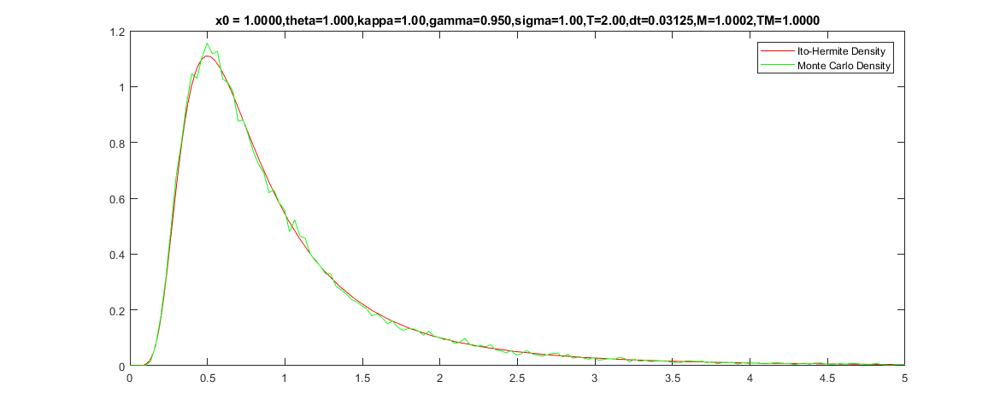](https://postimages.org/)

and the following output on screen.

ItoHermiteMean =

   1.000179598874138

true Mean only applicable to standard SV mean reverting type models otherwise disregard

TrueMean =

     1

yy0 =

   0.760822128415100

Original process average from monte carlo

MCMean =

   0.999179887661539

Original process average from our simulation

ItoHermiteMean =

   1.000179598874138

true Mean only applicble to standard SV mean reverting type models otherwise disregard

TrueMean =

     1

IndexMax =

   904

red line is density of SDE from Ito-Hermite method, green is monte carlo.

---

### #1341 — Amin (Topic Author)
*January 8, 2022, 5:17 AM*

Friends, my mind control continues unabated. This morning I woke up late at 6:20 am. And I could feel the mind control
chemicals in my mouth. And it was very difficult for me to open my eyes and I could feel pain my eyes. Mind control
chemicals in the mouth is a very regular thing but I have not had pain in my eyes for more than a week. They can make
chemicals settle inside the mouth or on the eyes especially when we are relatively still as in our sleep or sitting in
our car seat.

It was a bit late but I decided to go out for my morning walk. And I realized that morning light was pinching in my
eyes. And I also had slight anxiety. I knew that they were able to make me uncomfortable in morning light because mind
control chemicals had settled on my eyes. I washed my eyes several times but it would help only for a few minutes and I
would be uncomfortable again.

Chemical that settles inside the mouth on tongue and upper jaw is equally painful and as a rule they deposit it inside
my mouth during sleep every night. And it is equally painful but I can wash my mouth and brush to alleviate its effect.

I want to tell friends that mind control agents do not want to decease my mind control and their antics continue
unabated.

---

### #1342 — Amin (Topic Author)
*January 10, 2022, 4:48 PM*

Friends, I have been able to somewhat improve the median calculations and the new program has a more robust newton
iteration and also an improved mean. I want to make a few more changes tomorrow and then post the new program here.

---

### #1343 — Amin (Topic Author)
*January 11, 2022, 1:37 PM*

Friends, I have slightly modified the median calculations (median calculation program is the same but one of its input
values has changed) and also changed the starting seed values for Newton iteration. It is a much more robust program but
need for improvement still remains. I learnt that initial seed for Newton iterations can make a large difference and
many SDEs with parameters that were blowing became accurate when I improved the seed for Newton root finding iterations.

Here is the new program.

.

```
function [] = FPESeriesCoeffsFromCumulantsWilmott()

%Copyright Ahsan Amin. Infiniti derivatives Technologies.
%Please fell free to connect on linkedin: linkedin.com/in/ahsan-amin-0a53334
%or skype ahsan.amin2999
%In this program, I am simulating the SDE given as
%dy(t)=mu1 x(t)^beta1 dt + mu2 x(t)^beta2 dt +sigma x(t)^gamma dz(t)

%I have not directly simulated the SDE but simulated the transformed
%Besse1l process version of the SDE and then changed coordinates to retreive
%the SDE in original coo
%rdinates.
%The present program will analytically evolve only the Bessel Process version of the
%SDE in transformed coordinates.

dt=.125/2/2;   % Simulation time interval.%Fodiffusions close to zero
             %decrease dt for accuracy.
Tt=128/2/2*2;%*4*4*1;%*4;%128*2*2*2;     % Number of simulation levels. Terminal time= Tt*dt; //.125/32*32*16=2 year;
T=Tt*dt;

%Below I have done calculations for smaller step size at start.

ds(1:64)=dt/16;
ds(65:128)=dt/4;
if(Tt4)&&(Tt20)
Ts=(64)+((20-4)*4)+(Tt-20);
ds(1:64)=dt/16;
ds(65:128)=dt/4;
ds(129:Ts)=dt;
end
T
sum(ds(1:Ts))
Ts
%str=input('Check if time is right');

OrderA=4;  %
OrderM=4;  %

if(T>=1)
dtM=1/16;%.0625/1;
TtM=T/dtM;
else
dtM=T/16;%.0625/1;
TtM=T/dtM;
end

dNn=.1/1;   % Normal density subdivisions width. would change with number of subdivisions
Nn=46*2;  % No of normal density subdivisions

NnMid=4.0;

x0=1.000;   % starting value of SDE
beta1=0.0;
beta2=1.0;   % Second drift term power.
gamma=.95;%50;   % volatility power.
kappa=01.0;%.950;   %mean reversion parameter.
theta=1.0;%mean reversion target
sigma0=1.00;%Volatility value

%you can specify any general mu1 and mu2 and beta1 and beta2.
mu1=1*theta*kappa;   %first drift coefficient.
mu2=-1*kappa;    % Second drift coefficient.
%mu1=0;
%mu2=0;

alpha=1;% x^alpha is being expanded. This is currently for monte carlo only.
alpha1=1-gamma;%This is for expansion of integrals for calculation of drift
%and volatility coefficients
%yy(1:Nn)=x0;
w0=x0^(1-gamma)/(1-gamma);

Z(1:Nn)=(((1:Nn)-6.5)*dNn-NnMid);
Z
str=input('Look at Z');
ZProb(1)=normcdf(.5*Z(1)+.5*Z(2),0,1)-normcdf(.5*Z(1)+.5*Z(2)-dNn,0,1);
ZProb(Nn)=normcdf(.5*Z(Nn)+.5*Z(Nn-1)+dNn,0,1)-normcdf(.5*Z(Nn)+.5*Z(Nn-1),0,1);
ZProb(2:Nn-1)=normcdf(.5*Z(2:Nn-1)+.5*Z(3:Nn),0,1)-normcdf(.5*Z(2:Nn-1)+.5*Z(1:Nn-2),0,1);

%%%%%%%%%%%%%%%%%%%%%%%%%%%%%%%%%%%%%%%%%%%%%%%%%%%%%%%%%%%%%%%%%%%%%%%%%%%%%%%%%%%%%%%%%%%%%%

sigma11(1:OrderA+1)=0;
mu11(1:OrderA+1)=0;
mu22(1:OrderA+1)=0;
sigma22(1:OrderA+1)=0;
% index 1 correponds to zero level since matlab indexing starts at one.
sigma11(1)=1;
mu11(1)=1;
mu22(1)=1;
sigma22(1)=1;

for k=1:(OrderA+1)
    if sigma0~=0
        sigma11(k)=sigma0^(k-1);
    end
    if mu1 ~= 0
        mu11(k)=mu1^(k-1);
    end
    if mu2 ~= 0
        mu22(k)=mu2^(k-1);
    end
    if sigma0~=0
        sigma22(k)=sigma0^(2*(k-1));
    end
end
%Ft(1:TtM+1,1:(OrderA+1),1:(OrderA+1),1:(OrderA+1),1:(OrderA+1))=0; %General time powers on hermite polynomials
Fp(1:(OrderA+1),1:(OrderA+1),1:(OrderA+1),1:(OrderA+1))=0;%General x powers on coefficients of hermite polynomials.
Fp1(1:(OrderA+1),1:(OrderA+1),1:(OrderA+1),1:(OrderA+1))=0;%General x powers for bessel transformed coordinates.

%YCoeff0 and YCoeff are coefficents for original coordinates monte carlo.
%YqCoeff0 and YqCoeff are bessel/lamperti version monte carlo.

YCoeff0(1:(OrderA+1),1:(OrderA+1),1:(OrderA+1),1:(OrderA+1))=0;
YqCoeff0(1:(OrderA+1),1:(OrderA+1),1:(OrderA+1),1:(OrderA+1))=0;
%Pre-compute the time and power exponent values in small multi-dimensional arrays
YCoeff = ItoTaylorCoeffsNew(alpha,beta1,beta2,gamma); %expand y^alpha where alpha=1;
YqCoeff = ItoTaylorCoeffsNew(alpha1,beta1,beta2,gamma);%expand y^alpha1 where alpha1=(1-gamma)
YqCoeff=YqCoeff/(1-gamma); %Transformed coordinates coefficients have to be
%further divided by (1-gamma)

for k = 0 : (OrderA)
    for m = 0:k
        l4 = k - m + 1;
        for n = 0 : m
            l3 = m - n + 1;
            for j = 0:n
                l2 = n - j + 1;
                l1 = j + 1;
                %Ft(l1,l2,l3,l4) = dtM^((l1-1) + (l2-1) + (l3-1) + .5* (l4-1));
                Fp(l1,l2,l3,l4) = (alpha + (l1-1) * beta1 + (l2-1) * beta2 + (l3-1) * 2* gamma + (l4-1) * gamma ...
                    - (l1-1) - (l2-1) - 2* (l3-1) - (l4-1));
                Fp1(l1,l2,l3,l4) = (alpha1 + (l1-1) * beta1 + (l2-1) * beta2 + (l3-1) * 2* gamma + (l4-1) * gamma ...
                    - (l1-1) - (l2-1) - 2* (l3-1) - (l4-1));

                YCoeff0(l1,l2,l3,l4) =YCoeff(l1,l2,l3,l4).*mu11(l1).*mu22(l2).*sigma22(l3).*sigma11(l4);
                YqCoeff0(l1,l2,l3,l4) =YqCoeff(l1,l2,l3,l4).*mu11(l1).*mu22(l2).*sigma22(l3).*sigma11(l4);
            end
        end
    end
end

%%%%%%%%%%%%%%%%%%%%%%%%%%%%%%%%%%%%%%%%%%%%%%%%%%%%%%%%%%%%%%%%%%%%%%%%%%%%%%%%%%%%%%%%%%%%%%

ExpnOrder=4;
SeriesOrder=4;

wnStart=1;
tic

for tt=1:Ts
    tt
   % t1=(tt-1)*dt;
   % t2=(tt)*dt;
    if(tt==1)
        %dt=ds(1);
        %[wMu0dt,dwMu0dtdw] = BesselDriftAndDerivatives(w0,YqCoeff0,Fp1,gamma,dt,ExpnOrder);
 %       [wMu0dt,dwMu0dtdw] = BesselDriftAndDerivatives02A(w0,mu1,mu2,beta1,beta2,sigma0,gamma,ds(tt),ExpnOrder);

        [wMu0dt,dwMu0dtdw] = BesselDriftAndDerivativesH0(w0,YqCoeff0,Fp1,gamma,ds(tt),ExpnOrder);

      %  dwMu0dtdw
      %  dwMu0dtdwb
      %  wMu0dt
      %  wMu0dtb
      %  str=input('Look at drift');
        c0=wMu0dt+w0;
        c(1)=sigma0*sqrt(ds(tt))
        c(2:10)=0.0;
        w0=c0;

    elseif(tt==2)

    %dt=ds(tt);

    [wMu0dt,dwMu0dtdw] = BesselDriftAndDerivatives02A(w0,mu1,mu2,beta1,beta2,sigma0,gamma,ds(tt),4);
     [b0,b] = CalculateDriftbCoeffs08O4(wMu0dt,dwMu0dtdw,c);

     c0=c0+b0;
     c(1)=b(1)+sqrt(c(1)^2+sigma0^2*ds(tt));
     c(2)=b(2);
     c(3)=b(3);
     c(4)=b(4);

    else

    %dt=ds(tt);
    %below wMu0dta is drift and dwMu0dtdwa are its derivatives.
    %wMu1dt is its first derivative and dwMu1dtdw are derivatives of first
    %derivative.

     %[wMu0dta,dwMu0dtdwa,wMu1dt,dwMu1dtdw] = BesselDriftAndDerivatives08(w0,mu1,mu2,beta1,beta2,sigma0,gamma,dt,10);

     %[wMu0dt,dwMu0dtdw] = BesselDriftAndDerivatives02A(w0,mu1,mu2,beta1,beta2,sigma0,gamma,ds(tt),4);
%     [wMu0dta,dwMu0dtdwa,Ratioa] = BesselDriftAndDerivatives02A(w0,mu1,mu2,beta1,beta2,sigma0,gamma,ds(tt),4);
     [wMu0dt,dwMu0dtdw,Ratio] = BesselDriftAndDerivatives04A(w0,mu1,mu2,beta1,beta2,sigma0,gamma,ds(tt),4);
%     [wMu0dt,dwMu0dtdw] = BesselDriftAndDerivativesH0(w0,YqCoeff0,Fp1,gamma,ds(tt),ExpnOrder);
%wMu0dt-wMu0dta
%Ratio-Ratioa
%dwMu0dtdw-dwMu0dtdwa
%str=input('Look at numbers');

     [b0,b] = CalculateDriftbCoeffs08O4(wMu0dt,dwMu0dtdw,c);
%b0
%b
%str=input('Look at drift values');

%Below bm0 and bm10 are used for claulations of median.

      [wMu0dta,dwMu0dtdwa,wMu1dt,dwMu1dtdw] =
BesselDriftAndDerivatives08Bounded(w0,mu1,mu2,beta1,beta2,sigma0,gamma,ds(tt),4);
      bm0=wMu0dta;
      bm10=wMu1dt;
      bm10=Ratio;
      [NewMedian] = CalculateTotalChangeInMedian(c0,c,bm0,bm10,sigma0,ds(tt));

     %da0=NewMedian-w0-bm0*ds(tt)*1.0;%-1*bm10*bm0*ds(tt)^2/2;

     %da0=.5*sigma0^2*(2*c(2))/c(1)^2*ds(tt)+(.5*sigma0^2*(2*c(2))/c(1)^2).*( .5*sigma0^2*(6*c(3))/c(1)^3-
sigma0^2*(2*c(2))^2/c(1)^4)*ds(tt)^2/2;
     da0=NewMedian-w0-b0;
    b0-(bm0*ds(tt)*1.0+1*bm10*bm0*ds(tt)^2/2)

    %str=input('Look at difference of drift');
     a0=NewMedian;

     %Initial random variable is determined by coefficients given in a
     %below.
    % a(1:4)=c(1:4)+b(1:4);

%    [wVol0dt,dwVol0dtdw] = BesselVolAndDerivatives(w0,mu1,mu2,beta1,beta2,sigma0,gamma,ds(tt),8);
    [wVol0dt,dwVol0dtdw] = BesselVolAndDerivativesH1(w0,YqCoeff0,Fp1,gamma,ds(tt),8);

    [wVol2dt,dwVol2dtdw] = BesselVolAndDerivativesH2(w0,YqCoeff0,Fp1,gamma,ds(tt),8);

 %   wVol0dt
 %   wVol0dta

 %   str=input('Look at vol');

    [g0,g] = CalculateDriftbCoeffs08O4(wVol0dt,dwVol0dtdw,c);
    [h0,h] = CalculateDriftbCoeffs08O4(wVol2dt,dwVol2dtdw,c);

    %h0=0;
    %h(1:4)=0;

    a(1:4)=c(1:4)+b(1:4);

    [da1,da2,da3,da4] = AdvanceSeriesCumulantSolution02New(da0,a,g0,g,h0,h,sigma0,ds(tt));

    c0=a0;
    c(1)=a(1)+da1;
    c(2)=a(2)+da2;
    c(3)=a(3)+da3;
    c(4)=a(4)+da4;

    w0=c0;

    end

end
wnStart=1;

w(1:Nn)=c0;
for nn=1:ExpnOrder
    w(1:Nn)=w(1:Nn)+c(nn)*Z(1:Nn).^nn;
end
Flag=0;
for nn=Nn-1:-1:1
    if((w(nn)<0)&&(Flag==0))
        wnStart=nn+1;
        Flag=1;
    end
end

c0
c

%str=input('Look at numbers')
yy(wnStart:Nn)=((1-gamma).*w(wnStart:Nn)).^(1/(1-gamma));
yy0=((1-gamma).*w0).^(1/(1-gamma));

Dfyy(wnStart:Nn)=0;
for nn=wnStart+1:Nn-1

    Dfyy(nn) = (yy(nn + 1) - yy(nn - 1))/(Z(nn + 1) - Z(nn - 1));

    %Change of variable derivative for densities
end
Dfyy(Nn)=Dfyy(Nn-1);
Dfyy(1)=Dfyy(2);

pyy(1:Nn)=0;
for nn = wnStart:Nn

    pyy(nn) = (normpdf(Z(nn),0, 1))/abs(Dfyy(nn));
end

toc

ItoHermiteMean=sum(yy(wnStart:Nn).*ZProb(wnStart:Nn)) %Original process average from coordinates
disp('true Mean only applicable to standard SV mean reverting type models otherwise disregard');
TrueMean=theta+(x0-theta)*exp(-kappa*T)%Mean reverting SDE original variable true average
yy0

theta1=1;
rng(29079137, 'twister')
paths=50000;
YY(1:paths)=x0;  %Original process monte carlo.
Random1(1:paths)=0;
for tt=1:TtM

    Random1=randn(size(Random1));
    HermiteP1(1,1:paths)=1;
    HermiteP1(2,1:paths)=Random1(1:paths);
    HermiteP1(3,1:paths)=Random1(1:paths).^2-1;
    HermiteP1(4,1:paths)=Random1(1:paths).^3-3*Random1(1:paths);
    HermiteP1(5,1:paths)=Random1(1:paths).^4-6*Random1(1:paths).^2+3;

    YY(1:paths)=YY(1:paths) + ...
        (YCoeff0(1,1,2,1).*YY(1:paths).^Fp(1,1,2,1)+ ...
        YCoeff0(1,2,1,1).*YY(1:paths).^Fp(1,2,1,1)+ ...
        YCoeff0(2,1,1,1).*YY(1:paths).^Fp(2,1,1,1))*dtM + ...
        (YCoeff0(1,1,3,1).*YY(1:paths).^Fp(1,1,3,1)+ ...
        YCoeff0(1,2,2,1).*YY(1:paths).^Fp(1,2,2,1)+ ...
        YCoeff0(2,1,2,1).*YY(1:paths).^Fp(2,1,2,1)+ ...
        YCoeff0(1,3,1,1).*YY(1:paths).^Fp(1,3,1,1)+ ...
        YCoeff0(2,2,1,1).*YY(1:paths).^Fp(2,2,1,1)+ ...
        YCoeff0(3,1,1,1).*YY(1:paths).^Fp(3,1,1,1))*dtM^2 + ...
        ((YCoeff0(1,1,1,2).*YY(1:paths).^Fp(1,1,1,2).*sqrt(dtM))+ ...
        (YCoeff0(1,1,2,2).*YY(1:paths).^Fp(1,1,2,2)+ ...
        YCoeff0(1,2,1,2).*YY(1:paths).^Fp(1,2,1,2)+ ...
        YCoeff0(2,1,1,2).*YY(1:paths).^Fp(2,1,1,2)).*dtM^1.5) .*HermiteP1(2,1:paths) + ...
        ((YCoeff0(1,1,1,3).*YY(1:paths).^Fp(1,1,1,3) *dtM) + ...
        (YCoeff0(1,1,2,3).*YY(1:paths).^Fp(1,1,2,3)+ ...
        YCoeff0(1,2,1,3).*YY(1:paths).^Fp(1,2,1,3)+ ...
        YCoeff0(2,1,1,3).*YY(1:paths).^Fp(2,1,1,3)).*dtM^2).*HermiteP1(3,1:paths) + ...
        ((YCoeff0(1,1,1,4).*YY(1:paths).^Fp(1,1,1,4)*dtM^1.5 )).*HermiteP1(4,1:paths) + ...
        (YCoeff0(1,1,1,5).*YY(1:paths).^Fp(1,1,1,5)*dtM^2.0).*HermiteP1(5,1:paths);

end

YY(YY<0)=0;
disp('Original process average from monte carlo');
MCMean=sum(YY(:))/paths %origianl coordinates monte carlo average.
disp('Original process average from our simulation');
ItoHermiteMean=sum(yy(wnStart:Nn).*ZProb(wnStart:Nn)) %Original process average from coordinates

disp('true Mean only applicble to standard SV mean reverting type models otherwise disregard');
TrueMean=theta+(x0-theta)*exp(-kappa*T)%Mean reverting SDE original variable true average

MaxCutOff=30;
NoOfBins=round(1*500*gamma^2*4*sigma0/sqrt(MCMean)/(1+kappa));%Decrease the number of bins if the graph is too
[YDensity,IndexOutY,IndexMaxY] = MakeDensityFromSimulation_Infiniti_NEW(YY,paths,NoOfBins,MaxCutOff );
plot(yy(wnStart+1:Nn-1),pyy(wnStart+1:Nn-1),'r',IndexOutY(1:IndexMaxY),YDensity(1:IndexMaxY),'g');
 %plot(y_w(wnStart+1:Nn-1),fy_w(wnStart+1:Nn-1),'r',IndexOutY(1:IndexMaxY),YDensity(1:IndexMaxY),'g',Z(wnStart+1:Nn-1),fy_w(wnStart+1:Nn-1),'b');

title(sprintf('x0 = %.4f,theta=%.3f,kappa=%.2f,gamma=%.3f,sigma=%.2f,T=%.2f,dt=%.5f,M=%.4f,TM=%.4f',
x0,theta,kappa,gamma,sigma0,T,dt,ItoHermiteMean,TrueMean));%,sprintf('theta= %f', theta), sprintf('kappa = %f',
kappa),sprintf('sigma = %f', sigma0),sprintf('T = %f', T));

legend({'Ito-Hermite Density','Monte Carlo Density'},'Location','northeast')

str=input('red line is density of SDE from Ito-Hermite method, green is monte carlo.');

end
```

.

.

.

```
function [wMu0dt,dwMu0dtdw,Ratio] = BesselDriftAndDerivatives04A(w0,mu1,mu2,beta1,beta2,sigma0,gamma,dt,ExpnOrder)

NoOfTerms=9;%excluding dt^3 terms

YqCoeff(1:NoOfTerms)=0.0;
Fp(1:NoOfTerms)=0.0;
a0=((beta1-gamma)/(1-gamma));
b0=((beta2-gamma)/(1-gamma));
A=mu1;
B=mu2;
C=-.5*sigma0^2*gamma;
dt2=dt^2/2;

YqCoeff(1:9)=0;

YqCoeff(1)=A*dt;
YqCoeff(2)=B*dt;
YqCoeff(3)=C*dt;

 YqCoeff(4)=A^2*a0*dt2*(1-gamma);
 YqCoeff(5)=B^2*b0*dt2*(1-gamma);
 YqCoeff(6)=1*1.5*.66*C^2*(-1)*dt2*(1-gamma)+1*1.5*.66* C*(-1)*(-2)*.5*sigma0^2 *dt2*(1-gamma)^2;
 YqCoeff(7)=A*B*(a0+b0)*dt2*(1-gamma);
 YqCoeff(8)=1*1.5*.66*A*C*(a0-1)*dt2*(1-gamma)^1+1*1.5*.66*.5*sigma0^2*A*a0*(a0-1)*dt2*(1-gamma)^2;
 YqCoeff(9)=1*1.5*.66*B*C*(b0-1)*dt2*(1-gamma)^1+1*1.5*.66*.5*sigma0^2*B*b0*(b0-1)*dt2*(1-gamma)^2;

Fp(1)=(beta1-gamma)/(1-gamma);
Fp(2)=(beta2-gamma)/(1-gamma);
Fp(3)=-1;

Fp(4)=2*(beta1-gamma)/(1-gamma)-1;
Fp(5)=2*(beta2-gamma)/(1-gamma)-1;
Fp(6)=-3;
Fp(7)=(beta1-gamma)/(1-gamma)+(beta2-gamma)/(1-gamma)-1;
Fp(8)=(beta1-gamma)/(1-gamma)-2;
Fp(9)=(beta2-gamma)/(1-gamma)-2;

 Ratio=2/dt*(YqCoeff(4)*((1-gamma)*w0).^Fp(4)+YqCoeff(5)*((1-gamma)*w0).^Fp(5)+YqCoeff(6)*((1-gamma)*w0).^Fp(6)+ ...
     YqCoeff(7)*((1-gamma)*w0).^Fp(7)+YqCoeff(8)*((1-gamma)*w0).^Fp(8)+YqCoeff(9)*((1-gamma)*w0).^Fp(9))/ ...
     (YqCoeff(1)*((1-gamma)*w0).^Fp(1)+YqCoeff(2)*((1-gamma)*w0).^Fp(2)+YqCoeff(3)*((1-gamma)*w0).^Fp(3));

Fp2(1:9)=Fp(1:9);%/(1-gamma);

wMu0dt0=0;
dwMu0dt(1:ExpnOrder)=0.0;

wMu0dt=0;
dwMu0dtdw(1:ExpnOrder)=0.0;

for mm=1:NoOfTerms

    wMu0dt0=YqCoeff(mm).*((1-gamma)*w0).^Fp2(mm);
    for nn=1:ExpnOrder
        if(nn==1)
            dwMu0dt(nn)=wMu0dt0*Fp2(mm)*1/w0;
        else
        dwMu0dt(nn)=dwMu0dt(nn-1)*(Fp2(mm)-(nn-1))/w0;
        end
    end
    wMu0dt=wMu0dt+wMu0dt0;
    for nn=1:ExpnOrder
        dwMu0dtdw(nn)=dwMu0dtdw(nn)+dwMu0dt(nn);
    end

end

end
```

.

.

.

```
function [da1,da2,da3,da4] = AdvanceSeriesCumulantSolution02New(da0,a,g0,g,h0,h,sigma0,dt)

g0=g0+sigma0*sqrt(dt);
%h0=0;
%h(1:4)=0;
%da0=0;
[dC2,dC3,dC4] = CalculateCumulantsHighOrder(g0,g,h0,h);

dC1=0;
%dC2=sigma0^2*dt;
%dC3=0;
%dC4=0;

a1=a(1);
a2=a(2);
a3=a(3);
a4=a(4);

C2=a1^2 - a2^2 + 114 *a4^2 + 15* (a3^2 + 2* a2* a4) + ...
 3* (a2^2 + 2* a1* a3 - 2* a2* a4 - 6* a4^2);

da1=sqrt(a1^2+g0^2)-a1;
da1=(g0+sigma0*sqrt(dt)+g(2)+3*g(4))/sqrt(C2+dC2);
da2=(h0+h(2)+3*h(4))/sqrt(C2+dC2);
da3=0;
da4=0;

%da1=sqrt(a1^2+g0^2)-a1;
%da1=sqrt(dC2)/sqrt(C2+dC2);
%da2=(dC2)/(C2+dC2);
%da3=0;
%da4=0;

da(1,1)=da1;
da(2,1)=da2;
da(3,1)=da3;
da(4,1)=da4;
daIn=da;
[F,dF] = CalculateCumulantsAndDerivatives(dC1,dC2,dC3,dC4,a1,a2,a3,a4,da0,da1,da2,da3,da4);
ObjBest=F(1,1)^2+F(2,1)^2+F(3,1)^2+F(4,1)^2;
da1Best=da1;
da2Best=da2;
da3Best=da3;
da4Best=da4;

nn=0;
while((nn.00000000001) || (abs(F(2,1))>.00000000001) || (abs(F(3,1))>.00000000001) || (abs(F(4,1))>.00000000001)))
nn=nn+1;
da=da-dF\F;

%inv(dF)

da1=da(1,1);
da2=da(2,1);
da3=da(3,1);
da4=da(4,1);

[F,dF] = CalculateCumulantsAndDerivatives(dC1,dC2,dC3,dC4,a1,a2,a3,a4,da0,da1,da2,da3,da4);
 ObjNew=F(1,1)^2+F(2,1)^2+F(3,1)^2+F(4,1)^2;

%  if(ObjBest<ObjNew)
%      da1=da1Best;%*.8+da1*.2;
%      da2=da2Best;%*.8+da2*.2;
%      da3=da3Best;%*.8+da3*.2;
%      da4=da4Best;%*.8+da4*.2;
%  else
%      ObjBest=ObjNew;
%      da1Best=da1;
%      da2Best=da2;
%      da3Best=da3;
%      da4Best=da4;
%  end

end
% da1=da1Best;
% da2=da2Best;
% da3=da3Best;
% da4=da4Best;
da-daIn
nn
%str=input('Look at results');

%a(1)=a1+da1;
%a(2)=a2+da2;
%a(3)=a3+da3;
%a(4)=a4+da4;

end

```

.

.

.

```
function [NewMedian] = CalculateTotalChangeInMedian(a0,a,b0,b10,sigma0,dt)

NewMedian=a0+(b0+.5*sigma0^2*(2*a(2))/a(1)^2)*dt + ...
    (b0+.5*sigma0^2*(2*a(2))/a(1)^2)*(b10+.5*sigma0^2*1/a(1)^2 + .5*sigma0^2*(6*a(3))/a(1)^3-
sigma0^2*(2*a(2))^2/a(1)^4)*dt^2/2;

end

```

---

### #1344 — Amin (Topic Author)
*January 11, 2022, 2:01 PM*

Some work still remains to be done to improve the initial seed for Newton Root finding especially when kappa is very
high. I have improved it from before but some further work needs to be done.

These are a few graphs that I quickly made with the program I have posted. Parameters of the SDE are on title of the
graphs.

.

.

[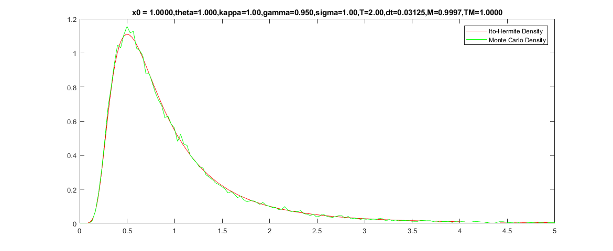](https://postimages.org/)

[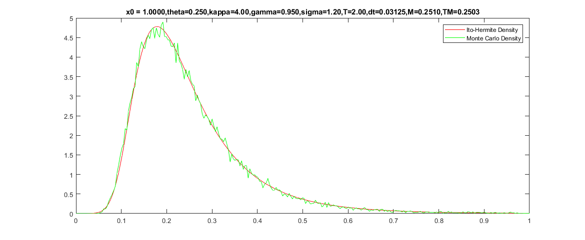](https://postimages.org/)

[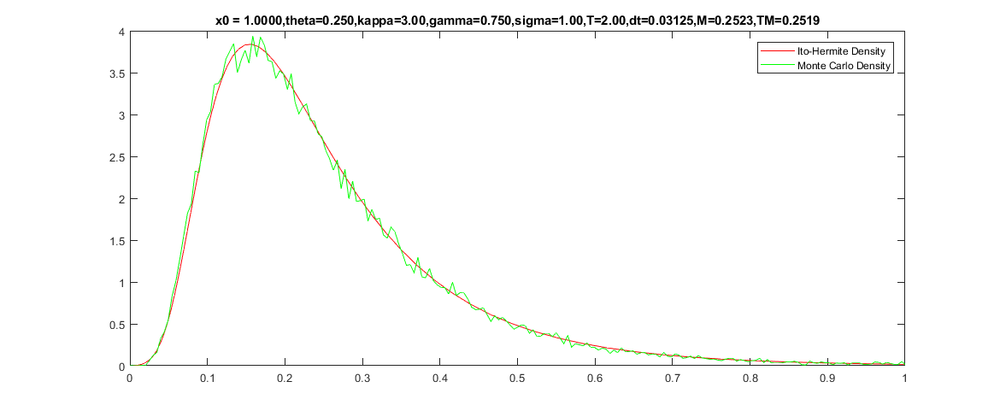](https://postimages.org/)

[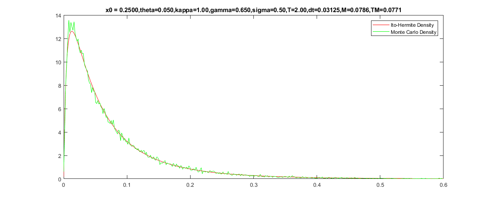](https://postimages.org/)

[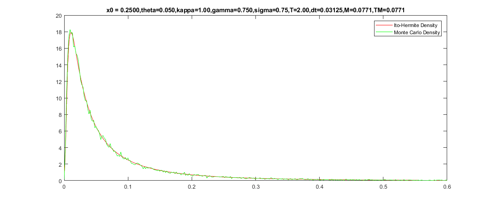](https://postimages.org/)

[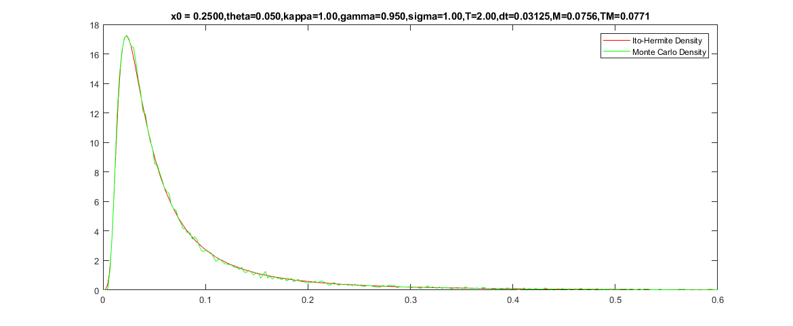](https://postimages.org/)

[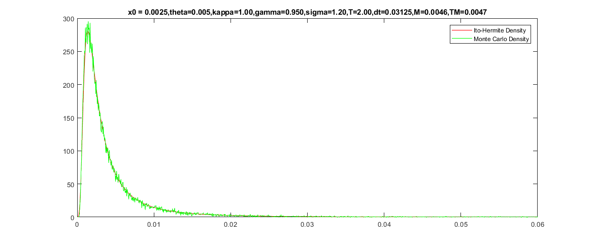](https://postimages.org/)

[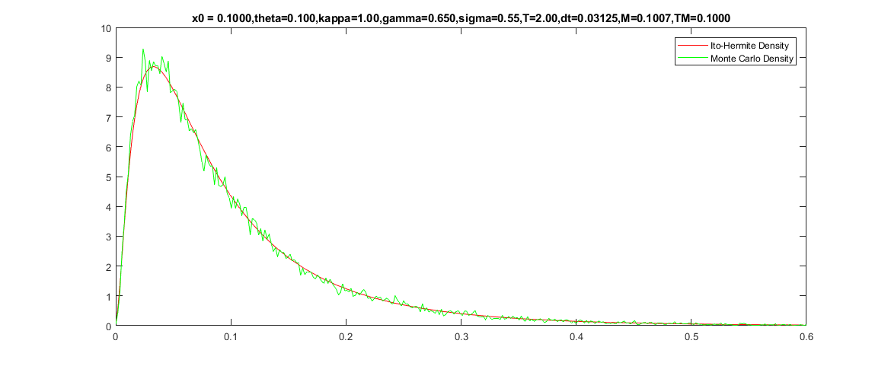](https://postimages.org/)

[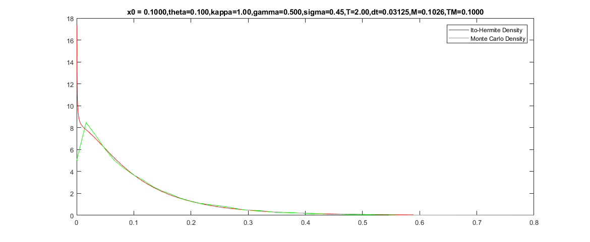](https://postimages.org/)

---

### #1345 — Amin (Topic Author)
*January 12, 2022, 5:00 PM*

Friends, I have used the term from Fokker-planck solution of SDEs as an initial guess for Newton iteration. The term
from FPE solution that can be extremely cheaply computed is given as

$=.5  {\sigma}^2  dt \, \frac{dZ}{dw} $

But Newton iteration requires comprehensive strategy. Only a good initial seed is not the only thing, one has to
properly check on every iteration if Newton iteration has gone astray(exploded, diverged etc)  and if it actually does
diverge, one has to re-start newton iteration with a different suitable seed. Here are reworked relevant parts of the
program.

.

.

```
function [da1,da2,da3,da4] = AdvanceSeriesCumulantSolution02New(da0,a,g0,g,h0,h,sigma0,dt)

g0=g0+sigma0*sqrt(dt);
%h0=0;
%h(1:4)=0;
%da0=0;
[dC2,dC3,dC4] = CalculateCumulantsHighOrder(g0,g,h0,h);

dC1=0;
%dC2=sigma0^2*dt;
%dC3=0;
%dC4=0;

a1=a(1);
a2=a(2);
a3=a(3);
a4=a(4);

DZa0=a(1);
DZa(1)=2*a(2);
DZa(2)=3*a(3);
DZa(3)=4*a(4);

[DZaI0,DZaI] = SeriesReciprocal(DZa0,DZa,3);

C2=a1^2 - a2^2 + 114 *a4^2 + 15* (a3^2 + 2* a2* a4) + ...
 3* (a2^2 + 2* a1* a3 - 2* a2* a4 - 6* a4^2);

da10=sqrt(a1^2+g0^2)-a1;
%da1=(g0+sigma0*sqrt(dt)+g(2)+3*g(4))/sqrt(C2+dC2);
da20=(h0+h(2)+3*h(4))/sqrt(C2+dC2);
da3=0;
da4=0;

da1=.5*sigma0^2*dt*DZaI0;
da2=.5*sigma0^2*dt*DZaI(1)/2;
da3=.5*sigma0^2*dt*DZaI(2)/3;
da4=.5*sigma0^2*dt*DZaI(3)/4;
%da3=0;
%da4=0;

da10
da1
da20
da2
%str=input('Look at coefficients');
da(1,1)=da1;
da(2,1)=da2;
da(3,1)=da3;
da(4,1)=da4;
daIn=da;
[F,dF] = CalculateCumulantsAndDerivatives(dC1,dC2,dC3,dC4,a1,a2,a3,a4,da0,da1,da2,da3,da4);
ObjBest=F(1,1)^2+F(2,1)^2+F(3,1)^2+F(4,1)^2;
da1Best=da1;
da2Best=da2;
da3Best=da3;
da4Best=da4;

nn=0;
while((nn.00000000001) || (abs(F(2,1))>.00000000001) || (abs(F(3,1))>.00000000001) || (abs(F(4,1))>.00000000001)))
nn=nn+1;
da=da-dF\F;

%inv(dF)

da1=da(1,1);
da2=da(2,1);
da3=da(3,1);
da4=da(4,1);

[F,dF] = CalculateCumulantsAndDerivatives(dC1,dC2,dC3,dC4,a1,a2,a3,a4,da0,da1,da2,da3,da4);
 ObjNew=F(1,1)^2+F(2,1)^2+F(3,1)^2+F(4,1)^2;

%  if(ObjBest<ObjNew)
%      da1=da1Best;%*.8+da1*.2;
%      da2=da2Best;%*.8+da2*.2;
%      da3=da3Best;%*.8+da3*.2;
%      da4=da4Best;%*.8+da4*.2;
%  else
%      ObjBest=ObjNew;
%      da1Best=da1;
%      da2Best=da2;
%      da3Best=da3;
%      da4Best=da4;
%  end

end
% da1=da1Best;
% da2=da2Best;
% da3=da3Best;
% da4=da4Best;
%da-daIn
da1
da2
da3
da4
nn
%str=input('Look at results');

%a(1)=a1+da1;
%a(2)=a2+da2;
%a(3)=a3+da3;
%a(4)=a4+da4;

end

```

.

.

.

```
function [c0,c] = SeriesReciprocal(a0,a,SeriesOrder)

Mul=1/(a0);
a0=1;
a(1:SeriesOrder)=a(1:SeriesOrder)/a0;

c0=1/a0;
c(1:SeriesOrder)=0;
for nn=1:SeriesOrder
    c(nn)=c(nn)-c0/a0*a(nn);
    for kk=1:nn-1
        c(nn)=c(nn)-c(kk)/a0*a(nn-kk);
    end
end

c0=c0*Mul;
c(1:SeriesOrder)=c(1:SeriesOrder)*Mul;

end

```

.

.

Please note that I have reworked the Series Reciprocal function. This new function is what one must use with our
previous FPE series solution program.

Instead of this block in first function.

```
da1=.5*sigma0^2*dt*DZaI0;
da2=.5*sigma0^2*dt*DZaI(1)/2;
da3=.5*sigma0^2*dt*DZaI(2)/3;
da4=.5*sigma0^2*dt*DZaI(3)/4;
```

.

Plese also try.

.

```
da1=.5*g0^2*DZaI0;
da2=.5*g0^2*DZaI(1)/1;
da3=.5*g0^2*DZaI(2)/1;
da4=.5*g0^2*DZaI(3)/1;
```

---

### #1346 — Amin (Topic Author)
*January 12, 2022, 5:30 PM*

Sorry friends, please use this new version of the function instead of the one in previous post. It is more stable in
Newton root-finding.

.

.

```
function [da1,da2,da3,da4] = AdvanceSeriesCumulantSolution02New(da0,a,g0,g,h0,h,sigma0,dt)

g0=g0+sigma0*sqrt(dt);
%h0=0;
%h(1:4)=0;
%da0=0;
[dC2,dC3,dC4] = CalculateCumulantsHighOrder(g0,g,h0,h);

dC1=0;
%dC2=sigma0^2*dt;
%dC3=0;
%dC4=0;

a1=a(1);
a2=a(2);
a3=a(3);
a4=a(4);

DZa0=a(1);
DZa(1)=2*a(2);
DZa(2)=3*a(3);
DZa(3)=4*a(4);

[DZaI0,DZaI] = SeriesReciprocal(DZa0,DZa,3);

C2=a1^2 - a2^2 + 114 *a4^2 + 15* (a3^2 + 2* a2* a4) + ...
 3* (a2^2 + 2* a1* a3 - 2* a2* a4 - 6* a4^2);

da10=sqrt(a1^2+g0^2)-a1;
%da1=(g0+sigma0*sqrt(dt)+g(2)+3*g(4))/sqrt(C2+dC2);
da20=(h0+h(2)+3*h(4))/sqrt(C2+dC2);
da3=0;
da4=0;

da1=.5*g0^2*DZaI0;
da2=.5*g0^2*DZaI(1)/1;
da3=.5*g0^2*DZaI(2)/1;
da4=.5*g0^2*DZaI(3)/1;
%da3=0;
%da4=0;

da10
da1
da20
da2
%str=input('Look at coefficients');
da(1,1)=da1;
da(2,1)=da2;
da(3,1)=da3;
da(4,1)=da4;
daIn=da;
[F,dF] = CalculateCumulantsAndDerivatives(dC1,dC2,dC3,dC4,a1,a2,a3,a4,da0,da1,da2,da3,da4);
ObjBest=F(1,1)^2+F(2,1)^2+F(3,1)^2+F(4,1)^2;
da1Best=da1;
da2Best=da2;
da3Best=da3;
da4Best=da4;

nn=0;
while((nn.00000000001) || (abs(F(2,1))>.00000000001) || (abs(F(3,1))>.00000000001) || (abs(F(4,1))>.00000000001)))
nn=nn+1;
da=da-dF\F;

%inv(dF)

da1=da(1,1);
da2=da(2,1);
da3=da(3,1);
da4=da(4,1);

[F,dF] = CalculateCumulantsAndDerivatives(dC1,dC2,dC3,dC4,a1,a2,a3,a4,da0,da1,da2,da3,da4);
 ObjNew=F(1,1)^2+F(2,1)^2+F(3,1)^2+F(4,1)^2;

  if(ObjBest<ObjNew)
      da1=da1Best;%*.8+da1*.2;
      da2=da2Best;%*.8+da2*.2;
      da3=da3Best;%*.8+da3*.2;
      da4=da4Best;%*.8+da4*.2;
  else
      ObjBest=ObjNew;
      da1Best=da1;
      da2Best=da2;
      da3Best=da3;
      da4Best=da4;
  end

end
 da1=da1Best;
 da2=da2Best;
 da3=da3Best;
 da4=da4Best;
%da-daIn
da1
da2
da3
da4
nn
%str=input('Look at results');

%a(1)=a1+da1;
%a(2)=a2+da2;
%a(3)=a3+da3;
%a(4)=a4+da4;

end

```

---

### #1347 — Amin (Topic Author)
*January 13, 2022, 11:38 AM*

>
> Friends, I have used the term from Fokker-planck solution of SDEs as an initial guess for Newton iteration. The term
from FPE solution that can be extremely cheaply computed is given as
>
>
>
> $=.5  {\sigma}^2  dt \, \frac{dZ}{dw} $
>
.

Sorry the actual term is

$=.5  {\sigma}^2  dt \, Z\, \frac{dZ}{dw} $

I have implemented it correctly in yesterday's program.

---

### #1348 — Amin (Topic Author)
*January 15, 2022, 11:58 AM*

Friends, past few days have been relatively reasonable. Things I have been complaining about previously still continue.
They continue to use mind control chemicals that settle on my face and on my tongue during my sleep. They also continue
to use gas-like chemicals that settle on my face while I am driving and it truly makes me feel great anxiety.

But there is this one thing that these anal and nasty heroes of mind control agencies start doing when I start working
is that they start charging my back and give me very strong itch in my back to make me totally uncomfortable. I have not
been writing about this thing since it is not nice to mention such things about myself on prestigious professional
forums. But nasty and lowly mind control agents continue to increase frequencies of their lasers and whenever I start to
work they start employing this trick to make me uncomfortable. Americans in general are not nasty and anal like this but
I wonder where they get these mind control agents from.

I was not going to write this post but as soon as I started working now, they started charging my back and started
giving me strong itch in the back and anus.

They used to have low-powered lasers and I still recall that when I would sleep, I would put pillows around myself and I
would have a sound sleep after that. But they continue to increase intensity of their lasers and now they can easily
give me itch through several pillows and very thick and hard plastic sheets put together.

---

### #1349 — Amin (Topic Author)
*January 16, 2022, 8:48 AM*

Friends, very sorry that function "SeriesReciprocal"  that I distributed earlier has a serious error in it. It throws
away some results. The mistake was not obvious in the last program since we were using it only for input seed into
Newton root-finding iterations.

Here is the new corrected program. Please pardon earlier error. At a lot of places you will get better results now.

```
function [c0,c] = SeriesReciprocal(a0,a,SeriesOrder)

Mul=1/(a0);
a(1:SeriesOrder)=a(1:SeriesOrder)/a0;
a0=1;

c0=1/a0;
c(1:SeriesOrder)=0;
for nn=1:SeriesOrder
    c(nn)=c(nn)-c0/a0*a(nn);
    for kk=1:nn-1
        c(nn)=c(nn)-c(kk)/a0*a(nn-kk);
    end
end

c0=c0*Mul;
c(1:SeriesOrder)=c(1:SeriesOrder)*Mul;

end

```

---

### #1350 — Amin (Topic Author)
*January 19, 2022, 6:45 PM*

Friends, mind control agents continue to use gas again inside our house. It feels suffocating inside the drawing room
where I am working(I started using it two days ago after a period of more than six months) and also in my room. I have
to go out in the open again and again to feel better. It is second week after the antipsychotic injection so my
productivity is better and therefore mind control agencies are openly using suffocating gases to control me and stop me
from doing work. I want to appeal to humanity of good people and want to tell them that it is very difficult and a
miserable feeling to be breathing in the gas that feels suffocating. Please protest to these mind control agencies to
stop using inhuman tactics on innocent civilians.

Despite the cold weather, I keep window of my room open and keep the ceiling fan running to decrease the effect of
gases. Please try to help end this torture.

---

[← Previous](page_026.md) | [Index](index.md) | [Next →](page_028.md)
