# Breakthrough in the theory of stochastic differential equations and their simulation

**Page 28 of 65** — Posts #1351–#1400

[← Previous](page_027.md) | [Index](index.md) | [Next →](page_029.md)

---

### #1351 — Amin (Topic Author)
*January 21, 2022, 11:15 AM*

Friends I have started a different thread in trading forum titled: [Application of Filtering Principles Towards Trading Stock Prices](https://forum.wilmott.com/viewtopic.php?f=38&t=102668)

Here is the link to my thread on trading forum:  https://forum.wilmott.com/viewtopic.php?f=38&t=102668

> Friends, I have previously mentioned on the forum that I have devised my own trading algorithms based on filtering
theory applied in a different and innovative way. I am sharing performance of my algorithm on Tesla stock for 40 days
from 5th of April 2021 to 30th of May 2021. I have posted graphs that show profits from my trading strategy and the
Tesla stock price for 40 days. Title of each of the 40 graphs is the date on that trading day. On the graphs trades are
marked and a the blue "+" means entering a buy side of the trade while a red "o" means entering a sell side of the
trade. Black lines are profits and green line marked with trades is Tesla stock mid-price.

---

### #1352 — Amin (Topic Author)
*January 22, 2022, 1:11 PM*

Friends I have told several times on this forum when I was a masters student at a US University some Jewish professors
were slighted by my talent and creativity for mathematics. They had links to US defense and they also knew Billionaire
Jewish Godfather of mind control. The Jewish professors persuaded the Billionaire Jewish Godfather that I had talent for
mathematics in financial markets and I must be stopped and persecuted. Hence US mind control infrastructure started my
mind control persecution. At that time my university officials were very enthusiastic about my persecution since they
had realized that a Billionaire was interested in my mind control and they were getting written in good books of the
Billionaire.

Before I continue I would ask people to never generalize what I have written about a small group of bad jews to all jews
and not misunderstand me. Most jews are very good humans and they have earned their place in American society over a
period of long time by contributing to almost every facet and dimension of American society. And they are thorough
Americans. Some prominent jews are true role models for what a good human should be. And again most jews are thorough
gentlemen and very good humans.

Billionaire Jewish Godfather has strong links with American defense and he is among the influential circle that affects
the decisions of American defense. Among other things, they maintain relationships with serving officers in Army and
when these officers retire they are given extremely lucrative jobs paying millions of dollars in Godfather and some
other Jewish firms. This is one of the ways American defense remains under their influence. And many serving officers
remain very faithful to Godfather and his cohort since they bitterly want to enter his paradise after retirement. I am
not speaking about first Iraq war but second Iraq war was started on flimsy and concocted excuses under pressure from
people who influence US defense. When faithful defense officials can go to the limit of causing millions of deaths by
their actions, I am just a very little fry for them to take care to please the Godfather.

I want to tell friends that in my country there is a systematic US defense effort to retard talented people in computer
science and mathematics. There are more than three hundred extremely talented people who are always kept under mind
control. I am very very lucky to be able to speak under mind control and avoid being retarded. US defense gives several
hundred million dollars to Pakistan Army generals and influential people to continue mind control of talented people.
These influential people are told to be as good and honest in all matters as possible but only lobby for mind control of
talented individuals. They are told to maintain as honest image in eyes of people as possible by doing whatever it takes
but only do one wrong thing that is make efforts to continue and increase mind control. They are told we are not
concerned what you do in other matters, we just want to retard these people and tens of millions of dollars are given to
each influential person or general. When such large sums of money are given to people, they no longer have any nation,
religion, humanity or ethics, they just want money regularly every year and are ready to do whatever it takes to
continue mind control. In Pakistan army makes sure that a lot of food remains contaminated with mind control chemicals.
To tell friends who are unaware that these are inert chemicals that remain inactive but get ionized when Electromagnetic
waves are directed on the individual who has eaten food. After getting ionized these mind control chemicals bond with
various neurotransmitters and these neurotransmitters are blocked in the brain cutting off several parts of the victim's
brain making him unable to think properly and with a full mind. In Pakistan it is impossible to find good coffee since
all coffee is drugged with mind control chemicals and army makes sure that every importer, distributor or manufacturer
drugs the coffee with mind control chemicals before putting it to market. Large number of drinks and beverages including
bottled water is drugged by beverage companies at manufacturing source upon insistence of Pakistan Army. Similarly
soaps, many creams or shampoos have mind control chemicals that help making the EM waves resonance effective when these
waves are guided on the victim. It is almost impossible to find a good soap in Pakistan and I have survived by using
some medicated soaps, handmade soaps or some soaps that were manufactured several years ago and still remained on
shelves and I have to find them. Tea used to be better but most brands of tea are getting drugged with mind control
chemicals at manufacturing source recently. All of this is done and ensured by intelligence services of Pakistan army.

All of this is done by American defense on behest of some bad jews in United States. I want to tell friends that I am
not anti-semite or anything of the sort. I believe that it is perfectly a good thing to use Jewsih influence to stop any
wrong happening to a jew or use jewish influence even if Israel is under threat of attack by any arab neighbor etc.
These are all justified jewish concerns and if they use their influence to ensure the safety of Jews and protect their
rightful interests, it is a perfectly valid and a good thing. But when some bad Jewish circles high-handedly goad
American defense to retard Muslims in US and also make a systematic apparatus of mind control of talented Muslims in our
countries, somebody has to speak up.

Mind control agencies tell other governments that they are controlling bad and evil neurotransmitters of bad people.
This is a total and shameless lie. At times, they go to the limit of orchestrating hundreds of agents to control a
single victim. US defense is so suave in doing sting operations. Why do they not plot with a few people to make the
victim do something bad and get him with all the proof of evil and wrongdoing? Why do they not keep an eye on these evil
people and nab them right before these supposedly evil people want to commit any crime with all the proof to put them
behind bars forever.(They stole my phone twice and I could not preclude the possibility that they would use it for some
terrorist threat or something else illegal since mind control agencies were bitter to find a way to validate my
persecution but I raised a lot of hue and cry on forums so nothing happened). But please write my words in stone that
American defense would never agree to freeing any mind control victims. They are very aware these are good, talented and
law-abiding people who would excel in life if they are not kept in mind control. At this stage when thousands of people
are in mind control, making them free means a fatal blow to the reputation of American defense when all the victims
would start contributing to their societies and there would be anger against US defense to put all these people on mind
control torture for years or decades. Please know if a mathematician or a Computer science expert is on mind control.
they have some exceptional talent and special neurotransmitters and somebody has taken a slight in their talent.

I also want to tell Europeans that mind control in Europe is also done on extremely talented and intelligent
individuals. Though institutions are relativley stonger in Europe and America than in our countries, human nature is the
same. Us defnse gives upwards of 10 billion dollars each year in bribes all over the world and a large portion of these
bribes go to European corrupt but influential people who are moved to make sure that innocent people continue to get
targeted with mind control. Again these people are told to maintain their honesty and dignity in other affairs but make
sure that mind control continues in their countries and they would be regularly reimbursed with tens of millions of
dollars in bribes every year. I want to request Europeans if they do not beleive in me, please use your embassy in
Pakistan to investigate and the embassy staff would tell you that only talented and innocent people are put on mind
control in Pakistan.

American defense has global reach and stops people all over the world from doing business with my small one person
company. A few days ago when I emailed performance of my models to a guy in Singapore, he was very excited but all of a
sudden stopped communicating at all. BTW Singapore is no exception to mind control. While going to Hong Kong in year
2001, I stopped in Singapore for three days and I still recall that earth slipped beneath my feet when I noticed that
every drink I try one after another was drugged with mind control chemicals in their famous orchard mall.

I want to request friends to please free me from mind control. I might be somewhat creative but there are far more
intelligent and smarter people in the world. Anything creative I would do, many people will catch and do far more
smarter and intelligent things out of it. I keep a lot of my research open and otherwise give people enough ideas about
it. It is science and advancement of science due to which we have been able to build modern civilization as humanity
exists today. Without science any of this would never be possible. I am proud that I do science and believe in
advancement and better understanding of science because this is the only thing without which humanity as we see today
would never be possible.

I have said something bad about some Jews but I would again like to tell people when I was at Northwestern where I
transferred in Junior year, a very celebrated and busy Jewish professor spent more than an hour advising me to work very
hard and not make a big deal about anything else other than my studies when he knew I was a new transfer. This happened
when I went to his office to take help about a problem. He also lent me several books to study. He was one heck of a
remarkable human being. I have no intention of generalizing anything I have said about some few bad jews to jews in
general.

---

### #1353 — Amin (Topic Author)
*January 23, 2022, 2:28 AM*

Friends, my biweekly antipsychotic injection is due today.  As I have told friends previously that they drug
antipsychotic injections and pills with mind control chemicals to control the victims. I am very sure that today they
will have several tens of agents of Pakistan army moving around on motorcycles to approach the pharmacies in some area I
go to buy the injections and ask them to sell me the particular injection. If friends do not keep a vigil, American
defense wants to silence me forever. I will also request foreign embassies in Pakistan to keep a vigil and pressurize
army to refrain from any such practice. I again want to warn friends that American defense wants to silence me forever
and they would certainly try to drug the injection today with very potent mind control chemicals(they have far stronger
chemicals that they do not use unless bitterly needed.) to silence me forever.

I will try to get the injection in the evening.

---

### #1354 — Amin (Topic Author)
*January 23, 2022, 11:09 AM*

I got antipsychotic injection just a bit ago. I was careful to buy the injection and also bought my syringe and came to
this pharmacy where I always ask the staff to inject me. I always buy the injection from different places but I always
go to the same pharmacy close to our home to get injected. When the staff came they brought their own needle. I took his
needle from him and asked him to use the same needle that is already on the syringe. He agreed and filled the syringe
with injection. Meanwhile I placed the needle away from him on a table away from him thinking he would really use my
needle. But later he walked ahead and put the needle I had placed on a different table on the syringe. When I asked him
that I had insisted that he should use my needle, he said that it was too thick. I asked him to still use the thick
needle but he said that he had thrown it in the garbage bin. I asked him to pick the needle and use it. He bowed down
and just moved around the bin and said I found the needle and have put it on the syringe. I could not see carefully but
I still think it was his needle. My mother was also there and was already asking what was wrong with the needle so I
could not be stern about anything of the sort to make a big deal and had to get injected. Next time I would be very
careful.

Another very strange thing about Wilmott website I noticed. I have forum open in several tabs on my browser and my
computer was telling me (on one tab with wilmott forum) that it is not safe to enter any information since it is not
secure at all while on another tab with forum it showed the sign that it was secure. I closed the tab that was unsecure
and used the other tab to make this post.

---

### #1355 — Amin (Topic Author)
*January 25, 2022, 11:15 AM*

Friends, I have decided to make my programs for this Tesla Case Study application of filtering theory public. I will be posting my programs here in two to three days. here is the thread for that https://forum.wilmott.com/viewtopic.php?f=38&t=102668

---

### #1356 — Amin (Topic Author)
*January 27, 2022, 10:44 AM*

Friends, mind control agents have been using sickening and suffocating gas for past several days. It becomes extremely
difficult for me to breathe inside my room and many other places in the house. They have used potent gases several times
before but they have never used the particular gas they are using and they started using it about 3-4 months ago and
have been using it again and again intensively after  break of several days. I want to tell friends again that it is
very painful to be forced to breathe in such an environment. when highly ionized gas goes inside the body, you can feel
pungency and acidity in the nose, mouth, wind pipe and in the lungs and it is very painful and suffocating. Please ask
these crooks of Pentagon to stop using highly ionized and suffocating gases on me.

---

### #1357 — Amin (Topic Author)
*January 28, 2022, 7:24 PM*

Friends, whatever I do, mind control agents do not stop using suffocating ionized gases on me. Again and again, they
continue to use gases to torture me. Many times there is nothing but something simple like I do something right in my
programs and all of a sudden they would release gas on me and I would start feeling suffocated. Sometimes when I eat or
sometimes when I defecate, they love to release gases at such times. They also continue to fire lasers on me very
regularly when I am sleeping  and it is difficult to cope with that. It is very painful that whatever I do, whatever I
say, whatever I write, they continue using suffocating gases and painful lasers on me again and again. Please stop these
mind control agents of American defense from continuing their inhuman practices so brazenly and shamelessly.

---

### #1358 — Amin (Topic Author)
*February 5, 2022, 1:55 PM*

Friends, I am attempting a new method to solve the SDEs by completing the squares. I still do not have the final numbers
and results but I am reasonably confident that I will get it to work. I hope to complete the work by another two to
three days and post the results about success or failure. I am a bit excited about the new technique but I am not
perfectly sure whether it will work. I will post the final results in two to three days.

---

### #1359 — Amin (Topic Author)
*February 6, 2022, 8:10 PM*

Friends there is good news and bad news. The bad news is that I could not succeed in the solving the problem with new
method. The good news is that I have improved my cumulant solution for the SDE simulation program. I have rewritten most
of the program. Now I have directly optimized the coefficients of Z-series of the SDE as opposed to finding the
difference in the coefficients on every time step. It decreases the complexity of the problem and I was able to include
six cumulants in my root search with Z-series that goes to fifth power. The new program is far more accurate and faster
than the previous program and is perfect for time stepping of the order of 1/16 or 1/32. And the density perfectly fits
the monte carlo density. In the previous program, we could see some error in shape of the density at density peak, but
that is perfectly good in the new version as it fits six cumulants as opposed to four cumulants in the previous program.
There is no need for exogenously specifying median of the density (as in the old program) and new median at every time
step is found by super-fast root-search. Another benefit of the program is that it can be used for simulating the
stochastic dt-integrals and dz-integrals of the SDE something we wanted to do since quite some time but now we have
finally achieved this capability. For many lognormal or CEV type formulas, we can find dt-integrals for the time
integral of stochastic volatility and dz-integral for correlation part and use them in the lognormal or CEV  formula to
find the price of stochastic volatility options by remaining in just  a one-dimensional SDE framework. This would be
extremely fast for optimizations to calibrate the SV surface.  I will be posting the new programs for stochastic
integrals of SDEs and their application to option pricing very soon.

---

### #1360 — Amin (Topic Author)
*February 7, 2022, 1:15 PM*

Friends, I have completed my work on new matlab program to simulate the SDEs. But I want to do several things before
posting the new program.

First I want to write a routine that will take first six cumulants of a stochastic variable as input and will give as
output the Z-series representation of the stochastic variable. I want to use Cornish-Fisher approximation (with given
cumulants) as initial seed and then do Newton root search to convert it in the form of a Z-Series that exactly fits the
first six cumulants.

Secondly I want to add another program for simulation of dt-integrals and dz-integrals of the SDE. This is simple but we
may have to work in original coordinates and there are some other minor changes that I would have to make to get this
part to work.

Once these two parts are complete, I will post my matlab programs on this forum for friends to download. Later we will
come back to stochastic volatility option pricing formulas from dt-integrals and dz-integrals in one-dimensional
framework.

---

### #1361 — Amin (Topic Author)
*February 7, 2022, 5:38 PM*

Friends, one of the most difficult things for me in our house is where to sit to be able to get myself to work well
(where to find an environment for me to get myself to work creatively). For past two days, I had been working on the
dining table in our house and it was going well. And they fitted some strong gas close to where I work. After being able
to work well for two days, they started giving me strong gas that is very discomforting, hard to breathe and
suffocating. Due to gas, a few hours ago, I decided to sleep for a bit and then restart working. But when I woke up
again and re-started working, they have started using the gas again so that I would not be able to work properly. I
really wanted to get some work done in these few days since an antipsychotic injection is due in another two days(day
after tomorrow) and then I would not be able to work properly. Please protest to the mind control agency to not use
gases on innocent civilians who just want to work hard and contribute.

---

### #1362 — Amin (Topic Author)
*February 9, 2022, 5:51 PM*

Friends, again there is some bad news and some more good news. The bad news is that it may not be easily possible to
advance stochastic integrals of SDEs with method of matching cumulants. In theory method should work perfectly but there
are a few practical problems. First of all, I was doing simulations of SDEs in Bessel coordinates but when I convert a
Z-series (in powers of Z) representation of the SDE from Bessel Coordinates to original coordinates, many times the new
Z-series in original does not faithfully represent the SDE variable in original coordinates. I have been converting it
into original coordinates earlier by mapping Z-series  in Bessel coordinates to the Z-variable grid and then converting
every grid point to original coordinates and it works perfectly well for all different SDEs around one and between one
and zero for all typical parameters of the SDEs. However directly converting Z-series(in powers of Z) in Bessel
coordinates to Z-series in original coordinates does not work very well usually. It might be possible to get a Z-series
conversion into original coordinates if we were using larger number of powers of Z in Bessel representation as we are
only using first five powers in our representation. But including larger powers in Z-series make the code too
cumbersome.

Another problem is that higher cumulants increase very fast in original coordinates while in Bessel coordinates they
remain relatively smaller. This results in our newton method to find roots for cumulant matching strategy converging
very quickly for Bessel coordinates but diverging(or converging far less quickly) for original coordinates.

In order to find the densities of stochastic integrals of SDEs my first line of attack was to simply convert into a
Z-series in original variables and calculate cumulants and then match cumulants just as we did for the original SDE to
find the density of stochastic integrals. But this does not seem practical anymore.

Now the good news. We have been working with different methods of simulating the SDEs for several years now (I posted
code for higher order monte carlo simulations in 2018 as I recall) and I have gained a lot of insights into various
methods of simulation of SDEs. Now when I was looking for alternative methods for simulation of densities of stochastic
integral of SDEs, I thought again to use transition probabilities framework. And when I thought again, I was embarrassed
at some of the unintelligent mistakes I had earlier made when I tried this before. And I am very sure with a corrected
version of transition probabilities method and a long stepping of original SDE (of Delta t=1/16 years or 1/32 years at
worst), we would be able to get very fast methods for simulating the densities of integrals of SDEs.

Though the work with transition probabilities is very simple and should not take more than a few days, I got an
antipsychotic injection today and I may not be able to work well after another day or two when the injection would start
having an effect so it may be a little more while but still should not take long.

 Another request I want to make to friends. I was sitting in our car Garage to work today. It has space of two cars and
there is only one car parked in the garage so there is enough space to place my plastic table and chairs and start
working. It has walls (and a gate) on all sides but there is only a partial roof so it is open enough. The weather is on
the colder side but not very cold now and it is nice to work here in the evening and at night. So when I started working
in the garage, they released heavy gas in the garage that is trapped between the walls and the gate and I could feel
something pungent in my breathing. Mind control agencies never stop using gases and lasers on me. Please ask mind
control agencies to not use gases and lasers on me anymore. I am very thankful to American (and European) friends who
complained to agencies about my inhuman treatment and tried to help me and it is because of their help that I have been
able to do good research. But I am still requesting friends for this favor to please protest to American mind control
agencies to not treat me in an inhuman way with gases and lasers like an animal.

---

### #1363 — Amin (Topic Author)
*February 20, 2022, 6:03 PM*

Friends, I have been trying to sleep for past three hours. Since I have chosen a new location to sleep, everything is
not according to plans of mind control crooks (They have fitted lasers and other devices to take care of most sleep
positions and postures) and therefore they are not allowing me to sleep with their targeting of lasers on my head. I was
extremely sleepy when I went to bed but remained unable to sleep for past three hours and it has become a torture for me
now. They are afraid when I would sleep at a different position that they have not covered with their lasers and other
gadgets, some of my neurotransmitters would come back and I would become more creative that (evil jewish and pentagon
nexus does not want to allow) therefore they chose the alternative to not let me have a good sleep and they continue to
torture me to not let me sleep. I have written this post in the middle of early night in an attempt to tell people about
evil tactics of crooks of pentagon and force pressure on them so they would let me sleep now.

---

### #1364 — Amin (Topic Author)
*February 20, 2022, 8:40 PM*

Still unable to sleep after another more than two hours of desperate trying to sleep. When would insulting conservative
crap of pentagon stop torturing innocent human beings because the crap (shit unable to do anything good but this crap of
Pentagon is human due to its capability to have food and have sex) bitterly wants to enter the paradise of jewish
godfather.

---

### #1365 — Amin (Topic Author)
*March 6, 2022, 9:47 AM*

>
> Friends, again there is some bad news and some more good news. The bad news is that it may not be easily possible to
advance stochastic integrals of SDEs with method of matching cumulants. In theory method should work perfectly but there
are a few practical problems. First of all, I was doing simulations of SDEs in Bessel coordinates but when I convert a
Z-series (in powers of Z) representation of the SDE from Bessel Coordinates to original coordinates, many times the new
Z-series in original does not faithfully represent the SDE variable in original coordinates. I have been converting it
into original coordinates earlier by mapping Z-series  in Bessel coordinates to the Z-variable grid and then converting
every grid point to original coordinates and it works perfectly well for all different SDEs around one and between one
and zero for all typical parameters of the SDEs. However directly converting Z-series(in powers of Z) in Bessel
coordinates to Z-series in original coordinates does not work very well usually. It might be possible to get a Z-series
conversion into original coordinates if we were using larger number of powers of Z in Bessel representation as we are
only using first five powers in our representation. But including larger powers in Z-series make the code too
cumbersome.
>
> Another problem is that higher cumulants increase very fast in original coordinates while in Bessel coordinates they
remain relatively smaller. This results in our newton method to find roots for cumulant matching strategy converging
very quickly for Bessel coordinates but diverging(or converging far less quickly) for original coordinates.
>
> In order to find the densities of stochastic integrals of SDEs my first line of attack was to simply convert into a
Z-series in original variables and calculate cumulants and then match cumulants just as we did for the original SDE to
find the density of stochastic integrals. But this does not seem practical anymore.
>
> Now the good news. We have been working with different methods of simulating the SDEs for several years now (I posted
code for higher order monte carlo simulations in 2018 as I recall) and I have gained a lot of insights into various
methods of simulation of SDEs. Now when I was looking for alternative methods for simulation of densities of stochastic
integral of SDEs, I thought again to use transition probabilities framework. And when I thought again, I was embarrassed
at some of the unintelligent mistakes I had earlier made when I tried this before. And I am very sure with a corrected
version of transition probabilities method and a long stepping of original SDE (of Delta t=1/16 years or 1/32 years at
worst), we would be able to get very fast methods for simulating the densities of integrals of SDEs.
>
> Though the work with transition probabilities is very simple and should not take more than a few days, I got an
antipsychotic injection today and I may not be able to work well after another day or two when the injection would start
having an effect so it may be a little more while but still should not take long.
>
>  Another request I want to make to friends. I was sitting in our car Garage to work today. It has space of two cars
and there is only one car parked in the garage so there is enough space to place my plastic table and chairs and start
working. It has walls (and a gate) on all sides but there is only a partial roof so it is open enough. The weather is on
the colder side but not very cold now and it is nice to work here in the evening and at night. So when I started working
in the garage, they released heavy gas in the garage that is trapped between the walls and the gate and I could feel
something pungent in my breathing. Mind control agencies never stop using gases and lasers on me. Please ask mind
control agencies to not use gases and lasers on me anymore. I am very thankful to American (and European) friends who
complained to agencies about my inhuman treatment and tried to help me and it is because of their help that I have been
able to do good research. But I am still requesting friends for this favor to please protest to American mind control
agencies to not treat me in an inhuman way with gases and lasers like an animal.
>
.

I know a lot of friends like my research and really want me to continue posting my work on Wilmott. This is precisely
what I want as well. My research over the years gave me hope and courage to fight those who wanted to persecute me using
mind control. There were several points in time when I thought I had done so good research that I might be freed from
mind control but unfortunately that was not supposed to happen. I had told friends that mind control agencies and allied
infrastructure continued to approach and ask prospective people to not work with my small research company and after
year 2010 (when I was making more than 100,000 USD per year), I have been able to make only \$4500 in past eleven years.
People do not want to get into trouble with secret agencies, and they do not like talk about "evil jews" and other stuff
like that and therefore they do not like to be associated with victims like me. But when I was writing about my
persecution and its motivations, money was not a factor that I considered relevant. Immediately important factor was to
get rid of torture, and coercion that was forced on me. When torture and coercion never ended, I became bolder and
despite all my respect for good jewish people, I started talking about motivation of "evil jews" which is even a bigger
stigma associated with me especially because Americans are not ready to listen or get associated with anything that is
against some subset of jews even if it is a truth. Even prestigious institutions do not have the courage (or ability to
escape the mob mentality) to let a stigma like associate with themselves despite my various attempts. Anyway all my
efforts to end mind control torture or decrease it continue to bitterly fail. But I still have hope that once I have
enough money, I might be able to escape a lot of coercion forced on me. I had told friends that I have written market
trading programs and I even posted them on trading forum. For past two weeks, I continued to work with improving my
market trading programs and my better versions are able to generate profits on large number of stocks besides Tesla that
I have used as a base test in my previous program. At this point my hope is that I would be able to make better versions
of my program and be able to trade and then make enough money to end the coercion that is forced on my life since past
twenty three years. So I may remain busy with the same market trading research for another two to three weeks and might
not be able to make frequent posts. But I want to tell friends that doing research on mathematics and probability theory
is something very close to my heart and if I had not worked with this research in the past, I would not be able to find
a proper direction in my life due to all the torture and coercion forced on me. I want to say that within two to three
weeks, I would come back with the above unfinished problem and start posting regularly on my thread.

---

### #1366 — Amin (Topic Author)
*March 8, 2022, 7:20 PM*

>
>
> Sorry friends, I prematurely hit the submit button and so could not complete the previous post. Here is the actual
relevant post. Please disregard the previous incomplete post.
>
> Friends, I wanted to share a rough sketch of the proof of the method I presented in above programs. I hope friends
would like it.
>
> I am not writing Fokker-planck equation in Bessel coordinates and I am sure most friends are familiar with it.
>
> In our setting we have an SDE variable,$B$ , in Bessel coordinates on nth grid point$Z_n$ of underlying Z-grid. This
is represented as$B(Z_n)$ . As a function of time,$B(Z_n)$ is moving so as that CDF of the density at point$B(Z_n)$
remains constant. This is written in equation form as below
>
>
>
> $\frac{\partial}{\partial t} \big[\int_{-\infty}^{B(Z_n)} P(B) dB \big]=0$
>
>
>
> applying the time derivative to terms in brackets, we get
>
>
>
> $\int_{-\infty}^{B(Z_n)} \frac{\partial P(B)}{\partial t} dB +  \frac{\partial B}{\partial t} P(B(Z_n)) =0$
>
>
>
> I will make it more formal but here, since we add drift separately and because we are in Bessel coordinates, I am just
replacing$\frac{\partial P(B)}{\partial t}$ by$.5 {\sigma}^2 \frac{\partial^2 P(B)}{\partial B^2}$ in the above
equation.
>
> Making the substitution in above equation, we get
>
>
>
>
$\int_{-\infty}^{B(Z_n)} \big[.5 {\sigma}^2 \frac{\partial^2 P(B)}{\partial B^2} \big] dB +  \frac{\partial B}{\partial t} P(B(Z_n)) =0$
>
>
>
> Applying the integral on first term, we get
>
>
>
> $\big[.5 {\sigma}^2 \frac{\partial P(B(Z_n))}{\partial B} \big] +  \frac{\partial B}{\partial t} P(B(Z_n)) =0$
>
>
>
> Now we want to make a change from $P(B)$ to $P(Z)$. In order to do that we have two equations
>
> $P(B)=P(Z)\frac{\partial Z}{\partial B}$ and
>
>
$\frac{\partial P(B)}{\partial B}=\frac{\partial P(Z)}{\partial Z} {(\frac{\partial Z}{\partial B})}^2 + P(Z) \frac{\partial^2 Z}{\partial B^2}$
>
> Now substituting above two equations in previous equation, we get
>
>
$.5 {\sigma}^2 \big[\frac{\partial P(Z_n)}{\partial Z} {(\frac{\partial Z}{\partial B})}^2 + P(Z_n) \frac{\partial^2 Z}{\partial B^2} \big] + \frac{\partial B}{\partial t} P(Z_n) \frac{\partial Z}{\partial B}=0 $
>
> substituting
$\frac{\partial^2 Z}{\partial B^2} =-{(\frac{\partial Z}{\partial B})}^3 \frac{\partial^2 B}{\partial Z^2}$
>
> we get
>
>
$.5 {\sigma}^2 \big[\frac{\partial P(Z_n)}{\partial Z} {(\frac{\partial Z}{\partial B})}^2 - P(Z_n) {(\frac{\partial Z}{\partial B})}^3 \frac{\partial^2 B}{\partial Z^2} \big] + \frac{\partial B}{\partial t} P(Z_n) \frac{\partial Z}{\partial B}=0 $
>
> cancelling $\frac{\partial Z}{\partial B}$ on both sides, we get
>
>
$.5 {\sigma}^2 \big[\frac{\partial P(Z_n)}{\partial Z} {(\frac{\partial Z}{\partial B})} - P(Z_n) {(\frac{\partial Z}{\partial B})}^2 \frac{\partial^2 B}{\partial Z^2} \big] +\frac{\partial B}{\partial t} P(Z_n)=0 $
>
> The first term in above is expansion that we have treated in the previous matlab program in a different analytic way
by adding squared volatilities . Matching the coefficients of second and third term, we get
>
>
>
>
$\frac{\partial B}{\partial t} = .5 {\sigma}^2 \big[{(\frac{\partial Z}{\partial B})}^2 \frac{\partial^2 B}{\partial Z^2} \big]$
>
>
>
> the last equation is the analytic solution that I have used in my previous matlab programs to get the density of SDEs
in Bessel coordinates right.
>
.

.

.

Here I want to explain how the above analytics could be applied to Fokker-planck equation in original coordinates (and
it works seamlessly).

First I write the fokker-planck equation in original coordinates as

$\frac{\partial P(x,t)}{\partial t} = -\frac{\partial \big[\mu(x)P(x,t) \big]}{\partial x}\, +.5 \, \frac{\partial^2 \big[{\sigma(x)}^2P(x,t) \big]}{\partial x^2}$

We have our partial differential equation on a grid and we want to determine the movement of an arbitrary grid point
(boundary) along time so that mass within(total mass up till the grid point is conserved or associated CDF remains
constant) that grid point (boundary) remains constant as a function of time. we denote this arbitrary grid point as$x_b$
.

We write the conservation of probability mass up till (or associated constant CDF) the grid point (boundary) as a
function of time in equation form as

$\frac{\partial}{\partial t} \big[\int_{-\infty}^{x_b} P(x,t) dx \big]=0$

applying the time derivative to terms in brackets, we get

$\int_{-\infty}^{x_b} \frac{\partial P(x,t)}{\partial t} dx +  \frac{\partial x_b}{\partial t} P(x_b,t) =0$

But we know that term inside the integral is given by FP equation and is LHS of FP equation. We replace the time
derivative inside the integral  by RHS of FP equation as

$\int_{-\infty}^{x_b} \big[   -\frac{\partial [\mu(x)P(x,t)]}{\partial x}\, + \, .5\frac{\partial^2 \big[{\sigma(x)}^2P(x,t) \big]}{\partial x^2}\big] dx +  \frac{\partial x_b}{\partial t} P(x_b,t) =0$

Applying the integral to complete differentials inside square brackets, we get

$-\mu(x_b)P(x_b,t)\, + \, .5 \, \frac{\partial \big[{\sigma(x_b)}^2P(x_b,t) \big]}{\partial x} +  \frac{\partial x_b}{\partial t} P(x_b,t) =0$

$=-\mu(x_b)P(x_b,t)\, + .5 \, \frac{\partial \big[{\sigma(x_b)}^2 \big]}{\partial x}P(x_b,t) + .5\,{\sigma(x_b)}^2 \, \frac{\partial P(x_b,t)}{\partial x} +\,  \frac{\partial x_b}{\partial t} P(x_b,t) =0$

We have solved the equation in original coordinates and we could do an ODE in$\frac{\partial x_b}{\partial t}$ to find
the evolution of every grid point so that probability mass till that grid point is conserved. But it will be a lot
easier if we converted the above arbitrary density to underlying gaussian density as we have been doing and for that we
write the following substitution equations from change of probability derivatives as($Z_b$ is associated with each point
$x_b$ using common CDF as probability is being conserved.)

$P(x)=P(Z)\frac{\partial Z}{\partial x}$ and

$\frac{\partial P(x)}{\partial x}=\frac{\partial P(Z)}{\partial Z} {(\frac{\partial Z}{\partial x})}^2 + P(Z) \frac{\partial^2 Z}{\partial x^2}$

Substituting the above two equations in previous equation, we get

$-\mu(x_b) \, P(Z_b)\, \frac{\partial Z}{\partial x} \,+ .5 \, \frac{\partial \big[{\sigma(x_b)}^2 \big]}{\partial x}P(Z_b) \frac{\partial Z}{\partial x} + .5\,{\sigma(x_b)}^2 \, \big[ \frac{\partial P(Z_b)}{\partial Z} {(\frac{\partial Z}{\partial x})}^2 + P(Z_b) \frac{\partial^2 Z}{\partial x^2}    \big] +\,  \frac{\partial x_b}{\partial t} P(Z_b) \frac{\partial Z}{\partial x}=0$

We make the following substitutions in above equation

$\frac{\partial^2 Z}{\partial x^2} =-{(\frac{\partial Z}{\partial x})}^3 \frac{\partial^2 x}{\partial Z^2}$

and

$\frac{\partial P(Z_b)}{\partial Z}=-Z_b \, P(Z_b)$

$-\mu(x_b) \, P(Z_b)\, \frac{\partial Z}{\partial x} \,+ .5 \, \frac{\partial \big[{\sigma(x_b)}^2 \big]}{\partial x}P(Z_b) \frac{\partial Z}{\partial x} + .5\,{\sigma(x_b)}^2 \, (-Z_b) \, P(Z_b) {(\frac{\partial Z}{\partial x})}^2 - .5\,{\sigma(x_b)}^2 P(Z_b) {(\frac{\partial Z}{\partial x})}^3 \frac{\partial^2 x}{\partial Z^2}  +\,  \frac{\partial x_b}{\partial t} P(Z_b) \frac{\partial Z}{\partial x}=0$

Cancelling$P(Z_b) \frac{\partial Z}{\partial x}$ throughout the equation and rearranging, we get the first order very
simple ODE for our grid point that conserves the probability mass up till that grid point.

$  \frac{\partial x_b}{\partial t} =\mu(x_b) - .5 \, \frac{\partial \big[{\sigma(x_b)}^2 \big]}{\partial x}+ .5\,{\sigma(x_b)}^2 \, Z_b \, \frac{\partial Z}{\partial x} + \, .5\,{\sigma(x_b)}^2 \, {(\frac{\partial Z}{\partial x})}^2 \frac{\partial^2 x}{\partial Z^2}  $

The above is the first order ODE (that has to be solved in time) for the grid point with associated CDF or conserved
mass and this point seamlessly moves in time as a function of above ODE when we solve it. I was able to solve the above
ODE just as such (without any squared addition of volatilities separately) and got seamless results for the evolution of
CDF(or probability mass up till  that point) conservation point in original coordinates.

When you evolve the SDE in original coordinates, you have to take a few steps with an alternative method (until second
derivative is non-negligible) and then evolve with above method. I will be posting a program of simulation of densities
of SDEs with above method in a few hours.

The above method is sister equation to continuity equation of mathematical physics. You can apply it to other first
order equations or higher order equations. I am sure it can also be applied to Navier Stokes equation with some hack
when some boundary is in motion and momentum is conserved. Continuity equation works when boundaries are given while
this method works when boundary has to be solved.

.

.

Friends, below is the equation for evolution of SDE variable with constant CDF in original coordinates

$  \frac{\partial x_b}{\partial t} =\mu(x_b) - .5 \, \frac{\partial \big[{\sigma(x_b)}^2 \big]}{\partial x}+ .5\,{\sigma(x_b)}^2 \, Z_b \, \frac{\partial Z}{\partial x} + \, .5\,{\sigma(x_b)}^2 \, {(\frac{\partial Z}{\partial x})}^2 \frac{\partial^2 x}{\partial Z^2}  $

Its Bessel coordinates version is given as

$  \frac{\partial x_b}{\partial t} =\mu(x_b) + .5\,{\sigma}^2 \, Z_b \, \frac{\partial Z}{\partial x} + \, .5\,{\sigma}^2 \, {(\frac{\partial Z}{\partial x})}^2 \frac{\partial^2 x}{\partial Z^2}  $

which is equivalent to

$  \frac{\partial x_b}{\partial t} =\mu(x_b) + .5\,{\sigma}^2 \, Z_b \, \frac{\partial Z}{\partial x} - \, .5\,{\sigma}^2 \, \frac{\partial x}{\partial Z} \frac{\partial^2 Z}{\partial x^2}  $

I was playing with the above equation and realized that the above equation can be written in a surprisingly simple and
very familiar form in a simple (partial)differential equation as

$  \frac{\partial x}{\partial t} =\mu(x) + .5\,{\sigma}^2 \, \frac{\partial }{\partial x} \big[.5 Z^2-\,  \log \frac{\partial Z}{\partial x} \big]  $

or equivalently

$  \frac{\partial x}{\partial t}=\mu(x) + .5\,{\sigma}^2 \, \frac{\partial }{\partial x} \big[.5 Z^2+\,  \log \frac{\partial x}{\partial Z} \big]   $

In the above equations I have removed subscript b that was meant to denote that we are dealing with a certain value of x
as a function of Z.

I am writing these simpler equations in the hope that friends who are experts at differential equations might be able to
find a simple analytical solution to above differential equation. It is also nice to see how these simplified equations
intuitively relate to standard normal. I will also try to see on my end if this simplification could result in simpler
and more robust methods to solve the SDEs and how these could be generalized to higher dimensions.

Interesting to note that the solution to evolution equation in original coordinates can also be given easily as

$  \frac{\partial x_b}{\partial t}=\mu(x_b) - .5 \, \frac{\partial \big[{\sigma(x_b)}^2 \big]}{\partial x}+ .5\,{\sigma(x_b)}^2 \, \frac{\partial }{\partial x} \big[.5 Z^2+\,  \log \frac{\partial x}{\partial Z} \big]   $

---

### #1367 — Amin (Topic Author)
*March 8, 2022, 8:07 PM*

> .
>
> .
>
> Friends, below is the equation for evolution of SDE variable with constant CDF in original coordinates
>
>
$  \frac{\partial x_b}{\partial t} =\mu(x_b) - .5 \, \frac{\partial \big[{\sigma(x_b)}^2 \big]}{\partial x}+ .5\,{\sigma(x_b)}^2 \, Z_b \, \frac{\partial Z}{\partial x} + \, .5\,{\sigma(x_b)}^2 \, {(\frac{\partial Z}{\partial x})}^2 \frac{\partial^2 x}{\partial Z^2}  $
>
> Its Bessel coordinates version is given as
>
>
$  \frac{\partial x_b}{\partial t} =\mu(x_b) + .5\,{\sigma}^2 \, Z_b \, \frac{\partial Z}{\partial x} + \, .5\,{\sigma}^2 \, {(\frac{\partial Z}{\partial x})}^2 \frac{\partial^2 x}{\partial Z^2}  $
>
> which is equivalent to
>
>
$  \frac{\partial x_b}{\partial t} =\mu(x_b) + .5\,{\sigma}^2 \, Z_b \, \frac{\partial Z}{\partial x} - \, .5\,{\sigma}^2 \, \frac{\partial x}{\partial Z} \frac{\partial^2 Z}{\partial x^2}  $
>
>
>
> I was playing with the above equation and realized that the above equation can be written in a surprisingly simple and
very familiar form in a simple (partial)differential equation as
>
>
>
>
$  \frac{\partial x}{\partial t} =\mu(x) + .5\,{\sigma}^2 \, \frac{\partial }{\partial x} \big[.5 Z^2-\,  \log \frac{\partial Z}{\partial x} \big]  $
>
>
>
> or equivalently
>
>
$  \frac{\partial x}{\partial t}=\mu(x) + .5\,{\sigma}^2 \, \frac{\partial }{\partial x} \big[.5 Z^2+\,  \log \frac{\partial x}{\partial Z} \big]   $
>
>
>
> In the above equations I have removed subscript b that was meant to denote that we are dealing with a certain value of
x as a function of Z.
>
> I am writing these simpler equations in the hope that friends who are experts at differential equations might be able
to find a simple analytical solution to above differential equation. It is also nice to see how these simplified
equations intuitively relate to standard normal. I will also try to see on my end if this simplification could result in
simpler and more robust methods to solve the SDEs and how these could be generalized to higher dimensions.
>
>
>
> Interesting to note that the solution to evolution equation in original coordinates can also be given easily as
>
>
$  \frac{\partial x_b}{\partial t}=\mu(x_b) - .5 \, \frac{\partial \big[{\sigma(x_b)}^2 \big]}{\partial x}+ .5\,{\sigma(x_b)}^2 \, \frac{\partial }{\partial x} \big[.5 Z^2+\,  \log \frac{\partial x}{\partial Z} \big]   $
>
.

.

Taking this a bit further we have from above equation

$  \frac{\partial x}{\partial t} =\mu(x) + .5\,{\sigma}^2 \, \frac{\partial }{\partial x} \big[.5 Z^2-\,  \log \frac{\partial Z}{\partial x} \big]  $

$  =\mu(x) - .5\,{\sigma}^2 \, \frac{\partial }{\partial x} \big[-.5 Z^2+\,  \log \frac{\partial Z}{\partial x} \big]  $

$  =\mu(x) - .5\,{\sigma}^2 \, \frac{\partial }{\partial x} \Big[\,  \log \big[ \exp(-.5 Z^2) \frac{\partial Z}{\partial x} \big]\Big]  $

derivative of log-likelihood multiplied by variance??

---

### #1368 — Amin (Topic Author)
*March 8, 2022, 9:00 PM*

>
> .
>
> .
>
> Friends, below is the equation for evolution of SDE variable with constant CDF in original coordinates
>
>
$  \frac{\partial x_b}{\partial t} =\mu(x_b) - .5 \, \frac{\partial \big[{\sigma(x_b)}^2 \big]}{\partial x}+ .5\,{\sigma(x_b)}^2 \, Z_b \, \frac{\partial Z}{\partial x} + \, .5\,{\sigma(x_b)}^2 \, {(\frac{\partial Z}{\partial x})}^2 \frac{\partial^2 x}{\partial Z^2}  $
>
> Its Bessel coordinates version is given as
>
>
$  \frac{\partial x_b}{\partial t} =\mu(x_b) + .5\,{\sigma}^2 \, Z_b \, \frac{\partial Z}{\partial x} + \, .5\,{\sigma}^2 \, {(\frac{\partial Z}{\partial x})}^2 \frac{\partial^2 x}{\partial Z^2}  $
>
> which is equivalent to
>
>
$  \frac{\partial x_b}{\partial t} =\mu(x_b) + .5\,{\sigma}^2 \, Z_b \, \frac{\partial Z}{\partial x} - \, .5\,{\sigma}^2 \, \frac{\partial x}{\partial Z} \frac{\partial^2 Z}{\partial x^2}  $
>
>
>
> I was playing with the above equation and realized that the above equation can be written in a surprisingly simple and
very familiar form in a simple (partial)differential equation as
>
>
>
>
$  \frac{\partial x}{\partial t} =\mu(x) + .5\,{\sigma}^2 \, \frac{\partial }{\partial x} \big[.5 Z^2-\,  \log \frac{\partial Z}{\partial x} \big]  $
>
>
>
> or equivalently
>
>
$  \frac{\partial x}{\partial t}=\mu(x) + .5\,{\sigma}^2 \, \frac{\partial }{\partial x} \big[.5 Z^2+\,  \log \frac{\partial x}{\partial Z} \big]   $
>
>
>
> In the above equations I have removed subscript b that was meant to denote that we are dealing with a certain value of
x as a function of Z.
>
> I am writing these simpler equations in the hope that friends who are experts at differential equations might be able
to find a simple analytical solution to above differential equation. It is also nice to see how these simplified
equations intuitively relate to standard normal. I will also try to see on my end if this simplification could result in
simpler and more robust methods to solve the SDEs and how these could be generalized to higher dimensions.
>
>
>
> Interesting to note that the solution to evolution equation in original coordinates can also be given easily as
>
>
$  \frac{\partial x_b}{\partial t}=\mu(x_b) - .5 \, \frac{\partial \big[{\sigma(x_b)}^2 \big]}{\partial x}+ .5\,{\sigma(x_b)}^2 \, \frac{\partial }{\partial x} \big[.5 Z^2+\,  \log \frac{\partial x}{\partial Z} \big]   $
>
.

.

Taking this a bit further we have from above equation

$  \frac{\partial x}{\partial t} =\mu(x) + .5\,{\sigma}^2 \, \frac{\partial }{\partial x} \big[.5 Z^2-\,  \log \frac{\partial Z}{\partial x} \big]  $

$  =\mu(x) - .5\,{\sigma}^2 \, \frac{\partial }{\partial x} \big[-.5 Z^2+\,  \log \frac{\partial Z}{\partial x} \big]  $

$  =\mu(x) - .5\,{\sigma}^2 \, \frac{\partial }{\partial x} \Big[\,  \log \big[ \exp(-.5 Z^2) \frac{\partial Z}{\partial x} \big]\Big]  $

derivative of log-likelihood multiplied by variance??

.

Taking the above equation

$  \mu(x) - .5\,{\sigma}^2 \, \frac{\partial }{\partial x} \Big[\,  \log \big[ \exp(-.5 Z^2) \frac{\partial Z}{\partial x} \big]\Big]  $

but using change of densities formula (standard normal to SDE variable x)

$   \exp(-.5 Z^2) \frac{\partial Z}{\partial x} =\sqrt{2 \pi} p(x)  $

In the above equation p(x) means probability density function of SDE in bessel (or original) coordinates

which means

$  =\mu(x) - .5\,{\sigma}^2 \, \frac{\partial }{\partial x} \Big[\,  \log \big[ \exp(-.5 Z^2) \frac{\partial Z}{\partial x} \big]\Big]  $

$  =\mu(x) - .5\,{\sigma}^2 \, \frac{\partial }{\partial x} \Big[\,  \log \big[\sqrt{2 \pi} p(x)]\Big]  $

$  =\mu(x) - .5\,{\sigma}^2 \, \frac{ p'(x)}{p(x)}  $

so it seems that constant CDF lines of solution of SDEs density  move in time according to formula

$\frac{\partial x_b}{\partial t}  =\mu(x_b) - .5\,{\sigma}^2 \, \frac{ p'(x_b)}{p(x_b)}  $

where subscript b indicates that we are that we are solving for a particular point with associated constant CDF.

I am really not sure if the above equation is right and I might possibly have made some mistake but I hope this is
interesting for friends. Please pardon if there is any error.

Interesting that the above formula can be derived directly from fokker-planck equation if we do not convert to
Z-coordinates.

---

### #1369 — Amin (Topic Author)
*March 8, 2022, 10:25 PM*

>
>
> .
>
> .
>
> Friends, below is the equation for evolution of SDE variable with constant CDF in original coordinates
>
>
$  \frac{\partial x_b}{\partial t} =\mu(x_b) - .5 \, \frac{\partial \big[{\sigma(x_b)}^2 \big]}{\partial x}+ .5\,{\sigma(x_b)}^2 \, Z_b \, \frac{\partial Z}{\partial x} + \, .5\,{\sigma(x_b)}^2 \, {(\frac{\partial Z}{\partial x})}^2 \frac{\partial^2 x}{\partial Z^2}  $
>
> Its Bessel coordinates version is given as
>
>
$  \frac{\partial x_b}{\partial t} =\mu(x_b) + .5\,{\sigma}^2 \, Z_b \, \frac{\partial Z}{\partial x} + \, .5\,{\sigma}^2 \, {(\frac{\partial Z}{\partial x})}^2 \frac{\partial^2 x}{\partial Z^2}  $
>
> which is equivalent to
>
>
$  \frac{\partial x_b}{\partial t} =\mu(x_b) + .5\,{\sigma}^2 \, Z_b \, \frac{\partial Z}{\partial x} - \, .5\,{\sigma}^2 \, \frac{\partial x}{\partial Z} \frac{\partial^2 Z}{\partial x^2}  $
>
>
>
> I was playing with the above equation and realized that the above equation can be written in a surprisingly simple and
very familiar form in a simple (partial)differential equation as
>
>
>
>
$  \frac{\partial x}{\partial t} =\mu(x) + .5\,{\sigma}^2 \, \frac{\partial }{\partial x} \big[.5 Z^2-\,  \log \frac{\partial Z}{\partial x} \big]  $
>
>
>
> or equivalently
>
>
$  \frac{\partial x}{\partial t}=\mu(x) + .5\,{\sigma}^2 \, \frac{\partial }{\partial x} \big[.5 Z^2+\,  \log \frac{\partial x}{\partial Z} \big]   $
>
>
>
> In the above equations I have removed subscript b that was meant to denote that we are dealing with a certain value of
x as a function of Z.
>
> I am writing these simpler equations in the hope that friends who are experts at differential equations might be able
to find a simple analytical solution to above differential equation. It is also nice to see how these simplified
equations intuitively relate to standard normal. I will also try to see on my end if this simplification could result in
simpler and more robust methods to solve the SDEs and how these could be generalized to higher dimensions.
>
>
>
> Interesting to note that the solution to evolution equation in original coordinates can also be given easily as
>
>
$  \frac{\partial x_b}{\partial t}=\mu(x_b) - .5 \, \frac{\partial \big[{\sigma(x_b)}^2 \big]}{\partial x}+ .5\,{\sigma(x_b)}^2 \, \frac{\partial }{\partial x} \big[.5 Z^2+\,  \log \frac{\partial x}{\partial Z} \big]   $
>
.

.

Taking this a bit further we have from above equation

$  \frac{\partial x}{\partial t} =\mu(x) + .5\,{\sigma}^2 \, \frac{\partial }{\partial x} \big[.5 Z^2-\,  \log \frac{\partial Z}{\partial x} \big]  $

$  =\mu(x) - .5\,{\sigma}^2 \, \frac{\partial }{\partial x} \big[-.5 Z^2+\,  \log \frac{\partial Z}{\partial x} \big]  $

$  =\mu(x) - .5\,{\sigma}^2 \, \frac{\partial }{\partial x} \Big[\,  \log \big[ \exp(-.5 Z^2) \frac{\partial Z}{\partial x} \big]\Big]  $

derivative of log-likelihood multiplied by variance??

.

Taking the above equation

$  \mu(x) - .5\,{\sigma}^2 \, \frac{\partial }{\partial x} \Big[\,  \log \big[ \exp(-.5 Z^2) \frac{\partial Z}{\partial x} \big]\Big]  $

but using change of densities formula (standard normal to SDE variable x)

$   \exp(-.5 Z^2) \frac{\partial Z}{\partial x} =\sqrt{2 \pi} p(x)  $

In the above equation p(x) means probability density function of SDE in bessel (or original) coordinates

which means

$  =\mu(x) - .5\,{\sigma}^2 \, \frac{\partial }{\partial x} \Big[\,  \log \big[ \exp(-.5 Z^2) \frac{\partial Z}{\partial x} \big]\Big]  $

$  =\mu(x) - .5\,{\sigma}^2 \, \frac{\partial }{\partial x} \Big[\,  \log \big[\sqrt{2 \pi} p(x)]\Big]  $

$  =\mu(x) - .5\,{\sigma}^2 \, \frac{ p'(x)}{p(x)}  $

so it seems that constant CDF lines of solution of SDEs density  move in time according to formula

$\frac{\partial x_b}{\partial t}  =\mu(x_b) - .5\,{\sigma}^2 \, \frac{ p'(x_b)}{p(x_b)}  $

where subscript b indicates that we are that we are solving for a particular point with associated constant CDF.

I am really not sure if the above equation is right and I might possibly have made some mistake but I hope this is
interesting for friends. Please pardon if there is any error.

Interesting that the above formula can be derived directly from fokker-planck equation if we do not convert to
Z-coordinates.

.

.

In order to use this equation.

$\frac{\partial x_b}{\partial t}  =\mu(x_b) - .5\,{\sigma}^2 \, \frac{ p'(x_b)}{p(x_b)}  $

Since $Z_b$ associated with every constant cdf point on grid is known

use

$ p(x_b) =1.0/\sqrt{2 \pi}  \exp(-.5 {Z_b}^2) \frac{\partial Z_b}{\partial x_b}    $

for above we have to calculate change of derivative with respect to $Z_b$ on our grid.

Once$ p(x_b) $ is known, directly differentiate it on non-uniform grid using high order discretization for first
derivative to find$p'(x_b) $

---

### #1370 — Amin (Topic Author)
*March 12, 2022, 4:58 PM*

Friends, I drove from Islamabad to Kot Addu today. It took me around eight hours to reach kot Addu. Long drives are very
stimulating and I thought of several new ideas both about SDEs and stocks trading. But when I reached Kot Addu, I had
extreme uneasiness in my penis since mind control agents continued to charge my penis on the way as I had to be in the
same accurately predictable position for many hours sitting in the driving seat. After reaching home, I urinated again
and again to feel better but it did not work. I also realized that my urine was reddish as there was blood mixed with
urine as I urinated.

When they force electromagnetic waves inside the penis, the body tissues inside the penis tube get damaged and blood
starts to seep through the tissues and gets mixed with urine. Forcing waves into the penis is a very important part of
mind control since it is impossible to control adrenaline and dopamine without controlling the sex organ. Adrenaline and
dopamine give us drive to concentrate and force ourselves to work hard so mind control agents really have to control
these and several other similar neurotransmitters and they have to force waves into our penis to be able to do that.

I normally do not like to urinate in the wash room since when I urinate there, it is very easy for them to force high
frequency waves inside the penis and it feels like a needle is going into the penis when urine is coming out and high
frequency waves are going inside. I would rather take a mineral water bottle and urine into it in my room and drop the
urine in the wash room and wash the bottle to use again. But if I would remain in a single place in my room to urinate,
they install gadgets and urinating in my room is no different from urinating in the wash room as they can again force
waves into the penis and the target victim would have needle like feeling going into the penis so I have to continue to
change places randomly in my room to urinate.

Anyway they were doing the same thing again and blood was coming out of my penis mixed with urine as I supposed the
inside of tube that carries urine out of our body was damaged due to high frequency waves. This is very serious thing so
I decided to write about it so as to deter the mind control crooks who are bringing a great name to American people by
such feats. But these hardliner conservative crooks in army will continue their ugly antics since their desire to enter
the paradise of Jewish billionaire godfather is stronger than regard for any country or any human ethics.

Previously I had told friends several times (may be eight or nine times in total) that they force chemicals into my
mouth when I am sleeping. This is sheer science though I do not know underlying exact details but I know they can create
potential at a precise place for special types of ions(neurotransmitters) emitted from elsewhere with lasers and EM
waves. Well I continued to mention that they charge my mouth every night with special mind control chemicals that settle
on my tongue and inside of upper jaw and my mouth is very bitter and I have to wash it or brush inside of my mouth to
feel better. I continued to mention it again and again on this forum but they never stopped so I stopped writing about
it.

I want to tell Americans that Americans are mostly not bad people at all but these hardliner conservative crooks in army
and mind control who are dying to enter the paradise of the jewish billionaire godfather are not bringing any good name
to Americans with their inhuman machinations.

Another thing I have mentioned several times before is that I find likes on several linkedin posts (in my activity) that
I never liked. They know my passwords and have enough control over my computer and they repeatedly like something I
never liked (I never like anything unless I strongly feel about it which is usually relatively rare). This is something
that gets known to me since there is a log of every like in my Linkedin activity. Imagine what else they are doing from
my internet traffic that I never came to know.

---

### #1371 — Amin (Topic Author)
*March 16, 2022, 9:24 AM*

Friends I recently posted a cumulant matching program that advances the density of SDE diffusions (represented in the
form of a Z-series) by adding the cumulants of existing density with cumulants of innovations(diffusion term) and then
finding another SDE density in Z-series so that its cumulants match the added cumulants of innovations and existing
density. This technique and its derivatives can be applied in interesting ways at a lot of places in applied probability
theory and I am sure many friends would like to use it extensively. Apart from a lot of simple applied uses, it can be
used to solve for example the densities where the driver noise in not normal but for example is a gamma density
variable.

However backing out coefficients of Z-series by Newton method so that its cumulants match with desired cumulants might
not always work easily for many diffusions. I was thinking of an alternative easier method that can find the Z-series
representation with given target cumulants when a "nearby density" whose Z-series representation is known is input to
the numerical method. By "nearby density" I mean a density that is not very different in cumulants/moments from target
density and shares the support of the target density. Sharing the support is important since we want to find a new
density by multiplying the original density with a polynomial and if original density has smaller tails/support, there
is no way to find a good density beyond those tails by any possible polynomial multiplication where the support of
original input density is zero. But we describe how to increase the support of the original input density by linearly
scaling it when target density has far larger variance so the method could still be used.

We want to multiply the original "nearby density" with a polynomial whose coefficients are as yet unknown and then
numerically calculate first few moments by integrating over the density. Variables get integrated and by equating each
moment, we are left with a linear equation for each moment in terms of as yet unknown coefficients. Zeroth moment is the
probability distribution itself whose integral is equated to unity to find an extra linear equation in terms of unknown
coefficients. We can solve for example six linear equations by gaussian elimination to retrieve the as yet unknown
coefficients of the polynomial that multiplies the original "nearby density" and results in a density with deaired
cumulants.

Though I explain things again, please read this post 1023 on page 69 of this thread where I have used this method earlier: [Breakthrough in the theory of stochastic differential equations and their simulation - Page 69 - wilmott.com](https://forum.wilmott.com/viewtopic.php?f=4&t=99702&start=1020#p862515).

Suppose we have an original nearby density f(x) on a grid. We can easily calculate all moments/cumulants by numerically
integrating over the density. We want to find a target density g(x) that has certain cumulants usually different from
the cumulants of nearby density. We multiply the original density with a polynomial with as yet unknown coefficients to
find the target density.

$g(x) \,=  \, f(x)  \, [c_0  \, + c_1  \, x  + c_2  \, x^2 + c_3  \, x^3 + c_4  \, x^4] $

We do not know the coefficient c's and want to find them so that cumulants or equivalently the moments we have backed
out from cumulants are matched with cumulants of g(x), the target density.

We write as

Since resulting density g(x) has to be a valid probability distribution, our first condition is that integral of density
should  to one.

$  \int  \, g(x)  \, dx =\int  \, f(x)  \, [c_0  \, + c_1  \, x  + c_2  \, x^2 + c_3  \, x^3 + c_4  \, x^4]   \, dx = \, 1  \, $
Equation(1)

if  $\mu_1$ is the value of first raw moment backed out from target cumulants that we want to match, we must have

$  \int  \,x \, g(x)  \, dx =\int  \, x\, f(x)  \, [c_0  \, + c_1  \, x  + c_2  \, x^2 + c_3  \, x^3 + c_4  \, x^4]   \, dx = \,\mu_1  \, $
Equation(2)

similarly if if  $\mu_2$ is the value of second raw moment backed out from target cumulants, we must have

$  \int  \,x^2 \, g(x)  \, dx =\int  \, x^2\, f(x)  \, [c_0  \, + c_1  \, x  + c_2  \, x^2 + c_3  \, x^3 + c_4  \, x^4]   \, dx = \,\mu_2  \, $
Equation(3)

if  $\mu_3$ is the value of second raw moment backed out from target cumulants, we must have

$  \int  \,x^3 \, g(x)  \, dx =\int  \, x^3\, f(x)  \, [c_0  \, + c_1  \, x  + c_2  \, x^2 + c_3  \, x^3 + c_4  \, x^4]   \, dx = \,\mu_3  \, $
Equation(3)

similarly we can write equations of desired raw moments backed out from central moments to fourth or sixth or eighth
order.

From equation (1), we have

$  \int  \, g(x)  \, dx =\int  \, f(x)  \, [c_0  \, + c_1  \, x  + c_2  \, x^2 + c_3  \, x^3 + c_4  \, x^4]   \, dx = \, 1  \, $
Equation(1)

$ = c_0  \, \int  \, f(x)  \,  \, dx+ c_1  \int  \, f(x) \, x  \, dx + c_2  \int  \, f(x) \, x^2 \, dx + c_3 \int  \, f(x)  \, x^3 \, dx+ c_4  \int  \, f(x) \, x^4 \, dx  = \, 1  \, $

if we use the notation $E[x^n]=\int  \, f(x) \, x^n \, dx =  \zeta_n $, we can write the moment equations as

$  c_0  \, + c_1 \, \zeta_1 + c_2 \, \zeta_2 + c_3 \, \zeta_3+ c_4 \, \zeta_4  = \, 1  \, $ Equation(1)

$  c_0  \, \zeta_1 + c_1 \, \zeta_2 + c_2 \, \zeta_3 + c_3 \, \zeta_4+ c_4 \, \zeta_5  = \,\mu_1  \, \, $ Equation(2)

$  c_0  \, \zeta_2 + c_1 \, \zeta_3 + c_2 \, \zeta_4 + c_3 \, \zeta_5+ c_4 \, \zeta_6  = \,\mu_2  \, \, $ Equation(3)

$  c_0  \, \zeta_3 + c_1 \, \zeta_4 + c_2 \, \zeta_5 + c_3 \, \zeta_6+ c_4 \, \zeta_7  = \,\mu_3  \, \, $ Equation(4)

Since$E[x^n]=  \zeta_n $ are all known from numerical integration on original nearby density, we are left with a number
of linear equations that we need to solve by Gaussian elimination to find out the coefficients c's of multiplying
polynomial such that resulting density has cumulants equated with target cumulants. Once these equations are solved we
find the resulting density as

$g(x) \,=  \, f(x)  \, [c_0  \, + c_1  \, x  + c_2  \, x^2 + c_3  \, x^3 + c_4  \, x^4] $

There is one check that you will need. The density has to be positive everywhere. For well-stated moments with proper
density support, this should not be a problem at all. But when bad cumulants are specified or support of the density
does not match the support of target density, there could be a possibility that you would get a target density that is
negative at some places as a result of solution of  above linear equations.

I will follow with one or two posts to complete description of the method. In new posts, I want to further explain how
to use the above method when we have our original density f(x) as a Z_series and we want to find the Z-Series of target
density g(x) such that cumulants of target density match the desired cumulants. I also want to mention simple scaling
that can be used to increase the support of original density when its variance is smaller so its support matches the
support of target density with larger variance.

---

### #1372 — Amin (Topic Author)
*March 16, 2022, 3:27 PM*

As I stated in the previous post that our original intent is to take an initial "nearby density" that has a Z-series
representation and convert it into a target density Z-series representation in a way that cumulants of target density
match the desired cumulants. We named initial nearby density function as f(x) and target density function as g(x). Both
pdfs of initial nearby density, f(x) and target density, g(x) are related according to formula

$g(x) \,=  \, f(x)  \, [c_0  \, + c_1  \, x  + c_2  \, x^2 + c_3  \, x^3 + c_4  \, x^4] $

but two probability density functions are related by change of density derivative as

$g(x) \,=  \, f(x)  \, \frac{dx_f}{dx_g} $

which means that change of density derivative between two densities is given as

$\frac{dx_f}{dx_g} \,=   [c_0  \, + c_1  \, x  + c_2  \, x^2 + c_3  \, x^3 + c_4  \, x^4] $

The above series is in x-coordinates and we want to convert it into Z-coordinates

Initially we know the Z-series representation of input nearby density as

$ x_f(Z) \,= \, a_0 \,+ \,a_1 \,Z \,+\,a_2\, Z^2\,+\, a_3\, Z^3 \,+\,a_4 \,Z^4 $

We want to represent our series$\frac{dx_f}{dx_g} \,$ which is a power series in x-coordinates to a power series in
Z-coordinates using composition of series since we know Z-series representation of original density$x_f$ which is given
in equation above. Friends like me who are not experts in series can find about composition of series in mathematica or
on the web (math.stackexchange must have examples).

Now the original nearby density with pdf f(x) is represented in normal coordinates as

$f(x(Z)) \,= \, p(Z) \, \frac{dZ}{dx_f} \,$

Similarly the target density in normal coordinates is represented as

$g(x(Z)) \,= \, p(Z) \, \frac{dZ}{dx_g} \,=\, p(Z) \, \frac{dZ}{dx_f} \,\frac{dx_f}{dx_g} \,$

which further means that

$\frac{dx_g}{dZ} \,= \, \frac{dx_f}{dZ} \,\frac{dx_g}{dx_f} \,$

The above equation involves reciprocal of our series $\frac{dx_f}{dx_g} \,$.

suppose after all the above calculations, the above term $\frac{dx_g}{dZ} \,$ is a Z-series given as

$\frac{dx_g}{dZ} \,= b_1 \,+ \,b_2 \,Z \,+\,b_3\, Z^2\,+\, b_4\, Z^3 \,+\,b_5 \,Z^4 $

We can integrate the above series to find an expression of target density variable as a Z-series.

$ x_g(Z) \,= IntegrationConstant + \,b_1 \,Z \,+\,b_2\, Z^2/2+\, b_3\, Z^3/3+\,b_4 \,Z^4/4 $

Integration constant in above series is median and can easily be found from equation of 1st cumulant/mean since target
mean is known. If we absorb the numbers in the denominator of Z-series in its coefficients and represent$x_g(Z)$ as

$ x_g(Z) \,= \, b_0 \,+ \,b_1 \,Z \,+\,b_2\, Z^2\,+\, b_3\, Z^3 \,+\,b_4 \,Z^4 $

which means

$E[x_g]=\, b_0 \,+\,b_2\,+3\,b_4 = \mu_1  $

or

$ b_0 = \mu_1 \,-\,b_2\,-3\,b_4  $

all the terms in rhs of above equation are known which gives us median$b_0$ and we know Z-series of$x_g(Z)$ since other
coefficients are obtained from integration of$\frac{dx_g}{dZ} \,$

I will post a working program on this in a few days.

---

### #1373 — Amin (Topic Author)
*March 16, 2022, 5:37 PM*

Friends, I have some more ideas. Sorry for this abrupt interruption but please let me compose myself. I will come back
in another day or two with better ideas. I think problem is even simpler than what I had previously considered but I
want to check my ideas on computer for fear of making errors. I want to request friends to give me some time and I will
soon come back with an easier solution.

My first post today is perfectly valid and useful but I am thinking of using the same ideas slightly differently.

---

### #1374 — Amin (Topic Author)
*March 18, 2022, 12:12 PM*

>
> Friends I recently posted a cumulant matching program that advances the density of SDE diffusions (represented in the
form of a Z-series) by adding the cumulants of existing density with cumulants of innovations(diffusion term) and then
finding another SDE density in Z-series so that its cumulants match the added cumulants of innovations and existing
density. This technique and its derivatives can be applied in interesting ways at a lot of places in applied probability
theory and I am sure many friends would like to use it extensively. Apart from a lot of simple applied uses, it can be
used to solve for example the densities where the driver noise in not normal but for example is a gamma density
variable.
>
> However backing out coefficients of Z-series by Newton method so that its cumulants match with desired cumulants might
not always work easily for many diffusions. I was thinking of an alternative easier method that can find the Z-series
representation with given target cumulants when a "nearby density" whose Z-series representation is known is input to
the numerical method. By "nearby density" I mean a density that is not very different in cumulants/moments from target
density and shares the support of the target density. Sharing the support is important since we want to find a new
density by multiplying the original density with a polynomial and if original density has smaller tails/support, there
is no way to find a good density beyond those tails by any possible polynomial multiplication where the support of
original input density is zero. But we describe how to increase the support of the original input density by linearly
scaling it when target density has far larger variance so the method could still be used.
>
> We want to multiply the original "nearby density" with a polynomial whose coefficients are as yet unknown and then
numerically calculate first few moments by integrating over the density. Variables get integrated and by equating each
moment, we are left with a linear equation for each moment in terms of as yet unknown coefficients. Zeroth moment is the
probability distribution itself whose integral is equated to unity to find an extra linear equation in terms of unknown
coefficients. We can solve for example six linear equations by gaussian elimination to retrieve the as yet unknown
coefficients of the polynomial that multiplies the original "nearby density" and results in a density with deaired
cumulants.
>
> Though I explain things again, please read this post 1023 on page 69 of this thread where I have used this method earlier: [Breakthrough in the theory of stochastic differential equations and their simulation - Page 69 - wilmott.com](https://forum.wilmott.com/viewtopic.php?f=4&t=99702&start=1020#p862515).
>
>
>
> Suppose we have an original nearby density f(x) on a grid. We can easily calculate all moments/cumulants by
numerically integrating over the density. We want to find a target density g(x) that has certain cumulants usually
different from the cumulants of nearby density. We multiply the original density with a polynomial with as yet unknown
coefficients to find the target density.
>
>
>
> $g(x) \,=  \, f(x)  \, [c_0  \, + c_1  \, x  + c_2  \, x^2 + c_3  \, x^3 + c_4  \, x^4] $
>
>
>
> We do not know the coefficient c's and want to find them so that cumulants or equivalently the moments we have backed
out from cumulants are matched with cumulants of g(x), the target density.
>
> We write as
>
>
>
> Since resulting density g(x) has to be a valid probability distribution, our first condition is that integral of
density should  to one.
>
>
>
>
$  \int  \, g(x)  \, dx =\int  \, f(x)  \, [c_0  \, + c_1  \, x  + c_2  \, x^2 + c_3  \, x^3 + c_4  \, x^4]   \, dx = \, 1  \, $
Equation(1)
>
>
>
> if  $\mu_1$ is the value of first raw moment backed out from target cumulants that we want to match, we must have
>
>
>
>
$  \int  \,x \, g(x)  \, dx =\int  \, x\, f(x)  \, [c_0  \, + c_1  \, x  + c_2  \, x^2 + c_3  \, x^3 + c_4  \, x^4]   \, dx = \,\mu_1  \, $
Equation(2)
>
>
>
> similarly if if  $\mu_2$ is the value of second raw moment backed out from target cumulants, we must have
>
>
>
>
$  \int  \,x^2 \, g(x)  \, dx =\int  \, x^2\, f(x)  \, [c_0  \, + c_1  \, x  + c_2  \, x^2 + c_3  \, x^3 + c_4  \, x^4]   \, dx = \,\mu_2  \, $
Equation(3)
>
>
>
> if  $\mu_3$ is the value of second raw moment backed out from target cumulants, we must have
>
>
>
>
$  \int  \,x^3 \, g(x)  \, dx =\int  \, x^3\, f(x)  \, [c_0  \, + c_1  \, x  + c_2  \, x^2 + c_3  \, x^3 + c_4  \, x^4]   \, dx = \,\mu_3  \, $
Equation(3)
>
>
>
> similarly we can write equations of desired raw moments backed out from central moments to fourth or sixth or eighth
order.
>
> From equation (1), we have
>
>
>
>
$  \int  \, g(x)  \, dx =\int  \, f(x)  \, [c_0  \, + c_1  \, x  + c_2  \, x^2 + c_3  \, x^3 + c_4  \, x^4]   \, dx = \, 1  \, $
Equation(1)
>
>
$ = c_0  \, \int  \, f(x)  \,  \, dx+ c_1  \int  \, f(x) \, x  \, dx + c_2  \int  \, f(x) \, x^2 \, dx + c_3 \int  \, f(x)  \, x^3 \, dx+ c_4  \int  \, f(x) \, x^4 \, dx  = \, 1  \, $
>
>
>
> if we use the notation $E[x^n]=\int  \, f(x) \, x^n \, dx =  \zeta_n $, we can write the moment equations as
>
>
>
>$  c_0  \, + c_1 \, \zeta_1 + c_2 \, \zeta_2 + c_3 \, \zeta_3+ c_4 \, \zeta_4  = \, 1  \, $ Equation(1)
>
>$  c_0  \, \zeta_1 + c_1 \, \zeta_2 + c_2 \, \zeta_3 + c_3 \, \zeta_4+ c_4 \, \zeta_5  = \,\mu_1  \, \, $ Equation(2)
>
>$  c_0  \, \zeta_2 + c_1 \, \zeta_3 + c_2 \, \zeta_4 + c_3 \, \zeta_5+ c_4 \, \zeta_6  = \,\mu_2  \, \, $ Equation(3)
>
>$  c_0  \, \zeta_3 + c_1 \, \zeta_4 + c_2 \, \zeta_5 + c_3 \, \zeta_6+ c_4 \, \zeta_7  = \,\mu_3  \, \, $ Equation(4)
>
>
>
> Since$E[x^n]=  \zeta_n $ are all known from numerical integration on original nearby density, we are left with a
number of linear equations that we need to solve by Gaussian elimination to find out the coefficients c's of multiplying
polynomial such that resulting density has cumulants equated with target cumulants. Once these equations are solved we
find the resulting density as
>
>
>
> $g(x) \,=  \, f(x)  \, [c_0  \, + c_1  \, x  + c_2  \, x^2 + c_3  \, x^3 + c_4  \, x^4] $
>
>
>
> There is one check that you will need. The density has to be positive everywhere. For well-stated moments with proper
density support, this should not be a problem at all. But when bad cumulants are specified or support of the density
does not match the support of target density, there could be a possibility that you would get a target density that is
negative at some places as a result of solution of  above linear equations.
>
>
>
> I will follow with one or two posts to complete description of the method. In new posts, I want to further explain how
to use the above method when we have our original density f(x) as a Z_series and we want to find the Z-Series of target
density g(x) such that cumulants of target density match the desired cumulants. I also want to mention simple scaling
that can be used to increase the support of original density when its variance is smaller so its support matches the
support of target density with larger variance.
>
.

.

This was a good post. I would request friends to please disregard the post 1372 I made after this. But I thought more
about the ideas and have something to share with friends.

In the copied post, we start with an initial density and we solve a set of linear equations to find a target density
that matches target moments. I want to try to represent the target density variable as a transformation (given by power
series) of the initial input density variable. Once we know this transformation, hopefully, we would even be able to
evaluate expectations of functions of target density variable on initial density and  vice versa.

Suppose the initial density of variable X is given

$p_X(x) =  f(x)  \, $

and we have the new target density

$p_Y(x) =  f(x)   \, [c_0  \, + c_1  \, x  + c_2  \, x^2 + c_3  \, x^3 + c_4  \, x^4]=  f(x)   \, Q(x) $

where

$Q(x)=[c_0  \, + c_1  \, x  + c_2  \, x^2 + c_3  \, x^3 + c_4  \, x^4]$

We suppose that we can expand both f(x) and Q(x) as power series.

We want to find a transformation from X to Y,$Y(X)$ so that given any value(realization) of random variable X, the CDF
of$Y(X)$ on target density exactly matches the CDF of X on initial density.

For that we write the CDF equations as

$  \int_{-\infty}^X  \, f(x) \, dx =  \, \int_{-\infty}^{Y(X)}  \, f(x)  \,Q(x) \, dx $  Equation(1)

X is natural variable for initial density so $\frac{dX}{dx}=1$

Differentiating our integral equations by x on both sides, we get

$    \, f(X) \, =  \,   \, f(Y(X))  \,Q(Y(X)) \, \frac{dY}{dX} $     Equation (A)

We had supposed that we could find power series of  f(X) and Q(X). Now we suppose that transformation relationship
between X and Y is also given by a power series as

$Y(X)\,=\,a_0 \,+\, a_1  \,X \,+\, a_2\, X^2 \,+\, a_3\, X^3\, +\, a_4 \,X^4$ Equation (B)

We notice that all terms in Equation(A) can be expanded as a power series. Equality between both sides of the equation
would hold when power series expansions on both sides have equal coefficients on powers of X in which we are expanding
the terms. We want to turn this equality of coefficients into equations(for each power of X) in terms of unknown
coefficients$a_0\,, \,a_1 , \,a_2 , \,a_3 , \,a_4$ . These equations would be algebraic expressions that can be solved
possibly by root search. We can write rhs of equation (A) as an expansion as

$  \,   \, f(Y(X))  \,Q(Y(X)) \, \frac{dY}{dX} = \alpha_0(a_0,a_1,a_2,a_3,a_4) + \alpha_1(a_0,a_1,a_2,a_3,a_4) X + \alpha_2(a_0,a_1,a_2,a_3,a_4) X^2$

$+ \alpha_3(a_0,a_1,a_2,a_3,a_4) X^3+ \alpha_4(a_0,a_1,a_2,a_3,a_4) X^4 $

while lhs of equation(A) can be expanded as

$  \,   \, f(X) = b_0 + \,b_1 X + \,b_2 X^2+ \,b_3 X^3+ \,b_4 X^4 $

which gives us five(or more) equations by matching coefficients of each power of X as

$\alpha_0(a_0,a_1,a_2,a_3,a_4)=b_0 $

$\alpha_1(a_0,a_1,a_2,a_3,a_4)=b_1 $

$\alpha_2(a_0,a_1,a_2,a_3,a_4)=b_2 $

$\alpha_3(a_0,a_1,a_2,a_3,a_4)=b_3 $

$\alpha_4(a_0,a_1,a_2,a_3,a_4)=b_4 $

Each alpha above is an algebraic equation.

Once we solve the above equations by root search, we can find the transformation in the form of a power series that
gives relationship between variable X of initial distribution with the variable Y of the target distribution as

$Y(X)\,=\,a_0 \,+\, a_1  \,X \,+\, a_2\, X^2 \,+\, a_3\, X^3\, +\, a_4 \,X^4$ Equation (B)

Once this relationship is known it could be possible to evaluate expectation (and its moments)  of variable Y(X) of the
target density by integrating its series transformation relationship on the initial density as

$E[Y]=  \int_{-\infty}^{\infty} \,Y(X) \, f(X) \, dX =  \, \int_{-\infty}^{\infty} \, X\, f(X)  \,Q(X) \, dX$

or for its moments

$E[Y^n]=  \int_{-\infty}^{\infty} \,[Y(X)]^n \, f(X) \, dX =  \, \int_{-\infty}^{\infty} \, X^n\, f(X)  \,Q(X) \, dX$

So in the copied post we understood how to find a new target density whose cumulants match the target cumulants. And in
this post, we have seen how to find a transformation between the two variables related to initial density and a
different target density respectively.

I hope this post will be useful but please pardon any errors.

In a few days I want to come back with a program that uses this method to simulate the densities of SDEs in time.

---

### #1375 — Amin (Topic Author)
*March 21, 2022, 12:56 PM*

Friends, I have remained busy with work on solution of densities of SDEs within Cumulant matching framework. I wrote a
new program for cumulant matching. This program does not borrow equations from mathematica. To calculate cumulants and
their first derivative with respect to series coefficients, I simply calculate the moments and their first derivative
and convert them into cumulants and derivatives with respect to cumulants using moment to cumulant relationships. For
moments, I have not expanded the series explicitly but used loops to multiply series repeatedly retaining all
coefficients and then substituting the expected value of powers of normal random variable associated with each series
term. I am going to post a full working but slightly preliminary program in half an hour. It is a working program but I
want to add comments and streamline some more things so that you can specify arbitrary series order and related moment
order that calculations have to take into account. All moment calculations are done algorithmically with loops (that are
slow in matlab but faster in C++ etc.). You can even use the program for expansions with some other probability
distribution different from normal and all you have to specify is to change the part of program that once calculates the
expectations of powers of normal random random variable. Once you replace this small part of the program with your own
modification to calculate powers of different random variable, you can easily calculate cumulants and their derivatives
with a different base probability distribution other than normal.  In the older program, I had used two hermite
polynomials for diffusion terms and each hermite polynomial was taking coefficients that was a series in a different
independent normal random variable. Now you can take up to four hermite polynomials in cumulant calculations and you
have to specify a series expansion in independent normal for each of the hermite polynomials. This was a bit involved
but I algorithmically calculated the diffusion cumulants and you can now calculate cumulants of the diffusion term to
any order after specifying coefficients(which are series themselves) of four hermite polynomials.

The current program takes six cumulants and returns a series in a constant coefficient  and coefficients of five powers
of the standard normal variable. Since everything is algorithmic, you can change the number of terms and cumulants used
(but that will be assured in next version in a few days. You can try but there might be programming issues like
different series order in different parts of the program and such small things that I will streamline in the next
version.) You do not have to specify any median since constant coefficient of the series is calculated directly from
cumulants (six cumulants and six coefficients upto fifth order after including a constant.)

I will come back with very detailed explanation of the programs since otherwise it will be difficult for friends to
understand the program. This program is very robust and better than all previous programs. Densities that go to zero are
captured well  once they are initially going into zero but once a substantial portion of density is at zero, the program
does not run properly (since we need to modify our calculations of cumulants with a delta mass at zero instead of
totally continuous distributions something we have not done.)

A few graphs (For some reason my matlab was not changing the axes of graphs so I could not focus on the main body.).
Five graphs are for densities of SDEs at .5 years and last five graphs are out to  five years.

[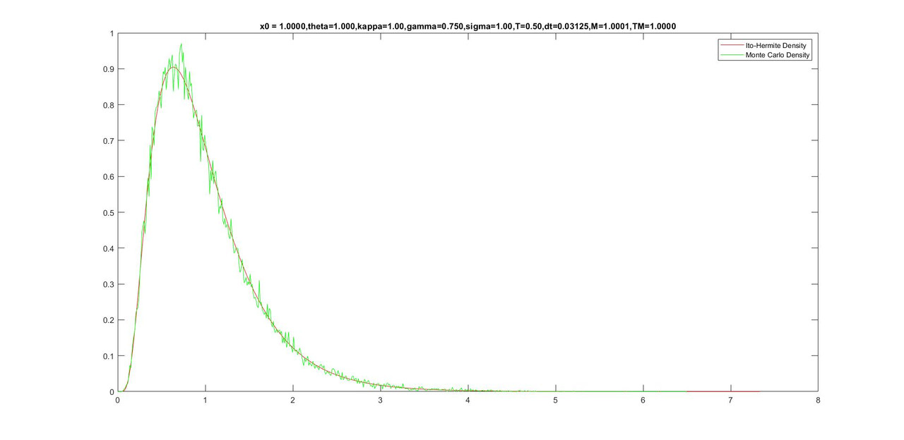](https://postimg.cc/nCh8swHt)

[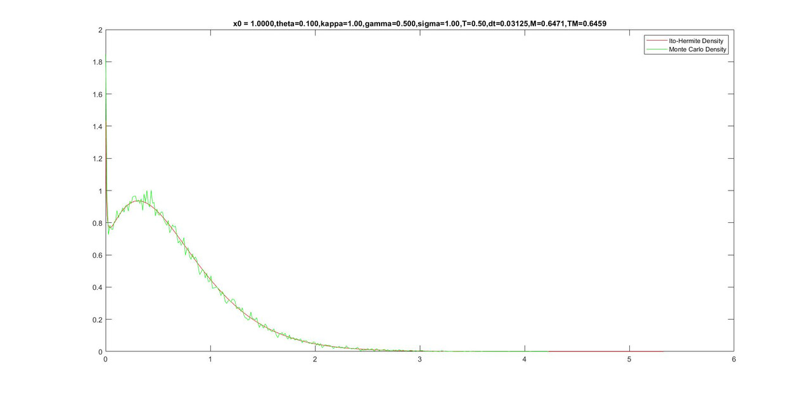](https://postimg.cc/rKnB5CmR)

[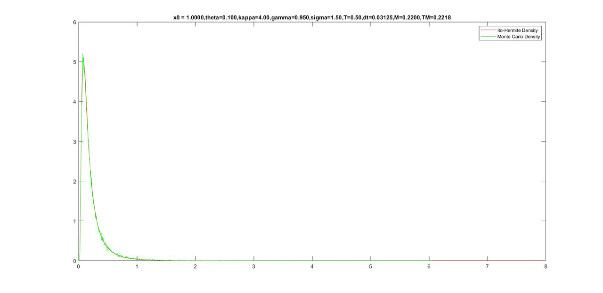](https://postimg.cc/WddQ8FFW)

[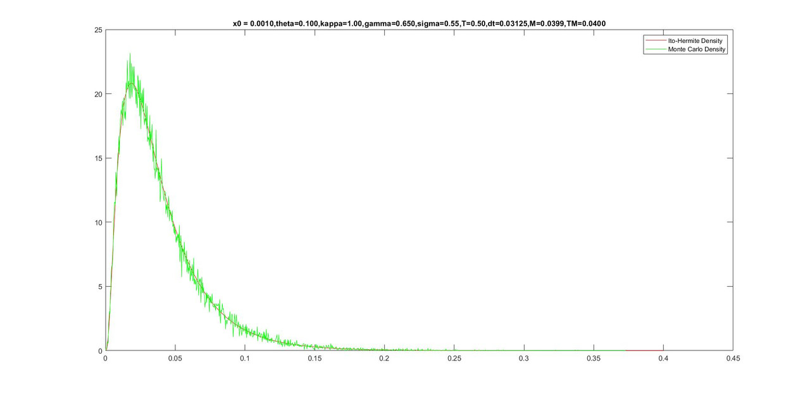](https://postimg.cc/hzB6K2C6)

[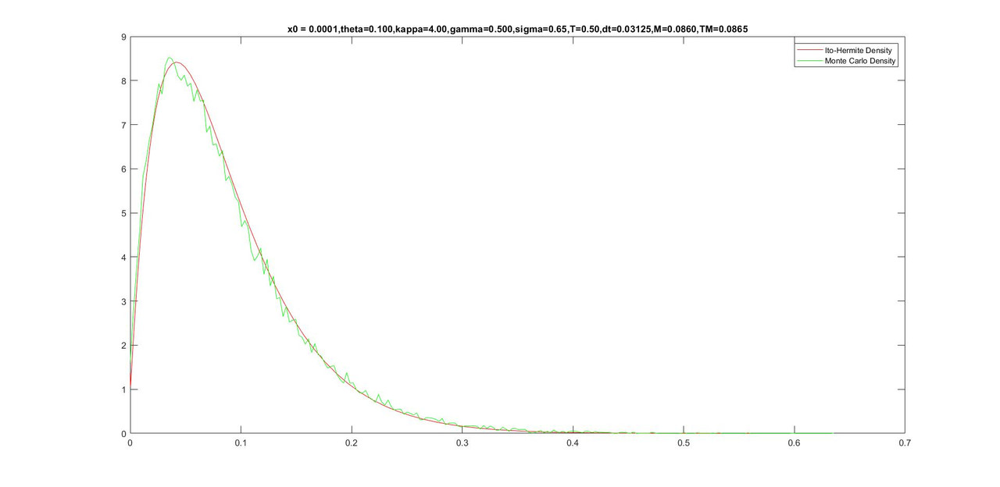](https://postimg.cc/r0Nbs53m)

[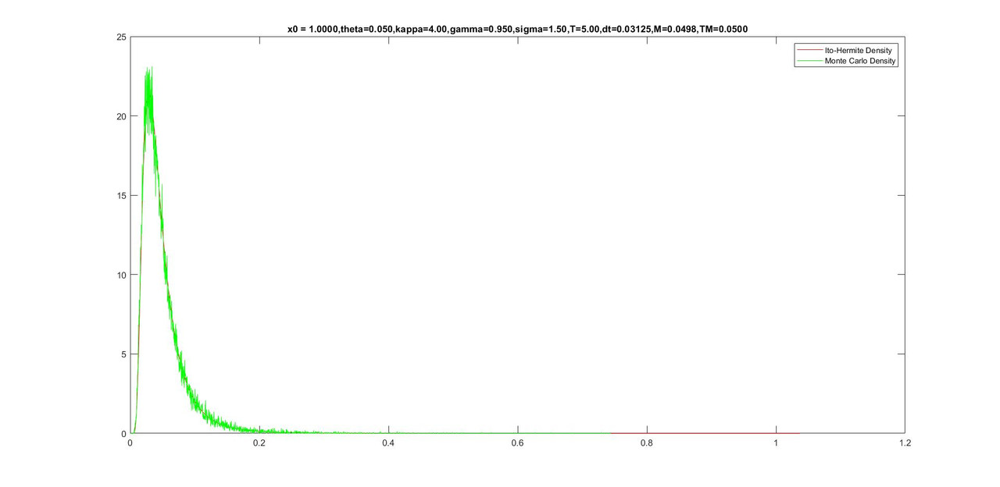](https://postimg.cc/wtJnKCkD)

[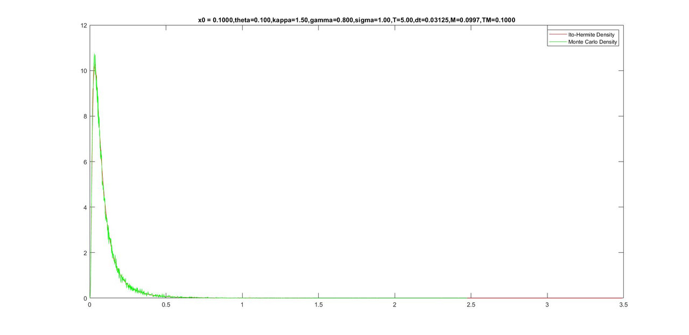](https://postimg.cc/87xx0pL1)

[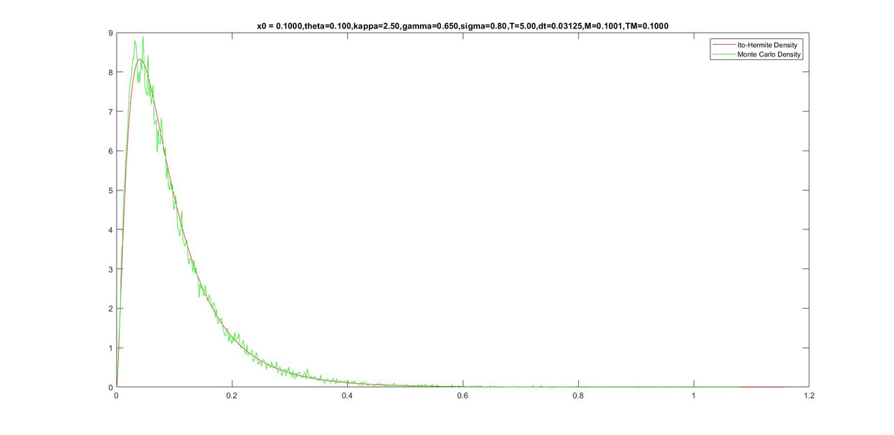](https://postimg.cc/tnRcxYGz)

[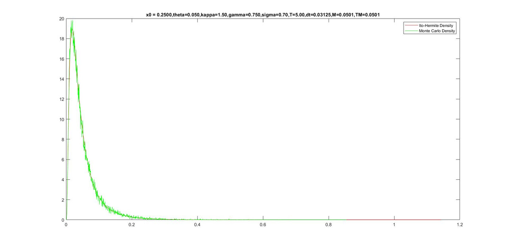](https://postimg.cc/NLQSVP2r)

[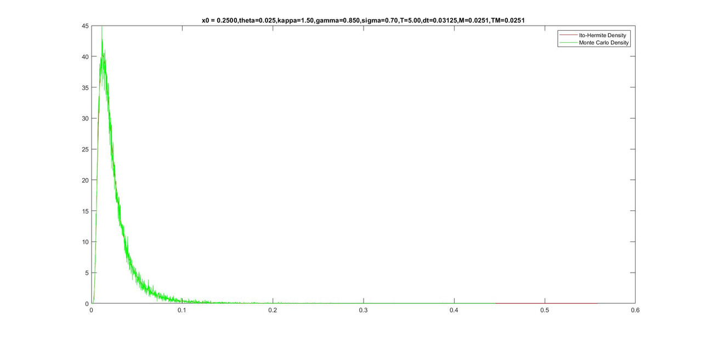](https://postimg.cc/JtKvWcjY)

---

### #1376 — Amin (Topic Author)
*March 21, 2022, 1:30 PM*

This is a full working but still preliminary program and I will update it with a better, neater and commented version
streamlining some of the functionality that already exists. I will explain the program in total detail. Once friends
understand the logic and nomenclature of of program, it is very easy and simple.

I am posting this program rather quickly since I am travelling tomorrow and then I may not have time to work properly
for a few days. It is completed and working. All I need to do is to streamline a few things like parameters going into
different functions and then you can possibly use it for different number of series terms and cumulants. I will try that
friends could use it for up to eight cumulants. Some things have to be added for example turning moments to cumulants
have equations to sixth order only and they are hardcopied as opposed to algorithmically generated.

[code]

function [] = FPESeriesCoeffsFromGaussiansWilmottNew02A()

%Copyright Ahsan Amin. Infiniti derivatives Technologies.

%Please fell free to connect on linkedin: linkedin.com/in/ahsan-amin-0a53334

%or skype ahsan.amin2999

%In this program, I am simulating the SDE given as

%dy(t)=mu1 x(t)^beta1 dt + mu2 x(t)^beta2 dt +sigma x(t)^gamma dz(t)

%I have not directly simulated the SDE but simulated the transformed

%Besse1l process version of the SDE and then changed coordinates to retreive

%the SDE in original coo

%rdinates.

%The present program will analytically evolve only the Bessel Process version of the

%SDE in transformed coordinates.

dt=.125/2/2;   % Simulation time interval.%Fodiffusions close to zero

             %decrease dt for accuracy.

Tt=32*5;%16*2*4;%*4*4*1;%*4;%128*2*2*2;     % Number of simulation levels. Terminal time= Tt*dt; //.125/32*32*16=2 year;

T=Tt*dt;

%Below I have done calculations for smaller step size at start.

ds(1:64)=dt/16;

ds(65:128)=dt/4;

if(Tt4)&&(Tt20)

Ts=(64)+((20-4)*4)+(Tt-20);

ds(1:64)=dt/16;

ds(65:128)=dt/4;

ds(129:Ts)=dt;

end

T

sum(ds(1:Ts))

Ts

%str=input('Check if time is right');

OrderA=4;  %

OrderM=4;  %

if(T>=1)

dtM=1/16;%.0625/1;

TtM=T/dtM;

else

dtM=T/16;%.0625/1;

TtM=T/dtM;

end

dNn=.2/2;   % Normal density subdivisions width. would change with number of subdivisions

Nn=46*2;  % No of normal density subdivisions

NnMid=4.0;

x0=.25;   % starting value of SDE

beta1=0.0;

beta2=1.0;   % Second drift term power.

gamma=.85;%50;   % volatility power.

kappa=1.50;%.950;   %mean reversion parameter.

theta=.025;%mean reversion target

sigma0=.70;%Volatility value

%you can specify any general mu1 and mu2 and beta1 and beta2.

mu1=1*theta*kappa;   %first drift coefficient.

mu2=-1*kappa;    % Second drift coefficient.

%mu1=0;

%mu2=0;

alpha=1;% x^alpha is being expanded. This is currently for monte carlo only.

alpha1=1-gamma;%This is for expansion of integrals for calculation of drift

%and volatility coefficients

%yy(1:Nn)=x0;

w0=x0^(1-gamma)/(1-gamma);

Z(1:Nn)=(((1:Nn)-6.5/1)*dNn-NnMid);

Z

str=input('Look at Z');

ZProb(1)=normcdf(.5*Z(1)+.5*Z(2),0,1)-normcdf(.5*Z(1)+.5*Z(2)-dNn,0,1);

ZProb(Nn)=normcdf(.5*Z(Nn)+.5*Z(Nn-1)+dNn,0,1)-normcdf(.5*Z(Nn)+.5*Z(Nn-1),0,1);

ZProb(2:Nn-1)=normcdf(.5*Z(2:Nn-1)+.5*Z(3:Nn),0,1)-normcdf(.5*Z(2:Nn-1)+.5*Z(1:Nn-2),0,1);

%%%%%%%%%%%%%%%%%%%%%%%%%%%%%%%%%%%%%%%%%%%%%%%%%%%%%%%%%%%%%%%%%%%%%%%%%%%%%%%%%%%%%%%%%%%%%%

sigma11(1:OrderA+1)=0;

mu11(1:OrderA+1)=0;

mu22(1:OrderA+1)=0;

sigma22(1:OrderA+1)=0;

% index 1 correponds to zero level since matlab indexing starts at one.

sigma11(1)=1;

mu11(1)=1;

mu22(1)=1;

sigma22(1)=1;

for k=1:(OrderA+1)

    if sigma0~=0

        sigma11(k)=sigma0^(k-1);

    end

    if mu1 ~= 0

        mu11(k)=mu1^(k-1);

    end

    if mu2 ~= 0

        mu22(k)=mu2^(k-1);

    end

    if sigma0~=0

        sigma22(k)=sigma0^(2*(k-1));

    end

end

%Ft(1:TtM+1,1:(OrderA+1),1:(OrderA+1),1:(OrderA+1),1:(OrderA+1))=0; %General time powers on hermite polynomials

Fp(1:(OrderA+1),1:(OrderA+1),1:(OrderA+1),1:(OrderA+1))=0;%General x powers on coefficients of hermite polynomials.

Fp1(1:(OrderA+1),1:(OrderA+1),1:(OrderA+1),1:(OrderA+1))=0;%General x powers for bessel transformed coordinates.

%YCoeff0 and YCoeff are coefficents for original coordinates monte carlo.

%YqCoeff0 and YqCoeff are bessel/lamperti version monte carlo.

YCoeff0(1:(OrderA+1),1:(OrderA+1),1:(OrderA+1),1:(OrderA+1))=0;

YqCoeff0(1:(OrderA+1),1:(OrderA+1),1:(OrderA+1),1:(OrderA+1))=0;

%Pre-compute the time and power exponent values in small multi-dimensional arrays

YCoeff = ItoTaylorCoeffsNew(alpha,beta1,beta2,gamma); %expand y^alpha where alpha=1;

YqCoeff = ItoTaylorCoeffsNew(alpha1,beta1,beta2,gamma);%expand y^alpha1 where alpha1=(1-gamma)

YqCoeff=YqCoeff/(1-gamma); %Transformed coordinates coefficients have to be

%further divided by (1-gamma)

for k = 0 : (OrderA)

    for m = 0:k

        l4 = k - m + 1;

        for n = 0 : m

            l3 = m - n + 1;

            for j = 0:n

                l2 = n - j + 1;

                l1 = j + 1;

                %Ft(l1,l2,l3,l4) = dtM^((l1-1) + (l2-1) + (l3-1) + .5* (l4-1));

                Fp(l1,l2,l3,l4) = (alpha + (l1-1) * beta1 + (l2-1) * beta2 + (l3-1) * 2* gamma + (l4-1) * gamma ...

                    - (l1-1) - (l2-1) - 2* (l3-1) - (l4-1));

                Fp1(l1,l2,l3,l4) = (alpha1 + (l1-1) * beta1 + (l2-1) * beta2 + (l3-1) * 2* gamma + (l4-1) * gamma ...

                    - (l1-1) - (l2-1) - 2* (l3-1) - (l4-1));

                YCoeff0(l1,l2,l3,l4) =YCoeff(l1,l2,l3,l4).*mu11(l1).*mu22(l2).*sigma22(l3).*sigma11(l4);

                YqCoeff0(l1,l2,l3,l4) =YqCoeff(l1,l2,l3,l4).*mu11(l1).*mu22(l2).*sigma22(l3).*sigma11(l4);

            end

        end

    end

end

%%%%%%%%%%%%%%%%%%%%%%%%%%%%%%%%%%%%%%%%%%%%%%%%%%%%%%%%%%%%%%%%%%%%%%%%%%%%%%%%%%%%%%%%%%%%%%

ExpnOrder=5;

%SeriesOrder=4;

wnStart=1;

tic

for tt=1:Ts

    tt

    if(tt==1)

        %dt=ds(1);

        %[wMu0dt,dwMu0dtdw] = BesselDriftAndDerivatives(w0,YqCoeff0,Fp1,gamma,dt,ExpnOrder);

 %       [wMu0dt,dwMu0dtdw] = BesselDriftAndDerivatives02A(w0,mu1,mu2,beta1,beta2,sigma0,gamma,ds(tt),ExpnOrder);

        [wMu0dt,dwMu0dtdw] = BesselDriftAndDerivativesH0(w0,YqCoeff0,Fp1,gamma,ds(tt),6);

    %    [wMu0dt,dwMu0dtdw,Ratio] = BesselDriftAndDerivatives04A(w0,mu1,mu2,beta1,beta2,sigma0,gamma,ds(tt),6);

      %  dwMu0dtdw

      %  dwMu0dtdwb

      %  wMu0dt

      %  wMu0dtb

      %  str=input('Look at drift');

        c0=wMu0dt+w0;

        c(1)=sigma0*sqrt(ds(tt));

        c(2:10)=0.0;

        w0=c0;

    elseif(tt.000000000001) || (abs(F(2,1))>.000000000001) || (abs(F(3,1))>.000000000001) ||
(abs(F(4,1))>.00000000001)|| (abs(F(5,1))>.0000000001)|| (abs(F(6,1))>.000000001)))

nn=nn+1;

da=da-dF\F;

%inv(dF)

a0=da(1,1);

a1=da(2,1);

a2=da(3,1);

a3=da(4,1);

a4=da(5,1);

a5=da(6,1);

%[F,dF] = CalculateCumulantsAndDerivatives(dC1,dC2,dC3,dC4,a1,a2,a3,a4,da0,da1,da2,da3,da4);

%[F,dF] = CalculateSixCumulantsParamsFiveAndDerivs(C1,C2,C3,C4,C5,C6,a0,a1,a2,a3,a4,a5);

%function [F,dF] =
CalculateCumulantsAndDerivativesFromMoments(C1,C2,C3,C4,C5,C6,a0,a1,a2,a3,a4,a5,SeriesOrder,NZterms,NMoments)

[F,dF] = CalculateCumulantsAndDerivativesFromMoments(C1,C2,C3,C4,C5,C6,a0,a1,a2,a3,a4,a5,5,6,6);

 ObjNew=F(1,1)^2+F(2,1)^2+F(3,1)^2+F(4,1)^2+F(5,1)^2+F(6,1)^2;

  if(ObjBest1)

        [b0,b] =SeriesProduct(a0,a,b0,b,SeriesOrder*mm);

        b(SeriesOrder*mm+1:50)=0;

    end

   % b0

   % b

%str=input('Look at numbers')

    EXZ(mm+1,1)=b0;

    for pp2=1:SeriesOrder*mm

            EXZ(mm+1,1)=EXZ(mm+1,1)+b(pp2).*EZ(pp2);

    end

    for pp1=1:NZterms

        EXZ(mm+1,pp1+1)=b0.*EZ(pp1);

        for pp2=1:SeriesOrder*mm

            EXZ(mm+1,pp1+1)=EXZ(mm+1,pp1+1)+b(pp2).*EZ(pp2+pp1);

        end

    end

end

u1=EXZ(2,1);

u2=EXZ(3,1);

u3=EXZ(4,1);

u4=EXZ(5,1);

u5=EXZ(6,1);

u6=EXZ(7,1);

% u1

% u2

% u3

% u4

% u5

% u6

%str=input('Look at numbers')

du1(1)=0;

du2(1)=0;

du3(1)=0;

du4(1)=0;

du5(1)=0;

du6(1)=0;

for mm=2:SeriesOrder+1

du1(mm)=EXZ(1,mm);

du2(mm)=2*EXZ(2,mm);

du3(mm)=3*EXZ(3,mm);

du4(mm)=4*EXZ(4,mm);

du5(mm)=5*EXZ(5,mm);

du6(mm)=6*EXZ(6,mm);

end

%du1(1)=1;

k1=aa0+a(2)+3*a(4);

%k1=u1;

k2=u2-u1^2;

k3=u3-3*u2*u1+2*u1^3;

k4=u4-4*u3*u1-3*u2^2+12*u2*u1^2-6*u1^4;

k5=u5-5*u4*u1-10*u3*u2+20*u3*u1^2+30*u2^2*u1-60*u2*u1^3+24*u1^5;

k6=u6-6*u5*u1-15*u4*u2+30*u4*u1^2-10*u3^2+120*u3*u2*u1-120*u3*u1^3+30*u2^3 - ...

    270*u2^2*u1^2+360*u2*u1^4-120*u1^6;

% k1

% k2

% k3

% k4

% k5

% k6

% str=input('Look at numbers--2')

dk1(1)=1.0;

dk1(2)=0.0;

dk1(3)=1.0;

dk1(4)=0.0;

dk1(5)=3.0;

dk1(6)=0.0;

dk2(1)=0;

dk3(1)=0;

dk4(1)=0;

dk5(1)=0;

dk6(1)=0;

for mm=2:SeriesOrder+1

%dk1(mm)=du1(mm);

dk2(mm)=-2.* u1.*du1(mm)+du2(mm);

dk3(mm)=du3(mm)-3*du1(mm)*u2-3*u1*du2(mm)+2*3*u1^2*du1(mm);

dk4(mm)=du4(mm)-4*du3(mm)*u1-4*u3*du1(mm)-3*2*u2*du2(mm)+12*du2(mm)*u1^2+12*2*u2*u1*du1(mm)-6*4*u1^3*du1(mm);

dk5(mm)=du5(mm)-5*du4(mm)*u1-5*u4*du1(mm)-10*du3(mm)*u2-10*u3*du2(mm)+20*du3(mm)*u1^2+20*2*u3*u1*du1(mm)+ ...

    30*2*u2*du2(mm)*u1+30*u2^2*du1(mm)-60*du2(mm)*u1^3-60*3*u2*u1^2*du1(mm)+24*5*u1^4*du1(mm);

dk6(mm)=du6(mm)-6*du5(mm)*u1-6*u5*du1(mm)-15*du4(mm)*u2-15*u4*du2(mm)+30*du4(mm)*u1^2+30*2*u4*u1*du1(mm)-10*2*u3*du3(mm)+
...

    120*du3(mm)*u2*u1-120*u3*du2(mm)*u1-120*u3*u2*du1(mm)-120*du3(mm)*u1^3-120*3*u3*u1^2*du1(mm)+30*3*u2^2*du2(mm) - ...

    270*2*u2*du2(mm)*u1^2+270*2*u2^2*u1*du1(mm)+360*du2(mm)*u1^4+360*4*u2*u1^3*du1(mm)-120*6*u1^5*du1(mm);

end

F(1,1)=k1-C1;

 F(2,1)=k2-C2;

 F(3,1)=k3-C3;

 F(4,1)=k4-C4;

 F(5,1)=k5-C5;

 F(6,1)=k6-C6;

     for mm=1:SeriesOrder+1

        dF(1,mm)=dk1(mm);

        dF(2,mm)=dk2(mm);

        dF(3,mm)=dk3(mm);

        dF(4,mm)=dk4(mm);

        dF(5,mm)=dk5(mm);

        dF(6,mm)=dk6(mm);

     end

end

[/code]

.

.

.

[code]function [dC1,dC2,dC3,dC4,dC5,dC6] =
CalculateDiffusionCumulants(d00,d0,d10,d1,d20,d2,d30,d3,d40,d4,SeriesOrder,NMoments)

EZ(1)=0;

EZ(2)=1;

for nn=3:NMoments*SeriesOrder

    if rem(nn,2)==1

        EZ(nn)=0;

    else

        EZ(nn)=EZ(nn-2)*(nn-1);

        %EZ(nn);

    end

end

%EZ;

%[dC2,dC3,dC4] = CalculateCumulantsHighOrder(g0,g,h0,h)

a0=d0-d2+3*d4;

a00=d00-d20+3*d40;

a0(SeriesOrder+1:SeriesOrder*NMoments)=0;

%size(d1)

%size(d3)

a1=d1-3*d3;

a10=d10-3*d30;

a1(SeriesOrder+1:SeriesOrder*NMoments)=0;

a2=d2-6.*d4;

a20=d20-6.*d40;

a2(SeriesOrder+1:SeriesOrder*NMoments)=0;

a3=d3;

a30=d30;

a3(SeriesOrder+1:SeriesOrder*NMoments)=0;

a4=d4;

a40=d40;

a4(SeriesOrder+1:SeriesOrder*NMoments)=0;

%                     str=input('Look at indices');

T0(1:NMoments,1:NMoments*SeriesOrder)=0;

T0(1,1:SeriesOrder)=a0(1:SeriesOrder);

T00(1)=a00;

T1(1:NMoments,1:NMoments*SeriesOrder)=0;

T1(1,1:SeriesOrder)=a1(1:SeriesOrder);

T10(1)=a10;

T2(1:NMoments,1:NMoments*SeriesOrder)=0;

T2(1,1:SeriesOrder)=a2(1:SeriesOrder);

T20(1)=a20;

T3(1:NMoments,1:NMoments*SeriesOrder)=0;

T3(1,1:SeriesOrder)=a3(1:SeriesOrder);

T30(1)=a30;

T4(1:NMoments,1:NMoments*SeriesOrder)=0;

T4(1,1:SeriesOrder)=a4(1:SeriesOrder);

T40(1)=a40;

for k = 2 : (NMoments)

b=T0(k-1,1:SeriesOrder*k);

b0=T00(k-1);

[b0,b] =SeriesProduct(a00,a0,b0,b,SeriesOrder*k);

T0(k,1:SeriesOrder*k)=b(1:SeriesOrder*k);

T00(k)=b0;

b=T1(k-1,1:SeriesOrder*k);

b0=T10(k-1);

[b0,b] =SeriesProduct(a10,a1,b0,b,SeriesOrder*k);

T1(k,1:SeriesOrder*k)=b(1:SeriesOrder*k);

T10(k)=b0;

b=T2(k-1,1:SeriesOrder*k);

b0=T20(k-1);

[b0,b] =SeriesProduct(a20,a2,b0,b,SeriesOrder*k);

T2(k,1:SeriesOrder*k)=b(1:SeriesOrder*k);

T20(k)=b0;

b=T3(k-1,1:SeriesOrder*k);

b0=T30(k-1);

[b0,b] =SeriesProduct(a30,a3,b0,b,SeriesOrder*k);

T3(k,1:SeriesOrder*k)=b(1:SeriesOrder*k);

T30(k)=b0;

b=T4(k-1,1:SeriesOrder*k);

b0=T40(k-1);

[b0,b] =SeriesProduct(a40,a4,b0,b,SeriesOrder*k);

T4(k,1:SeriesOrder*k)=b(1:SeriesOrder*k);

T40(k)=b0;

end

CC(1,1,1,1,1)=1;

Moment1(1:NMoments)=0;

for k = 0 : (NMoments)

    for m = 0:k

        l4 = k - m + 1;

        for n = 0 : m

            l3 = m - n + 1;

            for j = 0:n

                l2 = n - j + 1;

                %l1 = j + 1;

                for p = 0:j

                    l1=j-p+1;

                    l_0=p+1;

                    if(k>0)

                        b(1:SeriesOrder*k)=0;

                        b0=1;

                        %CC(l_0,l1,l2,l3,l4)=1.0;

                        if(l_0>1)

                            a=T0(l_0-1,1:SeriesOrder*k);

                            a0=T00(l_0-1);

                            [b0,b] =SeriesProduct(a0,a,b0,b,SeriesOrder*k);

                            %CC(l_0,l1,l2,l3,l4)=CC(l_0,l1,l2,l3,l4).*4^(l_0-1);

                        end

                        if(l1>1)

                            a=T1(l1-1,1:SeriesOrder*k);

                            a0=T10(l1-1);

                            [b0,b] =SeriesProduct(a0,a,b0,b,SeriesOrder*k);

                            %CC(l_0,l1,l2,l3,l4)=CC(l_0,l1,l2,l3,l4).*2^(l1-1);

                        end

                        if(l2>1)

                            a=T2(l2-1,1:SeriesOrder*k);

                            a0=T20(l2-1);

                            [b0,b] =SeriesProduct(a0,a,b0,b,SeriesOrder*k);

                            %CC(l_0,l1,l2,l3,l4)=CC(l_0,l1,l2,l3,l4).*2^(l2-1);

                        end

                        if(l3>1)

                            a=T3(l3-1,1:SeriesOrder*k);

                            a0=T30(l3-1);

                            [b0,b] =SeriesProduct(a0,a,b0,b,SeriesOrder*k);

                            %CC(l_0,l1,l2,l3,l4)=CC(l_0,l1,l2,l3,l4).*0^(l3-1);

                        end

                        if(l4>1)

                            a=T4(l4-1,1:SeriesOrder*k);

                            a0=T40(l4-1);

                            [b0,b] =SeriesProduct(a0,a,b0,b,SeriesOrder*k);

                            %CC(l_0,l1,l2,l3,l4)=CC(l_0,l1,l2,l3,l4).*0^(l4-1);

                        end

                      %  CC(l_0,l1,l2,l3,l4)=CC(l_0,l1,l2,l3,l4).*4^(l_0-1).*2^(l1-1)*2^(l2-1)*0^(l3-1)*0^(l4-1);

                        CC(l_0,l1,l2,l3,l4)=b0;

                        for qq=1:SeriesOrder*k

                            CC(l_0,l1,l2,l3,l4)=CC(l_0,l1,l2,l3,l4)+b(qq)*EZ(qq);

                        end

%                   
 Moment1(k)=Moment1(k)+factorial(k)/(factorial(l_0-1).*factorial(l1-1).*factorial(l2-1).*factorial(l3-1).*factorial(l4-1)).*c0(l_0).*CC(l1,l2,l3,l4);%.*EZ((l1-1)+2*(l2-1)+3*(l3-1)+4*(l4-1));

%                     k

%                     l_0

%                     l1

%                     l2

%                     l3

%                     l4

%

%                     str=input('Look at indices');

                    end

                end

            end

        end

    end

end

Moment1(1:NMoments)=0;

for k = 0 : (NMoments)

    for m = 0:k

        l4 = k - m + 1;

        for n = 0 : m

            l3 = m - n + 1;

            for j = 0:n

                l2 = n - j + 1;

                %l1 = j + 1;

                for p = 0:j

                    l1=j-p+1;

                    l_0=p+1;

                    if((k>0)&&((l_0+l1+l2+l3+l4)>5))

                        if((l1+l2+l3+l4==4))

                           
 Moment1(k)=Moment1(k)+factorial(k)/(factorial(l_0-1).*factorial(l1-1).*factorial(l2-1).*factorial(l3-1).*factorial(l4-1)).*CC(l_0,l1,l2,l3,l4);%.*EZ((l1-1)+2*(l2-1)+0*3*(l3-1)+0*4*(l4-1));

                        else

                           
 Moment1(k)=Moment1(k)+factorial(k)/(factorial(l_0-1).*factorial(l1-1).*factorial(l2-1).*factorial(l3-1).*factorial(l4-1)).*CC(l_0,l1,l2,l3,l4).*EZ((l1-1)+2*(l2-1)+3*(l3-1)+4*(l4-1));

                        end

                        %                     k

                    % l_0

                    % l1

                    % l2

                    % l3

                    % l4

                   
%Moment1(k)=Moment1(k)+factorial(k)/(factorial(l_0-1).*factorial(l1-1).*factorial(l2-1).*factorial(l3-1).*factorial(l4-1)).*CC(l_0,l1,l2,l3,l4);%.*EZ((l1-1)+2*(l2-1)+0*3*(l3-1)+0*4*(l4-1));

%                     k

%                     l_0

%                     l1

%                     l2

%                     l3

%                     l4

%

%                     str=input('Look at indices');

                    end

                end

            end

        end

    end

end

%Moment1

%str=input('Look at Moments');

u1=Moment1(1);

u2=Moment1(2);

u3=Moment1(3);

u4=Moment1(4);

u5=Moment1(5);

u6=Moment1(6);

dC1=u1;

dC2=u2-u1^2;

dC3=u3-3*u1*u2+2*u1^3;

dC4=u4-4*u3*u1-3*u2^2+12*u2*u1^2-6*u1^4;

dC5=u5-5*u4*u1-10*u3*u2+20*u3*u1^2+30*u2^2*u1-60*u2*u1^3+24*u1^5;

dC6=u6-6*u5*u1-15*u4*u2+30*u4*u1^2-10*u3^2+120*u3*u2*u1-120*u3*u1^3+30*u2^3 - ...

    270*u2^2*u1^2+360*u2*u1^4-120*u1^6;

%dC5=0;

%dC6=0;

end

[/code]

.

.

.

[code]function [F] = CalculateSixCumulantsParamsFive(a0,a1,a2,a3,a4,a5)

%[F,dF] = CalculateCumulantsAndDerivatives(dC1,dC2,dC3,dC4,a1,a2,a3,a4,da0,da1,da2,da3,da4);

k1=a0+a2+3*a4;

k2=a1^2+2*a2^2+6*a1*a3+15*a3^2+24*a2*a4+96*a4^2+ ...

30*(a1+7*a3)*a5+945*a5^2;

k3=8*a2^3+216*a2^2*a4+6*a1^2*(a2+6*a4)+72*a1*a3*(a2+8*a4)+ ...

540*a1*(a2+10*a4)*a5+ ...

18*a2*(15*a3^2+128*a4^2+280*a3*a5+1575*a5^2)+ ...

108*a4*(25*a3^2+88*a4^2+560*a3*a5+3675*a5^2);

k4=24*(2*a2^4+96*a2^3*a4+a1^3*(a3+10*a5)+ ...

30*a2^2*(6*a3^2+64*a4^2+140*a3*a5+945*a5^2)+ ...

a1^2*(2*(a2^2+9*a3^2+18*a2*a4+96*a4^2)+375*a3*a5+ ...

2250*a5^2)+ ...

36*a2*a4*(125*a3^2+528*a4^2+3360*a3*a5+25725*a5^2)+ ...

9*(45*a3^4+3560*a3^2*a4^2+8704*a4^4+ ...

35*a3*(69*a3^2+3104*a4^2)*a5+ ...

700*(79*a3^2+1332*a4^2)*a5^2+632625*a3*a5^3+ ...

3018750*a5^4)+ ...

3*a1*(12*a2^2*(a3+10*a5)+8*a2*a4*(32*a3+375*a5)+ ...

3*(15*a3^3+528*a3*a4^2+530*a3^2*a5+7120*a4^2*a5+ ...

7175*a3*a5^2+36750*a5^3)));

k5=24*(16*a2^5+5*a1^4*a4+1200*a2^4*a4+ ...

10*a1^3*(3*a2*a3+42*a3*a4+40*a2*a5+570*a4*a5)+ ...

300*a2^3*(10*a3^2+128*a4^2+280*a3*a5+2205*a5^2)+ ...

1080*a2^2*a4*(125*a3^2+616*a4^2+3920*a3*a5+34300*a5^2)+ ...

30*a1*(a3*(16*a2^3+225*a2*a3^2+640*a2^2*a4+3330*a3^2*a4+ ...

9504*a2*a4^2+52224*a4^3)+ ...

10*(20*a2^3+954*a2*a3^2+900*a2^2*a4+15735*a3^2*a4+ ...

14952*a2*a4^2+91296*a4^3)*a5+ ...

3675*a3*(41*a2+750*a4)*a5^2+15750*(56*a2+1129*a4)*a5^3)+ ...

27*a4*(14775*a3^4+507200*a3^2*a4^2+950784*a4^4+ ...

700*a3*(1469*a3^2+27904*a4^2)*a5+ ...

1750*(16973*a3^2+118128*a4^2)*a5^2+419002500*a3*a5^3+ ...

2419134375*a5^4)+ ...

10*a1^2*(2*a2^3+72*a2^2*a4+ ...

3*a2*(24*a3^2+320*a4^2+625*a3*a5+4500*a5^2)+ ...

9*a4*(109*a3^2+528*a4^2+3130*a3*a5+24975*a5^2))+ ...

90*a2*(270*a3^4+69632*a4^4+16905*a3^3*a5+8391600*a4^2*a5^2+ ...

30187500*a5^4+280*a3^2*(89*a4^2+1580*a5^2)+ ...

35*a3*(24832*a4^2*a5+162675*a5^3)));

k6=120*(32*a2^6+3456*a2^5*a4+6*a1^5*a5+ ...

3*a1^4*(9*a3^2+8*a4*(2*a2+21*a4)+330*a3*a5+2850*a5^2)+ ...

720*a2^4*(15*a3^2+224*a4^2+490*a3*a5+4410*a5^2)+ ...

6048*a2^3*a4*(125*a3^2+704*a4^2+4480*a3*a5+44100*a5^2)+ ...

12*a1^3*(12*a3*(a2^2+6*a3^2+35*a2*a4+298*a4^2)+ ...

10*(20*a2^2+351*a3^2+684*a2*a4+6132*a4^2)*a5+ ...

60450*a3*a5^2+374625*a5^3)+ ...

216*a2^2*(945*a3^4+99680*a3^2*a4^2+313344*a4^4+ ...

420*a3*(161*a3^2+9312*a4^2)*a5+ ...

25200*(79*a3^2+1665*a4^2)*a5^2+28468125*a3*a5^3+ ...

166031250*a5^4)+ ...

1296*a2*a4*(6*(985*a3^4+38040*a3^2*a4^2+79232*a4^4)+ ...

35*a3*(13221*a3^2+279040*a4^2)*a5+ ...

1925*(7715*a3^2+59064*a4^2)*a5^2+230451375*a3*a5^3+ ...

1451480625*a5^4)+ ...

18*a1*(4*a3*(20*a2^4+1280*a2^3*a4+ ...

27*a2^2*(25*a3^2+1232*a4^2)+ ...

6*a2*(3885*a3^2*a4+69632*a4^3)+ ...

9*(135*a3^4+24280*a3^2*a4^2+237696*a4^4))+ ...

15*(80*a2^4+5600*a2^3*a4+56*a2^2*(159*a3^2+2848*a4^2)+ ...

64*a2*(5245*a3^2*a4+34236*a4^3)+ ...

3*(9717*a3^4+1145552*a3^2*a4^2+4076032*a4^4))*a5+ ...

2100*a3*(1148*a2^2+8199*a3^2+47250*a2*a4+ ...

526740*a4^2)*a5^2+ ...

126000*(126*a2^2+2935*a3^2+5645*a2*a4+68241*a4^2)*a5^3+ ...

4314397500*a3*a5^4+21772209375*a5^5)+ ...

27*(9945*a3^6+2894760*a3^4*a4^2+61140480*a3^2*a4^4+ ...

92930048*a4^6+ ...

210*a3*(5553*a3^4+1177072*a3^2*a4^2+13526272*a4^4)*a5+ ...

2100*(29649*a3^4+4101044*a3^2*a4^2+17011776*a4^4)*a5^2+ ...

3500*a3*(551015*a3^2+41249952*a4^2)*a5^3+ ...

39375*(923683*a3^2+24833432*a4^2)*a5^4+ ...

394058306250*a3*a5^5+1907724656250*a5^6)+ ...

6*a1^2*(8*a2^4+480*a2^3*a4+ ...

180*a2^2*(4*a3^2+64*a4^2+125*a3*a5+1050*a5^2)+ ...

72*a2*a4*(327*a3^2+1848*a4^2+10955*a3*a5+99900*a5^2)+ ...

9*(225*a3^4+22824*a3^2*a4^2+69632*a4^4+15090*a3^3*a5+ ...

830240*a3*a4^2*a5+412925*a3^2*a5^2+8239800*a4^2*a5^2+ ...

5475750*a3*a5^3+29636250*a5^4)));

 F(1,1)=k1;

 F(2,1)=k2;

 F(3,1)=k3;

 F(4,1)=k4;

 F(5,1)=k5;

 F(6,1)=k6;

end

[/code]

.

.

.

[code]function [wMu0dt,dwMu0dtdw] = BesselDriftAndDerivativesH0(w0,YqCoeff0,Fp1,gamma,dt,ExpnOrder)

NoOfTerms=19;

YqCoeffa(1:NoOfTerms)=0.0;

%Fp1

Fp1=Fp1/(1-gamma);

%Fp1

%gamma

YqCoeffa(1)=YqCoeff0(1,1,2,1)*dt;%*(1-gamma)^Fp1(1,1,2,1)*dt;

YqCoeffa(2)=YqCoeff0(1,2,1,1)*dt;%*(1-gamma)^Fp1(1,2,1,1)*dt;

YqCoeffa(3)=YqCoeff0(2,1,1,1)*dt;%*(1-gamma)^Fp1(2,1,1,1)*dt;

YqCoeffa(4)=YqCoeff0(1,1,3,1)*dt^2;%*(1-gamma)^Fp1(1,1,3,1)*dt^2;

YqCoeffa(5)=YqCoeff0(1,2,2,1)*dt^2;%*(1-gamma)^Fp1(1,2,2,1)*dt^2;

YqCoeffa(6)=YqCoeff0(2,1,2,1)*dt^2;%*(1-gamma)^Fp1(2,1,2,1)*dt^2;

YqCoeffa(7)=YqCoeff0(1,3,1,1)*dt^2;%*(1-gamma)^Fp1(1,3,1,1)*dt^2;

YqCoeffa(8)=YqCoeff0(2,2,1,1)*dt^2;%*(1-gamma)^Fp1(2,2,1,1)*dt^2;

YqCoeffa(9)=YqCoeff0(3,1,1,1)*dt^2;%*(1-gamma)^Fp1(3,1,1,1)*dt^2;

YqCoeffa(10)=YqCoeff0(1,1,4,1)*dt^3;%;*(1-gamma)^Fp1(1,1,4,1)*dt^3;

YqCoeffa(11)=YqCoeff0(1,2,3,1)*dt^3;%;*(1-gamma)^Fp1(1,2,3,1)*dt^3;

YqCoeffa(12)=YqCoeff0(2,1,3,1)*dt^3;%*(1-gamma)^Fp1(2,1,3,1)*dt^3;

YqCoeffa(13)=YqCoeff0(1,3,2,1)*dt^3;%*(1-gamma)^Fp1(1,3,2,1)*dt^3;

YqCoeffa(14)=YqCoeff0(2,2,2,1)*dt^3;%*(1-gamma)^Fp1(2,2,2,1)*dt^3;

YqCoeffa(15)=YqCoeff0(3,1,2,1)*dt^3;%*(1-gamma)^Fp1(3,1,2,1)*dt^3;

YqCoeffa(16)=YqCoeff0(1,4,1,1)*dt^3;%*(1-gamma)^Fp1(1,4,1,1)*dt^3;

YqCoeffa(17)=YqCoeff0(2,3,1,1)*dt^3;%*(1-gamma)^Fp1(2,3,1,1)*dt^3;

YqCoeffa(18)=YqCoeff0(3,2,1,1)*dt^3;%*(1-gamma)^Fp1(3,2,1,1)*dt^3;

YqCoeffa(19)=YqCoeff0(4,1,1,1)*dt^3;%*(1-gamma)^Fp1(4,1,1,1)*dt^3;

Fp2(1)=Fp1(1,1,2,1);

Fp2(2)=Fp1(1,2,1,1);

Fp2(3)=Fp1(2,1,1,1);

Fp2(4)=Fp1(1,1,3,1);

Fp2(5)=Fp1(1,2,2,1);

Fp2(6)=Fp1(2,1,2,1);

Fp2(7)=Fp1(1,3,1,1);

Fp2(8)=Fp1(2,2,1,1);

Fp2(9)=Fp1(3,1,1,1);

Fp2(10)=Fp1(1,1,4,1);

Fp2(11)=Fp1(1,2,3,1);

Fp2(12)=Fp1(2,1,3,1);

Fp2(13)=Fp1(1,3,2,1);

Fp2(14)=Fp1(2,2,2,1);

Fp2(15)=Fp1(3,1,2,1);

Fp2(16)=Fp1(1,4,1,1);

Fp2(17)=Fp1(2,3,1,1);

Fp2(18)=Fp1(3,2,1,1);

Fp2(19)=Fp1(4,1,1,1);

%YqCoeffa

%Fp2

%str=input('Look at numbers');

wMu0dt0=0;

dwMu0dt(1:ExpnOrder)=0.0;

wMu0dt=0;

dwMu0dtdw(1:ExpnOrder)=0.0;

for mm=1:NoOfTerms

    wMu0dt0=YqCoeffa(mm).*((1-gamma)*w0).^Fp2(mm);

    for nn=1:ExpnOrder

        if(nn==1)

            dwMu0dt(nn)=wMu0dt0*Fp2(mm)/w0;

        else

        dwMu0dt(nn)=dwMu0dt(nn-1)*(Fp2(mm)-(nn-1))/w0;

        end

    end

    wMu0dt=wMu0dt+wMu0dt0;

    for nn=1:ExpnOrder

        dwMu0dtdw(nn)=dwMu0dtdw(nn)+dwMu0dt(nn);

    end

end

end

[/code]

.

.

.

[code]function [wVol0dt,dwVol0dtdw] = BesselVolAndDerivativesH1(w0,YqCoeff0,Fp1,gamma,dt,ExpnOrder)

% c1(wnStart:Nn)=YqCoeff0(1,1,1,2).*yy(wnStart:Nn).^Fp1(1,1,1,2).*sqrt(dt)+ ...

%     (YqCoeff0(1,1,2,2).*yy(wnStart:Nn).^Fp1(1,1,2,2)+YqCoeff0(1,2,1,2).*yy(wnStart:Nn).^Fp1(1,2,1,2)+ ...

%     YqCoeff0(2,1,1,2).*yy(wnStart:Nn).^Fp1(2,1,1,2)).*dt^1.5+ ...

%     (YqCoeff0(1,1,3,2).*yy(wnStart:Nn).^Fp1(1,1,3,2)+YqCoeff0(1,2,2,2).*yy(wnStart:Nn).^Fp1(1,2,2,2)+ ...

%     YqCoeff0(2,1,2,2).*yy(wnStart:Nn).^Fp1(2,1,2,2)+YqCoeff0(1,3,1,2).*yy(wnStart:Nn).^Fp1(1,3,1,2)+ ...

%     YqCoeff0(2,2,1,2).*yy(wnStart:Nn).^Fp1(2,2,1,2)+YqCoeff0(3,1,1,2).*yy(wnStart:Nn).^Fp1(3,1,1,2)).*dt^2.5;

NoOfTerms=9;%excluding dt^3 terms

YqCoeffa(1:NoOfTerms)=0.0;

Fp1=Fp1/(1-gamma);

YqCoeffa(1)=YqCoeff0(1,1,2,2)*(1-gamma)^Fp1(1,1,2,2)*dt^1.5;

YqCoeffa(2)=YqCoeff0(1,2,1,2)*(1-gamma)^Fp1(1,2,1,2)*dt^1.5;

YqCoeffa(3)=YqCoeff0(2,1,1,2)*(1-gamma)^Fp1(2,1,1,2)*dt^1.5;

YqCoeffa(4)=YqCoeff0(1,1,3,2)*(1-gamma)^Fp1(1,1,3,2)*dt^2.5;

YqCoeffa(5)=YqCoeff0(1,2,2,2)*(1-gamma)^Fp1(1,2,2,2)*dt^2.5;

YqCoeffa(6)=YqCoeff0(2,1,2,2)*(1-gamma)^Fp1(2,1,2,2)*dt^2.5;

YqCoeffa(7)=YqCoeff0(1,3,1,2)*(1-gamma)^Fp1(1,3,1,2)*dt^2.5;

YqCoeffa(8)=YqCoeff0(2,2,1,2)*(1-gamma)^Fp1(2,2,1,2)*dt^2.5;

YqCoeffa(9)=YqCoeff0(3,1,1,2)*(1-gamma)^Fp1(3,1,1,2)*dt^2.5;

Fp2(1)=Fp1(1,1,2,2);

Fp2(2)=Fp1(1,2,1,2);

Fp2(3)=Fp1(2,1,1,2);

Fp2(4)=Fp1(1,1,3,2);

Fp2(5)=Fp1(1,2,2,2);

Fp2(6)=Fp1(2,1,2,2);

Fp2(7)=Fp1(1,3,1,2);

Fp2(8)=Fp1(2,2,1,2);

Fp2(9)=Fp1(3,1,1,2);

wVol0dt0=0;

dwVol0dt(1:ExpnOrder)=0.0;

wVol0dt=0;

dwVol0dtdw(1:ExpnOrder)=0.0;

for mm=1:NoOfTerms

    wVol0dt0=YqCoeffa(mm).*w0.^Fp2(mm);

    for nn=1:ExpnOrder

        if(nn==1)

            dwVol0dt(nn)=wVol0dt0*Fp2(mm)*1/w0;

        else

        dwVol0dt(nn)=dwVol0dt(nn-1)*(Fp2(mm)-(nn-1))/w0;

        end

    end

    wVol0dt=wVol0dt+wVol0dt0;

    for nn=1:ExpnOrder

        dwVol0dtdw(nn)=dwVol0dtdw(nn)+dwVol0dt(nn);

    end

end

end[/code]

.

.

.

[code]function [wVol2dt,dwVol2dtdw] = BesselVolAndDerivativesH2(w0,YqCoeff0,Fp1,gamma,dt,ExpnOrder)

% c2(wnStart:Nn)=YqCoeff0(1,1,1,3).*yy(wnStart:Nn).^Fp1(1,1,1,3) *dt + ...

%     (YqCoeff0(1,1,2,3).*yy(wnStart:Nn).^Fp1(1,1,2,3)+YqCoeff0(1,2,1,3).*yy(wnStart:Nn).^Fp1(1,2,1,3)+ ...

%     YqCoeff0(2,1,1,3).*yy(wnStart:Nn).^Fp1(2,1,1,3)).*dt^2+ ...

%     (YqCoeff0(1,1,3,3).*yy(wnStart:Nn).^Fp1(1,1,3,3)+YqCoeff0(1,2,2,3).*yy(wnStart:Nn).^Fp1(1,2,2,3)+ ...

%     YqCoeff0(2,1,2,3).*yy(wnStart:Nn).^Fp1(2,1,2,3) + YqCoeff0(1,3,1,3).*yy(wnStart:Nn).^Fp1(1,3,1,3)+ ...

%     YqCoeff0(2,2,1,3).*yy(wnStart:Nn).^Fp1(2,2,1,3)+YqCoeff0(3,1,1,3).*yy(wnStart:Nn).^Fp1(3,1,1,3)).*dt^3;

Fp1=Fp1/(1-gamma);

NoOfTerms=9;%excluding dt^3 terms

YqCoeffa(1:NoOfTerms)=0.0;

YqCoeffa(1)=YqCoeff0(1,1,2,3)*(1-gamma)^Fp1(1,1,2,3)*dt^2;

YqCoeffa(2)=YqCoeff0(1,2,1,3)*(1-gamma)^Fp1(1,2,1,3)*dt^2;

YqCoeffa(3)=YqCoeff0(2,1,1,3)*(1-gamma)^Fp1(2,1,1,3)*dt^2;

YqCoeffa(4)=YqCoeff0(1,1,3,3)*(1-gamma)^Fp1(1,1,3,3)*dt^3;

YqCoeffa(5)=YqCoeff0(1,2,2,3)*(1-gamma)^Fp1(1,2,2,3)*dt^3;

YqCoeffa(6)=YqCoeff0(2,1,2,3)*(1-gamma)^Fp1(2,1,2,3)*dt^3;

YqCoeffa(7)=YqCoeff0(1,3,1,3)*(1-gamma)^Fp1(1,3,1,3)*dt^3;

YqCoeffa(8)=YqCoeff0(2,2,1,3)*(1-gamma)^Fp1(2,2,1,3)*dt^3;

YqCoeffa(9)=YqCoeff0(3,1,1,3)*(1-gamma)^Fp1(3,1,1,3)*dt^3;

Fp2(1)=Fp1(1,1,2,3);

Fp2(2)=Fp1(1,2,1,3);

Fp2(3)=Fp1(2,1,1,3);

Fp2(4)=Fp1(1,1,3,3);

Fp2(5)=Fp1(1,2,2,3);

Fp2(6)=Fp1(2,1,2,3);

Fp2(7)=Fp1(1,3,1,3);

Fp2(8)=Fp1(2,2,1,3);

Fp2(9)=Fp1(3,1,1,3);

wVol2dt0=0;

dwVol2dt(1:ExpnOrder)=0.0;

wVol2dt=0;

dwVol2dtdw(1:ExpnOrder)=0.0;

for mm=1:NoOfTerms

    wVol2dt0=YqCoeffa(mm).*w0.^Fp2(mm);

    for nn=1:ExpnOrder

        if(nn==1)

            dwVol2dt(nn)=wVol2dt0*Fp2(mm)*1/w0;

        else

        dwVol2dt(nn)=dwVol2dt(nn-1)*(Fp2(mm)-(nn-1))/w0;

        end

    end

    wVol2dt=wVol2dt+wVol2dt0;

    for nn=1:ExpnOrder

        dwVol2dtdw(nn)=dwVol2dtdw(nn)+dwVol2dt(nn);

    end

end

end[/code]

.

.

.

[code]function [wVol3dt,dwVol3dtdw] = BesselVolAndDerivativesH3(w0,YqCoeff0,Fp1,gamma,dt,ExpnOrder)

% c3(wnStart:Nn)=((YqCoeff0(1,1,1,4).*yy(wnStart:Nn).^Fp1(1,1,1,4)*dt^1.5 )+ ...

%      (YqCoeff0(1,1,2,4).*yy(wnStart:Nn).^Fp1(1,1,2,4)+ ...

%      YqCoeff0(1,2,1,4).*yy(wnStart:Nn).^Fp1(1,2,1,4)+ ...

%      YqCoeff0(2,1,1,4).*yy(wnStart:Nn).^Fp1(2,1,1,4))*dt^2.5);

Fp1=Fp1/(1-gamma);

NoOfTerms=3;%excluding dt^3 terms

YqCoeffa(1:NoOfTerms)=0.0;

YqCoeffa(1)=YqCoeff0(1,1,2,4)*(1-gamma)^Fp1(1,1,2,4)*dt^2.5;

YqCoeffa(2)=YqCoeff0(1,2,1,4)*(1-gamma)^Fp1(1,2,1,4)*dt^2.5;

YqCoeffa(3)=YqCoeff0(2,1,1,4)*(1-gamma)^Fp1(2,1,1,4)*dt^2.5;

Fp2(1)=Fp1(1,1,2,4);

Fp2(2)=Fp1(1,2,1,4);

Fp2(3)=Fp1(2,1,1,4);

wVol3dt0=0;

dwVol3dt(1:ExpnOrder)=0.0;

wVol3dt=0;

dwVol3dtdw(1:ExpnOrder)=0.0;

for mm=1:NoOfTerms

    wVol3dt0=YqCoeffa(mm).*w0.^Fp2(mm);

    for nn=1:ExpnOrder

        if(nn==1)

            dwVol3dt(nn)=wVol3dt0*Fp2(mm)*1/w0;

        else

        dwVol3dt(nn)=dwVol3dt(nn-1)*(Fp2(mm)-(nn-1))/w0;

        end

    end

    wVol3dt=wVol3dt+wVol3dt0;

    for nn=1:ExpnOrder

        dwVol3dtdw(nn)=dwVol3dtdw(nn)+dwVol3dt(nn);

    end

end

end[/code]

.

.

.

[code]function [wMu0dt,dwMu0dtdw,Ratio] = BesselDriftAndDerivatives04A(w0,mu1,mu2,beta1,beta2,sigma0,gamma,dt,ExpnOrder)

NoOfTerms=9;%excluding dt^3 terms

YqCoeff(1:NoOfTerms)=0.0;

Fp(1:NoOfTerms)=0.0;

a0=((beta1-gamma)/(1-gamma));

b0=((beta2-gamma)/(1-gamma));

A=mu1;

B=mu2;

C=-.5*sigma0^2*gamma;

dt2=dt^2/2;

YqCoeff(1:9)=0;

YqCoeff(1)=A*dt;

YqCoeff(2)=B*dt;

YqCoeff(3)=C*dt;

 YqCoeff(4)=A^2*a0*dt2*(1-gamma);

 YqCoeff(5)=B^2*b0*dt2*(1-gamma);

 YqCoeff(6)=1*1.5*.66*C^2*(-1)*dt2*(1-gamma)+1*1.5*.66* C*(-1)*(-2)*.5*sigma0^2 *dt2*(1-gamma)^2;

 YqCoeff(7)=A*B*(a0+b0)*dt2*(1-gamma);

 YqCoeff(8)=1*1.5*.66*A*C*(a0-1)*dt2*(1-gamma)^1+1*1.5*.66*.5*sigma0^2*A*a0*(a0-1)*dt2*(1-gamma)^2;

 YqCoeff(9)=1*1.5*.66*B*C*(b0-1)*dt2*(1-gamma)^1+1*1.5*.66*.5*sigma0^2*B*b0*(b0-1)*dt2*(1-gamma)^2;

Fp(1)=(beta1-gamma)/(1-gamma);

Fp(2)=(beta2-gamma)/(1-gamma);

Fp(3)=-1;

Fp(4)=2*(beta1-gamma)/(1-gamma)-1;

Fp(5)=2*(beta2-gamma)/(1-gamma)-1;

Fp(6)=-3;

Fp(7)=(beta1-gamma)/(1-gamma)+(beta2-gamma)/(1-gamma)-1;

Fp(8)=(beta1-gamma)/(1-gamma)-2;

Fp(9)=(beta2-gamma)/(1-gamma)-2;

 Ratio=2/dt*(YqCoeff(4)*((1-gamma)*w0).^Fp(4)+YqCoeff(5)*((1-gamma)*w0).^Fp(5)+YqCoeff(6)*((1-gamma)*w0).^Fp(6)+ ...

     YqCoeff(7)*((1-gamma)*w0).^Fp(7)+YqCoeff(8)*((1-gamma)*w0).^Fp(8)+YqCoeff(9)*((1-gamma)*w0).^Fp(9))/ ...

     (YqCoeff(1)*((1-gamma)*w0).^Fp(1)+YqCoeff(2)*((1-gamma)*w0).^Fp(2)+YqCoeff(3)*((1-gamma)*w0).^Fp(3));

Fp2(1:9)=Fp(1:9);%/(1-gamma);

wMu0dt0=0;

dwMu0dt(1:ExpnOrder)=0.0;

wMu0dt=0;

dwMu0dtdw(1:ExpnOrder)=0.0;

for mm=1:NoOfTerms

    wMu0dt0=YqCoeff(mm).*((1-gamma)*w0).^Fp2(mm);

    for nn=1:ExpnOrder

        if(nn==1)

            dwMu0dt(nn)=wMu0dt0*Fp2(mm)*1/w0;

        else

        dwMu0dt(nn)=dwMu0dt(nn-1)*(Fp2(mm)-(nn-1))/w0;

        end

    end

    wMu0dt=wMu0dt+wMu0dt0;

    for nn=1:ExpnOrder

        dwMu0dtdw(nn)=dwMu0dtdw(nn)+dwMu0dt(nn);

    end

end

end[/code]

.

.

.

[code]function [b0,b] = CalculateDriftbCoeffs08(wMu0dt,dwMu0dtdw,a,gamma)

b0=wMu0dt;

b(1)=a(1) *dwMu0dtdw(1);

b(2)=1/2*(2* a(2) *dwMu0dtdw(1)+a(1)^2 *dwMu0dtdw(2));

b(3)=1/6*(6 *a(3) *dwMu0dtdw(1)+6 *a(1)* a(2) *dwMu0dtdw(2)+a(1)^3 *dwMu0dtdw(3));

b(4)=1/24*(24* a(4) *dwMu0dtdw(1)+12* a(2)^2 *dwMu0dtdw(2)+24 *a(1)* a(3) *dwMu0dtdw(2)+ ...

    12* a(1)^2* a(2) *dwMu0dtdw(3)+a(1)^4 *dwMu0dtdw(4));

b(5)=1/120*(120* a(5) *dwMu0dtdw(1)+120* a(2) *a(3) *dwMu0dtdw(2)+120* a(1)* a(4) *dwMu0dtdw(2)+ ...

    60 *a(1)* a(2)^2 *dwMu0dtdw(3)+60* a(1)^2* a(3) *dwMu0dtdw(3)+ ...

    20 *a(1)^3* a(2) *dwMu0dtdw(4)+a(1)^5 *dwMu0dtdw(5));

b(6)=1/720*(720* a(6) *dwMu0dtdw(1)+360* a(3)^2 *dwMu0dtdw(2)+720* a(2)* a(4) *dwMu0dtdw(2)+720* a(1)* a(5)
*dwMu0dtdw(2)+ ...

    120* a(2)^3 *dwMu0dtdw(3)+720* a(1)* a(2)* a(3) *dwMu0dtdw(3)+360* a(1)^2* a(4) *dwMu0dtdw(3)+ ...

    180* a(1)^2* a(2)^2 *dwMu0dtdw(4)+120* a(1)^3* a(3) *dwMu0dtdw(4)+ ...

    30* a(1)^4 *a(2) *dwMu0dtdw(5)+a(1)^6 *dwMu0dtdw(6));

%  b(7)=1/(720*7)*(5040* a(7)*dwMu0dtdw(1)+5040* a(3)* a(4)*dwMu0dtdw(2)+5040* a(2)* a(5) *dwMu0dtdw(2)+5040 *a(1)* a(6)
*dwMu0dtdw(2)+ ...

%      2520* a(2)^2* a(3) *dwMu0dtdw(3)+2520* a(1)* a(3)^2 *dwMu0dtdw(3)+5040 *a(1)* a(2)* a(4) *dwMu0dtdw(3)+2520*
a(1)^2 *a(5) *dwMu0dtdw(3)+ ...

%      840* a(1)* a(2)^3 *dwMu0dtdw(4)+2520* a(1)^2* a(2)* a(3) *dwMu0dtdw(4)+840* a(1)^3* a(4) *dwMu0dtdw(4)+ ...

%      420* a(1)^3* a(2)^2 *dwMu0dtdw(5)+210* a(1)^4* a(3) *dwMu0dtdw(5)+ ...

%      42* a(1)^5* a(2) *dwMu0dtdw(6)+a(1)^7 *dwMu0dtdw(7));

%

%

%

%  b(8)=1/(720*7*8)*(40320* a(8) *dwMu0dtdw(1)+20160* a(4)^2 *dwMu0dtdw(2)+40320* a(3)* a(5) *dwMu0dtdw(2)+40320* a(2)
*a(6) *dwMu0dtdw(2)+ ...

%      40320* a(1) *a(7) *dwMu0dtdw(2)+ ...

%      20160* a(2)* a(3)^2 *dwMu0dtdw(3)+20160* a(2)^2* a(4) *dwMu0dtdw(3)+40320* a(1)* a(3)* a(4) *dwMu0dtdw(3)+40320*
a(1)* a(2)* a(5) *dwMu0dtdw(3)+ ...

%      20160* a(1)^2* a(6) *dwMu0dtdw(3)+ ...

%      1680* a(2)^4 *dwMu0dtdw(4)+20160* a(1)* a(2)^2* a(3) *dwMu0dtdw(4)+10080* a(1)^2* a(3)^2 *dwMu0dtdw(4)+20160*
a(1)^2* a(2) *a(4) *dwMu0dtdw(4)+ ...

%      6720* a(1)^3* a(5) *dwMu0dtdw(4)+ ...

%      3360* a(1)^2* a(2)^3 *dwMu0dtdw(5)+6720* a(1)^3 *a(2)* a(3) *dwMu0dtdw(5)+1680* a(1)^4* a(4) *dwMu0dtdw(5)+ ...

%      840* a(1)^4* a(2)^2 *dwMu0dtdw(6)+336* a(1)^5* a(3) *dwMu0dtdw(6)+ ...

%      56* a(1)^6* a(2) *dwMu0dtdw(7)+a(1)^8 *dwMu0dtdw(8));

b(7:10)=0.0;

Bound=abs(b(1)/b0)*gamma/(1-gamma);

%Bound=1/abs(b0/b(1))*gamma;%/(1-gamma);

for nn=1:9

    if(abs(b(nn+1))>abs(b(nn)*Bound))

  %      b(nn+1)=sign(b(nn+1))*abs(b(nn))*Bound;

    end

end

%[b0,b] = ApplyBoundsOnSeriesCoeffs(b0,b);

 %

%

%

% b(9)=1/(720*7*8*9)*(362880* a(9) *dwMu0dtdw(1)+ ...

%     362880* a(4)* a(5) *dwMu0dtdw(2)+ 362880* a(3)* a(6) *dwMu0dtdw(2) +362880* a(2)* a(7) *dwMu0dtdw(2) +362880* a(1)
*a(8) *dwMu0dtdw(2) + ...

%     60480* a(3)^3 *dwMu0dtdw(3)+362880* a(2)* a(3)* a(4) *dwMu0dtdw(3)+181440* a(1)* a(4)^2 *dwMu0dtdw(3)+181440*
a(2)^2* a(5) *dwMu0dtdw(3) + ...

%     362880* a(1)* a(3)* a(5) *dwMu0dtdw(3)+362880 *a(1)* a(2)* a(6) *dwMu0dtdw(3) +181440 *a(1)^2* a(7) *dwMu0dtdw(3)+
...

%     60480* a(2)^3* a(3) *dwMu0dtdw(4)+181440* a(1)* a(2)* a(3)^2 *dwMu0dtdw(4)+181440* a(1)* a(2)^2 *a(4)
*dwMu0dtdw(4)+ ...

%     181440* a(1)^2* a(3)* a(4) *dwMu0dtdw(4)+181440* a(1)^2* a(2)* a(5) *dwMu0dtdw(4)+60480* a(1)^3* a(6)
*dwMu0dtdw(4)+ ...

%     15120* a(1)* a(2)^4 *dwMu0dtdw(5)+90720* a(1)^2* a(2)^2* a(3) *dwMu0dtdw(5)+30240* a(1)^3* a(3)^2 *dwMu0dtdw(5)+
...

%     60480 *a(1)^3* a(2)* a(4) *dwMu0dtdw(5)+15120* a(1)^4* a(5) *dwMu0dtdw(5)+ ...

%     10080* a(1)^3* a(2)^3 *dwMu0dtdw(6)+15120* a(1)^4 *a(2)* a(3) *dwMu0dtdw(6)+3024* a(1)^5* a(4) *dwMu0dtdw(6)+ ...

%     1512* a(1)^5* a(2)^2 *dwMu0dtdw(7)+504* a(1)^6* a(3) *dwMu0dtdw(7)+ ...

%     72* a(1)^7 *a(2) *dwMu0dtdw(8)+a(1)^9 *dwMu0dtdw(9));

%

%

%

%

% b(10)=1/(720*7*8*9*10)*(3628800* a(10)* dwMu0dtdw(1)+ ...

%     1814400 * a(5)^2 *dwMu0dtdw(2)+3628800 *a(4)* a(6)* dwMu0dtdw(2)+3628800* a(3)* a(7)* dwMu0dtdw(2)+3628800 *a(2)*
a(8)* dwMu0dtdw(2)+ ...

%     3628800* a(1)* a(9)* dwMu0dtdw(2)+ ...

%     1814400* a(3)^2* a(4)* dwMu0dtdw(3)+1814400* a(2)* a(4)^2* dwMu0dtdw(3)+3628800* a(2)* a(3)* a(5)*
dwMu0dtdw(3)+3628800* a(1)* a(4)* a(5) *dwMu0dtdw(3)+ ...

%     1814400* a(2)^2* a(6)* dwMu0dtdw(3)+3628800* a(1)* a(3)* a(6)* dwMu0dtdw(3)+3628800 *a(1)* a(2)* a(7)*
dwMu0dtdw(3)+1814400* a(1)^2* a(8)* dwMu0dtdw(3)+ ...

%     907200* a(2)^2 *a(3)^2* dwMu0dtdw(4)+604800* a(1)* a(3)^3* dwMu0dtdw(4)+604800* a(2)^3* a(4)*
dwMu0dtdw(4)+3628800* a(1)* a(2)* a(3)* a(4)* dwMu0dtdw(4)+ ...

%     907200* a(1)^2* a(4)^2* dwMu0dtdw(4)+1814400* a(1)* a(2)^2* a(5)* dwMu0dtdw(4)+1814400* a(1)^2* a(3)* a(5)*
dwMu0dtdw(4)+ ...

%     1814400* a(1)^2* a(2)* a(6)* dwMu0dtdw(4)+ 604800* a(1)^3* a(7) *dwMu0dtdw(4)+ ...

%     30240 *a(2)^5* dwMu0dtdw(5)+604800* a(1)* a(2)^3* a(3)* dwMu0dtdw(5)+907200 *a(1)^2* a(2)* a(3)^2*
dwMu0dtdw(5)+907200* a(1)^2* a(2)^2* a(4) *dwMu0dtdw(5)+ ...

%     604800* a(1)^3* a(3)* a(4)* dwMu0dtdw(5)+604800* a(1)^3* a(2)* a(5)* dwMu0dtdw(5)+151200* a(1)^4* a(6)*
dwMu0dtdw(5)+ ...

%     75600* a(1)^2* a(2)^4* dwMu0dtdw(6)+302400 *a(1)^3* a(2)^2* a(3)* dwMu0dtdw(6)+75600* a(1)^4 *a(3)^2*
dwMu0dtdw(6)+151200* a(1)^4* a(2)* a(4) *dwMu0dtdw(6)+ ...

%     30240* a(1)^5* a(5)* dwMu0dtdw(6)+ ...

%     25200* a(1)^4* a(2)^3* dwMu0dtdw(7)+30240* a(1)^5* a(2)* a(3)* dwMu0dtdw(7)+5040* a(1)^6* a(4)* dwMu0dtdw(7)+ ...

%     2520* a(1)^6* a(2)^2* dwMu0dtdw(8)+720* a(1)^7* a(3)* dwMu0dtdw(8)+ ...

%     90 *a(1)^8* a(2)* dwMu0dtdw(9)+ ...

%     a(1)^10* dwMu0dtdw(10));

end

[/code]

.

.

.

[code]function [b0,b] = CalculateDriftbCoeffs08O4(wMu0dt,dwMu0dtdw,a)

b0=wMu0dt;

b(1)=a(1) *dwMu0dtdw(1);

b(2)=1/2*(2* a(2) *dwMu0dtdw(1)+a(1)^2 *dwMu0dtdw(2));

b(3)=1/6*(6 *a(3) *dwMu0dtdw(1)+6 *a(1)* a(2) *dwMu0dtdw(2)+a(1)^3 *dwMu0dtdw(3));

b(4)=1/24*(24* a(4) *dwMu0dtdw(1)+12* a(2)^2 *dwMu0dtdw(2)+24 *a(1)* a(3) *dwMu0dtdw(2)+ ...

    12* a(1)^2* a(2) *dwMu0dtdw(3)+a(1)^4 *dwMu0dtdw(4));

end

[/code]

---

### #1377 — Amin (Topic Author)
*March 21, 2022, 1:45 PM*

Sorry friends that I could not post the code properly in code boxes. I am using a new laptop with Edge browser and that
might be the problem. I will try re-posting the matlab program later.

---

### #1378 — Amin (Topic Author)
*March 21, 2022, 2:01 PM*

```
function [] = FPESeriesCoeffsFromGaussiansWilmottNew02A()

%Copyright Ahsan Amin. Infiniti derivatives Technologies.
%Please fell free to connect on linkedin: linkedin.com/in/ahsan-amin-0a53334
%or skype ahsan.amin2999
%In this program, I am simulating the SDE given as
%dy(t)=mu1 x(t)^beta1 dt + mu2 x(t)^beta2 dt +sigma x(t)^gamma dz(t)

%I have not directly simulated the SDE but simulated the transformed
%Besse1l process version of the SDE and then changed coordinates to retreive
%the SDE in original coo
%rdinates.
%The present program will analytically evolve only the Bessel Process version of the
%SDE in transformed coordinates.

dt=.125/2/2;   % Simulation time interval.%Fodiffusions close to zero
             %decrease dt for accuracy.
Tt=32*5;%16*2*4;%*4*4*1;%*4;%128*2*2*2;     % Number of simulation levels. Terminal time= Tt*dt; //.125/32*32*16=2 year;
T=Tt*dt;

%Below I have done calculations for smaller step size at start.

ds(1:64)=dt/16;
ds(65:128)=dt/4;
if(Tt4)&&(Tt20)
Ts=(64)+((20-4)*4)+(Tt-20);
ds(1:64)=dt/16;
ds(65:128)=dt/4;
ds(129:Ts)=dt;
end
T
sum(ds(1:Ts))
Ts
%str=input('Check if time is right');

OrderA=4;  %
OrderM=4;  %

if(T>=1)
dtM=1/16;%.0625/1;
TtM=T/dtM;
else
dtM=T/16;%.0625/1;
TtM=T/dtM;
end

dNn=.2/2;   % Normal density subdivisions width. would change with number of subdivisions
Nn=46*2;  % No of normal density subdivisions

NnMid=4.0;

x0=.25;   % starting value of SDE
beta1=0.0;
beta2=1.0;   % Second drift term power.
gamma=.85;%50;   % volatility power.
kappa=1.50;%.950;   %mean reversion parameter.
theta=.025;%mean reversion target
sigma0=.70;%Volatility value

%you can specify any general mu1 and mu2 and beta1 and beta2.
mu1=1*theta*kappa;   %first drift coefficient.
mu2=-1*kappa;    % Second drift coefficient.
%mu1=0;
%mu2=0;

alpha=1;% x^alpha is being expanded. This is currently for monte carlo only.
alpha1=1-gamma;%This is for expansion of integrals for calculation of drift
%and volatility coefficients
%yy(1:Nn)=x0;
w0=x0^(1-gamma)/(1-gamma);

Z(1:Nn)=(((1:Nn)-6.5/1)*dNn-NnMid);
Z
str=input('Look at Z');
ZProb(1)=normcdf(.5*Z(1)+.5*Z(2),0,1)-normcdf(.5*Z(1)+.5*Z(2)-dNn,0,1);
ZProb(Nn)=normcdf(.5*Z(Nn)+.5*Z(Nn-1)+dNn,0,1)-normcdf(.5*Z(Nn)+.5*Z(Nn-1),0,1);
ZProb(2:Nn-1)=normcdf(.5*Z(2:Nn-1)+.5*Z(3:Nn),0,1)-normcdf(.5*Z(2:Nn-1)+.5*Z(1:Nn-2),0,1);

%%%%%%%%%%%%%%%%%%%%%%%%%%%%%%%%%%%%%%%%%%%%%%%%%%%%%%%%%%%%%%%%%%%%%%%%%%%%%%%%%%%%%%%%%%%%%%

sigma11(1:OrderA+1)=0;
mu11(1:OrderA+1)=0;
mu22(1:OrderA+1)=0;
sigma22(1:OrderA+1)=0;
% index 1 correponds to zero level since matlab indexing starts at one.
sigma11(1)=1;
mu11(1)=1;
mu22(1)=1;
sigma22(1)=1;

for k=1:(OrderA+1)
    if sigma0~=0
        sigma11(k)=sigma0^(k-1);
    end
    if mu1 ~= 0
        mu11(k)=mu1^(k-1);
    end
    if mu2 ~= 0
        mu22(k)=mu2^(k-1);
    end
    if sigma0~=0
        sigma22(k)=sigma0^(2*(k-1));
    end
end
%Ft(1:TtM+1,1:(OrderA+1),1:(OrderA+1),1:(OrderA+1),1:(OrderA+1))=0; %General time powers on hermite polynomials
Fp(1:(OrderA+1),1:(OrderA+1),1:(OrderA+1),1:(OrderA+1))=0;%General x powers on coefficients of hermite polynomials.
Fp1(1:(OrderA+1),1:(OrderA+1),1:(OrderA+1),1:(OrderA+1))=0;%General x powers for bessel transformed coordinates.

%YCoeff0 and YCoeff are coefficents for original coordinates monte carlo.
%YqCoeff0 and YqCoeff are bessel/lamperti version monte carlo.

YCoeff0(1:(OrderA+1),1:(OrderA+1),1:(OrderA+1),1:(OrderA+1))=0;
YqCoeff0(1:(OrderA+1),1:(OrderA+1),1:(OrderA+1),1:(OrderA+1))=0;
%Pre-compute the time and power exponent values in small multi-dimensional arrays
YCoeff = ItoTaylorCoeffsNew(alpha,beta1,beta2,gamma); %expand y^alpha where alpha=1;
YqCoeff = ItoTaylorCoeffsNew(alpha1,beta1,beta2,gamma);%expand y^alpha1 where alpha1=(1-gamma)
YqCoeff=YqCoeff/(1-gamma); %Transformed coordinates coefficients have to be
%further divided by (1-gamma)

for k = 0 : (OrderA)
    for m = 0:k
        l4 = k - m + 1;
        for n = 0 : m
            l3 = m - n + 1;
            for j = 0:n
                l2 = n - j + 1;
                l1 = j + 1;
                %Ft(l1,l2,l3,l4) = dtM^((l1-1) + (l2-1) + (l3-1) + .5* (l4-1));
                Fp(l1,l2,l3,l4) = (alpha + (l1-1) * beta1 + (l2-1) * beta2 + (l3-1) * 2* gamma + (l4-1) * gamma ...
                    - (l1-1) - (l2-1) - 2* (l3-1) - (l4-1));
                Fp1(l1,l2,l3,l4) = (alpha1 + (l1-1) * beta1 + (l2-1) * beta2 + (l3-1) * 2* gamma + (l4-1) * gamma ...
                    - (l1-1) - (l2-1) - 2* (l3-1) - (l4-1));

                YCoeff0(l1,l2,l3,l4) =YCoeff(l1,l2,l3,l4).*mu11(l1).*mu22(l2).*sigma22(l3).*sigma11(l4);
                YqCoeff0(l1,l2,l3,l4) =YqCoeff(l1,l2,l3,l4).*mu11(l1).*mu22(l2).*sigma22(l3).*sigma11(l4);
            end
        end
    end
end

%%%%%%%%%%%%%%%%%%%%%%%%%%%%%%%%%%%%%%%%%%%%%%%%%%%%%%%%%%%%%%%%%%%%%%%%%%%%%%%%%%%%%%%%%%%%%%

ExpnOrder=5;
%SeriesOrder=4;

wnStart=1;
tic

for tt=1:Ts
    tt

    if(tt==1)
        %dt=ds(1);
        %[wMu0dt,dwMu0dtdw] = BesselDriftAndDerivatives(w0,YqCoeff0,Fp1,gamma,dt,ExpnOrder);
 %       [wMu0dt,dwMu0dtdw] = BesselDriftAndDerivatives02A(w0,mu1,mu2,beta1,beta2,sigma0,gamma,ds(tt),ExpnOrder);

        [wMu0dt,dwMu0dtdw] = BesselDriftAndDerivativesH0(w0,YqCoeff0,Fp1,gamma,ds(tt),6);
    %    [wMu0dt,dwMu0dtdw,Ratio] = BesselDriftAndDerivatives04A(w0,mu1,mu2,beta1,beta2,sigma0,gamma,ds(tt),6);

      %  dwMu0dtdw
      %  dwMu0dtdwb
      %  wMu0dt
      %  wMu0dtb
      %  str=input('Look at drift');
        c0=wMu0dt+w0;
        c(1)=sigma0*sqrt(ds(tt));
        c(2:10)=0.0;
        w0=c0;

    elseif(tt<=6)

    %dt=ds(tt);

    %[wMu0dt,dwMu0dtdw] = BesselDriftAndDerivatives02A(w0,mu1,mu2,beta1,beta2,sigma0,gamma,ds(tt),6);
    [wMu0dt,dwMu0dtdw,Ratio] = BesselDriftAndDerivatives04A(w0,mu1,mu2,beta1,beta2,sigma0,gamma,ds(tt),6);
     %[b0,b] = CalculateDriftbCoeffs08O4(wMu0dt,dwMu0dtdw,c);
     [b0,b] = CalculateDriftbCoeffs08(wMu0dt,dwMu0dtdw,c,gamma);
     c0=c0+b0;
     c(1)=b(1)+sqrt(c(1)^2+sigma0^2*ds(tt));
     c(2)=b(2);
     c(3)=b(3);
     c(4)=b(4);
     c(5)=b(5);

     w0=c0;

    else

    %below wMu0dt is drift and dwMu0dtdw are its derivatives.
     [wMu0dt,dwMu0dtdw,Ratio] = BesselDriftAndDerivatives04A(w0,mu1,mu2,beta1,beta2,sigma0,gamma,ds(tt),6);
     [wMu0dt,dwMu0dtdw] = BesselDriftAndDerivativesH0(w0,YqCoeff0,Fp1,gamma,ds(tt),6);
     [b0,b] = CalculateDriftbCoeffs08(wMu0dt,dwMu0dtdw,c,gamma);

     size(b)
     ba(1:6)=b(1:6);

    [wVol0dt,dwVol0dtdw] = BesselVolAndDerivativesH1(w0,YqCoeff0,Fp1,gamma,ds(tt),8);

    [wVol2dt,dwVol2dtdw] = BesselVolAndDerivativesH2(w0,YqCoeff0,Fp1,gamma,ds(tt),8);

    [wVol3dt,dwVol3dtdw] = BesselVolAndDerivativesH3(w0,YqCoeff0,Fp1,gamma,ds(tt),8);

    [g10,g1] = CalculateDriftbCoeffs08O4(wVol0dt,dwVol0dtdw,c);

    g1(5:6)=0;

    [g20,g2] = CalculateDriftbCoeffs08O4(wVol2dt,dwVol2dtdw,c);
 g2(5:6)=0;

    [g30,g3] = CalculateDriftbCoeffs08O4(wVol3dt,dwVol3dtdw,c);

 g3(5:6)=0;

 g40=0;
 g4(1:6)=0;

 a0=c0+b0;

 a(1:5)=c(1:5)+b(1:5);

     [a0,a1,a2,a3,a4,a5] = AdvanceSeriesCumulantSolution02NewO6Params5A(a0,a,g10,g1,g20,g2,g30,g3,g40,g4,sigma0,ds(tt));
     %[a0,a1,a2,a3,a4,a5] = AdvanceSeriesCumulantSolution02NewO6Params5A(a0,a,b0,ba,g0,g,h0,h,sigma0,ds(tt));

 c0=a0;
 c(1)=a1;
 c(2)=a2;
 c(3)=a3;
 c(4)=a4;
 c(5)=a5;

    w0=c0;

    end

end
wnStart=1;

yy0=((1-gamma).*w0).^(1/(1-gamma));

 w(1:Nn)=c0;
 for nn=1:ExpnOrder
     w(1:Nn)=w(1:Nn)+c(nn)*Z(1:Nn).^nn;
 end
 Flag=0;
 for nn=ceil(Nn/2)-1:-1:1
     if((w(nn)<0)&&(Flag==0))
         wnStart=nn+1;
         Flag=1;
     end
 end

 %c0
 %c

 %str=input('Look at numbers')
 yy0(wnStart:Nn)=((1-gamma).*w(wnStart:Nn)).^(1/(1-gamma));

 yy=yy0;
Dfyy(wnStart:Nn)=0;
for nn=wnStart+1:Nn-1

    Dfyy(nn) = (yy(nn + 1) - yy(nn - 1))/(Z(nn + 1) - Z(nn - 1));

    %Change of variable derivative for densities
end
Dfyy(Nn)=Dfyy(Nn-1);
Dfyy(1)=Dfyy(2);

pyy(1:Nn)=0;
for nn = wnStart:Nn

    pyy(nn) = (normpdf(Z(nn),0, 1))/abs(Dfyy(nn));
end

toc

ItoHermiteMean=sum(yy(wnStart:Nn).*ZProb(wnStart:Nn)) %Original process average from coordinates
disp('true Mean only applicable to standard SV mean reverting type models otherwise disregard');
TrueMean=theta+(x0-theta)*exp(-kappa*T)%Mean reverting SDE original variable true average
%yy0

theta1=1;
rng(29079137, 'twister')
paths=50000;
YY(1:paths)=x0;  %Original process monte carlo.
Random1(1:paths)=0;
for tt=1:TtM

    Random1=randn(size(Random1));
    HermiteP1(1,1:paths)=1;
    HermiteP1(2,1:paths)=Random1(1:paths);
    HermiteP1(3,1:paths)=Random1(1:paths).^2-1;
    HermiteP1(4,1:paths)=Random1(1:paths).^3-3*Random1(1:paths);
    HermiteP1(5,1:paths)=Random1(1:paths).^4-6*Random1(1:paths).^2+3;

    YY(1:paths)=YY(1:paths) + ...
        (YCoeff0(1,1,2,1).*YY(1:paths).^Fp(1,1,2,1)+ ...
        YCoeff0(1,2,1,1).*YY(1:paths).^Fp(1,2,1,1)+ ...
        YCoeff0(2,1,1,1).*YY(1:paths).^Fp(2,1,1,1))*dtM + ...
        (YCoeff0(1,1,3,1).*YY(1:paths).^Fp(1,1,3,1)+ ...
        YCoeff0(1,2,2,1).*YY(1:paths).^Fp(1,2,2,1)+ ...
        YCoeff0(2,1,2,1).*YY(1:paths).^Fp(2,1,2,1)+ ...
        YCoeff0(1,3,1,1).*YY(1:paths).^Fp(1,3,1,1)+ ...
        YCoeff0(2,2,1,1).*YY(1:paths).^Fp(2,2,1,1)+ ...
        YCoeff0(3,1,1,1).*YY(1:paths).^Fp(3,1,1,1))*dtM^2 + ...
        ((YCoeff0(1,1,1,2).*YY(1:paths).^Fp(1,1,1,2).*sqrt(dtM))+ ...
        (YCoeff0(1,1,2,2).*YY(1:paths).^Fp(1,1,2,2)+ ...
        YCoeff0(1,2,1,2).*YY(1:paths).^Fp(1,2,1,2)+ ...
        YCoeff0(2,1,1,2).*YY(1:paths).^Fp(2,1,1,2)).*dtM^1.5) .*HermiteP1(2,1:paths) + ...
        ((YCoeff0(1,1,1,3).*YY(1:paths).^Fp(1,1,1,3) *dtM) + ...
        (YCoeff0(1,1,2,3).*YY(1:paths).^Fp(1,1,2,3)+ ...
        YCoeff0(1,2,1,3).*YY(1:paths).^Fp(1,2,1,3)+ ...
        YCoeff0(2,1,1,3).*YY(1:paths).^Fp(2,1,1,3)).*dtM^2).*HermiteP1(3,1:paths) + ...
        ((YCoeff0(1,1,1,4).*YY(1:paths).^Fp(1,1,1,4)*dtM^1.5 )).*HermiteP1(4,1:paths) + ...
        (YCoeff0(1,1,1,5).*YY(1:paths).^Fp(1,1,1,5)*dtM^2.0).*HermiteP1(5,1:paths);

end

YY(YY<0)=0;
disp('Original process average from monte carlo');
MCMean=sum(YY(:))/paths %origianl coordinates monte carlo average.
disp('Original process average from our simulation');
ItoHermiteMean=sum(yy(wnStart:Nn).*ZProb(wnStart:Nn)) %Original process average from coordinates

disp('true Mean only applicble to standard SV mean reverting type models otherwise disregard');
TrueMean=theta+(x0-theta)*exp(-kappa*T)%Mean reverting SDE original variable true average

MaxCutOff=30;
NoOfBins=round(1*500*gamma^2*4*sigma0/sqrt(MCMean)/(1+kappa));%Decrease the number of bins if the graph is too
[YDensity,IndexOutY,IndexMaxY] = MakeDensityFromSimulation_Infiniti_NEW(YY,paths,NoOfBins,MaxCutOff );
plot(yy(wnStart+1:Nn-1),pyy(wnStart+1:Nn-1),'r',IndexOutY(1:IndexMaxY),YDensity(1:IndexMaxY),'g');
 %plot(y_w(wnStart+1:Nn-1),fy_w(wnStart+1:Nn-1),'r',IndexOutY(1:IndexMaxY),YDensity(1:IndexMaxY),'g',Z(wnStart+1:Nn-1),fy_w(wnStart+1:Nn-1),'b');

title(sprintf('x0 = %.4f,theta=%.3f,kappa=%.2f,gamma=%.3f,sigma=%.2f,T=%.2f,dt=%.5f,M=%.4f,TM=%.4f',
x0,theta,kappa,gamma,sigma0,T,dt,ItoHermiteMean,TrueMean));%,sprintf('theta= %f', theta), sprintf('kappa = %f',
kappa),sprintf('sigma = %f', sigma0),sprintf('T = %f', T));

legend({'Ito-Hermite Density','Monte Carlo Density'},'Location','northeast')

str=input('red line is density of SDE from Ito-Hermite method, green is monte carlo.');

end
```

.

.

2nd function.

```
%function [a0,a1,a2,a3,a4,a5] = AdvanceSeriesCumulantSolution02NewO6Params5A(a0,a,c0,c,g0,g,h0,h,sigma0,dt)
function [a0,a1,a2,a3,a4,a5] = AdvanceSeriesCumulantSolution02NewO6Params5A(a0,a,g10,g1,g20,g2,g30,g3,g40,g4,sigma0,dt)

a1=a(1);
a2=a(2);
a3=a(3);
a4=a(4);
a5=a(5);
[F] = CalculateSixCumulantsParamsFive(a0,a1,a2,a3,a4,a5);

C1=F(1,1);
C2=F(2,1);
C3=F(3,1);
C4=F(4,1);
C5=F(5,1);
C6=F(6,1);

g10=g10+sigma0*sqrt(dt);
%[dC2,dC3,dC4] = CalculateCumulantsHighOrder(g0,g,h0,h);

 SeriesOrder=6;
      ab00=0;
      ab0(1:SeriesOrder)=0;
%      b30=0;
%      b3(1:SeriesOrder)=0;
%      b40=0;
%      b4(1:SeriesOrder)=0;
 [dC1,dC2,dC3,dC4,dC5,dC6] = CalculateDiffusionCumulants(ab00,ab0,g10,g1,g20,g2,g30,g3,g40,g4,4,6);
 %[dC1,dC2,dC3,dC4,dC5,dC6] = CalculateDiffusionCumulants(ab00,ab0,g0,g,h0,h,b30,b3,b40,b4,4,6);

%dC1=0;
C1=C1+dC1;
C2=C2+dC2;
C3=C3+dC3;
C4=C4+dC4;
C5=C5+dC5;
C6=C6+dC6;

a1=a(1);
a2=a(2);
a3=a(3);
a4=a(4);
a5=a(5);

DZa0=a(1);
DZa(1)=2*a(2);
DZa(2)=3*a(3);
DZa(3)=4*a(4);
DZa(4)=5*a(5);

[DZaI0,DZaI] = SeriesReciprocal(DZa0,DZa,4);

a1=a1+.5*g10^2*DZaI0;
a2=a2+.5*g10^2*DZaI(1)/1;
a3=a3+.5*g10^2*DZaI(2)/1;
a4=a4+.5*g10^2*DZaI(3)/1;
a5=a5+.5*g10^2*DZaI(4)/1;

% a0
% a1
% a2
% a3
% a4
% a5
%str=input('Look at coefficients');
da(1,1)=a0;
da(2,1)=a1;
da(3,1)=a2;
da(4,1)=a3;
da(5,1)=a4;
da(6,1)=a5;

a(1)=a1;
a(2)=a2;
a(3)=a3;
a(4)=a4;
a(5)=a5;

%a0=0;
%[Fa,dFa] = CalculateSixCumulantsParamsFiveAndDerivs(C1,C2,C3,C4,C5,C6,a0,a1,a2,a3,a4,a5);
%Fa
%[F,dF] = CalculateCumulantsAndDerivativesFromMoments(C1,C2,C3,C4,C5,C6,a0,a,5,6,6);
[F,dF] = CalculateCumulantsAndDerivativesFromMoments(C1,C2,C3,C4,C5,C6,a0,a1,a2,a3,a4,a5,5,6,6);
%F-Fa
%dF-dFa
%str=input('Look at coefficients');
%[F,dF] = CalculateCumulantsAndDerivativesFromMoments(C1,C2,C3,C4,C5,C6,a0,a,SeriesOrder,NZterms,NMoments)

ObjBest=F(1,1)^2+F(2,1)^2+F(3,1)^2+F(4,1)^2+F(5,1)^2+F(6,1)^2;

a0Best=a0;
a1Best=a1;
a2Best=a2;
a3Best=a3;
a4Best=a4;
a5Best=a5;

nn=0;
while((nn.000000000001) || (abs(F(2,1))>.000000000001) || (abs(F(3,1))>.000000000001) || (abs(F(4,1))>.00000000001)||
(abs(F(5,1))>.0000000001)|| (abs(F(6,1))>.000000001)))
nn=nn+1;
da=da-dF\F;

%inv(dF)

a0=da(1,1);
a1=da(2,1);
a2=da(3,1);
a3=da(4,1);
a4=da(5,1);
a5=da(6,1);

%[F,dF] = CalculateCumulantsAndDerivatives(dC1,dC2,dC3,dC4,a1,a2,a3,a4,da0,da1,da2,da3,da4);
%[F,dF] = CalculateSixCumulantsParamsFiveAndDerivs(C1,C2,C3,C4,C5,C6,a0,a1,a2,a3,a4,a5);
%function [F,dF] =
CalculateCumulantsAndDerivativesFromMoments(C1,C2,C3,C4,C5,C6,a0,a1,a2,a3,a4,a5,SeriesOrder,NZterms,NMoments)
[F,dF] = CalculateCumulantsAndDerivativesFromMoments(C1,C2,C3,C4,C5,C6,a0,a1,a2,a3,a4,a5,5,6,6);

 ObjNew=F(1,1)^2+F(2,1)^2+F(3,1)^2+F(4,1)^2+F(5,1)^2+F(6,1)^2;

  if(ObjBest<ObjNew)
      a0=a0Best;
      a1=a1Best;
      a2=a2Best;
      a3=a3Best;
      a4=a4Best;
      a5=a5Best;
  else
      ObjBest=ObjNew;
      a0Best=a0;
      a1Best=a1;
      a2Best=a2;
      a3Best=a3;
      a4Best=a4;
      a5Best=a5;
  end

da(1,1)=a0;
da(2,1)=a1;
da(3,1)=a2;
da(4,1)=a3;
da(5,1)=a4;
da(6,1)=a5;

end
  a0=a0Best;
  a1=a1Best;
  a2=a2Best;
  a3=a3Best;
  a4=a4Best;
  a5=a5Best;

% a0
% a1
% a2
% a3
% a4
nn
%str=input('Look at results');

end

```

.

.

.

```
function [F,dF] =
CalculateCumulantsAndDerivativesFromMoments(C1,C2,C3,C4,C5,C6,a0,a1,a2,a3,a4,a5,SeriesOrder,NZterms,NMoments)

a(1)=a1;
a(2)=a2;
a(3)=a3;
a(4)=a4;
a(5)=a5;

aa0=a0;
a0=0;

EZ(1)=0;
EZ(2)=1;
for nn=3:NMoments*SeriesOrder+NZterms+2
    if rem(nn,2)==1
        EZ(nn)=0;
    else
        EZ(nn)=EZ(nn-2)*(nn-1);
        EZ(nn);
    end
end
EZ;

EXZ(1,1)=1;
for pp1=1:NZterms
        EXZ(1,pp1+1)=EZ(pp1);
end

a(SeriesOrder+1:50)=0;
b0=a0;
b=a;

for mm=1:NMoments
    if(mm>1)
        [b0,b] =SeriesProduct(a0,a,b0,b,SeriesOrder*mm);
        b(SeriesOrder*mm+1:50)=0;
    end
   % b0
   % b
%str=input('Look at numbers')
    EXZ(mm+1,1)=b0;
    for pp2=1:SeriesOrder*mm

            EXZ(mm+1,1)=EXZ(mm+1,1)+b(pp2).*EZ(pp2);
    end
    for pp1=1:NZterms
        EXZ(mm+1,pp1+1)=b0.*EZ(pp1);
        for pp2=1:SeriesOrder*mm

            EXZ(mm+1,pp1+1)=EXZ(mm+1,pp1+1)+b(pp2).*EZ(pp2+pp1);
        end
    end
end

u1=EXZ(2,1);
u2=EXZ(3,1);
u3=EXZ(4,1);
u4=EXZ(5,1);
u5=EXZ(6,1);
u6=EXZ(7,1);

% u1
% u2
% u3
% u4
% u5
% u6

%str=input('Look at numbers')

du1(1)=0;
du2(1)=0;
du3(1)=0;
du4(1)=0;
du5(1)=0;
du6(1)=0;
for mm=2:SeriesOrder+1
du1(mm)=EXZ(1,mm);
du2(mm)=2*EXZ(2,mm);
du3(mm)=3*EXZ(3,mm);
du4(mm)=4*EXZ(4,mm);
du5(mm)=5*EXZ(5,mm);
du6(mm)=6*EXZ(6,mm);
end

%du1(1)=1;

k1=aa0+a(2)+3*a(4);
%k1=u1;
k2=u2-u1^2;
k3=u3-3*u2*u1+2*u1^3;
k4=u4-4*u3*u1-3*u2^2+12*u2*u1^2-6*u1^4;
k5=u5-5*u4*u1-10*u3*u2+20*u3*u1^2+30*u2^2*u1-60*u2*u1^3+24*u1^5;
k6=u6-6*u5*u1-15*u4*u2+30*u4*u1^2-10*u3^2+120*u3*u2*u1-120*u3*u1^3+30*u2^3 - ...
    270*u2^2*u1^2+360*u2*u1^4-120*u1^6;

% k1
% k2
% k3
% k4
% k5
% k6

% str=input('Look at numbers--2')
dk1(1)=1.0;
dk1(2)=0.0;
dk1(3)=1.0;
dk1(4)=0.0;
dk1(5)=3.0;
dk1(6)=0.0;

dk2(1)=0;
dk3(1)=0;
dk4(1)=0;
dk5(1)=0;
dk6(1)=0;

for mm=2:SeriesOrder+1
%dk1(mm)=du1(mm);
dk2(mm)=-2.* u1.*du1(mm)+du2(mm);
dk3(mm)=du3(mm)-3*du1(mm)*u2-3*u1*du2(mm)+2*3*u1^2*du1(mm);
dk4(mm)=du4(mm)-4*du3(mm)*u1-4*u3*du1(mm)-3*2*u2*du2(mm)+12*du2(mm)*u1^2+12*2*u2*u1*du1(mm)-6*4*u1^3*du1(mm);
dk5(mm)=du5(mm)-5*du4(mm)*u1-5*u4*du1(mm)-10*du3(mm)*u2-10*u3*du2(mm)+20*du3(mm)*u1^2+20*2*u3*u1*du1(mm)+ ...
    30*2*u2*du2(mm)*u1+30*u2^2*du1(mm)-60*du2(mm)*u1^3-60*3*u2*u1^2*du1(mm)+24*5*u1^4*du1(mm);
dk6(mm)=du6(mm)-6*du5(mm)*u1-6*u5*du1(mm)-15*du4(mm)*u2-15*u4*du2(mm)+30*du4(mm)*u1^2+30*2*u4*u1*du1(mm)-10*2*u3*du3(mm)+
...
    120*du3(mm)*u2*u1-120*u3*du2(mm)*u1-120*u3*u2*du1(mm)-120*du3(mm)*u1^3-120*3*u3*u1^2*du1(mm)+30*3*u2^2*du2(mm) - ...
    270*2*u2*du2(mm)*u1^2+270*2*u2^2*u1*du1(mm)+360*du2(mm)*u1^4+360*4*u2*u1^3*du1(mm)-120*6*u1^5*du1(mm);

end

F(1,1)=k1-C1;
 F(2,1)=k2-C2;
 F(3,1)=k3-C3;
 F(4,1)=k4-C4;
 F(5,1)=k5-C5;
 F(6,1)=k6-C6;

     for mm=1:SeriesOrder+1
        dF(1,mm)=dk1(mm);
        dF(2,mm)=dk2(mm);
        dF(3,mm)=dk3(mm);
        dF(4,mm)=dk4(mm);
        dF(5,mm)=dk5(mm);
        dF(6,mm)=dk6(mm);
     end

end

```

.

.

.

```
function [dC1,dC2,dC3,dC4,dC5,dC6] =
CalculateDiffusionCumulants(d00,d0,d10,d1,d20,d2,d30,d3,d40,d4,SeriesOrder,NMoments)

EZ(1)=0;
EZ(2)=1;
for nn=3:NMoments*SeriesOrder
    if rem(nn,2)==1
        EZ(nn)=0;
    else
        EZ(nn)=EZ(nn-2)*(nn-1);
        %EZ(nn);
    end
end
%EZ;

%[dC2,dC3,dC4] = CalculateCumulantsHighOrder(g0,g,h0,h)

a0=d0-d2+3*d4;
a00=d00-d20+3*d40;
a0(SeriesOrder+1:SeriesOrder*NMoments)=0;

%size(d1)
%size(d3)

a1=d1-3*d3;
a10=d10-3*d30;
a1(SeriesOrder+1:SeriesOrder*NMoments)=0;

a2=d2-6.*d4;
a20=d20-6.*d40;
a2(SeriesOrder+1:SeriesOrder*NMoments)=0;

a3=d3;
a30=d30;
a3(SeriesOrder+1:SeriesOrder*NMoments)=0;

a4=d4;
a40=d40;
a4(SeriesOrder+1:SeriesOrder*NMoments)=0;

%                     str=input('Look at indices');
T0(1:NMoments,1:NMoments*SeriesOrder)=0;
T0(1,1:SeriesOrder)=a0(1:SeriesOrder);
T00(1)=a00;

T1(1:NMoments,1:NMoments*SeriesOrder)=0;
T1(1,1:SeriesOrder)=a1(1:SeriesOrder);
T10(1)=a10;

T2(1:NMoments,1:NMoments*SeriesOrder)=0;
T2(1,1:SeriesOrder)=a2(1:SeriesOrder);
T20(1)=a20;

T3(1:NMoments,1:NMoments*SeriesOrder)=0;
T3(1,1:SeriesOrder)=a3(1:SeriesOrder);
T30(1)=a30;

T4(1:NMoments,1:NMoments*SeriesOrder)=0;
T4(1,1:SeriesOrder)=a4(1:SeriesOrder);
T40(1)=a40;
for k = 2 : (NMoments)
b=T0(k-1,1:SeriesOrder*k);
b0=T00(k-1);
[b0,b] =SeriesProduct(a00,a0,b0,b,SeriesOrder*k);
T0(k,1:SeriesOrder*k)=b(1:SeriesOrder*k);
T00(k)=b0;

b=T1(k-1,1:SeriesOrder*k);
b0=T10(k-1);
[b0,b] =SeriesProduct(a10,a1,b0,b,SeriesOrder*k);
T1(k,1:SeriesOrder*k)=b(1:SeriesOrder*k);
T10(k)=b0;

b=T2(k-1,1:SeriesOrder*k);
b0=T20(k-1);
[b0,b] =SeriesProduct(a20,a2,b0,b,SeriesOrder*k);
T2(k,1:SeriesOrder*k)=b(1:SeriesOrder*k);
T20(k)=b0;

b=T3(k-1,1:SeriesOrder*k);
b0=T30(k-1);
[b0,b] =SeriesProduct(a30,a3,b0,b,SeriesOrder*k);
T3(k,1:SeriesOrder*k)=b(1:SeriesOrder*k);
T30(k)=b0;

b=T4(k-1,1:SeriesOrder*k);
b0=T40(k-1);
[b0,b] =SeriesProduct(a40,a4,b0,b,SeriesOrder*k);
T4(k,1:SeriesOrder*k)=b(1:SeriesOrder*k);
T40(k)=b0;

end

CC(1,1,1,1,1)=1;

Moment1(1:NMoments)=0;
for k = 0 : (NMoments)
    for m = 0:k
        l4 = k - m + 1;
        for n = 0 : m
            l3 = m - n + 1;
            for j = 0:n
                l2 = n - j + 1;
                %l1 = j + 1;
                for p = 0:j
                    l1=j-p+1;
                    l_0=p+1;
                    if(k>0)
                        b(1:SeriesOrder*k)=0;
                        b0=1;
                        %CC(l_0,l1,l2,l3,l4)=1.0;
                        if(l_0>1)
                            a=T0(l_0-1,1:SeriesOrder*k);
                            a0=T00(l_0-1);
                            [b0,b] =SeriesProduct(a0,a,b0,b,SeriesOrder*k);
                            %CC(l_0,l1,l2,l3,l4)=CC(l_0,l1,l2,l3,l4).*4^(l_0-1);
                        end
                        if(l1>1)
                            a=T1(l1-1,1:SeriesOrder*k);
                            a0=T10(l1-1);
                            [b0,b] =SeriesProduct(a0,a,b0,b,SeriesOrder*k);
                            %CC(l_0,l1,l2,l3,l4)=CC(l_0,l1,l2,l3,l4).*2^(l1-1);
                        end
                        if(l2>1)
                            a=T2(l2-1,1:SeriesOrder*k);
                            a0=T20(l2-1);
                            [b0,b] =SeriesProduct(a0,a,b0,b,SeriesOrder*k);
                            %CC(l_0,l1,l2,l3,l4)=CC(l_0,l1,l2,l3,l4).*2^(l2-1);
                        end
                        if(l3>1)
                            a=T3(l3-1,1:SeriesOrder*k);
                            a0=T30(l3-1);
                            [b0,b] =SeriesProduct(a0,a,b0,b,SeriesOrder*k);
                            %CC(l_0,l1,l2,l3,l4)=CC(l_0,l1,l2,l3,l4).*0^(l3-1);
                        end
                        if(l4>1)
                            a=T4(l4-1,1:SeriesOrder*k);
                            a0=T40(l4-1);
                            [b0,b] =SeriesProduct(a0,a,b0,b,SeriesOrder*k);
                            %CC(l_0,l1,l2,l3,l4)=CC(l_0,l1,l2,l3,l4).*0^(l4-1);
                        end

                      %  CC(l_0,l1,l2,l3,l4)=CC(l_0,l1,l2,l3,l4).*4^(l_0-1).*2^(l1-1)*2^(l2-1)*0^(l3-1)*0^(l4-1);
                        CC(l_0,l1,l2,l3,l4)=b0;
                        for qq=1:SeriesOrder*k
                            CC(l_0,l1,l2,l3,l4)=CC(l_0,l1,l2,l3,l4)+b(qq)*EZ(qq);
                        end

%                   
 Moment1(k)=Moment1(k)+factorial(k)/(factorial(l_0-1).*factorial(l1-1).*factorial(l2-1).*factorial(l3-1).*factorial(l4-1)).*c0(l_0).*CC(l1,l2,l3,l4);%.*EZ((l1-1)+2*(l2-1)+3*(l3-1)+4*(l4-1));
%                     k
%                     l_0
%                     l1
%                     l2
%                     l3
%                     l4
%
%                     str=input('Look at indices');
                    end
                end
            end
        end
    end
end

Moment1(1:NMoments)=0;
for k = 0 : (NMoments)
    for m = 0:k
        l4 = k - m + 1;
        for n = 0 : m
            l3 = m - n + 1;
            for j = 0:n
                l2 = n - j + 1;
                %l1 = j + 1;
                for p = 0:j
                    l1=j-p+1;
                    l_0=p+1;
                    if((k>0)&&((l_0+l1+l2+l3+l4)>5))
                        if((l1+l2+l3+l4==4))
                           
 Moment1(k)=Moment1(k)+factorial(k)/(factorial(l_0-1).*factorial(l1-1).*factorial(l2-1).*factorial(l3-1).*factorial(l4-1)).*CC(l_0,l1,l2,l3,l4);%.*EZ((l1-1)+2*(l2-1)+0*3*(l3-1)+0*4*(l4-1));
                        else
                           
 Moment1(k)=Moment1(k)+factorial(k)/(factorial(l_0-1).*factorial(l1-1).*factorial(l2-1).*factorial(l3-1).*factorial(l4-1)).*CC(l_0,l1,l2,l3,l4).*EZ((l1-1)+2*(l2-1)+3*(l3-1)+4*(l4-1));
                        end
                        %                     k
                    % l_0
                    % l1
                    % l2
                    % l3
                    % l4
                   
%Moment1(k)=Moment1(k)+factorial(k)/(factorial(l_0-1).*factorial(l1-1).*factorial(l2-1).*factorial(l3-1).*factorial(l4-1)).*CC(l_0,l1,l2,l3,l4);%.*EZ((l1-1)+2*(l2-1)+0*3*(l3-1)+0*4*(l4-1));
%                     k
%                     l_0
%                     l1
%                     l2
%                     l3
%                     l4
%
%                     str=input('Look at indices');
                    end
                end
            end
        end
    end
end

%Moment1
%str=input('Look at Moments');

u1=Moment1(1);
u2=Moment1(2);
u3=Moment1(3);
u4=Moment1(4);
u5=Moment1(5);
u6=Moment1(6);

dC1=u1;
dC2=u2-u1^2;
dC3=u3-3*u1*u2+2*u1^3;
dC4=u4-4*u3*u1-3*u2^2+12*u2*u1^2-6*u1^4;
dC5=u5-5*u4*u1-10*u3*u2+20*u3*u1^2+30*u2^2*u1-60*u2*u1^3+24*u1^5;
dC6=u6-6*u5*u1-15*u4*u2+30*u4*u1^2-10*u3^2+120*u3*u2*u1-120*u3*u1^3+30*u2^3 - ...
    270*u2^2*u1^2+360*u2*u1^4-120*u1^6;
%dC5=0;
%dC6=0;

end

```

.

.

.

```
function [F] = CalculateSixCumulantsParamsFive(a0,a1,a2,a3,a4,a5)
%[F,dF] = CalculateCumulantsAndDerivatives(dC1,dC2,dC3,dC4,a1,a2,a3,a4,da0,da1,da2,da3,da4);

k1=a0+a2+3*a4;

k2=a1^2+2*a2^2+6*a1*a3+15*a3^2+24*a2*a4+96*a4^2+ ...
30*(a1+7*a3)*a5+945*a5^2;

k3=8*a2^3+216*a2^2*a4+6*a1^2*(a2+6*a4)+72*a1*a3*(a2+8*a4)+ ...
540*a1*(a2+10*a4)*a5+ ...
18*a2*(15*a3^2+128*a4^2+280*a3*a5+1575*a5^2)+ ...
108*a4*(25*a3^2+88*a4^2+560*a3*a5+3675*a5^2);

k4=24*(2*a2^4+96*a2^3*a4+a1^3*(a3+10*a5)+ ...
30*a2^2*(6*a3^2+64*a4^2+140*a3*a5+945*a5^2)+ ...
a1^2*(2*(a2^2+9*a3^2+18*a2*a4+96*a4^2)+375*a3*a5+ ...
2250*a5^2)+ ...
36*a2*a4*(125*a3^2+528*a4^2+3360*a3*a5+25725*a5^2)+ ...
9*(45*a3^4+3560*a3^2*a4^2+8704*a4^4+ ...
35*a3*(69*a3^2+3104*a4^2)*a5+ ...
700*(79*a3^2+1332*a4^2)*a5^2+632625*a3*a5^3+ ...
3018750*a5^4)+ ...
3*a1*(12*a2^2*(a3+10*a5)+8*a2*a4*(32*a3+375*a5)+ ...
3*(15*a3^3+528*a3*a4^2+530*a3^2*a5+7120*a4^2*a5+ ...
7175*a3*a5^2+36750*a5^3)));

k5=24*(16*a2^5+5*a1^4*a4+1200*a2^4*a4+ ...
10*a1^3*(3*a2*a3+42*a3*a4+40*a2*a5+570*a4*a5)+ ...
300*a2^3*(10*a3^2+128*a4^2+280*a3*a5+2205*a5^2)+ ...
1080*a2^2*a4*(125*a3^2+616*a4^2+3920*a3*a5+34300*a5^2)+ ...
30*a1*(a3*(16*a2^3+225*a2*a3^2+640*a2^2*a4+3330*a3^2*a4+ ...
9504*a2*a4^2+52224*a4^3)+ ...
10*(20*a2^3+954*a2*a3^2+900*a2^2*a4+15735*a3^2*a4+ ...
14952*a2*a4^2+91296*a4^3)*a5+ ...
3675*a3*(41*a2+750*a4)*a5^2+15750*(56*a2+1129*a4)*a5^3)+ ...
27*a4*(14775*a3^4+507200*a3^2*a4^2+950784*a4^4+ ...
700*a3*(1469*a3^2+27904*a4^2)*a5+ ...
1750*(16973*a3^2+118128*a4^2)*a5^2+419002500*a3*a5^3+ ...
2419134375*a5^4)+ ...
10*a1^2*(2*a2^3+72*a2^2*a4+ ...
3*a2*(24*a3^2+320*a4^2+625*a3*a5+4500*a5^2)+ ...
9*a4*(109*a3^2+528*a4^2+3130*a3*a5+24975*a5^2))+ ...
90*a2*(270*a3^4+69632*a4^4+16905*a3^3*a5+8391600*a4^2*a5^2+ ...
30187500*a5^4+280*a3^2*(89*a4^2+1580*a5^2)+ ...
35*a3*(24832*a4^2*a5+162675*a5^3)));

k6=120*(32*a2^6+3456*a2^5*a4+6*a1^5*a5+ ...
3*a1^4*(9*a3^2+8*a4*(2*a2+21*a4)+330*a3*a5+2850*a5^2)+ ...
720*a2^4*(15*a3^2+224*a4^2+490*a3*a5+4410*a5^2)+ ...
6048*a2^3*a4*(125*a3^2+704*a4^2+4480*a3*a5+44100*a5^2)+ ...
12*a1^3*(12*a3*(a2^2+6*a3^2+35*a2*a4+298*a4^2)+ ...
10*(20*a2^2+351*a3^2+684*a2*a4+6132*a4^2)*a5+ ...
60450*a3*a5^2+374625*a5^3)+ ...
216*a2^2*(945*a3^4+99680*a3^2*a4^2+313344*a4^4+ ...
420*a3*(161*a3^2+9312*a4^2)*a5+ ...
25200*(79*a3^2+1665*a4^2)*a5^2+28468125*a3*a5^3+ ...
166031250*a5^4)+ ...
1296*a2*a4*(6*(985*a3^4+38040*a3^2*a4^2+79232*a4^4)+ ...
35*a3*(13221*a3^2+279040*a4^2)*a5+ ...
1925*(7715*a3^2+59064*a4^2)*a5^2+230451375*a3*a5^3+ ...
1451480625*a5^4)+ ...
18*a1*(4*a3*(20*a2^4+1280*a2^3*a4+ ...
27*a2^2*(25*a3^2+1232*a4^2)+ ...
6*a2*(3885*a3^2*a4+69632*a4^3)+ ...
9*(135*a3^4+24280*a3^2*a4^2+237696*a4^4))+ ...
15*(80*a2^4+5600*a2^3*a4+56*a2^2*(159*a3^2+2848*a4^2)+ ...
64*a2*(5245*a3^2*a4+34236*a4^3)+ ...
3*(9717*a3^4+1145552*a3^2*a4^2+4076032*a4^4))*a5+ ...
2100*a3*(1148*a2^2+8199*a3^2+47250*a2*a4+ ...
526740*a4^2)*a5^2+ ...
126000*(126*a2^2+2935*a3^2+5645*a2*a4+68241*a4^2)*a5^3+ ...
4314397500*a3*a5^4+21772209375*a5^5)+ ...
27*(9945*a3^6+2894760*a3^4*a4^2+61140480*a3^2*a4^4+ ...
92930048*a4^6+ ...
210*a3*(5553*a3^4+1177072*a3^2*a4^2+13526272*a4^4)*a5+ ...
2100*(29649*a3^4+4101044*a3^2*a4^2+17011776*a4^4)*a5^2+ ...
3500*a3*(551015*a3^2+41249952*a4^2)*a5^3+ ...
39375*(923683*a3^2+24833432*a4^2)*a5^4+ ...
394058306250*a3*a5^5+1907724656250*a5^6)+ ...
6*a1^2*(8*a2^4+480*a2^3*a4+ ...
180*a2^2*(4*a3^2+64*a4^2+125*a3*a5+1050*a5^2)+ ...
72*a2*a4*(327*a3^2+1848*a4^2+10955*a3*a5+99900*a5^2)+ ...
9*(225*a3^4+22824*a3^2*a4^2+69632*a4^4+15090*a3^3*a5+ ...
830240*a3*a4^2*a5+412925*a3^2*a5^2+8239800*a4^2*a5^2+ ...
5475750*a3*a5^3+29636250*a5^4)));

 F(1,1)=k1;
 F(2,1)=k2;
 F(3,1)=k3;
 F(4,1)=k4;
 F(5,1)=k5;
 F(6,1)=k6;

end

```

.

.

.

```
function [wMu0dt,dwMu0dtdw] = BesselDriftAndDerivativesH0(w0,YqCoeff0,Fp1,gamma,dt,ExpnOrder)

NoOfTerms=19;

YqCoeffa(1:NoOfTerms)=0.0;
%Fp1
Fp1=Fp1/(1-gamma);
%Fp1
%gamma
YqCoeffa(1)=YqCoeff0(1,1,2,1)*dt;%*(1-gamma)^Fp1(1,1,2,1)*dt;
YqCoeffa(2)=YqCoeff0(1,2,1,1)*dt;%*(1-gamma)^Fp1(1,2,1,1)*dt;
YqCoeffa(3)=YqCoeff0(2,1,1,1)*dt;%*(1-gamma)^Fp1(2,1,1,1)*dt;
YqCoeffa(4)=YqCoeff0(1,1,3,1)*dt^2;%*(1-gamma)^Fp1(1,1,3,1)*dt^2;
YqCoeffa(5)=YqCoeff0(1,2,2,1)*dt^2;%*(1-gamma)^Fp1(1,2,2,1)*dt^2;
YqCoeffa(6)=YqCoeff0(2,1,2,1)*dt^2;%*(1-gamma)^Fp1(2,1,2,1)*dt^2;
YqCoeffa(7)=YqCoeff0(1,3,1,1)*dt^2;%*(1-gamma)^Fp1(1,3,1,1)*dt^2;
YqCoeffa(8)=YqCoeff0(2,2,1,1)*dt^2;%*(1-gamma)^Fp1(2,2,1,1)*dt^2;
YqCoeffa(9)=YqCoeff0(3,1,1,1)*dt^2;%*(1-gamma)^Fp1(3,1,1,1)*dt^2;
YqCoeffa(10)=YqCoeff0(1,1,4,1)*dt^3;%;*(1-gamma)^Fp1(1,1,4,1)*dt^3;
YqCoeffa(11)=YqCoeff0(1,2,3,1)*dt^3;%;*(1-gamma)^Fp1(1,2,3,1)*dt^3;
YqCoeffa(12)=YqCoeff0(2,1,3,1)*dt^3;%*(1-gamma)^Fp1(2,1,3,1)*dt^3;
YqCoeffa(13)=YqCoeff0(1,3,2,1)*dt^3;%*(1-gamma)^Fp1(1,3,2,1)*dt^3;
YqCoeffa(14)=YqCoeff0(2,2,2,1)*dt^3;%*(1-gamma)^Fp1(2,2,2,1)*dt^3;
YqCoeffa(15)=YqCoeff0(3,1,2,1)*dt^3;%*(1-gamma)^Fp1(3,1,2,1)*dt^3;
YqCoeffa(16)=YqCoeff0(1,4,1,1)*dt^3;%*(1-gamma)^Fp1(1,4,1,1)*dt^3;
YqCoeffa(17)=YqCoeff0(2,3,1,1)*dt^3;%*(1-gamma)^Fp1(2,3,1,1)*dt^3;
YqCoeffa(18)=YqCoeff0(3,2,1,1)*dt^3;%*(1-gamma)^Fp1(3,2,1,1)*dt^3;
YqCoeffa(19)=YqCoeff0(4,1,1,1)*dt^3;%*(1-gamma)^Fp1(4,1,1,1)*dt^3;

Fp2(1)=Fp1(1,1,2,1);
Fp2(2)=Fp1(1,2,1,1);
Fp2(3)=Fp1(2,1,1,1);
Fp2(4)=Fp1(1,1,3,1);
Fp2(5)=Fp1(1,2,2,1);
Fp2(6)=Fp1(2,1,2,1);
Fp2(7)=Fp1(1,3,1,1);
Fp2(8)=Fp1(2,2,1,1);
Fp2(9)=Fp1(3,1,1,1);
Fp2(10)=Fp1(1,1,4,1);
Fp2(11)=Fp1(1,2,3,1);
Fp2(12)=Fp1(2,1,3,1);
Fp2(13)=Fp1(1,3,2,1);
Fp2(14)=Fp1(2,2,2,1);
Fp2(15)=Fp1(3,1,2,1);
Fp2(16)=Fp1(1,4,1,1);
Fp2(17)=Fp1(2,3,1,1);
Fp2(18)=Fp1(3,2,1,1);
Fp2(19)=Fp1(4,1,1,1);

%YqCoeffa
%Fp2
%str=input('Look at numbers');
wMu0dt0=0;
dwMu0dt(1:ExpnOrder)=0.0;

wMu0dt=0;
dwMu0dtdw(1:ExpnOrder)=0.0;

for mm=1:NoOfTerms

    wMu0dt0=YqCoeffa(mm).*((1-gamma)*w0).^Fp2(mm);
    for nn=1:ExpnOrder
        if(nn==1)
            dwMu0dt(nn)=wMu0dt0*Fp2(mm)/w0;
        else
        dwMu0dt(nn)=dwMu0dt(nn-1)*(Fp2(mm)-(nn-1))/w0;
        end
    end
    wMu0dt=wMu0dt+wMu0dt0;
    for nn=1:ExpnOrder
        dwMu0dtdw(nn)=dwMu0dtdw(nn)+dwMu0dt(nn);
    end

end

end

```

.

.

.

```
function [wVol0dt,dwVol0dtdw] = BesselVolAndDerivativesH1(w0,YqCoeff0,Fp1,gamma,dt,ExpnOrder)

% c1(wnStart:Nn)=YqCoeff0(1,1,1,2).*yy(wnStart:Nn).^Fp1(1,1,1,2).*sqrt(dt)+ ...
%     (YqCoeff0(1,1,2,2).*yy(wnStart:Nn).^Fp1(1,1,2,2)+YqCoeff0(1,2,1,2).*yy(wnStart:Nn).^Fp1(1,2,1,2)+ ...
%     YqCoeff0(2,1,1,2).*yy(wnStart:Nn).^Fp1(2,1,1,2)).*dt^1.5+ ...
%     (YqCoeff0(1,1,3,2).*yy(wnStart:Nn).^Fp1(1,1,3,2)+YqCoeff0(1,2,2,2).*yy(wnStart:Nn).^Fp1(1,2,2,2)+ ...
%     YqCoeff0(2,1,2,2).*yy(wnStart:Nn).^Fp1(2,1,2,2)+YqCoeff0(1,3,1,2).*yy(wnStart:Nn).^Fp1(1,3,1,2)+ ...
%     YqCoeff0(2,2,1,2).*yy(wnStart:Nn).^Fp1(2,2,1,2)+YqCoeff0(3,1,1,2).*yy(wnStart:Nn).^Fp1(3,1,1,2)).*dt^2.5;

NoOfTerms=9;%excluding dt^3 terms
YqCoeffa(1:NoOfTerms)=0.0;

Fp1=Fp1/(1-gamma);
YqCoeffa(1)=YqCoeff0(1,1,2,2)*(1-gamma)^Fp1(1,1,2,2)*dt^1.5;
YqCoeffa(2)=YqCoeff0(1,2,1,2)*(1-gamma)^Fp1(1,2,1,2)*dt^1.5;
YqCoeffa(3)=YqCoeff0(2,1,1,2)*(1-gamma)^Fp1(2,1,1,2)*dt^1.5;
YqCoeffa(4)=YqCoeff0(1,1,3,2)*(1-gamma)^Fp1(1,1,3,2)*dt^2.5;
YqCoeffa(5)=YqCoeff0(1,2,2,2)*(1-gamma)^Fp1(1,2,2,2)*dt^2.5;
YqCoeffa(6)=YqCoeff0(2,1,2,2)*(1-gamma)^Fp1(2,1,2,2)*dt^2.5;
YqCoeffa(7)=YqCoeff0(1,3,1,2)*(1-gamma)^Fp1(1,3,1,2)*dt^2.5;
YqCoeffa(8)=YqCoeff0(2,2,1,2)*(1-gamma)^Fp1(2,2,1,2)*dt^2.5;
YqCoeffa(9)=YqCoeff0(3,1,1,2)*(1-gamma)^Fp1(3,1,1,2)*dt^2.5;

Fp2(1)=Fp1(1,1,2,2);
Fp2(2)=Fp1(1,2,1,2);
Fp2(3)=Fp1(2,1,1,2);
Fp2(4)=Fp1(1,1,3,2);
Fp2(5)=Fp1(1,2,2,2);
Fp2(6)=Fp1(2,1,2,2);
Fp2(7)=Fp1(1,3,1,2);
Fp2(8)=Fp1(2,2,1,2);
Fp2(9)=Fp1(3,1,1,2);

wVol0dt0=0;
dwVol0dt(1:ExpnOrder)=0.0;

wVol0dt=0;
dwVol0dtdw(1:ExpnOrder)=0.0;

for mm=1:NoOfTerms

    wVol0dt0=YqCoeffa(mm).*w0.^Fp2(mm);
    for nn=1:ExpnOrder
        if(nn==1)
            dwVol0dt(nn)=wVol0dt0*Fp2(mm)*1/w0;
        else
        dwVol0dt(nn)=dwVol0dt(nn-1)*(Fp2(mm)-(nn-1))/w0;
        end
    end
    wVol0dt=wVol0dt+wVol0dt0;
    for nn=1:ExpnOrder
        dwVol0dtdw(nn)=dwVol0dtdw(nn)+dwVol0dt(nn);
    end

end

end
```

.

.

.

```
function [wVol2dt,dwVol2dtdw] = BesselVolAndDerivativesH2(w0,YqCoeff0,Fp1,gamma,dt,ExpnOrder)

% c2(wnStart:Nn)=YqCoeff0(1,1,1,3).*yy(wnStart:Nn).^Fp1(1,1,1,3) *dt + ...
%     (YqCoeff0(1,1,2,3).*yy(wnStart:Nn).^Fp1(1,1,2,3)+YqCoeff0(1,2,1,3).*yy(wnStart:Nn).^Fp1(1,2,1,3)+ ...
%     YqCoeff0(2,1,1,3).*yy(wnStart:Nn).^Fp1(2,1,1,3)).*dt^2+ ...
%     (YqCoeff0(1,1,3,3).*yy(wnStart:Nn).^Fp1(1,1,3,3)+YqCoeff0(1,2,2,3).*yy(wnStart:Nn).^Fp1(1,2,2,3)+ ...
%     YqCoeff0(2,1,2,3).*yy(wnStart:Nn).^Fp1(2,1,2,3) + YqCoeff0(1,3,1,3).*yy(wnStart:Nn).^Fp1(1,3,1,3)+ ...
%     YqCoeff0(2,2,1,3).*yy(wnStart:Nn).^Fp1(2,2,1,3)+YqCoeff0(3,1,1,3).*yy(wnStart:Nn).^Fp1(3,1,1,3)).*dt^3;

Fp1=Fp1/(1-gamma);

NoOfTerms=9;%excluding dt^3 terms
YqCoeffa(1:NoOfTerms)=0.0;
YqCoeffa(1)=YqCoeff0(1,1,2,3)*(1-gamma)^Fp1(1,1,2,3)*dt^2;
YqCoeffa(2)=YqCoeff0(1,2,1,3)*(1-gamma)^Fp1(1,2,1,3)*dt^2;
YqCoeffa(3)=YqCoeff0(2,1,1,3)*(1-gamma)^Fp1(2,1,1,3)*dt^2;
YqCoeffa(4)=YqCoeff0(1,1,3,3)*(1-gamma)^Fp1(1,1,3,3)*dt^3;
YqCoeffa(5)=YqCoeff0(1,2,2,3)*(1-gamma)^Fp1(1,2,2,3)*dt^3;
YqCoeffa(6)=YqCoeff0(2,1,2,3)*(1-gamma)^Fp1(2,1,2,3)*dt^3;
YqCoeffa(7)=YqCoeff0(1,3,1,3)*(1-gamma)^Fp1(1,3,1,3)*dt^3;
YqCoeffa(8)=YqCoeff0(2,2,1,3)*(1-gamma)^Fp1(2,2,1,3)*dt^3;
YqCoeffa(9)=YqCoeff0(3,1,1,3)*(1-gamma)^Fp1(3,1,1,3)*dt^3;

Fp2(1)=Fp1(1,1,2,3);
Fp2(2)=Fp1(1,2,1,3);
Fp2(3)=Fp1(2,1,1,3);
Fp2(4)=Fp1(1,1,3,3);
Fp2(5)=Fp1(1,2,2,3);
Fp2(6)=Fp1(2,1,2,3);
Fp2(7)=Fp1(1,3,1,3);
Fp2(8)=Fp1(2,2,1,3);
Fp2(9)=Fp1(3,1,1,3);

wVol2dt0=0;
dwVol2dt(1:ExpnOrder)=0.0;

wVol2dt=0;
dwVol2dtdw(1:ExpnOrder)=0.0;

for mm=1:NoOfTerms

    wVol2dt0=YqCoeffa(mm).*w0.^Fp2(mm);
    for nn=1:ExpnOrder
        if(nn==1)
            dwVol2dt(nn)=wVol2dt0*Fp2(mm)*1/w0;
        else
        dwVol2dt(nn)=dwVol2dt(nn-1)*(Fp2(mm)-(nn-1))/w0;
        end
    end
    wVol2dt=wVol2dt+wVol2dt0;
    for nn=1:ExpnOrder
        dwVol2dtdw(nn)=dwVol2dtdw(nn)+dwVol2dt(nn);
    end

end

end
```

.

.

.

```
function [wVol3dt,dwVol3dtdw] = BesselVolAndDerivativesH3(w0,YqCoeff0,Fp1,gamma,dt,ExpnOrder)

% c3(wnStart:Nn)=((YqCoeff0(1,1,1,4).*yy(wnStart:Nn).^Fp1(1,1,1,4)*dt^1.5 )+ ...
%      (YqCoeff0(1,1,2,4).*yy(wnStart:Nn).^Fp1(1,1,2,4)+ ...
%      YqCoeff0(1,2,1,4).*yy(wnStart:Nn).^Fp1(1,2,1,4)+ ...
%      YqCoeff0(2,1,1,4).*yy(wnStart:Nn).^Fp1(2,1,1,4))*dt^2.5);

Fp1=Fp1/(1-gamma);

NoOfTerms=3;%excluding dt^3 terms
YqCoeffa(1:NoOfTerms)=0.0;
YqCoeffa(1)=YqCoeff0(1,1,2,4)*(1-gamma)^Fp1(1,1,2,4)*dt^2.5;
YqCoeffa(2)=YqCoeff0(1,2,1,4)*(1-gamma)^Fp1(1,2,1,4)*dt^2.5;
YqCoeffa(3)=YqCoeff0(2,1,1,4)*(1-gamma)^Fp1(2,1,1,4)*dt^2.5;

Fp2(1)=Fp1(1,1,2,4);
Fp2(2)=Fp1(1,2,1,4);
Fp2(3)=Fp1(2,1,1,4);

wVol3dt0=0;
dwVol3dt(1:ExpnOrder)=0.0;

wVol3dt=0;
dwVol3dtdw(1:ExpnOrder)=0.0;

for mm=1:NoOfTerms

    wVol3dt0=YqCoeffa(mm).*w0.^Fp2(mm);
    for nn=1:ExpnOrder
        if(nn==1)
            dwVol3dt(nn)=wVol3dt0*Fp2(mm)*1/w0;
        else
        dwVol3dt(nn)=dwVol3dt(nn-1)*(Fp2(mm)-(nn-1))/w0;
        end
    end
    wVol3dt=wVol3dt+wVol3dt0;
    for nn=1:ExpnOrder
        dwVol3dtdw(nn)=dwVol3dtdw(nn)+dwVol3dt(nn);
    end

end

end
```

.

.

.

```
function [wMu0dt,dwMu0dtdw,Ratio] = BesselDriftAndDerivatives04A(w0,mu1,mu2,beta1,beta2,sigma0,gamma,dt,ExpnOrder)

NoOfTerms=9;%excluding dt^3 terms

YqCoeff(1:NoOfTerms)=0.0;
Fp(1:NoOfTerms)=0.0;
a0=((beta1-gamma)/(1-gamma));
b0=((beta2-gamma)/(1-gamma));
A=mu1;
B=mu2;
C=-.5*sigma0^2*gamma;
dt2=dt^2/2;

YqCoeff(1:9)=0;

YqCoeff(1)=A*dt;
YqCoeff(2)=B*dt;
YqCoeff(3)=C*dt;

 YqCoeff(4)=A^2*a0*dt2*(1-gamma);
 YqCoeff(5)=B^2*b0*dt2*(1-gamma);
 YqCoeff(6)=1*1.5*.66*C^2*(-1)*dt2*(1-gamma)+1*1.5*.66* C*(-1)*(-2)*.5*sigma0^2 *dt2*(1-gamma)^2;
 YqCoeff(7)=A*B*(a0+b0)*dt2*(1-gamma);
 YqCoeff(8)=1*1.5*.66*A*C*(a0-1)*dt2*(1-gamma)^1+1*1.5*.66*.5*sigma0^2*A*a0*(a0-1)*dt2*(1-gamma)^2;
 YqCoeff(9)=1*1.5*.66*B*C*(b0-1)*dt2*(1-gamma)^1+1*1.5*.66*.5*sigma0^2*B*b0*(b0-1)*dt2*(1-gamma)^2;

Fp(1)=(beta1-gamma)/(1-gamma);
Fp(2)=(beta2-gamma)/(1-gamma);
Fp(3)=-1;

Fp(4)=2*(beta1-gamma)/(1-gamma)-1;
Fp(5)=2*(beta2-gamma)/(1-gamma)-1;
Fp(6)=-3;
Fp(7)=(beta1-gamma)/(1-gamma)+(beta2-gamma)/(1-gamma)-1;
Fp(8)=(beta1-gamma)/(1-gamma)-2;
Fp(9)=(beta2-gamma)/(1-gamma)-2;

 Ratio=2/dt*(YqCoeff(4)*((1-gamma)*w0).^Fp(4)+YqCoeff(5)*((1-gamma)*w0).^Fp(5)+YqCoeff(6)*((1-gamma)*w0).^Fp(6)+ ...
     YqCoeff(7)*((1-gamma)*w0).^Fp(7)+YqCoeff(8)*((1-gamma)*w0).^Fp(8)+YqCoeff(9)*((1-gamma)*w0).^Fp(9))/ ...
     (YqCoeff(1)*((1-gamma)*w0).^Fp(1)+YqCoeff(2)*((1-gamma)*w0).^Fp(2)+YqCoeff(3)*((1-gamma)*w0).^Fp(3));

Fp2(1:9)=Fp(1:9);%/(1-gamma);

wMu0dt0=0;
dwMu0dt(1:ExpnOrder)=0.0;

wMu0dt=0;
dwMu0dtdw(1:ExpnOrder)=0.0;

for mm=1:NoOfTerms

    wMu0dt0=YqCoeff(mm).*((1-gamma)*w0).^Fp2(mm);
    for nn=1:ExpnOrder
        if(nn==1)
            dwMu0dt(nn)=wMu0dt0*Fp2(mm)*1/w0;
        else
        dwMu0dt(nn)=dwMu0dt(nn-1)*(Fp2(mm)-(nn-1))/w0;
        end
    end
    wMu0dt=wMu0dt+wMu0dt0;
    for nn=1:ExpnOrder
        dwMu0dtdw(nn)=dwMu0dtdw(nn)+dwMu0dt(nn);
    end

end

end
```

.

.

.

```
function [b0,b] = CalculateDriftbCoeffs08(wMu0dt,dwMu0dtdw,a,gamma)

b0=wMu0dt;

b(1)=a(1) *dwMu0dtdw(1);

b(2)=1/2*(2* a(2) *dwMu0dtdw(1)+a(1)^2 *dwMu0dtdw(2));

b(3)=1/6*(6 *a(3) *dwMu0dtdw(1)+6 *a(1)* a(2) *dwMu0dtdw(2)+a(1)^3 *dwMu0dtdw(3));

b(4)=1/24*(24* a(4) *dwMu0dtdw(1)+12* a(2)^2 *dwMu0dtdw(2)+24 *a(1)* a(3) *dwMu0dtdw(2)+ ...
    12* a(1)^2* a(2) *dwMu0dtdw(3)+a(1)^4 *dwMu0dtdw(4));

b(5)=1/120*(120* a(5) *dwMu0dtdw(1)+120* a(2) *a(3) *dwMu0dtdw(2)+120* a(1)* a(4) *dwMu0dtdw(2)+ ...
    60 *a(1)* a(2)^2 *dwMu0dtdw(3)+60* a(1)^2* a(3) *dwMu0dtdw(3)+ ...
    20 *a(1)^3* a(2) *dwMu0dtdw(4)+a(1)^5 *dwMu0dtdw(5));

b(6)=1/720*(720* a(6) *dwMu0dtdw(1)+360* a(3)^2 *dwMu0dtdw(2)+720* a(2)* a(4) *dwMu0dtdw(2)+720* a(1)* a(5)
*dwMu0dtdw(2)+ ...
    120* a(2)^3 *dwMu0dtdw(3)+720* a(1)* a(2)* a(3) *dwMu0dtdw(3)+360* a(1)^2* a(4) *dwMu0dtdw(3)+ ...
    180* a(1)^2* a(2)^2 *dwMu0dtdw(4)+120* a(1)^3* a(3) *dwMu0dtdw(4)+ ...
    30* a(1)^4 *a(2) *dwMu0dtdw(5)+a(1)^6 *dwMu0dtdw(6));

%  b(7)=1/(720*7)*(5040* a(7)*dwMu0dtdw(1)+5040* a(3)* a(4)*dwMu0dtdw(2)+5040* a(2)* a(5) *dwMu0dtdw(2)+5040 *a(1)* a(6)
*dwMu0dtdw(2)+ ...
%      2520* a(2)^2* a(3) *dwMu0dtdw(3)+2520* a(1)* a(3)^2 *dwMu0dtdw(3)+5040 *a(1)* a(2)* a(4) *dwMu0dtdw(3)+2520*
a(1)^2 *a(5) *dwMu0dtdw(3)+ ...
%      840* a(1)* a(2)^3 *dwMu0dtdw(4)+2520* a(1)^2* a(2)* a(3) *dwMu0dtdw(4)+840* a(1)^3* a(4) *dwMu0dtdw(4)+ ...
%      420* a(1)^3* a(2)^2 *dwMu0dtdw(5)+210* a(1)^4* a(3) *dwMu0dtdw(5)+ ...
%      42* a(1)^5* a(2) *dwMu0dtdw(6)+a(1)^7 *dwMu0dtdw(7));
%
%
%
%  b(8)=1/(720*7*8)*(40320* a(8) *dwMu0dtdw(1)+20160* a(4)^2 *dwMu0dtdw(2)+40320* a(3)* a(5) *dwMu0dtdw(2)+40320* a(2)
*a(6) *dwMu0dtdw(2)+ ...
%      40320* a(1) *a(7) *dwMu0dtdw(2)+ ...
%      20160* a(2)* a(3)^2 *dwMu0dtdw(3)+20160* a(2)^2* a(4) *dwMu0dtdw(3)+40320* a(1)* a(3)* a(4) *dwMu0dtdw(3)+40320*
a(1)* a(2)* a(5) *dwMu0dtdw(3)+ ...
%      20160* a(1)^2* a(6) *dwMu0dtdw(3)+ ...
%      1680* a(2)^4 *dwMu0dtdw(4)+20160* a(1)* a(2)^2* a(3) *dwMu0dtdw(4)+10080* a(1)^2* a(3)^2 *dwMu0dtdw(4)+20160*
a(1)^2* a(2) *a(4) *dwMu0dtdw(4)+ ...
%      6720* a(1)^3* a(5) *dwMu0dtdw(4)+ ...
%      3360* a(1)^2* a(2)^3 *dwMu0dtdw(5)+6720* a(1)^3 *a(2)* a(3) *dwMu0dtdw(5)+1680* a(1)^4* a(4) *dwMu0dtdw(5)+ ...
%      840* a(1)^4* a(2)^2 *dwMu0dtdw(6)+336* a(1)^5* a(3) *dwMu0dtdw(6)+ ...
%      56* a(1)^6* a(2) *dwMu0dtdw(7)+a(1)^8 *dwMu0dtdw(8));

b(7:10)=0.0;

Bound=abs(b(1)/b0)*gamma/(1-gamma);
%Bound=1/abs(b0/b(1))*gamma;%/(1-gamma);

for nn=1:9

    if(abs(b(nn+1))>abs(b(nn)*Bound))
  %      b(nn+1)=sign(b(nn+1))*abs(b(nn))*Bound;
    end
end

%[b0,b] = ApplyBoundsOnSeriesCoeffs(b0,b);

 %
%
%
% b(9)=1/(720*7*8*9)*(362880* a(9) *dwMu0dtdw(1)+ ...
%     362880* a(4)* a(5) *dwMu0dtdw(2)+ 362880* a(3)* a(6) *dwMu0dtdw(2) +362880* a(2)* a(7) *dwMu0dtdw(2) +362880* a(1)
*a(8) *dwMu0dtdw(2) + ...
%     60480* a(3)^3 *dwMu0dtdw(3)+362880* a(2)* a(3)* a(4) *dwMu0dtdw(3)+181440* a(1)* a(4)^2 *dwMu0dtdw(3)+181440*
a(2)^2* a(5) *dwMu0dtdw(3) + ...
%     362880* a(1)* a(3)* a(5) *dwMu0dtdw(3)+362880 *a(1)* a(2)* a(6) *dwMu0dtdw(3) +181440 *a(1)^2* a(7) *dwMu0dtdw(3)+
...
%     60480* a(2)^3* a(3) *dwMu0dtdw(4)+181440* a(1)* a(2)* a(3)^2 *dwMu0dtdw(4)+181440* a(1)* a(2)^2 *a(4)
*dwMu0dtdw(4)+ ...
%     181440* a(1)^2* a(3)* a(4) *dwMu0dtdw(4)+181440* a(1)^2* a(2)* a(5) *dwMu0dtdw(4)+60480* a(1)^3* a(6)
*dwMu0dtdw(4)+ ...
%     15120* a(1)* a(2)^4 *dwMu0dtdw(5)+90720* a(1)^2* a(2)^2* a(3) *dwMu0dtdw(5)+30240* a(1)^3* a(3)^2 *dwMu0dtdw(5)+
...
%     60480 *a(1)^3* a(2)* a(4) *dwMu0dtdw(5)+15120* a(1)^4* a(5) *dwMu0dtdw(5)+ ...
%     10080* a(1)^3* a(2)^3 *dwMu0dtdw(6)+15120* a(1)^4 *a(2)* a(3) *dwMu0dtdw(6)+3024* a(1)^5* a(4) *dwMu0dtdw(6)+ ...
%     1512* a(1)^5* a(2)^2 *dwMu0dtdw(7)+504* a(1)^6* a(3) *dwMu0dtdw(7)+ ...
%     72* a(1)^7 *a(2) *dwMu0dtdw(8)+a(1)^9 *dwMu0dtdw(9));
%
%
%
%
% b(10)=1/(720*7*8*9*10)*(3628800* a(10)* dwMu0dtdw(1)+ ...
%     1814400 * a(5)^2 *dwMu0dtdw(2)+3628800 *a(4)* a(6)* dwMu0dtdw(2)+3628800* a(3)* a(7)* dwMu0dtdw(2)+3628800 *a(2)*
a(8)* dwMu0dtdw(2)+ ...
%     3628800* a(1)* a(9)* dwMu0dtdw(2)+ ...
%     1814400* a(3)^2* a(4)* dwMu0dtdw(3)+1814400* a(2)* a(4)^2* dwMu0dtdw(3)+3628800* a(2)* a(3)* a(5)*
dwMu0dtdw(3)+3628800* a(1)* a(4)* a(5) *dwMu0dtdw(3)+ ...
%     1814400* a(2)^2* a(6)* dwMu0dtdw(3)+3628800* a(1)* a(3)* a(6)* dwMu0dtdw(3)+3628800 *a(1)* a(2)* a(7)*
dwMu0dtdw(3)+1814400* a(1)^2* a(8)* dwMu0dtdw(3)+ ...
%     907200* a(2)^2 *a(3)^2* dwMu0dtdw(4)+604800* a(1)* a(3)^3* dwMu0dtdw(4)+604800* a(2)^3* a(4)*
dwMu0dtdw(4)+3628800* a(1)* a(2)* a(3)* a(4)* dwMu0dtdw(4)+ ...
%     907200* a(1)^2* a(4)^2* dwMu0dtdw(4)+1814400* a(1)* a(2)^2* a(5)* dwMu0dtdw(4)+1814400* a(1)^2* a(3)* a(5)*
dwMu0dtdw(4)+ ...
%     1814400* a(1)^2* a(2)* a(6)* dwMu0dtdw(4)+ 604800* a(1)^3* a(7) *dwMu0dtdw(4)+ ...
%     30240 *a(2)^5* dwMu0dtdw(5)+604800* a(1)* a(2)^3* a(3)* dwMu0dtdw(5)+907200 *a(1)^2* a(2)* a(3)^2*
dwMu0dtdw(5)+907200* a(1)^2* a(2)^2* a(4) *dwMu0dtdw(5)+ ...
%     604800* a(1)^3* a(3)* a(4)* dwMu0dtdw(5)+604800* a(1)^3* a(2)* a(5)* dwMu0dtdw(5)+151200* a(1)^4* a(6)*
dwMu0dtdw(5)+ ...
%     75600* a(1)^2* a(2)^4* dwMu0dtdw(6)+302400 *a(1)^3* a(2)^2* a(3)* dwMu0dtdw(6)+75600* a(1)^4 *a(3)^2*
dwMu0dtdw(6)+151200* a(1)^4* a(2)* a(4) *dwMu0dtdw(6)+ ...
%     30240* a(1)^5* a(5)* dwMu0dtdw(6)+ ...
%     25200* a(1)^4* a(2)^3* dwMu0dtdw(7)+30240* a(1)^5* a(2)* a(3)* dwMu0dtdw(7)+5040* a(1)^6* a(4)* dwMu0dtdw(7)+ ...
%     2520* a(1)^6* a(2)^2* dwMu0dtdw(8)+720* a(1)^7* a(3)* dwMu0dtdw(8)+ ...
%     90 *a(1)^8* a(2)* dwMu0dtdw(9)+ ...
%     a(1)^10* dwMu0dtdw(10));

end

```

.

.

.

```
function [b0,b] = CalculateDriftbCoeffs08O4(wMu0dt,dwMu0dtdw,a)

b0=wMu0dt;

b(1)=a(1) *dwMu0dtdw(1);

b(2)=1/2*(2* a(2) *dwMu0dtdw(1)+a(1)^2 *dwMu0dtdw(2));

b(3)=1/6*(6 *a(3) *dwMu0dtdw(1)+6 *a(1)* a(2) *dwMu0dtdw(2)+a(1)^3 *dwMu0dtdw(3));

b(4)=1/24*(24* a(4) *dwMu0dtdw(1)+12* a(2)^2 *dwMu0dtdw(2)+24 *a(1)* a(3) *dwMu0dtdw(2)+ ...
    12* a(1)^2* a(2) *dwMu0dtdw(3)+a(1)^4 *dwMu0dtdw(4));

end

```

---

### #1379 — Amin (Topic Author)
*March 22, 2022, 3:51 PM*

Friends, mind control agents kept me awake almost all night (last night) and let me have a very poor sleep since I was
supposed to travel from kot addu to Lahore early in the morning. When I travel for a few hundred kilometers, many times
my journey becomes quite stimulating and I think of new ideas about my research and in order to thwart that, mind
control agents did not let me sleep properly last night. We started very early in the morning and It was very difficult
to drive in the early part of the journey.

There is some possibility I might have corona. Day before yesterday, my father complained that he had dry cough with
irritation in the throat and I brought medicine for him. I was thinking it was minor flu but today after coming to
Lahore, I had similar dry cough with irritation in the throat. And my father already have 100 degrees farenheit fever. I
think I have caught his germs and I am on his footsteps to get fever. I am not very worried since I (and also my father)
had two doses of vaccine and also a third booster dose but I was feeling a bit weak during the day. I wanted to write
explanation of major new functions in my program that I posted yesterday but I was feeling weak and could not get myself
to do it. What is very disturbing that mind control agents continued to try to drug my food today and I had to be very
careful. I was also injected with antipsychotic fluanxol injection around noon after arriving in Lahore. At the time of
injection, I did not have any cough and if it were clear at that time that I was infected, I would have resisted the
injection and might possibly have delayed it but I did not know. Mind control agents have no hesitation to drug my food
and they want to use my corona infection as an opportunity to damage my brain and control the neurotransmitters they do
not know. These agents never become better until they (or their backers) are reprimanded and scolded by good people. I
will continue to post about their efforts to drug my food and not let me have peace (by keeping me awake etc.) and other
attempts to damage my brain.

I will also try to write explanation of the main functions of yesterday's program tomorrow if I could muster enough
effort to do that.

---

### #1380 — Amin (Topic Author)
*March 22, 2022, 4:11 PM*

Friends, after writing above post, I turned off the lights and wanted to try to sleep but mind control agents started
giving me severe itch in my back. It is very disturbing and I have continued to beg people in the past to stop mind
control agents from such lowly tactics but they continue to get bolder. I have quickly made this post and will try to
sleep again and if they continued their tactics, I will make a post again in the morning.

---

### #1381 — Amin (Topic Author)
*March 24, 2022, 3:54 PM*

Friends, I am a bit better and recovering from covid. Yesterday my fever increased to 103.3 F at one stage. I was
feeling somewhat better today but not totally recovered. I also did some work today but I regret doing that work since I
am feeling very tired after that. Especially now when I am going to sleep, I have a mild headache.

Anyway, after I wrote the previous post, mind control agents were better for two days but started forcing itch on my
back again right now when I went to bed. When will these inhuman ultra-right conservative crooks in army who are bitter
to enter the paradise of mean jewish billionaire godfather understand any humanity. In a country that cherishes success
and money (often mistaken for each other by most people) so strongly when ultra-right scum cannot do anything productive
to succeed, they become cronies to the mean jewish godfather in the hope that after retirement from american army, the
godfather(and his cohort) would give them jobs paying millions of dollars. People teach some humanity and American
ethics to these right wing crooks.

---

### #1382 — Amin (Topic Author)
*March 25, 2022, 4:50 PM*

Friends, I am somewhat better but I still continue to have light fever, weakness and light body ache. I did not do any
work today. But I mentioned that I continued to work day before yesterday. I was able to complete a light version of the
previous old program (that I last posted) and this new version runs ten times faster. It decreases the run time for
simulation of density of SDEs from 2.6 seconds in last posted program to .25 seconds for the new light version on my
computer and accuracy is the same. Though ,25 seconds is also slightly longer run time than needed, but it is a good
improvement. But downside is that I have just used two hermite polynomials in the calculation of diffusion cumulants in
the light version. For most SDEs it will work perfectly but if somebody wants to specify series coefficients of all four
hermite polynomials, you would have to use the older slow program. I will post the new program tomorrow whenever I would
be feeling slightly better.

---

### #1383 — Amin (Topic Author)
*March 26, 2022, 11:38 AM*

Friends, here is the new faster program. I am only posting functions that I have changed and you would have to look for
other functions in the earlier part of this thread.

I still have light fever which never seems to end but I will explain the relevant functions in detail as soon as I
recover a bit more.

.

.

```
function [] = FPESeriesCoeffsFromGaussiansWilmottNew02A_Lite()

%Copyright Ahsan Amin. Infiniti derivatives Technologies.
%Please fell free to connect on linkedin: linkedin.com/in/ahsan-amin-0a53334
%or skype ahsan.amin2999
%In this program, I am simulating the SDE given as
%dy(t)=mu1 x(t)^beta1 dt + mu2 x(t)^beta2 dt +sigma x(t)^gamma dz(t)

%I have not directly simulated the SDE but simulated the transformed
%Besse1l process version of the SDE and then changed coordinates to retreive
%the SDE in original coo
%rdinates.
%The present program will analytically evolve only the Bessel Process version of the
%SDE in transformed coordinates.

dt=.125/2/2;   % Simulation time interval.%Fodiffusions close to zero
             %decrease dt for accuracy.
Tt=32*5;%16*2*4;%*4*4*1;%*4;%128*2*2*2;     % Number of simulation levels. Terminal time= Tt*dt; //.125/32*32*16=2 year;
T=Tt*dt;

%Below I have done calculations for smaller step size at start.

%ds(1:64)=dt/16;
%ds(65:128)=dt/4;
if(Tt4)&&(Tt20)
Ts=(32)+((20-4)*2)+(Tt-20);
ds(1:32)=dt/8;
ds(33:64)=dt/2;
ds(65:Ts)=dt;
end
T
sum(ds(1:Ts))
Ts
%str=input('Check if time is right');

OrderA=4;  %
OrderM=4;  %

if(T>=1)
dtM=1/16;%.0625/1;
TtM=T/dtM;
else
dtM=T/16;%.0625/1;
TtM=T/dtM;
end

dNn=.2/2;   % Normal density subdivisions width. would change with number of subdivisions
Nn=46*2;  % No of normal density subdivisions

NnMid=4.0;

x0=1.0;   % starting value of SDE
beta1=0.0;
beta2=1.0;   % Second drift term power.
gamma=.95;%50;   % volatility power.
kappa=1.0;%.950;   %mean reversion parameter.
theta=1.00;%mean reversion target
sigma0=1.0;%Volatility value

%you can specify any general mu1 and mu2 and beta1 and beta2.
mu1=1*theta*kappa;   %first drift coefficient.
mu2=-1*kappa;    % Second drift coefficient.
%mu1=0;
%mu2=0;

alpha=1;% x^alpha is being expanded. This is currently for monte carlo only.
alpha1=1-gamma;%This is for expansion of integrals for calculation of drift
%and volatility coefficients
%yy(1:Nn)=x0;
w0=x0^(1-gamma)/(1-gamma);

Z(1:Nn)=(((1:Nn)-6.5/1)*dNn-NnMid);
Z
str=input('Look at Z');
ZProb(1)=normcdf(.5*Z(1)+.5*Z(2),0,1)-normcdf(.5*Z(1)+.5*Z(2)-dNn,0,1);
ZProb(Nn)=normcdf(.5*Z(Nn)+.5*Z(Nn-1)+dNn,0,1)-normcdf(.5*Z(Nn)+.5*Z(Nn-1),0,1);
ZProb(2:Nn-1)=normcdf(.5*Z(2:Nn-1)+.5*Z(3:Nn),0,1)-normcdf(.5*Z(2:Nn-1)+.5*Z(1:Nn-2),0,1);

%%%%%%%%%%%%%%%%%%%%%%%%%%%%%%%%%%%%%%%%%%%%%%%%%%%%%%%%%%%%%%%%%%%%%%%%%%%%%%%%%%%%%%%%%%%%%%

sigma11(1:OrderA+1)=0;
mu11(1:OrderA+1)=0;
mu22(1:OrderA+1)=0;
sigma22(1:OrderA+1)=0;
% index 1 correponds to zero level since matlab indexing starts at one.
sigma11(1)=1;
mu11(1)=1;
mu22(1)=1;
sigma22(1)=1;

for k=1:(OrderA+1)
    if sigma0~=0
        sigma11(k)=sigma0^(k-1);
    end
    if mu1 ~= 0
        mu11(k)=mu1^(k-1);
    end
    if mu2 ~= 0
        mu22(k)=mu2^(k-1);
    end
    if sigma0~=0
        sigma22(k)=sigma0^(2*(k-1));
    end
end
%Ft(1:TtM+1,1:(OrderA+1),1:(OrderA+1),1:(OrderA+1),1:(OrderA+1))=0; %General time powers on hermite polynomials
Fp(1:(OrderA+1),1:(OrderA+1),1:(OrderA+1),1:(OrderA+1))=0;%General x powers on coefficients of hermite polynomials.
Fp1(1:(OrderA+1),1:(OrderA+1),1:(OrderA+1),1:(OrderA+1))=0;%General x powers for bessel transformed coordinates.

%YCoeff0 and YCoeff are coefficents for original coordinates monte carlo.
%YqCoeff0 and YqCoeff are bessel/lamperti version monte carlo.

YCoeff0(1:(OrderA+1),1:(OrderA+1),1:(OrderA+1),1:(OrderA+1))=0;
YqCoeff0(1:(OrderA+1),1:(OrderA+1),1:(OrderA+1),1:(OrderA+1))=0;
%Pre-compute the time and power exponent values in small multi-dimensional arrays
YCoeff = ItoTaylorCoeffsNew(alpha,beta1,beta2,gamma); %expand y^alpha where alpha=1;
YqCoeff = ItoTaylorCoeffsNew(alpha1,beta1,beta2,gamma);%expand y^alpha1 where alpha1=(1-gamma)
YqCoeff=YqCoeff/(1-gamma); %Transformed coordinates coefficients have to be
%further divided by (1-gamma)

for k = 0 : (OrderA)
    for m = 0:k
        l4 = k - m + 1;
        for n = 0 : m
            l3 = m - n + 1;
            for j = 0:n
                l2 = n - j + 1;
                l1 = j + 1;
                %Ft(l1,l2,l3,l4) = dtM^((l1-1) + (l2-1) + (l3-1) + .5* (l4-1));
                Fp(l1,l2,l3,l4) = (alpha + (l1-1) * beta1 + (l2-1) * beta2 + (l3-1) * 2* gamma + (l4-1) * gamma ...
                    - (l1-1) - (l2-1) - 2* (l3-1) - (l4-1));
                Fp1(l1,l2,l3,l4) = (alpha1 + (l1-1) * beta1 + (l2-1) * beta2 + (l3-1) * 2* gamma + (l4-1) * gamma ...
                    - (l1-1) - (l2-1) - 2* (l3-1) - (l4-1));

                YCoeff0(l1,l2,l3,l4) =YCoeff(l1,l2,l3,l4).*mu11(l1).*mu22(l2).*sigma22(l3).*sigma11(l4);
                YqCoeff0(l1,l2,l3,l4) =YqCoeff(l1,l2,l3,l4).*mu11(l1).*mu22(l2).*sigma22(l3).*sigma11(l4);
            end
        end
    end
end

%%%%%%%%%%%%%%%%%%%%%%%%%%%%%%%%%%%%%%%%%%%%%%%%%%%%%%%%%%%%%%%%%%%%%%%%%%%%%%%%%%%%%%%%%%%%%%

ExpnOrder=5;
%SeriesOrder=4;

wnStart=1;
tic

for tt=1:Ts
    tt

    if(tt==1)
        %dt=ds(1);
        %[wMu0dt,dwMu0dtdw] = BesselDriftAndDerivatives(w0,YqCoeff0,Fp1,gamma,dt,ExpnOrder);
 %       [wMu0dt,dwMu0dtdw] = BesselDriftAndDerivatives02A(w0,mu1,mu2,beta1,beta2,sigma0,gamma,ds(tt),ExpnOrder);

        [wMu0dt,dwMu0dtdw] = BesselDriftAndDerivativesH0(w0,YqCoeff0,Fp1,gamma,ds(tt),6);
    %    [wMu0dt,dwMu0dtdw,Ratio] = BesselDriftAndDerivatives04A(w0,mu1,mu2,beta1,beta2,sigma0,gamma,ds(tt),6);

      %  dwMu0dtdw
      %  dwMu0dtdwb
      %  wMu0dt
      %  wMu0dtb
      %  str=input('Look at drift');
        c0=wMu0dt+w0;
        c(1)=sigma0*sqrt(ds(tt));
        c(2:10)=0.0;
        w0=c0;

    elseif(tt<=6)

    %dt=ds(tt);

    %[wMu0dt,dwMu0dtdw] = BesselDriftAndDerivatives02A(w0,mu1,mu2,beta1,beta2,sigma0,gamma,ds(tt),6);
    [wMu0dt,dwMu0dtdw,Ratio] = BesselDriftAndDerivatives04A(w0,mu1,mu2,beta1,beta2,sigma0,gamma,ds(tt),6);
     %[b0,b] = CalculateDriftbCoeffs08O4(wMu0dt,dwMu0dtdw,c);
     [b0,b] = CalculateDriftbCoeffs08(wMu0dt,dwMu0dtdw,c,gamma);
     c0=c0+b0;
     c(1)=b(1)+sqrt(c(1)^2+sigma0^2*ds(tt));
     c(2)=b(2);
     c(3)=b(3);
     c(4)=b(4);
     c(5)=b(5);

     w0=c0;

    else

    %below wMu0dt is drift and dwMu0dtdw are its derivatives.
   %  [wMu0dt,dwMu0dtdw,Ratio] = BesselDriftAndDerivatives04A(w0,mu1,mu2,beta1,beta2,sigma0,gamma,ds(tt),6);
     [wMu0dt,dwMu0dtdw] = BesselDriftAndDerivativesH0(w0,YqCoeff0,Fp1,gamma,ds(tt),6);
     [b0,b] = CalculateDriftbCoeffs08(wMu0dt,dwMu0dtdw,c,gamma);

     %size(b)
     ba(1:6)=b(1:6);

    [wVol0dt,dwVol0dtdw] = BesselVolAndDerivativesH1(w0,YqCoeff0,Fp1,gamma,ds(tt),8);

    [wVol2dt,dwVol2dtdw] = BesselVolAndDerivativesH2(w0,YqCoeff0,Fp1,gamma,ds(tt),8);

    %[wVol3dt,dwVol3dtdw] = BesselVolAndDerivativesH3(w0,YqCoeff0,Fp1,gamma,ds(tt),8);

    [g10,g1] = CalculateDriftbCoeffs08(wVol0dt,dwVol0dtdw,c,gamma);

    %g1(5:6)=0;

    [g20,g2] = CalculateDriftbCoeffs08(wVol2dt,dwVol2dtdw,c,gamma);
 %g2(5:6)=0;

 a0=c0+b0;

 a(1:5)=c(1:5)+b(1:5);

     [a0,a1,a2,a3,a4,a5] = AdvanceSeriesCumulantSolution02NewO6Params5A_Lite(a0,a,g10,g1,g20,g2,sigma0,ds(tt));
     %[a0,a1,a2,a3,a4,a5] = AdvanceSeriesCumulantSolution02NewO6Params5A(a0,a,b0,ba,g0,g,h0,h,sigma0,ds(tt));

 c0=a0;
 c(1)=a1;
 c(2)=a2;
 c(3)=a3;
 c(4)=a4;
 c(5)=a5;

    w0=c0;

    end

end
wnStart=1;

yy0=((1-gamma).*w0).^(1/(1-gamma));

 w(1:Nn)=c0;
 for nn=1:ExpnOrder
     w(1:Nn)=w(1:Nn)+c(nn)*Z(1:Nn).^nn;
 end
 %Flag=0;
 %for nn=ceil(Nn/2)-1:-1:1
 %    if((w(nn)<0)&&(Flag==0))
 %        wnStart=nn+1;
 %        Flag=1;
 %    end
 %end

 %c0
 %c

 %str=input('Look at numbers')
 yy0(wnStart:Nn)=((1-gamma).*w(wnStart:Nn)).^(1/(1-gamma));

 yy=yy0;
Dfyy(wnStart:Nn)=0;
for nn=wnStart+1:Nn-1

    Dfyy(nn) = (yy(nn + 1) - yy(nn - 1))/(Z(nn + 1) - Z(nn - 1));

    %Change of variable derivative for densities
end
Dfyy(Nn)=Dfyy(Nn-1);
Dfyy(1)=Dfyy(2);

pyy(1:Nn)=0;
for nn = wnStart:Nn

    pyy(nn) = (normpdf(Z(nn),0, 1))/abs(Dfyy(nn));
end

toc

ItoHermiteMean=sum(yy(wnStart:Nn).*ZProb(wnStart:Nn)) %Original process average from coordinates
disp('true Mean only applicable to standard SV mean reverting type models otherwise disregard');
TrueMean=theta+(x0-theta)*exp(-kappa*T)%Mean reverting SDE original variable true average
%yy0

theta1=1;
rng(29079137, 'twister')
paths=50000;
YY(1:paths)=x0;  %Original process monte carlo.
Random1(1:paths)=0;
for tt=1:TtM

    Random1=randn(size(Random1));
    HermiteP1(1,1:paths)=1;
    HermiteP1(2,1:paths)=Random1(1:paths);
    HermiteP1(3,1:paths)=Random1(1:paths).^2-1;
    HermiteP1(4,1:paths)=Random1(1:paths).^3-3*Random1(1:paths);
    HermiteP1(5,1:paths)=Random1(1:paths).^4-6*Random1(1:paths).^2+3;

    YY(1:paths)=YY(1:paths) + ...
        (YCoeff0(1,1,2,1).*YY(1:paths).^Fp(1,1,2,1)+ ...
        YCoeff0(1,2,1,1).*YY(1:paths).^Fp(1,2,1,1)+ ...
        YCoeff0(2,1,1,1).*YY(1:paths).^Fp(2,1,1,1))*dtM + ...
        (YCoeff0(1,1,3,1).*YY(1:paths).^Fp(1,1,3,1)+ ...
        YCoeff0(1,2,2,1).*YY(1:paths).^Fp(1,2,2,1)+ ...
        YCoeff0(2,1,2,1).*YY(1:paths).^Fp(2,1,2,1)+ ...
        YCoeff0(1,3,1,1).*YY(1:paths).^Fp(1,3,1,1)+ ...
        YCoeff0(2,2,1,1).*YY(1:paths).^Fp(2,2,1,1)+ ...
        YCoeff0(3,1,1,1).*YY(1:paths).^Fp(3,1,1,1))*dtM^2 + ...
        ((YCoeff0(1,1,1,2).*YY(1:paths).^Fp(1,1,1,2).*sqrt(dtM))+ ...
        (YCoeff0(1,1,2,2).*YY(1:paths).^Fp(1,1,2,2)+ ...
        YCoeff0(1,2,1,2).*YY(1:paths).^Fp(1,2,1,2)+ ...
        YCoeff0(2,1,1,2).*YY(1:paths).^Fp(2,1,1,2)).*dtM^1.5) .*HermiteP1(2,1:paths) + ...
        ((YCoeff0(1,1,1,3).*YY(1:paths).^Fp(1,1,1,3) *dtM) + ...
        (YCoeff0(1,1,2,3).*YY(1:paths).^Fp(1,1,2,3)+ ...
        YCoeff0(1,2,1,3).*YY(1:paths).^Fp(1,2,1,3)+ ...
        YCoeff0(2,1,1,3).*YY(1:paths).^Fp(2,1,1,3)).*dtM^2).*HermiteP1(3,1:paths) + ...
        ((YCoeff0(1,1,1,4).*YY(1:paths).^Fp(1,1,1,4)*dtM^1.5 )).*HermiteP1(4,1:paths) + ...
        (YCoeff0(1,1,1,5).*YY(1:paths).^Fp(1,1,1,5)*dtM^2.0).*HermiteP1(5,1:paths);

end

YY(YY<0)=0;
disp('Original process average from monte carlo');
MCMean=sum(YY(:))/paths %origianl coordinates monte carlo average.
disp('Original process average from our simulation');
ItoHermiteMean=sum(yy(wnStart:Nn).*ZProb(wnStart:Nn)) %Original process average from coordinates

disp('true Mean only applicble to standard SV mean reverting type models otherwise disregard');
TrueMean=theta+(x0-theta)*exp(-kappa*T)%Mean reverting SDE original variable true average

MaxCutOff=30;
NoOfBins=round(1*500*gamma^2*4*sigma0/sqrt(MCMean)/(1+kappa));%Decrease the number of bins if the graph is too
[YDensity,IndexOutY,IndexMaxY] = MakeDensityFromSimulation_Infiniti_NEW(YY,paths,NoOfBins,MaxCutOff );
plot(yy(wnStart+1:Nn-1),pyy(wnStart+1:Nn-1),'r',IndexOutY(1:IndexMaxY),YDensity(1:IndexMaxY),'g');
 %plot(y_w(wnStart+1:Nn-1),fy_w(wnStart+1:Nn-1),'r',IndexOutY(1:IndexMaxY),YDensity(1:IndexMaxY),'g',Z(wnStart+1:Nn-1),fy_w(wnStart+1:Nn-1),'b');

title(sprintf('x0 = %.4f,theta=%.3f,kappa=%.2f,gamma=%.3f,sigma=%.2f,T=%.2f,dt=%.5f,M=%.4f,TM=%.4f',
x0,theta,kappa,gamma,sigma0,T,dt,ItoHermiteMean,TrueMean));%,sprintf('theta= %f', theta), sprintf('kappa = %f',
kappa),sprintf('sigma = %f', sigma0),sprintf('T = %f', T));

legend({'Ito-Hermite Density','Monte Carlo Density'},'Location','northeast')

str=input('red line is density of SDE from Ito-Hermite method, green is monte carlo.');

end
```

.

.

.

```
function [a0,a1,a2,a3,a4,a5] = AdvanceSeriesCumulantSolution02NewO6Params5A_Lite(a0,a,g10,g1,g20,g2,sigma0,dt)

a1=a(1);
a2=a(2);
a3=a(3);
a4=a(4);
a5=a(5);
[F] = CalculateSixCumulantsParamsFive(a0,a1,a2,a3,a4,a5);

C1=F(1,1);
C2=F(2,1);
C3=F(3,1);
C4=F(4,1);
C5=F(5,1);
C6=F(6,1);

g10=g10+sigma0*sqrt(dt);
%[dC2,dC3,dC4] = CalculateCumulantsHighOrder(g10,g1,g20,g2);
dC1=0;
dC5=0;
dC6=0;
SeriesOrder=6;
%       ab00=0;
%       ab0(1:SeriesOrder)=0;
%       g30=0;
%       g3(1:SeriesOrder)=0;
%       g40=0;
%       g4(1:SeriesOrder)=0;
%       %g10=0;
%       g1a(1:SeriesOrder)=g1(1:SeriesOrder);
%       %g40=0;
%       g2a(1:SeriesOrder)=g2(1:SeriesOrder);

[dC1,dC2,dC3,dC4,dC5,dC6] = CalculateDiffusionCumulants04_Lite(g10,g1,g20,g2,6,6);
%[dC1,dC2,dC3,dC4,dC5,dC6] = CalculateDiffusionCumulants02(ab00,ab0,g10,g1,g20,g2,4,6);

% [dC1,dC2,dC3,dC4,dC5,dC6] = CalculateDiffusionCumulants(ab00,ab0,g10,g1a,g20,g2a,g30,g3,g40,g4,4,6);
 %[dC1,dC2,dC3,dC4,dC5,dC6] = CalculateDiffusionCumulants(ab00,ab0,g0,g,h0,h,b30,b3,b40,b4,4,6);

dC1=0;
C1=C1+dC1;
C2=C2+dC2;
C3=C3+dC3;
C4=C4+dC4;
C5=C5+dC5;
C6=C6+dC6;

a1=a(1);
a2=a(2);
a3=a(3);
a4=a(4);
a5=a(5);

DZa0=a(1);
DZa(1)=2*a(2);
DZa(2)=3*a(3);
DZa(3)=4*a(4);
DZa(4)=5*a(5);

[DZaI0,DZaI] = SeriesReciprocal(DZa0,DZa,4);

a1=a1+.5*g10^2*DZaI0;
a2=a2+.5*g10^2*DZaI(1)/1;
a3=a3+.5*g10^2*DZaI(2)/1;
a4=a4+.5*g10^2*DZaI(3)/1;
a5=a5+.5*g10^2*DZaI(4)/1;

% a0
% a1
% a2
% a3
% a4
% a5
%str=input('Look at coefficients');
da(1,1)=a0;
da(2,1)=a1;
da(3,1)=a2;
da(4,1)=a3;
da(5,1)=a4;
da(6,1)=a5;

a(1)=a1;
a(2)=a2;
a(3)=a3;
a(4)=a4;
a(5)=a5;

%a0=0;
%[Fa,dFa] = CalculateSixCumulantsParamsFiveAndDerivs(C1,C2,C3,C4,C5,C6,a0,a1,a2,a3,a4,a5);
%Fa
%[F,dF] = CalculateCumulantsAndDerivativesFromMoments(C1,C2,C3,C4,C5,C6,a0,a,5,6,6);
[F,dF] = CalculateCumulantsAndDerivativesFromMoments(C1,C2,C3,C4,C5,C6,a0,a1,a2,a3,a4,a5,5,6,6);
%F-Fa
%dF-dFa
%str=input('Look at coefficients');
%[F,dF] = CalculateCumulantsAndDerivativesFromMoments(C1,C2,C3,C4,C5,C6,a0,a,SeriesOrder,NZterms,NMoments)

ObjBest=F(1,1)^2+F(2,1)^2+F(3,1)^2+F(4,1)^2+F(5,1)^2+F(6,1)^2;

a0Best=a0;
a1Best=a1;
a2Best=a2;
a3Best=a3;
a4Best=a4;
a5Best=a5;

nn=0;
while((nn.000000000001) || (abs(F(2,1))>.000000000001) || (abs(F(3,1))>.000000000001) || (abs(F(4,1))>.00000000001)||
(abs(F(5,1))>.0000000001)|| (abs(F(6,1))>.000000001)))
nn=nn+1;
da=da-dF\F;

%inv(dF)

a0=da(1,1);
a1=da(2,1);
a2=da(3,1);
a3=da(4,1);
a4=da(5,1);
a5=da(6,1);

%[F,dF] = CalculateCumulantsAndDerivatives(dC1,dC2,dC3,dC4,a1,a2,a3,a4,da0,da1,da2,da3,da4);
%[F,dF] = CalculateSixCumulantsParamsFiveAndDerivs(C1,C2,C3,C4,C5,C6,a0,a1,a2,a3,a4,a5);
%function [F,dF] =
CalculateCumulantsAndDerivativesFromMoments(C1,C2,C3,C4,C5,C6,a0,a1,a2,a3,a4,a5,SeriesOrder,NZterms,NMoments)
[F,dF] = CalculateCumulantsAndDerivativesFromMoments(C1,C2,C3,C4,C5,C6,a0,a1,a2,a3,a4,a5,5,6,6);

 ObjNew=F(1,1)^2+F(2,1)^2+F(3,1)^2+F(4,1)^2+F(5,1)^2+F(6,1)^2;

  if(ObjBest<ObjNew)
      a0=a0Best;
      a1=a1Best;
      a2=a2Best;
      a3=a3Best;
      a4=a4Best;
      a5=a5Best;
  else
      ObjBest=ObjNew;
      a0Best=a0;
      a1Best=a1;
      a2Best=a2;
      a3Best=a3;
      a4Best=a4;
      a5Best=a5;
  end

da(1,1)=a0;
da(2,1)=a1;
da(3,1)=a2;
da(4,1)=a3;
da(5,1)=a4;
da(6,1)=a5;

end
  a0=a0Best;
  a1=a1Best;
  a2=a2Best;
  a3=a3Best;
  a4=a4Best;
  a5=a5Best;

% a0
% a1
% a2
% a3
% a4
nn
%str=input('Look at results');

end
```

.

.

.

```
function [dC1,dC2,dC3,dC4,dC5,dC6] = CalculateDiffusionCumulants04_Lite(d10,d1,d20,d2,SeriesOrder,NMoments)

EZ(1)=0;
EZ(2)=1;
for nn=3:NMoments*SeriesOrder
    if rem(nn,2)==1
        EZ(nn)=0;
    else
        EZ(nn)=EZ(nn-2)*(nn-1);
        %EZ(nn);
    end
end
%EZ;

%H2(1)=0;
%H2(6)=0;
HermiteProduct(1:7,1:7)=0;
HermiteProduct(1,7)=6040;
HermiteProduct(2,6)=0;
HermiteProduct(3,5)=604;
HermiteProduct(4,4)=0;
HermiteProduct(5,3)=78;
HermiteProduct(6,2)=0;
HermiteProduct(7,1)=15;

HermiteProduct(1,6)=544;
HermiteProduct(2,5)=0;
HermiteProduct(3,4)=68;
HermiteProduct(4,3)=0;
HermiteProduct(5,2)=12;
HermiteProduct(6,1)=0;

HermiteProduct(1,5)=60;
HermiteProduct(2,4)=0;
HermiteProduct(3,3)=10;
HermiteProduct(4,2)=0;
HermiteProduct(5,1)=3;

HermiteProduct(1,4)=8;
HermiteProduct(2,3)=0;
HermiteProduct(3,2)=2;
HermiteProduct(4,1)=0;

HermiteProduct(1,3)=2;
HermiteProduct(2,2)=0;
HermiteProduct(3,1)=1;

HermiteProduct(1,2)=0;
HermiteProduct(2,1)=0;

a1=d1;
a10=d10;
a1(SeriesOrder+1:SeriesOrder*NMoments)=0;

a2=d2;
a20=d20;
a2(SeriesOrder+1:SeriesOrder*NMoments)=0;

T1(1:NMoments,1:NMoments*SeriesOrder)=0;
T1(1,1:SeriesOrder)=a1(1:SeriesOrder);
T10(1)=a10;

T2(1:NMoments,1:NMoments*SeriesOrder)=0;
T2(1,1:SeriesOrder)=a2(1:SeriesOrder);
T20(1)=a20;

for k = 2 : (NMoments)

b=T1(k-1,1:SeriesOrder*k);
b0=T10(k-1);
[b0,b] =SeriesProduct(a10,a1,b0,b,SeriesOrder*k);
T1(k,1:SeriesOrder*k)=b(1:SeriesOrder*k);
T10(k)=b0;

b=T2(k-1,1:SeriesOrder*k);
b0=T20(k-1);
[b0,b] =SeriesProduct(a20,a2,b0,b,SeriesOrder*k);
T2(k,1:SeriesOrder*k)=b(1:SeriesOrder*k);
T20(k)=b0;

end
CC(1:7,1:7)=0;
CC(1,1)=0;

Moment1(1:NMoments)=0;
for k = 1 : (NMoments)
    for p = 0:k
        l2=k-p+1;
        l1=p+1;
        if(HermiteProduct(l1,l2)>0)
            b(1:SeriesOrder*k)=0;
            b0=1;
            if(l1>1)
                a=T1(l1-1,1:SeriesOrder*k);
                a0=T10(l1-1);
                [b0,b] =SeriesProduct(a0,a,b0,b,SeriesOrder*k);
                %CC(l_0,l1,l2,l3,l4)=CC(l_0,l1,l2,l3,l4).*2^(l1-1);
            end
            if(l2>1)
                a=T2(l2-1,1:SeriesOrder*k);
                a0=T20(l2-1);
                [b0,b] =SeriesProduct(a0,a,b0,b,SeriesOrder*k);
                %CC(l_0,l1,l2,l3,l4)=CC(l_0,l1,l2,l3,l4).*2^(l2-1);
            end
            CC(l1,l2)=b0;
            for qq=1:SeriesOrder*k
                CC(l1,l2)=CC(l1,l2)+b(qq)*EZ(qq);
            end

               
 Moment1(k)=Moment1(k)+factorial(k)/(factorial(l1-1).*factorial(l2-1)).*CC(l1,l2).*HermiteProduct(l1,l2);
        end
    end
end

%Moment1
%str=input('Look at Moments');

u1=Moment1(1);
u2=Moment1(2);
u3=Moment1(3);
u4=Moment1(4);
u5=Moment1(5);
u6=Moment1(6);

dC1=u1;
dC2=u2-u1^2;
dC3=u3-3*u1*u2+2*u1^3;
dC4=u4-4*u3*u1-3*u2^2+12*u2*u1^2-6*u1^4;
dC5=u5-5*u4*u1-10*u3*u2+20*u3*u1^2+30*u2^2*u1-60*u2*u1^3+24*u1^5;
dC6=u6-6*u5*u1-15*u4*u2+30*u4*u1^2-10*u3^2+120*u3*u2*u1-120*u3*u1^3+30*u2^3 - ...
    270*u2^2*u1^2+360*u2*u1^4-120*u1^6;
%dC5=0;
%dC6=0;

end

```

.

.

.

Here is the last output of the program that you should see.

Elapsed time is 0.188170 seconds.

ItoHermiteMean =

   0.999078737558636

true Mean only applicable to standard SV mean reverting type models otherwise disregard

TrueMean =

     1

Original process average from monte carlo

MCMean =

   1.001559576228207

Original process average from our simulation

ItoHermiteMean =

   0.999078737558636

true Mean only applicble to standard SV mean reverting type models otherwise disregard

TrueMean =

     1

IndexMax =

   903

red line is density of SDE from Ito-Hermite method, green is monte carlo.

And here is the graph you should see when you run the program.

[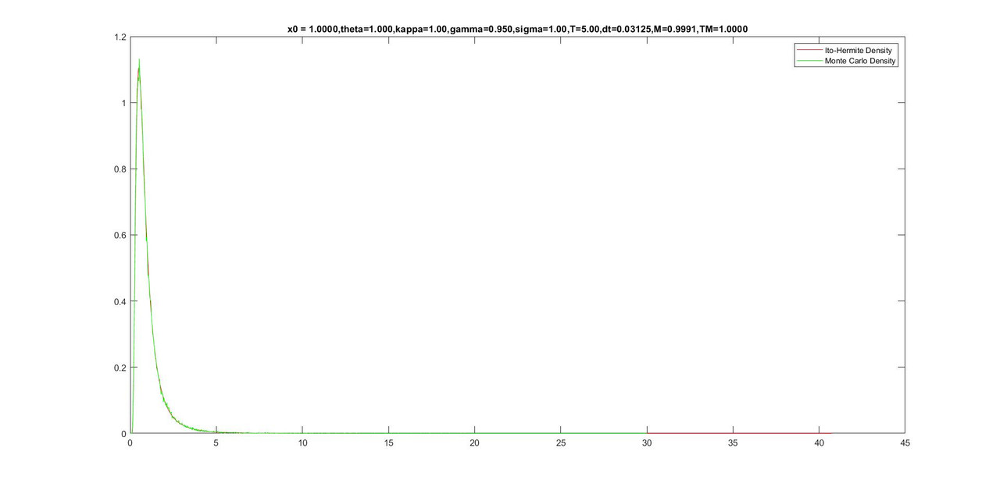](https://postimg.cc/hf4MxJ66)

---

### #1384 — Amin (Topic Author)
*March 27, 2022, 9:02 PM*

Friends, my fever decreases to normal after I take two tablets of Panadol but it starts increasing a few hours after
that. I do not cough a lot, may be just a little bit after every few hours. But fever and weakness are a major problem.

For past certain days, I was suspecting that mind control agents were causing a headache by targeting light intensity
lasers on my skull but I could not be sure. But right now (It is 1:47 am here) I was awake for a few hours listening to
music and then I realized that intensity of lasers increased as compared to the previous levels remarkably and it became
obvious that waves were hitting my head from outside.

Can friends imagine the humanity of these crooks that I am sick and I have fever and weakness and mind control crooks
are targeting lasers on my head to cause headache.

Mind control agents are supposed to inflict brain damage on the target and humiliate and torture their target. When new
agents are commissioned, one major criteria that is required of recruits is that they will not have any feelings of
sympathy for their target and will torture the target without having any second thoughts. So being anal is a requirement
to become mind control agent and now it is a group of a large number of like-minded anal people.

---

### #1385 — Amin (Topic Author)
*March 28, 2022, 4:34 AM*

Friends, I am writing this post to explain the function that calculates cumulants and their derivatives. Here I copy the
function as

.

.

function [F,dF] =
CalculateCumulantsAndDerivativesFromMoments(C1,C2,C3,C4,C5,C6,a0,a1,a2,a3,a4,a5,SeriesOrder,NZterms,NMoments)

a(1)=a1;

a(2)=a2;

a(3)=a3;

a(4)=a4;

a(5)=a5;

aa0=a0;

a0=0;

EZ(1)=0;

EZ(2)=1;

for nn=3:NMoments*SeriesOrder+NZterms+2

    if rem(nn,2)==1

        EZ(nn)=0;

    else

        EZ(nn)=EZ(nn-2)*(nn-1);

        EZ(nn);

    end

end

EZ;

EXZ(1,1)=1;

for pp1=1:NZterms

        EXZ(1,pp1+1)=EZ(pp1);

end

a(SeriesOrder+1:50)=0;

b0=a0;

b=a;

for mm=1:NMoments

    if(mm>1)

        [b0,b] =SeriesProduct(a0,a,b0,b,SeriesOrder*mm);

        b(SeriesOrder*mm+1:50)=0;

    end

   % b0

   % b

%str=input('Look at numbers')

    EXZ(mm+1,1)=b0;

    for pp2=1:SeriesOrder*mm

            EXZ(mm+1,1)=EXZ(mm+1,1)+b(pp2).*EZ(pp2);

    end

    for pp1=1:NZterms

        EXZ(mm+1,pp1+1)=b0.*EZ(pp1);

        for pp2=1:SeriesOrder*mm

            EXZ(mm+1,pp1+1)=EXZ(mm+1,pp1+1)+b(pp2).*EZ(pp2+pp1);

        end

    end

end

u1=EXZ(2,1);

u2=EXZ(3,1);

u3=EXZ(4,1);

u4=EXZ(5,1);

u5=EXZ(6,1);

u6=EXZ(7,1);

% u1

% u2

% u3

% u4

% u5

% u6

%str=input('Look at numbers')

du1(1)=0;

du2(1)=0;

du3(1)=0;

du4(1)=0;

du5(1)=0;

du6(1)=0;

for mm=2:SeriesOrder+1

du1(mm)=EXZ(1,mm);

du2(mm)=2*EXZ(2,mm);

du3(mm)=3*EXZ(3,mm);

du4(mm)=4*EXZ(4,mm);

du5(mm)=5*EXZ(5,mm);

du6(mm)=6*EXZ(6,mm);

end

%du1(1)=1;

k1=aa0+a(2)+3*a(4);

%k1=u1;

k2=u2-u1^2;

k3=u3-3*u2*u1+2*u1^3;

k4=u4-4*u3*u1-3*u2^2+12*u2*u1^2-6*u1^4;

k5=u5-5*u4*u1-10*u3*u2+20*u3*u1^2+30*u2^2*u1-60*u2*u1^3+24*u1^5;

k6=u6-6*u5*u1-15*u4*u2+30*u4*u1^2-10*u3^2+120*u3*u2*u1-120*u3*u1^3+30*u2^3 - ...

    270*u2^2*u1^2+360*u2*u1^4-120*u1^6;

% k1

% k2

% k3

% k4

% k5

% k6

% str=input('Look at numbers--2')

dk1(1)=1.0;

dk1(2)=0.0;

dk1(3)=1.0;

dk1(4)=0.0;

dk1(5)=3.0;

dk1(6)=0.0;

dk2(1)=0;

dk3(1)=0;

dk4(1)=0;

dk5(1)=0;

dk6(1)=0;

for mm=2:SeriesOrder+1

%dk1(mm)=du1(mm);

dk2(mm)=-2.* u1.*du1(mm)+du2(mm);

dk3(mm)=du3(mm)-3*du1(mm)*u2-3*u1*du2(mm)+2*3*u1^2*du1(mm);

dk4(mm)=du4(mm)-4*du3(mm)*u1-4*u3*du1(mm)-3*2*u2*du2(mm)+12*du2(mm)*u1^2+12*2*u2*u1*du1(mm)-6*4*u1^3*du1(mm);

dk5(mm)=du5(mm)-5*du4(mm)*u1-5*u4*du1(mm)-10*du3(mm)*u2-10*u3*du2(mm)+20*du3(mm)*u1^2+20*2*u3*u1*du1(mm)+ ...

    30*2*u2*du2(mm)*u1+30*u2^2*du1(mm)-60*du2(mm)*u1^3-60*3*u2*u1^2*du1(mm)+24*5*u1^4*du1(mm);

dk6(mm)=du6(mm)-6*du5(mm)*u1-6*u5*du1(mm)-15*du4(mm)*u2-15*u4*du2(mm)+30*du4(mm)*u1^2+30*2*u4*u1*du1(mm)-10*2*u3*du3(mm)+
...

    120*du3(mm)*u2*u1-120*u3*du2(mm)*u1-120*u3*u2*du1(mm)-120*du3(mm)*u1^3-120*3*u3*u1^2*du1(mm)+30*3*u2^2*du2(mm) - ...

    270*2*u2*du2(mm)*u1^2+270*2*u2^2*u1*du1(mm)+360*du2(mm)*u1^4+360*4*u2*u1^3*du1(mm)-120*6*u1^5*du1(mm);

end

F(1,1)=k1-C1;

 F(2,1)=k2-C2;

 F(3,1)=k3-C3;

 F(4,1)=k4-C4;

 F(5,1)=k5-C5;

 F(6,1)=k6-C6;

     for mm=1:SeriesOrder+1

        dF(1,mm)=dk1(mm);

        dF(2,mm)=dk2(mm);

        dF(3,mm)=dk3(mm);

        dF(4,mm)=dk4(mm);

        dF(5,mm)=dk5(mm);

        dF(6,mm)=dk6(mm);

     end

end

---------------------------------------------------------------------------------------------------------------------------------------------

Suppose

$X=a_0 + a_1 Z+ a_2 Z^2+ a_3 Z^3+ a_4 Z^4+ a_5 Z^5$

A few notes first.

1. We calculate moments and derivatives of moments and then convert them into cumulants and derivatives of cumulants.

2. In the calculation of moments, we keep a0 equal to zero. All cumulants other than first cumulant are unaffected by
addition or subtraction of a constant term in the random variable. This is very important because at places a0 can be as
high as 19.9 while a4 or a5 could be at fifth or sixth decimal place. This leads to inaccuracies in calculations if we
do not make a0 equal to zero. I discovered this with experimentation. After spending four days and staying awake large
portions of four nights, when my program was complete, I realized that my numbers were wildly off. I spent a lot of time
thinking what was the reason and then realized that inaccuracies in calculations were probably causing this problem. I
turned a0 to zero and handled first cumulant separately by including the effect of a0 and all of a sudden my program was
giving perfect numbers.

3.   The derivative of mth raw moment with respect to nth coefficient $a_n$ is given as

$ \frac{d X^m}{d a_n} =m X^{(m-1)} Z^n$

4. Nomenclature of the program is

$EXZ(m+1,n+1)=E[X^m Z^n]$ i.e after calculations, the m+1th and n+1th entry of EXZ variable contains the value of
$E[X^m Z^n]$

The variable EZ(n) contains the value of $E[Z^n]$.

5. For calculations of moments, I have repeatedly multiplied the series with itself while retaining every element of the
series. Since our series has five elements, sixth power of the series would have thirty elements. Every element of this
series multiplies with a unique power of Z (ranging from one to thirty). To calculate the expected value of such series,
we simply multiply each element with expected value of its respective power of Z and add.

6. I have calculated first cumulant and its derivatives separately keeping account of the effect of a0.

I am sure it will be very simple for friends to understand this function after my basic explanation.

---

### #1386 — Amin (Topic Author)
*March 29, 2022, 10:10 AM*

>
> This program is different from the previous program in the sense that cumulants being added due to diffusion term are
explicitly calculated out of diffusion terms consisting of first and second hermite polynomials and their coefficients.
Please let me explain.
>
> Let us say that higher order diffusion term in Bessel diffusion is of the form
>
>
$\sigma \sqrt{dt} \, Z+ \sigma \, dt^{1.5} \Big[ c_1 \, w(t)^{\alpha_1} \, + \, c_2 \, w(t)^{\alpha_2} \, + \, c_3 \, w(t)^{\alpha_3} \, \, \Big] \, Z$
>
>
$+\sigma^2 \, dt^{2.0} \Big[ d_1 \, w(t)^{\beta_1} \, + \, d_2 \, w(t)^{\beta_2} \, + \, d_3 \, w(t)^{\beta_3} \, \, \Big] \, (Z^2 \, - 1)\, $
>
> where c's and d's are coefficients that are found out of Ito-Hermite expansion as in high order monte carlo, while
alphas and betas are powers on w that are found using Ito-Hermite expansion as in high order monte carlo.
>
> We expand the w-terms in the form of a series in $Z_0$ as
>
>
$\sigma \, dt^{1.5} \Big[ c_1 \, w(t)^{\alpha_1} \, + \, c_2 \, w(t)^{\alpha_2} \, + \, c_3 \, w(t)^{\alpha_3} \, \, \Big]$
>
> $=g_0 \, + \, g_1 Z_0 + \, g_2 {Z_0}^2 \, + \, g_3 {Z_0}^3 \, + \, g_4 {Z_0}^4$
>
> here$Z_0$ is standard normal associated with the existing diffusion prior to addition of volatility term and$Z_0$ and
$Z$ are independent of each other.
>
> while
>
>
$\sigma \, dt^{2.0} \Big[ d_1 \, w(t)^{\beta_1} \, + \, d_2 \, w(t)^{\beta_2} \, + \, d_3 \, w(t)^{\beta_3} \, \, \Big]$
>
> $=h_0 \, + \, h_1 Z_0 + \, h_2 {Z_0}^2 \, + \, h_3 {Z_0}^3 \, + \, h_4 {Z_0}^4$
>
>
>
> So our initial volatility term is expanded as
>
>
$\sigma \sqrt{dt} \, Z+ \sigma \, dt^{1.5} \Big[ c_1 \, w(t)^{\alpha_1} \, + \, c_2 \, w(t)^{\alpha_2} \, + \, c_3 \, w(t)^{\alpha_3} \, \, \Big] \, Z$
>
>
$+\sigma^2 \, dt^{2.0} \Big[ d_1 \, w(t)^{\beta_1} \, + \, d_2 \, w(t)^{\beta_2} \, + \, d_3 \, w(t)^{\beta_3} \, \, \Big] \, (Z^2 \, - 1)\, $
>
>
$=\sigma \sqrt{dt} \, Z \, + \Big[g_0 \, + \, g_1 Z_0 + \, g_2 {Z_0}^2 \, + \, g_3 {Z_0}^3 \, + \, g_4 {Z_0}^4 \, \Big] \, Z$
>
> $+\Big[ \, h_0 \, + \, h_1 Z_0 + \, h_2 {Z_0}^2 \, + \, h_3 {Z_0}^3 \, + \, h_4 {Z_0}^4 \, \Big] \, (Z^2-1)$
>
>
>
> Now we find value of cumulants associated with the diffusion term being added by taking appropriate powers of the
above series expression on RHS and replacing the powers of two different and independent standard normals,$Z$ and$Z_0$
by their expected values. This is how I find the value of cumulants being added due to diffusion term. Mean of this
volatility term is obviously zero.
>
.

Friends, this post is meant to explain the function in which cumulants associated with the diffusion term are
calculated. Please also read the above copied post

to get an orientation.

We have to calculate expectation of moments of

$\sigma \sqrt{dt} \, Z \, + \Big[g_0 \, + \, g_1 Z_0 + \, g_2 {Z_0}^2 \, + \, g_3 {Z_0}^3 \, + \, g_4 {Z_0}^4 \, \Big] \, Z$

$+\Big[ \, h_0 \, + \, h_1 Z_0 + \, h_2 {Z_0}^2 \, + \, h_3 {Z_0}^3 \, + \, h_4 {Z_0}^4 \, \Big] \, (Z^2-1)$

I write above in shorthand notation as

$\sigma \sqrt{dt} \, Z \, + \Big[g_0 \, + \, g_1 Z_0 + \, g_2 {Z_0}^2 \, + \, g_3 {Z_0}^3 \, + \, g_4 {Z_0}^4 \, \Big] \, Z$

$+\Big[ \, h_0 \, + \, h_1 Z_0 + \, h_2 {Z_0}^2 \, + \, h_3 {Z_0}^3 \, + \, h_4 {Z_0}^4 \, \Big] \, (Z^2-1)$

$=\, c_1(Z_0) \, Z+\ c_2 (Z_0)  \, (Z^2-1)$    Equation (1)

where $\, c_1(Z_0) \,$ and $  c_2(Z_0) $ are both series in Z.

I have calculated the powers of  above equation (1) using binomial/multinomial expansion. Please refer to function

function [dC1,dC2,dC3,dC4,dC5,dC6] = CalculateDiffusionCumulants04_Lite(d10,d1,d20,d2,SeriesOrder,NMoments)

Let me copy the main loop of the function below

-----------------------------------------------------------------------------------------------------------------------------------------------------------------

Moment1(1:NMoments)=0;

for k = 1 : (NMoments)

    for p = 0:k

        l2=k-p+1;

        l1=p+1;

        if(HermiteProduct(l1,l2)>0)

            b(1:SeriesOrder*k)=0;

            b0=1;

            if(l1>1)

                a=T1(l1-1,1:SeriesOrder*k);

                a0=T10(l1-1);

                [b0,b] =SeriesProduct(a0,a,b0,b,SeriesOrder*k);

                %CC(l_0,l1,l2,l3,l4)=CC(l_0,l1,l2,l3,l4).*2^(l1-1);

            end

            if(l2>1)

                a=T2(l2-1,1:SeriesOrder*k);

                a0=T20(l2-1);

                [b0,b] =SeriesProduct(a0,a,b0,b,SeriesOrder*k);

                %CC(l_0,l1,l2,l3,l4)=CC(l_0,l1,l2,l3,l4).*2^(l2-1);

            end

            CC(l1,l2)=b0;

            for qq=1:SeriesOrder*k

                CC(l1,l2)=CC(l1,l2)+b(qq)*EZ(qq);

            end

               
 Moment1(k)=Moment1(k)+factorial(k)/(factorial(l1-1).*factorial(l2-1)).*CC(l1,l2).*HermiteProduct(l1,l2);

        end

    end

end

---------------------------------------------------------------------------------------------------------------------------------------------------------

The above looping is for binomial expansion. The first loop index k specifies which power of binomial sum is being
calculated. loop indices, l1 and l2 take values so as that  k= (l1-1)+(l2-1)  always holds true. In our case

$CC(l1,l2)= E[{(c_1(Z_0))}^{(l1-1)}{(c_2(Z_0))}^{(l2-1)}]$  Equation(2)

and

HermiteProduct(l1,l2) $= E[{Z}^{(l1-1)}{(Z^2-1)}^{(l2-1)}]$  Equation(3)

Please note that$c_1(Z_0) $ and$c_2(Z_0)$ are both series as defined in equation (1) and we take powers of the entire
series and then multiply them and then take expectation. These hermite products are pre-computed and hard-coded in the
program. Factorials in the above equation define the constant coefficients of binomial/multinomial expansion. Rest of
the program are just repeated multiplications of the series with themselves or with each other to calculate CC(l1,l2).

I hope it will be very easy for friends to understand this program after they can recognize the main loops as binomial
expansion.

Just like this simpler expression for binomial version, the similar expression in older program that took a very large
time was also multinomial expansion with five elements as opposed to just two elements in the lite binomial version. In
that older program all five loop indices took values so that expansion order indicated by the main loop

 k= (l0-1)+(l1-1)+(l2-1)+(l3-1)+(l4-1)  always holds true. In that program, I was not using hermite polynomials and had
converted them into coefficients of  the powers of Z.

---

### #1387 — Amin (Topic Author)
*April 1, 2022, 2:12 PM*

>
>
> Friends I recently posted a cumulant matching program that advances the density of SDE diffusions (represented in the
form of a Z-series) by adding the cumulants of existing density with cumulants of innovations(diffusion term) and then
finding another SDE density in Z-series so that its cumulants match the added cumulants of innovations and existing
density. This technique and its derivatives can be applied in interesting ways at a lot of places in applied probability
theory and I am sure many friends would like to use it extensively. Apart from a lot of simple applied uses, it can be
used to solve for example the densities where the driver noise in not normal but for example is a gamma density
variable.
>
> However backing out coefficients of Z-series by Newton method so that its cumulants match with desired cumulants might
not always work easily for many diffusions. I was thinking of an alternative easier method that can find the Z-series
representation with given target cumulants when a "nearby density" whose Z-series representation is known is input to
the numerical method. By "nearby density" I mean a density that is not very different in cumulants/moments from target
density and shares the support of the target density. Sharing the support is important since we want to find a new
density by multiplying the original density with a polynomial and if original density has smaller tails/support, there
is no way to find a good density beyond those tails by any possible polynomial multiplication where the support of
original input density is zero. But we describe how to increase the support of the original input density by linearly
scaling it when target density has far larger variance so the method could still be used.
>
> We want to multiply the original "nearby density" with a polynomial whose coefficients are as yet unknown and then
numerically calculate first few moments by integrating over the density. Variables get integrated and by equating each
moment, we are left with a linear equation for each moment in terms of as yet unknown coefficients. Zeroth moment is the
probability distribution itself whose integral is equated to unity to find an extra linear equation in terms of unknown
coefficients. We can solve for example six linear equations by gaussian elimination to retrieve the as yet unknown
coefficients of the polynomial that multiplies the original "nearby density" and results in a density with deaired
cumulants.
>
> Though I explain things again, please read this post 1023 on page 69 of this thread where I have used this method earlier: [Breakthrough in the theory of stochastic differential equations and their simulation - Page 69 - wilmott.com](https://forum.wilmott.com/viewtopic.php?f=4&t=99702&start=1020#p862515).
>
>
>
> Suppose we have an original nearby density f(x) on a grid. We can easily calculate all moments/cumulants by
numerically integrating over the density. We want to find a target density g(x) that has certain cumulants usually
different from the cumulants of nearby density. We multiply the original density with a polynomial with as yet unknown
coefficients to find the target density.
>
>
>
> $g(x) \,=  \, f(x)  \, [c_0  \, + c_1  \, x  + c_2  \, x^2 + c_3  \, x^3 + c_4  \, x^4] $
>
>
>
> We do not know the coefficient c's and want to find them so that cumulants or equivalently the moments we have backed
out from cumulants are matched with cumulants of g(x), the target density.
>
> We write as
>
>
>
> Since resulting density g(x) has to be a valid probability distribution, our first condition is that integral of
density should  to one.
>
>
>
>
$  \int  \, g(x)  \, dx =\int  \, f(x)  \, [c_0  \, + c_1  \, x  + c_2  \, x^2 + c_3  \, x^3 + c_4  \, x^4]   \, dx = \, 1  \, $
Equation(1)
>
>
>
> if  $\mu_1$ is the value of first raw moment backed out from target cumulants that we want to match, we must have
>
>
>
>
$  \int  \,x \, g(x)  \, dx =\int  \, x\, f(x)  \, [c_0  \, + c_1  \, x  + c_2  \, x^2 + c_3  \, x^3 + c_4  \, x^4]   \, dx = \,\mu_1  \, $
Equation(2)
>
>
>
> similarly if if  $\mu_2$ is the value of second raw moment backed out from target cumulants, we must have
>
>
>
>
$  \int  \,x^2 \, g(x)  \, dx =\int  \, x^2\, f(x)  \, [c_0  \, + c_1  \, x  + c_2  \, x^2 + c_3  \, x^3 + c_4  \, x^4]   \, dx = \,\mu_2  \, $
Equation(3)
>
>
>
> if  $\mu_3$ is the value of second raw moment backed out from target cumulants, we must have
>
>
>
>
$  \int  \,x^3 \, g(x)  \, dx =\int  \, x^3\, f(x)  \, [c_0  \, + c_1  \, x  + c_2  \, x^2 + c_3  \, x^3 + c_4  \, x^4]   \, dx = \,\mu_3  \, $
Equation(3)
>
>
>
> similarly we can write equations of desired raw moments backed out from central moments to fourth or sixth or eighth
order.
>
> From equation (1), we have
>
>
>
>
$  \int  \, g(x)  \, dx =\int  \, f(x)  \, [c_0  \, + c_1  \, x  + c_2  \, x^2 + c_3  \, x^3 + c_4  \, x^4]   \, dx = \, 1  \, $
Equation(1)
>
>
$ = c_0  \, \int  \, f(x)  \,  \, dx+ c_1  \int  \, f(x) \, x  \, dx + c_2  \int  \, f(x) \, x^2 \, dx + c_3 \int  \, f(x)  \, x^3 \, dx+ c_4  \int  \, f(x) \, x^4 \, dx  = \, 1  \, $
>
>
>
> if we use the notation $E[x^n]=\int  \, f(x) \, x^n \, dx =  \zeta_n $, we can write the moment equations as
>
>
>
>$  c_0  \, + c_1 \, \zeta_1 + c_2 \, \zeta_2 + c_3 \, \zeta_3+ c_4 \, \zeta_4  = \, 1  \, $ Equation(1)
>
>$  c_0  \, \zeta_1 + c_1 \, \zeta_2 + c_2 \, \zeta_3 + c_3 \, \zeta_4+ c_4 \, \zeta_5  = \,\mu_1  \, \, $ Equation(2)
>
>$  c_0  \, \zeta_2 + c_1 \, \zeta_3 + c_2 \, \zeta_4 + c_3 \, \zeta_5+ c_4 \, \zeta_6  = \,\mu_2  \, \, $ Equation(3)
>
>$  c_0  \, \zeta_3 + c_1 \, \zeta_4 + c_2 \, \zeta_5 + c_3 \, \zeta_6+ c_4 \, \zeta_7  = \,\mu_3  \, \, $ Equation(4)
>
>
>
> Since$E[x^n]=  \zeta_n $ are all known from numerical integration on original nearby density, we are left with a
number of linear equations that we need to solve by Gaussian elimination to find out the coefficients c's of multiplying
polynomial such that resulting density has cumulants equated with target cumulants. Once these equations are solved we
find the resulting density as
>
>
>
> $g(x) \,=  \, f(x)  \, [c_0  \, + c_1  \, x  + c_2  \, x^2 + c_3  \, x^3 + c_4  \, x^4] $
>
>
>
> There is one check that you will need. The density has to be positive everywhere. For well-stated moments with proper
density support, this should not be a problem at all. But when bad cumulants are specified or support of the density
does not match the support of target density, there could be a possibility that you would get a target density that is
negative at some places as a result of solution of  above linear equations.
>
>
>
> I will follow with one or two posts to complete description of the method. In new posts, I want to further explain how
to use the above method when we have our original density f(x) as a Z_series and we want to find the Z-Series of target
density g(x) such that cumulants of target density match the desired cumulants. I also want to mention simple scaling
that can be used to increase the support of original density when its variance is smaller so its support matches the
support of target density with larger variance.
>
.

.

This was a good post. I would request friends to please disregard the post 1372 I made after this. But I thought more
about the ideas and have something to share with friends.

In the copied post, we start with an initial density and we solve a set of linear equations to find a target density
that matches target moments. I want to try to represent the target density variable as a transformation (given by power
series) of the initial input density variable. Once we know this transformation, hopefully, we would even be able to
evaluate expectations of functions of target density variable on initial density and  vice versa.

Suppose the initial density of variable X is given

$p_X(x) =  f(x)  \, $

and we have the new target density

$p_Y(x) =  f(x)   \, [c_0  \, + c_1  \, x  + c_2  \, x^2 + c_3  \, x^3 + c_4  \, x^4]=  f(x)   \, Q(x) $

where

$Q(x)=[c_0  \, + c_1  \, x  + c_2  \, x^2 + c_3  \, x^3 + c_4  \, x^4]$

We suppose that we can expand both f(x) and Q(x) as power series.

We want to find a transformation from X to Y,$Y(X)$ so that given any value(realization) of random variable X, the CDF
of$Y(X)$ on target density exactly matches the CDF of X on initial density.

For that we write the CDF equations as

$  \int_{-\infty}^X  \, f(x) \, dx =  \, \int_{-\infty}^{Y(X)}  \, f(x)  \,Q(x) \, dx $  Equation(1)

X is natural variable for initial density so $\frac{dX}{dx}=1$

Differentiating our integral equations by x on both sides, we get

$    \, f(X) \, =  \,   \, f(Y(X))  \,Q(Y(X)) \, \frac{dY}{dX} $     Equation (A)

We had supposed that we could find power series of  f(X) and Q(X). Now we suppose that transformation relationship
between X and Y is also given by a power series as

$Y(X)\,=\,a_0 \,+\, a_1  \,X \,+\, a_2\, X^2 \,+\, a_3\, X^3\, +\, a_4 \,X^4$ Equation (B)

We notice that all terms in Equation(A) can be expanded as a power series. Equality between both sides of the equation
would hold when power series expansions on both sides have equal coefficients on powers of X in which we are expanding
the terms. We want to turn this equality of coefficients into equations(for each power of X) in terms of unknown
coefficients$a_0\,, \,a_1 , \,a_2 , \,a_3 , \,a_4$ . These equations would be algebraic expressions that can be solved
possibly by root search. We can write rhs of equation (A) as an expansion as

$  \,   \, f(Y(X))  \,Q(Y(X)) \, \frac{dY}{dX} = \alpha_0(a_0,a_1,a_2,a_3,a_4) + \alpha_1(a_0,a_1,a_2,a_3,a_4) X + \alpha_2(a_0,a_1,a_2,a_3,a_4) X^2$

$+ \alpha_3(a_0,a_1,a_2,a_3,a_4) X^3+ \alpha_4(a_0,a_1,a_2,a_3,a_4) X^4 $

while lhs of equation(A) can be expanded as

$  \,   \, f(X) = b_0 + \,b_1 X + \,b_2 X^2+ \,b_3 X^3+ \,b_4 X^4 $

which gives us five(or more) equations by matching coefficients of each power of X as

$\alpha_0(a_0,a_1,a_2,a_3,a_4)=b_0 $

$\alpha_1(a_0,a_1,a_2,a_3,a_4)=b_1 $

$\alpha_2(a_0,a_1,a_2,a_3,a_4)=b_2 $

$\alpha_3(a_0,a_1,a_2,a_3,a_4)=b_3 $

$\alpha_4(a_0,a_1,a_2,a_3,a_4)=b_4 $

Each alpha above is an algebraic equation.

Once we solve the above equations by root search, we can find the transformation in the form of a power series that
gives relationship between variable X of initial distribution with the variable Y of the target distribution as

$Y(X)\,=\,a_0 \,+\, a_1  \,X \,+\, a_2\, X^2 \,+\, a_3\, X^3\, +\, a_4 \,X^4$ Equation (B)

Once this relationship is known it could be possible to evaluate expectation (and its moments)  of variable Y(X) of the
target density by integrating its series transformation relationship on the initial density as

$E[Y]=  \int_{-\infty}^{\infty} \,Y(X) \, f(X) \, dX =  \, \int_{-\infty}^{\infty} \, X\, f(X)  \,Q(X) \, dX$

or for its moments

$E[Y^n]=  \int_{-\infty}^{\infty} \,[Y(X)]^n \, f(X) \, dX =  \, \int_{-\infty}^{\infty} \, X^n\, f(X)  \,Q(X) \, dX$

So in the copied post we understood how to find a new target density whose cumulants match the target cumulants. And in
this post, we have seen how to find a transformation between the two variables related to initial density and a
different target density respectively.

I hope this post will be useful but please pardon any errors.

In a few days I want to come back with a program that uses this method to simulate the densities of SDEs in time.

.

Friends my corona ended several days ago but I still remain slightly disturbed (slightly depressed as well) and my
digestive system is still not perfectly normal. But I have started working again. I was thinking of using the above
copied method to calculate an initial seed for Newton iteration. In my previous program, I have specified an initial
seed from my understanding of SDEs but there are many times when we want to evolve a density according to target
cumulants while the density may not necessarily be following an analytic SDE. In theory we can use our Newton method but
if the seed specified is not within Newton method's radius of convergence as usually would be the case, Newton method
will diverge without giving us a proper solution. I want to use the ideas in the copied post and then try to find a
solution to target cumulants that is very close to the true solution and this approximately close solution could be used
as an initial seed for Newton method so that the method converges to proper true solution. Again there are many places
when we want a density that is described by target cumulants but it does not necessarily follow an SDE. So the new work
might help us in that situation.

Though I want to work on these ideas, I do not promise anything since there might be unforeseen problems. But obviously
I have enough hope that ideas will work out.

Just as a food for thought for friends, I am trying to develop a basic framework for densities that can be trained with
AI using historical and forward looking data and updated in real time to calculate densities that can be used for
vanilla trading of financial assets. Though use of densities for pricing, hedging and trading of derivatives is quite
obvious, it would be even more interesting to see how various market factors affect the evolution of densities that we
want to use for vanilla trading of stocks, exchange rates and interest rates etc.  I really think that there is a lot of
interesting research that can be done in this direction.

---

### #1388 — Amin (Topic Author)
*April 5, 2022, 11:00 AM*

Friends, I am very excited by the new opportunities that seem to open up with my recent research. It has been a long
number of years since I decided to start research on fundamentals and basics of stochastics as opposed to application of
the existing stochastics theory to derivatives. Now after all these years of hard work, we have now enough exciting
tools to apply new stochastics theory to derivatives trading. I have therefore decided to put off my vanilla stocks
trading project for a few months and concentrate solely on new research on stochastics and its applications to
derivatives pricing and trading.

Like in other areas, there are enormous new opportunities in interest rate derivatives trading applications.

In our framework, Interest rate derivatives strongly require some semi-analytic method to  find stochastic integrals
over time of stochastic differential equation variables. Though we can use our cumulant based methods to be able to do
that, I believe there could be some simpler and faster methods to achieve our goal. I wanted to pursue tis line of
research but I could not give any time to it because I was spending most of my time on stock market trading project. But
now I want to spend some good time on discovering simple analytic ways to calculate path integrals of SDEs something
which is a requirement for comprehensive technology for interest rate derivatives.

Like always, I will be posting all my matlab programs on this  thread. But I want to revive my website (that is down for
several months now) and post faster industrial C++ programs and DLLs there which people can download for a few hundred
dollars if they want to bypass doing all the work themselves.

I have also decided to approach firms and individuals in derivatives pricing with my project proposals if some of them
would be willing to sponsor.

I also hope to write research papers on my latest work in Wilmott magazine but writing papers is a relatively time
taking enterprise for me and therefore I have not been able to do that in the past.

But again it is exciting to see my long research start to finally become mature and I hope friends would like my
programs in coming weeks and months.

---

### #1389 — Amin (Topic Author)
*April 6, 2022, 5:55 AM*

Friends, I continued to work yesterday after writing my previous post. And all through rest of the day yesterday, mind
control agents continued to focus waves on my eyes(my eyes literally continued to tear/water for several hours). They
also continued to focus waves on my feet, my penis and also my back. It was very difficult to work but I continued to
bear the torture and did not mention it. But today before I started to work mind control agents started to force needles
in my penis even though I was urinating in a bottle inside my room. They did it multiple times and for the second time
when they forced needles into my penis, it was so painful that I was literally shouting with pain and then I decided to
write this post.

Mind control agents here in Pakistan are visibly disturbed that I want to continue my research. I want to tell friends
that there is a very close gang of Pakistani American mind control agents and almost all of them are from brooklyn.
These agents each make several million dollars every year and they are very very afraid that if mind control ends in
Pakistan, huge money they swindle and divide among each other every year other would disappear. These agents remain in
touch with Jews who are behind mind control in Pakistan and play upon fear and hatred of those jews by telling them
about scenarios how fast this nation could develop if mind control ends in Pakistan. The malicious Jews in turn make
American defense support them with all kind of money and embassy assistance. And this symbiotic relationship continues
where mind control of hundreds of innocent Pakistanis like me continues and each mind control agent continues to mint
millions of dollars every year. And of course mind control could not continue in Pakistan if it were not for crook
generals in Pakistani military each of whom takes several tens of millions of dollars to continue mind control in
Pakistan.

---

### #1390 — Amin (Topic Author)
*April 7, 2022, 10:42 AM*

Friends, I have been able to solve for the densities of path integrals of easy SDEs. By easy SDEs I mean CEV type noises
and noises with linear drift. I still have not been able to solve for path integrals of mean-reverting SDEs.

I have not used the transition probabilities framework and I simply calculated effective variance of SDE increments at
each simulation step and then added variances together in a squared fashion after  calculating appropriate multiple of
variance at each time stage. This was just exploratory but works very well for CEV noises and other easy densities. I
simulated the original SDE in cumulant matching framework.

I believe that mean-reverting type SDEs are not working since they have cross-correlations across time and once these
cross-correlations are properly accounted by doing a formal analysis, I believe we would be able to solve for the path
integrals of mean-reverting densities as well.

I will be posting my new programs in a few days and I hope that I would be able to solve for path integrals of
mean-reverting SDEs before that.

---

### #1391 — Amin (Topic Author)
*April 7, 2022, 12:05 PM*

Friends here are some quick graphs of time path integrals of CEV type noise SDEs. I have used variances derived from the
Z-series parameters of the SDE. I have not used transition probabilities here. All the graphs are for two years of
dt-integrals. Please note that monte carlo mean given in graphs is usually very off. Since these are two years graphs of
noises, true mean should be  True Mean=x0*2. I have not given true mean in the graph title. All parameters of the SDE
are given in the graph title.

Though I simulated the original SDE in Bessel coordinates, the path integrals are obviously calculated in original
coordinates.

Briefly again the SDE is

$ dX(t)= \, \sigma {X(t)}^{\gamma} dZ(t) $

and path integral is

$dPI(t)= X(t) dt $

or

$PI(T)=\, \int_0^T \, X(t) dt $

.

.

Again true mean in first three graphs is two.  And true mean in last two graphs is .4

.

.

[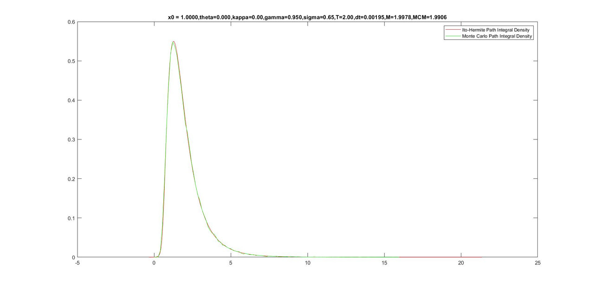](https://postimg.cc/Hc18Sxg1)

[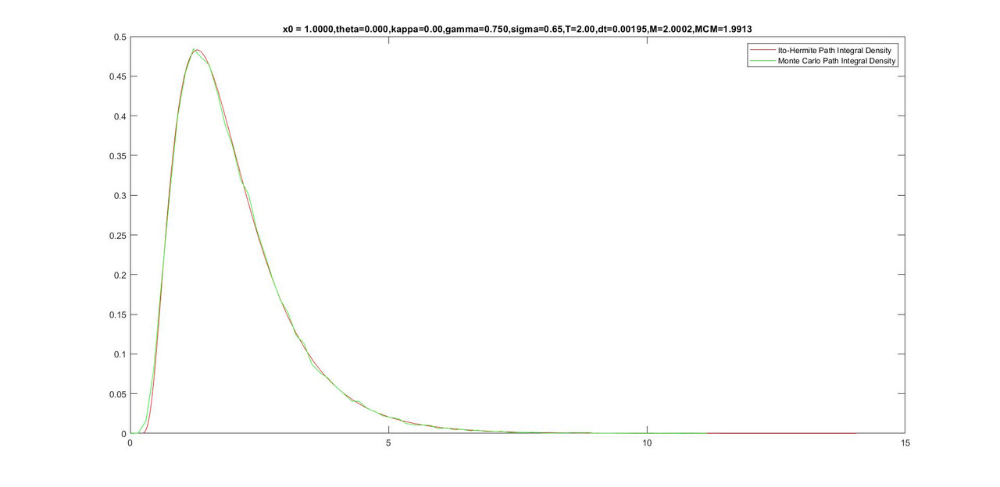](https://postimg.cc/34j4zT84)

[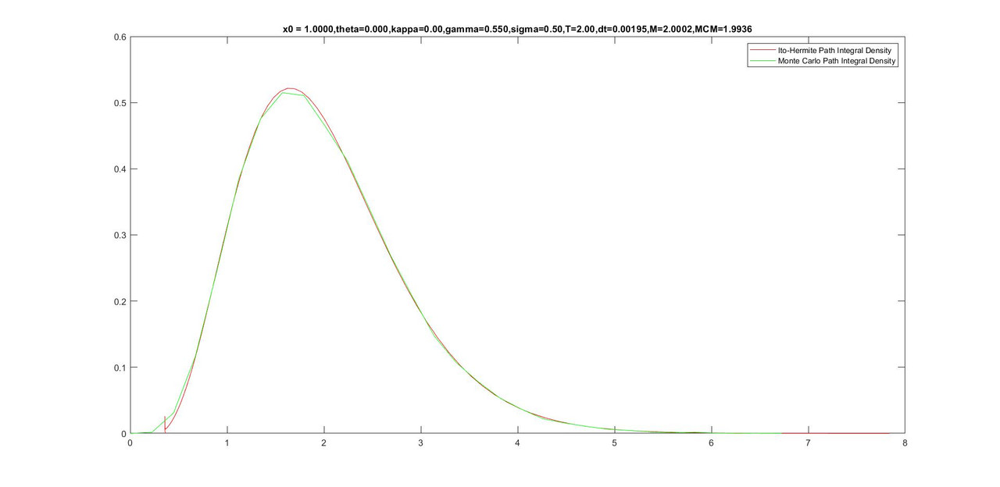](https://postimg.cc/m1bzs5kd)

[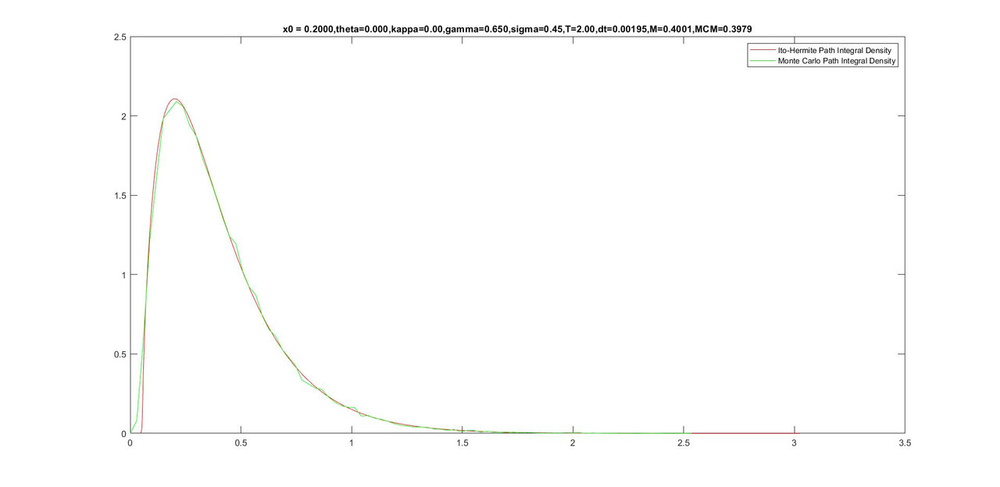](https://postimg.cc/HrKyyzvx)

[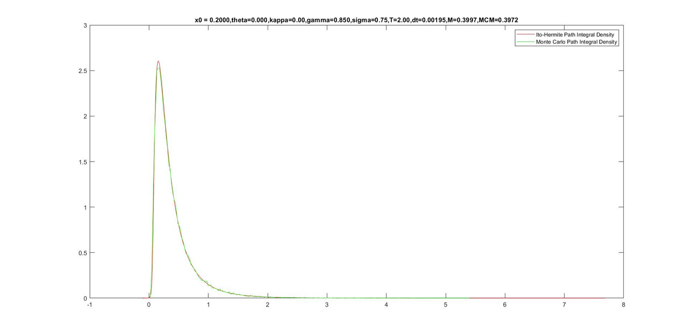](https://postimg.cc/Y4WmfFTx)

---

### #1392 — Amin (Topic Author)
*April 8, 2022, 5:11 AM*

>
> Friends, I continued to work yesterday after writing my previous post. And all through rest of the day yesterday, mind
control agents continued to focus waves on my eyes(my eyes literally continued to tear/water for several hours). They
also continued to focus waves on my feet, my penis and also my back. It was very difficult to work but I continued to
bear the torture and did not mention it. But today before I started to work mind control agents started to force needles
in my penis even though I was urinating in a bottle inside my room. They did it multiple times and for the second time
when they forced needles into my penis, it was so painful that I was literally shouting with pain and then I decided to
write this post.
>
> Mind control agents here in Pakistan are visibly disturbed that I want to continue my research. I want to tell friends
that there is a very close gang of Pakistani American mind control agents and almost all of them are from brooklyn.
These agents each make several million dollars every year and they are very very afraid that if mind control ends in
Pakistan, huge money they swindle and divide among each other every year other would disappear. These agents remain in
touch with Jews who are behind mind control in Pakistan and play upon fear and hatred of those jews by telling them
about scenarios how fast this nation could develop if mind control ends in Pakistan. The malicious Jews in turn make
American defense support them with all kind of money and embassy assistance. And this symbiotic relationship continues
where mind control of hundreds of innocent Pakistanis like me continues and each mind control agent continues to mint
millions of dollars every year. And of course mind control could not continue in Pakistan if it were not for crook
generals in Pakistani military each of whom takes several tens of millions of dollars to continue mind control in
Pakistan.
>
.

I want to apologize to a large number of very good Jews who have absolutely no hand in my persecution and who do not
wish ill of others at all. I want to say again that most Jews are very good human beings and a large number of them are
role models for all of us. One of the greatest human beings and the one human being I absolutely admire a lot, Einstein,
was also a Jew. He was not merely one of the greatest scientists, he was also a great human being. So I want to request
friends that my rants against some bad Jews that I have written when I am under torture or in anguish due to mind
control, must not be generalized to all Jews in general most of whom are great and very friendly folks. Again I want to
request all good Jews to pardon my writing here in which I was being too indiscriminate.  I hope my mind control ends
and I would have no business writing against even those jews who are behind mind control.

---

### #1393 — Amin (Topic Author)
*April 10, 2022, 1:07 PM*

Friends, I had worked with calculation of some path integrals by matching variance. I also wanted to solve for path
integrals by using the formula

$\int_0^T \, X(t) \, dt \, = \int_0^T \, d[ t \, X(t)]  \, - \,\int_0^T \,t \, dX(t)  $

In order to solve the above formula in cumulant addition framework, I decided to first solve for the SDE in original
coordinates using cumulant matching. But original coordinates do not work well with cumulant matching framework and then
I realized that in original coordinates the diffusion term, though orthogonal to previous SDE evolution, is not
independent of the prior evolution.  Additivity of densities by adding cumulants requires independence. We were able to
solve for the SDEs easily in Bessel framework by cumulant matching since diffusion term has only third order dependence
(in time) on prior SDE evolution which is extremely minimal and first order term is completely independent of the prior
SDE evolution. I do think there is a way around this problem to solve the SDEs in original coordinates by cumulant
matching but I have to work out the details. I will be sharing my ideas on this tomorrow.

Tomorrow, I will also share my program to solve for time integrals of SDE by matching variances and explain the
reasoning behind matching variances technique. I would have done it earlier but I was waiting for the other program with
cumulant matching to become ready(that did not work well).

I am very sure that we  can still solve stochastic type volatility SDEs system very easily in cumulant matching
framework by solving only two SDEs in Bessel coordinates (as opposed to solving a different asset SDE for every point on
stochastic volatility grid as we tried last year). We will be doing this in coming weeks.

---

### #1394 — Amin (Topic Author)
*April 11, 2022, 8:05 AM*

I want to explain the calculation of variance of dt-integral with a toy example of four time periods.

The gist of analytics below is that variances summation can only be applied on simulation intervals that are orthogonal
to each other.

Let us first get oriented with variables and their notations.

We have an SDE for $X(t)$ with four simulation periods on time points $t_0$, $t_1$, $t_2$, $t_3$, $t_4$,

We suppose that SDE is such that its evolution within every time period is orthogonal to all other time periods. This
holds for CEV noises and simple SDEs. For more difficult SDEs, you will have to take covariances into account carefully
into this analysis.

We denote the evolution within each time period as

$\int_{t_0}^{t_1} dX(t) = X(t_1) \, - \, X(t_0) \,=\, X_{0,1} $

similarly for other simulation periods for example

$\int_{t_1}^{t_2} dX(t) = X(t_2) \, - \, X(t_1) \,=\, X_{1,2} $

please note that $X_{0,1} $, $X_{1,2} $, $X_{2,3} $, $X_{3,4} $, are all orthogonal to each other.

Now we write X(t) at end of all simulation periods in terms of above orthogonal increments as

$ X(t_1) \,= \, X_0  \,+  \, X_{0,1}$

$ X(t_2) \,= \, X_0  \,+  \, X_{0,1}\,+  \, X_{1,2}$

$ X(t_3) \,= \, X_0  \,+  \, X_{0,1}\,+  \, X_{1,2}\,+  \, X_{2,3}$

$ X(t_4) \,= \, X_0  \,+  \, X_{0,1}\,+  \, X_{1,2}\,+  \, X_{2,3}\,+  \, X_{3,4}$

Now (this is approximate but I am sure that we can make it exact with proper integration over each time interval)

$\, \int_{t_0}^{t_4} \, X(t) \, dt \, \approx \, \sum_{t_n=t_0}^{t_4} \, X(t_n) \, \Delta t \,$

$=\, \Delta t \, X(t_1) \,+\,\Delta t \, X(t_2) \,+\,\Delta t \, X(t_3) \,+\,\Delta t \, X(t_4) \,$

We want to convert above summation into orthogonal intervals so that we could apply summation of variances. Doing that

$=\, \Delta t \, [\, X_0  \,+  \, X_{0,1}] \,+\,\Delta t \, [\, X_0  \,+  \, X_{0,1}\,+  \, X_{1,2} ] \,+\, \Delta t \, [\, X_0  \,+  \, X_{0,1}\,+ \, X_{1,2}\,+  \, X_{2,3} ]\,$

$+\,\Delta t \, [\, X_0  \,+  \, X_{0,1}\,+  \, X_{1,2}\,+  \, X_{2,3}\,+  \, X_{3,4}] $

$=4 \, \Delta t \, \, X_0  \,+4 \, \Delta t \, X_{0,1}\,+\, 3 \Delta t   \, X_{1,2} \,+2\, \Delta t  \, X_{2,3} \,+\,\Delta t  \, X_{3,4} $

So we have

$\, \int_{t_0}^{t_4} \, X(t) \, dt \, \approx \, \sum_{t_n=t_0}^{t_4} \, X(t_n) \, \Delta t \,$

$=4 \, \Delta t \, \, X_0  \,+4 \, \Delta t \, X_{0,1}\,+\, 3 \Delta t   \, X_{1,2} \,+2\, \Delta t  \, X_{2,3} \,+\,\Delta t  \, X_{3,4} $

Now matching variances (considering we are evolving from a delta point at $X_0$ which has no variance

$\, Var[\int_{t_0}^{t_4} \, X(t) \, dt] \, \approx \, Var[\sum_{t_n=t_0}^{t_4} \, X(t_n) \, \Delta t \,]$

$=16 \, {\Delta t}^2 \, Var[X_{0,1}]\,+\, 9 \, {\Delta t}^2   \, Var[X_{1,2}] \,+4\, {\Delta t}^2  \, Var[X_{2,3}] \,+\, {\Delta t}^2  \, Var[X_{3,4}] $

I used the above logic to calculate the variances of dt-integrlas in the graphs for simple CEV SDEs that I attached a
few posts earlier. I used simple dt summation in monte carlo with the same simulation period that I used for analytic
calculations with hermite polynomials.

In next post I explain how I made the actual variance calculations with hermite polynomials.

---

### #1395 — Amin (Topic Author)
*April 11, 2022, 10:21 AM*

>
> I want to explain the calculation of variance of dt-integral with a toy example of four time periods.
>
> The gist of analytics below is that variances summation can only be applied on simulation intervals that are
orthogonal to each other.
>
> Let us first get oriented with variables and their notations.
>
> We have an SDE for $X(t)$ with four simulation periods on time points $t_0$, $t_1$, $t_2$, $t_3$, $t_4$,
>
> We suppose that SDE is such that its evolution within every time period is orthogonal to all other time periods. This
holds for CEV noises and simple SDEs. For more difficult SDEs, you will have to take covariances into account carefully
into this analysis.
>
>
>
> We denote the evolution within each time period as
>
> $\int_{t_0}^{t_1} dX(t) = X(t_1) \, - \, X(t_0) \,=\, X_{0,1} $
>
> similarly for other simulation periods for example
>
> $\int_{t_1}^{t_2} dX(t) = X(t_2) \, - \, X(t_1) \,=\, X_{1,2} $
>
>
>
> please note that $X_{0,1} $, $X_{1,2} $, $X_{2,3} $, $X_{3,4} $, are all orthogonal to each other.
>
>
>
> Now we write X(t) at end of all simulation periods in terms of above orthogonal increments as
>
>
>
> $ X(t_1) \,= \, X_0  \,+  \, X_{0,1}$
>
> $ X(t_2) \,= \, X_0  \,+  \, X_{0,1}\,+  \, X_{1,2}$
>
> $ X(t_3) \,= \, X_0  \,+  \, X_{0,1}\,+  \, X_{1,2}\,+  \, X_{2,3}$
>
> $ X(t_4) \,= \, X_0  \,+  \, X_{0,1}\,+  \, X_{1,2}\,+  \, X_{2,3}\,+  \, X_{3,4}$
>
>
>
> Now (this is approximate but I am sure that we can make it exact with proper integration over each time interval)
>
> $\, \int_{t_0}^{t_4} \, X(t) \, dt \, \approx \, \sum_{t_n=t_0}^{t_4} \, X(t_n) \, \Delta t \,$
>
> $=\, \Delta t \, X(t_1) \,+\,\Delta t \, X(t_2) \,+\,\Delta t \, X(t_3) \,+\,\Delta t \, X(t_4) \,$
>
> We want to convert above summation into orthogonal intervals so that we could apply summation of variances. Doing that
>
>
$=\, \Delta t \, [\, X_0  \,+  \, X_{0,1}] \,+\,\Delta t \, [\, X_0  \,+  \, X_{0,1}\,+  \, X_{1,2} ] \,+\, \Delta t \, [\, X_0  \,+  \, X_{0,1}\,+ \, X_{1,2}\,+  \, X_{2,3} ]\,$
>
> $+\,\Delta t \, [\, X_0  \,+  \, X_{0,1}\,+  \, X_{1,2}\,+  \, X_{2,3}\,+  \, X_{3,4}] $
>
>
$=4 \, \Delta t \, \, X_0  \,+4 \, \Delta t \, X_{0,1}\,+\, 3 \Delta t   \, X_{1,2} \,+2\, \Delta t  \, X_{2,3} \,+\,\Delta t  \, X_{3,4} $
>
> So we have
>
> $\, \int_{t_0}^{t_4} \, X(t) \, dt \, \approx \, \sum_{t_n=t_0}^{t_4} \, X(t_n) \, \Delta t \,$
>
>
$=4 \, \Delta t \, \, X_0  \,+4 \, \Delta t \, X_{0,1}\,+\, 3 \Delta t   \, X_{1,2} \,+2\, \Delta t  \, X_{2,3} \,+\,\Delta t  \, X_{3,4} $
>
>
>
> Now matching variances (considering we are evolving from a delta point at $X_0$ which has no variance
>
> $\, Var[\int_{t_0}^{t_4} \, X(t) \, dt] \, \approx \, Var[\sum_{t_n=t_0}^{t_4} \, X(t_n) \, \Delta t \,]$
>
>
$=16 \, {\Delta t}^2 \, Var[X_{0,1}]\,+\, 9 \, {\Delta t}^2   \, Var[X_{1,2}] \,+4\, {\Delta t}^2  \, Var[X_{2,3}] \,+\, {\Delta t}^2  \, Var[X_{3,4}] $
>
>
>
> I used the above logic to calculate the variances of dt-integrlas in the graphs for simple CEV SDEs that I attached a
few posts earlier. I used simple dt summation in monte carlo with the same simulation period that I used for analytic
calculations with hermite polynomials.
>
> In next post I explain how I made the actual variance calculations with hermite polynomials.
>
.

.

.

In this post I want to explain how I made the above variance matching calculations for dt-integrals of SDE with hermite
polynomials.

I solved the SDE in Bessel coordinates using moment-matching as I have done in some programs that I posted earlier on
this forum.

Let us suppose we get a Z-series representation on every time step in Bessel coordinates as

$ w(t_n) \, = \, a_0(t_n) \, + \, a_1(t_n) \, Z \,+ \, a_2(t_n) \, Z^2 \, + \, a_3(t_n) \, Z^3 \,+ \, a_4(t_n) \, Z^4 \, $

I convert the above Z-Series of SDE variable in Bessel coordinates into a Z-Series of SDE variable in original
coordinates, X(t) given as

$ X(t_n) \, = \, c_0(t_n) \, + \, c_1(t_n) \, Z \,+ \, c_2(t_n) \, Z^2 \, + \, c_3(t_n) \, Z^3 \,+ \, c_4(t_n) \, Z^4 \, $

Now we convert the above Z-series in original coordinates to a series in Hermite polynomials(It is a bit of algebra and
I will share my program so friends can see how I did it.)

Let us suppose that series in Hermite polynomials is given as

$ X(t_n) \, = \, h_0(t_n) \, + \, h_1(t_n) \, H_1 \,+ \, h_2(t_n) \, H_2 \, + \, h_3(t_n) \, H_3 \,+ \, h_4(t_n) \, H_4 \, $

We converted into Hermite basis since it is very suitable for calculation of variances.

Now we calculate the hermite representation of each of the four orthogonal increments(in the context of toy example I
presented in previous post) as

$X_{0,1} \, = \, h_0(t_1) \, + \, h_1(t_1) \, H_1 \,+ \, h_2(t_1) \, H_2 \, + \, h_3(t_1) \, H_3 \,+ \, h_4(t_1) \, H_4 \, $

There is no sum-squared calculations in first increment above since it is starting from delta origin.

$X_{1,2} \, = \, h_0(t_2)- \, h_0(t_1) \, + \, \sqrt{h_1(t_2)^2 - h_1(t_1)^2} \, H_1 \,+ \, \sqrt{h_2(t_2)^2 - h_2(t_1)^2} \, H_2 \, + \, \sqrt{h_3(t_2)^2 - h_3(t_1)^2} \, H_3 \,$

$+ \, \sqrt{h_4(t_2)^2 - h_4(t_1)^2} \, H_4 \, $

$= \, h_0(t_{1,2}) \, + \, h_1(t_{1,2}) \, H_1 \,+ \, h_2(t_{1,2}) \, H_2 \, + \, h_3(t_{1,2}) \, H_3 \,+ \, h_4(t_{1,2}) \, H_4 \, $

similarly

$X_{2,3} \, = \, h_0(t_3)- \, h_0(t_2) \, + \, \sqrt{h_1(t_3)^2 - h_1(t_2)^2} \, H_1 \,+ \, \sqrt{h_2(t_3)^2 - h_2(t_2)^2} \, H_2 \, + \, \sqrt{h_3(t_3)^2 - h_3(t_2)^2} \, H_3 \,$

$+ \, \sqrt{h_4(t_3)^2 - h_4(t_2)^2} \, H_4 \, $

$= \, h_0(t_{2,3}) \, + \, h_1(t_{2,3}) \, H_1 \,+ \, h_2(t_{2,3}) \, H_2 \, + \, h_3(t_{2,3}) \, H_3 \,+ \, h_4(t_{2,3}) \, H_4 \, $

and Similarly

$X_{3,4} \, = \, h_0(t_4)- \, h_0(t_3) \, + \, \sqrt{h_1(t_4)^2 - h_1(t_3)^2} \, H_1 \,+ \, \sqrt{h_2(t_4)^2 - h_2(t_3)^2} \, H_2 \, + \, \sqrt{h_3(t_4)^2 - h_3(t_3)^2} \, H_3 \,$

$+ \, \sqrt{h_4(t_4)^2 - h_4(t_3)^2} \, H_4 \, $

$= \, h_0(t_{3,4}) \, + \, h_1(t_{3,4}) \, H_1 \,+ \, h_2(t_{3,4}) \, H_2 \, + \, h_3(t_{3,4}) \, H_3 \,+ \, h_4(t_{3,4}) \, H_4 \, $

Now hermite representation of the dt-integral as given by variances in the previous post is calculated as

$\, \int_{t_0}^{t_4} \, X(t) \, dt \, \approx \, \sum_{t_n=t_0}^{t_4} \, X(t_n) \, \Delta t \,$

$=4 \, \Delta t \, \, X_0  \,+4 \, \Delta t \, X_{0,1}\,+\, 3 \Delta t   \, X_{1,2} \,+2\, \Delta t  \, X_{2,3} \,+\,\Delta t  \, X_{3,4} $

$ =\, {\Delta t} (4\, X_0 +4\, h_0(t_{0,1})+3\, h_0(t_{1,2})+2\, h_0(t_{2,3})+\, h_0(t_{3,4}))$

$+\, {\Delta t} \sqrt{(16 \, h_1(t_{0,1})^2+ 9 \, h_1(t_{1,2})^2+4 \, h_1(t_{2,3})^2+\, h_1(t_{3,4})^2)} \, H_1 \,$

$+\, {\Delta t} \sqrt{(16 \, h_2(t_{0,1})^2+ 9 \, h_2(t_{1,2})^2+4 \, h_2(t_{2,3})^2+\, h_2(t_{3,4})^2)}\, H_2 \,$

$+\, {\Delta t} \sqrt{(16 \, h_3(t_{0,1})^2+ 9 \, h_3(t_{1,2})^2+4 \, h_3(t_{2,3})^2+\, h_3(t_{3,4})^2)}\, H_3 \,$

$+\, {\Delta t} \sqrt{(16 \, h_4(t_{0,1})^2+ 9 \, h_4(t_{1,2})^2+4 \, h_4(t_{2,3})^2+\, h_4(t_{3,4})^2)}\, H_4 \,$

It is this above formula that I used to calculate graphs of dt-integrals of CEV noises that I posted on last Thursday.

Here are some notes.

1. Conversion of Z-series in Bessel coordinates to Z_series in original Coordinates is not exactly faithful (in extreme
tails) when volatility is very high or when time is large especially for CEV exponents close to one (close to lognormal)
and close to CEV exponent=.5  even though conversion to original coordinates on a grid is usually very good.

2. I tried to improve the accuracy of original coordinates by increasing the number of terms in Z-series of Bessel
coordinates from 5 to 7 i.e. taking the calculations to eighth moment and many times it greatly helps to increase the
accuracy of converted Z-series in original coordinates but sometimes including seventh moments or  eighth moments causes
errors which I believe are due to lack of precision in 15-digit accuracy we mostly have. I think if a program is written
in C++ employing float-128 high precision non-standard type, we can get a more accurate representation of Z-series of
original coordinates but I have not done it myself yet so I cannot be perfectly sure.

3. Even though I could use variances matching to get dt-integrals quite exact, when I tried to solve for the evolution
for densities of SDE itself by matching variances (sum of squared coefficients of hermite polynomials), it did not work
at high volatilities but seemed to work at low volatilities. Friends are encouraged to experiment with it since I might
be doing something wrong posssibly.

4. In calculations of square-root of sum of squared hermite coefficients, you have to be careful with signs, two
negatives should convert to a larger negative and a large negative plus a smaller positive should sum-square to a
smaller negative etc.

I will share my simple dt-integrals calculations program that I used to make previously posted graphs sometime tomorrow.

---

### #1396 — Amin (Topic Author)
*April 12, 2022, 11:13 AM*

I am attaching the program for path integrals. Please note that it will work only for CEV type noises. I hope to post
another program in a week that will solve for the path integrals of drifting and mean-reverting SDEs.

.

.

```
function [] = FPESeriesCoeffsFromGaussiansWilmottNew02A_Lite_PIntegral01()

%Copyright Ahsan Amin. Infiniti derivatives Technologies.
%Please fell free to connect on linkedin: linkedin.com/in/ahsan-amin-0a53334
%or skype ahsan.amin2999
%In this program, I am simulating the SDE given as
%dy(t)=mu1 x(t)^beta1 dt + mu2 x(t)^beta2 dt +sigma x(t)^gamma dz(t)

%I have not directly simulated the SDE but simulated the transformed
%Besse1l process version of the SDE and then changed coordinates to retreive
%the SDE in original coo
%rdinates.
%The present program will analytically evolve only the Bessel Process version of the
%SDE in transformed coordinates.

dt=.125/2/2/2;   % Simulation time interval.%Fodiffusions close to zero
             %decrease dt for accuracy.
Tt=32*2*2;%16*2*4;%*4*4*1;%*4;%128*2*2*2;     % Number of simulation levels. Terminal time= Tt*dt; //.125/32*32*16=2
year;
T=Tt*dt;
Ts=Tt;
ds(1:Ts)=dt;

%
% %Below I have done calculations for smaller step size at start.
%
% %ds(1:64)=dt/16;
% %ds(65:128)=dt/4;
% if(Tt4)&&(Tt20)
% Ts=(32)+((20-4)*2)+(Tt-20);
% ds(1:32)=dt/8;
% ds(33:64)=dt/2;
% ds(65:Ts)=dt;
% end
% T
% sum(ds(1:Ts))
% Ts
%str=input('Check if time is right');

OrderA=4;  %
OrderM=4;  %

if(T>=1)
dtM=1/16;%.0625/1;
TtM=T/dtM;
else
dtM=T/16;%.0625/1;
TtM=T/dtM;
end

dtM=dt;
TtM=Tt;

dNn=.2/2;   % Normal density subdivisions width. would change with number of subdivisions
Nn=46*2;  % No of normal density subdivisions

NnMid=4.0;

x0=1.0;   % starting value of SDE
beta1=0.0;
beta2=1.0;   % Second drift term power.
gamma=.75;%50;   % volatility power.
kappa=0.0;%.950;   %mean reversion parameter.
theta=1.00;%mean reversion target
sigma0=.650;%Volatility value

%you can specify any general mu1 and mu2 and beta1 and beta2.
mu1=1*theta*kappa;   %first drift coefficient.
mu2=-1*kappa;    % Second drift coefficient.
%mu1=0;
%mu2=0;

alpha=1;% x^alpha is being expanded. This is currently for monte carlo only.
alpha1=1-gamma;%This is for expansion of integrals for calculation of drift
%and volatility coefficients
%yy(1:Nn)=x0;
w0=x0^(1-gamma)/(1-gamma);

Z(1:Nn)=(((1:Nn)-6.5/1)*dNn-NnMid);
Z
str=input('Look at Z');
ZProb(1)=normcdf(.5*Z(1)+.5*Z(2),0,1)-normcdf(.5*Z(1)+.5*Z(2)-dNn,0,1);
ZProb(Nn)=normcdf(.5*Z(Nn)+.5*Z(Nn-1)+dNn,0,1)-normcdf(.5*Z(Nn)+.5*Z(Nn-1),0,1);
ZProb(2:Nn-1)=normcdf(.5*Z(2:Nn-1)+.5*Z(3:Nn),0,1)-normcdf(.5*Z(2:Nn-1)+.5*Z(1:Nn-2),0,1);

%%%%%%%%%%%%%%%%%%%%%%%%%%%%%%%%%%%%%%%%%%%%%%%%%%%%%%%%%%%%%%%%%%%%%%%%%%%%%%%%%%%%%%%%%%%%%%

sigma11(1:OrderA+1)=0;
mu11(1:OrderA+1)=0;
mu22(1:OrderA+1)=0;
sigma22(1:OrderA+1)=0;
% index 1 correponds to zero level since matlab indexing starts at one.
sigma11(1)=1;
mu11(1)=1;
mu22(1)=1;
sigma22(1)=1;

for k=1:(OrderA+1)
    if sigma0~=0
        sigma11(k)=sigma0^(k-1);
    end
    if mu1 ~= 0
        mu11(k)=mu1^(k-1);
    end
    if mu2 ~= 0
        mu22(k)=mu2^(k-1);
    end
    if sigma0~=0
        sigma22(k)=sigma0^(2*(k-1));
    end
end
%Ft(1:TtM+1,1:(OrderA+1),1:(OrderA+1),1:(OrderA+1),1:(OrderA+1))=0; %General time powers on hermite polynomials
Fp(1:(OrderA+1),1:(OrderA+1),1:(OrderA+1),1:(OrderA+1))=0;%General x powers on coefficients of hermite polynomials.
Fp1(1:(OrderA+1),1:(OrderA+1),1:(OrderA+1),1:(OrderA+1))=0;%General x powers for bessel transformed coordinates.

%YCoeff0 and YCoeff are coefficents for original coordinates monte carlo.
%YqCoeff0 and YqCoeff are bessel/lamperti version monte carlo.

YCoeff0(1:(OrderA+1),1:(OrderA+1),1:(OrderA+1),1:(OrderA+1))=0;
YqCoeff0(1:(OrderA+1),1:(OrderA+1),1:(OrderA+1),1:(OrderA+1))=0;
%Pre-compute the time and power exponent values in small multi-dimensional arrays
YCoeff = ItoTaylorCoeffsNew(alpha,beta1,beta2,gamma); %expand y^alpha where alpha=1;
YqCoeff = ItoTaylorCoeffsNew(alpha1,beta1,beta2,gamma);%expand y^alpha1 where alpha1=(1-gamma)
YqCoeff=YqCoeff/(1-gamma); %Transformed coordinates coefficients have to be
%further divided by (1-gamma)

for k = 0 : (OrderA)
    for m = 0:k
        l4 = k - m + 1;
        for n = 0 : m
            l3 = m - n + 1;
            for j = 0:n
                l2 = n - j + 1;
                l1 = j + 1;
                %Ft(l1,l2,l3,l4) = dtM^((l1-1) + (l2-1) + (l3-1) + .5* (l4-1));
                Fp(l1,l2,l3,l4) = (alpha + (l1-1) * beta1 + (l2-1) * beta2 + (l3-1) * 2* gamma + (l4-1) * gamma ...
                    - (l1-1) - (l2-1) - 2* (l3-1) - (l4-1));
                Fp1(l1,l2,l3,l4) = (alpha1 + (l1-1) * beta1 + (l2-1) * beta2 + (l3-1) * 2* gamma + (l4-1) * gamma ...
                    - (l1-1) - (l2-1) - 2* (l3-1) - (l4-1));

                YCoeff0(l1,l2,l3,l4) =YCoeff(l1,l2,l3,l4).*mu11(l1).*mu22(l2).*sigma22(l3).*sigma11(l4);
                YqCoeff0(l1,l2,l3,l4) =YqCoeff(l1,l2,l3,l4).*mu11(l1).*mu22(l2).*sigma22(l3).*sigma11(l4);
            end
        end
    end
end

%%%%%%%%%%%%%%%%%%%%%%%%%%%%%%%%%%%%%%%%%%%%%%%%%%%%%%%%%%%%%%%%%%%%%%%%%%%%%%%%%%%%%%%%%%%%%%

ExpnOrder=5;
SeriesOrder=5;

wnStart=1;
tic

for tt=1:Ts
    tt

    if(tt==1)
        %dt=ds(1);
        %[wMu0dt,dwMu0dtdw] = BesselDriftAndDerivatives(w0,YqCoeff0,Fp1,gamma,dt,ExpnOrder);
 %       [wMu0dt,dwMu0dtdw] = BesselDriftAndDerivatives02A(w0,mu1,mu2,beta1,beta2,sigma0,gamma,ds(tt),ExpnOrder);

        [wMu0dt,dwMu0dtdw] = BesselDriftAndDerivativesH0(w0,YqCoeff0,Fp1,gamma,ds(tt),6);
    %    [wMu0dt,dwMu0dtdw,Ratio] = BesselDriftAndDerivatives04A(w0,mu1,mu2,beta1,beta2,sigma0,gamma,ds(tt),6);

      %  dwMu0dtdw
      %  dwMu0dtdwb
      %  wMu0dt
      %  wMu0dtb
      %  str=input('Look at drift');
        c0=wMu0dt+w0;
        c(1)=sigma0*sqrt(ds(tt));
        c(2:10)=0.0;
        w0=c0;

    elseif(tt1)
    fH0prev=fH0;
    fHprev=fH;
 end

 %Below f0 and f define the Z_series in original coordinates
 [f0,f] = CalculateDriftbCoeffs08A(yw0,dyw0,c,SeriesOrder);
 %fH0 and fH(1:5) define the coefficients of hermite polynomial
 %representation of SDE variable in original coordinates.
 [fH0,fH] = ConvertZCoeffsToHCoeffs(f0,f,SeriesOrder);

%Below calculate the Hermite representation of orthogonal increments in the
%original coordinates variable at each time step by squared subtraction of
%coefficients of hermite polynomials.
%Here cH0 and cH define the hermite polynomial coordinates of orthogonal
 %increments at each simulation step. The take double array index in
 %simulation level, tt and hermite polynomial count (1:5).
if(tt==1)
 cH0=fH0;
 cH(tt,1:SeriesOrder)=fH(1:SeriesOrder);

end
if(tt>1)
 dH0=fH0-fH0prev;

 dH(1:SeriesOrder)=sign(fH(1:SeriesOrder)-fHprev(1:SeriesOrder)).*sqrt(abs(sign(fH(1:SeriesOrder)).*fH(1:SeriesOrder).^2-sign(fHprev(1:SeriesOrder)).*fHprev(1:SeriesOrder).^2));

 cH0(tt)=dH0;
 cH(tt,1:SeriesOrder)=dH(1:SeriesOrder);
end

end
wnStart=1;

yy0=((1-gamma).*w0).^(1/(1-gamma));

 w(1:Nn)=c0;
 for nn=1:ExpnOrder
     w(1:Nn)=w(1:Nn)+c(nn)*Z(1:Nn).^nn;
 end

  %Below calculate the hermite representation of dt-integral in original
 %coordinates
 %Here cH0 and cH define the hermite polynomial coordinates of orthogonal
 %increments at each simulation step and bH0 and bH define the hermite
 %representation of the dt-integral after continued squared addition of
 %scaled/weighted values of hermite coefficients of orthogonal increments.

 bH0=cH0(1)*dt*Ts;
 bH(1:SeriesOrder)=cH(1,1:SeriesOrder)*dt*Ts;

 for tt=2:Ts
    ts=Ts-tt+1;
    bH0=bH0+cH0(tt)*dt*ts;
   
bH(1:SeriesOrder)=sign(bH(1:SeriesOrder)+dt*(ts).*cH(tt,1:SeriesOrder)).*sqrt(abs(sign(bH(1:SeriesOrder)).*bH(1:SeriesOrder).^2+sign(dt*(ts).*cH(tt,1:SeriesOrder)).*(dt).^2.*ts.^2.*cH(tt,1:SeriesOrder).^2));
 end

 %We convert hermite represenation given by bH0 and bH(1:5) into
 %dt-integral Z-series Coeffs, e0 and e(1:5)

 [e0,e] = ConvertHCoeffsToZCoeffs(bH0,bH,SeriesOrder);
  yydt(1:Nn)=e0;
 for nn=1:ExpnOrder
     yydt(1:Nn)=yydt(1:Nn)+e(nn)*Z(1:Nn).^nn;
 end

 %c0
 %c

 %str=input('Look at numbers')
 yy0(wnStart:Nn)=((1-gamma).*w(wnStart:Nn)).^(1/(1-gamma));

 yy=yy0;
Dfyy(wnStart:Nn)=0;
Dfyydt(wnStart:Nn)=0;
for nn=wnStart+1:Nn-1

    Dfyy(nn) = (yy(nn + 1) - yy(nn - 1))/(Z(nn + 1) - Z(nn - 1));
    Dfyydt(nn) = (yydt(nn + 1) - yydt(nn - 1))/(Z(nn + 1) - Z(nn - 1));

    %Change of variable derivative for densities
end
%Dfyy(Nn)=Dfyy(Nn-1);
%Dfyy(1)=Dfyy(2);
%Dfyydt(Nn)=Dfyydt(Nn-1);
%Dfyydt(1)=Dfyydt(2);

pyy(1:Nn)=0;
pyydt(1:Nn)=0;
for nn = wnStart+1:Nn-1

    pyy(nn) = (normpdf(Z(nn),0, 1))/abs(Dfyy(nn));
    pyydt(nn) = (normpdf(Z(nn),0, 1))/abs(Dfyydt(nn));
end

toc

ItoHermiteMean=sum(yy(wnStart:Nn).*ZProb(wnStart:Nn)) %Original process average from coordinates
disp('true Mean only applicable to standard SV mean reverting type models otherwise disregard');
TrueMean=theta+(x0-theta)*exp(-kappa*T)%Mean reverting SDE original variable true average
%yy0

theta1=1;
rng(29079137, 'twister')
paths=50000;
YY(1:paths)=x0;  %Original process monte carlo.
YYdt(1:paths)=0;

Random1(1:paths)=0;
for tt=1:TtM

    Random1=randn(size(Random1));
    HermiteP1(1,1:paths)=1;
    HermiteP1(2,1:paths)=Random1(1:paths);
    HermiteP1(3,1:paths)=Random1(1:paths).^2-1;
    HermiteP1(4,1:paths)=Random1(1:paths).^3-3*Random1(1:paths);
    HermiteP1(5,1:paths)=Random1(1:paths).^4-6*Random1(1:paths).^2+3;

    YYdt(1:paths)=YYdt(1:paths)+.5*YY(1:paths)*dtM;

    YY(1:paths)=YY(1:paths) + ...
        (YCoeff0(1,1,2,1).*YY(1:paths).^Fp(1,1,2,1)+ ...
        YCoeff0(1,2,1,1).*YY(1:paths).^Fp(1,2,1,1)+ ...
        YCoeff0(2,1,1,1).*YY(1:paths).^Fp(2,1,1,1))*dtM + ...
        (YCoeff0(1,1,3,1).*YY(1:paths).^Fp(1,1,3,1)+ ...
        YCoeff0(1,2,2,1).*YY(1:paths).^Fp(1,2,2,1)+ ...
        YCoeff0(2,1,2,1).*YY(1:paths).^Fp(2,1,2,1)+ ...
        YCoeff0(1,3,1,1).*YY(1:paths).^Fp(1,3,1,1)+ ...
        YCoeff0(2,2,1,1).*YY(1:paths).^Fp(2,2,1,1)+ ...
        YCoeff0(3,1,1,1).*YY(1:paths).^Fp(3,1,1,1))*dtM^2 + ...
        ((YCoeff0(1,1,1,2).*YY(1:paths).^Fp(1,1,1,2).*sqrt(dtM))+ ...
        (YCoeff0(1,1,2,2).*YY(1:paths).^Fp(1,1,2,2)+ ...
        YCoeff0(1,2,1,2).*YY(1:paths).^Fp(1,2,1,2)+ ...
        YCoeff0(2,1,1,2).*YY(1:paths).^Fp(2,1,1,2)).*dtM^1.5) .*HermiteP1(2,1:paths) + ...
        ((YCoeff0(1,1,1,3).*YY(1:paths).^Fp(1,1,1,3) *dtM) + ...
        (YCoeff0(1,1,2,3).*YY(1:paths).^Fp(1,1,2,3)+ ...
        YCoeff0(1,2,1,3).*YY(1:paths).^Fp(1,2,1,3)+ ...
        YCoeff0(2,1,1,3).*YY(1:paths).^Fp(2,1,1,3)).*dtM^2).*HermiteP1(3,1:paths) + ...
        ((YCoeff0(1,1,1,4).*YY(1:paths).^Fp(1,1,1,4)*dtM^1.5 )).*HermiteP1(4,1:paths) + ...
        (YCoeff0(1,1,1,5).*YY(1:paths).^Fp(1,1,1,5)*dtM^2.0).*HermiteP1(5,1:paths);
     YYdt(1:paths)=YYdt(1:paths)+.5*YY(1:paths)*dtM;

end

YY(YY<0)=0;
disp('Original process average from monte carlo');
MCMean=sum(YY(:))/paths %origianl coordinates monte carlo average.
disp('Original process average from our simulation');
ItoHermiteMean=sum(yy(wnStart:Nn).*ZProb(wnStart:Nn)) %Original process average from coordinates
ItoHermiteMeanPI=sum(yydt(wnStart:Nn).*ZProb(wnStart:Nn))
MCMeanPI=sum(YYdt(:))/paths
disp('true Mean only applicble to standard SV mean reverting type models otherwise disregard');
TrueMean=theta+(x0-theta)*exp(-kappa*T)%Mean reverting SDE original variable true average

MaxCutOff=30;
NoOfBins=round(1*500*gamma^2*4*sigma0/sqrt(MCMean)/(1+kappa));%Decrease the number of bins if the graph is too
[YDensity,IndexOutY,IndexMaxY] = MakeDensityFromSimulation_Infiniti_NEW(YY,paths,NoOfBins,MaxCutOff );
plot(yy(wnStart+1:Nn-1),pyy(wnStart+1:Nn-1),'r',IndexOutY(1:IndexMaxY),YDensity(1:IndexMaxY),'g');
 %plot(y_w(wnStart+1:Nn-1),fy_w(wnStart+1:Nn-1),'r',IndexOutY(1:IndexMaxY),YDensity(1:IndexMaxY),'g',Z(wnStart+1:Nn-1),fy_w(wnStart+1:Nn-1),'b');

title(sprintf('x0 = %.4f,theta=%.3f,kappa=%.2f,gamma=%.3f,sigma=%.2f,T=%.2f,dt=%.5f,M=%.4f,TM=%.4f',
x0,theta,kappa,gamma,sigma0,T,dt,ItoHermiteMean,TrueMean));%,sprintf('theta= %f', theta), sprintf('kappa = %f',
kappa),sprintf('sigma = %f', sigma0),sprintf('T = %f', T));

legend({'Ito-Hermite Density','Monte Carlo Density'},'Location','northeast')

str=input('red line is density of SDE from Ito-Hermite method, green is monte carlo.');

NoOfBins=round(1*500*gamma^2*4*sigma0/sqrt(MCMean)/(1+kappa))/2;
[YdtDensity,IndexOutYdt,IndexMaxYdt] = MakeDensityFromSimulation_Infiniti_NEW(YYdt,paths,NoOfBins,MaxCutOff );
plot(yydt(wnStart+1:Nn-1),pyydt(wnStart+1:Nn-1),'r',IndexOutYdt(1:IndexMaxYdt),YdtDensity(1:IndexMaxYdt),'g');

title(sprintf('x0 = %.4f,theta=%.3f,kappa=%.2f,gamma=%.3f,sigma=%.2f,T=%.2f,dt=%.5f,M=%.4f,MCM=%.4f',
x0,theta,kappa,gamma,sigma0,T,dt,ItoHermiteMeanPI,MCMeanPI));%,sprintf('theta= %f', theta), sprintf('kappa = %f',
kappa),sprintf('sigma = %f', sigma0),sprintf('T = %f', T));

legend({'Ito-Hermite Path Integral Density','Monte Carlo Path Integral Density'},'Location','northeast')

str=input('red line is density of SDE from Ito-Hermite method, green is monte carlo.');

end
```

.

.

.

```
function [b0,b] = CalculateDriftbCoeffs08A(wMu0dt,dwMu0dtdw,a,SeriesOrder)

b0=wMu0dt;

b(1)=a(1) *dwMu0dtdw(1);

b(2)=1/2*(2* a(2) *dwMu0dtdw(1)+a(1)^2 *dwMu0dtdw(2));

b(3)=1/6*(6 *a(3) *dwMu0dtdw(1)+6 *a(1)* a(2) *dwMu0dtdw(2)+a(1)^3 *dwMu0dtdw(3));

b(4)=1/24*(24* a(4) *dwMu0dtdw(1)+12* a(2)^2 *dwMu0dtdw(2)+24 *a(1)* a(3) *dwMu0dtdw(2)+ ...
    12* a(1)^2* a(2) *dwMu0dtdw(3)+a(1)^4 *dwMu0dtdw(4));

if(SeriesOrder>=5)
b(5)=1/120*(120* a(5) *dwMu0dtdw(1)+120* a(2) *a(3) *dwMu0dtdw(2)+120* a(1)* a(4) *dwMu0dtdw(2)+ ...
    60 *a(1)* a(2)^2 *dwMu0dtdw(3)+60* a(1)^2* a(3) *dwMu0dtdw(3)+ ...
    20 *a(1)^3* a(2) *dwMu0dtdw(4)+a(1)^5 *dwMu0dtdw(5));
end
if(SeriesOrder>=6)
b(6)=1/720*(720* a(6) *dwMu0dtdw(1)+360* a(3)^2 *dwMu0dtdw(2)+720* a(2)* a(4) *dwMu0dtdw(2)+720* a(1)* a(5)
*dwMu0dtdw(2)+ ...
    120* a(2)^3 *dwMu0dtdw(3)+720* a(1)* a(2)* a(3) *dwMu0dtdw(3)+360* a(1)^2* a(4) *dwMu0dtdw(3)+ ...
    180* a(1)^2* a(2)^2 *dwMu0dtdw(4)+120* a(1)^3* a(3) *dwMu0dtdw(4)+ ...
    30* a(1)^4 *a(2) *dwMu0dtdw(5)+a(1)^6 *dwMu0dtdw(6));
end

if(SeriesOrder>=7)
  b(7)=1/(720*7)*(5040* a(7)*dwMu0dtdw(1)+5040* a(3)* a(4)*dwMu0dtdw(2)+5040* a(2)* a(5) *dwMu0dtdw(2)+5040 *a(1)* a(6)
*dwMu0dtdw(2)+ ...
      2520* a(2)^2* a(3) *dwMu0dtdw(3)+2520* a(1)* a(3)^2 *dwMu0dtdw(3)+5040 *a(1)* a(2)* a(4) *dwMu0dtdw(3)+2520*
a(1)^2 *a(5) *dwMu0dtdw(3)+ ...
      840* a(1)* a(2)^3 *dwMu0dtdw(4)+2520* a(1)^2* a(2)* a(3) *dwMu0dtdw(4)+840* a(1)^3* a(4) *dwMu0dtdw(4)+ ...
      420* a(1)^3* a(2)^2 *dwMu0dtdw(5)+210* a(1)^4* a(3) *dwMu0dtdw(5)+ ...
      42* a(1)^5* a(2) *dwMu0dtdw(6)+a(1)^7 *dwMu0dtdw(7));

end

if(SeriesOrder>=8)
  b(8)=1/(720*7*8)*(40320* a(8) *dwMu0dtdw(1)+20160* a(4)^2 *dwMu0dtdw(2)+40320* a(3)* a(5) *dwMu0dtdw(2)+40320* a(2)
*a(6) *dwMu0dtdw(2)+ ...
      40320* a(1) *a(7) *dwMu0dtdw(2)+ ...
      20160* a(2)* a(3)^2 *dwMu0dtdw(3)+20160* a(2)^2* a(4) *dwMu0dtdw(3)+40320* a(1)* a(3)* a(4) *dwMu0dtdw(3)+40320*
a(1)* a(2)* a(5) *dwMu0dtdw(3)+ ...
      20160* a(1)^2* a(6) *dwMu0dtdw(3)+ ...
      1680* a(2)^4 *dwMu0dtdw(4)+20160* a(1)* a(2)^2* a(3) *dwMu0dtdw(4)+10080* a(1)^2* a(3)^2 *dwMu0dtdw(4)+20160*
a(1)^2* a(2) *a(4) *dwMu0dtdw(4)+ ...
      6720* a(1)^3* a(5) *dwMu0dtdw(4)+ ...
      3360* a(1)^2* a(2)^3 *dwMu0dtdw(5)+6720* a(1)^3 *a(2)* a(3) *dwMu0dtdw(5)+1680* a(1)^4* a(4) *dwMu0dtdw(5)+ ...
      840* a(1)^4* a(2)^2 *dwMu0dtdw(6)+336* a(1)^5* a(3) *dwMu0dtdw(6)+ ...
      56* a(1)^6* a(2) *dwMu0dtdw(7)+a(1)^8 *dwMu0dtdw(8));
end
%b(9:10)=0.0;

%Bound=abs(b(1)/b0)*gamma/(1-gamma);
%Bound=1/abs(b0/b(1))*gamma;%/(1-gamma);

%for nn=1:9
%
%    if(abs(b(nn+1))>abs(b(nn)*Bound))
%  %      b(nn+1)=sign(b(nn+1))*abs(b(nn))*Bound;
%    end
%end

%[b0,b] = ApplyBoundsOnSeriesCoeffs(b0,b);

 %
%
%
% b(9)=1/(720*7*8*9)*(362880* a(9) *dwMu0dtdw(1)+ ...
%     362880* a(4)* a(5) *dwMu0dtdw(2)+ 362880* a(3)* a(6) *dwMu0dtdw(2) +362880* a(2)* a(7) *dwMu0dtdw(2) +362880* a(1)
*a(8) *dwMu0dtdw(2) + ...
%     60480* a(3)^3 *dwMu0dtdw(3)+362880* a(2)* a(3)* a(4) *dwMu0dtdw(3)+181440* a(1)* a(4)^2 *dwMu0dtdw(3)+181440*
a(2)^2* a(5) *dwMu0dtdw(3) + ...
%     362880* a(1)* a(3)* a(5) *dwMu0dtdw(3)+362880 *a(1)* a(2)* a(6) *dwMu0dtdw(3) +181440 *a(1)^2* a(7) *dwMu0dtdw(3)+
...
%     60480* a(2)^3* a(3) *dwMu0dtdw(4)+181440* a(1)* a(2)* a(3)^2 *dwMu0dtdw(4)+181440* a(1)* a(2)^2 *a(4)
*dwMu0dtdw(4)+ ...
%     181440* a(1)^2* a(3)* a(4) *dwMu0dtdw(4)+181440* a(1)^2* a(2)* a(5) *dwMu0dtdw(4)+60480* a(1)^3* a(6)
*dwMu0dtdw(4)+ ...
%     15120* a(1)* a(2)^4 *dwMu0dtdw(5)+90720* a(1)^2* a(2)^2* a(3) *dwMu0dtdw(5)+30240* a(1)^3* a(3)^2 *dwMu0dtdw(5)+
...
%     60480 *a(1)^3* a(2)* a(4) *dwMu0dtdw(5)+15120* a(1)^4* a(5) *dwMu0dtdw(5)+ ...
%     10080* a(1)^3* a(2)^3 *dwMu0dtdw(6)+15120* a(1)^4 *a(2)* a(3) *dwMu0dtdw(6)+3024* a(1)^5* a(4) *dwMu0dtdw(6)+ ...
%     1512* a(1)^5* a(2)^2 *dwMu0dtdw(7)+504* a(1)^6* a(3) *dwMu0dtdw(7)+ ...
%     72* a(1)^7 *a(2) *dwMu0dtdw(8)+a(1)^9 *dwMu0dtdw(9));
%
%
%
%
% b(10)=1/(720*7*8*9*10)*(3628800* a(10)* dwMu0dtdw(1)+ ...
%     1814400 * a(5)^2 *dwMu0dtdw(2)+3628800 *a(4)* a(6)* dwMu0dtdw(2)+3628800* a(3)* a(7)* dwMu0dtdw(2)+3628800 *a(2)*
a(8)* dwMu0dtdw(2)+ ...
%     3628800* a(1)* a(9)* dwMu0dtdw(2)+ ...
%     1814400* a(3)^2* a(4)* dwMu0dtdw(3)+1814400* a(2)* a(4)^2* dwMu0dtdw(3)+3628800* a(2)* a(3)* a(5)*
dwMu0dtdw(3)+3628800* a(1)* a(4)* a(5) *dwMu0dtdw(3)+ ...
%     1814400* a(2)^2* a(6)* dwMu0dtdw(3)+3628800* a(1)* a(3)* a(6)* dwMu0dtdw(3)+3628800 *a(1)* a(2)* a(7)*
dwMu0dtdw(3)+1814400* a(1)^2* a(8)* dwMu0dtdw(3)+ ...
%     907200* a(2)^2 *a(3)^2* dwMu0dtdw(4)+604800* a(1)* a(3)^3* dwMu0dtdw(4)+604800* a(2)^3* a(4)*
dwMu0dtdw(4)+3628800* a(1)* a(2)* a(3)* a(4)* dwMu0dtdw(4)+ ...
%     907200* a(1)^2* a(4)^2* dwMu0dtdw(4)+1814400* a(1)* a(2)^2* a(5)* dwMu0dtdw(4)+1814400* a(1)^2* a(3)* a(5)*
dwMu0dtdw(4)+ ...
%     1814400* a(1)^2* a(2)* a(6)* dwMu0dtdw(4)+ 604800* a(1)^3* a(7) *dwMu0dtdw(4)+ ...
%     30240 *a(2)^5* dwMu0dtdw(5)+604800* a(1)* a(2)^3* a(3)* dwMu0dtdw(5)+907200 *a(1)^2* a(2)* a(3)^2*
dwMu0dtdw(5)+907200* a(1)^2* a(2)^2* a(4) *dwMu0dtdw(5)+ ...
%     604800* a(1)^3* a(3)* a(4)* dwMu0dtdw(5)+604800* a(1)^3* a(2)* a(5)* dwMu0dtdw(5)+151200* a(1)^4* a(6)*
dwMu0dtdw(5)+ ...
%     75600* a(1)^2* a(2)^4* dwMu0dtdw(6)+302400 *a(1)^3* a(2)^2* a(3)* dwMu0dtdw(6)+75600* a(1)^4 *a(3)^2*
dwMu0dtdw(6)+151200* a(1)^4* a(2)* a(4) *dwMu0dtdw(6)+ ...
%     30240* a(1)^5* a(5)* dwMu0dtdw(6)+ ...
%     25200* a(1)^4* a(2)^3* dwMu0dtdw(7)+30240* a(1)^5* a(2)* a(3)* dwMu0dtdw(7)+5040* a(1)^6* a(4)* dwMu0dtdw(7)+ ...
%     2520* a(1)^6* a(2)^2* dwMu0dtdw(8)+720* a(1)^7* a(3)* dwMu0dtdw(8)+ ...
%     90 *a(1)^8* a(2)* dwMu0dtdw(9)+ ...
%     a(1)^10* dwMu0dtdw(10));

end

```

.

.

.

```
function [aH0,aH] = ConvertZCoeffsToHCoeffs(a0,a,SeriesOrder)

if(SeriesOrder==4)
aH0=a0+a(2)+3*a(4);
aH(1)=a(1)+3*a(3);
aH(2)=a(2)+6*a(4);
aH(3)=a(3);
aH(4)=a(4);
end

if(SeriesOrder==5)
aH0=a0+a(2)+3*a(4);
aH(1)=a(1)+3*a(3)+15*a(5);
aH(2)=a(2)+6*a(4);
aH(3)=a(3)+10*a(5);
aH(4)=a(4);
aH(5)=a(5);
end

if(SeriesOrder==6)
aH0=a0+a(2)+3*a(4)+15*a(6);
aH(1)=a(1)+3*a(3)+15*a(5);
aH(2)=a(2)+6*a(4)+45*a(6);
aH(3)=a(3)+10*a(5);
aH(4)=a(4)+15*a(6);
aH(5)=a(5);
aH(6)=a(6);
end

end

```

.

.

.

```
function [a0,a] = ConvertHCoeffsToZCoeffs(aH0,aH,SeriesOrder)

if(SeriesOrder==4)
a0=aH0-aH(2)+3*aH(4);
a(1)=aH(1)-3*aH(3);
a(2)=aH(2)-6*aH(4);
a(3)=aH(3);
a(4)=aH(4);
end

if(SeriesOrder==5)
a0=aH0-aH(2)+3*aH(4);
a(1)=aH(1)-3*aH(3)+15*aH(5);
a(2)=aH(2)-6*aH(4);
a(3)=aH(3)-10*aH(5);
a(4)=aH(4);
a(5)=aH(5);
end

if(SeriesOrder==6)
a0=aH0-aH(2)+3*aH(4)-15*aH(6);
a(1)=aH(1)-3*aH(3)+15*aH(5);
a(2)=aH(2)-6*aH(4)+45*aH(6);
a(3)=aH(3)-10*aH(5);
a(4)=aH(4)-15*aH(6);
a(5)=aH(5);
a(6)=aH(6);
end

end

```

.

.

.

Here is the graph you should get for the path integral when you run the program. Parameters (changeable) that are
hard-coded in the program are given on the graph title.

.

.

[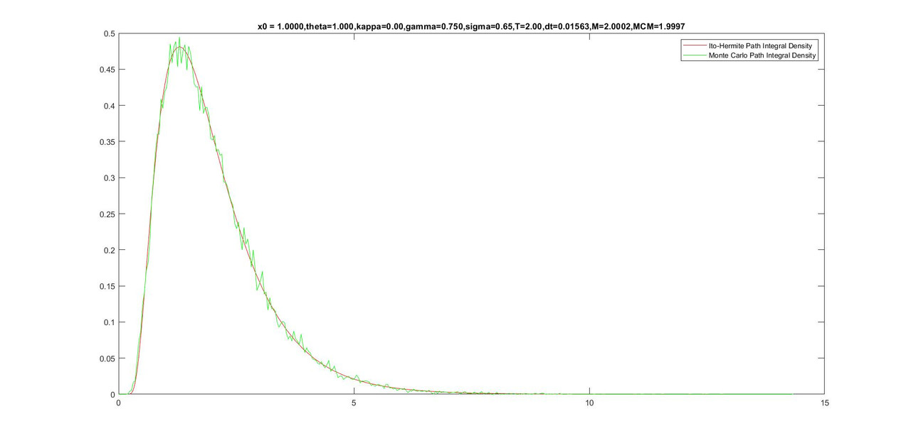](https://postimg.cc/NyRq6Xr1)

Here is the output you should see at the end of the program.

Elapsed time is 0.135680 seconds.

ItoHermiteMean =

   1.000709620804804

true Mean only applicable to standard SV mean reverting type models otherwise disregard

TrueMean =

     1

Original process average from monte carlo

MCMean =

  1.001138749614760 - 0.000000001921218i

Original process average from our simulation

ItoHermiteMean =

   1.000709620804804

ItoHermiteMeanPI =

   2.000219732720310

MCMeanPI =

  1.999724593240335 + 0.000000000230177i

true Mean only applicble to standard SV mean reverting type models otherwise disregard

TrueMean =

     1

IndexMax =

   732

red line is density of SDE from Ito-Hermite method, green is monte carlo.

IndexMax =

   367

red line is density of SDE from Ito-Hermite method, green is monte carlo.

---

### #1397 — Amin (Topic Author)
*April 13, 2022, 7:34 AM*

Friends, I am quickly posting the program for drifting SDEs. In this program, drift is calculated in original
coordinates and then orthogonal increments are calculated after accounting for drift i.e. after adding drift(in a
particular interval) linearly to the Z-series representation of SDE at the start of the interval. And in the end copies
of drift are linearly added after multiplying them time left to terminal time. Orthogonal increments are added in a
squared fashion like we did for CEV noises. Sometimes I noticed that there was some slack in representation of drift at
the extreme tails but for small to medium drift the program seems to work reasonably out to a few years (Later I want to
work on improving the Z-series/hermite representation in original coordinates). The current program will still not work
for mean-reverting SDEs.

In this program you cannot specify mean reverting parameters kappa and theta and you have to directly specify the value
of one drift coefficient mu1 and its power beta1.

Here is the new program.

.

.

```
function [] = FPESeriesCoeffsFromGaussiansWilmottNew02A_Lite_PIntegral02()

%Copyright Ahsan Amin. Infiniti derivatives Technologies.
%Please fell free to connect on linkedin: linkedin.com/in/ahsan-amin-0a53334
%or skype ahsan.amin2999
%In this program, I am simulating the SDE given as
%dy(t)=mu1 x(t)^beta1 dt + mu2 x(t)^beta2 dt +sigma x(t)^gamma dz(t)

%I have not directly simulated the SDE but simulated the transformed
%Besse1l process version of the SDE and then changed coordinates to retreive
%the SDE in original coo
%rdinates.
%The present program will analytically evolve only the Bessel Process version of the
%SDE in transformed coordinates.

dt=.125/2/2/2;   % Simulation time interval.%Fodiffusions close to zero
             %decrease dt for accuracy.
Tt=32*2*2;%16*2*4;%*4*4*1;%*4;%128*2*2*2;     % Number of simulation levels. Terminal time= Tt*dt; //.125/32*32*16=2
year;
T=Tt*dt;
Ts=Tt;
ds(1:Ts)=dt;

%
% %Below I have done calculations for smaller step size at start.
%
% %ds(1:64)=dt/16;
% %ds(65:128)=dt/4;
% if(Tt4)&&(Tt20)
% Ts=(32)+((20-4)*2)+(Tt-20);
% ds(1:32)=dt/8;
% ds(33:64)=dt/2;
% ds(65:Ts)=dt;
% end
% T
% sum(ds(1:Ts))
% Ts
%str=input('Check if time is right');

OrderA=4;  %
OrderM=4;  %

if(T>=1)
dtM=1/16;%.0625/1;
TtM=T/dtM;
else
dtM=T/16;%.0625/1;
TtM=T/dtM;
end

dtM=dt;
TtM=Tt;

dNn=.2/2;   % Normal density subdivisions width. would change with number of subdivisions
Nn=47*2;  % No of normal density subdivisions

NnMid=4.0;

x0=1.0;   % starting value of SDE
beta1=.650;
beta2=0.0;   % Second drift term power.
gamma=.75;%50;   % volatility power.
kappa=0.250;%.950;   %mean reversion parameter.
theta=1.00;%mean reversion target
sigma0=.450;%Volatility value

%you can specify any general mu1 and mu2 and beta1 and beta2.
mu1=.075;   %first drift coefficient.
mu2=0;%-1*kappa;    % Second drift coefficient.
%mu1=0;
%mu2=0;

alpha=1;% x^alpha is being expanded. This is currently for monte carlo only.
alpha1=1-gamma;%This is for expansion of integrals for calculation of drift
%and volatility coefficients
%yy(1:Nn)=x0;
w0=x0^(1-gamma)/(1-gamma);

Z(1:Nn)=(((1:Nn)-7.5/1)*dNn-NnMid);
Z
str=input('Look at Z');
ZProb(1)=normcdf(.5*Z(1)+.5*Z(2),0,1)-normcdf(.5*Z(1)+.5*Z(2)-dNn,0,1);
ZProb(Nn)=normcdf(.5*Z(Nn)+.5*Z(Nn-1)+dNn,0,1)-normcdf(.5*Z(Nn)+.5*Z(Nn-1),0,1);
ZProb(2:Nn-1)=normcdf(.5*Z(2:Nn-1)+.5*Z(3:Nn),0,1)-normcdf(.5*Z(2:Nn-1)+.5*Z(1:Nn-2),0,1);

%%%%%%%%%%%%%%%%%%%%%%%%%%%%%%%%%%%%%%%%%%%%%%%%%%%%%%%%%%%%%%%%%%%%%%%%%%%%%%%%%%%%%%%%%%%%%%

sigma11(1:OrderA+1)=0;
mu11(1:OrderA+1)=0;
mu22(1:OrderA+1)=0;
sigma22(1:OrderA+1)=0;
% index 1 correponds to zero level since matlab indexing starts at one.
sigma11(1)=1;
mu11(1)=1;
mu22(1)=1;
sigma22(1)=1;

for k=1:(OrderA+1)
    if sigma0~=0
        sigma11(k)=sigma0^(k-1);
    end
    if mu1 ~= 0
        mu11(k)=mu1^(k-1);
    end
    if mu2 ~= 0
        mu22(k)=mu2^(k-1);
    end
    if sigma0~=0
        sigma22(k)=sigma0^(2*(k-1));
    end
end
%Ft(1:TtM+1,1:(OrderA+1),1:(OrderA+1),1:(OrderA+1),1:(OrderA+1))=0; %General time powers on hermite polynomials
Fp(1:(OrderA+1),1:(OrderA+1),1:(OrderA+1),1:(OrderA+1))=0;%General x powers on coefficients of hermite polynomials.
Fp1(1:(OrderA+1),1:(OrderA+1),1:(OrderA+1),1:(OrderA+1))=0;%General x powers for bessel transformed coordinates.

%YCoeff0 and YCoeff are coefficents for original coordinates monte carlo.
%YqCoeff0 and YqCoeff are bessel/lamperti version monte carlo.

YCoeff0(1:(OrderA+1),1:(OrderA+1),1:(OrderA+1),1:(OrderA+1))=0;
YqCoeff0(1:(OrderA+1),1:(OrderA+1),1:(OrderA+1),1:(OrderA+1))=0;
%Pre-compute the time and power exponent values in small multi-dimensional arrays
YCoeff = ItoTaylorCoeffsNew(alpha,beta1,beta2,gamma); %expand y^alpha where alpha=1;
YqCoeff = ItoTaylorCoeffsNew(alpha1,beta1,beta2,gamma);%expand y^alpha1 where alpha1=(1-gamma)
YqCoeff=YqCoeff/(1-gamma); %Transformed coordinates coefficients have to be
%further divided by (1-gamma)

for k = 0 : (OrderA)
    for m = 0:k
        l4 = k - m + 1;
        for n = 0 : m
            l3 = m - n + 1;
            for j = 0:n
                l2 = n - j + 1;
                l1 = j + 1;
                %Ft(l1,l2,l3,l4) = dtM^((l1-1) + (l2-1) + (l3-1) + .5* (l4-1));
                Fp(l1,l2,l3,l4) = (alpha + (l1-1) * beta1 + (l2-1) * beta2 + (l3-1) * 2* gamma + (l4-1) * gamma ...
                    - (l1-1) - (l2-1) - 2* (l3-1) - (l4-1));
                Fp1(l1,l2,l3,l4) = (alpha1 + (l1-1) * beta1 + (l2-1) * beta2 + (l3-1) * 2* gamma + (l4-1) * gamma ...
                    - (l1-1) - (l2-1) - 2* (l3-1) - (l4-1));

                YCoeff0(l1,l2,l3,l4) =YCoeff(l1,l2,l3,l4).*mu11(l1).*mu22(l2).*sigma22(l3).*sigma11(l4);
                YqCoeff0(l1,l2,l3,l4) =YqCoeff(l1,l2,l3,l4).*mu11(l1).*mu22(l2).*sigma22(l3).*sigma11(l4);
            end
        end
    end
end

%%%%%%%%%%%%%%%%%%%%%%%%%%%%%%%%%%%%%%%%%%%%%%%%%%%%%%%%%%%%%%%%%%%%%%%%%%%%%%%%%%%%%%%%%%%%%%

ExpnOrder=5;
SeriesOrder=5;

wnStart=1;
tic

for tt=1:Ts
    tt

    if(tt==1)
        %dt=ds(1);
        %[wMu0dt,dwMu0dtdw] = BesselDriftAndDerivatives(w0,YqCoeff0,Fp1,gamma,dt,ExpnOrder);
 %       [wMu0dt,dwMu0dtdw] = BesselDriftAndDerivatives02A(w0,mu1,mu2,beta1,beta2,sigma0,gamma,ds(tt),ExpnOrder);

        [wMu0dt,dwMu0dtdw] = BesselDriftAndDerivativesH0(w0,YqCoeff0,Fp1,gamma,ds(tt),6);
    %    [wMu0dt,dwMu0dtdw,Ratio] = BesselDriftAndDerivatives04A(w0,mu1,mu2,beta1,beta2,sigma0,gamma,ds(tt),6);

      %  dwMu0dtdw
      %  dwMu0dtdwb
      %  wMu0dt
      %  wMu0dtb
      %  str=input('Look at drift');
        c0=wMu0dt+w0;
        c(1)=sigma0*sqrt(ds(tt));
        c(2:10)=0.0;
        w0=c0;
        b0=wMu0dt;
        b(1:5)=0;

    elseif(tt1)
    fH0prev=fH0;%+bH0;
    fHprev=fH;%+bH;
 end

 %Below f0 and f define the Z_series in original coordinates
 [f0,f] = CalculateDriftbCoeffs08A(yw0,dyw0,c,SeriesOrder);
 %fH0 and fH(1:5) define the coefficients of hermite polynomial
 %representation of SDE variable in original coordinates.
 [fH0,fH] = ConvertZCoeffsToHCoeffs(f0,f,SeriesOrder);

 [yMu0dt,dyMu0dtdy] = OriginalDriftAndDerivativesH0(yw0,YCoeff0,Fp,ds(tt),ExpnOrder)
  [by0,by] = CalculateDriftbCoeffs08A(yMu0dt,dyMu0dtdy,f,SeriesOrder);
 [byH0,byH] = ConvertZCoeffsToHCoeffs(by0,by,SeriesOrder);

 by
 by0
 byH0
 byH

 %str=input('Look at original drift');

 if(tt>1)
    fH0prev=fH0prev+byH0;
    fHprev=fHprev+byH;
 end

%Below calculate the Hermite representation of orthogonal increments in the
%original coordinates variable at each time step by squared subtraction of
%coefficients of hermite polynomials.
%Here cH0 and cH define the hermite polynomial coordinates of orthogonal
 %increments at each simulation step. The take double array index in
 %simulation level, tt and hermite polynomial count (1:5).
if(tt==1)
 cH0=fH0;
 cH(tt,1:SeriesOrder)=fH(1:SeriesOrder);

 bt0=by0;
 bt(tt,1:SeriesOrder)=by(1:SeriesOrder);
end
if(tt>1)
 dH0=fH0-fH0prev;

 dH(1:SeriesOrder)=sign(fH(1:SeriesOrder)-fHprev(1:SeriesOrder)).*sqrt(abs(sign(fH(1:SeriesOrder)).*fH(1:SeriesOrder).^2-sign(fHprev(1:SeriesOrder)).*fHprev(1:SeriesOrder).^2));

 cH0(tt)=dH0;
 cH(tt,1:SeriesOrder)=dH(1:SeriesOrder);

 bt0(tt)=by0;
 bt(tt,1:SeriesOrder)=by(1:SeriesOrder);
end

end
wnStart=1;

yy0=((1-gamma).*w0).^(1/(1-gamma));

 w(1:Nn)=c0;
 for nn=1:ExpnOrder
     w(1:Nn)=w(1:Nn)+c(nn)*Z(1:Nn).^nn;
 end

  %Below calculate the hermite representation of dt-integral in original
 %coordinates
 %Here cH0 and cH define the hermite polynomial coordinates of orthogonal
 %increments at each simulation step and bH0 and bH define the hermite
 %representation of the dt-integral after continued squared addition of
 %scaled/weighted values of hermite coefficients of orthogonal increments.

 eH0=cH0(1)*dt*Ts;
 eH(1:SeriesOrder)=cH(1,1:SeriesOrder)*dt*Ts;

 for tt=2:Ts
    ts=Ts-tt+1;
    eH0=eH0+cH0(tt)*dt*ts;
   
eH(1:SeriesOrder)=sign(eH(1:SeriesOrder)+dt*(ts).*cH(tt,1:SeriesOrder)).*sqrt(abs(sign(eH(1:SeriesOrder)).*eH(1:SeriesOrder).^2+sign(dt*(ts).*cH(tt,1:SeriesOrder)).*(dt).^2.*ts.^2.*cH(tt,1:SeriesOrder).^2));
 end

 %We convert hermite represenation given by bH0 and bH(1:5) into
 %dt-integral Z-series Coeffs, e0 and e(1:5)

 [e0,e] = ConvertHCoeffsToZCoeffs(eH0,eH,SeriesOrder);%

   e0=e0+bt0(1)*dt*Ts;
  e(1:SeriesOrder)=e(1:SeriesOrder)+bt(1:SeriesOrder)*dt*Ts;
  for tt=2:Ts
     ts=Ts-tt+1;
     e0=e0+bt0(tt)*dt*ts;
     e(1:SeriesOrder)=e(1:SeriesOrder)+bt(tt,1:SeriesOrder)*dt*ts;
   
 %eH(1:SeriesOrder)=sign(eH(1:SeriesOrder)+dt*(ts).*cH(tt,1:SeriesOrder)).*sqrt(abs(sign(eH(1:SeriesOrder)).*eH(1:SeriesOrder).^2+sign(dt*(ts).*cH(tt,1:SeriesOrder)).*(dt).^2.*ts.^2.*cH(tt,1:SeriesOrder).^2));
  end

  yydt(1:Nn)=e0;
 for nn=1:ExpnOrder
     yydt(1:Nn)=yydt(1:Nn)+e(nn)*Z(1:Nn).^nn;
 end

 %c0
 %c

 %str=input('Look at numbers')
 yy0(wnStart:Nn)=((1-gamma).*w(wnStart:Nn)).^(1/(1-gamma));

 yy=yy0;
Dfyy(wnStart:Nn)=0;
Dfyydt(wnStart:Nn)=0;
for nn=wnStart+1:Nn-1

    Dfyy(nn) = (yy(nn + 1) - yy(nn - 1))/(Z(nn + 1) - Z(nn - 1));
    Dfyydt(nn) = (yydt(nn + 1) - yydt(nn - 1))/(Z(nn + 1) - Z(nn - 1));

    %Change of variable derivative for densities
end
%Dfyy(Nn)=Dfyy(Nn-1);
%Dfyy(1)=Dfyy(2);
%Dfyydt(Nn)=Dfyydt(Nn-1);
%Dfyydt(1)=Dfyydt(2);

pyy(1:Nn)=0;
pyydt(1:Nn)=0;
for nn = wnStart+1:Nn-1

    pyy(nn) = (normpdf(Z(nn),0, 1))/abs(Dfyy(nn));
    pyydt(nn) = (normpdf(Z(nn),0, 1))/abs(Dfyydt(nn));
end

toc

ItoHermiteMean=sum(yy(wnStart:Nn).*ZProb(wnStart:Nn)) %Original process average from coordinates
disp('true Mean only applicable to standard SV mean reverting type models otherwise disregard');
TrueMean=theta+(x0-theta)*exp(-kappa*T)%Mean reverting SDE original variable true average
%yy0

theta1=1;
rng(29079137, 'twister')
paths=50000;
YY(1:paths)=x0;  %Original process monte carlo.
YYdt(1:paths)=0;

Random1(1:paths)=0;
for tt=1:TtM

    Random1=randn(size(Random1));
    HermiteP1(1,1:paths)=1;
    HermiteP1(2,1:paths)=Random1(1:paths);
    HermiteP1(3,1:paths)=Random1(1:paths).^2-1;
    HermiteP1(4,1:paths)=Random1(1:paths).^3-3*Random1(1:paths);
    HermiteP1(5,1:paths)=Random1(1:paths).^4-6*Random1(1:paths).^2+3;

    YYdt(1:paths)=YYdt(1:paths)+.5*YY(1:paths)*dtM;

    YY(1:paths)=YY(1:paths) + ...
        (YCoeff0(1,1,2,1).*YY(1:paths).^Fp(1,1,2,1)+ ...
        YCoeff0(1,2,1,1).*YY(1:paths).^Fp(1,2,1,1)+ ...
        YCoeff0(2,1,1,1).*YY(1:paths).^Fp(2,1,1,1))*dtM + ...
        (YCoeff0(1,1,3,1).*YY(1:paths).^Fp(1,1,3,1)+ ...
        YCoeff0(1,2,2,1).*YY(1:paths).^Fp(1,2,2,1)+ ...
        YCoeff0(2,1,2,1).*YY(1:paths).^Fp(2,1,2,1)+ ...
        YCoeff0(1,3,1,1).*YY(1:paths).^Fp(1,3,1,1)+ ...
        YCoeff0(2,2,1,1).*YY(1:paths).^Fp(2,2,1,1)+ ...
        YCoeff0(3,1,1,1).*YY(1:paths).^Fp(3,1,1,1))*dtM^2 + ...
        ((YCoeff0(1,1,1,2).*YY(1:paths).^Fp(1,1,1,2).*sqrt(dtM))+ ...
        (YCoeff0(1,1,2,2).*YY(1:paths).^Fp(1,1,2,2)+ ...
        YCoeff0(1,2,1,2).*YY(1:paths).^Fp(1,2,1,2)+ ...
        YCoeff0(2,1,1,2).*YY(1:paths).^Fp(2,1,1,2)).*dtM^1.5) .*HermiteP1(2,1:paths) + ...
        ((YCoeff0(1,1,1,3).*YY(1:paths).^Fp(1,1,1,3) *dtM) + ...
        (YCoeff0(1,1,2,3).*YY(1:paths).^Fp(1,1,2,3)+ ...
        YCoeff0(1,2,1,3).*YY(1:paths).^Fp(1,2,1,3)+ ...
        YCoeff0(2,1,1,3).*YY(1:paths).^Fp(2,1,1,3)).*dtM^2).*HermiteP1(3,1:paths) + ...
        ((YCoeff0(1,1,1,4).*YY(1:paths).^Fp(1,1,1,4)*dtM^1.5 )).*HermiteP1(4,1:paths) + ...
        (YCoeff0(1,1,1,5).*YY(1:paths).^Fp(1,1,1,5)*dtM^2.0).*HermiteP1(5,1:paths);
     YYdt(1:paths)=YYdt(1:paths)+.5*YY(1:paths)*dtM;

end

YY(YY<0)=0;
disp('Original process average from monte carlo');
MCMean=sum(YY(:))/paths %origianl coordinates monte carlo average.
disp('Original process average from our simulation');
ItoHermiteMean=sum(yy(wnStart:Nn).*ZProb(wnStart:Nn)) %Original process average from coordinates
ItoHermiteMeanPI=sum(yydt(wnStart:Nn).*ZProb(wnStart:Nn))
MCMeanPI=sum(YYdt(:))/paths
disp('true Mean only applicble to standard SV mean reverting type models otherwise disregard');
TrueMean=theta+(x0-theta)*exp(-kappa*T)%Mean reverting SDE original variable true average

MaxCutOff=30;
NoOfBins=round(1*500*gamma^2*4*sigma0/sqrt(MCMean)/(1+kappa));%Decrease the number of bins if the graph is too
[YDensity,IndexOutY,IndexMaxY] = MakeDensityFromSimulation_Infiniti_NEW(YY,paths,NoOfBins,MaxCutOff );
plot(yy(wnStart+1:Nn-1),pyy(wnStart+1:Nn-1),'r',IndexOutY(1:IndexMaxY),YDensity(1:IndexMaxY),'g');
 %plot(y_w(wnStart+1:Nn-1),fy_w(wnStart+1:Nn-1),'r',IndexOutY(1:IndexMaxY),YDensity(1:IndexMaxY),'g',Z(wnStart+1:Nn-1),fy_w(wnStart+1:Nn-1),'b');

%title(sprintf('x0 = %.4f,theta=%.3f,kappa=%.2f,gamma=%.3f,sigma=%.2f,T=%.2f,dt=%.5f,M=%.4f,TM=%.4f',
x0,theta,kappa,gamma,sigma0,T,dt,ItoHermiteMean,TrueMean));%,sprintf('theta= %f', theta), sprintf('kappa = %f',
kappa),sprintf('sigma = %f', sigma0),sprintf('T = %f', T));
title(sprintf('x0 = %.4f,mu1=%.3f,beta1=%.2f,gamma=%.3f,sigma=%.2f,T=%.2f,dt=%.5f,M=%.4f,TM=%.4f',
x0,mu1,beta1,gamma,sigma0,T,dt,ItoHermiteMean,TrueMean));%,sprintf('theta= %f', theta), sprintf('kappa = %f',
kappa),sprintf('sigma = %f', sigma0),sprintf('T = %f', T));

legend({'Ito-Hermite Density','Monte Carlo Density'},'Location','northeast')

str=input('red line is density of SDE from Ito-Hermite method, green is monte carlo.');

NoOfBins=round(1*500*gamma^2*4*sigma0/sqrt(MCMean)/(1+kappa))/2;
[YdtDensity,IndexOutYdt,IndexMaxYdt] = MakeDensityFromSimulation_Infiniti_NEW(YYdt,paths,NoOfBins,MaxCutOff );
plot(yydt(wnStart+1:Nn-1),pyydt(wnStart+1:Nn-1),'r',IndexOutYdt(1:IndexMaxYdt),YdtDensity(1:IndexMaxYdt),'g');

%title(sprintf('x0 = %.4f,theta=%.3f,kappa=%.2f,gamma=%.3f,sigma=%.2f,T=%.2f,dt=%.5f,M=%.4f,MCM=%.4f',
x0,theta,kappa,gamma,sigma0,T,dt,ItoHermiteMeanPI,MCMeanPI));%,sprintf('theta= %f', theta), sprintf('kappa = %f',
kappa),sprintf('sigma = %f', sigma0),sprintf('T = %f', T));
title(sprintf('x0 = %.4f,mu1=%.3f,beta1=%.2f,gamma=%.3f,sigma=%.2f,T=%.2f,dt=%.5f,M=%.4f,MCM=%.4f',
x0,mu1,beta1,gamma,sigma0,T,dt,ItoHermiteMeanPI,MCMeanPI));%,sprintf('theta= %f', theta), sprintf('kappa = %f',
kappa),sprintf('sigma = %f', sigma0),sprintf('T = %f', T));

legend({'Ito-Hermite Path Integral Density','Monte Carlo Path Integral Density'},'Location','northeast')

str=input('red line is density of SDE from Ito-Hermite method, green is monte carlo.');

end
```

.

.

Here is the graph you should see when you run this program.

.

.

[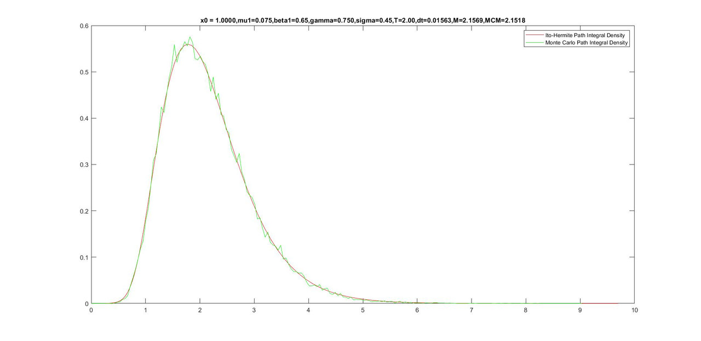](https://postimg.cc/LYpd791K)

.

.

.

Here is the output you should see when you run the above program.

ItoHermiteMean =

   1.153993084863467

true Mean only applicable to standard SV mean reverting type models otherwise disregard

TrueMean =

     1

Original process average from monte carlo

MCMean =

   1.154116780238912

Original process average from our simulation

ItoHermiteMean =

   1.153993084863467

ItoHermiteMeanPI =

   2.156851330823339

MCMeanPI =

   2.151806582653016

true Mean only applicble to standard SV mean reverting type models otherwise disregard

TrueMean =

     1

IndexMax =

   378

red line is density of SDE from Ito-Hermite method, green is monte carlo.

IndexMax =

   190

red line is density of SDE from Ito-Hermite method, green is monte carlo.

---

### #1398 — Amin (Topic Author)
*April 14, 2022, 1:47 AM*

Friends, I am writing this post to make a few requests. Though it is still April, we are seeing reasonably high
temperatures in Lahore. Summers are very difficult in this city. High temperature easily reaches 115 Fahrenheit on some
days and there is a span of two months when night-time temperature remains above 90 F even in the early morning before
dawn. City is a concrete jungle and traps heat and I would be sweating even in the early morning. For a large number of
people this is not a problem since they spend most of their time in air-conditioned environment and travel in
air-conditioned cars. But when I try to use air-conditioners, I am greeted with huge amount of mind control gases that
make it totally impossible for me to spend time there. Last year, they allowed me to use AC in our drawing room where I
would sleep and work but only for 7-10 days and then started using mind control gases so I had to stop using that AC.

For this reason, I have spent many years (>10 years) when I would sleep in the open balcony on first floor in the
summers with a simple pedestal fan. And some times they would somehow put mind control gases in the fan and it would
release mind control gases with the air and it would be extremely difficult to sleep even in the balcony and I would
have to stop the fan and I would be completely wet with sweating. Then I started to use small chargeable fans at night
that were difficult to temper with and I had enough air. But then my brother got married and had two children and we
decided to give all of the upper portion to my brother's family (year 2014/2015)  and I had to stop sleeping in the
balcony on first floor. But I still like to sleep in the semi-open covered garage when weather is somewhat pleasant
outside. And that is how I had dengue last year. Summers are still not reaching their peak and it is still reasonably
pleasant in the garage at night so I have been sleeping here for past two weeks. It is still not dengue season (that
comes after monsoon ) so I am not very worried about dengue. So I want to request friends to ask and pressurize mind
control agents to let me sleep in the air-conditioning without mind control gases.

Mind control agents have been increasing mind control for past few days. They drugged bottled water at several places
before I would reach those shops and buy water. I came to know since water of both Nestle and Coca-Cola brands is
generally good and is not drugged at manufacturing source, so it must have been drugged ahead of my arrival at those
shops. In past 3-4 days , I was hit with drugged water several times even though Nestle and Coca-Cola are not drugging
their water.

And really most painful thing is that they continue to force mind control chemical into my mouth during my sleep again
and again. I have mentioned it several times before but they never end doing it. Just two days ago when (in the night) I
would repeatedly walk into the lounge from garage( where I would be sleeping ) and brush my teeth/mouth during the night
again and again, they placed some device inside the water supply of wash basin in the lounge and I noticed (after
returning from outside) that water of the wash basin was ionized and was charging my mouth. So they started adding mind
control chemicals to wash basin's water because I would repeatedly brush my mouth there in the midst of the night. This
thing happened just two or three days ago. They are totally determined to charging my mouth and forcing chemicals into
my mouth during my sleep.

I want to request friends to please force the mind control agents to be better and end their mind control.

---

### #1399 — Amin (Topic Author)
*April 14, 2022, 2:35 PM*

Friends, after writing the previous post, I went out to have food in the morning. I bought four bottles of 1.5 L Nestle
water that turned out to be drugged since I bought them from a market close to my home.  I returned three bottles and
bought water from elsewhere. After having food from a Gourmet bakery in Muslim town, I returned home. And on the way
home, mind control agents gave me extremely strong anxiety attacks by forcing waves and charges through my eyes. I had
received antipsychotic injection on Sunday and I am very vulnerable to anxiety attacks like this in a period of 3-10
days after the injections. These injections make me frail and mind control agents can easily play a lot of their tricks
on me after that. I was supposed to take my mother to my uncle's house after returning from outside but I was feeling so
bad that I requested her to excuse me and my sister had to take my mother to out uncle's house. I did not do any work
and only lied on bed and also slept somewhat after that. And of course, mind control agents continued to force mind
control chemicals into my mouth all through my sleep and I had to wash my mouth again and again. Even in the evening I
was feeling very frail and at some point even had slight difficulty breathing and I was not having a full breath. When I
realized that I was feeling short of breath, I decided to write this post.

I want to request friends that I am already 49 years old and very overweight due to antipsychotics that are forced on
me. It is very difficult for me to live with antipsychotics at this age. I have been on antipsychotics for most of the
time after start of year 1999 despite that I am perfectly mentally healthy. I want to request friends to please force
American army and mind control agents to not force antipsychotics on me and let me live without mind control.

---

### #1400 — Amin (Topic Author)
*April 16, 2022, 3:10 PM*

Friends, below are a few pairs of graphs. The first graph in each pair shows a comparison of the SDE variable in
original coordinates converted from Bessel coordinates on the Z-grid(Green graph), and analytically converted from eight
cumulants(or expansion till seventh power of Z -- blue graph), and analytically converted from six cumulants (or
expansion till fifth power of Z --black graph). You can see that Z-series representation of the SDE variable in original
coordinates is less accurate as compared to original coordinates converted from Bessel coordinates on the Z-grid. You
can see the graphs below to get an idea how accurate is Z-series representation from eight cumulants(in Bessel
coordinates converted to original coordinates through series conversion) as compared to Z-series representation from six
cumulants and both of the above compared with almost true representation(green graph). We like Z-series representation
in original coordinates since we can do a large number of analytics with this representation.

Below are the graph comparisons. First graph in each pair shows the comparison of Z-series representation as a function
of Z while second graph in each pair shows the comparison of density derived form each of the above three cases.

[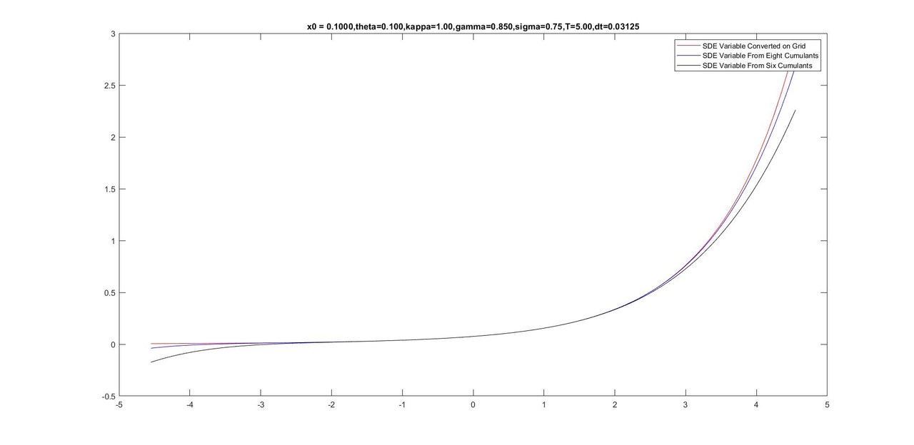](https://postimg.cc/zVDRwxsk)

[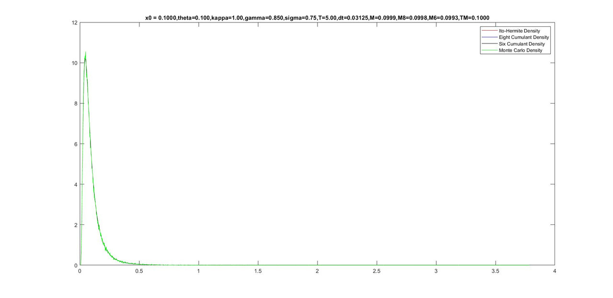](https://postimg.cc/0KnP2dZk)

[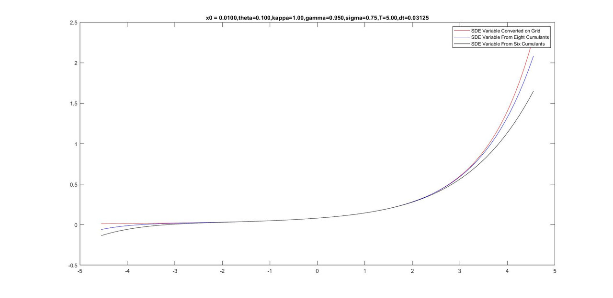](https://postimg.cc/6TfvGkm3)

[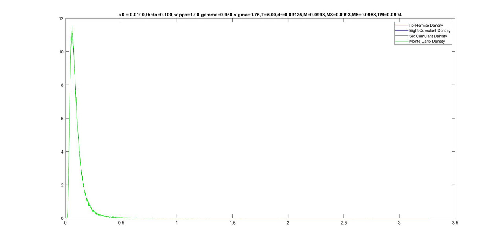](https://postimg.cc/N2BQcP6C)

[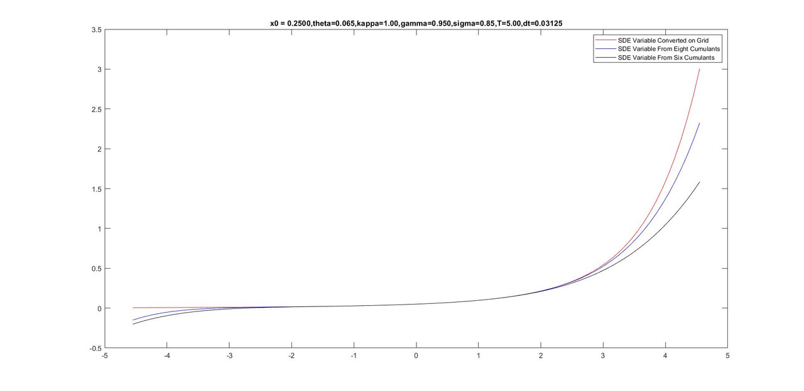](https://postimg.cc/NLcXFsbS)

[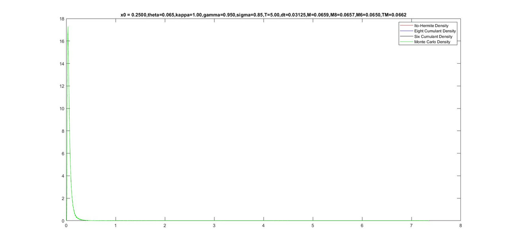](https://postimg.cc/ZBrJXhdy)

[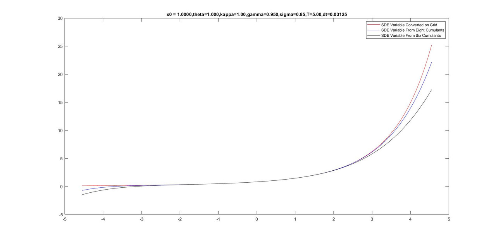](https://postimg.cc/zbmJdfVr)

[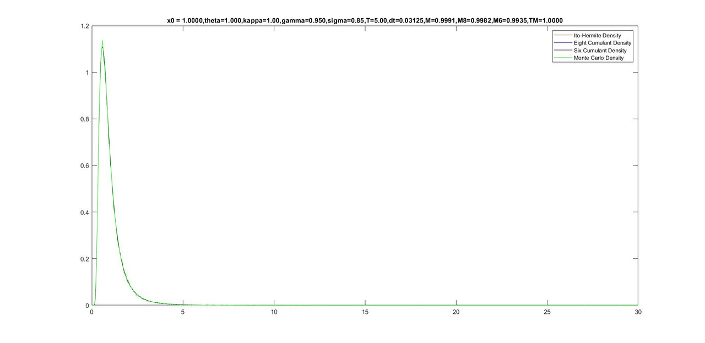](https://postimg.cc/B8PScFZp)

[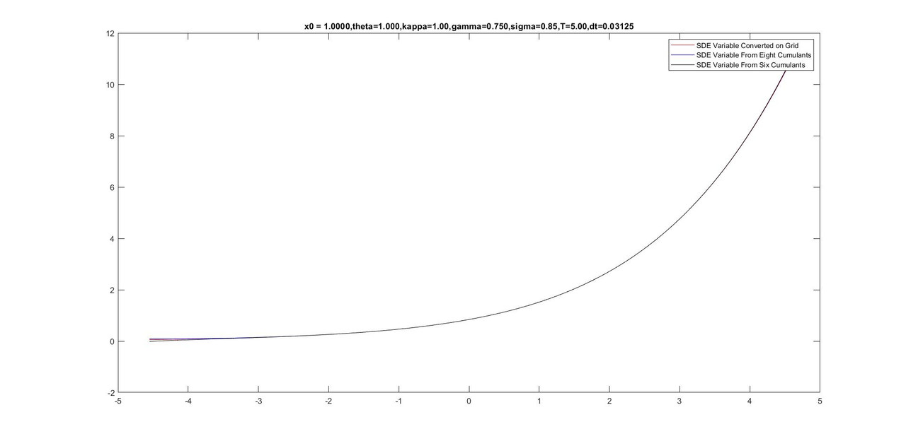](https://postimg.cc/k24XGZkk)

[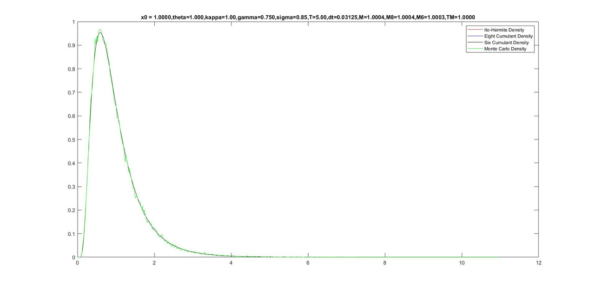](https://postimg.cc/HrhWyzmj)

[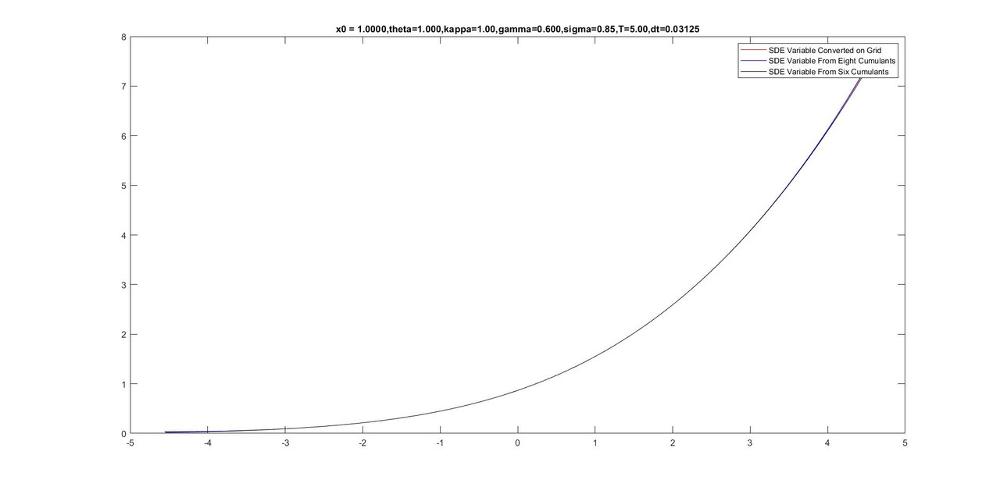](https://postimg.cc/YhtSKj82)

[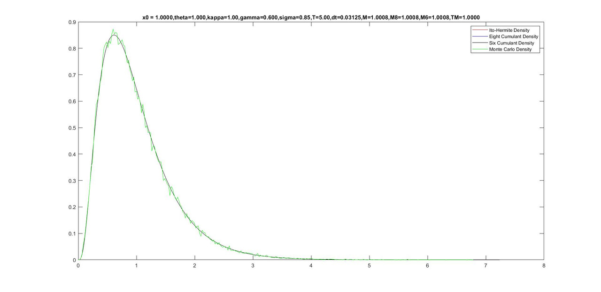](https://postimg.cc/PPK5thFW)

[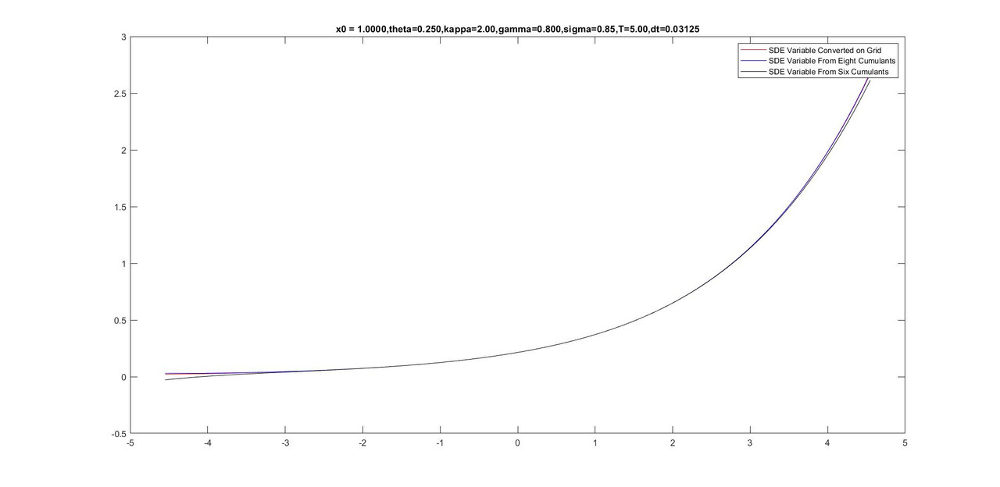](https://postimg.cc/MX7GF17r)

[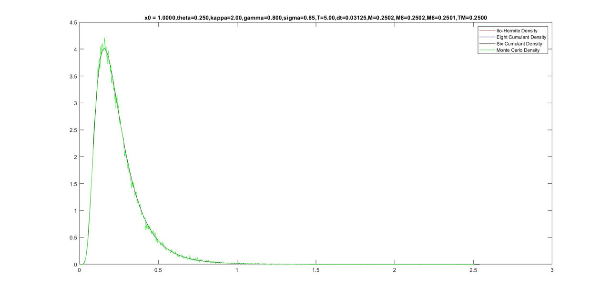](https://postimg.cc/rRNFRLyL)

[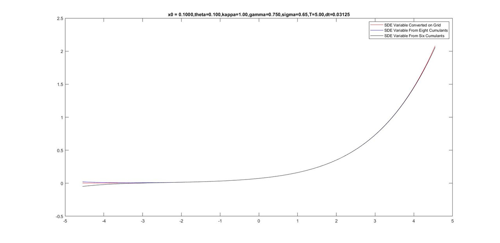](https://postimg.cc/TLmPGDZ1)

[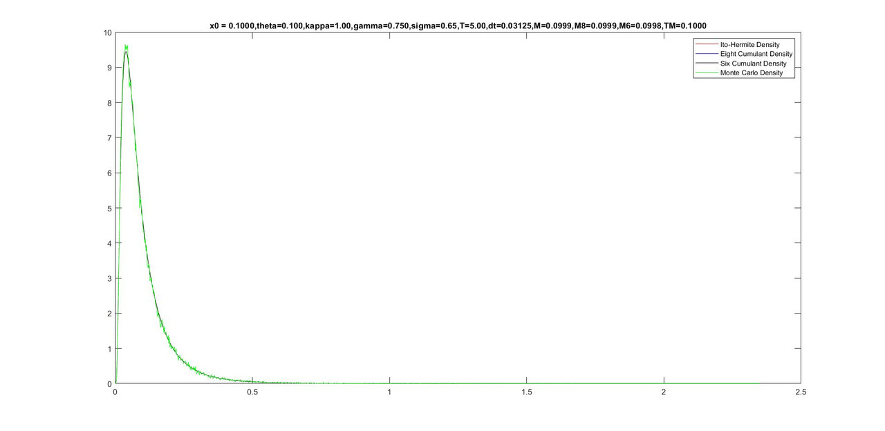](https://postimg.cc/T563PP69)

---

[← Previous](page_027.md) | [Index](index.md) | [Next →](page_029.md)
