# Breakthrough in the theory of stochastic differential equations and their simulation

**Page 29 of 59** — Posts #1401–#1450

[← Previous](page_028.md) | [Index](index.md) | [Next →](page_030.md)

---

### #1401 — Amin (Topic Author)
*April 17, 2022, 12:37 PM*

I just un-liked more than ten posts on linkedin that were shown to be liked by me in my activity page. Some of them
really deserved to be liked but I had not originally liked them myself so I un-liked them all. I had just liked two
posts in past several months. Some of the content they had liked from my account was also religious stuff that I do not
like.

---

### #1402 — Amin (Topic Author)
*April 21, 2022, 1:37 PM*

Friends, there were some minor errors in my program to calculate path integrals of drifting SDEs and the errors were
causing  a decrease in accuracy. I will come back with an updated version in a few days.

I am busy with work on path integrals of mean-reverting SDEs. I did not make any progress for past three days and was
ready to give up but today I realized there were multiple mistakes in my program and I also had some new ideas so I am
optimistic again and hopeful that I would be able to do it in next few days.

---

### #1403 — Amin (Topic Author)
*April 23, 2022, 9:06 AM*

Friends, I have been able to solve for dt-integrals of classical mean-reversion type SDEs. I hope to present the matlab
program to solve for these integrals on Monday. I will also post an updated program for calculation of dt-integrals of
drifting SDEs as the earlier posted program had some minor errors.

---

### #1404 — Amin (Topic Author)
*April 23, 2022, 12:44 PM*

I will be posting some graphs about my latest research later today or possibly tomorrow. To correct the previous post, I
have been able to solve for the path integrals of SDEs where V0=theta i.e where the whole body of SDE is not drifting.
When the whole body of SDE is drifting towards a mean-reversion target that is different from initial value of the SDE,
I still have not been able to solve for path integrals. But I am quite confident that I would also be able to solve for
these SDEs hopefully very soon.

---

### #1405 — Amin (Topic Author)
*April 23, 2022, 1:30 PM*

I am posting some graphs for path integrals of some mean-reverting SDEs in which$V_0=\theta$ i.e. SDEs where mean
reversion target is the same as initial value of the SDE.

SDE parameters on title of the graphs.

.

.

[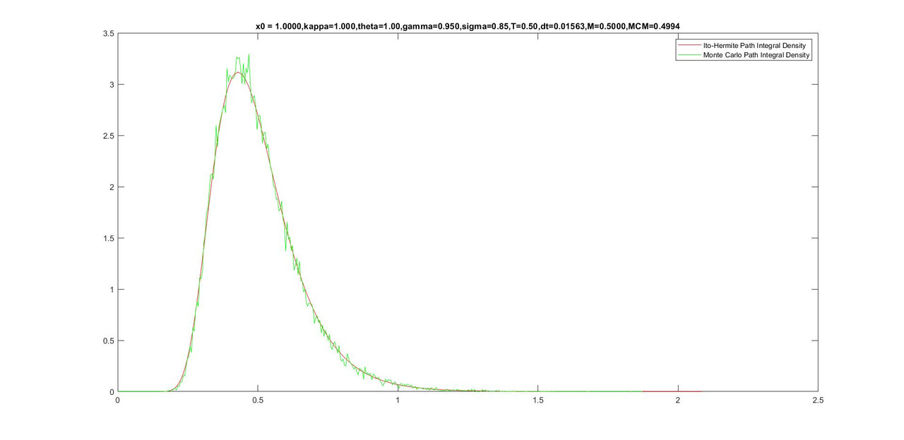](https://postimg.cc/t78n6cdY)

[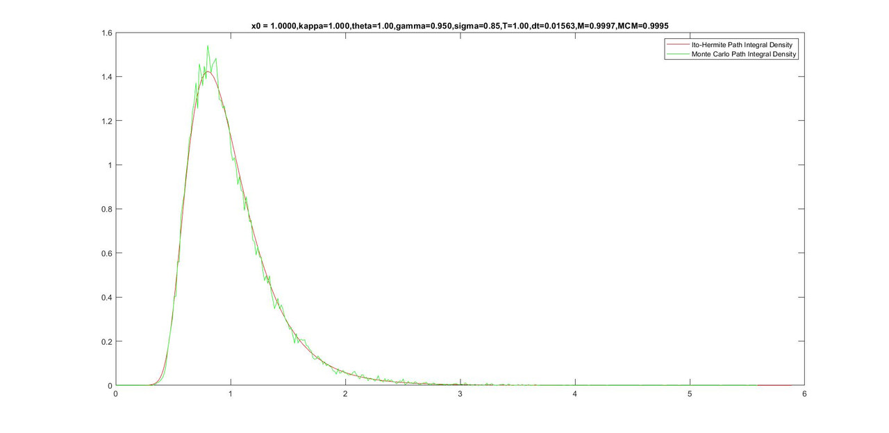](https://postimg.cc/XXrypWCR)

[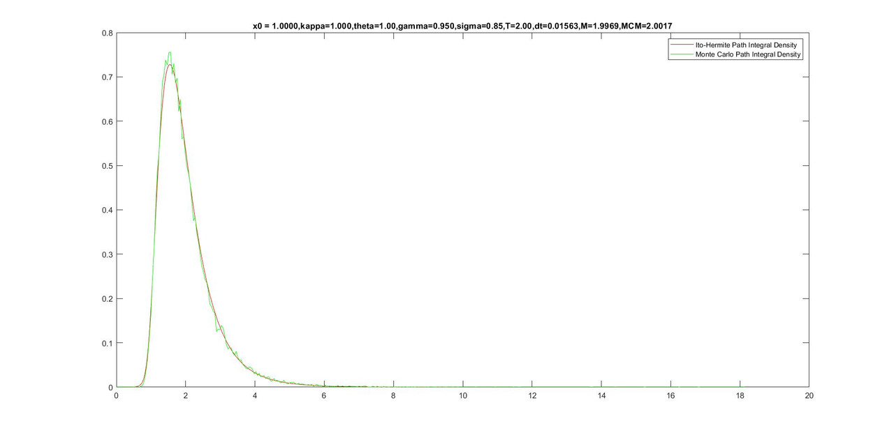](https://postimg.cc/mtMzySVV)

[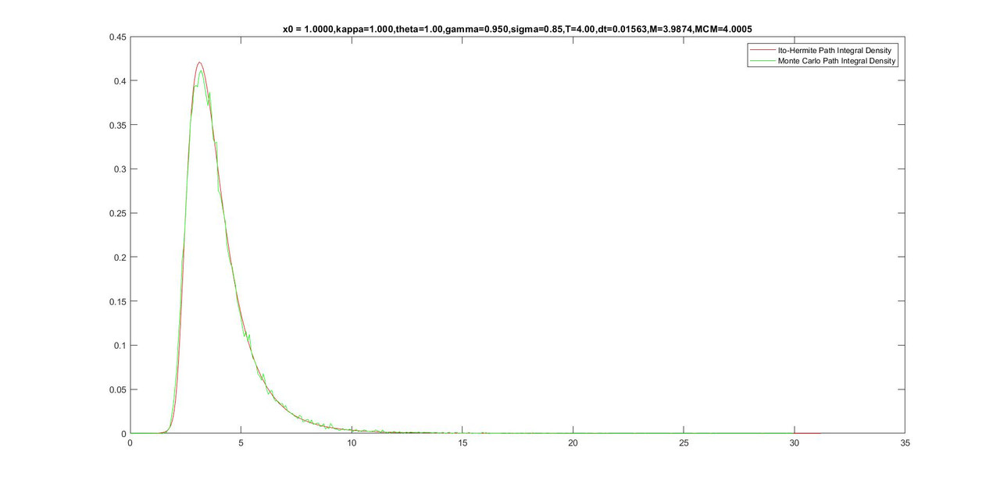](https://postimg.cc/tsj1SVMb)

[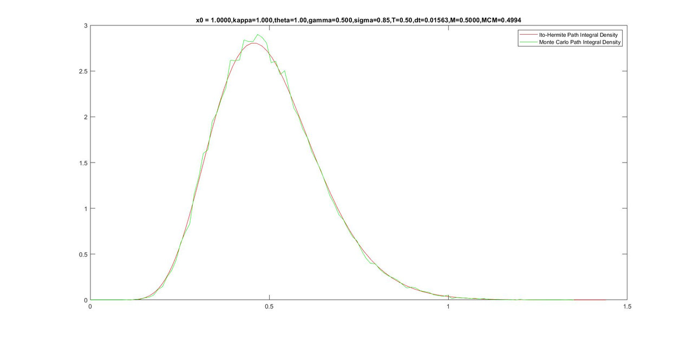](https://postimg.cc/hX1XHPkd)

[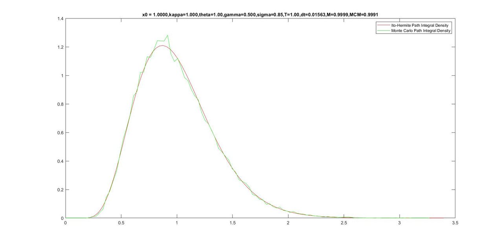](https://postimg.cc/cKDrLk41)

[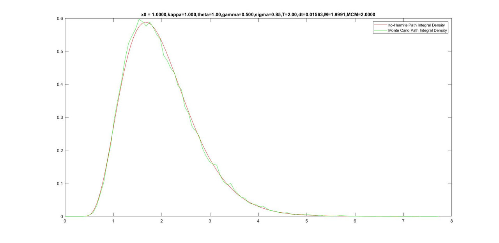](https://postimg.cc/mcZPRW46)

[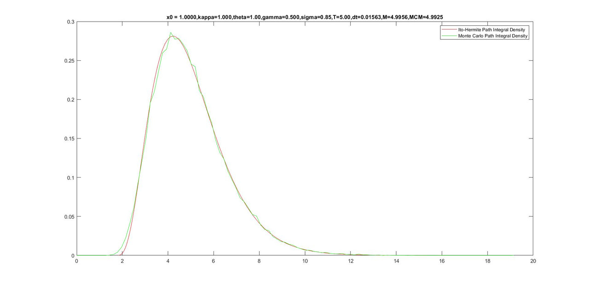](https://postimg.cc/0MbrMGbY)

[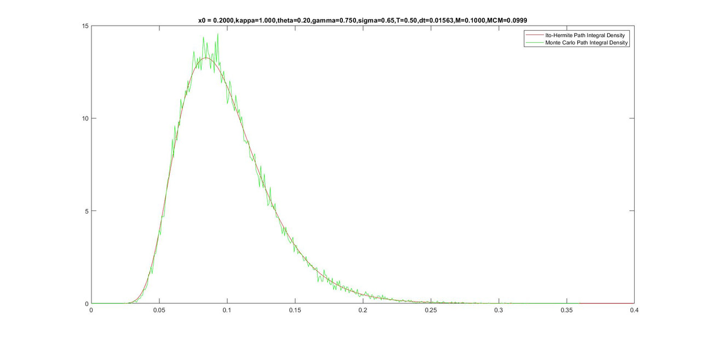](https://postimg.cc/bDWrQGtK)

[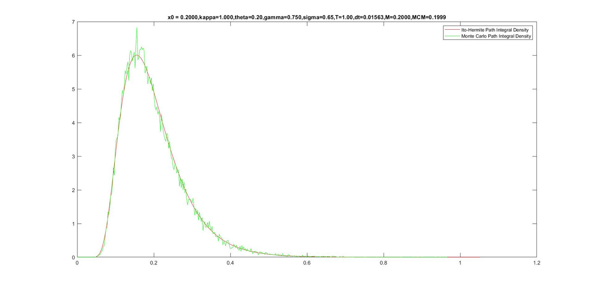](https://postimg.cc/RqJNvRr9)

[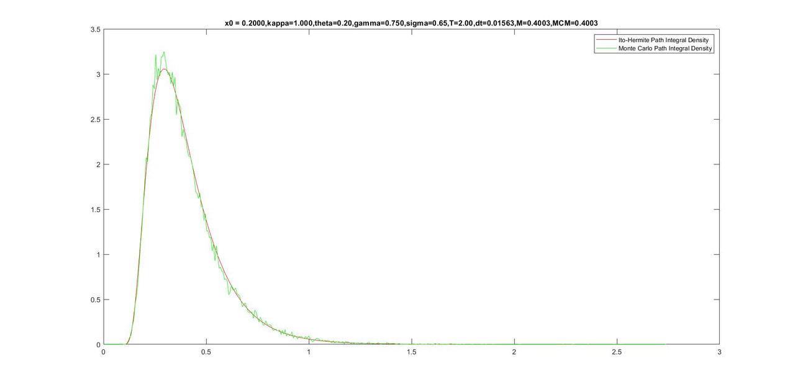](https://postimg.cc/kRS4wnND)

[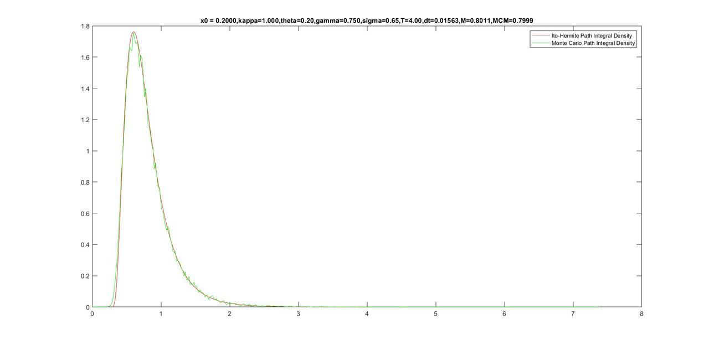](https://postimg.cc/4mCny9Zc)

---

### #1406 — Amin (Topic Author)
*April 24, 2022, 2:06 PM*

Friends, I am posting some graphs of dt-integrals of drifting SDEs that take one drift term. The coefficient of drift
term can be both positive or negative. Here is the relevant SDE.

$dX(t) \,= \, \mu_1 {X(t)}^{\beta_1} \, dt + \, {X(t)}^{\gamma} \, dZ(t) \,$

Most of the graphs are out to eight years at moderate vols and reasonable drifts. I am also going to post the matlab
program for calculation of path integrals drifting SDEs in next post (that was used to create these graphs. It is still
a preliminary program and I want a finessed version with comments later). The program for calculation of dt-integrals of
mean-reverting SDEs will still take another day or two.

Here are the graphs of dt-integrals of drifting SDEs. The parameters are on the title of the graph.

.

.

[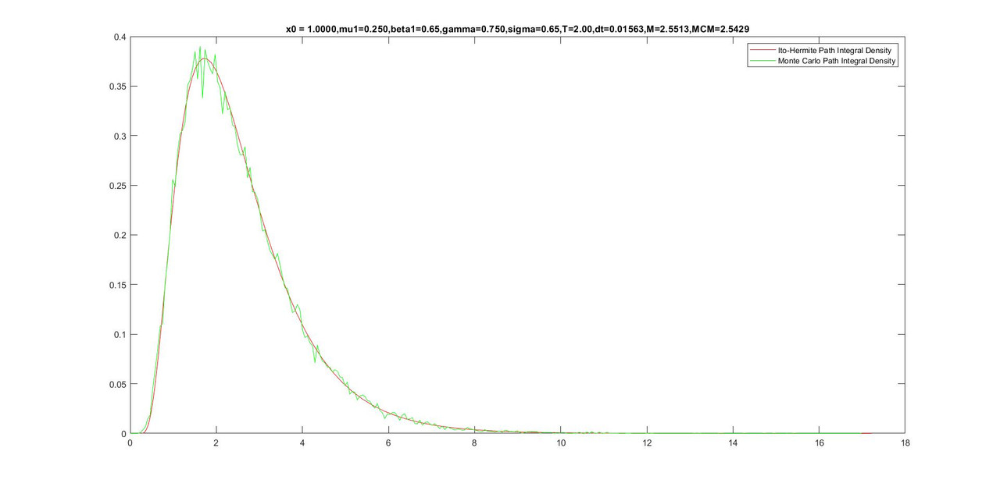](https://postimg.cc/LYpCRZp2)

[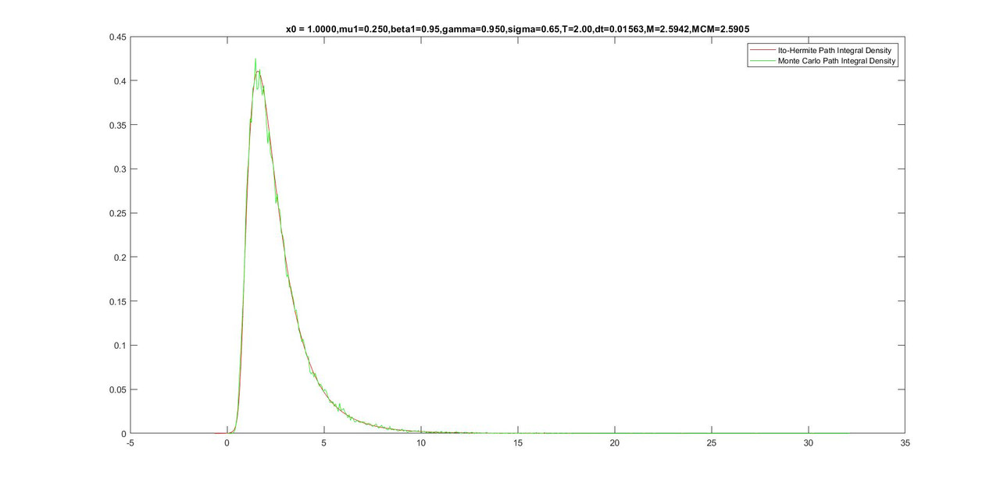](https://postimg.cc/0M0tN2km)

[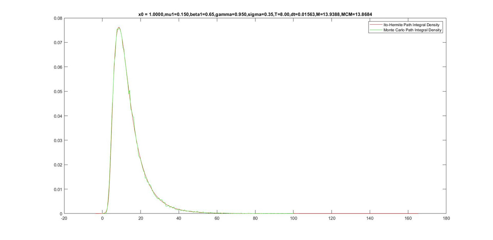](https://postimg.cc/xXNtzPj9)

[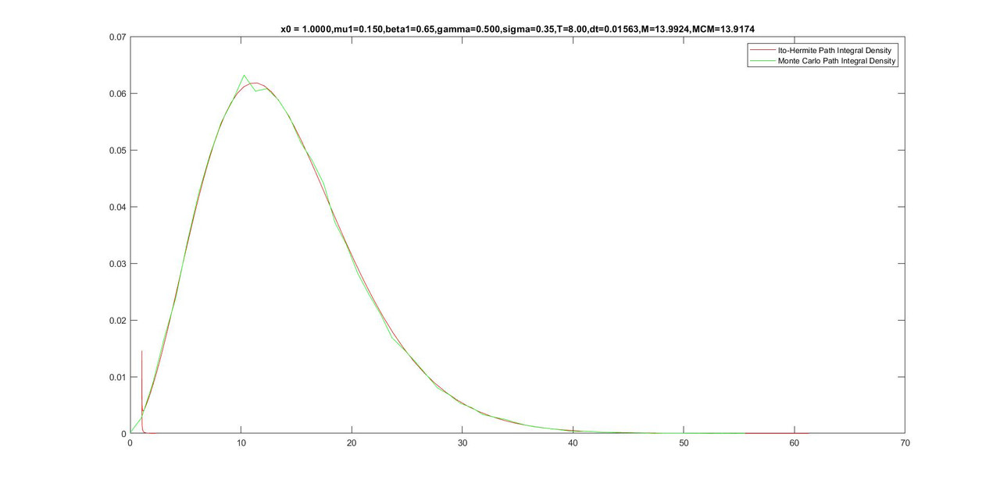](https://postimg.cc/N5MNgcW9)

[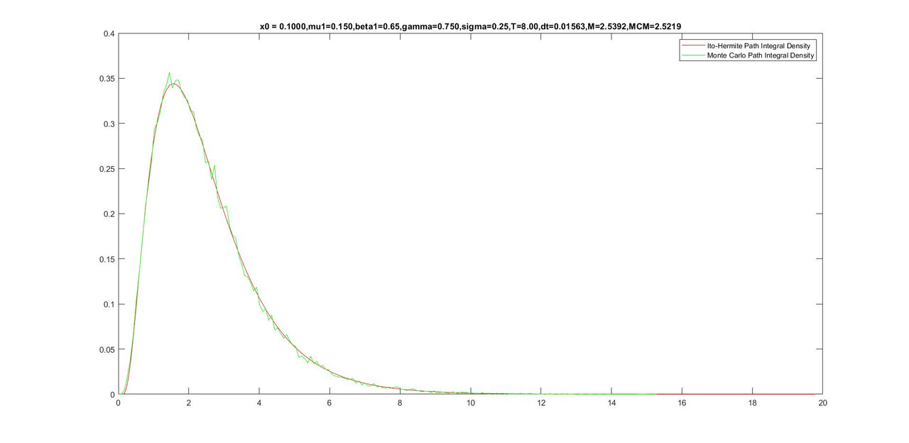](https://postimg.cc/qgpb5nwG)

[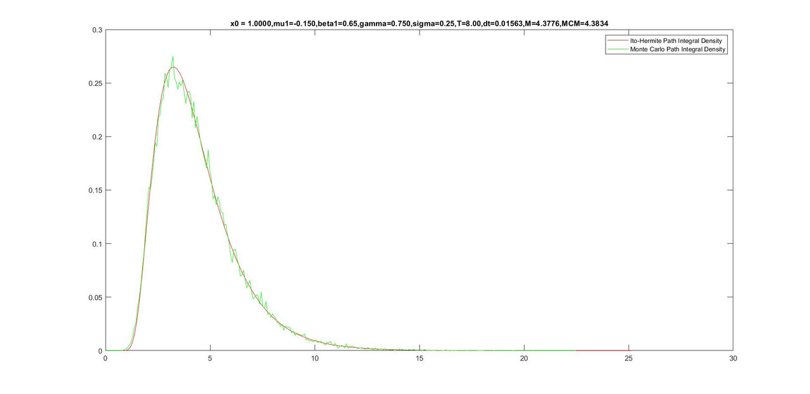](https://postimg.cc/7JPKJ8hR)

[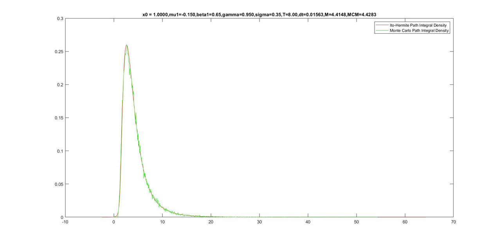](https://postimg.cc/BXVmbz0h)

[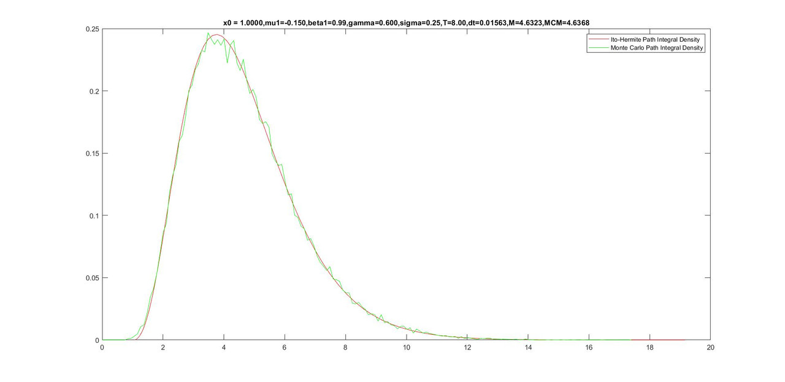](https://postimg.cc/t7DSQTmG)

---

### #1407 — Amin (Topic Author)
*April 24, 2022, 2:09 PM*

Here is the matlab program that was used to create these graphs in previous post.

.

.

.

```
function [] = FPESeriesCoeffs_Lite_PIntegral08AB_Drifting()

%Copyright Ahsan Amin. Infiniti derivatives Technologies.
%Please fell free to connect on linkedin: linkedin.com/in/ahsan-amin-0a53334
%or skype ahsan.amin2999

%The present program will analytically evolve only the Bessel Process version of the
%SDE in transformed coordinates.

dt=.125/2/2/2;   % Simulation time interval.%Fodiffusions close to zero
             %decrease dt for accuracy.
Tt=32*2*8;%16*2*4;%*4*4*1;%*4;%128*2*2*2;     % Number of simulation levels. Terminal time= Tt*dt; //.125/32*32*16=2
year;
T=Tt*dt;
Ts=Tt;
ds(1:Ts)=dt;

%
% %Below I have done calculations for smaller step size at start.
%
% %ds(1:64)=dt/16;
% %ds(65:128)=dt/4;
% if(Tt4)&&(Tt20)
% Ts=(32)+((20-4)*2)+(Tt-20);
% ds(1:32)=dt/8;
% ds(33:64)=dt/2;
% ds(65:Ts)=dt;
% end
% T
% sum(ds(1:Ts))
% Ts
%str=input('Check if time is right');

OrderA=4;  %
OrderM=4;  %

if(T>=1)
dtM=1/16;%.0625/1;
TtM=T/dtM;
else
dtM=T/16;%.0625/1;
TtM=T/dtM;
end

dtM=dt;
TtM=Tt;

dNn=.2/2;   % Normal density subdivisions width. would change with number of subdivisions
Nn=47*2;  % No of normal density subdivisions

NnMid=4.0;

x0=1;   % starting value of SDE

%beta1=0.0;
beta2=0.0;   % Second drift term power.
beta1=0.9950;
%beta2=0.0;   % Second drift term power.
gamma=.6;%50;   % volatility power.
kappa=0.0;%.950;   %mean reversion parameter.
theta=1.0;%mean reversion target
sigma0=.250;%Volatility value

%you can specify any general mu1 and mu2 and beta1 and beta2.
mu1=-.150;   %first drift coefficient.
mu2=0;%-1*kappa;    % Second drift coefficient.
%mu1=theta*kappa;
%mu2=-1*kappa;

alpha=1;% x^alpha is being expanded. This is currently for monte carlo only.
alpha1=1-gamma;%This is for expansion of integrals for calculation of drift
%and volatility coefficients
%yy(1:Nn)=x0;
w0=x0^(1-gamma)/(1-gamma);

Z(1:Nn)=(((1:Nn)-7.5/1)*dNn-NnMid);
Z
str=input('Look at Z');
ZProb(1)=normcdf(.5*Z(1)+.5*Z(2),0,1)-normcdf(.5*Z(1)+.5*Z(2)-dNn,0,1);
ZProb(Nn)=normcdf(.5*Z(Nn)+.5*Z(Nn-1)+dNn,0,1)-normcdf(.5*Z(Nn)+.5*Z(Nn-1),0,1);
ZProb(2:Nn-1)=normcdf(.5*Z(2:Nn-1)+.5*Z(3:Nn),0,1)-normcdf(.5*Z(2:Nn-1)+.5*Z(1:Nn-2),0,1);

%%%%%%%%%%%%%%%%%%%%%%%%%%%%%%%%%%%%%%%%%%%%%%%%%%%%%%%%%%%%%%%%%%%%%%%%%%%%%%%%%%%%%%%%%%%%%%

sigma11(1:OrderA+1)=0;
mu11(1:OrderA+1)=0;
mu22(1:OrderA+1)=0;
sigma22(1:OrderA+1)=0;
% index 1 correponds to zero level since matlab indexing starts at one.
sigma11(1)=1;
mu11(1)=1;
mu22(1)=1;
sigma22(1)=1;

for k=1:(OrderA+1)
    if sigma0~=0
        sigma11(k)=sigma0^(k-1);
    end
    if mu1 ~= 0
        mu11(k)=mu1^(k-1);
    end
    if mu2 ~= 0
        mu22(k)=mu2^(k-1);
    end
    if sigma0~=0
        sigma22(k)=sigma0^(2*(k-1));
    end
end
%Ft(1:TtM+1,1:(OrderA+1),1:(OrderA+1),1:(OrderA+1),1:(OrderA+1))=0; %General time powers on hermite polynomials
Fp(1:(OrderA+1),1:(OrderA+1),1:(OrderA+1),1:(OrderA+1))=0;%General x powers on coefficients of hermite polynomials.
Fp1(1:(OrderA+1),1:(OrderA+1),1:(OrderA+1),1:(OrderA+1))=0;%General x powers for bessel transformed coordinates.

%YCoeff0 and YCoeff are coefficents for original coordinates monte carlo.
%YqCoeff0 and YqCoeff are bessel/lamperti version monte carlo.

YCoeff0(1:(OrderA+1),1:(OrderA+1),1:(OrderA+1),1:(OrderA+1))=0;
YqCoeff0(1:(OrderA+1),1:(OrderA+1),1:(OrderA+1),1:(OrderA+1))=0;
%Pre-compute the time and power exponent values in small multi-dimensional arrays
YCoeff = ItoTaylorCoeffsNew(alpha,beta1,beta2,gamma); %expand y^alpha where alpha=1;
YqCoeff = ItoTaylorCoeffsNew(alpha1,beta1,beta2,gamma);%expand y^alpha1 where alpha1=(1-gamma)
YqCoeff=YqCoeff/(1-gamma); %Transformed coordinates coefficients have to be
%further divided by (1-gamma)

for k = 0 : (OrderA)
    for m = 0:k
        l4 = k - m + 1;
        for n = 0 : m
            l3 = m - n + 1;
            for j = 0:n
                l2 = n - j + 1;
                l1 = j + 1;
                %Ft(l1,l2,l3,l4) = dtM^((l1-1) + (l2-1) + (l3-1) + .5* (l4-1));
                Fp(l1,l2,l3,l4) = (alpha + (l1-1) * beta1 + (l2-1) * beta2 + (l3-1) * 2* gamma + (l4-1) * gamma ...
                    - (l1-1) - (l2-1) - 2* (l3-1) - (l4-1));
                Fp1(l1,l2,l3,l4) = (alpha1 + (l1-1) * beta1 + (l2-1) * beta2 + (l3-1) * 2* gamma + (l4-1) * gamma ...
                    - (l1-1) - (l2-1) - 2* (l3-1) - (l4-1));

                YCoeff0(l1,l2,l3,l4) =YCoeff(l1,l2,l3,l4).*mu11(l1).*mu22(l2).*sigma22(l3).*sigma11(l4);
                YqCoeff0(l1,l2,l3,l4) =YqCoeff(l1,l2,l3,l4).*mu11(l1).*mu22(l2).*sigma22(l3).*sigma11(l4);
            end
        end
    end
end

%%%%%%%%%%%%%%%%%%%%%%%%%%%%%%%%%%%%%%%%%%%%%%%%%%%%%%%%%%%%%%%%%%%%%%%%%%%%%%%%%%%%%%%%%%%%%%

ExpnOrder=5;
SeriesOrder=5;

wnStart=1;
tic

for tt=1:Ts
    tt

    if(tt==1)
        %dt=ds(1);
        %[wMu0dt,dwMu0dtdw] = BesselDriftAndDerivatives(w0,YqCoeff0,Fp1,gamma,dt,ExpnOrder);
 %       [wMu0dt,dwMu0dtdw] = BesselDriftAndDerivatives02A(w0,mu1,mu2,beta1,beta2,sigma0,gamma,ds(tt),ExpnOrder);

        [wMu0dt,dwMu0dtdw] = BesselDriftAndDerivativesH0(w0,YqCoeff0,Fp1,gamma,ds(tt),6);
    %    [wMu0dt,dwMu0dtdw,Ratio] = BesselDriftAndDerivatives04A(w0,mu1,mu2,beta1,beta2,sigma0,gamma,ds(tt),6);

      %  dwMu0dtdw
      %  dwMu0dtdwb
      %  wMu0dt
      %  wMu0dtb
      %  str=input('Look at drift');
        c0=wMu0dt+w0;
        c(1)=sigma0*sqrt(ds(tt));
        c(2:10)=0.0;
        w0=c0;
        b0=wMu0dt;
        b(1:5)=0;

    elseif(tt1)
    fH0prev=fH0;%+bH0;
    fHprev=fH;%+bH;
    f0prev=f0;
    fprev=f;
 end

 %Below f0 and f define the Z_series in original coordinates
 [f0,f] = CalculateDriftbCoeffs08A(yw0,dyw0,c,SeriesOrder);
 f(6:8)=0;

 SeriesOrdery=SeriesOrder;

 %fH0 and fH(1:5) define the coefficients of hermite polynomial
 %representation of SDE variable in original coordinates.
 [fH0,fH] = ConvertZCoeffsToHCoeffs(f0,f,SeriesOrdery);

 [yMu0dt,dyMu0dtdy] = OriginalDriftAndDerivativesH0(f0prev,YCoeff0,Fp,ds(tt),7)
  [by0,by] = CalculateDriftbCoeffs08A(yMu0dt,dyMu0dtdy,fprev,SeriesOrdery);
 [byH0,byH] = ConvertZCoeffsToHCoeffs(by0,by,SeriesOrdery);

 %by
 %by0
 %byH0
 %byH

 fH(SeriesOrdery+1:7)=0;
 byH(SeriesOrdery+1:7)=0;

 %str=input('Look at original drift');

% if(tt>1)
%    fH0prev=fH0prev+byH0;
%    fHprev=fHprev+byH;
% end

 if(tt>=1)

     bSumH0prev=bSumH0;
     bSumHprev=bSumH;
     %fH0prev=fH0prev+byH0;
     %fHprev=fHprev;%-exp(-kappa*dt).*bSumH;
     bSumH0=bSumH0+byH0;
     bSumH=bSumH+byH;

 end

%Below calculate the Hermite representation of orthogonal increments in the
%original coordinates variable at each time step by squared subtraction of
%coefficients of hermite polynomials.
%Here cH0 and cH define the hermite polynomial coordinates of orthogonal
 %increments at each simulation step. The take double array index in
 %simulation level, tt and hermite polynomial count (1:5).
if(tt==1)
 cH0(tt)=fH0;
 cH(tt,1:SeriesOrdery)=fH(1:SeriesOrdery)-byH(1:SeriesOrdery);

 bt0=by0;
 bt(tt,1:SeriesOrdery)=by(1:SeriesOrdery);
end
if(tt>1)
 %dH0=fH0-fH0prev;
 dH0=fH0-bSumH0-fH0prev+bSumH0prev;

 %dH(1:SeriesOrdery)=sign(fH(1:SeriesOrdery)-fHprev(1:SeriesOrdery)).*sqrt(abs(sign(fH(1:SeriesOrdery)).*fH(1:SeriesOrdery).^2-sign(fHprev(1:SeriesOrdery)).*fHprev(1:SeriesOrdery).^2));
 dH(1:SeriesOrdery)=sign(fH(1:SeriesOrdery)-bSumH(1:SeriesOrdery)-(fHprev(1:SeriesOrdery)-bSumHprev(1:SeriesOrdery))).*sqrt(abs(sign(fH(1:SeriesOrdery)-bSumH(1:SeriesOrdery)).*(fH(1:SeriesOrdery)-bSumH(1:SeriesOrdery)).^2-sign(fHprev(1:SeriesOrdery)-bSumHprev(1:SeriesOrdery)).*(fHprev(1:SeriesOrdery)-bSumHprev(1:SeriesOrdery)).^2));

 cH0(tt)=dH0;
 cH(tt,1:SeriesOrdery)=dH(1:SeriesOrdery);

 bt0(tt)=by0;
 bt(tt,1:SeriesOrdery)=by(1:SeriesOrdery);
end

end
wnStart=1;

yy0=((1-gamma).*w0).^(1/(1-gamma));

 w(1:Nn)=c0;
 for nn=1:ExpnOrder
     w(1:Nn)=w(1:Nn)+c(nn)*Z(1:Nn).^nn;
 end

  %Below calculate the hermite representation of dt-integral in original
 %coordinates
 %Here cH0 and cH define the hermite polynomial coordinates of orthogonal
 %increments at each simulation step and bH0 and bH define the hermite
 %representation of the dt-integral after continued squared addition of
 %scaled/weighted values of hermite coefficients of orthogonal increments.

 eH0=cH0(1)*dt*Ts;
 %eH(1:SeriesOrdery)=cH(1,1:SeriesOrdery)*dt*Ts;

 for tt=2:Ts
 %   ts=Ts-tt+1;
 %   eH0=eH0+cH0(tt)*dt*ts;
 % 
 eH(1:SeriesOrdery)=sign(eH(1:SeriesOrdery)+dt*(ts).*cH(tt,1:SeriesOrdery)).*sqrt(abs(sign(eH(1:SeriesOrdery)).*eH(1:SeriesOrdery).^2+sign(dt*(ts).*cH(tt,1:SeriesOrdery)).*(dt).^2.*ts.^2.*cH(tt,1:SeriesOrdery).^2));
 end

 %eH2(1:SeriesOrdery)=sign(cH(1,1:SeriesOrdery)*dt*Ts).*(cH(1,1:SeriesOrdery)*dt*Ts).^2;

 eH2(1:SeriesOrdery)=0;
 eH0=0;

 for tt=2:Ts
 %   ts=Ts-tt+1;
 %   eH0=eH0+cH0(tt)*dt*ts;
 % 
 eH2(1:SeriesOrdery)=eH2(1:SeriesOrdery)+sign(dt*(ts).*cH(tt,1:SeriesOrdery)).*(dt).^2.*ts.^2.*cH(tt,1:SeriesOrdery).^2;
    %  for ss=1:tt-1
    %      tss=tt-ss;
    %      %tss=1;
    %     
%eH2(1:SeriesOrdery)=eH2(1:SeriesOrdery)+exp(-kappa*dt*(tt+ss)).*sign(dt*(tss).*cH(ss,1:SeriesOrdery)).*(dt).^2.*tss.^2.*cH(tt,1:SeriesOrdery).^2;
    %     
eH2(1:SeriesOrdery)=eH2(1:SeriesOrdery)+exp(-kappa*dt*(tt*.5)).*sign(dt.*cH(ss,1:SeriesOrdery)).*dt^2.*2.*tss.*cH(ss,1:SeriesOrdery).^2;
    %  end
 end
 Coeff0(1:Ts)=0;
 Coeff(1:Ts)=0;
 Coeff1(1:Ts)=0;
 Coeff2(1:Ts)=0;
%  for tt=1:Ts
%      Coeff2(tt)=Coeff2(tt)+0.*(Ts-tt+1).*dt^2;
%  end
 for tt=1:Ts
     for ss=tt:Ts
         for rr=ss:Ts
            if(rr==ss)

            Coeff2(tt)=Coeff2(tt)+dt^2;
            else

            Coeff2(tt)=Coeff2(tt)+2.*dt^2;
            end

         end
     end
 end

 for ss=1:Ts
     for tt=ss:Ts

        Coeff1(ss)=Coeff1(ss)+dt;
     end
 end

 for tt=1:Ts
    ts=Ts-tt+1;
    eH0=eH0+cH0(tt)*Coeff1(tt);
    eH2(1:SeriesOrdery)=eH2(1:SeriesOrdery)+sign(cH(tt,1:SeriesOrdery)).*Coeff2(tt).*cH(tt,1:SeriesOrdery).^2;
 end

 eH(1:SeriesOrdery)=sign(eH2(1:SeriesOrdery)).*sqrt(abs(eH2(1:SeriesOrdery)));

 %We convert hermite represenation given by bH0 and bH(1:5) into
 %dt-integral Z-series Coeffs, e0 and e(1:5)
 %eH(SeriesOrdery)=eH(SeriesOrdery)/2;
 [e0,e] = ConvertHCoeffsToZCoeffs(eH0,eH,SeriesOrdery);%

for ss=1:Ts
     %for ss=1:tt
     for tt=ss:Ts

        e(1:SeriesOrdery)=e(1:SeriesOrdery)+bt(ss,1:SeriesOrdery)*dt;
        e0=e0+bt0(ss)*dt;

     end
end

  yydt(1:Nn)=e0;
 for nn=1:SeriesOrdery
     yydt(1:Nn)=yydt(1:Nn)+e(nn)*Z(1:Nn).^nn;
 end

 %c0
 %c

 %str=input('Look at numbers')
 yy0(wnStart:Nn)=((1-gamma).*w(wnStart:Nn)).^(1/(1-gamma));

 yy=yy0;
Dfyy(wnStart:Nn)=0;
Dfyydt(wnStart:Nn)=0;
for nn=wnStart+1:Nn-1

    Dfyy(nn) = (yy(nn + 1) - yy(nn - 1))/(Z(nn + 1) - Z(nn - 1));
    Dfyydt(nn) = (yydt(nn + 1) - yydt(nn - 1))/(Z(nn + 1) - Z(nn - 1));

    %Change of variable derivative for densities
end
%Dfyy(Nn)=Dfyy(Nn-1);
%Dfyy(1)=Dfyy(2);
%Dfyydt(Nn)=Dfyydt(Nn-1);
%Dfyydt(1)=Dfyydt(2);

pyy(1:Nn)=0;
pyydt(1:Nn)=0;
for nn = wnStart+1:Nn-1

    pyy(nn) = (normpdf(Z(nn),0, 1))/abs(Dfyy(nn));
    pyydt(nn) = (normpdf(Z(nn),0, 1))/abs(Dfyydt(nn));
end

toc

ItoHermiteMean=sum(yy(wnStart:Nn).*ZProb(wnStart:Nn)) %Original process average from coordinates
disp('true Mean only applicable to standard SV mean reverting type models otherwise disregard');
TrueMean=theta+(x0-theta)*exp(-kappa*T)%Mean reverting SDE original variable true average
%yy0

theta1=1;
rng(29079137, 'twister')
paths=50000;
YY(1:paths)=x0;  %Original process monte carlo.
YYdt(1:paths)=0;

Random1(1:paths)=0;
for tt=1:TtM

    Random1=randn(size(Random1));
    HermiteP1(1,1:paths)=1;
    HermiteP1(2,1:paths)=Random1(1:paths);
    HermiteP1(3,1:paths)=Random1(1:paths).^2-1;
    HermiteP1(4,1:paths)=Random1(1:paths).^3-3*Random1(1:paths);
    HermiteP1(5,1:paths)=Random1(1:paths).^4-6*Random1(1:paths).^2+3;

    %YYdt(1:paths)=YYdt(1:paths)+.5*YY(1:paths)*dtM;

    YY(1:paths)=YY(1:paths) + ...
        (YCoeff0(1,1,2,1).*YY(1:paths).^Fp(1,1,2,1)+ ...
        YCoeff0(1,2,1,1).*YY(1:paths).^Fp(1,2,1,1)+ ...
        YCoeff0(2,1,1,1).*YY(1:paths).^Fp(2,1,1,1))*dtM + ...
        (YCoeff0(1,1,3,1).*YY(1:paths).^Fp(1,1,3,1)+ ...
        YCoeff0(1,2,2,1).*YY(1:paths).^Fp(1,2,2,1)+ ...
        YCoeff0(2,1,2,1).*YY(1:paths).^Fp(2,1,2,1)+ ...
        YCoeff0(1,3,1,1).*YY(1:paths).^Fp(1,3,1,1)+ ...
        YCoeff0(2,2,1,1).*YY(1:paths).^Fp(2,2,1,1)+ ...
        YCoeff0(3,1,1,1).*YY(1:paths).^Fp(3,1,1,1))*dtM^2 + ...
        ((YCoeff0(1,1,1,2).*YY(1:paths).^Fp(1,1,1,2).*sqrt(dtM))+ ...
        (YCoeff0(1,1,2,2).*YY(1:paths).^Fp(1,1,2,2)+ ...
        YCoeff0(1,2,1,2).*YY(1:paths).^Fp(1,2,1,2)+ ...
        YCoeff0(2,1,1,2).*YY(1:paths).^Fp(2,1,1,2)).*dtM^1.5) .*HermiteP1(2,1:paths) + ...
        ((YCoeff0(1,1,1,3).*YY(1:paths).^Fp(1,1,1,3) *dtM) + ...
        (YCoeff0(1,1,2,3).*YY(1:paths).^Fp(1,1,2,3)+ ...
        YCoeff0(1,2,1,3).*YY(1:paths).^Fp(1,2,1,3)+ ...
        YCoeff0(2,1,1,3).*YY(1:paths).^Fp(2,1,1,3)).*dtM^2).*HermiteP1(3,1:paths) + ...
        ((YCoeff0(1,1,1,4).*YY(1:paths).^Fp(1,1,1,4)*dtM^1.5 )).*HermiteP1(4,1:paths) + ...
        (YCoeff0(1,1,1,5).*YY(1:paths).^Fp(1,1,1,5)*dtM^2.0).*HermiteP1(5,1:paths);
     YYdt(1:paths)=YYdt(1:paths)+YY(1:paths)*dtM;

end

YY(YY<0)=0;
disp('Original process average from monte carlo');
MCMean=sum(YY(:))/paths %origianl coordinates monte carlo average.
disp('Original process average from our simulation');
ItoHermiteMean=sum(yy(wnStart:Nn).*ZProb(wnStart:Nn)) %Original process average from coordinates
ItoHermiteMeanPI=sum(yydt(wnStart:Nn).*ZProb(wnStart:Nn))
MCMeanPI=sum(YYdt(:))/paths
disp('true Mean only applicble to standard SV mean reverting type models otherwise disregard');
TrueMean=theta+(x0-theta)*exp(-kappa*T)%Mean reverting SDE original variable true average

MaxCutOff=100;
NoOfBins=round(1*500*gamma^2*4*sigma0/sqrt(MCMean)/(1+kappa));%Decrease the number of bins if the graph is too
[YDensity,IndexOutY,IndexMaxY] = MakeDensityFromSimulation_Infiniti_NEW(YY,paths,NoOfBins,MaxCutOff );
plot(yy(wnStart+1:Nn-1),pyy(wnStart+1:Nn-1),'r',IndexOutY(1:IndexMaxY),YDensity(1:IndexMaxY),'g');
 %plot(y_w(wnStart+1:Nn-1),fy_w(wnStart+1:Nn-1),'r',IndexOutY(1:IndexMaxY),YDensity(1:IndexMaxY),'g',Z(wnStart+1:Nn-1),fy_w(wnStart+1:Nn-1),'b');

%title(sprintf('x0 = %.4f,theta=%.3f,kappa=%.2f,gamma=%.3f,sigma=%.2f,T=%.2f,dt=%.5f,M=%.4f,TM=%.4f',
x0,theta,kappa,gamma,sigma0,T,dt,ItoHermiteMean,TrueMean));%,sprintf('theta= %f', theta), sprintf('kappa = %f',
kappa),sprintf('sigma = %f', sigma0),sprintf('T = %f', T));
title(sprintf('x0 = %.4f,mu1=%.3f,beta1=%.2f,gamma=%.3f,sigma=%.2f,T=%.2f,dt=%.5f,M=%.4f,TM=%.4f',
x0,mu1,beta1,gamma,sigma0,T,dt,ItoHermiteMean,TrueMean));%,sprintf('theta= %f', theta), sprintf('kappa = %f',
kappa),sprintf('sigma = %f', sigma0),sprintf('T = %f', T));

legend({'Ito-Hermite Density','Monte Carlo Density'},'Location','northeast')

str=input('red line is density of SDE from Ito-Hermite method, green is monte carlo.');

NoOfBins=round(1*500*gamma^2*4*sigma0/sqrt(MCMean)/(1+kappa))/2;
[YdtDensity,IndexOutYdt,IndexMaxYdt] = MakeDensityFromSimulation_Infiniti_NEW(YYdt,paths,NoOfBins,MaxCutOff );
plot(yydt(wnStart+1:Nn-1),pyydt(wnStart+1:Nn-1),'r',IndexOutYdt(1:IndexMaxYdt),YdtDensity(1:IndexMaxYdt),'g');

%title(sprintf('x0 = %.4f,theta=%.3f,kappa=%.2f,gamma=%.3f,sigma=%.2f,T=%.2f,dt=%.5f,M=%.4f,MCM=%.4f',
x0,theta,kappa,gamma,sigma0,T,dt,ItoHermiteMeanPI,MCMeanPI));%,sprintf('theta= %f', theta), sprintf('kappa = %f',
kappa),sprintf('sigma = %f', sigma0),sprintf('T = %f', T));
title(sprintf('x0 = %.4f,mu1=%.3f,beta1=%.2f,gamma=%.3f,sigma=%.2f,T=%.2f,dt=%.5f,M=%.4f,MCM=%.4f',
x0,mu1,beta1,gamma,sigma0,T,dt,ItoHermiteMeanPI,MCMeanPI));%,sprintf('theta= %f', theta), sprintf('kappa = %f',
kappa),sprintf('sigma = %f', sigma0),sprintf('T = %f', T));

legend({'Ito-Hermite Path Integral Density','Monte Carlo Path Integral Density'},'Location','northeast')

str=input('red line is density of SDE from Ito-Hermite method, green is monte carlo.');

end
```

---

### #1408 — Amin (Topic Author)
*April 26, 2022, 3:51 PM*

Friends, I am posting some graphs for path integrals of mean-reverting SDEs where long term target theta is equal to the
initial value of the SDE. The analytic calculation of dt-itnegrals matches with monte carlo versions quite well out to
four or five years (for kappa 1.5 or 2.0) but accuracy starts to deteriorate after that as terminal time increases
beyond five years. I am trying to find out what is the reason behind it.

Here are the graphs. In the next post, I will attach the program used to make these graphs.

.

.

.

[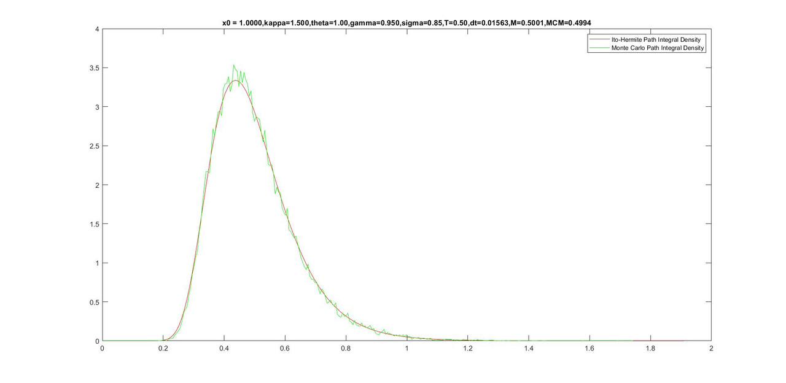](https://postimg.cc/G9pb0nBf)

[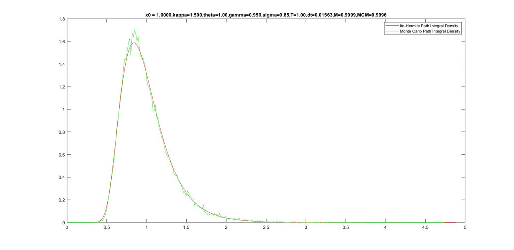](https://postimg.cc/z3P882KG)

[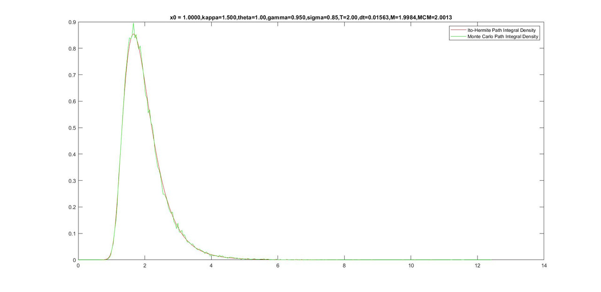](https://postimg.cc/4KZTBDkB)

[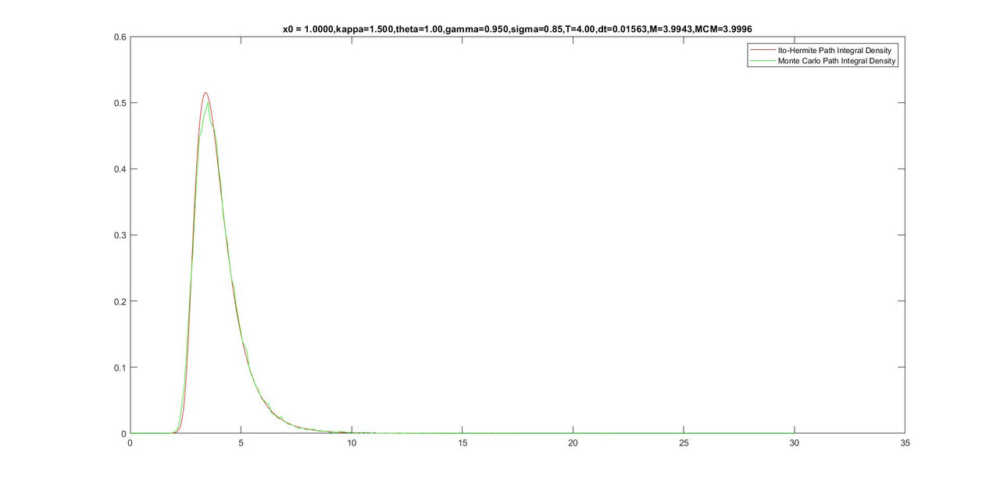](https://postimg.cc/KR6bgK9X)

[](https://postimg.cc/qtLHY1p0)

[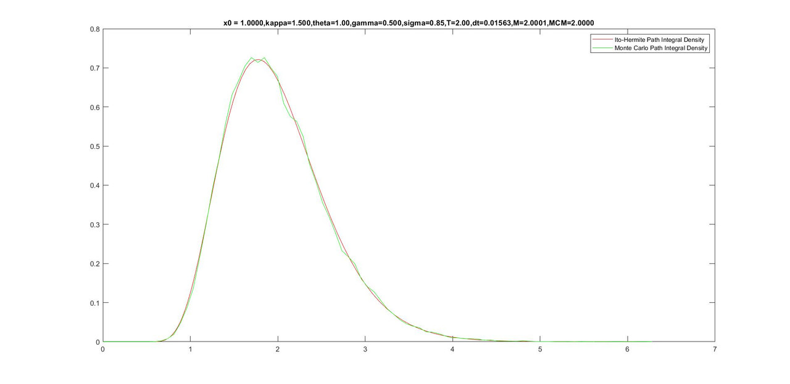](https://postimg.cc/RWwB1M8W)

[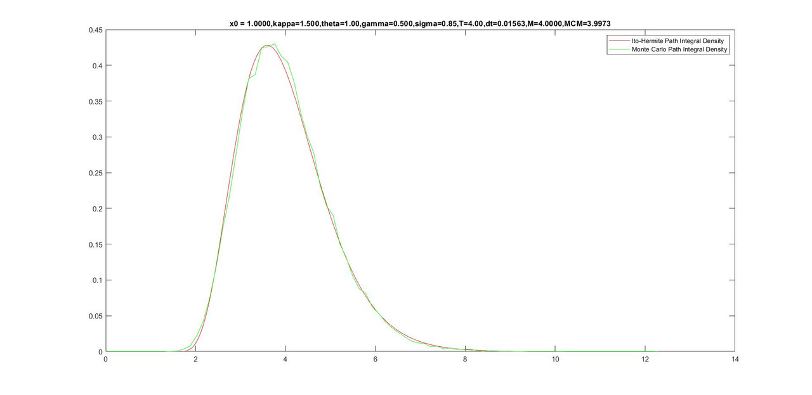](https://postimg.cc/GH8r2PxJ)

[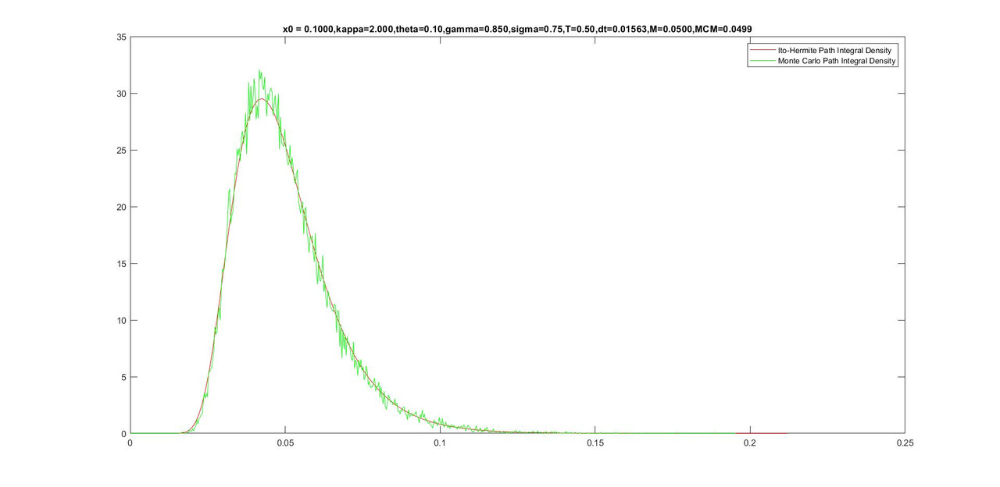](https://postimg.cc/G8mn1vpD)

[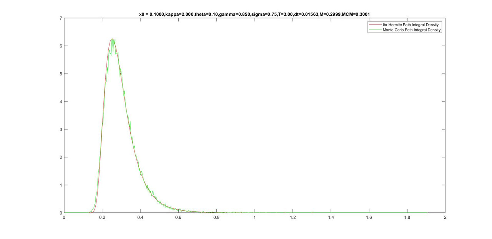](https://postimg.cc/N9CqGLyz)

---

### #1409 — Amin (Topic Author)
*April 26, 2022, 3:55 PM*

Here is the program used to make graphs in previous post. It needs to be improved and I suspect it has some minor errors
and I will come back with a new version after a few days.

.

.

.

```
function [] = FPESeriesCoeffsFromGaussiansWilmottNew02A_Lite_PIntegral08CC()

%Copyright Ahsan Amin. Infiniti derivatives Technologies.
%Please fell free to connect on linkedin: linkedin.com/in/ahsan-amin-0a53334
%or skype ahsan.amin2999
%In this program, I am simulating the SDE given as
%dy(t)=mu1 x(t)^beta1 dt + mu2 x(t)^beta2 dt +sigma x(t)^gamma dz(t)

%I have not directly simulated the SDE but simulated the transformed
%Besse1l process version of the SDE and then changed coordinates to retreive
%the SDE in original coo
%rdinates.
%The present program will analytically evolve only the Bessel Process version of the
%SDE in transformed coordinates.

dt=.125/2/2/2;   % Simulation time interval.%Fodiffusions close to zero
             %decrease dt for accuracy.
Tt=32*2*3;%16*2*4;%*4*4*1;%*4;%128*2*2*2;     % Number of simulation levels. Terminal time= Tt*dt; //.125/32*32*16=2
year;
T=Tt*dt;
Ts=Tt;
ds(1:Ts)=dt;

%
% %Below I have done calculations for smaller step size at start.
%
% %ds(1:64)=dt/16;
% %ds(65:128)=dt/4;
% if(Tt4)&&(Tt20)
% Ts=(32)+((20-4)*2)+(Tt-20);
% ds(1:32)=dt/8;
% ds(33:64)=dt/2;
% ds(65:Ts)=dt;
% end
% T
% sum(ds(1:Ts))
% Ts
%str=input('Check if time is right');

OrderA=4;  %
OrderM=4;  %

if(T>=1)
dtM=1/16;%.0625/1;
TtM=T/dtM;
else
dtM=T/16;%.0625/1;
TtM=T/dtM;
end

dtM=dt;
TtM=Tt;

dNn=.2/2;   % Normal density subdivisions width. would change with number of subdivisions
Nn=47*2;  % No of normal density subdivisions

NnMid=4.0;

x0=.10;   % starting value of SDE
beta1=0.0;
beta2=1.0;   % Second drift term power.
%beta1=0.950;
%beta2=0.0;   % Second drift term power.
gamma=.85;%50;   % volatility power.
kappa=2.00;%.950;   %mean reversion parameter.
theta=.10;%mean reversion target
sigma0=.750;%Volatility value

%you can specify any general mu1 and mu2 and beta1 and beta2.
mu1=.50;   %first drift coefficient.
mu2=0;%-1*kappa;    % Second drift coefficient.
mu1=theta*kappa;
mu2=-1*kappa;

alpha=1;% x^alpha is being expanded. This is currently for monte carlo only.
alpha1=1-gamma;%This is for expansion of integrals for calculation of drift
%and volatility coefficients
%yy(1:Nn)=x0;
w0=x0^(1-gamma)/(1-gamma);

Z(1:Nn)=(((1:Nn)-7.5/1)*dNn-NnMid);
Z
str=input('Look at Z');
ZProb(1)=normcdf(.5*Z(1)+.5*Z(2),0,1)-normcdf(.5*Z(1)+.5*Z(2)-dNn,0,1);
ZProb(Nn)=normcdf(.5*Z(Nn)+.5*Z(Nn-1)+dNn,0,1)-normcdf(.5*Z(Nn)+.5*Z(Nn-1),0,1);
ZProb(2:Nn-1)=normcdf(.5*Z(2:Nn-1)+.5*Z(3:Nn),0,1)-normcdf(.5*Z(2:Nn-1)+.5*Z(1:Nn-2),0,1);

%%%%%%%%%%%%%%%%%%%%%%%%%%%%%%%%%%%%%%%%%%%%%%%%%%%%%%%%%%%%%%%%%%%%%%%%%%%%%%%%%%%%%%%%%%%%%%

sigma11(1:OrderA+1)=0;
mu11(1:OrderA+1)=0;
mu22(1:OrderA+1)=0;
sigma22(1:OrderA+1)=0;
% index 1 correponds to zero level since matlab indexing starts at one.
sigma11(1)=1;
mu11(1)=1;
mu22(1)=1;
sigma22(1)=1;

for k=1:(OrderA+1)
    if sigma0~=0
        sigma11(k)=sigma0^(k-1);
    end
    if mu1 ~= 0
        mu11(k)=mu1^(k-1);
    end
    if mu2 ~= 0
        mu22(k)=mu2^(k-1);
    end
    if sigma0~=0
        sigma22(k)=sigma0^(2*(k-1));
    end
end
%Ft(1:TtM+1,1:(OrderA+1),1:(OrderA+1),1:(OrderA+1),1:(OrderA+1))=0; %General time powers on hermite polynomials
Fp(1:(OrderA+1),1:(OrderA+1),1:(OrderA+1),1:(OrderA+1))=0;%General x powers on coefficients of hermite polynomials.
Fp1(1:(OrderA+1),1:(OrderA+1),1:(OrderA+1),1:(OrderA+1))=0;%General x powers for bessel transformed coordinates.

%YCoeff0 and YCoeff are coefficents for original coordinates monte carlo.
%YqCoeff0 and YqCoeff are bessel/lamperti version monte carlo.

YCoeff0(1:(OrderA+1),1:(OrderA+1),1:(OrderA+1),1:(OrderA+1))=0;
YqCoeff0(1:(OrderA+1),1:(OrderA+1),1:(OrderA+1),1:(OrderA+1))=0;
%Pre-compute the time and power exponent values in small multi-dimensional arrays
YCoeff = ItoTaylorCoeffsNew(alpha,beta1,beta2,gamma); %expand y^alpha where alpha=1;
YqCoeff = ItoTaylorCoeffsNew(alpha1,beta1,beta2,gamma);%expand y^alpha1 where alpha1=(1-gamma)
YqCoeff=YqCoeff/(1-gamma); %Transformed coordinates coefficients have to be
%further divided by (1-gamma)

for k = 0 : (OrderA)
    for m = 0:k
        l4 = k - m + 1;
        for n = 0 : m
            l3 = m - n + 1;
            for j = 0:n
                l2 = n - j + 1;
                l1 = j + 1;
                %Ft(l1,l2,l3,l4) = dtM^((l1-1) + (l2-1) + (l3-1) + .5* (l4-1));
                Fp(l1,l2,l3,l4) = (alpha + (l1-1) * beta1 + (l2-1) * beta2 + (l3-1) * 2* gamma + (l4-1) * gamma ...
                    - (l1-1) - (l2-1) - 2* (l3-1) - (l4-1));
                Fp1(l1,l2,l3,l4) = (alpha1 + (l1-1) * beta1 + (l2-1) * beta2 + (l3-1) * 2* gamma + (l4-1) * gamma ...
                    - (l1-1) - (l2-1) - 2* (l3-1) - (l4-1));

                YCoeff0(l1,l2,l3,l4) =YCoeff(l1,l2,l3,l4).*mu11(l1).*mu22(l2).*sigma22(l3).*sigma11(l4);
                YqCoeff0(l1,l2,l3,l4) =YqCoeff(l1,l2,l3,l4).*mu11(l1).*mu22(l2).*sigma22(l3).*sigma11(l4);
            end
        end
    end
end

%%%%%%%%%%%%%%%%%%%%%%%%%%%%%%%%%%%%%%%%%%%%%%%%%%%%%%%%%%%%%%%%%%%%%%%%%%%%%%%%%%%%%%%%%%%%%%

ExpnOrder=5;
SeriesOrder=5;

wnStart=1;
tic

for tt=1:Ts
    tt

    if(tt==1)
        %dt=ds(1);
        %[wMu0dt,dwMu0dtdw] = BesselDriftAndDerivatives(w0,YqCoeff0,Fp1,gamma,dt,ExpnOrder);
 %       [wMu0dt,dwMu0dtdw] = BesselDriftAndDerivatives02A(w0,mu1,mu2,beta1,beta2,sigma0,gamma,ds(tt),ExpnOrder);

        [wMu0dt,dwMu0dtdw] = BesselDriftAndDerivativesH0(w0,YqCoeff0,Fp1,gamma,ds(tt),6);
    %    [wMu0dt,dwMu0dtdw,Ratio] = BesselDriftAndDerivatives04A(w0,mu1,mu2,beta1,beta2,sigma0,gamma,ds(tt),6);

      %  dwMu0dtdw
      %  dwMu0dtdwb
      %  wMu0dt
      %  wMu0dtb
      %  str=input('Look at drift');
        c0=wMu0dt+w0;
        c(1)=sigma0*sqrt(ds(tt));
        c(2:10)=0.0;
        w0=c0;
        b0=wMu0dt;
        b(1:5)=0;

    elseif(tt1)
    fH0prev=fH0;%+bH0;
    fHprev=fH;%+bH;
    f0prev=f0;%+bH0;
    fprev=f;%+bH;
 end

 %Below f0 and f define the Z_series in original coordinates
 [f0,f] = CalculateDriftbCoeffs08A(yw0,dyw0,c,SeriesOrder);
 f(6:8)=0;

 SeriesOrdery=SeriesOrder;

 %fH0 and fH(1:5) define the coefficients of hermite polynomial
 %representation of SDE variable in original coordinates.
 [fH0,fH] = ConvertZCoeffsToHCoeffs(f0,f,SeriesOrdery);

% [yMu0dt,dyMu0dtdy] = OriginalDriftAndDerivativesH0(f0prev,YCoeff0,Fp,ds(tt),7)
%  [by0,by] = CalculateDriftbCoeffs08A(yMu0dt,dyMu0dtdy,fprev,SeriesOrdery);
% [byH0,byH] = ConvertZCoeffsToHCoeffs(by0,by,SeriesOrdery);

% fH0
% byH0
% fH
%
% byH
% fH./byH
%
% 1/(exp(kappa*dt)-1)
% 1/(1-exp(-kappa*dt))
% byH./fH
% (1-exp(-kappa*dt))
%  (fHprev(1:SeriesOrder)+byH(1:SeriesOrder))./fHprev(1:SeriesOrder)
%  exp(-kappa*dt)
%  %fH+byH
%  %(fH+byH)./fH
%
% by0
% byH0
% byH

 fH(SeriesOrdery+1:7)=0;
% byH(SeriesOrdery+1:7)=0;

% str=input('Look at original drift');

% if(tt>1)
%    fH0prev=fH0prev+byH0;
%    fHprev=fHprev+byH;
% end

 if(tt>=1)

     bSumH0prev=0;
     bSumHprev(1:SeriesOrdery)=0;
     %fH0prev=fH0prev+byH0;
     %fHprev=fHprev;%-exp(-kappa*dt).*bSumH;
     bSumH0=0;
     bSumH(1:SeriesOrdery)=0;

 end

%Below calculate the Hermite representation of orthogonal increments in the
%original coordinates variable at each time step by squared subtraction of
%coefficients of hermite polynomials.
%Here cH0 and cH define the hermite polynomial coordinates of orthogonal
 %increments at each simulation step. The take double array index in
 %simulation level, tt and hermite polynomial count (1:5).
if(tt==1)
 cH0(tt)=fH0;
 cH(tt,1:SeriesOrdery)=fH(1:SeriesOrdery);%-byH(1:SeriesOrdery);

% bt0=by0;
% bt(tt,1:SeriesOrdery)=by(1:SeriesOrdery);
end
if(tt>1)
 %dH0=fH0-fH0prev;
 dH0=fH0-bSumH0-fH0prev+bSumH0prev;

 %dH(1:SeriesOrdery)=sign(fH(1:SeriesOrdery)-fHprev(1:SeriesOrdery)).*sqrt(abs(sign(fH(1:SeriesOrdery)).*fH(1:SeriesOrdery).^2-sign(fHprev(1:SeriesOrdery)).*fHprev(1:SeriesOrdery).^2));
 dH(1:SeriesOrdery)=sign(fH(1:SeriesOrdery)-bSumH(1:SeriesOrdery)-exp(-1*kappa*dt).*(fHprev(1:SeriesOrdery)-bSumHprev(1:SeriesOrdery))).*sqrt(abs(sign(fH(1:SeriesOrdery)-bSumH(1:SeriesOrdery)).*(exp(0*kappa*dt).*fH(1:SeriesOrdery)-bSumH(1:SeriesOrdery)).^2-sign(exp(-kappa*dt).*fHprev(1:SeriesOrdery)-bSumHprev(1:SeriesOrdery)).*exp(-2*1*kappa*dt).*(fHprev(1:SeriesOrdery)-bSumHprev(1:SeriesOrdery)).^2));
 %dH(1:SeriesOrdery)=sign(fH(1:SeriesOrdery)-bSumH(1:SeriesOrdery)-exp(-kappa*dt).*(fHprev(1:SeriesOrdery)-bSumHprev(1:SeriesOrdery))).*sqrt(abs(sign(fH(1:SeriesOrdery)-bSumH(1:SeriesOrdery)).*(exp(1*kappa*tt*dt).*fH(1:SeriesOrdery)-bSumH(1:SeriesOrdery)).^2-sign(fHprev(1:SeriesOrdery)-bSumHprev(1:SeriesOrdery)).*exp(2*(tt-1)*kappa*dt).*(fHprev(1:SeriesOrdery)-bSumHprev(1:SeriesOrdery)).^2));

 cH0(tt)=dH0;
 cH(tt,1:SeriesOrdery)=dH(1:SeriesOrdery);

% bt0(tt)=by0;
% bt(tt,1:SeriesOrdery)=by(1:SeriesOrdery);
end

end
wnStart=1;

yy0=((1-gamma).*w0).^(1/(1-gamma));

 w(1:Nn)=c0;
 for nn=1:ExpnOrder
     w(1:Nn)=w(1:Nn)+c(nn)*Z(1:Nn).^nn;
 end

  %Below calculate the hermite representation of dt-integral in original
 %coordinates
 %Here cH0 and cH define the hermite polynomial coordinates of orthogonal
 %increments at each simulation step and bH0 and bH define the hermite
 %representation of the dt-integral after continued squared addition of
 %scaled/weighted values of hermite coefficients of orthogonal increments.

 eH0=cH0(1)*dt*Ts;
 %eH(1:SeriesOrdery)=cH(1,1:SeriesOrdery)*dt*Ts;

 for tt=2:Ts
 %   ts=Ts-tt+1;
 %   eH0=eH0+cH0(tt)*dt*ts;
 % 
 eH(1:SeriesOrdery)=sign(eH(1:SeriesOrdery)+dt*(ts).*cH(tt,1:SeriesOrdery)).*sqrt(abs(sign(eH(1:SeriesOrdery)).*eH(1:SeriesOrdery).^2+sign(dt*(ts).*cH(tt,1:SeriesOrdery)).*(dt).^2.*ts.^2.*cH(tt,1:SeriesOrdery).^2));
 end

 %eH2(1:SeriesOrdery)=sign(cH(1,1:SeriesOrdery)*dt*Ts).*(cH(1,1:SeriesOrdery)*dt*Ts).^2;

 eH2(1:SeriesOrdery)=0;
 eH0=0;

 for tt=2:Ts
 %   ts=Ts-tt+1;
 %   eH0=eH0+cH0(tt)*dt*ts;
 % 
 eH2(1:SeriesOrdery)=eH2(1:SeriesOrdery)+sign(dt*(ts).*cH(tt,1:SeriesOrdery)).*(dt).^2.*ts.^2.*cH(tt,1:SeriesOrdery).^2;
    %  for ss=1:tt-1
    %      tss=tt-ss;
    %      %tss=1;
    %     
%eH2(1:SeriesOrdery)=eH2(1:SeriesOrdery)+exp(-kappa*dt*(tt+ss)).*sign(dt*(tss).*cH(ss,1:SeriesOrdery)).*(dt).^2.*tss.^2.*cH(tt,1:SeriesOrdery).^2;
    %     
eH2(1:SeriesOrdery)=eH2(1:SeriesOrdery)+exp(-kappa*dt*(tt*.5)).*sign(dt.*cH(ss,1:SeriesOrdery)).*dt^2.*2.*tss.*cH(ss,1:SeriesOrdery).^2;
    %  end
 end
 Coeff0(1:Ts)=0;
 Coeff(1:Ts)=0;
 Coeff1(1:Ts)=0;
 Coeff2(1:Ts)=0;
 for tt=1:Ts
     Coeff2(tt)=Coeff2(tt)+0.*(Ts-tt+1).*dt^2;
 end
 for tt=1:Ts
     for ss=tt:Ts
         for rr=ss:Ts
            %Coeff2(tt)=Coeff2(tt)+0*.75* exp(-.5*kappa*(dt*((rr)-ss))).*dt^2;
            %Coeff2(tt)=Coeff2(tt)+2/.77* exp(-1*kappa*(dt*((rr)-ss))).*dt^2;
            %coef=max(.8-.8/sqrt(1)/kappa,0);
            %coef=max(.75-.8/sqrt(2)/kappa,0);
            %coef=max(.75-.8/sqrt(4)/sqrt(kappa)+2/3*sqrt(kappa)*sqrt(Ts*dt)-sqrt(kappa)*sqrt(.5),0);
            %Coeff2(tt)=Coeff2(tt)+(2+coef)* exp(-1*kappa*(dt*((rr)-ss))).*dt^2;
            %Coeff2(tt)=Coeff2(tt)+(2+coef)* exp(-1*kappa*(dt*((rr)-ss))).*dt^2;
            if(rr==ss)

            Coeff2(tt)=Coeff2(tt)+(exp(-0*kappa*dt*(tt))).*(exp(-2*kappa*dt*(rr-ss))).*dt^2;
            else
            %Coeff2(tt)=Coeff2(tt)+sqrt(3)/sqrt(kappa)*(exp(-2*kappa*dt*(rr-ss))).*dt^2;
            Coeff2(tt)=Coeff2(tt)+2*(exp(-2*kappa*dt*(rr-ss)))*(exp(-1*kappa*dt*(tt))).*dt^2;
            end
          %  rr
          %  ss
          %  (exp(-1*kappa*dt*(rr-ss)))
          %  (exp(-2*kappa*dt*(rr-ss)))
          %  str=input('Look at numbers');
            %Coeff2(tt)=Coeff2(tt)+(2)* (exp(-kappa*dt*(rr-ss)))*(1+.125*kappa*dt*(ss)).*dt^2;
            %Coeff2(tt)=Coeff2(tt)+(2)* (exp(-kappa*dt*(rr-ss)))*(1/.8-.125/4*kappa*dt*(tt)/2).*dt^2;
            %Coeff2(tt)=Coeff2(tt)+1.*(exp(-kappa*dt*(tt/2))).*dt^2;

            %Coeff2(tt)=Coeff2(tt)+1/(2).* dt^2;
         end
     end
 end

 for tt=1:Ts
    ts=Ts-tt+1;
    eH0=eH0+cH0(tt)*ts*dt;
    eH2(1:SeriesOrdery)=eH2(1:SeriesOrdery)+sign(cH(tt,1:SeriesOrdery)).*Coeff2(tt).*cH(tt,1:SeriesOrdery).^2;
 end

%   for ss=1:Ts-1
%         %tss=tt-ss;
%         tss=Ts-ss+1;
%         %tss=1;
%       
 %eH2(1:SeriesOrdery)=eH2(1:SeriesOrdery)+exp(-kappa*dt*(tt+ss)).*sign(dt*(tss).*cH(ss,1:SeriesOrdery)).*(dt).^2.*tss.^2.*cH(tt,1:SeriesOrdery).^2;
%       
 eH2(1:SeriesOrdery)=eH2(1:SeriesOrdery)+exp(-kappa*dt*(Ts+ss)).*sign(dt.*cH(ss,1:SeriesOrdery)).*dt^2.*tss^2.*cH(ss,1:SeriesOrdery).^2;
%  end

 eH(1:SeriesOrdery)=sign(eH2(1:SeriesOrdery)).*sqrt(abs(eH2(1:SeriesOrdery)));

 %We convert hermite represenation given by bH0 and bH(1:5) into
 %dt-integral Z-series Coeffs, e0 and e(1:5)
 %eH(SeriesOrdery)=eH(SeriesOrdery)/2;
 [e0,e] = ConvertHCoeffsToZCoeffs(eH0,eH,SeriesOrdery);%

for ss=1:Ts
     %for ss=1:tt
     for tt=ss:Ts

       
%eH2(1:SeriesOrdery)=eH2(1:SeriesOrdery)+exp(-kappa*dt*(tt+ss)).*sign(dt*(tss).*cH(ss,1:SeriesOrdery)).*(dt).^2.*tss.^2.*cH(tt,1:SeriesOrdery).^2;
       
%eH2(1:SeriesOrdery)=eH2(1:SeriesOrdery)+exp(-kappa*dt*(Ts*.5)).*sign(dt.*cH(ss,1:SeriesOrdery)).*dt^2.*tss^2.*cH(ss,1:SeriesOrdery).^2;
        %e(1:SeriesOrdery)=e(1:SeriesOrdery)+1/sqrt(2^0)*exp(-kappa*dt*(tt-ss)).*bt(ss,1:SeriesOrdery)*dt;
%        e(1:SeriesOrdery)=e(1:SeriesOrdery)+exp(-1*kappa*dt*(tt-ss)).*bt(ss,1:SeriesOrdery)*dt;
%        e0=e0+exp(-kappa*dt*(tt-ss)).*bt0(ss)*dt;
%        e(1:SeriesOrdery)=0;
%        e0=0;

     end
end

% for tt=1:Ts
%      for ss=tt:Ts
%
%       
 %eH2(1:SeriesOrdery)=eH2(1:SeriesOrdery)+exp(-kappa*dt*(tt+ss)).*sign(dt*(tss).*cH(ss,1:SeriesOrdery)).*(dt).^2.*tss.^2.*cH(tt,1:SeriesOrdery).^2;
%       
 %eH2(1:SeriesOrdery)=eH2(1:SeriesOrdery)+exp(-kappa*dt*(Ts*.5)).*sign(dt.*cH(ss,1:SeriesOrdery)).*dt^2.*tss^2.*cH(ss,1:SeriesOrdery).^2;
%         %e(1:SeriesOrdery)=e(1:SeriesOrdery)+exp(-kappa*dt*(tt-ss)).*bt(ss,1:SeriesOrdery)*dt;
%         e(1:SeriesOrdery)=e(1:SeriesOrdery)+exp(-kappa*dt*(ss-tt)).*bt(tt,1:SeriesOrdery)*dt;
%         %e0=e0+exp(-kappa*dt*(tt-ss)).*bt0(ss)*dt;
%         e0=e0+exp(-kappa*dt*(ss-tt)).*bt0(tt)*dt;
%      end
% end

%   e0=e0+bt0(1)*dt*Ts;
%   e(1:SeriesOrdery)=e(1:SeriesOrdery)+bt(1:SeriesOrdery)*dt*Ts;
%   for tt=2:Ts-1
%      ts=Ts-tt;
%      e0=e0+bt0(tt)*dt*ts;
%      e(1:SeriesOrdery)=e(1:SeriesOrdery)+bt(tt,1:SeriesOrdery)*dt*ts.*exp(-kappa*ts*dt);
%     
%eH(1:SeriesOrder)=sign(eH(1:SeriesOrder)+dt*(ts).*cH(tt,1:SeriesOrder)).*sqrt(abs(sign(eH(1:SeriesOrder)).*eH(1:SeriesOrder).^2+sign(dt*(ts).*cH(tt,1:SeriesOrder)).*(dt).^2.*ts.^2.*cH(tt,1:SeriesOrder).^2));
%   end

 %e(5)=1/3*e(5);

  yydt(1:Nn)=e0;
 for nn=1:SeriesOrdery
     yydt(1:Nn)=yydt(1:Nn)+e(nn)*Z(1:Nn).^nn;
 end

 %c0
 %c

 %str=input('Look at numbers')
 yy0(wnStart:Nn)=((1-gamma).*w(wnStart:Nn)).^(1/(1-gamma));

 yy=yy0;
Dfyy(wnStart:Nn)=0;
Dfyydt(wnStart:Nn)=0;
for nn=wnStart+1:Nn-1

    Dfyy(nn) = (yy(nn + 1) - yy(nn - 1))/(Z(nn + 1) - Z(nn - 1));
    Dfyydt(nn) = (yydt(nn + 1) - yydt(nn - 1))/(Z(nn + 1) - Z(nn - 1));

    %Change of variable derivative for densities
end
%Dfyy(Nn)=Dfyy(Nn-1);
%Dfyy(1)=Dfyy(2);
%Dfyydt(Nn)=Dfyydt(Nn-1);
%Dfyydt(1)=Dfyydt(2);

pyy(1:Nn)=0;
pyydt(1:Nn)=0;
for nn = wnStart+1:Nn-1

    pyy(nn) = (normpdf(Z(nn),0, 1))/abs(Dfyy(nn));
    pyydt(nn) = (normpdf(Z(nn),0, 1))/abs(Dfyydt(nn));
end

toc

ItoHermiteMean=sum(yy(wnStart:Nn).*ZProb(wnStart:Nn)) %Original process average from coordinates
disp('true Mean only applicable to standard SV mean reverting type models otherwise disregard');
TrueMean=theta+(x0-theta)*exp(-kappa*T)%Mean reverting SDE original variable true average
%yy0

theta1=1;
rng(29079137, 'twister')
paths=50000;
YY(1:paths)=x0;  %Original process monte carlo.
YYdt(1:paths)=0;

Random1(1:paths)=0;
for tt=1:TtM

    Random1=randn(size(Random1));
    HermiteP1(1,1:paths)=1;
    HermiteP1(2,1:paths)=Random1(1:paths);
    HermiteP1(3,1:paths)=Random1(1:paths).^2-1;
    HermiteP1(4,1:paths)=Random1(1:paths).^3-3*Random1(1:paths);
    HermiteP1(5,1:paths)=Random1(1:paths).^4-6*Random1(1:paths).^2+3;

    YYdt(1:paths)=YYdt(1:paths)+.5*YY(1:paths)*dtM;

    YY(1:paths)=YY(1:paths) + ...
        (YCoeff0(1,1,2,1).*YY(1:paths).^Fp(1,1,2,1)+ ...
        YCoeff0(1,2,1,1).*YY(1:paths).^Fp(1,2,1,1)+ ...
        YCoeff0(2,1,1,1).*YY(1:paths).^Fp(2,1,1,1))*dtM + ...
        (YCoeff0(1,1,3,1).*YY(1:paths).^Fp(1,1,3,1)+ ...
        YCoeff0(1,2,2,1).*YY(1:paths).^Fp(1,2,2,1)+ ...
        YCoeff0(2,1,2,1).*YY(1:paths).^Fp(2,1,2,1)+ ...
        YCoeff0(1,3,1,1).*YY(1:paths).^Fp(1,3,1,1)+ ...
        YCoeff0(2,2,1,1).*YY(1:paths).^Fp(2,2,1,1)+ ...
        YCoeff0(3,1,1,1).*YY(1:paths).^Fp(3,1,1,1))*dtM^2 + ...
        ((YCoeff0(1,1,1,2).*YY(1:paths).^Fp(1,1,1,2).*sqrt(dtM))+ ...
        (YCoeff0(1,1,2,2).*YY(1:paths).^Fp(1,1,2,2)+ ...
        YCoeff0(1,2,1,2).*YY(1:paths).^Fp(1,2,1,2)+ ...
        YCoeff0(2,1,1,2).*YY(1:paths).^Fp(2,1,1,2)).*dtM^1.5) .*HermiteP1(2,1:paths) + ...
        ((YCoeff0(1,1,1,3).*YY(1:paths).^Fp(1,1,1,3) *dtM) + ...
        (YCoeff0(1,1,2,3).*YY(1:paths).^Fp(1,1,2,3)+ ...
        YCoeff0(1,2,1,3).*YY(1:paths).^Fp(1,2,1,3)+ ...
        YCoeff0(2,1,1,3).*YY(1:paths).^Fp(2,1,1,3)).*dtM^2).*HermiteP1(3,1:paths) + ...
        ((YCoeff0(1,1,1,4).*YY(1:paths).^Fp(1,1,1,4)*dtM^1.5 )).*HermiteP1(4,1:paths) + ...
        (YCoeff0(1,1,1,5).*YY(1:paths).^Fp(1,1,1,5)*dtM^2.0).*HermiteP1(5,1:paths);
     YYdt(1:paths)=YYdt(1:paths)+.5*YY(1:paths)*dtM;

end

YY(YY<0)=0;
disp('Original process average from monte carlo');
MCMean=sum(YY(:))/paths %origianl coordinates monte carlo average.
disp('Original process average from our simulation');
ItoHermiteMean=sum(yy(wnStart:Nn).*ZProb(wnStart:Nn)) %Original process average from coordinates
ItoHermiteMeanPI=sum(yydt(wnStart:Nn).*ZProb(wnStart:Nn))
MCMeanPI=sum(YYdt(:))/paths
disp('true Mean only applicble to standard SV mean reverting type models otherwise disregard');
TrueMean=theta+(x0-theta)*exp(-kappa*T)%Mean reverting SDE original variable true average

MaxCutOff=30;
NoOfBins=round(1*500*gamma^2*4*sigma0/sqrt(MCMean)/(1+kappa));%Decrease the number of bins if the graph is too
[YDensity,IndexOutY,IndexMaxY] = MakeDensityFromSimulation_Infiniti_NEW(YY,paths,NoOfBins,MaxCutOff );
plot(yy(wnStart+1:Nn-1),pyy(wnStart+1:Nn-1),'r',IndexOutY(1:IndexMaxY),YDensity(1:IndexMaxY),'g');
 %plot(y_w(wnStart+1:Nn-1),fy_w(wnStart+1:Nn-1),'r',IndexOutY(1:IndexMaxY),YDensity(1:IndexMaxY),'g',Z(wnStart+1:Nn-1),fy_w(wnStart+1:Nn-1),'b');

%title(sprintf('x0 = %.4f,theta=%.3f,kappa=%.2f,gamma=%.3f,sigma=%.2f,T=%.2f,dt=%.5f,M=%.4f,TM=%.4f',
x0,theta,kappa,gamma,sigma0,T,dt,ItoHermiteMean,TrueMean));%,sprintf('theta= %f', theta), sprintf('kappa = %f',
kappa),sprintf('sigma = %f', sigma0),sprintf('T = %f', T));
title(sprintf('x0 = %.4f,mu1=%.3f,beta1=%.2f,gamma=%.3f,sigma=%.2f,T=%.2f,dt=%.5f,M=%.4f,TM=%.4f',
x0,mu1,beta1,gamma,sigma0,T,dt,ItoHermiteMean,TrueMean));%,sprintf('theta= %f', theta), sprintf('kappa = %f',
kappa),sprintf('sigma = %f', sigma0),sprintf('T = %f', T));

legend({'Ito-Hermite Density','Monte Carlo Density'},'Location','northeast')

str=input('red line is density of SDE from Ito-Hermite method, green is monte carlo.');

NoOfBins=round(1*500*gamma^2*4*sigma0/sqrt(MCMean)/(1+kappa))/2;
[YdtDensity,IndexOutYdt,IndexMaxYdt] = MakeDensityFromSimulation_Infiniti_NEW(YYdt,paths,NoOfBins,MaxCutOff );
plot(yydt(wnStart+1:Nn-1),pyydt(wnStart+1:Nn-1),'r',IndexOutYdt(1:IndexMaxYdt),YdtDensity(1:IndexMaxYdt),'g');

%title(sprintf('x0 = %.4f,theta=%.3f,kappa=%.2f,gamma=%.3f,sigma=%.2f,T=%.2f,dt=%.5f,M=%.4f,MCM=%.4f',
x0,theta,kappa,gamma,sigma0,T,dt,ItoHermiteMeanPI,MCMeanPI));%,sprintf('theta= %f', theta), sprintf('kappa = %f',
kappa),sprintf('sigma = %f', sigma0),sprintf('T = %f', T));
title(sprintf('x0 = %.4f,kappa=%.3f,theta=%.2f,gamma=%.3f,sigma=%.2f,T=%.2f,dt=%.5f,M=%.4f,MCM=%.4f',
x0,kappa,theta,gamma,sigma0,T,dt,ItoHermiteMeanPI,MCMeanPI));%,sprintf('theta= %f', theta), sprintf('kappa = %f',
kappa),sprintf('sigma = %f', sigma0),sprintf('T = %f', T));

legend({'Ito-Hermite Path Integral Density','Monte Carlo Path Integral Density'},'Location','northeast')

str=input('red line is density of SDE from Ito-Hermite method, green is monte carlo.');

end
```

.

.

.

Here is the output you should see when you run this program.

ItoHermiteMean =

   0.100021004761355

true Mean only applicable to standard SV mean reverting type models otherwise disregard

TrueMean =

   0.100000000000000

Original process average from monte carlo

MCMean =

   0.099800196176705

Original process average from our simulation

ItoHermiteMean =

   0.100021004761355

ItoHermiteMeanPI =

   0.299902402491998

MCMeanPI =

   0.300090652148871

true Mean only applicble to standard SV mean reverting type models otherwise disregard

TrueMean =

   0.100000000000000

IndexMax =

        1145

red line is density of SDE from Ito-Hermite method, green is monte carlo.

IndexMax =

     573

red line is density of SDE from Ito-Hermite method, green is monte carlo.

---

### #1410 — Amin (Topic Author)
*April 27, 2022, 8:05 AM*

Friends, I have been able to solve for the densities of CEV noises by addition of variances in bessel coordinates. The
key is to keep drift and variance values distinct and apart from each other. We have to calculate drift at each point in
time as a Z-series and find its sum across time. We also have to add volatility to previous volatility in a squared
fashion (through hermite polynomials) and keep track of squared volatility/variance. Adding the sum of drift up to a
certain time with square root of summed variance till that time helps us construct the Z-series of SDE variable at that
time. Please note that we are dealing with CEV noises in bessel coordinates where their transformed SDE takes a drift
term. This technique works well to simulate the CEV noises merely by adding variances.

When I tried this earlier last week, I was not keeping separate track of sum of drift and sum of squared volatility that
seems necessary to properly evolve the SDE. Simulating CEV noise densities by adding variances makes their simulation
very simple.

Though extension of this method to SDEs with one drift term is obvious, for mean-reverting SDEs, the distinction between
drift and variance gets blurred so more work will be needed to simulate them by adding variances.

I will post my simple matlab program for simulation of CEV noises by adding variances later today or tomorrow.

---

### #1411 — Amin (Topic Author)
*April 28, 2022, 6:59 AM*

Friends, I have been able to solve the SDEs of CEV noises and drifting SDEs (that take one term in their drift) very
well by adding variances using a very simple algorithm that employs hermite polynomials. The method seems to work
perfectly. I will make a detailed post explaining the logic of the method in a few hours. I will also post the matlab
program. I will come back in a few hours.

---

### #1412 — Amin (Topic Author)
*April 28, 2022, 9:57 AM*

Here are some graphs of solution of drifting SDEs over a large range of parameters. I have only matched variance by
squared addition of coefficients of hermite polynomials. Please note that in some graphs density goes into zero but then
comes back into positive territory again and shows up in the graph again. This can easily be obviated by removing points
on grid (further into negative) after density has reached zero.

I still could not get mean-reverting SDEs to work with adding variances.

All parameters of drifting SDEs are on the title. True mean on title written as TMean is not valid since it was only
known for mean reverting SDEs.

.

.

.

Here are the graphs.

[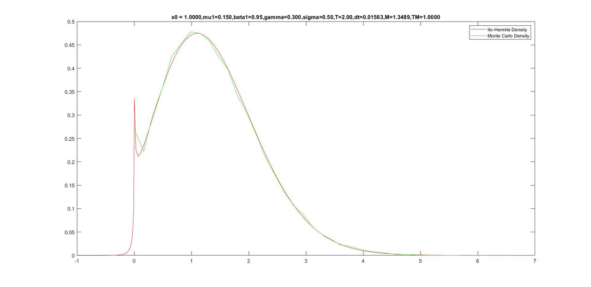](https://postimg.cc/ftSKLnsD)

[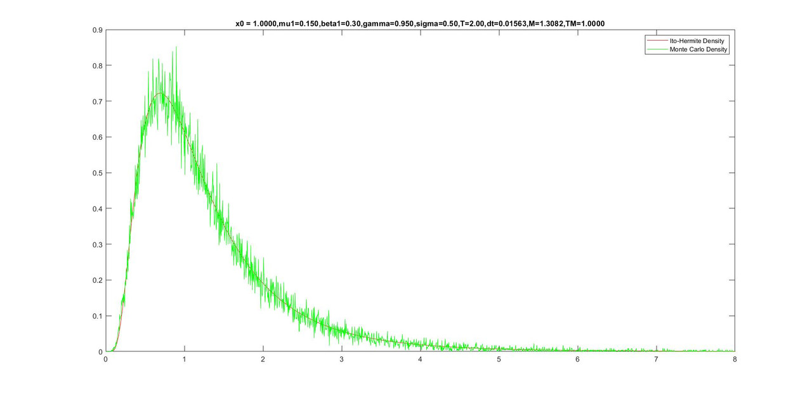](https://postimg.cc/7JvNJsP7)

[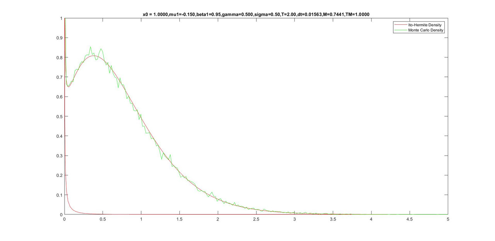](https://postimg.cc/rKkJ8PP2)

[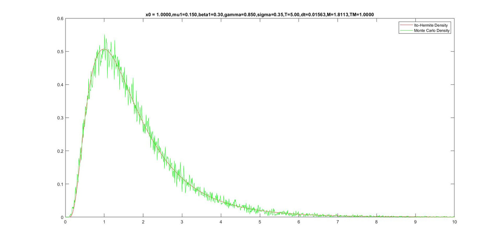](https://postimg.cc/bZY9n2P6)

[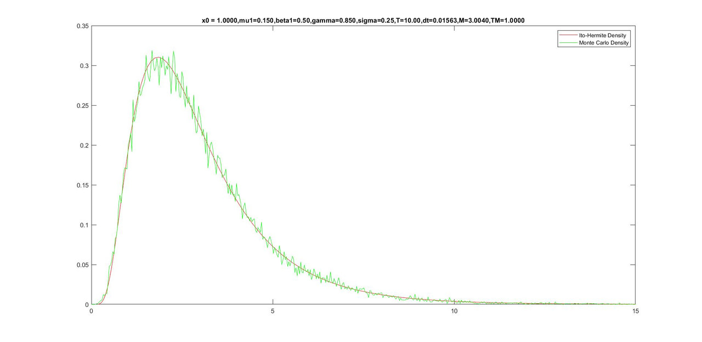](https://postimg.cc/Whw7twBF)

[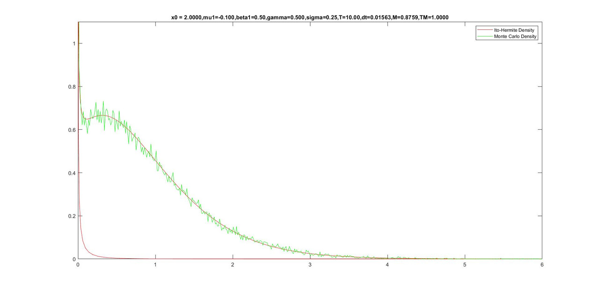](https://postimg.cc/HrS49ssT)

[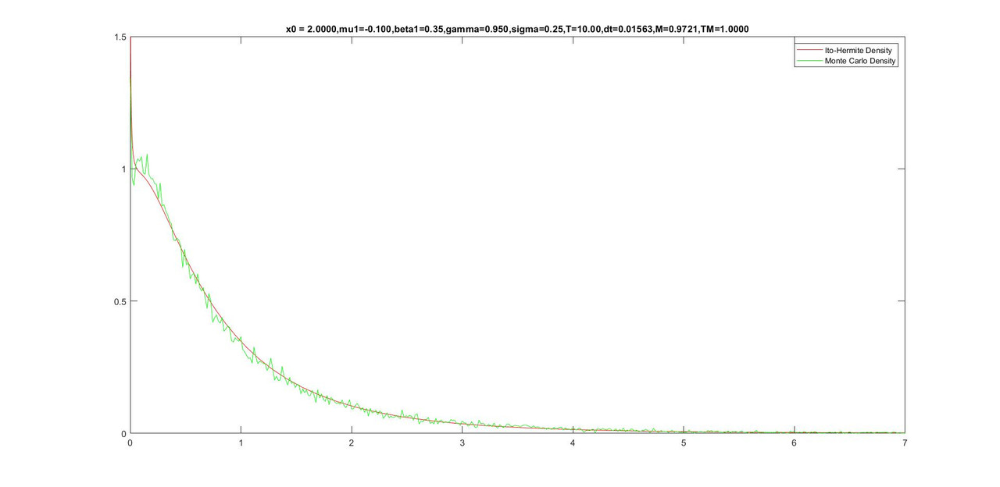](https://postimg.cc/V5MgP84F)

[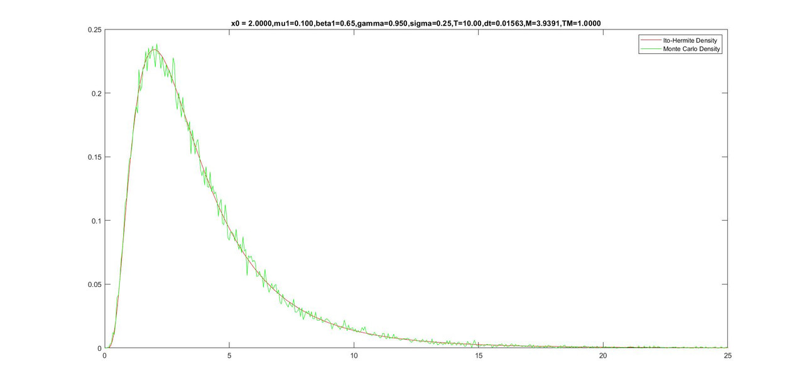](https://postimg.cc/tnhN337c)

---

### #1413 — Amin (Topic Author)
*April 28, 2022, 10:04 AM*

Here is the program used to make graphs above. I will write a thoroughly detailed explanation tomorrow. I did not make
graphs of CEV noises since they were relatively less interesting as compared to drifting SDEs even though the fit to
monte carlo density was extremely excellent for CEV noises. But you can run this program for all sort of parameters.

.

.

.

```
function [] = FPESeriesCoeffsBesselWithVariance04()

%Copyright Ahsan Amin. Infiniti derivatives Technologies.
%Please fell free to connect on linkedin: linkedin.com/in/ahsan-amin-0a53334
%or skype ahsan.amin2999
%In this program, I am simulating the SDE given as
%dy(t)=mu1 x(t)^beta1 dt +sigma x(t)^gamma dz(t)

%I have not directly simulated the SDE but simulated the transformed
%Besse1l process version of the SDE and then changed coordinates to retreive
%the SDE in original coo
%rdinates.
%The present program will analytically evolve only the Bessel Process version of the
%SDE in transformed coordinates.

dt=.125/2/2/2;   % Simulation time interval.%Fodiffusions close to zero
             %decrease dt for accuracy.
Tt=32*2*10;%16*2*4;%*4*4*1;%*4;%128*2*2*2;     % Number of simulation levels. Terminal time= Tt*dt; //.125/32*32*16=2
year;
T=Tt*dt;
Ts=Tt;
ds(1:Ts)=dt;

%
% %Below I have done calculations for smaller step size at start.
%
% %ds(1:64)=dt/16;
% %ds(65:128)=dt/4;
% if(Tt4)&&(Tt20)
% Ts=(32)+((20-4)*2)+(Tt-20);
% ds(1:32)=dt/8;
% ds(33:64)=dt/2;
% ds(65:Ts)=dt;
% end
% T
% sum(ds(1:Ts))
% Ts
%str=input('Check if time is right');

OrderA=4;  %
OrderM=4;  %

if(T>=1)
dtM=1/16;%.0625/1;
TtM=T/dtM;
else
dtM=T/16;%.0625/1;
TtM=T/dtM;
end

dtM=dt*8;
TtM=Tt/8;

dNn=.2/2;   % Normal density subdivisions width. would change with number of subdivisions
Nn=47*2;  % No of normal density subdivisions

NnMid=4.0;

x0=2.0;   % starting value of SDE
beta1=0.65;
beta2=1.0;   % Second drift term power.
%beta1=0.950;
%beta2=0.0;   % Second drift term power.
gamma=.95;%50;   % volatility power.
kappa=1.00;%.950;   %mean reversion parameter.
theta=1.0;%mean reversion target
sigma0=.250;%Volatility value

%you can specify any general mu1 and mu2 and beta1 and beta2.
mu1=.10;   %first drift coefficient.
mu2=0;%-1*kappa;    % Second drift coefficient.
%mu1=theta*kappa;
%mu2=-1*kappa;

alpha=1;% x^alpha is being expanded. This is currently for monte carlo only.
alpha1=1-gamma;%This is for expansion of integrals for calculation of drift
%and volatility coefficients
%yy(1:Nn)=x0;
w0=x0^(1-gamma)/(1-gamma);

Z(1:Nn)=(((1:Nn)-7.5/1)*dNn-NnMid);
Z
str=input('Look at Z');
ZProb(1)=normcdf(.5*Z(1)+.5*Z(2),0,1)-normcdf(.5*Z(1)+.5*Z(2)-dNn,0,1);
ZProb(Nn)=normcdf(.5*Z(Nn)+.5*Z(Nn-1)+dNn,0,1)-normcdf(.5*Z(Nn)+.5*Z(Nn-1),0,1);
ZProb(2:Nn-1)=normcdf(.5*Z(2:Nn-1)+.5*Z(3:Nn),0,1)-normcdf(.5*Z(2:Nn-1)+.5*Z(1:Nn-2),0,1);

%%%%%%%%%%%%%%%%%%%%%%%%%%%%%%%%%%%%%%%%%%%%%%%%%%%%%%%%%%%%%%%%%%%%%%%%%%%%%%%%%%%%%%%%%%%%%%

sigma11(1:OrderA+1)=0;
mu11(1:OrderA+1)=0;
mu22(1:OrderA+1)=0;
sigma22(1:OrderA+1)=0;
% index 1 correponds to zero level since matlab indexing starts at one.
sigma11(1)=1;
mu11(1)=1;
mu22(1)=1;
sigma22(1)=1;

for k=1:(OrderA+1)
    if sigma0~=0
        sigma11(k)=sigma0^(k-1);
    end
    if mu1 ~= 0
        mu11(k)=mu1^(k-1);
    end
    if mu2 ~= 0
        mu22(k)=mu2^(k-1);
    end
    if sigma0~=0
        sigma22(k)=sigma0^(2*(k-1));
    end
end
%Ft(1:TtM+1,1:(OrderA+1),1:(OrderA+1),1:(OrderA+1),1:(OrderA+1))=0; %General time powers on hermite polynomials
Fp(1:(OrderA+1),1:(OrderA+1),1:(OrderA+1),1:(OrderA+1))=0;%General x powers on coefficients of hermite polynomials.
Fp1(1:(OrderA+1),1:(OrderA+1),1:(OrderA+1),1:(OrderA+1))=0;%General x powers for bessel transformed coordinates.

%YCoeff0 and YCoeff are coefficents for original coordinates monte carlo.
%YqCoeff0 and YqCoeff are bessel/lamperti version monte carlo.

YCoeff0(1:(OrderA+1),1:(OrderA+1),1:(OrderA+1),1:(OrderA+1))=0;
YqCoeff0(1:(OrderA+1),1:(OrderA+1),1:(OrderA+1),1:(OrderA+1))=0;
%Pre-compute the time and power exponent values in small multi-dimensional arrays
YCoeff = ItoTaylorCoeffsNew(alpha,beta1,beta2,gamma); %expand y^alpha where alpha=1;
YqCoeff = ItoTaylorCoeffsNew(alpha1,beta1,beta2,gamma);%expand y^alpha1 where alpha1=(1-gamma)
YqCoeff=YqCoeff/(1-gamma); %Transformed coordinates coefficients have to be
%further divided by (1-gamma)

for k = 0 : (OrderA)
    for m = 0:k
        l4 = k - m + 1;
        for n = 0 : m
            l3 = m - n + 1;
            for j = 0:n
                l2 = n - j + 1;
                l1 = j + 1;
                %Ft(l1,l2,l3,l4) = dtM^((l1-1) + (l2-1) + (l3-1) + .5* (l4-1));
                Fp(l1,l2,l3,l4) = (alpha + (l1-1) * beta1 + (l2-1) * beta2 + (l3-1) * 2* gamma + (l4-1) * gamma ...
                    - (l1-1) - (l2-1) - 2* (l3-1) - (l4-1));
                Fp1(l1,l2,l3,l4) = (alpha1 + (l1-1) * beta1 + (l2-1) * beta2 + (l3-1) * 2* gamma + (l4-1) * gamma ...
                    - (l1-1) - (l2-1) - 2* (l3-1) - (l4-1));

                YCoeff0(l1,l2,l3,l4) =YCoeff(l1,l2,l3,l4).*mu11(l1).*mu22(l2).*sigma22(l3).*sigma11(l4);
                YqCoeff0(l1,l2,l3,l4) =YqCoeff(l1,l2,l3,l4).*mu11(l1).*mu22(l2).*sigma22(l3).*sigma11(l4);
            end
        end
    end
end

%%%%%%%%%%%%%%%%%%%%%%%%%%%%%%%%%%%%%%%%%%%%%%%%%%%%%%%%%%%%%%%%%%%%%%%%%%%%%%%%%%%%%%%%%%%%%%

ExpnOrder=5;
SeriesOrder=5;

wnStart=1;
tic

for tt=1:Ts
    tt

    if(tt==1)
        [wMu0dt,dwMu0dtdw] = BesselDriftAndDerivativesH0(w0,YqCoeff0,Fp1,gamma,ds(tt),6);
        c0=wMu0dt+w0;
        c(1)=sigma0*sqrt(ds(tt));
        c(2:10)=0.0;
        w0=c0;
    elseif(tt>=2)

    [wMu0dt,dwMu0dtdw] = BesselDriftAndDerivativesH0(w0,YqCoeff0,Fp1,gamma,ds(tt),6);
    %Below we get Z-series representation of drift term.
     [b0,b] = CalculateDriftbCoeffs08A(wMu0dt,dwMu0dtdw,c,SeriesOrder);
     %Below we convert Z_series of drift term to hermite representation
     [bH0,bH] = ConvertZCoeffsToHCoeffs(b0,b,SeriesOrder);

     [wVol0dt,dwVol0dtdw] = BesselVolAndDerivativesH1(w0,YqCoeff0,Fp1,gamma,ds(tt),SeriesOrder+1);
    %Below we get Z-series representation of coefficient of first hermite polynomial in diffusion term.
    [g10,g1] = CalculateDriftbCoeffs08A(wVol0dt,dwVol0dtdw,c,SeriesOrder);

    g10=g10+sigma0*sqrt(dt);

    %The Z_series(called g1) below is coefficient of first hermite polynomial
    %g10+g1(1)*Z+g1(2)*Z^2+g1(3)*Z^3+g1(4)*Z^4+g1(5)*Z^5

    [g1H0,g1H] = ConvertZCoeffsToHCoeffs(g10,g1,SeriesOrder);

    %g1Sqr is variance of Z_series g1 that makes coefficient of first
    %hermite polynomial
    g1Sqr=(sign(g1H0).*g1H0^2+sign(g1H(1)).*g1H(1).^2+sign(g1H(2)).*g1H(2).^2*2+ ...
        sign(g1H(3)).*g1H(3).^2*6+sign(g1H(4)).*g1H(4).^2*24+sign(g1H(5)).*g1H(5).^2*120);
    g11=sign(g1Sqr).*sqrt(abs(g1Sqr));

    [wVol2dt,dwVol2dtdw] = BesselVolAndDerivativesH2(w0,YqCoeff0,Fp1,gamma,ds(tt),SeriesOrder+1);
    %Below we get Z-series representation of coefficient of second hermite polynomial in diffusion term.
    [g20,g2] = CalculateDriftbCoeffs08A(wVol2dt,dwVol2dtdw,c,SeriesOrder);
    %The Z_series(called g2) below is coefficient of second hermite polynomial
    %g20+g2(1)*Z+g2(2)*Z^2+g2(3)*Z^3+g2(4)*Z^4+g2(5)*Z^5

    [g2H0,g2H] = ConvertZCoeffsToHCoeffs(g20,g2,SeriesOrder);

    %g2Sqr is variance of Z_series g2 that makes coefficient of second
    %hermite polynomial
    g2Sqr=(sign(g2H0).*g2H0^2+sign(g2H(1)).*g2H(1).^2+sign(g2H(2)).*g2H(2).^2*2+ ...
        sign(g2H(3)).*g2H(3).^2*6+sign(g2H(4)).*g2H(4).^2*24+sign(g2H(5)).*g2H(5).^2*120);
    g22=sign(g2Sqr).*sqrt(abs(g2Sqr));

    %Below are derived hermite polynomial representation of SDE variable.
    [cH0,cH] = ConvertZCoeffsToHCoeffs(c0,c,SeriesOrder);

    %Drift hermite coefficients are added to SDE variable hermite
    %coefficients variables linearly. This is done before adding variances
     cH0=cH0+bH0;
     cH=cH+bH;

     %Since our diffusion term has only first and second hermites, we add
     %them in a squared fashion to hermite coefficients of SDE variable.
     %Other than first and second hermite, coefficients of other hermite
     %polynomials representing the SDE variable remain the same.
     wH0=cH0;
     wH(1)=sign(cH(1)+g11).*sqrt(abs(sign(cH(1)).*cH(1).^2+g1Sqr));
     wH(2)=sign(cH(2)+g22).*sqrt(abs(sign(cH(2)).*cH(2).^2+g2Sqr));
     wH(3:SeriesOrder)=cH(3:SeriesOrder);
     [c0,c] = ConvertHCoeffsToZCoeffs(wH0,wH,SeriesOrder);%
     %Above we convert from hermite coefficients representation of SDE to
     %simple Z-series representation.
     w0=c0;
    end
end
wnStart=1;

%yy0=((1-gamma).*w0).^(1/(1-gamma));

 w(1:Nn)=c0;
 for nn=1:ExpnOrder
     w(1:Nn)=w(1:Nn)+c(nn)*Z(1:Nn).^nn;
 end

 %str=input('Look at numbers')
 yy0(wnStart:Nn)=((1-gamma).*w(wnStart:Nn)).^(1/(1-gamma));

 yy=yy0;
Dfyy(wnStart:Nn)=0;
%Dfyydt(wnStart:Nn)=0;
for nn=wnStart+1:Nn-1

    Dfyy(nn) = (yy(nn + 1) - yy(nn - 1))/(Z(nn + 1) - Z(nn - 1));
%    Dfyydt(nn) = (yydt(nn + 1) - yydt(nn - 1))/(Z(nn + 1) - Z(nn - 1));

    %Change of variable derivative for densities
end
%Dfyy(Nn)=Dfyy(Nn-1);
%Dfyy(1)=Dfyy(2);
%Dfyydt(Nn)=Dfyydt(Nn-1);
%Dfyydt(1)=Dfyydt(2);

pyy(1:Nn)=0;
%pyydt(1:Nn)=0;
for nn = wnStart+1:Nn-1

    pyy(nn) = (normpdf(Z(nn),0, 1))/abs(Dfyy(nn));
%    pyydt(nn) = (normpdf(Z(nn),0, 1))/abs(Dfyydt(nn));
end

toc

ItoHermiteMean=sum(yy(wnStart:Nn).*ZProb(wnStart:Nn)) %Original process average from coordinates
disp('true Mean only applicable to standard SV mean reverting type models otherwise disregard');
TrueMean=theta+(x0-theta)*exp(-kappa*T)%Mean reverting SDE original variable true average
%yy0

theta1=1;
rng(29079137, 'twister')
paths=50000;
YY(1:paths)=x0;  %Original process monte carlo.
%YYdt(1:paths)=0;

Random1(1:paths)=0;
for tt=1:TtM

    Random1=randn(size(Random1));
    HermiteP1(1,1:paths)=1;
    HermiteP1(2,1:paths)=Random1(1:paths);
    HermiteP1(3,1:paths)=Random1(1:paths).^2-1;
    HermiteP1(4,1:paths)=Random1(1:paths).^3-3*Random1(1:paths);
    HermiteP1(5,1:paths)=Random1(1:paths).^4-6*Random1(1:paths).^2+3;

    %YYdt(1:paths)=YYdt(1:paths)+.5*YY(1:paths)*dtM;

    YY(1:paths)=YY(1:paths) + ...
        (YCoeff0(1,1,2,1).*YY(1:paths).^Fp(1,1,2,1)+ ...
        YCoeff0(1,2,1,1).*YY(1:paths).^Fp(1,2,1,1)+ ...
        YCoeff0(2,1,1,1).*YY(1:paths).^Fp(2,1,1,1))*dtM + ...
        (YCoeff0(1,1,3,1).*YY(1:paths).^Fp(1,1,3,1)+ ...
        YCoeff0(1,2,2,1).*YY(1:paths).^Fp(1,2,2,1)+ ...
        YCoeff0(2,1,2,1).*YY(1:paths).^Fp(2,1,2,1)+ ...
        YCoeff0(1,3,1,1).*YY(1:paths).^Fp(1,3,1,1)+ ...
        YCoeff0(2,2,1,1).*YY(1:paths).^Fp(2,2,1,1)+ ...
        YCoeff0(3,1,1,1).*YY(1:paths).^Fp(3,1,1,1))*dtM^2 + ...
        ((YCoeff0(1,1,1,2).*YY(1:paths).^Fp(1,1,1,2).*sqrt(dtM))+ ...
        (YCoeff0(1,1,2,2).*YY(1:paths).^Fp(1,1,2,2)+ ...
        YCoeff0(1,2,1,2).*YY(1:paths).^Fp(1,2,1,2)+ ...
        YCoeff0(2,1,1,2).*YY(1:paths).^Fp(2,1,1,2)).*dtM^1.5) .*HermiteP1(2,1:paths) + ...
        ((YCoeff0(1,1,1,3).*YY(1:paths).^Fp(1,1,1,3) *dtM) + ...
        (YCoeff0(1,1,2,3).*YY(1:paths).^Fp(1,1,2,3)+ ...
        YCoeff0(1,2,1,3).*YY(1:paths).^Fp(1,2,1,3)+ ...
        YCoeff0(2,1,1,3).*YY(1:paths).^Fp(2,1,1,3)).*dtM^2).*HermiteP1(3,1:paths) + ...
        ((YCoeff0(1,1,1,4).*YY(1:paths).^Fp(1,1,1,4)*dtM^1.5 )).*HermiteP1(4,1:paths) + ...
        (YCoeff0(1,1,1,5).*YY(1:paths).^Fp(1,1,1,5)*dtM^2.0).*HermiteP1(5,1:paths);
 %    YYdt(1:paths)=YYdt(1:paths)+.5*YY(1:paths)*dtM;

end

YY(YY<0)=0;
disp('Original process average from monte carlo');
MCMean=sum(YY(:))/paths %origianl coordinates monte carlo average.
disp('Original process average from our simulation');
ItoHermiteMean=sum(yy(wnStart:Nn).*ZProb(wnStart:Nn)) %Original process average from coordinates
%ItoHermiteMeanPI=sum(yydt(wnStart:Nn).*ZProb(wnStart:Nn))
%MCMeanPI=sum(YYdt(:))/paths
disp('true Mean only applicble to standard SV mean reverting type models otherwise disregard');
TrueMean=theta+(x0-theta)*exp(-kappa*T)%Mean reverting SDE original variable true average

MaxCutOff=50;
NoOfBins=round(8*500*gamma^2*4*sigma0/sqrt(MCMean)/(1+kappa));%Decrease the number of bins if the graph is too
[YDensity,IndexOutY,IndexMaxY] = MakeDensityFromSimulation_Infiniti_NEW(YY,paths,NoOfBins,MaxCutOff );
plot(yy(wnStart+1:Nn-1),pyy(wnStart+1:Nn-1),'r',IndexOutY(1:IndexMaxY),YDensity(1:IndexMaxY),'g');
 %plot(y_w(wnStart+1:Nn-1),fy_w(wnStart+1:Nn-1),'r',IndexOutY(1:IndexMaxY),YDensity(1:IndexMaxY),'g',Z(wnStart+1:Nn-1),fy_w(wnStart+1:Nn-1),'b');

%title(sprintf('x0 = %.4f,theta=%.3f,kappa=%.2f,gamma=%.3f,sigma=%.2f,T=%.2f,dt=%.5f,M=%.4f,TM=%.4f',
x0,theta,kappa,gamma,sigma0,T,dt,ItoHermiteMean,TrueMean));%,sprintf('theta= %f', theta), sprintf('kappa = %f',
kappa),sprintf('sigma = %f', sigma0),sprintf('T = %f', T));
title(sprintf('x0 = %.4f,mu1=%.3f,beta1=%.2f,gamma=%.3f,sigma=%.2f,T=%.2f,dt=%.5f,M=%.4f,TM=%.4f',
x0,mu1,beta1,gamma,sigma0,T,dt,ItoHermiteMean,TrueMean));%,sprintf('theta= %f', theta), sprintf('kappa = %f',
kappa),sprintf('sigma = %f', sigma0),sprintf('T = %f', T));

legend({'Ito-Hermite Density','Monte Carlo Density'},'Location','northeast')

str=input('red line is density of SDE from Ito-Hermite method, green is monte carlo.');

%NoOfBins=round(1*500*gamma^2*4*sigma0/sqrt(MCMean)/(1+kappa))/2;
%[YdtDensity,IndexOutYdt,IndexMaxYdt] = MakeDensityFromSimulation_Infiniti_NEW(YYdt,paths,NoOfBins,MaxCutOff );
%plot(yydt(wnStart+1:Nn-1),pyydt(wnStart+1:Nn-1),'r',IndexOutYdt(1:IndexMaxYdt),YdtDensity(1:IndexMaxYdt),'g');

%title(sprintf('x0 = %.4f,theta=%.3f,kappa=%.2f,gamma=%.3f,sigma=%.2f,T=%.2f,dt=%.5f,M=%.4f,MCM=%.4f',
x0,theta,kappa,gamma,sigma0,T,dt,ItoHermiteMeanPI,MCMeanPI));%,sprintf('theta= %f', theta), sprintf('kappa = %f',
kappa),sprintf('sigma = %f', sigma0),sprintf('T = %f', T));
%title(sprintf('x0 = %.4f,kappa=%.3f,theta=%.2f,gamma=%.3f,sigma=%.2f,T=%.2f,dt=%.5f,M=%.4f,MCM=%.4f',
x0,kappa,theta,gamma,sigma0,T,dt,ItoHermiteMeanPI,MCMeanPI));%,sprintf('theta= %f', theta), sprintf('kappa = %f',
kappa),sprintf('sigma = %f', sigma0),sprintf('T = %f', T));

%legend({'Ito-Hermite Path Integral Density','Monte Carlo Path Integral Density'},'Location','northeast')

%str=input('red line is density of SDE from Ito-Hermite method, green is monte carlo.');

end
```

.

When you run this program, you will see the last graph in the previous post. I did rescale the graph.

---

### #1414 — Amin (Topic Author)
*April 28, 2022, 10:21 AM*

Friends, please comment line 59 and line 60 of the previous program. It makes monte carlo step too large and sometimes
problem might be with monte carlo (and not in analytic program) if densities do not match since monte carlo step is too
large.

Here I write the lines(59 and 60) after commenting them.

%dtM=dt*8;

%TtM=Tt/8;

Or rather you can use this program where I have commented the lines.

```
function [] = FPESeriesCoeffsBesselWithVariance04()

%Copyright Ahsan Amin. Infiniti derivatives Technologies.
%Please fell free to connect on linkedin: linkedin.com/in/ahsan-amin-0a53334
%or skype ahsan.amin2999
%In this program, I am simulating the SDE given as
%dy(t)=mu1 x(t)^beta1 dt +sigma x(t)^gamma dz(t)

%I have not directly simulated the SDE but simulated the transformed
%Besse1l process version of the SDE and then changed coordinates to retreive
%the SDE in original coo
%rdinates.
%The present program will analytically evolve only the Bessel Process version of the
%SDE in transformed coordinates.

dt=.125/2/2/2;   % Simulation time interval.%Fodiffusions close to zero
             %decrease dt for accuracy.
Tt=32*2*10;%16*2*4;%*4*4*1;%*4;%128*2*2*2;     % Number of simulation levels. Terminal time= Tt*dt; //.125/32*32*16=2
year;
T=Tt*dt;
Ts=Tt;
ds(1:Ts)=dt;

%
% %Below I have done calculations for smaller step size at start.
%
% %ds(1:64)=dt/16;
% %ds(65:128)=dt/4;
% if(Tt4)&&(Tt20)
% Ts=(32)+((20-4)*2)+(Tt-20);
% ds(1:32)=dt/8;
% ds(33:64)=dt/2;
% ds(65:Ts)=dt;
% end
% T
% sum(ds(1:Ts))
% Ts
%str=input('Check if time is right');

OrderA=4;  %
OrderM=4;  %

if(T>=1)
dtM=1/16;%.0625/1;
TtM=T/dtM;
else
dtM=T/16;%.0625/1;
TtM=T/dtM;
end

%dtM=dt*8;
%TtM=Tt/8;

dNn=.2/2;   % Normal density subdivisions width. would change with number of subdivisions
Nn=47*2;  % No of normal density subdivisions

NnMid=4.0;

x0=2.0;   % starting value of SDE
beta1=0.65;
beta2=1.0;   % Second drift term power.
%beta1=0.950;
%beta2=0.0;   % Second drift term power.
gamma=.95;%50;   % volatility power.
kappa=1.00;%.950;   %mean reversion parameter.
theta=1.0;%mean reversion target
sigma0=.250;%Volatility value

%you can specify any general mu1 and mu2 and beta1 and beta2.
mu1=.10;   %first drift coefficient.
mu2=0;%-1*kappa;    % Second drift coefficient.
%mu1=theta*kappa;
%mu2=-1*kappa;

alpha=1;% x^alpha is being expanded. This is currently for monte carlo only.
alpha1=1-gamma;%This is for expansion of integrals for calculation of drift
%and volatility coefficients
%yy(1:Nn)=x0;
w0=x0^(1-gamma)/(1-gamma);

Z(1:Nn)=(((1:Nn)-7.5/1)*dNn-NnMid);
Z
str=input('Look at Z');
ZProb(1)=normcdf(.5*Z(1)+.5*Z(2),0,1)-normcdf(.5*Z(1)+.5*Z(2)-dNn,0,1);
ZProb(Nn)=normcdf(.5*Z(Nn)+.5*Z(Nn-1)+dNn,0,1)-normcdf(.5*Z(Nn)+.5*Z(Nn-1),0,1);
ZProb(2:Nn-1)=normcdf(.5*Z(2:Nn-1)+.5*Z(3:Nn),0,1)-normcdf(.5*Z(2:Nn-1)+.5*Z(1:Nn-2),0,1);

%%%%%%%%%%%%%%%%%%%%%%%%%%%%%%%%%%%%%%%%%%%%%%%%%%%%%%%%%%%%%%%%%%%%%%%%%%%%%%%%%%%%%%%%%%%%%%

sigma11(1:OrderA+1)=0;
mu11(1:OrderA+1)=0;
mu22(1:OrderA+1)=0;
sigma22(1:OrderA+1)=0;
% index 1 correponds to zero level since matlab indexing starts at one.
sigma11(1)=1;
mu11(1)=1;
mu22(1)=1;
sigma22(1)=1;

for k=1:(OrderA+1)
    if sigma0~=0
        sigma11(k)=sigma0^(k-1);
    end
    if mu1 ~= 0
        mu11(k)=mu1^(k-1);
    end
    if mu2 ~= 0
        mu22(k)=mu2^(k-1);
    end
    if sigma0~=0
        sigma22(k)=sigma0^(2*(k-1));
    end
end
%Ft(1:TtM+1,1:(OrderA+1),1:(OrderA+1),1:(OrderA+1),1:(OrderA+1))=0; %General time powers on hermite polynomials
Fp(1:(OrderA+1),1:(OrderA+1),1:(OrderA+1),1:(OrderA+1))=0;%General x powers on coefficients of hermite polynomials.
Fp1(1:(OrderA+1),1:(OrderA+1),1:(OrderA+1),1:(OrderA+1))=0;%General x powers for bessel transformed coordinates.

%YCoeff0 and YCoeff are coefficents for original coordinates monte carlo.
%YqCoeff0 and YqCoeff are bessel/lamperti version monte carlo.

YCoeff0(1:(OrderA+1),1:(OrderA+1),1:(OrderA+1),1:(OrderA+1))=0;
YqCoeff0(1:(OrderA+1),1:(OrderA+1),1:(OrderA+1),1:(OrderA+1))=0;
%Pre-compute the time and power exponent values in small multi-dimensional arrays
YCoeff = ItoTaylorCoeffsNew(alpha,beta1,beta2,gamma); %expand y^alpha where alpha=1;
YqCoeff = ItoTaylorCoeffsNew(alpha1,beta1,beta2,gamma);%expand y^alpha1 where alpha1=(1-gamma)
YqCoeff=YqCoeff/(1-gamma); %Transformed coordinates coefficients have to be
%further divided by (1-gamma)

for k = 0 : (OrderA)
    for m = 0:k
        l4 = k - m + 1;
        for n = 0 : m
            l3 = m - n + 1;
            for j = 0:n
                l2 = n - j + 1;
                l1 = j + 1;
                %Ft(l1,l2,l3,l4) = dtM^((l1-1) + (l2-1) + (l3-1) + .5* (l4-1));
                Fp(l1,l2,l3,l4) = (alpha + (l1-1) * beta1 + (l2-1) * beta2 + (l3-1) * 2* gamma + (l4-1) * gamma ...
                    - (l1-1) - (l2-1) - 2* (l3-1) - (l4-1));
                Fp1(l1,l2,l3,l4) = (alpha1 + (l1-1) * beta1 + (l2-1) * beta2 + (l3-1) * 2* gamma + (l4-1) * gamma ...
                    - (l1-1) - (l2-1) - 2* (l3-1) - (l4-1));

                YCoeff0(l1,l2,l3,l4) =YCoeff(l1,l2,l3,l4).*mu11(l1).*mu22(l2).*sigma22(l3).*sigma11(l4);
                YqCoeff0(l1,l2,l3,l4) =YqCoeff(l1,l2,l3,l4).*mu11(l1).*mu22(l2).*sigma22(l3).*sigma11(l4);
            end
        end
    end
end

%%%%%%%%%%%%%%%%%%%%%%%%%%%%%%%%%%%%%%%%%%%%%%%%%%%%%%%%%%%%%%%%%%%%%%%%%%%%%%%%%%%%%%%%%%%%%%

ExpnOrder=5;
SeriesOrder=5;

wnStart=1;
tic

for tt=1:Ts
    tt

    if(tt==1)
        [wMu0dt,dwMu0dtdw] = BesselDriftAndDerivativesH0(w0,YqCoeff0,Fp1,gamma,ds(tt),6);
        c0=wMu0dt+w0;
        c(1)=sigma0*sqrt(ds(tt));
        c(2:10)=0.0;
        w0=c0;
    elseif(tt>=2)

    [wMu0dt,dwMu0dtdw] = BesselDriftAndDerivativesH0(w0,YqCoeff0,Fp1,gamma,ds(tt),6);
    %Below we get Z-series representation of drift term.
     [b0,b] = CalculateDriftbCoeffs08A(wMu0dt,dwMu0dtdw,c,SeriesOrder);
     %Below we convert Z_series of drift term to hermite representation
     [bH0,bH] = ConvertZCoeffsToHCoeffs(b0,b,SeriesOrder);

     [wVol0dt,dwVol0dtdw] = BesselVolAndDerivativesH1(w0,YqCoeff0,Fp1,gamma,ds(tt),SeriesOrder+1);
    %Below we get Z-series representation of coefficient of first hermite polynomial in diffusion term.
    [g10,g1] = CalculateDriftbCoeffs08A(wVol0dt,dwVol0dtdw,c,SeriesOrder);

    g10=g10+sigma0*sqrt(dt);

    %The Z_series(called g1) below is coefficient of first hermite polynomial
    %g10+g1(1)*Z+g1(2)*Z^2+g1(3)*Z^3+g1(4)*Z^4+g1(5)*Z^5

    [g1H0,g1H] = ConvertZCoeffsToHCoeffs(g10,g1,SeriesOrder);

    %g1Sqr is variance of Z_series g1 that makes coefficient of first
    %hermite polynomial
    g1Sqr=(sign(g1H0).*g1H0^2+sign(g1H(1)).*g1H(1).^2+sign(g1H(2)).*g1H(2).^2*2+ ...
        sign(g1H(3)).*g1H(3).^2*6+sign(g1H(4)).*g1H(4).^2*24+sign(g1H(5)).*g1H(5).^2*120);
    g11=sign(g1Sqr).*sqrt(abs(g1Sqr));

    [wVol2dt,dwVol2dtdw] = BesselVolAndDerivativesH2(w0,YqCoeff0,Fp1,gamma,ds(tt),SeriesOrder+1);
    %Below we get Z-series representation of coefficient of second hermite polynomial in diffusion term.
    [g20,g2] = CalculateDriftbCoeffs08A(wVol2dt,dwVol2dtdw,c,SeriesOrder);
    %The Z_series(called g2) below is coefficient of second hermite polynomial
    %g20+g2(1)*Z+g2(2)*Z^2+g2(3)*Z^3+g2(4)*Z^4+g2(5)*Z^5

    [g2H0,g2H] = ConvertZCoeffsToHCoeffs(g20,g2,SeriesOrder);

    %g2Sqr is variance of Z_series g2 that makes coefficient of second
    %hermite polynomial
    g2Sqr=(sign(g2H0).*g2H0^2+sign(g2H(1)).*g2H(1).^2+sign(g2H(2)).*g2H(2).^2*2+ ...
        sign(g2H(3)).*g2H(3).^2*6+sign(g2H(4)).*g2H(4).^2*24+sign(g2H(5)).*g2H(5).^2*120);
    g22=sign(g2Sqr).*sqrt(abs(g2Sqr));

    %Below are derived hermite polynomial representation of SDE variable.
    [cH0,cH] = ConvertZCoeffsToHCoeffs(c0,c,SeriesOrder);

    %Drift hermite coefficients are added to SDE variable hermite
    %coefficients variables linearly. This is done before adding variances
     cH0=cH0+bH0;
     cH=cH+bH;

     %Since our diffusion term has only first and second hermites, we add
     %them in a squared fashion to hermite coefficients of SDE variable.
     %Other than first and second hermite, coefficients of other hermite
     %polynomials representing the SDE variable remain the same.
     wH0=cH0;
     wH(1)=sign(cH(1)+g11).*sqrt(abs(sign(cH(1)).*cH(1).^2+g1Sqr));
     wH(2)=sign(cH(2)+g22).*sqrt(abs(sign(cH(2)).*cH(2).^2+g2Sqr));
     wH(3:SeriesOrder)=cH(3:SeriesOrder);
     [c0,c] = ConvertHCoeffsToZCoeffs(wH0,wH,SeriesOrder);%
     %Above we convert from hermite coefficients representation of SDE to
     %simple Z-series representation.
     w0=c0;
    end
end
wnStart=1;

%yy0=((1-gamma).*w0).^(1/(1-gamma));

 w(1:Nn)=c0;
 for nn=1:ExpnOrder
     w(1:Nn)=w(1:Nn)+c(nn)*Z(1:Nn).^nn;
 end

 %str=input('Look at numbers')
 yy0(wnStart:Nn)=((1-gamma).*w(wnStart:Nn)).^(1/(1-gamma));

 yy=yy0;
Dfyy(wnStart:Nn)=0;
%Dfyydt(wnStart:Nn)=0;
for nn=wnStart+1:Nn-1

    Dfyy(nn) = (yy(nn + 1) - yy(nn - 1))/(Z(nn + 1) - Z(nn - 1));
%    Dfyydt(nn) = (yydt(nn + 1) - yydt(nn - 1))/(Z(nn + 1) - Z(nn - 1));

    %Change of variable derivative for densities
end
%Dfyy(Nn)=Dfyy(Nn-1);
%Dfyy(1)=Dfyy(2);
%Dfyydt(Nn)=Dfyydt(Nn-1);
%Dfyydt(1)=Dfyydt(2);

pyy(1:Nn)=0;
%pyydt(1:Nn)=0;
for nn = wnStart+1:Nn-1

    pyy(nn) = (normpdf(Z(nn),0, 1))/abs(Dfyy(nn));
%    pyydt(nn) = (normpdf(Z(nn),0, 1))/abs(Dfyydt(nn));
end

toc

ItoHermiteMean=sum(yy(wnStart:Nn).*ZProb(wnStart:Nn)) %Original process average from coordinates
disp('true Mean only applicable to standard SV mean reverting type models otherwise disregard');
TrueMean=theta+(x0-theta)*exp(-kappa*T)%Mean reverting SDE original variable true average
%yy0

theta1=1;
rng(29079137, 'twister')
paths=50000;
YY(1:paths)=x0;  %Original process monte carlo.
%YYdt(1:paths)=0;

Random1(1:paths)=0;
for tt=1:TtM

    Random1=randn(size(Random1));
    HermiteP1(1,1:paths)=1;
    HermiteP1(2,1:paths)=Random1(1:paths);
    HermiteP1(3,1:paths)=Random1(1:paths).^2-1;
    HermiteP1(4,1:paths)=Random1(1:paths).^3-3*Random1(1:paths);
    HermiteP1(5,1:paths)=Random1(1:paths).^4-6*Random1(1:paths).^2+3;

    %YYdt(1:paths)=YYdt(1:paths)+.5*YY(1:paths)*dtM;

    YY(1:paths)=YY(1:paths) + ...
        (YCoeff0(1,1,2,1).*YY(1:paths).^Fp(1,1,2,1)+ ...
        YCoeff0(1,2,1,1).*YY(1:paths).^Fp(1,2,1,1)+ ...
        YCoeff0(2,1,1,1).*YY(1:paths).^Fp(2,1,1,1))*dtM + ...
        (YCoeff0(1,1,3,1).*YY(1:paths).^Fp(1,1,3,1)+ ...
        YCoeff0(1,2,2,1).*YY(1:paths).^Fp(1,2,2,1)+ ...
        YCoeff0(2,1,2,1).*YY(1:paths).^Fp(2,1,2,1)+ ...
        YCoeff0(1,3,1,1).*YY(1:paths).^Fp(1,3,1,1)+ ...
        YCoeff0(2,2,1,1).*YY(1:paths).^Fp(2,2,1,1)+ ...
        YCoeff0(3,1,1,1).*YY(1:paths).^Fp(3,1,1,1))*dtM^2 + ...
        ((YCoeff0(1,1,1,2).*YY(1:paths).^Fp(1,1,1,2).*sqrt(dtM))+ ...
        (YCoeff0(1,1,2,2).*YY(1:paths).^Fp(1,1,2,2)+ ...
        YCoeff0(1,2,1,2).*YY(1:paths).^Fp(1,2,1,2)+ ...
        YCoeff0(2,1,1,2).*YY(1:paths).^Fp(2,1,1,2)).*dtM^1.5) .*HermiteP1(2,1:paths) + ...
        ((YCoeff0(1,1,1,3).*YY(1:paths).^Fp(1,1,1,3) *dtM) + ...
        (YCoeff0(1,1,2,3).*YY(1:paths).^Fp(1,1,2,3)+ ...
        YCoeff0(1,2,1,3).*YY(1:paths).^Fp(1,2,1,3)+ ...
        YCoeff0(2,1,1,3).*YY(1:paths).^Fp(2,1,1,3)).*dtM^2).*HermiteP1(3,1:paths) + ...
        ((YCoeff0(1,1,1,4).*YY(1:paths).^Fp(1,1,1,4)*dtM^1.5 )).*HermiteP1(4,1:paths) + ...
        (YCoeff0(1,1,1,5).*YY(1:paths).^Fp(1,1,1,5)*dtM^2.0).*HermiteP1(5,1:paths);
 %    YYdt(1:paths)=YYdt(1:paths)+.5*YY(1:paths)*dtM;

end

YY(YY<0)=0;
disp('Original process average from monte carlo');
MCMean=sum(YY(:))/paths %origianl coordinates monte carlo average.
disp('Original process average from our simulation');
ItoHermiteMean=sum(yy(wnStart:Nn).*ZProb(wnStart:Nn)) %Original process average from coordinates
%ItoHermiteMeanPI=sum(yydt(wnStart:Nn).*ZProb(wnStart:Nn))
%MCMeanPI=sum(YYdt(:))/paths
disp('true Mean only applicble to standard SV mean reverting type models otherwise disregard');
TrueMean=theta+(x0-theta)*exp(-kappa*T)%Mean reverting SDE original variable true average

MaxCutOff=50;
NoOfBins=round(8*500*gamma^2*4*sigma0/sqrt(MCMean)/(1+kappa));%Decrease the number of bins if the graph is too
[YDensity,IndexOutY,IndexMaxY] = MakeDensityFromSimulation_Infiniti_NEW(YY,paths,NoOfBins,MaxCutOff );
plot(yy(wnStart+1:Nn-1),pyy(wnStart+1:Nn-1),'r',IndexOutY(1:IndexMaxY),YDensity(1:IndexMaxY),'g');
 %plot(y_w(wnStart+1:Nn-1),fy_w(wnStart+1:Nn-1),'r',IndexOutY(1:IndexMaxY),YDensity(1:IndexMaxY),'g',Z(wnStart+1:Nn-1),fy_w(wnStart+1:Nn-1),'b');

%title(sprintf('x0 = %.4f,theta=%.3f,kappa=%.2f,gamma=%.3f,sigma=%.2f,T=%.2f,dt=%.5f,M=%.4f,TM=%.4f',
x0,theta,kappa,gamma,sigma0,T,dt,ItoHermiteMean,TrueMean));%,sprintf('theta= %f', theta), sprintf('kappa = %f',
kappa),sprintf('sigma = %f', sigma0),sprintf('T = %f', T));
title(sprintf('x0 = %.4f,mu1=%.3f,beta1=%.2f,gamma=%.3f,sigma=%.2f,T=%.2f,dt=%.5f,M=%.4f,TM=%.4f',
x0,mu1,beta1,gamma,sigma0,T,dt,ItoHermiteMean,TrueMean));%,sprintf('theta= %f', theta), sprintf('kappa = %f',
kappa),sprintf('sigma = %f', sigma0),sprintf('T = %f', T));

legend({'Ito-Hermite Density','Monte Carlo Density'},'Location','northeast')

str=input('red line is density of SDE from Ito-Hermite method, green is monte carlo.');

%NoOfBins=round(1*500*gamma^2*4*sigma0/sqrt(MCMean)/(1+kappa))/2;
%[YdtDensity,IndexOutYdt,IndexMaxYdt] = MakeDensityFromSimulation_Infiniti_NEW(YYdt,paths,NoOfBins,MaxCutOff );
%plot(yydt(wnStart+1:Nn-1),pyydt(wnStart+1:Nn-1),'r',IndexOutYdt(1:IndexMaxYdt),YdtDensity(1:IndexMaxYdt),'g');

%title(sprintf('x0 = %.4f,theta=%.3f,kappa=%.2f,gamma=%.3f,sigma=%.2f,T=%.2f,dt=%.5f,M=%.4f,MCM=%.4f',
x0,theta,kappa,gamma,sigma0,T,dt,ItoHermiteMeanPI,MCMeanPI));%,sprintf('theta= %f', theta), sprintf('kappa = %f',
kappa),sprintf('sigma = %f', sigma0),sprintf('T = %f', T));
%title(sprintf('x0 = %.4f,kappa=%.3f,theta=%.2f,gamma=%.3f,sigma=%.2f,T=%.2f,dt=%.5f,M=%.4f,MCM=%.4f',
x0,kappa,theta,gamma,sigma0,T,dt,ItoHermiteMeanPI,MCMeanPI));%,sprintf('theta= %f', theta), sprintf('kappa = %f',
kappa),sprintf('sigma = %f', sigma0),sprintf('T = %f', T));

%legend({'Ito-Hermite Path Integral Density','Monte Carlo Path Integral Density'},'Location','northeast')

%str=input('red line is density of SDE from Ito-Hermite method, green is monte carlo.');

end
```

---

### #1415 — Amin (Topic Author)
*April 29, 2022, 5:00 PM*

Friends,  I had an anti-psychotic  injection on Wednesday. 2-7 days after the injection are very difficult for me. I was
very lethargic and drowsy all day. Then I slept at 2:00 pm and just woke up now at 9:30 pm. Sorry that I could not write
the explanation for the program I posted.

I am not sure but I think I might know why my algorithm is not working for mean-reverting SDEs. I will try fixing it and
posting an updated program with explanation later tomorrow.

Though I had an anti-psychotic injection just on wednesday, mind control agencies still continued to try to drug my food
and water. I am tired of complaining about their behavior and I want to tell friends that when I do not complain about
them it does not mean that they have stopped my persecution activity. Today Friday morning when I woke up, I went out
for a 30 km drive around the city for the fun of it and I still got drugged water at many remote places in the city.
Early in the morning 99% of the shops were closed and they drugged water at 1% of the shops that were open.

And this pattern of drugging my water with mind control chemicals has continued for all of the past week.

---

### #1416 — Amin (Topic Author)
*April 30, 2022, 11:29 AM*

.

Here I write the method I have used to analytically simulate the noise and drifting SDEs(that take one drift term) by
adding the variances. The program I posted two days ago is based on this method.

Let us suppose our Bessel SDE has two drift terms and we write the Bessel transformed SDE equation as

$\, dw(t) \, = \, \mu_1 \, {w(t)}^{\zeta_1} \, dt \,+ \, \mu_2 \, {w(t)}^{\zeta_2} \, dt \,+  \sigma  \,dz(t) \,$

Please note that$\mu_1$ ,$\mu_2$ ,$\zeta_1$ , and$\zeta_2$ all take specific values in Bessel transformed SDE based on
values of coefficients of the SDE in original coordinates.

At every analytic simulation step, we are initially given a Z-series representation of the SDE variable$ w(t) $ , and
this value is represented (to fifth order) as

$ \, w(t) \, = \, c_0  \, + \, c_1 Z  \, + \, c_2  \, Z^2  \, + \, c_3  \, Z^3 \, + \, c_4  \, Z^4  \, +  \, c_5  \, Z^5 \, $

Furthermore, we have an algebraically equivalent series in terms of Hermite polynomials represented as

$ \, w(t) \, = \,ch_0   \, + \, ch_1 H_1  \, + \, ch_2  \, H_2  \, + \, ch_3  \, H_3 \, + \, ch_4  \, H_4  \, +  \, ch_5  \, H_5 \, $

First we find a higher order expansion of the Bessel transformed SDE. We have covered these details several times while
we were working on higher order expansions of simple monte carlo simulations earlier in this thread. Suppose our
expansion for drift term is of the form

$= [\, f_1(w)\,  +\,  f_2(w)\, ] \,dt + [\, f_3(w)\,  +\,  f_4(w)\,+\,  f_5(w)\, ] \,dt^2$

We calculate the value of above drift term expansion and its derivatives at the median of density of the SDE and using
the derivatives represent it as a Z_series as we have learnt previously in this thread several times. We represent this
Z-series expansion of the drift terms as

$[\, f_1(w)\,  +\,  f_2(w)\, ] \,dt + [\, f_3(w)\,  +\,  f_4(w)\,+\,  f_5(w)\, ] \,dt^2$

$ \, = \, b_0  \, + \, b_1 Z  \, + \, b_2  \, Z^2  \, + \, b_3  \, Z^3 \, + \, b_4  \, Z^4  \, +  \, b_5  \, Z^5 \, $

$ \, = \, bh_0  \, + \, bh_1 H_1  \, + \, bh_2  \, H_2  \, + \, bh_3  \, H_3 \, + \, bh_4  \, H_4  \, +  \, bh_5  \, H_5 \, $

Similar to higher order expansion of drift, we find high order expansions for volatility terms (As we have been doing
for monte carlo and other expansions for past several years). Let us suppose this expansion is given as

$\sigma \sqrt{dt} \, Z_1+ \sigma \, dt^{1.5} \Big[ c_1 \, w(t)^{\alpha_1} \, + \, c_2 \, w(t)^{\alpha_2}  \, \, \Big] \, Z_1$

$+\sigma^2 \, dt^{2.0} \Big[ d_1 \, w(t)^{\beta_1} \, + \, d_2 \, w(t)^{\beta_2}  \, \Big] \, ({Z_1}^2 \, - 1)\, $

Please note that in above expansion the transition normal$Z_1$ is a normal variable independent and orthogonal to
previous instance of normal random number denoted as Z.

Just like we did for volatility, we will expand the coefficient terms of both transition hermites$Z_1$ and
${Z_1}^2 \, - 1$ in terms of Z-series. The coefficient terms of first transition hermite as expanded as

$\sigma \sqrt{dt} \, \,+ \sigma \, dt^{1.5} \Big[ c_1 \, w(t)^{\alpha_1} \, + \, c_2 \, w(t)^{\alpha_2} \, \, \Big]$

$=g_{10} \, + \, g_{11} Z + \, g_{12} {Z}^2 \, + \, g_{13} {Z}^3 \, + \, g_{14} {Z}^4 \,+ \, g_{15} {Z}^5$

Which has an equivalent hermite representation as

$=gh_{10} \, + \, gh_{11} H_1(Z) + \, gh_{12} H_2(Z) \, + \, gh_{13} H_3(Z) \, + \, gh_{14} H_4(Z) \,+ \, gh_{15} H_5(Z)$

This makes our expression for first transition hermite equivalent to

$\sigma \sqrt{dt} \, Z_1+ \sigma \, dt^{1.5} \Big[ c_1 \, w(t)^{\alpha_1} \, + \, c_2 \, w(t)^{\alpha_2}  \, \, \Big] \, Z_1$

$=\, \Big[\, gh_{10} \, + \, gh_{11} H_1(Z) + \, gh_{12} H_2(Z) \, + \, gh_{13} H_3(Z) \, + \, gh_{14} H_4(Z) \,+ \, gh_{15} H_5(Z) \, \Big]\, H_1(Z_1) $

In order to find one single coefficient of first transition hermite, we calculate square root of variance of its
coefficient series as

$G_{11}=\sqrt{\, \Big[\, {gh_{10}}^2 \, + \, {gh_{11}}^2  +2 \, {gh_{12}}^2 \, + 6 \, {gh_{13}}^2  \, +24 \, {gh_{14}}^2 \,+120 \, {gh_{15}}^2 \, \Big]}\,$

We repeat the above step to find the square root of variance of second transition hermite. First we expand the
coefficient terms of the second transition hermite in the form of a Z-series as

 $\sigma^2 \, dt^{2.0} \Big[ d_1 \, w(t)^{\beta_1} \, + \, d_2 \, w(t)^{\beta_2}  \, \Big] $

$=g_{20} \, + \, g_{21} Z + \, g_{22} {Z}^2 \, + \, g_{23} {Z}^3 \, + \, g_{24} {Z}^4 \,+ \, g_{25} {Z}^5$

Which has an equivalent hermite representation as

$=gh_{20} \, + \, gh_{21} H_1(Z) + \, gh_{22} H_2(Z) \, + \, gh_{23} H_3(Z) \, + \, gh_{24} H_4(Z) \,+ \, gh_{25} H_5(Z)$

This makes our expression for second transition hermite equivalent to

$\sigma^2 \, dt^{2.0} \Big[ d_1 \, w(t)^{\beta_1} \, + \, d_2 \, w(t)^{\beta_2}  \, \Big] \, ({Z_1}^2 \, - 1)\, $

$=\, \Big[\, gh_{20} \, + \, gh_{21} H_1(Z) + \, gh_{22} H_2(Z) \, + \, gh_{23} H_3(Z) \, + \, gh_{24} H_4(Z) \,+ \, gh_{25} H_5(Z) \, \Big]\, H_2(Z_1) $

In order to find one coefficient of second transition hermite, we calculate square root of variance of its hermite
coefficienmtseries as

$G_{22}=\sqrt{\, \Big[\, {gh_{20}}^2 \, + \, {gh_{21}}^2  +2 \, {gh_{22}}^2 \, + 6 \, {gh_{23}}^2  \, +24 \, {gh_{24}}^2 \,+120 \, {gh_{25}}^2 \, \Big]}\,$

Now we can write the simple equation to advance the hermite representation of the SDE in two steps. First we add drift
hermite series to SDE hermite series linearly as

$ch_0 \,=\,ch_0 +bh_0$

and similarly for rest of the higher hrmites are updated as (n represents coefficient of nth hermite)

$ch_n\,=\,ch_n +bh_n$

And then we add first and second transition hermite to the SDE hermite representation in a squared fashion.

$ch_1\,=\sqrt{\, {ch_1}^2 \,+ \, {G_{11}}^2 \,}$

and for adding the variance of second hermite, it is done as

$ch_2\,=\sqrt{\, {ch_2}^2 \,+ \, {G_{22}}^2 \,}$

Transition variance is not added to SDE hermites of order greater than two since 3rd transition hermite in Bessel
coordinates takes coefficients in order dt^2.5 which become pretty much negligible for the kind of time step we are
takin in our analytic simulation.

Now we can reconstruct the hermite representation of w(t) at next time step with updated hermite coefficients as

$ \, w(t+1) \, = \,ch_0   \, + \, ch_1 H_1  \, + \, ch_2  \, H_2  \, + \, ch_3  \, H_3 \, + \, ch_4  \, H_4  \, +  \, ch_5  \, H_5 \, $

Please note that we have to continue to switch our series representation from Z-series to hermite series and back and
forth. Z-series is found around median of the density and can be used to find a series representation of any function of
SDE variable. It is Z-series that we use to calculate the coefficients of drift term expansion and expansion of
coefficient terms of first and second transition hermite. We cannot do a change of variable with hermite
representation(which is around the mean)  that is great for addition of variances something that we cannot do with a
Z-series representation.

---

### #1417 — Amin (Topic Author)
*April 30, 2022, 3:55 PM*

Friends, mind control agents seem to be very annoyed with me and are playing all sort of pranks and tactics to torture
me. It is 8:45 pm now and I slept earlier at 7:30 pm. During my brief sleep, they continued to make my arm numb and when
I woke up, I had great difficulty moving it. I know they can do such things as they have done such things earlier
several times. I still recall several years ago, I was lying on the carpet upside down with my tummy to the floor and
working on the computer. I would have hardly remained in the stance for twenty minutes and they pulled all
neurotransmitters out of my muscles of arms and legs. When I tried to stand up, it was almost impossible, I simply could
not do that. Slowly I moved with sheer effort and then walked with extreme difficulty out of the drawing room where I
was lying into the open garage and even then it took me almost half an hour to regain myself.

Just right now, they were trying something like that but I woke up prematurely to go into the wash room and my arm was
almost completely numb and I had great difficulty moving it.

Later now I changed the position of cot in my room and tried sleeping again and then they started giving me serious itch
in my back and it has become very difficult for me to sleep.

Again it seems that mind control crooks are very upset with me and want to use every tactic to unnerve me. I want to
request friends to please force the American defense officials to play ugly and inhuman with me and end the torture.

---

### #1418 — Amin (Topic Author)
*May 1, 2022, 8:15 AM*

Today, I tried to solve for CEV noises and one drift SDEs in original coordinates by matching variances and it does not
work. I get very similar shapes that I was getting when I tried to solve these SDEs in original coordinates by moment
matching(which did not work for these SDEs).

So it seems that SDEs can be solved by matching variances only in Bessel coordinates only but once solved in Bessel
framework, we can easily find the variances of the SDE and its functions in original coordinates by applying change of
variable formula on our Z-series. And variances of orthogonal parts can be added in a squared fashion in original
coordinates to retrieve the Variance of complete time evolution of SDE and do various analytics on it.

---

### #1419 — Amin (Topic Author)
*May 2, 2022, 10:33 AM*

>
> To find the solution of density of SDE along constant CDF (or Constant Z-lines) lines, we suppose that we can express
the solution of w(t) where w is the SDE/PDE variable as a power series in Z. After all the research we have done in past
few months, it seems very natural that we express w(t) as a series in Z for any given time along time evolution of the
density. We find the coordinates of this series at median of the density where Z=0. If we can represent w(t) at any
given time as a valid series in Z, we can find all its derivatives and other smooth functions and also represent them as
a series in Z. For a given evolution equation of the constant CDF lines of the density, we can represent all the
variables in right hand side as a series in Z. The products, reciprocals and integrals of theses series again result as
answers in another series in Z. So we find power series in Z for all variables in the right hand side of evolution
equation and then do all mathematical operations on them in the form of series. The resulting answer is based on our
original series at time$t_0$ but generally has different series coefficients than that of series at time$t_0$ . This new
series that follows the application of SDE evolution equation at series coefficients at time$t_0$ represents the
solution of constant CDF lines of SDE density$w(t_1)$ at next time level$t_1$ as a power series in Z again. Now we take
this power series at time$t_1$ and find the series representations of its derivatives and other smooth functions and
substitute them again in SDE evolution equation to find the series representation at time$t_2$ .
>
> I will write the proposed power series for w(t) and its derivatives and then explain how to find the power series of
smooth functions of w when power series for w is given. The series for w(t) is given as
>
> $w(t)=a_0  \,+ a_1 \, Z + a_2 \, Z^2 + a_3 \, Z^3 +  a_4 \, Z^4 +\, ... $
>
>
>
> The first, second and third  derivatives of w(t) w.r.t Z are given as
>
> $\frac{\partial w(t)}{\partial Z}= a_1 \, + 2 \,a_2 \, Z +3 \, a_3 \, Z^2 +4 \,  a_4 \, Z^3 +\, ... $
>
> $\frac{\partial^2 w(t)}{\partial Z^2}=  2 \,a_2 \, +6 \, a_3 \, Z +12 \,  a_4 \, Z^2 +\, ... $
>
> $\frac{\partial^3 w(t)}{\partial Z^3}=  6 \, a_3 \,  +24 \,  a_4 \, Z \,+60 \,  a_5 \, Z^2 +\, ... $
>
>
>
> We do all the calculations of series evolution equation at median where Z=0. here all the derivatives are given only
by leading coefficient associated with zeroth power of Z. So at Z=0,
>
>
>
> $w(t)=a_0  \,$
>
> $\frac{\partial w(t)}{\partial Z}= a_1 \,  $
>
> $\frac{\partial^2 w(t)}{\partial Z^2}=  2 \,a_2 \, $
>
> $\frac{\partial^3 w(t)}{\partial Z^3}=  6 \, a_3 \,  $
>
>
>
> In order to represent smooth functions of w(t) as a series in Z, we suppose a form of the series and equate its
coefficients with analytic derivatives w.r.t Z and this calculation is done at median that is Z=0.
>
> So let us take drift in SDE,$\mu(w)$ as a smooth function of w and represent it as a power series in Z. In what
follows$\mu(w)$ is considered a function operating on w just like we use symbol$f(w)$ to indicate that f is a function
operating on w. We suppose that functional form of$\mu(w)$ and its derivatives is known analytically.
>
> Let us suppose we know the form of power series of $\mu(w)$ with the coefficients at yet unknown. This power series is
>
> $\mu(w(t))=b_0  \,+ b_1 \, Z + b_2 \, Z^2 + b_3 \, Z^3 +  b_4 \, Z^4 +\, ... $
>
>
>
> The first, second and third  derivatives of $\mu(w(t))$ w.r.t Z are given as
>
> $\frac{\partial \mu(w(t))}{\partial Z}= b_1 \, + 2 \,b_2 \, Z +3 \, b_3 \, Z^2 +4 \,  b_4 \, Z^3 +\, ... $
>
> $\frac{\partial^2 \mu(w(t))}{\partial Z^2}=  2 \,b_2 \, +6 \, b_3 \, Z +12 \,  b_4 \, Z^2 +\, ... $
>
> $\frac{\partial^3 \mu(w(t))}{\partial Z^3}=  6 \, b_3 \,  +24 \,  b4 \, Z \,+60 \,  b_5 \, Z^2 +\, ... $
>
>
>
> We know that values of above drift and its derivatives are given by leading coefficients of the series when Z=0. So at
Z=0,
>
>
>
> $\mu(w(t))=b_0  \,$
>
> $\frac{\partial \mu(w(t))}{\partial Z}= b_1 \,  $
>
> $\frac{\partial^2 \mu(w(t))}{\partial Z^2}=  2 \,b_2 \, $
>
> $\frac{\partial^3 \mu(w(t))}{\partial Z^3}=  6 \, b_3 \,  $
>
>
>
> We also know the value of $w(t)$ at median which is $a_0$
>
> but $\mu(w(t))=b_0  \,$  which means that $b_0=\mu(a_0)  \,$
>
> To find the second coefficient, we equate first derivative of drift w.r.t Z at$w_0=a_0$ with its coefficient. We know
that
>
>
$\frac{\partial \mu(w(t))}{\partial Z} \,= \, \frac{\partial \mu(w(t))}{\partial w} \,\frac{\partial w(t)}{\partial Z} \,$
which equals
>
> $=\, \frac{\partial \mu(w(t))}{\partial w} \, a_1$
>
> but $\frac{\partial \mu(w(t))}{\partial Z}= b_1 \,  $
>
> so
>
> $b_1=\, \frac{\partial \mu(w(t))}{\partial w} \, a_1=\, \frac{\partial \mu(a_0)}{\partial w} \, a_1$
>
>
>
> Similarly
>
>
$\frac{\partial^2 \mu(w(t))}{\partial Z^2} \,= \, \frac{\partial^2 \mu(w(t))}{\partial w^2} \, {(\frac{\partial w(t)}{\partial Z} )}^2+ \,  \, \frac{\partial \mu(w(t))}{\partial w} \,\frac{\partial^2 w(t)}{\partial Z^2} \,$
>
> $= \, \frac{\partial^2 \mu(w(t))}{\partial w^2} {a_1}^2 \, + \, \,  \, \frac{\partial \mu(w(t))}{\partial w} (2a_2)$
>
>
>
> We equate this with   $\frac{\partial^2 \mu(w(t))}{\partial Z^2}=  2 \,b_2 \, $  to find out that
>
>
$b_2= 1/2 \, \Big[\, \frac{\partial^2 \mu(w(t))}{\partial w^2} {a_1}^2 \, + \, \,  \, \frac{\partial \mu(w(t))}{\partial w} (2a_2) \Big]$
>
> since above values of derivatives of w are calculated at $w=a_0$, we can write
>
>
$b_2= 1/2 \, \Big[\, \frac{\partial^2 \mu(a_0)}{\partial w^2} {a_1}^2 \, + \, \,  \, \frac{\partial \mu(a_0)}{\partial w} (2a_2) \Big]$
>
>
>
> similarly equating third derivative we get
>
>
$6 b_3= \, \frac{\partial^3 \mu(w)}{\partial w^3} {(\frac{\partial w(t)}{\partial Z} )}^3 \, + \,3 \,  \frac{\partial^2 \mu(w)}{\partial w^2} \frac{\partial w(t)}{\partial Z} \frac{\partial^2 w(t)}{\partial Z^2} \, + \, \frac{\partial \mu(w)}{\partial w} \frac{\partial^3 w(t)}{\partial Z^3}  \, $
>
>
>
> which means
>
>
$ b_3= 1/6 \, \Big[\, \frac{\partial^3 \mu(a_0)}{\partial w^3} {a_1}^3 \, + \,6 \,  \frac{\partial^2 \mu(a_0)}{\partial w^2}\, a_1 \, a_2 + \, \frac{\partial \mu(a_0)}{\partial w} \, 6a_3  \, \Big]$
>
>
>
> So this way we continue to find the power series of smooth functions of w by equating the series coefficients for
derivatives at Z=0 with their functional form there and using chain rule of derivatives.
>
>
>
> I am very sure that similar series method can be used for a lot of other partial differential equations where solution
remains smooth and well-behaved and series representation converges well.
>
>
>
> In next relatively non-technical post, I will just give an idea how to relate to variables I have used in my matlab
implementation to equations in this and previous post. In another later post, I will explain some enhancements I have
used to get the series solution method to get to work better closer to zero.
>
.

.

https://forum.wilmott.com/viewtopic.php?f=4&t=99702&start=1290#p868484

.

In the above post, I discussed how to convert Z-series of an SDE variable to Z-series of functions of that variable.

Here are some interesting facts about Z-series of SDE variable and it functions and related values of their means and
medians.

Suppose we are given Z-series of SDE variable w(t) as

$w(t)=a_0  \,+ a_1 \, Z + a_2 \, Z^2 + a_3 \, Z^3 +  a_4 \, Z^4 +\, ... $

Obviously median of w(t) is given as

$\,Median[w(t)]\,=\,a_0\,$

From the copied post, you can find how to convert the above Z-series into Z-series of functions of w(t). Let us suppose
we have calculated that Z-series for an arbitrary smooth function and it is given as

$f(w(t))=b_0  \,+ b_1 \, Z + b_2 \, Z^2 + b_3 \, Z^3 +  b_4 \, Z^4 +\, ... $

Median of the w(t) is the constant term of the Z-series given as $a_0$ while median of f(w(t)) is given as  $b_0$

Both medians are directly related by the function as

$Median[f(w(t))] \,= \,b_0 \,= \,f(a_0) \,= \,f(Median[w(t)]) \,$

while for means we have

$Mean[w(t)]=E[w(t)]=a_0  \,+ a_2\, +\,3 \, a_4 \,+\,15 \, a_6 \,\,+ ... $

$Mean[w(t)]=Median[w(t)] \,+ a_2\, +\,3 \, a_4 \,+\,15 \, a_6 \,\,+ ... $

We have seen this in constant mean SDEs when variance increases and coefficients$a_2\,$ ,$a_4\,$ ,$a_6\,$ increase in
value and get larger, median has to decrease to keep the mean as constant.

Obviously there is no direct relationship between means of w(t) and that of its function f(w(t)). However for mean of
f(w(t)), we have

$Mean[f(w(t))]=E[f(w(t))]=b_0  \,+ b_2\, +\,3 \, b_4 \,+\,15 \, b_6 \,\,+ ... $

$Mean[f(w(t))]=Median[f(w(t))] \,+ b_2\, +\,3 \, b_4 \,+\,15 \, b_6 \,\,+ ... $

So in order to find mean of functions of SDE variable w(t), we have to first find the Z-series of f(w(t)) (By method
suggested in copied post) and then use this series to find the mean of f(w(t)).

---

### #1420 — Amin (Topic Author)
*May 4, 2022, 7:35 AM*

Friends, during this week and next, we will be finding analytic solution of simple system of SDEs where asset price
would be given by a Stochastic Volatility CEV SDE with one drift term and SV SDE would have mean-reverting dynamics. I
plan to handle SDEs in Bessel coordinates. I hope to do this in next few days.

Early next week, I plan to solve for a basket of 5 correlated stocks having CEV dynamics with drift in a five factor
model. Since we can handle many high-dimensional/basket models using several one dimensional SDEs, I hope that this new
method will start to replace Monte Carlo to some extent.

---

### #1421 — Amin (Topic Author)
*May 6, 2022, 2:46 PM*

Friends, I believe that problem of uncorrelated two SDEs SV pricing can possibly be solved in three different ways. I am
trying to solve it first by matching variance but it is obviously more complicated than matching variances in simple 1D
SDE in bessel coordinates. In order to properly take into account the effect of Stochastic volatility, I have expanded
the asset in the form of a Z-series in two dimensions. One dimension in Z-series is in direction of asset and the other
dimension in Z-series is in direction of stochastic volatility. I have also done work to convert two dimensional
Z-series of the asset into two dimensional Z-series of functions of the asset. To advance the SDE, variances are added
linearly (squared fashion for volatility) and for example first hermite polynomial of asset takes its coefficients in
different hermite polynomials of stochastic volatility whose coefficients are updated by addition of coefficients of
each stochastic volatility hermite polynomial in squared fashion and we keep track of coefficients of SV hermites (which
form a series that makes  coefficient of each asset hermite in two dimensional expansion).

Even though I have given brief details, I have still not been able to complete the work to solve the problem in full.
Since only seeing is believing, there is still some possibility that something may not work in the method. I hope I will
be able to share the results in a few days.

I also receive message that my IP is blacklisted and I cannot post the message. I then used a VPN to post the message. I
have not posted anywhere else on any forum for several months. I do not send emails to anyone unknown and have not done
that for several weeks.

---

### #1422 — Amin (Topic Author)
*May 10, 2022, 4:16 PM*

Friends, it seems that my first and simplest approach to analytic solution of SV SDEs does not work properly. It is
close but I did not find it satisfactory enough. As I mentioned earlier that there are multiple ways to approach the
problem. I am taking a different approach now  but I really want the final result for the asset density to be in the
form of a two dimensional Z-series. It is a lot of very interesting work and I hope to come back by the end of the week
or over the weekend. I am very optimistic that soon we would have some very good results.

---

### #1423 — Amin (Topic Author)
*May 11, 2022, 9:34 AM*

Friends, I am writing this post to talk about recent mind control torture and related problems. As I had told friends
earlier I still sleep in the car garage at night. About a week ago, I stopped sleeping in the garage and slept in my
room for two or three days but they continued to release suffocating gases in my room and my sleep inside the room was
of extremely poor quality. Then after three days of sleeping in my room, I started sleeping in the car garage again and
my sleep is of relatively far better quality again.

Second major problem is that mind control agents continue to ask my family to put mind control drugs in my food. For
past several weeks, almost everything I eat at home has slight amount of mind control drugs in it and food at home makes
me very lethargic and it becomes very difficult to work after that. I am writing this post since two hours ago, I came
from outside and I was very enthusiastic about my work but then I fried two eggs and had them with bread. There were
mind control drugs either in oil, salt or eggs (They have ways to drug eggs with mind control drugs in entire markets)
and just after eating food, I became extremely lethargic and all my energy and enthusiasm was gone and I dozed off for
two hours and could not do any work.

I want to request good American friends to please stop these nasty crooks in American army and defense who bitterly want
to continue my inhuman persecution because these crooks are desperate to enter the paradise of jewish Gold-father and
they are very aware that jewish Gold-father is in no way obliged to hire them after they retire and it would happen only
if they satisfactorily succeed in my persecution. Otherwise waste, these officers in American army are very aware that
their future will be completely destroyed if Gold-father would not be pleased with them to give them a job in his
companies.

---

### #1424 — Amin (Topic Author)
*May 13, 2022, 9:07 AM*

Friends, I was not able to work yesterday and day before yesterday on this two dimensional Z-series expansion of
stochastic volatility derivatives. Mind control agents really made me unstable when I wrote my previous post and I was
not able to work properly after that. I got back to work properly only today.

Here I want to give friends some idea about my work. I am using the analysis I earlier did on two dimensional
fokker-planck equation. We have earlier solved one dimensional SDEs directly from analysis of one dimensional
fokker-planck equation and that is when we started using Z-series in our analytics. I am just using a two dimensional
Z-series to solve the equation derived from 2D Fokker-planck equation. I want it to be a general program where asset SDE
can be very general with mean-reverting stochastic volatility.

I recall when I wrote the function of reciprocal of two dimensional series, mind control agents were surprised
(Sometimes, they give enough expressions in my brain.) They were not expecting that I would be able to find reciprocal
of the series. I had earlier written programs for functions of two dimensional series. After completing the work for
functions of two dimensional series and reciprocal of 2D series, there was no conceptual problem in completing the work
other than programming of some simple series algebra and once mind control agents realized that I was close to
completing my work, they made me unstable with their drugs. I strongly suspect that they might have given my programs to
someone in US who would claim that they have done everything on their own since I was not able to work for past two days
and mind control agents were not suspecting that I would be able to restart today.

Good thing is that I am very close to completing the work and hope that I would be able to post the program tomorrow or
on Sunday if mind control agents do not start any special antics again.

They were drugging food and water all along my path for morning walk earlier today. I leave for the walk a bit after
5:00 am and then walk for more than two hours. By the time I return, sun is already on fire and it is quite hot and I
really need to buy some cold water or drinks during my walk. I was able to buy good water from a pharmacy where staff
had no water or chillers in the customer area and the staff brought water from a fridge inside the pharmacy where
customers cannot go. They had drugged all water where it was on display in chillers in customer area of pharmacies and
other stores. It was so hot that I wanted cold water again and I tried water and juices at several other places and they
were all drugged with mind control agencies.

---

### #1425 — Amin (Topic Author)
*May 13, 2022, 6:21 PM*

Friends, I completed the program for 2D SV SDEs just one and a half hour ago and have run it a few times. I get the
shape of analytic density quite close to what I was getting from the simpler addition of variances method a few days
ago. I am slightly concerned that the way I am constructing the final 1D Density of asset, my  method to construct the
density might be problematic and may be off. In next two days, I will try to construct 1D density of asset from a
different method and see how it works. I might also write program to construct a 2D joint density of asset and
stochastic vol from monte carlo and compare it to 2D density from the analytic method.

---

### #1426 — Amin (Topic Author)
*May 14, 2022, 7:00 AM*

Friends, after changing the method to construct the density I have found that 2D series method with analytics from
fokker-planck equation seems to work very well. There is a very good match between analytic density and monte carlo
density. I have not checked everything extensively but it seems that in initial tests, the method is working well. I am
sure if there are any minor flaws, I would be able to remove them in a few days. However, I would still post first
preliminary version of the matlab program tomorrow.

---

### #1427 — Amin (Topic Author)
*May 14, 2022, 1:54 PM*

>
>
> I am going to share the analytics for solution of 2D stochastic volatility equations. Before I give the solution, I
want to mention that in typical SV system of SDEs, there are two SDEs out of which one (usually Stochastic volatility)
is independent of the other SDE and its one dimensional PDE can be solved independently. If we had a system of two SDEs
which are both dependent on each other, in that case the solution though still possible would be more difficult.
>
>
>
> I have taken both asset and SV Sdes in bessel coordinates. SV SDE can be solved independently and its PDE is given as
>
>
>
>
$\frac{\partial P(w,t)}{\partial t} \, = \, -\frac{\partial [\mu_w \, P(w,t)]}{\partial w} \, +\, .5 \, \frac{\partial^2 [{\sigma_w}^2 \, P(w,t)]}{\partial w^2} \,$
>
>
>
> When we solve this equation with conservation of mass as I showed in a previous post, we get
>
>
>
>
>
>
$ -\mu_w \, \frac{\partial Z_1}{\partial w} - .5 {\sigma_w}^2 \big[ -Z_1  \, {(\frac{\partial Z_1}{\partial w})}^2- P(Z_1)\, {(\frac{\partial Z_1}{\partial w})}^3  \frac{\partial^2 w}{\partial {Z_1}^2} \, \big]  \,$
>
> $ +  \frac{\partial w_b}{\partial t} \frac{\partial Z_1}{\partial w} =0 $
>
>
>
> In the above equation b in$w_b$ denotes that it is the boundary point that is moving so as to keep the probability
conserved up till that point. We will need the above equation because when we move to two dimensional stochastic
volatility PDE, the whole of above equation would be integrated in another dimension but since it equates to zero, it
will also remain zero even after an extra integration and we will eliminate it from 2D equation.
>
>
>
> our two dimensional SV and asset partial differential equation in bessel coordinates that we want to solve is
>
>
$\frac{\partial P(w,y,t)}{\partial t} \, = \, -\frac{\partial \big[\mu_y \, P(w,y,t) \big]}{\partial y} \, +\, .5 \, \frac{\partial^2 \big[{\sigma_y}^2 \, {V(w)}^{2 \gamma_V} \, P(w,y,t) \big]}{\partial y^2}  \, -\frac{\partial \big[\mu_w \, P(w,y,t) \big]}{\partial w} \, +\, .5 \, \frac{\partial^2 \big[{\sigma_w}^2 \, P(w,y,t) \big]}{\partial w^2} \,+ \,\rho \, \frac{\partial^2 \big[ \sigma_y \, \sigma_w  \, {V(w)}^{ \gamma_V} \, P(w,y,t) \big]}{\partial w \, \partial y} \, $
>
>
>
> though correlation term is conceptually simple and when we do a two dimensional integration to preserve probability
mass, this term becomes even more easy but correlation has some other issues when taking derivatives with respect of
density of y with respect to Z_1 in diffusion terms. When there is no correlation our jacobian for two dimensional
density when taken with respect to two independent standard nromals becomes
>
>
>
> $\frac{\partial (Z_1,Z_2)}{\partial (w,y)}=\frac{\partial Z_1}{\partial w} \, \frac{\partial Z_2}{\partial y}$
>
>
>
> since $Z_1$ and $Z_2$ are independent, we can write
>
>
>
> $P(w,y)=P(Z_1) \, P(Z_2) \, \frac{\partial Z_1}{\partial w} \, \frac{\partial Z_2}{\partial y} $
>
>
>
> Now we set ourselves in the probability conservation set up, and we have to write a two dimensional integral from
infinity(or rather zero ) to moving boundary (boundary might be a misnomer since this is not grid boundary but rather
boundary of mass conserved till a certain grid point and this so called boundary is moving or alternatively the grid
point is moving) points$w_b$ and$y_b$ . Please note that on a two dimensional grid there are a series of these points
$w_b$ 's and$y_b$ 's. The grid in inependent SV dimension is given by index n and the grid on dependent asset dimension
is given by (n,m) and respective moving boundaries in conservation set up are indicated as$w_b(n)$ (that conserves mass
till nth point on SV grid) and$y_b(n,m)$ (that conserves mass till (n,m) points on the grid) . Please note that
$y_b(n,m)$ is not a straight line and is curved in both indices.
>
>
>
> We apply the conservation of probability mass till arbitrary nth and mth points on the grid as
>
>
>
> $ \frac{\partial \Big[\int_0^{w_b(n)} \, \int_0^{y_b(n,m)} \, P(w,y,t) \,\, dy \, dw  \Big]}{\partial t} \, =0 $
>
> $=\int_0^{w_b(n)} \, \int_0^{y_b(n,m)} \, \frac{P(w,y,t)}{\partial t} \, \, dy \, dw   \, $
>
> $+\frac{\partial w_b}{\partial t} \int_0^{y_b(n,m)} \, P(w_b(n),y,t) dy $
>
> $+ \int_0^{w_b(n)}  \frac{\partial y_b(n,m)}{\partial t} \, P(w,y_b,t) dw =0 $
>
>
>
> Substituting the 2D uncorrelated PDE in the first RHS integral, we get the expression
>
>
>
>
$=\int_0^{w_b(n)} \, \int_0^{y_b(n,m)} \, \Big[\, -\frac{\partial \big[\mu_y \, P(w,y,t) \big]}{\partial y} \, +\, .5 \, \frac{\partial^2 \big[{\sigma_y}^2 \, {V(w)}^{2 \gamma_V} \, P(w,y,t) \big]}{\partial y^2}  \, -\frac{\partial \big[\mu_w \, P(w,y,t) \big]}{\partial w} \, +\, .5 \, \frac{\partial^2 \big[{\sigma_w}^2 \, P(w,y,t) \big]}{\partial w^2} \, \Big] \, \, dy \, dw   \, $
>
> $+\frac{\partial w_b}{\partial t} \int_0^{y_b(n,m)} \, P(w_b(n),y,t) dy $
>
> $+ \int_0^{w_b(n)}  \frac{\partial y_b(n,m)}{\partial t} \, P(w,y_b,t) dw =0 $
>
>
>
> We do the integrations in the first term to get
>
>
$=\int_0^{w_b(n)}  \, \Big[\, -\mu_y \, P(w,y,t)  \, +\, .5 \, \frac{\partial \big[{\sigma_y}^2 \, {V(w)}^{2 \gamma_V} \, P(w,y,t) \big]}{\partial y}  \, \Big] dw $
>
>
$\int_0^{y_b(n,m)} \Big[ -\mu_w \, P(w,y,t)  \, +\, .5 \, \frac{\partial \big[{\sigma_w}^2 \, P(w,y,t) \big]}{\partial w} \, \Big] \, \, dy   \, $
>
> $+\frac{\partial w_b}{\partial t} \int_0^{y_b(n,m)} \, P(w_b(n),y,t) dy $
>
> $+ \int_0^{w_b(n)}  \frac{\partial y_b(n,m)}{\partial t} \, P(w,y_b,t) dw =0 $
>
>
>
> Now we convert our coordinates to $Z_1$ and $Z_2$ instead of w and y as
>
>
>
>
$=\int_0^{w_b(n)}  \, \Big[\, -\mu_y \, P(Z_1) \, P(Z_2) \, \frac{\partial Z_1}{\partial w} \, \frac{\partial Z_2}{\partial y}  \, +\, .5 \, \frac{\partial \big[{\sigma_y}^2 \, {V(w)}^{2 \gamma_V} \, P(Z_1) \, P(Z_2) \, \frac{\partial Z_1}{\partial w} \, \frac{\partial Z_2}{\partial y} \big]}{\partial y}  \, \Big] dw $
>
>
$\int_0^{y_b(n,m)} \Big[ -\mu_w \, P(Z_1) \, P(Z_2) \, \frac{\partial Z_1}{\partial w} \, \frac{\partial Z_2}{\partial y}  \, +\, .5 \, \frac{\partial \big[{\sigma_w}^2 \, P(Z_1) \, P(Z_2) \, \frac{\partial Z_1}{\partial w} \, \frac{\partial Z_2}{\partial y} \big]}{\partial w} \, \Big] \, \, dy   \, $
>
>
$+\frac{\partial w_b}{\partial t} \int_0^{y_b(n,m)} \, P(Z_1(n)) \, P(Z_2) \, \frac{\partial Z_1}{\partial w} \, \frac{\partial Z_2}{\partial y} dy $
>
>
$+ \int_0^{w_b(n)}  \frac{\partial y_b(n,m)}{\partial t} \, P(Z_1) \, P(Z_2) \, \frac{\partial Z_1(n)}{\partial w} \, \frac{\partial Z_2(m)}{\partial y} dw =0 $
>
>
>
> which can be further simplified as
>
>
>
>
$=\int_0^{w_b(n)}  \, \Big[\, -\mu_y \,  \frac{\partial Z_2}{\partial y}  \, +\, .5 \, {\sigma_y}^2 \, {V(w)}^{2 \gamma_V}   \, \big[ -Z_2 \, {(\frac{\partial Z_2}{\partial y})}^2 - {(\frac{\partial Z_2}{\partial y})}^3 \frac{\partial^2 y}{\partial {Z_2}^2} \big]  \, \Big] dZ_1 $
>
>
$\int_0^{y_b(n,m)} \Big[ -\mu_w  \, \frac{\partial Z_1}{\partial w}   \, +\, .5 \, {\sigma_w}^2   \, \big[ -Z_1 \, {(\frac{\partial Z_1}{\partial w})}^2 - {(\frac{\partial Z_1}{\partial w})}^3 \frac{\partial^2 w}{\partial {Z_1}^2} \big]  \Big] \, \, dZ_2   \, $
>
> $+\frac{\partial w_b}{\partial t} \int_0^{y_b(n,m)} \,  \frac{\partial Z_1}{\partial w} \,  dZ_2 $
>
> $+ \int_0^{w_b(n)}  \frac{\partial y_b(n,m)}{\partial t}  \, \frac{\partial Z_2(m)}{\partial y} dZ_1 =0 $
>
>
>
> But we notice that second and third term together are merely the solution of 1D independent PDE integrated in an extra
dimension and since the original solution of both terms for independent 1D PDE was zero, the integrated term should also
be zero. (Even if it were not zero, we could have found this solution from solving the 1D independent PDE), therefore
>
>
$\int_0^{y_b(n,m)} \Big[ -\mu_w  \, \frac{\partial Z_1}{\partial w}   \, +\, .5 \, {\sigma_w}^2   \, \big[ -Z_1 \, {(\frac{\partial Z_1}{\partial w})}^2 - {(\frac{\partial Z_1}{\partial w})}^3 \frac{\partial^2 w}{\partial {Z_1}^2} \big]  \Big] \, \, dZ_2   \,$
>
> $+\frac{\partial w_b}{\partial t} \int_0^{y_b(n,m)} \,  \frac{\partial Z_1}{\partial w} \,  dZ_2=0 $
>
>
>
> Now we are left with the terms to solve as
>
>
>
>
$=\int_0^{w_b(n)}  \, \Big[\, -\mu_y \,  \frac{\partial Z_2}{\partial y}  \, +\, .5 \, {\sigma_y}^2 \, {V(w)}^{2 \gamma_V}   \, \big[ -Z_2 \, {(\frac{\partial Z_2}{\partial y})}^2 - {(\frac{\partial Z_2}{\partial y})}^3 \frac{\partial^2 y}{\partial {Z_2}^2} \big]  \, \Big] dZ_1 $
>
> $+ \int_0^{w_b(n)}  \frac{\partial y_b(n,m)}{\partial t}  \, \frac{\partial Z_2(m)}{\partial y} dZ_1 =0 $
>
>
>
> For a given value of m, we can recursively solve the above PDE for each value of n. To make matters simple, I write
the above equation as
>
>
>
>
$=\int_0^{w_b(n)}  \, \Big[\, -\mu_y \,  \frac{\partial Z_2}{\partial y}  \, +\, .5 \, {\sigma_y}^2 \, {V(w)}^{2 \gamma_V}   \, \big[ -Z_2 \, {(\frac{\partial Z_2}{\partial y})}^2 - {(\frac{\partial Z_2}{\partial y})}^3 \frac{\partial^2 y}{\partial {Z_2}^2} \big]  \, \Big] dZ_1 $
>
> $+ \int_0^{w_b(n-1)}  \frac{\partial y_b(n,m)}{\partial t}  \, \frac{\partial Z_2}{\partial y} dZ_1 $
>
> $+ \int_{w_b(n-1)}^{w_b(n)}  \frac{\partial y_b(n,m)}{\partial t}  \, \frac{\partial Z_2}{\partial y} dZ_1 =0$
>
>
>
> where in the above equation, I have expanded the last terms as sum of all previous terms and one current term to solve
and now the equation can be solved as
>
>
>
>
$ \frac{\partial y_b(n,m)}{\partial t} =\Bigg[ \int_0^{w_b(n)}  \, \Big[\, \mu_y \,  \frac{\partial Z_2}{\partial y}  \, +\, .5 \, {\sigma_y}^2 \, {V(w)}^{2 \gamma_V}   \, \big[ Z_2 \, {(\frac{\partial Z_2}{\partial y})}^2 + {(\frac{\partial Z_2}{\partial y})}^3 \frac{\partial^2 y}{\partial {Z_2}^2} \big]  \, \Big] dZ_1 $
>
>
$- \int_0^{w_b(n-1)}  \frac{\partial y_b(n,m)}{\partial t}  \, \frac{\partial Z_2}{\partial y} dZ_1 \Bigg] / \Big[ \int_{w_b(n-1)}^{w_b(n)}  \, \frac{\partial Z_2}{\partial y} dZ_1 \Big]$
>
>
>
> please note that$\frac{\partial y_b(n,m)}{\partial t} \Delta t$ is the change in coordinates y(n,m) so as to conserve
the mass in a small time step according to given PDE dynamics.
>
> The last equation solves the 2D PDE in the asset dimension. Adding correlation term should not be difficult but then
we have to make a few changes as correlation will appear in jacobian. Also derivatives of asset with respect to$Z_1$
would have to be included something that was making my equation unstable when I tried it last time but I will try it
again to see if I could make it work.
>
> I will be posting the program for uncorrelated PDE based on these analytics tomorrow.
>
.

.

.

Sorry friends, I made a mistake. I took both$P(Z_1) \, P(Z_2)$ common out of equations which is not possible due to
integrations. Sorry that I did these calculations while writing while I have not taken them common in my calculations
that I implemented in matlab. Here are modified equations

$=\int_0^{w_b(n)}  \, \Big[\, -\mu_y \, P(Z_1) \, P(Z_2) \,  \frac{\partial Z_2}{\partial y}  \, +\, .5 \, {\sigma_y}^2 \, {V(w)}^{2 \gamma_V}   \, P(Z_1) \, P(Z_2) \, \big[ -Z_2 \, {(\frac{\partial Z_2}{\partial y})}^2 - {(\frac{\partial Z_2}{\partial y})}^3 \frac{\partial^2 y}{\partial {Z_2}^2} \big]  \, \Big] dZ_1 $

$\int_0^{y_b(n,m)} \Big[ -\mu_w  \, P(Z_1) \, P(Z_2) \, \frac{\partial Z_1}{\partial w}   \, +\, .5 \, {\sigma_w}^2  \, P(Z_1) \, P(Z_2) \, \big[ -Z_1 \, {(\frac{\partial Z_1}{\partial w})}^2 - {(\frac{\partial Z_1}{\partial w})}^3 \frac{\partial^2 w}{\partial {Z_1}^2} \big]  \Big] \, \, dZ_2   \, $

$+\frac{\partial w_b}{\partial t} \int_0^{y_b(n,m)}  \, P(Z_1) \, P(Z_2) \,  \frac{\partial Z_1}{\partial w} \,  dZ_2 $

$+ \int_0^{w_b(n)}  \frac{\partial y_b(n,m)}{\partial t} \, P(Z_1) \, P(Z_2) \, \frac{\partial Z_2(m)}{\partial y} dZ_1 =0 $

independent PDE for SV still goes to zero, leaving us with

$=\int_0^{w_b(n)}  \, \Big[\, -\mu_y \, P(Z_1) \, P(Z_2) \,  \frac{\partial Z_2}{\partial y}  \, +\, .5 \, {\sigma_y}^2 \, {V(w)}^{2 \gamma_V}   \, P(Z_1) \, P(Z_2) \, \big[ -Z_2 \, {(\frac{\partial Z_2}{\partial y})}^2 - {(\frac{\partial Z_2}{\partial y})}^3 \frac{\partial^2 y}{\partial {Z_2}^2} \big]  \, \Big] dZ_1 $

$+ \int_0^{w_b(n)}  \frac{\partial y_b(n,m)}{\partial t} \, P(Z_1) \, P(Z_2) \, \frac{\partial Z_2(m)}{\partial y} dZ_1 =0 $

We solve the above equation for a given value of m recursively over different values of n so$P(Z_2)$ can be taken common
in the above equation. Please note that we can eliminate P(Z_2) which is constant for a given index m even when index n
changes but we cannot eliminate$ \frac{\partial Z_2}{\partial y} $ since we have curved lines and for given index m when
n is different the value of$ \frac{\partial Z_2}{\partial y} $ would be different. so it gives us

$=\int_0^{w_b(n)}  \, \Big[\, -\mu_y \, P(Z_1) \,  \frac{\partial Z_2}{\partial y}  \, +\, .5 \, {\sigma_y}^2 \, {V(w)}^{2 \gamma_V}   \, P(Z_1)  \, \big[ -Z_2 \, {(\frac{\partial Z_2}{\partial y})}^2 - {(\frac{\partial Z_2}{\partial y})}^3 \frac{\partial^2 y}{\partial {Z_2}^2} \big]  \, \Big] dZ_1 $

$+ \int_0^{w_b(n)}  \frac{\partial y_b(n,m)}{\partial t} \, P(Z_1) \, \frac{\partial Z_2(m)}{\partial y} dZ_1 =0 $

which takes us to final solution

$ \frac{\partial y_b(n,m)}{\partial t} =\Bigg[ \int_0^{w_b(n)}  \, P(Z_1) \, \Big[\, \mu_y \,  \frac{\partial Z_2}{\partial y}  \, +\, .5 \, {\sigma_y}^2 \, {V(w)}^{2 \gamma_V}   \, \big[ Z_2 \, {(\frac{\partial Z_2}{\partial y})}^2 + {(\frac{\partial Z_2}{\partial y})}^3 \frac{\partial^2 y}{\partial {Z_2}^2} \big]  \, \Big] dZ_1 $

$- \int_0^{w_b(n-1)}  \frac{\partial y_b(n,m)}{\partial t}  \, P(Z_1) \, \frac{\partial Z_2}{\partial y} dZ_1 \Bigg] / \Big[ \int_{w_b(n-1)}^{w_b(n)}  \, P(Z_1) \, \frac{\partial Z_2}{\partial y} dZ_1 \Big]$

.

.

Last year we tried to solve the 2D SV density on a grid with finite differences using this method. The method was slow
and shape of the density that we got was also slightly off. Then I gave up on this.

If you read the equations above, you would notice that a proper implementation of the above method requires integration
over normal density on both sides of the equal sighn. I earlier thought that such integrations would be impossible in
our 2D Z-series framework and it would be difficult to numerically integrate the series and still remain in an
analytical framework.

Therefore I implemented only a simpler version of the 2D Z-series method without any integrations but it also suffers
from the problem that density is slightly off from the monte carlo density since I did not do proper integrations.

Today I had to think of possible alternatives and I could find a way that we could integrate our 2D series but still
remain in an analytical framework. We convert the Z-series into hermite polynomials and then integrate over the normal
density. Every hermite gets integrated to one lower order hermite analytically and normal exponential remains common on
both sides of the equation and cancels out after the integration and we again have nice 2D Z-series representation after
the integrations. Only constant values (Zeroth hermite) remain (that do not get integrated analytically) but I intend to
employ polynomial approximations multiplied by normal exponential to get the answer again in our Z-series framework.

So I have worked out how to improve the program but it will take another day or two to change the program and get things
ready. And I would be able to post the program only next week.

---

### #1428 — Amin (Topic Author)
*May 14, 2022, 2:07 PM*

Friends, I am quickly posting some asset SDE with SV graphs. Sorry that parameters are not on the graph. All the graphs
are out to one year. In 2nd graph asset also has a downward mean reverting SDE starting from x0=1.  Shapes of graphs
deteriorate somewhat for two years and beyond but I hope that once I would be able to analytically integrate the 2D
Z-series as I mentioned in the previous post, there would be more accuracy.

Here are the quick graphs.

.

.

[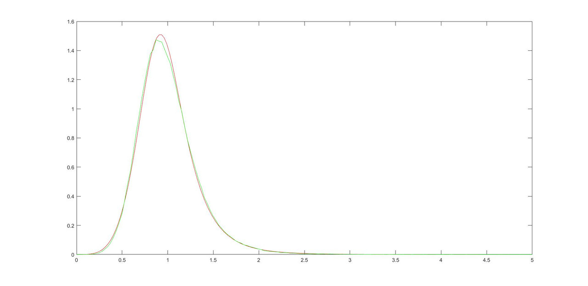](https://postimg.cc/5XTTJ3VZ)

[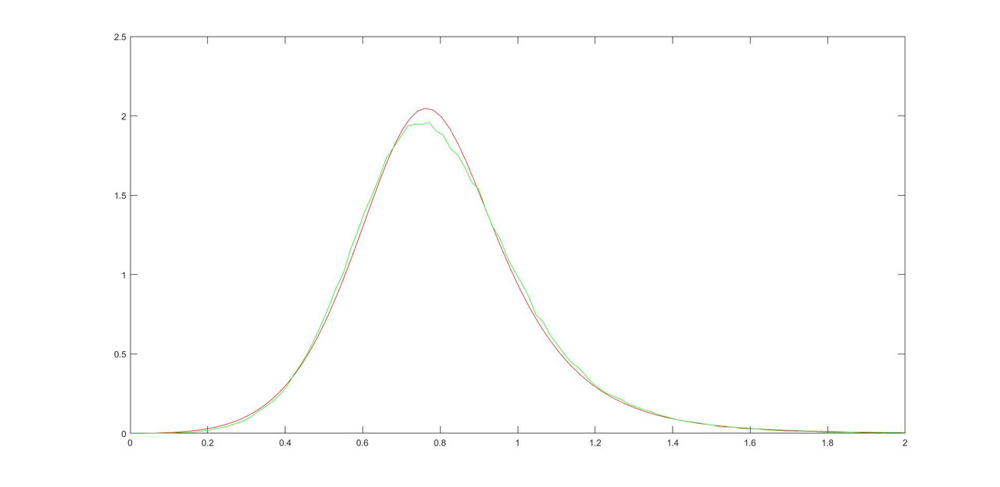](https://postimg.cc/Y4FVCW2j)

[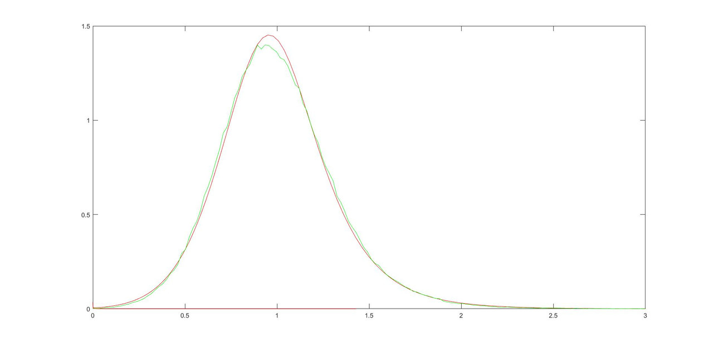](https://postimg.cc/cgNzgL6h)

---

### #1429 — Amin (Topic Author)
*May 15, 2022, 5:34 PM*

Friends, it will still be 2-3 days before I could complete the work with proper integrations on probability density but
I did some hack integral without probability density and it works very well till 1 year. Densities for terminal time 2
years and beyond still are not very good but I am very confident that they would be very good once the work with proper
integrations completes. Graphs I did with hack integrations out to one year were quite cool so I decided to post them. I
will also post preliminary version of my matlab program tomorrow that I used to make these graphs.

Our asset SDE is

dX(t) = kappaX ( thetaX -X(t)) dt + sigmaX V^.5 X^gammaX dZ(t)

while variance SDE is

dV(t) = kappa ( theta -V(t)) dt + sigma0 V^gamma  dZ(t)

Here are pairs of asset and stochastic volatility graphs. These are preliminary graphs that would further improve once
the proper integrations on probability distribution are implemented.

Some graphs have gammaX as low as .35 for higher skew.

.

.

---

### #1430 — Amin (Topic Author)
*May 15, 2022, 6:08 PM*

The program is very fast and on my i7 laptop it takes only .15 - .2 seconds despite that my code is very badly written
because my only concern was to play around and get it to work. I am sure a properly written code in C++ would solve it
within .05 seconds. I will be posting a preliminary code tomorrow for friends to have a look.

All of the graphs have zero correlation between asset and vol and only asset CEV coefficient gammaX is used to produce
large skews in some graphs.

[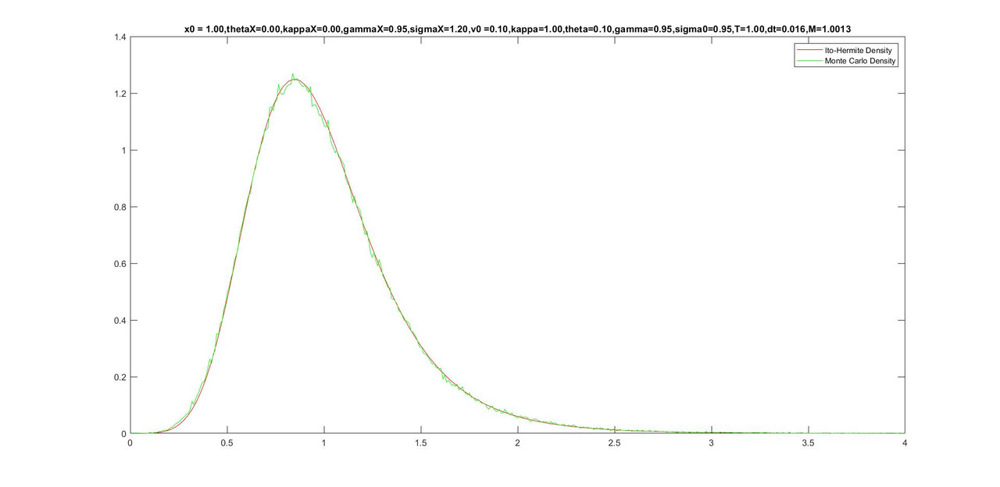](https://postimg.cc/DJ3j698B)[](https://postimg.cc/r0DbZ1Jw)[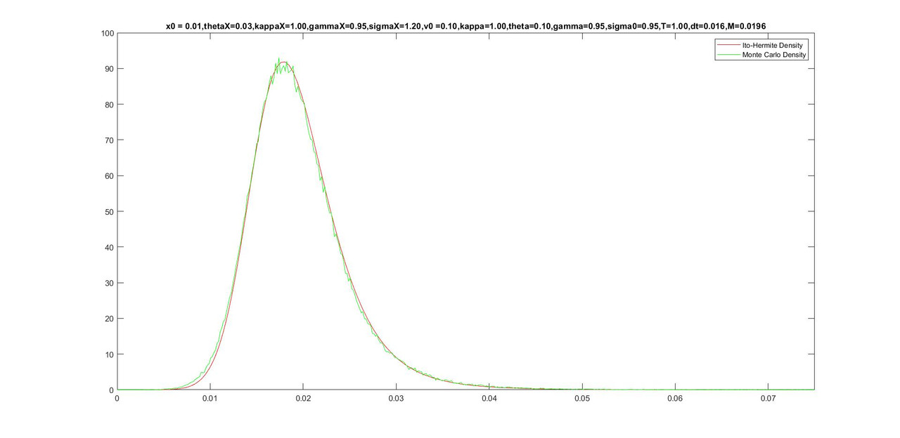](https://postimg.cc/649HJCVZ)

[](https://postimg.cc/DJ3j698B)[](https://postimg.cc/r0DbZ1Jw)

[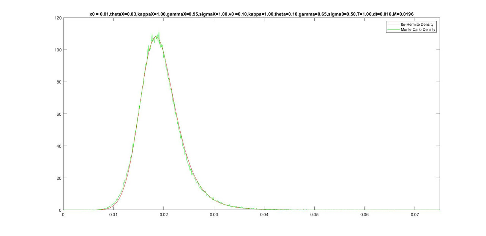](https://postimg.cc/s1yHhRF2)

[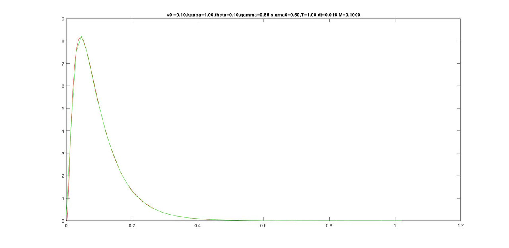](https://postimg.cc/DJQCMxGF)

[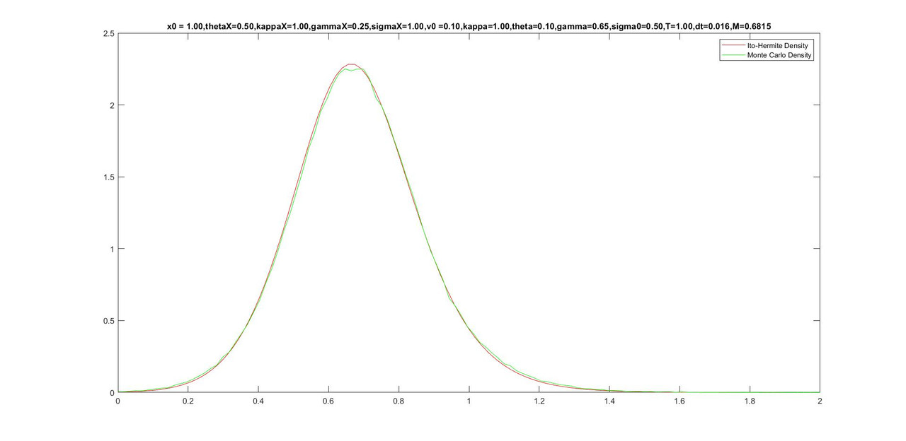](https://postimg.cc/PN43bFhQ)

[](https://postimg.cc/DJQCMxGF)

[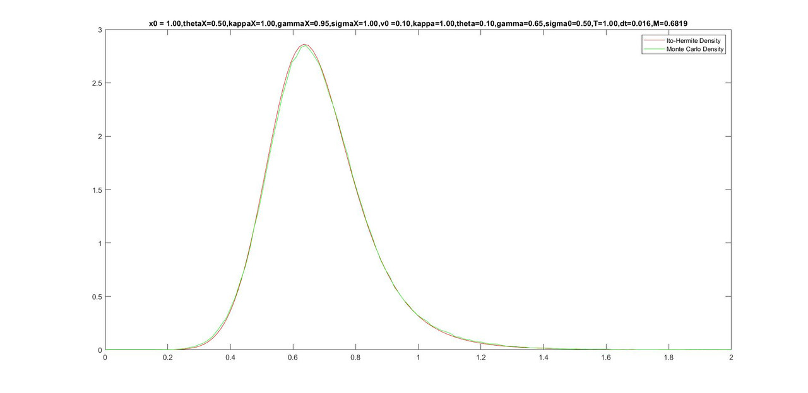](https://postimg.cc/hftC2btW)

[](https://postimg.cc/DJQCMxGF)

[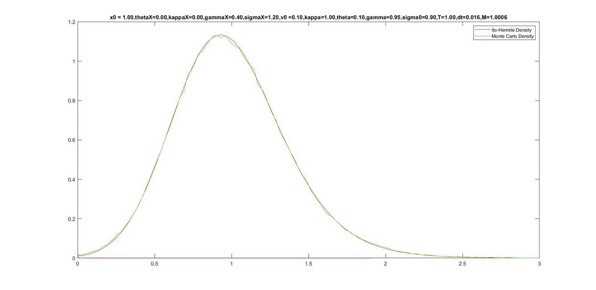](https://postimg.cc/mPcmsL9m)

[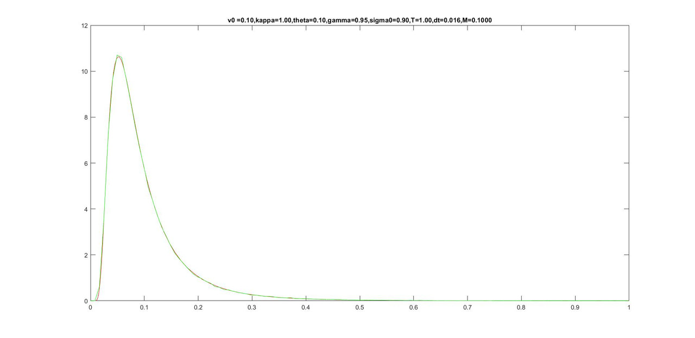](https://postimg.cc/gntgQXxw)

---

### #1431 — Amin (Topic Author)
*May 16, 2022, 9:07 AM*

I am posting the preliminary code. I will add comments and explanation on the final version of the code in a few days.
This preliminary ad-hoc program is meant to work out to one year. I am sure when integrations on volatility standard
normal density are properly carried out on both sides of the equation, the new code will run perfectly but please give
me a few days for that. It is the same code I used to create graphs that I posted yesterday.

.

.

```
function [] = FPESeriesCoeffsFromGaussiansWilmottNew02A_Lite_2DFPE()

%Copyright Ahsan Amin. Infiniti derivatives Technologies.
%Please fell free to connect on linkedin: linkedin.com/in/ahsan-amin-0a53334
%or skype ahsan.amin2999

%I have not directly simulated the SDE but simulated the transformed
%Besse1l process version of the SDE and then changed coordinates to retreive
%the SDE in original coo
%rdinates.
%The present program will analytically evolve only the Bessel Process version of the
%SDE in transformed coordinates.

dt=.125/2/2/2;   % Simulation time interval.%Fodiffusions close to zero
             %decrease dt for accuracy.
Tt=64*1;%16*2*4;%*4*4*1;%*4;%128*2*2*2;     % Number of simulation levels. Terminal time= Tt*dt; //.125/32*32*16=2 year;
T=Tt*dt;
%
% %Below I have done calculations for smaller step size at start.
%
% %ds(1:64)=dt/16;
% %ds(65:128)=dt/4;
% if(Tt4)&&(Tt20)
% Ts=(64)+((20-4)*4)+(Tt-20);
% ds(1:64)=dt/16;
% ds(65:128)=dt/4;
% ds(129:Ts)=dt;
% end

Ts=Tt;
ds(1:Tt)=dt;

T
sum(ds(1:Ts))
Ts

%Ts=4;
str=input('Check if time is right');

OrderA=4;  %
OrderM=4;  %

if(T>=1)
dtM=1/32;%.0625/1;
TtM=T/dtM;
else
dtM=T/32;%.0625/1;
TtM=T/dtM;
end

%dtM=dt;
%TtM=Tt;

dNn=.2/2;   % Normal density subdivisions width. would change with number of subdivisions
Nn=46*2;  % No of normal density subdivisions

NnMid=4.0;

v00=.10;   % starting value of SDE
beta1=0.0;
beta2=1.0;   % Second drift term power.
gamma=.95;%50;   % volatility power.
kappa=1.0;%.950;   %mean reversion parameter.
theta=.10;%mean reversion target
sigma0=.9500;%Volatility value
NoOfCumulants=6;
SeriesOrder=NoOfCumulants-1;

%you can specify any general mu1 and mu2 and beta1 and beta2.
mu1=1*theta*kappa;   %first drift coefficient.
mu2=-1*kappa;    % Second drift coefficient.
%mu1=0;
%mu2=-1*kappa;

alpha=1;% x^alpha is being expanded. This is currently for monte carlo only.
alpha1=1-gamma;%This is for expansion of integrals for calculation of drift
%and volatility coefficients
%yy(1:Nn)=x0;
w0=v00^(1-gamma)/(1-gamma);
%y0=x0;

x0=1;
gammaX=.95;
gammaV=.5;
sigmaX=1.20;
thetaX=.0;
kappaX=0;
mu1X=thetaX*kappaX;
mu2X=-1*kappaX;
beta1X=0.0;
beta2X=1.0;
q0=x0^(1-gammaX)/(1-gammaX);
alpha1X=1-gammaX;

Z(1:Nn)=(((1:Nn)-6.5/1)*dNn-NnMid);
Z
str=input('Look at Z');
ZProb(1)=normcdf(.5*Z(1)+.5*Z(2),0,1)-normcdf(.5*Z(1)+.5*Z(2)-dNn,0,1);
ZProb(Nn)=normcdf(.5*Z(Nn)+.5*Z(Nn-1)+dNn,0,1)-normcdf(.5*Z(Nn)+.5*Z(Nn-1),0,1);
ZProb(2:Nn-1)=normcdf(.5*Z(2:Nn-1)+.5*Z(3:Nn),0,1)-normcdf(.5*Z(2:Nn-1)+.5*Z(1:Nn-2),0,1);

%%%%%%%%%%%%%%%%%%%%%%%%%%%%%%%%%%%%%%%%%%%%%%%%%%%%%%%%%%%%%%%%%%%%%%%%%%%%%%%%%%%%%%%%%%%%%%

sigma11(1:OrderA+1)=0;
mu11(1:OrderA+1)=0;
mu22(1:OrderA+1)=0;
sigma22(1:OrderA+1)=0;
% index 1 correponds to zero level since matlab indexing starts at one.
sigma11(1)=1;
mu11(1)=1;
mu22(1)=1;
sigma22(1)=1;

for k=1:(OrderA+1)
    if sigma0~=0
        sigma11(k)=sigma0^(k-1);
    end
    if mu1 ~= 0
        mu11(k)=mu1^(k-1);
    end
    if mu2 ~= 0
        mu22(k)=mu2^(k-1);
    end
    if sigma0~=0
        sigma22(k)=sigma0^(2*(k-1));
    end
end

sigma11X(1:OrderA+1)=0;
mu11X(1:OrderA+1)=0;
mu22X(1:OrderA+1)=0;
sigma22X(1:OrderA+1)=0;

sigma11X(1)=1;
mu11X(1)=1;
mu22X(1)=1;
sigma22X(1)=1;

for k=1:(OrderA+1)
    if sigmaX~=0
        sigma11X(k)=sigmaX^(k-1);
    end
    if mu1X ~= 0
        mu11X(k)=mu1X^(k-1);
    end
    if mu2X ~= 0
        mu22X(k)=mu2X^(k-1);
    end
    if sigmaX~=0
        sigma22X(k)=sigmaX^(2*(k-1));
    end
end

%Ft(1:TtM+1,1:(OrderA+1),1:(OrderA+1),1:(OrderA+1),1:(OrderA+1))=0; %General time powers on hermite polynomials
Fp(1:(OrderA+1),1:(OrderA+1),1:(OrderA+1),1:(OrderA+1))=0;%General x powers on coefficients of hermite polynomials.
Fp1(1:(OrderA+1),1:(OrderA+1),1:(OrderA+1),1:(OrderA+1))=0;%General x powers for bessel transformed coordinates.

Fp1X(1:(OrderA+1),1:(OrderA+1),1:(OrderA+1),1:(OrderA+1))=0;
%YCoeff0 and YCoeff are coefficents for original coordinates monte carlo.
%YqCoeff0 and YqCoeff are bessel/lamperti version monte carlo.

YCoeff0(1:(OrderA+1),1:(OrderA+1),1:(OrderA+1),1:(OrderA+1))=0;
YqCoeff0(1:(OrderA+1),1:(OrderA+1),1:(OrderA+1),1:(OrderA+1))=0;
YqCoeff0X(1:(OrderA+1),1:(OrderA+1),1:(OrderA+1),1:(OrderA+1))=0;

%Pre-compute the time and power exponent values in small multi-dimensional arrays
YCoeff = ItoTaylorCoeffsNew(alpha,beta1,beta2,gamma); %expand y^alpha where alpha=1;
YqCoeff = ItoTaylorCoeffsNew(alpha1,beta1,beta2,gamma);%expand y^alpha1 where alpha1=(1-gamma)
YqCoeff=YqCoeff/(1-gamma); %Transformed coordinates coefficients have to be
%further divided by (1-gamma)
YqCoeffX = ItoTaylorCoeffsNew(alpha1X,beta1X,beta2X,gammaX);%expand y^alpha1 where alpha1=(1-gamma)
YqCoeffX=YqCoeffX/(1-gammaX);
for k = 0 : (OrderA)
    for m = 0:k
        l4 = k - m + 1;
        for n = 0 : m
            l3 = m - n + 1;
            for j = 0:n
                l2 = n - j + 1;
                l1 = j + 1;
                %Ft(l1,l2,l3,l4) = dtM^((l1-1) + (l2-1) + (l3-1) + .5* (l4-1));
                Fp(l1,l2,l3,l4) = (alpha + (l1-1) * beta1 + (l2-1) * beta2 + (l3-1) * 2* gamma + (l4-1) * gamma ...
                    - (l1-1) - (l2-1) - 2* (l3-1) - (l4-1));
                Fp1(l1,l2,l3,l4) = (alpha1 + (l1-1) * beta1 + (l2-1) * beta2 + (l3-1) * 2* gamma + (l4-1) * gamma ...
                    - (l1-1) - (l2-1) - 2* (l3-1) - (l4-1));

                Fp1X(l1,l2,l3,l4) = (alpha1X + (l1-1) * beta1X + (l2-1) * beta2X + (l3-1) * 2* gammaX + (l4-1) * gammaX
...
                    - (l1-1) - (l2-1) - 2* (l3-1) - (l4-1));

                YCoeff0(l1,l2,l3,l4) =YCoeff(l1,l2,l3,l4).*mu11(l1).*mu22(l2).*sigma22(l3).*sigma11(l4);
                YqCoeff0(l1,l2,l3,l4) =YqCoeff(l1,l2,l3,l4).*mu11(l1).*mu22(l2).*sigma22(l3).*sigma11(l4);
                YqCoeff0X(l1,l2,l3,l4) =YqCoeffX(l1,l2,l3,l4).*mu11X(l1).*mu22X(l2).*sigma22X(l3).*sigma11X(l4);
            end
        end
    end
end

%%%%%%%%%%%%%%%%%%%%%%%%%%%%%%%%%%%%%%%%%%%%%%%%%%%%%%%%%%%%%%%%%%%%%%%%%%%%%%%%%%%%%%%%%%%%%%

ExpnOrder=5;
SeriesOrder=5;
c(1:SeriesOrder)=0;
c0=w0;
wnStart=1;
yydt(wnStart:Nn)=0.0;
tic

for tt=1:Ts
    tt

    if(tt.0000005)
%          SeriesOrder=6;
%          NoOfCumulants=7;
%      end
%      if(CC(8)>.0000005)
%          SeriesOrder=7;
%          NoOfCumulants=8;
%      end
%
 c0=a0;
 c(1:SeriesOrder)=a(1:SeriesOrder);

    w0=c0;
    end

    if(tt==1)
       cmid0=c0;
       cmid=c;

    else
      cmid0=(c0+c0prev)*.5;
       cmid=(c+cprev)*.5;

    end

    gammaV2=2*gammaV;
    [vw0,dvw0] = CalculatevgammaV2AndDerivatives(cmid0,gamma,gammaV2,SeriesOrder);
    [V2gamma0,V2gamma1] = CalculateDriftbCoeffs08A(vw0,dvw0,cmid,SeriesOrder);

    V2gamma(1)=V2gamma0;
    V2gamma(2:6)=V2gamma1(1:5)./sqrt(2:6);

    if(tt==1)

        cq(1:6,1:6)=0;
        cq(1,1)=x0^(1-gammaX)/(1-gammaX);

    end
        cprev=c;

    q0=cq(1,1);

    DoubleExpnOrder=ExpnOrder*2;

    [qMu0dt,dqMu0dtdq,qMu1dt,dqMu1dtdq] =
BesselDriftAndDerivatives08A0(q0,mu1X,mu2X,beta1X,beta2X,gammaX,DoubleExpnOrder);
    [q2Mu0dt,dq2Mu0dtdq,q2Mu1dt,dq2Mu1dtdq] = BesselDriftAndDerivatives08Aq(q0,sigmaX,gammaX,DoubleExpnOrder)

    [Muq0] = CalculateDriftbCoeffs08A2Dim02(qMu0dt,dqMu0dtdq,cq,SeriesOrder);
    [Muq2] = CalculateDriftbCoeffs08A2Dim02(q2Mu0dt,dq2Mu0dtdq,cq,SeriesOrder);
    [DMuq0] = CalculateDriftbCoeffs08A2Dim02(qMu1dt,dqMu1dtdq,cq,SeriesOrder);
    [DMuq2] = CalculateDriftbCoeffs08A2Dim02(q2Mu1dt,dq2Mu1dtdq,cq,SeriesOrder);

    [Muq2] =SeriesProduct2D1D(Muq2,V2gamma);
    [DMuq2] =SeriesProduct2D1D(DMuq2,V2gamma);

    Muq=Muq0+Muq2;
    DMuq=DMuq0+DMuq2;

    if(tt==1)
        cq=cq+Muq*dt+SeriesProduct2D(Muq,DMuq)*dt^2/2;
        cq(2,1)=cq(2,1)+sigmaX*v00^gammaV*sqrt(dt);
    elseif(tt1)
 %D1cqInvZ
 end
%str=input('Look at numbers');
%   [qVol0dt,dqVol0dtdq] = BesselVolAndDerivativesH1(q0,YqCoeff0X,Fp1X,gammaX,ds(tt),SeriesOrder+1);

 %   [qVol2dt,dqVol2dtdw] = BesselVolAndDerivativesH2(q0,YqCoeff0X,Fp1X,gammaX,ds(tt),SeriesOrder+1);

end

Z1=Z;

[b] = EvaluateSeriesForZ2(cq,Z1,Nn);
Mm=301;
MmMid=151;
Q(MmMid+1:Mm)=cq(1,1)+cq(2,1).*.1.*(1:MmMid-1);
Q(MmMid)=cq(1,1);
%Q(1:70)=cq(1,1)-cq(2,1).*.25.*(70:-1:1);
for mm=1:MmMid-1

    Q(MmMid-mm)=cq(1,1)-cq(2,1).*.1.*mm;
end

Qa=Q-cq(2,1).*.1/2;
Qb=Q+cq(2,1).*.1/2;

Z1Prob(1:Mm)=0;
for nn=1:Nn
    bq(1:6)=b(1:6,nn);

    [Z0Prob] = CalculateProbabilitySeriesInv(Qa,Qb,bq);

%    Z0Prob

%str=input('Look at numbers-tttt')

    Z1Prob(1:Mm)=Z1Prob(1:Mm)+Z0Prob(1:Mm).*ZProb(nn);

end

pQ=Z1Prob/(cq(2,1).*.1);

xx(1:Mm)=((1-gammaX).*Q(1:Mm)).^(1/(1-gammaX));

pxx(1:Mm)=pQ(1:Mm).*xx(1:Mm).^(-gammaX);

Mean=sum(xx(1:Mm).*Z1Prob(1:Mm));
Mean
% %gH00=gx00+gx20+3*gx40;
%  gH0(:)=cq(1,:)+cq(3,:)+3*cq(5,:);%Coeffs of zeroth v hermite
%
%  gH1(:)=cq(2,:)+3*cq(4,:)+15*cq(6,:);%Coeffs of 1st v hermite
%
%  gH2(:)=cq(3,:)+6*cq(5,:);%Coeffs of 2nd v hermite
%
%  gH3(:)=cq(4,:)+10*cq(6,:);%Coeffs of third v hermite
%  gH4(:)=cq(5,:);
%  gH5(:)=cq(6,:);   %Coeffs of fourth v hermite
%
%
% cH00=gH0(1);
% cH0(1:5)=gH0(2:6);
% cH10=gH1(1);
% cH1(1:5)=gH1(2:6);
% cH20=gH2(1);
% cH2(1:5)=gH2(2:6);
% cH30=gH3(1);
% cH3(1:5)=gH3(2:6);
% cH40=gH4(1);
% cH4(1:5)=gH4(2:6);
% cH50=gH5(1);
% cH5(1:5)=gH5(2:6);
%
%   [cHH00,cHH0] =ConvertZCoeffsToHCoeffs(cH00,cH0,SeriesOrder);
%   [cHH10,cHH1] =ConvertZCoeffsToHCoeffs(cH10,cH1,SeriesOrder);
%   [cHH20,cHH2] =ConvertZCoeffsToHCoeffs(cH20,cH2,SeriesOrder);
%   [cHH30,cHH3] =ConvertZCoeffsToHCoeffs(cH30,cH3,SeriesOrder);
%   [cHH40,cHH4] =ConvertZCoeffsToHCoeffs(cH40,cH4,SeriesOrder);
%   [cHH50,cHH5] =ConvertZCoeffsToHCoeffs(cH50,cH5,SeriesOrder);
%
%   cq0=sign(cHH00+cHH0(1)+sqrt(2)*cHH0(2)+sqrt(6)*cHH0(3)+sqrt(24)*cHH0(4)+sqrt(120)*cHH0(5)).* ...
%   sqrt(abs(sign(cHH00).*cHH00.^2+sign(cHH0(1)).*cHH0(1).^2+sign(cHH0(2)).*cHH0(2).^2*2+ ...
%   sign(cHH0(3)).*cHH0(3).^2*6+sign(cHH0(4)).*cHH0(4).^2*24+sign(cHH0(5)).*cHH0(5).^2*120));
%
%
%   cq(1)=sign(cHH10+cHH1(1)+sqrt(2)*cHH1(2)+sqrt(6)*cHH1(3)+sqrt(24)*cHH1(4)+sqrt(120)*cHH1(5)).* ...
%   sqrt(abs(sign(cHH10).*cHH10.^2+sign(cHH1(1)).*cHH1(1).^2+sign(cHH1(2)).*cHH1(2).^2*2+ ...
%   sign(cHH1(3)).*cHH1(3).^2*6+sign(cHH1(4)).*cHH1(4).^2*24+sign(cHH1(5)).*cHH1(5).^2*120));
% %
%  cq(2)=sign(cHH20+cHH2(1)+sqrt(2)*cHH2(2)+sqrt(6)*cHH2(3)+sqrt(24)*cHH2(4)+sqrt(120)*cHH2(5)).* ...
%   sqrt(abs(sign(cHH20).*cHH20.^2+sign(cHH2(1)).*cHH2(1).^2+sign(cHH2(2)).*cHH2(2).^2*2+ ...
%   sign(cHH2(3)).*cHH2(3).^2*6+sign(cHH2(4)).*cHH2(4).^2*24+sign(cHH2(5)).*cHH2(5).^2*120));
%
%  cq(3)=sign(cHH30+cHH3(1)+sqrt(2)*cHH3(2)+sqrt(6)*cHH3(3)+sqrt(24)*cHH3(4)+sqrt(120)*cHH3(5)).* ...
%   sqrt(abs(sign(cHH30).*cHH30.^2+sign(cHH3(1)).*cHH3(1).^2+sign(cHH3(2)).*cHH3(2).^2*2+ ...
%   sign(cHH3(3)).*cHH3(3).^2*6+sign(cHH3(4)).*cHH3(4).^2*24+sign(cHH3(5)).*cHH3(5).^2*120));
%
%  cq(4)=sign(cHH40+cHH4(1)+sqrt(2)*cHH4(2)+sqrt(6)*cHH4(3)+sqrt(24)*cHH4(4)+sqrt(120)*cHH4(5)).* ...
%   sqrt(abs(sign(cHH40).*cHH40.^2+sign(cHH4(1)).*cHH4(1).^2+sign(cHH4(2)).*cHH4(2).^2*2+ ...
%   sign(cHH4(3)).*cHH4(3).^2*6+sign(cHH4(4)).*cHH4(4).^2*24+sign(cHH4(5)).*cHH4(5).^2*120));
%
%  cq(5)=sign(cHH50+cHH5(1)+sqrt(2)*cHH5(2)+sqrt(6)*cHH5(3)+sqrt(24)*cHH5(4)+sqrt(120)*cHH5(5)).* ...
%   sqrt(abs(sign(cHH50).*cHH50.^2+sign(cHH5(1)).*cHH5(1).^2+sign(cHH5(2)).*cHH5(2).^2*2+ ...
%   sign(cHH5(3)).*cHH5(3).^2*6+sign(cHH5(4)).*cHH5(4).^2*24+sign(cHH5(5)).*cHH5(5).^2*120));

wnStart=1;

%c0
%c

%str=input('Look at numbers')

%
% yy0=((1-gamma).*w0).^(1/(1-gamma));
%
  w(1:Nn)=c0;
  for nn=1:SeriesOrder
      w(1:Nn)=w(1:Nn)+c(nn)*Z(1:Nn).^nn;
  end

 % q(1:Nn)=cq0;
 % for nn=1:SeriesOrder
 %     q(1:Nn)=q(1:Nn)+cq(nn)*Z(1:Nn).^nn;
 % end

%  %Flag=0;
%  %for nn=ceil(Nn/2)-1:-1:1
%  %    if((w(nn)<0)&&(Flag==0))
%  %        wnStart=nn+1;
%  %        Flag=1;
%  %    end
%  %end
%
%
%  %c0
%  %c
%
%
%  %str=input('Look at numbers')
  yy0(wnStart:Nn)=((1-gamma).*w(wnStart:Nn)).^(1/(1-gamma));

 % xx0(wnStart:Nn)=((1-gammaX).*q(wnStart:Nn)).^(1/(1-gammaX));
%
%  %%%%%%%%%%%%%%%%%%%%%%%%%%%%%%%%%%%%%%%%%%%%%%%%%%%%%%5
%   yw0=((1-gamma).*c0).^(1/(1-gamma));
%   dyw0(1)=((1-gamma).*c0).^(1/(1-gamma)-1);
%   dyw0(2)=(1/(1-gamma)-1).*((1-gamma).*c0).^(1/(1-gamma)-2)*(1-gamma);
%   dyw0(3)=(1/(1-gamma)-1).*(1/(1-gamma)-2).*((1-gamma).*c0).^(1/(1-gamma)-3)*(1-gamma)^2;
%   dyw0(4)=(1/(1-gamma)-1).*(1/(1-gamma)-2)*(1/(1-gamma)-3)*((1-gamma).*c0).^(1/(1-gamma)-4)*(1-gamma)^3;
% 
 dyw0(5)=(1/(1-gamma)-1).*(1/(1-gamma)-2)*(1/(1-gamma)-3)*(1/(1-gamma)-4)*((1-gamma).*c0).^(1/(1-gamma)-5)*(1-gamma)^4;
% 
 dyw0(6)=(1/(1-gamma)-1).*(1/(1-gamma)-2)*(1/(1-gamma)-3)*(1/(1-gamma)-4)*(1/(1-gamma)-5)*((1-gamma).*c0).^(1/(1-gamma)-6)*(1-gamma)^5;
% 
 dyw0(7)=(1/(1-gamma)-1).*(1/(1-gamma)-2)*(1/(1-gamma)-3)*(1/(1-gamma)-4)*(1/(1-gamma)-5)*(1/(1-gamma)-6)*((1-gamma).*c0).^(1/(1-gamma)-7)*(1-gamma)^6;
% 
 dyw0(8)=(1/(1-gamma)-1).*(1/(1-gamma)-2)*(1/(1-gamma)-3)*(1/(1-gamma)-4)*(1/(1-gamma)-5)*(1/(1-gamma)-6)*(1/(1-gamma)-7)*((1-gamma).*c0).^(1/(1-gamma)-8)*(1-gamma)^7;
% %
% % c(6)=0;
% % c(7)=0;
% % c(8)=0;
% %
%      [y10,y1] = CalculateDriftbCoeffs08A(yw0,dyw0,c,SeriesOrder);
%      [y20,y2] = CalculateDriftbCoeffs08A(yw0,dyw0,c,5);
% %
%
%  yy1(1:Nn)=y10;
%  %y(1:SeriesOrder)=c(1:SeriesOrder);
%  for nn=1:SeriesOrder
%      yy1(1:Nn)=yy1(1:Nn)+y1(nn)*Z(1:Nn).^nn;
%  end
%
%  yy2(1:Nn)=y20;
%  %y(1:SeriesOrder)=c(1:SeriesOrder);
%  for nn=1:5
%      yy2(1:Nn)=yy2(1:Nn)+y2(nn)*Z(1:Nn).^nn;
%  end
%  plot(Z(1:Nn),yy0(1:Nn),'r',Z(1:Nn),yy1(1:Nn),'b',Z(1:Nn),yy2(1:Nn),'k');
% title(sprintf('x0 = %.4f,theta=%.3f,kappa=%.2f,gamma=%.3f,sigma=%.2f,T=%.2f,dt=%.5f',
x0,theta,kappa,gamma,sigma0,T,dt));%,sprintf('theta= %f', theta), sprintf('kappa = %f', kappa),sprintf('sigma = %f',
sigma0),sprintf('T = %f', T));
%
% legend({'SDE Variable Converted on Grid','SDE Variable From Eight Cumulants','SDE Variable From Six
Cumulants'},'Location','northeast')
%
% %str=input('red line is density of SDE from Ito-Hermite method, green is monte carlo.');
%
%
%  str=input('red line is SDE from Ito-Hermite method.');
%
%
%%%%%%%%%%%%%%%%%%%%%%%%%%%%%%%%%%%%%%%%%%%%%%%%%%%%%%%%%%5
 yy=yy0;
% xx=xx0;
Dfyy(wnStart:Nn)=0;
%Dfyy1(wnStart:Nn)=0;
%Dfyy2(wnStart:Nn)=0;
%Dfxx(wnStart:Nn)=0;
for nn=wnStart+1:Nn-1

    Dfyy(nn) = (yy(nn + 1) - yy(nn - 1))/(Z(nn + 1) - Z(nn - 1));
%    Dfyy1(nn) = (yy1(nn + 1) - yy1(nn - 1))/(Z(nn + 1) - Z(nn - 1));
%    Dfyy2(nn) = (yy2(nn + 1) - yy2(nn - 1))/(Z(nn + 1) - Z(nn - 1));
 %   Dfxx(nn) = (xx(nn + 1) - xx(nn - 1))/(Z(nn + 1) - Z(nn - 1));

    %Change of variable derivative for densities
end
%Dfyy(Nn)=Dfyy(Nn-1);
%Dfyy(1)=Dfyy(2);
%Dfyydt(Nn)=Dfyydt(Nn-1);
%Dfyydt(1)=Dfyydt(2);

pyy(1:Nn)=0;
%pyy1(1:Nn)=0;
%pyy2(1:Nn)=0;
%pxx(1:Nn)=0;
for nn = wnStart+1:Nn-1

    pyy(nn) = (normpdf(Z(nn),0, 1))/abs(Dfyy(nn));
%    pyy1(nn) = (normpdf(Z(nn),0, 1))/abs(Dfyy1(nn));
%    pyy2(nn) = (normpdf(Z(nn),0, 1))/abs(Dfyy2(nn));
 %   pxx(nn) = (normpdf(Z(nn),0, 1))/abs(Dfxx(nn));
end

toc

ItoHermiteMeanVar=sum(yy(wnStart:Nn).*ZProb(wnStart:Nn)) %Original process average from coordinates
ItoHermiteMeanAsset=Mean
disp('true Mean only applicable to standard SV mean reverting type models otherwise disregard');
%TrueMean=theta+(v0-theta)*exp(-kappa*T)%Mean reverting SDE original variable true average
%yy0

theta1=1;
%%%%%%%%%%%%%%%%%%%%%%%%%%%%%%
%rng(29079137, 'twister')
rng(15898837, 'twister')
paths=350000;
V(1:paths)=v00;  %Original process monte carlo.
X=0.0;
X(1:paths)=x0;
alpha1=0;
alpha2=1;
a=mu1X;
b=mu2X;
rho=0;
sigma1=sigmaX;
gammaV=.5;
Random1(1:paths)=0;
Random2(1:paths)=0;

for ttM=1:TtM
Random1=randn(size(Random1));
Random2=randn(size(Random2));

X(1:paths)=X(1:paths)+ ...
    (a* X(1:paths).^alpha1 + b* X(1:paths).^alpha2)* dtM + ...
    sqrt(1-rho^2)* sigma1* V(1:paths).^gammaV.* X(1:paths).^gammaX .*Random1(1:paths) * sqrt(dtM) + ...
    rho* sigma1* V(1:paths).^gammaV .*X(1:paths).^gammaX .*Random2(1:paths)*sqrt(dtM) + ...
    (a*alpha1* X(1:paths).^(alpha1-1)+b*alpha2* X(1:paths).^(alpha2-1)).* ...
    (((a* X(1:paths).^alpha1 + b* X(1:paths).^alpha2)* dtM^2/2)+ ...
    (sqrt(1-rho^2)* sigma1* V(1:paths).^gammaV.* X(1:paths).^gammaX .*Random1(1:paths) *(1-1/sqrt(3)).*dtM^1.5+ ...
    rho* sigma1* V(1:paths).^gammaV .*X(1:paths).^gammaX .*Random2(1:paths)*(1-1/sqrt(3)).*dtM^1.5))+ ...
    .5*(a*alpha1*(alpha1-1)* X(1:paths).^(alpha1-2)+b*alpha2*(alpha2-1).* X(1:paths).^(alpha2-2)).* ...
    ( sigma1^2* V(1:paths).^(2*gammaV).* X(1:paths).^(2*gammaX)) *dtM^2/2 + ...
    sqrt(1-rho^2)* sigma1* V(1:paths).^gammaV.*gammaX.* X(1:paths).^(gammaX-1).* ...
    ((a* X(1:paths).^alpha1 + b* X(1:paths).^alpha2).*Random1(1:paths) * 1/sqrt(3).* dtM^1.5 + ...
    sqrt(1-rho^2)* sigma1* V(1:paths).^gammaV.* X(1:paths).^gammaX .*(Random1(1:paths).^2-1) * dtM/2 + ...
    rho* sigma1* V(1:paths).^gammaV .*X(1:paths).^gammaX .*Random1(1:paths).*Random2(1:paths)*dtM/2)+ ...
    .5*sqrt(1-rho^2)* sigma1* V(1:paths).^gammaV.*gammaX.*(gammaX-1).* X(1:paths).^(gammaX-2).* ...
    (sigma1^2* V(1:paths).^(2*gammaV).* X(1:paths).^(2*gammaX) .*Random1(1:paths).*1/sqrt(3).*dtM^1.5)+ ...
    sqrt(1-rho^2)* sigma1*gammaV.* V(1:paths).^(gammaV-1).* X(1:paths).^(gammaX).* ...
    ((mu1.*V(1:paths).^beta1 + mu2.*V(1:paths).^beta2).*Random1(1:paths) * 1/sqrt(3).* dtM^1.5 + ...
    sigma0*V(1:paths).^gamma.*Random1(1:paths).*Random2(1:paths)*dtM/2)+ ...
    .5*sqrt(1-rho^2)* sigma1*gammaV.*(gammaV-1).* V(1:paths).^(gammaV-2).* X(1:paths).^(gammaX).* ...
    (sigma0^2*V(1:paths).^(2*gamma).*Random1(1:paths)*1/sqrt(3)*dtM^1.5)+ ...
    sqrt(1-rho^2)* sigma1*gammaV.* V(1:paths).^(gammaV-1).*gammaX.* X(1:paths).^(gammaX-1).* ...
    rho.* sigma1.* V(1:paths).^gammaV .*X(1:paths).^gammaX
.*sigma0.*V(1:paths).^gamma.*Random1(1:paths)*1/sqrt(3)*dtM^1.5+ ...
    rho* sigma1* V(1:paths).^gammaV.*gammaX.* X(1:paths).^(gammaX-1).* ...
    ((a* X(1:paths).^alpha1 + b* X(1:paths).^alpha2).*Random2(1:paths) * 1/sqrt(3).* dtM^1.5 + ...
    sqrt(1-rho^2)* sigma1* V(1:paths).^gammaV.* X(1:paths).^gammaX .*Random1(1:paths).*Random2(1:paths) * dtM/2 + ...
    rho* sigma1* V(1:paths).^gammaV .*X(1:paths).^gammaX .*(Random2(1:paths).^2-1)*dtM/2)+ ...
    .5*rho* sigma1* V(1:paths).^gammaV.*gammaX.*(gammaX-1).* X(1:paths).^(gammaX-2).* ...
    (sigma1^2* V(1:paths).^(2*gammaV).* X(1:paths).^(2*gammaX) .*Random2(1:paths).*1/sqrt(3).*dtM^1.5)+ ...
    rho* sigma1*gammaV.* V(1:paths).^(gammaV-1).* X(1:paths).^(gammaX).* ...
    ((mu1.*V(1:paths).^beta1 + mu2.*V(1:paths).^beta2).*Random2(1:paths) * 1/sqrt(3).* dtM^1.5 + ...
    sigma0*V(1:paths).^gamma.*(Random2(1:paths).^2-1)*dtM/2)+ ...
    .5*rho* sigma1*gammaV.*(gammaV-1).* V(1:paths).^(gammaV-2).* X(1:paths).^(gammaX).* ...
    sigma0^2.*V(1:paths).^(2*gamma).*Random2(1:paths) * 1/sqrt(3).* dtM^1.5+ ...
    rho* sigma1*gammaV.* V(1:paths).^(gammaV-1).*gammaX.* X(1:paths).^(gammaX-1).* ...
    rho.* sigma1.* V(1:paths).^gammaV .*X(1:paths).^gammaX
.*sigma0.*V(1:paths).^gamma.*Random2(1:paths)*1/sqrt(3)*dtM^1.5;

VBefore=V;

    V(1:paths)=V(1:paths)+ ...
        (mu1.*V(1:paths).^beta1 + mu2.*V(1:paths).^beta2)*dtM + ...
        sigma0*V(1:paths).^gamma .*Random2(1:paths)*sqrt(dtM) + ...
        (mu1.*beta1*V(1:paths).^(beta1-1) + mu2.*beta2.*V(1:paths).^(beta2-1)).* ...
        ((mu1.*V(1:paths).^beta1 + mu2.*V(1:paths).^beta2)*dtM^2/2 + ...
        sigma0*V(1:paths).^gamma .*Random2(1:paths)*(1-1/sqrt(3))*dtM^1.5) + ...
        .5*(mu1.*beta1.*(beta1-1).*V(1:paths).^(beta1-2) + mu2.*beta2.*(beta2-1).*V(1:paths).^(beta2-2)).* ...
        sigma0^2.*V(1:paths).^(2*gamma).*dtM^2/2 + ...
        sigma0*gamma*V(1:paths).^(gamma-1) .* ...
        ((mu1.*V(1:paths).^beta1 + mu2.*V(1:paths).^beta2).*Random2(1:paths).*1/sqrt(3)*dtM^1.5 + ...
        sigma0.*V(1:paths).^gamma .*(Random2(1:paths).^2-1)*dtM/2) + ...
        .5*sigma0*gamma*(gamma-1).*V(1:paths).^(gamma-2) .* ...
        sigma0^2.*V(1:paths).^(2*gamma) .*Random2(1:paths).*1/sqrt(3)*dtM^1.5;

%Vm=.5*VBefore+.5*V;
Vm=V;

%    X(1:paths)=X(1:paths)+ ...
%    sigma1* Vm(1:paths).^gammaV.* X(1:paths).^gammaX .*Random1(1:paths) * sqrt(dtM) + ...
%    sigma1* Vm(1:paths).^gammaV.*gammaX.* X(1:paths).^(gammaX-1).* ...
%    (sigma1* Vm(1:paths).^gammaV.* X(1:paths).^gammaX .*(Random1(1:paths).^2-1) * dtM/2)+ ...
%    .5*sigma1* Vm(1:paths).^gammaV.*gammaX.*(gammaX-1).* X(1:paths).^(gammaX-2).* ...
%    (sigma1^2* Vm(1:paths).^(2*gammaV).* X(1:paths).^(2*gammaX) .*Random1(1:paths).*1/sqrt(3).*dtM^1.5);%+ ...

end

%SVolMeanAnalytic=thetaV+(V0-thetaV)*exp(-kappaV*dt*Tt)
SVolMeanAnalytic=theta+(v00-theta)*exp(-kappa*dt*Tt)
SVolMeanMC=sum(V(1:paths))/paths
AssetMeanAnalytic=x0
AssetMeanMC=sum(X(1:paths))/paths

theta
v00
kappa
dt
Tt
T

%MeanX

disp('true Mean only applicble to standard SV mean reverting type models otherwise disregard');
TrueMean=theta+(v00-theta)*exp(-kappa*T)%Mean reverting SDE original variable true average

MaxCutOff=30;
NoOfBins=1000;%round(1*500*gamma^2*4*sigma0/sqrt(MCMean)/(1+kappa));%Decrease the number of bins if the graph is too
[XDensity,IndexOutX,IndexMaxX] = MakeDensityFromSimulation_Infiniti_NEW(X,paths,NoOfBins,MaxCutOff );
plot(xx(wnStart+1:Mm-1),pxx(wnStart+1:Mm-1),'r',IndexOutX(1:IndexMaxX),XDensity(1:IndexMaxX),'g');
 %plot(y_w(wnStart+1:Nn-1),fy_w(wnStart+1:Nn-1),'r',IndexOutY(1:IndexMaxY),YDensity(1:IndexMaxY),'g',Z(wnStart+1:Nn-1),fy_w(wnStart+1:Nn-1),'b');

title(sprintf('x0 = %.2f,thetaX=%.2f,kappaX=%.2f,gammaX=%.2f,sigmaX=%.2f,v0
=%.2f,kappa=%.2f,theta=%.2f,gamma=%.2f,sigma0=%.2f,T=%.2f,dt=%.3f,M=%.4f',x0,thetaX,kappaX,gammaX,sigmaX,v00,kappa,theta,gamma,sigma0,T,dt,ItoHermiteMeanAsset));
%,sprintf('theta= %f', theta), sprintf('kappa = %f', kappa),sprintf('sigma = %f', sigma0),sprintf('T = %f', T));

legend({'Ito-Hermite Density','Monte Carlo Density'},'Location','northeast')

str=input('red line is density of SDE from Ito-Hermite method, green is monte carlo.');

%plot(y_w(wnStart+1:Nn-1),fy_w(wnStart+1:Nn-1),'r',IndexOutY(1:IndexMaxY),YDensity(1:IndexMaxY),'g',Z(wnStart+1:Nn-1),fy_w(wnStart+1:Nn-1),'b');

NoOfBins=round(1*500*gamma^2*4*sigma0/sqrt(SVolMeanMC)/(1+kappa))/10;
[VDensity,IndexOutV,IndexMaxV] = MakeDensityFromSimulation_Infiniti_NEW(V,paths,NoOfBins,MaxCutOff );

%[YdtDensity,IndexOutYdt,IndexMaxYdt] = MakeDensityFromSimulation_Infiniti_NEW(YYdt,paths,NoOfBins,MaxCutOff );
plot(yy(wnStart+1:Nn-1),pyy(wnStart+1:Nn-1),'r',IndexOutV(1:IndexMaxV),VDensity(1:IndexMaxV),'g');
title(sprintf('v0
=%.2f,kappa=%.2f,theta=%.2f,gamma=%.2f,sigma0=%.2f,T=%.2f,dt=%.3f,M=%.4f',v00,kappa,theta,gamma,sigma0,T,dt,ItoHermiteMeanVar));

end
```

.

.

.

```
function [Y] = ItoTaylorCoeffsNew(alpha,beta1,beta2,gamma)

%In the coefficient calculation program which calculates Y(l1,l2,l3,l4),
%I have used four levels of looping each for relevant expansion order.
%The first loop takes four values and second loop takes 16 values and
%third loop takes 64 values and so on. And then each coefficient
%term can be individually calculated while carefully accounting
%for path dependence.
%So for example in a nested loop structure
%m1= 1:mDim
% m2=1:mDim
% m3=1:mDim
%    l(m1)=l(m1)+1;
%    l(m2)=l(m2)+1;
%    l(m3)=l(m3)+1;

%in the above looping loop takes values from one to four with one
%indicating the first drift term, two indicating the second drift term
%and three indicating quadratic variation term and
%four indicating the volatility term. And with this looping structure
%we can So in the above looping m1=1 would mean that all terms are
%descendent of first drift term and m2=4 would mean that all terms are
%descendent of first drift term on first expansion order and descendent
%of volatility term on the second order and so we can keep track of path
%dependence perfectly.
%And on each level, we individually calculate the descendent terms. While
%keeping track of path dependence and calculating the coefficients with
%careful path dependence consideration, we update the appropriate element
%in our polynomial like expansion coefficient array

%explaining the part of code
%m1= 1:mDim
% m2=1:mDim
% m3=1:mDim
%    l(m1)=l(m1)+1;
%    l(m2)=l(m2)+1;
%    l(m3)=l(m3)+1;
%Y(l(1)+1,l(2),l(3),l(4))=Y(l(1)+1,l(2),l(3),l(4))+Coeff1st*IntegralCoeff(1,1,1,2);

%Here l(1) denotes l1 but written as l(1) so it can be conveniently
%updated with the loop variable when the loop variable takes value one
%indicating first drift term . And l(2) could be conveniently updated when
%the loop variable takes value equal to two indicating second
%drift term and so on.
%Here is the part of code snippet for that

%for m1=1:mDim
%    l(1)=1;
%    l(2)=1;
%    l(3)=1;
%    l(4)=1;
%    l(m1)=l(m1)+1;
%CoeffDX1 = alpha + (l(1)-1) *beta1 + (l(2)-1) *beta2 + (l(3)-1) *2*gamma + (l(4)-1)*gamma - (l(1)-1) - (l(2)-1) -
2*(l(3)-1) - (l(4)-1);
%    CoeffDX2 = CoeffDX1 - 1;
%    ArrIndex0=m1;
%    ArrIndex=(m1-1)*mDim;
%    Coeff1st=Y1(ArrIndex0)*CoeffDX1;
%    Coeff2nd=Y1(ArrIndex0)*.5*CoeffDX1*CoeffDX2;
%    Y2(1+ArrIndex)=Coeff1st;
%    Y(l(1)+1,l(2),l(3),l(4))=Y(l(1)+1,l(2),l(3),l(4))+Coeff1st*IntegralCoeff(1,1,2,n1(m1));
%    Y2(2+ArrIndex)=Coeff1st;
%    Y(l(1),l(2)+1,l(3),l(4))=Y(l(1),l(2)+1,l(3),l(4))+Coeff1st*IntegralCoeff(1,1,2,n1(m1));
%    Y2(3+ArrIndex)=Coeff2nd;
%    Y(l(1),l(2),l(3)+1,l(4))=Y(l(1),l(2),l(3)+1,l(4))+Coeff2nd*IntegralCoeff(1,1,2,n1(m1));
%    Y2(4+ArrIndex)=Coeff1st;
%    Y(l(1),l(2),l(3),l(4)+1)=Y(l(1),l(2),l(3),l(4)+1)+Coeff1st*IntegralCoeff(1,1,3,n1(m1));

%The first four lines update the array indices according to the parent term.
%And then CoeffDX1 and CoeffDX2 are calculated according to algebraic exponents on parent terms.
%ArrIndex0=m1; calculates the array index of the parent term
%And ArrIndex=(m1-1)*mDim; calculates the array index of the descendent terms
%And coefficient of the drift and volatility descendent terms is
%calculated by multiplying the coefficient of the parent term by
%Coeff1st=Y1(ArrIndex0)*CoeffDX1;
%And coefficient of the quadratic variation descendent terms is
%calculated by multiplying the coefficient of the parent term by
%Coeff2nd=Y1(ArrIndex0)*.5*CoeffDX1*CoeffDX2;
%And then each of the four descendent terms are updated with Coeff1st
%if they are drift or volatility descendent terms or Coeff2nd if
%they are quadratic variation descendent terms.
%Here Y1 indicates the temporary coefficient array with parent terms on
%first level. And Y2 denotes temporary coefficient array with parent terms
%on second level and Y3 indicates temporary coefficient array with parent terms on third level.

[IntegralCoeff,IntegralCoeffdt,IntegralCoeffdz] = ComputeIntegralCoeffs();

n1(1)=2;
n1(2)=2;
n1(3)=2;
n1(4)=3;
%n1(1), n1(2), n1(3) are drift and quadratic variation term variables
%and take a value equal to 2 indicating a dt integral.
%n1(4) is volatility term variable and indicates a dz-integral by taking a
%value of 3.

mDim=4; % four descendent terms in each expansion
Y(1:5,1:5,1:5,1:5)=0;
Y1(1:mDim)=0;
Y2(1:mDim*mDim)=0;
Y3(1:mDim*mDim*mDim)=0;

%First Ito-hermite expansion level starts here. No loops but four
%descendent terms.
l(1)=1;
l(2)=1;
l(3)=1;
l(4)=1;
CoeffDX1 = alpha;
CoeffDX2 = CoeffDX1 - 1;
Coeff1st=CoeffDX1;
Coeff2nd=.5*CoeffDX1*CoeffDX2;

Y1(1)=Coeff1st;
Y(l(1)+1,l(2),l(3),l(4))=Y(l(1)+1,l(2),l(3),l(4))+Coeff1st*IntegralCoeff(1,1,1,2);
Y1(2)=Coeff1st;
Y(l(1),l(2)+1,l(3),l(4))=Y(l(1),l(2)+1,l(3),l(4))+Coeff1st*IntegralCoeff(1,1,1,2);
Y1(3)=Coeff2nd;
Y(l(1),l(2),l(3)+1,l(4))=Y(l(1),l(2),l(3)+1,l(4))+Coeff2nd*IntegralCoeff(1,1,1,2);
Y1(4)=Coeff1st;
Y(l(1),l(2),l(3),l(4)+1)=Y(l(1),l(2),l(3),l(4)+1)+Coeff1st*IntegralCoeff(1,1,1,3);

%Second Ito-hermite expansion level starts. It has a loop over four parent
%terms and there are four descendent terms for each parent term.
%The coefficient terms are then lumped in a polynomial-like expansion
%array of coefficients.
for m1=1:mDim
    l(1)=1;
    l(2)=1;
    l(3)=1;
    l(4)=1;
    l(m1)=l(m1)+1;
    CoeffDX1 = alpha + (l(1)-1) *beta1 + (l(2)-1) *beta2 + (l(3)-1) *2*gamma + (l(4)-1)*gamma ...
                        - (l(1)-1) - (l(2)-1) - 2*(l(3)-1) - (l(4)-1);
    CoeffDX2 = CoeffDX1 - 1;
    ArrIndex0=m1;
    ArrIndex=(m1-1)*mDim;
    Coeff1st=Y1(ArrIndex0)*CoeffDX1;
    Coeff2nd=Y1(ArrIndex0)*.5*CoeffDX1*CoeffDX2;
    Y2(1+ArrIndex)=Coeff1st;
    Y(l(1)+1,l(2),l(3),l(4))=Y(l(1)+1,l(2),l(3),l(4))+Coeff1st*IntegralCoeff(1,1,2,n1(m1));
    Y2(2+ArrIndex)=Coeff1st;
    Y(l(1),l(2)+1,l(3),l(4))=Y(l(1),l(2)+1,l(3),l(4))+Coeff1st*IntegralCoeff(1,1,2,n1(m1));
    Y2(3+ArrIndex)=Coeff2nd;
    Y(l(1),l(2),l(3)+1,l(4))=Y(l(1),l(2),l(3)+1,l(4))+Coeff2nd*IntegralCoeff(1,1,2,n1(m1));
    Y2(4+ArrIndex)=Coeff1st;
    Y(l(1),l(2),l(3),l(4)+1)=Y(l(1),l(2),l(3),l(4)+1)+Coeff1st*IntegralCoeff(1,1,3,n1(m1));
    %Third Ito-hermite expansion level starts and it is a nested loop with
    %a total of sixteen parents and each parent takes four descendent
    %terms.
    for m2=1:mDim
        l(1)=1;
        l(2)=1;
        l(3)=1;
        l(4)=1;
        l(m1)=l(m1)+1;
        l(m2)=l(m2)+1;
        CoeffDX1 = alpha + (l(1)-1) *beta1 + (l(2)-1) *beta2 + (l(3)-1) *2*gamma + (l(4)-1)*gamma ...
                        - (l(1)-1) - (l(2)-1) - 2*(l(3)-1) - (l(4)-1);
        CoeffDX2=CoeffDX1-1;
        ArrIndex0=(m1-1)*mDim+m2;
        ArrIndex=((m1-1)*mDim+(m2-1))*mDim;
        Coeff1st=Y2(ArrIndex0)*CoeffDX1;
        Coeff2nd=Y2(ArrIndex0)*.5*CoeffDX1*CoeffDX2;
        Y3(1+ArrIndex)=Coeff1st;
        Y(l(1)+1,l(2),l(3),l(4))=Y(l(1)+1,l(2),l(3),l(4))+Coeff1st*IntegralCoeff(1,2,n1(m2),n1(m1));
        Y3(2+ArrIndex)=Coeff1st;
        Y(l(1),l(2)+1,l(3),l(4))=Y(l(1),l(2)+1,l(3),l(4))+Coeff1st*IntegralCoeff(1,2,n1(m2),n1(m1));
        Y3(3+ArrIndex)=Coeff2nd;
        Y(l(1),l(2),l(3)+1,l(4))=Y(l(1),l(2),l(3)+1,l(4))+Coeff2nd*IntegralCoeff(1,2,n1(m2),n1(m1));
        Y3(4+ArrIndex)=Coeff1st;
        Y(l(1),l(2),l(3),l(4)+1)=Y(l(1),l(2),l(3),l(4)+1)+Coeff1st*IntegralCoeff(1,3,n1(m2),n1(m1));
        %fourht Ito-hermite expansion level starts and it is a triply-nested loop with
        %a total of sixteen parents and each parent takes four descendent
        %terms. We then lump the terms in a relatively sparse polynomial
        %like expansion coefficient array that has smaller number of
        %non-zero terms.

        for m3=1:mDim
            l(1)=1;
            l(2)=1;
            l(3)=1;
            l(4)=1;
            l(m1)=l(m1)+1;
            l(m2)=l(m2)+1;
            l(m3)=l(m3)+1;
            CoeffDX1 = alpha + (l(1)-1) *beta1 + (l(2)-1) *beta2 + (l(3)-1) *2*gamma + (l(4)-1)*gamma ...
                        - (l(1)-1) - (l(2)-1) - 2*(l(3)-1) - (l(4)-1);
            CoeffDX2=CoeffDX1-1;
            ArrIndex0=((m1-1)*mDim+(m2-1))*mDim+m3;
            %ArrIndex=(((m1-1)*mDim+(m2-1))*mDim+(m3-1))*mDim;
            Coeff1st=Y3(ArrIndex0)*CoeffDX1;
            Coeff2nd=Y3(ArrIndex0)*.5*CoeffDX1*CoeffDX2;
            %Y4(1+ArrIndex)=Coeff1st;
            Y(l(1)+1,l(2),l(3),l(4))=Y(l(1)+1,l(2),l(3),l(4))+Coeff1st*IntegralCoeff(2,n1(m3),n1(m2),n1(m1));
            %Y4(2+ArrIndex)=Coeff1st;
            Y(l(1),l(2)+1,l(3),l(4))=Y(l(1),l(2)+1,l(3),l(4))+Coeff1st*IntegralCoeff(2,n1(m3),n1(m2),n1(m1));
            %Y4(3+ArrIndex)=Coeff2nd;
            Y(l(1),l(2),l(3)+1,l(4))=Y(l(1),l(2),l(3)+1,l(4))+Coeff2nd*IntegralCoeff(2,n1(m3),n1(m2),n1(m1));
            %Y4(4+ArrIndex)=Coeff1st;
            Y(l(1),l(2),l(3),l(4)+1)=Y(l(1),l(2),l(3),l(4)+1)+Coeff1st*IntegralCoeff(3,n1(m3),n1(m2),n1(m1));
         end
    end
end

end

```

.

.

.

```
function [IntegralCoeff0,IntegralCoeffdt,IntegralCoeffdz] = ComputeIntegralCoeffs()

IntegralCoeff(1:3,1:3,1:3,1:3)=0;
IntegralCoeffdt(1:3,1:3,1:3,1:3)=0;
IntegralCoeffdz(1:3,1:3,1:3,1:3)=0;

IntegralCoeff0(1:3,1:3,1:3,1:3)=0;

IntegralCoeff0(1,1,1,2)=1;
IntegralCoeff0(1,1,1,3)=1;

IntegralCoeff0(1,1,2,2)=1/2;
IntegralCoeff0(1,1,3,2)=1-1/sqrt(3);
IntegralCoeff0(1,1,2,3)=1/sqrt(3);
IntegralCoeff0(1,1,3,3)=1/2;

IntegralCoeff0(1,2,2,2)=1/6;
IntegralCoeff0(1,3,2,2)=(1-1/sqrt(3))*1/2*(1-1/sqrt(5));
IntegralCoeff0(1,2,3,2)=1/sqrt(3)/2*(1-1/sqrt(5));
IntegralCoeff0(1,3,3,2)=1/2*(1-sqrt(2)/2);
IntegralCoeff0(1,2,2,3)=1/2*1/sqrt(5);
IntegralCoeff0(1,3,2,3)=(1-1/sqrt(3))*1/sqrt(2)*1/2;
IntegralCoeff0(1,2,3,3)=1/sqrt(3)/sqrt(2)*1/(2);
IntegralCoeff0(1,3,3,3)=1/6;

IntegralCoeff0(2,2,2,2)=1/24;
IntegralCoeff0(2,2,3,2)=1/2*1/sqrt(5)*1/3*(1-1/sqrt(7));
IntegralCoeff0(2,3,2,2)=1/sqrt(3)*1/2*(1-1/sqrt(5))*1/3*(1-1/sqrt(7));
IntegralCoeff0(3,2,2,2)=(1-1/sqrt(3))*1/2*(1-1/sqrt(5))*1/3*(1-1/sqrt(7));
IntegralCoeff0(3,3,2,2)=1/2*(1-sqrt(2)/2)*1/2*(1-sqrt(2)/sqrt(6));
IntegralCoeff0(2,3,3,2)=1/sqrt(3)*1/sqrt(2)*1/2*1/2*(1-sqrt(2)/sqrt(6));
IntegralCoeff0(3,2,3,2)=(1-1/sqrt(3))*1/sqrt(2)*1/2*1/2*(1-sqrt(2)/sqrt(6));
IntegralCoeff0(3,3,3,2)=1/6*(1-sqrt(3)/sqrt(5));

IntegralCoeff0(2,2,2,3)=1/6*1/sqrt(7);
IntegralCoeff0(2,2,3,3)=1/2*1/sqrt(5)*1/sqrt(2)*1/sqrt(6);
IntegralCoeff0(2,3,2,3)=1/sqrt(3)*1/2*(1-1/sqrt(5))*1/sqrt(2)*1/sqrt(6);
IntegralCoeff0(3,2,2,3)=(1-1/sqrt(3))*1/2*(1-1/sqrt(5))*1/sqrt(2)*1/sqrt(6);
IntegralCoeff0(3,3,2,3)=1/2*(1-sqrt(2)/2)*1/sqrt(3)*1/sqrt(5);
IntegralCoeff0(2,3,3,3)=1/sqrt(3)*1/sqrt(2)*1/sqrt(4)*1/sqrt(3)*(1/sqrt(5));
IntegralCoeff0(3,2,3,3)=(1-1/sqrt(3))*1/sqrt(2)*1/2*1/sqrt(3)*1/sqrt(5);
IntegralCoeff0(3,3,3,3)=1/24;

%Can also be calculated with algorithm below.
%here IntegralCoeffdt indicates the coefficients of a dt-integral.
%This dt-integral means that you are calculating the Ito-hermite expansion
%of  Integral X(t)^alpha dt with X(t) dynamics given by the SDE
%here IntegralCoeffdz indicates the coefficients of a dz-integral.
%This dz-integral means that you are calculating the Ito-hermite expansion
%of  Integral X(t)^alpha dz(t) with X(t) dynamics given by the SDE

%IntegralCoeff is is associated with expansion of X(t)^alpha.
%IntegralCoeff below is not returned and IntegralCoeff0 manually calculated
%above is returned but both are the same.

l0(1:2)=1;

for m4=1:2
    l0(1)=1;
    l0(2)=1;

    %IntegralCoeff4(m4,1,1,1)=1;
    %IntegralCoeff4(m4,1,1,1)=1;
    %1 is added to m4 since index 1 stands for zero, 2 for one and three
    %for two.
    IntegralCoeff(1,1,1,m4+1)=1;
    l0(m4)=l0(m4)+1;
    IntegralCoeffdt(1,1,1,m4+1)=IntegralCoeff(1,1,1,m4+1)* ...
        1/(l0(1)-1+1)*(1-sqrt(l0(2)-1)/sqrt(2*(l0(1)-1)+(l0(2)-1)+2));
    IntegralCoeffdz(1,1,1,m4+1)= IntegralCoeff(1,1,1,m4+1)* ...
        1/sqrt(l0(2)-1+1)/sqrt(2*(l0(1)-1)+(l0(2)-1)+1);
    for m3=1:2
        l0(1)=1;
        l0(2)=1;
        l0(m4)=l0(m4)+1;

        if(m3==1)
            IntegralCoeff(1,1,m4+1,m3+1)=1/(l0(1)-1+1)*(1-sqrt(l0(2)-1)/sqrt(2*(l0(1)-1)+(l0(2)-1)+2));
        end
        if(m3==2)
            IntegralCoeff(1,1,m4+1,m3+1)= 1/sqrt(l0(2)-1+1)/sqrt(2*(l0(1)-1)+(l0(2)-1)+1);
        end
        l0(m3)=l0(m3)+1;
        %IntegralCoeff(1,1,m4+1,m3+1)=IntegralCoeff4(m4,m3,1,1);
        IntegralCoeffdt(1,1,m4+1,m3+1)=IntegralCoeff(1,1,m4+1,m3+1)* ...
            1/(l0(1)-1+1)*(1-sqrt(l0(2)-1)/sqrt(2*(l0(1)-1)+(l0(2)-1)+2));
        IntegralCoeffdz(1,1,m4+1,m3+1)= IntegralCoeff(1,1,m4+1,m3+1)* ...
            1/sqrt(l0(2)-1+1)/sqrt(2*(l0(1)-1)+(l0(2)-1)+1);
        for m2=1:2
            l0(1)=1;
            l0(2)=1;
            l0(m4)=l0(m4)+1;
            l0(m3)=l0(m3)+1;

            if(m2==1)
               
IntegralCoeff(1,m4+1,m3+1,m2+1)=IntegralCoeff(1,1,m4+1,m3+1)*1/(l0(1)-1+1)*(1-sqrt(l0(2)-1)/sqrt(2*(l0(1)-1)+(l0(2)-1)+2));
            end
            if(m2==2)
                IntegralCoeff(1,m4+1,m3+1,m2+1)=
IntegralCoeff(1,1,m4+1,m3+1)*1/sqrt(l0(2)-1+1)/sqrt(2*(l0(1)-1)+(l0(2)-1)+1);
            end
            l0(m2)=l0(m2)+1;
            %IntegralCoeff(1,m4+1,m3+1,m2+1)=IntegralCoeff4(m4,m3,m2,1);
            IntegralCoeffdt(1,m4+1,m3+1,m2+1)=IntegralCoeff(1,m4+1,m3+1,m2+1)* ...
                1/(l0(1)-1+1)*(1-sqrt(l0(2)-1)/sqrt(2*(l0(1)-1)+(l0(2)-1)+2));
            IntegralCoeffdz(1,m4+1,m3+1,m2+1)= IntegralCoeff(1,m4+1,m3+1,m2+1)* ...
                1/sqrt(l0(2)-1+1)/sqrt(2*(l0(1)-1)+(l0(2)-1)+1);

            for m1=1:2
                l0(1)=1;
                l0(2)=1;
                l0(m4)=l0(m4)+1;
                l0(m3)=l0(m3)+1;
                l0(m2)=l0(m2)+1;
                if(m1==1)
                   
IntegralCoeff(m4+1,m3+1,m2+1,m1+1)=IntegralCoeff(1,m4+1,m3+1,m2+1)*1/(l0(1)-1+1)*(1-sqrt(l0(2)-1)/sqrt(2*(l0(1)-1)+(l0(2)-1)+2));
                end
                if(m1==2)
                    IntegralCoeff(m4+1,m3+1,m2+1,m1+1)=
IntegralCoeff(1,m4+1,m3+1,m2+1)*1/sqrt(l0(2)-1+1)/sqrt(2*(l0(1)-1)+(l0(2)-1)+1);
                end
                l0(m1)=l0(m1)+1;
                %IntegralCoeff(m4+1,m3+1,m2+1,m1+1)=IntegralCoeff4(m4,m3,m2,m1);
                IntegralCoeffdt(m4+1,m3+1,m2+1,m1+1)=IntegralCoeff(m4+1,m3+1,m2+1,m1+1)* ...
                    1/(l0(1)-1+1)*(1-sqrt(l0(2)-1)/sqrt(2*(l0(1)-1)+(l0(2)-1)+2));
                IntegralCoeffdz(m4+1,m3+1,m2+1,m1+1)= IntegralCoeff(m4+1,m3+1,m2+1,m1+1)* ...
                    1/sqrt(l0(2)-1+1)/sqrt(2*(l0(1)-1)+(l0(2)-1)+1);
            end
        end
    end
end

end
```

.

.

.

```
function [wMu0dt,dwMu0dtdw] = BesselDriftAndDerivativesH0(w0,YqCoeff0,Fp1,gamma,dt,ExpnOrder)

NoOfTerms=19;
%NoOfTerms=9;

YqCoeffa(1:NoOfTerms)=0.0;
%Fp1
Fp1=Fp1/(1-gamma);
%Fp1
%gamma
YqCoeffa(1)=YqCoeff0(1,1,2,1)*dt;%*(1-gamma)^Fp1(1,1,2,1)*dt;
YqCoeffa(2)=YqCoeff0(1,2,1,1)*dt;%*(1-gamma)^Fp1(1,2,1,1)*dt;
YqCoeffa(3)=YqCoeff0(2,1,1,1)*dt;%*(1-gamma)^Fp1(2,1,1,1)*dt;
YqCoeffa(4)=YqCoeff0(1,1,3,1)*dt^2;%*(1-gamma)^Fp1(1,1,3,1)*dt^2;
YqCoeffa(5)=YqCoeff0(1,2,2,1)*dt^2;%*(1-gamma)^Fp1(1,2,2,1)*dt^2;
YqCoeffa(6)=YqCoeff0(2,1,2,1)*dt^2;%*(1-gamma)^Fp1(2,1,2,1)*dt^2;
YqCoeffa(7)=YqCoeff0(1,3,1,1)*dt^2;%*(1-gamma)^Fp1(1,3,1,1)*dt^2;
YqCoeffa(8)=YqCoeff0(2,2,1,1)*dt^2;%*(1-gamma)^Fp1(2,2,1,1)*dt^2;
YqCoeffa(9)=YqCoeff0(3,1,1,1)*dt^2;%*(1-gamma)^Fp1(3,1,1,1)*dt^2;
YqCoeffa(10)=YqCoeff0(1,1,4,1)*dt^3;%;*(1-gamma)^Fp1(1,1,4,1)*dt^3;
YqCoeffa(11)=YqCoeff0(1,2,3,1)*dt^3;%;*(1-gamma)^Fp1(1,2,3,1)*dt^3;
YqCoeffa(12)=YqCoeff0(2,1,3,1)*dt^3;%*(1-gamma)^Fp1(2,1,3,1)*dt^3;
YqCoeffa(13)=YqCoeff0(1,3,2,1)*dt^3;%*(1-gamma)^Fp1(1,3,2,1)*dt^3;
YqCoeffa(14)=YqCoeff0(2,2,2,1)*dt^3;%*(1-gamma)^Fp1(2,2,2,1)*dt^3;
YqCoeffa(15)=YqCoeff0(3,1,2,1)*dt^3;%*(1-gamma)^Fp1(3,1,2,1)*dt^3;
YqCoeffa(16)=YqCoeff0(1,4,1,1)*dt^3;%*(1-gamma)^Fp1(1,4,1,1)*dt^3;
YqCoeffa(17)=YqCoeff0(2,3,1,1)*dt^3;%*(1-gamma)^Fp1(2,3,1,1)*dt^3;
YqCoeffa(18)=YqCoeff0(3,2,1,1)*dt^3;%*(1-gamma)^Fp1(3,2,1,1)*dt^3;
YqCoeffa(19)=YqCoeff0(4,1,1,1)*dt^3;%*(1-gamma)^Fp1(4,1,1,1)*dt^3;

Fp2(1)=Fp1(1,1,2,1);
Fp2(2)=Fp1(1,2,1,1);
Fp2(3)=Fp1(2,1,1,1);
Fp2(4)=Fp1(1,1,3,1);
Fp2(5)=Fp1(1,2,2,1);
Fp2(6)=Fp1(2,1,2,1);
Fp2(7)=Fp1(1,3,1,1);
Fp2(8)=Fp1(2,2,1,1);
Fp2(9)=Fp1(3,1,1,1);
Fp2(10)=Fp1(1,1,4,1);
Fp2(11)=Fp1(1,2,3,1);
Fp2(12)=Fp1(2,1,3,1);
Fp2(13)=Fp1(1,3,2,1);
Fp2(14)=Fp1(2,2,2,1);
Fp2(15)=Fp1(3,1,2,1);
Fp2(16)=Fp1(1,4,1,1);
Fp2(17)=Fp1(2,3,1,1);
Fp2(18)=Fp1(3,2,1,1);
Fp2(19)=Fp1(4,1,1,1);

%YqCoeffa
%Fp2
%str=input('Look at numbers');
wMu0dt0=0;
dwMu0dt(1:ExpnOrder)=0.0;

wMu0dt=0;
dwMu0dtdw(1:ExpnOrder)=0.0;

for mm=1:NoOfTerms

    wMu0dt0=YqCoeffa(mm).*((1-gamma)*w0).^Fp2(mm);
    for nn=1:ExpnOrder
        if(nn==1)
            dwMu0dt(nn)=wMu0dt0*Fp2(mm)/w0;
        else
        dwMu0dt(nn)=dwMu0dt(nn-1)*(Fp2(mm)-(nn-1))/w0;
        end
    end
    wMu0dt=wMu0dt+wMu0dt0;
    for nn=1:ExpnOrder
        dwMu0dtdw(nn)=dwMu0dtdw(nn)+dwMu0dt(nn);
    end

end

end

```

.

.

.

```
function [wMu0dt,dwMu0dtdw,Ratio] = BesselDriftAndDerivatives04A(w0,mu1,mu2,beta1,beta2,sigma0,gamma,dt,ExpnOrder)

NoOfTerms=9;%excluding dt^3 terms

YqCoeff(1:NoOfTerms)=0.0;
Fp(1:NoOfTerms)=0.0;
a0=((beta1-gamma)/(1-gamma));
b0=((beta2-gamma)/(1-gamma));
A=mu1;
B=mu2;
C=-.5*sigma0^2*gamma;
dt2=dt^2/2;

YqCoeff(1:9)=0;

YqCoeff(1)=A*dt;
YqCoeff(2)=B*dt;
YqCoeff(3)=C*dt;

 YqCoeff(4)=A^2*a0*dt2*(1-gamma);
 YqCoeff(5)=B^2*b0*dt2*(1-gamma);
 YqCoeff(6)=1*1.5*.66*C^2*(-1)*dt2*(1-gamma)+1*1.5*.66* C*(-1)*(-2)*.5*sigma0^2 *dt2*(1-gamma)^2;
 YqCoeff(7)=A*B*(a0+b0)*dt2*(1-gamma);
 YqCoeff(8)=1*1.5*.66*A*C*(a0-1)*dt2*(1-gamma)^1+1*1.5*.66*.5*sigma0^2*A*a0*(a0-1)*dt2*(1-gamma)^2;
 YqCoeff(9)=1*1.5*.66*B*C*(b0-1)*dt2*(1-gamma)^1+1*1.5*.66*.5*sigma0^2*B*b0*(b0-1)*dt2*(1-gamma)^2;

Fp(1)=(beta1-gamma)/(1-gamma);
Fp(2)=(beta2-gamma)/(1-gamma);
Fp(3)=-1;

Fp(4)=2*(beta1-gamma)/(1-gamma)-1;
Fp(5)=2*(beta2-gamma)/(1-gamma)-1;
Fp(6)=-3;
Fp(7)=(beta1-gamma)/(1-gamma)+(beta2-gamma)/(1-gamma)-1;
Fp(8)=(beta1-gamma)/(1-gamma)-2;
Fp(9)=(beta2-gamma)/(1-gamma)-2;

 Ratio=2/dt*(YqCoeff(4)*((1-gamma)*w0).^Fp(4)+YqCoeff(5)*((1-gamma)*w0).^Fp(5)+YqCoeff(6)*((1-gamma)*w0).^Fp(6)+ ...
     YqCoeff(7)*((1-gamma)*w0).^Fp(7)+YqCoeff(8)*((1-gamma)*w0).^Fp(8)+YqCoeff(9)*((1-gamma)*w0).^Fp(9))/ ...
     (YqCoeff(1)*((1-gamma)*w0).^Fp(1)+YqCoeff(2)*((1-gamma)*w0).^Fp(2)+YqCoeff(3)*((1-gamma)*w0).^Fp(3));

Fp2(1:9)=Fp(1:9);%/(1-gamma);

wMu0dt0=0;
dwMu0dt(1:ExpnOrder)=0.0;

wMu0dt=0;
dwMu0dtdw(1:ExpnOrder)=0.0;

for mm=1:NoOfTerms

    wMu0dt0=YqCoeff(mm).*((1-gamma)*w0).^Fp2(mm);
    for nn=1:ExpnOrder
        if(nn==1)
            dwMu0dt(nn)=wMu0dt0*Fp2(mm)*1/w0;
        else
        dwMu0dt(nn)=dwMu0dt(nn-1)*(Fp2(mm)-(nn-1))/w0;
        end
    end
    wMu0dt=wMu0dt+wMu0dt0;
    for nn=1:ExpnOrder
        dwMu0dtdw(nn)=dwMu0dtdw(nn)+dwMu0dt(nn);
    end

end

end
```

.

.

.

```
function [b0,b] = CalculateDriftbCoeffs08A(wMu0dt,dwMu0dtdw,a,SeriesOrder)

b0=wMu0dt;

b(1)=a(1) *dwMu0dtdw(1);

b(2)=1/2*(2* a(2) *dwMu0dtdw(1)+a(1)^2 *dwMu0dtdw(2));

b(3)=1/6*(6 *a(3) *dwMu0dtdw(1)+6 *a(1)* a(2) *dwMu0dtdw(2)+a(1)^3 *dwMu0dtdw(3));

b(4)=1/24*(24* a(4) *dwMu0dtdw(1)+12* a(2)^2 *dwMu0dtdw(2)+24 *a(1)* a(3) *dwMu0dtdw(2)+ ...
    12* a(1)^2* a(2) *dwMu0dtdw(3)+a(1)^4 *dwMu0dtdw(4));

if(SeriesOrder>=5)
b(5)=1/120*(120* a(5) *dwMu0dtdw(1)+120* a(2) *a(3) *dwMu0dtdw(2)+120* a(1)* a(4) *dwMu0dtdw(2)+ ...
    60 *a(1)* a(2)^2 *dwMu0dtdw(3)+60* a(1)^2* a(3) *dwMu0dtdw(3)+ ...
    20 *a(1)^3* a(2) *dwMu0dtdw(4)+a(1)^5 *dwMu0dtdw(5));
end
if(SeriesOrder>=6)
b(6)=1/720*(720* a(6) *dwMu0dtdw(1)+360* a(3)^2 *dwMu0dtdw(2)+720* a(2)* a(4) *dwMu0dtdw(2)+720* a(1)* a(5)
*dwMu0dtdw(2)+ ...
    120* a(2)^3 *dwMu0dtdw(3)+720* a(1)* a(2)* a(3) *dwMu0dtdw(3)+360* a(1)^2* a(4) *dwMu0dtdw(3)+ ...
    180* a(1)^2* a(2)^2 *dwMu0dtdw(4)+120* a(1)^3* a(3) *dwMu0dtdw(4)+ ...
    30* a(1)^4 *a(2) *dwMu0dtdw(5)+a(1)^6 *dwMu0dtdw(6));
end

if(SeriesOrder>=7)
  b(7)=1/(720*7)*(5040* a(7)*dwMu0dtdw(1)+5040* a(3)* a(4)*dwMu0dtdw(2)+5040* a(2)* a(5) *dwMu0dtdw(2)+5040 *a(1)* a(6)
*dwMu0dtdw(2)+ ...
      2520* a(2)^2* a(3) *dwMu0dtdw(3)+2520* a(1)* a(3)^2 *dwMu0dtdw(3)+5040 *a(1)* a(2)* a(4) *dwMu0dtdw(3)+2520*
a(1)^2 *a(5) *dwMu0dtdw(3)+ ...
      840* a(1)* a(2)^3 *dwMu0dtdw(4)+2520* a(1)^2* a(2)* a(3) *dwMu0dtdw(4)+840* a(1)^3* a(4) *dwMu0dtdw(4)+ ...
      420* a(1)^3* a(2)^2 *dwMu0dtdw(5)+210* a(1)^4* a(3) *dwMu0dtdw(5)+ ...
      42* a(1)^5* a(2) *dwMu0dtdw(6)+a(1)^7 *dwMu0dtdw(7));

end

if(SeriesOrder>=8)
  b(8)=1/(720*7*8)*(40320* a(8) *dwMu0dtdw(1)+20160* a(4)^2 *dwMu0dtdw(2)+40320* a(3)* a(5) *dwMu0dtdw(2)+40320* a(2)
*a(6) *dwMu0dtdw(2)+ ...
      40320* a(1) *a(7) *dwMu0dtdw(2)+ ...
      20160* a(2)* a(3)^2 *dwMu0dtdw(3)+20160* a(2)^2* a(4) *dwMu0dtdw(3)+40320* a(1)* a(3)* a(4) *dwMu0dtdw(3)+40320*
a(1)* a(2)* a(5) *dwMu0dtdw(3)+ ...
      20160* a(1)^2* a(6) *dwMu0dtdw(3)+ ...
      1680* a(2)^4 *dwMu0dtdw(4)+20160* a(1)* a(2)^2* a(3) *dwMu0dtdw(4)+10080* a(1)^2* a(3)^2 *dwMu0dtdw(4)+20160*
a(1)^2* a(2) *a(4) *dwMu0dtdw(4)+ ...
      6720* a(1)^3* a(5) *dwMu0dtdw(4)+ ...
      3360* a(1)^2* a(2)^3 *dwMu0dtdw(5)+6720* a(1)^3 *a(2)* a(3) *dwMu0dtdw(5)+1680* a(1)^4* a(4) *dwMu0dtdw(5)+ ...
      840* a(1)^4* a(2)^2 *dwMu0dtdw(6)+336* a(1)^5* a(3) *dwMu0dtdw(6)+ ...
      56* a(1)^6* a(2) *dwMu0dtdw(7)+a(1)^8 *dwMu0dtdw(8));
end
%b(9:10)=0.0;

%Bound=abs(b(1)/b0)*gamma/(1-gamma);
%Bound=1/abs(b0/b(1))*gamma;%/(1-gamma);

%for nn=1:9
%
%    if(abs(b(nn+1))>abs(b(nn)*Bound))
%  %      b(nn+1)=sign(b(nn+1))*abs(b(nn))*Bound;
%    end
%end

%[b0,b] = ApplyBoundsOnSeriesCoeffs(b0,b);

 %
%
%
% b(9)=1/(720*7*8*9)*(362880* a(9) *dwMu0dtdw(1)+ ...
%     362880* a(4)* a(5) *dwMu0dtdw(2)+ 362880* a(3)* a(6) *dwMu0dtdw(2) +362880* a(2)* a(7) *dwMu0dtdw(2) +362880* a(1)
*a(8) *dwMu0dtdw(2) + ...
%     60480* a(3)^3 *dwMu0dtdw(3)+362880* a(2)* a(3)* a(4) *dwMu0dtdw(3)+181440* a(1)* a(4)^2 *dwMu0dtdw(3)+181440*
a(2)^2* a(5) *dwMu0dtdw(3) + ...
%     362880* a(1)* a(3)* a(5) *dwMu0dtdw(3)+362880 *a(1)* a(2)* a(6) *dwMu0dtdw(3) +181440 *a(1)^2* a(7) *dwMu0dtdw(3)+
...
%     60480* a(2)^3* a(3) *dwMu0dtdw(4)+181440* a(1)* a(2)* a(3)^2 *dwMu0dtdw(4)+181440* a(1)* a(2)^2 *a(4)
*dwMu0dtdw(4)+ ...
%     181440* a(1)^2* a(3)* a(4) *dwMu0dtdw(4)+181440* a(1)^2* a(2)* a(5) *dwMu0dtdw(4)+60480* a(1)^3* a(6)
*dwMu0dtdw(4)+ ...
%     15120* a(1)* a(2)^4 *dwMu0dtdw(5)+90720* a(1)^2* a(2)^2* a(3) *dwMu0dtdw(5)+30240* a(1)^3* a(3)^2 *dwMu0dtdw(5)+
...
%     60480 *a(1)^3* a(2)* a(4) *dwMu0dtdw(5)+15120* a(1)^4* a(5) *dwMu0dtdw(5)+ ...
%     10080* a(1)^3* a(2)^3 *dwMu0dtdw(6)+15120* a(1)^4 *a(2)* a(3) *dwMu0dtdw(6)+3024* a(1)^5* a(4) *dwMu0dtdw(6)+ ...
%     1512* a(1)^5* a(2)^2 *dwMu0dtdw(7)+504* a(1)^6* a(3) *dwMu0dtdw(7)+ ...
%     72* a(1)^7 *a(2) *dwMu0dtdw(8)+a(1)^9 *dwMu0dtdw(9));
%
%
%
%
% b(10)=1/(720*7*8*9*10)*(3628800* a(10)* dwMu0dtdw(1)+ ...
%     1814400 * a(5)^2 *dwMu0dtdw(2)+3628800 *a(4)* a(6)* dwMu0dtdw(2)+3628800* a(3)* a(7)* dwMu0dtdw(2)+3628800 *a(2)*
a(8)* dwMu0dtdw(2)+ ...
%     3628800* a(1)* a(9)* dwMu0dtdw(2)+ ...
%     1814400* a(3)^2* a(4)* dwMu0dtdw(3)+1814400* a(2)* a(4)^2* dwMu0dtdw(3)+3628800* a(2)* a(3)* a(5)*
dwMu0dtdw(3)+3628800* a(1)* a(4)* a(5) *dwMu0dtdw(3)+ ...
%     1814400* a(2)^2* a(6)* dwMu0dtdw(3)+3628800* a(1)* a(3)* a(6)* dwMu0dtdw(3)+3628800 *a(1)* a(2)* a(7)*
dwMu0dtdw(3)+1814400* a(1)^2* a(8)* dwMu0dtdw(3)+ ...
%     907200* a(2)^2 *a(3)^2* dwMu0dtdw(4)+604800* a(1)* a(3)^3* dwMu0dtdw(4)+604800* a(2)^3* a(4)*
dwMu0dtdw(4)+3628800* a(1)* a(2)* a(3)* a(4)* dwMu0dtdw(4)+ ...
%     907200* a(1)^2* a(4)^2* dwMu0dtdw(4)+1814400* a(1)* a(2)^2* a(5)* dwMu0dtdw(4)+1814400* a(1)^2* a(3)* a(5)*
dwMu0dtdw(4)+ ...
%     1814400* a(1)^2* a(2)* a(6)* dwMu0dtdw(4)+ 604800* a(1)^3* a(7) *dwMu0dtdw(4)+ ...
%     30240 *a(2)^5* dwMu0dtdw(5)+604800* a(1)* a(2)^3* a(3)* dwMu0dtdw(5)+907200 *a(1)^2* a(2)* a(3)^2*
dwMu0dtdw(5)+907200* a(1)^2* a(2)^2* a(4) *dwMu0dtdw(5)+ ...
%     604800* a(1)^3* a(3)* a(4)* dwMu0dtdw(5)+604800* a(1)^3* a(2)* a(5)* dwMu0dtdw(5)+151200* a(1)^4* a(6)*
dwMu0dtdw(5)+ ...
%     75600* a(1)^2* a(2)^4* dwMu0dtdw(6)+302400 *a(1)^3* a(2)^2* a(3)* dwMu0dtdw(6)+75600* a(1)^4 *a(3)^2*
dwMu0dtdw(6)+151200* a(1)^4* a(2)* a(4) *dwMu0dtdw(6)+ ...
%     30240* a(1)^5* a(5)* dwMu0dtdw(6)+ ...
%     25200* a(1)^4* a(2)^3* dwMu0dtdw(7)+30240* a(1)^5* a(2)* a(3)* dwMu0dtdw(7)+5040* a(1)^6* a(4)* dwMu0dtdw(7)+ ...
%     2520* a(1)^6* a(2)^2* dwMu0dtdw(8)+720* a(1)^7* a(3)* dwMu0dtdw(8)+ ...
%     90 *a(1)^8* a(2)* dwMu0dtdw(9)+ ...
%     a(1)^10* dwMu0dtdw(10));

end

```

.

.

.

```
function [wVol0dt,dwVol0dtdw] = BesselVolAndDerivativesH1(w0,YqCoeff0,Fp1,gamma,dt,ExpnOrder)

% c1(wnStart:Nn)=YqCoeff0(1,1,1,2).*yy(wnStart:Nn).^Fp1(1,1,1,2).*sqrt(dt)+ ...
%     (YqCoeff0(1,1,2,2).*yy(wnStart:Nn).^Fp1(1,1,2,2)+YqCoeff0(1,2,1,2).*yy(wnStart:Nn).^Fp1(1,2,1,2)+ ...
%     YqCoeff0(2,1,1,2).*yy(wnStart:Nn).^Fp1(2,1,1,2)).*dt^1.5+ ...
%     (YqCoeff0(1,1,3,2).*yy(wnStart:Nn).^Fp1(1,1,3,2)+YqCoeff0(1,2,2,2).*yy(wnStart:Nn).^Fp1(1,2,2,2)+ ...
%     YqCoeff0(2,1,2,2).*yy(wnStart:Nn).^Fp1(2,1,2,2)+YqCoeff0(1,3,1,2).*yy(wnStart:Nn).^Fp1(1,3,1,2)+ ...
%     YqCoeff0(2,2,1,2).*yy(wnStart:Nn).^Fp1(2,2,1,2)+YqCoeff0(3,1,1,2).*yy(wnStart:Nn).^Fp1(3,1,1,2)).*dt^2.5;

NoOfTerms=3;%excluding dt^3 terms
YqCoeffa(1:NoOfTerms)=0.0;

Fp1=Fp1/(1-gamma);
YqCoeffa(1)=YqCoeff0(1,1,2,2)*(1-gamma)^Fp1(1,1,2,2)*dt^1.5;
YqCoeffa(2)=YqCoeff0(1,2,1,2)*(1-gamma)^Fp1(1,2,1,2)*dt^1.5;
YqCoeffa(3)=YqCoeff0(2,1,1,2)*(1-gamma)^Fp1(2,1,1,2)*dt^1.5;
%YqCoeffa(4)=YqCoeff0(1,1,3,2)*(1-gamma)^Fp1(1,1,3,2)*dt^2.5;
%YqCoeffa(5)=YqCoeff0(1,2,2,2)*(1-gamma)^Fp1(1,2,2,2)*dt^2.5;
%YqCoeffa(6)=YqCoeff0(2,1,2,2)*(1-gamma)^Fp1(2,1,2,2)*dt^2.5;
%YqCoeffa(7)=YqCoeff0(1,3,1,2)*(1-gamma)^Fp1(1,3,1,2)*dt^2.5;
%YqCoeffa(8)=YqCoeff0(2,2,1,2)*(1-gamma)^Fp1(2,2,1,2)*dt^2.5;
%YqCoeffa(9)=YqCoeff0(3,1,1,2)*(1-gamma)^Fp1(3,1,1,2)*dt^2.5;

Fp2(1)=Fp1(1,1,2,2);
Fp2(2)=Fp1(1,2,1,2);
Fp2(3)=Fp1(2,1,1,2);
%Fp2(4)=Fp1(1,1,3,2);
%Fp2(5)=Fp1(1,2,2,2);
%Fp2(6)=Fp1(2,1,2,2);
%Fp2(7)=Fp1(1,3,1,2);
%Fp2(8)=Fp1(2,2,1,2);
%Fp2(9)=Fp1(3,1,1,2);

wVol0dt0=0;
dwVol0dt(1:ExpnOrder)=0.0;

wVol0dt=0;
dwVol0dtdw(1:ExpnOrder)=0.0;

for mm=1:NoOfTerms

    wVol0dt0=YqCoeffa(mm).*w0.^Fp2(mm);
    for nn=1:ExpnOrder
        if(nn==1)
            dwVol0dt(nn)=wVol0dt0*Fp2(mm)*1/w0;
        else
        dwVol0dt(nn)=dwVol0dt(nn-1)*(Fp2(mm)-(nn-1))/w0;
        end
    end
    wVol0dt=wVol0dt+wVol0dt0;
    for nn=1:ExpnOrder
        dwVol0dtdw(nn)=dwVol0dtdw(nn)+dwVol0dt(nn);
    end

end

end
```

.

.

.

```
function [wVol2dt,dwVol2dtdw] = BesselVolAndDerivativesH2(w0,YqCoeff0,Fp1,gamma,dt,ExpnOrder)

% c2(wnStart:Nn)=YqCoeff0(1,1,1,3).*yy(wnStart:Nn).^Fp1(1,1,1,3) *dt + ...
%     (YqCoeff0(1,1,2,3).*yy(wnStart:Nn).^Fp1(1,1,2,3)+YqCoeff0(1,2,1,3).*yy(wnStart:Nn).^Fp1(1,2,1,3)+ ...
%     YqCoeff0(2,1,1,3).*yy(wnStart:Nn).^Fp1(2,1,1,3)).*dt^2+ ...
%     (YqCoeff0(1,1,3,3).*yy(wnStart:Nn).^Fp1(1,1,3,3)+YqCoeff0(1,2,2,3).*yy(wnStart:Nn).^Fp1(1,2,2,3)+ ...
%     YqCoeff0(2,1,2,3).*yy(wnStart:Nn).^Fp1(2,1,2,3) + YqCoeff0(1,3,1,3).*yy(wnStart:Nn).^Fp1(1,3,1,3)+ ...
%     YqCoeff0(2,2,1,3).*yy(wnStart:Nn).^Fp1(2,2,1,3)+YqCoeff0(3,1,1,3).*yy(wnStart:Nn).^Fp1(3,1,1,3)).*dt^3;

Fp1=Fp1/(1-gamma);

NoOfTerms=3;%excluding dt^3 terms
YqCoeffa(1:NoOfTerms)=0.0;
YqCoeffa(1)=YqCoeff0(1,1,2,3)*(1-gamma)^Fp1(1,1,2,3)*dt^2;
YqCoeffa(2)=YqCoeff0(1,2,1,3)*(1-gamma)^Fp1(1,2,1,3)*dt^2;
YqCoeffa(3)=YqCoeff0(2,1,1,3)*(1-gamma)^Fp1(2,1,1,3)*dt^2;
%YqCoeffa(4)=YqCoeff0(1,1,3,3)*(1-gamma)^Fp1(1,1,3,3)*dt^3;
%YqCoeffa(5)=YqCoeff0(1,2,2,3)*(1-gamma)^Fp1(1,2,2,3)*dt^3;
%YqCoeffa(6)=YqCoeff0(2,1,2,3)*(1-gamma)^Fp1(2,1,2,3)*dt^3;
%YqCoeffa(7)=YqCoeff0(1,3,1,3)*(1-gamma)^Fp1(1,3,1,3)*dt^3;
%YqCoeffa(8)=YqCoeff0(2,2,1,3)*(1-gamma)^Fp1(2,2,1,3)*dt^3;
%YqCoeffa(9)=YqCoeff0(3,1,1,3)*(1-gamma)^Fp1(3,1,1,3)*dt^3;

Fp2(1)=Fp1(1,1,2,3);
Fp2(2)=Fp1(1,2,1,3);
Fp2(3)=Fp1(2,1,1,3);
%Fp2(4)=Fp1(1,1,3,3);
%Fp2(5)=Fp1(1,2,2,3);
%Fp2(6)=Fp1(2,1,2,3);
%Fp2(7)=Fp1(1,3,1,3);
%Fp2(8)=Fp1(2,2,1,3);
%Fp2(9)=Fp1(3,1,1,3);

wVol2dt0=0;
dwVol2dt(1:ExpnOrder)=0.0;

wVol2dt=0;
dwVol2dtdw(1:ExpnOrder)=0.0;

for mm=1:NoOfTerms

    wVol2dt0=YqCoeffa(mm).*w0.^Fp2(mm);
    for nn=1:ExpnOrder
        if(nn==1)
            dwVol2dt(nn)=wVol2dt0*Fp2(mm)*1/w0;
        else
        dwVol2dt(nn)=dwVol2dt(nn-1)*(Fp2(mm)-(nn-1))/w0;
        end
    end
    wVol2dt=wVol2dt+wVol2dt0;
    for nn=1:ExpnOrder
        dwVol2dtdw(nn)=dwVol2dtdw(nn)+dwVol2dt(nn);
    end

end

end
```

.

.

---

### #1432 — Amin (Topic Author)
*May 16, 2022, 9:08 AM*

.

.

.

```
%function [a0,a1,a2,a3,a4,a5] = AdvanceSeriesCumulantSolution02NewO6Params5A(a0,a,c0,c,g0,g,h0,h,sigma0,dt)
function [a0,a] =
AdvanceSeriesCumulantSolution02NewO6Params5A_Lite_0(a0,a,g10,g1,g20,g2,sigma0,gamma,dt,SeriesOrder,NoOfCumulants)

%a1=a(1);
%a2=a(2);
%a3=a(3);
%a4=a(4);
%a5=a(5);
%a6=a(6);
% a7=a(7);
% [F] = CalculateSixCumulantsParamsFive(a0,a1,a2,a3,a4,a5);
%
% C1=F(1,1);
% C2=F(2,1);
% C3=F(3,1);
% C4=F(4,1);
% C5=F(5,1);
% C6=F(6,1);

[CC] = CalculateCumulants(a0,a,SeriesOrder,NoOfCumulants);

%g10=g10+sigma0*sqrt(dt);
sigma0*sqrt(dt)
g10

%str=input('Look at coefficients');

[dC] = CalculateDiffusionCumulants04_Lite_0(g10,g1,g20,g2,SeriesOrder,NoOfCumulants);

C(1)=CC(1);
C(2:NoOfCumulants)=CC(2:NoOfCumulants)+dC(2:NoOfCumulants);
%C(1)=CC(1);
%C(2:6)=CC(2:6)+dC(2:6);
if(NoOfCumulants>6)
    C(7:NoOfCumulants)=CC(7:NoOfCumulants);
end

% a1=a(1);
% a2=a(2);
% a3=a(3);
% a4=a(4);
% a5=a(5);
% a6=a(6);
% a7=a(7);

% DZa0=a(1);
% DZa(1)=2*a(2);
% DZa(2)=3*a(3);
% DZa(3)=4*a(4);
% DZa(4)=5*a(5);
% DZa(5)=6*a(6);
% DZa(6)=7*a(7);

DZa0=a(1);
DZa(1:SeriesOrder-1)=(2:SeriesOrder).*a(2:SeriesOrder);
[DZaI0,DZaI] = SeriesReciprocal(DZa0,DZa,SeriesOrder-1);

%y0=a0;
%[yVolbdt,dyVolbdtdy] = OriginalVol2Derivative(y0,sigma0,gamma,dt,SeriesOrder);
%[h0,h] = CalculateDriftbCoeffs08A(yVolbdt,dyVolbdtdy,a,SeriesOrder);

%a0=a0+h0;
a(1)=a(1)+.5*g10^2*DZaI0;%+h(1);
a(2:SeriesOrder)=a(2:SeriesOrder)+.5*g10^2*DZaI(1:SeriesOrder-1);%+h(2:SeriesOrder);

% a1=a1+.5*g10^2*DZaI0;
% a2=a2+.5*g10^2*DZaI(1)/1;
% a3=a3+.5*g10^2*DZaI(2)/1;
% a4=a4+.5*g10^2*DZaI(3)/1;
% a5=a5+.5*g10^2*DZaI(4)/1;
% a6=a6+.5*g10^2*DZaI(5)/1;
% a7=a7+.5*g10^2*DZaI(6)/1;

% a0
% a1
% a2
% a3
% a4
% a5
%str=input('Look at coefficients');
da(1,1)=a0;
da(2:SeriesOrder+1,1)=a(1:SeriesOrder);
% da(3,1)=a2;
% da(4,1)=a3;
% da(5,1)=a4;
% da(6,1)=a5;
% da(7,1)=a6;
% da(8,1)=a7;
%
% a(1)=a1;
% a(2)=a2;
% a(3)=a3;
% a(4)=a4;
% a(5)=a5;
% a(6)=a6;
% a(7)=a7;

%a0=0;
%[Fa,dFa] = CalculateSixCumulantsParamsFiveAndDerivs(C1,C2,C3,C4,C5,C6,a0,a1,a2,a3,a4,a5);
%Fa
%[F,dF] = CalculateCumulantsAndDerivativesFromMoments(C1,C2,C3,C4,C5,C6,a0,a,5,6,6);
[F,dF] = CalculateCumulantsAndDerivativesFromMoments_0(C,a0,a,SeriesOrder,SeriesOrder,NoOfCumulants);
%F-Fa
%dF-dFa
%str=input('Look at coefficients');
%[F,dF] = CalculateCumulantsAndDerivativesFromMoments(C1,C2,C3,C4,C5,C6,a0,a,SeriesOrder,NZterms,NMoments)
%F(NoOfCumulants+1:8,1)=0;
ObjBest=sum(F(1:NoOfCumulants,1).^2);
%ObjBest=F(1,1)^2+F(2,1)^2+F(3,1)^2+F(4,1)^2+F(5,1)^2+F(6,1)^2+F(7,1)^2+F(8,1)^2;

a0Best=a0;
aBest(1:SeriesOrder)=a(1:SeriesOrder);
%a1Best=a1;
%a2Best=a2;
%a3Best=a3;
%a4Best=a4;
%a5Best=a5;
%a6Best=a6;
%a7Best=a7;

nn=0;
%while((nn.000000000001) || (abs(F(2,1))>.000000000001) || (abs(F(3,1))>.000000000001) || (abs(F(4,1))>.00000000001)||
(abs(F(5,1))>.0000000001)|| (abs(F(6,1))>.000000001)|| (abs(F(7,1))>.000000001)|| (abs(F(8,1))>.000000001)  ))
%while((nn.000000000001) || (abs(F(2,1))>.000000000001) || (abs(F(3,1))>.000000000001) || (abs(F(4,1))>.00000000001)||
(abs(F(5,1))>.0000000001)|| (abs(F(6,1))>.000000001)|| (abs(F(7,1))>.000000001)  ))
while((nn.000000000001) || (abs(F(2,1))>.000000000001) || (abs(F(3,1))>.000000000001) || (abs(F(4,1))>.00000000001)||
(abs(F(5,1))>.0000000001)|| (abs(F(6,1))>.000000001)  ))
%while((nn.000000000001) || (abs(F(2,1))>.000000000001) || (abs(F(3,1))>.000000000001) || (abs(F(4,1))>.00000000001)||
(abs(F(5,1))>.0000000001)  ))

nn=nn+1;
da=da-dF\F;

%inv(dF)
a0=da(1,1);
a(1:SeriesOrder)=da(2:SeriesOrder+1,1);

% a0=da(1,1);
% a1=da(2,1);
% a2=da(3,1);
% a3=da(4,1);
% a4=da(5,1);
% a5=da(6,1);
% a6=da(7,1);
% a7=da(8,1);
%
%[F,dF] = CalculateCumulantsAndDerivatives(dC1,dC2,dC3,dC4,a1,a2,a3,a4,da0,da1,da2,da3,da4);
%[F,dF] = CalculateSixCumulantsParamsFiveAndDerivs(C1,C2,C3,C4,C5,C6,a0,a1,a2,a3,a4,a5);
%function [F,dF] =
CalculateCumulantsAndDerivativesFromMoments(C1,C2,C3,C4,C5,C6,a0,a1,a2,a3,a4,a5,SeriesOrder,NZterms,NMoments)
%[F,dF] = CalculateCumulantsAndDerivativesFromMoments(C1,C2,C3,C4,C5,C6,C7,C8,a0,a1,a2,a3,a4,a5,a6,a7,7,8,8);
[F,dF] = CalculateCumulantsAndDerivativesFromMoments_0(C,a0,a,SeriesOrder,SeriesOrder,NoOfCumulants)

 %ObjNew=F(1,1)^2+F(2,1)^2+F(3,1)^2+F(4,1)^2+F(5,1)^2+F(6,1)^2+F(7,1)^2+F(8,1)^2;
 ObjNew=sum(F(1:NoOfCumulants,1).^2);
  if(ObjBest<ObjNew)
      a0=a0Best;
      a(1:SeriesOrder)=aBest(1:SeriesOrder);

%       a0=a0Best;
%       a1=a1Best;
%       a2=a2Best;
%       a3=a3Best;
%       a4=a4Best;
%       a5=a5Best;
%       a6=a6Best;
%       a7=a7Best;
  else
      ObjBest=ObjNew;
      a0Best=a0;
      aBest(1:SeriesOrder)=a(1:SeriesOrder);
      %a1Best=a1;
      %a2Best=a2;
      %a3Best=a3;
      %a4Best=a4;
      %a5Best=a5;
      %a6Best=a6;
      %a7Best=a7;
  end
da(1,1)=a0;
da(2:SeriesOrder+1,1)=a(1:SeriesOrder);
%da(2,1)=a1;
%da(3,1)=a2;
%da(4,1)=a3;
%da(5,1)=a4;
%da(6,1)=a5;
%da(7,1)=a6;
%da(8,1)=a7;

end
  a0=a0Best;
  a(1:SeriesOrder)=aBest(1:SeriesOrder);
  %a1=a1Best;
  %a2=a2Best;
  %a3=a3Best;
  %a4=a4Best;
  %a5=a5Best;
  %a6=a6Best;
  %a7=a7Best;

% a0
% a1
% a2
% a3
% a4
nn
%str=input('Look at results');

end

```

.

```
function [CC] = CalculateCumulants(a0,a,SeriesOrder,NMoments)
%[CC] = CalculateCumulants(a0,a,SeriesOrder,NoOfCumulants);

%a(1)=a1;
%a(2)=a2;
%a(3)=a3;
%a(4)=a4;
%a(5)=a5;
%a(6)=a6;
%a(7)=a7;

aa0=a0;
a0=0;

EZ(1)=0;
EZ(2)=1;
for nn=3:NMoments*SeriesOrder+2
    if rem(nn,2)==1
        EZ(nn)=0;
    else
        EZ(nn)=EZ(nn-2)*(nn-1);
        EZ(nn);
    end
end
EZ;

EXZ(1,1)=1;
%for pp1=1:NZterms
%        EXZ(1,pp1+1)=EZ(pp1);
%end

a(SeriesOrder+1:60)=0;
b0=a0;
b=a;

for mm=1:NMoments
    if(mm>1)
        [b0,b] =SeriesProduct(a0,a,b0,b,SeriesOrder*mm);
        b(SeriesOrder*mm+1:60)=0;
    end
   % b0
   % b
%str=input('Look at numbers')
    EXZ(mm+1,1)=b0;
    for pp2=1:SeriesOrder*mm

            EXZ(mm+1,1)=EXZ(mm+1,1)+b(pp2).*EZ(pp2);
    end
end

%u1=EXZ(2,1);

if(SeriesOrder>=4)
u1=a(2)+3*a(4);
end
if(SeriesOrder>=6)
u1=u1+15*a(6);
end

u2=EXZ(3,1);
u3=EXZ(4,1);
u4=EXZ(5,1);

if(SeriesOrder>=4)
k1=aa0+a(2)+3*a(4);
end
if(SeriesOrder>=6)
k1=k1+15*a(6);
end
k2=u2-u1^2;
k3=u3-3*u2*u1+2*u1^3;
k4=u4-4*u3*u1-3*u2^2+12*u2*u1^2-6*u1^4;

CC(1)=k1;
CC(2)=k2;
CC(3)=k3;
CC(4)=k4;

if(NMoments>=5)
u5=EXZ(6,1);
k5=u5-5*u4*u1-10*u3*u2+20*u3*u1^2+30*u2^2*u1-60*u2*u1^3+24*u1^5;
CC(5)=k5;
end
if(NMoments>=6)
u6=EXZ(7,1);
k6=u6-6*u5*u1-15*u4*u2+30*u4*u1^2-10*u3^2+120*u3*u2*u1-120*u3*u1^3+30*u2^3 - ...
    270*u2^2*u1^2+360*u2*u1^4-120*u1^6;
CC(6)=k6;
end
if(NMoments>=7)
u7=EXZ(8,1);
k7=u7-u1*u6-6*k2*u5-15*k3*u4-20*k4*u3-15*k5*u2-6*k6*u1;
CC(7)=k7;
end
if(NMoments>=8)
u8=EXZ(9,1);
k8 = u8 - u1* u7 - 7 *k2* u6 - 21* k3* u5 - 35* k4* u4 - ...
  35* k5* u3 - 21* k6* u2 - 7 *k7* u1;
CC(8)=k8;
end

end

```

.

.

.

```
function [dC] = CalculateDiffusionCumulants04_Lite_0(d10,d1,d20,d2,SeriesOrder,NMoments)
%[dC] = CalculateDiffusionCumulants04_Lite(g10,g1,g20,g2,SeriesOrder,NoOfCumulants);

EZ(1)=0;
EZ(2)=1;
for nn=3:NMoments*SeriesOrder
    if rem(nn,2)==1
        EZ(nn)=0;
    else
        EZ(nn)=EZ(nn-2)*(nn-1);
        %EZ(nn);
    end
end
%EZ;

%H2(1)=0;
%H2(6)=0;

HermiteProduct(1:9,1:9)=0;

HermiteProduct(1,9)=1190672;
HermiteProduct(2,8)=0;
HermiteProduct(3,7)=85048;
HermiteProduct(4,6)=0;
HermiteProduct(5,5)=7188;
HermiteProduct(6,4)=0;
HermiteProduct(7,3)=750;
HermiteProduct(8,2)=0;
HermiteProduct(9,1)=105;

HermiteProduct(1,8)=79008;
HermiteProduct(2,7)=0;
HermiteProduct(3,6)=6584;
HermiteProduct(4,5)=0;
HermiteProduct(5,4)=672;
HermiteProduct(6,3)=0;
HermiteProduct(7,2)=90;
HermiteProduct(8,1)=0;

HermiteProduct(1,7)=6040;
HermiteProduct(2,6)=0;
HermiteProduct(3,5)=604;
HermiteProduct(4,4)=0;
HermiteProduct(5,3)=78;
HermiteProduct(6,2)=0;
HermiteProduct(7,1)=15;

HermiteProduct(1,6)=544;
HermiteProduct(2,5)=0;
HermiteProduct(3,4)=68;
HermiteProduct(4,3)=0;
HermiteProduct(5,2)=12;
HermiteProduct(6,1)=0;

HermiteProduct(1,5)=60;
HermiteProduct(2,4)=0;
HermiteProduct(3,3)=10;
HermiteProduct(4,2)=0;
HermiteProduct(5,1)=3;

HermiteProduct(1,4)=8;
HermiteProduct(2,3)=0;
HermiteProduct(3,2)=2;
HermiteProduct(4,1)=0;

HermiteProduct(1,3)=2;
HermiteProduct(2,2)=0;
HermiteProduct(3,1)=1;

HermiteProduct(1,2)=0;
HermiteProduct(2,1)=0;

a1=d1;
a10=d10;
a1(SeriesOrder+1:SeriesOrder*NMoments)=0;

a2=d2;
a20=d20;
a2(SeriesOrder+1:SeriesOrder*NMoments)=0;

T1(1:NMoments,1:NMoments*SeriesOrder)=0;
T1(1,1:SeriesOrder)=a1(1:SeriesOrder);
T10(1)=a10;

T2(1:NMoments,1:NMoments*SeriesOrder)=0;
T2(1,1:SeriesOrder)=a2(1:SeriesOrder);
T20(1)=a20;

for k = 2 : (NMoments)

b=T1(k-1,1:SeriesOrder*k);
b0=T10(k-1);
[b0,b] =SeriesProduct(a10,a1,b0,b,SeriesOrder*k);
T1(k,1:SeriesOrder*k)=b(1:SeriesOrder*k);
T10(k)=b0;

b=T2(k-1,1:SeriesOrder*k);
b0=T20(k-1);
[b0,b] =SeriesProduct(a20,a2,b0,b,SeriesOrder*k);
T2(k,1:SeriesOrder*k)=b(1:SeriesOrder*k);
T20(k)=b0;

end
CC(1:9,1:9)=0;
CC(1,1)=0;

Moment1(1:NMoments)=0;
for k = 1 : (NMoments)
    for p = 0:k
        l2=k-p+1;
        l1=p+1;
        if(HermiteProduct(l1,l2)>0)
            b(1:SeriesOrder*k)=0;
            b0=1;
            if(l1>1)
                a=T1(l1-1,1:SeriesOrder*k);
                a0=T10(l1-1);
                [b0,b] =SeriesProduct(a0,a,b0,b,SeriesOrder*k);
                %CC(l_0,l1,l2,l3,l4)=CC(l_0,l1,l2,l3,l4).*2^(l1-1);
            end
            if(l2>1)
                a=T2(l2-1,1:SeriesOrder*k);
                a0=T20(l2-1);
                [b0,b] =SeriesProduct(a0,a,b0,b,SeriesOrder*k);
                %CC(l_0,l1,l2,l3,l4)=CC(l_0,l1,l2,l3,l4).*2^(l2-1);
            end
            CC(l1,l2)=b0;
            for qq=1:SeriesOrder*k
                CC(l1,l2)=CC(l1,l2)+b(qq)*EZ(qq);
            end

               
 Moment1(k)=Moment1(k)+factorial(k)/(factorial(l1-1).*factorial(l2-1)).*CC(l1,l2).*HermiteProduct(l1,l2);
        end
    end
end

%Moment1
%str=input('Look at Moments');

u1=Moment1(1);
u2=Moment1(2);
u3=Moment1(3);
u4=Moment1(4);

dC1=u1;
dC2=u2-u1^2;
dC3=u3-3*u1*u2+2*u1^3;
dC4=u4-4*u3*u1-3*u2^2+12*u2*u1^2-6*u1^4;

dC(1)=dC1;
dC(2)=dC2;
dC(3)=dC3;
dC(4)=dC4;

if(NMoments>=5)
u5=Moment1(5);
dC5=u5-5*u4*u1-10*u3*u2+20*u3*u1^2+30*u2^2*u1-60*u2*u1^3+24*u1^5;
dC(5)=dC5;
end
if(NMoments>=6)
u6=Moment1(6);
dC6=u6-6*u5*u1-15*u4*u2+30*u4*u1^2-10*u3^2+120*u3*u2*u1-120*u3*u1^3+30*u2^3 - ...
    270*u2^2*u1^2+360*u2*u1^4-120*u1^6;
dC(6)=dC6;
end
if(NMoments>=7)
u7=Moment1(7);
dC7= u7 - u1* u6 - 6* dC2* u5 - 15* dC3 *u4 - 20* dC4* u3 - ...
  15 *dC5* u2 - 6* dC6* u1;
dC(7)=dC7;
end
if(NMoments>=8)
u8=Moment1(8);
dC8= u8 - u1* u7 - 7 *dC2* u6 - 21 *dC3* u5 - 35* dC4* u4 - ...
  35* dC5 *u3 - 21* dC6* u2 - 7 *dC7* u1;
dC(8)=dC8;
end

%dC5=0;
%dC6=0;

end

```

.

.

.

```
function [c0,c] = SeriesReciprocal(a0,a,SeriesOrder)

Mul=1/(a0);
a(1:SeriesOrder)=a(1:SeriesOrder)/a0;
a0=1;

c0=1/a0;
c(1:SeriesOrder)=0;
for nn=1:SeriesOrder
    c(nn)=c(nn)-c0/a0*a(nn);
    for kk=1:nn-1
        c(nn)=c(nn)-c(kk)/a0*a(nn-kk);
    end
end

c0=c0*Mul;
c(1:SeriesOrder)=c(1:SeriesOrder)*Mul;

end

```

```
function [F,dF] = CalculateCumulantsAndDerivativesFromMoments_0(C,a0,a,SeriesOrder,NZterms,NMoments)
%[F,dF] = CalculateCumulantsAndDerivativesFromMoments(C,a0,a,SeriesOrder,SeriesOrder,NoOfCumulants);

%a(1)=a1;
%a(2)=a2;
%a(3)=a3;
%a(4)=a4;
%a(5)=a5;
%a(6)=a6;
%a(7)=a7;

aa0=a0;
a0=0;% ---1

EZ(1)=0;
EZ(2)=1;
for nn=3:NMoments*SeriesOrder+NZterms+2
    if rem(nn,2)==1
        EZ(nn)=0;
    else
        EZ(nn)=EZ(nn-2)*(nn-1);
        EZ(nn);
    end
end
EZ;

EXZ(1,1)=1;
for pp1=1:NZterms
        EXZ(1,pp1+1)=EZ(pp1);
end

a(SeriesOrder+1:60)=0;
b0=a0;
b=a;

for mm=1:NMoments
    if(mm>1)
        [b0,b] =SeriesProduct(a0,a,b0,b,SeriesOrder*mm);
        b(SeriesOrder*mm+1:60)=0;
    end
   % b0
   % b
%str=input('Look at numbers')
    EXZ(mm+1,1)=b0;
    for pp2=1:SeriesOrder*mm

            EXZ(mm+1,1)=EXZ(mm+1,1)+b(pp2).*EZ(pp2);
    end
    for pp1=1:NZterms
        EXZ(mm+1,pp1+1)=b0.*EZ(pp1);
        for pp2=1:SeriesOrder*mm

            EXZ(mm+1,pp1+1)=EXZ(mm+1,pp1+1)+b(pp2).*EZ(pp2+pp1);
        end
    end
end

u1=EXZ(2,1);
u2=EXZ(3,1);
u3=EXZ(4,1);
u4=EXZ(5,1);

k1=aa0+a(2);
if(SeriesOrder>=4)
k1=aa0+a(2)+3*a(4);
end
if(SeriesOrder>=6)
k1=k1+15*a(6);
end

k2=u2-u1^2;
k3=u3-3*u2*u1+2*u1^3;
k4=u4-4*u3*u1-3*u2^2+12*u2*u1^2-6*u1^4;

% du1(1)=1;%----2
% du2(1)=2*EXZ(2,1);
% du3(1)=3*EXZ(3,1);
% du4(1)=4*EXZ(4,1);

du1(1)=0;%----2
du2(1)=0;
du3(1)=0;
du4(1)=0;

for mm=2:SeriesOrder+1
du1(mm)=EXZ(1,mm);
du2(mm)=2*EXZ(2,mm);
du3(mm)=3*EXZ(3,mm);
du4(mm)=4*EXZ(4,mm);

end

if(NMoments>=5)
u5=EXZ(6,1);
k5=u5-5*u4*u1-10*u3*u2+20*u3*u1^2+30*u2^2*u1-60*u2*u1^3+24*u1^5;
du5(1)=0;

for mm=2:SeriesOrder+1
du5(mm)=5*EXZ(5,mm);
end

end

if(NMoments>=6)
u6=EXZ(7,1);
k6=u6-6*u5*u1-15*u4*u2+30*u4*u1^2-10*u3^2+120*u3*u2*u1-120*u3*u1^3+30*u2^3 - ...
    270*u2^2*u1^2+360*u2*u1^4-120*u1^6;
du6(1)=0;

for mm=2:SeriesOrder+1
du6(mm)=6*EXZ(6,mm);
end

end

if(NMoments>=7)
u7=EXZ(8,1);
k7=u7-u1*u6-6*k2*u5-15*k3*u4-20*k4*u3-15*k5*u2-6*k6*u1;
du7(1)=0;

for mm=2:SeriesOrder+1
du7(mm)=7*EXZ(7,mm);
end

end
if(NMoments>=8)

u8=EXZ(9,1);
k8 = u8 - u1* u7 - 7 *k2* u6 - 21* k3* u5 - 35* k4* u4 - ...
  35* k5* u3 - 21* k6* u2 - 7 *k7* u1;
du8(1)=0;

for mm=2:SeriesOrder+1
du8(mm)=8*EXZ(8,mm);
end

end

% for mm=2:SeriesOrder+1
% du1(mm)=EXZ(1,mm);
% du2(mm)=2*EXZ(2,mm);
% du3(mm)=3*EXZ(3,mm);
% du4(mm)=4*EXZ(4,mm);
% du5(mm)=5*EXZ(5,mm);
% du6(mm)=6*EXZ(6,mm);
% du7(mm)=7*EXZ(7,mm);
% du8(mm)=8*EXZ(8,mm);
% end

dk1(1)=1.0;
dk1(2)=0.0;
dk1(3)=1.0;
dk1(4)=0.0;
if(SeriesOrder>=4)
dk1(5)=3.0;
end
if(SeriesOrder>=5)
dk1(6)=0.0;
end
if(SeriesOrder>=6)
dk1(7)=15.0;
end
if(SeriesOrder>=7)
dk1(8)=0.0;
end

% dk2(1)=0;
% dk3(1)=0;
% dk4(1)=0;
% dk5(1)=0;
% dk6(1)=0;
% dk7(1)=0;
% dk8(1)=0;

for mm=2:SeriesOrder+1
%dk1(mm)=du1(mm);
dk2(mm)=-2.* u1.*du1(mm)+du2(mm);
dk3(mm)=du3(mm)-3*du1(mm)*u2-3*u1*du2(mm)+2*3*u1^2*du1(mm);
dk4(mm)=du4(mm)-4*du3(mm)*u1-4*u3*du1(mm)-3*2*u2*du2(mm)+12*du2(mm)*u1^2+12*2*u2*u1*du1(mm)-6*4*u1^3*du1(mm);

if(NMoments>=5)
dk5(mm)=du5(mm)-5*du4(mm)*u1-5*u4*du1(mm)-10*du3(mm)*u2-10*u3*du2(mm)+20*du3(mm)*u1^2+20*2*u3*u1*du1(mm)+ ...
    30*2*u2*du2(mm)*u1+30*u2^2*du1(mm)-60*du2(mm)*u1^3-60*3*u2*u1^2*du1(mm)+24*5*u1^4*du1(mm);
end
if(NMoments>=6)
dk6(mm)=du6(mm)-6*du5(mm)*u1-6*u5*du1(mm)-15*du4(mm)*u2-15*u4*du2(mm)+30*du4(mm)*u1^2+30*2*u4*u1*du1(mm)-10*2*u3*du3(mm)+
...
    120*du3(mm)*u2*u1-120*u3*du2(mm)*u1-120*u3*u2*du1(mm)-120*du3(mm)*u1^3-120*3*u3*u1^2*du1(mm)+30*3*u2^2*du2(mm) - ...
    270*2*u2*du2(mm)*u1^2+270*2*u2^2*u1*du1(mm)+360*du2(mm)*u1^4+360*4*u2*u1^3*du1(mm)-120*6*u1^5*du1(mm);
end
if(NMoments>=7)
dk7(mm)= du7(mm) - du1(mm)* u6- u1* du6(mm) - 6* dk2(mm)* u5 - 6 *k2 *du5(mm) - 15* dk3(mm)* u4- 15* k3* du4(mm) ...
    - 20* dk4(mm)* u3- 20* k4* du3(mm) -15* dk5(mm)* u2-15* k5* du2(mm) - 6* dk6(mm)* u1- 6 *k6* du1(mm);
end
if(NMoments>=8)

dk8(mm)= du8(mm) - du1(mm)* u7- u1* du7(mm) - 7* dk2(mm)* u6- 7* k2* du6(mm) - 21* dk3(mm)* u5- 21* k3* du5(mm) ...
    -35* dk4(mm)* u4-35* k4* du4(mm) - 35* dk5(mm)* u3- 35* k5* du3(mm) - 21* dk6(mm)* u2- 21* k6 *du2(mm) ...
    - 7* dk7(mm)* u1- 7 *k7* du1(mm);
end
end

 F(1,1)=k1-C(1);
 F(2,1)=k2-C(2);
 F(3,1)=k3-C(3);
 F(4,1)=k4-C(4);
 if(NMoments>=5)
 F(5,1)=k5-C(5);
 end
 if(NMoments>=6)
 F(6,1)=k6-C(6);
 end
 if(NMoments>=7)
 F(7,1)=k7-C(7);
 end
 if(NMoments>=8)
 F(8,1)=k8-C(8);
 end

     for mm=1:SeriesOrder+1
        dF(1,mm)=dk1(mm);
        dF(2,mm)=dk2(mm);
        dF(3,mm)=dk3(mm);
        dF(4,mm)=dk4(mm);
        if(NMoments>=5)
        dF(5,mm)=dk5(mm);
        end
        if(NMoments>=6)
        dF(6,mm)=dk6(mm);
        end
        if(NMoments>=7)
        dF(7,mm)=dk7(mm);
        end
        if(NMoments>=8)
        dF(8,mm)=dk8(mm);
        end
     end

end

```

---

### #1433 — Amin (Topic Author)
*May 16, 2022, 9:32 AM*

.

.

```
function [vw0,dvw0] = CalculatevgammaV2AndDerivatives(c0,gamma,gammaV2,SeriesOrder)

    vw0=((1-gamma).*c0).^(gammaV2/(1-gamma));
    dvw0(1)=gammaV2*((1-gamma).*c0).^(gammaV2/(1-gamma)-1);
    dvw0(2)=gammaV2*(gammaV2/(1-gamma)-1).*((1-gamma).*c0).^(gammaV2/(1-gamma)-2)*(1-gamma);
    dvw0(3)=gammaV2*(gammaV2/(1-gamma)-1).*(gammaV2/(1-gamma)-2).*((1-gamma).*c0).^(gammaV2/(1-gamma)-3)*(1-gamma)^2;
   
dvw0(4)=gammaV2*(gammaV2/(1-gamma)-1).*(gammaV2/(1-gamma)-2)*(gammaV2/(1-gamma)-3)*((1-gamma).*c0).^(gammaV2/(1-gamma)-4)*(1-gamma)^3;
   
dvw0(5)=gammaV2*(gammaV2/(1-gamma)-1).*(gammaV2/(1-gamma)-2)*(gammaV2/(1-gamma)-3)*(gammaV2/(1-gamma)-4)*((1-gamma).*c0).^(gammaV2/(1-gamma)-5)*(1-gamma)^4;
   
dvw0(6)=gammaV2*(gammaV2/(1-gamma)-1).*(gammaV2/(1-gamma)-2)*(gammaV2/(1-gamma)-3)*(gammaV2/(1-gamma)-4)*(gammaV2/(1-gamma)-5)*((1-gamma).*c0).^(gammaV2/(1-gamma)-6)*(1-gamma)^5;

end

```

.

.

.

```
function [wMu0dt,dwMu0dtdw,wMu1dt,dwMu1dtdw] = BesselDriftAndDerivatives08A0(w0,mu1,mu2,beta1,beta2,gamma,ExpnOrder)

NoOfTerms=2;

YqCoeff(1:NoOfTerms)=0.0;
Fp(1:NoOfTerms)=0.0;

YqCoeff(1)=mu1;
YqCoeff(2)=mu2;
%YqCoeff(3)=-.5*sigma0^2*gamma;
Fp(1)=(beta1-gamma)/(1-gamma);
Fp(2)=(beta2-gamma)/(1-gamma);
%Fp(3)=-1;

wMu0dt0=0;
dwMu0dt(1:ExpnOrder+1)=0.0;

wMu0dt=0;
dwMu0dtdw(1:ExpnOrder+1)=0.0;

for mm=1:NoOfTerms

    wMu0dt0=YqCoeff(mm).*((1-gamma)*w0).^Fp(mm);
    for nn=1:ExpnOrder+1
        if(nn==1)
            dwMu0dt(nn)=wMu0dt0*Fp(mm)/(w0);
        else
        dwMu0dt(nn)=dwMu0dt(nn-1)*(Fp(mm)-(nn-1))/(w0);
        end
    end
    wMu0dt=wMu0dt+wMu0dt0;
    for nn=1:ExpnOrder+1
        dwMu0dtdw(nn)=dwMu0dtdw(nn)+dwMu0dt(nn);
    end
wMu1dt=dwMu0dtdw(1);
dwMu1dtdw(1:ExpnOrder)=dwMu0dtdw(2:ExpnOrder+1);

end

%wMu0dt
%dwMu0dtdw

%str=input('Look at drift derivatives');

end
```

.

.

.

```
function [wMu0dt,dwMu0dtdw,wMu1dt,dwMu1dtdw] = BesselDriftAndDerivatives08Aq(w0,sigma0,gamma,ExpnOrder)

NoOfTerms=1;

YqCoeff(1:NoOfTerms)=0.0;
Fp(1:NoOfTerms)=0.0;

%YqCoeff(1)=mu1;
%YqCoeff(2)=mu2;
YqCoeff(1)=-.5*sigma0^2*gamma;
%Fp(1)=(beta1-gamma)/(1-gamma);
%Fp(2)=(beta2-gamma)/(1-gamma);
Fp(1)=-1;

wMu0dt0=0;
dwMu0dt(1:ExpnOrder+1)=0.0;

wMu0dt=0;
dwMu0dtdw(1:ExpnOrder+1)=0.0;

for mm=1:NoOfTerms

    wMu0dt0=YqCoeff(mm).*((1-gamma)*w0).^Fp(mm);
    for nn=1:ExpnOrder+1
        if(nn==1)
            dwMu0dt(nn)=wMu0dt0*Fp(mm)/(w0);
        else
        dwMu0dt(nn)=dwMu0dt(nn-1)*(Fp(mm)-(nn-1))/(w0);
        end
    end
    wMu0dt=wMu0dt+wMu0dt0;
    for nn=1:ExpnOrder+1
        dwMu0dtdw(nn)=dwMu0dtdw(nn)+dwMu0dt(nn);
    end
wMu1dt=dwMu0dtdw(1);
dwMu1dtdw(1:ExpnOrder)=dwMu0dtdw(2:ExpnOrder+1);

end

%wMu0dt
%dwMu0dtdw

%str=input('Look at drift derivatives');

end
```

.

.

.

```
%function [bv00,bv0,bv10,bv1,bv20,bv2,bv30,bv3,bv40,bv4,bv50,bv5] =
CalculateDriftbCoeffs08A2Dim(wMu0dt,dwMu0dtdw,c,SeriesOrder)
function [b] = CalculateDriftbCoeffs08A2Dim02(wMu0dt,dwMu0dtdw,c,SeriesOrder)

b(1,1)=wMu0dt;

b(1,2)=c(1,2) *dwMu0dtdw(1);

b(1,3)=1/2*(2* c(1,3) *dwMu0dtdw(1)+c(1,2)^2 *dwMu0dtdw(2));

b(1,4)=1/6*(6 *c(1,4) *dwMu0dtdw(1)+6 *c(1,2)* c(1,3) *dwMu0dtdw(2)+c(1,2)^3 *dwMu0dtdw(3));

b(1,5)=1/24*(24* c(1,5) *dwMu0dtdw(1)+12* c(1,3)^2 *dwMu0dtdw(2)+24 *c(1,2)* c(1,4) *dwMu0dtdw(2)+ ...
    12* c(1,2)^2* c(1,3) *dwMu0dtdw(3)+c(1,2)^4 *dwMu0dtdw(4));

b(1,6)=1/120*(120* c(1,6) *dwMu0dtdw(1)+120* c(1,3) *c(1,4) *dwMu0dtdw(2)+120* c(1,2)* c(1,5) *dwMu0dtdw(2)+ ...
    60 *c(1,2)* c(1,3)^2 *dwMu0dtdw(3)+60* c(1,2)^2* c(1,4) *dwMu0dtdw(3)+ ...
    20 *c(1,2)^3* c(1,3) *dwMu0dtdw(4)+c(1,2)^5 *dwMu0dtdw(5));

b(2,1)=c(2,1) *dwMu0dtdw(1);

b(3,1)=1/2*(2* c(3,1) *dwMu0dtdw(1)+c(2,1)^2 *dwMu0dtdw(2));

b(4,1)=1/6*(6 *c(4,1) *dwMu0dtdw(1)+6 *c(2,1)* c(3,1) *dwMu0dtdw(2)+c(2,1)^3 *dwMu0dtdw(3));

b(5,1)=1/24*(24* c(5,1) *dwMu0dtdw(1)+12* c(3,1)^2 *dwMu0dtdw(2)+24 *c(2,1)* c(4,1) *dwMu0dtdw(2)+ ...
    12* c(2,1)^2* c(3,1) *dwMu0dtdw(3)+c(2,1)^4 *dwMu0dtdw(4));

b(6,1)=1/120*(120* c(6,1) *dwMu0dtdw(1)+120* c(3,1) *c(4,1) *dwMu0dtdw(2)+120* c(2,1)* c(5,1) *dwMu0dtdw(2)+ ...
    60 *c(2,1)* c(3,1)^2 *dwMu0dtdw(3)+60* c(2,1)^2* c(4,1) *dwMu0dtdw(3)+ ...
    20 *c(2,1)^3* c(3,1) *dwMu0dtdw(4)+c(2,1)^5 *dwMu0dtdw(5));

b(2,2)=dwMu0dtdw(2).*c(1,2).*c(2,1)+dwMu0dtdw(1).*c(2,2);

b(3,2)=1/2*(dwMu0dtdw(3).*c(1,2).*c(2,1).^2+2.*dwMu0dtdw(2).*c(2,1).*c(2,2)+dwMu0dtdw(2).*c(1,2).*2.*c(3,1)+dwMu0dtdw(1).*2.*c(3,2));

b(4,2)=1/6*(dwMu0dtdw(4).*c(1,2).*c(2,1).^3+3.*dwMu0dtdw(3).*c(2,1).^2.*c(2,2)+3.*dwMu0dtdw(3).*c(1,2).*c(2,1).*2.*c(3,1)+3.*dwMu0dtdw(2).*c(2,2).*2.*c(3,1)+3.*dwMu0dtdw(2).*c(2,1).*2.*c(3,2)+dwMu0dtdw(2).*c(1,2).*6.*c(4,1)+dwMu0dtdw(1).*6.*c(4,2));

b(5,2)=1/24*(dwMu0dtdw(5).*c(1,2).*c(2,1).^4+4.*dwMu0dtdw(4).*c(2,1).^3.*c(2,2)+6.*dwMu0dtdw(4).*c(1,2).*c(2,1).^2.*2.*c(3,1)+12.*dwMu0dtdw(3).*c(2,1).*c(2,2).*2.*c(3,1)+3.*dwMu0dtdw(3).*c(1,2).*2.*c(3,1).^2+6.*dwMu0dtdw(3).*c(2,1).^2.*2.*c(3,2)+6.*dwMu0dtdw(2).*2.*c(3,1).*2.*c(3,2)+4.*dwMu0dtdw(3).*c(1,2).*c(2,1).*6.*c(4,1)+4.*dwMu0dtdw(2).*c(2,2).*6.*c(4,1)+4.*dwMu0dtdw(2).*c(2,1).*6.*c(4,2)+dwMu0dtdw(2).*c(1,2).*24.*c(5,1)+dwMu0dtdw(1).*24.*c(5,2));

b(6,2)=1/120*(dwMu0dtdw(6).*c(1,2).*c(2,1).^5+5.*dwMu0dtdw(5).*c(2,1).^4.*c(2,2)+10.*dwMu0dtdw(5).*c(1,2).*c(2,1).^3.*2.*c(3,1)+30.*dwMu0dtdw(4).*c(2,1).^2.*c(2,2).*2.*c(3,1)+15.*dwMu0dtdw(4).*c(1,2).*c(2,1).*2.*c(3,1).^2+15.*dwMu0dtdw(3).*c(2,2).*2.*c(3,1).^2+10.*dwMu0dtdw(4).*c(2,1).^3.*2.*c(3,2)+30.*dwMu0dtdw(3).*c(2,1).*2.*c(3,1).*2.*c(3,2)+10.*dwMu0dtdw(4).*c(1,2).*c(2,1).^2.*6.*c(4,1)+20.*dwMu0dtdw(3).*c(2,1).*c(2,2).*6.*c(4,1)+10.*dwMu0dtdw(3).*c(1,2).*2.*c(3,1).*6.*c(4,1)+10.*dwMu0dtdw(2).*2.*c(3,2).*6.*c(4,1)+10.*dwMu0dtdw(3).*c(2,1).^2.*6.*c(4,2)+10.*dwMu0dtdw(2).*2.*c(3,1).*6.*c(4,2)+5.*dwMu0dtdw(3).*c(1,2).*c(2,1).*24.*c(5,1)+5.*dwMu0dtdw(2).*c(2,2).*24.*c(5,1)+5.*dwMu0dtdw(2).*c(2,1).*24.*c(5,2)+dwMu0dtdw(2).*c(1,2).*120.*c(6,1)+dwMu0dtdw(1).*120.*c(6,2));

b(2,3)=1/2*((dwMu0dtdw(3).*c(1,2).^2+dwMu0dtdw(2).*2.*c(1,3)).*c(2,1)+2.*dwMu0dtdw(2).*c(1,2).*c(2,2)+dwMu0dtdw(1).*2.*c(2,3));

b(3,3)=1/4*((dwMu0dtdw(4).*c(1,2).^2+dwMu0dtdw(3).*2.*c(1,3)).*c(2,1).^2+4.*dwMu0dtdw(3).*c(1,2).*c(2,1).*c(2,2)+dwMu0dtdw(2).*(2.*c(2,2).^2+2.*c(2,1).*2.*c(2,3))+(dwMu0dtdw(3).*c(1,2).^2+dwMu0dtdw(2).*2.*c(1,3)).*2.*c(3,1)+2.*dwMu0dtdw(2).*c(1,2).*2.*c(3,2)+dwMu0dtdw(1).*4.*c(3,3));

b(4,3)=1/12*((dwMu0dtdw(5).*c(1,2).^2+dwMu0dtdw(4).*2.*c(1,3)).*c(2,1).^3+6.*dwMu0dtdw(4).*c(1,2).*c(2,1).^2.*c(2,2)+dwMu0dtdw(3).*(6.*c(2,1).*c(2,2).^2+3.*c(2,1).^2.*2.*c(2,3))+3.*(dwMu0dtdw(4).*c(1,2).^2+dwMu0dtdw(3).*2.*c(1,3)).*c(2,1).*2.*c(3,1)+6.*dwMu0dtdw(3).*c(1,2).*(c(2,2).*2.*c(3,1)+c(2,1).*2.*c(3,2))+3.*dwMu0dtdw(2).*(2.*c(2,3).*2.*c(3,1)+2.*c(2,2).*2.*c(3,2)+c(2,1).*4.*c(3,3))+(dwMu0dtdw(3).*c(1,2).^2+dwMu0dtdw(2).*2.*c(1,3)).*6.*c(4,1)+2.*dwMu0dtdw(2).*c(1,2).*6.*c(4,2)+dwMu0dtdw(1).*12.*c(4,3));

b(5,3)=1/48*((dwMu0dtdw(6).*c(1,2).^2+dwMu0dtdw(5).*2.*c(1,3)).*c(2,1).^4+8.*dwMu0dtdw(5).*c(1,2).*c(2,1).^3.*c(2,2)+dwMu0dtdw(4).*(12.*c(2,1).^2.*c(2,2).^2+4.*c(2,1).^3.*2.*c(2,3))+6.*(dwMu0dtdw(5).*c(1,2).^2+dwMu0dtdw(4).*2.*c(1,3)).*c(2,1).^2.*2.*c(3,1)+3.*(dwMu0dtdw(4).*c(1,2).^2+dwMu0dtdw(3).*2.*c(1,3)).*2.*c(3,1).^2+12.*dwMu0dtdw(3).*c(1,2).*2.*c(3,1).*2.*c(3,2)+12.*dwMu0dtdw(4).*c(1,2).*(2.*c(2,1).*c(2,2).*2.*c(3,1)+c(2,1).^2.*2.*c(3,2))+6.*dwMu0dtdw(3).*((2.*c(2,2).^2+2.*c(2,1).*2.*c(2,3)).*2.*c(3,1)+4.*c(2,1).*c(2,2).*2.*c(3,2)+c(2,1).^2.*4.*c(3,3))+3.*dwMu0dtdw(2).*(2.*2.*c(3,2).^2+2.*2.*c(3,1).*4.*c(3,3))+4.*(dwMu0dtdw(4).*c(1,2).^2+dwMu0dtdw(3).*2.*c(1,3)).*c(2,1).*6.*c(4,1)+8.*dwMu0dtdw(3).*c(1,2).*(c(2,2).*6.*c(4,1)+c(2,1).*6.*c(4,2))+4.*dwMu0dtdw(2).*(2.*c(2,3).*6.*c(4,1)+2.*c(2,2).*6.*c(4,2)+c(2,1).*12.*c(4,3))+(dwMu0dtdw(3).*c(1,2).^2+dwMu0dtdw(2).*2.*c(1,3)).*24.*c(5,1)+2.*dwMu0dtdw(2).*c(1,2).*24.*c(5,2)+dwMu0dtdw(1).*48.*c(5,3));

b(6,3)=1/240*((dwMu0dtdw(7).*c(1,2).^2+dwMu0dtdw(6).*2.*c(1,3)).*c(2,1).^5+10.*dwMu0dtdw(6).*c(1,2).*c(2,1).^4.*c(2,2)+dwMu0dtdw(5).*(20.*c(2,1).^3.*c(2,2).^2+5.*c(2,1).^4.*2.*c(2,3))+10.*(dwMu0dtdw(6).*c(1,2).^2+dwMu0dtdw(5).*2.*c(1,3)).*c(2,1).^3.*2.*c(3,1)+15.*(dwMu0dtdw(5).*c(1,2).^2+dwMu0dtdw(4).*2.*c(1,3)).*c(2,1).*2.*c(3,1).^2+20.*dwMu0dtdw(5).*c(1,2).*(3.*c(2,1).^2.*c(2,2).*2.*c(3,1)+c(2,1).^3.*2.*c(3,2))+30.*dwMu0dtdw(4).*c(1,2).*(c(2,2).*2.*c(3,1).^2+2.*c(2,1).*2.*c(3,1).*2.*c(3,2))+10.*dwMu0dtdw(4).*((6.*c(2,1).*c(2,2).^2+3.*c(2,1).^2.*2.*c(2,3)).*2.*c(3,1)+6.*c(2,1).^2.*c(2,2).*2.*c(3,2)+c(2,1).^3.*4.*c(3,3))+15.*dwMu0dtdw(3).*(2.*c(2,3).*2.*c(3,1).^2+4.*c(2,2).*2.*c(3,1).*2.*c(3,2)+c(2,1).*(2.*2.*c(3,2).^2+2.*2.*c(3,1).*4.*c(3,3)))+10.*(dwMu0dtdw(5).*c(1,2).^2+dwMu0dtdw(4).*2.*c(1,3)).*c(2,1).^2.*6.*c(4,1)+10.*(dwMu0dtdw(4).*c(1,2).^2+dwMu0dtdw(3).*2.*c(1,3)).*2.*c(3,1).*6.*c(4,1)+20.*dwMu0dtdw(4).*c(1,2).*(2.*c(2,1).*c(2,2).*6.*c(4,1)+c(2,1).^2.*6.*c(4,2))+20.*dwMu0dtdw(3).*c(1,2).*(2.*c(3,2).*6.*c(4,1)+2.*c(3,1).*6.*c(4,2))+10.*dwMu0dtdw(3).*((2.*c(2,2).^2+2.*c(2,1).*2.*c(2,3)).*6.*c(4,1)+4.*c(2,1).*c(2,2).*6.*c(4,2)+c(2,1).^2.*12.*c(4,3))+10.*dwMu0dtdw(2).*(4.*c(3,3).*6.*c(4,1)+2.*2.*c(3,2).*6.*c(4,2)+2.*c(3,1).*12.*c(4,3))+5.*(dwMu0dtdw(4).*c(1,2).^2+dwMu0dtdw(3).*2.*c(1,3)).*c(2,1).*24.*c(5,1)+10.*dwMu0dtdw(3).*c(1,2).*(c(2,2).*24.*c(5,1)+c(2,1).*24.*c(5,2))+5.*dwMu0dtdw(2).*(2.*c(2,3).*24.*c(5,1)+2.*c(2,2).*24.*c(5,2)+c(2,1).*48.*c(5,3))+(dwMu0dtdw(3).*c(1,2).^2+dwMu0dtdw(2).*2.*c(1,3)).*120.*c(6,1)+2.*dwMu0dtdw(2).*c(1,2).*120.*c(6,2)+dwMu0dtdw(1).*240.*c(6,3));

b(2,4)=1/6*((dwMu0dtdw(4).*c(1,2).^3+3.*dwMu0dtdw(3).*c(1,2).*2.*c(1,3)+dwMu0dtdw(2).*6.*c(1,4)).*c(2,1)+3.*(dwMu0dtdw(3).*c(1,2).^2+dwMu0dtdw(2).*2.*c(1,3)).*c(2,2)+3.*dwMu0dtdw(2).*c(1,2).*2.*c(2,3)+dwMu0dtdw(1).*6.*c(2,4));

b(3,4)=1/12*((dwMu0dtdw(5).*c(1,2).^3+3.*dwMu0dtdw(4).*c(1,2).*2.*c(1,3)+dwMu0dtdw(3).*6.*c(1,4)).*c(2,1).^2+6.*(dwMu0dtdw(4).*c(1,2).^2+dwMu0dtdw(3).*2.*c(1,3)).*c(2,1).*c(2,2)+3.*dwMu0dtdw(3).*c(1,2).*(2.*c(2,2).^2+2.*c(2,1).*2.*c(2,3))+dwMu0dtdw(2).*(6.*c(2,2).*2.*c(2,3)+2.*c(2,1).*6.*c(2,4))+(dwMu0dtdw(4).*c(1,2).^3+3.*dwMu0dtdw(3).*c(1,2).*2.*c(1,3)+dwMu0dtdw(2).*6.*c(1,4)).*2.*c(3,1)+3.*(dwMu0dtdw(3).*c(1,2).^2+dwMu0dtdw(2).*2.*c(1,3)).*2.*c(3,2)+3.*dwMu0dtdw(2).*c(1,2).*4.*c(3,3)+dwMu0dtdw(1).*12.*c(3,4));

b(4,4)=1/36*((dwMu0dtdw(6).*c(1,2).^3+3.*dwMu0dtdw(5).*c(1,2).*2.*c(1,3)+dwMu0dtdw(4).*6.*c(1,4)).*c(2,1).^3+9.*(dwMu0dtdw(5).*c(1,2).^2+dwMu0dtdw(4).*2.*c(1,3)).*c(2,1).^2.*c(2,2)+3.*dwMu0dtdw(4).*c(1,2).*(6.*c(2,1).*c(2,2).^2+3.*c(2,1).^2.*2.*c(2,3))+dwMu0dtdw(3).*(6.*c(2,2).^3+18.*c(2,1).*c(2,2).*2.*c(2,3)+3.*c(2,1).^2.*6.*c(2,4))+3.*(dwMu0dtdw(5).*c(1,2).^3+3.*dwMu0dtdw(4).*c(1,2).*2.*c(1,3)+dwMu0dtdw(3).*6.*c(1,4)).*c(2,1).*2.*c(3,1)+9.*(dwMu0dtdw(4).*c(1,2).^2+dwMu0dtdw(3).*2.*c(1,3)).*(c(2,2).*2.*c(3,1)+c(2,1).*2.*c(3,2))+9.*dwMu0dtdw(3).*c(1,2).*(2.*c(2,3).*2.*c(3,1)+2.*c(2,2).*2.*c(3,2)+c(2,1).*4.*c(3,3))+3.*dwMu0dtdw(2).*(6.*c(2,4).*2.*c(3,1)+3.*2.*c(2,3).*2.*c(3,2)+3.*c(2,2).*4.*c(3,3)+c(2,1).*12.*c(3,4))+(dwMu0dtdw(4).*c(1,2).^3+3.*dwMu0dtdw(3).*c(1,2).*2.*c(1,3)+dwMu0dtdw(2).*6.*c(1,4)).*6.*c(4,1)+3.*(dwMu0dtdw(3).*c(1,2).^2+dwMu0dtdw(2).*2.*c(1,3)).*6.*c(4,2)+3.*dwMu0dtdw(2).*c(1,2).*12.*c(4,3)+dwMu0dtdw(1).*36.*c(4,4));

b(5,4)=1/144*((dwMu0dtdw(7).*c(1,2).^3+3.*dwMu0dtdw(6).*c(1,2).*2.*c(1,3)+dwMu0dtdw(5).*6.*c(1,4)).*c(2,1).^4+12.*(dwMu0dtdw(6).*c(1,2).^2+dwMu0dtdw(5).*2.*c(1,3)).*c(2,1).^3.*c(2,2)+3.*dwMu0dtdw(5).*c(1,2).*(12.*c(2,1).^2.*c(2,2).^2+4.*c(2,1).^3.*2.*c(2,3))+dwMu0dtdw(4).*(24.*c(2,1).*c(2,2).^3+36.*c(2,1).^2.*c(2,2).*2.*c(2,3)+4.*c(2,1).^3.*6.*c(2,4))+6.*(dwMu0dtdw(6).*c(1,2).^3+3.*dwMu0dtdw(5).*c(1,2).*2.*c(1,3)+dwMu0dtdw(4).*6.*c(1,4)).*c(2,1).^2.*2.*c(3,1)+3.*(dwMu0dtdw(5).*c(1,2).^3+3.*dwMu0dtdw(4).*c(1,2).*2.*c(1,3)+dwMu0dtdw(3).*6.*c(1,4)).*2.*c(3,1).^2+18.*(dwMu0dtdw(4).*c(1,2).^2+dwMu0dtdw(3).*2.*c(1,3)).*2.*c(3,1).*2.*c(3,2)+18.*(dwMu0dtdw(5).*c(1,2).^2+dwMu0dtdw(4).*2.*c(1,3)).*(2.*c(2,1).*c(2,2).*2.*c(3,1)+c(2,1).^2.*2.*c(3,2))+18.*dwMu0dtdw(4).*c(1,2).*((2.*c(2,2).^2+2.*c(2,1).*2.*c(2,3)).*2.*c(3,1)+4.*c(2,1).*c(2,2).*2.*c(3,2)+c(2,1).^2.*4.*c(3,3))+9.*dwMu0dtdw(3).*c(1,2).*(2.*2.*c(3,2).^2+2.*2.*c(3,1).*4.*c(3,3))+6.*dwMu0dtdw(3).*((6.*c(2,2).*2.*c(2,3)+2.*c(2,1).*6.*c(2,4)).*2.*c(3,1)+3.*(2.*c(2,2).^2+2.*c(2,1).*2.*c(2,3)).*2.*c(3,2)+6.*c(2,1).*c(2,2).*4.*c(3,3)+c(2,1).^2.*12.*c(3,4))+3.*dwMu0dtdw(2).*(6.*2.*c(3,2).*4.*c(3,3)+2.*2.*c(3,1).*12.*c(3,4))+4.*(dwMu0dtdw(5).*c(1,2).^3+3.*dwMu0dtdw(4).*c(1,2).*2.*c(1,3)+dwMu0dtdw(3).*6.*c(1,4)).*c(2,1).*6.*c(4,1)+12.*(dwMu0dtdw(4).*c(1,2).^2+dwMu0dtdw(3).*2.*c(1,3)).*(c(2,2).*6.*c(4,1)+c(2,1).*6.*c(4,2))+12.*dwMu0dtdw(3).*c(1,2).*(2.*c(2,3).*6.*c(4,1)+2.*c(2,2).*6.*c(4,2)+c(2,1).*12.*c(4,3))+4.*dwMu0dtdw(2).*(6.*c(2,4).*6.*c(4,1)+3.*2.*c(2,3).*6.*c(4,2)+3.*c(2,2).*12.*c(4,3)+c(2,1).*36.*c(4,4))+(dwMu0dtdw(4).*c(1,2).^3+3.*dwMu0dtdw(3).*c(1,2).*2.*c(1,3)+dwMu0dtdw(2).*6.*c(1,4)).*24.*c(5,1)+3.*(dwMu0dtdw(3).*c(1,2).^2+dwMu0dtdw(2).*2.*c(1,3)).*24.*c(5,2)+3.*dwMu0dtdw(2).*c(1,2).*48.*c(5,3)+dwMu0dtdw(1).*144.*c(5,4));

b(6,4)=1/720*((dwMu0dtdw(8).*c(1,2).^3+3.*dwMu0dtdw(7).*c(1,2).*2.*c(1,3)+dwMu0dtdw(6).*6.*c(1,4)).*c(2,1).^5+15.*(dwMu0dtdw(7).*c(1,2).^2+dwMu0dtdw(6).*2.*c(1,3)).*c(2,1).^4.*c(2,2)+3.*dwMu0dtdw(6).*c(1,2).*(20.*c(2,1).^3.*c(2,2).^2+5.*c(2,1).^4.*2.*c(2,3))+dwMu0dtdw(5).*(60.*c(2,1).^2.*c(2,2).^3+60.*c(2,1).^3.*c(2,2).*2.*c(2,3)+5.*c(2,1).^4.*6.*c(2,4))+10.*(dwMu0dtdw(7).*c(1,2).^3+3.*dwMu0dtdw(6).*c(1,2).*2.*c(1,3)+dwMu0dtdw(5).*6.*c(1,4)).*c(2,1).^3.*2.*c(3,1)+15.*(dwMu0dtdw(6).*c(1,2).^3+3.*dwMu0dtdw(5).*c(1,2).*2.*c(1,3)+dwMu0dtdw(4).*6.*c(1,4)).*c(2,1).*2.*c(3,1).^2+30.*(dwMu0dtdw(6).*c(1,2).^2+dwMu0dtdw(5).*2.*c(1,3)).*(3.*c(2,1).^2.*c(2,2).*2.*c(3,1)+c(2,1).^3.*2.*c(3,2))+45.*(dwMu0dtdw(5).*c(1,2).^2+dwMu0dtdw(4).*2.*c(1,3)).*(c(2,2).*2.*c(3,1).^2+2.*c(2,1).*2.*c(3,1).*2.*c(3,2))+30.*dwMu0dtdw(5).*c(1,2).*((6.*c(2,1).*c(2,2).^2+3.*c(2,1).^2.*2.*c(2,3)).*2.*c(3,1)+6.*c(2,1).^2.*c(2,2).*2.*c(3,2)+c(2,1).^3.*4.*c(3,3))+45.*dwMu0dtdw(4).*c(1,2).*(2.*c(2,3).*2.*c(3,1).^2+4.*c(2,2).*2.*c(3,1).*2.*c(3,2)+c(2,1).*(2.*2.*c(3,2).^2+2.*2.*c(3,1).*4.*c(3,3)))+10.*dwMu0dtdw(4).*((6.*c(2,2).^3+18.*c(2,1).*c(2,2).*2.*c(2,3)+3.*c(2,1).^2.*6.*c(2,4)).*2.*c(3,1)+3.*(6.*c(2,1).*c(2,2).^2+3.*c(2,1).^2.*2.*c(2,3)).*2.*c(3,2)+9.*c(2,1).^2.*c(2,2).*4.*c(3,3)+c(2,1).^3.*12.*c(3,4))+15.*dwMu0dtdw(3).*(6.*c(2,4).*2.*c(3,1).^2+6.*2.*c(2,3).*2.*c(3,1).*2.*c(3,2)+3.*c(2,2).*(2.*2.*c(3,2).^2+2.*2.*c(3,1).*4.*c(3,3))+c(2,1).*(6.*2.*c(3,2).*4.*c(3,3)+2.*2.*c(3,1).*12.*c(3,4)))+10.*(dwMu0dtdw(6).*c(1,2).^3+3.*dwMu0dtdw(5).*c(1,2).*2.*c(1,3)+dwMu0dtdw(4).*6.*c(1,4)).*c(2,1).^2.*6.*c(4,1)+10.*(dwMu0dtdw(5).*c(1,2).^3+3.*dwMu0dtdw(4).*c(1,2).*2.*c(1,3)+dwMu0dtdw(3).*6.*c(1,4)).*2.*c(3,1).*6.*c(4,1)+30.*(dwMu0dtdw(5).*c(1,2).^2+dwMu0dtdw(4).*2.*c(1,3)).*(2.*c(2,1).*c(2,2).*6.*c(4,1)+c(2,1).^2.*6.*c(4,2))+30.*(dwMu0dtdw(4).*c(1,2).^2+dwMu0dtdw(3).*2.*c(1,3)).*(2.*c(3,2).*6.*c(4,1)+2.*c(3,1).*6.*c(4,2))+30.*dwMu0dtdw(4).*c(1,2).*((2.*c(2,2).^2+2.*c(2,1).*2.*c(2,3)).*6.*c(4,1)+4.*c(2,1).*c(2,2).*6.*c(4,2)+c(2,1).^2.*12.*c(4,3))+30.*dwMu0dtdw(3).*c(1,2).*(4.*c(3,3).*6.*c(4,1)+2.*2.*c(3,2).*6.*c(4,2)+2.*c(3,1).*12.*c(4,3))+10.*dwMu0dtdw(3).*((6.*c(2,2).*2.*c(2,3)+2.*c(2,1).*6.*c(2,4)).*6.*c(4,1)+3.*(2.*c(2,2).^2+2.*c(2,1).*2.*c(2,3)).*6.*c(4,2)+6.*c(2,1).*c(2,2).*12.*c(4,3)+c(2,1).^2.*36.*c(4,4))+10.*dwMu0dtdw(2).*(12.*c(3,4).*6.*c(4,1)+3.*4.*c(3,3).*6.*c(4,2)+3.*2.*c(3,2).*12.*c(4,3)+2.*c(3,1).*36.*c(4,4))+5.*(dwMu0dtdw(5).*c(1,2).^3+3.*dwMu0dtdw(4).*c(1,2).*2.*c(1,3)+dwMu0dtdw(3).*6.*c(1,4)).*c(2,1).*24.*c(5,1)+15.*(dwMu0dtdw(4).*c(1,2).^2+dwMu0dtdw(3).*2.*c(1,3)).*(c(2,2).*24.*c(5,1)+c(2,1).*24.*c(5,2))+15.*dwMu0dtdw(3).*c(1,2).*(2.*c(2,3).*24.*c(5,1)+2.*c(2,2).*24.*c(5,2)+c(2,1).*48.*c(5,3))+5.*dwMu0dtdw(2).*(6.*c(2,4).*24.*c(5,1)+3.*2.*c(2,3).*24.*c(5,2)+3.*c(2,2).*48.*c(5,3)+c(2,1).*144.*c(5,4))+(dwMu0dtdw(4).*c(1,2).^3+3.*dwMu0dtdw(3).*c(1,2).*2.*c(1,3)+dwMu0dtdw(2).*6.*c(1,4)).*120.*c(6,1)+3.*(dwMu0dtdw(3).*c(1,2).^2+dwMu0dtdw(2).*2.*c(1,3)).*120.*c(6,2)+3.*dwMu0dtdw(2).*c(1,2).*240.*c(6,3)+dwMu0dtdw(1).*720.*c(6,4));

b(2,5)=1/24*((dwMu0dtdw(5).*c(1,2).^4+6.*dwMu0dtdw(4).*c(1,2).^2.*2.*c(1,3)+3.*dwMu0dtdw(3).*2.*c(1,3).^2+4.*dwMu0dtdw(3).*c(1,2).*6.*c(1,4)+dwMu0dtdw(2).*24.*c(1,5)).*c(2,1)+4.*(dwMu0dtdw(4).*c(1,2).^3+3.*dwMu0dtdw(3).*c(1,2).*2.*c(1,3)+dwMu0dtdw(2).*6.*c(1,4)).*c(2,2)+6.*(dwMu0dtdw(3).*c(1,2).^2+dwMu0dtdw(2).*2.*c(1,3)).*2.*c(2,3)+4.*dwMu0dtdw(2).*c(1,2).*6.*c(2,4)+dwMu0dtdw(1).*24.*c(2,5));

b(3,5)=1/48*((dwMu0dtdw(6).*c(1,2).^4+6.*dwMu0dtdw(5).*c(1,2).^2.*2.*c(1,3)+3.*dwMu0dtdw(4).*2.*c(1,3).^2+4.*dwMu0dtdw(4).*c(1,2).*6.*c(1,4)+dwMu0dtdw(3).*24.*c(1,5)).*c(2,1).^2+8.*(dwMu0dtdw(5).*c(1,2).^3+3.*dwMu0dtdw(4).*c(1,2).*2.*c(1,3)+dwMu0dtdw(3).*6.*c(1,4)).*c(2,1).*c(2,2)+6.*(dwMu0dtdw(4).*c(1,2).^2+dwMu0dtdw(3).*2.*c(1,3)).*(2.*c(2,2).^2+2.*c(2,1).*2.*c(2,3))+4.*dwMu0dtdw(3).*c(1,2).*(6.*c(2,2).*2.*c(2,3)+2.*c(2,1).*6.*c(2,4))+dwMu0dtdw(2).*(6.*2.*c(2,3).^2+8.*c(2,2).*6.*c(2,4)+2.*c(2,1).*24.*c(2,5))+(dwMu0dtdw(5).*c(1,2).^4+6.*dwMu0dtdw(4).*c(1,2).^2.*2.*c(1,3)+3.*dwMu0dtdw(3).*2.*c(1,3).^2+4.*dwMu0dtdw(3).*c(1,2).*6.*c(1,4)+dwMu0dtdw(2).*24.*c(1,5)).*2.*c(3,1)+4.*(dwMu0dtdw(4).*c(1,2).^3+3.*dwMu0dtdw(3).*c(1,2).*2.*c(1,3)+dwMu0dtdw(2).*6.*c(1,4)).*2.*c(3,2)+6.*(dwMu0dtdw(3).*c(1,2).^2+dwMu0dtdw(2).*2.*c(1,3)).*4.*c(3,3)+4.*dwMu0dtdw(2).*c(1,2).*12.*c(3,4)+dwMu0dtdw(1).*48.*c(3,5));

b(4,5)=1/144*((dwMu0dtdw(7).*c(1,2).^4+6.*dwMu0dtdw(6).*c(1,2).^2.*2.*c(1,3)+3.*dwMu0dtdw(5).*2.*c(1,3).^2+4.*dwMu0dtdw(5).*c(1,2).*6.*c(1,4)+dwMu0dtdw(4).*24.*c(1,5)).*c(2,1).^3+12.*(dwMu0dtdw(6).*c(1,2).^3+3.*dwMu0dtdw(5).*c(1,2).*2.*c(1,3)+dwMu0dtdw(4).*6.*c(1,4)).*c(2,1).^2.*c(2,2)+6.*(dwMu0dtdw(5).*c(1,2).^2+dwMu0dtdw(4).*2.*c(1,3)).*(6.*c(2,1).*c(2,2).^2+3.*c(2,1).^2.*2.*c(2,3))+4.*dwMu0dtdw(4).*c(1,2).*(6.*c(2,2).^3+18.*c(2,1).*c(2,2).*2.*c(2,3)+3.*c(2,1).^2.*6.*c(2,4))+dwMu0dtdw(3).*(36.*c(2,2).^2.*2.*c(2,3)+18.*c(2,1).*2.*c(2,3).^2+24.*c(2,1).*c(2,2).*6.*c(2,4)+3.*c(2,1).^2.*24.*c(2,5))+3.*(dwMu0dtdw(6).*c(1,2).^4+6.*dwMu0dtdw(5).*c(1,2).^2.*2.*c(1,3)+3.*dwMu0dtdw(4).*2.*c(1,3).^2+4.*dwMu0dtdw(4).*c(1,2).*6.*c(1,4)+dwMu0dtdw(3).*24.*c(1,5)).*c(2,1).*2.*c(3,1)+12.*(dwMu0dtdw(5).*c(1,2).^3+3.*dwMu0dtdw(4).*c(1,2).*2.*c(1,3)+dwMu0dtdw(3).*6.*c(1,4)).*(c(2,2).*2.*c(3,1)+c(2,1).*2.*c(3,2))+18.*(dwMu0dtdw(4).*c(1,2).^2+dwMu0dtdw(3).*2.*c(1,3)).*(2.*c(2,3).*2.*c(3,1)+2.*c(2,2).*2.*c(3,2)+c(2,1).*4.*c(3,3))+12.*dwMu0dtdw(3).*c(1,2).*(6.*c(2,4).*2.*c(3,1)+3.*2.*c(2,3).*2.*c(3,2)+3.*c(2,2).*4.*c(3,3)+c(2,1).*12.*c(3,4))+3.*dwMu0dtdw(2).*(24.*c(2,5).*2.*c(3,1)+4.*6.*c(2,4).*2.*c(3,2)+6.*2.*c(2,3).*4.*c(3,3)+4.*c(2,2).*12.*c(3,4)+c(2,1).*48.*c(3,5))+(dwMu0dtdw(5).*c(1,2).^4+6.*dwMu0dtdw(4).*c(1,2).^2.*2.*c(1,3)+3.*dwMu0dtdw(3).*2.*c(1,3).^2+4.*dwMu0dtdw(3).*c(1,2).*6.*c(1,4)+dwMu0dtdw(2).*24.*c(1,5)).*6.*c(4,1)+4.*(dwMu0dtdw(4).*c(1,2).^3+3.*dwMu0dtdw(3).*c(1,2).*2.*c(1,3)+dwMu0dtdw(2).*6.*c(1,4)).*6.*c(4,2)+6.*(dwMu0dtdw(3).*c(1,2).^2+dwMu0dtdw(2).*2.*c(1,3)).*12.*c(4,3)+4.*dwMu0dtdw(2).*c(1,2).*36.*c(4,4)+dwMu0dtdw(1).*144.*c(4,5));

b(5,5)=1/576*((dwMu0dtdw(8).*c(1,2).^4+6.*dwMu0dtdw(7).*c(1,2).^2.*2.*c(1,3)+3.*dwMu0dtdw(6).*2.*c(1,3).^2+4.*dwMu0dtdw(6).*c(1,2).*6.*c(1,4)+dwMu0dtdw(5).*24.*c(1,5)).*c(2,1).^4+16.*(dwMu0dtdw(7).*c(1,2).^3+3.*dwMu0dtdw(6).*c(1,2).*2.*c(1,3)+dwMu0dtdw(5).*6.*c(1,4)).*c(2,1).^3.*c(2,2)+6.*(dwMu0dtdw(6).*c(1,2).^2+dwMu0dtdw(5).*2.*c(1,3)).*(12.*c(2,1).^2.*c(2,2).^2+4.*c(2,1).^3.*2.*c(2,3))+4.*dwMu0dtdw(5).*c(1,2).*(24.*c(2,1).*c(2,2).^3+36.*c(2,1).^2.*c(2,2).*2.*c(2,3)+4.*c(2,1).^3.*6.*c(2,4))+dwMu0dtdw(4).*(24.*c(2,2).^4+144.*c(2,1).*c(2,2).^2.*2.*c(2,3)+36.*c(2,1).^2.*2.*c(2,3).^2+48.*c(2,1).^2.*c(2,2).*6.*c(2,4)+4.*c(2,1).^3.*24.*c(2,5))+6.*(dwMu0dtdw(7).*c(1,2).^4+6.*dwMu0dtdw(6).*c(1,2).^2.*2.*c(1,3)+3.*dwMu0dtdw(5).*2.*c(1,3).^2+4.*dwMu0dtdw(5).*c(1,2).*6.*c(1,4)+dwMu0dtdw(4).*24.*c(1,5)).*c(2,1).^2.*2.*c(3,1)+3.*(dwMu0dtdw(6).*c(1,2).^4+6.*dwMu0dtdw(5).*c(1,2).^2.*2.*c(1,3)+3.*dwMu0dtdw(4).*2.*c(1,3).^2+4.*dwMu0dtdw(4).*c(1,2).*6.*c(1,4)+dwMu0dtdw(3).*24.*c(1,5)).*2.*c(3,1).^2+24.*(dwMu0dtdw(5).*c(1,2).^3+3.*dwMu0dtdw(4).*c(1,2).*2.*c(1,3)+dwMu0dtdw(3).*6.*c(1,4)).*2.*c(3,1).*2.*c(3,2)+24.*(dwMu0dtdw(6).*c(1,2).^3+3.*dwMu0dtdw(5).*c(1,2).*2.*c(1,3)+dwMu0dtdw(4).*6.*c(1,4)).*(2.*c(2,1).*c(2,2).*2.*c(3,1)+c(2,1).^2.*2.*c(3,2))+36.*(dwMu0dtdw(5).*c(1,2).^2+dwMu0dtdw(4).*2.*c(1,3)).*((2.*c(2,2).^2+2.*c(2,1).*2.*c(2,3)).*2.*c(3,1)+4.*c(2,1).*c(2,2).*2.*c(3,2)+c(2,1).^2.*4.*c(3,3))+18.*(dwMu0dtdw(4).*c(1,2).^2+dwMu0dtdw(3).*2.*c(1,3)).*(2.*2.*c(3,2).^2+2.*2.*c(3,1).*4.*c(3,3))+24.*dwMu0dtdw(4).*c(1,2).*((6.*c(2,2).*2.*c(2,3)+2.*c(2,1).*6.*c(2,4)).*2.*c(3,1)+3.*(2.*c(2,2).^2+2.*c(2,1).*2.*c(2,3)).*2.*c(3,2)+6.*c(2,1).*c(2,2).*4.*c(3,3)+c(2,1).^2.*12.*c(3,4))+12.*dwMu0dtdw(3).*c(1,2).*(6.*2.*c(3,2).*4.*c(3,3)+2.*2.*c(3,1).*12.*c(3,4))+6.*dwMu0dtdw(3).*((6.*2.*c(2,3).^2+8.*c(2,2).*6.*c(2,4)+2.*c(2,1).*24.*c(2,5)).*2.*c(3,1)+4.*(6.*c(2,2).*2.*c(2,3)+2.*c(2,1).*6.*c(2,4)).*2.*c(3,2)+6.*(2.*c(2,2).^2+2.*c(2,1).*2.*c(2,3)).*4.*c(3,3)+8.*c(2,1).*c(2,2).*12.*c(3,4)+c(2,1).^2.*48.*c(3,5))+3.*dwMu0dtdw(2).*(6.*4.*c(3,3).^2+8.*2.*c(3,2).*12.*c(3,4)+2.*2.*c(3,1).*48.*c(3,5))+4.*(dwMu0dtdw(6).*c(1,2).^4+6.*dwMu0dtdw(5).*c(1,2).^2.*2.*c(1,3)+3.*dwMu0dtdw(4).*2.*c(1,3).^2+4.*dwMu0dtdw(4).*c(1,2).*6.*c(1,4)+dwMu0dtdw(3).*24.*c(1,5)).*c(2,1).*6.*c(4,1)+16.*(dwMu0dtdw(5).*c(1,2).^3+3.*dwMu0dtdw(4).*c(1,2).*2.*c(1,3)+dwMu0dtdw(3).*6.*c(1,4)).*(c(2,2).*6.*c(4,1)+c(2,1).*6.*c(4,2))+24.*(dwMu0dtdw(4).*c(1,2).^2+dwMu0dtdw(3).*2.*c(1,3)).*(2.*c(2,3).*6.*c(4,1)+2.*c(2,2).*6.*c(4,2)+c(2,1).*12.*c(4,3))+16.*dwMu0dtdw(3).*c(1,2).*(6.*c(2,4).*6.*c(4,1)+3.*2.*c(2,3).*6.*c(4,2)+3.*c(2,2).*12.*c(4,3)+c(2,1).*36.*c(4,4))+4.*dwMu0dtdw(2).*(24.*c(2,5).*6.*c(4,1)+4.*6.*c(2,4).*6.*c(4,2)+6.*2.*c(2,3).*12.*c(4,3)+4.*c(2,2).*36.*c(4,4)+c(2,1).*144.*c(4,5))+(dwMu0dtdw(5).*c(1,2).^4+6.*dwMu0dtdw(4).*c(1,2).^2.*2.*c(1,3)+3.*dwMu0dtdw(3).*2.*c(1,3).^2+4.*dwMu0dtdw(3).*c(1,2).*6.*c(1,4)+dwMu0dtdw(2).*24.*c(1,5)).*24.*c(5,1)+4.*(dwMu0dtdw(4).*c(1,2).^3+3.*dwMu0dtdw(3).*c(1,2).*2.*c(1,3)+dwMu0dtdw(2).*6.*c(1,4)).*24.*c(5,2)+6.*(dwMu0dtdw(3).*c(1,2).^2+dwMu0dtdw(2).*2.*c(1,3)).*48.*c(5,3)+4.*dwMu0dtdw(2).*c(1,2).*144.*c(5,4)+dwMu0dtdw(1).*576.*c(5,5));

b(6,5)=1/2880*((dwMu0dtdw(9).*c(1,2).^4+6.*dwMu0dtdw(8).*c(1,2).^2.*2.*c(1,3)+3.*dwMu0dtdw(7).*2.*c(1,3).^2+4.*dwMu0dtdw(7).*c(1,2).*6.*c(1,4)+dwMu0dtdw(6).*24.*c(1,5)).*c(2,1).^5+20.*(dwMu0dtdw(8).*c(1,2).^3+3.*dwMu0dtdw(7).*c(1,2).*2.*c(1,3)+dwMu0dtdw(6).*6.*c(1,4)).*c(2,1).^4.*c(2,2)+6.*(dwMu0dtdw(7).*c(1,2).^2+dwMu0dtdw(6).*2.*c(1,3)).*(20.*c(2,1).^3.*c(2,2).^2+5.*c(2,1).^4.*2.*c(2,3))+4.*dwMu0dtdw(6).*c(1,2).*(60.*c(2,1).^2.*c(2,2).^3+60.*c(2,1).^3.*c(2,2).*2.*c(2,3)+5.*c(2,1).^4.*6.*c(2,4))+dwMu0dtdw(5).*(120.*c(2,1).*c(2,2).^4+360.*c(2,1).^2.*c(2,2).^2.*2.*c(2,3)+60.*c(2,1).^3.*2.*c(2,3).^2+80.*c(2,1).^3.*c(2,2).*6.*c(2,4)+5.*c(2,1).^4.*24.*c(2,5))+10.*(dwMu0dtdw(8).*c(1,2).^4+6.*dwMu0dtdw(7).*c(1,2).^2.*2.*c(1,3)+3.*dwMu0dtdw(6).*2.*c(1,3).^2+4.*dwMu0dtdw(6).*c(1,2).*6.*c(1,4)+dwMu0dtdw(5).*24.*c(1,5)).*c(2,1).^3.*2.*c(3,1)+15.*(dwMu0dtdw(7).*c(1,2).^4+6.*dwMu0dtdw(6).*c(1,2).^2.*2.*c(1,3)+3.*dwMu0dtdw(5).*2.*c(1,3).^2+4.*dwMu0dtdw(5).*c(1,2).*6.*c(1,4)+dwMu0dtdw(4).*24.*c(1,5)).*c(2,1).*2.*c(3,1).^2+40.*(dwMu0dtdw(7).*c(1,2).^3+3.*dwMu0dtdw(6).*c(1,2).*2.*c(1,3)+dwMu0dtdw(5).*6.*c(1,4)).*(3.*c(2,1).^2.*c(2,2).*2.*c(3,1)+c(2,1).^3.*2.*c(3,2))+60.*(dwMu0dtdw(6).*c(1,2).^3+3.*dwMu0dtdw(5).*c(1,2).*2.*c(1,3)+dwMu0dtdw(4).*6.*c(1,4)).*(c(2,2).*2.*c(3,1).^2+2.*c(2,1).*2.*c(3,1).*2.*c(3,2))+60.*(dwMu0dtdw(6).*c(1,2).^2+dwMu0dtdw(5).*2.*c(1,3)).*((6.*c(2,1).*c(2,2).^2+3.*c(2,1).^2.*2.*c(2,3)).*2.*c(3,1)+6.*c(2,1).^2.*c(2,2).*2.*c(3,2)+c(2,1).^3.*4.*c(3,3))+90.*(dwMu0dtdw(5).*c(1,2).^2+dwMu0dtdw(4).*2.*c(1,3)).*(2.*c(2,3).*2.*c(3,1).^2+4.*c(2,2).*2.*c(3,1).*2.*c(3,2)+c(2,1).*(2.*2.*c(3,2).^2+2.*2.*c(3,1).*4.*c(3,3)))+40.*dwMu0dtdw(5).*c(1,2).*((6.*c(2,2).^3+18.*c(2,1).*c(2,2).*2.*c(2,3)+3.*c(2,1).^2.*6.*c(2,4)).*2.*c(3,1)+3.*(6.*c(2,1).*c(2,2).^2+3.*c(2,1).^2.*2.*c(2,3)).*2.*c(3,2)+9.*c(2,1).^2.*c(2,2).*4.*c(3,3)+c(2,1).^3.*12.*c(3,4))+60.*dwMu0dtdw(4).*c(1,2).*(6.*c(2,4).*2.*c(3,1).^2+6.*2.*c(2,3).*2.*c(3,1).*2.*c(3,2)+3.*c(2,2).*(2.*2.*c(3,2).^2+2.*2.*c(3,1).*4.*c(3,3))+c(2,1).*(6.*2.*c(3,2).*4.*c(3,3)+2.*2.*c(3,1).*12.*c(3,4)))+10.*dwMu0dtdw(4).*((36.*c(2,2).^2.*2.*c(2,3)+18.*c(2,1).*2.*c(2,3).^2+24.*c(2,1).*c(2,2).*6.*c(2,4)+3.*c(2,1).^2.*24.*c(2,5)).*2.*c(3,1)+4.*(6.*c(2,2).^3+18.*c(2,1).*c(2,2).*2.*c(2,3)+3.*c(2,1).^2.*6.*c(2,4)).*2.*c(3,2)+6.*(6.*c(2,1).*c(2,2).^2+3.*c(2,1).^2.*2.*c(2,3)).*4.*c(3,3)+12.*c(2,1).^2.*c(2,2).*12.*c(3,4)+c(2,1).^3.*48.*c(3,5))+15.*dwMu0dtdw(3).*(24.*c(2,5).*2.*c(3,1).^2+8.*6.*c(2,4).*2.*c(3,1).*2.*c(3,2)+6.*2.*c(2,3).*(2.*2.*c(3,2).^2+2.*2.*c(3,1).*4.*c(3,3))+4.*c(2,2).*(6.*2.*c(3,2).*4.*c(3,3)+2.*2.*c(3,1).*12.*c(3,4))+c(2,1).*(6.*4.*c(3,3).^2+8.*2.*c(3,2).*12.*c(3,4)+2.*2.*c(3,1).*48.*c(3,5)))+10.*(dwMu0dtdw(7).*c(1,2).^4+6.*dwMu0dtdw(6).*c(1,2).^2.*2.*c(1,3)+3.*dwMu0dtdw(5).*2.*c(1,3).^2+4.*dwMu0dtdw(5).*c(1,2).*6.*c(1,4)+dwMu0dtdw(4).*24.*c(1,5)).*c(2,1).^2.*6.*c(4,1)+10.*(dwMu0dtdw(6).*c(1,2).^4+6.*dwMu0dtdw(5).*c(1,2).^2.*2.*c(1,3)+3.*dwMu0dtdw(4).*2.*c(1,3).^2+4.*dwMu0dtdw(4).*c(1,2).*6.*c(1,4)+dwMu0dtdw(3).*24.*c(1,5)).*2.*c(3,1).*6.*c(4,1)+40.*(dwMu0dtdw(6).*c(1,2).^3+3.*dwMu0dtdw(5).*c(1,2).*2.*c(1,3)+dwMu0dtdw(4).*6.*c(1,4)).*(2.*c(2,1).*c(2,2).*6.*c(4,1)+c(2,1).^2.*6.*c(4,2))+40.*(dwMu0dtdw(5).*c(1,2).^3+3.*dwMu0dtdw(4).*c(1,2).*2.*c(1,3)+dwMu0dtdw(3).*6.*c(1,4)).*(2.*c(3,2).*6.*c(4,1)+2.*c(3,1).*6.*c(4,2))+60.*(dwMu0dtdw(5).*c(1,2).^2+dwMu0dtdw(4).*2.*c(1,3)).*((2.*c(2,2).^2+2.*c(2,1).*2.*c(2,3)).*6.*c(4,1)+4.*c(2,1).*c(2,2).*6.*c(4,2)+c(2,1).^2.*12.*c(4,3))+60.*(dwMu0dtdw(4).*c(1,2).^2+dwMu0dtdw(3).*2.*c(1,3)).*(4.*c(3,3).*6.*c(4,1)+2.*2.*c(3,2).*6.*c(4,2)+2.*c(3,1).*12.*c(4,3))+40.*dwMu0dtdw(4).*c(1,2).*((6.*c(2,2).*2.*c(2,3)+2.*c(2,1).*6.*c(2,4)).*6.*c(4,1)+3.*(2.*c(2,2).^2+2.*c(2,1).*2.*c(2,3)).*6.*c(4,2)+6.*c(2,1).*c(2,2).*12.*c(4,3)+c(2,1).^2.*36.*c(4,4))+40.*dwMu0dtdw(3).*c(1,2).*(12.*c(3,4).*6.*c(4,1)+3.*4.*c(3,3).*6.*c(4,2)+3.*2.*c(3,2).*12.*c(4,3)+2.*c(3,1).*36.*c(4,4))+10.*dwMu0dtdw(3).*((6.*2.*c(2,3).^2+8.*c(2,2).*6.*c(2,4)+2.*c(2,1).*24.*c(2,5)).*6.*c(4,1)+4.*(6.*c(2,2).*2.*c(2,3)+2.*c(2,1).*6.*c(2,4)).*6.*c(4,2)+6.*(2.*c(2,2).^2+2.*c(2,1).*2.*c(2,3)).*12.*c(4,3)+8.*c(2,1).*c(2,2).*36.*c(4,4)+c(2,1).^2.*144.*c(4,5))+10.*dwMu0dtdw(2).*(48.*c(3,5).*6.*c(4,1)+4.*12.*c(3,4).*6.*c(4,2)+6.*4.*c(3,3).*12.*c(4,3)+4.*2.*c(3,2).*36.*c(4,4)+2.*c(3,1).*144.*c(4,5))+5.*(dwMu0dtdw(6).*c(1,2).^4+6.*dwMu0dtdw(5).*c(1,2).^2.*2.*c(1,3)+3.*dwMu0dtdw(4).*2.*c(1,3).^2+4.*dwMu0dtdw(4).*c(1,2).*6.*c(1,4)+dwMu0dtdw(3).*24.*c(1,5)).*c(2,1).*24.*c(5,1)+20.*(dwMu0dtdw(5).*c(1,2).^3+3.*dwMu0dtdw(4).*c(1,2).*2.*c(1,3)+dwMu0dtdw(3).*6.*c(1,4)).*(c(2,2).*24.*c(5,1)+c(2,1).*24.*c(5,2))+30.*(dwMu0dtdw(4).*c(1,2).^2+dwMu0dtdw(3).*2.*c(1,3)).*(2.*c(2,3).*24.*c(5,1)+2.*c(2,2).*24.*c(5,2)+c(2,1).*48.*c(5,3))+20.*dwMu0dtdw(3).*c(1,2).*(6.*c(2,4).*24.*c(5,1)+3.*2.*c(2,3).*24.*c(5,2)+3.*c(2,2).*48.*c(5,3)+c(2,1).*144.*c(5,4))+5.*dwMu0dtdw(2).*(24.*c(2,5).*24.*c(5,1)+4.*6.*c(2,4).*24.*c(5,2)+6.*2.*c(2,3).*48.*c(5,3)+4.*c(2,2).*144.*c(5,4)+c(2,1).*576.*c(5,5))+(dwMu0dtdw(5).*c(1,2).^4+6.*dwMu0dtdw(4).*c(1,2).^2.*2.*c(1,3)+3.*dwMu0dtdw(3).*2.*c(1,3).^2+4.*dwMu0dtdw(3).*c(1,2).*6.*c(1,4)+dwMu0dtdw(2).*24.*c(1,5)).*120.*c(6,1)+4.*(dwMu0dtdw(4).*c(1,2).^3+3.*dwMu0dtdw(3).*c(1,2).*2.*c(1,3)+dwMu0dtdw(2).*6.*c(1,4)).*120.*c(6,2)+6.*(dwMu0dtdw(3).*c(1,2).^2+dwMu0dtdw(2).*2.*c(1,3)).*240.*c(6,3)+4.*dwMu0dtdw(2).*c(1,2).*720.*c(6,4)+dwMu0dtdw(1).*2880.*c(6,5));

b(2,6)=1/120*((dwMu0dtdw(6).*c(1,2).^5+10.*dwMu0dtdw(5).*c(1,2).^3.*2.*c(1,3)+15.*dwMu0dtdw(4).*c(1,2).*2.*c(1,3).^2+10.*dwMu0dtdw(4).*c(1,2).^2.*6.*c(1,4)+10.*dwMu0dtdw(3).*2.*c(1,3).*6.*c(1,4)+5.*dwMu0dtdw(3).*c(1,2).*24.*c(1,5)+dwMu0dtdw(2).*120.*c(1,6)).*c(2,1)+5.*(dwMu0dtdw(5).*c(1,2).^4+6.*dwMu0dtdw(4).*c(1,2).^2.*2.*c(1,3)+3.*dwMu0dtdw(3).*2.*c(1,3).^2+4.*dwMu0dtdw(3).*c(1,2).*6.*c(1,4)+dwMu0dtdw(2).*24.*c(1,5)).*c(2,2)+10.*(dwMu0dtdw(4).*c(1,2).^3+3.*dwMu0dtdw(3).*c(1,2).*2.*c(1,3)+dwMu0dtdw(2).*6.*c(1,4)).*2.*c(2,3)+10.*(dwMu0dtdw(3).*c(1,2).^2+dwMu0dtdw(2).*2.*c(1,3)).*6.*c(2,4)+5.*dwMu0dtdw(2).*c(1,2).*24.*c(2,5)+dwMu0dtdw(1).*120.*c(2,6));

b(3,6)=1/240*((dwMu0dtdw(7).*c(1,2).^5+10.*dwMu0dtdw(6).*c(1,2).^3.*2.*c(1,3)+15.*dwMu0dtdw(5).*c(1,2).*2.*c(1,3).^2+10.*dwMu0dtdw(5).*c(1,2).^2.*6.*c(1,4)+10.*dwMu0dtdw(4).*2.*c(1,3).*6.*c(1,4)+5.*dwMu0dtdw(4).*c(1,2).*24.*c(1,5)+dwMu0dtdw(3).*120.*c(1,6)).*c(2,1).^2+10.*(dwMu0dtdw(6).*c(1,2).^4+6.*dwMu0dtdw(5).*c(1,2).^2.*2.*c(1,3)+3.*dwMu0dtdw(4).*2.*c(1,3).^2+4.*dwMu0dtdw(4).*c(1,2).*6.*c(1,4)+dwMu0dtdw(3).*24.*c(1,5)).*c(2,1).*c(2,2)+10.*(dwMu0dtdw(5).*c(1,2).^3+3.*dwMu0dtdw(4).*c(1,2).*2.*c(1,3)+dwMu0dtdw(3).*6.*c(1,4)).*(2.*c(2,2).^2+2.*c(2,1).*2.*c(2,3))+10.*(dwMu0dtdw(4).*c(1,2).^2+dwMu0dtdw(3).*2.*c(1,3)).*(6.*c(2,2).*2.*c(2,3)+2.*c(2,1).*6.*c(2,4))+5.*dwMu0dtdw(3).*c(1,2).*(6.*2.*c(2,3).^2+8.*c(2,2).*6.*c(2,4)+2.*c(2,1).*24.*c(2,5))+dwMu0dtdw(2).*(20.*2.*c(2,3).*6.*c(2,4)+10.*c(2,2).*24.*c(2,5)+2.*c(2,1).*120.*c(2,6))+(dwMu0dtdw(6).*c(1,2).^5+10.*dwMu0dtdw(5).*c(1,2).^3.*2.*c(1,3)+15.*dwMu0dtdw(4).*c(1,2).*2.*c(1,3).^2+10.*dwMu0dtdw(4).*c(1,2).^2.*6.*c(1,4)+10.*dwMu0dtdw(3).*2.*c(1,3).*6.*c(1,4)+5.*dwMu0dtdw(3).*c(1,2).*24.*c(1,5)+dwMu0dtdw(2).*120.*c(1,6)).*2.*c(3,1)+5.*(dwMu0dtdw(5).*c(1,2).^4+6.*dwMu0dtdw(4).*c(1,2).^2.*2.*c(1,3)+3.*dwMu0dtdw(3).*2.*c(1,3).^2+4.*dwMu0dtdw(3).*c(1,2).*6.*c(1,4)+dwMu0dtdw(2).*24.*c(1,5)).*2.*c(3,2)+10.*(dwMu0dtdw(4).*c(1,2).^3+3.*dwMu0dtdw(3).*c(1,2).*2.*c(1,3)+dwMu0dtdw(2).*6.*c(1,4)).*4.*c(3,3)+10.*(dwMu0dtdw(3).*c(1,2).^2+dwMu0dtdw(2).*2.*c(1,3)).*12.*c(3,4)+5.*dwMu0dtdw(2).*c(1,2).*48.*c(3,5)+dwMu0dtdw(1).*240.*c(3,6));

b(4,6)=1/720*((dwMu0dtdw(8).*c(1,2).^5+10.*dwMu0dtdw(7).*c(1,2).^3.*2.*c(1,3)+15.*dwMu0dtdw(6).*c(1,2).*2.*c(1,3).^2+10.*dwMu0dtdw(6).*c(1,2).^2.*6.*c(1,4)+10.*dwMu0dtdw(5).*2.*c(1,3).*6.*c(1,4)+5.*dwMu0dtdw(5).*c(1,2).*24.*c(1,5)+dwMu0dtdw(4).*120.*c(1,6)).*c(2,1).^3+15.*(dwMu0dtdw(7).*c(1,2).^4+6.*dwMu0dtdw(6).*c(1,2).^2.*2.*c(1,3)+3.*dwMu0dtdw(5).*2.*c(1,3).^2+4.*dwMu0dtdw(5).*c(1,2).*6.*c(1,4)+dwMu0dtdw(4).*24.*c(1,5)).*c(2,1).^2.*c(2,2)+10.*(dwMu0dtdw(6).*c(1,2).^3+3.*dwMu0dtdw(5).*c(1,2).*2.*c(1,3)+dwMu0dtdw(4).*6.*c(1,4)).*(6.*c(2,1).*c(2,2).^2+3.*c(2,1).^2.*2.*c(2,3))+10.*(dwMu0dtdw(5).*c(1,2).^2+dwMu0dtdw(4).*2.*c(1,3)).*(6.*c(2,2).^3+18.*c(2,1).*c(2,2).*2.*c(2,3)+3.*c(2,1).^2.*6.*c(2,4))+5.*dwMu0dtdw(4).*c(1,2).*(36.*c(2,2).^2.*2.*c(2,3)+18.*c(2,1).*2.*c(2,3).^2+24.*c(2,1).*c(2,2).*6.*c(2,4)+3.*c(2,1).^2.*24.*c(2,5))+dwMu0dtdw(3).*(90.*c(2,2).*2.*c(2,3).^2+60.*c(2,2).^2.*6.*c(2,4)+60.*c(2,1).*2.*c(2,3).*6.*c(2,4)+30.*c(2,1).*c(2,2).*24.*c(2,5)+3.*c(2,1).^2.*120.*c(2,6))+3.*(dwMu0dtdw(7).*c(1,2).^5+10.*dwMu0dtdw(6).*c(1,2).^3.*2.*c(1,3)+15.*dwMu0dtdw(5).*c(1,2).*2.*c(1,3).^2+10.*dwMu0dtdw(5).*c(1,2).^2.*6.*c(1,4)+10.*dwMu0dtdw(4).*2.*c(1,3).*6.*c(1,4)+5.*dwMu0dtdw(4).*c(1,2).*24.*c(1,5)+dwMu0dtdw(3).*120.*c(1,6)).*c(2,1).*2.*c(3,1)+15.*(dwMu0dtdw(6).*c(1,2).^4+6.*dwMu0dtdw(5).*c(1,2).^2.*2.*c(1,3)+3.*dwMu0dtdw(4).*2.*c(1,3).^2+4.*dwMu0dtdw(4).*c(1,2).*6.*c(1,4)+dwMu0dtdw(3).*24.*c(1,5)).*(c(2,2).*2.*c(3,1)+c(2,1).*2.*c(3,2))+30.*(dwMu0dtdw(5).*c(1,2).^3+3.*dwMu0dtdw(4).*c(1,2).*2.*c(1,3)+dwMu0dtdw(3).*6.*c(1,4)).*(2.*c(2,3).*2.*c(3,1)+2.*c(2,2).*2.*c(3,2)+c(2,1).*4.*c(3,3))+30.*(dwMu0dtdw(4).*c(1,2).^2+dwMu0dtdw(3).*2.*c(1,3)).*(6.*c(2,4).*2.*c(3,1)+3.*2.*c(2,3).*2.*c(3,2)+3.*c(2,2).*4.*c(3,3)+c(2,1).*12.*c(3,4))+15.*dwMu0dtdw(3).*c(1,2).*(24.*c(2,5).*2.*c(3,1)+4.*6.*c(2,4).*2.*c(3,2)+6.*2.*c(2,3).*4.*c(3,3)+4.*c(2,2).*12.*c(3,4)+c(2,1).*48.*c(3,5))+3.*dwMu0dtdw(2).*(120.*c(2,6).*2.*c(3,1)+5.*24.*c(2,5).*2.*c(3,2)+10.*6.*c(2,4).*4.*c(3,3)+10.*2.*c(2,3).*12.*c(3,4)+5.*c(2,2).*48.*c(3,5)+c(2,1).*240.*c(3,6))+(dwMu0dtdw(6).*c(1,2).^5+10.*dwMu0dtdw(5).*c(1,2).^3.*2.*c(1,3)+15.*dwMu0dtdw(4).*c(1,2).*2.*c(1,3).^2+10.*dwMu0dtdw(4).*c(1,2).^2.*6.*c(1,4)+10.*dwMu0dtdw(3).*2.*c(1,3).*6.*c(1,4)+5.*dwMu0dtdw(3).*c(1,2).*24.*c(1,5)+dwMu0dtdw(2).*120.*c(1,6)).*6.*c(4,1)+5.*(dwMu0dtdw(5).*c(1,2).^4+6.*dwMu0dtdw(4).*c(1,2).^2.*2.*c(1,3)+3.*dwMu0dtdw(3).*2.*c(1,3).^2+4.*dwMu0dtdw(3).*c(1,2).*6.*c(1,4)+dwMu0dtdw(2).*24.*c(1,5)).*6.*c(4,2)+10.*(dwMu0dtdw(4).*c(1,2).^3+3.*dwMu0dtdw(3).*c(1,2).*2.*c(1,3)+dwMu0dtdw(2).*6.*c(1,4)).*12.*c(4,3)+10.*(dwMu0dtdw(3).*c(1,2).^2+dwMu0dtdw(2).*2.*c(1,3)).*36.*c(4,4)+5.*dwMu0dtdw(2).*c(1,2).*144.*c(4,5)+dwMu0dtdw(1).*720.*c(4,6));

b(5,6)=1/2880*((dwMu0dtdw(9).*c(1,2).^5+10.*dwMu0dtdw(8).*c(1,2).^3.*2.*c(1,3)+15.*dwMu0dtdw(7).*c(1,2).*2.*c(1,3).^2+10.*dwMu0dtdw(7).*c(1,2).^2.*6.*c(1,4)+10.*dwMu0dtdw(6).*2.*c(1,3).*6.*c(1,4)+5.*dwMu0dtdw(6).*c(1,2).*24.*c(1,5)+dwMu0dtdw(5).*120.*c(1,6)).*c(2,1).^4+20.*(dwMu0dtdw(8).*c(1,2).^4+6.*dwMu0dtdw(7).*c(1,2).^2.*2.*c(1,3)+3.*dwMu0dtdw(6).*2.*c(1,3).^2+4.*dwMu0dtdw(6).*c(1,2).*6.*c(1,4)+dwMu0dtdw(5).*24.*c(1,5)).*c(2,1).^3.*c(2,2)+10.*(dwMu0dtdw(7).*c(1,2).^3+3.*dwMu0dtdw(6).*c(1,2).*2.*c(1,3)+dwMu0dtdw(5).*6.*c(1,4)).*(12.*c(2,1).^2.*c(2,2).^2+4.*c(2,1).^3.*2.*c(2,3))+10.*(dwMu0dtdw(6).*c(1,2).^2+dwMu0dtdw(5).*2.*c(1,3)).*(24.*c(2,1).*c(2,2).^3+36.*c(2,1).^2.*c(2,2).*2.*c(2,3)+4.*c(2,1).^3.*6.*c(2,4))+5.*dwMu0dtdw(5).*c(1,2).*(24.*c(2,2).^4+144.*c(2,1).*c(2,2).^2.*2.*c(2,3)+36.*c(2,1).^2.*2.*c(2,3).^2+48.*c(2,1).^2.*c(2,2).*6.*c(2,4)+4.*c(2,1).^3.*24.*c(2,5))+dwMu0dtdw(4).*(240.*c(2,2).^3.*2.*c(2,3)+360.*c(2,1).*c(2,2).*2.*c(2,3).^2+240.*c(2,1).*c(2,2).^2.*6.*c(2,4)+120.*c(2,1).^2.*2.*c(2,3).*6.*c(2,4)+60.*c(2,1).^2.*c(2,2).*24.*c(2,5)+4.*c(2,1).^3.*120.*c(2,6))+6.*(dwMu0dtdw(8).*c(1,2).^5+10.*dwMu0dtdw(7).*c(1,2).^3.*2.*c(1,3)+15.*dwMu0dtdw(6).*c(1,2).*2.*c(1,3).^2+10.*dwMu0dtdw(6).*c(1,2).^2.*6.*c(1,4)+10.*dwMu0dtdw(5).*2.*c(1,3).*6.*c(1,4)+5.*dwMu0dtdw(5).*c(1,2).*24.*c(1,5)+dwMu0dtdw(4).*120.*c(1,6)).*c(2,1).^2.*2.*c(3,1)+3.*(dwMu0dtdw(7).*c(1,2).^5+10.*dwMu0dtdw(6).*c(1,2).^3.*2.*c(1,3)+15.*dwMu0dtdw(5).*c(1,2).*2.*c(1,3).^2+10.*dwMu0dtdw(5).*c(1,2).^2.*6.*c(1,4)+10.*dwMu0dtdw(4).*2.*c(1,3).*6.*c(1,4)+5.*dwMu0dtdw(4).*c(1,2).*24.*c(1,5)+dwMu0dtdw(3).*120.*c(1,6)).*2.*c(3,1).^2+30.*(dwMu0dtdw(6).*c(1,2).^4+6.*dwMu0dtdw(5).*c(1,2).^2.*2.*c(1,3)+3.*dwMu0dtdw(4).*2.*c(1,3).^2+4.*dwMu0dtdw(4).*c(1,2).*6.*c(1,4)+dwMu0dtdw(3).*24.*c(1,5)).*2.*c(3,1).*2.*c(3,2)+30.*(dwMu0dtdw(7).*c(1,2).^4+6.*dwMu0dtdw(6).*c(1,2).^2.*2.*c(1,3)+3.*dwMu0dtdw(5).*2.*c(1,3).^2+4.*dwMu0dtdw(5).*c(1,2).*6.*c(1,4)+dwMu0dtdw(4).*24.*c(1,5)).*(2.*c(2,1).*c(2,2).*2.*c(3,1)+c(2,1).^2.*2.*c(3,2))+60.*(dwMu0dtdw(6).*c(1,2).^3+3.*dwMu0dtdw(5).*c(1,2).*2.*c(1,3)+dwMu0dtdw(4).*6.*c(1,4)).*((2.*c(2,2).^2+2.*c(2,1).*2.*c(2,3)).*2.*c(3,1)+4.*c(2,1).*c(2,2).*2.*c(3,2)+c(2,1).^2.*4.*c(3,3))+30.*(dwMu0dtdw(5).*c(1,2).^3+3.*dwMu0dtdw(4).*c(1,2).*2.*c(1,3)+dwMu0dtdw(3).*6.*c(1,4)).*(2.*2.*c(3,2).^2+2.*2.*c(3,1).*4.*c(3,3))+60.*(dwMu0dtdw(5).*c(1,2).^2+dwMu0dtdw(4).*2.*c(1,3)).*((6.*c(2,2).*2.*c(2,3)+2.*c(2,1).*6.*c(2,4)).*2.*c(3,1)+3.*(2.*c(2,2).^2+2.*c(2,1).*2.*c(2,3)).*2.*c(3,2)+6.*c(2,1).*c(2,2).*4.*c(3,3)+c(2,1).^2.*12.*c(3,4))+30.*(dwMu0dtdw(4).*c(1,2).^2+dwMu0dtdw(3).*2.*c(1,3)).*(6.*2.*c(3,2).*4.*c(3,3)+2.*2.*c(3,1).*12.*c(3,4))+30.*dwMu0dtdw(4).*c(1,2).*((6.*2.*c(2,3).^2+8.*c(2,2).*6.*c(2,4)+2.*c(2,1).*24.*c(2,5)).*2.*c(3,1)+4.*(6.*c(2,2).*2.*c(2,3)+2.*c(2,1).*6.*c(2,4)).*2.*c(3,2)+6.*(2.*c(2,2).^2+2.*c(2,1).*2.*c(2,3)).*4.*c(3,3)+8.*c(2,1).*c(2,2).*12.*c(3,4)+c(2,1).^2.*48.*c(3,5))+15.*dwMu0dtdw(3).*c(1,2).*(6.*4.*c(3,3).^2+8.*2.*c(3,2).*12.*c(3,4)+2.*2.*c(3,1).*48.*c(3,5))+6.*dwMu0dtdw(3).*((20.*2.*c(2,3).*6.*c(2,4)+10.*c(2,2).*24.*c(2,5)+2.*c(2,1).*120.*c(2,6)).*2.*c(3,1)+5.*(6.*2.*c(2,3).^2+8.*c(2,2).*6.*c(2,4)+2.*c(2,1).*24.*c(2,5)).*2.*c(3,2)+10.*(6.*c(2,2).*2.*c(2,3)+2.*c(2,1).*6.*c(2,4)).*4.*c(3,3)+10.*(2.*c(2,2).^2+2.*c(2,1).*2.*c(2,3)).*12.*c(3,4)+10.*c(2,1).*c(2,2).*48.*c(3,5)+c(2,1).^2.*240.*c(3,6))+3.*dwMu0dtdw(2).*(20.*4.*c(3,3).*12.*c(3,4)+10.*2.*c(3,2).*48.*c(3,5)+2.*2.*c(3,1).*240.*c(3,6))+4.*(dwMu0dtdw(7).*c(1,2).^5+10.*dwMu0dtdw(6).*c(1,2).^3.*2.*c(1,3)+15.*dwMu0dtdw(5).*c(1,2).*2.*c(1,3).^2+10.*dwMu0dtdw(5).*c(1,2).^2.*6.*c(1,4)+10.*dwMu0dtdw(4).*2.*c(1,3).*6.*c(1,4)+5.*dwMu0dtdw(4).*c(1,2).*24.*c(1,5)+dwMu0dtdw(3).*120.*c(1,6)).*c(2,1).*6.*c(4,1)+20.*(dwMu0dtdw(6).*c(1,2).^4+6.*dwMu0dtdw(5).*c(1,2).^2.*2.*c(1,3)+3.*dwMu0dtdw(4).*2.*c(1,3).^2+4.*dwMu0dtdw(4).*c(1,2).*6.*c(1,4)+dwMu0dtdw(3).*24.*c(1,5)).*(c(2,2).*6.*c(4,1)+c(2,1).*6.*c(4,2))+40.*(dwMu0dtdw(5).*c(1,2).^3+3.*dwMu0dtdw(4).*c(1,2).*2.*c(1,3)+dwMu0dtdw(3).*6.*c(1,4)).*(2.*c(2,3).*6.*c(4,1)+2.*c(2,2).*6.*c(4,2)+c(2,1).*12.*c(4,3))+40.*(dwMu0dtdw(4).*c(1,2).^2+dwMu0dtdw(3).*2.*c(1,3)).*(6.*c(2,4).*6.*c(4,1)+3.*2.*c(2,3).*6.*c(4,2)+3.*c(2,2).*12.*c(4,3)+c(2,1).*36.*c(4,4))+20.*dwMu0dtdw(3).*c(1,2).*(24.*c(2,5).*6.*c(4,1)+4.*6.*c(2,4).*6.*c(4,2)+6.*2.*c(2,3).*12.*c(4,3)+4.*c(2,2).*36.*c(4,4)+c(2,1).*144.*c(4,5))+4.*dwMu0dtdw(2).*(120.*c(2,6).*6.*c(4,1)+5.*24.*c(2,5).*6.*c(4,2)+10.*6.*c(2,4).*12.*c(4,3)+10.*2.*c(2,3).*36.*c(4,4)+5.*c(2,2).*144.*c(4,5)+c(2,1).*720.*c(4,6))+(dwMu0dtdw(6).*c(1,2).^5+10.*dwMu0dtdw(5).*c(1,2).^3.*2.*c(1,3)+15.*dwMu0dtdw(4).*c(1,2).*2.*c(1,3).^2+10.*dwMu0dtdw(4).*c(1,2).^2.*6.*c(1,4)+10.*dwMu0dtdw(3).*2.*c(1,3).*6.*c(1,4)+5.*dwMu0dtdw(3).*c(1,2).*24.*c(1,5)+dwMu0dtdw(2).*120.*c(1,6)).*24.*c(5,1)+5.*(dwMu0dtdw(5).*c(1,2).^4+6.*dwMu0dtdw(4).*c(1,2).^2.*2.*c(1,3)+3.*dwMu0dtdw(3).*2.*c(1,3).^2+4.*dwMu0dtdw(3).*c(1,2).*6.*c(1,4)+dwMu0dtdw(2).*24.*c(1,5)).*24.*c(5,2)+10.*(dwMu0dtdw(4).*c(1,2).^3+3.*dwMu0dtdw(3).*c(1,2).*2.*c(1,3)+dwMu0dtdw(2).*6.*c(1,4)).*48.*c(5,3)+10.*(dwMu0dtdw(3).*c(1,2).^2+dwMu0dtdw(2).*2.*c(1,3)).*144.*c(5,4)+5.*dwMu0dtdw(2).*c(1,2).*576.*c(5,5)+dwMu0dtdw(1).*2880.*c(5,6));

b(6,6)=1/14400*((dwMu0dtdw(10).*c(1,2).^5+10.*dwMu0dtdw(9).*c(1,2).^3.*2.*c(1,3)+15.*dwMu0dtdw(8).*c(1,2).*2.*c(1,3).^2+10.*dwMu0dtdw(8).*c(1,2).^2.*6.*c(1,4)+10.*dwMu0dtdw(7).*2.*c(1,3).*6.*c(1,4)+5.*dwMu0dtdw(7).*c(1,2).*24.*c(1,5)+dwMu0dtdw(6).*120.*c(1,6)).*c(2,1).^5+25.*(dwMu0dtdw(9).*c(1,2).^4+6.*dwMu0dtdw(8).*c(1,2).^2.*2.*c(1,3)+3.*dwMu0dtdw(7).*2.*c(1,3).^2+4.*dwMu0dtdw(7).*c(1,2).*6.*c(1,4)+dwMu0dtdw(6).*24.*c(1,5)).*c(2,1).^4.*c(2,2)+10.*(dwMu0dtdw(8).*c(1,2).^3+3.*dwMu0dtdw(7).*c(1,2).*2.*c(1,3)+dwMu0dtdw(6).*6.*c(1,4)).*(20.*c(2,1).^3.*c(2,2).^2+5.*c(2,1).^4.*2.*c(2,3))+10.*(dwMu0dtdw(7).*c(1,2).^2+dwMu0dtdw(6).*2.*c(1,3)).*(60.*c(2,1).^2.*c(2,2).^3+60.*c(2,1).^3.*c(2,2).*2.*c(2,3)+5.*c(2,1).^4.*6.*c(2,4))+5.*dwMu0dtdw(6).*c(1,2).*(120.*c(2,1).*c(2,2).^4+360.*c(2,1).^2.*c(2,2).^2.*2.*c(2,3)+60.*c(2,1).^3.*2.*c(2,3).^2+80.*c(2,1).^3.*c(2,2).*6.*c(2,4)+5.*c(2,1).^4.*24.*c(2,5))+dwMu0dtdw(5).*(120.*c(2,2).^5+1200.*c(2,1).*c(2,2).^3.*2.*c(2,3)+900.*c(2,1).^2.*c(2,2).*2.*c(2,3).^2+600.*c(2,1).^2.*c(2,2).^2.*6.*c(2,4)+200.*c(2,1).^3.*2.*c(2,3).*6.*c(2,4)+100.*c(2,1).^3.*c(2,2).*24.*c(2,5)+5.*c(2,1).^4.*120.*c(2,6))+10.*(dwMu0dtdw(9).*c(1,2).^5+10.*dwMu0dtdw(8).*c(1,2).^3.*2.*c(1,3)+15.*dwMu0dtdw(7).*c(1,2).*2.*c(1,3).^2+10.*dwMu0dtdw(7).*c(1,2).^2.*6.*c(1,4)+10.*dwMu0dtdw(6).*2.*c(1,3).*6.*c(1,4)+5.*dwMu0dtdw(6).*c(1,2).*24.*c(1,5)+dwMu0dtdw(5).*120.*c(1,6)).*c(2,1).^3.*2.*c(3,1)+15.*(dwMu0dtdw(8).*c(1,2).^5+10.*dwMu0dtdw(7).*c(1,2).^3.*2.*c(1,3)+15.*dwMu0dtdw(6).*c(1,2).*2.*c(1,3).^2+10.*dwMu0dtdw(6).*c(1,2).^2.*6.*c(1,4)+10.*dwMu0dtdw(5).*2.*c(1,3).*6.*c(1,4)+5.*dwMu0dtdw(5).*c(1,2).*24.*c(1,5)+dwMu0dtdw(4).*120.*c(1,6)).*c(2,1).*2.*c(3,1).^2+50.*(dwMu0dtdw(8).*c(1,2).^4+6.*dwMu0dtdw(7).*c(1,2).^2.*2.*c(1,3)+3.*dwMu0dtdw(6).*2.*c(1,3).^2+4.*dwMu0dtdw(6).*c(1,2).*6.*c(1,4)+dwMu0dtdw(5).*24.*c(1,5)).*(3.*c(2,1).^2.*c(2,2).*2.*c(3,1)+c(2,1).^3.*2.*c(3,2))+75.*(dwMu0dtdw(7).*c(1,2).^4+6.*dwMu0dtdw(6).*c(1,2).^2.*2.*c(1,3)+3.*dwMu0dtdw(5).*2.*c(1,3).^2+4.*dwMu0dtdw(5).*c(1,2).*6.*c(1,4)+dwMu0dtdw(4).*24.*c(1,5)).*(c(2,2).*2.*c(3,1).^2+2.*c(2,1).*2.*c(3,1).*2.*c(3,2))+100.*(dwMu0dtdw(7).*c(1,2).^3+3.*dwMu0dtdw(6).*c(1,2).*2.*c(1,3)+dwMu0dtdw(5).*6.*c(1,4)).*((6.*c(2,1).*c(2,2).^2+3.*c(2,1).^2.*2.*c(2,3)).*2.*c(3,1)+6.*c(2,1).^2.*c(2,2).*2.*c(3,2)+c(2,1).^3.*4.*c(3,3))+150.*(dwMu0dtdw(6).*c(1,2).^3+3.*dwMu0dtdw(5).*c(1,2).*2.*c(1,3)+dwMu0dtdw(4).*6.*c(1,4)).*(2.*c(2,3).*2.*c(3,1).^2+4.*c(2,2).*2.*c(3,1).*2.*c(3,2)+c(2,1).*(2.*2.*c(3,2).^2+2.*2.*c(3,1).*4.*c(3,3)))+100.*(dwMu0dtdw(6).*c(1,2).^2+dwMu0dtdw(5).*2.*c(1,3)).*((6.*c(2,2).^3+18.*c(2,1).*c(2,2).*2.*c(2,3)+3.*c(2,1).^2.*6.*c(2,4)).*2.*c(3,1)+3.*(6.*c(2,1).*c(2,2).^2+3.*c(2,1).^2.*2.*c(2,3)).*2.*c(3,2)+9.*c(2,1).^2.*c(2,2).*4.*c(3,3)+c(2,1).^3.*12.*c(3,4))+150.*(dwMu0dtdw(5).*c(1,2).^2+dwMu0dtdw(4).*2.*c(1,3)).*(6.*c(2,4).*2.*c(3,1).^2+6.*2.*c(2,3).*2.*c(3,1).*2.*c(3,2)+3.*c(2,2).*(2.*2.*c(3,2).^2+2.*2.*c(3,1).*4.*c(3,3))+c(2,1).*(6.*2.*c(3,2).*4.*c(3,3)+2.*2.*c(3,1).*12.*c(3,4)))+50.*dwMu0dtdw(5).*c(1,2).*((36.*c(2,2).^2.*2.*c(2,3)+18.*c(2,1).*2.*c(2,3).^2+24.*c(2,1).*c(2,2).*6.*c(2,4)+3.*c(2,1).^2.*24.*c(2,5)).*2.*c(3,1)+4.*(6.*c(2,2).^3+18.*c(2,1).*c(2,2).*2.*c(2,3)+3.*c(2,1).^2.*6.*c(2,4)).*2.*c(3,2)+6.*(6.*c(2,1).*c(2,2).^2+3.*c(2,1).^2.*2.*c(2,3)).*4.*c(3,3)+12.*c(2,1).^2.*c(2,2).*12.*c(3,4)+c(2,1).^3.*48.*c(3,5))+75.*dwMu0dtdw(4).*c(1,2).*(24.*c(2,5).*2.*c(3,1).^2+8.*6.*c(2,4).*2.*c(3,1).*2.*c(3,2)+6.*2.*c(2,3).*(2.*2.*c(3,2).^2+2.*2.*c(3,1).*4.*c(3,3))+4.*c(2,2).*(6.*2.*c(3,2).*4.*c(3,3)+2.*2.*c(3,1).*12.*c(3,4))+c(2,1).*(6.*4.*c(3,3).^2+8.*2.*c(3,2).*12.*c(3,4)+2.*2.*c(3,1).*48.*c(3,5)))+10.*dwMu0dtdw(4).*((90.*c(2,2).*2.*c(2,3).^2+60.*c(2,2).^2.*6.*c(2,4)+60.*c(2,1).*2.*c(2,3).*6.*c(2,4)+30.*c(2,1).*c(2,2).*24.*c(2,5)+3.*c(2,1).^2.*120.*c(2,6)).*2.*c(3,1)+5.*(36.*c(2,2).^2.*2.*c(2,3)+18.*c(2,1).*2.*c(2,3).^2+24.*c(2,1).*c(2,2).*6.*c(2,4)+3.*c(2,1).^2.*24.*c(2,5)).*2.*c(3,2)+10.*(6.*c(2,2).^3+18.*c(2,1).*c(2,2).*2.*c(2,3)+3.*c(2,1).^2.*6.*c(2,4)).*4.*c(3,3)+10.*(6.*c(2,1).*c(2,2).^2+3.*c(2,1).^2.*2.*c(2,3)).*12.*c(3,4)+15.*c(2,1).^2.*c(2,2).*48.*c(3,5)+c(2,1).^3.*240.*c(3,6))+15.*dwMu0dtdw(3).*(120.*c(2,6).*2.*c(3,1).^2+10.*24.*c(2,5).*2.*c(3,1).*2.*c(3,2)+10.*6.*c(2,4).*(2.*2.*c(3,2).^2+2.*2.*c(3,1).*4.*c(3,3))+10.*2.*c(2,3).*(6.*2.*c(3,2).*4.*c(3,3)+2.*2.*c(3,1).*12.*c(3,4))+5.*c(2,2).*(6.*4.*c(3,3).^2+8.*2.*c(3,2).*12.*c(3,4)+2.*2.*c(3,1).*48.*c(3,5))+c(2,1).*(20.*4.*c(3,3).*12.*c(3,4)+10.*2.*c(3,2).*48.*c(3,5)+2.*2.*c(3,1).*240.*c(3,6)))+10.*(dwMu0dtdw(8).*c(1,2).^5+10.*dwMu0dtdw(7).*c(1,2).^3.*2.*c(1,3)+15.*dwMu0dtdw(6).*c(1,2).*2.*c(1,3).^2+10.*dwMu0dtdw(6).*c(1,2).^2.*6.*c(1,4)+10.*dwMu0dtdw(5).*2.*c(1,3).*6.*c(1,4)+5.*dwMu0dtdw(5).*c(1,2).*24.*c(1,5)+dwMu0dtdw(4).*120.*c(1,6)).*c(2,1).^2.*6.*c(4,1)+10.*(dwMu0dtdw(7).*c(1,2).^5+10.*dwMu0dtdw(6).*c(1,2).^3.*2.*c(1,3)+15.*dwMu0dtdw(5).*c(1,2).*2.*c(1,3).^2+10.*dwMu0dtdw(5).*c(1,2).^2.*6.*c(1,4)+10.*dwMu0dtdw(4).*2.*c(1,3).*6.*c(1,4)+5.*dwMu0dtdw(4).*c(1,2).*24.*c(1,5)+dwMu0dtdw(3).*120.*c(1,6)).*2.*c(3,1).*6.*c(4,1)+50.*(dwMu0dtdw(7).*c(1,2).^4+6.*dwMu0dtdw(6).*c(1,2).^2.*2.*c(1,3)+3.*dwMu0dtdw(5).*2.*c(1,3).^2+4.*dwMu0dtdw(5).*c(1,2).*6.*c(1,4)+dwMu0dtdw(4).*24.*c(1,5)).*(2.*c(2,1).*c(2,2).*6.*c(4,1)+c(2,1).^2.*6.*c(4,2))+50.*(dwMu0dtdw(6).*c(1,2).^4+6.*dwMu0dtdw(5).*c(1,2).^2.*2.*c(1,3)+3.*dwMu0dtdw(4).*2.*c(1,3).^2+4.*dwMu0dtdw(4).*c(1,2).*6.*c(1,4)+dwMu0dtdw(3).*24.*c(1,5)).*(2.*c(3,2).*6.*c(4,1)+2.*c(3,1).*6.*c(4,2))+100.*(dwMu0dtdw(6).*c(1,2).^3+3.*dwMu0dtdw(5).*c(1,2).*2.*c(1,3)+dwMu0dtdw(4).*6.*c(1,4)).*((2.*c(2,2).^2+2.*c(2,1).*2.*c(2,3)).*6.*c(4,1)+4.*c(2,1).*c(2,2).*6.*c(4,2)+c(2,1).^2.*12.*c(4,3))+100.*(dwMu0dtdw(5).*c(1,2).^3+3.*dwMu0dtdw(4).*c(1,2).*2.*c(1,3)+dwMu0dtdw(3).*6.*c(1,4)).*(4.*c(3,3).*6.*c(4,1)+2.*2.*c(3,2).*6.*c(4,2)+2.*c(3,1).*12.*c(4,3))+100.*(dwMu0dtdw(5).*c(1,2).^2+dwMu0dtdw(4).*2.*c(1,3)).*((6.*c(2,2).*2.*c(2,3)+2.*c(2,1).*6.*c(2,4)).*6.*c(4,1)+3.*(2.*c(2,2).^2+2.*c(2,1).*2.*c(2,3)).*6.*c(4,2)+6.*c(2,1).*c(2,2).*12.*c(4,3)+c(2,1).^2.*36.*c(4,4))+100.*(dwMu0dtdw(4).*c(1,2).^2+dwMu0dtdw(3).*2.*c(1,3)).*(12.*c(3,4).*6.*c(4,1)+3.*4.*c(3,3).*6.*c(4,2)+3.*2.*c(3,2).*12.*c(4,3)+2.*c(3,1).*36.*c(4,4))+50.*dwMu0dtdw(4).*c(1,2).*((6.*2.*c(2,3).^2+8.*c(2,2).*6.*c(2,4)+2.*c(2,1).*24.*c(2,5)).*6.*c(4,1)+4.*(6.*c(2,2).*2.*c(2,3)+2.*c(2,1).*6.*c(2,4)).*6.*c(4,2)+6.*(2.*c(2,2).^2+2.*c(2,1).*2.*c(2,3)).*12.*c(4,3)+8.*c(2,1).*c(2,2).*36.*c(4,4)+c(2,1).^2.*144.*c(4,5))+50.*dwMu0dtdw(3).*c(1,2).*(48.*c(3,5).*6.*c(4,1)+4.*12.*c(3,4).*6.*c(4,2)+6.*4.*c(3,3).*12.*c(4,3)+4.*2.*c(3,2).*36.*c(4,4)+2.*c(3,1).*144.*c(4,5))+10.*dwMu0dtdw(3).*((20.*2.*c(2,3).*6.*c(2,4)+10.*c(2,2).*24.*c(2,5)+2.*c(2,1).*120.*c(2,6)).*6.*c(4,1)+5.*(6.*2.*c(2,3).^2+8.*c(2,2).*6.*c(2,4)+2.*c(2,1).*24.*c(2,5)).*6.*c(4,2)+10.*(6.*c(2,2).*2.*c(2,3)+2.*c(2,1).*6.*c(2,4)).*12.*c(4,3)+10.*(2.*c(2,2).^2+2.*c(2,1).*2.*c(2,3)).*36.*c(4,4)+10.*c(2,1).*c(2,2).*144.*c(4,5)+c(2,1).^2.*720.*c(4,6))+10.*dwMu0dtdw(2).*(240.*c(3,6).*6.*c(4,1)+5.*48.*c(3,5).*6.*c(4,2)+10.*12.*c(3,4).*12.*c(4,3)+10.*4.*c(3,3).*36.*c(4,4)+5.*2.*c(3,2).*144.*c(4,5)+2.*c(3,1).*720.*c(4,6))+5.*(dwMu0dtdw(7).*c(1,2).^5+10.*dwMu0dtdw(6).*c(1,2).^3.*2.*c(1,3)+15.*dwMu0dtdw(5).*c(1,2).*2.*c(1,3).^2+10.*dwMu0dtdw(5).*c(1,2).^2.*6.*c(1,4)+10.*dwMu0dtdw(4).*2.*c(1,3).*6.*c(1,4)+5.*dwMu0dtdw(4).*c(1,2).*24.*c(1,5)+dwMu0dtdw(3).*120.*c(1,6)).*c(2,1).*24.*c(5,1)+25.*(dwMu0dtdw(6).*c(1,2).^4+6.*dwMu0dtdw(5).*c(1,2).^2.*2.*c(1,3)+3.*dwMu0dtdw(4).*2.*c(1,3).^2+4.*dwMu0dtdw(4).*c(1,2).*6.*c(1,4)+dwMu0dtdw(3).*24.*c(1,5)).*(c(2,2).*24.*c(5,1)+c(2,1).*24.*c(5,2))+50.*(dwMu0dtdw(5).*c(1,2).^3+3.*dwMu0dtdw(4).*c(1,2).*2.*c(1,3)+dwMu0dtdw(3).*6.*c(1,4)).*(2.*c(2,3).*24.*c(5,1)+2.*c(2,2).*24.*c(5,2)+c(2,1).*48.*c(5,3))+50.*(dwMu0dtdw(4).*c(1,2).^2+dwMu0dtdw(3).*2.*c(1,3)).*(6.*c(2,4).*24.*c(5,1)+3.*2.*c(2,3).*24.*c(5,2)+3.*c(2,2).*48.*c(5,3)+c(2,1).*144.*c(5,4))+25.*dwMu0dtdw(3).*c(1,2).*(24.*c(2,5).*24.*c(5,1)+4.*6.*c(2,4).*24.*c(5,2)+6.*2.*c(2,3).*48.*c(5,3)+4.*c(2,2).*144.*c(5,4)+c(2,1).*576.*c(5,5))+5.*dwMu0dtdw(2).*(120.*c(2,6).*24.*c(5,1)+5.*24.*c(2,5).*24.*c(5,2)+10.*6.*c(2,4).*48.*c(5,3)+10.*2.*c(2,3).*144.*c(5,4)+5.*c(2,2).*576.*c(5,5)+c(2,1).*2880.*c(5,6))+(dwMu0dtdw(6).*c(1,2).^5+10.*dwMu0dtdw(5).*c(1,2).^3.*2.*c(1,3)+15.*dwMu0dtdw(4).*c(1,2).*2.*c(1,3).^2+10.*dwMu0dtdw(4).*c(1,2).^2.*6.*c(1,4)+10.*dwMu0dtdw(3).*2.*c(1,3).*6.*c(1,4)+5.*dwMu0dtdw(3).*c(1,2).*24.*c(1,5)+dwMu0dtdw(2).*120.*c(1,6)).*120.*c(6,1)+5.*(dwMu0dtdw(5).*c(1,2).^4+6.*dwMu0dtdw(4).*c(1,2).^2.*2.*c(1,3)+3.*dwMu0dtdw(3).*2.*c(1,3).^2+4.*dwMu0dtdw(3).*c(1,2).*6.*c(1,4)+dwMu0dtdw(2).*24.*c(1,5)).*120.*c(6,2)+10.*(dwMu0dtdw(4).*c(1,2).^3+3.*dwMu0dtdw(3).*c(1,2).*2.*c(1,3)+dwMu0dtdw(2).*6.*c(1,4)).*240.*c(6,3)+10.*(dwMu0dtdw(3).*c(1,2).^2+dwMu0dtdw(2).*2.*c(1,3)).*720.*c(6,4)+5.*dwMu0dtdw(2).*c(1,2).*2880.*c(6,5)+dwMu0dtdw(1).*14400.*c(6,6));

% bv00=b(1,1);
% bv0(1:5)=b(1,2:6);
% bv10=b(2,1);
% bv1(1:5)=b(2,2:6);
% bv20=b(3,1);
% bv2(1:5)=b(3,2:6);
% bv30=b(4,1);
% bv3(1:5)=b(4,2:6);
% bv40=b(5,1);
% bv4(1:5)=b(5,2:6);
% bv50=b(6,1);
% bv5(1:5)=b(6,2:6);
%

end
```

.

.

.

```
function [c] =SeriesProduct2D1D(a,b)

c(1,1)=a(1,1).* b(1);
c(2,1)= a(2,1).* b(1);% Z
c(3,1)= a(3,1).* b(1);% Z^2
c(4,1)= a(4,1).* b(1);% Z^3
c(5,1)= a(5,1).* b(1);% Z^4 +
c(6,1)= a(6,1).* b(1);% Z^5 +
 %W

 c(1,2)=(a(1,2).* b(1) + a(1,1).* b(2));
 c(2,2)=(a(2,2).* b(1) + a(2,1).* b(2));% Z
 c(3,2)=(a(3,2).* b(1) + a(3,1).* b(2));% Z^2
 c(4,2)=(a(4,2).* b(1) + a(4,1).* b(2));% Z^3
 c(5,2)=(a(5,2).* b(1) + a(5,1).* b(2));% Z^4
 c(6,2)=(a(6,2).* b(1) + a(6,1).* b(2));% Z^5) +
 %W^2

 c(1,3)=(a(1,3).* b(1) + a(1,2).* b(2) + a(1,1).* b(3));
 c(2,3)=(a(2,3).* b(1) + a(2,2).* b(2) + a(2,1).* b(3));% Z
 c(3,3)=(a(3,3).* b(1) + a(3,2).* b(2) + a(3,1).* b(3));% Z^2
 c(4,3)=(a(4,3).* b(1) + a(4,2).* b(2) + a(4,1).* b(3));% Z^3
 c(5,3)=(a(5,3).* b(1) + a(5,2).* b(2) + a(5,1).* b(3));% Z^4
 c(6,3)=(a(6,3).* b(1) + a(6,2).* b(2) + a(6,1).* b(3));% Z^5) +
 %W^3

 c(1,4)=(a(1,4).* b(1) + a(1,3).* b(2) + a(1,2).* b(3) + a(1,1).* b(4));%
 c(2,4)=(a(2,4).* b(1) + a(2,3).* b(2) + a(2,2).* b(3) + a(2,1).* b(4));% Z
 c(3,4)= (a(3,4).* b(1) + a(3,3).* b(2) + a(3,2) .*b(3) + a(3,1).* b(4));% Z^2
 c(4,4)= (a(4,4).* b(1) + a(4,3).* b(2) + a(4,2).* b(3) + a(4,1).* b(4));% Z^3
 c(5,4)= (a(5,4).* b(1) + a(5,3).* b(2) + a(5,2) .*b(3) + a(5,1) .*b(4));% Z^4
 c(6,4)= (a(6,4).* b(1) + a(6,3).* b(2) + a(6,2).* b(3) + a(6,1).* b(4));% Z^5) +
 %W^4

 c(1,5)=(a(1,5).* b(1) + a(1,4).* b(2) + a(1,3).* b(3) + a(1,2).* b(4) + a(1,1).* b(5));
 c(2,5)= (a(2,5).* b(1) + a(2,4).* b(2) + a(2,3).* b(3) + a(2,2) .*b(4) + a(2,1).* b(5));%Z
 c(3,5)= (a(3,5).* b(1) + a(3,4).* b(2) + a(3,3).* b(3) + a(3,2) .*b(4) + a(3,1) .*b(5));% Z^2
 c(4,5)=(a(4,5).* b(1) + a(4,4).* b(2) + a(4,3).* b(3) + a(4,2).* b(4) + a(4,1).* b(5));% Z^3
 c(5,5)=(a(5,5).* b(1) + a(5,4).* b(2) + a(5,3).* b(3) + a(5,2).* b(4) + a(5,1) .*b(5));% Z^4
 c(6,5)=(a(6,5).* b(1) + a(6,4).* b(2) + a(6,3).* b(3) + a(6,2).* b(4) + a(6,1).* b(5));% Z^5) +

 %W^5
 c(1,6)=(a(1,6).* b(1) + a(1,5).* b(2) + a(1,4).* b(3) + a(1,3).* b(4) + a(1,2).* b(5) + a(1,1).* b(6));
 c(2,6)=(a(2,6).* b(1) + a(2,5).* b(2) + a(2,4).* b(3) + a(2,3).* b(4) + a(2,2).* b(5) + a(2,1).* b(6));% Z
 c(3,6)=(a(3,6).* b(1) + a(3,5).* b(2) + a(3,4).* b(3) + a(3,3).* b(4) + a(3,2).* b(5) + a(3,1).* b(6));% Z^2
 c(4,6)=(a(4,6).* b(1) + a(4,5).* b(2) + a(4,4).* b(3) + a(4,3).* b(4) + a(4,2).* b(5) + a(4,1).* b(6));% Z^3
 c(5,6)=(a(5,6).* b(1) + a(5,5).* b(2) + a(5,4).* b(3) + a(5,3).* b(4) + a(5,2).* b(5) + a(5,1).* b(6));% Z^4
 c(6,6)=(a(6,6).* b(1) + a(6,5).* b(2) + a(6,4).* b(3) + a(6,3).* b(4) + a(6,2).* b(5) + a(6,1).* b(6));% Z^5)

end

```

.

.

.

```
function [c] =SeriesProduct2D(a,b)

c(1,1)=a(1,1).* b(1,1);
c(2,1)=(a(2,1).* b(1,1)+a(1,1).* b(2,1));% Z
c(3,1)=(a(3,1).* b(1,1)+a(2,1).* b(2,1)+a(1,1).* b(3,1));% Z^2
c(4,1)=(a(4,1).* b(1,1)+a(3,1).* b(2,1)+a(2,1).* b(3,1)+a(1,1).* b(4,1));% Z^3
c(5,1)=(a(5,1).* b(1,1)+a(4,1).* b(2,1)+a(3,1).* b(3,1)+a(2,1).* b(4,1)+a(1,1).* b(5,1));% Z^4
c(6,1)=(a(6,1).* b(1,1)+a(5,1).* b(2,1)+a(4,1).* b(3,1)+a(3,1).* b(4,1)+a(2,1).* b(5,1)+a(1,1).* b(6,1));% Z^5

%+W
c(1,2)=(a(1,2).* b(1,1)+a(1,1).* b(1,2));
c(2,2)=(a(2,2).* b(1,1)+a(2,1).* b(1,2)+a(1,2) .*b(2,1)+a(1,1).* b(2,2));% Z
c(3,2)=(a(3,2).* b(1,1)+a(3,1).* b(1,2)+a(2,2).* b(2,1)+a(2,1).* b(2,2)+a(1,2).* b(3,1)+a(1,1).* b(3,2));% Z^2
c(4,2)=(a(4,2).* b(1,1)+a(4,1).* b(1,2)+a(3,2).* b(2,1)+a(3,1).* b(2,2)+a(2,2).* b(3,1)+a(2,1).* b(3,2)+a(1,2).*
b(4,1)+a(1,1).* b(4,2));% Z^3
c(5,2)=(a(5,2).* b(1,1)+a(5,1).* b(1,2)+a(4,2).* b(2,1)+a(4,1).* b(2,2)+a(3,2).* b(3,1)+a(3,1).* b(3,2)+a(2,2).*
b(4,1)+a(2,1).* b(4,2)+a(1,2).* b(5,1)+a(1,1).* b(5,2));% Z^4
c(6,2)=(a(6,2).* b(1,1)+a(6,1).* b(1,2)+a(5,2).* b(2,1)+a(5,1).* b(2,2)+a(4,2).* b(3,1)+a(4,1).* b(3,2)+a(3,2).*
b(4,1)+a(3,1).* b(4,2)+a(2,2).* b(5,1)+a(2,1).* b(5,2)+a(1,2).* b(6,1)+a(1,1).* b(6,2));% Z^5

;%+W^2
c(1,3)=(a(1,3).* b(1,1)+a(1,2).* b(1,2)+a(1,1).* b(1,3));;%
c(2,3)=(a(2,3).* b(1,1)+a(2,2).* b(1,2)+a(2,1).* b(1,3)+a(1,3).* b(2,1)+a(1,2).* b(2,2)+a(1,1).* b(2,3));% Z
c(3,3)=(a(3,3).* b(1,1)+a(3,2).* b(1,2)+a(3,1).* b(1,3)+a(2,3).* b(2,1)+a(2,2).* b(2,2)+a(2,1).* b(2,3)+a(1,3).*
b(3,1)+a(1,2).* b(3,2)+a(1,1).* b(3,3));% Z^2
c(4,3)=(a(4,3).* b(1,1)+a(4,2).* b(1,2)+a(4,1).* b(1,3)+a(3,3).* b(2,1)+a(3,2).* b(2,2)+a(3,1).* b(2,3)+a(2,3).*
b(3,1)+a(2,2).* b(3,2)+a(2,1).* b(3,3)+a(1,3).* b(4,1)+a(1,2).* b(4,2)+a(1,1).* b(4,3));% Z^3
c(5,3)=(a(5,3).* b(1,1)+a(5,2).* b(1,2)+a(5,1).* b(1,3)+a(4,3).* b(2,1)+a(4,2).* b(2,2)+a(4,1).* b(2,3)+a(3,3).*
b(3,1)+a(3,2).* b(3,2)+a(3,1).* b(3,3)+a(2,3).* b(4,1)+a(2,2).* b(4,2)+a(2,1).* b(4,3)+a(1,3).* b(5,1)+a(1,2).*
b(5,2)+a(1,1).* b(5,3));% Z^4
c(6,3)=(a(6,3).* b(1,1)+a(6,2).* b(1,2)+a(6,1).* b(1,3)+a(5,3).* b(2,1)+a(5,2).* b(2,2)+a(5,1).* b(2,3)+a(4,3).*
b(3,1)+a(4,2).* b(3,2)+a(4,1).* b(3,3)+a(3,3).* b(4,1)+a(3,2).* b(4,2)+a(3,1).* b(4,3)+a(2,3).* b(5,1)+a(2,2).*
b(5,2)+a(2,1).* b(5,3)+a(1,3).* b(6,1)+a(1,2).* b(6,2)+a(1,1).* b(6,3));% Z^5

%;%+W^3
c(1,4)=(a(1,4).* b(1,1)+a(1,3).* b(1,2)+a(1,2).* b(1,3)+a(1,1).* b(1,4));;%
c(2,4)=(a(2,4).* b(1,1)+a(2,3).* b(1,2)+a(2,2).* b(1,3)+a(2,1).* b(1,4)+a(1,4).* b(2,1)+a(1,3).* b(2,2)+a(1,2).*
b(2,3)+a(1,1).* b(2,4));% Z
c(3,4)=(a(3,4).* b(1,1)+a(3,3).* b(1,2)+a(3,2).* b(1,3)+a(3,1).* b(1,4)+a(2,4).* b(2,1)+a(2,3).* b(2,2)+a(2,2).*
b(2,3)+a(2,1).* b(2,4)+a(1,4).* b(3,1)+a(1,3).* b(3,2)+a(1,2).* b(3,3)+a(1,1).* b(3,4));% Z^2
c(4,4)=(a(4,4).* b(1,1)+a(4,3).* b(1,2)+a(4,2).* b(1,3)+a(4,1).* b(1,4)+a(3,4).* b(2,1)+a(3,3).* b(2,2)+a(3,2).*
b(2,3)+a(3,1).* b(2,4)+a(2,4).* b(3,1)+a(2,3).* b(3,2)+a(2,2).* b(3,3)+a(2,1).* b(3,4)+a(1,4).* b(4,1)+a(1,3).*
b(4,2)+a(1,2).* b(4,3)+a(1,1).* b(4,4));% Z^3
c(5,4)=(a(5,4).* b(1,1)+a(5,3).* b(1,2)+a(5,2).* b(1,3)+a(5,1).* b(1,4)+a(4,4).* b(2,1)+a(4,3).* b(2,2)+a(4,2).*
b(2,3)+a(4,1).* b(2,4)+a(3,4).* b(3,1)+a(3,3).* b(3,2)+a(3,2).* b(3,3)+a(3,1).* b(3,4)+a(2,4).* b(4,1)+a(2,3).*
b(4,2)+a(2,2).* b(4,3)+a(2,1).* b(4,4)+a(1,4).* b(5,1)+a(1,3).* b(5,2)+a(1,2) .*b(5,3)+a(1,1).* b(5,4));% Z^4
c(6,4)=(a(6,4).* b(1,1)+a(6,3).* b(1,2)+a(6,2).* b(1,3)+a(6,1).* b(1,4)+a(5,4).* b(2,1)+a(5,3).* b(2,2)+a(5,2).*
b(2,3)+a(5,1).* b(2,4)+a(4,4).* b(3,1)+a(4,3).* b(3,2)+a(4,2).* b(3,3)+a(4,1).* b(3,4)+a(3,4).* b(4,1)+a(3,3).*
b(4,2)+a(3,2).* b(4,3)+a(3,1).* b(4,4)+a(2,4).* b(5,1)+a(2,3).* b(5,2)+a(2,2).* b(5,3)+a(2,1).* b(5,4)+a(1,4).*
b(6,1)+a(1,3).* b(6,2)+a(1,2).* b(6,3)+a(1,1).* b(6,4));% Z^5

%;%+W^4
c(1,5)=(a(1,5).* b(1,1)+a(1,4).* b(1,2)+a(1,3).* b(1,3)+a(1,2).* b(1,4)+a(1,1).* b(1,5));
c(2,5)=(a(2,5).* b(1,1)+a(2,4).* b(1,2)+a(2,3).* b(1,3)+a(2,2).* b(1,4)+a(2,1).* b(1,5)+a(1,5).* b(2,1)+a(1,4).*
b(2,2)+a(1,3).* b(2,3)+a(1,2).* b(2,4)+a(1,1).* b(2,5));% Z
c(3,5)=(a(3,5).* b(1,1)+a(3,4).* b(1,2)+a(3,3).* b(1,3)+a(3,2).* b(1,4)+a(3,1).* b(1,5)+a(2,5).* b(2,1)+a(2,4).*
b(2,2)+a(2,3).* b(2,3)+a(2,2).* b(2,4)+a(2,1).* b(2,5)+a(1,5).* b(3,1)+a(1,4).* b(3,2)+a(1,3).* b(3,3)+a(1,2).*
b(3,4)+a(1,1).* b(3,5));% Z^2
c(4,5)=(a(4,5).* b(1,1)+a(4,4).* b(1,2)+a(4,3).* b(1,3)+a(4,2).* b(1,4)+a(4,1).* b(1,5)+a(3,5).* b(2,1)+a(3,4).*
b(2,2)+a(3,3).* b(2,3)+a(3,2).* b(2,4)+a(3,1).* b(2,5)+a(2,5).* b(3,1)+a(2,4).* b(3,2)+a(2,3).* b(3,3)+a(2,2).*
b(3,4)+a(2,1).* b(3,5)+a(1,5).* b(4,1)+a(1,4).* b(4,2)+a(1,3).* b(4,3)+a(1,2).* b(4,4)+a(1,1).* b(4,5));% Z^3
c(5,5)=(a(5,5).* b(1,1)+a(5,4).* b(1,2)+a(5,3).* b(1,3)+a(5,2).* b(1,4)+a(5,1).* b(1,5)+a(4,5).* b(2,1)+a(4,4).*
b(2,2)+a(4,3).* b(2,3)+a(4,2).* b(2,4)+a(4,1).* b(2,5)+a(3,5).* b(3,1)+a(3,4).* b(3,2)+a(3,3).* b(3,3)+a(3,2).*
b(3,4)+a(3,1).* b(3,5)+a(2,5).* b(4,1)+a(2,4).* b(4,2)+a(2,3).* b(4,3)+a(2,2).* b(4,4)+a(2,1).* b(4,5)+a(1,5).*
b(5,1)+a(1,4).* b(5,2)+a(1,3).* b(5,3)+a(1,2).* b(5,4)+a(1,1).* b(5,5));% Z^4
c(6,5)=(a(6,5).* b(1,1)+a(6,4).* b(1,2)+a(6,3).* b(1,3)+a(6,2).* b(1,4)+a(6,1).* b(1,5)+a(5,5).* b(2,1)+a(5,4).*
b(2,2)+a(5,3).* b(2,3)+a(5,2).* b(2,4)+a(5,1).* b(2,5)+a(4,5).* b(3,1)+a(4,4).* b(3,2)+a(4,3).* b(3,3)+a(4,2).*
b(3,4)+a(4,1).* b(3,5)+a(3,5).* b(4,1)+a(3,4).* b(4,2)+a(3,3).* b(4,3)+a(3,2).* b(4,4)+a(3,1).* b(4,5)+a(2,5).*
b(5,1)+a(2,4).* b(5,2)+a(2,3).* b(5,3)+a(2,2).* b(5,4)+a(2,1).* b(5,5)+a(1,5).* b(6,1)+a(1,4).* b(6,2)+a(1,3).*
b(6,3)+a(1,2).* b(6,4)+a(1,1).* b(6,5));% Z^5

%;%W^5
c(1,6)=(a(1,6).* b(1,1)+a(1,5).* b(1,2)+a(1,4).* b(1,3)+a(1,3).* b(1,4)+a(1,2).* b(1,5)+a(1,1).* b(1,6));
c(2,6)=(a(2,6).* b(1,1)+a(2,5).* b(1,2)+a(2,4).* b(1,3)+a(2,3).* b(1,4)+a(2,2).* b(1,5)+a(2,1).* b(1,6)+a(1,6).*
b(2,1)+a(1,5).* b(2,2)+a(1,4).* b(2,3)+a(1,3).* b(2,4)+a(1,2).* b(2,5)+a(1,1).* b(2,6));% Z
c(3,6)=(a(3,6).* b(1,1)+a(3,5).* b(1,2)+a(3,4).* b(1,3)+a(3,3).* b(1,4)+a(3,2).* b(1,5)+a(3,1).* b(1,6)+a(2,6).*
b(2,1)+a(2,5).* b(2,2)+a(2,4).* b(2,3)+a(2,3).* b(2,4)+a(2,2).* b(2,5)+a(2,1).* b(2,6)+a(1,6).* b(3,1)+a(1,5).*
b(3,2)+a(1,4).* b(3,3)+a(1,3).* b(3,4)+a(1,2).* b(3,5)+a(1,1).* b(3,6));% Z^2
c(4,6)=(a(4,6).* b(1,1)+a(4,5).* b(1,2)+a(4,4).* b(1,3)+a(4,3).* b(1,4)+a(4,2).* b(1,5)+a(4,1).* b(1,6)+a(3,6).*
b(2,1)+a(3,5).* b(2,2)+a(3,4).* b(2,3)+a(3,3).* b(2,4)+a(3,2).* b(2,5)+a(3,1).* b(2,6)+a(2,6).* b(3,1)+a(2,5).*
b(3,2)+a(2,4).* b(3,3)+a(2,3).* b(3,4)+a(2,2).* b(3,5)+a(2,1).* b(3,6)+a(1,6).* b(4,1)+a(1,5).* b(4,2)+a(1,4).*
b(4,3)+a(1,3).* b(4,4)+a(1,2).* b(4,5)+a(1,1).* b(4,6));% Z^3
c(5,6)=(a(5,6).* b(1,1)+a(5,5).* b(1,2)+a(5,4).* b(1,3)+a(5,3).* b(1,4)+a(5,2).* b(1,5)+a(5,1).* b(1,6)+a(4,6).*
b(2,1)+a(4,5).* b(2,2)+a(4,4).* b(2,3)+a(4,3).* b(2,4)+a(4,2).* b(2,5)+a(4,1).* b(2,6)+a(3,6).* b(3,1)+a(3,5).*
b(3,2)+a(3,4).* b(3,3)+a(3,3).* b(3,4)+a(3,2).* b(3,5)+a(3,1).* b(3,6)+a(2,6).* b(4,1)+a(2,5).* b(4,2)+a(2,4).*
b(4,3)+a(2,3).* b(4,4)+a(2,2).* b(4,5)+a(2,1).* b(4,6)+a(1,6).* b(5,1)+a(1,5).* b(5,2)+a(1,4).* b(5,3)+a(1,3).*
b(5,4)+a(1,2).* b(5,5)+a(1,1).* b(5,6));% Z^4
c(6,6)=(a(6,6).* b(1,1)+a(6,5).* b(1,2)+a(6,4).* b(1,3)+a(6,3).* b(1,4)+a(6,2).* b(1,5)+a(6,1).* b(1,6)+a(5,6).*
b(2,1)+a(5,5).* b(2,2)+a(5,4).* b(2,3)+a(5,3).* b(2,4)+a(5,2).* b(2,5)+a(5,1).* b(2,6)+a(4,6).* b(3,1)+a(4,5).*
b(3,2)+a(4,4).* b(3,3)+a(4,3).* b(3,4)+a(4,2).* b(3,5)+a(4,1).* b(3,6)+a(3,6).* b(4,1)+a(3,5).* b(4,2)+a(3,4).*
b(4,3)+a(3,3).* b(4,4)+a(3,2).* b(4,5)+a(3,1).* b(4,6)+a(2,6).* b(5,1)+a(2,5).* b(5,2)+a(2,4).* b(5,3)+a(2,3).*
b(5,4)+a(2,2).* b(5,5)+a(2,1).* b(5,6)+a(1,6).* b(6,1)+a(1,5).* b(6,2)+a(1,4).* b(6,3)+a(1,3).* b(6,4)+a(1,2).*
b(6,5)+a(1,1).* b(6,6));% Z^5

end

```

.

.

.

```
function [c] = Series2DZ1Derivative(a)
c(1:6,1:6)=0;
for nn=1:5
    c(nn,:)=nn*a(nn+1,:);
end
c(6,:)=0;

end

```

---

### #1434 — Amin (Topic Author)
*May 16, 2022, 9:34 AM*

.

.

.

```
function [b] = Series2DReciprocal02(a)

Mul=1/a(1,1);
a=a*Mul;

b(1,1)=1;
%(a(2,1)+b(2,1))
%(a(3,1)+a(2,1) b(2,1)+b(3,1)) Z^2
%(a(4,1)+a(3,1) b(2,1)+a(2,1) b(3,1)+b(4,1)) Z^3
%(a(5,1)+a(4,1) b(2,1)+a(3,1) b(3,1)+a(2,1) b(4,1)+b(5,1)) Z^4
%+(a(6,1)+a(5,1) b(2,1)+a(4,1) b(3,1)+a(3,1) b(4,1)+a(2,1) b(5,1)+b(6,1)) Z^5

b(2,1)=-a(2,1);
b(3,1)=-(a(3,1)+a(2,1).* b(2,1));
b(4,1)=-(a(4,1)+a(3,1).* b(2,1)+a(2,1).* b(3,1));
b(5,1)=-(a(5,1)+a(4,1).* b(2,1)+a(3,1).* b(3,1)+a(2,1).* b(4,1));
b(6,1)=-(a(6,1)+a(5,1).* b(2,1)+a(4,1).* b(3,1)+a(3,1).* b(4,1)+a(2,1).* b(5,1));

%(a(1,2) + b(1,2))
%+ (a(2,2) + a(2,1) b(1,2) + a(1,2) b(2,1) + b(2,2)) Z
%+ (a(3,2) + a(3,1) b(1,2) + a(2,2) b(2,1) + a(2,1) b(2,2) + a(1,2) b(3,1) + b(3,2)) Z^2
%+ (a(4,2) + a(4,1) b(1,2) + a(3,2) b(2,1) + a(3,1) b(2,2) + a(2,2) b(3,1) + a(2,1) b(3,2) + a(1,2) b(4,1) +
%     b(4,2)) Z^3 +
%     (a(5,2) + a(5,1) b(1,2) + a(4,2) b(2,1) + a(4,1) b(2,2) + a(3,2) b(3,1) + a(3,1) b(3,2) + a(2,2) b(4,1) + a(2,1)
b(4,2) + a(1,2) b(5,1) + b(5,2)) Z^4
%     + (a(6,2) + a(6,1) b(1,2) + a(5,2) b(2,1) + a(5,1) b(2,2) + a(4,2) b(3,1) + a(4,1) b(3,2) + a(3,2) b(4,1) + a(3,1)
b(4,2) + a(2,2) b(5,1) + a(2,1) b(5,2) + a(1,2) b(6,1) + b(6,2)) Z^5

b(1,2)=-a(1,2);
b(2,2)=-(a(2,2) + a(2,1).* b(1,2) + a(1,2).* b(2,1));
b(3,2)=-(a(3,2) + a(3,1).* b(1,2) + a(2,2).* b(2,1) + a(2,1).* b(2,2) + a(1,2).* b(3,1));
b(4,2)=-(a(4,2) + a(4,1).* b(1,2) + a(3,2).* b(2,1) + a(3,1).* b(2,2) + a(2,2).* b(3,1) + a(2,1).* b(3,2) + a(1,2).*
b(4,1));
b(5,2)=-(a(5,2) + a(5,1).* b(1,2) + a(4,2).* b(2,1) + a(4,1).* b(2,2) + a(3,2).* b(3,1) + a(3,1).* b(3,2) + a(2,2).*
b(4,1) + a(2,1).* b(4,2) + a(1,2).* b(5,1));
b(6,2)=-(a(6,2) + a(6,1).* b(1,2) + a(5,2).* b(2,1) + a(5,1).* b(2,2) + a(4,2).* b(3,1) + a(4,1).* b(3,2) + a(3,2).*
b(4,1) + a(3,1).* b(4,2) + a(2,2).* b(5,1) + a(2,1).* b(5,2) + a(1,2).* b(6,1));

%(a(1,3) + a(1,2) b(1,2) +
%  b(1,3) + (a(2,3) + a(2,2) b(1,2) + a(2,1) b(1,3) + a(1,3) b(2,1) + a(1,2) b(2,2) + b(2,3)) Z + (a(3,3) +
%      a(3,2) b(1,2) + a(3,1) b(1,3) + a(2,3) b(2,1) + a(2,2) b(2,2) + a(2,1) b(2,3) + a(1,3) b(3,1) +
%     a(1,2) b(3,2) + b(3,3)) Z^2 + (a(4,3) + a(4,2) b(1,2) + a(4,1) b(1,3) + a(3,3) b(2,1) +
%     a(3,2) b(2,2) + a(3,1) b(2,3) + a(2,3) b(3,1) + a(2,2) b(3,2) + a(2,1) b(3,3) + a(1,3) b(4,1) +
%     a(1,2) b(4,2) + b(4,3)) Z^3 + (a(5,3) + a(5,2) b(1,2) + a(5,1) b(1,3) + a(4,3) b(2,1) +
%     a(4,2) b(2,2) + a(4,1) b(2,3) + a(3,3) b(3,1) + a(3,2) b(3,2) + a(3,1) b(3,3) + a(2,3) b(4,1) +
%     a(2,2) b(4,2) + a(2,1) b(4,3) + a(1,3) b(5,1) + a(1,2) b(5,2) + b(5,3)) Z^4 + (a(6,3) +
%     a(6,2) b(1,2) + a(6,1) b(1,3) + a(5,3) b(2,1) + a(5,2) b(2,2) + a(5,1) b(2,3) + a(4,3) b(3,1) +
%     a(4,2) b(3,2) + a(4,1) b(3,3) + a(3,3) b(4,1) + a(3,2) b(4,2) + a(3,1) b(4,3) + a(2,3) b(5,1) +
%     a(2,2) b(5,2) + a(2,1) b(5,3) + a(1,3) b(6,1) + a(1,2) b(6,2) + b(6,3)) Z^5 +

b(1,3)=-(a(1,3) + a(1,2).* b(1,2));
b(2,3)=-(a(2,3) + a(2,2).* b(1,2) + a(2,1).* b(1,3) + a(1,3).* b(2,1) + a(1,2).* b(2,2) );
b(3,3)=-(a(3,3) +a(3,2).* b(1,2) + a(3,1).* b(1,3) + a(2,3).* b(2,1) + a(2,2).* b(2,2) + a(2,1).* b(2,3) + a(1,3).*
b(3,1) + a(1,2).* b(3,2));
b(4,3)=-(a(4,3) + a(4,2).* b(1,2) + a(4,1).* b(1,3) + a(3,3).* b(2,1) + a(3,2).* b(2,2) + a(3,1).* b(2,3) + a(2,3).*
b(3,1) + a(2,2).* b(3,2) + a(2,1).* b(3,3) + a(1,3).* b(4,1) + a(1,2).* b(4,2) );
b(5,3)=-(a(5,3) + a(5,2).* b(1,2) + a(5,1).* b(1,3) + a(4,3).* b(2,1) + a(4,2).* b(2,2) + a(4,1).* b(2,3) + a(3,3).*
b(3,1) + a(3,2).* b(3,2) + a(3,1).* b(3,3) + a(2,3).* b(4,1) + a(2,2).* b(4,2) + a(2,1).* b(4,3) + a(1,3).* b(5,1) +
a(1,2).* b(5,2));
b(6,3)=-(a(6,3) + a(6,2).* b(1,2) + a(6,1).* b(1,3) + a(5,3).* b(2,1) + a(5,2).* b(2,2) + a(5,1).* b(2,3) + a(4,3).*
b(3,1) + a(4,2).* b(3,2) + a(4,1).* b(3,3) + a(3,3).* b(4,1) + a(3,2).* b(4,2) + a(3,1).* b(4,3) + a(2,3).* b(5,1) +
a(2,2).* b(5,2) + a(2,1).* b(5,3) + a(1,3).* b(6,1) + a(1,2).* b(6,2));

%a(1,4) + a(1,3) b(1,2) +
% a(1,2) b(1,3) + b(1,4) + (a(2,4) + a(2,3) b(1,2) + a(2,2) b(1,3) + a(2,1) b(1,4) + a(1,4) b(2,1) +
%    a(1,3) b(2,2) + a(1,2) b(2,3) + b(2,4)) Z + (a(3,4) + a(3,3) b(1,2) + a(3,2) b(1,3) + a(3,1) b(1,4) +
%    a(2,4) b(2,1) + a(2,3) b(2,2) + a(2,2) b(2,3) + a(2,1) b(2,4) + a(1,4) b(3,1) + a(1,3) b(3,2) +
%    a(1,2) b(3,3) + b(3,4)) Z^2 + (a(4,4) + a(4,3) b(1,2) + a(4,2) b(1,3) + a(4,1) b(1,4) +
%    a(3,4) b(2,1) + a(3,3) b(2,2) + a(3,2) b(2,3) + a(3,1) b(2,4) + a(2,4) b(3,1) + a(2,3) b(3,2) +
%    a(2,2) b(3,3) + a(2,1) b(3,4) + a(1,4) b(4,1) + a(1,3) b(4,2) + a(1,2) b(4,3) +
%    b(4,4)) Z^3 + (a(5,4) + a(5,3) b(1,2) + a(5,2) b(1,3) + a(5,1) b(1,4) + a(4,4) b(2,1) +
%    a(4,3) b(2,2) + a(4,2) b(2,3) + a(4,1) b(2,4) + a(3,4) b(3,1) + a(3,3) b(3,2) + a(3,2) b(3,3) +
%    a(3,1) b(3,4) + a(2,4) b(4,1) + a(2,3) b(4,2) + a(2,2) b(4,3) + a(2,1) b(4,4) + a(1,4) b(5,1) +
%    a(1,3) b(5,2) + a(1,2) b(5,3) + b(5,4)) Z^4 + (a(6,4) + a(6,3) b(1,2) + a(6,2) b(1,3) +
%    a(6,1) b(1,4) + a(5,4) b(2,1) + a(5,3) b(2,2) + a(5,2) b(2,3) + a(5,1) b(2,4) + a(4,4) b(3,1) +
%    a(4,3) b(3,2) + a(4,2) b(3,3) + a(4,1) b(3,4) + a(3,4) b(4,1) + a(3,3) b(4,2) + a(3,2) b(4,3) +
%    a(3,1) b(4,4) + a(2,4) b(5,1) + a(2,3) b(5,2) + a(2,2) b(5,3) + a(2,1) b(5,4) + a(1,4) b(6,1) +
%    a(1,3) b(6,2) + a(1,2) b(6,3) + b(6,4)) Z^5

b(1,4)=-(a(1,4) + a(1,3).* b(1,2) + a(1,2).* b(1,3) );
b(2,4)=-(a(2,4) + a(2,3).* b(1,2) + a(2,2).* b(1,3) + a(2,1).* b(1,4) + a(1,4).* b(2,1) + a(1,3).* b(2,2) + a(1,2).*
b(2,3));
b(3,4)=-(a(3,4) + a(3,3).* b(1,2) + a(3,2).* b(1,3) + a(3,1).* b(1,4) + a(2,4).* b(2,1) + a(2,3).* b(2,2) + a(2,2).*
b(2,3) + a(2,1).* b(2,4) + a(1,4).* b(3,1) + a(1,3).* b(3,2) + a(1,2).* b(3,3));
b(4,4)=-(a(4,4) + a(4,3).* b(1,2) + a(4,2).* b(1,3) + a(4,1).* b(1,4) + a(3,4).* b(2,1) + a(3,3).* b(2,2) + a(3,2).*
b(2,3) + a(3,1).* b(2,4) + a(2,4).* b(3,1) + a(2,3).* b(3,2) + a(2,2).* b(3,3) + a(2,1).* b(3,4) + a(1,4).* b(4,1) +
a(1,3).* b(4,2) + a(1,2).* b(4,3));
b(5,4)=-(a(5,4) + a(5,3).* b(1,2) + a(5,2).* b(1,3) + a(5,1).* b(1,4) + a(4,4).* b(2,1) + a(4,3).* b(2,2) + a(4,2).*
b(2,3) + a(4,1).* b(2,4) + a(3,4).* b(3,1) + a(3,3).* b(3,2) + a(3,2).* b(3,3) + a(3,1).* b(3,4) + a(2,4).* b(4,1) +
a(2,3).* b(4,2) + a(2,2).* b(4,3) + a(2,1).* b(4,4) + a(1,4).* b(5,1) + a(1,3).* b(5,2) + a(1,2).* b(5,3));
b(6,4)=-(a(6,4) + a(6,3).* b(1,2) + a(6,2).* b(1,3) + a(6,1).* b(1,4) + a(5,4).* b(2,1) + a(5,3).* b(2,2) + a(5,2).*
b(2,3) + a(5,1).* b(2,4) + a(4,4).* b(3,1) + a(4,3).* b(3,2) + a(4,2).* b(3,3) + a(4,1).* b(3,4) + a(3,4).* b(4,1) +
a(3,3).* b(4,2) + a(3,2).* b(4,3) + a(3,1).* b(4,4) + a(2,4).* b(5,1) + a(2,3).* b(5,2) + a(2,2).* b(5,3) + a(2,1).*
b(5,4) + a(1,4).* b(6,1) + a(1,3).* b(6,2) + a(1,2).* b(6,3));

b(1,5)=- (a(1,5) + a(1,4).* b(1,2) + a(1,3).* b(1,3) + a(1,2).*b(1,4));
b(2,5)=- (a(2,5) + a(2,4).* b(1,2) + a(2,3).* b(1,3) + a(2,2).* b(1,4) + a(2,1).* b(1,5) + a(1,5).* b(2,1) + a(1,4).*
b(2,2) + a(1,3).* b(2,3) + a(1,2).* b(2,4) );
b(3,5)=-(a(3,5) + a(3,4).* b(1,2) + a(3,3).* b(1,3) +a(3,2).* b(1,4) + a(3,1).* b(1,5) + a(2,5).* b(2,1) + a(2,4).*
b(2,2) + a(2,3).* b(2,3) + a(2,2).* b(2,4) + a(2,1).* b(2,5) + a(1,5).* b(3,1) + a(1,4).* b(3,2) + a(1,3).* b(3,3) +
a(1,2).* b(3,4));
b(4,5)=-(a(4,5) + a(4,4).* b(1,2) + a(4,3).* b(1,3) + a(4,2).* b(1,4) + a(4,1).* b(1,5) + a(3,5).* b(2,1) + a(3,4).*
b(2,2) + a(3,3).* b(2,3) + a(3,2).* b(2,4) + a(3,1).* b(2,5) + a(2,5).* b(3,1) + a(2,4).* b(3,2) + a(2,3).* b(3,3) +
a(2,2).* b(3,4) + a(2,1).* b(3,5) + a(1,5).* b(4,1) + a(1,4).* b(4,2) + a(1,3).* b(4,3) + a(1,2).* b(4,4));
b(5,5)=-(a(5,5) + a(5,4).* b(1,2) + a(5,3).* b(1,3) + a(5,2).* b(1,4) + a(5,1).* b(1,5) + a(4,5).* b(2,1) + a(4,4).*
b(2,2) + a(4,3).* b(2,3) + a(4,2).* b(2,4) + a(4,1).* b(2,5) + a(3,5).* b(3,1) + a(3,4).* b(3,2) + a(3,3).* b(3,3) +
a(3,2).* b(3,4) + a(3,1).* b(3,5) + a(2,5).* b(4,1) + a(2,4).* b(4,2) + a(2,3).* b(4,3) + a(2,2).* b(4,4) + a(2,1).*
b(4,5) + a(1,5).* b(5,1) + a(1,4).* b(5,2) + a(1,3).* b(5,3) + a(1,2).* b(5,4));
b(6,5)=-(a(6,5) + a(6,4).* b(1,2) + a(6,3).* b(1,3) + a(6,2).* b(1,4) + a(6,1).* b(1,5) + a(5,5).* b(2,1) + a(5,4).*
b(2,2) + a(5,3).* b(2,3) + a(5,2).* b(2,4) + a(5,1).* b(2,5) + a(4,5).* b(3,1) + a(4,4).* b(3,2) + a(4,3).* b(3,3) +
a(4,2).* b(3,4) + a(4,1).* b(3,5) + a(3,5).* b(4,1) + a(3,4).* b(4,2) + a(3,3).* b(4,3) + a(3,2).* b(4,4) + a(3,1).*
b(4,5) + a(2,5).* b(5,1) + a(2,4).* b(5,2) + a(2,3).* b(5,3) + a(2,2).* b(5,4) + a(2,1).* b(5,5) + a(1,5).* b(6,1) +
a(1,4).* b(6,2) + a(1,3).* b(6,3) + a(1,2).* b(6,4) + b(6,5));

%Z + (a(3,5) + a(3,4) b(1,2) + a(3,3) b(1,3) +
%      a(3,2) b(1,4) + a(3,1) b(1,5) + a(2,5) b(2,1) + a(2,4) b(2,2) + a(2,3) b(2,3) + a(2,2) b(2,4) +
%     a(2,1) b(2,5) + a(1,5) b(3,1) + a(1,4) b(3,2) + a(1,3) b(3,3) + a(1,2) b(3,4) +
%     b(3,5)) Z^2 + (a(4,5) + a(4,4) b(1,2) + a(4,3) b(1,3) + a(4,2) b(1,4) + a(4,1) b(1,5) +
%     a(3,5) b(2,1) + a(3,4) b(2,2) + a(3,3) b(2,3) + a(3,2) b(2,4) + a(3,1) b(2,5) + a(2,5) b(3,1) +
%     a(2,4) b(3,2) + a(2,3) b(3,3) + a(2,2) b(3,4) + a(2,1) b(3,5) + a(1,5) b(4,1) + a(1,4) b(4,2) +
%     a(1,3) b(4,3) + a(1,2) b(4,4) + b(4,5)) Z^3 + (a(5,5) + a(5,4) b(1,2) + a(5,3) b(1,3) +
%     a(5,2) b(1,4) + a(5,1) b(1,5) + a(4,5) b(2,1) + a(4,4) b(2,2) + a(4,3) b(2,3) + a(4,2) b(2,4) +
%     a(4,1) b(2,5) + a(3,5) b(3,1) + a(3,4) b(3,2) + a(3,3) b(3,3) + a(3,2) b(3,4) + a(3,1) b(3,5) +
%     a(2,5) b(4,1) + a(2,4) b(4,2) + a(2,3) b(4,3) + a(2,2) b(4,4) + a(2,1) b(4,5) + a(1,5) b(5,1) +
%     a(1,4) b(5,2) + a(1,3) b(5,3) + a(1,2) b(5,4) + b(5,5)) Z^4 + (a(6,5) + a(6,4) b(1,2) +
%     a(6,3) b(1,3) + a(6,2) b(1,4) + a(6,1) b(1,5) + a(5,5) b(2,1) + a(5,4) b(2,2) + a(5,3) b(2,3) +
%     a(5,2) b(2,4) + a(5,1) b(2,5) + a(4,5) b(3,1) + a(4,4) b(3,2) + a(4,3) b(3,3) + a(4,2) b(3,4) +
%     a(4,1) b(3,5) + a(3,5) b(4,1) + a(3,4) b(4,2) + a(3,3) b(4,3) + a(3,2) b(4,4) + a(3,1) b(4,5) +
%     a(2,5) b(5,1) + a(2,4) b(5,2) + a(2,3) b(5,3) + a(2,2) b(5,4) + a(2,1) b(5,5) + a(1,5) b(6,1) +
%     a(1,4) b(6,2) + a(1,3) b(6,3) + a(1,2) b(6,4) + b(6,5)) Z^5

%     (a(1,6) + a(1,5) b(1,2) + a(1,4) b(1,3) + a(1,3) b(1,4) + a(1,2) b(1,5) +
%  b(1,6) + (a(2,6) + a(2,5) b(1,2) + a(2,4) b(1,3) + a(2,3) b(1,4) + a(2,2) b(1,5) + a(2,1) b(1,6) +
%     a(1,6) b(2,1) + a(1,5) b(2,2) + a(1,4) b(2,3) + a(1,3) b(2,4) + a(1,2) b(2,5) + b(2,6)) Z + (a(3,6) +
%      a(3,5) b(1,2) + a(3,4) b(1,3) + a(3,3) b(1,4) + a(3,2) b(1,5) + a(3,1) b(1,6) + a(2,6) b(2,1) +
%     a(2,5) b(2,2) + a(2,4) b(2,3) + a(2,3) b(2,4) + a(2,2) b(2,5) + a(2,1) b(2,6) + a(1,6) b(3,1) +
%     a(1,5) b(3,2) + a(1,4) b(3,3) + a(1,3) b(3,4) + a(1,2) b(3,5) + b(3,6)) Z^2 + (a(4,6) +
%    a(4,5) b(1,2) + a(4,4) b(1,3) + a(4,3) b(1,4) + a(4,2) b(1,5) + a(4,1) b(1,6) + a(3,6) b(2,1) +
%     a(3,5) b(2,2) + a(3,4) b(2,3) + a(3,3) b(2,4) + a(3,2) b(2,5) + a(3,1) b(2,6) + a(2,6) b(3,1) +
%a(2,5) b(3,2) + a(2,4) b(3,3) + a(2,3) b(3,4) + a(2,2) b(3,5) + a(2,1) b(3,6) + a(1,6) b(4,1) +
%     a(1,5) b(4,2) + a(1,4) b(4,3) + a(1,3) b(4,4) + a(1,2) b(4,5) + b(4,6)) Z^3 + (a(5,6) +
%     a(5,5) b(1,2) + a(5,4) b(1,3) + a(5,3) b(1,4) + a(5,2) b(1,5) + a(5,1) b(1,6) + a(4,6) b(2,1) +
%     a(4,5) b(2,2) + a(4,4) b(2,3) + a(4,3) b(2,4) + a(4,2) b(2,5) + a(4,1) b(2,6) + a(3,6) b(3,1) +
%     a(3,5) b(3,2) + a(3,4) b(3,3) + a(3,3) b(3,4) + a(3,2) b(3,5) + a(3,1) b(3,6) + a(2,6) b(4,1) +
%     a(2,5) b(4,2) + a(2,4) b(4,3) + a(2,3) b(4,4) + a(2,2) b(4,5) + a(2,1) b(4,6) + a(1,6) b(5,1) +
%     a(1,5) b(5,2) + a(1,4) b(5,3) + a(1,3) b(5,4) + a(1,2) b(5,5) + b(5,6)) Z^4 + (a(6,6) +
%     a(6,5) b(1,2) + a(6,4) b(1,3) + a(6,3) b(1,4) + a(6,2) b(1,5) + a(6,1) b(1,6) + a(5,6) b(2,1) +
%     a(5,5) b(2,2) + a(5,4) b(2,3) + a(5,3) b(2,4) + a(5,2) b(2,5) + a(5,1) b(2,6) + a(4,6) b(3,1) +
%     a(4,5) b(3,2) + a(4,4) b(3,3) + a(4,3) b(3,4) + a(4,2) b(3,5) + a(4,1) b(3,6) + a(3,6) b(4,1) +
%     a(3,5) b(4,2) + a(3,4) b(4,3) + a(3,3) b(4,4) + a(3,2) b(4,5) + a(3,1) b(4,6) + a(2,6) b(5,1) +
%     a(2,5) b(5,2) + a(2,4) b(5,3) + a(2,3) b(5,4) + a(2,2) b(5,5) + a(2,1) b(5,6) + a(1,6) b(6,1) +
%     a(1,5) b(6,2) + a(1,4) b(6,3) + a(1,3) b(6,4) + a(1,2) b(6,5) + b(6,6)) Z^5

b(1,6)=-(a(1,6) + a(1,5).* b(1,2) + a(1,4).* b(1,3) + a(1,3).* b(1,4) + a(1,2).* b(1,5));
b(2,6)=-(a(2,6) + a(2,5).* b(1,2) + a(2,4).* b(1,3) + a(2,3).* b(1,4) + a(2,2).* b(1,5) + a(2,1).* b(1,6) + a(1,6).*
b(2,1) + a(1,5).* b(2,2) + a(1,4).* b(2,3) + a(1,3).* b(2,4) + a(1,2).* b(2,5) );
b(3,6)=-(a(3,6) +a(3,5).* b(1,2) + a(3,4).* b(1,3) + a(3,3).* b(1,4) + a(3,2) .*b(1,5) + a(3,1).* b(1,6) + a(2,6).*
b(2,1) + a(2,5).* b(2,2) + a(2,4).* b(2,3) + a(2,3).* b(2,4) + a(2,2).* b(2,5) + a(2,1).* b(2,6) + a(1,6).* b(3,1) +
a(1,5).* b(3,2) + a(1,4) .*b(3,3) + a(1,3).* b(3,4) + a(1,2).* b(3,5));
b(4,6)=-(a(4,6) + a(4,5).* b(1,2) + a(4,4).* b(1,3) + a(4,3).* b(1,4) + a(4,2).* b(1,5) + a(4,1).* b(1,6) + a(3,6).*
b(2,1) + a(3,5).* b(2,2) + a(3,4).* b(2,3) + a(3,3).* b(2,4) + a(3,2) .*b(2,5) + a(3,1).* b(2,6) + a(2,6) .*b(3,1) +
a(2,5).* b(3,2) + a(2,4).* b(3,3) + a(2,3).* b(3,4) + a(2,2).* b(3,5) + a(2,1).* b(3,6) + a(1,6).* b(4,1) + a(1,5).*
b(4,2) + a(1,4).* b(4,3) + a(1,3).* b(4,4) + a(1,2).* b(4,5));
b(5,6)=-(a(5,6) + a(5,5).* b(1,2) + a(5,4).* b(1,3) + a(5,3).* b(1,4) + a(5,2).* b(1,5) + a(5,1).* b(1,6) + a(4,6).*
b(2,1) + a(4,5).* b(2,2) + a(4,4).* b(2,3) + a(4,3).* b(2,4) + a(4,2).* b(2,5) + a(4,1).* b(2,6) + a(3,6).* b(3,1) +
a(3,5) .*b(3,2) + a(3,4).*b(3,3) + a(3,3).* b(3,4) + a(3,2).* b(3,5) + a(3,1).* b(3,6) + a(2,6).* b(4,1) + a(2,5).*
b(4,2) + a(2,4).* b(4,3) + a(2,3).* b(4,4) + a(2,2).* b(4,5) + a(2,1).* b(4,6) + a(1,6).* b(5,1) + a(1,5).* b(5,2) +
a(1,4) .*b(5,3) + a(1,3) .*b(5,4) + a(1,2).* b(5,5));
b(6,6)=-(a(6,6) + a(6,5).* b(1,2) + a(6,4).* b(1,3) + a(6,3).* b(1,4) + a(6,2).* b(1,5) + a(6,1).* b(1,6) + a(5,6).*
b(2,1) + a(5,5).* b(2,2) + a(5,4).* b(2,3) + a(5,3).* b(2,4) + a(5,2).* b(2,5) + a(5,1) .*b(2,6) + a(4,6).* b(3,1) +
a(4,5).* b(3,2) + a(4,4) .*b(3,3) + a(4,3).* b(3,4) + a(4,2).* b(3,5) + a(4,1).* b(3,6) + a(3,6).* b(4,1) + a(3,5).*
b(4,2) + a(3,4).* b(4,3) + a(3,3).* b(4,4)+ a(3,2).* b(4,5) + a(3,1).* b(4,6) + a(2,6).* b(5,1) + a(2,5).* b(5,2) +
a(2,4).* b(5,3) + a(2,3).* b(5,4) + a(2,2).* b(5,5) + a(2,1).* b(5,6) + a(1,6).* b(6,1) + a(1,5) .*b(6,2) + a(1,4).*
b(6,3) + a(1,3).* b(6,4) + a(1,2).* b(6,5));

b=b*Mul;

end

```

.

.

.

```
function [c] = MultiplySeries2DWithZ1(a)
c(1:6,1:6)=0;
for nn=1:5
    c(nn+1,:)=a(nn,:);
end
c(1,:)=0;

end

```

.

.

.

```
function [b] = EvaluateSeriesForZ2(c,Z,Nn)
%UNTITLED9 Summary of this function goes here
%   Detailed explanation goes here

    b(1:5,1:Nn)=0;
    b(1,1:Nn)=c(1,1)+c(1,2).*Z(1:Nn)+c(1,3).*Z(1:Nn).^2+c(1,4).*Z(1:Nn).^3+c(1,5).*Z(1:Nn).^4+c(1,6).*Z(1:Nn).^5;
    b(2,1:Nn)=c(2,1)+c(2,2).*Z(1:Nn)+c(2,3).*Z(1:Nn).^2+c(2,4).*Z(1:Nn).^3+c(2,5).*Z(1:Nn).^4+c(2,6).*Z(1:Nn).^5;
    b(3,1:Nn)=c(3,1)+c(3,2).*Z(1:Nn)+c(3,3).*Z(1:Nn).^2+c(3,4).*Z(1:Nn).^3+c(3,5).*Z(1:Nn).^4+c(3,6).*Z(1:Nn).^5;
    b(4,1:Nn)=c(4,1)+c(4,2).*Z(1:Nn)+c(4,3).*Z(1:Nn).^2+c(4,4).*Z(1:Nn).^3+c(4,5).*Z(1:Nn).^4+c(4,6).*Z(1:Nn).^5;
    b(5,1:Nn)=c(5,1)+c(5,2).*Z(1:Nn)+c(5,3).*Z(1:Nn).^2+c(5,4).*Z(1:Nn).^3+c(5,5).*Z(1:Nn).^4+c(5,6).*Z(1:Nn).^5;
    b(6,1:Nn)=c(6,1)+c(6,2).*Z(1:Nn)+c(6,3).*Z(1:Nn).^2+c(6,4).*Z(1:Nn).^3+c(6,5).*Z(1:Nn).^4+c(6,6).*Z(1:Nn).^5;

end

```

.

.

.

```
function [Z1Prob] = CalculateProbabilitySeriesInv(X1,X2,a)

Z1=(X1-a(1))/a(2)-(a(3).* (X1-a(1)).^2)/a(2)^3+(((2.* a(3)^2)/a(2)^2-a(4)/a(2)).* (X1-a(1)).^3)/a(2)^3+(((3.* a(3).*
a(4))/a(2)^2-(a(3).* ((5.* a(3)^2)/a(2)^2-(2.* a(4))/a(2)))/a(2)-a(5)/a(2)).* (X1-a(1)).^4)/a(2)^4+((-((a(4).* ((9.*
a(3)^2)/a(2)^2-(3.* a(4))/a(2)))/a(2))+(2.* a(3)^2 .* ((2.* a(3)^2)/a(2)^2-a(4)/a(2)))/a(2)^2+(4.* a(3).*
a(5))/a(2)^2-(2.* a(3).* ((3.* a(3).* a(4))/a(2)^2-(a(3).* ((5.* a(3)^2)/a(2)^2-(2.*
a(4))/a(2)))/a(2)-a(5)/a(2)))/a(2)-a(6)/a(2)).* (X1-a(1)).^5)/a(2)^5;

Z2=(X2-a(1))/a(2)-(a(3).* (X2-a(1)).^2)/a(2)^3+(((2.* a(3)^2)/a(2)^2-a(4)/a(2)).* (X2-a(1)).^3)/a(2)^3+(((3.* a(3).*
a(4))/a(2)^2-(a(3).* ((5.* a(3)^2)/a(2)^2-(2.* a(4))/a(2)))/a(2)-a(5)/a(2)).* (X2-a(1)).^4)/a(2)^4+((-((a(4).* ((9.*
a(3)^2)/a(2)^2-(3.* a(4))/a(2)))/a(2))+(2.* a(3)^2 .*((2.* a(3)^2)/a(2)^2-a(4)/a(2)))/a(2)^2+(4.* a(3).*
a(5))/a(2)^2-(2.* a(3).* ((3.* a(3).* a(4))/a(2)^2-(a(3).* ((5.* a(3)^2)/a(2)^2-(2.*
a(4))/a(2)))/a(2)-a(5)/a(2)))/a(2)-a(6)/a(2)).* (X2-a(1)).^5)/a(2)^5;

Z1Prob=normcdf(Z2)-normcdf(Z1);

Z1Prob(isnan(Z1Prob))=0;
Z1Prob(Z1Prob<0)=0;
end

```

.

.

.

```
function [XDensity,IndexOut,IndexMax] = MakeDensityFromSimulation_Infiniti_NEW(X,Paths,NoOfBins,MaxCutOff )
%Processes monte carlo paths to return a series Xdensity as a function of IndexOut. IndexMax is the maximum value of
index.
%

Xmin=0;
Xmax=0;
for p=1:Paths
if(X(p)>MaxCutOff)
X(p)=MaxCutOff;
end
%if(X(p)real(X(p)))
Xmin=real(X(p));
end
if(XmaxIndexMax)
index=IndexMax;
end

XDensity(index)=XDensity(index)+1.0/Paths/BinSize;

end

IndexOut(1:IndexMax)=Xmin+(0:(IndexMax-1))*BinSize;

end

```

---

### #1435 — Amin (Topic Author)
*May 16, 2022, 9:41 AM*

Friends, the total code is divided among four posts above. I have tried to include every function required to run the
program so friends would not have to find the code in previous posts on this thread.

It will be difficult for friends who have not be following the thread to understand everything but I will write detailed
comments on final version of the program in a few days and also explain everything with equations on this forum.

---

### #1436 — Amin (Topic Author)
*May 17, 2022, 4:07 PM*

Friends, I tried to solve the equations with a proper integral but it does not seem to help. At this stage I cannot say
much since I did not have time to play around with the integral and related equations but even if it does not work out
there are other possibilities in my mind that can possibly be the reason behind inaccuracies.

I will really request friends to please force mind control agencies to decrease or end my mind control. For past three
days, it has become very difficult for me to work because of highly increased mind control. They continue to take a
large number of neurotransmitters out of my brain. I keep staring for several minutes at the equations and matlab
programs that I myself wrote without understanding them. My creativity is almost gone. They are doing whatever they can
to stop me from working successfully on my research. I also have to be very careful about my food and water. I have not
walked (in the morning) for past three or four days partly because they drug food and water on entire path that I follow
during my walk. My morning walk keeps me fresh and helps me stay active during the day when I walk in the morning. So I
have been mostly lethargic during past 2-3 days. They also keep taking neurotransmitters out of the pathways in the
brain and during such conditions I tend to eat a lot more to attempt to regain lost energy and my weight has been
increasing.

Yesterday I was also given an  antipsychotic injection so that is another factor that will keep me dull for next 5-6
days.

I want to request friends to please ask mind control agencies to decrease my mind control and let me work on my
research.

Despite all these problems, I want to ensure friends that within a few weeks, we would be able to settle the problem of
solution of SDEs related to stochastic volatility.

---

### #1437 — Amin (Topic Author)
*May 18, 2022, 2:38 PM*

Friends, it will still be a few days or possibly weeks before I can finish my work. I have some possible ideas about
what is causing this discrepancy between monte carlo and FPE solution and I would be playing with them in next few days.

In the meantime I tweaked the earlier model and now you can safely run it up to two years and possibly even more.

For longer times, the deep tails of the distribution become inaccurate since accuracy there requires larger number of
terms in our two dimensional series. But for equations where mean is known there could be several ways to fix the tail
if main body of the density is well-approximated.

Here are some graphs that I made with tweaked model. I am not giving the variance SDE graphs seperately but all variance
SDE parameters are on the title of asset SDE graph.

One caveat, when the density re-enters the positive domain after reaching zero, it severely alters the mean. These minor
things have to be fixed.

.

.

.

[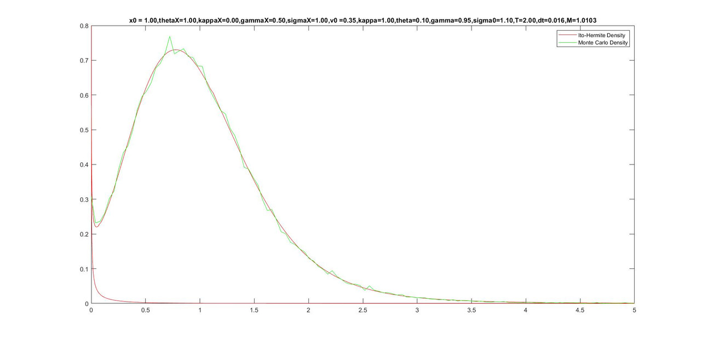](https://postimg.cc/hXdzdfWH)

[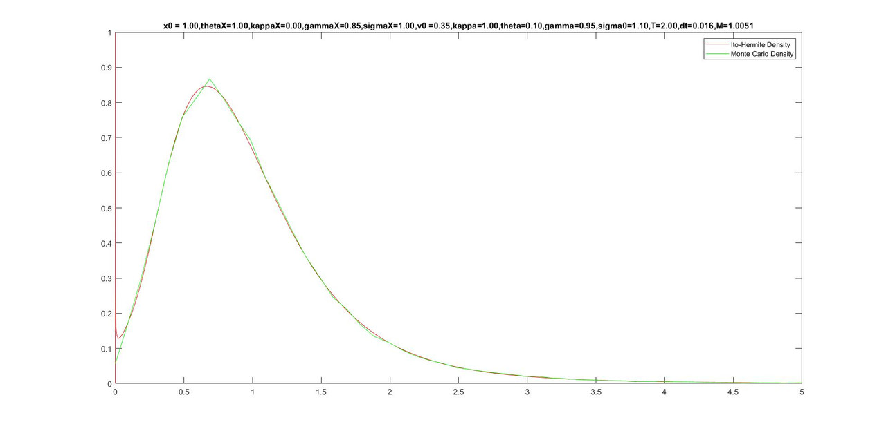](https://postimg.cc/TpS51nSV)

[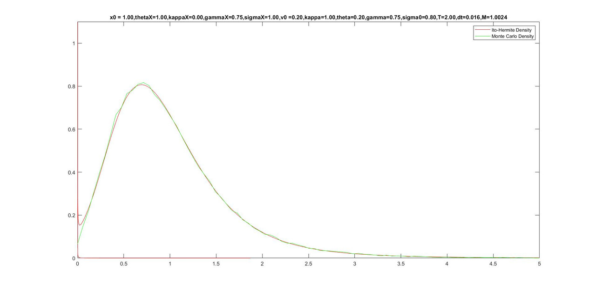](https://postimg.cc/XBYBGL48)

[](https://postimg.cc/qg13fPxZ)

[](https://postimg.cc/PPN8dS6f)

[](https://postimg.cc/YjrWsrYW)

[](https://postimg.cc/jwXJSm02)

[](https://postimg.cc/R69H99Y2)

---

### #1438 — Amin (Topic Author)
*May 18, 2022, 2:42 PM*

Here is the matlab program, I used to draw the above graphs.

.

.

```
function [] = FPESeriesCoeffsFromGaussiansWilmottNew02A_Lite_2DFPE()

%Copyright Ahsan Amin. Infiniti derivatives Technologies.
%Please fell free to connect on linkedin: linkedin.com/in/ahsan-amin-0a53334
%or skype ahsan.amin2999

%I have not directly simulated the SDE but simulated the transformed
%Besse1l process version of the SDE and then changed coordinates to retreive
%the SDE in original coo
%rdinates.
%The present program will analytically evolve only the Bessel Process version of the
%SDE in transformed coordinates.

dt=.125/2/2/2;   % Simulation time interval.%Fodiffusions close to zero
             %decrease dt for accuracy.
Tt=64*2;%16*2*4;%*4*4*1;%*4;%128*2*2*2;     % Number of simulation levels. Terminal time= Tt*dt; //.125/32*32*16=2 year;
T=Tt*dt;
%
% %Below I have done calculations for smaller step size at start.
%
% %ds(1:64)=dt/16;
% %ds(65:128)=dt/4;
% if(Tt4)&&(Tt20)
% Ts=(64)+((20-4)*4)+(Tt-20);
% ds(1:64)=dt/16;
% ds(65:128)=dt/4;
% ds(129:Ts)=dt;
% end

Ts=Tt;
ds(1:Tt)=dt;

T
sum(ds(1:Ts))
Ts

%Ts=4;
str=input('Check if time is right');

OrderA=4;  %
OrderM=4;  %

if(T>=1)
dtM=1/32;%.0625/1;
TtM=T/dtM;
else
dtM=T/32;%.0625/1;
TtM=T/dtM;
end

%dtM=dt;
%TtM=Tt;

dNn=.2/2;   % Normal density subdivisions width. would change with number of subdivisions
Nn=90;  % No of normal density subdivisions

NnMid=4.0;

v00=.1;   % starting value of SDE
beta1=0.0;
beta2=1.0;   % Second drift term power.
gamma=.950;%50;   % volatility power.
kappa=1.0;%.950;   %mean reversion parameter.
theta=.1;%mean reversion target
sigma0=1.100;%Volatility value
NoOfCumulants=6;
SeriesOrder=NoOfCumulants-1;

%you can specify any general mu1 and mu2 and beta1 and beta2.
mu1=1*theta*kappa;   %first drift coefficient.
mu2=-1*kappa;    % Second drift coefficient.
%mu1=0;
%mu2=-1*kappa;

alpha=1;% x^alpha is being expanded. This is currently for monte carlo only.
alpha1=1-gamma;%This is for expansion of integrals for calculation of drift
%and volatility coefficients
%yy(1:Nn)=x0;
w0=v00^(1-gamma)/(1-gamma);
%y0=x0;

x0=1;
gammaX=.75;
gammaV=.5;
sigmaX=1.00;
thetaX=1;
kappaX=0;
mu1X=thetaX*kappaX;
mu2X=-1*kappaX;
beta1X=0.0;
beta2X=1.0;
q0=x0^(1-gammaX)/(1-gammaX);
alpha1X=1-gammaX;

Z(1:Nn)=(((1:Nn)-6.5/1)*dNn-NnMid);
Z
str=input('Look at Z');
ZProb(1)=normcdf(.5*Z(1)+.5*Z(2),0,1)-normcdf(.5*Z(1)+.5*Z(2)-dNn,0,1);
ZProb(Nn)=normcdf(.5*Z(Nn)+.5*Z(Nn-1)+dNn,0,1)-normcdf(.5*Z(Nn)+.5*Z(Nn-1),0,1);
ZProb(2:Nn-1)=normcdf(.5*Z(2:Nn-1)+.5*Z(3:Nn),0,1)-normcdf(.5*Z(2:Nn-1)+.5*Z(1:Nn-2),0,1);

%%%%%%%%%%%%%%%%%%%%%%%%%%%%%%%%%%%%%%%%%%%%%%%%%%%%%%%%%%%%%%%%%%%%%%%%%%%%%%%%%%%%%%%%%%%%%%

sigma11(1:OrderA+1)=0;
mu11(1:OrderA+1)=0;
mu22(1:OrderA+1)=0;
sigma22(1:OrderA+1)=0;
% index 1 correponds to zero level since matlab indexing starts at one.
sigma11(1)=1;
mu11(1)=1;
mu22(1)=1;
sigma22(1)=1;

for k=1:(OrderA+1)
    if sigma0~=0
        sigma11(k)=sigma0^(k-1);
    end
    if mu1 ~= 0
        mu11(k)=mu1^(k-1);
    end
    if mu2 ~= 0
        mu22(k)=mu2^(k-1);
    end
    if sigma0~=0
        sigma22(k)=sigma0^(2*(k-1));
    end
end

sigma11X(1:OrderA+1)=0;
mu11X(1:OrderA+1)=0;
mu22X(1:OrderA+1)=0;
sigma22X(1:OrderA+1)=0;

sigma11X(1)=1;
mu11X(1)=1;
mu22X(1)=1;
sigma22X(1)=1;

for k=1:(OrderA+1)
    if sigmaX~=0
        sigma11X(k)=sigmaX^(k-1);
    end
    if mu1X ~= 0
        mu11X(k)=mu1X^(k-1);
    end
    if mu2X ~= 0
        mu22X(k)=mu2X^(k-1);
    end
    if sigmaX~=0
        sigma22X(k)=sigmaX^(2*(k-1));
    end
end

%Ft(1:TtM+1,1:(OrderA+1),1:(OrderA+1),1:(OrderA+1),1:(OrderA+1))=0; %General time powers on hermite polynomials
Fp(1:(OrderA+1),1:(OrderA+1),1:(OrderA+1),1:(OrderA+1))=0;%General x powers on coefficients of hermite polynomials.
Fp1(1:(OrderA+1),1:(OrderA+1),1:(OrderA+1),1:(OrderA+1))=0;%General x powers for bessel transformed coordinates.

Fp1X(1:(OrderA+1),1:(OrderA+1),1:(OrderA+1),1:(OrderA+1))=0;
%YCoeff0 and YCoeff are coefficents for original coordinates monte carlo.
%YqCoeff0 and YqCoeff are bessel/lamperti version monte carlo.

YCoeff0(1:(OrderA+1),1:(OrderA+1),1:(OrderA+1),1:(OrderA+1))=0;
YqCoeff0(1:(OrderA+1),1:(OrderA+1),1:(OrderA+1),1:(OrderA+1))=0;
YqCoeff0X(1:(OrderA+1),1:(OrderA+1),1:(OrderA+1),1:(OrderA+1))=0;

%Pre-compute the time and power exponent values in small multi-dimensional arrays
YCoeff = ItoTaylorCoeffsNew(alpha,beta1,beta2,gamma); %expand y^alpha where alpha=1;
YqCoeff = ItoTaylorCoeffsNew(alpha1,beta1,beta2,gamma);%expand y^alpha1 where alpha1=(1-gamma)
YqCoeff=YqCoeff/(1-gamma); %Transformed coordinates coefficients have to be
%further divided by (1-gamma)
YqCoeffX = ItoTaylorCoeffsNew(alpha1X,beta1X,beta2X,gammaX);%expand y^alpha1 where alpha1=(1-gamma)
YqCoeffX=YqCoeffX/(1-gammaX);
for k = 0 : (OrderA)
    for m = 0:k
        l4 = k - m + 1;
        for n = 0 : m
            l3 = m - n + 1;
            for j = 0:n
                l2 = n - j + 1;
                l1 = j + 1;
                %Ft(l1,l2,l3,l4) = dtM^((l1-1) + (l2-1) + (l3-1) + .5* (l4-1));
                Fp(l1,l2,l3,l4) = (alpha + (l1-1) * beta1 + (l2-1) * beta2 + (l3-1) * 2* gamma + (l4-1) * gamma ...
                    - (l1-1) - (l2-1) - 2* (l3-1) - (l4-1));
                Fp1(l1,l2,l3,l4) = (alpha1 + (l1-1) * beta1 + (l2-1) * beta2 + (l3-1) * 2* gamma + (l4-1) * gamma ...
                    - (l1-1) - (l2-1) - 2* (l3-1) - (l4-1));

                Fp1X(l1,l2,l3,l4) = (alpha1X + (l1-1) * beta1X + (l2-1) * beta2X + (l3-1) * 2* gammaX + (l4-1) * gammaX
...
                    - (l1-1) - (l2-1) - 2* (l3-1) - (l4-1));

                YCoeff0(l1,l2,l3,l4) =YCoeff(l1,l2,l3,l4).*mu11(l1).*mu22(l2).*sigma22(l3).*sigma11(l4);
                YqCoeff0(l1,l2,l3,l4) =YqCoeff(l1,l2,l3,l4).*mu11(l1).*mu22(l2).*sigma22(l3).*sigma11(l4);
                YqCoeff0X(l1,l2,l3,l4) =YqCoeffX(l1,l2,l3,l4).*mu11X(l1).*mu22X(l2).*sigma22X(l3).*sigma11X(l4);
            end
        end
    end
end

%%%%%%%%%%%%%%%%%%%%%%%%%%%%%%%%%%%%%%%%%%%%%%%%%%%%%%%%%%%%%%%%%%%%%%%%%%%%%%%%%%%%%%%%%%%%%%

ExpnOrder=5;
SeriesOrder=5;
c(1:SeriesOrder)=0;
c0=w0;
wnStart=1;
yydt(wnStart:Nn)=0.0;
tic

for tt=1:Ts
    tt

    if(tt.0000005)
%          SeriesOrder=6;
%          NoOfCumulants=7;
%      end
%      if(CC(8)>.0000005)
%          SeriesOrder=7;
%          NoOfCumulants=8;
%      end
%
 c0=a0;
 c(1:SeriesOrder)=a(1:SeriesOrder);

    w0=c0;
    end

    if(tt==1)
       cmid0=c0;
       cmid=c;

    else
      cmid0=(c0+c0prev)*.5;
       cmid=(c+cprev)*.5;

    end

    gammaV2=2*gammaV;
    [vw0,dvw0] = CalculatevgammaV2AndDerivatives(c0,gamma,gammaV2,SeriesOrder);
    %[V2gamma0,V2gamma1] = CalculateDriftbCoeffs08A(vw0,dvw0,cmid,SeriesOrder);
    [V2gamma0,V2gamma1] = CalculateDriftbCoeffs08A(vw0,dvw0,c,SeriesOrder);

    V2gamma(1)=V2gamma0;
    V2gamma(2:6)=V2gamma1(1:5);

    %V2gamma(2)=V2gamma1(1)/sqrt(1+sqrt(1/2)*sigma0*tt*dt);
    %V2gamma(3)=V2gamma1(2).*sqrt(1+sqrt(1/6)*sigma0*tt*dt);
    %V2gamma(4)=V2gamma1(3).*sqrt(1+sqrt(1/24)*sigma0*tt*dt);
       %V2gamma(5)=V2gamma1(4)./sqrt(1+sqrt(1/120)*sigma0*tt*dt);%
    %V2gamma(2)=V2gamma1(1)/sqrt(1+sqrt(1/2)*v00.^(gamma-1).*gamma*sigma0*tt*dt);
    %V2gamma(3)=V2gamma1(2).*sqrt(1+sqrt(1/6)*v00.^(2*gamma-2).*gamma^2*sigma0^2*tt*dt);
    %V2gamma(4)=V2gamma1(3).*sqrt(1+sqrt(1/24)*v00.^(3*gamma-3).*gamma^3*sigma0^3*tt*dt);

    %V2gamma(2)=V2gamma1(1)/sqrt(1+sqrt(1/2).*gamma*sigma0*tt*dt);
    %V2gamma(3)=V2gamma1(2).*sqrt(1+sqrt(1/6).*gamma^2*sigma0^2*tt*dt);
    %V2gamma(4)=V2gamma1(3).*sqrt(1+sqrt(1/24).*gamma^3*sigma0^3*tt*dt);

     V2gamma(2)=V2gamma1(1)/sqrt(1+sqrt(1/2).*sigma0^2*tt*dt);
    V2gamma(3)=V2gamma1(2).*sqrt(1+sqrt(1/6).*sigma0^2*tt*dt);
    V2gamma(4)=V2gamma1(3).*sqrt(1+sqrt(1/24).*sigma0^2*tt*dt);

 %   V2gamma(3:6)=V2gamma1(2:5).*sqrt(1+sqrt(2)*tt*dt);
    if(tt==1)

        cq(1:6,1:6)=0;
        cq(1,1)=x0^(1-gammaX)/(1-gammaX);

    end
        cprev=c;

    q0=cq(1,1);

    DoubleExpnOrder=ExpnOrder*2;

    [qMu0dt,dqMu0dtdq,qMu1dt,dqMu1dtdq] =
BesselDriftAndDerivatives08A0(q0,mu1X,mu2X,beta1X,beta2X,gammaX,DoubleExpnOrder);
    [q2Mu0dt,dq2Mu0dtdq,q2Mu1dt,dq2Mu1dtdq] = BesselDriftAndDerivatives08Aq(q0,sigmaX,gammaX,DoubleExpnOrder)

    [Muq0] = CalculateDriftbCoeffs08A2Dim02(qMu0dt,dqMu0dtdq,cq,SeriesOrder);
    [Muq2] = CalculateDriftbCoeffs08A2Dim02(q2Mu0dt,dq2Mu0dtdq,cq,SeriesOrder);
    [DMuq0] = CalculateDriftbCoeffs08A2Dim02(qMu1dt,dqMu1dtdq,cq,SeriesOrder);
    [DMuq2] = CalculateDriftbCoeffs08A2Dim02(q2Mu1dt,dq2Mu1dtdq,cq,SeriesOrder);

    [Muq2] =SeriesProduct2D1D(Muq2,V2gamma);
    [DMuq2] =SeriesProduct2D1D(DMuq2,V2gamma);

    Muq=Muq0+Muq2;
    DMuq=DMuq0+DMuq2;

    if(tt==1)
        cq=cq+Muq*dt+SeriesProduct2D(Muq,DMuq)*dt^2/2;
        cq(2,1)=cq(2,1)+sigmaX*v00^gammaV*sqrt(dt);
    elseif(tt1)
 %D1cqInvZ
 end
%str=input('Look at numbers');
%   [qVol0dt,dqVol0dtdq] = BesselVolAndDerivativesH1(q0,YqCoeff0X,Fp1X,gammaX,ds(tt),SeriesOrder+1);

 %   [qVol2dt,dqVol2dtdw] = BesselVolAndDerivativesH2(q0,YqCoeff0X,Fp1X,gammaX,ds(tt),SeriesOrder+1);

end

Z1=Z;

if(tt*dt>1)
    cq(:,5)=cq(:,5)/4;
    cq(5,:)=cq(5,:)/4;
end

[b] = EvaluateSeriesForZ2(cq,Z1,Nn);
% Mm=301;
% MmMid=151;
% Q(MmMid+1:Mm)=cq(1,1)+cq(2,1).*.1.*(1:MmMid-1);
% Q(MmMid)=cq(1,1);
% %Q(1:70)=cq(1,1)-cq(2,1).*.25.*(70:-1:1);
% for mm=1:MmMid-1
%
%     Q(MmMid-mm)=cq(1,1)-cq(2,1).*.1.*mm;
% end
%
%
% Qa=Q-cq(2,1).*.1/2;
% Qb=Q+cq(2,1).*.1/2;

Mm=601;
MmMid=301;
dMm=.05;
Q(MmMid+1:Mm)=cq(1,1)+cq(2,1).*dMm.*(1:MmMid-1);
Q(MmMid)=cq(1,1);
%Q(1:70)=cq(1,1)-cq(2,1).*.25.*(70:-1:1);
for mm=1:MmMid-1

    Q(MmMid-mm)=cq(1,1)-cq(2,1).*dMm.*mm;
end

Qa=Q-cq(2,1).*dMm/2;
Qb=Q+cq(2,1).*dMm/2;

Z1Prob(1:Mm)=0;
for nn=1:Nn
    bq(1:6)=b(1:6,nn);

    [Z0Prob] = CalculateProbabilitySeriesInv(Qa,Qb,bq);

%    Z0Prob

%str=input('Look at numbers-tttt')

    Z1Prob(1:Mm)=Z1Prob(1:Mm)+Z0Prob(1:Mm).*ZProb(nn);

end

pQ=Z1Prob/(cq(2,1).*dMm);

xx(1:Mm)=((1-gammaX).*Q(1:Mm)).^(1/(1-gammaX));

pxx(1:Mm)=pQ(1:Mm).*xx(1:Mm).^(-gammaX);

Mean=sum(xx(1:Mm).*Z1Prob(1:Mm));
Mean
% %gH00=gx00+gx20+3*gx40;
%  gH0(:)=cq(1,:)+cq(3,:)+3*cq(5,:);%Coeffs of zeroth v hermite
%
%  gH1(:)=cq(2,:)+3*cq(4,:)+15*cq(6,:);%Coeffs of 1st v hermite
%
%  gH2(:)=cq(3,:)+6*cq(5,:);%Coeffs of 2nd v hermite
%
%  gH3(:)=cq(4,:)+10*cq(6,:);%Coeffs of third v hermite
%  gH4(:)=cq(5,:);
%  gH5(:)=cq(6,:);   %Coeffs of fourth v hermite
%
%
% cH00=gH0(1);
% cH0(1:5)=gH0(2:6);
% cH10=gH1(1);
% cH1(1:5)=gH1(2:6);
% cH20=gH2(1);
% cH2(1:5)=gH2(2:6);
% cH30=gH3(1);
% cH3(1:5)=gH3(2:6);
% cH40=gH4(1);
% cH4(1:5)=gH4(2:6);
% cH50=gH5(1);
% cH5(1:5)=gH5(2:6);
%
%   [cHH00,cHH0] =ConvertZCoeffsToHCoeffs(cH00,cH0,SeriesOrder);
%   [cHH10,cHH1] =ConvertZCoeffsToHCoeffs(cH10,cH1,SeriesOrder);
%   [cHH20,cHH2] =ConvertZCoeffsToHCoeffs(cH20,cH2,SeriesOrder);
%   [cHH30,cHH3] =ConvertZCoeffsToHCoeffs(cH30,cH3,SeriesOrder);
%   [cHH40,cHH4] =ConvertZCoeffsToHCoeffs(cH40,cH4,SeriesOrder);
%   [cHH50,cHH5] =ConvertZCoeffsToHCoeffs(cH50,cH5,SeriesOrder);
%
%   cq0=sign(cHH00+cHH0(1)+sqrt(2)*cHH0(2)+sqrt(6)*cHH0(3)+sqrt(24)*cHH0(4)+sqrt(120)*cHH0(5)).* ...
%   sqrt(abs(sign(cHH00).*cHH00.^2+sign(cHH0(1)).*cHH0(1).^2+sign(cHH0(2)).*cHH0(2).^2*2+ ...
%   sign(cHH0(3)).*cHH0(3).^2*6+sign(cHH0(4)).*cHH0(4).^2*24+sign(cHH0(5)).*cHH0(5).^2*120));
%
%
%   cq(1)=sign(cHH10+cHH1(1)+sqrt(2)*cHH1(2)+sqrt(6)*cHH1(3)+sqrt(24)*cHH1(4)+sqrt(120)*cHH1(5)).* ...
%   sqrt(abs(sign(cHH10).*cHH10.^2+sign(cHH1(1)).*cHH1(1).^2+sign(cHH1(2)).*cHH1(2).^2*2+ ...
%   sign(cHH1(3)).*cHH1(3).^2*6+sign(cHH1(4)).*cHH1(4).^2*24+sign(cHH1(5)).*cHH1(5).^2*120));
% %
%  cq(2)=sign(cHH20+cHH2(1)+sqrt(2)*cHH2(2)+sqrt(6)*cHH2(3)+sqrt(24)*cHH2(4)+sqrt(120)*cHH2(5)).* ...
%   sqrt(abs(sign(cHH20).*cHH20.^2+sign(cHH2(1)).*cHH2(1).^2+sign(cHH2(2)).*cHH2(2).^2*2+ ...
%   sign(cHH2(3)).*cHH2(3).^2*6+sign(cHH2(4)).*cHH2(4).^2*24+sign(cHH2(5)).*cHH2(5).^2*120));
%
%  cq(3)=sign(cHH30+cHH3(1)+sqrt(2)*cHH3(2)+sqrt(6)*cHH3(3)+sqrt(24)*cHH3(4)+sqrt(120)*cHH3(5)).* ...
%   sqrt(abs(sign(cHH30).*cHH30.^2+sign(cHH3(1)).*cHH3(1).^2+sign(cHH3(2)).*cHH3(2).^2*2+ ...
%   sign(cHH3(3)).*cHH3(3).^2*6+sign(cHH3(4)).*cHH3(4).^2*24+sign(cHH3(5)).*cHH3(5).^2*120));
%
%  cq(4)=sign(cHH40+cHH4(1)+sqrt(2)*cHH4(2)+sqrt(6)*cHH4(3)+sqrt(24)*cHH4(4)+sqrt(120)*cHH4(5)).* ...
%   sqrt(abs(sign(cHH40).*cHH40.^2+sign(cHH4(1)).*cHH4(1).^2+sign(cHH4(2)).*cHH4(2).^2*2+ ...
%   sign(cHH4(3)).*cHH4(3).^2*6+sign(cHH4(4)).*cHH4(4).^2*24+sign(cHH4(5)).*cHH4(5).^2*120));
%
%  cq(5)=sign(cHH50+cHH5(1)+sqrt(2)*cHH5(2)+sqrt(6)*cHH5(3)+sqrt(24)*cHH5(4)+sqrt(120)*cHH5(5)).* ...
%   sqrt(abs(sign(cHH50).*cHH50.^2+sign(cHH5(1)).*cHH5(1).^2+sign(cHH5(2)).*cHH5(2).^2*2+ ...
%   sign(cHH5(3)).*cHH5(3).^2*6+sign(cHH5(4)).*cHH5(4).^2*24+sign(cHH5(5)).*cHH5(5).^2*120));

wnStart=1;

%c0
%c

%str=input('Look at numbers')

%
% yy0=((1-gamma).*w0).^(1/(1-gamma));
%
  w(1:Nn)=c0;
  for nn=1:SeriesOrder
      w(1:Nn)=w(1:Nn)+c(nn)*Z(1:Nn).^nn;
  end

 % q(1:Nn)=cq0;
 % for nn=1:SeriesOrder
 %     q(1:Nn)=q(1:Nn)+cq(nn)*Z(1:Nn).^nn;
 % end

%  %Flag=0;
%  %for nn=ceil(Nn/2)-1:-1:1
%  %    if((w(nn)<0)&&(Flag==0))
%  %        wnStart=nn+1;
%  %        Flag=1;
%  %    end
%  %end
%
%
%  %c0
%  %c
%
%
%  %str=input('Look at numbers')
  yy0(wnStart:Nn)=((1-gamma).*w(wnStart:Nn)).^(1/(1-gamma));

 % xx0(wnStart:Nn)=((1-gammaX).*q(wnStart:Nn)).^(1/(1-gammaX));
%
%  %%%%%%%%%%%%%%%%%%%%%%%%%%%%%%%%%%%%%%%%%%%%%%%%%%%%%%5
%   yw0=((1-gamma).*c0).^(1/(1-gamma));
%   dyw0(1)=((1-gamma).*c0).^(1/(1-gamma)-1);
%   dyw0(2)=(1/(1-gamma)-1).*((1-gamma).*c0).^(1/(1-gamma)-2)*(1-gamma);
%   dyw0(3)=(1/(1-gamma)-1).*(1/(1-gamma)-2).*((1-gamma).*c0).^(1/(1-gamma)-3)*(1-gamma)^2;
%   dyw0(4)=(1/(1-gamma)-1).*(1/(1-gamma)-2)*(1/(1-gamma)-3)*((1-gamma).*c0).^(1/(1-gamma)-4)*(1-gamma)^3;
% 
 dyw0(5)=(1/(1-gamma)-1).*(1/(1-gamma)-2)*(1/(1-gamma)-3)*(1/(1-gamma)-4)*((1-gamma).*c0).^(1/(1-gamma)-5)*(1-gamma)^4;
% 
 dyw0(6)=(1/(1-gamma)-1).*(1/(1-gamma)-2)*(1/(1-gamma)-3)*(1/(1-gamma)-4)*(1/(1-gamma)-5)*((1-gamma).*c0).^(1/(1-gamma)-6)*(1-gamma)^5;
% 
 dyw0(7)=(1/(1-gamma)-1).*(1/(1-gamma)-2)*(1/(1-gamma)-3)*(1/(1-gamma)-4)*(1/(1-gamma)-5)*(1/(1-gamma)-6)*((1-gamma).*c0).^(1/(1-gamma)-7)*(1-gamma)^6;
% 
 dyw0(8)=(1/(1-gamma)-1).*(1/(1-gamma)-2)*(1/(1-gamma)-3)*(1/(1-gamma)-4)*(1/(1-gamma)-5)*(1/(1-gamma)-6)*(1/(1-gamma)-7)*((1-gamma).*c0).^(1/(1-gamma)-8)*(1-gamma)^7;
% %
% % c(6)=0;
% % c(7)=0;
% % c(8)=0;
% %
%      [y10,y1] = CalculateDriftbCoeffs08A(yw0,dyw0,c,SeriesOrder);
%      [y20,y2] = CalculateDriftbCoeffs08A(yw0,dyw0,c,5);
% %
%
%  yy1(1:Nn)=y10;
%  %y(1:SeriesOrder)=c(1:SeriesOrder);
%  for nn=1:SeriesOrder
%      yy1(1:Nn)=yy1(1:Nn)+y1(nn)*Z(1:Nn).^nn;
%  end
%
%  yy2(1:Nn)=y20;
%  %y(1:SeriesOrder)=c(1:SeriesOrder);
%  for nn=1:5
%      yy2(1:Nn)=yy2(1:Nn)+y2(nn)*Z(1:Nn).^nn;
%  end
%  plot(Z(1:Nn),yy0(1:Nn),'r',Z(1:Nn),yy1(1:Nn),'b',Z(1:Nn),yy2(1:Nn),'k');
% title(sprintf('x0 = %.4f,theta=%.3f,kappa=%.2f,gamma=%.3f,sigma=%.2f,T=%.2f,dt=%.5f',
x0,theta,kappa,gamma,sigma0,T,dt));%,sprintf('theta= %f', theta), sprintf('kappa = %f', kappa),sprintf('sigma = %f',
sigma0),sprintf('T = %f', T));
%
% legend({'SDE Variable Converted on Grid','SDE Variable From Eight Cumulants','SDE Variable From Six
Cumulants'},'Location','northeast')
%
% %str=input('red line is density of SDE from Ito-Hermite method, green is monte carlo.');
%
%
%  str=input('red line is SDE from Ito-Hermite method.');
%
%
%%%%%%%%%%%%%%%%%%%%%%%%%%%%%%%%%%%%%%%%%%%%%%%%%%%%%%%%%%5
 yy=yy0;
% xx=xx0;
Dfyy(wnStart:Nn)=0;
%Dfyy1(wnStart:Nn)=0;
%Dfyy2(wnStart:Nn)=0;
%Dfxx(wnStart:Nn)=0;
for nn=wnStart+1:Nn-1

    Dfyy(nn) = (yy(nn + 1) - yy(nn - 1))/(Z(nn + 1) - Z(nn - 1));
%    Dfyy1(nn) = (yy1(nn + 1) - yy1(nn - 1))/(Z(nn + 1) - Z(nn - 1));
%    Dfyy2(nn) = (yy2(nn + 1) - yy2(nn - 1))/(Z(nn + 1) - Z(nn - 1));
 %   Dfxx(nn) = (xx(nn + 1) - xx(nn - 1))/(Z(nn + 1) - Z(nn - 1));

    %Change of variable derivative for densities
end
%Dfyy(Nn)=Dfyy(Nn-1);
%Dfyy(1)=Dfyy(2);
%Dfyydt(Nn)=Dfyydt(Nn-1);
%Dfyydt(1)=Dfyydt(2);

pyy(1:Nn)=0;
%pyy1(1:Nn)=0;
%pyy2(1:Nn)=0;
%pxx(1:Nn)=0;
for nn = wnStart+1:Nn-1

    pyy(nn) = (normpdf(Z(nn),0, 1))/abs(Dfyy(nn));
%    pyy1(nn) = (normpdf(Z(nn),0, 1))/abs(Dfyy1(nn));
%    pyy2(nn) = (normpdf(Z(nn),0, 1))/abs(Dfyy2(nn));
 %   pxx(nn) = (normpdf(Z(nn),0, 1))/abs(Dfxx(nn));
end

toc

ItoHermiteMeanVar=sum(yy(wnStart:Nn).*ZProb(wnStart:Nn)) %Original process average from coordinates
ItoHermiteMeanAsset=Mean
disp('true Mean only applicable to standard SV mean reverting type models otherwise disregard');
%TrueMean=theta+(v0-theta)*exp(-kappa*T)%Mean reverting SDE original variable true average
%yy0

theta1=1;
%%%%%%%%%%%%%%%%%%%%%%%%%%%%%%
%rng(29079137, 'twister')
rng(15898837, 'twister')
paths=100000;
V(1:paths)=v00;  %Original process monte carlo.
X=0.0;
X(1:paths)=x0;
alpha1=0;
alpha2=1;
a=mu1X;
b=mu2X;
rho=0;
sigma1=sigmaX;
gammaV=.5;
Random1(1:paths)=0;
Random2(1:paths)=0;

for ttM=1:TtM
Random1=randn(size(Random1));
Random2=randn(size(Random2));

X(1:paths)=X(1:paths)+ ...
    (a* X(1:paths).^alpha1 + b* X(1:paths).^alpha2)* dtM + ...
    sqrt(1-rho^2)* sigma1* V(1:paths).^gammaV.* X(1:paths).^gammaX .*Random1(1:paths) * sqrt(dtM) + ...
    rho* sigma1* V(1:paths).^gammaV .*X(1:paths).^gammaX .*Random2(1:paths)*sqrt(dtM) + ...
    (a*alpha1* X(1:paths).^(alpha1-1)+b*alpha2* X(1:paths).^(alpha2-1)).* ...
    (((a* X(1:paths).^alpha1 + b* X(1:paths).^alpha2)* dtM^2/2)+ ...
    (sqrt(1-rho^2)* sigma1* V(1:paths).^gammaV.* X(1:paths).^gammaX .*Random1(1:paths) *(1-1/sqrt(3)).*dtM^1.5+ ...
    rho* sigma1* V(1:paths).^gammaV .*X(1:paths).^gammaX .*Random2(1:paths)*(1-1/sqrt(3)).*dtM^1.5))+ ...
    .5*(a*alpha1*(alpha1-1)* X(1:paths).^(alpha1-2)+b*alpha2*(alpha2-1).* X(1:paths).^(alpha2-2)).* ...
    ( sigma1^2* V(1:paths).^(2*gammaV).* X(1:paths).^(2*gammaX)) *dtM^2/2 + ...
    sqrt(1-rho^2)* sigma1* V(1:paths).^gammaV.*gammaX.* X(1:paths).^(gammaX-1).* ...
    ((a* X(1:paths).^alpha1 + b* X(1:paths).^alpha2).*Random1(1:paths) * 1/sqrt(3).* dtM^1.5 + ...
    sqrt(1-rho^2)* sigma1* V(1:paths).^gammaV.* X(1:paths).^gammaX .*(Random1(1:paths).^2-1) * dtM/2 + ...
    rho* sigma1* V(1:paths).^gammaV .*X(1:paths).^gammaX .*Random1(1:paths).*Random2(1:paths)*dtM/2)+ ...
    .5*sqrt(1-rho^2)* sigma1* V(1:paths).^gammaV.*gammaX.*(gammaX-1).* X(1:paths).^(gammaX-2).* ...
    (sigma1^2* V(1:paths).^(2*gammaV).* X(1:paths).^(2*gammaX) .*Random1(1:paths).*1/sqrt(3).*dtM^1.5)+ ...
    sqrt(1-rho^2)* sigma1*gammaV.* V(1:paths).^(gammaV-1).* X(1:paths).^(gammaX).* ...
    ((mu1.*V(1:paths).^beta1 + mu2.*V(1:paths).^beta2).*Random1(1:paths) * 1/sqrt(3).* dtM^1.5 + ...
    sigma0*V(1:paths).^gamma.*Random1(1:paths).*Random2(1:paths)*dtM/2)+ ...
    .5*sqrt(1-rho^2)* sigma1*gammaV.*(gammaV-1).* V(1:paths).^(gammaV-2).* X(1:paths).^(gammaX).* ...
    (sigma0^2*V(1:paths).^(2*gamma).*Random1(1:paths)*1/sqrt(3)*dtM^1.5)+ ...
    sqrt(1-rho^2)* sigma1*gammaV.* V(1:paths).^(gammaV-1).*gammaX.* X(1:paths).^(gammaX-1).* ...
    rho.* sigma1.* V(1:paths).^gammaV .*X(1:paths).^gammaX
.*sigma0.*V(1:paths).^gamma.*Random1(1:paths)*1/sqrt(3)*dtM^1.5+ ...
    rho* sigma1* V(1:paths).^gammaV.*gammaX.* X(1:paths).^(gammaX-1).* ...
    ((a* X(1:paths).^alpha1 + b* X(1:paths).^alpha2).*Random2(1:paths) * 1/sqrt(3).* dtM^1.5 + ...
    sqrt(1-rho^2)* sigma1* V(1:paths).^gammaV.* X(1:paths).^gammaX .*Random1(1:paths).*Random2(1:paths) * dtM/2 + ...
    rho* sigma1* V(1:paths).^gammaV .*X(1:paths).^gammaX .*(Random2(1:paths).^2-1)*dtM/2)+ ...
    .5*rho* sigma1* V(1:paths).^gammaV.*gammaX.*(gammaX-1).* X(1:paths).^(gammaX-2).* ...
    (sigma1^2* V(1:paths).^(2*gammaV).* X(1:paths).^(2*gammaX) .*Random2(1:paths).*1/sqrt(3).*dtM^1.5)+ ...
    rho* sigma1*gammaV.* V(1:paths).^(gammaV-1).* X(1:paths).^(gammaX).* ...
    ((mu1.*V(1:paths).^beta1 + mu2.*V(1:paths).^beta2).*Random2(1:paths) * 1/sqrt(3).* dtM^1.5 + ...
    sigma0*V(1:paths).^gamma.*(Random2(1:paths).^2-1)*dtM/2)+ ...
    .5*rho* sigma1*gammaV.*(gammaV-1).* V(1:paths).^(gammaV-2).* X(1:paths).^(gammaX).* ...
    sigma0^2.*V(1:paths).^(2*gamma).*Random2(1:paths) * 1/sqrt(3).* dtM^1.5+ ...
    rho* sigma1*gammaV.* V(1:paths).^(gammaV-1).*gammaX.* X(1:paths).^(gammaX-1).* ...
    rho.* sigma1.* V(1:paths).^gammaV .*X(1:paths).^gammaX
.*sigma0.*V(1:paths).^gamma.*Random2(1:paths)*1/sqrt(3)*dtM^1.5;

VBefore=V;

    V(1:paths)=V(1:paths)+ ...
        (mu1.*V(1:paths).^beta1 + mu2.*V(1:paths).^beta2)*dtM + ...
        sigma0*V(1:paths).^gamma .*Random2(1:paths)*sqrt(dtM) + ...
        (mu1.*beta1*V(1:paths).^(beta1-1) + mu2.*beta2.*V(1:paths).^(beta2-1)).* ...
        ((mu1.*V(1:paths).^beta1 + mu2.*V(1:paths).^beta2)*dtM^2/2 + ...
        sigma0*V(1:paths).^gamma .*Random2(1:paths)*(1-1/sqrt(3))*dtM^1.5) + ...
        .5*(mu1.*beta1.*(beta1-1).*V(1:paths).^(beta1-2) + mu2.*beta2.*(beta2-1).*V(1:paths).^(beta2-2)).* ...
        sigma0^2.*V(1:paths).^(2*gamma).*dtM^2/2 + ...
        sigma0*gamma*V(1:paths).^(gamma-1) .* ...
        ((mu1.*V(1:paths).^beta1 + mu2.*V(1:paths).^beta2).*Random2(1:paths).*1/sqrt(3)*dtM^1.5 + ...
        sigma0.*V(1:paths).^gamma .*(Random2(1:paths).^2-1)*dtM/2) + ...
        .5*sigma0*gamma*(gamma-1).*V(1:paths).^(gamma-2) .* ...
        sigma0^2.*V(1:paths).^(2*gamma) .*Random2(1:paths).*1/sqrt(3)*dtM^1.5;

%Vm=.5*VBefore+.5*V;
Vm=V;

%    X(1:paths)=X(1:paths)+ ...
%    sigma1* Vm(1:paths).^gammaV.* X(1:paths).^gammaX .*Random1(1:paths) * sqrt(dtM) + ...
%    sigma1* Vm(1:paths).^gammaV.*gammaX.* X(1:paths).^(gammaX-1).* ...
%    (sigma1* Vm(1:paths).^gammaV.* X(1:paths).^gammaX .*(Random1(1:paths).^2-1) * dtM/2)+ ...
%    .5*sigma1* Vm(1:paths).^gammaV.*gammaX.*(gammaX-1).* X(1:paths).^(gammaX-2).* ...
%    (sigma1^2* Vm(1:paths).^(2*gammaV).* X(1:paths).^(2*gammaX) .*Random1(1:paths).*1/sqrt(3).*dtM^1.5);%+ ...

end

%SVolMeanAnalytic=thetaV+(V0-thetaV)*exp(-kappaV*dt*Tt)
SVolMeanAnalytic=theta+(v00-theta)*exp(-kappa*dt*Tt)
SVolMeanMC=sum(V(1:paths))/paths
AssetMeanAnalytic=x0
AssetMeanMC=sum(X(1:paths))/paths

theta
v00
kappa
dt
Tt
T

%MeanX

disp('true Mean only applicble to standard SV mean reverting type models otherwise disregard');
TrueMean=theta+(v00-theta)*exp(-kappa*T)%Mean reverting SDE original variable true average

MaxCutOff=30;
NoOfBins=1*300;%round(1*500*gamma^2*4*sigma0/sqrt(MCMean)/(1+kappa));%Decrease the number of bins if the graph is too
[XDensity,IndexOutX,IndexMaxX] = MakeDensityFromSimulation_Infiniti_NEW(X,paths,NoOfBins,MaxCutOff );
plot(xx(wnStart+1:Mm-1),pxx(wnStart+1:Mm-1),'r',IndexOutX(1:IndexMaxX),XDensity(1:IndexMaxX),'g');
 %plot(y_w(wnStart+1:Nn-1),fy_w(wnStart+1:Nn-1),'r',IndexOutY(1:IndexMaxY),YDensity(1:IndexMaxY),'g',Z(wnStart+1:Nn-1),fy_w(wnStart+1:Nn-1),'b');

title(sprintf('x0 = %.2f,thetaX=%.2f,kappaX=%.2f,gammaX=%.2f,sigmaX=%.2f,v0
=%.2f,kappa=%.2f,theta=%.2f,gamma=%.2f,sigma0=%.2f,T=%.2f,dt=%.3f,M=%.4f',x0,thetaX,kappaX,gammaX,sigmaX,v00,kappa,theta,gamma,sigma0,T,dt,ItoHermiteMeanAsset));
%,sprintf('theta= %f', theta), sprintf('kappa = %f', kappa),sprintf('sigma = %f', sigma0),sprintf('T = %f', T));

legend({'Ito-Hermite Density','Monte Carlo Density'},'Location','northeast')

str=input('red line is density of SDE from Ito-Hermite method, green is monte carlo.');

%plot(y_w(wnStart+1:Nn-1),fy_w(wnStart+1:Nn-1),'r',IndexOutY(1:IndexMaxY),YDensity(1:IndexMaxY),'g',Z(wnStart+1:Nn-1),fy_w(wnStart+1:Nn-1),'b');

NoOfBins=round(2*500*gamma^2*4*sigma0/sqrt(SVolMeanMC)/(1+kappa))/10;
[VDensity,IndexOutV,IndexMaxV] = MakeDensityFromSimulation_Infiniti_NEW(V,paths,NoOfBins,MaxCutOff );

%[YdtDensity,IndexOutYdt,IndexMaxYdt] = MakeDensityFromSimulation_Infiniti_NEW(YYdt,paths,NoOfBins,MaxCutOff );
plot(yy(wnStart+1:Nn-1),pyy(wnStart+1:Nn-1),'r',IndexOutV(1:IndexMaxV),VDensity(1:IndexMaxV),'g');
title(sprintf('v0
=%.2f,kappa=%.2f,theta=%.2f,gamma=%.2f,sigma0=%.2f,T=%.2f,dt=%.3f,M=%.4f',v00,kappa,theta,gamma,sigma0,T,dt,ItoHermiteMeanVar));

end
```

.

.

.

Here is the output when you run this program.

ItoHermiteMeanVar =

   0.093594065019018

ItoHermiteMeanAsset =

   1.004711782320583

true Mean only applicable to standard SV mean reverting type models otherwise disregard

SVolMeanAnalytic =

   0.100000000000000

SVolMeanMC =

   0.099452601451672

AssetMeanAnalytic =

     1

AssetMeanMC =

  0.999068559070861 - 0.000003132216047i

theta =

   0.100000000000000

v00 =

   0.100000000000000

kappa =

     1

dt =

   0.015625000000000

Tt =

   128

T =

     2

true Mean only applicble to standard SV mean reverting type models otherwise disregard

TrueMean =

   0.100000000000000

IndexMax =

   301

red line is density of SDE from Ito-Hermite method, green is monte carlo.

---

### #1439 — Amin (Topic Author)
*May 20, 2022, 9:28 AM*

Friends, comparing monte carlo and the FPE analytic solution, I added an analytic term to the 2D series solution of FPE
equation. With this addition of an analytic term and without any fudge factors in stochastic variance, The analytic
solutions are very perfect out to one year but two year is still not very good. I will be posting the new program
tomorrow and try to start explaining the analytics and the whole matlab program.

---

### #1440 — Amin (Topic Author)
*May 21, 2022, 2:55 PM*

Friends, I continued to play with my program and I was happily surprised to know that power exponents on analytic term I
added optimize where I calculated them to be and moving them around deteriorates the program. That gives me some idea
about missing term in the program and I will try that tomorrow and them post the new program with all the details.

Meanwhile I want to tell friends that my persecution is intensifying everyday. My sister visited us from Islamabad two
days ago and I had to sleep (night before last night) inside my room and not in the garage. Mind control agents
continued to torture me all night and there was pain in my head due to repeated use of microwaves and I could only sleep
close to morning. My experience was so horrifying for me that I decided to sleep in the garage last night despite that
my sister always complains about my sleeping in the garage and attributes it to my supposed disease(schizophrenia).

My sister brought some Humus and Lebanese yogurt sauce and I knew they were good. I had some of both the dishes and then
I had to drive my sister and my mother to a market (in Gulberg) in the city and there was nobody at home when we left.
When we returned, it was late and I had some of Lebanese sauce with pita bread and I realized that it was drugged but by
that time I had already eaten enough of it. I went to sleep after that and then I vomited after one hour(this is when I
was trying to sleep inside my room) .Vomiting was bad but thankfully it was the sauce that came out of the vomit. So
when mind control agents could not drug my food outside, they started drugging food at home.

Getting good bottled water is becoming very difficult everyday. On average I get good bottled water after making several
attempts. This morning I bought water from a large store (Decent store on wahdat road) and the water was drugged. I then
bought water from another bakery from the small road that goes from wahdat road to Ichhra and the water was drugged
there as well. Then I bought some more water from a small store in Rehmanpura where I had never been before and only
then I was able to buy some good water. It has been a very similar story for past few days.

Sometimes I get water from public supply in remote areas but I am very afraid that crooks in Pak army will start
drugging ground water pretty soon in order to corner me. And this is all happening when temperature easily rises to 45
degrees celsius around noon.

I want to request friends to please ask mind control agencies and american defense to be better and stop persecuting me
so actively.

I also want to tell friends behind my persecution to become better and get rid of the old hostile mentality towards
muslims. Many muslim countries like UAE and Saudia are openly recognizing Israel. Lot of people in new generations do
not share the hostility and hatred that was between muslims and Israelis in 70's and 80's. But I am afraid that quite
some of jewish old gaurd in US is still stuck in time. Please understand that Israel is not under threat in 21st century
in anyway so there is no need to go to such extreme limits of mass persecution of intelligent muslims.

---

### #1441 — Amin (Topic Author)
*May 24, 2022, 3:09 PM*

Friends, every time I heuristically add derivatives from volatility of volatility term into 2D FPE solution, the series
solution becomes a closer match with monte carlo density. I am re-doing some of the analytics so that effect of
volatility of volatility term is very properly accounted for as including all such terms may possibly bring the results
in line with monte carlo density. I could not work properly for past several days but was able to do some work today. I
will let friends know how it goes after formally including all effects from volatility of volatility term in next few
days.

---

### #1442 — Amin (Topic Author)
*May 27, 2022, 12:36 PM*

Friends, I continue to not succeed in proper solution of 2D FPE that would lead to a density match with monte carlo
density. I also feel slightly burnt out and therefore I have tried to take a break for a week in which I would work on
my market trading models. Meanwhile, I want to keep thinking about other possibilities to solve the 2D pair of SV SDEs.

Good thing is that, after my exploratory work, many friends have some basic framework of 2D series and they can try
their own analytics to find a proper solution of 2D SDE. I wonder why people do not use 2D or 3D power series for
solution of PDEs etc. I think they are a very powerful mathematical tool if the higher derivatives of the solution are
decreasing fast enough.

Most of the 2D series functions are self-explanatory and mathematicians would not have any problems in understanding and
generalizing them. However the function that converts 2D series solution to 1D asset solution probably needs some
explanation and I would be doing that here on this forum in next few days.

I have many other ideas for interesting research in stochastics and I would continue to post my work here. Sorry for
this break but I want to come back with fresh and better ideas and start posting my research again.

---

### #1443 — Amin (Topic Author)
*May 27, 2022, 8:56 PM*

Friends, I will be posting a new version of analytic solution to pair of SV SDEs. It is simpler since it depends only on
addition of squared variances across hermite polynomials and yields somewhat better results than solution of
Fokker-planck equation I posted earlier. I hope it would be interesting for friends to play around and explore it. It is
late now but I would be posting it tomorrow.

---

### #1444 — Amin (Topic Author)
*May 29, 2022, 4:41 AM*

Friends, I think I know the reason why our programs are not working well for 2D stochastic volatility SDE models. I
think the integral of variance

  $ \int \, V \, dt $

in all of the solutions have to be taken in sense of a dt-integral and not merely V multiplied with dt. The relevant
integral on every time interval would be addition to dt-integral on that time stage.

When I was playing with dt-integrals, I noticed that their volatility was reasonably lesser than simple integrals with
multiplication with dt. And I believe that in order to get our programs to work, we need a smaller vol in a similar
ratio that is between a properly calculated dt-integral and an integral obtained by simple multiplication of dt.

Good thing is that we did some good work on dt-integrals so that work will be very helpful.

I will be re-doing my programs (both derived from fokker-planck and with simple addition of hermite coefficients) to
change them so that a proper dt-integral goes into the variance and then post those program in another 2-3 days.

---

### #1445 — Amin (Topic Author)
*May 29, 2022, 11:02 AM*

What I mean in previous post is that when the equation below is integrated in time.

$=\int_0^{w_b(n)}  \, \Big[\, -\mu_y \, P(Z_1) \,  \frac{\partial Z_2}{\partial y}  \, +\, .5 \, {\sigma_y}^2 \, {V(w)}^{2 \gamma_V}   \, P(Z_1)  \, \big[ -Z_2 \, {(\frac{\partial Z_2}{\partial y})}^2 - {(\frac{\partial Z_2}{\partial y})}^3 \frac{\partial^2 y}{\partial {Z_2}^2} \big]  \, \Big] dZ_1 $

$+ \int_0^{w_b(n)}  \frac{\partial y_b(n,m)}{\partial t} \, P(Z_1) \, \frac{\partial Z_2(m)}{\partial y} dZ_1 =0 $

the integral

$\int_t^{t+dt} \, .5 \, {\sigma_y}^2 \, {V(w)}^{2 \gamma_V} dt $

has to be solved in the sense of proper stochastic dt-integral and not merely a multiplication with delta t.

---

### #1446 — Amin (Topic Author)
*May 30, 2022, 3:33 PM*

Friends, I am quite convinced that difference between a simple integral found by multiplying variance with delta t and a
properly calculated stochastic dt-integral is the reason why we are not getting a good match with monte carlo in our
analytic solution of stochastic vol SDEs. A proper stochastic dt-integral has to be calculated so that cumulative
variance(over all past time steps) matches perfectly with variance of dt-integral on each time step. The integrlas  when
a stochastic term is simply multiplied with delta t has larger variance than a properly calculated stochastic integral
but difference is not extremely huge and I would guess that it is of the same order as discrepancy we have(with monte
carlo) in our case.

I have to be busy tomorrow to get my national ID card and I might have to stand in line for several hours. Later
tomorrow night my sister is arriving from US after 3-4 years and I would have to be  a bit busy but good thing is that I
think I have a perfect handle on the analytics now and I will get our 2D program to work in next 2-3 days.

Just taking a very small two step toy problem. Let us suppose

$ X(t_1) \,= a_{11} \, Z \,$

$ X(t_2) \,= \sqrt{ {a_{11}}^2 + {a_{21}}^2 } \, Z \,$

A crude summation of both terms is given as

$ X(t_1) \, \Delta t + X(t_2) \, \Delta t $

$ = \big [a_{11} \, Z \, +\sqrt{ {a_{11}}^2 + {a_{21}}^2 } \, Z  \big] \, \Delta t $

which has variance given as

$ =\big [ {a_{11}}^2  \, +\, { {a_{11}}^2 + {a_{21}}^2 } \,+ 2 \, a_{11} \, \sqrt{ {a_{11}}^2 + {a_{21}}^2 } \big ] \, {\Delta t}^2 $
Eq(1)

while true  variance of dt-integral is given as

$ =\big [ 4 {a_{11}}^2  \, + {a_{21}}^2  \,\big ] \, {\Delta t}^2$         Eq(2)

We notice that variance of Eq(1) is slightly larger than that of Eq(2)

We did this calculation with just two terms and adding more terms has a similar effect of increasing the variance of
delta t multiplied integral as compared to true variance of stochastic dt-integral.  When calculating a proper
stochastic dt-integral, the cumulative variance(over all time steps on time grid) must match perfectly with cumulative
variance of dt-integral on the same time steps.

---

### #1447 — Amin (Topic Author)
*June 2, 2022, 5:44 AM*

Friends, sorry for all this delay but I have been able to verify that analytical 2D SV density remains in line with
monte carlo when we treat the integration as a proper stochastic dt-integral on every step. There are still some
problems like a huge tail for Asset density but that can be corrected (or hugely improved) by increasing the number of
terms (of Z-series appropriately) in our analysis. I will be doing some more work and then post the results and the
program later today or tomorrow. But I am very happy that we got close to completing of our project after I was almost
losing hope.

I will be posting the new program with explanation of analytics very shortly.

---

### #1448 — Amin (Topic Author)
*June 3, 2022, 4:54 AM*

Before posting the graphs from my work, I would like to take this opportunity to thank those friends who with their help
made my research possible. Several years ago, I had to spend a huge amount of time everyday by going into remote parts
of Lahore city and try to find good food and water. Mind control agencies would drug food, water and beverages in the
entire markets and it was extremely difficult to get good food and water. But as I tried to do good research, several
American friends tried to help me by asking mind control agencies to become better and stop employing such tactics.
Though food and water is drugged at a lot of places even today, it is easier these days than ever before to go out and
be careful and easily be able to get good water and food (though I would still get hit occasionally sometimes). All
other forms of torture also decreased with time especially when I would mention the torture here and friends would try
to help me by asking secret services to become more civilized. I can never imagine that I could do any of the research I
posted on this forum if circumstances were as bad as they were several years ago. I simply cannot have enough gratitude
for American friends and others who have indirectly helped me in the past and thus made my research possible.

About the 2D SV SDEs, though I have been able to get a good match to monte carlo out to several years, we still have to
do quite a bit of work to refine the model. As time increases, there are much larger tails especially when both
volatility and asset are close to lognormal. To the extreme right volatility tail gets larger and asset tail has a
compound effect on it and it increases by a huge amount but I believe both of these effects can be remarkably decreased
by appropriately increasing the order of volatility Z-series and asset Z-series where required. Another reason behind
the larger tail is that I used inversion of series to get the asset density and inversion of the series is very
approximate in the tails and also contributes to larger tail. Increasing the order of the series would also help with
inversion of the series and there could be other more exact ways to get the density without using inversion of the
series.

I have used stochastic time integrals in the program and with mean-reversion, they are not so accurate after 4-5 years
in the current program. I am sure  this is not a major problem and we will easily solve this(I just could not find time
yesterday to improve the previous work). There are also a lot of minor issues, there are some higher order effects
(possibly second order) that I have yet not included in pricing and this also needs improvement. But the very good thing
is that we have solved most of the difficult issues and work remains to be done is relatively very easy. But still the
current work is only intermediate and quite some of the work(though relatively easy) still remains to be done.

Here are some graphs from the new program for 2D SV pricing. All the parameters of the two SDEs are shown in the title
of the graphs. I will be posting the very intermediate matlab program used to make these graphs in a few hours.

[](https://postimg.cc/CRVybQD7)

[](https://postimg.cc/1fFhnQg4)

[](https://postimg.cc/Btkfn6nd)

[](https://postimg.cc/T5L8c8C7)

[](https://postimg.cc/6TyNKRtr)

[](https://postimg.cc/LY0Kf4Bg)

[](https://postimg.cc/zbfYVHW1)

[](https://postimg.cc/SXdpSfnr)

---

### #1449 — Amin (Topic Author)
*June 3, 2022, 1:38 PM*

Friends, the program below would work with mean-reverting volatility only when  V0=theta.

The purpose behind writing this program was only to test whether calculating a proper dt-integral would fix our problem
of discrepancy of analytical density with respect to monte carlo density. I hope to fix all the remaining shortcomings
in next few days and will make it a very general program. It is just an intermediate version. I have posted all other
necessary functions earlier.

.

.

```
function [] = FPESeriesCoeffsFromGaussiansWilmottNew02A_Lite_2DFPEA()

%Copyright Ahsan Amin. Infiniti derivatives Technologies.
%Please fell free to connect on linkedin: linkedin.com/in/ahsan-amin-0a53334
%or skype ahsan.amin2999

%I have not directly simulated the SDE but simulated the transformed
%Besse1l process version of the SDE and then changed coordinates to retreive
%the SDE in original coo
%rdinates.
%The present program will analytically evolve only the Bessel Process version of the
%SDE in transformed coordinates.

dt=.125/2/2/2;   % Simulation time interval.%Fodiffusions close to zero
             %decrease dt for accuracy.
Tt=64*1;%16*2*4;%*4*4*1;%*4;%128*2*2*2;     % Number of simulation levels. Terminal time= Tt*dt; //.125/32*32*16=2 year;
T=Tt*dt;
%
% %Below I have done calculations for smaller step size at start.
%
% %ds(1:64)=dt/16;
% %ds(65:128)=dt/4;
% if(Tt4)&&(Tt20)
% Ts=(64)+((20-4)*4)+(Tt-20);
% ds(1:64)=dt/16;
% ds(65:128)=dt/4;
% ds(129:Ts)=dt;
% end

Ts=Tt;
ds(1:Tt)=dt;

T
sum(ds(1:Ts))
Ts

%Ts=4;
str=input('Check if time is right');

OrderA=4;  %
OrderM=4;  %

if(T>=1)
dtM=1/32;%.0625/1;
TtM=T/dtM;
else
dtM=T/32;%.0625/1;
TtM=T/dtM;
end

%dtM=dt;
%TtM=Tt;

dNn=.2/2;   % Normal density subdivisions width. would change with number of subdivisions
Nn=90;  % No of normal density subdivisions

NnMid=4.0;

v00=1.0;   % starting value of SDE
beta1=0.0;
beta2=1.0;   % Second drift term power.
gamma=.950;%50;   % volatility power.
kappa=1.0;%.950;   %mean reversion parameter.
theta=1.0;%mean reversion target
sigma0=.9500;%Volatility value
NoOfCumulants=6;
SeriesOrder=NoOfCumulants-1;

%you can specify any general mu1 and mu2 and beta1 and beta2.
mu1=1*theta*kappa;   %first drift coefficient.
mu2=-1*kappa;    % Second drift coefficient.
%mu1=0;
%mu2=-1*kappa;

alpha=1;% x^alpha is being expanded. This is currently for monte carlo only.
alpha1=1-gamma;%This is for expansion of integrals for calculation of drift
%and volatility coefficients
%yy(1:Nn)=x0;
w0=v00^(1-gamma)/(1-gamma);
%y0=x0;

x0=1.00;
gammaX=.75;
gammaV=.5;
sigmaX=.350;
thetaX=1.0;
kappaX=0.0;
mu1X=thetaX*kappaX;
mu2X=-1*kappaX;
beta1X=0.0;
beta2X=1.0;
q0=x0^(1-gammaX)/(1-gammaX);
alpha1X=1-gammaX;

Z(1:Nn)=(((1:Nn)-6.5/1)*dNn-NnMid);
Z
str=input('Look at Z');
ZProb(1)=normcdf(.5*Z(1)+.5*Z(2),0,1)-normcdf(.5*Z(1)+.5*Z(2)-dNn,0,1);
ZProb(Nn)=normcdf(.5*Z(Nn)+.5*Z(Nn-1)+dNn,0,1)-normcdf(.5*Z(Nn)+.5*Z(Nn-1),0,1);
ZProb(2:Nn-1)=normcdf(.5*Z(2:Nn-1)+.5*Z(3:Nn),0,1)-normcdf(.5*Z(2:Nn-1)+.5*Z(1:Nn-2),0,1);

%%%%%%%%%%%%%%%%%%%%%%%%%%%%%%%%%%%%%%%%%%%%%%%%%%%%%%%%%%%%%%%%%%%%%%%%%%%%%%%%%%%%%%%%%%%%%%

sigma11(1:OrderA+1)=0;
mu11(1:OrderA+1)=0;
mu22(1:OrderA+1)=0;
sigma22(1:OrderA+1)=0;
% index 1 correponds to zero level since matlab indexing starts at one.
sigma11(1)=1;
mu11(1)=1;
mu22(1)=1;
sigma22(1)=1;

for k=1:(OrderA+1)
    if sigma0~=0
        sigma11(k)=sigma0^(k-1);
    end
    if mu1 ~= 0
        mu11(k)=mu1^(k-1);
    end
    if mu2 ~= 0
        mu22(k)=mu2^(k-1);
    end
    if sigma0~=0
        sigma22(k)=sigma0^(2*(k-1));
    end
end

sigma11X(1:OrderA+1)=0;
mu11X(1:OrderA+1)=0;
mu22X(1:OrderA+1)=0;
sigma22X(1:OrderA+1)=0;

sigma11X(1)=1;
mu11X(1)=1;
mu22X(1)=1;
sigma22X(1)=1;

for k=1:(OrderA+1)
    if sigmaX~=0
        sigma11X(k)=sigmaX^(k-1);
    end
    if mu1X ~= 0
        mu11X(k)=mu1X^(k-1);
    end
    if mu2X ~= 0
        mu22X(k)=mu2X^(k-1);
    end
    if sigmaX~=0
        sigma22X(k)=sigmaX^(2*(k-1));
    end
end

%Ft(1:TtM+1,1:(OrderA+1),1:(OrderA+1),1:(OrderA+1),1:(OrderA+1))=0; %General time powers on hermite polynomials
Fp(1:(OrderA+1),1:(OrderA+1),1:(OrderA+1),1:(OrderA+1))=0;%General x powers on coefficients of hermite polynomials.
Fp1(1:(OrderA+1),1:(OrderA+1),1:(OrderA+1),1:(OrderA+1))=0;%General x powers for bessel transformed coordinates.

Fp1X(1:(OrderA+1),1:(OrderA+1),1:(OrderA+1),1:(OrderA+1))=0;
%YCoeff0 and YCoeff are coefficents for original coordinates monte carlo.
%YqCoeff0 and YqCoeff are bessel/lamperti version monte carlo.

YCoeff0(1:(OrderA+1),1:(OrderA+1),1:(OrderA+1),1:(OrderA+1))=0;
YqCoeff0(1:(OrderA+1),1:(OrderA+1),1:(OrderA+1),1:(OrderA+1))=0;
YqCoeff0X(1:(OrderA+1),1:(OrderA+1),1:(OrderA+1),1:(OrderA+1))=0;

%Pre-compute the time and power exponent values in small multi-dimensional arrays
YCoeff = ItoTaylorCoeffsNew(alpha,beta1,beta2,gamma); %expand y^alpha where alpha=1;
YqCoeff = ItoTaylorCoeffsNew(alpha1,beta1,beta2,gamma);%expand y^alpha1 where alpha1=(1-gamma)
YqCoeff=YqCoeff/(1-gamma); %Transformed coordinates coefficients have to be
%further divided by (1-gamma)
YqCoeffX = ItoTaylorCoeffsNew(alpha1X,beta1X,beta2X,gammaX);%expand y^alpha1 where alpha1=(1-gamma)
YqCoeffX=YqCoeffX/(1-gammaX);
for k = 0 : (OrderA)
    for m = 0:k
        l4 = k - m + 1;
        for n = 0 : m
            l3 = m - n + 1;
            for j = 0:n
                l2 = n - j + 1;
                l1 = j + 1;
                %Ft(l1,l2,l3,l4) = dtM^((l1-1) + (l2-1) + (l3-1) + .5* (l4-1));
                Fp(l1,l2,l3,l4) = (alpha + (l1-1) * beta1 + (l2-1) * beta2 + (l3-1) * 2* gamma + (l4-1) * gamma ...
                    - (l1-1) - (l2-1) - 2* (l3-1) - (l4-1));
                Fp1(l1,l2,l3,l4) = (alpha1 + (l1-1) * beta1 + (l2-1) * beta2 + (l3-1) * 2* gamma + (l4-1) * gamma ...
                    - (l1-1) - (l2-1) - 2* (l3-1) - (l4-1));

                Fp1X(l1,l2,l3,l4) = (alpha1X + (l1-1) * beta1X + (l2-1) * beta2X + (l3-1) * 2* gammaX + (l4-1) * gammaX
...
                    - (l1-1) - (l2-1) - 2* (l3-1) - (l4-1));

                YCoeff0(l1,l2,l3,l4) =YCoeff(l1,l2,l3,l4).*mu11(l1).*mu22(l2).*sigma22(l3).*sigma11(l4);
                YqCoeff0(l1,l2,l3,l4) =YqCoeff(l1,l2,l3,l4).*mu11(l1).*mu22(l2).*sigma22(l3).*sigma11(l4);
                YqCoeff0X(l1,l2,l3,l4) =YqCoeffX(l1,l2,l3,l4).*mu11X(l1).*mu22X(l2).*sigma22X(l3).*sigma11X(l4);
            end
        end
    end
end

%%%%%%%%%%%%%%%%%%%%%%%%%%%%%%%%%%%%%%%%%%%%%%%%%%%%%%%%%%%%%%%%%%%%%%%%%%%%%%%%%%%%%%%%%%%%%%

ExpnOrder=5;
SeriesOrder=5;
c(1:SeriesOrder)=0;
c0=w0;
wnStart=1;
yydt(wnStart:Nn)=0.0;
tic

for tt=1:Ts
    tt

    if(tt1)
    cq(:,5)=cq(:,5)/4;
    cq(5,:)=cq(5,:)/4;
end

[b] = EvaluateSeriesForZ2(cq,Z1,Nn);
% Mm=301;
% MmMid=151;
% Q(MmMid+1:Mm)=cq(1,1)+cq(2,1).*.1.*(1:MmMid-1);
% Q(MmMid)=cq(1,1);
% %Q(1:70)=cq(1,1)-cq(2,1).*.25.*(70:-1:1);
% for mm=1:MmMid-1
%
%     Q(MmMid-mm)=cq(1,1)-cq(2,1).*.1.*mm;
% end
%
%
% Qa=Q-cq(2,1).*.1/2;
% Qb=Q+cq(2,1).*.1/2;

Mm=601;
MmMid=301;
dMm=.05;
Q(MmMid+1:Mm)=cq(1,1)+cq(2,1).*dMm.*(1:MmMid-1);
Q(MmMid)=cq(1,1);
%Q(1:70)=cq(1,1)-cq(2,1).*.25.*(70:-1:1);
for mm=1:MmMid-1

    Q(MmMid-mm)=cq(1,1)-cq(2,1).*dMm.*mm;
end

Qa=Q-cq(2,1).*dMm/2;
Qb=Q+cq(2,1).*dMm/2;

Z1Prob(1:Mm)=0;
for nn=1:Nn
    bq(1:6)=b(1:6,nn);

    [Z0Prob] = CalculateProbabilitySeriesInv(Qa,Qb,bq);

%    Z0Prob

%str=input('Look at numbers-tttt')

    Z1Prob(1:Mm)=Z1Prob(1:Mm)+Z0Prob(1:Mm).*ZProb(nn);

end

pQ=Z1Prob/(cq(2,1).*dMm);

xx(1:Mm)=((1-gammaX).*Q(1:Mm)).^(1/(1-gammaX));

pxx(1:Mm)=pQ(1:Mm).*xx(1:Mm).^(-gammaX);

Mean=sum(xx(1:Mm).*Z1Prob(1:Mm));
Mean
  w(1:Nn)=c0;
  for nn=1:SeriesOrder
      w(1:Nn)=w(1:Nn)+c(nn)*Z(1:Nn).^nn;
  end

 % q(1:Nn)=cq0;
 % for nn=1:SeriesOrder
 %     q(1:Nn)=q(1:Nn)+cq(nn)*Z(1:Nn).^nn;
 % end

%  %Flag=0;
%  %for nn=ceil(Nn/2)-1:-1:1
%  %    if((w(nn)<0)&&(Flag==0))
%  %        wnStart=nn+1;
%  %        Flag=1;
%  %    end
%  %end
%
%
%  %c0
%  %c
%
%
%  %str=input('Look at numbers')
  yy0(wnStart:Nn)=((1-gamma).*w(wnStart:Nn)).^(1/(1-gamma));

 % xx0(wnStart:Nn)=((1-gammaX).*q(wnStart:Nn)).^(1/(1-gammaX));
%
%  %%%%%%%%%%%%%%%%%%%%%%%%%%%%%%%%%%%%%%%%%%%%%%%%%%%%%%5
%   yw0=((1-gamma).*c0).^(1/(1-gamma));
%   dyw0(1)=((1-gamma).*c0).^(1/(1-gamma)-1);
%   dyw0(2)=(1/(1-gamma)-1).*((1-gamma).*c0).^(1/(1-gamma)-2)*(1-gamma);
%   dyw0(3)=(1/(1-gamma)-1).*(1/(1-gamma)-2).*((1-gamma).*c0).^(1/(1-gamma)-3)*(1-gamma)^2;
%   dyw0(4)=(1/(1-gamma)-1).*(1/(1-gamma)-2)*(1/(1-gamma)-3)*((1-gamma).*c0).^(1/(1-gamma)-4)*(1-gamma)^3;
% 
 dyw0(5)=(1/(1-gamma)-1).*(1/(1-gamma)-2)*(1/(1-gamma)-3)*(1/(1-gamma)-4)*((1-gamma).*c0).^(1/(1-gamma)-5)*(1-gamma)^4;
% 
 dyw0(6)=(1/(1-gamma)-1).*(1/(1-gamma)-2)*(1/(1-gamma)-3)*(1/(1-gamma)-4)*(1/(1-gamma)-5)*((1-gamma).*c0).^(1/(1-gamma)-6)*(1-gamma)^5;
% 
 dyw0(7)=(1/(1-gamma)-1).*(1/(1-gamma)-2)*(1/(1-gamma)-3)*(1/(1-gamma)-4)*(1/(1-gamma)-5)*(1/(1-gamma)-6)*((1-gamma).*c0).^(1/(1-gamma)-7)*(1-gamma)^6;
% 
 dyw0(8)=(1/(1-gamma)-1).*(1/(1-gamma)-2)*(1/(1-gamma)-3)*(1/(1-gamma)-4)*(1/(1-gamma)-5)*(1/(1-gamma)-6)*(1/(1-gamma)-7)*((1-gamma).*c0).^(1/(1-gamma)-8)*(1-gamma)^7;
% %
% % c(6)=0;
% % c(7)=0;
% % c(8)=0;
% %
%      [y10,y1] = CalculateDriftbCoeffs08A(yw0,dyw0,c,SeriesOrder);
%      [y20,y2] = CalculateDriftbCoeffs08A(yw0,dyw0,c,5);
% %
%
%  yy1(1:Nn)=y10;
%  %y(1:SeriesOrder)=c(1:SeriesOrder);
%  for nn=1:SeriesOrder
%      yy1(1:Nn)=yy1(1:Nn)+y1(nn)*Z(1:Nn).^nn;
%  end
%
%  yy2(1:Nn)=y20;
%  %y(1:SeriesOrder)=c(1:SeriesOrder);
%  for nn=1:5
%      yy2(1:Nn)=yy2(1:Nn)+y2(nn)*Z(1:Nn).^nn;
%  end
%  plot(Z(1:Nn),yy0(1:Nn),'r',Z(1:Nn),yy1(1:Nn),'b',Z(1:Nn),yy2(1:Nn),'k');
% title(sprintf('x0 = %.4f,theta=%.3f,kappa=%.2f,gamma=%.3f,sigma=%.2f,T=%.2f,dt=%.5f',
x0,theta,kappa,gamma,sigma0,T,dt));%,sprintf('theta= %f', theta), sprintf('kappa = %f', kappa),sprintf('sigma = %f',
sigma0),sprintf('T = %f', T));
%
% legend({'SDE Variable Converted on Grid','SDE Variable From Eight Cumulants','SDE Variable From Six
Cumulants'},'Location','northeast')
%
% %str=input('red line is density of SDE from Ito-Hermite method, green is monte carlo.');
%
%
%  str=input('red line is SDE from Ito-Hermite method.');
%
%
%%%%%%%%%%%%%%%%%%%%%%%%%%%%%%%%%%%%%%%%%%%%%%%%%%%%%%%%%%5
 yy=yy0;
% xx=xx0;
Dfyy(wnStart:Nn)=0;
%Dfyy1(wnStart:Nn)=0;
%Dfyy2(wnStart:Nn)=0;
%Dfxx(wnStart:Nn)=0;
for nn=wnStart+1:Nn-1

    Dfyy(nn) = (yy(nn + 1) - yy(nn - 1))/(Z(nn + 1) - Z(nn - 1));
%    Dfyy1(nn) = (yy1(nn + 1) - yy1(nn - 1))/(Z(nn + 1) - Z(nn - 1));
%    Dfyy2(nn) = (yy2(nn + 1) - yy2(nn - 1))/(Z(nn + 1) - Z(nn - 1));
 %   Dfxx(nn) = (xx(nn + 1) - xx(nn - 1))/(Z(nn + 1) - Z(nn - 1));

    %Change of variable derivative for densities
end
%Dfyy(Nn)=Dfyy(Nn-1);
%Dfyy(1)=Dfyy(2);
%Dfyydt(Nn)=Dfyydt(Nn-1);
%Dfyydt(1)=Dfyydt(2);

pyy(1:Nn)=0;
%pyy1(1:Nn)=0;
%pyy2(1:Nn)=0;
%pxx(1:Nn)=0;
for nn = wnStart+1:Nn-1

    pyy(nn) = (normpdf(Z(nn),0, 1))/abs(Dfyy(nn));
%    pyy1(nn) = (normpdf(Z(nn),0, 1))/abs(Dfyy1(nn));
%    pyy2(nn) = (normpdf(Z(nn),0, 1))/abs(Dfyy2(nn));
 %   pxx(nn) = (normpdf(Z(nn),0, 1))/abs(Dfxx(nn));
end

toc

ItoHermiteMeanVar=sum(yy(wnStart:Nn).*ZProb(wnStart:Nn)) %Original process average from coordinates
ItoHermiteMeanAsset=Mean
disp('true Mean only applicable to standard SV mean reverting type models otherwise disregard');
%TrueMean=theta+(v0-theta)*exp(-kappa*T)%Mean reverting SDE original variable true average
%yy0

theta1=1;
%%%%%%%%%%%%%%%%%%%%%%%%%%%%%%
%rng(29079137, 'twister')
rng(15898837, 'twister')
paths=100000;
V(1:paths)=v00;  %Original process monte carlo.
X=0.0;
X(1:paths)=x0;
alpha1=0;
alpha2=1;
a=mu1X;
b=mu2X;
rho=0;
sigma1=sigmaX;
gammaV=.5;
Random1(1:paths)=0;
Random2(1:paths)=0;

for ttM=1:TtM
Random1=randn(size(Random1));
Random2=randn(size(Random2));

X(1:paths)=X(1:paths)+ ...
    (a* X(1:paths).^alpha1 + b* X(1:paths).^alpha2)* dtM + ...
    sqrt(1-rho^2)* sigma1* V(1:paths).^gammaV.* X(1:paths).^gammaX .*Random1(1:paths) * sqrt(dtM) + ...
    rho* sigma1* V(1:paths).^gammaV .*X(1:paths).^gammaX .*Random2(1:paths)*sqrt(dtM) + ...
    (a*alpha1* X(1:paths).^(alpha1-1)+b*alpha2* X(1:paths).^(alpha2-1)).* ...
    (((a* X(1:paths).^alpha1 + b* X(1:paths).^alpha2)* dtM^2/2)+ ...
    (sqrt(1-rho^2)* sigma1* V(1:paths).^gammaV.* X(1:paths).^gammaX .*Random1(1:paths) *(1-1/sqrt(3)).*dtM^1.5+ ...
    rho* sigma1* V(1:paths).^gammaV .*X(1:paths).^gammaX .*Random2(1:paths)*(1-1/sqrt(3)).*dtM^1.5))+ ...
    .5*(a*alpha1*(alpha1-1)* X(1:paths).^(alpha1-2)+b*alpha2*(alpha2-1).* X(1:paths).^(alpha2-2)).* ...
    ( sigma1^2* V(1:paths).^(2*gammaV).* X(1:paths).^(2*gammaX)) *dtM^2/2 + ...
    sqrt(1-rho^2)* sigma1* V(1:paths).^gammaV.*gammaX.* X(1:paths).^(gammaX-1).* ...
    ((a* X(1:paths).^alpha1 + b* X(1:paths).^alpha2).*Random1(1:paths) * 1/sqrt(3).* dtM^1.5 + ...
    sqrt(1-rho^2)* sigma1* V(1:paths).^gammaV.* X(1:paths).^gammaX .*(Random1(1:paths).^2-1) * dtM/2 + ...
    rho* sigma1* V(1:paths).^gammaV .*X(1:paths).^gammaX .*Random1(1:paths).*Random2(1:paths)*dtM/2)+ ...
    .5*sqrt(1-rho^2)* sigma1* V(1:paths).^gammaV.*gammaX.*(gammaX-1).* X(1:paths).^(gammaX-2).* ...
    (sigma1^2* V(1:paths).^(2*gammaV).* X(1:paths).^(2*gammaX) .*Random1(1:paths).*1/sqrt(3).*dtM^1.5)+ ...
    sqrt(1-rho^2)* sigma1*gammaV.* V(1:paths).^(gammaV-1).* X(1:paths).^(gammaX).* ...
    ((mu1.*V(1:paths).^beta1 + mu2.*V(1:paths).^beta2).*Random1(1:paths) * 1/sqrt(3).* dtM^1.5 + ...
    sigma0*V(1:paths).^gamma.*Random1(1:paths).*Random2(1:paths)*dtM/2)+ ...
    .5*sqrt(1-rho^2)* sigma1*gammaV.*(gammaV-1).* V(1:paths).^(gammaV-2).* X(1:paths).^(gammaX).* ...
    (sigma0^2*V(1:paths).^(2*gamma).*Random1(1:paths)*1/sqrt(3)*dtM^1.5)+ ...
    sqrt(1-rho^2)* sigma1*gammaV.* V(1:paths).^(gammaV-1).*gammaX.* X(1:paths).^(gammaX-1).* ...
    rho.* sigma1.* V(1:paths).^gammaV .*X(1:paths).^gammaX
.*sigma0.*V(1:paths).^gamma.*Random1(1:paths)*1/sqrt(3)*dtM^1.5+ ...
    rho* sigma1* V(1:paths).^gammaV.*gammaX.* X(1:paths).^(gammaX-1).* ...
    ((a* X(1:paths).^alpha1 + b* X(1:paths).^alpha2).*Random2(1:paths) * 1/sqrt(3).* dtM^1.5 + ...
    sqrt(1-rho^2)* sigma1* V(1:paths).^gammaV.* X(1:paths).^gammaX .*Random1(1:paths).*Random2(1:paths) * dtM/2 + ...
    rho* sigma1* V(1:paths).^gammaV .*X(1:paths).^gammaX .*(Random2(1:paths).^2-1)*dtM/2)+ ...
    .5*rho* sigma1* V(1:paths).^gammaV.*gammaX.*(gammaX-1).* X(1:paths).^(gammaX-2).* ...
    (sigma1^2* V(1:paths).^(2*gammaV).* X(1:paths).^(2*gammaX) .*Random2(1:paths).*1/sqrt(3).*dtM^1.5)+ ...
    rho* sigma1*gammaV.* V(1:paths).^(gammaV-1).* X(1:paths).^(gammaX).* ...
    ((mu1.*V(1:paths).^beta1 + mu2.*V(1:paths).^beta2).*Random2(1:paths) * 1/sqrt(3).* dtM^1.5 + ...
    sigma0*V(1:paths).^gamma.*(Random2(1:paths).^2-1)*dtM/2)+ ...
    .5*rho* sigma1*gammaV.*(gammaV-1).* V(1:paths).^(gammaV-2).* X(1:paths).^(gammaX).* ...
    sigma0^2.*V(1:paths).^(2*gamma).*Random2(1:paths) * 1/sqrt(3).* dtM^1.5+ ...
    rho* sigma1*gammaV.* V(1:paths).^(gammaV-1).*gammaX.* X(1:paths).^(gammaX-1).* ...
    rho.* sigma1.* V(1:paths).^gammaV .*X(1:paths).^gammaX
.*sigma0.*V(1:paths).^gamma.*Random2(1:paths)*1/sqrt(3)*dtM^1.5;

VBefore=V;

    V(1:paths)=V(1:paths)+ ...
        (mu1.*V(1:paths).^beta1 + mu2.*V(1:paths).^beta2)*dtM + ...
        sigma0*V(1:paths).^gamma .*Random2(1:paths)*sqrt(dtM) + ...
        (mu1.*beta1*V(1:paths).^(beta1-1) + mu2.*beta2.*V(1:paths).^(beta2-1)).* ...
        ((mu1.*V(1:paths).^beta1 + mu2.*V(1:paths).^beta2)*dtM^2/2 + ...
        sigma0*V(1:paths).^gamma .*Random2(1:paths)*(1-1/sqrt(3))*dtM^1.5) + ...
        .5*(mu1.*beta1.*(beta1-1).*V(1:paths).^(beta1-2) + mu2.*beta2.*(beta2-1).*V(1:paths).^(beta2-2)).* ...
        sigma0^2.*V(1:paths).^(2*gamma).*dtM^2/2 + ...
        sigma0*gamma*V(1:paths).^(gamma-1) .* ...
        ((mu1.*V(1:paths).^beta1 + mu2.*V(1:paths).^beta2).*Random2(1:paths).*1/sqrt(3)*dtM^1.5 + ...
        sigma0.*V(1:paths).^gamma .*(Random2(1:paths).^2-1)*dtM/2) + ...
        .5*sigma0*gamma*(gamma-1).*V(1:paths).^(gamma-2) .* ...
        sigma0^2.*V(1:paths).^(2*gamma) .*Random2(1:paths).*1/sqrt(3)*dtM^1.5;

%Vm=.5*VBefore+.5*V;
Vm=V;

%    X(1:paths)=X(1:paths)+ ...
%    sigma1* Vm(1:paths).^gammaV.* X(1:paths).^gammaX .*Random1(1:paths) * sqrt(dtM) + ...
%    sigma1* Vm(1:paths).^gammaV.*gammaX.* X(1:paths).^(gammaX-1).* ...
%    (sigma1* Vm(1:paths).^gammaV.* X(1:paths).^gammaX .*(Random1(1:paths).^2-1) * dtM/2)+ ...
%    .5*sigma1* Vm(1:paths).^gammaV.*gammaX.*(gammaX-1).* X(1:paths).^(gammaX-2).* ...
%    (sigma1^2* Vm(1:paths).^(2*gammaV).* X(1:paths).^(2*gammaX) .*Random1(1:paths).*1/sqrt(3).*dtM^1.5);%+ ...

end

%SVolMeanAnalytic=thetaV+(V0-thetaV)*exp(-kappaV*dt*Tt)
SVolMeanAnalytic=theta+(v00-theta)*exp(-kappa*dt*Tt)
SVolMeanMC=sum(V(1:paths))/paths
AssetMeanAnalytic=x0
AssetMeanMC=sum(X(1:paths))/paths

% theta
% v00
% kappa
% dt
% Tt
% T

%MeanX

disp('true Mean only applicble to standard SV mean reverting type models otherwise disregard');
TrueMean=theta+(v00-theta)*exp(-kappa*T)%Mean reverting SDE original variable true average

MaxCutOff=30;
NoOfBins=2*300;%round(1*500*gamma^2*4*sigma0/sqrt(MCMean)/(1+kappa));%Decrease the number of bins if the graph is too
[XDensity,IndexOutX,IndexMaxX] = MakeDensityFromSimulation_Infiniti_NEW(X,paths,NoOfBins,MaxCutOff );
plot(xx(wnStart+1:Mm-1),pxx(wnStart+1:Mm-1),'r',IndexOutX(1:IndexMaxX),XDensity(1:IndexMaxX),'g');
 %plot(y_w(wnStart+1:Nn-1),fy_w(wnStart+1:Nn-1),'r',IndexOutY(1:IndexMaxY),YDensity(1:IndexMaxY),'g',Z(wnStart+1:Nn-1),fy_w(wnStart+1:Nn-1),'b');

title(sprintf('x0 = %.2f,thetaX=%.2f,kappaX=%.2f,gammaX=%.2f,sigmaX=%.2f,v0
=%.2f,kappa=%.2f,theta=%.2f,gamma=%.2f,sigma0=%.2f,T=%.2f,dt=%.3f,M=%.4f',x0,thetaX,kappaX,gammaX,sigmaX,v00,kappa,theta,gamma,sigma0,T,dt,ItoHermiteMeanAsset));
%,sprintf('theta= %f', theta), sprintf('kappa = %f', kappa),sprintf('sigma = %f', sigma0),sprintf('T = %f', T));

legend({'Ito-Hermite Density','Monte Carlo Density'},'Location','northeast')

str=input('red line is density of SDE from Ito-Hermite method, green is monte carlo.');

%plot(y_w(wnStart+1:Nn-1),fy_w(wnStart+1:Nn-1),'r',IndexOutY(1:IndexMaxY),YDensity(1:IndexMaxY),'g',Z(wnStart+1:Nn-1),fy_w(wnStart+1:Nn-1),'b');

NoOfBins=round(2*500*gamma^2*4*sigma0/sqrt(SVolMeanMC)/(1+kappa))/10;
[VDensity,IndexOutV,IndexMaxV] = MakeDensityFromSimulation_Infiniti_NEW(V,paths,NoOfBins,MaxCutOff );

%[YdtDensity,IndexOutYdt,IndexMaxYdt] = MakeDensityFromSimulation_Infiniti_NEW(YYdt,paths,NoOfBins,MaxCutOff );
plot(yy(wnStart+1:Nn-1),pyy(wnStart+1:Nn-1),'r',IndexOutV(1:IndexMaxV),VDensity(1:IndexMaxV),'g');
title(sprintf('v0
=%.2f,kappa=%.2f,theta=%.2f,gamma=%.2f,sigma0=%.2f,T=%.2f,dt=%.3f,M=%.4f',v00,kappa,theta,gamma,sigma0,T,dt,ItoHermiteMeanVar));

end
```

.

.

.

```
function [cH0,cH,cVdt] = CalculateVPathStepIntegral(c0prev,cprev,c0,c,kappa,theta,gamma,dt,Ts,cH0,cH,SeriesOrder)

    gammaV2New=1;
    [vw0,dvw0] = CalculatevgammaV2AndDerivatives(c0,gamma,gammaV2New,SeriesOrder);
    %[V2gamma0,V2gamma1] = CalculateDriftbCoeffs08A(vw0,dvw0,cmid,SeriesOrder);
    [cv0,cv] = CalculateDriftbCoeffs08A(vw0,dvw0,c,SeriesOrder);

    gammaV2New=1;
    [vw0,dvw0] = CalculatevgammaV2AndDerivatives(c0prev,gamma,gammaV2New,SeriesOrder);
    %[V2gamma0,V2gamma1] = CalculateDriftbCoeffs08A(vw0,dvw0,cmid,SeriesOrder);
    [cv0prev,cvprev] = CalculateDriftbCoeffs08A(vw0,dvw0,cprev,SeriesOrder);

   % b0=cv0prev*(exp(-kappa*dt)-1)-theta*(exp(-kappa*dt)-1);
   % b=cvprev*(exp(-kappa*dt)-1);

    [fH0,fH] = ConvertZCoeffsToHCoeffs(cv0,cv,SeriesOrder);

    [fH0prev,fHprev] = ConvertZCoeffsToHCoeffs(cv0prev,cvprev,SeriesOrder);

   % [bH0,bH] = ConvertZCoeffsToHCoeffs(b0,b,SeriesOrder);

    dH0=fH0-fH0prev;

   
%dH(1:SeriesOrder)=sign(fH(1:SeriesOrder)-bH(1:SeriesOrdery)-exp(-1*kappa*dt).*(fHprev(1:SeriesOrder))).*sqrt(abs(sign(fH(1:SeriesOrdery)-bH(1:SeriesOrder)).*(fH(1:SeriesOrdery)-bH(1:SeriesOrdery)).^2-sign(exp(-kappa*dt).*(fHprev(1:SeriesOrdery))).*(exp(-2*1*kappa*dt).*(fHprev(1:SeriesOrdery)).^2)));
   
dH(1:SeriesOrder)=sign(fH(1:SeriesOrder)-exp(-1*kappa*dt).*(fHprev(1:SeriesOrder))).*sqrt(abs(sign(fH(1:SeriesOrder)).*(fH(1:SeriesOrder)).^2-sign(exp(-kappa*dt).*(fHprev(1:SeriesOrder))).*(exp(-2*1*kappa*dt).*(fHprev(1:SeriesOrder)).^2)));

    cH0(Ts)=dH0;
    cH(Ts,1:SeriesOrder)=dH(1:SeriesOrder);

     Coeff1(1:Ts)=0;
    Coeff2(1:Ts)=0;

      for tt=1:Ts-1
      for ss=tt:Ts-1

          Coeff1(tt)=Coeff1(tt)+(exp(0*kappa*dt*(tt))).*(exp(-2*kappa*dt*(ss-tt))).*dt^2;
          for rr=tt:Ts-1
             if(rr==tt)

             else
             Coeff1(tt)=Coeff1(tt)+1*(exp(-1*kappa*dt*(ss)))*(exp(-0*kappa*dt*(tt))).*dt^2;
             end
          end
      end
      end

     for tt=1:Ts
     for ss=tt:Ts

         Coeff2(tt)=Coeff2(tt)+(exp(0*kappa*dt*(tt))).*(exp(-2*kappa*dt*(ss-tt))).*dt^2;
         for rr=tt:Ts
            if(rr==tt)

            else
            Coeff2(tt)=Coeff2(tt)+1*(exp(-1*kappa*dt*(ss)))*(exp(-0*kappa*dt*(tt))).*dt^2;
            end
         end
     end

     end

 %   Coeff0(1)=Coeff2(1);

     for tt=2:Ts
%         Coeff0(tt)=(Coeff2(tt)-Coeff2(tt-1));
     end

%     for tt1=1:tt-1
%         for ss=tt1:tt-1
%             for rr=ss:tt-1
%                 if(rr==ss)
%
%                     Coeff1(tt1)=Coeff1(tt1)+(exp(0*kappa*dt*(tt1))).*(exp(-2*kappa*dt*(rr-ss))).*dt^2;
%                 else
%
%                     Coeff1(tt1)=Coeff1(tt1)+2*(exp(-2*kappa*dt*(rr-ss)))*(exp(-1*kappa*dt*(tt1))).*dt^2;
%                 end
%             end
%
%         end
%
%     end
%     for tt1=1:tt
%         for ss=tt1:tt
%             for rr=ss:tt
%                 if(rr==ss)
%
%                     Coeff2(tt1)=Coeff2(tt1)+(exp(0*kappa*dt*(tt1))).*(exp(-2*kappa*dt*(rr-ss))).*dt^2;
%                 else
%
%                     Coeff2(tt1)=Coeff2(tt1)+2*(exp(-2*kappa*dt*(rr-ss)))*(exp(-1*kappa*dt*(tt1))).*dt^2;
%                 end
%             end
%
%         end
%
%     end

    eH10=0;
    eH20=0;
    eH1(1:SeriesOrder)=0;
    eH2(1:SeriesOrder)=0;
    for tt=2:Ts
    ts=Ts-1-tt+1;
    eH10=eH10+cH0(tt)*ts*dt;

   % if(tt*dt*kappa=1)
% %     eH2(1:SeriesOrder)=eH2(1:SeriesOrder)+sign(cH(tt,1:SeriesOrder)).*Coeff2(tt).*cH(tt,1:SeriesOrder).^2;
% %     else
% %     eH2(1:SeriesOrder)=eH2(1:SeriesOrder)+sign(cH(tt,1:SeriesOrder)).*Coeff2(tt).*cH(tt,1:SeriesOrder).^2;
% %     end
%
% end
% for tt=1:Ts-1
%  %   ts=Ts-tt+1;
%
%  %   eH0=eH0+exp(-2.*kappa*dt).*cH0(tt)*dt;%*ts*dt;
%     ts=(Ts-tt)*dt;
%     eH1(1:SeriesOrder)=eH1(1:SeriesOrder)+sign(cH(tt,1:SeriesOrder)).*ts^2.*cH(tt,1:SeriesOrder).^2;
% %    eH0=eH0+exp(-2.*kappa*dt).*cH0(tt)*dt;%*ts*dt;
%     eH10=eH10+cH0(tt)*ts;
%
% %     if(tt>=1)
% %     eH1(1:SeriesOrder)=eH1(1:SeriesOrder)+sign(cH(tt,1:SeriesOrder)).*Coeff1(tt).*cH(tt,1:SeriesOrder).^2;
% %     else
% %     eH1(1:SeriesOrder)=eH1(1:SeriesOrder)+sign(cH(tt,1:SeriesOrder)).*Coeff1(tt).*cH(tt,1:SeriesOrder).^2;
% %     end
%
% end
%

%eH0=eH20-eH10;
%eH0=dH0;
%eH0=fH0*dt;

eH(1:SeriesOrder)=sign(eH2(1:SeriesOrder)).*sqrt(abs(sign(eH2(1:SeriesOrder)).*eH2(1:SeriesOrder)))-sign(eH1(1:SeriesOrder)).*sqrt(abs(sign(eH1(1:SeriesOrder)).*eH1(1:SeriesOrder)));
%eH(1:SeriesOrder)=sign(eH2(1:SeriesOrder)).*sqrt(abs(sign(eH2(1:SeriesOrder)).*eH2(1:SeriesOrder).^2))-sign(eH1(1:SeriesOrder)).*sqrt(abs(sign(eH1(1:SeriesOrder)).*eH1(1:SeriesOrder).^2));
%eH(1:SeriesOrder)=sign(eH2(1:SeriesOrder)-eH1(1:SeriesOrder)).*sqrt(abs(sign(eH2(1:SeriesOrder)).*eH2(1:SeriesOrder).^2-sign(eH1(1:SeriesOrder)).*eH1(1:SeriesOrder).^2));

%eH(1:SeriesOrder)=sign(eH2(1:SeriesOrder)).*sqrt(abs(eH2(1:SeriesOrder)));

%eH(1:SeriesOrder)=sign(eH2(1:SeriesOrder)-eH1(1:SeriesOrder)).*sqrt(abs(eH2(1:SeriesOrder)-eH1(1:SeriesOrder)));

%eH0=eH20-eH10;
%eH0=eH20;
%eH0=cH0(tt);

 %We convert hermite represenation given by bH0 and bH(1:5) into
 %dt-integral Z-series Coeffs, e0 and e(1:5)
 %eH(SeriesOrdery)=eH(SeriesOrdery)/2;
[c0vdt,cvdt] = ConvertHCoeffsToZCoeffs(eH0,eH,SeriesOrder);%
%[c0vdt,cvdt] = ConvertHCoeffsToZCoeffs(cH0,cH,SeriesOrder);%

 cVdt(1)=c0vdt;
 cVdt(2:6)=cvdt(1:5);

 %cVdt

% cVdt(1)=cv0*dt;
% cVdt(2:6)=cvprev(1:5)*dt;

% cVdt

% cH
% Ts

% str=input('Look at numbers');

end

```

.

.

.

```
function [vw0,dvw0] = CalculatevgammaV2AndDerivatives(c0,gamma,gammaV2,SeriesOrder)

    vw0=((1-gamma).*c0).^(gammaV2/(1-gamma));
    dvw0(1)=gammaV2*((1-gamma).*c0).^(gammaV2/(1-gamma)-1);
    dvw0(2)=gammaV2*(gammaV2/(1-gamma)-1).*((1-gamma).*c0).^(gammaV2/(1-gamma)-2)*(1-gamma);
    dvw0(3)=gammaV2*(gammaV2/(1-gamma)-1).*(gammaV2/(1-gamma)-2).*((1-gamma).*c0).^(gammaV2/(1-gamma)-3)*(1-gamma)^2;
   
dvw0(4)=gammaV2*(gammaV2/(1-gamma)-1).*(gammaV2/(1-gamma)-2)*(gammaV2/(1-gamma)-3)*((1-gamma).*c0).^(gammaV2/(1-gamma)-4)*(1-gamma)^3;
   
dvw0(5)=gammaV2*(gammaV2/(1-gamma)-1).*(gammaV2/(1-gamma)-2)*(gammaV2/(1-gamma)-3)*(gammaV2/(1-gamma)-4)*((1-gamma).*c0).^(gammaV2/(1-gamma)-5)*(1-gamma)^4;
   
dvw0(6)=gammaV2*(gammaV2/(1-gamma)-1).*(gammaV2/(1-gamma)-2)*(gammaV2/(1-gamma)-3)*(gammaV2/(1-gamma)-4)*(gammaV2/(1-gamma)-5)*((1-gamma).*c0).^(gammaV2/(1-gamma)-6)*(1-gamma)^5;

end

```

.

.

.

Here is graph of the density that will follow when you run this program.

[](https://postimg.cc/HVHS9cBG)

---

### #1450 — Amin (Topic Author)
*June 4, 2022, 6:09 AM*

Friends, I will be explaining things later but in the meanwhile want to ask friends to replace the old function I posted
yesterday with this new function for calculation of time step value of dt-integral.

.

.

```
function [cH0,cH,cVdt] = CalculateVPathStepIntegral02(c0prev,cprev,c0,c,kappa,theta,gamma,dt,Ts,cH0,cH,SeriesOrder)

    gammaV2New=1;
    [vw0,dvw0] = CalculatevgammaV2AndDerivatives(c0,gamma,gammaV2New,SeriesOrder);
    %[V2gamma0,V2gamma1] = CalculateDriftbCoeffs08A(vw0,dvw0,cmid,SeriesOrder);
    [cv0,cv] = CalculateDriftbCoeffs08A(vw0,dvw0,c,SeriesOrder);

    gammaV2New=1;
    [vw0,dvw0] = CalculatevgammaV2AndDerivatives(c0prev,gamma,gammaV2New,SeriesOrder);
    %[V2gamma0,V2gamma1] = CalculateDriftbCoeffs08A(vw0,dvw0,cmid,SeriesOrder);
    [cv0prev,cvprev] = CalculateDriftbCoeffs08A(vw0,dvw0,cprev,SeriesOrder);

   % b0=cv0prev*(exp(-kappa*dt)-1)-theta*(exp(-kappa*dt)-1);
   % b=cvprev*(exp(-kappa*dt)-1);

    [fH0,fH] = ConvertZCoeffsToHCoeffs(cv0,cv,SeriesOrder);

    [fH0prev,fHprev] = ConvertZCoeffsToHCoeffs(cv0prev,cvprev,SeriesOrder);

   % [bH0,bH] = ConvertZCoeffsToHCoeffs(b0,b,SeriesOrder);

    dH0=fH0-fH0prev;

   
%dH(1:SeriesOrder)=sign(fH(1:SeriesOrder)-bH(1:SeriesOrdery)-exp(-1*kappa*dt).*(fHprev(1:SeriesOrder))).*sqrt(abs(sign(fH(1:SeriesOrdery)-bH(1:SeriesOrder)).*(fH(1:SeriesOrdery)-bH(1:SeriesOrdery)).^2-sign(exp(-kappa*dt).*(fHprev(1:SeriesOrdery))).*(exp(-2*1*kappa*dt).*(fHprev(1:SeriesOrdery)).^2)));
   
dH(1:SeriesOrder)=sign(fH(1:SeriesOrder)-exp(-1*kappa*dt).*(fHprev(1:SeriesOrder))).*sqrt(abs(sign(fH(1:SeriesOrder)).*(fH(1:SeriesOrder)).^2-sign(exp(-kappa*dt).*(fHprev(1:SeriesOrder))).*(exp(-2*1*kappa*dt).*(fHprev(1:SeriesOrder)).^2)));

    cH0(Ts)=dH0;
    cH(Ts,1:SeriesOrder)=dH(1:SeriesOrder);

     Coeff1(1:Ts)=0;
    Coeff2(1:Ts)=0;

for tt=1:Ts-1
     for ss=tt:Ts-1

         Coeff1(tt)=Coeff1(tt)+(exp(.5*kappa*dt*(tt))).*(exp(-2*kappa*dt*(ss-tt-1))).*dt^2;
         for rr=ss:Ts-1
            if(rr==ss)

            else
           
Coeff1(tt)=Coeff1(tt)+2*(exp(-1*kappa*dt*(ss-tt-1)))*(exp(-1*kappa*dt*(rr-tt-1))).*dt^2.*exp(0*kappa*dt*(tt));
            end
         end
     end
end

for tt=1:Ts
     for ss=tt:Ts

         Coeff2(tt)=Coeff2(tt)+(exp(.5*kappa*dt*(tt))).*(exp(-2*kappa*dt*(ss-tt-1))).*dt^2;
         for rr=ss:Ts
            if(rr==ss)

            else
           
Coeff2(tt)=Coeff2(tt)+2*(exp(-1*kappa*dt*(ss-tt-1)))*(exp(-1*kappa*dt*(rr-tt-1))).*dt^2.*exp(0*kappa*dt*(tt));
            end
         end
     end
 end
%       for tt=1:Ts-1
%       for ss=tt:Ts-1
%
%           Coeff1(tt)=Coeff1(tt)+(exp(0*kappa*dt*(tt))).*(exp(-2*kappa*dt*(ss-tt))).*dt^2;
%           for rr=tt:Ts-1
%              if(rr==tt)
%
%              else
%              Coeff1(tt)=Coeff1(tt)+1*(exp(-1*kappa*dt*(ss)))*(exp(-0*kappa*dt*(tt))).*dt^2;
%              end
%           end
%       end
%       end
%
%      for tt=1:Ts
%      for ss=tt:Ts
%
%          Coeff2(tt)=Coeff2(tt)+(exp(0*kappa*dt*(tt))).*(exp(-2*kappa*dt*(ss-tt))).*dt^2;
%          for rr=tt:Ts
%             if(rr==tt)
%
%             else
%             Coeff2(tt)=Coeff2(tt)+1*(exp(-1*kappa*dt*(ss)))*(exp(-0*kappa*dt*(tt))).*dt^2;
%             end
%          end
%      end
%
%      end

 %   Coeff0(1)=Coeff2(1);

     for tt=2:Ts
%         Coeff0(tt)=(Coeff2(tt)-Coeff2(tt-1));
     end

%     for tt1=1:tt-1
%         for ss=tt1:tt-1
%             for rr=ss:tt-1
%                 if(rr==ss)
%
%                     Coeff1(tt1)=Coeff1(tt1)+(exp(0*kappa*dt*(tt1))).*(exp(-2*kappa*dt*(rr-ss))).*dt^2;
%                 else
%
%                     Coeff1(tt1)=Coeff1(tt1)+2*(exp(-2*kappa*dt*(rr-ss)))*(exp(-1*kappa*dt*(tt1))).*dt^2;
%                 end
%             end
%
%         end
%
%     end
%     for tt1=1:tt
%         for ss=tt1:tt
%             for rr=ss:tt
%                 if(rr==ss)
%
%                     Coeff2(tt1)=Coeff2(tt1)+(exp(0*kappa*dt*(tt1))).*(exp(-2*kappa*dt*(rr-ss))).*dt^2;
%                 else
%
%                     Coeff2(tt1)=Coeff2(tt1)+2*(exp(-2*kappa*dt*(rr-ss)))*(exp(-1*kappa*dt*(tt1))).*dt^2;
%                 end
%             end
%
%         end
%
%     end

    eH10=0;
    eH20=0;
    eH1(1:SeriesOrder)=0;
    eH2(1:SeriesOrder)=0;
    for tt=2:Ts
    ts=Ts-1-tt+1;
    eH10=eH10+cH0(tt)*ts*dt;

   % if(tt*dt*kappa=1)
% %     eH2(1:SeriesOrder)=eH2(1:SeriesOrder)+sign(cH(tt,1:SeriesOrder)).*Coeff2(tt).*cH(tt,1:SeriesOrder).^2;
% %     else
% %     eH2(1:SeriesOrder)=eH2(1:SeriesOrder)+sign(cH(tt,1:SeriesOrder)).*Coeff2(tt).*cH(tt,1:SeriesOrder).^2;
% %     end
%
% end
% for tt=1:Ts-1
%  %   ts=Ts-tt+1;
%
%  %   eH0=eH0+exp(-2.*kappa*dt).*cH0(tt)*dt;%*ts*dt;
%     ts=(Ts-tt)*dt;
%     eH1(1:SeriesOrder)=eH1(1:SeriesOrder)+sign(cH(tt,1:SeriesOrder)).*ts^2.*cH(tt,1:SeriesOrder).^2;
% %    eH0=eH0+exp(-2.*kappa*dt).*cH0(tt)*dt;%*ts*dt;
%     eH10=eH10+cH0(tt)*ts;
%
% %     if(tt>=1)
% %     eH1(1:SeriesOrder)=eH1(1:SeriesOrder)+sign(cH(tt,1:SeriesOrder)).*Coeff1(tt).*cH(tt,1:SeriesOrder).^2;
% %     else
% %     eH1(1:SeriesOrder)=eH1(1:SeriesOrder)+sign(cH(tt,1:SeriesOrder)).*Coeff1(tt).*cH(tt,1:SeriesOrder).^2;
% %     end
%
% end
%

%eH0=eH20-eH10;
%eH0=dH0;
%eH0=fH0*dt;

eH(1:SeriesOrder)=sign(eH2(1:SeriesOrder)).*sqrt(abs(sign(eH2(1:SeriesOrder)).*eH2(1:SeriesOrder)))-sign(eH1(1:SeriesOrder)).*sqrt(abs(sign(eH1(1:SeriesOrder)).*eH1(1:SeriesOrder)));
%eH(1:SeriesOrder)=sign(eH2(1:SeriesOrder)).*sqrt(abs(sign(eH2(1:SeriesOrder)).*eH2(1:SeriesOrder).^2))-sign(eH1(1:SeriesOrder)).*sqrt(abs(sign(eH1(1:SeriesOrder)).*eH1(1:SeriesOrder).^2));
%eH(1:SeriesOrder)=sign(eH2(1:SeriesOrder)-eH1(1:SeriesOrder)).*sqrt(abs(sign(eH2(1:SeriesOrder)).*eH2(1:SeriesOrder).^2-sign(eH1(1:SeriesOrder)).*eH1(1:SeriesOrder).^2));

%eH(1:SeriesOrder)=sign(eH2(1:SeriesOrder)).*sqrt(abs(eH2(1:SeriesOrder)));

%eH(1:SeriesOrder)=sign(eH2(1:SeriesOrder)-eH1(1:SeriesOrder)).*sqrt(abs(eH2(1:SeriesOrder)-eH1(1:SeriesOrder)));

%eH0=eH20-eH10;
%eH0=eH20;
%eH0=cH0(tt);

 %We convert hermite represenation given by bH0 and bH(1:5) into
 %dt-integral Z-series Coeffs, e0 and e(1:5)
 %eH(SeriesOrdery)=eH(SeriesOrdery)/2;
[c0vdt,cvdt] = ConvertHCoeffsToZCoeffs(eH0,eH,SeriesOrder);%
%[c0vdt,cvdt] = ConvertHCoeffsToZCoeffs(cH0,cH,SeriesOrder);%

 cVdt(1)=c0vdt;
 cVdt(2:6)=cvdt(1:5);

 %cVdt

% cVdt(1)=cv0*dt;
% cVdt(2:6)=cvprev(1:5)*dt;

% cVdt

% cH
% Ts

% str=input('Look at numbers');

end

```

---

[← Previous](page_028.md) | [Index](index.md) | [Next →](page_030.md)
