# Breakthrough in the theory of stochastic differential equations and their simulation

**Page 30 of 59** — Posts #1451–#1500

[← Previous](page_029.md) | [Index](index.md) | [Next →](page_031.md)

---

### #1451 — Amin (Topic Author)
*June 4, 2022, 7:51 AM*

Friends, please use this new improved program. Bessel drift term multiplies with variance and that multiplication also
has to be taken in proper dt-integral sense. I was not doing that in previous program. This program is much improved
especially for terminal time beyond two years.

.

.

.

```
function [] = FPESeriesCoeffsFromGaussiansWilmottNew02A_Lite_2DFPEA2()

%Copyright Ahsan Amin. Infiniti derivatives Technologies.
%Please fell free to connect on linkedin: linkedin.com/in/ahsan-amin-0a53334
%or skype ahsan.amin2999

%I have not directly simulated the SDE but simulated the transformed
%Besse1l process version of the SDE and then changed coordinates to retreive
%the SDE in original coo
%rdinates.
%The present program will analytically evolve only the Bessel Process version of the
%SDE in transformed coordinates.

dt=.125/2/2/2;   % Simulation time interval.%Fodiffusions close to zero
             %decrease dt for accuracy.
Tt=64*5;%16*2*4;%*4*4*1;%*4;%128*2*2*2;     % Number of simulation levels. Terminal time= Tt*dt; //.125/32*32*16=2 year;
T=Tt*dt;
%
% %Below I have done calculations for smaller step size at start.
%
% %ds(1:64)=dt/16;
% %ds(65:128)=dt/4;
% if(Tt4)&&(Tt20)
% Ts=(64)+((20-4)*4)+(Tt-20);
% ds(1:64)=dt/16;
% ds(65:128)=dt/4;
% ds(129:Ts)=dt;
% end

Ts=Tt;
ds(1:Tt)=dt;

T
sum(ds(1:Ts))
Ts

%Ts=4;
str=input('Check if time is right');

OrderA=4;  %
OrderM=4;  %

if(T>=1)
dtM=1/32;%.0625/1;
TtM=T/dtM;
else
dtM=T/32;%.0625/1;
TtM=T/dtM;
end

%dtM=dt;
%TtM=Tt;

dNn=.2/2;   % Normal density subdivisions width. would change with number of subdivisions
Nn=90;  % No of normal density subdivisions

NnMid=4.0;

v00=.1250;   % starting value of SDE
beta1=0.0;
beta2=1.0;   % Second drift term power.
gamma=.950;%50;   % volatility power.
kappa=1.0;%.950;   %mean reversion parameter.
theta=.1250;%mean reversion target
sigma0=.9500;%Volatility value
NoOfCumulants=6;
SeriesOrder=NoOfCumulants-1;

%you can specify any general mu1 and mu2 and beta1 and beta2.
mu1=1*theta*kappa;   %first drift coefficient.
mu2=-1*kappa;    % Second drift coefficient.
%mu1=0;
%mu2=-1*kappa;

alpha=1;% x^alpha is being expanded. This is currently for monte carlo only.
alpha1=1-gamma;%This is for expansion of integrals for calculation of drift
%and volatility coefficients
%yy(1:Nn)=x0;
w0=v00^(1-gamma)/(1-gamma);
%y0=x0;

x0=1.00;
gammaX=.75;
gammaV=.5;
sigmaX=1.0;
thetaX=.50;
kappaX=.0;
mu1X=thetaX*kappaX;
mu2X=-1*kappaX;
beta1X=0.0;
beta2X=1.0;
q0=x0^(1-gammaX)/(1-gammaX);
alpha1X=1-gammaX;

Z(1:Nn)=(((1:Nn)-6.5/1)*dNn-NnMid);
Z
str=input('Look at Z');
ZProb(1)=normcdf(.5*Z(1)+.5*Z(2),0,1)-normcdf(.5*Z(1)+.5*Z(2)-dNn,0,1);
ZProb(Nn)=normcdf(.5*Z(Nn)+.5*Z(Nn-1)+dNn,0,1)-normcdf(.5*Z(Nn)+.5*Z(Nn-1),0,1);
ZProb(2:Nn-1)=normcdf(.5*Z(2:Nn-1)+.5*Z(3:Nn),0,1)-normcdf(.5*Z(2:Nn-1)+.5*Z(1:Nn-2),0,1);

%%%%%%%%%%%%%%%%%%%%%%%%%%%%%%%%%%%%%%%%%%%%%%%%%%%%%%%%%%%%%%%%%%%%%%%%%%%%%%%%%%%%%%%%%%%%%%

sigma11(1:OrderA+1)=0;
mu11(1:OrderA+1)=0;
mu22(1:OrderA+1)=0;
sigma22(1:OrderA+1)=0;
% index 1 correponds to zero level since matlab indexing starts at one.
sigma11(1)=1;
mu11(1)=1;
mu22(1)=1;
sigma22(1)=1;

for k=1:(OrderA+1)
    if sigma0~=0
        sigma11(k)=sigma0^(k-1);
    end
    if mu1 ~= 0
        mu11(k)=mu1^(k-1);
    end
    if mu2 ~= 0
        mu22(k)=mu2^(k-1);
    end
    if sigma0~=0
        sigma22(k)=sigma0^(2*(k-1));
    end
end

sigma11X(1:OrderA+1)=0;
mu11X(1:OrderA+1)=0;
mu22X(1:OrderA+1)=0;
sigma22X(1:OrderA+1)=0;

sigma11X(1)=1;
mu11X(1)=1;
mu22X(1)=1;
sigma22X(1)=1;

for k=1:(OrderA+1)
    if sigmaX~=0
        sigma11X(k)=sigmaX^(k-1);
    end
    if mu1X ~= 0
        mu11X(k)=mu1X^(k-1);
    end
    if mu2X ~= 0
        mu22X(k)=mu2X^(k-1);
    end
    if sigmaX~=0
        sigma22X(k)=sigmaX^(2*(k-1));
    end
end

%Ft(1:TtM+1,1:(OrderA+1),1:(OrderA+1),1:(OrderA+1),1:(OrderA+1))=0; %General time powers on hermite polynomials
Fp(1:(OrderA+1),1:(OrderA+1),1:(OrderA+1),1:(OrderA+1))=0;%General x powers on coefficients of hermite polynomials.
Fp1(1:(OrderA+1),1:(OrderA+1),1:(OrderA+1),1:(OrderA+1))=0;%General x powers for bessel transformed coordinates.

Fp1X(1:(OrderA+1),1:(OrderA+1),1:(OrderA+1),1:(OrderA+1))=0;
%YCoeff0 and YCoeff are coefficents for original coordinates monte carlo.
%YqCoeff0 and YqCoeff are bessel/lamperti version monte carlo.

YCoeff0(1:(OrderA+1),1:(OrderA+1),1:(OrderA+1),1:(OrderA+1))=0;
YqCoeff0(1:(OrderA+1),1:(OrderA+1),1:(OrderA+1),1:(OrderA+1))=0;
YqCoeff0X(1:(OrderA+1),1:(OrderA+1),1:(OrderA+1),1:(OrderA+1))=0;

%Pre-compute the time and power exponent values in small multi-dimensional arrays
YCoeff = ItoTaylorCoeffsNew(alpha,beta1,beta2,gamma); %expand y^alpha where alpha=1;
YqCoeff = ItoTaylorCoeffsNew(alpha1,beta1,beta2,gamma);%expand y^alpha1 where alpha1=(1-gamma)
YqCoeff=YqCoeff/(1-gamma); %Transformed coordinates coefficients have to be
%further divided by (1-gamma)
YqCoeffX = ItoTaylorCoeffsNew(alpha1X,beta1X,beta2X,gammaX);%expand y^alpha1 where alpha1=(1-gamma)
YqCoeffX=YqCoeffX/(1-gammaX);
for k = 0 : (OrderA)
    for m = 0:k
        l4 = k - m + 1;
        for n = 0 : m
            l3 = m - n + 1;
            for j = 0:n
                l2 = n - j + 1;
                l1 = j + 1;
                %Ft(l1,l2,l3,l4) = dtM^((l1-1) + (l2-1) + (l3-1) + .5* (l4-1));
                Fp(l1,l2,l3,l4) = (alpha + (l1-1) * beta1 + (l2-1) * beta2 + (l3-1) * 2* gamma + (l4-1) * gamma ...
                    - (l1-1) - (l2-1) - 2* (l3-1) - (l4-1));
                Fp1(l1,l2,l3,l4) = (alpha1 + (l1-1) * beta1 + (l2-1) * beta2 + (l3-1) * 2* gamma + (l4-1) * gamma ...
                    - (l1-1) - (l2-1) - 2* (l3-1) - (l4-1));

                Fp1X(l1,l2,l3,l4) = (alpha1X + (l1-1) * beta1X + (l2-1) * beta2X + (l3-1) * 2* gammaX + (l4-1) * gammaX
...
                    - (l1-1) - (l2-1) - 2* (l3-1) - (l4-1));

                YCoeff0(l1,l2,l3,l4) =YCoeff(l1,l2,l3,l4).*mu11(l1).*mu22(l2).*sigma22(l3).*sigma11(l4);
                YqCoeff0(l1,l2,l3,l4) =YqCoeff(l1,l2,l3,l4).*mu11(l1).*mu22(l2).*sigma22(l3).*sigma11(l4);
                YqCoeff0X(l1,l2,l3,l4) =YqCoeffX(l1,l2,l3,l4).*mu11X(l1).*mu22X(l2).*sigma22X(l3).*sigma11X(l4);
            end
        end
    end
end

%%%%%%%%%%%%%%%%%%%%%%%%%%%%%%%%%%%%%%%%%%%%%%%%%%%%%%%%%%%%%%%%%%%%%%%%%%%%%%%%%%%%%%%%%%%%%%

ExpnOrder=5;
SeriesOrder=5;
c(1:SeriesOrder)=0;
c0=w0;
wnStart=1;
yydt(wnStart:Nn)=0.0;
tic

for tt=1:Ts
    tt

    if(tt1)
    cq(:,5)=cq(:,5)/4;
    cq(5,:)=cq(5,:)/4;
end

[b] = EvaluateSeriesForZ2(cq,Z1,Nn);
% Mm=301;
% MmMid=151;
% Q(MmMid+1:Mm)=cq(1,1)+cq(2,1).*.1.*(1:MmMid-1);
% Q(MmMid)=cq(1,1);
% %Q(1:70)=cq(1,1)-cq(2,1).*.25.*(70:-1:1);
% for mm=1:MmMid-1
%
%     Q(MmMid-mm)=cq(1,1)-cq(2,1).*.1.*mm;
% end
%
%
% Qa=Q-cq(2,1).*.1/2;
% Qb=Q+cq(2,1).*.1/2;

Mm=601;
MmMid=301;
dMm=.05;
Q(MmMid+1:Mm)=cq(1,1)+cq(2,1).*dMm.*(1:MmMid-1);
Q(MmMid)=cq(1,1);
%Q(1:70)=cq(1,1)-cq(2,1).*.25.*(70:-1:1);
for mm=1:MmMid-1

    Q(MmMid-mm)=cq(1,1)-cq(2,1).*dMm.*mm;
end

Qa=Q-cq(2,1).*dMm/2;
Qb=Q+cq(2,1).*dMm/2;

Z1Prob(1:Mm)=0;
for nn=1:Nn
    bq(1:6)=b(1:6,nn);

    [Z0Prob] = CalculateProbabilitySeriesInv(Qa,Qb,bq);

%    Z0Prob

%str=input('Look at numbers-tttt')

    Z1Prob(1:Mm)=Z1Prob(1:Mm)+Z0Prob(1:Mm).*ZProb(nn);

end

pQ=Z1Prob/(cq(2,1).*dMm);

xx(1:Mm)=((1-gammaX).*Q(1:Mm)).^(1/(1-gammaX));

pxx(1:Mm)=pQ(1:Mm).*xx(1:Mm).^(-gammaX);

Mean=sum(xx(1:Mm).*Z1Prob(1:Mm));
Mean
  w(1:Nn)=c0;
  for nn=1:SeriesOrder
      w(1:Nn)=w(1:Nn)+c(nn)*Z(1:Nn).^nn;
  end

 % q(1:Nn)=cq0;
 % for nn=1:SeriesOrder
 %     q(1:Nn)=q(1:Nn)+cq(nn)*Z(1:Nn).^nn;
 % end

%  %Flag=0;
%  %for nn=ceil(Nn/2)-1:-1:1
%  %    if((w(nn)<0)&&(Flag==0))
%  %        wnStart=nn+1;
%  %        Flag=1;
%  %    end
%  %end
%
%
%  %c0
%  %c
%
%
%  %str=input('Look at numbers')
  yy0(wnStart:Nn)=((1-gamma).*w(wnStart:Nn)).^(1/(1-gamma));

 % xx0(wnStart:Nn)=((1-gammaX).*q(wnStart:Nn)).^(1/(1-gammaX));
%
%  %%%%%%%%%%%%%%%%%%%%%%%%%%%%%%%%%%%%%%%%%%%%%%%%%%%%%%5
%   yw0=((1-gamma).*c0).^(1/(1-gamma));
%   dyw0(1)=((1-gamma).*c0).^(1/(1-gamma)-1);
%   dyw0(2)=(1/(1-gamma)-1).*((1-gamma).*c0).^(1/(1-gamma)-2)*(1-gamma);
%   dyw0(3)=(1/(1-gamma)-1).*(1/(1-gamma)-2).*((1-gamma).*c0).^(1/(1-gamma)-3)*(1-gamma)^2;
%   dyw0(4)=(1/(1-gamma)-1).*(1/(1-gamma)-2)*(1/(1-gamma)-3)*((1-gamma).*c0).^(1/(1-gamma)-4)*(1-gamma)^3;
% 
 dyw0(5)=(1/(1-gamma)-1).*(1/(1-gamma)-2)*(1/(1-gamma)-3)*(1/(1-gamma)-4)*((1-gamma).*c0).^(1/(1-gamma)-5)*(1-gamma)^4;
% 
 dyw0(6)=(1/(1-gamma)-1).*(1/(1-gamma)-2)*(1/(1-gamma)-3)*(1/(1-gamma)-4)*(1/(1-gamma)-5)*((1-gamma).*c0).^(1/(1-gamma)-6)*(1-gamma)^5;
% 
 dyw0(7)=(1/(1-gamma)-1).*(1/(1-gamma)-2)*(1/(1-gamma)-3)*(1/(1-gamma)-4)*(1/(1-gamma)-5)*(1/(1-gamma)-6)*((1-gamma).*c0).^(1/(1-gamma)-7)*(1-gamma)^6;
% 
 dyw0(8)=(1/(1-gamma)-1).*(1/(1-gamma)-2)*(1/(1-gamma)-3)*(1/(1-gamma)-4)*(1/(1-gamma)-5)*(1/(1-gamma)-6)*(1/(1-gamma)-7)*((1-gamma).*c0).^(1/(1-gamma)-8)*(1-gamma)^7;
% %
% % c(6)=0;
% % c(7)=0;
% % c(8)=0;
% %
%      [y10,y1] = CalculateDriftbCoeffs08A(yw0,dyw0,c,SeriesOrder);
%      [y20,y2] = CalculateDriftbCoeffs08A(yw0,dyw0,c,5);
% %
%
%  yy1(1:Nn)=y10;
%  %y(1:SeriesOrder)=c(1:SeriesOrder);
%  for nn=1:SeriesOrder
%      yy1(1:Nn)=yy1(1:Nn)+y1(nn)*Z(1:Nn).^nn;
%  end
%
%  yy2(1:Nn)=y20;
%  %y(1:SeriesOrder)=c(1:SeriesOrder);
%  for nn=1:5
%      yy2(1:Nn)=yy2(1:Nn)+y2(nn)*Z(1:Nn).^nn;
%  end
%  plot(Z(1:Nn),yy0(1:Nn),'r',Z(1:Nn),yy1(1:Nn),'b',Z(1:Nn),yy2(1:Nn),'k');
% title(sprintf('x0 = %.4f,theta=%.3f,kappa=%.2f,gamma=%.3f,sigma=%.2f,T=%.2f,dt=%.5f',
x0,theta,kappa,gamma,sigma0,T,dt));%,sprintf('theta= %f', theta), sprintf('kappa = %f', kappa),sprintf('sigma = %f',
sigma0),sprintf('T = %f', T));
%
% legend({'SDE Variable Converted on Grid','SDE Variable From Eight Cumulants','SDE Variable From Six
Cumulants'},'Location','northeast')
%
% %str=input('red line is density of SDE from Ito-Hermite method, green is monte carlo.');
%
%
%  str=input('red line is SDE from Ito-Hermite method.');
%
%
%%%%%%%%%%%%%%%%%%%%%%%%%%%%%%%%%%%%%%%%%%%%%%%%%%%%%%%%%%5
 yy=yy0;
% xx=xx0;
Dfyy(wnStart:Nn)=0;
%Dfyy1(wnStart:Nn)=0;
%Dfyy2(wnStart:Nn)=0;
%Dfxx(wnStart:Nn)=0;
for nn=wnStart+1:Nn-1

    Dfyy(nn) = (yy(nn + 1) - yy(nn - 1))/(Z(nn + 1) - Z(nn - 1));
%    Dfyy1(nn) = (yy1(nn + 1) - yy1(nn - 1))/(Z(nn + 1) - Z(nn - 1));
%    Dfyy2(nn) = (yy2(nn + 1) - yy2(nn - 1))/(Z(nn + 1) - Z(nn - 1));
 %   Dfxx(nn) = (xx(nn + 1) - xx(nn - 1))/(Z(nn + 1) - Z(nn - 1));

    %Change of variable derivative for densities
end
%Dfyy(Nn)=Dfyy(Nn-1);
%Dfyy(1)=Dfyy(2);
%Dfyydt(Nn)=Dfyydt(Nn-1);
%Dfyydt(1)=Dfyydt(2);

pyy(1:Nn)=0;
%pyy1(1:Nn)=0;
%pyy2(1:Nn)=0;
%pxx(1:Nn)=0;
for nn = wnStart+1:Nn-1

    pyy(nn) = (normpdf(Z(nn),0, 1))/abs(Dfyy(nn));
%    pyy1(nn) = (normpdf(Z(nn),0, 1))/abs(Dfyy1(nn));
%    pyy2(nn) = (normpdf(Z(nn),0, 1))/abs(Dfyy2(nn));
 %   pxx(nn) = (normpdf(Z(nn),0, 1))/abs(Dfxx(nn));
end

toc

ItoHermiteMeanVar=sum(yy(wnStart:Nn).*ZProb(wnStart:Nn)) %Original process average from coordinates
ItoHermiteMeanAsset=Mean
disp('true Mean only applicable to standard SV mean reverting type models otherwise disregard');
%TrueMean=theta+(v0-theta)*exp(-kappa*T)%Mean reverting SDE original variable true average
%yy0

theta1=1;
%%%%%%%%%%%%%%%%%%%%%%%%%%%%%%
%rng(29079137, 'twister')
rng(15898837, 'twister')
paths=100000;
V(1:paths)=v00;  %Original process monte carlo.
X=0.0;
X(1:paths)=x0;
alpha1=0;
alpha2=1;
a=mu1X;
b=mu2X;
rho=0;
sigma1=sigmaX;
gammaV=.5;
Random1(1:paths)=0;
Random2(1:paths)=0;

for ttM=1:TtM
Random1=randn(size(Random1));
Random2=randn(size(Random2));

X(1:paths)=X(1:paths)+ ...
    (a* X(1:paths).^alpha1 + b* X(1:paths).^alpha2)* dtM + ...
    sqrt(1-rho^2)* sigma1* V(1:paths).^gammaV.* X(1:paths).^gammaX .*Random1(1:paths) * sqrt(dtM) + ...
    rho* sigma1* V(1:paths).^gammaV .*X(1:paths).^gammaX .*Random2(1:paths)*sqrt(dtM) + ...
    (a*alpha1* X(1:paths).^(alpha1-1)+b*alpha2* X(1:paths).^(alpha2-1)).* ...
    (((a* X(1:paths).^alpha1 + b* X(1:paths).^alpha2)* dtM^2/2)+ ...
    (sqrt(1-rho^2)* sigma1* V(1:paths).^gammaV.* X(1:paths).^gammaX .*Random1(1:paths) *(1-1/sqrt(3)).*dtM^1.5+ ...
    rho* sigma1* V(1:paths).^gammaV .*X(1:paths).^gammaX .*Random2(1:paths)*(1-1/sqrt(3)).*dtM^1.5))+ ...
    .5*(a*alpha1*(alpha1-1)* X(1:paths).^(alpha1-2)+b*alpha2*(alpha2-1).* X(1:paths).^(alpha2-2)).* ...
    ( sigma1^2* V(1:paths).^(2*gammaV).* X(1:paths).^(2*gammaX)) *dtM^2/2 + ...
    sqrt(1-rho^2)* sigma1* V(1:paths).^gammaV.*gammaX.* X(1:paths).^(gammaX-1).* ...
    ((a* X(1:paths).^alpha1 + b* X(1:paths).^alpha2).*Random1(1:paths) * 1/sqrt(3).* dtM^1.5 + ...
    sqrt(1-rho^2)* sigma1* V(1:paths).^gammaV.* X(1:paths).^gammaX .*(Random1(1:paths).^2-1) * dtM/2 + ...
    rho* sigma1* V(1:paths).^gammaV .*X(1:paths).^gammaX .*Random1(1:paths).*Random2(1:paths)*dtM/2)+ ...
    .5*sqrt(1-rho^2)* sigma1* V(1:paths).^gammaV.*gammaX.*(gammaX-1).* X(1:paths).^(gammaX-2).* ...
    (sigma1^2* V(1:paths).^(2*gammaV).* X(1:paths).^(2*gammaX) .*Random1(1:paths).*1/sqrt(3).*dtM^1.5)+ ...
    sqrt(1-rho^2)* sigma1*gammaV.* V(1:paths).^(gammaV-1).* X(1:paths).^(gammaX).* ...
    ((mu1.*V(1:paths).^beta1 + mu2.*V(1:paths).^beta2).*Random1(1:paths) * 1/sqrt(3).* dtM^1.5 + ...
    sigma0*V(1:paths).^gamma.*Random1(1:paths).*Random2(1:paths)*dtM/2)+ ...
    .5*sqrt(1-rho^2)* sigma1*gammaV.*(gammaV-1).* V(1:paths).^(gammaV-2).* X(1:paths).^(gammaX).* ...
    (sigma0^2*V(1:paths).^(2*gamma).*Random1(1:paths)*1/sqrt(3)*dtM^1.5)+ ...
    sqrt(1-rho^2)* sigma1*gammaV.* V(1:paths).^(gammaV-1).*gammaX.* X(1:paths).^(gammaX-1).* ...
    rho.* sigma1.* V(1:paths).^gammaV .*X(1:paths).^gammaX
.*sigma0.*V(1:paths).^gamma.*Random1(1:paths)*1/sqrt(3)*dtM^1.5+ ...
    rho* sigma1* V(1:paths).^gammaV.*gammaX.* X(1:paths).^(gammaX-1).* ...
    ((a* X(1:paths).^alpha1 + b* X(1:paths).^alpha2).*Random2(1:paths) * 1/sqrt(3).* dtM^1.5 + ...
    sqrt(1-rho^2)* sigma1* V(1:paths).^gammaV.* X(1:paths).^gammaX .*Random1(1:paths).*Random2(1:paths) * dtM/2 + ...
    rho* sigma1* V(1:paths).^gammaV .*X(1:paths).^gammaX .*(Random2(1:paths).^2-1)*dtM/2)+ ...
    .5*rho* sigma1* V(1:paths).^gammaV.*gammaX.*(gammaX-1).* X(1:paths).^(gammaX-2).* ...
    (sigma1^2* V(1:paths).^(2*gammaV).* X(1:paths).^(2*gammaX) .*Random2(1:paths).*1/sqrt(3).*dtM^1.5)+ ...
    rho* sigma1*gammaV.* V(1:paths).^(gammaV-1).* X(1:paths).^(gammaX).* ...
    ((mu1.*V(1:paths).^beta1 + mu2.*V(1:paths).^beta2).*Random2(1:paths) * 1/sqrt(3).* dtM^1.5 + ...
    sigma0*V(1:paths).^gamma.*(Random2(1:paths).^2-1)*dtM/2)+ ...
    .5*rho* sigma1*gammaV.*(gammaV-1).* V(1:paths).^(gammaV-2).* X(1:paths).^(gammaX).* ...
    sigma0^2.*V(1:paths).^(2*gamma).*Random2(1:paths) * 1/sqrt(3).* dtM^1.5+ ...
    rho* sigma1*gammaV.* V(1:paths).^(gammaV-1).*gammaX.* X(1:paths).^(gammaX-1).* ...
    rho.* sigma1.* V(1:paths).^gammaV .*X(1:paths).^gammaX
.*sigma0.*V(1:paths).^gamma.*Random2(1:paths)*1/sqrt(3)*dtM^1.5;

VBefore=V;

    V(1:paths)=V(1:paths)+ ...
        (mu1.*V(1:paths).^beta1 + mu2.*V(1:paths).^beta2)*dtM + ...
        sigma0*V(1:paths).^gamma .*Random2(1:paths)*sqrt(dtM) + ...
        (mu1.*beta1*V(1:paths).^(beta1-1) + mu2.*beta2.*V(1:paths).^(beta2-1)).* ...
        ((mu1.*V(1:paths).^beta1 + mu2.*V(1:paths).^beta2)*dtM^2/2 + ...
        sigma0*V(1:paths).^gamma .*Random2(1:paths)*(1-1/sqrt(3))*dtM^1.5) + ...
        .5*(mu1.*beta1.*(beta1-1).*V(1:paths).^(beta1-2) + mu2.*beta2.*(beta2-1).*V(1:paths).^(beta2-2)).* ...
        sigma0^2.*V(1:paths).^(2*gamma).*dtM^2/2 + ...
        sigma0*gamma*V(1:paths).^(gamma-1) .* ...
        ((mu1.*V(1:paths).^beta1 + mu2.*V(1:paths).^beta2).*Random2(1:paths).*1/sqrt(3)*dtM^1.5 + ...
        sigma0.*V(1:paths).^gamma .*(Random2(1:paths).^2-1)*dtM/2) + ...
        .5*sigma0*gamma*(gamma-1).*V(1:paths).^(gamma-2) .* ...
        sigma0^2.*V(1:paths).^(2*gamma) .*Random2(1:paths).*1/sqrt(3)*dtM^1.5;

%Vm=.5*VBefore+.5*V;
Vm=V;

%    X(1:paths)=X(1:paths)+ ...
%    sigma1* Vm(1:paths).^gammaV.* X(1:paths).^gammaX .*Random1(1:paths) * sqrt(dtM) + ...
%    sigma1* Vm(1:paths).^gammaV.*gammaX.* X(1:paths).^(gammaX-1).* ...
%    (sigma1* Vm(1:paths).^gammaV.* X(1:paths).^gammaX .*(Random1(1:paths).^2-1) * dtM/2)+ ...
%    .5*sigma1* Vm(1:paths).^gammaV.*gammaX.*(gammaX-1).* X(1:paths).^(gammaX-2).* ...
%    (sigma1^2* Vm(1:paths).^(2*gammaV).* X(1:paths).^(2*gammaX) .*Random1(1:paths).*1/sqrt(3).*dtM^1.5);%+ ...

end

%SVolMeanAnalytic=thetaV+(V0-thetaV)*exp(-kappaV*dt*Tt)
SVolMeanAnalytic=theta+(v00-theta)*exp(-kappa*dt*Tt)
SVolMeanMC=sum(V(1:paths))/paths
AssetMeanAnalytic=x0
AssetMeanMC=sum(X(1:paths))/paths

% theta
% v00
% kappa
% dt
% Tt
% T

%MeanX

disp('true Mean only applicble to standard SV mean reverting type models otherwise disregard');
TrueMean=theta+(v00-theta)*exp(-kappa*T)%Mean reverting SDE original variable true average

MaxCutOff=30;
NoOfBins=2*300;%round(1*500*gamma^2*4*sigma0/sqrt(MCMean)/(1+kappa));%Decrease the number of bins if the graph is too
[XDensity,IndexOutX,IndexMaxX] = MakeDensityFromSimulation_Infiniti_NEW(X,paths,NoOfBins,MaxCutOff );
plot(xx(wnStart+1:Mm-1),pxx(wnStart+1:Mm-1),'r',IndexOutX(1:IndexMaxX),XDensity(1:IndexMaxX),'g');
 %plot(y_w(wnStart+1:Nn-1),fy_w(wnStart+1:Nn-1),'r',IndexOutY(1:IndexMaxY),YDensity(1:IndexMaxY),'g',Z(wnStart+1:Nn-1),fy_w(wnStart+1:Nn-1),'b');

title(sprintf('x0 = %.2f,thetaX=%.2f,kappaX=%.2f,gammaX=%.2f,sigmaX=%.2f,v0
=%.2f,kappa=%.2f,theta=%.2f,gamma=%.2f,sigma0=%.2f,T=%.2f,dt=%.3f,M=%.4f',x0,thetaX,kappaX,gammaX,sigmaX,v00,kappa,theta,gamma,sigma0,T,dt,ItoHermiteMeanAsset));
%,sprintf('theta= %f', theta), sprintf('kappa = %f', kappa),sprintf('sigma = %f', sigma0),sprintf('T = %f', T));

legend({'Ito-Hermite Density','Monte Carlo Density'},'Location','northeast')

str=input('red line is density of SDE from Ito-Hermite method, green is monte carlo.');

%plot(y_w(wnStart+1:Nn-1),fy_w(wnStart+1:Nn-1),'r',IndexOutY(1:IndexMaxY),YDensity(1:IndexMaxY),'g',Z(wnStart+1:Nn-1),fy_w(wnStart+1:Nn-1),'b');

NoOfBins=round(2*500*gamma^2*4*sigma0/sqrt(SVolMeanMC)/(1+kappa))/10;
[VDensity,IndexOutV,IndexMaxV] = MakeDensityFromSimulation_Infiniti_NEW(V,paths,NoOfBins,MaxCutOff );

%[YdtDensity,IndexOutYdt,IndexMaxYdt] = MakeDensityFromSimulation_Infiniti_NEW(YYdt,paths,NoOfBins,MaxCutOff );
plot(yy(wnStart+1:Nn-1),pyy(wnStart+1:Nn-1),'r',IndexOutV(1:IndexMaxV),VDensity(1:IndexMaxV),'g');
title(sprintf('v0
=%.2f,kappa=%.2f,theta=%.2f,gamma=%.2f,sigma0=%.2f,T=%.2f,dt=%.3f,M=%.4f',v00,kappa,theta,gamma,sigma0,T,dt,ItoHermiteMeanVar));

end
```

.

.

.

Here is graph of a 5-yr asset from pair of SV SDEs, parameters are on the graph title.

.

.

.

[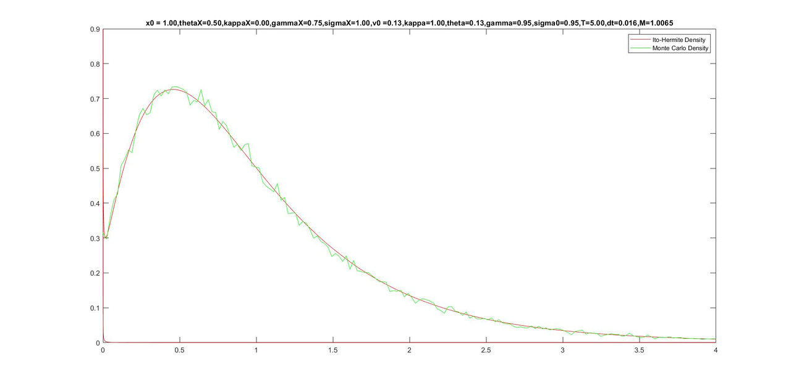](https://postimg.cc/DJST6h4t)

---

### #1452 — Amin (Topic Author)
*June 5, 2022, 8:49 AM*

Friends, you can freely use     V0!=theta (Starting vol V0 not equal to theta)  for SV SDE by using the last set of
functions I posted yesterday.

But dt-integral step value function needs improvement.

After overcoming these problems, I want to write a more general program where friends could specify expansion order of
2D Z-series in both volatility and asset direction. I also want to improve the part where I have used series inversion
to calculate asset density from 2D density. There will also be a lot of small improvements that I want to continue to do
during next week.

---

### #1453 — Amin (Topic Author)
*June 6, 2022, 1:57 PM*

Friends, today I continued to work on improvement of dt-integral. I think my analytics are sound but still my results
for dt-integral for mean-reverting SDEs start to slightly diverge from monte carlo results of dt-integral after 3-4
years. with kappa=1, the difference is small but continues to increase with time and after six years, they are not close
to each other anymore. Tomorrow, I will outline my analytics and related solution for dt-integral for mean-reverting
SDEs.

Meanwhile mind control torture continues. I have been sleeping in the car garage (porch) since the summers started.
Yesterday when I went to sleep in the garage, it was very hot and I decided to sleep inside and turned on
air-conditioner in my room. There was no smell in the air but I started to feel very miserable. There were some gases in
the air-conditioner. I would not be able to sleep but I was not in my proper senses either. I knew it was a bad decision
to sleep inside and wanted to go to porch again but I had inhaled enough gas and therefore I had no energy left to get
up and go outside and I continued to simply lie devoid of any energy. After a very miserable one and a half hour, I
somehow mustered enough energy to turn off the air-conditioner and went to sleep in the  porch again. Mind control guy
was saying that they would not go soft on me as every time they become soft with me and let me work with ease, it
results in a nightmare for them. I want to request friends to ask the mind control agencies to become better and let me
use air-conditioners now as it is already very very hot at this time of the year.

---

### #1454 — Amin (Topic Author)
*June 7, 2022, 11:35 AM*

Friends for a context to post below and in order to get oriented with the problem, please read the following posts first

https://forum.wilmott.com/viewtopic.php?f=4&t=99702&start=1200#p867718

https://forum.wilmott.com/viewtopic.php?f=4&t=99702&start=1215#p867940

https://forum.wilmott.com/viewtopic.php?f=4&t=99702&start=1215#p867941

https://forum.wilmott.com/viewtopic.php?f=4&t=99702&start=1290#p868483

https://forum.wilmott.com/viewtopic.php?f=4&t=99702&start=1290#p868484

https://forum.wilmott.com/viewtopic.php?f=4&t=99702&start=1290#p868487

Posts related to above posts and also recent posts

---

### #1455 — Amin (Topic Author)
*June 7, 2022, 12:19 PM*

We have a general two SDE problem given as

$ dV(t)= \mu_1 \, V(t)^{\beta_1} \, dt +\, \mu_2 \, V(t)^{\beta_2} \, dt \, +\, \sigma \, V(t)^{\gamma} \, dZ_1(t)$

our asset SDE is given as

$ dX(t)= \mu_{x1} \, X(t)^{\beta_{x1}} \, dt +\, \mu_{x2} \, X(t)^{\beta_{x2}} \, dt \, +\, \sigma_x \, V(t)^{\gamma_v} \, X(t)^{\gamma_x} \, dZ_2(t)$

We do not deal with above SDEs in original coordinates and rather convert them to Bessel coordinates.

Here I will take a break and tell friends that whenever I tried solving even 1D SDEs analytically  in original
coordinates, I failed however I could solve 1D SDEs in Bessel coordinates very easily. Only know when I was working on
this 2D SV project that I realized that original coordinates in 1D require solution of proper stochastic dt-integral in
variance as opposed to constant squared volatility in Bessel coordinates. At that time I did not have a proper
understanding of the problem and I would try by calculating dt-integral merely by a multiplication with delta t and it
never worked. Working on this project gave me understanding that 1D SDEs can also be solved in original coordinates in
various ways but we have to be careful with stochastic dt-integral.

For the current 2D SV project, we remain in Bessel framework for both asset and stochastic volatility SDEs.

For the stochastic volatility SDE we have the new transformed SDE in bessel coordinates given as

$ dw(t)= \mu_w(t)  dt  +\, \sigma \, dZ_1(t)$

where
$\mu_w \, = \mu_1 \, {((1-\gamma)w(t))}^{\beta_1-\gamma} \, dt +\, \mu_2 \, {((1-\gamma)w(t))}^{\beta_2-\gamma} \, dt \, - \, \frac{ .5 \,{\sigma}^2 \, \gamma}{((1-\gamma)w(t))} \, dt $

while our asset SDE in Bessel coordinates becomes

$ dq(t)= \mu_q(t)  dt  +\, \sigma_X \, V(t)^{\gamma_v}  \, dZ_2(t)$

where

$\mu_q \, = \mu_{x1} \, {((1-\gamma_x)q(t))}^{\beta_{x1}-\gamma_x} \, dt +\, \mu_{x2} \, {((1-\gamma_x)q(t))}^{\beta_{x2}-\gamma_x} \, dt \, - \, \frac{ .5 \,{\sigma}^2 \,\gamma_x \,{V(t)}^{2 \, \gamma_v} }{((1-\gamma_x)q(t))} \, dt $

---

### #1456 — Amin (Topic Author)
*June 7, 2022, 1:46 PM*

For the series solution of SV equation, we have [viewtopic.php?f=4&t=99702&start=1200#p867718](https://forum.wilmott.com/viewtopic.php?f=4&t=99702&start=1200#p867718)

From the derivation above, we find that constant CDF lines of bessel form of the SV Fokker-planck equation are given as

$\frac{dw}{dt}\, =\, f(w)\, =\, \mu(w) \, + \, .5 {\sigma}^2 Z \frac{\partial Z}{\partial w} - \, .5 {\sigma}^2 \frac{\partial^2 Z}{\partial w^2} [\frac{\partial Z}{\partial w}]^{-1}$

Our second order solution to differential equation of constant CDF lines of SV SDE is given as

$w(t_1) \, =\, w(t_0)+ f(w(t_0)) \, \Delta t+\, f'(w(t_0))  f(w(t_0))  \,\frac{ {\Delta t}^2}{2} \,$

Coming to the asset equation that has dependence both on q itself and stochastic volatility V. We write the evolution
equation for asset along constant CDF lines as

$\frac{dq}{dt}\, =\, g(q,V)\, =\, \mu(q,V) \, + \, .5 {\sigma_x}^2 {V(t)}^{2\, \gamma_v} \Big[ Z_2 \frac{\partial Z_2}{\partial q} - \, \frac{\partial^2 Z_2}{\partial q^2} [\frac{\partial Z_2}{\partial q}]^{-1} \Big]$

 Our second order solution to differential equation of constant CDF lines of Asset SDE is given as

$q(t_1) \, =\, q(t_0)+ g(q(t_0),V(t_0)) \, \Delta t+\, g_q(q(t_0),V(t_0))  g(q(t_0),V(t_0))  \,\frac{ {\Delta t}^2}{2} \,+\, g_V(q(t_0),V(t_0))  h(V(t_0))  \,\frac{ {\Delta t}^2}{2} \,$

I want to tell friends that we have still not included last second order term that depends on derivative of volatility
in our matlab program and this remains to be done.

In the above equation

$h(V(t))\,= \, \frac{dV}{dt}\,$

which is the derivative of volatility (in order to remain on constant CDF lines) in original stochastic volatility
coordinates. We only calculated$\frac{dw}{dt}\,=f(w)\,$ in Bessel coordinates. For a proper second order solution, we
will have to calculate$h(V(t))\,= \, \frac{dV}{dt}\,$ in original stochastic volatility coordinates and then use it in
our analysis. I plan on doing that with second version of the program due in a few weeks.

For reference of friends

$  \frac{\partial V}{\partial t} = \, h(v(t))\, =\mu(V) - .5 \, \frac{\partial \big[{\sigma}^2 {V(t)}^{2 \gamma}  \big]}{\partial V}+ .5\,{\sigma}^2 {V(t)}^{2 \gamma}  \Big[ Z \frac{\partial Z}{\partial V} - \, \frac{\partial^2 Z}{\partial V^2} [\frac{\partial Z}{\partial V}]^{-1} \Big]$

But on a second thought, it seems that we do not need to calculate$h(V(t))\,= \, \frac{dV}{dt}\,$ in original
coordinates and we can replace it with

$h(V(t))\,= \, \frac{dw}{dt}\,\, \frac{dV}{dw}\, =f(w(t)) \, \frac{dV}{dw}\,$ , where$\, \frac{dV}{dw}\,$ can be
calculated from bessel transformation relationship. So our asset equation to second order accuracy would be

$q(t_1) \, =\, q(t_0)+ g(q(t_0),V(t_0)) \, \Delta t+\, g_q(q(t_0),V(t_0))  g(q(t_0),V(t_0))  \,\frac{ {\Delta t}^2}{2} \,+\, g_V(q(t_0),V(t_0))  f(w(t_0)) \frac{dV}{dw} \, \,\frac{ {\Delta t}^2}{2} \,$

---

### #1457 — Amin (Topic Author)
*June 8, 2022, 10:15 AM*

In this post I want to share my analytics for stochastic dt-integral of mean-reverting SDEs. A typical mean reverting
SDE is of the form.

$dV(t) \, = \kappa \, (\theta \, - \, V(t) \,) dt + \, \sigma \, {V(t)}^{\gamma} \, dZ(t)\,$

We want to find the value of$\int_0^t \, V(s) \,ds$ and later find step values of that integral over each time period
given as$\int_{t_0}^{t_1} \, V(s) \,ds$ and$\int_{t_1}^{t_2} \, V(s) \,ds$ and$\int_{t_2}^{t_3} \, V(s) \,ds$ and so on.

We first solve for the SDE(for different times) like we have usual treatment of classic mean-reverting SDEs. This gives
us

$V(t_1)\, = \exp(- \, \kappa t_1) V(t_0) + \theta \, (1-\exp(- \, \kappa t_1)) +\, \exp(- \, \kappa t_1) \int_{t_0}^{t_1} \, \exp( \, \kappa t)\sigma  {V(t)}^{\gamma} \, dZ(t)\,$

for $V(t_2)\,$ we have

$V(t_2)\, = \exp(- \, \kappa t_2) V(t_0) + \theta \, (1-\exp(- \, \kappa t_2)) +\, \exp(- \, \kappa t_2) \int_{t_0}^{t_2} \, \exp( \, \kappa t)\sigma  {V(t)}^{\gamma} \, dZ(t)\,$

$ = \exp(- \, \kappa t_2) V(t_0) + \theta \, (1-\exp(- \, \kappa t_2)) +\, \exp(- \, \kappa t_2) \int_{t_0}^{t_1} \, \exp( \, \kappa t)\sigma  {V(t)}^{\gamma} \, dZ(t)\,+\, \exp(- \, \kappa t_2) \int_{t_1}^{t_2} \, \exp( \, \kappa t)\sigma  {V(t)}^{\gamma} \, dZ(t)\,$

In above, We have split the integral into orthogonal parts as

$ \int_{t_0}^{t_2} \, \exp( \, \kappa t)\sigma  {V(t)}^{\gamma} \, dZ(t)\,=\,\int_{t_0}^{t_1} \, \exp( \, \kappa t)\sigma  {V(t)}^{\gamma} \, dZ(t)\,+ \int_{t_1}^{t_2} \, \exp( \, \kappa t)\sigma  {V(t)}^{\gamma} \, dZ(t)\,$

Similarly at date $t_3$ our solution to V(t) is given as

$V(t_3) = \exp(- \, \kappa t_3) V(t_0) + \theta \, (1-\exp(- \, \kappa t_3)) +\, \exp(- \, \kappa t_3) \int_{t_0}^{t_1} \, \exp( \, \kappa t)\sigma  {V(t)}^{\gamma} \, dZ(t)\,$

$+\, \exp(- \, \kappa t_3) \int_{t_1}^{t_2} \, \exp( \, \kappa t)\sigma  {V(t)}^{\gamma} \, dZ(t)\,+\, \exp(- \, \kappa t_3) \int_{t_2}^{t_3} \, \exp( \, \kappa t)\sigma  {V(t)}^{\gamma} \, dZ(t)\,$

Now trying to approximate the dt-integral over first three time steps, we get

$\int_{t_0}^{t_3} \, V(t) \, dt\, = \big[ \, V(t_1) \, + \, V(t_2) \,+\, V(t_3) \, \big] \Delta t$

$=\Big[ \big[ (\exp(- \, \kappa t_1) + \exp(- \, \kappa t_2) +\exp(- \, \kappa t_3) ) \big] V(t_0) +\big[  (1-\exp(- \, \kappa t_1)) +  (1-\exp(- \, \kappa t_2)) +  (1-\exp(- \, \kappa t_3)) \big] \theta $

$+\big[ (\exp(- \, \kappa t_1) + \exp(- \, \kappa t_2) +\exp(- \, \kappa t_3) ) \big] \,\int_{t_0}^{t_1} \, \exp( \, \kappa t)\sigma  {V(t)}^{\gamma} \, dZ(t)\,$

$+\big[ (\exp(- \, \kappa t_2) +\exp(- \, \kappa t_3) ) \big] \,\int_{t_1}^{t_2} \, \exp( \, \kappa t)\sigma  {V(t)}^{\gamma} \, dZ(t)\,$

$+\big[ (\exp(- \, \kappa t_3) ) \big] \,\int_{t_2}^{t_3} \, \exp( \, \kappa t)\sigma  {V(t)}^{\gamma} \, dZ(t)\, \Big] \, \Delta t$

We can represent the stochastic integrals in above equation in hermite polynomial basis since they are already in the
form of Z-series (We just take first three hermite polynomials in our analysis for brevity) , this gives us

$\,\int_{t_0}^{t_1} \, \exp( \, \kappa t)\sigma  {V(t)}^{\gamma} \, dZ(t)\,=a_{11} H_1(t_1) \, +a_{12} H_2(t_1) +\,a_{13} H_3(t_1) \, + ...$

$\,\int_{t_1}^{t_2} \, \exp( \, \kappa t)\sigma  {V(t)}^{\gamma} \, dZ(t)\,=a_{21} H_1(t_2) \, +a_{22} H_2(t_2) +\,a_{23} H_3(t_2) \, + ...$

$\,\int_{t_2}^{t_3} \, \exp( \, \kappa t)\sigma  {V(t)}^{\gamma} \, dZ(t)\,=a_{31} H_1(t_3) \, +a_{32} H_2(t_3) +\,a_{33} H_3(t_3) \, + ...$

Inserting above hermite representation in the approximate dt-integral, we get

$\int_{t_0}^{t_3} \, V(t) \, dt\, = \big[ \, V(t_1) \, + \, V(t_2) \,+\, V(t_3) \, \big] \Delta t$

$=\Big[ \big[ (\exp(- \, \kappa t_1) + \exp(- \, \kappa t_2) +\exp(- \, \kappa t_3) ) \big] V(t_0) +\big[  (1-\exp(- \, \kappa t_1)) +  (1-\exp(- \, \kappa t_2)) +  (1-\exp(- \, \kappa t_3)) \big] \theta $

$+\big[ (\exp(- \, \kappa t_1) + \exp(- \, \kappa t_2) +\exp(- \, \kappa t_3) ) \big] \,\big[a_{11} H_1(t_1) \, +a_{12} H_2(t_1) +\,a_{13} H_3(t_1) \, + ...\big]\,$

$+\big[ (\exp(- \, \kappa t_2) +\exp(- \, \kappa t_3) ) \big] \,\,\big[a_{21} H_1(t_2) \, +a_{22} H_2(t_2) +\,a_{23} H_3(t_2) \, + ...\big]\,$

$+\big[ (\exp(- \, \kappa t_3) ) \big] \,\,\big[a_{31} H_1(t_3) \, +a_{32} H_2(t_3) +\,a_{33} H_3(t_3) \, + ...\big]\, \Big] \, \Delta t$

This gives us variance of dt-integral for first three time steps as

$Var \Big[\int_{t_0}^{t_3} \, V(t) \, dt\, \Big]$

$=\Big[{\big[ (\exp(- \, \kappa t_1) + \exp(- \, \kappa t_2) +\exp(- \, \kappa t_3) ) \big] }^2 \, {a_{11}}^2 Var\big[H_1(t_1)\big]$

$+{\big[ (\exp(- \, \kappa t_1) + \exp(- \, \kappa t_2) +\exp(- \, \kappa t_3) ) \big] }^2 \, {a_{12}}^2 Var\big[H_2(t_1)\big]$

$+{\big[ (\exp(- \, \kappa t_1) + \exp(- \, \kappa t_2) +\exp(- \, \kappa t_3) ) \big] }^2 \, {a_{13}}^2 Var\big[H_3(t_1)\big]$

$+{\big[ (\exp(- \, \kappa t_2) +\exp(- \, \kappa t_3) ) \big] }^2 \, {a_{21}}^2 Var\big[H_1(t_2)\big]$

$+{\big[ (\exp(- \, \kappa t_2) +\exp(- \, \kappa t_3) ) \big] }^2 \, {a_{22}}^2 Var\big[H_2(t_2)\big]$

$+{\big[ (\exp(- \, \kappa t_2) +\exp(- \, \kappa t_3) ) \big] }^2 \, {a_{23}}^2 Var\big[H_3(t_2)\big]$

$+{\big[ \exp(- \, \kappa t_3) \big] }^2 \, {a_{31}}^2 Var\big[H_1(t_3)\big]$

$+{\big[ \exp(- \, \kappa t_3) \big] }^2 \, {a_{32}}^2 Var\big[H_2(t_3)\big]$

$+{\big[ (\exp(- \, \kappa t_3)  \big] }^2 \, {a_{33}}^2 Var\big[H_3(t_3)\big]\, \Big] {\Delta t}^2$

Since we want to match variances on every step, we have to calculate the above variances on every time step. On second
time step the variances would be

$Var \Big[\int_{t_0}^{t_2} \, V(t) \, dt\, \Big]$

$=\Big[{\big[ (\exp(- \, \kappa t_1) + \exp(- \, \kappa t_2) ) \big] }^2 \, {a_{11}}^2 Var\big[H_1(t_1)\big]$

$+{\big[ (\exp(- \, \kappa t_1) + \exp(- \, \kappa t_2) ) \big] }^2 \, {a_{12}}^2 Var\big[H_2(t_1)\big]$

$+{\big[ (\exp(- \, \kappa t_1) + \exp(- \, \kappa t_2) ) \big] }^2 \, {a_{13}}^2 Var\big[H_3(t_1)\big]$

$+{\big[ (\exp(- \, \kappa t_2) ) \big] }^2 \, {a_{21}}^2 Var\big[H_1(t_2)\big]$

$+{\big[ (\exp(- \, \kappa t_2) ) \big] }^2 \, {a_{22}}^2 Var\big[H_2(t_2)\big]$

$+{\big[ (\exp(- \, \kappa t_2) ) \big] }^2 \, {a_{23}}^2 Var\big[H_3(t_2)\big] \Big] {\Delta t}^2$

Similarly variance of stochastic integral for first time step is given as

$Var \Big[\int_{t_0}^{t_1} \, V(t) \, dt\, \Big]$

$=\Big[{\big[ (\exp(- \, \kappa t_1)  ) \big] }^2 \, {a_{11}}^2 Var\big[H_1(t_1)\big]$

$+{\big[ (\exp(- \, \kappa t_1)  ) \big] }^2 \, {a_{12}}^2 Var\big[H_2(t_1)\big]$

$+{\big[ (\exp(- \, \kappa t_1)  ) \big] }^2 \, {a_{13}}^2 Var\big[H_3(t_1)\big]  \Big] {\Delta t}^2$

Now we want to find coefficients of hermite representation so that on each step, total variance of each hermite
polynomial matches with the variance of stochastic dt-integral at that step.

On the first step of the integral from $t_0$  to  $ t_1$ , there are no calculations and

$ \Big[\int_{t_0}^{t_1} \, V(t) \, dt\, \Big]$

$=c_1(t_1) \, H_1\,+ \,c_2(t_1) \, H_2\, + \, c_3(t_1) \, H_3\, $

where

$c_1(t_1) \,= \exp(- \, \kappa t_1)  \, a_{11} \, \Delta t$

$c_2(t_1) \,= \exp(- \, \kappa t_1)  \, a_{12} \, \Delta t$

$c_3(t_1) \,= \exp(- \, \kappa t_1)  \, a_{13} \, \Delta t$

On second step, we have for one step addition that hermite coefficients are chosen so that total variance of dt-integral
after second step given our hermite coefficients on previous step match with total variance after second step. We match
coefficients of first hermite polynomial with cumulative variance of first hermite polynomial in the equations below.
For that we have

${\big[ c_1(t_1) \, + \, c_1(t_2) \, \big] }^2 = \Big[ \, {\big[ (\exp(- \, \kappa t_1) + \exp(- \, \kappa t_2) ) \big] }^2 \, {a_{11}}^2+{\big[ (\exp(- \, \kappa t_2) ) \big] }^2 \, {a_{21}}^2 \Big] \, {\Delta t}^2$

(The reason to add$c_1(t_1)$ and$c_1(t_2)$ linearly inside the square is that our hermite polynomials are perfectly
correlated across time and there is no way to maintain orthogonality over time as in monte carlo.)

which gives us

$\, c_1(t_2) \, = \Big[\,\sqrt{ {\big[ (\exp(- \, \kappa t_1) + \exp(- \, \kappa t_2) ) \big] }^2 \, {a_{11}}^2+{\big[ (\exp(- \, \kappa t_2) ) \big] }^2 \, {a_{21}}^2}\,- \exp(- \, \kappa t_1) \, a_{11} \Big] \, \Delta t$

Similarly value of step coefficient of second hermite would be

$\, c_2(t_2) \, = \Big[ \,\sqrt{ {\big[ (\exp(- \, \kappa t_1) + \exp(- \, \kappa t_2) ) \big] }^2 \, {a_{12}}^2+{\big[ (\exp(- \, \kappa t_2) ) \big] }^2 \, {a_{22}}^2}\,- \exp(- \, \kappa t_1) \, a_{12}\Big] \, \Delta t $

The value of step coefficients of third hermite would be

$\, c_3(t_2) \, = \Big[ \,\sqrt{ {\big[ (\exp(- \, \kappa t_1) + \exp(- \, \kappa t_2) ) \big] }^2 \, {a_{13}}^2+{\big[ (\exp(- \, \kappa t_2) ) \big] }^2 \, {a_{23}}^2}\,- \exp(- \, \kappa t_1) \, a_{13}\Big] \, \Delta t $

With above values our hermite representation of second step of the integral would be

$ \Big[\int_{t_1}^{t_2} \, V(t) \, dt\, \Big]$

$=c_1(t_2) \, H_1\,+ \,c_2(t_2) \, H_2\, + \, c_3(t_2) \, H_3\, $

Similarly hermite coefficient for third time step$\, c_1(t_3) \,$ should be that when it is added to coefficients of
first two steps, the total variance equals the variance of dt-integral after third step. We match cumulative variance of
first hermite polynomial over first three time steps with coefficients of first hermite polynomial over three time
steps.

${\big[ c_1(t_1) \, + \, c_1(t_2) \,\, + \, c_1(t_3) \, \big] }^2 = \Big[\, {\big[ (\exp(- \, \kappa t_1) + \exp(- \, \kappa t_2)+ \exp(- \, \kappa t_3) ) \big] }^2 \, {a_{11}}^2$

$+{\big[ (\exp(- \, \kappa t_2) + \exp(- \, \kappa t_3)) \big] }^2 \, {a_{21}}^2 + \big[\exp(- \, \kappa t_3) \, \big] \, {a_{31}}^2 \Big] \, {\Delta t}^2$

Solving for  $\, c_1(t_3) \,$, we get one step value of the first hermite coefficient as

$\, c_1(t_3) \, = \Big[ \, \sqrt{\big[ {\big[ (\exp(- \, \kappa t_1) + \exp(- \, \kappa t_2)+ \exp(- \, \kappa t_3) ) \big] }^2 \, {a_{11}}^2+{\big[ (\exp(- \, \kappa t_2) + \exp(- \, \kappa t_3)) \big] }^2 \, {a_{21}}^2 + \big[\exp(- \, \kappa t_3) \, \big] \, {a_{31}}^2 \big] } \, $

$- \,\sqrt{ {\big[ (\exp(- \, \kappa t_1) + \exp(- \, \kappa t_2) ) \big] }^2 \, {a_{11}}^2+{\big[ (\exp(- \, \kappa t_2) ) \big] }^2 \, {a_{21}}^2}\, \Big] \, \Delta t$

Similarly we can calculate value of step coefficients of second hermite as

$\, c_2(t_3) \, =\Big[ \, \sqrt{\big[ {\big[ (\exp(- \, \kappa t_1) + \exp(- \, \kappa t_2)+ \exp(- \, \kappa t_3) ) \big] }^2 \, {a_{12}}^2+{\big[ (\exp(- \, \kappa t_2) + \exp(- \, \kappa t_3)) \big] }^2 \, {a_{22}}^2 + \big[\exp(- \, \kappa t_3) \, \big] \, {a_{32}}^2 \big] } \, $

$- \,\sqrt{ {\big[ (\exp(- \, \kappa t_1) + \exp(- \, \kappa t_2) ) \big] }^2 \, {a_{12}}^2+{\big[ (\exp(- \, \kappa t_2) ) \big] }^2 \, {a_{22}}^2}\, \Big] \, \Delta t$

and

$\, c_3(t_3) \, =\Big[\, \sqrt{\big[ {\big[ (\exp(- \, \kappa t_1) + \exp(- \, \kappa t_2)+ \exp(- \, \kappa t_3) ) \big] }^2 \, {a_{13}}^2+{\big[ (\exp(- \, \kappa t_2) + \exp(- \, \kappa t_3)) \big] }^2 \, {a_{23}}^2 + \big[\exp(- \, \kappa t_3) \, \big] \, {a_{33}}^2 \big] } \, $

$- \,\sqrt{ {\big[ (\exp(- \, \kappa t_1) + \exp(- \, \kappa t_2) ) \big] }^2 \, {a_{13}}^2+{\big[ (\exp(- \, \kappa t_2) ) \big] }^2 \, {a_{23}}^2}\, \, \Big] \, \Delta t$

With above values our hermite representation of third step of the integral would be

$ \Big[\int_{t_2}^{t_3} \, V(t) \, dt\, \Big]$

$=c_1(t_3) \, H_1\,+ \,c_2(t_3) \, H_2\, + \, c_3(t_3) \, H_3\, $

It turns out that coefficients on each hermite polynomial for one particular step of the stochastic time integral would
be square root of the total variance of that particular hermite polynomial at the end of the time interval minus square
root of the total variance of that particular hermite at the start of the time interval for a given dt-integral.

This is how I did the calculation of value of stochastic time integral over each step in the program.

I still have to discuss how to calculate the values of orthogonal hermite coefficients on each time step like
$ a_{11} \, , a_{21} \, ,a_{31} $ for first hermite polynomial and$ a_{12} \, , a_{22} \, ,a_{32} $ for second hermite
polynomial and so on.

---

### #1458 — Amin (Topic Author)
*June 8, 2022, 11:57 AM*

To clarify, if there is only one stochastic variable(or dt-integral) in the future, its value can easily be represented
by adding variances through addition of squared hermite coefficients. But if dt-integral is represented with hermites
and there are large number of dependent parts of the integral, then we have to solve it in the way I wrote in the
previous post.

---

### #1459 — Amin (Topic Author)
*June 10, 2022, 12:57 PM*

Friends, very sorry for this delay. I had an antipsychotic injection on Tuesday and it was getting difficult to
concentrate on work.

Now coming to the topic of this post which is about calculation of Z-series and hermite representation of stochastic
integrals in the Stochastic volatility SDE.

As I mentioned in yesterday's post that we want to find a hermite representation of the following integrals

$\,\int_{t_0}^{t_1} \, \exp( \, \kappa t)\sigma  {V(t)}^{\gamma} \, dZ(t)\,=ah_1(t_1) H_1(t_1) \, +ah_2(t_1) H_2(t_1) +\,ah_3(t_1) H_3(t_1) \, + ...$

$\,\int_{t_1}^{t_2} \, \exp( \, \kappa t)\sigma  {V(t)}^{\gamma} \, dZ(t)\,=ah_1(t_2) H_1(t_2) \, +ah_2(t_2) H_2(t_2) +\,ah_3(t_2) H_3(t_2) \, + ...$

$\,\int_{t_2}^{t_3} \, \exp( \, \kappa t)\sigma  {V(t)}^{\gamma} \, dZ(t)\,=ah_1(t_3) H_1(t_3) \, +ah_2(t_3) H_2(t_3) +\,ah_3(t_3) H_3(t_3) \, + ...$

What we are given are solution of the stochastic volatility SDE in bessel coordinates. This solution in bessel
coordinates is given as$ w(t_1) $ ,$ w(t_2) $ ,$w(t_3) $ and so on. These solution are in the form of Z-series and can
be represented as

$w(t_1)\, = \, c_0(t_1) \, + \, c_1(t_1) \, Z \, + \, c_2(t_1) \, Z^2 \, + \, c_3(t_1) \, Z^3 \, + \, c_4(t_1) \, Z^4 + ...$

and similarly for $ t_2 $, $t_3 $, .. $t_n$

First we convert the above Z-series of SDE in bessel coordinates to  Z-series of the SDE in original coordinates. We had
learnt earlier how to convert a Z-series of a variable to Z-series of its functions and that is what we will use here.
here

$V(t) \, = {\big[(1-\, \gamma) \, w(t) \big]}^{(1/(1- \, \gamma))}$

Then we will get a Z-series representation of V(t) in original coordinates. This would be in the form for example as

$V(t)\, = \, b_0(t) \, + \, b_1(t) \, Z \, + \, b_2(t) \, Z^2 \, + \, b_3(t) \, Z^3 \, + \, b_4(t) \, Z^4 + ...$

We can further find an equivalent hermite polynomial representation of the above Z-series as

$V(t)\, = \, bh_0(t) \, + \, bh_1(t) \, Z \, + \, bh_2(t) \, (Z^2 \, -1)\, + \, bh_3(t) \, (Z^3\, -\, 3 Z) \, + \, bh_4(t) \, (Z^4\, -6 Z^2 \, + \, 3) + ...$

We would have the above representation of V(t) on every time stage on the time grid.

From the solution of mean-reversion form of the stochastic volatility SDE, we have

$V(t_n) \, = V(t_{n-1}) \, \exp(- \kappa (t_n \, - t_{n -1} )) \, + \theta \, \big[ 1 \, - \, \exp(- \kappa (t_n \, - t_{n -1} ))$

$+ \,  \exp(- \kappa t_n \,) \, \int_{t_{n-1}}^{t_n} \,  \exp( \kappa t \,) \, dZ(t) \, $

We see in above that theta term does not have a coefficient in Z and it is not affecting the noises. So to gain
intuition we write the above equation as

$\,  \exp(- \kappa t_n \,) \, \int_{t_{n-1}}^{t_n} \,  \exp( \kappa t \,) \, dZ(t) \, =V(t_n) \, - V(t_{n-1}) \, \exp(- \kappa (t_n \, - t_{n -1} )) \, $

which means

$ \int_{t_{n-1}}^{t_n} \,  \exp( \kappa t \,) \, dZ(t) \, =\,  \exp(\kappa t_n \,) \,V(t_n) \, -\, \exp( \kappa \, t_{n -1} ) \, V(t_{n-1})  $

Let us suppose, we represent

$ \int_{t_{n-1}}^{t_n} \,  \exp( \kappa t \,) \, dZ(t) \, = \, ah_0(t_n) \, + \, ah_1(t_n) \, Z \, + \, ah_2(t_n) \, (Z^2 \, -1)\, + \, ah_3(t_n) \, (Z^3\, -\, 3 Z) \, + \, ah_4(t_n) \, (Z^4\, -6 Z^2 \, + \, 3) + ...$

Then

$ah_1(t_n) \, = \, \sqrt{ \,{\big[ \exp(\kappa t_n \,) \, bh_1(t_n)\, \big]}^2 \, - \, \,{\big[ \exp(\kappa t_{n-1} \,) \, bh_1(t_{n-1})\, \big]}^2} $

$ah_2(t_n) \, = \, \sqrt{ \,{\big[ \exp(\kappa t_n \,) \, bh_2(t_n)\, \big]}^2 \, - \, \,{\big[ \exp(\kappa t_{n-1} \,) \, bh_2(t_{n-1})\, \big]}^2} $

$ah_3(t_n) \, = \, \sqrt{ \,{\big[ \exp(\kappa t_n \,) \, bh_3(t_n)\, \big]}^2 \, - \, \,{\big[ \exp(\kappa t_{n-1} \,) \, bh_3(t_{n-1})\, \big]}^2} $

Please note that above three equations are variance solution version of the equation below(that we proved earlier)

$ \int_{t_{n-1}}^{t_n} \,  \exp( \kappa t \,) \, dZ(t) \, =\,  \exp(\kappa t_n \,) \,V(t_n) \, -\, \exp( \kappa \, t_{n -1} ) \, V(t_{n-1})  $

After we have found a hermite representation of the above integrals on every time step of the simulation, we can easily
calculate the variance of the dt-integral as we did in a previous post as

For example the variance of dt-integral over first three dates would be

$Var \Big[\int_{t_0}^{t_3} \, V(t) \, dt\, \Big]$

$=\Big[{\big[ (\exp(- \, \kappa t_1) + \exp(- \, \kappa t_2) +\exp(- \, \kappa t_3) ) \big] }^2 \, Var \big[ \int_{t_{0}}^{t_1} \,  \exp( \kappa t \,) \, dZ(t) \,\big]$

$+{\big[ (\exp(- \, \kappa t_2) +\exp(- \, \kappa t_3) ) \big] }^2 \, Var \big[  \int_{t_{1}}^{t_2} \,  \exp( \kappa t \,) \, dZ(t) \,\big]$

$+{\big[ \exp(- \, \kappa t_3) \big] }^2 \,   Var \big[ \int_{t_{2}}^{t_3} \, \exp( \kappa t \,) \, dZ(t) \,\big] \Big] \,  {\Delta t}^2$

which could further be written as

$Var \Big[\int_{t_0}^{t_3} \, V(t) \, dt\, \Big]$

$=\Big[{\big[ (\exp(- \, \kappa t_1) + \exp(- \, \kappa t_2) +\exp(- \, \kappa t_3) ) \big] }^2 \, {ah_1(t_1)}^2 Var\big[H_1(t_1)\big]$

$+{\big[ (\exp(- \, \kappa t_1) + \exp(- \, \kappa t_2) +\exp(- \, \kappa t_3) ) \big] }^2 \,  {ah_2(t_1)}^2 Var\big[H_2(t_1)\big]$

$+{\big[ (\exp(- \, \kappa t_1) + \exp(- \, \kappa t_2) +\exp(- \, \kappa t_3) ) \big] }^2 \,  {ah_3(t_1)}^2 Var\big[H_3(t_1)\big]$

$+{\big[ (\exp(- \, \kappa t_2) +\exp(- \, \kappa t_3) ) \big] }^2 \,  {ah_1(t_2)}^2 Var\big[H_1(t_2)\big]$

$+{\big[ (\exp(- \, \kappa t_2) +\exp(- \, \kappa t_3) ) \big] }^2 \,  {ah_2(t_2)}^2 Var\big[H_2(t_2)\big]$

$+{\big[ (\exp(- \, \kappa t_2) +\exp(- \, \kappa t_3) ) \big] }^2 \,  {ah_3(t_2)}^2 Var\big[H_3(t_2)\big]$

$+{\big[ \exp(- \, \kappa t_3) \big] }^2 \,  {ah_1(t_3)}^2 Var\big[H_1(t_3)\big]$

$+{\big[ \exp(- \, \kappa t_3) \big] }^2 \,  {ah_2(t_3)}^2 Var\big[H_2(t_3)\big]$

$+{\big[ (\exp(- \, \kappa t_3)  \big] }^2 \,  {ah_3(t_3)}^2 Var\big[H_3(t_3)\big]\, \Big] {\Delta t}^2$

Suppose hermite representation of the integral  $\int_{t_0}^{t_3} \, V(t) \, dt\,$ is given as

$\int_{t_0}^{t_3} \, V(t) \, dt\, $

$=vh0\, + \, vh_1 \, Z \, + \, vh_2 \, (Z^2-1) \,\, + \, vh_3 \, (Z^3-3 Z) \,\, + \, vh_4 \, (Z^4-6Z^2 +3) \,$

Then

$vh_1 \, = \, \sqrt{{\big[ (\exp(- \, \kappa t_1) + \exp(- \, \kappa t_2) +\exp(- \, \kappa t_3) ) \big] }^2 \, {ah_1(t_1)}^2 +{\big[ (\exp(- \, \kappa t_2) +\exp(- \, \kappa t_3) ) \big] }^2 \,  {ah_1(t_2)}^2 + {\big[ \exp(- \, \kappa t_3) \big] }^2 \,  {ah_1(t_3)}^2 }$

$vh_2 \, = \, \sqrt{{\big[ (\exp(- \, \kappa t_1) + \exp(- \, \kappa t_2) +\exp(- \, \kappa t_3) ) \big] }^2 \, {ah_2(t_1)}^2 +{\big[ (\exp(- \, \kappa t_2) +\exp(- \, \kappa t_3) ) \big] }^2 \,  {ah_2(t_2)}^2 + {\big[ \exp(- \, \kappa t_3) \big] }^2 \,  {ah_2(t_3)}^2 }$

$vh_3 \, = \, \sqrt{{\big[ (\exp(- \, \kappa t_1) + \exp(- \, \kappa t_2) +\exp(- \, \kappa t_3) ) \big] }^2 \, {ah_3(t_1)}^2 +{\big[ (\exp(- \, \kappa t_2) +\exp(- \, \kappa t_3) ) \big] }^2 \,  {ah_3(t_2)}^2 + {\big[ \exp(- \, \kappa t_3) \big] }^2 \,  {ah_3(t_3)}^2 }$

and so on

so when above coefficients have been calculated, we know the values of coefficients of the series below

$\int_{t_0}^{t_3} \, V(t) \, dt\, $

$=vh0\, + \, vh_1 \, Z \, + \, vh_2 \, (Z^2-1) \,\, + \, vh_3 \, (Z^3-3 Z) \,\, + \, vh_4 \, (Z^4-6Z^2 +3) \,$

The above series in form of hermite polynomials and can easily be converted into a simpler Z-series that can be used for
graphing of density of dt-integral  and other purposes etc.

---

### #1460 — Amin (Topic Author)
*June 15, 2022, 9:49 AM*

Friends, today, I was able to come back to work that had stopped due to antipsychotic injection. I have made several
changes to the program. I saw there was still some discrepancy between monte carlo and our analytic density. I was able
to determine the cause of small mismatch between monte carlo and analytic density and I would be posting my new matlab
program in a day or two. Briefly I was able to improve the fit to program by adding second order correction term due to
stochastic  volatility. Soon I will be sharing my new program .

---

### #1461 — Amin (Topic Author)
*June 15, 2022, 2:04 PM*

>
> For the series solution of SV equation, we have [viewtopic.php?f=4&t=99702&start=1200#p867718](https://forum.wilmott.com/viewtopic.php?f=4&t=99702&start=1200#p867718)
>
>
>
> From the derivation above, we find that constant CDF lines of bessel form of the SV Fokker-planck equation are given
as
>
>
$\frac{dw}{dt}\, =\, f(w)\, =\, \mu(w) \, + \, .5 {\sigma}^2 Z \frac{\partial Z}{\partial w} - \, .5 {\sigma}^2 \frac{\partial^2 Z}{\partial w^2} [\frac{\partial Z}{\partial w}]^{-1}$
>
>
>
> Our second order solution to differential equation of constant CDF lines of SV SDE is given as
>
>
>
> $w(t_1) \, =\, w(t_0)+ f(w(t_0)) \, \Delta t+\, f'(w(t_0))  f(w(t_0))  \,\frac{ {\Delta t}^2}{2} \,$
>
>
>
> Coming to the asset equation that has dependence both on q itself and stochastic volatility V. We write the evolution
equation for asset along constant CDF lines as
>
>
>
>
$\frac{dq}{dt}\, =\, g(q,V)\, =\, \mu(q,V) \, + \, .5 {\sigma_x}^2 {V(t)}^{2\, \gamma_v} \Big[ Z_2 \frac{\partial Z_2}{\partial q} - \, \frac{\partial^2 Z_2}{\partial q^2} [\frac{\partial Z_2}{\partial q}]^{-1} \Big]$
>
>
>
>  Our second order solution to differential equation of constant CDF lines of Asset SDE is given as
>
>
>
>
$q(t_1) \, =\, q(t_0)+ g(q(t_0),V(t_0)) \, \Delta t+\, g_q(q(t_0),V(t_0))  g(q(t_0),V(t_0))  \,\frac{ {\Delta t}^2}{2} \,+\, g_V(q(t_0),V(t_0))  h(V(t_0))  \,\frac{ {\Delta t}^2}{2} \,$
>
>
>
> I want to tell friends that we have still not included last second order term that depends on derivative of volatility
in our matlab program and this remains to be done.
>
> In the above equation
>
> $h(V(t))\,= \, \frac{dV}{dt}\,$
>
> which is the derivative of volatility (in order to remain on constant CDF lines) in original stochastic volatility
coordinates. We only calculated$\frac{dw}{dt}\,=f(w)\,$ in Bessel coordinates. For a proper second order solution, we
will have to calculate$h(V(t))\,= \, \frac{dV}{dt}\,$ in original stochastic volatility coordinates and then use it in
our analysis. I plan on doing that with second version of the program due in a few weeks.
>
>
>
> For reference of friends
>
>
$  \frac{\partial V}{\partial t} = \, h(v(t))\, =\mu(V) - .5 \, \frac{\partial \big[{\sigma}^2 {V(t)}^{2 \gamma}  \big]}{\partial V}+ .5\,{\sigma}^2 {V(t)}^{2 \gamma}  \Big[ Z \frac{\partial Z}{\partial V} - \, \frac{\partial^2 Z}{\partial V^2} [\frac{\partial Z}{\partial V}]^{-1} \Big]$
>
>
>
> But on a second thought, it seems that we do not need to calculate$h(V(t))\,= \, \frac{dV}{dt}\,$ in original
coordinates and we can replace it with
>
>$h(V(t))\,= \, \frac{dw}{dt}\,\, \frac{dV}{dw}\, =f(w(t)) \, \frac{dV}{dw}\,$ , where$\, \frac{dV}{dw}\,$ can be
calculated from bessel transformation relationship. So our asset equation to second order accuracy would be
>
>
>
>
$q(t_1) \, =\, q(t_0)+ g(q(t_0),V(t_0)) \, \Delta t+\, g_q(q(t_0),V(t_0))  g(q(t_0),V(t_0))  \,\frac{ {\Delta t}^2}{2} \,+\, g_V(q(t_0),V(t_0))  f(w(t_0)) \frac{dV}{dw} \, \,\frac{ {\Delta t}^2}{2} \,$
>
.

.

$q(t_1) \, =\, q(t_0)+ g(q(t_0),V(t_0)) \, \Delta t+\, g_q(q(t_0),V(t_0))  g(q(t_0),V(t_0))  \,\frac{ {\Delta t}^2}{2} \,+\, g_V(q(t_0),V(t_0))  f(w(t_0)) \frac{dV}{dw} \, \,\frac{ {\Delta t}^2}{2} \,$

Friends I think that last second order term in the above formula is incorrect.

What is the correct term, I still do not know.

Try

$q(t_1) \, =\, q(t_0)+ g(q(t_0),V(t_0)) \, \Delta t+\, g_q(q(t_0),V(t_0))  g(q(t_0),V(t_0))  \,\frac{ {\Delta t}^2}{2} \,+\, g_V(q(t_0),V(t_0))  f(w(t_0)) \, \,\frac{ {\Delta t}^2}{2} \,$

or

$q(t_1) \, =\, q(t_0)+ g(q(t_0),V(t_0)) \, \Delta t+\, g_q(q(t_0),V(t_0))  g(q(t_0),V(t_0))  \,\frac{ {\Delta t}^2}{2} \,+\, g_V(q(t_0),V(t_0))  f(w(t_0)) \, \frac{dw}{dV} \, \,\frac{ {\Delta t}^2}{2} \,$

I think this term somewhere takes a change of probability derivative and gets multiplied by an extra
$\, \frac{dw}{dV} \,$ . I still do not know exactly why. But above alternatives are very close to exact.

---

### #1462 — Amin (Topic Author)
*June 17, 2022, 6:49 AM*

Friends, I have been begging the scum in American army to end their racist practices but it seems that racist scumbags
in American army consider it my weakness and want to somehow continue my persecution forcefully through the rest of my
life. Though many pseudo-patriotic(Patriotism is true and intelligent love for your country and people of your country
and please do not equate it for love for scum armed forces and their weaponry). Americans may not like my speaking the
truth about scum American army, matter of the fact is that American army is a large group of racist scumbags. Basically
most large armies if they are not kept properly in check become scum. Is it not interesting that many Americans love
their army but think of Pakistani army as full of scum bags. Pakistanis love their army and call American army full of
scumbags. No, all large armies, yours and mine are equally full of scumbags. Basically scumbags in American army suck
the dick of rich and racist jews so as to gain jobs paying millions of dollars in their companies after their
retirement. Friends believe it or not it is really  all about Benjamins. When tens of millions of Benjamins are given by
corrupt racist crooks in American army to scumbag generals in Pakistani army, they start retarding hundreds of talented
people in my country and they love to do it because they can never make such a large number of Benjamins any other way.
So this chain of scumbags starting from racist scumbags in American army to scumbags in Pakistani army(other countries
army) all wanting big millions of Benjamins. destroys talent all over the world. Please thwart the scum in American army
and ask them to respect human beings.

---

### #1463 — Amin (Topic Author)
*June 17, 2022, 4:28 PM*

Friends, I reduced the step size in my simulation by 1/4 i.e. from 1/64 to 1/256 and made some other minor changes and
now the program works perfectly well. We need very small steps at start of simulation and we should be able to take
large steps later but that would require a time dependent step size and would take some effort.

Here are some new graphs. I would be posting the program used to make these graphs in a few minutes.

The fit to monte carlo is very close to perfect.

.

.

[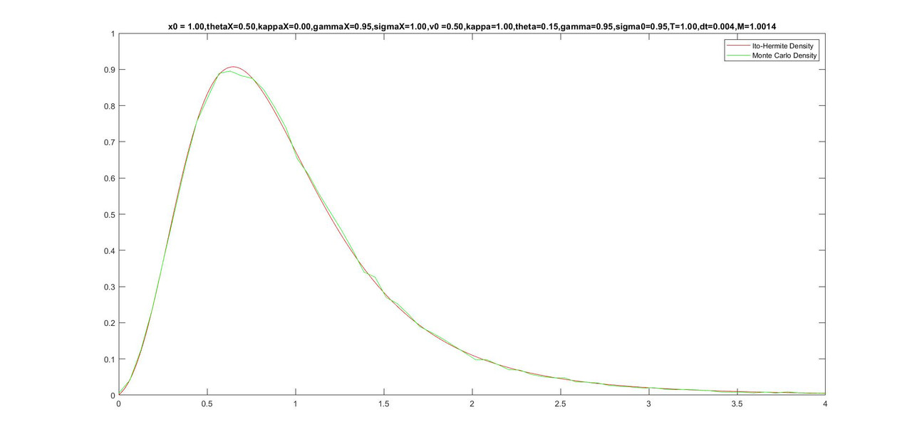](https://postimg.cc/NKZ4bdCD)

[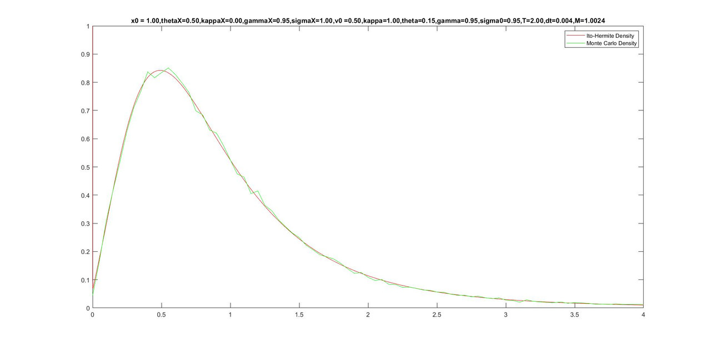](https://postimg.cc/Z0mw1DbD)

[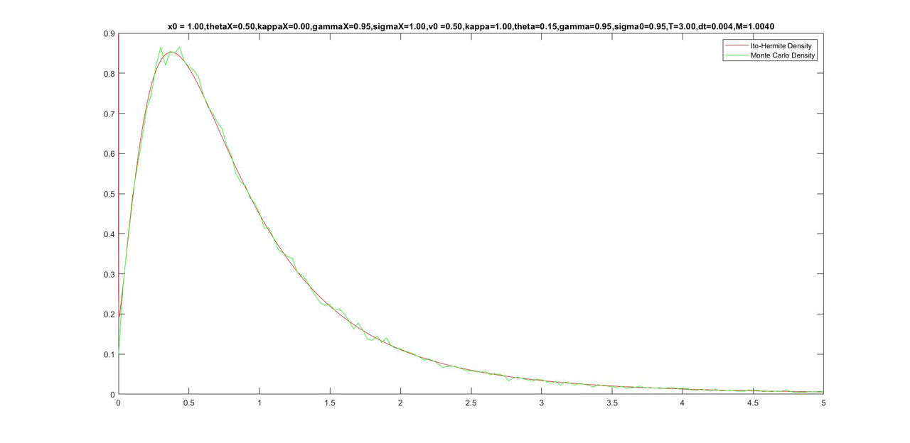](https://postimg.cc/7fsXJHgp)

[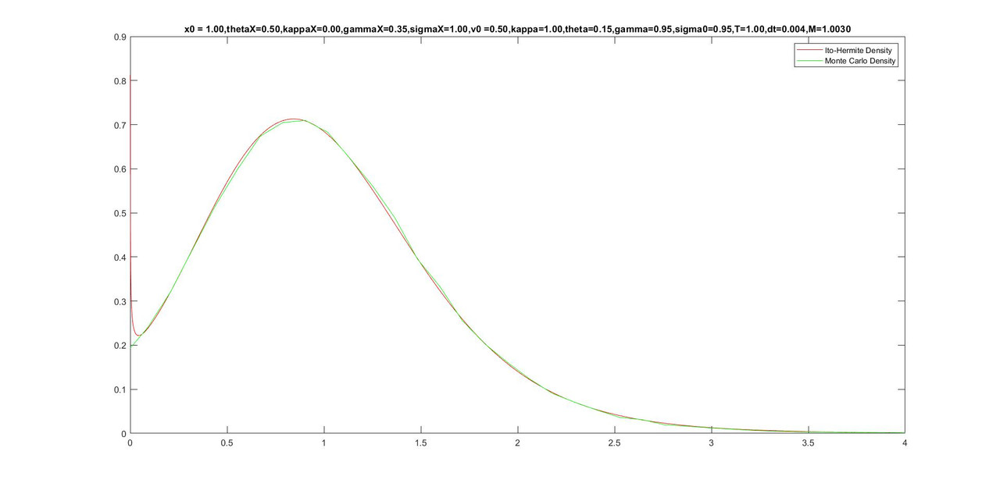](https://postimg.cc/N5fp09r6)

[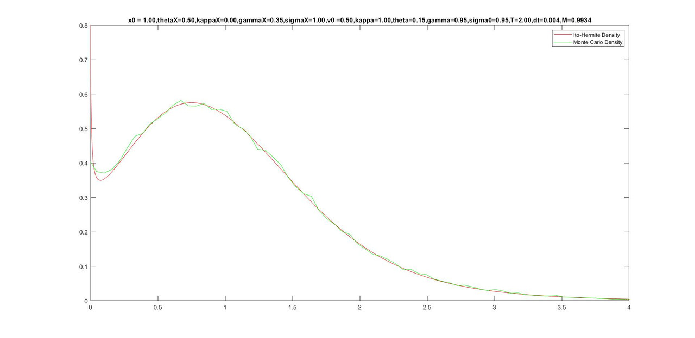](https://postimg.cc/YvvR15Rj)

[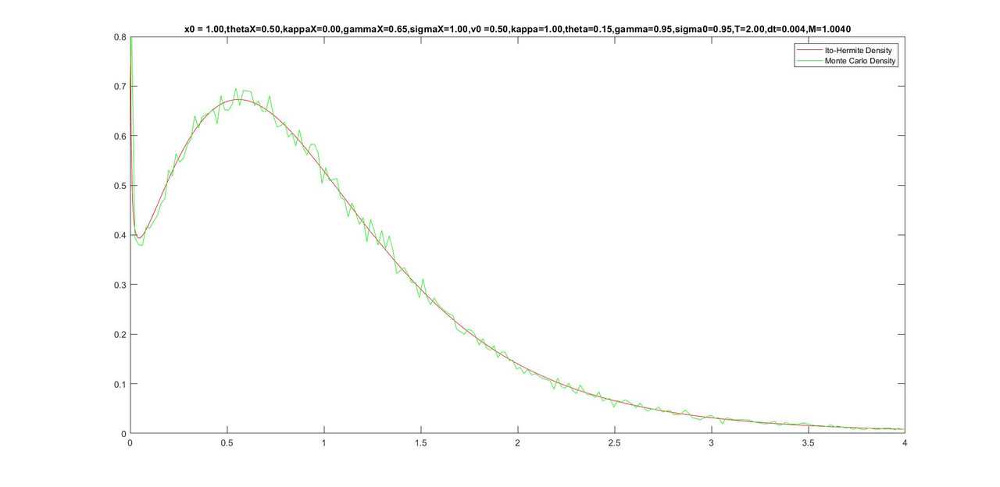](https://postimg.cc/NLxdY7LG)

[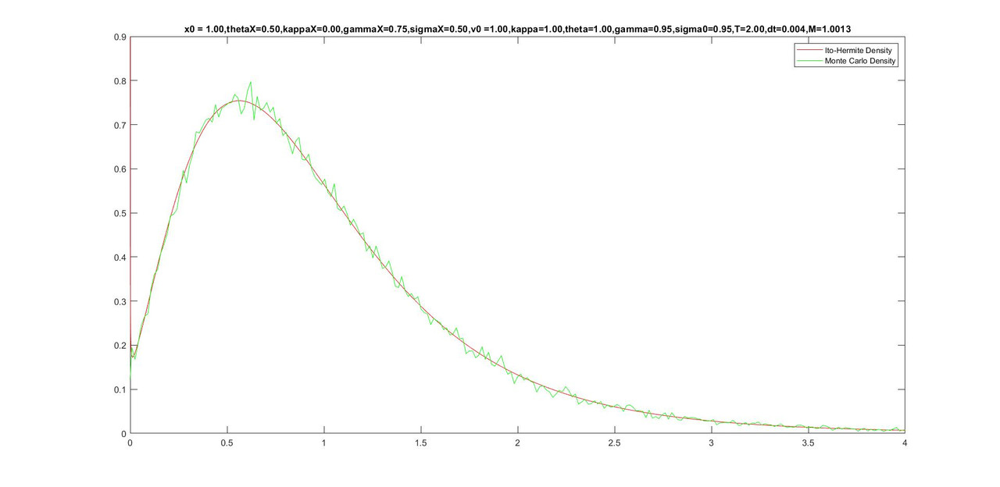](https://postimg.cc/vxGXfD2d)

[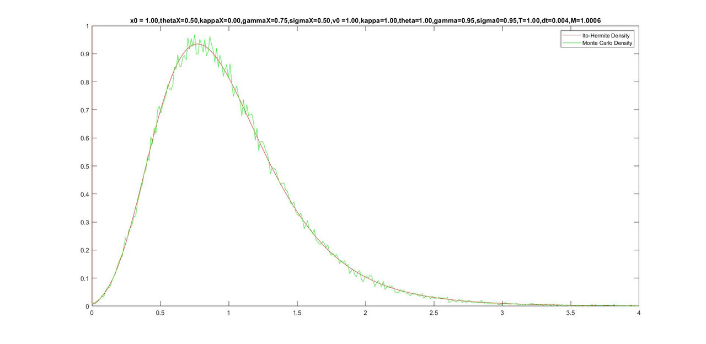](https://postimg.cc/G8Fq4vQQ)

[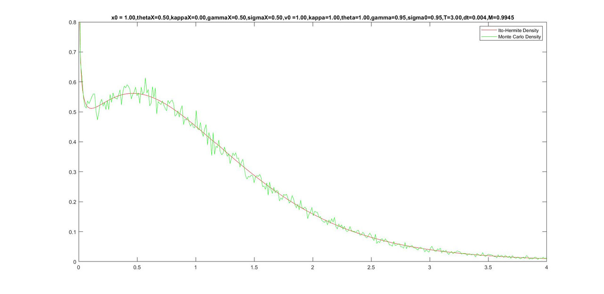](https://postimg.cc/G8wX3Xkt)

---

### #1464 — Amin (Topic Author)
*June 17, 2022, 4:45 PM*

Here is the program used to create above graphs (I have rescaled the graphs though to show the main body)

.

.

.

```
function [] = FPESeriesCoeffsFromGaussiansWilmottNew02A_Lite_2DFPEA4AB02()

%Copyright Ahsan Amin. Infiniti derivatives Technologies.
%Please fell free to connect on linkedin: linkedin.com/in/ahsan-amin-0a53334
%or skype ahsan.amin2999

%I have not directly simulated the SDE but simulated the transformed
%Besse1l process version of the SDE and then changed coordinates to retreive
%the SDE in original coo
%rdinates.
%The present program will analytically evolve only the Bessel Process version of the
%SDE in transformed coordinates.

dt=.125/2/2/2/4;   % Simulation time interval.%Fodiffusions close to zero
             %decrease dt for accuracy.
Tt=64*4*3;%16*2*4;%*4*4*1;%*4;%128*2*2*2;     % Number of simulation levels. Terminal time= Tt*dt; //.125/32*32*16=2
year;
T=Tt*dt;
%
% %Below I have done calculations for smaller step size at start.
%
% %ds(1:64)=dt/16;
% %ds(65:128)=dt/4;
% if(Tt4)&&(Tt20)
% Ts=(64)+((20-4)*4)+(Tt-20);
% ds(1:64)=dt/16;
% ds(65:128)=dt/4;
% ds(129:Ts)=dt;
% end

Ts=Tt;
ds(1:Tt)=dt;

T
sum(ds(1:Ts))
Ts

%Ts=4;
str=input('Check if time is right');

OrderA=4;  %
OrderM=4;  %

if(T>=1)
dtM=1/32;%.0625/1;
TtM=T/dtM;
else
dtM=T/32;%.0625/1;
TtM=T/dtM;
end

%dtM=dt;
%TtM=Tt;

dNn=.2/2;   % Normal density subdivisions width. would change with number of subdivisions
Nn=90;  % No of normal density subdivisions

NnMid=4.0;

v00=1.0;   % starting value of SDE
beta1=0.0;
beta2=1.0;   % Second drift term power.
gamma=.950;%50;   % volatility power.
kappa=1.0;%.950;   %mean reversion parameter.
theta=1.0;%mean reversion target
sigma0=.9500;%Volatility value
NoOfCumulants=6;
SeriesOrder=NoOfCumulants-1;

%you can specify any general mu1 and mu2 and beta1 and beta2.
mu1=1*theta*kappa;   %first drift coefficient.
mu2=-1*kappa;    % Second drift coefficient.
%mu1=0;
%mu2=-1*kappa;

alpha=1;% x^alpha is being expanded. This is currently for monte carlo only.
alpha1=1-gamma;%This is for expansion of integrals for calculation of drift
%and volatility coefficients
%yy(1:Nn)=x0;
w0=v00^(1-gamma)/(1-gamma);
%y0=x0;

x0=1.00;
gammaX=.5;
gammaV=.5;
sigmaX=.50;
thetaX=.50;
kappaX=0.0;
mu1X=thetaX*kappaX;
mu2X=-1*kappaX;
beta1X=0.0;
beta2X=1.0;
q0=x0^(1-gammaX)/(1-gammaX);
alpha1X=1-gammaX;

Z(1:Nn)=(((1:Nn)-6.5/1)*dNn-NnMid);
Z
str=input('Look at Z');
ZProb(1)=normcdf(.5*Z(1)+.5*Z(2),0,1)-normcdf(.5*Z(1)+.5*Z(2)-dNn,0,1);
ZProb(Nn)=normcdf(.5*Z(Nn)+.5*Z(Nn-1)+dNn,0,1)-normcdf(.5*Z(Nn)+.5*Z(Nn-1),0,1);
ZProb(2:Nn-1)=normcdf(.5*Z(2:Nn-1)+.5*Z(3:Nn),0,1)-normcdf(.5*Z(2:Nn-1)+.5*Z(1:Nn-2),0,1);

%%%%%%%%%%%%%%%%%%%%%%%%%%%%%%%%%%%%%%%%%%%%%%%%%%%%%%%%%%%%%%%%%%%%%%%%%%%%%%%%%%%%%%%%%%%%%%

sigma11(1:OrderA+1)=0;
mu11(1:OrderA+1)=0;
mu22(1:OrderA+1)=0;
sigma22(1:OrderA+1)=0;
% index 1 correponds to zero level since matlab indexing starts at one.
sigma11(1)=1;
mu11(1)=1;
mu22(1)=1;
sigma22(1)=1;

for k=1:(OrderA+1)
    if sigma0~=0
        sigma11(k)=sigma0^(k-1);
    end
    if mu1 ~= 0
        mu11(k)=mu1^(k-1);
    end
    if mu2 ~= 0
        mu22(k)=mu2^(k-1);
    end
    if sigma0~=0
        sigma22(k)=sigma0^(2*(k-1));
    end
end

sigma11X(1:OrderA+1)=0;
mu11X(1:OrderA+1)=0;
mu22X(1:OrderA+1)=0;
sigma22X(1:OrderA+1)=0;

sigma11X(1)=1;
mu11X(1)=1;
mu22X(1)=1;
sigma22X(1)=1;

for k=1:(OrderA+1)
    if sigmaX~=0
        sigma11X(k)=sigmaX^(k-1);
    end
    if mu1X ~= 0
        mu11X(k)=mu1X^(k-1);
    end
    if mu2X ~= 0
        mu22X(k)=mu2X^(k-1);
    end
    if sigmaX~=0
        sigma22X(k)=sigmaX^(2*(k-1));
    end
end

%Ft(1:TtM+1,1:(OrderA+1),1:(OrderA+1),1:(OrderA+1),1:(OrderA+1))=0; %General time powers on hermite polynomials
Fp(1:(OrderA+1),1:(OrderA+1),1:(OrderA+1),1:(OrderA+1))=0;%General x powers on coefficients of hermite polynomials.
Fp1(1:(OrderA+1),1:(OrderA+1),1:(OrderA+1),1:(OrderA+1))=0;%General x powers for bessel transformed coordinates.

Fp1X(1:(OrderA+1),1:(OrderA+1),1:(OrderA+1),1:(OrderA+1))=0;
%YCoeff0 and YCoeff are coefficents for original coordinates monte carlo.
%YqCoeff0 and YqCoeff are bessel/lamperti version monte carlo.

YCoeff0(1:(OrderA+1),1:(OrderA+1),1:(OrderA+1),1:(OrderA+1))=0;
YqCoeff0(1:(OrderA+1),1:(OrderA+1),1:(OrderA+1),1:(OrderA+1))=0;
YqCoeff0X(1:(OrderA+1),1:(OrderA+1),1:(OrderA+1),1:(OrderA+1))=0;

%Pre-compute the time and power exponent values in small multi-dimensional arrays
YCoeff = ItoTaylorCoeffsNew(alpha,beta1,beta2,gamma); %expand y^alpha where alpha=1;
YqCoeff = ItoTaylorCoeffsNew(alpha1,beta1,beta2,gamma);%expand y^alpha1 where alpha1=(1-gamma)
YqCoeff=YqCoeff/(1-gamma); %Transformed coordinates coefficients have to be
%further divided by (1-gamma)
YqCoeffX = ItoTaylorCoeffsNew(alpha1X,beta1X,beta2X,gammaX);%expand y^alpha1 where alpha1=(1-gamma)
YqCoeffX=YqCoeffX/(1-gammaX);
for k = 0 : (OrderA)
    for m = 0:k
        l4 = k - m + 1;
        for n = 0 : m
            l3 = m - n + 1;
            for j = 0:n
                l2 = n - j + 1;
                l1 = j + 1;
                %Ft(l1,l2,l3,l4) = dtM^((l1-1) + (l2-1) + (l3-1) + .5* (l4-1));
                Fp(l1,l2,l3,l4) = (alpha + (l1-1) * beta1 + (l2-1) * beta2 + (l3-1) * 2* gamma + (l4-1) * gamma ...
                    - (l1-1) - (l2-1) - 2* (l3-1) - (l4-1));
                Fp1(l1,l2,l3,l4) = (alpha1 + (l1-1) * beta1 + (l2-1) * beta2 + (l3-1) * 2* gamma + (l4-1) * gamma ...
                    - (l1-1) - (l2-1) - 2* (l3-1) - (l4-1));

                Fp1X(l1,l2,l3,l4) = (alpha1X + (l1-1) * beta1X + (l2-1) * beta2X + (l3-1) * 2* gammaX + (l4-1) * gammaX
...
                    - (l1-1) - (l2-1) - 2* (l3-1) - (l4-1));

                YCoeff0(l1,l2,l3,l4) =YCoeff(l1,l2,l3,l4).*mu11(l1).*mu22(l2).*sigma22(l3).*sigma11(l4);
                YqCoeff0(l1,l2,l3,l4) =YqCoeff(l1,l2,l3,l4).*mu11(l1).*mu22(l2).*sigma22(l3).*sigma11(l4);
                YqCoeff0X(l1,l2,l3,l4) =YqCoeffX(l1,l2,l3,l4).*mu11X(l1).*mu22X(l2).*sigma22X(l3).*sigma11X(l4);
            end
        end
    end
end

%%%%%%%%%%%%%%%%%%%%%%%%%%%%%%%%%%%%%%%%%%%%%%%%%%%%%%%%%%%%%%%%%%%%%%%%%%%%%%%%%%%%%%%%%%%%%%

ExpnOrder=6;
SeriesOrder=6;
c(1:SeriesOrder)=0;
c(1)=w0;
wnStart=1;
yydt(wnStart:Nn)=0.0;
tic

for tt=1:Ts
    tt

    if(tt=2)

     [cH0,cH,cVdt] = CalculateVPathStepIntegral04(cprev,c,v00,kappa,theta,gamma,dt,tt,cH0,cH,SeriesOrder);

 %   cVdt
 %   tt
 %   str=input('Look at cVdt');

    end
    end

    DoubleExpnOrder=ExpnOrder*2;

    [qMu0dt,dqMu0dtdq,qMu1dt,dqMu1dtdq] =
BesselDriftAndDerivatives08A0(q0,mu1X,mu2X,beta1X,beta2X,gammaX,DoubleExpnOrder);
    [q2Mu0dt,dq2Mu0dtdq,q2Mu1dt,dq2Mu1dtdq] = BesselDriftAndDerivatives08Aq(q0,sigmaX,gammaX,DoubleExpnOrder);

    [Muq0] = CalculateDriftbCoeffs08A2Dim02(qMu0dt,dqMu0dtdq,cq,SeriesOrder);
    [Muq2] = CalculateDriftbCoeffs08A2Dim02(q2Mu0dt,dq2Mu0dtdq,cq,SeriesOrder);
    [DMuq0] = CalculateDriftbCoeffs08A2Dim02(qMu1dt,dqMu1dtdq,cq,SeriesOrder);
    [DMuq2] = CalculateDriftbCoeffs08A2Dim02(q2Mu1dt,dq2Mu1dtdq,cq,SeriesOrder);

    DvMuq2=Muq2*dt;

    if(tt3)
        Dvfqdc1=SeriesProduct2D1D(Dvfq,dc1)*dt;
        end
        %Dvfqdc1=SeriesProduct2D1D(Dvfqdc1,bv)
        if(tt>3)
        cq=cq+(fq+SeriesProduct2D(fq,Dfq)*dt^0/2+sqrt(1).*Dvfqdc1.*dt^0/2);
        V2gammaNew
        else
        cq=cq+fq;
        %cq=cq+(fq+SeriesProduct2D(fq,Dfq)*dt^0/2);%+sqrt(1).*Dvfqdc1.*dt^0/2);
        end

    end

end

Z1=Z;

[b] = EvaluateSeriesForZ2(cq,Z1,Nn);

Mm=1201;
MmMid=601;
dMm=.05/2;
Q(MmMid+1:Mm)=cq(1,1)+cq(2,1).*dMm.*(1:MmMid-1);
Q(MmMid)=cq(1,1);
%Q(1:70)=cq(1,1)-cq(2,1).*.25.*(70:-1:1);
for mm=1:MmMid-1

    Q(MmMid-mm)=cq(1,1)-cq(2,1).*dMm.*mm;
end
Q(Q<0)=0;

Qa=Q-cq(2,1).*dMm/2;
Qb=Q+cq(2,1).*dMm/2;

Qa(Qa<0.000000001)=0;

Z1Prob(1:Mm)=0;
for nn=1:Nn
    bq(1:6)=b(1:6,nn);

    [Z0Prob] = CalculateProbabilitySeriesInv(Qa,Qb,bq);

%    Z0Prob

%str=input('Look at numbers-tttt')

    Z1Prob(1:Mm)=Z1Prob(1:Mm)+Z0Prob(1:Mm).*ZProb(nn);

end

pQ=Z1Prob/(cq(2,1).*dMm);

xx(1:Mm)=((1-gammaX).*Q(1:Mm)).^(1/(1-gammaX));

xx(xx<.00000001)=0;

pxx(1:Mm)=pQ(1:Mm).*xx(1:Mm).^(-gammaX);

sum(Z1Prob(1:Mm))
Mean=sum(xx(1:Mm).*Z1Prob(1:Mm));
Mean
  w(1:Nn)=c(1);
  for nn=2:SeriesOrder-1
      w(1:Nn)=w(1:Nn)+c(nn)*Z(1:Nn).^(nn-1);
  end

  w

  str=input('Look at w---2');

%  %str=input('Look at numbers')
  yy0(wnStart:Nn)=((1-gamma).*w(wnStart:Nn)).^(1/(1-gamma));

%%%%%%%%%%%%%%%%%%%%%%%%%%%%%%%%%%%%%%%%%%%%%%%%%%%%%%%%%%5
 yy=yy0;
% xx=xx0;
Dfyy(wnStart:Nn)=0;
%Dfyy1(wnStart:Nn)=0;
%Dfyy2(wnStart:Nn)=0;
%Dfxx(wnStart:Nn)=0;
for nn=wnStart+1:Nn-1

    Dfyy(nn) = (yy(nn + 1) - yy(nn - 1))/(Z(nn + 1) - Z(nn - 1));
%    Dfyy1(nn) = (yy1(nn + 1) - yy1(nn - 1))/(Z(nn + 1) - Z(nn - 1));
%    Dfyy2(nn) = (yy2(nn + 1) - yy2(nn - 1))/(Z(nn + 1) - Z(nn - 1));
 %   Dfxx(nn) = (xx(nn + 1) - xx(nn - 1))/(Z(nn + 1) - Z(nn - 1));

    %Change of variable derivative for densities
end
%Dfyy(Nn)=Dfyy(Nn-1);
%Dfyy(1)=Dfyy(2);
%Dfyydt(Nn)=Dfyydt(Nn-1);
%Dfyydt(1)=Dfyydt(2);

pyy(1:Nn)=0;
%pyy1(1:Nn)=0;
%pyy2(1:Nn)=0;
%pxx(1:Nn)=0;
for nn = wnStart+1:Nn-1

    pyy(nn) = (normpdf(Z(nn),0, 1))/abs(Dfyy(nn));
%    pyy1(nn) = (normpdf(Z(nn),0, 1))/abs(Dfyy1(nn));
%    pyy2(nn) = (normpdf(Z(nn),0, 1))/abs(Dfyy2(nn));
 %   pxx(nn) = (normpdf(Z(nn),0, 1))/abs(Dfxx(nn));
end

toc

ItoHermiteMeanVar=sum(yy(wnStart:Nn).*ZProb(wnStart:Nn)) %Original process average from coordinates
ItoHermiteMeanAsset=Mean
disp('true Mean only applicable to standard SV mean reverting type models otherwise disregard');
%TrueMean=theta+(v0-theta)*exp(-kappa*T)%Mean reverting SDE original variable true average
%yy0

theta1=1;
%%%%%%%%%%%%%%%%%%%%%%%%%%%%%%
%rng(29079137, 'twister')
rng(15898837, 'twister')
paths=100000;
V(1:paths)=v00;  %Original process monte carlo.
X=0.0;
X(1:paths)=x0;
alpha1=0;
alpha2=1;
a=mu1X;
b=mu2X;
rho=0;
sigma1=sigmaX;
gammaV=.5;
Random1(1:paths)=0;
Random2(1:paths)=0;

for ttM=1:TtM
Random1=randn(size(Random1));
Random2=randn(size(Random2));

X(1:paths)=X(1:paths)+ ...
    (a* X(1:paths).^alpha1 + b* X(1:paths).^alpha2)* dtM + ...
    sqrt(1-rho^2)* sigma1* V(1:paths).^gammaV.* X(1:paths).^gammaX .*Random1(1:paths) * sqrt(dtM) + ...
    rho* sigma1* V(1:paths).^gammaV .*X(1:paths).^gammaX .*Random2(1:paths)*sqrt(dtM) + ...
    (a*alpha1* X(1:paths).^(alpha1-1)+b*alpha2* X(1:paths).^(alpha2-1)).* ...
    (((a* X(1:paths).^alpha1 + b* X(1:paths).^alpha2)* dtM^2/2)+ ...
    (sqrt(1-rho^2)* sigma1* V(1:paths).^gammaV.* X(1:paths).^gammaX .*Random1(1:paths) *(1-1/sqrt(3)).*dtM^1.5+ ...
    rho* sigma1* V(1:paths).^gammaV .*X(1:paths).^gammaX .*Random2(1:paths)*(1-1/sqrt(3)).*dtM^1.5))+ ...
    .5*(a*alpha1*(alpha1-1)* X(1:paths).^(alpha1-2)+b*alpha2*(alpha2-1).* X(1:paths).^(alpha2-2)).* ...
    ( sigma1^2* V(1:paths).^(2*gammaV).* X(1:paths).^(2*gammaX)) *dtM^2/2 + ...
    sqrt(1-rho^2)* sigma1* V(1:paths).^gammaV.*gammaX.* X(1:paths).^(gammaX-1).* ...
    ((a* X(1:paths).^alpha1 + b* X(1:paths).^alpha2).*Random1(1:paths) * 1/sqrt(3).* dtM^1.5 + ...
    sqrt(1-rho^2)* sigma1* V(1:paths).^gammaV.* X(1:paths).^gammaX .*(Random1(1:paths).^2-1) * dtM/2 + ...
    rho* sigma1* V(1:paths).^gammaV .*X(1:paths).^gammaX .*Random1(1:paths).*Random2(1:paths)*dtM/2)+ ...
    .5*sqrt(1-rho^2)* sigma1* V(1:paths).^gammaV.*gammaX.*(gammaX-1).* X(1:paths).^(gammaX-2).* ...
    (sigma1^2* V(1:paths).^(2*gammaV).* X(1:paths).^(2*gammaX) .*Random1(1:paths).*1/sqrt(3).*dtM^1.5)+ ...
    sqrt(1-rho^2)* sigma1*gammaV.* V(1:paths).^(gammaV-1).* X(1:paths).^(gammaX).* ...
    ((mu1.*V(1:paths).^beta1 + mu2.*V(1:paths).^beta2).*Random1(1:paths) * 1/sqrt(3).* dtM^1.5 + ...
    sigma0*V(1:paths).^gamma.*Random1(1:paths).*Random2(1:paths)*dtM/2)+ ...
    .5*sqrt(1-rho^2)* sigma1*gammaV.*(gammaV-1).* V(1:paths).^(gammaV-2).* X(1:paths).^(gammaX).* ...
    (sigma0^2*V(1:paths).^(2*gamma).*Random1(1:paths)*1/sqrt(3)*dtM^1.5)+ ...
    sqrt(1-rho^2)* sigma1*gammaV.* V(1:paths).^(gammaV-1).*gammaX.* X(1:paths).^(gammaX-1).* ...
    rho.* sigma1.* V(1:paths).^gammaV .*X(1:paths).^gammaX
.*sigma0.*V(1:paths).^gamma.*Random1(1:paths)*1/sqrt(3)*dtM^1.5+ ...
    rho* sigma1* V(1:paths).^gammaV.*gammaX.* X(1:paths).^(gammaX-1).* ...
    ((a* X(1:paths).^alpha1 + b* X(1:paths).^alpha2).*Random2(1:paths) * 1/sqrt(3).* dtM^1.5 + ...
    sqrt(1-rho^2)* sigma1* V(1:paths).^gammaV.* X(1:paths).^gammaX .*Random1(1:paths).*Random2(1:paths) * dtM/2 + ...
    rho* sigma1* V(1:paths).^gammaV .*X(1:paths).^gammaX .*(Random2(1:paths).^2-1)*dtM/2)+ ...
    .5*rho* sigma1* V(1:paths).^gammaV.*gammaX.*(gammaX-1).* X(1:paths).^(gammaX-2).* ...
    (sigma1^2* V(1:paths).^(2*gammaV).* X(1:paths).^(2*gammaX) .*Random2(1:paths).*1/sqrt(3).*dtM^1.5)+ ...
    rho* sigma1*gammaV.* V(1:paths).^(gammaV-1).* X(1:paths).^(gammaX).* ...
    ((mu1.*V(1:paths).^beta1 + mu2.*V(1:paths).^beta2).*Random2(1:paths) * 1/sqrt(3).* dtM^1.5 + ...
    sigma0*V(1:paths).^gamma.*(Random2(1:paths).^2-1)*dtM/2)+ ...
    .5*rho* sigma1*gammaV.*(gammaV-1).* V(1:paths).^(gammaV-2).* X(1:paths).^(gammaX).* ...
    sigma0^2.*V(1:paths).^(2*gamma).*Random2(1:paths) * 1/sqrt(3).* dtM^1.5+ ...
    rho* sigma1*gammaV.* V(1:paths).^(gammaV-1).*gammaX.* X(1:paths).^(gammaX-1).* ...
    rho.* sigma1.* V(1:paths).^gammaV .*X(1:paths).^gammaX
.*sigma0.*V(1:paths).^gamma.*Random2(1:paths)*1/sqrt(3)*dtM^1.5;

VBefore=V;

    V(1:paths)=V(1:paths)+ ...
        (mu1.*V(1:paths).^beta1 + mu2.*V(1:paths).^beta2)*dtM + ...
        sigma0*V(1:paths).^gamma .*Random2(1:paths)*sqrt(dtM) + ...
        (mu1.*beta1*V(1:paths).^(beta1-1) + mu2.*beta2.*V(1:paths).^(beta2-1)).* ...
        ((mu1.*V(1:paths).^beta1 + mu2.*V(1:paths).^beta2)*dtM^2/2 + ...
        sigma0*V(1:paths).^gamma .*Random2(1:paths)*(1-1/sqrt(3))*dtM^1.5) + ...
        .5*(mu1.*beta1.*(beta1-1).*V(1:paths).^(beta1-2) + mu2.*beta2.*(beta2-1).*V(1:paths).^(beta2-2)).* ...
        sigma0^2.*V(1:paths).^(2*gamma).*dtM^2/2 + ...
        sigma0*gamma*V(1:paths).^(gamma-1) .* ...
        ((mu1.*V(1:paths).^beta1 + mu2.*V(1:paths).^beta2).*Random2(1:paths).*1/sqrt(3)*dtM^1.5 + ...
        sigma0.*V(1:paths).^gamma .*(Random2(1:paths).^2-1)*dtM/2) + ...
        .5*sigma0*gamma*(gamma-1).*V(1:paths).^(gamma-2) .* ...
        sigma0^2.*V(1:paths).^(2*gamma) .*Random2(1:paths).*1/sqrt(3)*dtM^1.5;

%Vm=.5*VBefore+.5*V;
Vm=V;

%    X(1:paths)=X(1:paths)+ ...
%    sigma1* Vm(1:paths).^gammaV.* X(1:paths).^gammaX .*Random1(1:paths) * sqrt(dtM) + ...
%    sigma1* Vm(1:paths).^gammaV.*gammaX.* X(1:paths).^(gammaX-1).* ...
%    (sigma1* Vm(1:paths).^gammaV.* X(1:paths).^gammaX .*(Random1(1:paths).^2-1) * dtM/2)+ ...
%    .5*sigma1* Vm(1:paths).^gammaV.*gammaX.*(gammaX-1).* X(1:paths).^(gammaX-2).* ...
%    (sigma1^2* Vm(1:paths).^(2*gammaV).* X(1:paths).^(2*gammaX) .*Random1(1:paths).*1/sqrt(3).*dtM^1.5);%+ ...

end

%SVolMeanAnalytic=thetaV+(V0-thetaV)*exp(-kappaV*dt*Tt)
SVolMeanAnalytic=theta+(v00-theta)*exp(-kappa*dt*Tt)
SVolMeanMC=sum(V(1:paths))/paths
AssetMeanAnalytic=x0
AssetMeanMC=sum(X(1:paths))/paths

% theta
% v00
% kappa
% dt
% Tt
% T

%MeanX

disp('true Mean only applicble to standard SV mean reverting type models otherwise disregard');
TrueMean=theta+(v00-theta)*exp(-kappa*T)%Mean reverting SDE original variable true average

cq

MaxCutOff=30;
NoOfBins=.25*300*ceil(10*gammaX)*T;%round(1*500*gamma^2*4*sigma0/sqrt(MCMean)/(1+kappa));%Decrease the number of bins if
the graph is too
[XDensity,IndexOutX,IndexMaxX] = MakeDensityFromSimulation_Infiniti_NEW(X,paths,NoOfBins,MaxCutOff );
plot(xx(wnStart+1:Mm-1),pxx(wnStart+1:Mm-1),'r',IndexOutX(1:IndexMaxX),XDensity(1:IndexMaxX),'g');
 %plot(y_w(wnStart+1:Nn-1),fy_w(wnStart+1:Nn-1),'r',IndexOutY(1:IndexMaxY),YDensity(1:IndexMaxY),'g',Z(wnStart+1:Nn-1),fy_w(wnStart+1:Nn-1),'b');

title(sprintf('x0 = %.2f,thetaX=%.2f,kappaX=%.2f,gammaX=%.2f,sigmaX=%.2f,v0
=%.2f,kappa=%.2f,theta=%.2f,gamma=%.2f,sigma0=%.2f,T=%.2f,dt=%.3f,M=%.4f',x0,thetaX,kappaX,gammaX,sigmaX,v00,kappa,theta,gamma,sigma0,T,dt,ItoHermiteMeanAsset));
%,sprintf('theta= %f', theta), sprintf('kappa = %f', kappa),sprintf('sigma = %f', sigma0),sprintf('T = %f', T));

legend({'Ito-Hermite Density','Monte Carlo Density'},'Location','northeast')

str=input('red line is density of SDE from Ito-Hermite method, green is monte carlo.');

%plot(y_w(wnStart+1:Nn-1),fy_w(wnStart+1:Nn-1),'r',IndexOutY(1:IndexMaxY),YDensity(1:IndexMaxY),'g',Z(wnStart+1:Nn-1),fy_w(wnStart+1:Nn-1),'b');

NoOfBins=round(2*500*gamma^2*4*sigma0/sqrt(SVolMeanMC)/(1+kappa))/10;
[VDensity,IndexOutV,IndexMaxV] = MakeDensityFromSimulation_Infiniti_NEW(V,paths,NoOfBins,MaxCutOff );

%[YdtDensity,IndexOutYdt,IndexMaxYdt] = MakeDensityFromSimulation_Infiniti_NEW(YYdt,paths,NoOfBins,MaxCutOff );
plot(yy(wnStart+1:Nn-1),pyy(wnStart+1:Nn-1),'r',IndexOutV(1:IndexMaxV),VDensity(1:IndexMaxV),'g');
title(sprintf('v0
=%.2f,kappa=%.2f,theta=%.2f,gamma=%.2f,sigma0=%.2f,T=%.2f,dt=%.3f,M=%.4f',v00,kappa,theta,gamma,sigma0,T,dt,ItoHermiteMeanVar));

end
```

.

.

.

```
function [cH0,cH,cVdt] = CalculateVPathStepIntegral04(cprev,c,V0,kappa,theta,gamma,dt,Ts,cH0,cH,SeriesOrder)

    gammaV2New=1;
    [vw0,dvw0] = CalculatevgammaV2AndDerivatives(c(1),gamma,gammaV2New,SeriesOrder);
    %[V2gamma0,V2gamma1] = CalculateDriftbCoeffs08A(vw0,dvw0,cmid,SeriesOrder);
    [cva] = CalculateDriftbCoeffs08AB(vw0,dvw0,c,SeriesOrder);

    cv0=cva(1);
    cv(1:SeriesOrder-1)=cva(2:SeriesOrder);

    gammaV2New=1;
    [vw0,dvw0] = CalculatevgammaV2AndDerivatives(cprev(1),gamma,gammaV2New,SeriesOrder);
    %[V2gamma0,V2gamma1] = CalculateDriftbCoeffs08A(vw0,dvw0,cmid,SeriesOrder);
    [cvaprev] = CalculateDriftbCoeffs08AB(vw0,dvw0,cprev,SeriesOrder);

    cv0prev=cvaprev(1);
    cvprev(1:SeriesOrder-1)=cvaprev(2:SeriesOrder);

    SeriesOrder=SeriesOrder-1;
    [fH0,fH] = ConvertZCoeffsToHCoeffs(cv0,cv,SeriesOrder);

    [fH0prev,fHprev] = ConvertZCoeffsToHCoeffs(cv0prev,cvprev,SeriesOrder);

    %dH0=(V0-theta)*exp(-kappa*Ts*dt)-(V0-theta)*exp(-kappa*(Ts-1)*dt)
    dH0=theta*dt+(V0-theta)/kappa*(exp(-kappa*(Ts-1)*dt)-(exp(-kappa*Ts*dt)));

   
dH(1:SeriesOrder)=sign(exp(0*kappa*dt).*fH(1:SeriesOrder)-exp(-1*kappa*dt).*(fHprev(1:SeriesOrder))).*sqrt(abs(sign(fH(1:SeriesOrder)).*(exp(0*kappa*dt).*fH(1:SeriesOrder)).^2-sign(exp(-kappa*dt).*(fHprev(1:SeriesOrder))).*(exp(-2*1*kappa*dt).*(fHprev(1:SeriesOrder)).^2)));

    cH0(Ts)=dH0;
    cH(Ts,1:SeriesOrder)=exp(kappa*dt*Ts).*dH(1:SeriesOrder);

     Coeff1(1:Ts)=0;
    Coeff2(1:Ts)=0;

 for tt=1:Ts
%     Coeff02=Coeff02+(theta+(V0-theta).*exp(-1*kappa*dt*(tt)))*dt;
     for ss=tt:Ts

         Coeff2(tt)=Coeff2(tt)+(exp(-1*kappa*dt*(ss))).*dt;
         %Coeff02=Coeff02+theta*(1-exp(-1*kappa*dt*(ss)));

     end
 end

 Coeff2(:)=Coeff2(:).^2;

  for tt=1:Ts-1
 %     Coeff01=Coeff01+(theta+(V0-theta).*exp(-1*kappa*dt*(tt)))*dt;
     for ss=tt:Ts-1

         Coeff1(tt)=Coeff1(tt)+(exp(-1*kappa*dt*(ss))).*dt;
         %Coeff01=Coeff01+theta*(1-exp(-1*kappa*dt*(ss)));

     end
 end

 Coeff1(:)=Coeff1(:).^2;

    eH1(1:SeriesOrder)=0;
    eH2(1:SeriesOrder)=0;
    for tt=1:Ts-1
  %  ts=Ts-1-tt+1;
    eH1(1:SeriesOrder)=eH1(1:SeriesOrder)+sign(cH(tt,1:SeriesOrder)).*Coeff1(tt).*cH(tt,1:SeriesOrder).^2;
    end
eH0=0;
eH2(1:SeriesOrder)=0;
for tt=1:Ts
    %*dt;

    eH2(1:SeriesOrder)=eH2(1:SeriesOrder)+sign(cH(tt,1:SeriesOrder)).*Coeff2(tt).*cH(tt,1:SeriesOrder).^2;
end

eH0=cH0(Ts);

eH(1:SeriesOrder)=0.0;

eH(1:SeriesOrder)=sign(eH2(1:SeriesOrder)).*sqrt(abs(sign(eH2(1:SeriesOrder)).*eH2(1:SeriesOrder)))-sign(eH1(1:SeriesOrder)).*sqrt(abs(sign(eH1(1:SeriesOrder)).*eH1(1:SeriesOrder)));
[c0vdt,cvdt] = ConvertHCoeffsToZCoeffs(eH0,eH,SeriesOrder);%

 cVdt(1)=c0vdt;
 cVdt(2:6)=cvdt(1:5);

% str=input('Look at numbers');

end

```

.

.

.

```
function [b] = CalculateDriftbCoeffs08AB(wMu0dt,dwMu0dtdw,a,SeriesOrder)

b(1)=wMu0dt;

b(2)=a(2) *dwMu0dtdw(1);

b(3)=1/2*(2* a(3) *dwMu0dtdw(1)+a(2)^2 *dwMu0dtdw(2));

b(4)=1/6*(6 *a(4) *dwMu0dtdw(1)+6 *a(2)* a(3) *dwMu0dtdw(2)+a(2)^3 *dwMu0dtdw(3));

b(5)=1/24*(24* a(5) *dwMu0dtdw(1)+12* a(3)^2 *dwMu0dtdw(2)+24 *a(2)* a(4) *dwMu0dtdw(2)+ ...
    12* a(2)^2* a(3) *dwMu0dtdw(3)+a(2)^4 *dwMu0dtdw(4));

if(SeriesOrder>=6)
b(6)=1/120*(120* a(6) *dwMu0dtdw(1)+120* a(3) *a(4) *dwMu0dtdw(2)+120* a(2)* a(5) *dwMu0dtdw(2)+ ...
    60 *a(2)* a(3)^2 *dwMu0dtdw(3)+60* a(2)^2* a(4) *dwMu0dtdw(3)+ ...
    20 *a(2)^3* a(3) *dwMu0dtdw(4)+a(2)^5 *dwMu0dtdw(5));
end
if(SeriesOrder>=7)
b(7)=1/720*(720* a(7) *dwMu0dtdw(1)+360* a(4)^2 *dwMu0dtdw(2)+720* a(3)* a(5) *dwMu0dtdw(2)+720* a(2)* a(6)
*dwMu0dtdw(2)+ ...
    120* a(3)^3 *dwMu0dtdw(3)+720* a(2)* a(3)* a(4) *dwMu0dtdw(3)+360* a(2)^2* a(5) *dwMu0dtdw(3)+ ...
    180* a(2)^2* a(3)^2 *dwMu0dtdw(4)+120* a(2)^3* a(4) *dwMu0dtdw(4)+ ...
    30* a(2)^4 *a(3) *dwMu0dtdw(5)+a(2)^6 *dwMu0dtdw(6));
end

if(SeriesOrder>=8)
  b(8)=1/(720*7)*(5040* a(8)*dwMu0dtdw(1)+5040* a(4)* a(5)*dwMu0dtdw(2)+5040* a(3)* a(6) *dwMu0dtdw(2)+5040 *a(2)* a(7)
*dwMu0dtdw(2)+ ...
      2520* a(3)^2* a(4) *dwMu0dtdw(3)+2520* a(2)* a(4)^2 *dwMu0dtdw(3)+5040 *a(2)* a(3)* a(5) *dwMu0dtdw(3)+2520*
a(2)^2 *a(6) *dwMu0dtdw(3)+ ...
      840* a(2)* a(3)^3 *dwMu0dtdw(4)+2520* a(2)^2* a(3)* a(4) *dwMu0dtdw(4)+840* a(2)^3* a(5) *dwMu0dtdw(4)+ ...
      420* a(2)^3* a(3)^2 *dwMu0dtdw(5)+210* a(2)^4* a(4) *dwMu0dtdw(5)+ ...
      42* a(2)^5* a(3) *dwMu0dtdw(6)+a(2)^7 *dwMu0dtdw(7));

end

if(SeriesOrder>=9)
  b(9)=1/(720*7*8)*(40320* a(9) *dwMu0dtdw(1)+20160* a(5)^2 *dwMu0dtdw(2)+40320* a(4)* a(6) *dwMu0dtdw(2)+40320* a(3)
*a(7) *dwMu0dtdw(2)+ ...
      40320* a(2) *a(8) *dwMu0dtdw(2)+ ...
      20160* a(3)* a(4)^2 *dwMu0dtdw(3)+20160* a(3)^2* a(5) *dwMu0dtdw(3)+40320* a(2)* a(4)* a(5) *dwMu0dtdw(3)+40320*
a(2)* a(3)* a(6) *dwMu0dtdw(3)+ ...
      20160* a(2)^2* a(7) *dwMu0dtdw(3)+ ...
      1680* a(3)^4 *dwMu0dtdw(4)+20160* a(2)* a(3)^2* a(4) *dwMu0dtdw(4)+10080* a(2)^2* a(4)^2 *dwMu0dtdw(4)+20160*
a(2)^2* a(3) *a(5) *dwMu0dtdw(4)+ ...
      6720* a(2)^3* a(6) *dwMu0dtdw(4)+ ...
      3360* a(2)^2* a(3)^3 *dwMu0dtdw(5)+6720* a(2)^3 *a(3)* a(4) *dwMu0dtdw(5)+1680* a(2)^4* a(5) *dwMu0dtdw(5)+ ...
      840* a(2)^4* a(3)^2 *dwMu0dtdw(6)+336* a(2)^5* a(4) *dwMu0dtdw(6)+ ...
      56* a(2)^6* a(3) *dwMu0dtdw(7)+a(2)^8 *dwMu0dtdw(8));
end
%
% b(10)=1/(720*7*8*9)*(362880* a(10) *dwMu0dtdw(1)+ ...
%     362880* a(5)* a(6) *dwMu0dtdw(2)+ 362880* a(4)* a(7) *dwMu0dtdw(2) +362880* a(3)* a(8) *dwMu0dtdw(2) +362880* a(2)
*a(9) *dwMu0dtdw(2) + ...
%     60480* a(4)^3 *dwMu0dtdw(3)+362880* a(3)* a(4)* a(5) *dwMu0dtdw(3)+181440* a(2)* a(5)^2 *dwMu0dtdw(3)+181440*
a(3)^2* a(6) *dwMu0dtdw(3) + ...
%     362880* a(2)* a(4)* a(6) *dwMu0dtdw(3)+362880 *a(2)* a(3)* a(7) *dwMu0dtdw(3) +181440 *a(2)^2* a(8) *dwMu0dtdw(3)+
...
%     60480* a(3)^3* a(4) *dwMu0dtdw(4)+181440* a(2)* a(3)* a(4)^2 *dwMu0dtdw(4)+181440* a(2)* a(3)^2 *a(5)
*dwMu0dtdw(4)+ ...
%     181440* a(2)^2* a(4)* a(5) *dwMu0dtdw(4)+181440* a(2)^2* a(3)* a(6) *dwMu0dtdw(4)+60480* a(2)^3* a(7)
*dwMu0dtdw(4)+ ...
%     15120* a(2)* a(3)^4 *dwMu0dtdw(5)+90720* a(2)^2* a(3)^2* a(4) *dwMu0dtdw(5)+30240* a(2)^3* a(4)^2 *dwMu0dtdw(5)+
...
%     60480 *a(2)^3* a(3)* a(5) *dwMu0dtdw(5)+15120* a(2)^4* a(6) *dwMu0dtdw(5)+ ...
%     10080* a(2)^3* a(3)^3 *dwMu0dtdw(6)+15120* a(2)^4 *a(3)* a(4) *dwMu0dtdw(6)+3024* a(2)^5* a(5) *dwMu0dtdw(6)+ ...
%     1512* a(2)^5* a(3)^2 *dwMu0dtdw(7)+504* a(2)^6* a(4) *dwMu0dtdw(7)+ ...
%     72* a(2)^7 *a(3) *dwMu0dtdw(8)+a(2)^9 *dwMu0dtdw(9));
%
%
%
%
% b(11)=1/(720*7*8*9*10)*(3628800* a(11)* dwMu0dtdw(1)+ ...
%     1814400 * a(6)^2 *dwMu0dtdw(2)+3628800 *a(5)* a(7)* dwMu0dtdw(2)+3628800* a(4)* a(8)* dwMu0dtdw(2)+3628800 *a(3)*
a(9)* dwMu0dtdw(2)+ ...
%     3628800* a(2)* a(10)* dwMu0dtdw(2)+ ...
%     1814400* a(4)^2* a(5)* dwMu0dtdw(3)+1814400* a(3)* a(5)^2* dwMu0dtdw(3)+3628800* a(3)* a(4)* a(6)*
dwMu0dtdw(3)+3628800* a(2)* a(5)* a(6) *dwMu0dtdw(3)+ ...
%     1814400* a(3)^2* a(7)* dwMu0dtdw(3)+3628800* a(2)* a(4)* a(7)* dwMu0dtdw(3)+3628800 *a(2)* a(3)* a(8)*
dwMu0dtdw(3)+1814400* a(2)^2* a(9)* dwMu0dtdw(3)+ ...
%     907200* a(3)^2 *a(4)^2* dwMu0dtdw(4)+604800* a(2)* a(4)^3* dwMu0dtdw(4)+604800* a(3)^3* a(5)*
dwMu0dtdw(4)+3628800* a(2)* a(3)* a(4)* a(5)* dwMu0dtdw(4)+ ...
%     907200* a(2)^2* a(5)^2* dwMu0dtdw(4)+1814400* a(2)* a(3)^2* a(6)* dwMu0dtdw(4)+1814400* a(2)^2* a(4)* a(6)*
dwMu0dtdw(4)+ ...
%     1814400* a(2)^2* a(3)* a(7)* dwMu0dtdw(4)+ 604800* a(2)^3* a(8) *dwMu0dtdw(4)+ ...
%     30240 *a(3)^5* dwMu0dtdw(5)+604800* a(2)* a(3)^3* a(4)* dwMu0dtdw(5)+907200 *a(2)^2* a(3)* a(4)^2*
dwMu0dtdw(5)+907200* a(2)^2* a(3)^2* a(5) *dwMu0dtdw(5)+ ...
%     604800* a(2)^3* a(4)* a(5)* dwMu0dtdw(5)+604800* a(2)^3* a(3)* a(6)* dwMu0dtdw(5)+151200* a(2)^4* a(7)*
dwMu0dtdw(5)+ ...
%     75600* a(2)^2* a(3)^4* dwMu0dtdw(6)+302400 *a(2)^3* a(3)^2* a(4)* dwMu0dtdw(6)+75600* a(2)^4 *a(4)^2*
dwMu0dtdw(6)+151200* a(2)^4* a(3)* a(5) *dwMu0dtdw(6)+ ...
%     30240* a(2)^5* a(6)* dwMu0dtdw(6)+ ...
%     25200* a(2)^4* a(3)^3* dwMu0dtdw(7)+30240* a(2)^5* a(3)* a(4)* dwMu0dtdw(7)+5040* a(2)^6* a(5)* dwMu0dtdw(7)+ ...
%     2520* a(2)^6* a(3)^2* dwMu0dtdw(8)+720* a(2)^7* a(4)* dwMu0dtdw(8)+ ...
%     90 *a(2)^8* a(3)* dwMu0dtdw(9)+ ...
%     a(2)^10* dwMu0dtdw(10));
%

end

```

.

.

.

```
function [vw0,dvw0] = CalculatevgammaV2AndDerivatives(c0,gamma,gammaV2,SeriesOrder)

    vw0=((1-gamma).*c0).^(gammaV2/(1-gamma));
    dvw0(1)=gammaV2*((1-gamma).*c0).^(gammaV2/(1-gamma)-1);
    dvw0(2)=gammaV2*(gammaV2/(1-gamma)-1).*((1-gamma).*c0).^(gammaV2/(1-gamma)-2)*(1-gamma);
    dvw0(3)=gammaV2*(gammaV2/(1-gamma)-1).*(gammaV2/(1-gamma)-2).*((1-gamma).*c0).^(gammaV2/(1-gamma)-3)*(1-gamma)^2;
   
dvw0(4)=gammaV2*(gammaV2/(1-gamma)-1).*(gammaV2/(1-gamma)-2)*(gammaV2/(1-gamma)-3)*((1-gamma).*c0).^(gammaV2/(1-gamma)-4)*(1-gamma)^3;
   
dvw0(5)=gammaV2*(gammaV2/(1-gamma)-1).*(gammaV2/(1-gamma)-2)*(gammaV2/(1-gamma)-3)*(gammaV2/(1-gamma)-4)*((1-gamma).*c0).^(gammaV2/(1-gamma)-5)*(1-gamma)^4;
   
dvw0(6)=gammaV2*(gammaV2/(1-gamma)-1).*(gammaV2/(1-gamma)-2)*(gammaV2/(1-gamma)-3)*(gammaV2/(1-gamma)-4)*(gammaV2/(1-gamma)-5)*((1-gamma).*c0).^(gammaV2/(1-gamma)-6)*(1-gamma)^5;

end

```

.

.

.

```
function [c] =SeriesProductAB(a,b,SeriesOrder)

c(1)=a(1)*b(1);
c(1:SeriesOrder)=0.0;
for nn=1:SeriesOrder
    c(nn)=c(nn)+a(1)*b(nn);
    c(nn)=c(nn)+b(1)*a(nn);
    for kk=2:nn-1
        c(nn)=c(nn)+a(kk)*b(nn-kk+1);
    end
end

% c0=a0*b0;
% c(1:SeriesOrder)=0.0;
% for nn=1:SeriesOrder
%     c(nn)=c(nn)+a0*b(nn);
%     c(nn)=c(nn)+b0*a(nn);
%     for kk=1:nn-1
%         c(nn)=c(nn)+a(kk)*b(nn-kk);
%     end
% end

end

```

.

.

.

```
function [c] = SeriesReciprocalAB(a,SeriesOrder)

Mul=1/(a(1));
a(1:SeriesOrder)=a(1:SeriesOrder)/a(1);
a(1)=1;

c(1)=1;
c(2:SeriesOrder)=0;
for nn=2:SeriesOrder
    c(nn)=c(nn)-a(nn);
    for kk=2:nn-1
        c(nn)=c(nn)-c(kk)*a(nn-kk+1);
    end
end

c(1:SeriesOrder)=c(1:SeriesOrder)*Mul;

end

```

.

.

.

```
function [aH] = ConvertZCoeffsToHCoeffsAB(a,SeriesOrder)

if(SeriesOrder==4)
aH(1)=a(1)+a(3);
aH(2)=a(2)+3*a(4);
aH(3)=a(3);
aH(4)=a(4);
end

if(SeriesOrder==5)
aH(1)=a(1)+a(3)+3*a(5);
aH(2)=a(2)+3*a(4);
aH(3)=a(3)+6*a(5);
aH(4)=a(4);
aH(5)=a(5);
end

if(SeriesOrder==6)
aH(1)=a(1)+a(3)+3*a(5);
aH(2)=a(2)+3*a(4)+15*a(6);
aH(3)=a(3)+6*a(5);
aH(4)=a(4)+10*a(6);
aH(5)=a(5);
aH(6)=a(6);
end

if(SeriesOrder==7)
aH(1)=a(1)+a(3)+3*a(5)+15*a(7);
aH(2)=a(2)+3*a(4)+15*a(6);
aH(3)=a(3)+6*a(5)+45*a(7);
aH(4)=a(4)+10*a(6);
aH(5)=a(5)+15*a(7);
aH(6)=a(6);
aH(7)=a(7);
end

if(SeriesOrder==8)
aH(1)=a(1)+a(3)+3*a(5)+15*a(7);
aH(2)=a(2)+3*a(4)+15*a(6)+105*a(8);
aH(3)=a(3)+6*a(5)+45*a(7);
aH(4)=a(4)+10*a(6)+105*a(8);
aH(5)=a(5)+15*a(7);
aH(6)=a(6)+21*a(8);
aH(7)=a(7);
aH(8)=a(8);
end

end

```

.

.

.

```
function [wMu0dt,dwMu0dtdw,wMu1dt,dwMu1dtdw] =
BesselDriftAndDerivatives08(w0,mu1,mu2,beta1,beta2,sigma0,gamma,dt,ExpnOrder)

NoOfTerms=3;

YqCoeff(1:NoOfTerms)=0.0;
Fp(1:NoOfTerms)=0.0;

YqCoeff(1)=mu1;
YqCoeff(2)=mu2;
YqCoeff(3)=-.5*sigma0^2*gamma;
Fp(1)=(beta1-gamma)/(1-gamma);
Fp(2)=(beta2-gamma)/(1-gamma);
Fp(3)=-1;

wMu0dt0=0;
dwMu0dt(1:ExpnOrder+1)=0.0;

wMu0dt=0;
dwMu0dtdw(1:ExpnOrder+1)=0.0;

for mm=1:NoOfTerms

    wMu0dt0=YqCoeff(mm).*((1-gamma)*w0).^Fp(mm);
    for nn=1:ExpnOrder+1
        if(nn==1)
            %dwMu0dt(nn)=wMu0dt0*Fp(mm)*(1-gamma)/((1-gamma)*w0);
            dwMu0dt(nn)=wMu0dt0*Fp(mm)/(w0);
        else
        dwMu0dt(nn)=dwMu0dt(nn-1)*(Fp(mm)-(nn-1))/(w0);
        end
    end
    wMu0dt=wMu0dt+wMu0dt0;
    for nn=1:ExpnOrder+1
        dwMu0dtdw(nn)=dwMu0dtdw(nn)+dwMu0dt(nn);
    end
wMu1dt=dwMu0dtdw(1);
dwMu1dtdw(1:ExpnOrder)=dwMu0dtdw(2:ExpnOrder+1);

end

%wMu0dt
%dwMu0dtdw

%str=input('Look at drift derivatives');

end
```

.

.

.

```
function [wMu0dt,dwMu0dtdw] = BesselDriftAndDerivativesH0(w0,YqCoeff0,Fp1,gamma,dt,ExpnOrder)

NoOfTerms=19;
%NoOfTerms=9;

YqCoeffa(1:NoOfTerms)=0.0;
%Fp1
Fp1=Fp1/(1-gamma);
%Fp1
%gamma
YqCoeffa(1)=YqCoeff0(1,1,2,1)*dt;%*(1-gamma)^Fp1(1,1,2,1)*dt;
YqCoeffa(2)=YqCoeff0(1,2,1,1)*dt;%*(1-gamma)^Fp1(1,2,1,1)*dt;
YqCoeffa(3)=YqCoeff0(2,1,1,1)*dt;%*(1-gamma)^Fp1(2,1,1,1)*dt;
YqCoeffa(4)=YqCoeff0(1,1,3,1)*dt^2;%*(1-gamma)^Fp1(1,1,3,1)*dt^2;
YqCoeffa(5)=YqCoeff0(1,2,2,1)*dt^2;%*(1-gamma)^Fp1(1,2,2,1)*dt^2;
YqCoeffa(6)=YqCoeff0(2,1,2,1)*dt^2;%*(1-gamma)^Fp1(2,1,2,1)*dt^2;
YqCoeffa(7)=YqCoeff0(1,3,1,1)*dt^2;%*(1-gamma)^Fp1(1,3,1,1)*dt^2;
YqCoeffa(8)=YqCoeff0(2,2,1,1)*dt^2;%*(1-gamma)^Fp1(2,2,1,1)*dt^2;
YqCoeffa(9)=YqCoeff0(3,1,1,1)*dt^2;%*(1-gamma)^Fp1(3,1,1,1)*dt^2;
YqCoeffa(10)=YqCoeff0(1,1,4,1)*dt^3;%;*(1-gamma)^Fp1(1,1,4,1)*dt^3;
YqCoeffa(11)=YqCoeff0(1,2,3,1)*dt^3;%;*(1-gamma)^Fp1(1,2,3,1)*dt^3;
YqCoeffa(12)=YqCoeff0(2,1,3,1)*dt^3;%*(1-gamma)^Fp1(2,1,3,1)*dt^3;
YqCoeffa(13)=YqCoeff0(1,3,2,1)*dt^3;%*(1-gamma)^Fp1(1,3,2,1)*dt^3;
YqCoeffa(14)=YqCoeff0(2,2,2,1)*dt^3;%*(1-gamma)^Fp1(2,2,2,1)*dt^3;
YqCoeffa(15)=YqCoeff0(3,1,2,1)*dt^3;%*(1-gamma)^Fp1(3,1,2,1)*dt^3;
YqCoeffa(16)=YqCoeff0(1,4,1,1)*dt^3;%*(1-gamma)^Fp1(1,4,1,1)*dt^3;
YqCoeffa(17)=YqCoeff0(2,3,1,1)*dt^3;%*(1-gamma)^Fp1(2,3,1,1)*dt^3;
YqCoeffa(18)=YqCoeff0(3,2,1,1)*dt^3;%*(1-gamma)^Fp1(3,2,1,1)*dt^3;
YqCoeffa(19)=YqCoeff0(4,1,1,1)*dt^3;%*(1-gamma)^Fp1(4,1,1,1)*dt^3;

Fp2(1)=Fp1(1,1,2,1);
Fp2(2)=Fp1(1,2,1,1);
Fp2(3)=Fp1(2,1,1,1);
Fp2(4)=Fp1(1,1,3,1);
Fp2(5)=Fp1(1,2,2,1);
Fp2(6)=Fp1(2,1,2,1);
Fp2(7)=Fp1(1,3,1,1);
Fp2(8)=Fp1(2,2,1,1);
Fp2(9)=Fp1(3,1,1,1);
Fp2(10)=Fp1(1,1,4,1);
Fp2(11)=Fp1(1,2,3,1);
Fp2(12)=Fp1(2,1,3,1);
Fp2(13)=Fp1(1,3,2,1);
Fp2(14)=Fp1(2,2,2,1);
Fp2(15)=Fp1(3,1,2,1);
Fp2(16)=Fp1(1,4,1,1);
Fp2(17)=Fp1(2,3,1,1);
Fp2(18)=Fp1(3,2,1,1);
Fp2(19)=Fp1(4,1,1,1);

%YqCoeffa
%Fp2
%str=input('Look at numbers');
wMu0dt0=0;
dwMu0dt(1:ExpnOrder)=0.0;

wMu0dt=0;
dwMu0dtdw(1:ExpnOrder)=0.0;

for mm=1:NoOfTerms

    wMu0dt0=YqCoeffa(mm).*((1-gamma)*w0).^Fp2(mm);
    for nn=1:ExpnOrder
        if(nn==1)
            dwMu0dt(nn)=wMu0dt0*Fp2(mm)/w0;
        else
        dwMu0dt(nn)=dwMu0dt(nn-1)*(Fp2(mm)-(nn-1))/w0;
        end
    end
    wMu0dt=wMu0dt+wMu0dt0;
    for nn=1:ExpnOrder
        dwMu0dtdw(nn)=dwMu0dtdw(nn)+dwMu0dt(nn);
    end

end

end

```

.

.

.

```
function [wMu0dt,dwMu0dtdw,Ratio] = BesselDriftAndDerivatives04A(w0,mu1,mu2,beta1,beta2,sigma0,gamma,dt,ExpnOrder)

NoOfTerms=9;%excluding dt^3 terms

YqCoeff(1:NoOfTerms)=0.0;
Fp(1:NoOfTerms)=0.0;
a0=((beta1-gamma)/(1-gamma));
b0=((beta2-gamma)/(1-gamma));
A=mu1;
B=mu2;
C=-.5*sigma0^2*gamma;
dt2=dt^2/2;

YqCoeff(1:9)=0;

YqCoeff(1)=A*dt;
YqCoeff(2)=B*dt;
YqCoeff(3)=C*dt;

 YqCoeff(4)=A^2*a0*dt2*(1-gamma);
 YqCoeff(5)=B^2*b0*dt2*(1-gamma);
 YqCoeff(6)=1*1.5*.66*C^2*(-1)*dt2*(1-gamma)+1*1.5*.66* C*(-1)*(-2)*.5*sigma0^2 *dt2*(1-gamma)^2;
 YqCoeff(7)=A*B*(a0+b0)*dt2*(1-gamma);
 YqCoeff(8)=1*1.5*.66*A*C*(a0-1)*dt2*(1-gamma)^1+1*1.5*.66*.5*sigma0^2*A*a0*(a0-1)*dt2*(1-gamma)^2;
 YqCoeff(9)=1*1.5*.66*B*C*(b0-1)*dt2*(1-gamma)^1+1*1.5*.66*.5*sigma0^2*B*b0*(b0-1)*dt2*(1-gamma)^2;

Fp(1)=(beta1-gamma)/(1-gamma);
Fp(2)=(beta2-gamma)/(1-gamma);
Fp(3)=-1;

Fp(4)=2*(beta1-gamma)/(1-gamma)-1;
Fp(5)=2*(beta2-gamma)/(1-gamma)-1;
Fp(6)=-3;
Fp(7)=(beta1-gamma)/(1-gamma)+(beta2-gamma)/(1-gamma)-1;
Fp(8)=(beta1-gamma)/(1-gamma)-2;
Fp(9)=(beta2-gamma)/(1-gamma)-2;

 Ratio=2/dt*(YqCoeff(4)*((1-gamma)*w0).^Fp(4)+YqCoeff(5)*((1-gamma)*w0).^Fp(5)+YqCoeff(6)*((1-gamma)*w0).^Fp(6)+ ...
     YqCoeff(7)*((1-gamma)*w0).^Fp(7)+YqCoeff(8)*((1-gamma)*w0).^Fp(8)+YqCoeff(9)*((1-gamma)*w0).^Fp(9))/ ...
     (YqCoeff(1)*((1-gamma)*w0).^Fp(1)+YqCoeff(2)*((1-gamma)*w0).^Fp(2)+YqCoeff(3)*((1-gamma)*w0).^Fp(3));

Fp2(1:9)=Fp(1:9);%/(1-gamma);

wMu0dt0=0;
dwMu0dt(1:ExpnOrder)=0.0;

wMu0dt=0;
dwMu0dtdw(1:ExpnOrder)=0.0;

for mm=1:NoOfTerms

    wMu0dt0=YqCoeff(mm).*((1-gamma)*w0).^Fp2(mm);
    for nn=1:ExpnOrder
        if(nn==1)
            dwMu0dt(nn)=wMu0dt0*Fp2(mm)*1/w0;
        else
        dwMu0dt(nn)=dwMu0dt(nn-1)*(Fp2(mm)-(nn-1))/w0;
        end
    end
    wMu0dt=wMu0dt+wMu0dt0;
    for nn=1:ExpnOrder
        dwMu0dtdw(nn)=dwMu0dtdw(nn)+dwMu0dt(nn);
    end

end

end
```

.

.

.

---

### #1465 — Amin (Topic Author)
*June 21, 2022, 8:26 AM*

>
> Before posting the graphs from my work, I would like to take this opportunity to thank those friends who with their
help made my research possible. Several years ago, I had to spend a huge amount of time everyday by going into remote
parts of Lahore city and try to find good food and water. Mind control agencies would drug food, water and beverages in
the entire markets and it was extremely difficult to get good food and water. But as I tried to do good research,
several American friends tried to help me by asking mind control agencies to become better and stop employing such
tactics. Though food and water is drugged at a lot of places even today, it is easier these days than ever before to go
out and be careful and easily be able to get good water and food (though I would still get hit occasionally sometimes).
All other forms of torture also decreased with time especially when I would mention the torture here and friends would
try to help me by asking secret services to become more civilized. I can never imagine that I could do any of the
research I posted on this forum if circumstances were as bad as they were several years ago. I simply cannot have enough
gratitude for American friends and others who have indirectly helped me in the past and thus made my research possible.
>
.

Friends, when I wrote the above lines, I was very careful to try to make it a positive moment that everybody would like
and not stress about negative issues and rather downplay them.  I was thinking that mind control agents might also
become better when people like my work and decrease mind control. On the contrary mind control agencies sharply
increased mind control. In past few weeks, if I like some drink or food somewhere, it is made sure to keep that drink or
food item permanently drugged for several weeks so if if I try it again, I would be hit with mind control drugs. All the
bottled water within several kilometer radius of where I live (and all of the nearby markets) is actively kept drugged
with mind control drugs. Petrol is very expensive and it is very difficult to go to remote parts of the city to get food
and water once or twice everyday. Once I am hit with drugged food, it is difficult to do anything positive or
constructive for next few hours. After having drugged food,  I would become very lethargic or have bouts of anxiety and
would mostly like to sleep after that to recover and be able to start working again. Meanwhile mind control agents
continue to take all sort of liberties with my body (other than trying to control the brain) like targeting my body with
lasers, causing very severe itch in my back and sometimes even forcing urine or other such humiliating actions. I am
quite used to all of these antics and  usually never make a big deal out of them and continue my work like business as
usual. But sometimes I may become upset and it was one of those moments when I wrote the following post. I was working
on my research and taking notes when mind control agent gave me a very strong itch in my back out of nowhere. I
requested him to not do that but he continued to increase the intensity. Unusually I was very upset and wrote the
following post right there.

>
> Friends, I have been begging the scum in American army to end their racist practices but it seems that racist scumbags
in American army consider it my weakness and want to somehow continue my persecution forcefully through the rest of my
life. Though many pseudo-patriotic(Patriotism is true and intelligent love for your country and people of your country
and please do not equate it for love for scum armed forces and their weaponry). Americans may not like my speaking the
truth about scum American army, matter of the fact is that American army is a large group of racist scumbags. Basically
most large armies if they are not kept properly in check become scum. Is it not interesting that many Americans love
their army but think of Pakistani army as full of scum bags. Pakistanis love their army and call American army full of
scumbags. No, all large armies, yours and mine are equally full of scumbags. Basically scumbags in American army suck
the dick of rich and racist jews so as to gain jobs paying millions of dollars in their companies after their
retirement. Friends believe it or not it is really  all about Benjamins. When tens of millions of Benjamins are given by
corrupt racist crooks in American army to scumbag generals in Pakistani army, they start retarding hundreds of talented
people in my country and they love to do it because they can never make such a large number of Benjamins any other way.
So this chain of scumbags starting from racist scumbags in American army to scumbags in Pakistani army(other countries
army) all wanting big millions of Benjamins. destroys talent all over the world. Please thwart the scum in American army
and ask them to respect human beings.
>
.

I was also very heartbroken and all my enthusiasm was gone and I did only some lukewarm research on SV SDEs (even though
I had several other very good ideas) after that and started to work on my market trading research. Also because I was
hit with drugged food several times. For example, Food I had this morning was also drugged (they had drugged food in the
bakery before I reached there this morning) and I slept for a few hours after that despite that I had a more than usual
sleep last night.

Though I have started to like research on market trading, research on SDEs and stochastic processes is really close to
my heart and I love working on it. In contrast to market trading research which can possibly have huge utility in the
future, I do not get paid for my research on SDEs and I do not have any clients and it is mostly a thankless business
other than that I love working on research with SDEs and I really want to continue it . I want to request friends to
please force American mind control agency to please treat me with my human dignity intact, stop taking liberties with my
body  and stop drugging food and particularly water in all of the surrounding areas of the city. And end my mind
control.

---

### #1466 — Amin (Topic Author)
*June 21, 2022, 10:23 AM*

As addition to previous post, they always have  mind-control gas in the air-conditioners in the rooms I use whenever I
turn them on.

---

### #1467 — Amin (Topic Author)
*June 22, 2022, 5:09 AM*

>
> Friends, I will be posting a new version of analytic solution to pair of SV SDEs. It is simpler since it depends only
on addition of squared variances across hermite polynomials and yields somewhat better results than solution of
Fokker-planck equation I posted earlier. I hope it would be interesting for friends to play around and explore it. It is
late now but I would be posting it tomorrow.
>
Friends, I had another version of 2D SV SDEs solution based on addition of squared coefficients of hermite polynomials
in the form of a 2D series. When I worked on that solution, it was not working properly and was giving similar or rather
slightly better results than our general 2D SV solution. I believe the reason again was that dz-integral had to be
derived from corresponding proper stochastic dt-integral. In next few days, I will be working with this solution. I hope
that it would work perfectly for CEV and lognormal type asset SDEs but for more general SDEs, we could use this method
of addition of squared coefficients at the start(for a few initial steps) without the need for a miniscule step for the
asset SDE at the start. This is very interesting and I hope most friends would really like it. Since I have still not
completed it perfectly there is a slight chance that something may go wrong but I am very sure that it will work
perfectly. If it does work, I think it would be faster and more accurate than a full-fledged 2D SV SDEs solution
implementation that we already have at least for first year or first few years. I will resume work on it today and will
come back with results and the new matlab program in a few days.

---

### #1468 — Amin (Topic Author)
*June 24, 2022, 4:24 PM*

Friends, I am taking a break from my research on SDEs for one or two weeks. I continued to work on SDEs till yesterday
but I was not getting any real work done and I was feeling burnt out. In past whenever I switched from my research on
market trading to work on SDEs and vice versa, my productivity sharply increased. Especially for the program for SDEs
that I mentioned in my previous post, I have to first work out the stochastic dt-integral of functions of the
mean-reverting SDE variable. We have previously learnt how to do it for SDE variable but I have to extend it to
functions of SDE variable before I I could complete the work in previous post.

I have several other ideas for research in stochastics that I really want to try to find out if some success could be
found. For example, I have some ideas about finding the Z-series representation of a stochastic variable once we are
given its first few moments. I have some vague ideas that such a solution could possibly be found out of the zeros of an
appropriate polynomial(zeros would be solved for numerically) but of course, I could not be sure if the idea actually
works out. If it does work out, it would be very interesting since we could provide an estimate of moments or
alternatively cumulants and our function would simply find the Z-series representation of the stochastic variable which
is very handy for a lot of analytics.

I will be spending one or two weeks on market trading research and then come back to research on SDEs and related
stochastic processes.

Another thing I want to tell friends that I lost my phone several days ago. I rarely use my phone and do most of the
work on my laptop. I do not have many friends who would call me and mostly 99% of the time, I receive calls from members
of my family only. I was robbed of my earlier phone when I was walking in the morning and three guys on a motorcycle
came close, showed me a pistol and took my phone with them. I bought a new phone but would leave it in table drawers in
my room while going for morning walk. Since I do not use the phone much, many times, it would remain in the drawers for
the whole day after I come back. Today when I realized that I do not have used my phone for past few days, I looked for
it in the drawers and everywhere else but could not find it. I have no idea where it is gone. I am telling friends
because there is a possibility that my phone might be with mind control crooks and as they are desperate to concoct some
type of wrongdoing or evil intention from my side so that they could continue my mind control so there is a possibility
they might have used my phone in some way that could help them find a valid reason for my persecution. I want to tell
friends that I do not use my phone on internet and have not talked to anyone other than my family for several months. If
my phone has been used in some of these ways, it has been plotted by mind control agents and I have not done it
especially I have not used my phone at all in past three or four days. Since mind control agents are desperate to
continue my persecution, they can go to any limit to concoct evidence to falsely establish that I am a bad person or I
have bad intentions.

---

### #1469 — Amin (Topic Author)
*June 26, 2022, 9:44 AM*

Friends, I have found a surprisingly simple formula for a probability distribution based on gaussian distribution and
hermite polynomials where you can fit first few (six or eight or more) moments very easily using this distribution and
it will be ensured that our probability distribution would have first few moments matching exactly the specified
moments. I will write a detailed post tonight or early tomorrow.

---

### #1470 — Amin (Topic Author)
*June 27, 2022, 2:16 PM*

Some notations and preliminaries first.

Let us suppose we denote a standard gaussian density as    $p(X) \, = \, \frac{1}{2 \pi} \exp(- \, \frac{ X^2 }{2})$

We also have hermite polynomials and first few hermite polynomials are denoted as

$H_0(X) \, = \, 1$

$H_1(X) \, = \, X$

$H_2(X) \, = \, X^2 \, - 1$

$H_3(X) \, = \, X^3 \, - 3 X$

$H_4(X) \, = \, X^4 \, - 6 X^2 \, +3$

and so on.

And I want to share an interesting property related to following integral

$\int_{-\infty}^{+\infty}  X^m \, H_n(X) \, p(X) dx $   Equation(A)

We know when m is odd and n is even or m is even and n is odd, the above integral always goes to zero.

But when m is odd and n is also odd, the above integral would always go to zero when  n > m.

Similarly when m is even and n is also even, the above integral would again always go to zero, when n > m.

To explain it in words with simple examples, when fourth power of X is integrated in the above integral (eq A) with
zeroth hermite, 2nd hermite or fourth hermite, there will be a finite value but when fourth power of X is integrated
with sixth hermite, eighth hermite or tenth hermite, it will always go to zero. Similarly for odd powers, when fifth
power of X is integrated there is a finite value when we integrate it with first hermite, third hermite or fifth hermite
in the equation (A), but when we integrate fifth power of X with seventh, ninth or 11th hermite or higher odd hermites,
the value would always go to zero.

The above property is interesting since in our forthcoming framework when we have fixed some moment in our equation,
adding higher hermites(for higher moments) would not change the lower moments at all.

Now we want to fix first few moments to our  proposed probability distribution so that all the moments are perfectly
matched (a good property as I mentioned earlier would be that adding further higher moments would not change our lower
moments that have already been matched).

The proposed probability distribution has a very simple form (upto sixth order) as

$ q(X) \, = \, p(X) \, \big[ \, 1 \, + \, h_1 \, H_1(X)+ \, h_2/2 \, H_2(X)+ \, h_3/6 \, H_3(X)+ \, h_4/24 \, H_4(X)+ \, h_5/120 \, H_5(X)+ \, h_6/720 \, H_6(X) \, \big]  \, $

here$h_1$ ,$h_2$ etc are coefficients of hermites that will be adjusted to match the moments of above probability
density form to our desired moments.

1st thing we know by inspection that above probability density equation integrates to one since all hermites (other than
the first term) have an expected value of zero when integrated over normal density.

Now we write the first few raw moments of the above equation that can be verified by full-fledged integration(as I have
done in my notes)

$E[X]\,= \int_{-\infty}^{+\infty}  X \, q(X) dX \, = \, h_1$

$E[X^2]\,= \int_{-\infty}^{+\infty}  X^2 \, q(X) dX \, = \,1 \, + \, h_2$

$E[X^3]\,= \int_{-\infty}^{+\infty}  X^3 \, q(X) dX \, = \,3  \, h_1 \, + \, h_3$

$E[X^4]\,= \int_{-\infty}^{+\infty}  X^4 \, q(X) dX \, = \, 3 \, +\,6 \, h_2 \, + \, h_4$

$E[X^5]\,= \int_{-\infty}^{+\infty}  X^5 \, q(X) dX \, = \, 15 \, +\,10 \, h_3 \, + \, h_5$

$E[X^6]\,= \int_{-\infty}^{+\infty}  X^6 \, q(X) dX \, = \, 15 \, +\,45 \, h_2 \, + \,15 \,  h_4 \, + h_6$

So we see that we can keep on adding more hermite polynomials to fix higher moments and it will not alter our lower
moments. However higher odd/even moments take a contribution from hermite polynomial terms associated with lower
odd/even moments(that have already been fixed) up to the order of moment being calculated.

It seems a better idea to try matching moments on standard gaussian as opposed to non-standard gaussian as we do when we
match moments with gram-charlier or edgeworth.

Please pardon any errors.

---

### #1471 — Amin (Topic Author)
*June 27, 2022, 2:33 PM*

>
> Some notations and preliminaries first.
>
>
>
> Let us suppose we denote a standard gaussian density as    $p(X) \, = \, \frac{1}{2 \pi} \exp(- \, \frac{ X^2 }{2})$
>
>
>
> We also have hermite polynomials and first few hermite polynomials are denoted as
>
> $H_0(X) \, = \, 1$
>
> $H_1(X) \, = \, X$
>
> $H_2(X) \, = \, X^2 \, - 1$
>
> $H_3(X) \, = \, X^3 \, - 3 X$
>
> $H_4(X) \, = \, X^4 \, - 6 X^2 \, +3$
>
> and so on.
>
> And I want to share an interesting property related to following integral
>
> $\int_{-\infty}^{+\infty}  X^m \, H_n(X) \, p(X) dx $   Equation(A)
>
> We know when m is odd and n is even or m is even and n is odd, the above integral always goes to zero.
>
> But when m is odd and n is also odd, the above integral would always go to zero when  n > m.
>
> Similarly when m is even and n is also even, the above integral would again always go to zero, when n > m.
>
> To explain it in words with simple examples, when fourth power of X is integrated in the above integral (eq A) with
zeroth hermite, 2nd hermite or fourth hermite, there will be a finite value but when fourth power of X is integrated
with sixth hermite, eighth hermite or tenth hermite, it will always go to zero. Similarly for odd powers, when fifth
power of X is integrated there is a finite value when we integrate it with first hermite, third hermite or fifth hermite
in the equation (A), but when we integrate fifth power of X with seventh, ninth or 11th hermite or higher odd hermites,
the value would always go to zero.
>
> The above property is interesting since in our forthcoming framework when we have fixed some moment in our equation,
adding higher hermites(for higher moments) would not change the lower moments at all.
>
>
>
> Now we want to fix first few moments to our  proposed probability distribution so that all the moments are perfectly
matched (a good property as I mentioned earlier would be that adding further higher moments would not change our lower
moments that have already been matched).
>
>
>
> The proposed probability distribution has a very simple form (upto sixth order) as
>
>
>
>
$ q(X) \, = \, p(X) \, \big[ \, 1 \, + \, h_1 \, H_1(X)+ \, h_2/2 \, H_2(X)+ \, h_3/6 \, H_3(X)+ \, h_4/24 \, H_4(X)+ \, h_5/120 \, H_5(X)+ \, h_6/720 \, H_6(X) \, \big]  \, $
>
>
>
> here$h_1$ ,$h_2$ etc are coefficients of hermites that will be adjusted to match the moments of above probability
density form to our desired moments.
>
> 1st thing we know by inspection that above probability density equation integrates to one since all hermites (other
than the first term) have an expected value of zero when integrated over normal density.
>
> Now we write the first few raw moments of the above equation that can be verified by full-fledged integration(as I
have done in my notes)
>
>
>
> $E[X]\,= \int_{-\infty}^{+\infty}  X \, q(X) dX \, = \, h_1$
>
> $E[X^2]\,= \int_{-\infty}^{+\infty}  X^2 \, q(X) dX \, = \,1 \, + \, h_2$
>
> $E[X^3]\,= \int_{-\infty}^{+\infty}  X^3 \, q(X) dX \, = \,3  \, h_1 \, + \, h_3$
>
> $E[X^4]\,= \int_{-\infty}^{+\infty}  X^4 \, q(X) dX \, = \, 3 \, +\,6 \, h_2 \, + \, h_4$
>
> $E[X^5]\,= \int_{-\infty}^{+\infty}  X^5 \, q(X) dX \, = \, 15 \, +\,10 \, h_3 \, + \, h_5$
>
> $E[X^6]\,= \int_{-\infty}^{+\infty}  X^6 \, q(X) dX \, = \, 15 \, +\,45 \, h_2 \, + \,15 \,  h_4 \, + h_6$
>
>
>
> So we see that we can keep on adding more hermite polynomials to fix higher moments and it will not alter our lower
moments. However higher odd/even moments take a contribution from hermite polynomial terms associated with lower
odd/even moments(that have already been fixed) up to the order of moment being calculated.
>
> It seems a better idea to try matching moments on standard gaussian as opposed to non-standard gaussian as we do when
we match moments with gram-charlier or edgeworth.
>
> Please pardon any errors.
>
.

.

sorry friends, one minor error, the equation for fifth raw moment should be

$E[X^5]\,= \int_{-\infty}^{+\infty}  X^5 \, q(X) dX \, = \, 15 \,h_1 \, +\,10 \, h_3 \, + \, h_5$

I have written it slightly wrong in previous post.

---

### #1472 — Amin (Topic Author)
*June 27, 2022, 3:43 PM*

>
>
> Some notations and preliminaries first.
>
>
>
> Let us suppose we denote a standard gaussian density as    $p(X) \, = \, \frac{1}{2 \pi} \exp(- \, \frac{ X^2 }{2})$
>
>
>
> We also have hermite polynomials and first few hermite polynomials are denoted as
>
> $H_0(X) \, = \, 1$
>
> $H_1(X) \, = \, X$
>
> $H_2(X) \, = \, X^2 \, - 1$
>
> $H_3(X) \, = \, X^3 \, - 3 X$
>
> $H_4(X) \, = \, X^4 \, - 6 X^2 \, +3$
>
> and so on.
>
> And I want to share an interesting property related to following integral
>
> $\int_{-\infty}^{+\infty}  X^m \, H_n(X) \, p(X) dx $   Equation(A)
>
> We know when m is odd and n is even or m is even and n is odd, the above integral always goes to zero.
>
> But when m is odd and n is also odd, the above integral would always go to zero when  n > m.
>
> Similarly when m is even and n is also even, the above integral would again always go to zero, when n > m.
>
> To explain it in words with simple examples, when fourth power of X is integrated in the above integral (eq A) with
zeroth hermite, 2nd hermite or fourth hermite, there will be a finite value but when fourth power of X is integrated
with sixth hermite, eighth hermite or tenth hermite, it will always go to zero. Similarly for odd powers, when fifth
power of X is integrated there is a finite value when we integrate it with first hermite, third hermite or fifth hermite
in the equation (A), but when we integrate fifth power of X with seventh, ninth or 11th hermite or higher odd hermites,
the value would always go to zero.
>
> The above property is interesting since in our forthcoming framework when we have fixed some moment in our equation,
adding higher hermites(for higher moments) would not change the lower moments at all.
>
>
>
> Now we want to fix first few moments to our  proposed probability distribution so that all the moments are perfectly
matched (a good property as I mentioned earlier would be that adding further higher moments would not change our lower
moments that have already been matched).
>
>
>
> The proposed probability distribution has a very simple form (upto sixth order) as
>
>
>
>
$ q(X) \, = \, p(X) \, \big[ \, 1 \, + \, h_1 \, H_1(X)+ \, h_2/2 \, H_2(X)+ \, h_3/6 \, H_3(X)+ \, h_4/24 \, H_4(X)+ \, h_5/120 \, H_5(X)+ \, h_6/720 \, H_6(X) \, \big]  \, $
>
>
>
> here$h_1$ ,$h_2$ etc are coefficients of hermites that will be adjusted to match the moments of above probability
density form to our desired moments.
>
> 1st thing we know by inspection that above probability density equation integrates to one since all hermites (other
than the first term) have an expected value of zero when integrated over normal density.
>
> Now we write the first few raw moments of the above equation that can be verified by full-fledged integration(as I
have done in my notes)
>
>
>
> $E[X]\,= \int_{-\infty}^{+\infty}  X \, q(X) dX \, = \, h_1$
>
> $E[X^2]\,= \int_{-\infty}^{+\infty}  X^2 \, q(X) dX \, = \,1 \, + \, h_2$
>
> $E[X^3]\,= \int_{-\infty}^{+\infty}  X^3 \, q(X) dX \, = \,3  \, h_1 \, + \, h_3$
>
> $E[X^4]\,= \int_{-\infty}^{+\infty}  X^4 \, q(X) dX \, = \, 3 \, +\,6 \, h_2 \, + \, h_4$
>
> $E[X^5]\,= \int_{-\infty}^{+\infty}  X^5 \, q(X) dX \, = \, 15 \, +\,10 \, h_3 \, + \, h_5$
>
> $E[X^6]\,= \int_{-\infty}^{+\infty}  X^6 \, q(X) dX \, = \, 15 \, +\,45 \, h_2 \, + \,15 \,  h_4 \, + h_6$
>
>
>
> So we see that we can keep on adding more hermite polynomials to fix higher moments and it will not alter our lower
moments. However higher odd/even moments take a contribution from hermite polynomial terms associated with lower
odd/even moments(that have already been fixed) up to the order of moment being calculated.
>
> It seems a better idea to try matching moments on standard gaussian as opposed to non-standard gaussian as we do when
we match moments with gram-charlier or edgeworth.
>
> Please pardon any errors.
>
.

.

sorry friends, one minor error, the equation for fifth raw moment should be

$E[X^5]\,= \int_{-\infty}^{+\infty}  X^5 \, q(X) dX \, = \, 15 \,h_1 \, +\,10 \, h_3 \, + \, h_5$

I have written it slightly wrong in previous post.

.

.

Friends, I struck upon the above material when trying to find a simple algorithm that can construct Z-series of any
random variable when its first few moments are given.

In reality, for example if moments are too large, it seems like stretching a normal density way too far that might
possibly not remain numerically accurate if hermites become too huge and they have to be integrated on a grid. But might
be an interesting starting point for experts. There could be many variations on the theme for example, you could specify
mean and variance of the normal in base normal density formula, and then use the above equation with hermite polynomials
associated with that variance(that has been assigned to base normal density at start) instead of hermites associated
with standard normal.

---

### #1473 — Amin (Topic Author)
*June 28, 2022, 9:37 AM*

Friends, I think I have been able to find a reasonably simple way to find Z-series of a stochastic variable when all its
first few moments/cumulants are given. I still have to implement everything on computer and verify it but I have settled
the ideas and all analytic steps for this solution. I hope to come back in 3-4 days with a detailed post and a matlab
program so when friends specify the moments of the stochastic variable, the program will automatically return all the
coefficients of the powers of Z-series. The program is not based on optimization like before and is based on analytics
this time. I will keep friends updated about the progress of work on this thread.

---

### #1474 — Amin (Topic Author)
*June 28, 2022, 5:53 PM*

Friends my persecution by mind control agencies continues relentlessly. I had been sleeping in the porch/garage for past
three months. Now they have started to inject me with mind control drugs when I am sleeping in the garage as the
garage/porch is in the pathway and (there are no walls with a door that I can close at night to restrict people from
coming closer when I am sleeping) anybody can come very close. Here is the whole story: I was getting half an injection
of fluanxol depot after every 15 days earlier. But practically I would get the injection after every 17 days or so since
I would beg my mother to delay the injections for extra two or three days. Last time, I talked to psychiatrist, I was
able to convince him that periodn of antipsychotic injection has to be increased to 21 days. I told him that for first
7-9 days after the injection, I slept a lot and I had body aches and now I had become so physically weak that I was
unable to lift anything heavy or do any physical exertion. Doctor agreed. At this point I want to tell friends that I am
on antipsychotics for most of the time during past twenty three years after I left united states as a masters student.
Even though half injection of fluanxol might not feel very high to some friends, I am already 49 and it is very
difficult for my body to stand antipsychotics now. Though the dose might not seem very high, over past twenty three
years, I have been given extremely high doses of antipsychotics for very long time continuously. For example one doctor
gave me two injections of fluanxol per week for more than nine months. I was kept on a combo of many antipsychotic drugs
of very high potency for a very long time in order to permanently strip me of my intellectual activity. Coming back to
topic, I was to be given half an antipsychotic injection after every 21 days. When I was getting half an injection after
17 days, I would sleep till late in the morning for first 7-9 days and then start getting up early and go for my morning
walk for rest of the 8-10 days. I would also have good ideas about mathematics and my intellectual activity would be far
better during last 8-10 days. So last time (just about three weeks ago) doctor agreed that I should be given
antipsychotic injection after 21 days. After a week of the injection, I started my morning walk and continued it for
several days but then I believe, mind control agencies injected me while I was sleeping in the open porch/garage and I
have not been able to go for morning walk a single day after that. My intellectual activity recovered only 3-4 days ago.
During this period, I became very lethargic and I would sleep at night and then sleep before noon and then sometimes
again in the evening.

American mind control agencies want to keep me sedated  so that I could not do any intellectual activity.

It is worse for my body than for my intellectual activity since I become very lethargic, and I have body aches all over
and sometimes it is difficult to even pass time. I am 49 years old now and my weight is around 104 kg and I am around 30
kgs over weight. I am thankful that I am still not diabetic. When one is healthy, even just living is a great joy.

So I decided to start sleeping inside my room again to avoid being injected again at night when I would be sleeping.

Yesterday was my first day inside my room after a long time and it was better but they started giving me gas again today
and I had difficulty breathing in my room.

I want to tell friends that clean fresh air and good water are some of the greatest gifts of nature that we take so
thoughtlessly for granted. If these two things are stripped from us, we would be willing to give anything to get them
back.

I want to request friends to please ask mind control and other secret agencies to stop releasing gas in my room.

I want to request American army to stop using cruel mind control on innocent people in order to get personal benefits
from rich and wealthy.

---

### #1475 — Amin (Topic Author)
*June 30, 2022, 9:03 AM*

Friends, I will recall an incident eight years ago when I myself approached a lady psychiatrist for help and how she
abused me and her staff beat me for twenty minutes and then tied me and started my treatment with antipsychotics again.

I am recalling this from early 2015. They had previously put me on extremely high antipsychotics and my creativity was
all gone. I could barely do any intellectual work. At that time, I was able to convince my family to decrease the
injections and they had agreed since I had already lost most of my creativity and intellectual capability. I think mind
control agencies were also thinking that I had lost my creativity forever and they wanted to see if it was right time to
decrease my drugs and still make sure that I would remain intellectually dull after injections had ended.

But I slowly started to work on my research and started to regain my brain. When mind control agencies realized that I
had started to do better research, they asked my family to do something again to retard me. My father asked a
self-stylized religious saint to come to our house and take care of me. He came to our house with one of his followers
and told me that he wanted to give me injections and I would go to sleep for 24 hours and they would take scans of my
brain to treat me but I continued to beg and plead him and I was able to convince him to allow me to leave the home in
my car. The supposed saint allowed me to leave since he was probably sure that he would get me later as I had no other
place to go other than my home and therefore I was able to convince him to let me go outside. When I left the house, I
made posts about the saint on at least two different forums from outside my house and pleaded for help. Enough people
were following my story even at that time and the saint had to leave. I also called my father when I was outside and
protested against this.

My family still remained very tense with me and I was very afraid that they would force antipsychotics injections and
mind control drugs on me therefore I stayed one night out of the home. Here is the post I made when I was away on April
14th, 2015, 2:09 pm

https://forum.wilmott.com/viewtopic.php?f=15&t=94796&start=315#p748191

"I am staying out of my home for the night since I had realized that my father will try to force me into detention again
and I would request a court tomorrow for stay order to stop my father from hospitalizing me forcefully again and I would
request the court that if there has to be a check on my mental health, it has to be done and investigated properly by a
psychiatrist of my choice and I should remain free at the same time. I do not want to be at the mercy of my father's
chosen psychiatrist as we saw in the past year that they continued to quote mental health laws and forcefully manipulate
me into taking injections. If my father forcefully hospitalized me, I would be cutoff from the outer world and they
would do whatever they like. My father's self-stylized saint(peer) had already hinted that he wanted to give me
injections that would put me to sleep for 24 hours and he had no argument for my mental sickness at all.”

Next day, on April 15, 2015, I went to Lahore High Court to find some help but I was told that I had to submit an
application that would be considered several weeks later when its turn would arrive. When I realized that there was no
possibility of help from the court, I decided to see a psychiatrist on my own. I was driving in Garden town Lahore where
I came across B**** psychiatric clinic and decided to see the psychiatrist Dr. N*** there. It was evening but the
psychiatrist still not had arrived there. I waited for an hour in the reception and then had a consultation with her. I
asked her to listen to my case carefully and then decide if I was sane enough and tell my parents about it. She said
that I seemed perfectly fine and asked me that she wanted to hear what my family had to say. I agreed and took an
appointment to visit her again at April 20, 2015. I took my mother on the planned day and my mother did not have
anything decisive to say about any disease other than that I did not eat at home. The psychiatrist asked me to visit her
after one week on 27 April 2015. The next week when I went again to visit the psychiatrist, on April 27, and was sitting
in the waiting room so that I could visit the psychiatrist on my turn. Another lady who was a psychologist came to me
and asked me to go with her in a different room to have a session with psychologist but I declined and said that I was
only interested in seeing the psychiatrist who had promised to see me again the earlier week. After five minutes, at
least four men came to the room and started besting me. They gave me slaps on my face with full force and gave me blows
and they continued to do it for more than fifteen minutes. I had never been beaten like that ever before in my life. All
this time, I was simply trying to raise my hand to somehow protect me. Since I was sitting on the sofa, only my face and
head were the target of slaps and blows. They were very violent with all sort of slaps and blows on my face as I earlier
mentioned that I was sitting and they were standing. . They literally continued to beat me and I continued to beg them
to stop. After fifteen minutes of beating me, they tied my legs and lifted me and put me on a bed in a room in the
psychiatrist facility and told me that doctor had gone to America and she could not see me. It was a complete lie and
the psychiatrist was in her office and was interviewing other patients when I arrived. I continued to ask them to loosen
the knots but they continued to make fun of me. I was totally surprised since Dr. N had behaved very nicely in the
previous meeting held at 20th with my mother and myself and I was sure she would declare me mentally sane on this
meeting. After I was kept tied for about half an hour, a new guard came and opened my hands and legs and said that they
would keep me at the facility for three days. The next day my medication in the form of pills started and I was also
given two more injections. I was given about nine pills at night and about eight pills in the morning. I was still not
given the opportunity to meet the psychiatrist N, and I was told several different things by different people including
that psychiatrist N had gone to America, and she had gone to Islamabad. About three days into my treatment, I saw
through the glass walls that psychiatrist N was interviewing her clients in her office. After seven days, I was asked to
meet psychiatrist N, and she said that she was unaware of the beating as she was in a meeting. Psychiatrist N also
assured me that I had no schizophrenia and previous doctors had very wrongly diagnosed me but it was a case of some
mania that she would properly treat this time.  Her staff continued to say that they were giving me drugs so that the
effect of other drugs given to me by previous psychiatrists would decrease.

Before my computer was taken away from me, I was able to take notes for two days in the hospital on my computer that I
write here. After first two days of medication, I was so extremely weak that I could barely walk and I had extreme
difficulty speaking.

“My Diary for past two days.

4/27/2015

I had two sessions with the doctor N previously on the 20th of April and once before at 13 or 14th of April. I remained
away from home during this time and second meeting on 20th of April, evening after the night when I remained away from
home. I had told the doctor about my circumstances in the first meeting with her. She had said that I looked perfectly
fine mentally but she needed to talk to my family. On 20th of April, I took my mother for a second joint session of
myself and my and the psychiatrist said, after the meeting, that said she really could not call me schizophrenic but she
needed one more sessions and asked me to come to her facility on 27th of April.

When I arrived at the psychiatric facility, a psychologist had asked me to accompany her which I did and on the way to
the her room, I asked for the reason, after which she replied that she wanted to take a session of mine. I told her that
I already had a session with another psyc hologist and also with a psychiatrist so I would prefer to have a new session
with the psychiatrist now. She agreed and I returned to the waiting room. I was sitting on a sofa in the waiting room on
27th at 8:00 PM (PST) in the line to see the psychiatrist when about five guards took control of me, while I was sitting
on a sofa in the waiting room to see the doctor, and gave me an injection. I was beaten and my legs and hands were very
strictly tied for more than hour. Though the doctor was in her consultation room and a lot of people were waiting to see
her, I was told again and again that doctor was not present at the facility.

In the previous two sessions, she had given the impression I was healthy mentally but she used force without
interviewing for the third time or seeing me and without requests to comply. If she was given any special information,
she should have talked to me about it and she should have verified with me any change in circumstances.

One injection was given around 8 PM when I arrived for third session with the doctor N. I really think that the doctor
was there since there was a large rush of visitors and her SUV was parked in the hospital but everybody among the staff
continued to say that doctor did not come to the facility this evening.

I was kept tied for more than one hour. I was taken tied from the waiting room to my room. All these rooms have video
cameras so you can ask Dr. N for a video of the events though she might make the excuse that cameras were not working.
One of the staff had mentioned when they brought me into a patient room in the facility, that everything was watched by
cameras.I would request people familiar with the matter to request her to show them footage of the cameras. Of course,
there could be many excuses that cameras were not working but I insist that cameras were working.

Good Mental health facilities try to avoid treating humans like this.

Another injection was given at night before I slept.

and my internet USB device was also taken. They simply took possession of everything out of my pockets and also took my
laptop.

When I asked why they gave me injections, one of the staff told me you were ?hyper? and I was totally surprised since I
was quietly sitting on the sofa in the waiting lounge for the doctor. I was told that I would stay in the hospital for
three days. I am sure this matter can be resolved who is lying and who is truthful once you look apt video footage of
cameras in most rooms.

4/28/2015

One injection was given in the morning. One injection was given around noon. All injections were IM (given in the
muscle.)

Unknown pills(some pills in the morning +5 pills around noon + 3 pills at night) were given and I was told,? We will
tell you know the names of these pills only when you leave.?

Computer was returned today but I was told that we did not take your mobile and they continued to say we never took my
mobile. My mobile was never returned( despite I always keep my mobile on me.)

I was also not given my EVO USB device and I was told you cannot write anything on internet. However the USB device was
returned to my mother at night.

I was told today by the psychologist that doctor N had gone to America and will come back after seven days and only then
she would be able to see you. I was told we are adjusting your medicine and see what was a good medicine. I was told
they were discussing the drugs with her on phone and skype There were several conflicting statements about where Dr. N
was. Somebody said she was just out of city and had gone to Islamabad.

When I asked my mother who is living with me at the hospital, I wanted a second opinion, because of beating and other
irresponsible behavior of the psychiatrist, my mother would make all sort of excuses while the staff would say that you
cannot leave the hospital until Dr. N arrives who is currently out of country.

Earlier today, I was told that I would live at the hospital for fifteen days and later I was told that I would live at
the facility for seven days. When I was tied, somebody had told me that I would live in the hospital for three days
only.

My mother told me please do not write anything wrong on internet otherwise, they would take your USB forcefully like Dr.
A had done more than one year ago. The purpose was to threaten me to not write about any maltreatment so that the doctor
would continue to freely manipulate me.

7-8 pills were given in the afternoon and similar number of pills were given at night. At many times during the day, I
could barely walk and had extreme difficulty speaking.”

---

### #1476 — Amin (Topic Author)
*June 30, 2022, 11:54 AM*

In this post I want to tell friends about a few things that point to elaborate infrastructure that is present in
Pakistan to support US mind control. There are at least more than 500 mind control targets in Pakistan most of whom (at
least 95%) are computer science majors.

What you find out about Pakistan, you can extrapolate it to varying degrees to US and many other countries in the world.

Mind control in Pakistan is ensured by top Pakistani army generals since they are given several hundred million dollars
by US army and top brass of Pakistan army divides this money among themselves with bigger fish getting larger share and
smaller fish getting a smaller share. Therefore mind control infrastructure in Pakistan is very detailed and thorough.

At this point I like to tell friends that a lot of food and beverages that are drugged with mind control chemicals would
be eaten or taken by most population that is not on mind control and they would never notice any anomaly in taste or any
other effect since these mind control chemicals are inactive and inert and become chemically active only when targeted
remotely with precise electromagnetic wave frequencies so only target victims are affected and this is a very cruel
method to target intelligent people you do not like by drugging the entire water or beverage supply as victim would have
to drink something somewhere. Ground water is also so thoroughly drugged with mind control chemicals that entire public
water supply of the city and several kilometers out of the city would be completely drugged with mind control chemicals.
Pakistan army routinely does this in Lahore city on behest of American mind control agencies.

Water and beverages are drugged with mind control chemicals by most manufacturers when they make their product. Drugged
bottled water was a very huge problem for at least more than ten years. However for past one year coca-cola Dasani and
Nestle water have been good even though they are drugged by army personnel by going to the shops in entire market and
physically drugging each bottle on the shelves before the store staff. Store staff is used to this practice and
cooperates and any resistance that was in initial years is totally gone. In a large store, typically there would be more
drugged beverages than good beverages at any time. Since most of the drugging of beverages is done at manufacturing
source, it is possible to completely avoid some beverage once you become certain that this is bad everywhere even at
places where you would not suspect that army personnel has approached the store to drug it .

At least four or five store owners or staff admitted when I casually or jokingly asked about army coming to their stores
and drugging water and beverages there and some of them told me that this happens very routinely almost every week or
two.

Coffee stimulates the brain and the brain connects in new ways after taking coffee and good coffee creates problems with
keeping victims on mind control since their brain starts connecting in many new ways after taking good coffee. All
coffee and I repeat that entire coffee in the country present in the stores is drugged with mind control chemicals. Most
of the coffee on good stores is imported from foreign countries. I do not know how it works but importer is probably
told by army to drug the imported coffee before distributing it in the market. It is even very difficult or rather
impossible to get good coffee beans. Two or three years ago it was possible to find some brand of coffee that was good
by trying all new brands but it has not worked for past two years now for me despite that I keep trying. I even know of
instances that when I was able to buy good coffee from very large and posh stores, they took entire coffee brand off the
shelf from all their branches within two to three days. People know that Corrupt Army in Pakistan that ensures mind
control is more powerful than any political government here.

Tea used to be good but for past one year most mainstream Pakistani brands of black tea are drugged with mind control
drugs. This has still not caught up thoroughly like coffee is thoroughly drugged and it is still possible to find some
good foreign brands tea that is good.

All stimulant/energy drinks including red bull are well drugged at manufacturing source. Red bull was better till last
year but then it became drugged everywhere. I even tried it at remote places in several cities other than Lahore and it
has always been drugged lately.

Most of the soaps, shampoos, creams, toothpastes are drugged with mind control chemicals. I do not use shampoos or
creams but whatever rare I tried them once in a while they were drugged and they charged my skin. All of these have mind
control chemicals that charge the skin and make mind extremely effective. Many people would be amazed when I tell them
that even though I would be in my full senses before washing my head and face with a soap but after washing my head and
face with a drugged soap, my eyesight would deteriorate and my conception of reality would completely change and
sometimes I would face extreme anxiety. It is hard to emphasize that even a small thing like this can completely change
the victim's mental state. Getting a good soap was very difficult for me till last year and I would drive for several
hours in different parts of the city especially looking at all the pharmacies on the way to find some unknown brand or
some soap that would have been manufactured several years ago when soaps were not getting completely drugged. I tried
all the soaps including beauty soaps that are specially made for women, even many unknown brands, and specially imported
soaps(which were all universally drugged thoroughly) and it was very very difficult to find a good soap. After finding a
good soap, I would keep it in my pocket all the time. This is a small thing but you cannot live without it. But his year
when checking soaps I realized that Dettol soap which is a mainstream brand is good and I started using it. I know very
well and I tried several times and dettol soap used to be drugged a few years ago. But finding a good soap is no longer
a problem since I just use a mainstream Dettol soap that is everywhere. I do not know why but they might have run out of
mind control chemical given to them and they did not contact army and started manufacturing soaps without it.

Since our mouth is kept charged and some charges continue to go into victim's body from one's mouth. Therefore
toothpastes are also added with mind control chemicals to charge inside of our mouth. You can imagine that after buying
five or six tooth pastes of different remote brands, I would get a good tooth paste. I have recently been using
toothpaste that is imported from abroad and is good. Toothpastes manufactured in Pakistan are all drugged with mind
control chemicals.

Another big problem is that pharmaceutical companies add mind control chemicals to their drugs(pills etc). Most of the
mind control victims are targeted due to their talent and intelligence in mind many times might require special minerals
that are rare in our food.  Most of the mineral and vitamin formulas are also drugged with mind control chemicals. Most
mainstream mineral and vitamin pills in the market are thoroughly drugged with mind control chemicals. I never like to
take names but I would like to tell friends that greatest crook of all times is Glaxosmithkline( I would invite them to
sue me for writing this on Wilmott). GSK's mineral and vitamin formulas, effervescent calcium tablets, and toothpastes
are all drugged with mind control chemicals. There is a tablet by the name Kemadrin that has to be taken with
antipsychotics and GSK manufactures it and it is also drugged with mind control chemicals. My experience with GSK is so
bad that If I have to buy any medicine and if it is made by GSK, I would try my utmost to avoid taking it for the fear
of its being drugged with mind control chemicals and look for alternatives.

Injection fluanxol and clopixol are also drugged with mind control chemicals.

Again all this thorough infrastructure took more than fifteen years to develop in Pakistan and Pakistan army continued
to work hard to develop it over the years. There are at least five hundred brilliant Pakistanis most of whom are
computer scientists who are on active mind control to thwart them to contribute to society in any good way. Obviously
all this infrastructure exists and was developed and perfected over fifteen years for a reason.

I have not talked about special infrastructure that is used to project EM waves on the target and this infrastructure is
present on all major roads and public places.

Again mind control in Pakistan is ensured by top Pakistani army generals since they are given several hundred million
dollars by US army and top brass divides the money among themselves with bigger fish getting larger share and smaller
fish getting a smaller share. Therefore mind control infrastructure in Pakistan is very detailed and thorough.

If you want to know about mind control in US or some other country, you have to project most of this to your country
though obviously the degree of thoroughness of mind control infrastructure would be different. However I do know that 
within Urban Unite States, there is enough thorough infrastructure to be able to project mind control on anyone
anywhere.

---

### #1477 — Amin (Topic Author)
*July 1, 2022, 7:01 AM*

Friends, I am showing graph of a density made with the algorithm presented in previous page of this thread. Later today,
I will upload a matlab program where you would specify your moments and the density would be graphed by the program.

Not every arbitrary combination of moments can be fitted since if input moments are out of whack, the density becomes
negative. There has to be some restriction on moments for the density to remain positive. I will upload an advanced
version(in which base gaussian will not be a unit variance but rather with a given mean and variance) of the program
later today where you could define moments and the program will automatically draw a graph of pdf and cdf.

I am just posting a graph below to show how some very interesting densities can be made out of this method based on
gaussian density.

On this graph, red line is cdf while blue line is pdf.

.

.

[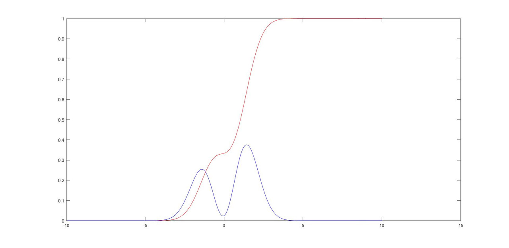](https://postimg.cc/1VGbQ2T9)

---

### #1478 — Amin (Topic Author)
*July 2, 2022, 3:03 AM*

Friends, I could not get myself to work a lot of time yesterday. When standardized hermite polynomials are applied on
the same idea, result of some integrations change and they have to be properly calculated. Not theoretically
difficult/different from before  but a bit of work.

I received antipsychotic injection on this Thursday so I have some difficulty working well.

I hope to complete the work with construction of probability densities tonight. The other work that constructs Z-series
for probability densities given the moments/cumulants will also follow very soon after this work since there is no
difficulty there anymore and I have perfectly worked out all the details.

---

### #1479 — Amin (Topic Author)
*July 2, 2022, 9:36 AM*

Friends I hope to be able to post the density generation program sometime today. I am working on it.

In the meanwhile, I am posting a graph similar to graph I posted yesterday. This graph is based on non-standard Gaussian
and normalized hermite polynomials. I only used first four hermite polynomials in this graph density generation. I will
be using six polynomials in the program that I will post later today.

.

.[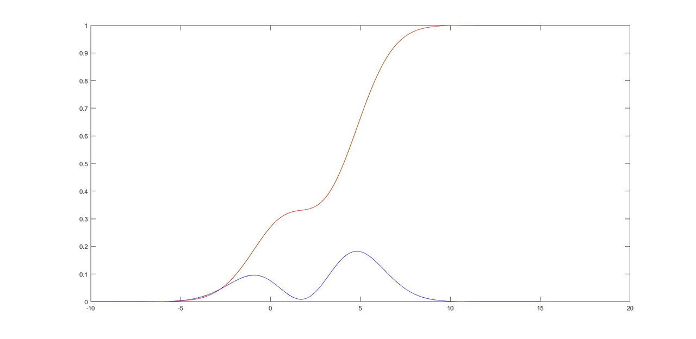](https://postimg.cc/Wd1CDJvG)

---

### #1480 — Amin (Topic Author)
*July 2, 2022, 5:21 PM*

Friends, I have done most of the work and calculations but still have to delay remaining work till tomorrow.

I do not want to complain since I have been able to work quite well for this part of the time cycle after the the
injection. May be mind control agencies are far better since I complained that they want to keep me sedated and people
protested about it. Or I might be under observation by some more independent people so mind control agencies are quite
better to give an impression that this is how my mental situation is after the injections every time. Usually after the
injections, mind control agencies try to drug my food and my 3rd day after the injection to 9th day after the injection
is very bad for me since even minor amount of drugs in my food can play havoc with my condition.

I hope to post the program tomorrow. I want to relate the program to central moments since they are more intuitive.
Sorry for this delay.

---

### #1481 — Amin (Topic Author)
*July 3, 2022, 3:43 PM*

Friends, I have completed work on the program and checking it. If everything goes well, I will try to post it tomorrow
or day after tomorrow.

I will write a more detailed post tomorrow.

---

### #1482 — Amin (Topic Author)
*July 4, 2022, 6:21 PM*

Friends, I am posting the new program in which you specify first six central moments  and it produces a density so that
the first six central moments of this density match the specified moments. Try fitting the moments with different base
densities.

I will be writing and explaining relevant equations tomorrow.

.

.

```
function [] = GenerateDensityFromCentralMomentsX()

%In this program, you specify the first six central moments and the program creates a density based on these
%central moments.
%First six central moments are specified below, feel free to alter them and
%find new densities

mu1=3.0;
mu2=10.999;
mu3=-17.9999;
mu4=253;
mu5=-800;
mu6=8500;

%The algorithm takes a base gaussian density that has it mean mu and
%sq-root of variance given by sigma.
%This mean and sigma can be different from first and sq-root of second
%central moment(variance) of the target density that we specified as mu1 and mu2 earlier.

mu=2;
sigma=2.0;

%Below is the construction of grid to calculate pdf, numerically integrate the pdf
%to find cdf. And to numerically calculate the six moments on the constructed density
%so they can be matched with input moments.

dNn=.02/10;
Nn=1250*10;
X(1:Nn)=-10+dNn+dNn*(1:Nn);

%Below, we calculate first six raw-moments from the input central moments.
%These raw moments would be used to calculate the coefficients of hermite
%polynomials so that output central moments calculated on new density match
%the input central moments.

rmu1=mu1;
rmu2=mu2+mu1^2;
rmu3=mu3+3*mu2*mu1+mu1^3;
rmu4=mu4+4*mu3*mu1+6*mu2*mu1^2+mu1^4;
rmu5=mu5+5*mu4*mu1+10*mu3*mu1^2+10*mu2*mu1^3+mu1^5;
rmu6=mu6+6*mu5*mu1+15*mu4*mu1^2+20*mu3*mu1^3+15*mu2*mu1^4+mu1^6;

%Below I calculate the coefficients of hermite polynomials so that output
%central moments calculated on new density match
%the input central moments.

a1=(rmu1-mu)/sigma;
a2=(rmu2-mu^2-2*a1*mu*sigma-sigma^2)/sigma^2;
a3=(rmu3-mu^3-3*a1*mu^2*sigma-3*mu*sigma^2-3*a2*mu*sigma^2-3*a1*sigma^3)/sigma^3;
a4=(rmu4-mu^4-4*a1*mu^3*sigma-6*mu^2*sigma^2-6*a2*mu^2*sigma^2-12*a1*mu*sigma^3-4*a3*mu*sigma^3-3*sigma^4-6*a2*sigma^4)/sigma^4;
a5=(rmu5-mu^5-5*a1*mu^4*sigma-10*mu^3*sigma^2-10*a2*mu^3*sigma^2-30*a1*mu^2*sigma^3-10*a3*mu^2*sigma^3-15*mu*sigma^4-30*a2*mu*sigma^4-5*a4*mu*sigma^4-15*a1*sigma^5-10*a3*sigma^5)/sigma^5;
a6=(rmu6-mu^6-6*a1*mu^5*sigma-
15*mu^4*sigma^2-15*a2*mu^4*sigma^2-60*a1*mu^3*sigma^3-20*a3*mu^3*sigma^3-45*mu^2*sigma^4-90*a2*mu^2*sigma^4-15*a4*mu^2*sigma^4-90*a1*mu*sigma^5-60*a3*mu*sigma^5-45*a2*sigma^6-15*a4*sigma^6-15*sigma^6-6*a5*mu*sigma^5)/sigma^6;

%Below is base gaussian pdf.
pdfG=exp(-0.5* ((X-mu)/sigma).^2)/sigma/sqrt(2*pi);

%Below is the newly constructed density so that its output central moments
%match the central moments input by the user.
pdf=exp(-0.5* ((X-mu)/sigma).^2)/sigma/sqrt(2*pi).* (1+ a1* ((X-mu)/sigma)+  a2/2* (((X-mu)/sigma).^2-1) + ...
    a3/6* ( ((X-mu)/sigma).^3 - 3*((X-mu)/sigma) )+ ...
    a4/24* (((X-mu)/sigma).^4 - 6* ((X-mu)/sigma).^2 + 3)+ ...
    a5/120* (((X-mu)/sigma).^5 - 10* ((X-mu)/sigma).^3 + 15*((X-mu)/sigma))+ ...
    a6/720* (((X-mu)/sigma).^6 - 15* ((X-mu)/sigma).^4 + 45*((X-mu)/sigma).^2-15));

%Below cdf is calculated by doing numerical integration of the density. I
%have replaced integration with summations.
cdf0(1:Nn)=0;
for nn=2:Nn
cdf0(nn)=cdf0(nn-1)+exp(-0.5* ((X(nn)-mu)/sigma).^2)/sigma/sqrt(2*pi).* (1+ a1* ((X(nn)-mu)/sigma)+ a2/2*
(((X(nn)-mu)/sigma).^2-1) + ...
    a3/6* ( ((X(nn)-mu)/sigma).^3 - 3*((X(nn)-mu)/sigma) )+ ...
    a4/24* (((X(nn)-mu)/sigma).^4 - 6* ((X(nn)-mu)/sigma).^2 + 3) + ...
    a5/120* (((X(nn)-mu)/sigma).^5 - 10* ((X(nn)-mu)/sigma).^3 + 15*((X(nn)-mu)/sigma))+ ...
    a6/720* (((X(nn)-mu)/sigma).^6 - 15* ((X(nn)-mu)/sigma).^4 + 45*((X(nn)-mu)/sigma).^2-15))*dNn;
end

%Below is numerically calculated value of first moment. N in mu1N
%stands for numerical.

mu1N=0;
for nn=2:Nn
mu1N=mu1N+X(nn) .*exp(-0.5* ((X(nn)-mu)/sigma).^2)/sigma/sqrt(2*pi).* (1+ a1* ((X(nn)-mu)/sigma)+ a2/2*
(((X(nn)-mu)/sigma).^2-1) + ...
    a3/6* ( ((X(nn)-mu)/sigma).^3 - 3*((X(nn)-mu)/sigma) )+ ...
    a4/24* (((X(nn)-mu)/sigma).^4 - 6* ((X(nn)-mu)/sigma).^2 + 3) + ...
    a5/120* (((X(nn)-mu)/sigma).^5 - 10* ((X(nn)-mu)/sigma).^3 + 15*((X(nn)-mu)/sigma))+ ...
    a6/720* (((X(nn)-mu)/sigma).^6 - 15* ((X(nn)-mu)/sigma).^4 + 45*((X(nn)-mu)/sigma).^2-15))*dNn;
end

%Below is numerically calculated value of second central moment.

mu2N=0;
for nn=2:Nn
mu2N=mu2N+(X(nn)-mu1N).^2 .*exp(-0.5* ((X(nn)-mu)/sigma).^2)/sigma/sqrt(2*pi).* (1+ a1* ((X(nn)-mu)/sigma)+ a2/2*
(((X(nn)-mu)/sigma).^2-1) + ...
    a3/6* ( ((X(nn)-mu)/sigma).^3 - 3*((X(nn)-mu)/sigma) )+ ...
    a4/24* (((X(nn)-mu)/sigma).^4 - 6* ((X(nn)-mu)/sigma).^2 + 3) + ...
    a5/120* (((X(nn)-mu)/sigma).^5 - 10* ((X(nn)-mu)/sigma).^3 + 15*((X(nn)-mu)/sigma))+ ...
    a6/720* (((X(nn)-mu)/sigma).^6 - 15* ((X(nn)-mu)/sigma).^4 + 45*((X(nn)-mu)/sigma).^2-15))*dNn;
end

%Below is numerically calculated value of third central moment.
mu3N=0;
for nn=2:Nn
mu3N=mu3N+(X(nn)-mu1N).^3 .*exp(-0.5* ((X(nn)-mu)/sigma).^2)/sigma/sqrt(2*pi).* (1+ a1* ((X(nn)-mu)/sigma)+ a2/2*
(((X(nn)-mu)/sigma).^2-1) + ...
    a3/6* ( ((X(nn)-mu)/sigma).^3 - 3*((X(nn)-mu)/sigma) )+ ...
    a4/24* (((X(nn)-mu)/sigma).^4 - 6* ((X(nn)-mu)/sigma).^2 + 3) + ...
    a5/120* (((X(nn)-mu)/sigma).^5 - 10* ((X(nn)-mu)/sigma).^3 + 15*((X(nn)-mu)/sigma))+ ...
    a6/720* (((X(nn)-mu)/sigma).^6 - 15* ((X(nn)-mu)/sigma).^4 + 45*((X(nn)-mu)/sigma).^2-15))*dNn;
end

%Below is numerically calculated value of fourth central moment.
mu4N=0;
for nn=2:Nn
mu4N=mu4N+(X(nn)-mu1N).^4 .*exp(-0.5* ((X(nn)-mu)/sigma).^2)/sigma/sqrt(2*pi).* (1+ a1* ((X(nn)-mu)/sigma)+ a2/2*
(((X(nn)-mu)/sigma).^2-1) + ...
    a3/6* ( ((X(nn)-mu)/sigma).^3 - 3*((X(nn)-mu)/sigma) )+ ...
    a4/24* (((X(nn)-mu)/sigma).^4 - 6* ((X(nn)-mu)/sigma).^2 + 3) + ...
    a5/120* (((X(nn)-mu)/sigma).^5 - 10* ((X(nn)-mu)/sigma).^3 + 15*((X(nn)-mu)/sigma))+ ...
    a6/720* (((X(nn)-mu)/sigma).^6 - 15* ((X(nn)-mu)/sigma).^4 + 45*((X(nn)-mu)/sigma).^2-15))*dNn;
end

%Below is numerically calculated value of fifth central moment.
mu5N=0;
for nn=2:Nn
mu5N=mu5N+(X(nn)-mu1N).^5 .*exp(-0.5* ((X(nn)-mu)/sigma).^2)/sigma/sqrt(2*pi).* (1+ a1* ((X(nn)-mu)/sigma)+ a2/2*
(((X(nn)-mu)/sigma).^2-1) + ...
    a3/6* ( ((X(nn)-mu)/sigma).^3 - 3*((X(nn)-mu)/sigma) )+ ...
    a4/24* (((X(nn)-mu)/sigma).^4 - 6* ((X(nn)-mu)/sigma).^2 + 3) + ...
    a5/120* (((X(nn)-mu)/sigma).^5 - 10* ((X(nn)-mu)/sigma).^3 + 15*((X(nn)-mu)/sigma))+ ...
    a6/720* (((X(nn)-mu)/sigma).^6 - 15* ((X(nn)-mu)/sigma).^4 + 45*((X(nn)-mu)/sigma).^2-15))*dNn;
end

%Below is numerically calculated value of sixth central moment.
mu6N=0;
for nn=2:Nn
mu6N=mu6N+(X(nn)-mu1N).^6 .*exp(-0.5* ((X(nn)-mu)/sigma).^2)/sigma/sqrt(2*pi).* (1+ a1* ((X(nn)-mu)/sigma)+ a2/2*
(((X(nn)-mu)/sigma).^2-1) + ...
    a3/6* ( ((X(nn)-mu)/sigma).^3 - 3*((X(nn)-mu)/sigma) )+ ...
    a4/24* (((X(nn)-mu)/sigma).^4 - 6* ((X(nn)-mu)/sigma).^2 + 3) + ...
    a5/120* (((X(nn)-mu)/sigma).^5 - 10* ((X(nn)-mu)/sigma).^3 + 15*((X(nn)-mu)/sigma))+ ...
    a6/720* (((X(nn)-mu)/sigma).^6 - 15* ((X(nn)-mu)/sigma).^4 + 45*((X(nn)-mu)/sigma).^2-15))*dNn;
end

%Below is analytically calculated cdf.

cdf(1:Nn)=normcdf(((X(1:Nn)-mu)/sigma))+exp(-0.5* ((X(1:Nn)-mu)/sigma).^2)/sqrt(2*pi).* (- a1 - a2/2*
((X(1:Nn)-mu)/sigma) - ...
    a3/6* ( ((X(1:Nn)-mu)/sigma).^2 - 1 )- ...
    a4/24* (((X(1:Nn)-mu)/sigma).^3 - 3* ((X(1:Nn)-mu)/sigma)) - ...
    a5/120* (((X(1:Nn)-mu)/sigma).^4 - 6* ((X(1:Nn)-mu)/sigma).^2 + 3) - ...
    a6/720* (((X(1:Nn)-mu)/sigma).^5 - 10* ((X(1:Nn)-mu)/sigma).^3 + 15*((X(1:Nn)-mu)/sigma)));

plot(X(1:Nn),cdf0(1:Nn),'g',X(1:Nn),cdf(1:Nn),'r',X(1:Nn),pdf(1:Nn),'b',X(1:Nn),pdfG(1:Nn),'m');
legend({'Numerically Calculated CDF','Analytically Calculated CDF','Newly Constructed Moment Matched PDF','Base Gaussian
PDF'},'Location','northeast')

%cdf
%Below compare the input central moments mu's with moments calculated on
%newly constructed density denoted by mu*N
mu1N
mu1
mu2N
mu2
mu3N
mu3
mu4N
mu4
mu5N
mu5
mu6N
mu6

%Below are coefficients on hermite polynomials found out so that output
%moments in newly constructed density match input central moment values.

a1
a2
a3
a4
a5
a6

end

```

.

.

Here is the graph for density you will see when you run the program.

.

.

[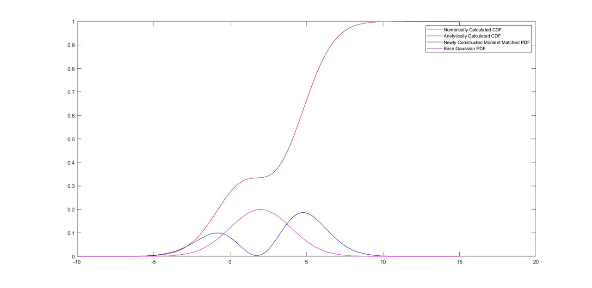](https://postimg.cc/RWT2z4wq)

.

.

Here is the output of the program you will see.

mu1N =

   3.000001166106365

mu1 =

     3

mu2N =

  10.998976156785789

mu2 =

  10.999000000000001

mu3N =

 -17.999654577054343

mu3 =

 -17.999900000000000

mu4N =

     2.529958480636926e+02

mu4 =

   253

mu5N =

    -7.999500779717981e+02

mu5 =

  -800

mu6N =

     8.499249720514237e+03

mu6 =

        8500

a1 =

   0.500000000000000

a2 =

   1.999750000000001

a3 =

   0.499637499999999

a4 =

   0.501150000000003

a5 =

  -0.121656249999994

a6 =

   1.571921874999852

---

### #1483 — Amin (Topic Author)
*July 5, 2022, 9:54 AM*

The following slightly changed program takes cumulants as input and creates a density. It might be slightly easier to
specify good cumulants than trying to specify good moments.

.

.

```
function [] = GenerateDensityFromCumulantsX()

%In this program, you specify the first six cumulants and the program creates a density based on these
%cumulantsents.
%First six cumulants are specified below, feel free to alter them and
%find new densities

% mu1=1.0;
% mu2=1.0;
% mu3=3.9999;
% mu4=9;
% mu5=-8;
% mu6=85;

k1=1.0;
k2=(1.55)^2;
k3=1.5;
k4=3.50;
k5=1;
k6=1;

%The algorithm takes a base gaussian density that has it mean mu and
%sq-root of variance given by sigma.
%This mean and sigma can be different from first and sq-root of second
%central moment(variance) of the target density that we specified as mu1 and mu2 earlier.

mu=1;
sigma=1.55;

%Below is the construction of grid to calculate pdf, numerically integrate the pdf
%to find cdf. And to numerically calculate the six moments on the constructed density
%so they can be matched with input moments.

dNn=.02/10;
Nn=1250*10;
X(1:Nn)=-10+dNn+dNn*(1:Nn);

%Below, we calculate first six raw-moments from the input cumulants.
%These raw moments would be used to calculate the coefficients of hermite
%polynomials so that output central moments calculated on new density match
%the input central moments.

%mu1=k1;
rmu1=k1;
rmu2=k1*rmu1+k2;
rmu3=k1*rmu2+2*k2*rmu1+k3;
rmu4=k1*rmu3+3*k2*rmu2+3*k3*rmu1+k4;
rmu5=k1*rmu4+4*k2*rmu3+6*k3*rmu2+4*k4*rmu1+k5;
rmu6=k1*rmu5+5*k2*rmu4+10*k3*rmu3+10*k4*rmu2+5*k5*rmu1+k6;

% rmu1=mu1;
% rmu2=mu2+mu1^2;
% rmu3=mu3+3*mu2*mu1+mu1^3;
% rmu4=mu4+4*mu3*mu1+6*mu2*mu1^2+mu1^4;
% rmu5=mu5+5*mu4*mu1+10*mu3*mu1^2+10*mu2*mu1^3+mu1^5;
% rmu6=mu6+6*mu5*mu1+15*mu4*mu1^2+20*mu3*mu1^3+15*mu2*mu1^4+mu1^6;

%Below I calculate the coefficients of hermite polynomials so that output
%central moments calculated on new density match
%the input central moments.

a1=(rmu1-mu)/sigma;
a2=(rmu2-mu^2-2*a1*mu*sigma-sigma^2)/sigma^2;
a3=(rmu3-mu^3-3*a1*mu^2*sigma-3*mu*sigma^2-3*a2*mu*sigma^2-3*a1*sigma^3)/sigma^3;
a4=(rmu4-mu^4-4*a1*mu^3*sigma-6*mu^2*sigma^2-6*a2*mu^2*sigma^2-12*a1*mu*sigma^3-4*a3*mu*sigma^3-3*sigma^4-6*a2*sigma^4)/sigma^4;
a5=(rmu5-mu^5-5*a1*mu^4*sigma-10*mu^3*sigma^2-10*a2*mu^3*sigma^2-30*a1*mu^2*sigma^3-10*a3*mu^2*sigma^3-15*mu*sigma^4-30*a2*mu*sigma^4-5*a4*mu*sigma^4-15*a1*sigma^5-10*a3*sigma^5)/sigma^5;
a6=(rmu6-mu^6-6*a1*mu^5*sigma-
15*mu^4*sigma^2-15*a2*mu^4*sigma^2-60*a1*mu^3*sigma^3-20*a3*mu^3*sigma^3-45*mu^2*sigma^4-90*a2*mu^2*sigma^4-15*a4*mu^2*sigma^4-90*a1*mu*sigma^5-60*a3*mu*sigma^5-45*a2*sigma^6-15*a4*sigma^6-15*sigma^6-6*a5*mu*sigma^5)/sigma^6;

%Below is base gaussian pdf.
pdfG=exp(-0.5* ((X-mu)/sigma).^2)/sigma/sqrt(2*pi);

%Below is the newly constructed density so that its output central moments
%match the central moments input by the user.
pdf=exp(-0.5* ((X-mu)/sigma).^2)/sigma/sqrt(2*pi).* (1+ a1* ((X-mu)/sigma)+  a2/2* (((X-mu)/sigma).^2-1) + ...
    a3/6* ( ((X-mu)/sigma).^3 - 3*((X-mu)/sigma) )+ ...
    a4/24* (((X-mu)/sigma).^4 - 6* ((X-mu)/sigma).^2 + 3)+ ...
    a5/120* (((X-mu)/sigma).^5 - 10* ((X-mu)/sigma).^3 + 15*((X-mu)/sigma))+ ...
    a6/720* (((X-mu)/sigma).^6 - 15* ((X-mu)/sigma).^4 + 45*((X-mu)/sigma).^2-15));

%Below cdf is calculated by doing numerical integration of the density. I
%have replaced integration with summations.
cdf0(1:Nn)=0;
for nn=2:Nn
cdf0(nn)=cdf0(nn-1)+exp(-0.5* ((X(nn)-mu)/sigma).^2)/sigma/sqrt(2*pi).* (1+ a1* ((X(nn)-mu)/sigma)+ a2/2*
(((X(nn)-mu)/sigma).^2-1) + ...
    a3/6* ( ((X(nn)-mu)/sigma).^3 - 3*((X(nn)-mu)/sigma) )+ ...
    a4/24* (((X(nn)-mu)/sigma).^4 - 6* ((X(nn)-mu)/sigma).^2 + 3) + ...
    a5/120* (((X(nn)-mu)/sigma).^5 - 10* ((X(nn)-mu)/sigma).^3 + 15*((X(nn)-mu)/sigma))+ ...
    a6/720* (((X(nn)-mu)/sigma).^6 - 15* ((X(nn)-mu)/sigma).^4 + 45*((X(nn)-mu)/sigma).^2-15))*dNn;
end

%Below is numerically calculated value of first raw moment. N in mu1N
%stands for numerical.

rmu1N=0;
for nn=2:Nn
rmu1N=rmu1N+X(nn) .*exp(-0.5* ((X(nn)-mu)/sigma).^2)/sigma/sqrt(2*pi).* (1+ a1* ((X(nn)-mu)/sigma)+ a2/2*
(((X(nn)-mu)/sigma).^2-1) + ...
    a3/6* ( ((X(nn)-mu)/sigma).^3 - 3*((X(nn)-mu)/sigma) )+ ...
    a4/24* (((X(nn)-mu)/sigma).^4 - 6* ((X(nn)-mu)/sigma).^2 + 3) + ...
    a5/120* (((X(nn)-mu)/sigma).^5 - 10* ((X(nn)-mu)/sigma).^3 + 15*((X(nn)-mu)/sigma))+ ...
    a6/720* (((X(nn)-mu)/sigma).^6 - 15* ((X(nn)-mu)/sigma).^4 + 45*((X(nn)-mu)/sigma).^2-15))*dNn;
end

%Below is numerically calculated value of second raw moment.

rmu2N=0;
for nn=2:Nn
rmu2N=rmu2N+(X(nn)-0*rmu1N).^2 .*exp(-0.5* ((X(nn)-mu)/sigma).^2)/sigma/sqrt(2*pi).* (1+ a1* ((X(nn)-mu)/sigma)+ a2/2*
(((X(nn)-mu)/sigma).^2-1) + ...
    a3/6* ( ((X(nn)-mu)/sigma).^3 - 3*((X(nn)-mu)/sigma) )+ ...
    a4/24* (((X(nn)-mu)/sigma).^4 - 6* ((X(nn)-mu)/sigma).^2 + 3) + ...
    a5/120* (((X(nn)-mu)/sigma).^5 - 10* ((X(nn)-mu)/sigma).^3 + 15*((X(nn)-mu)/sigma))+ ...
    a6/720* (((X(nn)-mu)/sigma).^6 - 15* ((X(nn)-mu)/sigma).^4 + 45*((X(nn)-mu)/sigma).^2-15))*dNn;
end

%Below is numerically calculated value of third raw moment.
rmu3N=0;
for nn=2:Nn
rmu3N=rmu3N+(X(nn)-0*rmu1N).^3 .*exp(-0.5* ((X(nn)-mu)/sigma).^2)/sigma/sqrt(2*pi).* (1+ a1* ((X(nn)-mu)/sigma)+ a2/2*
(((X(nn)-mu)/sigma).^2-1) + ...
    a3/6* ( ((X(nn)-mu)/sigma).^3 - 3*((X(nn)-mu)/sigma) )+ ...
    a4/24* (((X(nn)-mu)/sigma).^4 - 6* ((X(nn)-mu)/sigma).^2 + 3) + ...
    a5/120* (((X(nn)-mu)/sigma).^5 - 10* ((X(nn)-mu)/sigma).^3 + 15*((X(nn)-mu)/sigma))+ ...
    a6/720* (((X(nn)-mu)/sigma).^6 - 15* ((X(nn)-mu)/sigma).^4 + 45*((X(nn)-mu)/sigma).^2-15))*dNn;
end

%Below is numerically calculated value of fourth raw moment.
rmu4N=0;
for nn=2:Nn
rmu4N=rmu4N+(X(nn)-0*rmu1N).^4 .*exp(-0.5* ((X(nn)-mu)/sigma).^2)/sigma/sqrt(2*pi).* (1+ a1* ((X(nn)-mu)/sigma)+ a2/2*
(((X(nn)-mu)/sigma).^2-1) + ...
    a3/6* ( ((X(nn)-mu)/sigma).^3 - 3*((X(nn)-mu)/sigma) )+ ...
    a4/24* (((X(nn)-mu)/sigma).^4 - 6* ((X(nn)-mu)/sigma).^2 + 3) + ...
    a5/120* (((X(nn)-mu)/sigma).^5 - 10* ((X(nn)-mu)/sigma).^3 + 15*((X(nn)-mu)/sigma))+ ...
    a6/720* (((X(nn)-mu)/sigma).^6 - 15* ((X(nn)-mu)/sigma).^4 + 45*((X(nn)-mu)/sigma).^2-15))*dNn;
end

%Below is numerically calculated value of fifth raw moment.
rmu5N=0;
for nn=2:Nn
rmu5N=rmu5N+(X(nn)-0*rmu1N).^5 .*exp(-0.5* ((X(nn)-mu)/sigma).^2)/sigma/sqrt(2*pi).* (1+ a1* ((X(nn)-mu)/sigma)+ a2/2*
(((X(nn)-mu)/sigma).^2-1) + ...
    a3/6* ( ((X(nn)-mu)/sigma).^3 - 3*((X(nn)-mu)/sigma) )+ ...
    a4/24* (((X(nn)-mu)/sigma).^4 - 6* ((X(nn)-mu)/sigma).^2 + 3) + ...
    a5/120* (((X(nn)-mu)/sigma).^5 - 10* ((X(nn)-mu)/sigma).^3 + 15*((X(nn)-mu)/sigma))+ ...
    a6/720* (((X(nn)-mu)/sigma).^6 - 15* ((X(nn)-mu)/sigma).^4 + 45*((X(nn)-mu)/sigma).^2-15))*dNn;
end

%Below is numerically calculated value of sixth raw moment.
rmu6N=0;
for nn=2:Nn
rmu6N=rmu6N+(X(nn)-0*rmu1N).^6 .*exp(-0.5* ((X(nn)-mu)/sigma).^2)/sigma/sqrt(2*pi).* (1+ a1* ((X(nn)-mu)/sigma)+ a2/2*
(((X(nn)-mu)/sigma).^2-1) + ...
    a3/6* ( ((X(nn)-mu)/sigma).^3 - 3*((X(nn)-mu)/sigma) )+ ...
    a4/24* (((X(nn)-mu)/sigma).^4 - 6* ((X(nn)-mu)/sigma).^2 + 3) + ...
    a5/120* (((X(nn)-mu)/sigma).^5 - 10* ((X(nn)-mu)/sigma).^3 + 15*((X(nn)-mu)/sigma))+ ...
    a6/720* (((X(nn)-mu)/sigma).^6 - 15* ((X(nn)-mu)/sigma).^4 + 45*((X(nn)-mu)/sigma).^2-15))*dNn;
end

%Below is analytically calculated cdf.

cdf(1:Nn)=normcdf(((X(1:Nn)-mu)/sigma))+exp(-0.5* ((X(1:Nn)-mu)/sigma).^2)/sqrt(2*pi).* (- a1 - a2/2*
((X(1:Nn)-mu)/sigma) - ...
    a3/6* ( ((X(1:Nn)-mu)/sigma).^2 - 1 )- ...
    a4/24* (((X(1:Nn)-mu)/sigma).^3 - 3* ((X(1:Nn)-mu)/sigma)) - ...
    a5/120* (((X(1:Nn)-mu)/sigma).^4 - 6* ((X(1:Nn)-mu)/sigma).^2 + 3) - ...
    a6/720* (((X(1:Nn)-mu)/sigma).^5 - 10* ((X(1:Nn)-mu)/sigma).^3 + 15*((X(1:Nn)-mu)/sigma)));

plot(X(1:Nn),cdf0(1:Nn),'g',X(1:Nn),cdf(1:Nn),'r',X(1:Nn),pdf(1:Nn),'b',X(1:Nn),pdfG(1:Nn),'m');
legend({'Numerically Calculated CDF','Analytically Calculated CDF','Newly Constructed Moment Matched PDF','Base Gaussian
PDF'},'Location','northeast')

%Below program checks if density becomes slightly negative.
IsNegative=0;
for nn=2:Nn
    if(pdf(nn)<0)
        IsNegative=1;
    end
end

%cdf
%Below compare the input raw moments rmu's with moments calculated on
%newly constructed density denoted by rmu#N
rmu1N
rmu1
rmu2N
rmu2
rmu3N
rmu3
rmu4N
rmu4
rmu5N
rmu5
rmu6N
rmu6

%Below are coefficients on hermite polynomials found out so that output
%moments in newly constructed density match input central moment values.

a1
a2
a3
a4
a5
a6

IsNegative
end

```

.

.

---

### #1484 — Amin (Topic Author)
*July 7, 2022, 3:34 PM*

>
> Some notations and preliminaries first.
>
>
>
> Let us suppose we denote a standard gaussian density as    $p(X) \, = \, \frac{1}{2 \pi} \exp(- \, \frac{ X^2 }{2})$
>
>
>
> We also have hermite polynomials and first few hermite polynomials are denoted as
>
> $H_0(X) \, = \, 1$
>
> $H_1(X) \, = \, X$
>
> $H_2(X) \, = \, X^2 \, - 1$
>
> $H_3(X) \, = \, X^3 \, - 3 X$
>
> $H_4(X) \, = \, X^4 \, - 6 X^2 \, +3$
>
> and so on.
>
> And I want to share an interesting property related to following integral
>
> $\int_{-\infty}^{+\infty}  X^m \, H_n(X) \, p(X) dx $   Equation(A)
>
> We know when m is odd and n is even or m is even and n is odd, the above integral always goes to zero.
>
> But when m is odd and n is also odd, the above integral would always go to zero when  n > m.
>
> Similarly when m is even and n is also even, the above integral would again always go to zero, when n > m.
>
> To explain it in words with simple examples, when fourth power of X is integrated in the above integral (eq A) with
zeroth hermite, 2nd hermite or fourth hermite, there will be a finite value but when fourth power of X is integrated
with sixth hermite, eighth hermite or tenth hermite, it will always go to zero. Similarly for odd powers, when fifth
power of X is integrated there is a finite value when we integrate it with first hermite, third hermite or fifth hermite
in the equation (A), but when we integrate fifth power of X with seventh, ninth or 11th hermite or higher odd hermites,
the value would always go to zero.
>
> The above property is interesting since in our forthcoming framework when we have fixed some moment in our equation,
adding higher hermites(for higher moments) would not change the lower moments at all.
>
>
>
> Now we want to fix first few moments to our  proposed probability distribution so that all the moments are perfectly
matched (a good property as I mentioned earlier would be that adding further higher moments would not change our lower
moments that have already been matched).
>
>
>
> The proposed probability distribution has a very simple form (upto sixth order) as
>
>
>
>
$ q(X) \, = \, p(X) \, \big[ \, 1 \, + \, h_1 \, H_1(X)+ \, h_2/2 \, H_2(X)+ \, h_3/6 \, H_3(X)+ \, h_4/24 \, H_4(X)+ \, h_5/120 \, H_5(X)+ \, h_6/720 \, H_6(X) \, \big]  \, $
>
>
>
> here$h_1$ ,$h_2$ etc are coefficients of hermites that will be adjusted to match the moments of above probability
density form to our desired moments.
>
> 1st thing we know by inspection that above probability density equation integrates to one since all hermites (other
than the first term) have an expected value of zero when integrated over normal density.
>
> Now we write the first few raw moments of the above equation that can be verified by full-fledged integration(as I
have done in my notes)
>
>
>
> $E[X]\,= \int_{-\infty}^{+\infty}  X \, q(X) dX \, = \, h_1$
>
> $E[X^2]\,= \int_{-\infty}^{+\infty}  X^2 \, q(X) dX \, = \,1 \, + \, h_2$
>
> $E[X^3]\,= \int_{-\infty}^{+\infty}  X^3 \, q(X) dX \, = \,3  \, h_1 \, + \, h_3$
>
> $E[X^4]\,= \int_{-\infty}^{+\infty}  X^4 \, q(X) dX \, = \, 3 \, +\,6 \, h_2 \, + \, h_4$
>
> $E[X^5]\,= \int_{-\infty}^{+\infty}  X^5 \, q(X) dX \, = \, 15 \, +\,10 \, h_3 \, + \, h_5$
>
> $E[X^6]\,= \int_{-\infty}^{+\infty}  X^6 \, q(X) dX \, = \, 15 \, +\,45 \, h_2 \, + \,15 \,  h_4 \, + h_6$
>
>
>
> So we see that we can keep on adding more hermite polynomials to fix higher moments and it will not alter our lower
moments. However higher odd/even moments take a contribution from hermite polynomial terms associated with lower
odd/even moments(that have already been fixed) up to the order of moment being calculated.
>
> It seems a better idea to try matching moments on standard gaussian as opposed to non-standard gaussian as we do when
we match moments with gram-charlier or edgeworth.
>
> Please pardon any errors.
>
.

.

.

Some notations and preliminaries first.

Let us suppose we denote a standard gaussian density as
$p(X) \, = \, \frac{1}{\sigma \sqrt{2 \pi}} \exp(- \, \frac{ {(X-\mu)}^2 }{2 {\sigma}^2})$

We also have standardized  hermite polynomials and first few standardized  hermite polynomials are denoted as

$H_0(X) \, = \, 1$

$H_1(X) \, = \,   (\frac{X- \mu}{\sigma})$

$H_2(X) \, = \, {(\frac{X- \mu}{\sigma})}^2 \, - 1$

$H_3(X) \, = \, {(\frac{X- \mu}{\sigma})}^3 \, - 3 {(\frac{X- \mu}{\sigma})}$

$H_4(X) \, = \, {(\frac{X- \mu}{\sigma})}^4 \, - 6 {(\frac{X- \mu}{\sigma})}^2 \, +3$

Now we want to fix first few moments to our  proposed probability distribution so that all the moments are perfectly
matched (a good property as I mentioned earlier would be that adding further higher moments would not change our lower
moments that have already been matched).

The proposed probability distribution has a very simple form (upto sixth order) as

$ q(X) \, = \, p(X) \, \big[ \, 1 \, + \, h_1 \, H_1(X)+ \, h_2/2 \, H_2(X)+ \, h_3/6 \, H_3(X)+ \, h_4/24 \, H_4(X)+ \, h_5/120 \, H_5(X)+ \, h_6/720 \, H_6(X) \, \big]  \, $

here$h_1$ ,$h_2$ etc are coefficients of hermites that will be adjusted to match the moments of above probability
density form to our desired moments.

1st thing we know by inspection that above probability density equation integrates to one since all hermites (other than
the first term) have an expected value of zero when integrated over normal density.

Now we write the first few raw moments of the above equation that can be verified by full-fledged integration(as I have
done in my notes)

$E[X]\,= \int_{-\infty}^{+\infty}  X \, q(X) dX \, = \mu \, + \, h_1 \, \sigma$

$E[X^2]\,= \int_{-\infty}^{+\infty}  X^2 \, q(X) dX \, = \, {\mu}^2 + 2 \, h_1 \mu \sigma + \, {\sigma}^2 \, + \, h_2 \, {\sigma}^2 \,$

$E[X^3]\,= \int_{-\infty}^{+\infty}  X^3 \, q(X) dX \, = \, {\mu}^3 + 3 \, h_1 {\mu}^2 \sigma  + 3  \mu {\sigma}^2 + 3 h_2 \, \mu {\sigma}^2 + \, 3 h_1 \, {\sigma}^3 \, \, + \, h_3 \, {\sigma}^3 \,$

$E[X^4]\,= \int_{-\infty}^{+\infty}  X^4 \, q(X) dX \, = \, {\mu}^4 + 4 \, h_1 {\mu}^3 {\sigma}  + 6  {\mu}^2 {\sigma}^2 + 6 h_2 \, {\mu}^2 {\sigma}^2 + \, 12 h_1 \, \mu \, {\sigma}^3 \, \, +4 \, h_3 \, \mu \,  {\sigma}^3 \,+ 3 \, {\sigma}^4 \, +6 \, h_2 \, {\sigma}^4 \, + \, h_4$

$E[X^5]\,= \int_{-\infty}^{+\infty}  X^5 \, q(X) dX \, =  \, {\mu}^5 + 5 \, h_1 {\mu}^4 {\sigma}  + 10  {\mu}^3 {\sigma}^2 + 10 h_2 \, {\mu}^3 {\sigma}^2 + \, 30 h_1 \, {\mu}^2 \, {\sigma}^3 \, \, +10 \, h_3 \, {\mu}^2 \,  {\sigma}^3 \,$

$+ 15 \, \mu  {\sigma}^4 \, +30 \, h_2 \, \mu {\sigma}^4 \, +5 \, h_4 \, \mu {\sigma}^4 + 15 h_1 {\sigma}^5  + 10 h_3  {\sigma}^5 \, + \, h_5 \,  {\sigma}^5$

$E[X^6]\,= \int_{-\infty}^{+\infty}  X^6 \, q(X) dX \, =

\, {\mu}^6 + 6 \, h_1 {\mu}^5 {\sigma} + 15 {\mu}^4 {\sigma}^2 + 15 h_2 \, {\mu}^4 {\sigma}^2 + \, 60 h_1 \, {\mu}^3 \,
{\sigma}^3 \, \, +20 \, h_3 \, {\mu}^3 \, {\sigma}^3 \,$

$+ 45 \, {\mu}^2  {\sigma}^4 \, +90 \, h_2 \, {\mu}^2 {\sigma}^4 \, +15 \, h_4 \, {\mu}^2 {\sigma}^4 + 90 h_1 \, \mu {\sigma}^5  + 60 h_3 \, \mu {\sigma}^5 \, + 6 \, h_5 \,  \mu {\sigma}^5 \, + 15 \, {\sigma}^6 \,\, + 45 \, h_2 {\sigma}^6 \, + 15 \, h_4 {\sigma}^6 \, + \, h_6 \, {\sigma}^6 \,$

So we see that we can keep on adding more hermite polynomials to fix higher moments and it will not alter our lower
moments. However higher odd/even moments take a contribution from hermite polynomial terms associated with lower
odd/even moments(that have already been fixed) up to the order of moment being calculated.

Though I posted some programs to calculate densities from central moments or cumulants, we can notice that changing
mean/variance of base gaussian also have a great effect towards the shape of new density and fixing first six moments
with different base gaussians can results in different densities though first few moments would still be matched. I
think it has to be further studied by friends how to systematically choose the parameters of base gaussian towards the
best matching density. Sometimes, density becomes slightly negative for parameters of base gaussian but becomes
perfectly positive when parameters of base gaussian are slightly changed.

---

### #1485 — Amin (Topic Author)
*July 11, 2022, 12:05 PM*

Friends, I tried working on finding a Z-series representation of a general density when its moments are given. But I
might be making a mistake and I could not get it right. I really think my ideas are sound but I might possibly be making
some mistake. I will try again in a day or two and see how it goes.

I have not been able to work well and only started working yesterday and slightly came out of the effect of the
antipsychotic injection. I had basically been wasting time all along before this.

I will check my work for accuracy again and also try alternatives. I will come back to friends in another two or three
days.

---

### #1486 — Amin (Topic Author)
*July 15, 2022, 5:57 AM*

Friends, in a previous post I told friends how staff at a lady psychiatrist's hospital started beating me and abused me.
During past twenty three years, there have been many many instances of my obvious abuse by different psychiatrists. I
will describe some of those instances in this post.

When I came from United States and till fifteen years after that, my father would proudly ask me that I could see any
psychiatrist I wish. This was because Pakistan army was managing my persecution and they would force psychiatrists to
declare me schizophrenic and my father was told that every psychiatrist would be forced to cooperate. However, by chance
in 2016, I came  across a psychiatrist who was far better. I never told him that I was under mind control but whenever
he interviewed me, he always said after the interview that I was perfectly sane and mentally healthy. When my family
would force him to increase the dosage of antipsychotics, the doctor first told me that I should not live with my family
and make a comprehensive plan to support myself and become independent (such a plan could never work since Pakistan army
was threatening people in Pakistan to not give me any business and CIA was making sure that every contact I would reach
for work in Europe (and Singapore/ Japan /Australia) would be approached by CIA telling them that I was a very bad guy
and they must not do business with me. I had not told the doctor any such thing that intelligence agencies were after
me.)  When I told the good doctor how previous psychiatrists had abused me, he would tell me that this used to be a very
widespread practice in America hundred years ago to wrong mentally healthy humans by using corrupt psychiatrists as
instruments to detain them and strip them of their sanity. The good doctor I am talking about was American national with
Pakistan background who had practiced psychiatry in America for over twenty years and had returned to Pakistan. That
good doctor kept me on very low antipsychotics (1 mg resperidone per day) and that too on extreme insistence of my
family. It was only during that time of treatment by that doctor that I got my first break in research and I solved the
problem of high order monte carlo simulations (and analytic series solution of ODEs)  and posted that solution on this
thread. Ok, when my family was fed with the doctor, they detained me with another doctor. They detained me again two
years ago when I requested my family that I wanted to see the same doctor of my choice again( I have been detained every
year for past six or seven years by different doctors), they detained me through a different doctor. So my family now
stubbornly refuses to allow me to see a professional qualified American psychiatrist of my own choice and detains me
every time I try to approach him.

Now back to my obvious abuse by two other psychiatrists. I was detained by this doctor who was running a mental health facility and was not a psychiatrist himself. At that time I did not use to walk very much and my blood pressure used to be somewhat high. Since other antipsychotics had failed to retard me, doctor suggested I take aripperizole injections. These injections affect the heart and also elevate blood pressure but doctor who wanted to retard me had no regard for my health while pretending to cure me. In initial days of my detention, staff at the hospital when checked my blood pressure told me high enough blood pressure in line with what I used to have but after I complained about aripperizole and its effect on blood pressure the staff started doctoring blood pressure and started telling me that my blood pressure was very good or even low. This is a post I wrote on another thread in this forum about it. [How to safeguard my research - Page 32 - wilmott.com](https://forum.wilmott.com/viewtopic.php?f=15&t=94796&start=465#p785440)

.
>
> **Amin:**
>
>
>
> Since I wrote about high blood pressure and mentioned high blood pressure before the hospital staff, they have started
to doctor blood pressure. Now, everyday they tell me that my blood pressure is 120/80 or 110/70. While they always told
me that my blood pressure was 130/90 or 140/100 prior to injections. I have never had so good blood pressure for years
that they have started to tell me now. Friends would recall a previous post when I could not sleep at night and had to
take a sleeping pill. When the dispenser came to me at night(The hospital has no MBBS who stays here at night in
Ramadan. Dr. AS used to stay here on some nights earlier but has been totally absent in Ramadan). When the dispenser
checked my blood pressure, he told me that it upper blood pressure is 110. I did not believe him at all. He asked me to
check on my own and put the stethoscope head assembly in my ears. I could easily tell that upper blood pressure was more
than 140 and lower was more than 100. The staff has already started to doctor blood pressure. My parents are going to
Saudi Arabia for two weeks in a few days. Now Dr. AS has the plan to hold me in detention while my parents are abroad. I
had a complete settlement with Dr. N and we(I and the doctor N) both agreed that I would be visiting him every fifteen
days and all modalities were agreed. I do think as a patient it is my right to choose the psychiatrist and Dr. AS( who
is incharge of facility Pav.) has no right to change the doctor after I have selected a psychiatrist and we both agree
on terms of any treatment. Dr. AS has imposed another psychiatrist Dr. M who has not even seen me and has already
started giving me injections and increased medicine without looking at my present condition. Dr. N had explicitly stated
that I would be free to leave if it were his facility. Most major reason for detaining me now is that Dr.AS wants to
continue to detain me while my parents are leaving for abroad for more than two weeks
.

Later after a few days, I was given a second aripperizole injection and released from detention. An injection was due
every fifteen days. My parents were in Saudi Arabia and I was living with my sister. She insisted after fifteen days
that I get a new aripperizole injection. I complained about too much side effects and other serious problems but my
sister insisted that I must get the injection. She talked to another doctor and the doctor told her that if his blood
pressure and pulse are fine, just give him the injection. I asked my sister that my blood pressure must be checked
before I get the new injection. We went to a small hospital close to her house and when my blood pressure was checked my
lower blood pressure was 110. The hospital staff recommended that I stay at the hospital in their care until my blood
pressure decreases. It was a totally random blood perssure check. When hospital staff came to know that I had been given
aripperizole injections, they told my sister to not give me those injections any more. My sister asked the staff to
relieve me and we came home but I was not given aripperizole injections after that.

But this is interesting that the psychiatrist was initially desperate to prescribe aripperizole despite that I had told
him about my heart and blood pressure problems and his staff was asked to doctor blood pressure so that I would accept
the injections.

Good thing is that only after stopping aripperizole, I started my treatment with good psychiatrist  doctor Naeem Aftab
(who is an American national) and he gave me enough relief that I was able to get a break in my research and solve the
problem of high order monte carlo simulations. I would always be thankful to Dr. Naeem Aftab for giving me relief at
such a crucial point in my life.

---

### #1487 — Amin (Topic Author)
*July 15, 2022, 6:20 AM*

My second experience for abuse was with a seasoned psychiatrist who is known for his connections with Pakistan army.
When army dictator Pervaiz Musharraf ruled the country, he made this doctor the dean(president) of the university of
health sciences which regulates most medical universities in Pakistan. He had treated me for three years in year 2001.
He started my treatment without interviewing me and gave me electric shocks at the start to jumpstart the therapy. I was
given electric shocks for fifteen days in early 2001. I still recall that doctor would place a wooden wedge between my
teeth and then give me an injection and I still recall how numbness would move in my body from feet to the upper body
after the injection.

When going to that doctor's psychiatrist facility in 2001 I had to travel from Kot Addu to Rawalpindi. My family had
given me some drug in my food and I became unconscious after an hour or so. I still recall how I was begging my younger
brother to help me that I do not want to go anywhere and if he could help me but he like everybody else in the family
refused. Slowly drug in food showed its effect and I have absolutely no memory of being taken in my father's car despite
that it would have taken him at least eight hours to take me to Rawalpindi. Psychiatrist did not interview me and
detained me and started giving me electric shocks. I still recall how I defecated in my bed there and they had to wash
it.

Anyway, I was taken to this psychiatrist in 2017 again. He was very clearly told that I had been given antipsychotic
drug larjactil by another doctor and it backfired and I had extremely severe drug-induced jaundice. But the doctor was
so haughty and cavalier and so desperate to retard me that he still insisted that I get the same drug larjactil and said
that it was not necessary that it would cause jaundice every time. Problem for the doctor was that most antipsychotics
had failed to retard me and he wanted to give me some potent antipsychotic that had not been well-tried on me. Though
the drug was given to me earlier and later discontinued, the doctor wanted to take his chances to retard me and he had
no regard for my health. This doctor is a big crony of Pakistan army and really wanted to please the generals and
therefore he decided to give me larjactil again. And as would already be obvious to most friends, after two weeks, I
started to show all signs of drug-induced jaundice again and my body and eyes were all yellow. My Biluribin shot like
anything. And it took more than two months to control jaundice after that. Though my biluribin came back to normal after
two months, several less known enzymes in my liver remained disturbed for several years after that and continued to show
as abnormal in my liver function test reports.

---

### #1488 — Amin (Topic Author)
*July 16, 2022, 6:01 PM*

>
> Friends, I tried working on finding a Z-series representation of a general density when its moments are given. But I
might be making a mistake and I could not get it right. I really think my ideas are sound but I might possibly be making
some mistake. I will try again in a day or two and see how it goes.
>
> I have not been able to work well and only started working yesterday and slightly came out of the effect of the
antipsychotic injection. I had basically been wasting time all along before this.
>
> I will check my work for accuracy again and also try alternatives. I will come back to friends in another two or three
days.
>
.

.

Friends, I have restarted work on the problem. I am using a slightly different method to construct the Z-series of a
stochastic variable when moments or density is given  and I hope that I would have some more results in two to three
days.

---

### #1489 — Amin (Topic Author)
*July 17, 2022, 8:18 AM*

Friends, I tried an alternative more numerical method and I found exactly the same results as I had found a week ago.
This is slightly re-assuring in sense there are probably no programming mistakes. There is something more subtle that I
probably have not been able to understand but I will try to think hard about the problem for next few days and see if I
can find what is the source of this problem. I really want to get this part of the work done before I take a slightly
longer break for my market trading research.

---

### #1490 — Amin (Topic Author)
*July 17, 2022, 4:26 PM*

Friends, I believe my approach is fine and would work reasonably. In order for it to work, we have to be able to take
first five or six derivatives of the density at its median. Derivatives of most densities that are based on continuous
derivatives, are related to respective derivatives of standard normal density(by change of density derivative and
further derivatives of the relationship). This helps us to find first few derivatives of our stochastic variable X with
respect to standard normal Z at medians of both densities. These derivatives can then be used to construct a Z-series
representation of the random variable X. I will share most of the details in the form of equations tomorrow and then
also share my programs a day later.

Sometimes the method, as it is, does not seem to work perfectly. But the reason is that I constructed a density based on
standard normal and then used first six hermites as in a previous post in order to match first six appropriate
cumulants. Then I tried to approximate this density as a Z-series with first six powers of Z. But problem is that many
times fit still remains poor as a Z-series with only first six terms may not be enough to describe the random variable
that is based on a density taking coefficients in first six hermites. We would many times need eight or even possibly
ten terms in the Z-series as parameters of original six hermite density go to extreme. And this causes some mismatch
between target density and our Z-series density. Otherwise, the method seems fine.

There can be a large number of variations on the theme. For example in many real life applications, we would have to
construct the original density with Laguerre polynomials applied to Gamma density just like I applied hermite
polynomials to a Gaussian density. Once we have constructed an original density(from given moments or cumulants) in the
form of  (normal density + hermites) or (gamma density + Laguerre polynomials), we can easily find its Z-series
representation by taking derivatives of the density at median and matching them with derivatives of standard normal
density to retrieve derivatives of random variable X with respect to standard normal Z which would then be used to
construct the Z-series representation of random variable X.

It is not necessary to find a representation in terms of standard normal, many densities that take continuous
derivatives can be represented in terms of many other appropriate base densities. Though normal density is obviously
special, the whole thing is more interesting than that and I hope more intelligent mathematicians would like to work
with these ideas.

I will come back with a detailed post and equations tomorrow.

---

### #1491 — Amin (Topic Author)
*July 18, 2022, 5:18 PM*

Friends, we have earlier learnt when we want to represent a stochastic random variable X, in the form of a Z-series, the
form of equation for X is given as

$X(Z)=a_0  \,+ a_1 \, Z + a_2 \, Z^2 + a_3 \, Z^3 +  a_4 \, Z^4 +\, ... $

The first, second and third  derivatives of w(t) w.r.t Z are given as

$\frac{\partial X}{\partial Z}= a_1 \, + 2 \,a_2 \, Z +3 \, a_3 \, Z^2 +4 \,  a_4 \, Z^3 +\, ... $

$\frac{\partial^2 X}{\partial Z^2}=  2 \,a_2 \, +6 \, a_3 \, Z +12 \,  a_4 \, Z^2 +\, ... $

$\frac{\partial^3 X}{\partial Z^3}=  6 \, a_3 \,  +24 \,  a_4 \, Z \,+60 \,  a_5 \, Z^2 +\, ... $

IF we do all the calculations of series evolution equation at median where Z=0. here all the derivatives are given only
by leading coefficient associated with zeroth power of Z. So at Z=0,

$w(t)=a_0  \,$

$\frac{\partial X}{\partial Z}= a_1 \,  $

$\frac{\partial^2 X}{\partial Z^2}=  2 \,a_2 \, $

$\frac{\partial^3 X}{\partial Z^3}=  6 \, a_3 \,  $

$\frac{\partial^4 X}{\partial Z^4}=  24 \, a_4 \,  $

So we have that

$X(Z)=a_0  \,+ a_1 \, Z + a_2 \, Z^2 + a_3 \, Z^3 +  a_4 \, Z^4 +\, ... $

$X(Z)=a_0  \,+ \frac{\partial X}{\partial Z} \, Z + 1/2 \, \frac{\partial^2 X}{\partial Z^2} \, Z^2 +1/6 \,  \frac{\partial^3 X}{\partial Z^3} \, Z^3 +1/24 \,  \frac{\partial^4 X}{\partial Z^4} \, Z^4 +\, ... $

So basically our power series is the same as Taylor series where derivatives between the two random variables, the
stochastic variable X and standard Gaussian Z, are calculated at the median. ( You could do these calculations at other
points in the density as well but those calculations would be much more involved and if correct should yield the exact
same final result if the density is based on continuous derivatives given by polynomials like hermite polynomials etc.)

If we could just find the median of density of our random variable X and its derivatives
$\frac{\partial X}{\partial Z}\,  $ ,$\frac{\partial^2 X}{\partial Z^2} $ and other higher derivatives with respect to
Z, we can find coefficients of our power series representation of our random variable X in terms of powers of standard
Gaussian.

Again the above derivatives would have to be calculated at median of  densities of both random variables, X and Z.

So I suppose that we have some inputs given as cumulants or moments of the proposed density and we construct that
density from our given moments or cumulants. This can be done in many ways like either of the following

1. We have an analytical density with continuous derivatives and we can somehow make sure that its coefficients are
chosen so that various moments match the input moments.

2. We can construct the density from a standard normal base density and multiply it with an expression that is sum of coefficient weighted first few hermite polynomials. [Breakthrough in the theory of stochastic differential equations and their simulation - Page 99 - wilmott.com](https://forum.wilmott.com/viewtopic.php?f=4&t=99702&start=1470#p870959)

3. In the very same spirit, We can also construct the density from a Gamma base density and multiply it with an
expression that is sum of coefficient weighted first few Laguerre polynomials. Many positive densities that assume
shapes that we cannot have with a normal base density can be constructed using a gamma base density.

4. Instead of taking a normal base density, we can take some other analytical density and apply weighted expressions of simple polynomials on the analytical density to match the desired moments by solving a system of linear equations. We would mostly not have analytical solution to moments with arbitrary analytical base density and we might have to use numerical integration. I will give brief review here. [Breakthrough in the theory of stochastic differential equations and their simulation - Page 92 - wilmott.com](https://forum.wilmott.com/viewtopic.php?f=4&t=99702&start=1365#p869891)

Suppose we have an original nearby density f(x) on a grid. We can easily calculate all moments/cumulants by numerically
integrating over the density. We want to find a target density g(x) that has certain cumulants usually different from
the cumulants of nearby density. We multiply the original density with a polynomial with as yet unknown coefficients to
find the target density.

$g(x) \,=  \, f(x)  \, [c_0  \, + c_1  \, x  + c_2  \, x^2 + c_3  \, x^3 + c_4  \, x^4] $

We do not know the coefficient c's and want to find them so that cumulants or equivalently the moments we have backed
out from cumulants are matched with cumulants of g(x), the target density.

We write as

Since resulting density g(x) has to be a valid probability distribution, our first condition is that integral of density
should  to one.

$  \int  \, g(x)  \, dx =\int  \, f(x)  \, [c_0  \, + c_1  \, x  + c_2  \, x^2 + c_3  \, x^3 + c_4  \, x^4]   \, dx = \, 1  \, $
Equation(1)

if  $\mu_1$ is the value of first raw moment backed out from target cumulants that we want to match, we must have

$  \int  \,x \, g(x)  \, dx =\int  \, x\, f(x)  \, [c_0  \, + c_1  \, x  + c_2  \, x^2 + c_3  \, x^3 + c_4  \, x^4]   \, dx = \,\mu_1  \, $
Equation(2)

similarly if if  $\mu_2$ is the value of second raw moment backed out from target cumulants, we must have

$  \int  \,x^2 \, g(x)  \, dx =\int  \, x^2\, f(x)  \, [c_0  \, + c_1  \, x  + c_2  \, x^2 + c_3  \, x^3 + c_4  \, x^4]   \, dx = \,\mu_2  \, $
Equation(3)

if  $\mu_3$ is the value of second raw moment backed out from target cumulants, we must have

$  \int  \,x^3 \, g(x)  \, dx =\int  \, x^3\, f(x)  \, [c_0  \, + c_1  \, x  + c_2  \, x^2 + c_3  \, x^3 + c_4  \, x^4]   \, dx = \,\mu_3  \, $
Equation(3)

similarly we can write equations of desired raw moments backed out from central moments to fourth or sixth or eighth
order.

From equation (1), we have

$  \int  \, g(x)  \, dx =\int  \, f(x)  \, [c_0  \, + c_1  \, x  + c_2  \, x^2 + c_3  \, x^3 + c_4  \, x^4]   \, dx = \, 1  \, $
Equation(1)

$ = c_0  \, \int  \, f(x)  \,  \, dx+ c_1  \int  \, f(x) \, x  \, dx + c_2  \int  \, f(x) \, x^2 \, dx + c_3 \int  \, f(x)  \, x^3 \, dx+ c_4  \int  \, f(x) \, x^4 \, dx  = \, 1  \, $

if we use the notation $E[x^n]=\int  \, f(x) \, x^n \, dx =  \zeta_n $, we can write the moment equations as

$  c_0  \, + c_1 \, \zeta_1 + c_2 \, \zeta_2 + c_3 \, \zeta_3+ c_4 \, \zeta_4  = \, 1  \, $ Equation(1)

$  c_0  \, \zeta_1 + c_1 \, \zeta_2 + c_2 \, \zeta_3 + c_3 \, \zeta_4+ c_4 \, \zeta_5  = \,\mu_1  \, \, $ Equation(2)

$  c_0  \, \zeta_2 + c_1 \, \zeta_3 + c_2 \, \zeta_4 + c_3 \, \zeta_5+ c_4 \, \zeta_6  = \,\mu_2  \, \, $ Equation(3)

$  c_0  \, \zeta_3 + c_1 \, \zeta_4 + c_2 \, \zeta_5 + c_3 \, \zeta_6+ c_4 \, \zeta_7  = \,\mu_3  \, \, $ Equation(4)

Since$E[x^n]=  \zeta_n $ are all known from numerical integration on original nearby density, we are left with a number
of linear equations that we need to solve by Gaussian elimination to find out the coefficients c's of multiplying
polynomial such that resulting density has cumulants equated with target cumulants. Once these equations are solved we
find the resulting density as

$g(x) \,=  \, f(x)  \, [c_0  \, + c_1  \, x  + c_2  \, x^2 + c_3  \, x^3 + c_4  \, x^4] $

There is one check that you will need. The density has to be positive everywhere. For well-stated moments with proper
density support, this should not be a problem at all. But when bad cumulants are specified or support of the density
does not match the support of target density, there could be a possibility that you would get a target density that is
negative at some places as a result of solution of  above linear equations.

So we can construct an analytical density that has moments/cumulants that perfectly match the given moments/cumulants in
several of the above possible ways.

In the next post, I will describe how to find derivatives of a random variable with an analytically constructed density
with respect to standard normal density at median of both densities.

---

### #1492 — Amin (Topic Author)
*July 18, 2022, 7:32 PM*

As we learnt in the previous post, In order to construct the Z-series of a particular stochastic random variable X, we
have to find its various derivatives with respect to standard Gaussian at the median(of both densities). So our first
step towards construction of a Z-series representation would be to find median of the stochastic random variable X in
question. I suppose that we have constructed analytical density of X using one of the methods described in previous
post. We would have to find median mostly through Newton-Raphson as there are usually no simple formulas for median of a
density.

After finding median, we can fix first coefficient of Z_Series as

$ c_0 \, = \, Median $

Both our density for random variable X and the standard gaussian density are related through change of variable formula
for two densities as

$p_Z(Z) \, = \, p_X(X(Z)) \, \frac{dX}{dZ} \, $   Eq(1)

So we can find $\, \frac{dX}{dZ} \, $ at median from the ratio of densities of respective variables at median as

$\, \frac{dX}{dZ} \, = \, \frac{p_Z(Z=0)}{p_X(X(Z)=c_0)}= \, \frac{p_Z(0)}{p_X(c_0)}$

In order to find higher derivatives of X with respect to Z at median, we differentiate Eq(1) on both sides w.r.t Z as

$p'_Z(Z) \, = \, p'_X(X(Z)) \, {(\frac{dX}{dZ})}^2 +  \, p_X(X(Z)) \, \frac{d^2X}{dZ^2}\, $ Eq(2)

In above equation and similar subsequent equations, we know the derivatives of gaussian density at Z=0 analytically. And
we can easily find all first few nth derivatives of density of random variable X at its median
$\frac{dp^n_X}{dX^n}(X(Z)) = \, \frac{dp^n_X}{dX^n}(c_0) $ from the analytic density as we have constructed in the
previous post. So we know values of all variables in Eq(2) other than$\, \frac{d^2X}{dZ^2}\, $ whose value we back out
from Eq(2)

The third derivative equation would be

$p''_Z(Z) \, = \, p''_X(X(Z)) \, {(\frac{dX}{dZ})}^3 +  \, 3\, p'_X(X(Z)) \, {\frac{dX}{dZ}} \, {\frac{d^2X}{dZ^2}} +  \, p_X(X(Z)) \, \frac{d^3X}{dZ^3}\, $
Eq(3)

which can be used to back out  $ \, \frac{d^3X}{dZ^3}\,$

Similarly we can continue to differentiate Eq(2) and keep finding value of next higher derivative of X w.r.t Z at
median.

After finding first few derivatives of X w.r.t Z at median, we can construct the Z_series of X as

$X(Z)=a_0  \,+ \frac{\partial X}{\partial Z} \, Z + 1/2 \, \frac{\partial^2 X}{\partial Z^2} \, Z^2 +1/6 \,  \frac{\partial^3 X}{\partial Z^3} \, Z^3 +1/24 \,  \frac{\partial^4 X}{\partial Z^4} \, Z^4 +\, ... $

In a similar spirit, I think we can take the base density as a different density (could be gamma density) and represent
some stochastic variable as a series in Gamma density variable by equating the equations of two densities through change
of density derivative at their median.

In a day or two I will post a program that will implement above equations to find a Z-series representation of
appropriate random variable. I have constructed the initial analytic density with normal as base density with hermite
polynomials multiplying it and later following the steps in this post. But this program though instructive, is not very
general enough to produce a large number of shapes for densities. But friends could choose some of the more general
analytic density construction methods from previous post to fit more general combination of moments and find their
Z-series.

---

### #1493 — Amin (Topic Author)
*July 19, 2022, 3:06 PM*

Friends, a few days ago I drove my sister to other side of the city for her business. It took us a long time to return
and I remained away from home for several hours. My laptop remained at home and I had just hibernated it. When I
returned home after several hours, I noticed that all my running programs had closed and my laptop had been restarted.
Anyway I did not make a big deal but several times later when browsing on internet I noticed that many times my browsing
would abruptly halt and I would receive messages like," your internet connection has been reset." or "You have been
disconnected from internet" even though my wifi connection would be perfectly fine and properly connected to
internet.  Again and again my internet becomes very slow or freezes while it had been working very well all along before
this episode.

I had told friends that on my old computer mind control agencies had many devices to control me and sometimes they would
even change my programs(though it has been very rare recently but several years (>5 years) ago they used to alter my
programs many times).

I have done some very good mathematical research for market trading and prediction and I want to take it live in a few
weeks. Of course, I have to connect through internet to brokers for my trading. And I need a fast and reliable
connection that they do not want to let me have.

I am very very afraid that mind control agencies would do all sort of tricks like possibly altering my programs or
abruptly cutting me from internet so I would not be able to properly trade on my own. These crooks continued to ask
people I contacted for business all over the world for more than past ten years to not do business with me. After year
2010, I have been able to make only \$4,500 only and that is the only earning I had in more than a decade. Now when I
tried to find a way to make money independently on my own, they are even more desperate to fail me using their tricks
and antics.

I want to request friends to please force the mind control crooks to stop using their inhuman tactics and let me freely
make my living by trading over internet.

---

### #1494 — Amin (Topic Author)
*July 20, 2022, 4:25 AM*

Friends, I had mentioned several times earlier that when I sleep, mind control agents force EM waves/microwaves into my
eyes. Many times when I wake up I would have severe pain in my eyes  and it would be very difficult to open my eyes and
I would only be able to properly see or open the eyes only after I throw water on (inside of ) my eyes. Due to such
antics my eye sight continues to deteriorate and now I have quite some difficulty properly reading and my eye slight is
blurred.

I had told friends that mind control agents want my early death so that I could not do anything in my life and also
because I have been raising a large hue and cry about them and they know that I am old enough and very vulnerable to
physical problems with the body. Now they want to damage physical functions of my body so I cannot continue my research
and it would become impossible for me to do any intellectual work in mathematics.

Eyes have a special place in my brain and many special neurotransmitters take their stimulus from eyes so mind control
agents want to damage my eye sight so I cannot do good mental work.

Though lot of good-natured friends would have a hard time believing me, I want to tell them that mind control crooks
bitterly want money and have absolutely no regard for human ethics or American values. They are basically a bunch of
very greedy people who know that big money would be given to them by very rich people after high-level targets would
have been retarded.

This problem of targeting microwaves on my eyes is not new but has become very frequent recently and that is why I
especially wrote this post. For past few days, I continue to have persistent light pain and uneasiness in my eyes all
through the day due to their targeting my eyes with microwaves/EM waves at night and my eye sight has remarkably
decreased in past one or two weeks.

---

### #1495 — Amin (Topic Author)
*July 20, 2022, 6:32 AM*

Friends, I have been working on the numerical implementation of Calculation of Z-series of random variables. As a start
I have worked with "normal-like" densities while taking the base density as a normal. These densities are similar to
densities we came across when we were finding the semi-analytical solution to SDEs in Bessel coordinates. But I have
learnt that one dimensional SDEs (of the kind we continued to work with) were usually very benign as compared to general
densities that are obtained when we specify  general cumulants of the target density. While working with 1D SDEs mostly
coefficient of the sixth power of Z-series was very small but while playing with general densities, we can easily obtain
coefficients to 12th power of Z-series that remain relatively significant (This could possibly be the case if we
directly constructed one dimensional Z-series of marginal density of the asset in two factor SV SDEs system in bessel
coordinates and then we could find that 10th or 12th coefficient of the Z-Series of asset's heavy-tailed marginal
density in SV system could still be significant.)

Another problem I continue to face is that fit to moments is not sharp when I used the derivatives of densities method.
This could mostly not be a big problem for higher moments but when mean is off by fifteen basis points, this becomes
unacceptable. So I am thinking that I would find the coefficients of Z-series first through taking analytic derivatives
and once they are very close to true coefficients, I would use newton method to make a sharp fit to target moments.
Direct application of Newton method is totally hopeless until guess coefficients for Newton method are chosen very close
to true coefficients. I have previously tried several times to work directly with Newton method with relatively raw
guesses and it never worked well.

Another change I want to make is to find a way to apply the method on standardized moments and see if Z-series
coefficients from standardized moments could easily be mapped on true moments. Otherwise when moments are even slightly
high or very low, it becomes very difficult to deal with them and all sort of issues of efficiency and computer
precision start to arise.

But all of these changes can take many days or possibly around a week so friends would  have to wait somewhat for this
matlab program. I am working full time of this problem and will go to market trading only after there is real progress
on this project to construct the Z-series.

Though this may not be extremely super fast, I am sure once my project is ready and friends are better oriented with the
problem, there would be faster and better methods to construct the Z-series.

---

### #1496 — Amin (Topic Author)
*July 20, 2022, 5:33 PM*

Friends, I have been able to get Newton method to converge for all of the cases that I tried using my new program. For
Newton method, I used only six coefficients of the Z-series. Though Newton method with a guess from my analytic
calculations always seem to converge to the target moments/cumulants, the fit to the analytic density might not be
perfect. Obviously this is because there would be difference in the values of higher moments/cumulants that we have not
specified in our calibration. But initial results are very good for the standardized densities.

Here I show a graph of the analytic density and the density retrieved from Newton method using only six coefficients of
the Z-series. Both densities have the same first six moments/cumulants.

Here are the parameters I used

For the base analytic Gaussian density

mu=0;

sigma=1.0;

Cumulant values.

k1=0.0;

k2=1.0;

k3=.50;

k4=1.50;

k5=.125;

k6=0.50;

Below Green density is result of Z-series coefficients from Newton method which always converged in my tests (though I
have not be very comprehensive)

Below red density is the analytic density calculated from hermite polynomials to match the given cumulants/moments.

Both densities share the same first six moments/cumulants.

[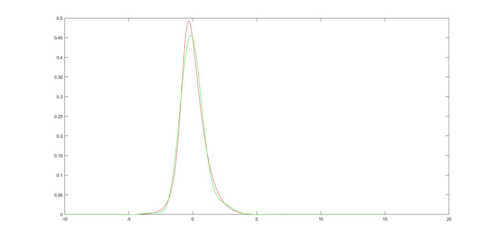](https://postimg.cc/Ln5vQF4t)

.

Here are the values of coefficients of the Z-series

median= b0 =

  -0.106483223256875

b =

   0.846003295145937   0.145647460082852   0.052931539811542  -0.015148236175089  -0.001098252521511   0.000418698113286

.

.

.

Here below is the same graph but standard normal density is also drawn in this new graph for comparison purposes. The
standard normal density is in blue line.

.

[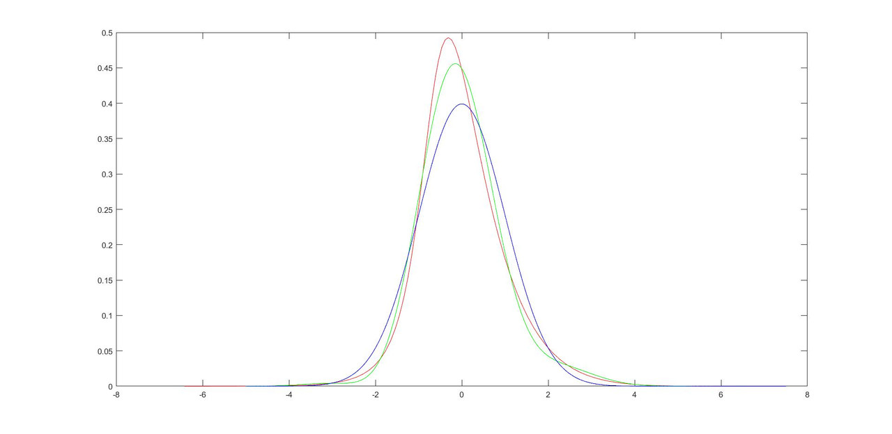](https://postimg.cc/BP65z23S)

---

### #1497 — Amin (Topic Author)
*July 20, 2022, 6:53 PM*

Friends, I have been playing around with the initial model. And really good thing is that Newton method works very very
well. Here is graph of another density with a large negative skew.

Even though the target analytic density was slightly negative at some places, the Newton density is perfectly positive
in this case. Both target density in green and Newton density in red share the same moments/cumulants. Red density is
that of standard normal variable.

.

.

[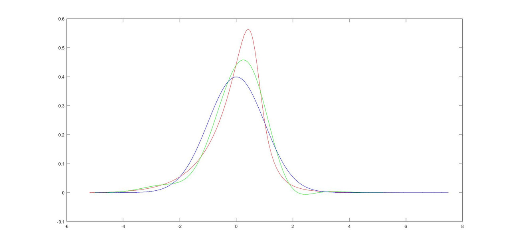](https://postimg.cc/K32SrvhD)

---

### #1498 — Amin (Topic Author)
*July 22, 2022, 12:22 PM*

Friends, I have been working on the model. I noticed that some distributions (obviously) cannot be represented by a six
coefficient Z-series and these distributions really need eight or more parameters to represent them with a Z-series. I
noticed that when I use hermite polynomials, the larger  derivatives (>=6) of random variable with respect to gaussian
that are used as a seed guess for Newton method, sixth, seventh or eighth derivatives throw the results off. Instead of
using hermite polynomials, It would be far better to use method four in post 1491 in which I suggested to construct a
new probability distribution by multiplying original density with a simple polynomial based on powers of x and then
finding solution to coefficients of polynomial by gaussian elimination. Initially I am working with gaussian
distribution and if I could find time later, I will try to apply the method to gamma distribution as well.

Though my approach seems to work well, I really have to work to refine it and make sure that everything fits together.
It can still take 7-10 days before I can post a full-fledged program on Wilmott.

If a Z-series has been found that has six or eight coefficients and has been calibrated to initial few cumulants and we
want to extend the Z-series to ten coefficients fitting larger number of cumulants, I think there could be ways to
perturb the initially calibrated coefficients and add guess coefficients intelligently without resorting to the whole
exercise of fitting an entire probability distribution. These perturbed coefficients from initial calibration plus a
guess of coefficients to be added would then be given to Newton method so it finds a precise fir to those
cumulants/moments.

I have found this project to be very interesting and I will try to make sure that it results in a very good stable
program that friends could use for their experiments, research and applications.

---

### #1499 — Amin (Topic Author)
*July 23, 2022, 8:34 PM*

Friends, tomorrow I will share my base program that fits first six moments to five coefficient Z-series. I want to make
a few further improvements in the base program but it has largely taken its shape and only minor changes are required.

I will also share my procedure to fit first six moments to base program and add further moments to calibration by
extending one coefficient to Z-series at a time. So further moments and coefficients would be added one by one and
Newton method applied each time. I have an analytical  strategy to add further coefficients (on top of first five) one
by one not to overwhelm the Newton method. Tomorrow, I will also share my analytical strategy to do that.

But the whole project to complete will still take 7-10 days.

---

### #1500 — Amin (Topic Author)
*July 24, 2022, 6:45 PM*

Friends, I am posting some graphs of densities with fitted moments and target moments on the top of the graph in the
title. Z-series coefficients are also given on the title of the graph.

I had to visit my sister today and we had to spend a lot of time there. Therefore I could not write explanation and
comments on my matlab program. I will upload it tomorrow after writing comments.

I noticed that we cannot give a huge skew to gaussian densities(Bessel type.) For huge skew, we would have to transform
their coordinates or possibly take a base standardized gamma density with Laguerre polynomials to match the
cumulants/moments and then find the Z-series coefficients.

Meanwhile enjoy these graphs of densities.

.

.

[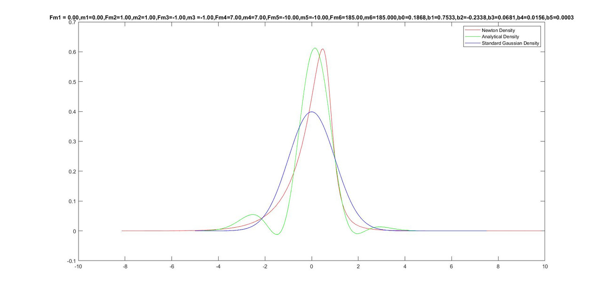](https://postimg.cc/fV1kCqTj)

[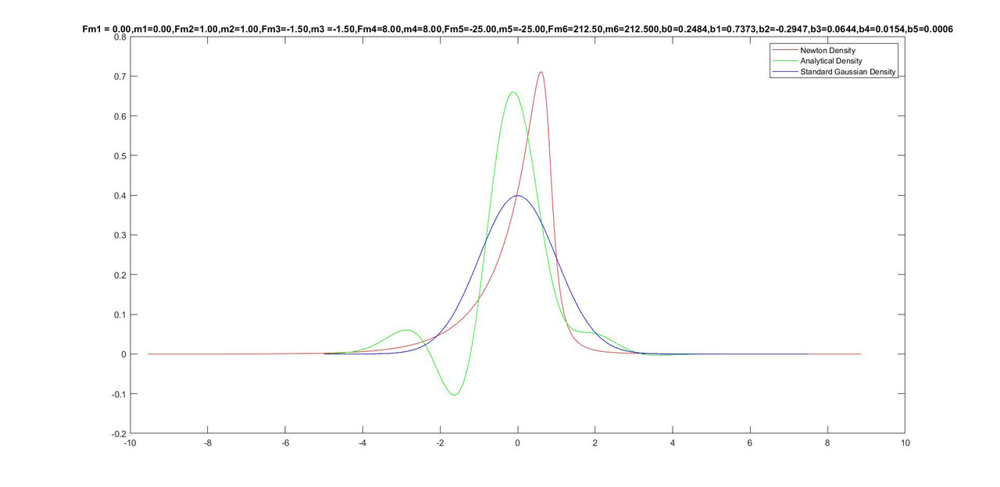](https://postimg.cc/dLt7VTxd)

[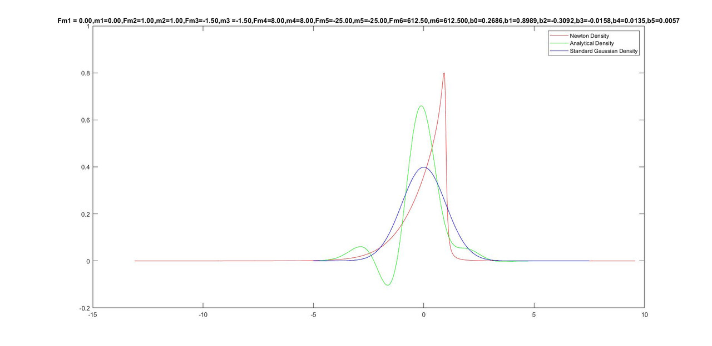](https://postimg.cc/303kpyrs)

[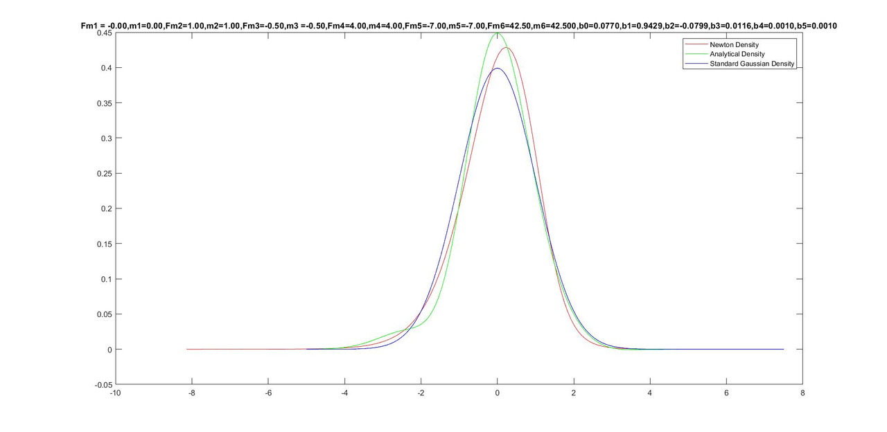](https://postimg.cc/755fgrDZ)

[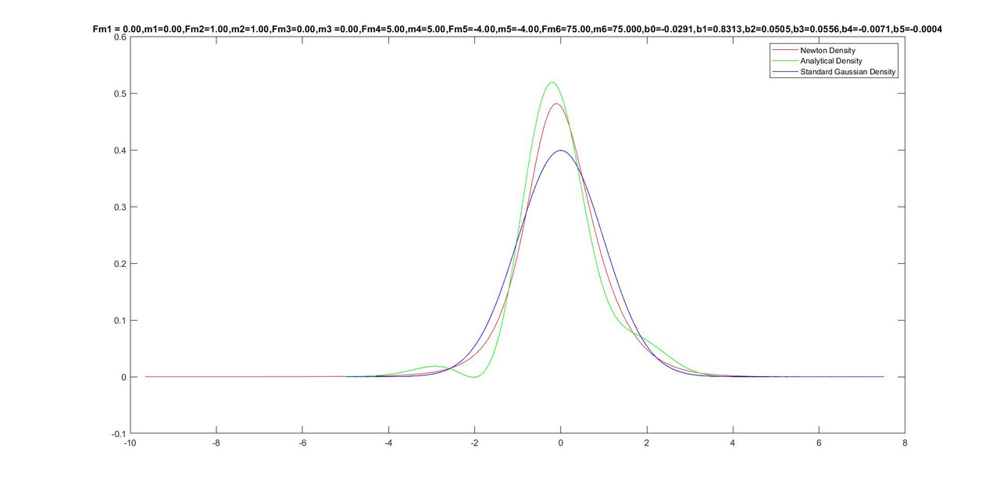](https://postimg.cc/LhVYSVN2)

[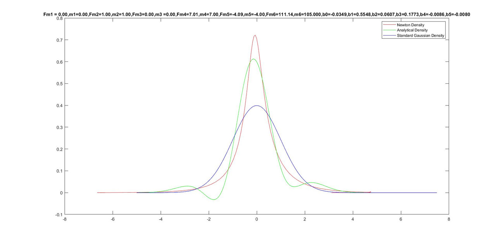](https://postimg.cc/vcq4gHJK)

[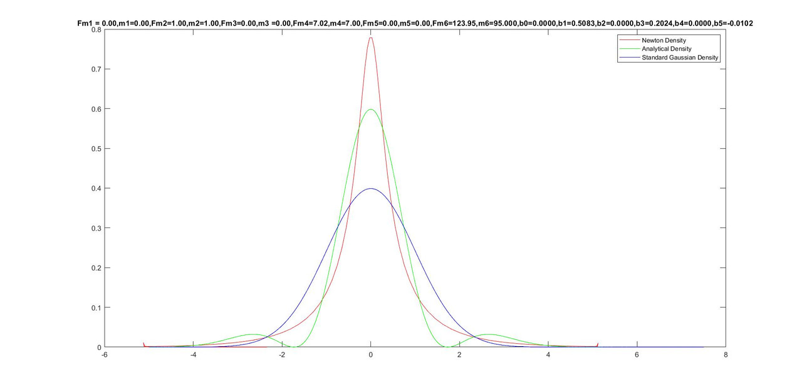](https://postimg.cc/G9R86fPX)

[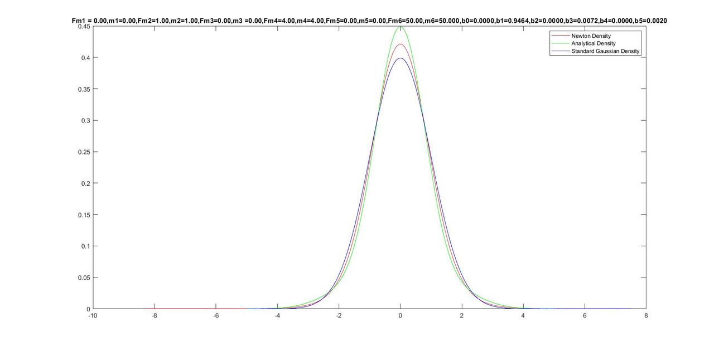](https://postimg.cc/jwHWL6T6)

[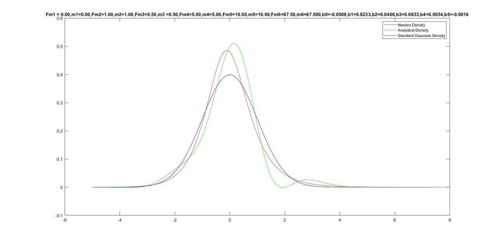](https://postimg.cc/k636J10X)

---

[← Previous](page_029.md) | [Index](index.md) | [Next →](page_031.md)
