# Breakthrough in the theory of stochastic differential equations and their simulation

**Page 31 of 65** — Posts #1501–#1550

[← Previous](page_030.md) | [Index](index.md) | [Next →](page_032.md)

---

### #1501 — Amin (Topic Author)
*July 25, 2022, 7:36 AM*

With standardized moments, i.e k1=0, and k2=1, you can only specify upto k3=+/-.4, if k4=0, k5=0, k6=0. Similarly you
can only specify k4=+1.5 when other cumulants are zero. You can increase k4 to 4 or 5 but for that you would have to
judiciously increase k6. Similarly you can increase k3 to +/-2 but for that you need to have enough of k4, k5, and
k6.You can slightly decrease K4 to -.5 while keeping k3,k5 equal to zero but you have to specify a small positive value
of k6=2.5(for k4=-.5).

For significant skew without significant kurtosis, either you have to transform this density just like we did from
Bessel coordinates to original CEV coordinates. Its Z-series can be transformed to Z-series of the target transformed
density. Or you would have to take a gamma density(that inhenrently takes large skews) as base density and then try to
compare its first few derivatives to gaussian density to find the derivatves dnXdZn that would be used as a guess for
Newton method in order to directly find the Z-series of gamma type densities.

Here are the matlab program files used to create above densities.

```
function [] = FindZSeriesGivenCumulantsPolynomialSimple06()

mu=0;
sigma=1.0;
k1=0.0;
k2=(1.0);
k3=-0.0;%1.0;
k4=-1;%-.50;
k5=0;%-.5;%15;
k6=10;%10;%100.0;

[mu,sigma,a0,a1,a2,a3,a4,a5,mu1,rmu1,rmu2,rmu3,rmu4,rmu5,rmu6] =
GenerateDensityFromCumulantsX06Simple(mu,sigma,k1,k2,k3,k4,k5,k6)

[median] = FindMedianHermiteDensity06(mu1,mu,sigma,a0,a1,a2,a3,a4,a5);
a6=0;
a7=0;
a8=0;

%[median] = FindMedianHermiteDensity08Simple(mu1,mu,sigma,a0,a1,a2,a3,a4,a5,a6,a7,a8)

Xm=median

%Below calculate the density and its derivatives at median.

px=exp(-0.5* ((Xm-mu)/sigma).^2)/sigma/sqrt(2*pi).* (a0+ a1* ((Xm-mu)/sigma)+  a2* (((Xm-mu)/sigma).^2-1) + ...
    a3* ( ((Xm-mu)/sigma).^3 - 3*((Xm-mu)/sigma) )+ ...
    a4* (((Xm-mu)/sigma).^4 - 6* ((Xm-mu)/sigma).^2 + 3)+ ...
    a5* (((Xm-mu)/sigma).^5 - 10* ((Xm-mu)/sigma).^3 + 15*((Xm-mu)/sigma))+ ...
    a6* (((Xm-mu)/sigma).^6 - 15* ((Xm-mu)/sigma).^4 + 45*((Xm-mu)/sigma).^2-15)+ ...
    a7*(((Xm-mu)/sigma).^7 - 21* ((Xm-mu)/sigma).^5 + 105*((Xm-mu)/sigma).^3-105*((Xm-mu)/sigma))+ ...
    a8*(((Xm-mu)/sigma).^8 - 28* ((Xm-mu)/sigma).^6 + 210*((Xm-mu)/sigma).^4-420*((Xm-mu)/sigma).^2+105));

dpxdX=exp(-0.5* ((Xm-mu)/sigma).^2)/sigma^2/sqrt(2*pi).* -(a0* ((Xm-mu)/sigma)+  a1* (((Xm-mu)/sigma).^2-1) + ...
    a2* ( ((Xm-mu)/sigma).^3 - 3*((Xm-mu)/sigma) )+ ...
    a3* (((Xm-mu)/sigma).^4 - 6* ((Xm-mu)/sigma).^2 + 3)+ ...
    a4* (((Xm-mu)/sigma).^5 - 10* ((Xm-mu)/sigma).^3 + 15*((Xm-mu)/sigma))+ ...
    a5* (((Xm-mu)/sigma).^6 - 15* ((Xm-mu)/sigma).^4 + 45*((Xm-mu)/sigma).^2-15) + ...
    a6* (((Xm-mu)/sigma).^7 - 21* ((Xm-mu)/sigma).^5 + 105*((Xm-mu)/sigma).^3-105*((Xm-mu)/sigma))+...
    a7*(((Xm-mu)/sigma).^8 - 28* ((Xm-mu)/sigma).^6 + 210*((Xm-mu)/sigma).^4-420*((Xm-mu)/sigma).^2+105)+ ...
    a8*(((Xm-mu)/sigma).^9 - 36* ((Xm-mu)/sigma).^7 +
378*((Xm-mu)/sigma).^5-1260*((Xm-mu)/sigma).^3+945*((Xm-mu)/sigma)));

d2pxdX2=exp(-0.5* ((Xm-mu)/sigma).^2)/sigma^3/sqrt(2*pi).* (a0* (((Xm-mu)/sigma).^2-1) + ...
    a1* ( ((Xm-mu)/sigma).^3 - 3*((Xm-mu)/sigma) )+ ...
    a2* (((Xm-mu)/sigma).^4 - 6* ((Xm-mu)/sigma).^2 + 3)+ ...
    a3* (((Xm-mu)/sigma).^5 - 10* ((Xm-mu)/sigma).^3 + 15*((Xm-mu)/sigma))+ ...
    a4* (((Xm-mu)/sigma).^6 - 15* ((Xm-mu)/sigma).^4 + 45*((Xm-mu)/sigma).^2-15) + ...
    a5* (((Xm-mu)/sigma).^7 - 21* ((Xm-mu)/sigma).^5 + 105*((Xm-mu)/sigma).^3-105*((Xm-mu)/sigma))+ ...
    a6* (((Xm-mu)/sigma).^8 - 28* ((Xm-mu)/sigma).^6 + 210*((Xm-mu)/sigma).^4-420*((Xm-mu)/sigma).^2+105) + ...
    a7*(((Xm-mu)/sigma).^9 - 36* ((Xm-mu)/sigma).^7 +
378*((Xm-mu)/sigma).^5-1260*((Xm-mu)/sigma).^3+945*((Xm-mu)/sigma))+ ...
    a8/720/56*(((Xm-mu)/sigma).^10 - 45* ((Xm-mu)/sigma).^8 +
630*((Xm-mu)/sigma).^6-3150*((Xm-mu)/sigma).^4+4725*((Xm-mu)/sigma).^2-945));

d3pxdX3=exp(-0.5* ((Xm-mu)/sigma).^2)/sigma^4/sqrt(2*pi).* -(a0* (((Xm-mu)/sigma).^3 - 3*((Xm-mu)/sigma) )+ ...
    a1* (((Xm-mu)/sigma).^4 - 6* ((Xm-mu)/sigma).^2 + 3)+ ...
    a2* (((Xm-mu)/sigma).^5 - 10* ((Xm-mu)/sigma).^3 + 15*((Xm-mu)/sigma))+ ...
    a3* (((Xm-mu)/sigma).^6 - 15* ((Xm-mu)/sigma).^4 + 45*((Xm-mu)/sigma).^2-15) + ...
    a4* (((Xm-mu)/sigma).^7 - 21* ((Xm-mu)/sigma).^5 + 105*((Xm-mu)/sigma).^3-105*((Xm-mu)/sigma))+ ...
    a5* (((Xm-mu)/sigma).^8 - 28* ((Xm-mu)/sigma).^6 + 210*((Xm-mu)/sigma).^4-420*((Xm-mu)/sigma).^2+105)+ ...
    a6* (((Xm-mu)/sigma).^9 - 36* ((Xm-mu)/sigma).^7 +
378*((Xm-mu)/sigma).^5-1260*((Xm-mu)/sigma).^3+945*((Xm-mu)/sigma)) + ...
    a7*(((Xm-mu)/sigma).^10 - 45* ((Xm-mu)/sigma).^8 +
630*((Xm-mu)/sigma).^6-3150*((Xm-mu)/sigma).^4+4725*((Xm-mu)/sigma).^2-945)+ ...
    a8*(((Xm-mu)/sigma).^11 - 55* ((Xm-mu)/sigma).^9 +
990*((Xm-mu)/sigma).^7-6930*((Xm-mu)/sigma).^5+17325*((Xm-mu)/sigma).^3-10395.*((Xm-mu)/sigma)));

d4pxdX4=exp(-0.5* ((Xm-mu)/sigma).^2)/sigma^5/sqrt(2*pi).* ( a0* (((Xm-mu)/sigma).^4 - 6* ((Xm-mu)/sigma).^2 + 3)+ ...
    a1* (((Xm-mu)/sigma).^5 - 10* ((Xm-mu)/sigma).^3 + 15*((Xm-mu)/sigma))+ ...
    a2* (((Xm-mu)/sigma).^6 - 15* ((Xm-mu)/sigma).^4 + 45*((Xm-mu)/sigma).^2-15) + ...
    a3* (((Xm-mu)/sigma).^7 - 21* ((Xm-mu)/sigma).^5 + 105*((Xm-mu)/sigma).^3-105*((Xm-mu)/sigma))+ ...
    a4* (((Xm-mu)/sigma).^8 - 28* ((Xm-mu)/sigma).^6 + 210*((Xm-mu)/sigma).^4-420*((Xm-mu)/sigma).^2+105)+ ...
    a5* (((Xm-mu)/sigma).^9 - 36* ((Xm-mu)/sigma).^7 +
378*((Xm-mu)/sigma).^5-1260*((Xm-mu)/sigma).^3+945*((Xm-mu)/sigma))+ ...
    a6* (((Xm-mu)/sigma).^10 - 45* ((Xm-mu)/sigma).^8 +
630*((Xm-mu)/sigma).^6-3150*((Xm-mu)/sigma).^4+4725*((Xm-mu)/sigma).^2- 945 ) + ...
    a7*(((Xm-mu)/sigma).^11 - 55* ((Xm-mu)/sigma).^9 +
990*((Xm-mu)/sigma).^7-6930*((Xm-mu)/sigma).^5+17325*((Xm-mu)/sigma).^3-10395.*((Xm-mu)/sigma))+ ...
    a8*(((Xm-mu)/sigma).^12 - 66* ((Xm-mu)/sigma).^10 +
1485*((Xm-mu)/sigma).^8-13860*((Xm-mu)/sigma).^6+51975*((Xm-mu)/sigma).^4-62370.*((Xm-mu)/sigma).^2+10395));

dpxdX
d2pxdX2
d3pxdX3
d4pxdX4

%str=input('Look at derivatives results')

%Below calculate standard normal density and its derivatives at median.
Zm=0;
pz=exp(-0.5* (Zm.^2))/sqrt(2*pi);
dpzdZ=-Zm*exp(-0.5* (Zm.^2))/sqrt(2*pi);
d2pzdZ2=(Zm^2-1)*exp(-0.5* (Zm.^2))/sqrt(2*pi);
d3pzdZ3=-(Zm^3-3*Zm)*exp(-0.5* (Zm.^2))/sqrt(2*pi);
d4pzdZ4=(Zm^4-6*Zm^2+3)*exp(-0.5* (Zm.^2))/sqrt(2*pi);

dXdZ=pz/px;

d2XdZ2=(dpzdZ-(dpxdX *dXdZ^2))/px

d3XdZ3=(d2pzdZ2- (2* dpxdX* dXdZ *d2XdZ2+dXdZ *(dXdZ^2* d2pxdX2+dpxdX *d2XdZ2)))/px

d4XdZ4=(d3pzdZ3-(3* d2XdZ2* (dXdZ^2* d2pxdX2+dpxdX *d2XdZ2)+3* dpxdX *dXdZ *d3XdZ3+dXdZ* (3 *dXdZ* d2pxdX2*
d2XdZ2+dXdZ^3* d3pxdX3+dpxdX* d3XdZ3)))/px

d5XdZ5=(d4pzdZ4- (6 *(dXdZ^2 *d2pxdX2+dpxdX *d2XdZ2) *d3XdZ3+4 *d2XdZ2* (3* dXdZ *d2pxdX2 *d2XdZ2+dXdZ^3* d3pxdX3+dpxdX*
d3XdZ3)+4* dpxdX* dXdZ* d4XdZ4+dXdZ *(3* d2pxdX2* d2XdZ2^2+6* dXdZ^2* d2XdZ2* d3pxdX3+4 *dXdZ* d2pxdX2* d3XdZ3+dXdZ^4*
d4pxdX4+dpxdX* d4XdZ4)))/px

%Below calculate iniotial guess coefficients of Z-series to be input to
%Newton method.

c0=median
c1=dXdZ
c2=1/2*1*d2XdZ2
c3=1/6*1*d3XdZ3
c4=1/24*1*d4XdZ4
c5=1/120*1*d5XdZ5

cc0=c0;
cc(1)=c1;
cc(2)=c2;
cc(3)=c3;
cc(4)=c4;
cc(5)=c5;

SeriesOrder=5;
NMoments=6;

[Moments] = CalculateMomentsOfZSeries(cc0,cc,SeriesOrder,NMoments)
rmu1
rmu2
rmu3
rmu4
rmu5
rmu6

%Below specify target cumulants.
C(1:NMoments+1)=0;
C(1)=k1;
C(2)=k2;
C(3)=k3;
C(4)=k4;
C(5)=k5;
C(6)=k6;

%Below calculate F, the defect vector from target cumulants. And calculate
%dF which is the matrix consisting of derivatives of defect vector from
%target cumulants.

[F,dF] = CalculateCumulantsAndDerivativesFromMoments_0(C,cc0,cc,SeriesOrder,NMoments,6)

da(1,1)=cc0;
da(2:SeriesOrder+1,1)=cc(1:SeriesOrder);

NoOfCumulants=NMoments

ObjBest=0;
 for mm=1:NoOfCumulants
     if(C(mm)~=0)
     ObjBest=ObjBest+F(mm,1).^2/(abs(C(mm)));
     end
 end

b0Best=cc0;
bBest(1:SeriesOrder)=cc(1:SeriesOrder);

nn=0;
while((nn.000000000001) || (abs(F(2,1))>.000000000001) || (abs(F(3,1))>.000000000001) || (abs(F(4,1))>.00000000001)||
(abs(F(5,1))>.00000000001)|| (abs(F(6,1))>.00000000001)  ))

nn=nn+1;
%Below Newton matrix equation to improve the Z-series coefficients guess at previous step.

da=da-dF\F;

%b0=median
b0=da(1,1);
b(1:SeriesOrder)=da(2:SeriesOrder+1,1);

[F,dF] = CalculateCumulantsAndDerivativesFromMoments_0(C,b0,b,SeriesOrder,SeriesOrder,NoOfCumulants);

  ObjNew=0;
  for mm=1:NoOfCumulants
      if(C(mm)~=0)
      ObjBest=ObjBest+F(mm,1).^2/(abs(C(mm)));
      end
  end

  if(ObjBest<ObjNew)

   else
       ObjBest=ObjNew;
       b0Best=b0;
       bBest(1:SeriesOrder)=b(1:SeriesOrder);
   end

da(1,1)=b0;
da(2:SeriesOrder+1,1)=b(1:SeriesOrder);

end
  b0=b0Best;%Best;
  b(1:SeriesOrder)=bBest;%Best(1:SeriesOrder);

  %Above are the best chosen Z-series coefficients based on the objective function.
  %But my objective function can be improved.

  [F,dF] = CalculateCumulantsAndDerivativesFromMoments_0(C,b0,b,SeriesOrder,SeriesOrder,NoOfCumulants);
  %[F,dF,uu] = CalculateCumulantsAndDerivativesFromMoments_0A(C,b0,b,SeriesOrder,SeriesOrder,NoOfCumulants);
 ObjLast=0;
 for mm=1:NoOfCumulants
     if(C(mm)~=0)
     ObjLast=ObjLast+F(mm,1).^2/(abs(C(mm)));
     end
 end
ObjLast

nn

F

[Moments] = CalculateMomentsOfZSeries(b0,b,SeriesOrder,NMoments)
%Above are raw moments calculated from the resulting Z-series from Newton
%Method

%Below are raw moments that were input to calibration.
rmu1
rmu2
rmu3
rmu4
rmu5
rmu6
%str=input('Look at new moments');

%Below we do calculations to construct the density from our newly derived
%Z-series.

dNn=.2/2;   % Normal density subdivisions width. would change with number of subdivisions
Nn=90;  % No of normal density subdivisions

NnMid=4.0;

Z(1:Nn)=(((1:Nn)-6.5/1)*dNn-NnMid);
Z
%str=input('Look at Z');
%ZProb(1)=normcdf(.5*Z(1)+.5*Z(2),0,1)-normcdf(.5*Z(1)+.5*Z(2)-dNn,0,1);
%ZProb(Nn)=normcdf(.5*Z(Nn)+.5*Z(Nn-1)+dNn,0,1)-normcdf(.5*Z(Nn)+.5*Z(Nn-1),0,1);
%ZProb(2:Nn-1)=normcdf(.5*Z(2:Nn-1)+.5*Z(3:Nn),0,1)-normcdf(.5*Z(2:Nn-1)+.5*Z(1:Nn-2),0,1);

  w(1:Nn)=b0;
  for nn=1:SeriesOrder
      w(1:Nn)=w(1:Nn)+b(nn)*Z(1:Nn).^nn;
  end
wnStart=1;
Dfw(wnStart:Nn)=0;
for nn=wnStart+1:Nn-1

    Dfw(nn) = (w(nn + 1) - w(nn - 1))/(Z(nn + 1) - Z(nn - 1));
end

pw(1:Nn)=0;
for nn = wnStart+1:Nn-1

    pw(nn) = (normpdf(Z(nn),0, 1))/abs(Dfw(nn));

end

%Below is the construction of density of our originial analytic density for
%plotting purposes

dMm=.02/10;
Mm=1250*5;
X(1:Mm)=-5+dMm+dMm*(1:Mm);

%Below is the newly constructed density so that its output central moments
%match the central moments input by the user.
pdf=exp(-0.5* ((X-mu)/sigma).^2)/sigma/sqrt(2*pi).* (a0+ a1* ((X-mu)/sigma)+  a2* (((X-mu)/sigma).^2-1) + ...
    a3* ( ((X-mu)/sigma).^3 - 3*((X-mu)/sigma) )+ ...
    a4* (((X-mu)/sigma).^4 - 6* ((X-mu)/sigma).^2 + 3)+ ...
    a5* (((X-mu)/sigma).^5 - 10* ((X-mu)/sigma).^3 + 15*((X-mu)/sigma))+ ...
    a6* (((X-mu)/sigma).^6 - 15* ((X-mu)/sigma).^4 + 45*((X-mu)/sigma).^2-15))+ ...
    a7*(((Xm-mu)/sigma).^7 - 21* ((Xm-mu)/sigma).^5 + 105*((Xm-mu)/sigma).^3-105*((Xm-mu)/sigma));

%Below is standard Gaussian PDF.
pdfG=exp(-0.5* ((X-mu)/sigma).^2)/sigma/sqrt(2*pi);

plot(w(wnStart+1:Nn-1),pw(wnStart+1:Nn-1),'r',X(1:Mm),pdf(1:Mm),'g',X(1:Mm),pdfG(1:Mm),'b');

title(sprintf('Fm1 = %.2f,m1=%.2f,Fm2=%.2f,m2=%.2f,Fm3=%.2f,m3
=%.2f,Fm4=%.2f,m4=%.2f,Fm5=%.2f,m5=%.2f,Fm6=%.2f,m6=%.3f,b0=%.4f,b1=%.4f,b2=%.4f,b3=%.4f,b4=%.4f,b5=%.4f',Moments(1),rmu1,Moments(2),rmu2,Moments(3),rmu3,Moments(4),rmu4,Moments(5),rmu5,Moments(6),rmu6,b0,b(1),b(2),b(3),b(4),b(5)));
%,sprintf('theta= %f', theta), sprintf('kappa = %f', kappa),sprintf('sigma = %f', sigma0),sprintf('T = %f', T));

legend({'Newton Density','Analytical Density','Standard Gaussian Density'},'Location','northeast')

b0
b

end

```

.

.

.

```
function [mu,sigma,a0,a1,a2,a3,a4,a5,mu1,rmu1,rmu2,rmu3,rmu4,rmu5,rmu6] =
GenerateDensityFromCumulantsX06Simple(mu,sigma,k1,k2,k3,k4,k5,k6)

%In this program, you specify the first six cumulants through input parametersand the program creates a density based on
these
%cumulantsents.

%The algorithm takes a base gaussian density that has it mean mu and
%sq-root of variance given by sigma.
%This mean and sigma can be different from first and sq-root of second
%central moment(variance) of the target density that we specified as mu1 and mu2 earlier.

%Below is the construction of grid to calculate pdf, numerically integrate the pdf
%to find cdf. And to numerically calculate the six moments on the constructed density
%so they can be matched with input moments.

dNn=.02/10;
Nn=1250*10;
X(1:Nn)=-10+dNn+dNn*(1:Nn);

%Below, we calculate first six raw-moments from the input cumulants.
%These raw moments would be used to calculate the coefficients of hermite
%polynomials so that output central moments calculated on new density match
%the input central moments.

mu1=k1;
rmu1=k1;
rmu2=k1*rmu1+k2;
rmu3=k1*rmu2+2*k2*rmu1+k3;
rmu4=k1*rmu3+3*k2*rmu2+3*k3*rmu1+k4;
rmu5=k1*rmu4+4*k2*rmu3+6*k3*rmu2+4*k4*rmu1+k5;
rmu6=k1*rmu5+5*k2*rmu4+10*k3*rmu3+10*k4*rmu2+5*k5*rmu1+k6;
%rmu7=k1*rmu6+6*k2*rmu5+15*k3*rmu4+20*k4*rmu3+15*k5*rmu2+6*k6*rmu1+k7;
%rmu8=k1*rmu7+7*k2*rmu6+21*k3*rmu5+35*k4*rmu4+35*k5*rmu3+21*k6*rmu2+7*k7*rmu1+k8;

%Below is base gaussian pdf.
pdfG=exp(-0.5* ((X-mu)/sigma).^2)/sigma/sqrt(2*pi);

%Below I calculate the coefficients of polynomials making the density so
%that the resulting density has the same as specified raw moments.
%This follows my description of method 4 in the post 1491 given at
%https://forum.wilmott.com/viewtopic.php?f=4&t=99702&p=871093#p871047

MOrder=6+6
SeriesOrder=6;
[EZ] = CalculateGaussianMoments(MOrder)

%str=input('Look at Z  Expectations')
CMatrix(1,1:SeriesOrder)=EZ(1:SeriesOrder);
CMatrix(2,1:SeriesOrder)=EZ(2:SeriesOrder+1);
CMatrix(3,1:SeriesOrder)=EZ(3:SeriesOrder+2);
CMatrix(4,1:SeriesOrder)=EZ(4:SeriesOrder+3);
CMatrix(5,1:SeriesOrder)=EZ(5:SeriesOrder+4);
CMatrix(6,1:SeriesOrder)=EZ(6:SeriesOrder+5);
%CMatrix(7,1:SeriesOrder)=EZ(7:SeriesOrder+6);
%CMatrix(8,1:SeriesOrder)=EZ(8:SeriesOrder+7);

Mu(1,1)=1.0;
Mu(2,1)=rmu1;
Mu(3,1)=rmu2;
Mu(4,1)=rmu3;
Mu(5,1)=rmu4;
Mu(6,1)=rmu5;
%Mu(7,1)=rmu6;
%Mu(8,1)=rmu7;

Coeff=CMatrix\Mu;

Coeff

%str=input('Look at Mu results');
%Below I convert from simple polynomials to hermite polynomials so that
%resulting density remains identical with the initial density.

[CoeffaH] = ConvertZCoeffsToHCoeffsAB(Coeff,SeriesOrder)

a0=CoeffaH(1);
a1=CoeffaH(2);
a2=CoeffaH(3);
a3=CoeffaH(4);
a4=CoeffaH(5);
a5=CoeffaH(6);
a6=0;%CoeffaH(7);
a7=0;%CoeffaH(8);
a8=0;

CoeffaH(7)=0;
CoeffaH(8)=0;

%str=input('Look at Mu results---2');

%Below is the newly constructed density so that its output raw moments
%match the raw moments input by the user.
%Sometimes this density is negative at places but we still use it to derive
%an initial guess for construction of Z-series Newton density.

pdf=exp(-0.5* ((X-mu)/sigma).^2)/sigma/sqrt(2*pi).* (a0+ a1* ((X-mu)/sigma)+  a2* (((X-mu)/sigma).^2-1) + ...
    a3* ( ((X-mu)/sigma).^3 - 3*((X-mu)/sigma) )+ ...
    a4* (((X-mu)/sigma).^4 - 6* ((X-mu)/sigma).^2 + 3)+ ...
    a5* (((X-mu)/sigma).^5 - 10* ((X-mu)/sigma).^3 + 15*((X-mu)/sigma))+ ...
    a6* (((X-mu)/sigma).^6 - 15* ((X-mu)/sigma).^4 + 45*((X-mu)/sigma).^2-15)+ ...
    a7* (((X-mu)/sigma).^7 - 21* ((X-mu)/sigma).^5 + 105*((X-mu)/sigma).^3-105*((X-mu)/sigma))+ ...
    a8* (((X-mu)/sigma).^8 - 28* ((X-mu)/sigma).^6 + 210*((X-mu)/sigma).^4-420*((X-mu)/sigma).^2+105));

%Below cdf is calculated by doing numerical integration of the density. I
%have replaced integration with summations.
cdf0(1:Nn)=0;
for nn=2:Nn
cdf0(nn)=cdf0(nn-1)+exp(-0.5* ((X(nn)-mu)/sigma).^2)/sigma/sqrt(2*pi).* (a0+ a1* ((X(nn)-mu)/sigma)+ a2/2*
(((X(nn)-mu)/sigma).^2-1) + ...
    a3* ( ((X(nn)-mu)/sigma).^3 - 3*((X(nn)-mu)/sigma) )+ ...
    a4* (((X(nn)-mu)/sigma).^4 - 6* ((X(nn)-mu)/sigma).^2 + 3) + ...
    a5* (((X(nn)-mu)/sigma).^5 - 10* ((X(nn)-mu)/sigma).^3 + 15*((X(nn)-mu)/sigma))+ ...
    a6* (((X(nn)-mu)/sigma).^6 - 15* ((X(nn)-mu)/sigma).^4 + 45*((X(nn)-mu)/sigma).^2-15) + ...
     a7* (((X(nn)-mu)/sigma).^7 - 21* ((X(nn)-mu)/sigma).^5 + 105*((X(nn)-mu)/sigma).^3-105*((X(nn)-mu)/sigma))+ ...
    a8* (((X(nn)-mu)/sigma).^8 - 28* ((X(nn)-mu)/sigma).^6 +
210*((X(nn)-mu)/sigma).^4-420*((X(nn)-mu)/sigma).^2+105))*dNn;
end

%Below is numerically calculated value of first raw moment. N in mu1N
%stands for numerical.

rmu1N=0;
for nn=2:Nn
rmu1N=rmu1N+X(nn) .*exp(-0.5* ((X(nn)-mu)/sigma).^2)/sigma/sqrt(2*pi).* (a0+ a1* ((X(nn)-mu)/sigma)+ a2/2*
(((X(nn)-mu)/sigma).^2-1) + ...
    a3* ( ((X(nn)-mu)/sigma).^3 - 3*((X(nn)-mu)/sigma) )+ ...
    a4* (((X(nn)-mu)/sigma).^4 - 6* ((X(nn)-mu)/sigma).^2 + 3) + ...
    a5* (((X(nn)-mu)/sigma).^5 - 10* ((X(nn)-mu)/sigma).^3 + 15*((X(nn)-mu)/sigma))+ ...
    a6* (((X(nn)-mu)/sigma).^6 - 15* ((X(nn)-mu)/sigma).^4 + 45*((X(nn)-mu)/sigma).^2-15)+ ...
    a7* (((X(nn)-mu)/sigma).^7 - 21* ((X(nn)-mu)/sigma).^5 + 105*((X(nn)-mu)/sigma).^3-105*((X(nn)-mu)/sigma))+ ...
    a8* (((X(nn)-mu)/sigma).^8 - 28* ((X(nn)-mu)/sigma).^6 +
210*((X(nn)-mu)/sigma).^4-420*((X(nn)-mu)/sigma).^2+105))*dNn;
end

%Below is numerically calculated value of second raw moment.

rmu2N=0;
for nn=2:Nn
rmu2N=rmu2N+(X(nn)-0*rmu1N).^2 .*exp(-0.5* ((X(nn)-mu)/sigma).^2)/sigma/sqrt(2*pi).* (a0+ a1* ((X(nn)-mu)/sigma)+ a2*
(((X(nn)-mu)/sigma).^2-1) + ...
    a3* ( ((X(nn)-mu)/sigma).^3 - 3*((X(nn)-mu)/sigma) )+ ...
    a4* (((X(nn)-mu)/sigma).^4 - 6* ((X(nn)-mu)/sigma).^2 + 3) + ...
    a5* (((X(nn)-mu)/sigma).^5 - 10* ((X(nn)-mu)/sigma).^3 + 15*((X(nn)-mu)/sigma))+ ...
    a6* (((X(nn)-mu)/sigma).^6 - 15* ((X(nn)-mu)/sigma).^4 + 45*((X(nn)-mu)/sigma).^2-15)+ ...
    a7* (((X(nn)-mu)/sigma).^7 - 21* ((X(nn)-mu)/sigma).^5 + 105*((X(nn)-mu)/sigma).^3-105*((X(nn)-mu)/sigma))+ ...
    a8* (((X(nn)-mu)/sigma).^8 - 28* ((X(nn)-mu)/sigma).^6 +
210*((X(nn)-mu)/sigma).^4-420*((X(nn)-mu)/sigma).^2+105))*dNn;
end

%Below is numerically calculated value of third raw moment.
rmu3N=0;
for nn=2:Nn
rmu3N=rmu3N+(X(nn)-0*rmu1N).^3 .*exp(-0.5* ((X(nn)-mu)/sigma).^2)/sigma/sqrt(2*pi).* (a0+ a1* ((X(nn)-mu)/sigma)+ a2*
(((X(nn)-mu)/sigma).^2-1) + ...
    a3* ( ((X(nn)-mu)/sigma).^3 - 3*((X(nn)-mu)/sigma) )+ ...
    a4* (((X(nn)-mu)/sigma).^4 - 6* ((X(nn)-mu)/sigma).^2 + 3) + ...
    a5* (((X(nn)-mu)/sigma).^5 - 10* ((X(nn)-mu)/sigma).^3 + 15*((X(nn)-mu)/sigma))+ ...
    a6* (((X(nn)-mu)/sigma).^6 - 15* ((X(nn)-mu)/sigma).^4 + 45*((X(nn)-mu)/sigma).^2-15)+ ...
    a7* (((X(nn)-mu)/sigma).^7 - 21* ((X(nn)-mu)/sigma).^5 + 105*((X(nn)-mu)/sigma).^3-105*((X(nn)-mu)/sigma))+ ...
    a8* (((X(nn)-mu)/sigma).^8 - 28* ((X(nn)-mu)/sigma).^6 +
210*((X(nn)-mu)/sigma).^4-420*((X(nn)-mu)/sigma).^2+105))*dNn;
end

%Below is numerically calculated value of fourth raw moment.
rmu4N=0;
for nn=2:Nn
rmu4N=rmu4N+(X(nn)-0*rmu1N).^4 .*exp(-0.5* ((X(nn)-mu)/sigma).^2)/sigma/sqrt(2*pi).* (a0+ a1* ((X(nn)-mu)/sigma)+ a2*
(((X(nn)-mu)/sigma).^2-1) + ...
    a3* ( ((X(nn)-mu)/sigma).^3 - 3*((X(nn)-mu)/sigma) )+ ...
    a4* (((X(nn)-mu)/sigma).^4 - 6* ((X(nn)-mu)/sigma).^2 + 3) + ...
    a5* (((X(nn)-mu)/sigma).^5 - 10* ((X(nn)-mu)/sigma).^3 + 15*((X(nn)-mu)/sigma))+ ...
    a6* (((X(nn)-mu)/sigma).^6 - 15* ((X(nn)-mu)/sigma).^4 + 45*((X(nn)-mu)/sigma).^2-15)+ ...
    a7* (((X(nn)-mu)/sigma).^7 - 21* ((X(nn)-mu)/sigma).^5 + 105*((X(nn)-mu)/sigma).^3-105*((X(nn)-mu)/sigma))+ ...
    a8* (((X(nn)-mu)/sigma).^8 - 28* ((X(nn)-mu)/sigma).^6 +
210*((X(nn)-mu)/sigma).^4-420*((X(nn)-mu)/sigma).^2+105))*dNn;
end

%Below is numerically calculated value of fifth raw moment.
rmu5N=0;
for nn=2:Nn
rmu5N=rmu5N+(X(nn)-0*rmu1N).^5 .*exp(-0.5* ((X(nn)-mu)/sigma).^2)/sigma/sqrt(2*pi).* (a0+ a1* ((X(nn)-mu)/sigma)+ a2*
(((X(nn)-mu)/sigma).^2-1) + ...
    a3* ( ((X(nn)-mu)/sigma).^3 - 3*((X(nn)-mu)/sigma) )+ ...
    a4* (((X(nn)-mu)/sigma).^4 - 6* ((X(nn)-mu)/sigma).^2 + 3) + ...
    a5* (((X(nn)-mu)/sigma).^5 - 10* ((X(nn)-mu)/sigma).^3 + 15*((X(nn)-mu)/sigma))+ ...
    a6* (((X(nn)-mu)/sigma).^6 - 15* ((X(nn)-mu)/sigma).^4 + 45*((X(nn)-mu)/sigma).^2-15) + ...
    a7* (((X(nn)-mu)/sigma).^7 - 21* ((X(nn)-mu)/sigma).^5 + 105*((X(nn)-mu)/sigma).^3-105*((X(nn)-mu)/sigma))+ ...
    a8* (((X(nn)-mu)/sigma).^8 - 28* ((X(nn)-mu)/sigma).^6 +
210*((X(nn)-mu)/sigma).^4-420*((X(nn)-mu)/sigma).^2+105))*dNn;
end

% %Below is numerically calculated value of sixth raw moment.
% rmu6N=0;
% for nn=2:Nn
% rmu6N=rmu6N+(X(nn)-0*rmu1N).^6 .*exp(-0.5* ((X(nn)-mu)/sigma).^2)/sigma/sqrt(2*pi).* (a0+ a1* ((X(nn)-mu)/sigma)+ a2*
(((X(nn)-mu)/sigma).^2-1) + ...
%     a3* ( ((X(nn)-mu)/sigma).^3 - 3*((X(nn)-mu)/sigma) )+ ...
%     a4* (((X(nn)-mu)/sigma).^4 - 6* ((X(nn)-mu)/sigma).^2 + 3) + ...
%     a5* (((X(nn)-mu)/sigma).^5 - 10* ((X(nn)-mu)/sigma).^3 + 15*((X(nn)-mu)/sigma))+ ...
%     a6* (((X(nn)-mu)/sigma).^6 - 15* ((X(nn)-mu)/sigma).^4 + 45*((X(nn)-mu)/sigma).^2-15) + ...
%     a7* (((X(nn)-mu)/sigma).^7 - 21* ((X(nn)-mu)/sigma).^5 + 105*((X(nn)-mu)/sigma).^3-105*((X(nn)-mu)/sigma))+ ...
%     a8* (((X(nn)-mu)/sigma).^8 - 28* ((X(nn)-mu)/sigma).^6 +
210*((X(nn)-mu)/sigma).^4-420*((X(nn)-mu)/sigma).^2+105))*dNn;
% end
%
% rmu7N=0;
% for nn=2:Nn
% rmu7N=rmu7N+(X(nn)-0*rmu1N).^7 .*exp(-0.5* ((X(nn)-mu)/sigma).^2)/sigma/sqrt(2*pi).* (a0+ a1* ((X(nn)-mu)/sigma)+ a2*
(((X(nn)-mu)/sigma).^2-1) + ...
%     a3* ( ((X(nn)-mu)/sigma).^3 - 3*((X(nn)-mu)/sigma) )+ ...
%     a4* (((X(nn)-mu)/sigma).^4 - 6* ((X(nn)-mu)/sigma).^2 + 3) + ...
%     a5* (((X(nn)-mu)/sigma).^5 - 10* ((X(nn)-mu)/sigma).^3 + 15*((X(nn)-mu)/sigma))+ ...
%     a6* (((X(nn)-mu)/sigma).^6 - 15* ((X(nn)-mu)/sigma).^4 + 45*((X(nn)-mu)/sigma).^2-15) + ...
%     a7* (((X(nn)-mu)/sigma).^7 - 21* ((X(nn)-mu)/sigma).^5 + 105*((X(nn)-mu)/sigma).^3-105*((X(nn)-mu)/sigma))+ ...
%     a8* (((X(nn)-mu)/sigma).^8 - 28* ((X(nn)-mu)/sigma).^6 +
210*((X(nn)-mu)/sigma).^4-420*((X(nn)-mu)/sigma).^2+105))*dNn;
% end
%
% rmu8N=0;
% for nn=2:Nn
% rmu8N=rmu8N+(X(nn)-0*rmu1N).^8 .*exp(-0.5* ((X(nn)-mu)/sigma).^2)/sigma/sqrt(2*pi).* (a0+ a1* ((X(nn)-mu)/sigma)+ a2*
(((X(nn)-mu)/sigma).^2-1) + ...
%     a3* ( ((X(nn)-mu)/sigma).^3 - 3*((X(nn)-mu)/sigma) )+ ...
%     a4* (((X(nn)-mu)/sigma).^4 - 6* ((X(nn)-mu)/sigma).^2 + 3) + ...
%     a5* (((X(nn)-mu)/sigma).^5 - 10* ((X(nn)-mu)/sigma).^3 + 15*((X(nn)-mu)/sigma))+ ...
%     a6* (((X(nn)-mu)/sigma).^6 - 15* ((X(nn)-mu)/sigma).^4 + 45*((X(nn)-mu)/sigma).^2-15) + ...
%     a7* (((X(nn)-mu)/sigma).^7 - 21* ((X(nn)-mu)/sigma).^5 + 105*((X(nn)-mu)/sigma).^3-105*((X(nn)-mu)/sigma))+ ...
%     a8* (((X(nn)-mu)/sigma).^8 - 28* ((X(nn)-mu)/sigma).^6 +
210*((X(nn)-mu)/sigma).^4-420*((X(nn)-mu)/sigma).^2+105))*dNn;
% end
%Below is analytically calculated cdf.

cdf(1:Nn)=normcdf(((X(1:Nn)-mu)/sigma))*a0+exp(-0.5* ((X(1:Nn)-mu)/sigma).^2)/sqrt(2*pi).* (- a1 - a2*
((X(1:Nn)-mu)/sigma) - ...
    a3* ( ((X(1:Nn)-mu)/sigma).^2 - 1 )- ...
    a4* (((X(1:Nn)-mu)/sigma).^3 - 3* ((X(1:Nn)-mu)/sigma)) - ...
    a5* (((X(1:Nn)-mu)/sigma).^4 - 6* ((X(1:Nn)-mu)/sigma).^2 + 3) - ...
    a6* (((X(1:Nn)-mu)/sigma).^5 - 10* ((X(1:Nn)-mu)/sigma).^3 + 15*((X(1:Nn)-mu)/sigma)));

pdf02=exp(-0.5* ((X-mu)/sigma).^2)/sigma/sqrt(2*pi).* (CoeffaH(1)+ CoeffaH(2)* ((X-mu)/sigma)+  CoeffaH(3)*
(((X-mu)/sigma).^2-1) + ...
    CoeffaH(4)* ( ((X-mu)/sigma).^3 - 3*((X-mu)/sigma) )+ ...
    CoeffaH(5)* (((X-mu)/sigma).^4 - 6* ((X-mu)/sigma).^2 + 3)+ ...
    CoeffaH(6)* (((X-mu)/sigma).^5 - 10* ((X-mu)/sigma).^3 + 15*((X-mu)/sigma))+ ...
    CoeffaH(7)* (((X-mu)/sigma).^6 - 15* ((X-mu)/sigma).^4 + 45*((X-mu)/sigma).^2-15)+ ...
    CoeffaH(8)* (((X-mu)/sigma).^7 - 21* ((X-mu)/sigma).^5 + 105*((X-mu)/sigma).^3-105*((X-mu)/sigma)));%+ ...
    %a8/720/56* (((X-mu)/sigma).^8 - 28* ((X-mu)/sigma).^6 + 210*((X-mu)/sigma).^4-420*((X-mu)/sigma).^2+105));

plot(X(1:Nn),cdf0(1:Nn),'g',X(1:Nn),cdf(1:Nn),'r',X(1:Nn),pdf(1:Nn),'b',X(1:Nn),pdfG(1:Nn),'m',X(1:Nn),pdf02(1:Nn),'k');
legend({'Numerically Calculated CDF','Analytically Calculated CDF','Newly Constructed Moment Matched PDF','Base Gaussian
PDF'},'Location','northeast')

%Below program checks if density becomes slightly negative.
IsNegative=0;
for nn=2:Nn
    if(pdf(nn)<0)
        IsNegative=1;
    end
end

%cdf
%Below compare the input raw moments rmu's with moments calculated on
%newly constructed density denoted by rmu#N
rmu1N
rmu1
rmu2N
rmu2
rmu3N
rmu3
rmu4N
rmu4
rmu5N
rmu5
%rmu6N
%rmu6
%rmu7N
%rmu7
%rmu8N
%rmu8

%str=input('Look at match of moments');

%Below are coefficients on hermite polynomials found out so that output
%moments in newly constructed density match input central moment values.

a1
a2
a3
a4
a5
%a6
%a7
%a8

IsNegative

%str=input('Look if the density is negative');

end

```

.

.

.

```
function [EZ] = CalculateGaussianMoments(MOrder)
%Because matlab does not start indexing from zero, The indexing has been
%moved ahead by one number.

EZ(1)=1;
EZ(2)=0;
for nn=3:MOrder
    if rem(nn,2)==0
        EZ(nn)=0;
    else
        EZ(nn)=EZ(nn-2)*(nn-2);
        EZ(nn);
    end
end
end

```

.

.

The function below finds an equivalent hermite representation of an algebraic expression in powers of X. Indexing is
moved ahead by one point because matlab does not start indexing at zero.

.

```
function [aH] = ConvertZCoeffsToHCoeffsAB(a,SeriesOrder)

if(SeriesOrder==4)
aH(1)=a(1)+a(3);
aH(2)=a(2)+3*a(4);
aH(3)=a(3);
aH(4)=a(4);
end

if(SeriesOrder==5)
aH(1)=a(1)+a(3)+3*a(5);
aH(2)=a(2)+3*a(4);
aH(3)=a(3)+6*a(5);
aH(4)=a(4);
aH(5)=a(5);
end

if(SeriesOrder==6)
aH(1)=a(1)+a(3)+3*a(5);
aH(2)=a(2)+3*a(4)+15*a(6);
aH(3)=a(3)+6*a(5);
aH(4)=a(4)+10*a(6);
aH(5)=a(5);
aH(6)=a(6);
end

if(SeriesOrder==7)
aH(1)=a(1)+a(3)+3*a(5)+15*a(7);
aH(2)=a(2)+3*a(4)+15*a(6);
aH(3)=a(3)+6*a(5)+45*a(7);
aH(4)=a(4)+10*a(6);
aH(5)=a(5)+15*a(7);
aH(6)=a(6);
aH(7)=a(7);
end

if(SeriesOrder==8)
aH(1)=a(1)+a(3)+3*a(5)+15*a(7);
aH(2)=a(2)+3*a(4)+15*a(6)+105*a(8);
aH(3)=a(3)+6*a(5)+45*a(7);
aH(4)=a(4)+10*a(6)+105*a(8);
aH(5)=a(5)+15*a(7);
aH(6)=a(6)+21*a(8);
aH(7)=a(7);
aH(8)=a(8);
end

end

```

.

.

.

```
function [median] = FindMedianHermiteDensity06(mu1,mu,sigma,a0,a1,a2,a3,a4,a5)
%Uses Newton-Raphson to calculate the median.

X=mu1;

cdf=normcdf(((X-mu)/sigma))*a0+exp(-0.5* ((X-mu)/sigma).^2)/sqrt(2*pi).* (- a1 - a2* ((X-mu)/sigma) - ...
    a3* ( ((X-mu)/sigma).^2 - 1 )- ...
    a4* (((X-mu)/sigma).^3 - 3* ((X-mu)/sigma)) - ...
    a5* (((X-mu)/sigma).^4 - 6* ((X-mu)/sigma).^2 + 3));% - ...
    %a6/720* (((X-mu)/sigma).^5 - 10* ((X-mu)/sigma).^3 + 15*((X-mu)/sigma)));

nn=0;

while (abs(cdf-.5)> .00000000001)
nn=nn+1;
pdf=exp(-0.5* ((X-mu)/sigma).^2)/sigma/sqrt(2*pi).* (a0+ a1* ((X-mu)/sigma)+  a2* (((X-mu)/sigma).^2-1) + ...
    a3* ( ((X-mu)/sigma).^3 - 3*((X-mu)/sigma) )+ ...
    a4* (((X-mu)/sigma).^4 - 6* ((X-mu)/sigma).^2 + 3)+ ...
    a5* (((X-mu)/sigma).^5 - 10* ((X-mu)/sigma).^3 + 15*((X-mu)/sigma)));%+ ...
    %a6/720* (((X-mu)/sigma).^6 - 15* ((X-mu)/sigma).^4 + 45*((X-mu)/sigma).^2-15));

X=X-(cdf-.5)/pdf;
cdf=normcdf(((X-mu)/sigma))*a0+exp(-0.5* ((X-mu)/sigma).^2)/sqrt(2*pi).* (- a1 - a2* ((X-mu)/sigma) - ...
    a3* ( ((X-mu)/sigma).^2 - 1 )- ...
    a4* (((X-mu)/sigma).^3 - 3* ((X-mu)/sigma)) - ...
    a5* (((X-mu)/sigma).^4 - 6* ((X-mu)/sigma).^2 + 3));% - ...
    %a6/720* (((X-mu)/sigma).^5 - 10* ((X-mu)/sigma).^3 + 15*((X-mu)/sigma)));

cdf
end

nn
cdf
mu1
median=X

% dNn=.002/100;
% Nn=1250*1000;
% X(1:Nn)=-10+dNn+dNn*(1:Nn);
%
% Mm=round((median+10-dNn)/dNn);
%
%
%
% cdf0(1:Nn)=0;
% for nn=2:Mm
% cdf0(nn)=cdf0(nn-1)+exp(-0.5* ((X(nn)-mu)/sigma).^2)/sigma/sqrt(2*pi).* (1+ a1* ((X(nn)-mu)/sigma)+ a2/2*
(((X(nn)-mu)/sigma).^2-1) + ...
%     a3/6* ( ((X(nn)-mu)/sigma).^3 - 3*((X(nn)-mu)/sigma) )+ ...
%     a4/24* (((X(nn)-mu)/sigma).^4 - 6* ((X(nn)-mu)/sigma).^2 + 3) + ...
%     a5/120* (((X(nn)-mu)/sigma).^5 - 10* ((X(nn)-mu)/sigma).^3 + 15*((X(nn)-mu)/sigma))+ ...
%     a6/720* (((X(nn)-mu)/sigma).^6 - 15* ((X(nn)-mu)/sigma).^4 + 45*((X(nn)-mu)/sigma).^2-15))*dNn;
% end
%
%
% cdf0(Mm)
%
% str=input('Look at median cdf');

end

```

,

,

,

```
function [Moments] = CalculateMomentsOfZSeries(a0,a,SeriesOrder,NMoments)

%aa0=a0;
%a0=0;% ---1

EZ(1)=0;
EZ(2)=1;
LogEZ(2)=0;
for nn=3:NMoments*SeriesOrder
    if rem(nn,2)==1
        EZ(nn)=0;
    else
        EZ(nn)=EZ(nn-2)*(nn-1);
        LogEZ(nn)=log(EZ(nn-2))+log(nn-1);
        %EZ(nn);
    end
end
%EZ
%EZ(1:30)
%str=input('Look at numbers')
a(SeriesOrder+1:SeriesOrder*NMoments+1)=0;
b0=a0;
b=a;

for mm=1:NMoments
    if(mm>1)
        %[b0,b] =SeriesProductLogarithmic(a0,a,b0,b,SeriesOrder*mm);

        [b0,b] =SeriesProduct(a0,a,b0,b,SeriesOrder*mm);

        %b0-bb0

        %b-bb

        %str=input('Look at two products')

        b(SeriesOrder*mm+1:SeriesOrder*NMoments+1)=0;
    end
 %   Logb=log(abs(b));
 %   Signb=sign(b);
    EXZ(mm,1)=b0;
    for pp2=1:SeriesOrder*mm
        if rem(pp2,2)==0
            %EXZ(mm,1)=EXZ(mm,1)+exp(Logb(pp2)+LogEZ(pp2)).*Signb(pp2);
            EXZ(mm,1)=EXZ(mm,1)+b(pp2).*EZ(pp2);
 %           b(pp2).*EZ(pp2)
 %           exp(Logb(pp2)+LogEZ(pp2)).*Signb(pp2)
 %           mm
 %           pp2
            %str=input('Look at moment values')
        end
    end
end

for nn=1:NMoments
    Moments(nn)=EXZ(nn,1);
end

end

```

.

.

.

```
function [c0,c] =SeriesProduct(a0,a,b0,b,SeriesOrder)

c0=a0*b0;
c(1:SeriesOrder)=0.0;
for nn=1:SeriesOrder
    c(nn)=c(nn)+a0*b(nn);
    c(nn)=c(nn)+b0*a(nn);
    for kk=1:nn-1
        c(nn)=c(nn)+a(kk)*b(nn-kk);
    end
end

end

```

.

.

.

```
function [F,dF] = CalculateCumulantsAndDerivativesFromMoments_0(C,a0,a,SeriesOrder,NZterms,NMoments)
%[F,dF] = CalculateCumulantsAndDerivativesFromMoments(C,a0,a,SeriesOrder,SeriesOrder,NoOfCumulants);

%a(1)=a1;
%a(2)=a2;
%a(3)=a3;
%a(4)=a4;
%a(5)=a5;
%a(6)=a6;
%a(7)=a7;

aa0=a0;
a0=0;% ---1

EZ(1)=0;
EZ(2)=1;
for nn=3:NMoments*SeriesOrder+NZterms+2
    if rem(nn,2)==1
        EZ(nn)=0;
    else
        EZ(nn)=EZ(nn-2)*(nn-1);
        EZ(nn);
    end
end
EZ;

EXZ(1,1)=1;
for pp1=1:NZterms
        EXZ(1,pp1+1)=EZ(pp1);
end

a(SeriesOrder+1:NMoments*SeriesOrder+1)=0;
b0=a0;
b=a;

for mm=1:NMoments
    if(mm>1)
        [b0,b] =SeriesProduct(a0,a,b0,b,SeriesOrder*mm);
        b(SeriesOrder*mm+1:NMoments*SeriesOrder+1)=0;
    end
   % b0
   % b
%str=input('Look at numbers')
    EXZ(mm+1,1)=b0;
    for pp2=1:SeriesOrder*mm

            EXZ(mm+1,1)=EXZ(mm+1,1)+b(pp2).*EZ(pp2);
    end
    for pp1=1:NZterms
        EXZ(mm+1,pp1+1)=b0.*EZ(pp1);
        for pp2=1:SeriesOrder*mm

            EXZ(mm+1,pp1+1)=EXZ(mm+1,pp1+1)+b(pp2).*EZ(pp2+pp1);
        end
    end
end

u1=EXZ(2,1);
u2=EXZ(3,1);
u3=EXZ(4,1);
u4=EXZ(5,1);

k1=aa0+a(2);
if(SeriesOrder>=4)
k1=aa0+a(2)+3*a(4);
end
if(SeriesOrder>=6)
k1=k1+15*a(6);
end

k2=u2-u1^2;
k3=u3-3*u2*u1+2*u1^3;
k4=u4-4*u3*u1-3*u2^2+12*u2*u1^2-6*u1^4;

% du1(1)=1;%----2
% du2(1)=2*EXZ(2,1);
% du3(1)=3*EXZ(3,1);
% du4(1)=4*EXZ(4,1);

du1(1)=0;%----2
du2(1)=0;
du3(1)=0;
du4(1)=0;

for mm=2:SeriesOrder+1
du1(mm)=EXZ(1,mm);
du2(mm)=2*EXZ(2,mm);
du3(mm)=3*EXZ(3,mm);
du4(mm)=4*EXZ(4,mm);

end

if(NMoments>=5)
u5=EXZ(6,1);
k5=u5-5*u4*u1-10*u3*u2+20*u3*u1^2+30*u2^2*u1-60*u2*u1^3+24*u1^5;
du5(1)=0;

for mm=2:SeriesOrder+1
du5(mm)=5*EXZ(5,mm);
end

end

if(NMoments>=6)
u6=EXZ(7,1);
k6=u6-6*u5*u1-15*u4*u2+30*u4*u1^2-10*u3^2+120*u3*u2*u1-120*u3*u1^3+30*u2^3 - ...
    270*u2^2*u1^2+360*u2*u1^4-120*u1^6;
du6(1)=0;

for mm=2:SeriesOrder+1
du6(mm)=6*EXZ(6,mm);
end

end

if(NMoments>=7)
u7=EXZ(8,1);
k7=u7-u1*u6-6*k2*u5-15*k3*u4-20*k4*u3-15*k5*u2-6*k6*u1;
du7(1)=0;

for mm=2:SeriesOrder+1
du7(mm)=7*EXZ(7,mm);
end

end
if(NMoments>=8)

u8=EXZ(9,1);
k8 = u8 - u1* u7 - 7 *k2* u6 - 21* k3* u5 - 35* k4* u4 - ...
  35* k5* u3 - 21* k6* u2 - 7 *k7* u1;
du8(1)=0;

for mm=2:SeriesOrder+1
du8(mm)=8*EXZ(8,mm);
end

end

% for mm=2:SeriesOrder+1
% du1(mm)=EXZ(1,mm);
% du2(mm)=2*EXZ(2,mm);
% du3(mm)=3*EXZ(3,mm);
% du4(mm)=4*EXZ(4,mm);
% du5(mm)=5*EXZ(5,mm);
% du6(mm)=6*EXZ(6,mm);
% du7(mm)=7*EXZ(7,mm);
% du8(mm)=8*EXZ(8,mm);
% end

dk1(1)=1.0;
dk1(2)=0.0;
dk1(3)=1.0;
dk1(4)=0.0;
if(SeriesOrder>=4)
dk1(5)=3.0;
end
if(SeriesOrder>=5)
dk1(6)=0.0;
end
if(SeriesOrder>=6)
dk1(7)=15.0;
end
if(SeriesOrder>=7)
dk1(8)=0.0;
end
if(SeriesOrder>=8)
dk1(9)=105.0;
end

% dk2(1)=0;
% dk3(1)=0;
% dk4(1)=0;
% dk5(1)=0;
% dk6(1)=0;
% dk7(1)=0;
% dk8(1)=0;

for mm=2:SeriesOrder+1
%dk1(mm)=du1(mm);
dk2(mm)=-2.* u1.*du1(mm)+du2(mm);
dk3(mm)=du3(mm)-3*du1(mm)*u2-3*u1*du2(mm)+2*3*u1^2*du1(mm);
dk4(mm)=du4(mm)-4*du3(mm)*u1-4*u3*du1(mm)-3*2*u2*du2(mm)+12*du2(mm)*u1^2+12*2*u2*u1*du1(mm)-6*4*u1^3*du1(mm);

if(NMoments>=5)
dk5(mm)=du5(mm)-5*du4(mm)*u1-5*u4*du1(mm)-10*du3(mm)*u2-10*u3*du2(mm)+20*du3(mm)*u1^2+20*2*u3*u1*du1(mm)+ ...
    30*2*u2*du2(mm)*u1+30*u2^2*du1(mm)-60*du2(mm)*u1^3-60*3*u2*u1^2*du1(mm)+24*5*u1^4*du1(mm);
end
if(NMoments>=6)
dk6(mm)=du6(mm)-6*du5(mm)*u1-6*u5*du1(mm)-15*du4(mm)*u2-15*u4*du2(mm)+30*du4(mm)*u1^2+30*2*u4*u1*du1(mm)-10*2*u3*du3(mm)+
...
    120*du3(mm)*u2*u1-120*u3*du2(mm)*u1-120*u3*u2*du1(mm)-120*du3(mm)*u1^3-120*3*u3*u1^2*du1(mm)+30*3*u2^2*du2(mm) - ...
    270*2*u2*du2(mm)*u1^2+270*2*u2^2*u1*du1(mm)+360*du2(mm)*u1^4+360*4*u2*u1^3*du1(mm)-120*6*u1^5*du1(mm);
end
if(NMoments>=7)
dk7(mm)= du7(mm) - du1(mm)* u6- u1* du6(mm) - 6* dk2(mm)* u5 - 6 *k2 *du5(mm) - 15* dk3(mm)* u4- 15* k3* du4(mm) ...
    - 20* dk4(mm)* u3- 20* k4* du3(mm) -15* dk5(mm)* u2-15* k5* du2(mm) - 6* dk6(mm)* u1- 6 *k6* du1(mm);
end
if(NMoments>=8)

dk8(mm)= du8(mm) - du1(mm)* u7- u1* du7(mm) - 7* dk2(mm)* u6- 7* k2* du6(mm) - 21* dk3(mm)* u5- 21* k3* du5(mm) ...
    -35* dk4(mm)* u4-35* k4* du4(mm) - 35* dk5(mm)* u3- 35* k5* du3(mm) - 21* dk6(mm)* u2- 21* k6 *du2(mm) ...
    - 7* dk7(mm)* u1- 7 *k7* du1(mm);
end
end

 F(1,1)=k1-C(1);
 F(2,1)=k2-C(2);
 F(3,1)=k3-C(3);
 F(4,1)=k4-C(4);
 if(NMoments>=5)
 F(5,1)=k5-C(5);
 end
 if(NMoments>=6)
 F(6,1)=k6-C(6);
 end
 if(NMoments>=7)
 F(7,1)=k7-C(7);
 end
 if(NMoments>=8)
 F(8,1)=k8-C(8);
 end

     for mm=1:SeriesOrder+1
        dF(1,mm)=dk1(mm);
        dF(2,mm)=dk2(mm);
        dF(3,mm)=dk3(mm);
        dF(4,mm)=dk4(mm);
        if(NMoments>=5)
        dF(5,mm)=dk5(mm);
        end
        if(NMoments>=6)
        dF(6,mm)=dk6(mm);
        end
        if(NMoments>=7)
        dF(7,mm)=dk7(mm);
        end
        if(NMoments>=8)
        dF(8,mm)=dk8(mm);
        end
     end

end

```

.

.

.

---

### #1502 — Amin (Topic Author)
*July 25, 2022, 7:48 AM*

You can also find Z-series for densities with fourth cumulant smaller than zero. But as I mentioned in previous post,
you have to specify some positive value for sixth cumulant.

You can specify some small skew with negative fourth cumulant.

Here are graphs of a few such densities

.

.

[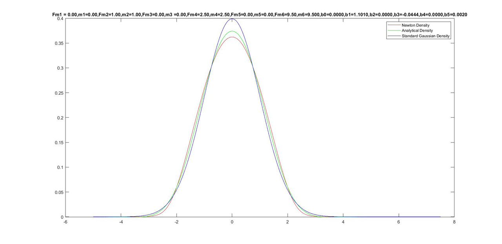](https://postimg.cc/0zw44Zq0)

[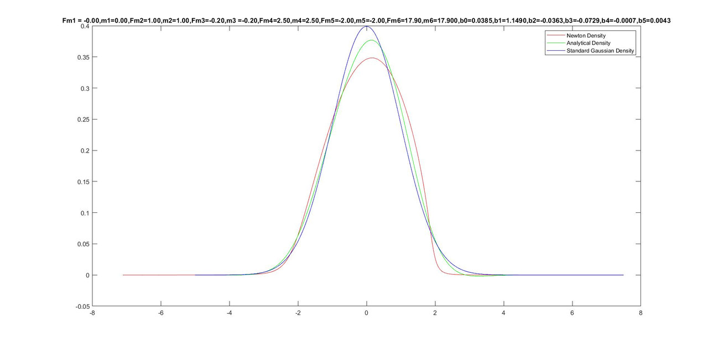](https://postimg.cc/qg1W6zLy)

[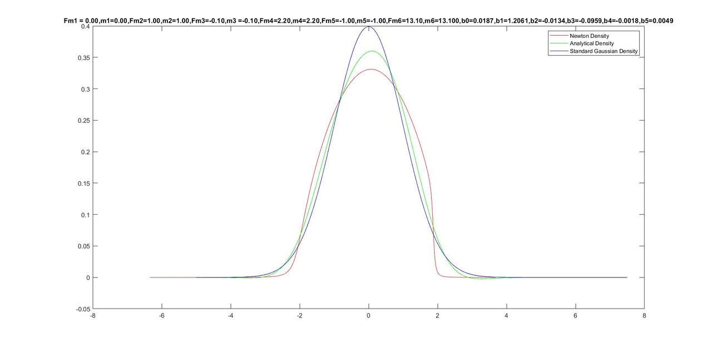](https://postimg.cc/sv88Kqb2)

[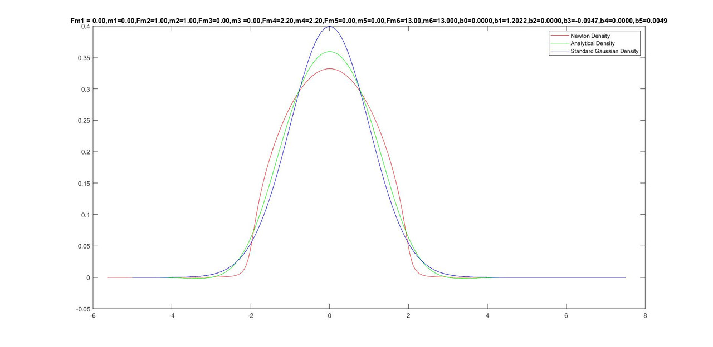](https://postimg.cc/cr62R09j)

[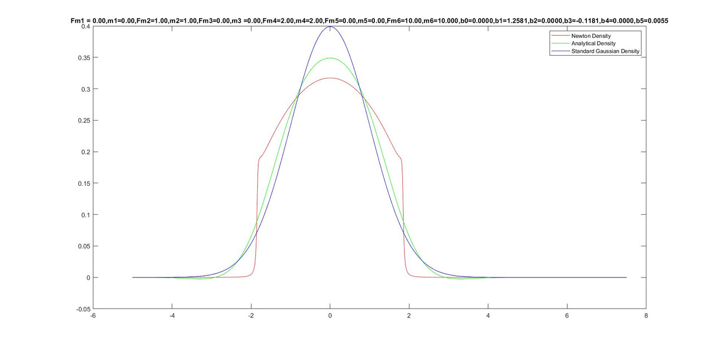](https://postimg.cc/jCxGjzzR)

---

### #1503 — Amin (Topic Author)
*July 25, 2022, 8:42 AM*

Later tomorrow, I will post a simple program that will show how to take arbitrary moments (that are meaningful and
coherent) , standardize them, find Z-series of standardized density and then convert Z-series of Standardized density to
Z-series of original density with initially specified arbitrary moments. It is very simple but I think a small program
that does this will be very helpful.

---

### #1504 — Amin (Topic Author)
*July 25, 2022, 12:37 PM*

Friends, I will post my general program tomorrow. But briefly I want to mention that standardization used for central
moments is exactly the same as standardization used for Z-series coefficients (we have to do some very simple accounting
for mean). So once we specify a general density and calculate its central moments, we simply need to standardize the
central moments and turn standardized moments into cumulants to fit the density. Then we can retrieve the original
density's raw moments perfectly after scaling our Z-series with square-root of variance i.e. the same ratio that was
used to standardize the density. So Z-series of original density is simply obtained by multiplying the Z-series of
standardized density with square-root of variance (we have to make minor accounting for mean). This can become obvious
when we see that nth raw moment is simply expectation of nth power of Z-series.

---

### #1505 — Amin (Topic Author)
*July 26, 2022, 8:50 AM*

Friends, here is the general program which takes input raw moments and calculates  its Z-series and also draws its
graph. I have provided a small routine that takes a general mean and a general variance and standardized cumulants to
create valid raw moments. If your density is surely valid, you can skip this routine and directly specify the raw
moments. For reasonable values of raw moments that result in good standardized cumulants, the program should work
reasonably well.

I have added comments to the program.

Here are the matlab functions.

.

.

```
function [] = CalculateZSeriesGeneralDensity06A()

%In this program, I first generate a valid density using arbitrary mean and variance and
%standardized cumulants. This is done in order to make sure that input
%density is a vlaid density and standardized cumulants are not too off the
%possible values.
%This general density is generated with following command
%[Mu] = GenerateValidDensityRawMoments(mean,var,kk3,kk4,kk5,kk6)
%If you have a valid density, you can directly substitute Mu array with
%first six raw moments and skip this command and earlier part of the
%program.

%mean and variance of the general density.
mean=10;
var=3.0;

%Below are standardized cumulants that would be used to generate the general density
%Cumulants take the same standardization ratio as for respective central
%moments.
%Valid Density generation program takes these standardized cumulants and
%converts them to absolute cumulants using powers of var and then
%calculates raw moments from them.
kk1=0.0;
kk2=(1.0);
kk3=-.4;%1.0;
kk4=2;%-.50;
kk5=-3;%-.5;%15;
kk6=20;%10;%100.0;

%Mu below is the array carrying first six raw moments. you can directly
%replace it witn input raw moments if you are sure that your density is
%valid.
[Mu] = GenerateValidDensityRawMoments(mean,var,kk3,kk4,kk5,kk6);

%Below function converts raw moments to central moments and mean.
[mu1,cMu] = ConvertRawMomentsToCentralMoments(Mu,6);

%Below function converts central moments to absolute cumulants. First
%cumulant is kept at zero.
 K1=0;
 K2=cMu(2);
 K3=cMu(3);
 K4=cMu(4)-3*cMu(2).^2;
 K5=cMu(5)-10*cMu(3)*cMu(2);
 K6=cMu(6)-15*cMu(4)*cMu(2)-10*cMu(3).^2+30*cMu(2).^3;

 %Below we convert absolute cumulants to standardized cumulants.
 k1=0;
 k2=1;
 k3=K3/K2^1.5;
 k4=K4/K2^2.0;
 k5=K5/K2^2.5;
 k6=K6/K2^3.0;

%  k1
%  k2
%
%  k3
%  kk3
%
%  k4
%  kk4
%
%  k5
%  kk5
%
%  k6
%  kk6
%
% str=input('Look at comparison of cumulants');

%Below is the program to find standardized Z-series coefficients from
%standardized cumulants.
[b0,b] = FindZSeriesGivenCumulantsStandard06(k1,k2,k3,k4,k5,k6);

%Below we convert standardized Z-series coefficients to Z-series
%coefficients that correspond to input raw moments.

a0=b0*sqrt(var);
a(1)=b(1)*sqrt(var);
a(2)=b(2)*sqrt(var);
a(3)=b(3)*sqrt(var);
a(4)=b(4)*sqrt(var);
a(5)=b(5)*sqrt(var);

%We add the mean to first coefficient. We had done earlier calculations
%with zero mean.
a0=a0+mean;

%Below we calculate the raw moments from Z-series coefficients.
SeriesOrder=5;
NMoments=6;
[Moments] = CalculateMomentsOfZSeries(a0,a,SeriesOrder,NMoments);

%Below we visually compare the Moments array that has raw momwnts calculated from Z-series
%coefficients with Mu array that contains raw moments input to the program.
Moments
Mu

str=input('Look at comparison of raw moments of Z-series density and input raw moments');

%Below we do calculations to construct the density from our newly derived
%Z-series.

dNn=.2/2;   % Normal density subdivisions width. would change with number of subdivisions
Nn=90;  % No of normal density subdivisions

NnMid=4.0;

Z(1:Nn)=(((1:Nn)-6.5/1)*dNn-NnMid);

%str=input('Look at Z');
%ZProb(1)=normcdf(.5*Z(1)+.5*Z(2),0,1)-normcdf(.5*Z(1)+.5*Z(2)-dNn,0,1);
%ZProb(Nn)=normcdf(.5*Z(Nn)+.5*Z(Nn-1)+dNn,0,1)-normcdf(.5*Z(Nn)+.5*Z(Nn-1),0,1);
%ZProb(2:Nn-1)=normcdf(.5*Z(2:Nn-1)+.5*Z(3:Nn),0,1)-normcdf(.5*Z(2:Nn-1)+.5*Z(1:Nn-2),0,1);

  w(1:Nn)=a0;
  for nn=1:SeriesOrder
      w(1:Nn)=w(1:Nn)+a(nn)*Z(1:Nn).^nn;
  end
wnStart=1;
Dfw(wnStart:Nn)=0;
for nn=wnStart+1:Nn-1

    Dfw(nn) = (w(nn + 1) - w(nn - 1))/(Z(nn + 1) - Z(nn - 1));
end

pw(1:Nn)=0;
for nn = wnStart+1:Nn-1

    pw(nn) = (normpdf(Z(nn),0, 1))/abs(Dfw(nn));

end

plot(w(wnStart+1:Nn-1),pw(wnStart+1:Nn-1),'r');

title(sprintf('Fm1 = %.2f,m1=%.2f,Fm2=%.2f,m2=%.2f,Fm3=%.2f,m3
=%.2f,Fm4=%.2f,m4=%.2f,Fm5=%.2f,m5=%.2f,Fm6=%.2f,m6=%.3f',Moments(1),Mu(1),Moments(2),Mu(2),Moments(3),Mu(3),Moments(4),Mu(4),Moments(5),Mu(5),Moments(6),Mu(6)));
%,sprintf('theta= %f', theta), sprintf('kappa = %f', kappa),sprintf('sigma = %f', sigma0),sprintf('T = %f', T));

legend({'Newton Z-Series Density'},'Location','northeast')

a0
a
str=input('Look at Z-series Coefficients of General density with input raw Moments');

end

```

.

.

.

```
function [Mu] = GenerateValidDensityRawMoments(mean,var,k3,k4,k5,k6)
%This function takes mean,var and higher standardized cumulants. I am using
%standardized cumulants as input since it would be easier to realize when
%we are stretching the input density too much when we deal with increasing
%standardized cumulants.
%mean in parameters is true mean.
%var in parameters is true variance. not standardized.
%k3 is third standardized cumulant.
%I checked first six Cumulants take the same standardization ratio
%as standardized central moments.
%k4 is fourth standardized cumulant.
%k5 is fifth standardized cumulant.
%k6 is sixth standardized cumulant.

mu1=mean;

k2=1;
cmu1=0;
cmu2=1;
cmu3=k3;
cmu4=3*k2^2+k4;
cmu5=10*k3*k2+k5;
cmu6=15*k2*k4+10*k3^2+15*k2^3+k6;

 cMu(1)=0;
 cMu(2)=cmu2*var;
 cMu(3)=cmu3*var^1.5;
 cMu(4)=cmu4*var^2;
 cMu(5)=cmu5*var^2.5;
 cMu(6)=cmu6*var^3;

 [Mu] = ConvertCentralMomentsToRawMoments(cMu,mu1,6);

%[mu1,cMu1] = ConvertRawMomentsToCentralMoments(Mu,6)

% cMu
% cMu1

end

```

,

,

,

```
function [Mu] = ConvertCentralMomentsToRawMoments(cu,mu,mOrder)

%cu
%mu
%mOrder
%str=input('Look at numbers');
Mu(1)=mu;
for mm=2:mOrder
    Mu(mm)=0;
    for jj=0:mm
        if(jj==0)
            Mu(mm)=Mu(mm)+factorial(mm)/factorial(jj)/factorial(mm-jj)*1*mu.^(mm-jj);
        else
            Mu(mm)=Mu(mm)+factorial(mm)/factorial(jj)/factorial(mm-jj)*cu(jj)*mu.^(mm-jj);
        end
    end
end

end
```

.

.

.

```
function [mu1,cMu] = ConvertRawMomentsToCentralMoments(Mu,mOrder)

%cu
%mu
% %mOrder
%str=input('Look at numbers');
mu1=Mu(1);
for mm=2:mOrder
    cMu(mm)=0;
    for jj=0:mm
        if(jj==0)
            cMu(mm)=cMu(mm)+ (-1)^(mm-jj).*factorial(mm)/factorial(jj)/factorial(mm-jj)*1*mu1.^(mm-jj);
        else
            cMu(mm)=cMu(mm)+ (-1)^(mm-jj).*factorial(mm)/factorial(jj)/factorial(mm-jj)*Mu(jj)*mu1.^(mm-jj);
        end
    end
end

```

.

.

.

```
function [b0,b] = FindZSeriesGivenCumulantsStandard06(k1,k2,k3,k4,k5,k6)

mu=0;
sigma=1.0;
% k1=0.0;
% k2=(1.0);
% k3=0;%1.0;
% k4=-1;%-.50;
% k5=0;%-.5;%15;
% k6=10;%10;%100.0;

[mu,sigma,a0,a1,a2,a3,a4,a5,mu1,rmu1,rmu2,rmu3,rmu4,rmu5,rmu6] =
GenerateDensityFromCumulantsX06Simple(mu,sigma,k1,k2,k3,k4,k5,k6)

[median] = FindMedianHermiteDensity06(mu1,mu,sigma,a0,a1,a2,a3,a4,a5);
a6=0;
a7=0;
a8=0;

%[median] = FindMedianHermiteDensity08Simple(mu1,mu,sigma,a0,a1,a2,a3,a4,a5,a6,a7,a8)

Xm=median

%Below calculate the density and its derivatives at median.

px=exp(-0.5* ((Xm-mu)/sigma).^2)/sigma/sqrt(2*pi).* (a0+ a1* ((Xm-mu)/sigma)+  a2* (((Xm-mu)/sigma).^2-1) + ...
    a3* ( ((Xm-mu)/sigma).^3 - 3*((Xm-mu)/sigma) )+ ...
    a4* (((Xm-mu)/sigma).^4 - 6* ((Xm-mu)/sigma).^2 + 3)+ ...
    a5* (((Xm-mu)/sigma).^5 - 10* ((Xm-mu)/sigma).^3 + 15*((Xm-mu)/sigma))+ ...
    a6* (((Xm-mu)/sigma).^6 - 15* ((Xm-mu)/sigma).^4 + 45*((Xm-mu)/sigma).^2-15)+ ...
    a7*(((Xm-mu)/sigma).^7 - 21* ((Xm-mu)/sigma).^5 + 105*((Xm-mu)/sigma).^3-105*((Xm-mu)/sigma))+ ...
    a8*(((Xm-mu)/sigma).^8 - 28* ((Xm-mu)/sigma).^6 + 210*((Xm-mu)/sigma).^4-420*((Xm-mu)/sigma).^2+105));

dpxdX=exp(-0.5* ((Xm-mu)/sigma).^2)/sigma^2/sqrt(2*pi).* -(a0* ((Xm-mu)/sigma)+  a1* (((Xm-mu)/sigma).^2-1) + ...
    a2* ( ((Xm-mu)/sigma).^3 - 3*((Xm-mu)/sigma) )+ ...
    a3* (((Xm-mu)/sigma).^4 - 6* ((Xm-mu)/sigma).^2 + 3)+ ...
    a4* (((Xm-mu)/sigma).^5 - 10* ((Xm-mu)/sigma).^3 + 15*((Xm-mu)/sigma))+ ...
    a5* (((Xm-mu)/sigma).^6 - 15* ((Xm-mu)/sigma).^4 + 45*((Xm-mu)/sigma).^2-15) + ...
    a6* (((Xm-mu)/sigma).^7 - 21* ((Xm-mu)/sigma).^5 + 105*((Xm-mu)/sigma).^3-105*((Xm-mu)/sigma))+...
    a7*(((Xm-mu)/sigma).^8 - 28* ((Xm-mu)/sigma).^6 + 210*((Xm-mu)/sigma).^4-420*((Xm-mu)/sigma).^2+105)+ ...
    a8*(((Xm-mu)/sigma).^9 - 36* ((Xm-mu)/sigma).^7 +
378*((Xm-mu)/sigma).^5-1260*((Xm-mu)/sigma).^3+945*((Xm-mu)/sigma)));

d2pxdX2=exp(-0.5* ((Xm-mu)/sigma).^2)/sigma^3/sqrt(2*pi).* (a0* (((Xm-mu)/sigma).^2-1) + ...
    a1* ( ((Xm-mu)/sigma).^3 - 3*((Xm-mu)/sigma) )+ ...
    a2* (((Xm-mu)/sigma).^4 - 6* ((Xm-mu)/sigma).^2 + 3)+ ...
    a3* (((Xm-mu)/sigma).^5 - 10* ((Xm-mu)/sigma).^3 + 15*((Xm-mu)/sigma))+ ...
    a4* (((Xm-mu)/sigma).^6 - 15* ((Xm-mu)/sigma).^4 + 45*((Xm-mu)/sigma).^2-15) + ...
    a5* (((Xm-mu)/sigma).^7 - 21* ((Xm-mu)/sigma).^5 + 105*((Xm-mu)/sigma).^3-105*((Xm-mu)/sigma))+ ...
    a6* (((Xm-mu)/sigma).^8 - 28* ((Xm-mu)/sigma).^6 + 210*((Xm-mu)/sigma).^4-420*((Xm-mu)/sigma).^2+105) + ...
    a7*(((Xm-mu)/sigma).^9 - 36* ((Xm-mu)/sigma).^7 +
378*((Xm-mu)/sigma).^5-1260*((Xm-mu)/sigma).^3+945*((Xm-mu)/sigma))+ ...
    a8/720/56*(((Xm-mu)/sigma).^10 - 45* ((Xm-mu)/sigma).^8 +
630*((Xm-mu)/sigma).^6-3150*((Xm-mu)/sigma).^4+4725*((Xm-mu)/sigma).^2-945));

d3pxdX3=exp(-0.5* ((Xm-mu)/sigma).^2)/sigma^4/sqrt(2*pi).* -(a0* (((Xm-mu)/sigma).^3 - 3*((Xm-mu)/sigma) )+ ...
    a1* (((Xm-mu)/sigma).^4 - 6* ((Xm-mu)/sigma).^2 + 3)+ ...
    a2* (((Xm-mu)/sigma).^5 - 10* ((Xm-mu)/sigma).^3 + 15*((Xm-mu)/sigma))+ ...
    a3* (((Xm-mu)/sigma).^6 - 15* ((Xm-mu)/sigma).^4 + 45*((Xm-mu)/sigma).^2-15) + ...
    a4* (((Xm-mu)/sigma).^7 - 21* ((Xm-mu)/sigma).^5 + 105*((Xm-mu)/sigma).^3-105*((Xm-mu)/sigma))+ ...
    a5* (((Xm-mu)/sigma).^8 - 28* ((Xm-mu)/sigma).^6 + 210*((Xm-mu)/sigma).^4-420*((Xm-mu)/sigma).^2+105)+ ...
    a6* (((Xm-mu)/sigma).^9 - 36* ((Xm-mu)/sigma).^7 +
378*((Xm-mu)/sigma).^5-1260*((Xm-mu)/sigma).^3+945*((Xm-mu)/sigma)) + ...
    a7*(((Xm-mu)/sigma).^10 - 45* ((Xm-mu)/sigma).^8 +
630*((Xm-mu)/sigma).^6-3150*((Xm-mu)/sigma).^4+4725*((Xm-mu)/sigma).^2-945)+ ...
    a8*(((Xm-mu)/sigma).^11 - 55* ((Xm-mu)/sigma).^9 +
990*((Xm-mu)/sigma).^7-6930*((Xm-mu)/sigma).^5+17325*((Xm-mu)/sigma).^3-10395.*((Xm-mu)/sigma)));

d4pxdX4=exp(-0.5* ((Xm-mu)/sigma).^2)/sigma^5/sqrt(2*pi).* ( a0* (((Xm-mu)/sigma).^4 - 6* ((Xm-mu)/sigma).^2 + 3)+ ...
    a1* (((Xm-mu)/sigma).^5 - 10* ((Xm-mu)/sigma).^3 + 15*((Xm-mu)/sigma))+ ...
    a2* (((Xm-mu)/sigma).^6 - 15* ((Xm-mu)/sigma).^4 + 45*((Xm-mu)/sigma).^2-15) + ...
    a3* (((Xm-mu)/sigma).^7 - 21* ((Xm-mu)/sigma).^5 + 105*((Xm-mu)/sigma).^3-105*((Xm-mu)/sigma))+ ...
    a4* (((Xm-mu)/sigma).^8 - 28* ((Xm-mu)/sigma).^6 + 210*((Xm-mu)/sigma).^4-420*((Xm-mu)/sigma).^2+105)+ ...
    a5* (((Xm-mu)/sigma).^9 - 36* ((Xm-mu)/sigma).^7 +
378*((Xm-mu)/sigma).^5-1260*((Xm-mu)/sigma).^3+945*((Xm-mu)/sigma))+ ...
    a6* (((Xm-mu)/sigma).^10 - 45* ((Xm-mu)/sigma).^8 +
630*((Xm-mu)/sigma).^6-3150*((Xm-mu)/sigma).^4+4725*((Xm-mu)/sigma).^2- 945 ) + ...
    a7*(((Xm-mu)/sigma).^11 - 55* ((Xm-mu)/sigma).^9 +
990*((Xm-mu)/sigma).^7-6930*((Xm-mu)/sigma).^5+17325*((Xm-mu)/sigma).^3-10395.*((Xm-mu)/sigma))+ ...
    a8*(((Xm-mu)/sigma).^12 - 66* ((Xm-mu)/sigma).^10 +
1485*((Xm-mu)/sigma).^8-13860*((Xm-mu)/sigma).^6+51975*((Xm-mu)/sigma).^4-62370.*((Xm-mu)/sigma).^2+10395));

dpxdX
d2pxdX2
d3pxdX3
d4pxdX4

%str=input('Look at derivatives results')

%Below calculate standard normal density and its derivatives at median.
Zm=0;
pz=exp(-0.5* (Zm.^2))/sqrt(2*pi);
dpzdZ=-Zm*exp(-0.5* (Zm.^2))/sqrt(2*pi);
d2pzdZ2=(Zm^2-1)*exp(-0.5* (Zm.^2))/sqrt(2*pi);
d3pzdZ3=-(Zm^3-3*Zm)*exp(-0.5* (Zm.^2))/sqrt(2*pi);
d4pzdZ4=(Zm^4-6*Zm^2+3)*exp(-0.5* (Zm.^2))/sqrt(2*pi);

dXdZ=pz/px;

d2XdZ2=(dpzdZ-(dpxdX *dXdZ^2))/px

d3XdZ3=(d2pzdZ2- (2* dpxdX* dXdZ *d2XdZ2+dXdZ *(dXdZ^2* d2pxdX2+dpxdX *d2XdZ2)))/px

d4XdZ4=(d3pzdZ3-(3* d2XdZ2* (dXdZ^2* d2pxdX2+dpxdX *d2XdZ2)+3* dpxdX *dXdZ *d3XdZ3+dXdZ* (3 *dXdZ* d2pxdX2*
d2XdZ2+dXdZ^3* d3pxdX3+dpxdX* d3XdZ3)))/px

d5XdZ5=(d4pzdZ4- (6 *(dXdZ^2 *d2pxdX2+dpxdX *d2XdZ2) *d3XdZ3+4 *d2XdZ2* (3* dXdZ *d2pxdX2 *d2XdZ2+dXdZ^3* d3pxdX3+dpxdX*
d3XdZ3)+4* dpxdX* dXdZ* d4XdZ4+dXdZ *(3* d2pxdX2* d2XdZ2^2+6* dXdZ^2* d2XdZ2* d3pxdX3+4 *dXdZ* d2pxdX2* d3XdZ3+dXdZ^4*
d4pxdX4+dpxdX* d4XdZ4)))/px

%Below calculate iniotial guess coefficients of Z-series to be input to
%Newton method.

c0=median
c1=dXdZ
c2=1/2*1*d2XdZ2
c3=1/6*1*d3XdZ3
c4=1/24*1*d4XdZ4
c5=1/120*1*d5XdZ5

cc0=c0;
cc(1)=c1;
cc(2)=c2;
cc(3)=c3;
cc(4)=c4;
cc(5)=c5;

SeriesOrder=5;
NMoments=6;

[Moments] = CalculateMomentsOfZSeries(cc0,cc,SeriesOrder,NMoments)
rmu1
rmu2
rmu3
rmu4
rmu5
rmu6

%Below specify target cumulants.
C(1:NMoments+1)=0;
C(1)=k1;
C(2)=k2;
C(3)=k3;
C(4)=k4;
C(5)=k5;
C(6)=k6;

%Below calculate F, the defect vector from target cumulants. And calculate
%dF which is the matrix consisting of derivatives of defect vector from
%target cumulants.

[F,dF] = CalculateCumulantsAndDerivativesFromMoments_0(C,cc0,cc,SeriesOrder,NMoments,6)

da(1,1)=cc0;
da(2:SeriesOrder+1,1)=cc(1:SeriesOrder);

NoOfCumulants=NMoments

ObjBest=0;
 for mm=1:NoOfCumulants
     if(C(mm)~=0)
     ObjBest=ObjBest+F(mm,1).^2/(abs(C(mm)));
     end
 end

b0Best=cc0;
bBest(1:SeriesOrder)=cc(1:SeriesOrder);

nn=0;
while((nn.000000000001) || (abs(F(2,1))>.000000000001) || (abs(F(3,1))>.000000000001) || (abs(F(4,1))>.00000000001)||
(abs(F(5,1))>.00000000001)|| (abs(F(6,1))>.00000000001)  ))

nn=nn+1;
%Below Newton matrix equation to improve the Z-series coefficients guess at previous step.

da=da-dF\F;

%b0=median
b0=da(1,1);
b(1:SeriesOrder)=da(2:SeriesOrder+1,1);

[F,dF] = CalculateCumulantsAndDerivativesFromMoments_0(C,b0,b,SeriesOrder,SeriesOrder,NoOfCumulants);

  ObjNew=0;
  for mm=1:NoOfCumulants
      if(C(mm)~=0)
      ObjBest=ObjBest+F(mm,1).^2/(abs(C(mm)));
      end
  end

  if(ObjBest<ObjNew)

   else
       ObjBest=ObjNew;
       b0Best=b0;
       bBest(1:SeriesOrder)=b(1:SeriesOrder);
   end

da(1,1)=b0;
da(2:SeriesOrder+1,1)=b(1:SeriesOrder);

end
  b0=b0Best;%Best;
  b(1:SeriesOrder)=bBest;%Best(1:SeriesOrder);

  %Above are the best chosen Z-series coefficients based on the objective function.
  %But my objective function can be improved.

  [F,dF] = CalculateCumulantsAndDerivativesFromMoments_0(C,b0,b,SeriesOrder,SeriesOrder,NoOfCumulants);
  %[F,dF,uu] = CalculateCumulantsAndDerivativesFromMoments_0A(C,b0,b,SeriesOrder,SeriesOrder,NoOfCumulants);
 ObjLast=0;
 for mm=1:NoOfCumulants
     if(C(mm)~=0)
     ObjLast=ObjLast+F(mm,1).^2/(abs(C(mm)));
     end
 end
%ObjLast

%nn

%F

[Moments] = CalculateMomentsOfZSeries(b0,b,SeriesOrder,NMoments)
%Above are raw moments calculated from the resulting Z-series from Newton
%Method

%Below are raw moments that were input to calibration.
rmu1
rmu2
rmu3
rmu4
rmu5
rmu6
%str=input('Look at new moments');

%Below we do calculations to construct the density from our newly derived
%Z-series.

% dNn=.2/2;   % Normal density subdivisions width. would change with number of subdivisions
% Nn=90;  % No of normal density subdivisions
%
% NnMid=4.0;
%
% Z(1:Nn)=(((1:Nn)-6.5/1)*dNn-NnMid);
% Z
% %str=input('Look at Z');
% %ZProb(1)=normcdf(.5*Z(1)+.5*Z(2),0,1)-normcdf(.5*Z(1)+.5*Z(2)-dNn,0,1);
% %ZProb(Nn)=normcdf(.5*Z(Nn)+.5*Z(Nn-1)+dNn,0,1)-normcdf(.5*Z(Nn)+.5*Z(Nn-1),0,1);
% %ZProb(2:Nn-1)=normcdf(.5*Z(2:Nn-1)+.5*Z(3:Nn),0,1)-normcdf(.5*Z(2:Nn-1)+.5*Z(1:Nn-2),0,1);
%
%   w(1:Nn)=b0;
%   for nn=1:SeriesOrder
%       w(1:Nn)=w(1:Nn)+b(nn)*Z(1:Nn).^nn;
%   end
% wnStart=1;
% Dfw(wnStart:Nn)=0;
% for nn=wnStart+1:Nn-1
%
%     Dfw(nn) = (w(nn + 1) - w(nn - 1))/(Z(nn + 1) - Z(nn - 1));
% end
%
%
% pw(1:Nn)=0;
% for nn = wnStart+1:Nn-1
%
%     pw(nn) = (normpdf(Z(nn),0, 1))/abs(Dfw(nn));
%
% end
%
%
% %Below is the construction of density of our originial analytic density for
% %plotting purposes
%
% dMm=.02/10;
% Mm=1250*5;
% X(1:Mm)=-5+dMm+dMm*(1:Mm);
%
%
% %Below is the newly constructed density so that its output central moments
% %match the central moments input by the user.
% pdf=exp(-0.5* ((X-mu)/sigma).^2)/sigma/sqrt(2*pi).* (a0+ a1* ((X-mu)/sigma)+  a2* (((X-mu)/sigma).^2-1) + ...
%     a3* ( ((X-mu)/sigma).^3 - 3*((X-mu)/sigma) )+ ...
%     a4* (((X-mu)/sigma).^4 - 6* ((X-mu)/sigma).^2 + 3)+ ...
%     a5* (((X-mu)/sigma).^5 - 10* ((X-mu)/sigma).^3 + 15*((X-mu)/sigma))+ ...
%     a6* (((X-mu)/sigma).^6 - 15* ((X-mu)/sigma).^4 + 45*((X-mu)/sigma).^2-15))+ ...
%     a7*(((Xm-mu)/sigma).^7 - 21* ((Xm-mu)/sigma).^5 + 105*((Xm-mu)/sigma).^3-105*((Xm-mu)/sigma));
%
% %Below is standard Gaussian PDF.
% pdfG=exp(-0.5* ((X-mu)/sigma).^2)/sigma/sqrt(2*pi);
%
% plot(w(wnStart+1:Nn-1),pw(wnStart+1:Nn-1),'r',X(1:Mm),pdf(1:Mm),'g',X(1:Mm),pdfG(1:Mm),'b');
%
% title(sprintf('Fm1 = %.2f,m1=%.2f,Fm2=%.2f,m2=%.2f,Fm3=%.2f,m3
=%.2f,Fm4=%.2f,m4=%.2f,Fm5=%.2f,m5=%.2f,Fm6=%.2f,m6=%.3f,b0=%.4f,b1=%.4f,b2=%.4f,b3=%.4f,b4=%.4f,b5=%.4f',Moments(1),rmu1,Moments(2),rmu2,Moments(3),rmu3,Moments(4),rmu4,Moments(5),rmu5,Moments(6),rmu6,b0,b(1),b(2),b(3),b(4),b(5)));
% %,sprintf('theta= %f', theta), sprintf('kappa = %f', kappa),sprintf('sigma = %f', sigma0),sprintf('T = %f', T));
%
% legend({'Newton Density','Analytical Density','Standard Gaussian Density'},'Location','northeast')
%
%
% b0
% b

end

```

.

.

.

```
function [Moments] = CalculateMomentsOfZSeries(a0,a,SeriesOrder,NMoments)

%aa0=a0;
%a0=0;% ---1

EZ(1)=0;
EZ(2)=1;
LogEZ(2)=0;
for nn=3:NMoments*SeriesOrder
    if rem(nn,2)==1
        EZ(nn)=0;
    else
        EZ(nn)=EZ(nn-2)*(nn-1);
        LogEZ(nn)=log(EZ(nn-2))+log(nn-1);
        %EZ(nn);
    end
end
%EZ
%EZ(1:30)
%str=input('Look at numbers')
a(SeriesOrder+1:SeriesOrder*NMoments+1)=0;
b0=a0;
b=a;

for mm=1:NMoments
    if(mm>1)
        %[b0,b] =SeriesProductLogarithmic(a0,a,b0,b,SeriesOrder*mm);

        [b0,b] =SeriesProduct(a0,a,b0,b,SeriesOrder*mm);

        %b0-bb0

        %b-bb

        %str=input('Look at two products')

        b(SeriesOrder*mm+1:SeriesOrder*NMoments+1)=0;
    end
 %   Logb=log(abs(b));
 %   Signb=sign(b);
    EXZ(mm,1)=b0;
    for pp2=1:SeriesOrder*mm
        if rem(pp2,2)==0
            %EXZ(mm,1)=EXZ(mm,1)+exp(Logb(pp2)+LogEZ(pp2)).*Signb(pp2);
            EXZ(mm,1)=EXZ(mm,1)+b(pp2).*EZ(pp2);
 %           b(pp2).*EZ(pp2)
 %           exp(Logb(pp2)+LogEZ(pp2)).*Signb(pp2)
 %           mm
 %           pp2
            %str=input('Look at moment values')
        end
    end
end

for nn=1:NMoments
    Moments(nn)=EXZ(nn,1);
end

end

```

.

.

.

There are other functions but I have posted them yesterday and you can copy them from my yesterday's post.

Here is the graph of the density that is generated by the above program as output.

.

.

[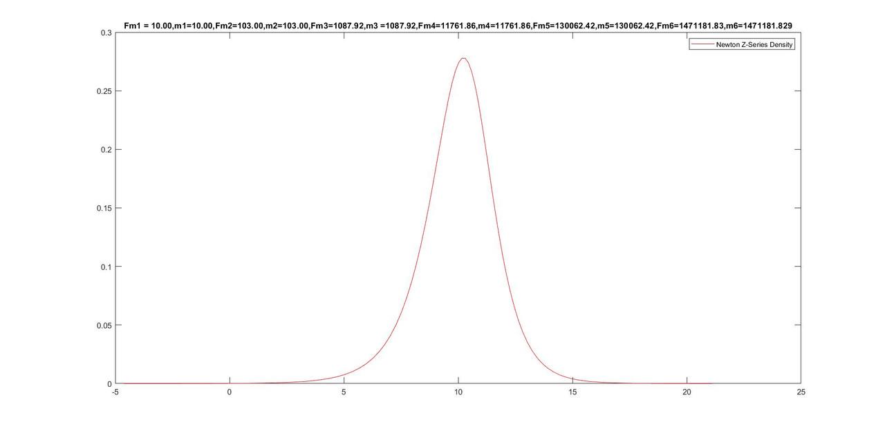](https://postimg.cc/YGvbPKj9)

---

### #1506 — Amin (Topic Author)
*July 26, 2022, 10:29 AM*

I want to write this post especially to thank friends who made it possible for me to work on my research by protesting
to mind control agencies about my persecution. Several years ago when I was largely on my own, it was extremely
difficult for me to consistently work on my research. At that time, there would be drugging of water and food on a large
scale every second or third week. And I would lose all momentum and would have to spend all my time trying to get good
food or water or trying to recover from the effect of drugs that I had taken in with drugged food. It would be
impossible to totally avoid the mind control drugs in food and water and I would usually be hit again and again with bad
food and sometimes it would take quite a bit to recover from the effect of those drugs.

However the things did improve largely on average since past few years when friends noticed my research and protested to
mind control agencies about my inhuman treatment. There were some periods of time when I would be able to get good food
or water continuously for several months and I was able to utilize those periods to concentrate on my research. Though
my persecution continues and still intensifies once in a while even now, overall conditions are much better than they
used to be several years ago.

I am really grateful to friends for all the efforts they made to end my persecution. If it were not for protests and
efforts of good people, I would not have been able to do any good research and I really owe it to good people because of
whose efforts I was able to work reasonably successfully on interesting problems. I will take this opportunity to thank
good Americans again and want to tell them that their good wishes, sympathies and efforts to end my human misery really
means a lot to me and I am thankful to them for helping me at such a crucial point in my life when things had become
extremely tough.

---

### #1507 — Amin (Topic Author)
*July 30, 2022, 8:05 AM*

Friends, sorry that I have not posted for the past whole week. I have an extreme urgency to be able to make some money.
Some money I receive from my parents has been the same for past ten years but prices of everything have increased by 5-6
times and it is almost impossible to survive. So I started working again on my market trading research programs.

I have previously mentioned that I had some ideas about how to initially calibrate the distribution to six moments and
then add further moments one by one through optimization and Newton method. Though I am sure friends could have better
ideas on that, I would still post my thoughts with equations in a day or two just to stimulate thought. I think the
whole thing eventually has to go to Artificial Intelligence where standardized cumulants are input and Z-series
coefficients are output and then output of AI is refined by a few quick iterations of Newton method.

I also want to tell friends that my persecution still continues. Mind control agents do not want to make a big deal
about it but still continue to drug water at a lot of places where it would be likely for me to get water. They do not
want to let me have a full mind like I have had in past few weeks and they are concerned about somehow controlling me.
Water in various neighborhoods had improved but recently it has become very difficult for me to buy good bottled water
in neighborhoods around. Once I take water from a public water filtration plant or some other random water-cooler
outside of some random house, I know that I would not be able to get good water from the same place again. So I have to
keep changing places where to get water. One good thing is that still they are not drugging the ground water otherwise
it would be completely impossible for me to get good water easily.

Also when they know there is some food at home that I can possibly take, they usually drug it so I have to be very
careful with taking food from home.

I have been mostly managing to avoid getting hit by being very careful but there is some urgency among mind control
services that they do not want me to continue with my full brain for longer time and they are trying their best to drug
my food somewhere and take some neurotransmitters from my brain that could take another week or more for me to recover
and by that time, they would be prepared to do something else.

Another thing that I really want to mention is that they also continue to use gases especially when I am working on my
research and this is very very annoying but mind control agents still use gases sometimes though I do not think they
used gas during past week when I was sleeping.

I really want to request friends to please try to stop mind control agencies from persecuting me further and ask them to
let me live with my brain intact.

---

### #1508 — Amin (Topic Author)
*July 30, 2022, 12:01 PM*

Friends, In the previous post I said that they were not using any gas on me while I would sleep. I was just trying to
sleep to have a nap for an hour and a half but they started to use gas in my room. Probably they were emboldened because
I had just mentioned that they were not doing anything like that and therefore they thought that I would simply stand it
and not write anything about it. I really want to tell friends that they are doing almost everything they can to take
good neurotransmitters out of my brain again. Please force mind control agencies to become civilized to good people.

---

### #1509 — Amin (Topic Author)
*August 3, 2022, 10:20 AM*

Friends I spent some time yesterday, rather unsuccessfully, trying to see if there could be some very simple way of
extending the six moment Z-series representation to higher order in moments and coefficients of Z-series but very simple
ideas did not seem to work.

I still have not tried ideas I had about some analytics that I wanted to share with friends. But starting today, I will
devote two to three days to this project to see if I could systematically add a few moments and extend the Z-series
construction program to to may be eighth or tenth order in moments, and seventh or ninth order in coefficients of time
series.

So I hope to share the progress about this new program in a day or two. I hope it goes well.

---

### #1510 — Amin (Topic Author)
*August 4, 2022, 12:55 PM*

Friends, I am writing this post about gas in the Air-conditioners. It is summers and monsoon rainy season and it becomes
hot and humid on many days. I had been trying to work in the drawing-room of our house where I would turn on the AC and
then try to work. It worked well only for first few days and then later they would use some gas that would make me
drowsy, sedated and lethargic. I still tried to continue to work in the same environment since it would be very
difficult to work without air-conditioner but finally I gave up on that room and started working at other places. On
many days I have very little productivity only because I cannot find a suitable environment to work anywhere.

Today I tried working in my mother's room after turning on air-conditioner. The first few hours were fine but they
started releasing some gas there as well and the gas would make it very difficult for me to work there and then I simply
had to turn off the AC and leave the room.

I do not use AC in my room since they have far more potent gases in AC of my room and it is totally impossible to
survive in it for more than half to one hour  and I start having extreme effect on my brain and my consciousness.

---

### #1511 — Amin (Topic Author)
*August 8, 2022, 10:48 AM*

Friends I have been able to extend earlier six cumulant, up to fifth power Z-series representation to seven cumulants or
sixth power Z-series. But I have not been able to add the eighth cumulant in calibration in a stable way. I will post
the seven cumulant program with graphs later today but will have to think more about the strategy to tackle eighth
cumulant that can possibly take up to a week.

I will be posting a few graphs and the new matlab program in a few hours.  And also post some explanation of the new
program tomorrow.

---

### #1512 — Amin (Topic Author)
*August 8, 2022, 3:16 PM*

Friends, I have tried plotting some graphs of densities with fitted cumulants and target standard cumulants along with
the Z-series coefficients on the title. Not every combination of cumulants is possible. Here are the graphs. The blue
density is that of standard normal.

.

.

.

[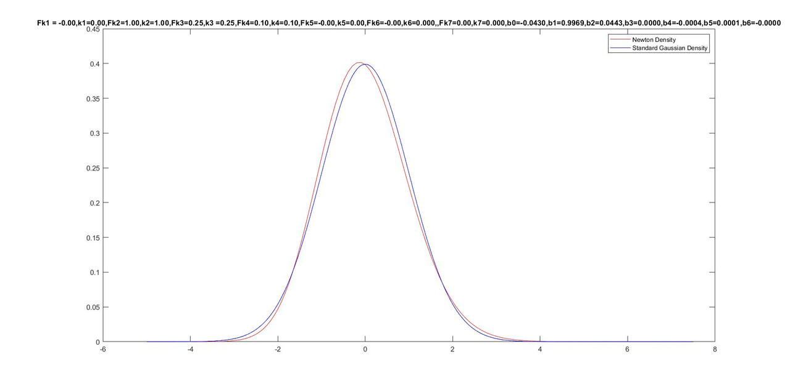](https://postimg.cc/62yRSr9w)

[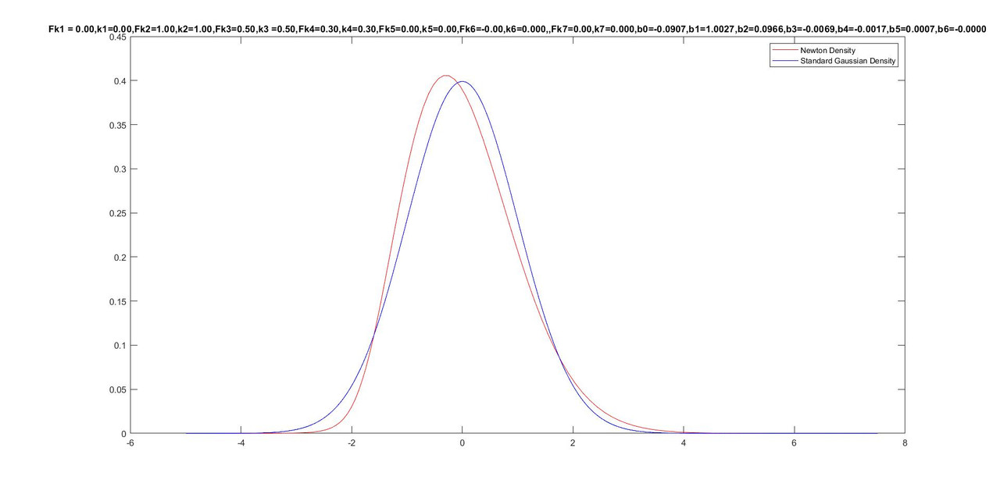](https://postimg.cc/B8hHMYfM)

[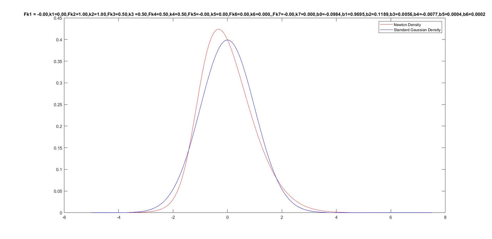](https://postimg.cc/Jy7j3wvs)

[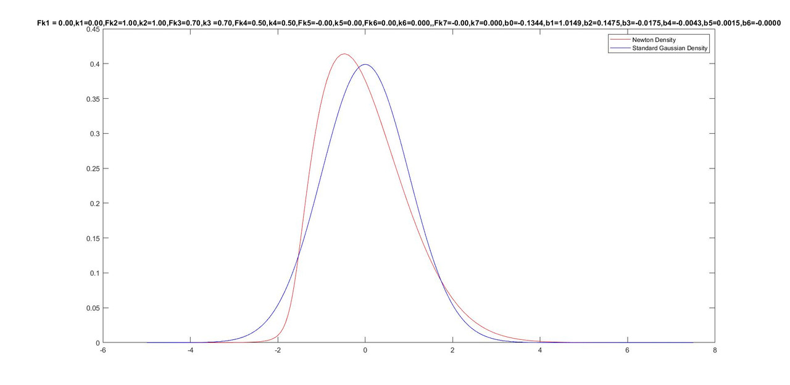](https://postimg.cc/VJWjbsGy)

[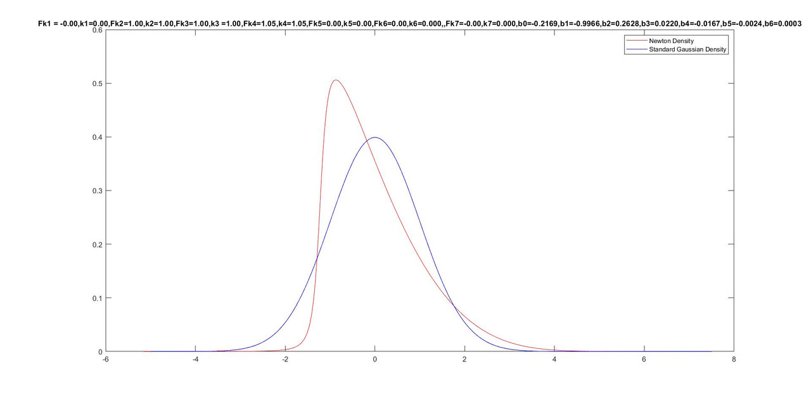](https://postimg.cc/FY4yRkxg)

[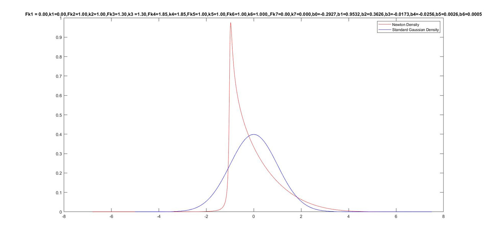](https://postimg.cc/nC7KpGqh)

[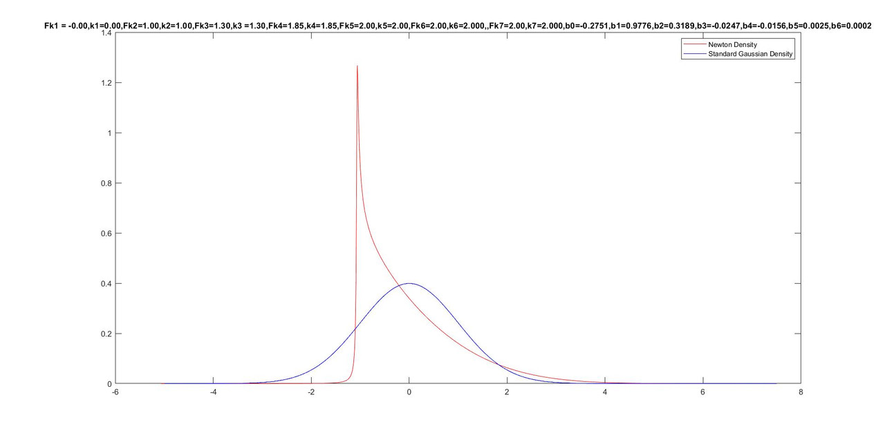](https://postimg.cc/NLZ83z9n)

[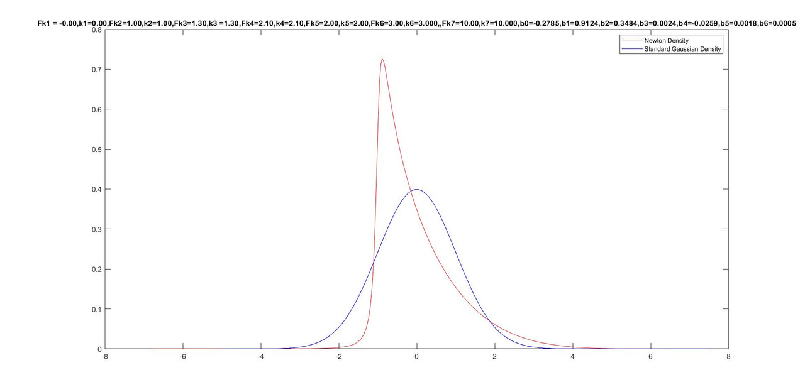](https://postimg.cc/CnnGZjtJ)

[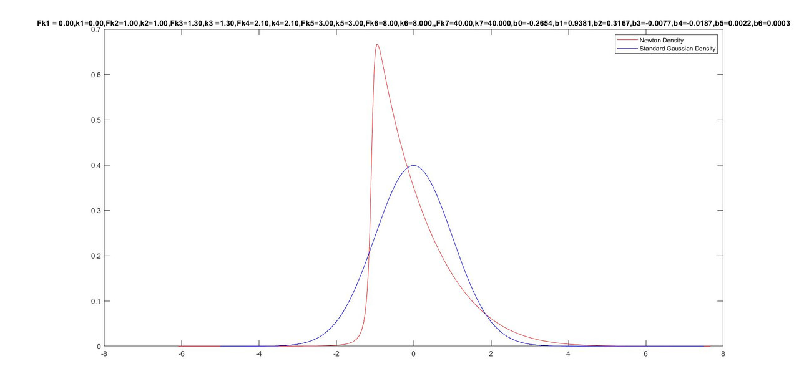](https://postimg.cc/Z9JxfvBK)

[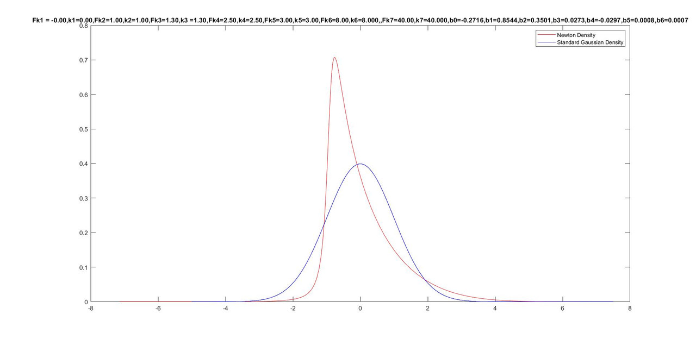](https://postimg.cc/PLKz0fYb)

[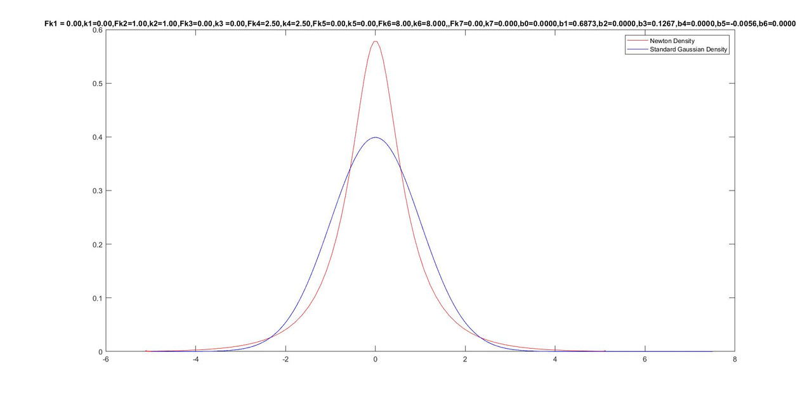](https://postimg.cc/nMXYwJz7)

[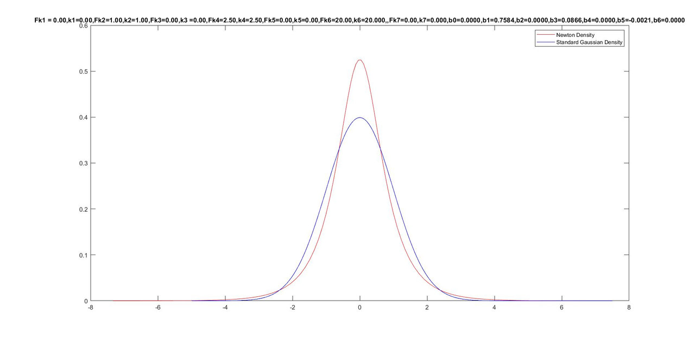](https://postimg.cc/zbcwXddV)

[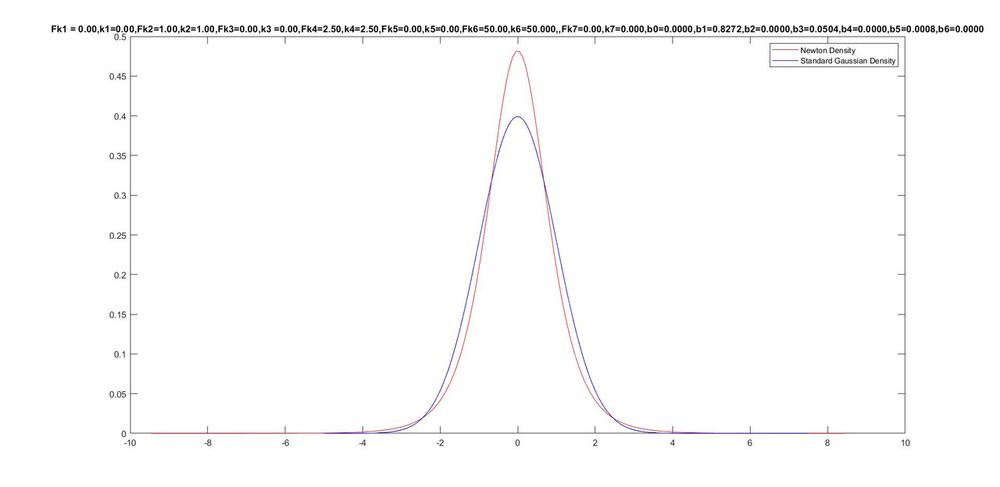](https://postimg.cc/KkzrbXD6)

[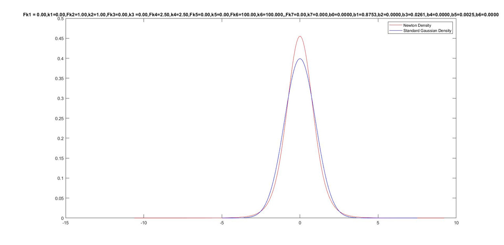](https://postimg.cc/gxVKqH0T)

[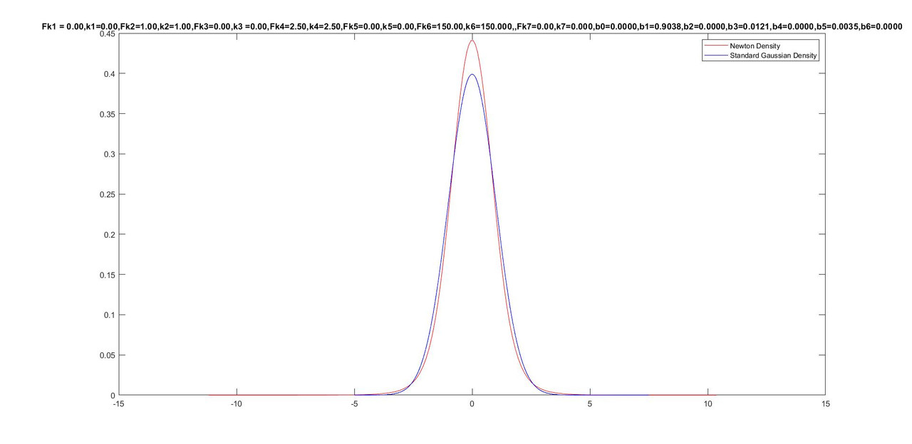](https://postimg.cc/v4FzVNGn)

---

### #1513 — Amin (Topic Author)
*August 8, 2022, 4:46 PM*

As a start, friends can try running the program with input cumulants as given in the above graphs in previous post.

,

,

,

```
function [b0,b] = FindZSeriesGivenCumulantsStandard07()

mu=0;
sigma=1.0;

 k1=0.0;
 k2=(1.0);
 k3=0;%1.0;
 k4=2.5;%-.50;
 k5=0.0;%-.5;%15;
 k6=150;%10;%100.0;
 k7=0;
% k8=1400;

[mu,sigma,a0,a1,a2,a3,a4,a5,mu1,rmu1,rmu2,rmu3,rmu4,rmu5,rmu6] =
GenerateDensityFromCumulantsX06Simple(mu,sigma,k1,k2,k3,k4,k5,k6)
rmu7=k1*rmu6+6*k2*rmu5+15*k3*rmu4+20*k4*rmu3+15*k5*rmu2+6*k6*rmu1+k7;
%rmu8=k1*rmu7+7*k2*rmu6+21*k3*rmu5+35*k4*rmu4+35*k5*rmu3+21*k6*rmu2+7*k7*rmu1+k8;

[median] = FindMedianHermiteDensity06(mu1,mu,sigma,a0,a1,a2,a3,a4,a5);
a6=0;
a7=0;
a8=0;

%[median] = FindMedianHermiteDensity08Simple(mu1,mu,sigma,a0,a1,a2,a3,a4,a5,a6,a7,a8)

Xm=median

%Below calculate the density and its derivatives at median.

px=exp(-0.5* ((Xm-mu)/sigma).^2)/sigma/sqrt(2*pi).* (a0+ a1* ((Xm-mu)/sigma)+  a2* (((Xm-mu)/sigma).^2-1) + ...
    a3* ( ((Xm-mu)/sigma).^3 - 3*((Xm-mu)/sigma) )+ ...
    a4* (((Xm-mu)/sigma).^4 - 6* ((Xm-mu)/sigma).^2 + 3)+ ...
    a5* (((Xm-mu)/sigma).^5 - 10* ((Xm-mu)/sigma).^3 + 15*((Xm-mu)/sigma))+ ...
    a6* (((Xm-mu)/sigma).^6 - 15* ((Xm-mu)/sigma).^4 + 45*((Xm-mu)/sigma).^2-15)+ ...
    a7*(((Xm-mu)/sigma).^7 - 21* ((Xm-mu)/sigma).^5 + 105*((Xm-mu)/sigma).^3-105*((Xm-mu)/sigma))+ ...
    a8*(((Xm-mu)/sigma).^8 - 28* ((Xm-mu)/sigma).^6 + 210*((Xm-mu)/sigma).^4-420*((Xm-mu)/sigma).^2+105));

dpxdX=exp(-0.5* ((Xm-mu)/sigma).^2)/sigma^2/sqrt(2*pi).* -(a0* ((Xm-mu)/sigma)+  a1* (((Xm-mu)/sigma).^2-1) + ...
    a2* ( ((Xm-mu)/sigma).^3 - 3*((Xm-mu)/sigma) )+ ...
    a3* (((Xm-mu)/sigma).^4 - 6* ((Xm-mu)/sigma).^2 + 3)+ ...
    a4* (((Xm-mu)/sigma).^5 - 10* ((Xm-mu)/sigma).^3 + 15*((Xm-mu)/sigma))+ ...
    a5* (((Xm-mu)/sigma).^6 - 15* ((Xm-mu)/sigma).^4 + 45*((Xm-mu)/sigma).^2-15) + ...
    a6* (((Xm-mu)/sigma).^7 - 21* ((Xm-mu)/sigma).^5 + 105*((Xm-mu)/sigma).^3-105*((Xm-mu)/sigma))+...
    a7*(((Xm-mu)/sigma).^8 - 28* ((Xm-mu)/sigma).^6 + 210*((Xm-mu)/sigma).^4-420*((Xm-mu)/sigma).^2+105)+ ...
    a8*(((Xm-mu)/sigma).^9 - 36* ((Xm-mu)/sigma).^7 +
378*((Xm-mu)/sigma).^5-1260*((Xm-mu)/sigma).^3+945*((Xm-mu)/sigma)));

d2pxdX2=exp(-0.5* ((Xm-mu)/sigma).^2)/sigma^3/sqrt(2*pi).* (a0* (((Xm-mu)/sigma).^2-1) + ...
    a1* ( ((Xm-mu)/sigma).^3 - 3*((Xm-mu)/sigma) )+ ...
    a2* (((Xm-mu)/sigma).^4 - 6* ((Xm-mu)/sigma).^2 + 3)+ ...
    a3* (((Xm-mu)/sigma).^5 - 10* ((Xm-mu)/sigma).^3 + 15*((Xm-mu)/sigma))+ ...
    a4* (((Xm-mu)/sigma).^6 - 15* ((Xm-mu)/sigma).^4 + 45*((Xm-mu)/sigma).^2-15) + ...
    a5* (((Xm-mu)/sigma).^7 - 21* ((Xm-mu)/sigma).^5 + 105*((Xm-mu)/sigma).^3-105*((Xm-mu)/sigma))+ ...
    a6* (((Xm-mu)/sigma).^8 - 28* ((Xm-mu)/sigma).^6 + 210*((Xm-mu)/sigma).^4-420*((Xm-mu)/sigma).^2+105) + ...
    a7*(((Xm-mu)/sigma).^9 - 36* ((Xm-mu)/sigma).^7 +
378*((Xm-mu)/sigma).^5-1260*((Xm-mu)/sigma).^3+945*((Xm-mu)/sigma))+ ...
    a8/720/56*(((Xm-mu)/sigma).^10 - 45* ((Xm-mu)/sigma).^8 +
630*((Xm-mu)/sigma).^6-3150*((Xm-mu)/sigma).^4+4725*((Xm-mu)/sigma).^2-945));

d3pxdX3=exp(-0.5* ((Xm-mu)/sigma).^2)/sigma^4/sqrt(2*pi).* -(a0* (((Xm-mu)/sigma).^3 - 3*((Xm-mu)/sigma) )+ ...
    a1* (((Xm-mu)/sigma).^4 - 6* ((Xm-mu)/sigma).^2 + 3)+ ...
    a2* (((Xm-mu)/sigma).^5 - 10* ((Xm-mu)/sigma).^3 + 15*((Xm-mu)/sigma))+ ...
    a3* (((Xm-mu)/sigma).^6 - 15* ((Xm-mu)/sigma).^4 + 45*((Xm-mu)/sigma).^2-15) + ...
    a4* (((Xm-mu)/sigma).^7 - 21* ((Xm-mu)/sigma).^5 + 105*((Xm-mu)/sigma).^3-105*((Xm-mu)/sigma))+ ...
    a5* (((Xm-mu)/sigma).^8 - 28* ((Xm-mu)/sigma).^6 + 210*((Xm-mu)/sigma).^4-420*((Xm-mu)/sigma).^2+105)+ ...
    a6* (((Xm-mu)/sigma).^9 - 36* ((Xm-mu)/sigma).^7 +
378*((Xm-mu)/sigma).^5-1260*((Xm-mu)/sigma).^3+945*((Xm-mu)/sigma)) + ...
    a7*(((Xm-mu)/sigma).^10 - 45* ((Xm-mu)/sigma).^8 +
630*((Xm-mu)/sigma).^6-3150*((Xm-mu)/sigma).^4+4725*((Xm-mu)/sigma).^2-945)+ ...
    a8*(((Xm-mu)/sigma).^11 - 55* ((Xm-mu)/sigma).^9 +
990*((Xm-mu)/sigma).^7-6930*((Xm-mu)/sigma).^5+17325*((Xm-mu)/sigma).^3-10395.*((Xm-mu)/sigma)));

d4pxdX4=exp(-0.5* ((Xm-mu)/sigma).^2)/sigma^5/sqrt(2*pi).* ( a0* (((Xm-mu)/sigma).^4 - 6* ((Xm-mu)/sigma).^2 + 3)+ ...
    a1* (((Xm-mu)/sigma).^5 - 10* ((Xm-mu)/sigma).^3 + 15*((Xm-mu)/sigma))+ ...
    a2* (((Xm-mu)/sigma).^6 - 15* ((Xm-mu)/sigma).^4 + 45*((Xm-mu)/sigma).^2-15) + ...
    a3* (((Xm-mu)/sigma).^7 - 21* ((Xm-mu)/sigma).^5 + 105*((Xm-mu)/sigma).^3-105*((Xm-mu)/sigma))+ ...
    a4* (((Xm-mu)/sigma).^8 - 28* ((Xm-mu)/sigma).^6 + 210*((Xm-mu)/sigma).^4-420*((Xm-mu)/sigma).^2+105)+ ...
    a5* (((Xm-mu)/sigma).^9 - 36* ((Xm-mu)/sigma).^7 +
378*((Xm-mu)/sigma).^5-1260*((Xm-mu)/sigma).^3+945*((Xm-mu)/sigma))+ ...
    a6* (((Xm-mu)/sigma).^10 - 45* ((Xm-mu)/sigma).^8 +
630*((Xm-mu)/sigma).^6-3150*((Xm-mu)/sigma).^4+4725*((Xm-mu)/sigma).^2- 945 ) + ...
    a7*(((Xm-mu)/sigma).^11 - 55* ((Xm-mu)/sigma).^9 +
990*((Xm-mu)/sigma).^7-6930*((Xm-mu)/sigma).^5+17325*((Xm-mu)/sigma).^3-10395.*((Xm-mu)/sigma))+ ...
    a8*(((Xm-mu)/sigma).^12 - 66* ((Xm-mu)/sigma).^10 +
1485*((Xm-mu)/sigma).^8-13860*((Xm-mu)/sigma).^6+51975*((Xm-mu)/sigma).^4-62370.*((Xm-mu)/sigma).^2+10395));

dpxdX
d2pxdX2
d3pxdX3
d4pxdX4

%str=input('Look at derivatives results')

%Below calculate standard normal density and its derivatives at median.
Zm=0;
pz=exp(-0.5* (Zm.^2))/sqrt(2*pi);
dpzdZ=-Zm*exp(-0.5* (Zm.^2))/sqrt(2*pi);
d2pzdZ2=(Zm^2-1)*exp(-0.5* (Zm.^2))/sqrt(2*pi);
d3pzdZ3=-(Zm^3-3*Zm)*exp(-0.5* (Zm.^2))/sqrt(2*pi);
d4pzdZ4=(Zm^4-6*Zm^2+3)*exp(-0.5* (Zm.^2))/sqrt(2*pi);

dXdZ=pz/px;

d2XdZ2=(dpzdZ-(dpxdX *dXdZ^2))/px

d3XdZ3=(d2pzdZ2- (2* dpxdX* dXdZ *d2XdZ2+dXdZ *(dXdZ^2* d2pxdX2+dpxdX *d2XdZ2)))/px

d4XdZ4=(d3pzdZ3-(3* d2XdZ2* (dXdZ^2* d2pxdX2+dpxdX *d2XdZ2)+3* dpxdX *dXdZ *d3XdZ3+dXdZ* (3 *dXdZ* d2pxdX2*
d2XdZ2+dXdZ^3* d3pxdX3+dpxdX* d3XdZ3)))/px

d5XdZ5=(d4pzdZ4- (6 *(dXdZ^2 *d2pxdX2+dpxdX *d2XdZ2) *d3XdZ3+4 *d2XdZ2* (3* dXdZ *d2pxdX2 *d2XdZ2+dXdZ^3* d3pxdX3+dpxdX*
d3XdZ3)+4* dpxdX* dXdZ* d4XdZ4+dXdZ *(3* d2pxdX2* d2XdZ2^2+6* dXdZ^2* d2XdZ2* d3pxdX3+4 *dXdZ* d2pxdX2* d3XdZ3+dXdZ^4*
d4pxdX4+dpxdX* d4XdZ4)))/px

%Below calculate iniotial guess coefficients of Z-series to be input to
%Newton method.

c0=median
c1=dXdZ
c2=1/2*1*d2XdZ2
c3=1/6*1*d3XdZ3
c4=1/24*1*d4XdZ4
c5=1/120*1*d5XdZ5

cc0=c0;
cc(1)=c1;
cc(2)=c2;
cc(3)=c3;
cc(4)=c4;
cc(5)=c5;

SeriesOrder=5;
NMoments=6;

[Moments] = CalculateMomentsOfZSeries(cc0,cc,SeriesOrder,NMoments)
rmu1
rmu2
rmu3
rmu4
rmu5
rmu6

%Below specify target cumulants.
C(1:NMoments+1)=0;
C(1)=k1;
C(2)=k2;
C(3)=k3;
C(4)=k4;
C(5)=k5;
C(6)=k6;

%Below calculate F, the defect vector from target cumulants. And calculate
%dF which is the matrix consisting of derivatives of defect vector from
%target cumulants.

[F,dF] = CalculateCumulantsAndDerivativesFromMoments_0(C,cc0,cc,SeriesOrder,NMoments,6)

da(1,1)=cc0;
da(2:SeriesOrder+1,1)=cc(1:SeriesOrder);

NoOfCumulants=NMoments

ObjBest=0;
 for mm=1:NoOfCumulants
     if(C(mm)~=0)
     ObjBest=ObjBest+F(mm,1).^2/(abs(C(mm)));
     end
 end

b0Best=cc0;
bBest(1:SeriesOrder)=cc(1:SeriesOrder);

nn=0;
while((nn.000000000001) || (abs(F(2,1))>.000000000001) || (abs(F(3,1))>.000000000001) || (abs(F(4,1))>.00000000001)||
(abs(F(5,1))>.00000000001)|| (abs(F(6,1))>.00000000001)  ))

nn=nn+1;
%Below Newton matrix equation to improve the Z-series coefficients guess at previous step.

da=da-dF\F;

%b0=median
b0=da(1,1);
b(1:SeriesOrder)=da(2:SeriesOrder+1,1);

[F,dF] = CalculateCumulantsAndDerivativesFromMoments_0(C,b0,b,SeriesOrder,SeriesOrder,NoOfCumulants);

  ObjNew=0;
  for mm=1:NoOfCumulants
      if(C(mm)~=0)
      ObjBest=ObjBest+F(mm,1).^2/(abs(C(mm)));
      end
  end

  if(ObjBest.000000000001) || (abs(F(2,1))>.000000000001) || (abs(F(3,1))>.000000000001) || (abs(F(4,1))>.00000000001)||
(abs(F(5,1))>.00000000001)|| (abs(F(6,1))>.00000000001)  ))

nn=nn+1;
%Below Newton matrix equation to improve the Z-series coefficients guess at previous step.
da=da-(dF\F);%.*Ratio;

%b0=median
b0=da(1,1);
b(1:SeriesOrder)=da(2:SeriesOrder+1,1);

[F,dF] = CalculateCumulantsAndDerivativesFromMoments_0(C,b0,b,SeriesOrder,7,NoOfCumulants);

  ObjNew=0;
  for mm=1:NoOfCumulants
      if(C(mm)~=0)
      ObjBest=ObjBest+F(mm,1).^2/sqrt(abs(C(mm)));
      end
  end

  if(ObjBest<ObjNew)

   else
       ObjBest=ObjNew;
       b0Best=b0;
       bBest(1:SeriesOrder)=b(1:SeriesOrder);
   end

da(1,1)=b0;
da(2:SeriesOrder+1,1)=b(1:SeriesOrder);

end
  b0=b0Best;%Best;
  b(1:SeriesOrder)=bBest;%Best(1:SeriesOrder);

  %Above are the best chosen Z-series coefficients based on the objective function.
  %But my objective function can be improved.

[Moments] = CalculateMomentsOfZSeries(b0,b,SeriesOrder,NMoments)
%Above are raw moments calculated from the resulting Z-series from Newton
%Method

%Below are raw moments that were input to calibration.
rmu1
rmu2
rmu3
rmu4
rmu5
rmu6
rmu7
%rmu8
str=input('Look at new moments');

u1=Moments(1);
u2=Moments(2);
u3=Moments(3);
u4=Moments(4);
u5=Moments(5);
u6=Moments(6);
u7=Moments(7);

%Fitted cumulants below
Fk1=u1;
Fk2=u2-u1^2;
Fk3=u3-3*u2*u1+2*u1^3;
Fk4=u4-4*u3*u1-3*u2^2+12*u2*u1^2-6*u1^4;
Fk5=u5-5*u4*u1-10*u3*u2+20*u3*u1^2+30*u2^2*u1-60*u2*u1^3+24*u1^5;
Fk6=u6-6*u5*u1-15*u4*u2+30*u4*u1^2-10*u3^2+120*u3*u2*u1-120*u3*u1^3+30*u2^3 - ...
    270*u2^2*u1^2+360*u2*u1^4-120*u1^6;
Fk7= u7- 7 *u1* u6 + 42* u1^2* u5 - 21* u2 *u5- 210* u1^3 *u4+ ...
 210* u1*u2* u4 - 35* u3 *u4 + 840 *u1^4* u3 + 210* u2^2* u3 + ...
 210*12* u1^3* u2^2   - 1260* u1^2 * u2* u3  - 630 *u1* u2^3 + 140*u1* u3^2  - 2520* u1^5* u2 + 720* u1^7 ;

%Below we do calculations to construct the density from our newly derived
%Z-series.

dNn=.2/2;   % Normal density subdivisions width. would change with number of subdivisions
Nn=91;  % No of normal density subdivisions

NnMid=4.0;

Z(1:Nn)=(((1:Nn)-6.5/1)*dNn-NnMid);
Z
%str=input('Look at Z');
%ZProb(1)=normcdf(.5*Z(1)+.5*Z(2),0,1)-normcdf(.5*Z(1)+.5*Z(2)-dNn,0,1);
%ZProb(Nn)=normcdf(.5*Z(Nn)+.5*Z(Nn-1)+dNn,0,1)-normcdf(.5*Z(Nn)+.5*Z(Nn-1),0,1);
%ZProb(2:Nn-1)=normcdf(.5*Z(2:Nn-1)+.5*Z(3:Nn),0,1)-normcdf(.5*Z(2:Nn-1)+.5*Z(1:Nn-2),0,1);

  w(1:Nn)=b0;
  for nn=1:SeriesOrder
      w(1:Nn)=w(1:Nn)+b(nn)*Z(1:Nn).^nn;
  end
wnStart=1;
Dfw(wnStart:Nn)=0;
for nn=wnStart+1:Nn-1

    Dfw(nn) = (w(nn + 1) - w(nn - 1))/(Z(nn + 1) - Z(nn - 1));
end

pw(1:Nn)=0;
for nn = wnStart+1:Nn-1

    pw(nn) = (normpdf(Z(nn),0, 1))/abs(Dfw(nn));

end

%
% %Below is the construction of density of our originial analytic density for
% %plotting purposes
%
 dMm=.02/10;
 Mm=1250*5;
 X(1:Mm)=-5+dMm+dMm*(1:Mm);

% %Below is standard Gaussian PDF.
 pdfG=exp(-0.5* ((X-mu)/sigma).^2)/sigma/sqrt(2*pi);
%
 plot(w(wnStart+1:Nn-1),pw(wnStart+1:Nn-1),'r',X(1:Mm),pdfG(1:Mm),'b');
%
 title(sprintf('Fk1 = %.2f,k1=%.2f,Fk2=%.2f,k2=%.2f,Fk3=%.2f,k3
=%.2f,Fk4=%.2f,k4=%.2f,Fk5=%.2f,k5=%.2f,Fk6=%.2f,k6=%.3f,,Fk7=%.2f,k7=%.3f,b0=%.4f,b1=%.4f,b2=%.4f,b3=%.4f,b4=%.4f,b5=%.4f,b6=%.4f',Fk1,k1,Fk2,k2,Fk3,k3,Fk4,k4,Fk5,k5,Fk6,k6,Fk7,k7,b0,b(1),b(2),b(3),b(4),b(5),b(6)));
% %,sprintf('theta= %f', theta), sprintf('kappa = %f', kappa),sprintf('sigma = %f', sigma0),sprintf('T = %f', T));
%
 legend({'Newton Density','Standard Gaussian Density'},'Location','northeast')
%
%
% b0
% b

end

```

.

.

.

```
function [mu,sigma,a0,a1,a2,a3,a4,a5,mu1,rmu1,rmu2,rmu3,rmu4,rmu5,rmu6] =
GenerateDensityFromCumulantsX06Simple(mu,sigma,k1,k2,k3,k4,k5,k6)

%In this program, you specify the first six cumulants through input parametersand the program creates a density based on
these
%cumulantsents.

%The algorithm takes a base gaussian density that has it mean mu and
%sq-root of variance given by sigma.
%This mean and sigma can be different from first and sq-root of second
%central moment(variance) of the target density that we specified as mu1 and mu2 earlier.

%Below is the construction of grid to calculate pdf, numerically integrate the pdf
%to find cdf. And to numerically calculate the six moments on the constructed density
%so they can be matched with input moments.

dNn=.02/10;
Nn=1250*10;
X(1:Nn)=-10+dNn+dNn*(1:Nn);

%Below, we calculate first six raw-moments from the input cumulants.
%These raw moments would be used to calculate the coefficients of hermite
%polynomials so that output central moments calculated on new density match
%the input central moments.

mu1=k1;
rmu1=k1;
rmu2=k1*rmu1+k2;
rmu3=k1*rmu2+2*k2*rmu1+k3;
rmu4=k1*rmu3+3*k2*rmu2+3*k3*rmu1+k4;
rmu5=k1*rmu4+4*k2*rmu3+6*k3*rmu2+4*k4*rmu1+k5;
rmu6=k1*rmu5+5*k2*rmu4+10*k3*rmu3+10*k4*rmu2+5*k5*rmu1+k6;
%rmu7=k1*rmu6+6*k2*rmu5+15*k3*rmu4+20*k4*rmu3+15*k5*rmu2+6*k6*rmu1+k7;
%rmu8=k1*rmu7+7*k2*rmu6+21*k3*rmu5+35*k4*rmu4+35*k5*rmu3+21*k6*rmu2+7*k7*rmu1+k8;

%Below is base gaussian pdf.
pdfG=exp(-0.5* ((X-mu)/sigma).^2)/sigma/sqrt(2*pi);

%Below I calculate the coefficients of polynomials making the density so
%that the resulting density has the same as specified raw moments.
%This follows my description of method 4 in the post 1491 given at
%https://forum.wilmott.com/viewtopic.php?f=4&t=99702&p=871093#p871047

MOrder=6+6
SeriesOrder=6;
[EZ] = CalculateGaussianMoments(MOrder)

%str=input('Look at Z  Expectations')
CMatrix(1,1:SeriesOrder)=EZ(1:SeriesOrder);
CMatrix(2,1:SeriesOrder)=EZ(2:SeriesOrder+1);
CMatrix(3,1:SeriesOrder)=EZ(3:SeriesOrder+2);
CMatrix(4,1:SeriesOrder)=EZ(4:SeriesOrder+3);
CMatrix(5,1:SeriesOrder)=EZ(5:SeriesOrder+4);
CMatrix(6,1:SeriesOrder)=EZ(6:SeriesOrder+5);
%CMatrix(7,1:SeriesOrder)=EZ(7:SeriesOrder+6);
%CMatrix(8,1:SeriesOrder)=EZ(8:SeriesOrder+7);

Mu(1,1)=1.0;
Mu(2,1)=rmu1;
Mu(3,1)=rmu2;
Mu(4,1)=rmu3;
Mu(5,1)=rmu4;
Mu(6,1)=rmu5;
%Mu(7,1)=rmu6;
%Mu(8,1)=rmu7;

Coeff=CMatrix\Mu;

Coeff

%str=input('Look at Mu results');
%Below I convert from simple polynomials to hermite polynomials so that
%resulting density remains identical with the initial density.

[CoeffaH] = ConvertZCoeffsToHCoeffsAB(Coeff,SeriesOrder)

a0=CoeffaH(1);
a1=CoeffaH(2);
a2=CoeffaH(3);
a3=CoeffaH(4);
a4=CoeffaH(5);
a5=CoeffaH(6);
a6=0;%CoeffaH(7);
a7=0;%CoeffaH(8);
a8=0;

CoeffaH(7)=0;
CoeffaH(8)=0;

%str=input('Look at Mu results---2');

%Below is the newly constructed density so that its output raw moments
%match the raw moments input by the user.
%Sometimes this density is negative at places but we still use it to derive
%an initial guess for construction of Z-series Newton density.

pdf=exp(-0.5* ((X-mu)/sigma).^2)/sigma/sqrt(2*pi).* (a0+ a1* ((X-mu)/sigma)+  a2* (((X-mu)/sigma).^2-1) + ...
    a3* ( ((X-mu)/sigma).^3 - 3*((X-mu)/sigma) )+ ...
    a4* (((X-mu)/sigma).^4 - 6* ((X-mu)/sigma).^2 + 3)+ ...
    a5* (((X-mu)/sigma).^5 - 10* ((X-mu)/sigma).^3 + 15*((X-mu)/sigma))+ ...
    a6* (((X-mu)/sigma).^6 - 15* ((X-mu)/sigma).^4 + 45*((X-mu)/sigma).^2-15)+ ...
    a7* (((X-mu)/sigma).^7 - 21* ((X-mu)/sigma).^5 + 105*((X-mu)/sigma).^3-105*((X-mu)/sigma))+ ...
    a8* (((X-mu)/sigma).^8 - 28* ((X-mu)/sigma).^6 + 210*((X-mu)/sigma).^4-420*((X-mu)/sigma).^2+105));

%Below cdf is calculated by doing numerical integration of the density. I
%have replaced integration with summations.
cdf0(1:Nn)=0;
for nn=2:Nn
cdf0(nn)=cdf0(nn-1)+exp(-0.5* ((X(nn)-mu)/sigma).^2)/sigma/sqrt(2*pi).* (a0+ a1* ((X(nn)-mu)/sigma)+ a2/2*
(((X(nn)-mu)/sigma).^2-1) + ...
    a3* ( ((X(nn)-mu)/sigma).^3 - 3*((X(nn)-mu)/sigma) )+ ...
    a4* (((X(nn)-mu)/sigma).^4 - 6* ((X(nn)-mu)/sigma).^2 + 3) + ...
    a5* (((X(nn)-mu)/sigma).^5 - 10* ((X(nn)-mu)/sigma).^3 + 15*((X(nn)-mu)/sigma))+ ...
    a6* (((X(nn)-mu)/sigma).^6 - 15* ((X(nn)-mu)/sigma).^4 + 45*((X(nn)-mu)/sigma).^2-15) + ...
     a7* (((X(nn)-mu)/sigma).^7 - 21* ((X(nn)-mu)/sigma).^5 + 105*((X(nn)-mu)/sigma).^3-105*((X(nn)-mu)/sigma))+ ...
    a8* (((X(nn)-mu)/sigma).^8 - 28* ((X(nn)-mu)/sigma).^6 +
210*((X(nn)-mu)/sigma).^4-420*((X(nn)-mu)/sigma).^2+105))*dNn;
end

%Below is numerically calculated value of first raw moment. N in mu1N
%stands for numerical.

rmu1N=0;
for nn=2:Nn
rmu1N=rmu1N+X(nn) .*exp(-0.5* ((X(nn)-mu)/sigma).^2)/sigma/sqrt(2*pi).* (a0+ a1* ((X(nn)-mu)/sigma)+ a2/2*
(((X(nn)-mu)/sigma).^2-1) + ...
    a3* ( ((X(nn)-mu)/sigma).^3 - 3*((X(nn)-mu)/sigma) )+ ...
    a4* (((X(nn)-mu)/sigma).^4 - 6* ((X(nn)-mu)/sigma).^2 + 3) + ...
    a5* (((X(nn)-mu)/sigma).^5 - 10* ((X(nn)-mu)/sigma).^3 + 15*((X(nn)-mu)/sigma))+ ...
    a6* (((X(nn)-mu)/sigma).^6 - 15* ((X(nn)-mu)/sigma).^4 + 45*((X(nn)-mu)/sigma).^2-15)+ ...
    a7* (((X(nn)-mu)/sigma).^7 - 21* ((X(nn)-mu)/sigma).^5 + 105*((X(nn)-mu)/sigma).^3-105*((X(nn)-mu)/sigma))+ ...
    a8* (((X(nn)-mu)/sigma).^8 - 28* ((X(nn)-mu)/sigma).^6 +
210*((X(nn)-mu)/sigma).^4-420*((X(nn)-mu)/sigma).^2+105))*dNn;
end

%Below is numerically calculated value of second raw moment.

rmu2N=0;
for nn=2:Nn
rmu2N=rmu2N+(X(nn)-0*rmu1N).^2 .*exp(-0.5* ((X(nn)-mu)/sigma).^2)/sigma/sqrt(2*pi).* (a0+ a1* ((X(nn)-mu)/sigma)+ a2*
(((X(nn)-mu)/sigma).^2-1) + ...
    a3* ( ((X(nn)-mu)/sigma).^3 - 3*((X(nn)-mu)/sigma) )+ ...
    a4* (((X(nn)-mu)/sigma).^4 - 6* ((X(nn)-mu)/sigma).^2 + 3) + ...
    a5* (((X(nn)-mu)/sigma).^5 - 10* ((X(nn)-mu)/sigma).^3 + 15*((X(nn)-mu)/sigma))+ ...
    a6* (((X(nn)-mu)/sigma).^6 - 15* ((X(nn)-mu)/sigma).^4 + 45*((X(nn)-mu)/sigma).^2-15)+ ...
    a7* (((X(nn)-mu)/sigma).^7 - 21* ((X(nn)-mu)/sigma).^5 + 105*((X(nn)-mu)/sigma).^3-105*((X(nn)-mu)/sigma))+ ...
    a8* (((X(nn)-mu)/sigma).^8 - 28* ((X(nn)-mu)/sigma).^6 +
210*((X(nn)-mu)/sigma).^4-420*((X(nn)-mu)/sigma).^2+105))*dNn;
end

%Below is numerically calculated value of third raw moment.
rmu3N=0;
for nn=2:Nn
rmu3N=rmu3N+(X(nn)-0*rmu1N).^3 .*exp(-0.5* ((X(nn)-mu)/sigma).^2)/sigma/sqrt(2*pi).* (a0+ a1* ((X(nn)-mu)/sigma)+ a2*
(((X(nn)-mu)/sigma).^2-1) + ...
    a3* ( ((X(nn)-mu)/sigma).^3 - 3*((X(nn)-mu)/sigma) )+ ...
    a4* (((X(nn)-mu)/sigma).^4 - 6* ((X(nn)-mu)/sigma).^2 + 3) + ...
    a5* (((X(nn)-mu)/sigma).^5 - 10* ((X(nn)-mu)/sigma).^3 + 15*((X(nn)-mu)/sigma))+ ...
    a6* (((X(nn)-mu)/sigma).^6 - 15* ((X(nn)-mu)/sigma).^4 + 45*((X(nn)-mu)/sigma).^2-15)+ ...
    a7* (((X(nn)-mu)/sigma).^7 - 21* ((X(nn)-mu)/sigma).^5 + 105*((X(nn)-mu)/sigma).^3-105*((X(nn)-mu)/sigma))+ ...
    a8* (((X(nn)-mu)/sigma).^8 - 28* ((X(nn)-mu)/sigma).^6 +
210*((X(nn)-mu)/sigma).^4-420*((X(nn)-mu)/sigma).^2+105))*dNn;
end

%Below is numerically calculated value of fourth raw moment.
rmu4N=0;
for nn=2:Nn
rmu4N=rmu4N+(X(nn)-0*rmu1N).^4 .*exp(-0.5* ((X(nn)-mu)/sigma).^2)/sigma/sqrt(2*pi).* (a0+ a1* ((X(nn)-mu)/sigma)+ a2*
(((X(nn)-mu)/sigma).^2-1) + ...
    a3* ( ((X(nn)-mu)/sigma).^3 - 3*((X(nn)-mu)/sigma) )+ ...
    a4* (((X(nn)-mu)/sigma).^4 - 6* ((X(nn)-mu)/sigma).^2 + 3) + ...
    a5* (((X(nn)-mu)/sigma).^5 - 10* ((X(nn)-mu)/sigma).^3 + 15*((X(nn)-mu)/sigma))+ ...
    a6* (((X(nn)-mu)/sigma).^6 - 15* ((X(nn)-mu)/sigma).^4 + 45*((X(nn)-mu)/sigma).^2-15)+ ...
    a7* (((X(nn)-mu)/sigma).^7 - 21* ((X(nn)-mu)/sigma).^5 + 105*((X(nn)-mu)/sigma).^3-105*((X(nn)-mu)/sigma))+ ...
    a8* (((X(nn)-mu)/sigma).^8 - 28* ((X(nn)-mu)/sigma).^6 +
210*((X(nn)-mu)/sigma).^4-420*((X(nn)-mu)/sigma).^2+105))*dNn;
end

%Below is numerically calculated value of fifth raw moment.
rmu5N=0;
for nn=2:Nn
rmu5N=rmu5N+(X(nn)-0*rmu1N).^5 .*exp(-0.5* ((X(nn)-mu)/sigma).^2)/sigma/sqrt(2*pi).* (a0+ a1* ((X(nn)-mu)/sigma)+ a2*
(((X(nn)-mu)/sigma).^2-1) + ...
    a3* ( ((X(nn)-mu)/sigma).^3 - 3*((X(nn)-mu)/sigma) )+ ...
    a4* (((X(nn)-mu)/sigma).^4 - 6* ((X(nn)-mu)/sigma).^2 + 3) + ...
    a5* (((X(nn)-mu)/sigma).^5 - 10* ((X(nn)-mu)/sigma).^3 + 15*((X(nn)-mu)/sigma))+ ...
    a6* (((X(nn)-mu)/sigma).^6 - 15* ((X(nn)-mu)/sigma).^4 + 45*((X(nn)-mu)/sigma).^2-15) + ...
    a7* (((X(nn)-mu)/sigma).^7 - 21* ((X(nn)-mu)/sigma).^5 + 105*((X(nn)-mu)/sigma).^3-105*((X(nn)-mu)/sigma))+ ...
    a8* (((X(nn)-mu)/sigma).^8 - 28* ((X(nn)-mu)/sigma).^6 +
210*((X(nn)-mu)/sigma).^4-420*((X(nn)-mu)/sigma).^2+105))*dNn;
end

% %Below is numerically calculated value of sixth raw moment.
% rmu6N=0;
% for nn=2:Nn
% rmu6N=rmu6N+(X(nn)-0*rmu1N).^6 .*exp(-0.5* ((X(nn)-mu)/sigma).^2)/sigma/sqrt(2*pi).* (a0+ a1* ((X(nn)-mu)/sigma)+ a2*
(((X(nn)-mu)/sigma).^2-1) + ...
%     a3* ( ((X(nn)-mu)/sigma).^3 - 3*((X(nn)-mu)/sigma) )+ ...
%     a4* (((X(nn)-mu)/sigma).^4 - 6* ((X(nn)-mu)/sigma).^2 + 3) + ...
%     a5* (((X(nn)-mu)/sigma).^5 - 10* ((X(nn)-mu)/sigma).^3 + 15*((X(nn)-mu)/sigma))+ ...
%     a6* (((X(nn)-mu)/sigma).^6 - 15* ((X(nn)-mu)/sigma).^4 + 45*((X(nn)-mu)/sigma).^2-15) + ...
%     a7* (((X(nn)-mu)/sigma).^7 - 21* ((X(nn)-mu)/sigma).^5 + 105*((X(nn)-mu)/sigma).^3-105*((X(nn)-mu)/sigma))+ ...
%     a8* (((X(nn)-mu)/sigma).^8 - 28* ((X(nn)-mu)/sigma).^6 +
210*((X(nn)-mu)/sigma).^4-420*((X(nn)-mu)/sigma).^2+105))*dNn;
% end
%
% rmu7N=0;
% for nn=2:Nn
% rmu7N=rmu7N+(X(nn)-0*rmu1N).^7 .*exp(-0.5* ((X(nn)-mu)/sigma).^2)/sigma/sqrt(2*pi).* (a0+ a1* ((X(nn)-mu)/sigma)+ a2*
(((X(nn)-mu)/sigma).^2-1) + ...
%     a3* ( ((X(nn)-mu)/sigma).^3 - 3*((X(nn)-mu)/sigma) )+ ...
%     a4* (((X(nn)-mu)/sigma).^4 - 6* ((X(nn)-mu)/sigma).^2 + 3) + ...
%     a5* (((X(nn)-mu)/sigma).^5 - 10* ((X(nn)-mu)/sigma).^3 + 15*((X(nn)-mu)/sigma))+ ...
%     a6* (((X(nn)-mu)/sigma).^6 - 15* ((X(nn)-mu)/sigma).^4 + 45*((X(nn)-mu)/sigma).^2-15) + ...
%     a7* (((X(nn)-mu)/sigma).^7 - 21* ((X(nn)-mu)/sigma).^5 + 105*((X(nn)-mu)/sigma).^3-105*((X(nn)-mu)/sigma))+ ...
%     a8* (((X(nn)-mu)/sigma).^8 - 28* ((X(nn)-mu)/sigma).^6 +
210*((X(nn)-mu)/sigma).^4-420*((X(nn)-mu)/sigma).^2+105))*dNn;
% end
%
% rmu8N=0;
% for nn=2:Nn
% rmu8N=rmu8N+(X(nn)-0*rmu1N).^8 .*exp(-0.5* ((X(nn)-mu)/sigma).^2)/sigma/sqrt(2*pi).* (a0+ a1* ((X(nn)-mu)/sigma)+ a2*
(((X(nn)-mu)/sigma).^2-1) + ...
%     a3* ( ((X(nn)-mu)/sigma).^3 - 3*((X(nn)-mu)/sigma) )+ ...
%     a4* (((X(nn)-mu)/sigma).^4 - 6* ((X(nn)-mu)/sigma).^2 + 3) + ...
%     a5* (((X(nn)-mu)/sigma).^5 - 10* ((X(nn)-mu)/sigma).^3 + 15*((X(nn)-mu)/sigma))+ ...
%     a6* (((X(nn)-mu)/sigma).^6 - 15* ((X(nn)-mu)/sigma).^4 + 45*((X(nn)-mu)/sigma).^2-15) + ...
%     a7* (((X(nn)-mu)/sigma).^7 - 21* ((X(nn)-mu)/sigma).^5 + 105*((X(nn)-mu)/sigma).^3-105*((X(nn)-mu)/sigma))+ ...
%     a8* (((X(nn)-mu)/sigma).^8 - 28* ((X(nn)-mu)/sigma).^6 +
210*((X(nn)-mu)/sigma).^4-420*((X(nn)-mu)/sigma).^2+105))*dNn;
% end
%Below is analytically calculated cdf.

cdf(1:Nn)=normcdf(((X(1:Nn)-mu)/sigma))*a0+exp(-0.5* ((X(1:Nn)-mu)/sigma).^2)/sqrt(2*pi).* (- a1 - a2*
((X(1:Nn)-mu)/sigma) - ...
    a3* ( ((X(1:Nn)-mu)/sigma).^2 - 1 )- ...
    a4* (((X(1:Nn)-mu)/sigma).^3 - 3* ((X(1:Nn)-mu)/sigma)) - ...
    a5* (((X(1:Nn)-mu)/sigma).^4 - 6* ((X(1:Nn)-mu)/sigma).^2 + 3) - ...
    a6* (((X(1:Nn)-mu)/sigma).^5 - 10* ((X(1:Nn)-mu)/sigma).^3 + 15*((X(1:Nn)-mu)/sigma)));

pdf02=exp(-0.5* ((X-mu)/sigma).^2)/sigma/sqrt(2*pi).* (CoeffaH(1)+ CoeffaH(2)* ((X-mu)/sigma)+  CoeffaH(3)*
(((X-mu)/sigma).^2-1) + ...
    CoeffaH(4)* ( ((X-mu)/sigma).^3 - 3*((X-mu)/sigma) )+ ...
    CoeffaH(5)* (((X-mu)/sigma).^4 - 6* ((X-mu)/sigma).^2 + 3)+ ...
    CoeffaH(6)* (((X-mu)/sigma).^5 - 10* ((X-mu)/sigma).^3 + 15*((X-mu)/sigma))+ ...
    CoeffaH(7)* (((X-mu)/sigma).^6 - 15* ((X-mu)/sigma).^4 + 45*((X-mu)/sigma).^2-15)+ ...
    CoeffaH(8)* (((X-mu)/sigma).^7 - 21* ((X-mu)/sigma).^5 + 105*((X-mu)/sigma).^3-105*((X-mu)/sigma)));%+ ...
    %a8/720/56* (((X-mu)/sigma).^8 - 28* ((X-mu)/sigma).^6 + 210*((X-mu)/sigma).^4-420*((X-mu)/sigma).^2+105));

plot(X(1:Nn),cdf0(1:Nn),'g',X(1:Nn),cdf(1:Nn),'r',X(1:Nn),pdf(1:Nn),'b',X(1:Nn),pdfG(1:Nn),'m',X(1:Nn),pdf02(1:Nn),'k');
legend({'Numerically Calculated CDF','Analytically Calculated CDF','Newly Constructed Moment Matched PDF','Base Gaussian
PDF'},'Location','northeast')

%Below program checks if density becomes slightly negative.
IsNegative=0;
for nn=2:Nn
    if(pdf(nn)<0)
        IsNegative=1;
    end
end

%cdf
%Below compare the input raw moments rmu's with moments calculated on
%newly constructed density denoted by rmu#N
rmu1N
rmu1
rmu2N
rmu2
rmu3N
rmu3
rmu4N
rmu4
rmu5N
rmu5
%rmu6N
%rmu6
%rmu7N
%rmu7
%rmu8N
%rmu8

%str=input('Look at match of moments');

%Below are coefficients on hermite polynomials found out so that output
%moments in newly constructed density match input central moment values.

a1
a2
a3
a4
a5
%a6
%a7
%a8

IsNegative

%str=input('Look if the density is negative');

end

```

.

.

.

```
function [median] = FindMedianHermiteDensity06(mu1,mu,sigma,a0,a1,a2,a3,a4,a5)
%Uses Newton-Raphson to calculate the median.

X=mu1;

cdf=normcdf(((X-mu)/sigma))*a0+exp(-0.5* ((X-mu)/sigma).^2)/sqrt(2*pi).* (- a1 - a2* ((X-mu)/sigma) - ...
    a3* ( ((X-mu)/sigma).^2 - 1 )- ...
    a4* (((X-mu)/sigma).^3 - 3* ((X-mu)/sigma)) - ...
    a5* (((X-mu)/sigma).^4 - 6* ((X-mu)/sigma).^2 + 3));% - ...
    %a6/720* (((X-mu)/sigma).^5 - 10* ((X-mu)/sigma).^3 + 15*((X-mu)/sigma)));

nn=0;

while (abs(cdf-.5)> .00000000001)
nn=nn+1;
pdf=exp(-0.5* ((X-mu)/sigma).^2)/sigma/sqrt(2*pi).* (a0+ a1* ((X-mu)/sigma)+  a2* (((X-mu)/sigma).^2-1) + ...
    a3* ( ((X-mu)/sigma).^3 - 3*((X-mu)/sigma) )+ ...
    a4* (((X-mu)/sigma).^4 - 6* ((X-mu)/sigma).^2 + 3)+ ...
    a5* (((X-mu)/sigma).^5 - 10* ((X-mu)/sigma).^3 + 15*((X-mu)/sigma)));%+ ...
    %a6/720* (((X-mu)/sigma).^6 - 15* ((X-mu)/sigma).^4 + 45*((X-mu)/sigma).^2-15));

X=X-(cdf-.5)/pdf;
cdf=normcdf(((X-mu)/sigma))*a0+exp(-0.5* ((X-mu)/sigma).^2)/sqrt(2*pi).* (- a1 - a2* ((X-mu)/sigma) - ...
    a3* ( ((X-mu)/sigma).^2 - 1 )- ...
    a4* (((X-mu)/sigma).^3 - 3* ((X-mu)/sigma)) - ...
    a5* (((X-mu)/sigma).^4 - 6* ((X-mu)/sigma).^2 + 3));% - ...
    %a6/720* (((X-mu)/sigma).^5 - 10* ((X-mu)/sigma).^3 + 15*((X-mu)/sigma)));

cdf
end

nn
cdf
mu1
median=X

% dNn=.002/100;
% Nn=1250*1000;
% X(1:Nn)=-10+dNn+dNn*(1:Nn);
%
% Mm=round((median+10-dNn)/dNn);
%
%
%
% cdf0(1:Nn)=0;
% for nn=2:Mm
% cdf0(nn)=cdf0(nn-1)+exp(-0.5* ((X(nn)-mu)/sigma).^2)/sigma/sqrt(2*pi).* (1+ a1* ((X(nn)-mu)/sigma)+ a2/2*
(((X(nn)-mu)/sigma).^2-1) + ...
%     a3/6* ( ((X(nn)-mu)/sigma).^3 - 3*((X(nn)-mu)/sigma) )+ ...
%     a4/24* (((X(nn)-mu)/sigma).^4 - 6* ((X(nn)-mu)/sigma).^2 + 3) + ...
%     a5/120* (((X(nn)-mu)/sigma).^5 - 10* ((X(nn)-mu)/sigma).^3 + 15*((X(nn)-mu)/sigma))+ ...
%     a6/720* (((X(nn)-mu)/sigma).^6 - 15* ((X(nn)-mu)/sigma).^4 + 45*((X(nn)-mu)/sigma).^2-15))*dNn;
% end
%
%
% cdf0(Mm)
%
% str=input('Look at median cdf');

end

```

,

,

,

```
function [F,dF] = CalculateCumulantsAndDerivativesFromMoments_0(C,a0,a,SeriesOrder,NZterms,NMoments)
%[F,dF] = CalculateCumulantsAndDerivativesFromMoments(C,a0,a,SeriesOrder,SeriesOrder,NoOfCumulants);

%a(1)=a1;
%a(2)=a2;
%a(3)=a3;
%a(4)=a4;
%a(5)=a5;
%a(6)=a6;
%a(7)=a7;

aa0=a0;
a0=0;% ---1

EZ(1)=0;
EZ(2)=1;
for nn=3:NMoments*SeriesOrder+NZterms+2
    if rem(nn,2)==1
        EZ(nn)=0;
    else
        EZ(nn)=EZ(nn-2)*(nn-1);
        EZ(nn);
    end
end
EZ;

EXZ(1,1)=1;
for pp1=1:NZterms
        EXZ(1,pp1+1)=EZ(pp1);
end

a(SeriesOrder+1:NMoments*SeriesOrder+1)=0;
b0=a0;
b=a;

for mm=1:NMoments
    if(mm>1)
        [b0,b] =SeriesProduct(a0,a,b0,b,SeriesOrder*mm);
        b(SeriesOrder*mm+1:NMoments*SeriesOrder+1)=0;
    end
   % b0
   % b
%str=input('Look at numbers')
    EXZ(mm+1,1)=b0;
    for pp2=1:SeriesOrder*mm

            EXZ(mm+1,1)=EXZ(mm+1,1)+b(pp2).*EZ(pp2);
    end
    for pp1=1:NZterms
        EXZ(mm+1,pp1+1)=b0.*EZ(pp1);
        for pp2=1:SeriesOrder*mm

            EXZ(mm+1,pp1+1)=EXZ(mm+1,pp1+1)+b(pp2).*EZ(pp2+pp1);
        end
    end
end

u1=EXZ(2,1);
u2=EXZ(3,1);
u3=EXZ(4,1);
u4=EXZ(5,1);

k1=aa0+a(2);
if(SeriesOrder>=4)
k1=aa0+a(2)+3*a(4);
end
if(SeriesOrder>=6)
k1=k1+15*a(6);
end

k2=u2-u1^2;
k3=u3-3*u2*u1+2*u1^3;
k4=u4-4*u3*u1-3*u2^2+12*u2*u1^2-6*u1^4;

% du1(1)=1;%----2
% du2(1)=2*EXZ(2,1);
% du3(1)=3*EXZ(3,1);
% du4(1)=4*EXZ(4,1);

du1(1)=0;%----2
du2(1)=0;
du3(1)=0;
du4(1)=0;

for mm=2:SeriesOrder+1
du1(mm)=EXZ(1,mm);
du2(mm)=2*EXZ(2,mm);
du3(mm)=3*EXZ(3,mm);
du4(mm)=4*EXZ(4,mm);

end

if(NMoments>=5)
u5=EXZ(6,1);
k5=u5-5*u4*u1-10*u3*u2+20*u3*u1^2+30*u2^2*u1-60*u2*u1^3+24*u1^5;
du5(1)=0;

for mm=2:SeriesOrder+1
du5(mm)=5*EXZ(5,mm);
end

end

if(NMoments>=6)
u6=EXZ(7,1);
k6=u6-6*u5*u1-15*u4*u2+30*u4*u1^2-10*u3^2+120*u3*u2*u1-120*u3*u1^3+30*u2^3 - ...
    270*u2^2*u1^2+360*u2*u1^4-120*u1^6;
du6(1)=0;

for mm=2:SeriesOrder+1
du6(mm)=6*EXZ(6,mm);
end

end

if(NMoments>=7)
u7=EXZ(8,1);
%k7=u7-u1*u6-6*k2*u5-15*k3*u4-20*k4*u3-15*k5*u2-6*k6*u1
k7= u7- 7 *u1* u6 + 42* u1^2* u5 - 21* u2 *u5- 210* u1^3 *u4+ ...
 210* u1*u2* u4 - 35* u3 *u4 + 840 *u1^4* u3 + 210* u2^2* u3 + ...
 210*12* u1^3* u2^2   - 1260* u1^2 * u2* u3  - 630 *u1* u2^3 + 140*u1* u3^2  - 2520* u1^5* u2 + 720* u1^7 ;
%str=input('Look at k7 and k71')

du7(1)=0;

for mm=2:SeriesOrder+1
du7(mm)=7*EXZ(7,mm);
end

end
if(NMoments>=8)

u8=EXZ(9,1);
k8 = u8 - u1* u7 - 7 *k2* u6 - 21* k3* u5 - 35* k4* u4 - ...
  35* k5* u3 - 21* k6* u2 - 7 *k7* u1;
du8(1)=0;

for mm=2:SeriesOrder+1
du8(mm)=8*EXZ(8,mm);
end

end

% for mm=2:SeriesOrder+1
% du1(mm)=EXZ(1,mm);
% du2(mm)=2*EXZ(2,mm);
% du3(mm)=3*EXZ(3,mm);
% du4(mm)=4*EXZ(4,mm);
% du5(mm)=5*EXZ(5,mm);
% du6(mm)=6*EXZ(6,mm);
% du7(mm)=7*EXZ(7,mm);
% du8(mm)=8*EXZ(8,mm);
% end

dk1(1)=1.0;
dk1(2)=0.0;
dk1(3)=1.0;
dk1(4)=0.0;
if(SeriesOrder>=4)
dk1(5)=3.0;
end
if(SeriesOrder>=5)
dk1(6)=0.0;
end
if(SeriesOrder>=6)
dk1(7)=15.0;
end
if(SeriesOrder>=7)
dk1(8)=0.0;
end
if(SeriesOrder>=8)
dk1(9)=105.0;
end

% dk2(1)=0;
% dk3(1)=0;
% dk4(1)=0;
% dk5(1)=0;
% dk6(1)=0;
% dk7(1)=0;
% dk8(1)=0;

for mm=2:SeriesOrder+1
%dk1(mm)=du1(mm);
dk2(mm)=-2.* u1.*du1(mm)+du2(mm);
dk3(mm)=du3(mm)-3*du1(mm)*u2-3*u1*du2(mm)+2*3*u1^2*du1(mm);
dk4(mm)=du4(mm)-4*du3(mm)*u1-4*u3*du1(mm)-3*2*u2*du2(mm)+12*du2(mm)*u1^2+12*2*u2*u1*du1(mm)-6*4*u1^3*du1(mm);

if(NMoments>=5)
dk5(mm)=du5(mm)-5*du4(mm)*u1-5*u4*du1(mm)-10*du3(mm)*u2-10*u3*du2(mm)+20*du3(mm)*u1^2+20*2*u3*u1*du1(mm)+ ...
    30*2*u2*du2(mm)*u1+30*u2^2*du1(mm)-60*du2(mm)*u1^3-60*3*u2*u1^2*du1(mm)+24*5*u1^4*du1(mm);
end
if(NMoments>=6)
dk6(mm)=du6(mm)-6*du5(mm)*u1-6*u5*du1(mm)-15*du4(mm)*u2-15*u4*du2(mm)+30*du4(mm)*u1^2+30*2*u4*u1*du1(mm)-10*2*u3*du3(mm)+
...
    120*du3(mm)*u2*u1-120*u3*du2(mm)*u1-120*u3*u2*du1(mm)-120*du3(mm)*u1^3-120*3*u3*u1^2*du1(mm)+30*3*u2^2*du2(mm) - ...
    270*2*u2*du2(mm)*u1^2+270*2*u2^2*u1*du1(mm)+360*du2(mm)*u1^4+360*4*u2*u1^3*du1(mm)-120*6*u1^5*du1(mm);
end
if(NMoments>=7)
    dk7(mm)= du7(mm)- 7 *du1(mm)* u6- 7 *u1* du6(mm) + 42*2* du1(mm)* u5+ 42* u1^2* du5(mm)  ...
        - 21* du2(mm) *u5- 21* u2 *du5(mm)- 210* 3*u1^2*du1(mm) *u4- 210* u1^3 *du4(mm) + ...
 210* du1(mm)*u2* u4+210* u1*du2(mm)* u4+210* u1*u2* du4(mm) - 35* du3(mm) *u4- 35* u3 *du4(mm) ...
 + 840 *4*u1^3*du1(mm)* u3 + 840 *u1^4* du3(mm)+ 210* 2*u2*du2(mm)* u3 + 210* u2^2* du3(mm)+ ...
 210*12* 3*u1^2*du1(mm)* u2^2 +210*12* u1^3* 2*u2*du2(mm)   - 1260* 2*u1*du1(mm) * u2* u3- 1260* u1^2 * du2(mm)* u3 ...
 - 1260* u1^2 * u2* du3(mm) - 630 *du1(mm)* u2^3- 630 *u1* 3*u2^2*du2(mm) ...
 +140*du1(mm)* u3^2+140*u1* 2*u3*du3(mm)  - 2520* 5*u1^4*du1(mm)* u2- 2520* u1^5* du2(mm) + 720* 7*u1^6*du1(mm);

%dk7(mm)= du7(mm)- 7 *du1(mm)* u6 + 42* u1^2* u5 - 21* u2 *u5- 210* u1^3 *u4+ ...
% 210* u1*u2* u4 - 35* u3 *u4 + 840 *u1^4* u3 + 210* u2^2* u3 + ...
% 210*12* u1^3* u2^2   - 1260* u1^2 * u2* u3  - 630 *u1* u2^3 + 140*u1* u3^2  - 2520* u1^5* u2 + 720* u1^7

%dk7(mm)= du7(mm) - du1(mm)* u6- u1* du6(mm) - 6* dk2(mm)* u5 - 6 *k2 *du5(mm) - 15* dk3(mm)* u4- 15* k3* du4(mm) ...
%    - 20* dk4(mm)* u3- 20* k4* du3(mm) -15* dk5(mm)* u2-15* k5* du2(mm) - 6* dk6(mm)* u1- 6 *k6* du1(mm);

%str=input('Look at comparison of derivatives of 7th cumulant');

end
if(NMoments>=8)

dk8(mm)= du8(mm) - du1(mm)* u7- u1* du7(mm) - 7* dk2(mm)* u6- 7* k2* du6(mm) - 21* dk3(mm)* u5- 21* k3* du5(mm) ...
    -35* dk4(mm)* u4-35* k4* du4(mm) - 35* dk5(mm)* u3- 35* k5* du3(mm) - 21* dk6(mm)* u2- 21* k6 *du2(mm) ...
    - 7* dk7(mm)* u1- 7 *k7* du1(mm);
end
end

 F(1,1)=k1-C(1);
 F(2,1)=k2-C(2);
 F(3,1)=k3-C(3);
 F(4,1)=k4-C(4);
 if(NMoments>=5)
 F(5,1)=k5-C(5);
 end
 if(NMoments>=6)
 F(6,1)=k6-C(6);
 end
 if(NMoments>=7)
 F(7,1)=k7-C(7);
 end
 if(NMoments>=8)
 F(8,1)=k8-C(8);
 end

     for mm=1:SeriesOrder+1
        dF(1,mm)=dk1(mm);
        dF(2,mm)=dk2(mm);
        dF(3,mm)=dk3(mm);
        dF(4,mm)=dk4(mm);
        if(NMoments>=5)
        dF(5,mm)=dk5(mm);
        end
        if(NMoments>=6)
        dF(6,mm)=dk6(mm);
        end
        if(NMoments>=7)
        dF(7,mm)=dk7(mm);
        end
        if(NMoments>=8)
        dF(8,mm)=dk8(mm);
        end
     end

end

```

.

.

.

```
function [F,dF] =
CalculateCumulantsAndDerivativesFromMoments_Lambdas(C,a0,a,SeriesOrder,NZterms,NMoments,LambdaO,LambdaE,a_n)
%[F,dF] = CalculateCumulantsAndDerivativesFromMoments(C,a0,a,SeriesOrder,SeriesOrder,NoOfCumulants);

%a(1)=a1;
%a(2)=a2;
%a(3)=a3;
%a(4)=a4;
%a(5)=a5;
%a(6)=a6;
%a(7)=a7;

NZterms=NZterms+1;
SeriesOrderNew=SeriesOrder+1;

aa0=a0;
a0=0;% ---1

EZ(1)=0;
EZ(2)=1;
for nn=3:NMoments*(SeriesOrder+1)+NZterms+2
    if rem(nn,2)==1
        EZ(nn)=0;
    else
        EZ(nn)=EZ(nn-2)*(nn-1);
        %EZ(nn);
    end
end
EZ;

EXZ(1,1)=1;
for pp1=1:NZterms
        EXZ(1,pp1+1)=EZ(pp1);
end

if(NMoments==7)
aLambda(1:SeriesOrder)=a;
a0Lambda=LambdaE*a0;
aLambda(2)=LambdaE*aLambda(2);
aLambda(4)=LambdaE*aLambda(4);

aLambda(1)=LambdaO*aLambda(1);
aLambda(3)=LambdaO*aLambda(3);
aLambda(5)=LambdaO*aLambda(5);

aLambda(6)=a_n;
end

if(NMoments==8)
aLambda(1:SeriesOrder)=a;
a0Lambda=LambdaE*a0;
aLambda(2)=LambdaE*aLambda(2);
aLambda(4)=LambdaE*aLambda(4);
aLambda(6)=LambdaE*aLambda(6);

aLambda(1)=LambdaO*aLambda(1);
aLambda(3)=LambdaO*aLambda(3);
aLambda(5)=LambdaO*aLambda(5);

aLambda(7)=a_n;
end

aLambda(SeriesOrderNew+1:NMoments*SeriesOrderNew+1)=0;
b0=a0Lambda;
b=aLambda;

for mm=1:NMoments
    if(mm>1)
        [b0,b] =SeriesProduct(a0Lambda,aLambda,b0,b,SeriesOrderNew*mm);
        b(SeriesOrderNew*mm+1:NMoments*SeriesOrderNew+1)=0;
    end
   % b0
   % b
%str=input('Look at numbers')
    EXZ(mm+1,1)=b0;
    for pp2=1:SeriesOrderNew*mm

            EXZ(mm+1,1)=EXZ(mm+1,1)+b(pp2).*EZ(pp2);
    end
    for pp1=1:NZterms
        EXZ(mm+1,pp1+1)=b0.*EZ(pp1);
        for pp2=1:SeriesOrderNew*mm

            EXZ(mm+1,pp1+1)=EXZ(mm+1,pp1+1)+b(pp2).*EZ(pp2+pp1);
        end
    end
end

u1=EXZ(2,1);
u2=EXZ(3,1);
u3=EXZ(4,1);
u4=EXZ(5,1);

u5=EXZ(6,1);
u6=EXZ(7,1);
u7=EXZ(8,1);
if(NMoments==8)
u8=EXZ(9,1);
end
%u4=EXZ(5,1);

if(NMoments==7)
for mm=2:SeriesOrderNew+1
du1(mm)=EXZ(1,mm);
du2(mm)=2*EXZ(2,mm);
du3(mm)=3*EXZ(3,mm);
du4(mm)=4*EXZ(4,mm);
du5(mm)=5*EXZ(5,mm);
du6(mm)=6*EXZ(6,mm);
du7(mm)=7*EXZ(7,mm);
end

%index 2 below corresponds to a(1)
ddu1(1)=a(1)*du1(2)+a(3)*du1(4)+a(5)*du1(6);
ddu2(1)=a(1)*du2(2)+a(3)*du2(4)+a(5)*du2(6);
ddu3(1)=a(1)*du3(2)+a(3)*du3(4)+a(5)*du3(6);
ddu4(1)=a(1)*du4(2)+a(3)*du4(4)+a(5)*du4(6);
ddu5(1)=a(1)*du5(2)+a(3)*du5(4)+a(5)*du5(6);
ddu6(1)=a(1)*du6(2)+a(3)*du6(4)+a(5)*du6(6);
ddu7(1)=a(1)*du7(2)+a(3)*du7(4)+a(5)*du7(6);

ddu1(2)=aa0*1+a(2)*1+a(4)*3;
ddu2(2)=     a(2)*du2(3)+a(4)*du2(5);
ddu3(2)=     a(2)*du3(3)+a(4)*du3(5);
ddu4(2)=     a(2)*du4(3)+a(4)*du4(5);
ddu5(2)=     a(2)*du5(3)+a(4)*du5(5);
ddu6(2)=     a(2)*du6(3)+a(4)*du6(5);
ddu7(2)=     a(2)*du7(3)+a(4)*du7(5);

ddu1(3)=15;
ddu2(3)=du2(7);
ddu3(3)=du3(7);
ddu4(3)=du4(7);
ddu5(3)=du5(7);
ddu6(3)=du6(7);
ddu7(3)=du7(7);

end

if(NMoments==8)
for mm=2:SeriesOrderNew+1
du1(mm)=EXZ(1,mm);
du2(mm)=2*EXZ(2,mm);
du3(mm)=3*EXZ(3,mm);
du4(mm)=4*EXZ(4,mm);
du5(mm)=5*EXZ(5,mm);
du6(mm)=6*EXZ(6,mm);
du7(mm)=7*EXZ(7,mm);
du8(mm)=8*EXZ(8,mm);
end

%index 2 below corresponds to a(1)
ddu1(1)=a(1)*du1(2)+a(3)*du1(4)+a(5)*du1(6);
ddu2(1)=a(1)*du2(2)+a(3)*du2(4)+a(5)*du2(6);
ddu3(1)=a(1)*du3(2)+a(3)*du3(4)+a(5)*du3(6);
ddu4(1)=a(1)*du4(2)+a(3)*du4(4)+a(5)*du4(6);
ddu5(1)=a(1)*du5(2)+a(3)*du5(4)+a(5)*du5(6);
ddu6(1)=a(1)*du6(2)+a(3)*du6(4)+a(5)*du6(6);
ddu7(1)=a(1)*du7(2)+a(3)*du7(4)+a(5)*du7(6);
ddu8(1)=a(1)*du8(2)+a(3)*du8(4)+a(5)*du8(6);

ddu1(2)=aa0*0+a(2)*1+a(4)*3 +a(6)*15;
ddu2(2)=     a(2)*du2(3)+a(4)*du2(5)+a(6)*du2(7);
ddu3(2)=     a(2)*du3(3)+a(4)*du3(5)+a(6)*du3(7);
ddu4(2)=     a(2)*du4(3)+a(4)*du4(5)+a(6)*du4(7);
ddu5(2)=     a(2)*du5(3)+a(4)*du5(5)+a(6)*du5(7);
ddu6(2)=     a(2)*du6(3)+a(4)*du6(5)+a(6)*du6(7);
ddu7(2)=     a(2)*du7(3)+a(4)*du7(5)+a(6)*du7(7);
ddu8(2)=     a(2)*du8(3)+a(4)*du8(5)+a(6)*du8(7);

ddu1(3)=0;
ddu2(3)=du2(8);
ddu3(3)=du3(8);
ddu4(3)=du4(8);
ddu5(3)=du5(8);
ddu6(3)=du6(8);
ddu7(3)=du7(8);
ddu8(3)=du8(8);

end

% k1=aa0+a(2);
% if(SeriesOrder>=4)
% k1=aa0+a(2)+3*a(4);
% end
% if(SeriesOrder>=6)
% k1=k1+15*a(6);
% end

%k1=LambdaE*aa0+u1;
k1=aa0+u1;

k2=u2-u1^2;
k3=u3-3*u2*u1+2*u1^3;
k4=u4-4*u3*u1-3*u2^2+12*u2*u1^2-6*u1^4;

% du1(1)=1;%----2
% du2(1)=2*EXZ(2,1);
% du3(1)=3*EXZ(3,1);
% du4(1)=4*EXZ(4,1);

du1(1)=0;%----2
du2(1)=0;
du3(1)=0;
du4(1)=0;

for mm=2:SeriesOrder+1
du1(mm)=EXZ(1,mm);
du2(mm)=2*EXZ(2,mm);
du3(mm)=3*EXZ(3,mm);
du4(mm)=4*EXZ(4,mm);

end

if(NMoments>=5)
u5=EXZ(6,1);
k5=u5-5*u4*u1-10*u3*u2+20*u3*u1^2+30*u2^2*u1-60*u2*u1^3+24*u1^5;
du5(1)=0;

for mm=2:SeriesOrder+1
du5(mm)=5*EXZ(5,mm);
end

end

if(NMoments>=6)
u6=EXZ(7,1);
k6=u6-6*u5*u1-15*u4*u2+30*u4*u1^2-10*u3^2+120*u3*u2*u1-120*u3*u1^3+30*u2^3 - ...
    270*u2^2*u1^2+360*u2*u1^4-120*u1^6;
du6(1)=0;

for mm=2:SeriesOrder+1
du6(mm)=6*EXZ(6,mm);
end

end

if(NMoments>=7)
u7=EXZ(8,1);
%k7=u7-u1*u6-6*k2*u5-15*k3*u4-20*k4*u3-15*k5*u2-6*k6*u1
k7= u7- 7 *u1* u6 + 42* u1^2* u5 - 21* u2 *u5- 210* u1^3 *u4+ ...
 210* u1*u2* u4 - 35* u3 *u4 + 840 *u1^4* u3 + 210* u2^2* u3 + ...
 210*12* u1^3* u2^2   - 1260* u1^2 * u2* u3  - 630 *u1* u2^3 + 140*u1* u3^2  - 2520* u1^5* u2 + 720* u1^7 ;
%str=input('Look at k7 and k71')

du7(1)=0;

for mm=2:SeriesOrder+1
du7(mm)=7*EXZ(7,mm);
end

end
if(NMoments>=8)

u8=EXZ(9,1);
%k8 = u8 - u1* u7 - 7 *k2* u6 - 21* k3* u5 - 35* k4* u4 - ...
%  35* k5* u3 - 21* k6* u2 - 7 *k7* u1
du8(1)=0;

k8= + u8 - 8* u1* u7 -7 *( 4* u2* (-20* u3^2 + u6) ...
    -8 *u1^2* (180* u2^3 - 30* u3^2 - 45* u2* u4 + u6) ...
    + 16* u1* (45* u2^2* u3 - 5 *u3* u4 - 3* u2* u5) ...
    +48* u1^3 *(-40* u2* u3 + u5) ...
    +240* u1^4 *(15* u2^2 - u4) - 60* u2^2* u4 + 5* u4^2 + 8* u3 *u5 ...
    + 720* u1^8 - 2880* u1^6 *u2 + 90* u2^4 + 960* u1^5* u3);

%str=input('Look at comparison of k8');

for mm=2:SeriesOrder+1
du8(mm)=8*EXZ(8,mm);
end

end

% for mm=2:SeriesOrder+1
% du1(mm)=EXZ(1,mm);
% du2(mm)=2*EXZ(2,mm);
% du3(mm)=3*EXZ(3,mm);
% du4(mm)=4*EXZ(4,mm);
% du5(mm)=5*EXZ(5,mm);
% du6(mm)=6*EXZ(6,mm);
% du7(mm)=7*EXZ(7,mm);
% du8(mm)=8*EXZ(8,mm);
% end

% dk1(1)=1.0;
% dk1(2)=0.0;
% dk1(3)=1.0;
% dk1(4)=0.0;
% if(SeriesOrder>=4)
% dk1(5)=3.0;
% end
% if(SeriesOrder>=5)
% dk1(6)=0.0;
% end
% if(SeriesOrder>=6)
% dk1(7)=15.0;
% end
% if(SeriesOrder>=7)
% dk1(8)=0.0;
% end
% if(SeriesOrder>=8)
% dk1(9)=105.0;
% end

dk1(1)=ddu1(1);
dk1(2)=ddu1(2);
dk1(3)=ddu1(3);

% dk2(1)=0;
% dk3(1)=0;
% dk4(1)=0;
% dk5(1)=0;
% dk6(1)=0;
% dk7(1)=0;
% dk8(1)=0;

%for mm=2:SeriesOrder+1
for mm=1:3
%dk1(mm)=du1(mm);
dk2(mm)=-2.* u1.*ddu1(mm)+ddu2(mm);
dk3(mm)=ddu3(mm)-3*ddu1(mm)*u2-3*u1*ddu2(mm)+2*3*u1^2*ddu1(mm);
dk4(mm)=ddu4(mm)-4*ddu3(mm)*u1-4*u3*ddu1(mm)-3*2*u2*ddu2(mm)+12*ddu2(mm)*u1^2+12*2*u2*u1*ddu1(mm)-6*4*u1^3*ddu1(mm);

if(NMoments>=5)
dk5(mm)=ddu5(mm)-5*ddu4(mm)*u1-5*u4*ddu1(mm)-10*ddu3(mm)*u2-10*u3*ddu2(mm)+20*ddu3(mm)*u1^2+20*2*u3*u1*ddu1(mm)+ ...
    30*2*u2*ddu2(mm)*u1+30*u2^2*ddu1(mm)-60*ddu2(mm)*u1^3-60*3*u2*u1^2*ddu1(mm)+24*5*u1^4*ddu1(mm);
end
if(NMoments>=6)
dk6(mm)=ddu6(mm)-6*ddu5(mm)*u1-6*u5*ddu1(mm)-15*ddu4(mm)*u2-15*u4*ddu2(mm)+30*ddu4(mm)*u1^2+30*2*u4*u1*ddu1(mm)-10*2*u3*ddu3(mm)+
...
    120*ddu3(mm)*u2*u1-120*u3*ddu2(mm)*u1-120*u3*u2*ddu1(mm)-120*ddu3(mm)*u1^3-120*3*u3*u1^2*ddu1(mm)+30*3*u2^2*ddu2(mm)
- ...
    270*2*u2*ddu2(mm)*u1^2+270*2*u2^2*u1*ddu1(mm)+360*ddu2(mm)*u1^4+360*4*u2*u1^3*ddu1(mm)-120*6*u1^5*ddu1(mm);
end
if(NMoments>=7)
    dk7(mm)= ddu7(mm)- 7 *ddu1(mm)* u6- 7 *u1* ddu6(mm) + 42*2* ddu1(mm)* u5+ 42* u1^2* ddu5(mm)  ...
        - 21* ddu2(mm) *u5- 21* u2 *ddu5(mm)- 210* 3*u1^2*ddu1(mm) *u4- 210* u1^3 *ddu4(mm) + ...
 210* ddu1(mm)*u2* u4+210* u1*ddu2(mm)* u4+210* u1*u2* ddu4(mm) - 35* ddu3(mm) *u4- 35* u3 *ddu4(mm) ...
 + 840 *4*u1^3*ddu1(mm)* u3 + 840 *u1^4* ddu3(mm)+ 210* 2*u2*ddu2(mm)* u3 + 210* u2^2* ddu3(mm)+ ...
 210*12* 3*u1^2*ddu1(mm)* u2^2 +210*12* u1^3* 2*u2*ddu2(mm)   - 1260* 2*u1*ddu1(mm) * u2* u3- 1260* u1^2 * ddu2(mm)* u3
...
 - 1260* u1^2 * u2* ddu3(mm) - 630 *ddu1(mm)* u2^3- 630 *u1* 3*u2^2*ddu2(mm) ...
 +140*ddu1(mm)* u3^2+140*u1* 2*u3*ddu3(mm)  - 2520* 5*u1^4*ddu1(mm)* u2- 2520* u1^5* ddu2(mm) + 720* 7*u1^6*ddu1(mm);

%dk7(mm)= du7(mm)- 7 *du1(mm)* u6 + 42* u1^2* u5 - 21* u2 *u5- 210* u1^3 *u4+ ...
% 210* u1*u2* u4 - 35* u3 *u4 + 840 *u1^4* u3 + 210* u2^2* u3 + ...
% 210*12* u1^3* u2^2   - 1260* u1^2 * u2* u3  - 630 *u1* u2^3 + 140*u1* u3^2  - 2520* u1^5* u2 + 720* u1^7

%dk7(mm)= du7(mm) - du1(mm)* u6- u1* du6(mm) - 6* dk2(mm)* u5 - 6 *k2 *du5(mm) - 15* dk3(mm)* u4- 15* k3* du4(mm) ...
%    - 20* dk4(mm)* u3- 20* k4* du3(mm) -15* dk5(mm)* u2-15* k5* du2(mm) - 6* dk6(mm)* u1- 6 *k6* du1(mm)

%str=input('Look at comparison of derivatives of 7th cumulant');

end
if(NMoments>=8)

%dk8(mm)= du8(mm) - ddu1(mm)* u7- u1* du7(mm) - 7* dk2(mm)* u6- 7* k2* du6(mm) - 21* dk3(mm)* u5- 21* k3* du5(mm) ...
%    -35* dk4(mm)* u4-35* k4* du4(mm) - 35* dk5(mm)* u3- 35* k5* du3(mm) - 21* dk6(mm)* u2- 21* k6 *du2(mm) ...
%    - 7* dk7(mm)* u1- 7 *k7* du1(mm);

dk8(mm)= + ddu8(mm) - 8* ddu1(mm)* u7- 8* u1* ddu7(mm) -7 *( 4* ddu2(mm)* (-20* u3^2 + u6) +4* u2* (-20* 2*u3*ddu3(mm) +
ddu6(mm)) ...
    -8 *2*u1*ddu1(mm)* (180* u2^3 - 30* u3^2 - 45* u2* u4 + u6)-8 *u1^2* (180*3* u2^2*ddu2(mm) - 30* 2*u3*ddu3(mm) - 45*
ddu2(mm)* u4- 45* u2* ddu4(mm) + ddu6(mm)) ...
    + 16* ddu1(mm)*(45* u2^2* u3 - 5 *u3* u4 - 3* u2* u5) + 16* u1*(45* 2*u2*ddu2(mm)* u3+45* u2^2* ddu3(mm) - 5
*ddu3(mm)* u4- 5 *u3* ddu4(mm) - 3* ddu2(mm)* u5- 3* u2* ddu5(mm))  ...
    +48* 3*u1^2*ddu1(mm) *(-40* u2* u3 + u5)+48* u1^3 *(-40* ddu2(mm)* u3-40* u2* ddu3(mm) + ddu5(mm)) ...
    +240* 4*u1^3*ddu1(mm) *(15* u2^2 - u4)+240* u1^4 *(15* 2*u2*ddu2(mm) - ddu4(mm)) ...
    - 60* 2*u2*ddu2(mm)* u4 - 60* u2^2* ddu4(mm) + 5* 2*u4*ddu4(mm) + 8* ddu3(mm) *u5+ 8* u3 *ddu5(mm) ...
    + 720* 8*u1^7*ddu1(mm) - 2880* 6*u1^5*ddu1(mm) *u2- 2880* u1^6 *ddu2(mm) + 90* 4*u2^3*ddu2(mm) + 960*
5*u1^4*ddu1(mm)* u3+ 960* u1^5* ddu3(mm));

%k8= + u8 - 8* u1* u7 -7 *( 4* u2* (-20* u3^2 + u6) ...
%    -8 *u1^2* (180* u2^3 - 30* u3^2 - 45* u2* u4 + u6) ...
%    + 16* u1* (45* u2^2* u3 - 5 *u3* u4 - 3* u2* u5) ...
%    +48* u1^3 *(-40* u2* u3 + u5) ...
%    +240* u1^4 *(15* u2^2 - u4) - 60* u2^2* u4 + 5* u4^2 + 8* u3 *u5 ...
%    + 720* u1^8 - 2880* u1^6 *u2 + 90* u2^4 + 960* u1^5* u3)

end
end

 F(1,1)=k1-C(1);
 F(2,1)=k2-C(2);
 F(3,1)=k3-C(3);
 F(4,1)=k4-C(4);
 if(NMoments>=5)
 F(5,1)=k5-C(5);
 end
 if(NMoments>=6)
 F(6,1)=k6-C(6);
 end
 if(NMoments>=7)
 F(7,1)=k7-C(7);
 end
 if(NMoments>=8)
 F(8,1)=k8-C(8);
 end

     %for mm=1:SeriesOrder+1
     for mm=1:3

        dF(1,mm)=dk1(mm);
        dF(2,mm)=dk2(mm);
        dF(3,mm)=dk3(mm);
        dF(4,mm)=dk4(mm);
        if(NMoments>=5)
        dF(5,mm)=dk5(mm);
        end
        if(NMoments>=6)
        dF(6,mm)=dk6(mm);
        end
        if(NMoments>=7)
        dF(7,mm)=dk7(mm);
        end
        if(NMoments>=8)
        dF(8,mm)=dk8(mm);
        end
     end

end

```

,

,

,

---

### #1514 — Amin (Topic Author)
*August 9, 2022, 8:41 PM*

Friends, I have mentioned several times that I want to start algorithmic trading in vanilla stocks. Several months have
passed since I opened a trading account with Interactive Brokers. But unfortunately I could not fund my account due to
foreign exchange restrictions in Pakistan. IB would not accept money in my account from a third party name (and
therefore I cannot ask a foreign friend or acquaintance to wire money to my account) and as a Pakistani resident only
way to fund my account is through a wire transfer. We have always found our country to be in foreign exchange crisis
since our childhood. Therefore Pakistani banks are not allowed to make wire transfers from individuals to foreign
businesses. I therefore looked for possibilities to open a bank account in a foreign country since I can make wire
transfers to (individuals) my own account abroad. Most international banking requires large deposits. I recently found a
relatively cheaper option with no balance requirements to open an international account with Caye Bank in small Central
American country of Belize and I am putting together documents to apply for that bank account. The bank is supposedly
good and safe.

But in past my experience with banks has been extremely poor. A very respected British bank stole my thousand pounds on
insistence of CIA and mind control agencies. When I was in UK, a very reputed Pakistani bank also connived with mind
control agencies to clear my check (for USD 2500)  in past back dates despite that my check had already returned (and
the guy I wrote the check had told me that check had returned but I found that check had cleared when I needed money in
UK after several months) since my account was dormant and the check should never had cleared until I activated my bank
account by depositing money in my account myself. Since when I was in UK, I spent a lot of money to stay in good hotels
and move around in taxis as I was worried about my safety and also wanted to have good food. And therefore mind control
agencies connived with both British and Pakistani banks to steal my money since they wanted to bleed me and make it
difficult for me to keep spending for a longer time. I want to tell friends that I was working with a Japanese company
from Pakistan before coming to UK on Tier one visa (in Sep 2010) and was making more than hundred thousand dollars per
year despite being on very extremely high antipsychotics. And my saving gave mind control agencies a very tough time in
UK as it became very difficult for them to drug my food despite drugging entire neighborhoods in London and other cities
as I moved around a lot. And since my savings gave mind control agencies a very tough time, it was one reason mind
control agencies never allowed me to make money after I returned to Pakistan from UK after a stint of seven months
there.

I was trying to play with my non-funded account with IB but I cannot even download historical data without data
subscriptions that require money in my IB account.

Good thing is that I would still have some spare time to think about improving the Newton method for densities and I
want to try to improve the current program and take the Z-series representation of densities to eighth moment. I also
plan to spend some time playing with gamma density and Laguerre polynomials if it could be possible to write a program
similar to normal distribution based densities. I hope that I would be able to spend my spare time to do something
interesting that friends would also like.

---

### #1515 — Amin (Topic Author)
*August 10, 2022, 12:50 PM*

Friends, today I was thinking of some other possible and general way to find a good guess for Newton method in the
context for moment/cumulant calibration. I think I have some new workable ideas. I am trying to work with a new method
which is a combination of Taylor series and matrix manipulations in order to find a very good guess for Newton method.
Though I am very optimistic, I still cannot be sure whether the new ideas would actually work in practice. I will be
working with this new possible method in next few days and would let friends know about progress on the method in next
2-3 days. At this point I am working on it but there is still no guarantee that everything would fit together as I plan
it to be. I will let friends know in a few days how things go and will post a new program if things go well.

---

### #1516 — Amin (Topic Author)
*August 11, 2022, 11:43 AM*

Friends, first the good news: I was able to modify my earlier program so that it can handle calculation of Z-Series with
proper calibration of first eight cumulants. In my preliminary checks, the program is stable and works well.

The bad news is that the supposed new method I was thinking of did not work. One of the matrices I was working with
turned out to not have full rank and could not be inverted. But I am still happy that I was able to modify the earlier
program and the modified program can easily tackle eight cumulants. Another good thing is that  I calibrate for first
eight cumulants in one go and without initially calibrating to smaller number of moments as I did a few days ago with
seventh cumulant. I will be posting the new matlab program in a day.

---

### #1517 — Amin (Topic Author)
*August 12, 2022, 9:16 AM*

Friends, I wrote the program for Z-series calibration to first eight cumulants. The program worked at a lot of places
but was still unstable at some other places. But I have added a bisection calibration method that iteratively improves
the initial seed. This bisection method is very good and sometimes even finds the result by itself without Newton
method. The new program is far more stable but I am still checking it to see if I need to improve anything further.
Earlier without bisection method, the program would work somewhere but would sometimes stop working when input cumulant
parameters would be slightly perturbed. But this new version with analytic bisection guess to Newton is far more stable.
Though if cumulants input to calibration are totally out of whack, the bisection method also does not converge. I want
to check the new program more carefully and then will post the matlab program here possibly later today or tomorrow.

---

### #1518 — Amin (Topic Author)
*August 12, 2022, 3:08 PM*

Here are graphs for five cases from the program that I am going to upload in next post. I have given cumulant values for
five cases in my program and used the same program to run those cases one after the other.

This is a far better program than any of the earlier programs but it still requires some improvement and I will continue
to work on it.

You have to be careful in specifying cumulants. When this new program does not work well, some cumulant is off,
problematic and not in sync with other specified cumulants. It took me quite some time to become familiar with higher
cumulants. I would earlier increase fifth cumulant too fast and the whole program would go off. When you play around do
not increase medium cumulants (5th-7th cumulants) too fast.

Also please look at output of Newton guess bisection program's output and compare its output moments with specified
moments and you would notice that they are quite close to getting matched. You can also play around with the objective
function. I am also not an expert at Newton's method and therefore please feel free to make modifications to it.

.

.

[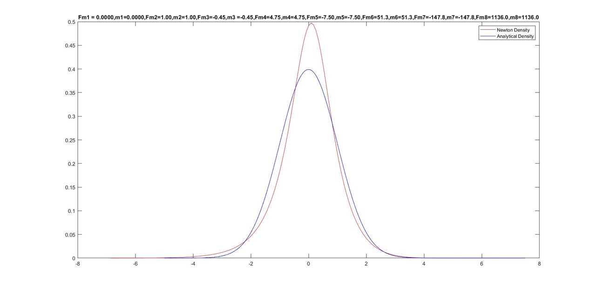](https://postimg.cc/YLSJzkhS)

[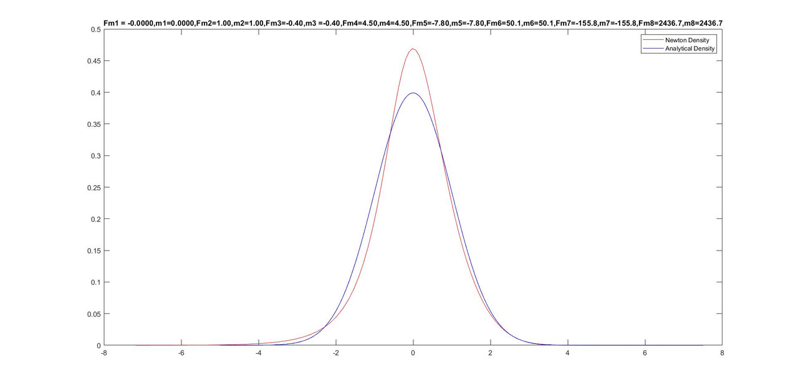](https://postimg.cc/s1DdrPwR)

[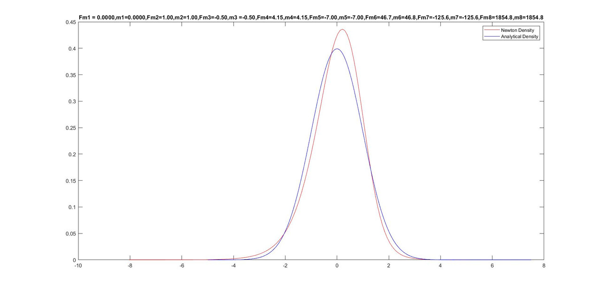](https://postimg.cc/xqxrTk4N)

[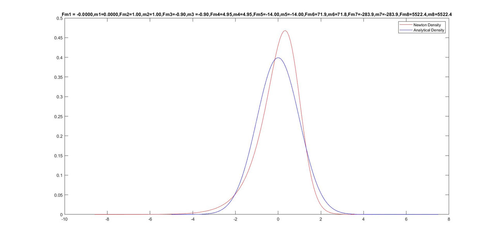](https://postimg.cc/9Rb69zXS)

[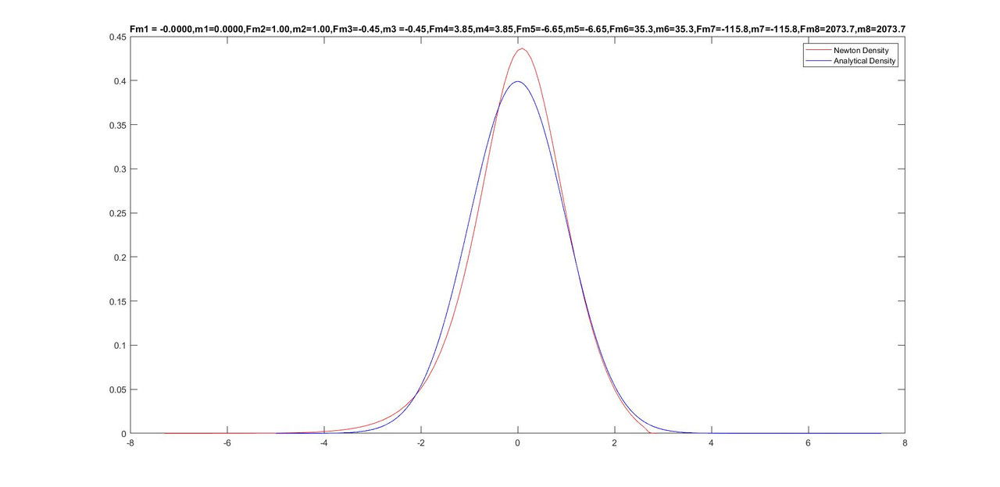](https://postimg.cc/N9QhLRtm)

---

### #1519 — Amin (Topic Author)
*August 12, 2022, 3:32 PM*

Here is also a quick Case 6 from a few days' earlier program. I have also specified its cumulants under heading case 6
in the program.

.

.

[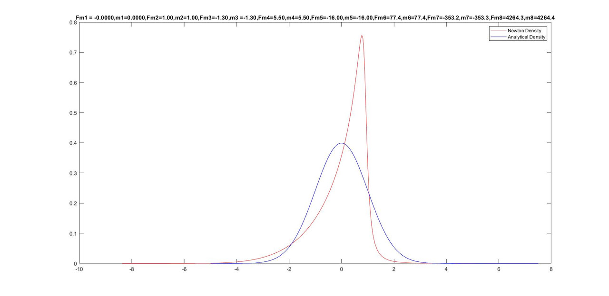](https://postimg.cc/HckSfzHZ)

Here are the matlab program files.

.

.

```
function [b0,b] = FindZSeriesGivenCumulantsStandard08A(k1,k2,k3,k4,k5,k6,k7,k8)

mu=0;
sigma=1.0;

%Case1
%  k1=0.0;
%  k2=(1.0);
%  k3=-.45;%1.0;
%  k4=1.750;%-.50;
%  k5=-3;%-.5;%15;
%  k6=8;%10;%100.0;
%  k7=-10;
%  k8=200;

%Case 2
%  k1=0.0;
%  k2=(1.0);
%  k3=-.40;%1.0;
%  k4=1.5;%-.50;
%  k5=-3.80;%-.5;%15;
%  k6=11.0;%10;%100.0;
%  k7=-13.0;
%  k8=1500;

%Case 3
%  k1=0.0;
%  k2=(1.0);
%  k3=-.5;%1.0;
%  k4=1.150;%-.50;
%  k5=-2;%-.5;%15;
%  k6=12;%10;%100.0;
%  k7=-11;
%  k8=1000;

%Case 4
%  k1=0.0;
%  k2=(1.0);
%  k3=-.9;%1.0;
%  k4=1.950;%-.50;
%  k5=-5;%-.5;%15;
%  k6=19.5;%10;%100.0;
%  k7=-23;
%  k8=3850;

 %Case 5
%   k1=0.0;
%  k2=(1.0);
%  k3=-.45;%1.0;
%  k4=.850;%-.50;
%  k5=-2.15;%-.5;%15;
%  k6=5.5;%10;%100.0;
%  k7=-10;
%  k8=1500;

 %Case 6
   k1=0.0;
  k2=(1.0);
  k3=-1.3;%1.0;
  k4=2.50;%-.50;
  k5=-3.0;%-.5;%15;
  k6=8.0;%10;%100.0;
  k7=-40;
  k8=2500;

[mu,sigma,a0,a1,a2,a3,a4,a5,mu1,rmu1,rmu2,rmu3,rmu4,rmu5,rmu6] =
GenerateDensityFromCumulantsX06Simple(mu,sigma,k1,k2,k3,k4,k5,k6)
rmu7=k1*rmu6+6*k2*rmu5+15*k3*rmu4+20*k4*rmu3+15*k5*rmu2+6*k6*rmu1+k7;
rmu8=k1*rmu7+7*k2*rmu6+21*k3*rmu5+35*k4*rmu4+35*k5*rmu3+21*k6*rmu2+7*k7*rmu1+k8;

rmu(1)=rmu1;
rmu(2)=rmu2;
rmu(3)=rmu3;
rmu(4)=rmu4;
rmu(5)=rmu5;
rmu(6)=rmu6;
rmu(7)=rmu7;
rmu(8)=rmu8;

[median] = FindMedianHermiteDensity06(mu1,mu,sigma,a0,a1,a2,a3,a4,a5);

Xm=median;

%str=input('Look at medians');
%Below calculate the density and its derivatives at median.

px=exp(-0.5* ((Xm-mu)/sigma).^2)/sigma/sqrt(2*pi).* (a0+ a1* ((Xm-mu)/sigma)+  a2* (((Xm-mu)/sigma).^2-1) + ...
    a3* ( ((Xm-mu)/sigma).^3 - 3*((Xm-mu)/sigma) )+ ...
    a4* (((Xm-mu)/sigma).^4 - 6* ((Xm-mu)/sigma).^2 + 3)+ ...
    a5* (((Xm-mu)/sigma).^5 - 10* ((Xm-mu)/sigma).^3 + 15*((Xm-mu)/sigma)));

dpxdX=exp(-0.5* ((Xm-mu)/sigma).^2)/sigma^2/sqrt(2*pi).* -(a0* ((Xm-mu)/sigma)+  a1* (((Xm-mu)/sigma).^2-1) + ...
    a2* ( ((Xm-mu)/sigma).^3 - 3*((Xm-mu)/sigma) )+ ...
    a3* (((Xm-mu)/sigma).^4 - 6* ((Xm-mu)/sigma).^2 + 3)+ ...
    a4* (((Xm-mu)/sigma).^5 - 10* ((Xm-mu)/sigma).^3 + 15*((Xm-mu)/sigma))+ ...
    a5* (((Xm-mu)/sigma).^6 - 15* ((Xm-mu)/sigma).^4 + 45*((Xm-mu)/sigma).^2-15));

d2pxdX2=exp(-0.5* ((Xm-mu)/sigma).^2)/sigma^3/sqrt(2*pi).* (a0* (((Xm-mu)/sigma).^2-1) + ...
    a1* ( ((Xm-mu)/sigma).^3 - 3*((Xm-mu)/sigma) )+ ...
    a2* (((Xm-mu)/sigma).^4 - 6* ((Xm-mu)/sigma).^2 + 3)+ ...
    a3* (((Xm-mu)/sigma).^5 - 10* ((Xm-mu)/sigma).^3 + 15*((Xm-mu)/sigma))+ ...
    a4* (((Xm-mu)/sigma).^6 - 15* ((Xm-mu)/sigma).^4 + 45*((Xm-mu)/sigma).^2-15) + ...
    a5* (((Xm-mu)/sigma).^7 - 21* ((Xm-mu)/sigma).^5 + 105*((Xm-mu)/sigma).^3-105*((Xm-mu)/sigma)));

d3pxdX3=exp(-0.5* ((Xm-mu)/sigma).^2)/sigma^4/sqrt(2*pi).* -(a0* (((Xm-mu)/sigma).^3 - 3*((Xm-mu)/sigma) )+ ...
    a1* (((Xm-mu)/sigma).^4 - 6* ((Xm-mu)/sigma).^2 + 3)+ ...
    a2* (((Xm-mu)/sigma).^5 - 10* ((Xm-mu)/sigma).^3 + 15*((Xm-mu)/sigma))+ ...
    a3* (((Xm-mu)/sigma).^6 - 15* ((Xm-mu)/sigma).^4 + 45*((Xm-mu)/sigma).^2-15) + ...
    a4* (((Xm-mu)/sigma).^7 - 21* ((Xm-mu)/sigma).^5 + 105*((Xm-mu)/sigma).^3-105*((Xm-mu)/sigma))+ ...
    a5* (((Xm-mu)/sigma).^8 - 28* ((Xm-mu)/sigma).^6 + 210*((Xm-mu)/sigma).^4-420*((Xm-mu)/sigma).^2+105));

d4pxdX4=exp(-0.5* ((Xm-mu)/sigma).^2)/sigma^5/sqrt(2*pi).* ( a0* (((Xm-mu)/sigma).^4 - 6* ((Xm-mu)/sigma).^2 + 3)+ ...
    a1* (((Xm-mu)/sigma).^5 - 10* ((Xm-mu)/sigma).^3 + 15*((Xm-mu)/sigma))+ ...
    a2* (((Xm-mu)/sigma).^6 - 15* ((Xm-mu)/sigma).^4 + 45*((Xm-mu)/sigma).^2-15) + ...
    a3* (((Xm-mu)/sigma).^7 - 21* ((Xm-mu)/sigma).^5 + 105*((Xm-mu)/sigma).^3-105*((Xm-mu)/sigma))+ ...
    a4* (((Xm-mu)/sigma).^8 - 28* ((Xm-mu)/sigma).^6 + 210*((Xm-mu)/sigma).^4-420*((Xm-mu)/sigma).^2+105)+ ...
    a5* (((Xm-mu)/sigma).^9 - 36* ((Xm-mu)/sigma).^7 +
378*((Xm-mu)/sigma).^5-1260*((Xm-mu)/sigma).^3+945*((Xm-mu)/sigma)));

d5pxdX5=exp(-0.5* ((Xm-mu)/sigma).^2)/sigma^6/sqrt(2*pi).* -( a0* (((Xm-mu)/sigma).^5 - 10* ((Xm-mu)/sigma).^3 +
15*((Xm-mu)/sigma))+ ...
    a1* (((Xm-mu)/sigma).^6 - 15* ((Xm-mu)/sigma).^4 + 45*((Xm-mu)/sigma).^2-15) + ...
    a2* (((Xm-mu)/sigma).^7 - 21* ((Xm-mu)/sigma).^5 + 105*((Xm-mu)/sigma).^3-105*((Xm-mu)/sigma))+ ...
    a3* (((Xm-mu)/sigma).^8 - 28* ((Xm-mu)/sigma).^6 + 210*((Xm-mu)/sigma).^4-420*((Xm-mu)/sigma).^2+105)+ ...
    a4* (((Xm-mu)/sigma).^9 - 36* ((Xm-mu)/sigma).^7 +
378*((Xm-mu)/sigma).^5-1260*((Xm-mu)/sigma).^3+945*((Xm-mu)/sigma))+ ...
    a5* (((Xm-mu)/sigma).^10 - 45* ((Xm-mu)/sigma).^8 +
630*((Xm-mu)/sigma).^6-3150*((Xm-mu)/sigma).^4+4725*((Xm-mu)/sigma).^2- 945 ));

d6pxdX6=exp(-0.5* ((Xm-mu)/sigma).^2)/sigma^7/sqrt(2*pi).* (a0* (((Xm-mu)/sigma).^6 - 15* ((Xm-mu)/sigma).^4 +
45*((Xm-mu)/sigma).^2-15) + ...
    a1* (((Xm-mu)/sigma).^7 - 21* ((Xm-mu)/sigma).^5 + 105*((Xm-mu)/sigma).^3-105*((Xm-mu)/sigma))+ ...
    a2* (((Xm-mu)/sigma).^8 - 28* ((Xm-mu)/sigma).^6 + 210*((Xm-mu)/sigma).^4-420*((Xm-mu)/sigma).^2+105)+ ...
    a3* (((Xm-mu)/sigma).^9 - 36* ((Xm-mu)/sigma).^7 +
378*((Xm-mu)/sigma).^5-1260*((Xm-mu)/sigma).^3+945*((Xm-mu)/sigma))+ ...
    a4* (((Xm-mu)/sigma).^10 - 45* ((Xm-mu)/sigma).^8 +
630*((Xm-mu)/sigma).^6-3150*((Xm-mu)/sigma).^4+4725*((Xm-mu)/sigma).^2- 945 ) + ...
    a5* (((Xm-mu)/sigma).^11 - 55* ((Xm-mu)/sigma).^9 +
990*((Xm-mu)/sigma).^7-6930*((Xm-mu)/sigma).^5+17325*((Xm-mu)/sigma).^3-10395*((Xm-mu)/sigma) ));

%Below calculate standard normal density and its derivatives at median.
Zm=0;
pz=exp(-0.5* (Zm.^2))/sqrt(2*pi);
dpzdZ=-Zm*exp(-0.5* (Zm.^2))/sqrt(2*pi);
d2pzdZ2=(Zm^2-1)*exp(-0.5* (Zm.^2))/sqrt(2*pi);
d3pzdZ3=-(Zm^3-3*Zm)*exp(-0.5* (Zm.^2))/sqrt(2*pi);
d4pzdZ4=(Zm^4-6*Zm^2+3)*exp(-0.5* (Zm.^2))/sqrt(2*pi);
d5pzdZ5=-(Zm^5-10*Zm^3+15*Zm)*exp(-0.5* (Zm.^2))/sqrt(2*pi);
d6pzdZ6=(Zm^6-15*Zm^4+45*Zm.^2-15)*exp(-0.5* (Zm.^2))/sqrt(2*pi);

dXdZ=pz/px;

d2XdZ2=(dpzdZ-(dpxdX *dXdZ^2))/px

d3XdZ3=(d2pzdZ2- (2* dpxdX* dXdZ *d2XdZ2+dXdZ *(dXdZ^2* d2pxdX2+dpxdX *d2XdZ2)))/px

d4XdZ4=(d3pzdZ3-(3* d2XdZ2* (dXdZ^2* d2pxdX2+dpxdX *d2XdZ2)+3* dpxdX *dXdZ *d3XdZ3+dXdZ* (3 *dXdZ* d2pxdX2*
d2XdZ2+dXdZ^3* d3pxdX3+dpxdX* d3XdZ3)))/px

d5XdZ5=(d4pzdZ4- (6 *(dXdZ^2 *d2pxdX2+dpxdX *d2XdZ2) *d3XdZ3+4 *d2XdZ2* (3* dXdZ *d2pxdX2 *d2XdZ2+dXdZ^3* d3pxdX3+dpxdX*
d3XdZ3)+4* dpxdX* dXdZ* d4XdZ4+dXdZ *(3* d2pxdX2* d2XdZ2^2+6* dXdZ^2* d2XdZ2* d3pxdX3+4 *dXdZ* d2pxdX2* d3XdZ3+dXdZ^4*
d4pxdX4+dpxdX* d4XdZ4)))/px

d6XdZ6=(d5pzdZ5- (10* d3XdZ3 *(3 *dXdZ* d2pxdX2* d2XdZ2+dXdZ^3* d3pxdX3+dpxdX *d3XdZ3)+10* (dXdZ^2* d2pxdX2+dpxdX
*d2XdZ2)* d4XdZ4+5* d2XdZ2* (3* d2pxdX2* d2XdZ2^2+6* dXdZ^2* d2XdZ2* d3pxdX3+4 *dXdZ* d2pxdX2* d3XdZ3+dXdZ^4*
d4pxdX4+dpxdX* d4XdZ4)+5 *dpxdX* dXdZ* d5XdZ5+dXdZ *(15* dXdZ* d2XdZ2^2* d3pxdX3+10* d2pxdX2* d2XdZ2* d3XdZ3+10* dXdZ^2
*d3pxdX3* d3XdZ3+10* dXdZ^3* d2XdZ2* d4pxdX4+5* dXdZ* d2pxdX2* d4XdZ4+dXdZ^5* d5pxdX5+dpxdX* d5XdZ5)))/px

d7XdZ7=(d6pzdZ6- (20 *(3* dXdZ* d2pxdX2* d2XdZ2+dXdZ^3 *d3pxdX3+dpxdX *d3XdZ3)* d4XdZ4+15* d3XdZ3* (3 *d2pxdX2
*d2XdZ2^2+6* dXdZ^2* d2XdZ2* d3pxdX3+4 *dXdZ* d2pxdX2* d3XdZ3+dXdZ^4* d4pxdX4+dpxdX* d4XdZ4)+15* (dXdZ^2* d2pxdX2+dpxdX*
d2XdZ2)* d5XdZ5+6* d2XdZ2* (15* dXdZ* d2XdZ2^2* d3pxdX3+10* d2pxdX2* d2XdZ2 *d3XdZ3+10 *dXdZ^2 *d3pxdX3 *d3XdZ3+10
*dXdZ^3 *d2XdZ2* d4pxdX4+5 *dXdZ *d2pxdX2 *d4XdZ4+dXdZ^5 *d5pxdX5+dpxdX* d5XdZ5)+6* dpxdX* dXdZ *d6XdZ6+dXdZ* (15
*d2XdZ2^3 *d3pxdX3+60 *dXdZ *d2XdZ2 *d3pxdX3* d3XdZ3+10 *d2pxdX2 *d3XdZ3^2+45 *dXdZ^2* d2XdZ2^2 *d4pxdX4+20* dXdZ^3
*d3XdZ3* d4pxdX4+15 *d2pxdX2* d2XdZ2 *d4XdZ4+15 *dXdZ^2* d3pxdX3 *d4XdZ4+15 *dXdZ^4* d2XdZ2* d5pxdX5+6 *dXdZ *d2pxdX2*
d5XdZ5+dXdZ^6* d6pxdX6+dpxdX *d6XdZ6)))/px

%Below calculate iniotial guess coefficients of Z-series to be input to
%Newton method.

c0=median;
c1=dXdZ;
c2=1/2*1*d2XdZ2;
c3=1/6*1*d3XdZ3;
c4=1/24*1*d4XdZ4;
c5=1/120*1*d5XdZ5;
c6=1/720*1*d6XdZ6;
c7=1/720/7*d7XdZ7;

%earlier program worked only because odd coefficients that are related to
%even moments were reasonablyclose to true values. Even coefficients
%responsible for odd moments were usually grossly off. Below I try to make
%sure that sign of even coefficients matches the sign of odd moments. This
%is not completely definitive but usually right.
cc0=c0;
cc(1)=c1;
if(sign(k3)~=sign(c2))
cc(2)=-1*c2;
else
cc(2)=c2;
end
cc(3)=c3;
if(sign(k5)~=sign(c4))
cc(4)=-1*c4;
else
cc(4)=c4;
end
cc(5)=c5;
if(sign(k7)~=sign(c6))
cc(6)=-1*c6;
else
cc(6)=c6;
end

cc(7)=c7;

cc0=-(cc(2)+cc(4)*3+cc(6)*15);

SeriesOrder=7;
NMoments=8;

[Moments] = CalculateMomentsOfZSeries(cc0,cc,SeriesOrder,NMoments)
rmu

str=input('Look at moments--before')

%Below is the function that finds a guess for Newton method using heuristic
%bisection.

[cc0,cc] = ImproveNewtonGuess02(cc0,cc,rmu,25);

%str=input('Look at initial match of moments for the Newton guess');
%Below specify target cumulants.
C(1:NMoments+1)=0;
C(1)=k1;
C(2)=k2;
C(3)=k3;
C(4)=k4;
C(5)=k5;
C(6)=k6;
C(7)=k7;
C(8)=k8;

%Below calculate F, the defect vector from target cumulants. And calculate
%dF which is the matrix consisting of derivatives of defect vector from
%target cumulants.

[F,dF] = CalculateCumulantsAndDerivativesFromMoments_0(C,cc0,cc,SeriesOrder,NMoments,8)

da(1,1)=cc0;
da(2:SeriesOrder+1,1)=cc(1:SeriesOrder);

NoOfCumulants=NMoments
[Moments] = CalculateMomentsOfZSeries(cc0,cc,SeriesOrder,NMoments);
ObjBest=0;

   
 %ObjBest=100000*(abs(rmu(1)-Moments(1)))+abs(rmu(2)-Moments(2))+abs((rmu(3)-Moments(3))^(1/1.5))+abs((rmu(4)-Moments(4))^(1/2.0))
+ ...
     %   abs((rmu(5)-Moments(5))^(1/2.5))+abs((rmu(6)-Moments(6))^(1/3.0))+abs((rmu(7)-Moments(7))^(1/3.5))+ ...
     %   abs((rmu(8)-Moments(8))^(1/4.0));

   
ObjBest=100000*(abs(rmu(1)-Moments(1)))+abs(rmu(2)-Moments(2))+abs((rmu(3)-Moments(3))^(1/1.5))+abs((rmu(4)-Moments(4))^(1/2.0))
+ ...
    abs((rmu(5)-Moments(5))^(1/2.0))+abs((rmu(6)-Moments(6))^(1/2.0))+abs((rmu(7)-Moments(7))^(1/2.0))+ ...
    abs((rmu(8)-Moments(8))^(1/2.0));

b0Best=cc0;
bBest(1:SeriesOrder)=cc(1:SeriesOrder);

nn=0;
while((nn.000000000001) || (abs(F(2,1))>.000000000001) || (abs(F(3,1))>.000000000001) || (abs(F(4,1))>.00000000001)||
(abs(F(5,1))>.00000000001)|| (abs(F(6,1))>.00000000001)  ))

nn=nn+1;
%Below Newton matrix equation to improve the Z-series coefficients guess at previous step.

da=da-dF\F;

%b0=median
b0=da(1,1);
b(1:SeriesOrder)=da(2:SeriesOrder+1,1);

[F,dF] = CalculateCumulantsAndDerivativesFromMoments_0(C,b0,b,SeriesOrder,SeriesOrder,NoOfCumulants);

[IsValidFlag] = CheckIsValidDensity(b0,b)

[Moments] = CalculateMomentsOfZSeries(b0,b,SeriesOrder,NMoments);
ObjNew=0;
   
 %ObjNew=100000*(abs(rmu(1)-Moments(1)))+abs(rmu(2)-Moments(2))+abs((rmu(3)-Moments(3))^(1/1.5))+abs((rmu(4)-Moments(4))^(1/2.0))
+ ...
     %   abs((rmu(5)-Moments(5))^(1/2.5))+abs((rmu(6)-Moments(6))^(1/3.0))+abs((rmu(7)-Moments(7))^(1/3.5))+ ...
     %   abs((rmu(8)-Moments(8))^(1/4.0));

   
ObjNew=100000*(abs(rmu(1)-Moments(1)))+abs(rmu(2)-Moments(2))+abs((rmu(3)-Moments(3))^(1/1.5))+abs((rmu(4)-Moments(4))^(1/2.0))
+ ...
    abs((rmu(5)-Moments(5))^(1/2.0))+abs((rmu(6)-Moments(6))^(1/2.0))+abs((rmu(7)-Moments(7))^(1/2.0))+ ...
    abs((rmu(8)-Moments(8))^(1/2.0));

  if((ObjBest>ObjNew) &&( IsValidFlag))

       ObjBest=ObjNew;
       b0Best=b0;
       bBest(1:SeriesOrder)=b(1:SeriesOrder);
   end

da(1,1)=b0;
da(2:SeriesOrder+1,1)=b(1:SeriesOrder);

end
  b0=b0Best;%Best;
  b(1:SeriesOrder)=bBest;%Best(1:SeriesOrder);

  %Above are the best chosen Z-series coefficients based on the objective function.
  %But my objective function can be improved.

[Moments] = CalculateMomentsOfZSeries(b0,b,SeriesOrder,NMoments)
%Above are raw moments calculated from the resulting Z-series from Newton
%Method

%Below are raw moments that were input to calibration.
rmu
str=input('Look at comparison of moments calibration');

%Below we do calculations to construct the density from our newly derived
%Z-series.

dNn=.2/2;   % Normal density subdivisions width. would change with number of subdivisions
Nn=90;  % No of normal density subdivisions

NnMid=4.0;

Z(1:Nn)=(((1:Nn)-6.5/1)*dNn-NnMid);
%Z
%str=input('Look at Z');
%ZProb(1)=normcdf(.5*Z(1)+.5*Z(2),0,1)-normcdf(.5*Z(1)+.5*Z(2)-dNn,0,1);
%ZProb(Nn)=normcdf(.5*Z(Nn)+.5*Z(Nn-1)+dNn,0,1)-normcdf(.5*Z(Nn)+.5*Z(Nn-1),0,1);
%ZProb(2:Nn-1)=normcdf(.5*Z(2:Nn-1)+.5*Z(3:Nn),0,1)-normcdf(.5*Z(2:Nn-1)+.5*Z(1:Nn-2),0,1);

  w(1:Nn)=b0;
  for nn=1:SeriesOrder
      w(1:Nn)=w(1:Nn)+b(nn)*Z(1:Nn).^nn;
  end
wnStart=1;
Dfw(wnStart:Nn)=0;
for nn=wnStart+1:Nn-1

    Dfw(nn) = (w(nn + 1) - w(nn - 1))/(Z(nn + 1) - Z(nn - 1));
end

pw(1:Nn)=0;
for nn = wnStart+1:Nn-1

    pw(nn) = (normpdf(Z(nn),0, 1))/abs(Dfw(nn));

end

%
% %Below is the construction of density of our originial analytic density for
% %plotting purposes
%
 dMm=.02/10;
 Mm=1250*5;
 X(1:Mm)=-5+dMm+dMm*(1:Mm);

%
% %Below is the newly constructed density so that its output central moments
% %match the central moments input by the user.
% pdf=exp(-0.5* ((X-mu)/sigma).^2)/sigma/sqrt(2*pi).* (a0+ a1* ((X-mu)/sigma)+  a2* (((X-mu)/sigma).^2-1) + ...
%     a3* ( ((X-mu)/sigma).^3 - 3*((X-mu)/sigma) )+ ...
%     a4* (((X-mu)/sigma).^4 - 6* ((X-mu)/sigma).^2 + 3)+ ...
%     a5* (((X-mu)/sigma).^5 - 10* ((X-mu)/sigma).^3 + 15*((X-mu)/sigma))+ ...
%     a6* (((X-mu)/sigma).^6 - 15* ((X-mu)/sigma).^4 + 45*((X-mu)/sigma).^2-15))+ ...
%     a7*(((Xm-mu)/sigma).^7 - 21* ((Xm-mu)/sigma).^5 + 105*((Xm-mu)/sigma).^3-105*((Xm-mu)/sigma));
%
% %Below is standard Gaussian PDF.
 pdfG=exp(-0.5* ((X-mu)/sigma).^2)/sigma/sqrt(2*pi);
%
 plot(w(wnStart+1:Nn-1),pw(wnStart+1:Nn-1),'r',X(1:Mm),pdfG(1:Mm),'b');

 title(sprintf('Fm1 = %.4f,m1=%.4f,Fm2=%.2f,m2=%.2f,Fm3=%.2f,m3
=%.2f,Fm4=%.2f,m4=%.2f,Fm5=%.2f,m5=%.2f,Fm6=%.1f,m6=%.1f,Fm7=%.1f,m7=%.1f,Fm8=%.1f,m8=%.1f',Moments(1),rmu1,Moments(2),rmu2,Moments(3),rmu3,Moments(4),rmu4,Moments(5),rmu5,Moments(6),rmu6,Moments(7),rmu7,Moments(8),rmu8));
 %,sprintf('theta= %f', theta), sprintf('kappa = %f', kappa),sprintf('sigma = %f', sigma0),sprintf('T = %f', T));

 legend({'Newton Density','Analytical Density','Standard Gaussian Density'},'Location','northeast')

cc0
b0
cc
b

end

```

.

.

.

.

```
function [cc0Best,ccBest] = ImproveNewtonGuess02(cc0,cc,rmu,Iterations)
%This function finds a good guess for Newton method by heuristic bisection.

SeriesOrder=7;
NMoments=8;
[Moments] = CalculateMomentsOfZSeries(cc0,cc,SeriesOrder,NMoments);

%ObjectiveBest=100000*(abs(rmu(1)-Moments(1)))+abs(rmu(2)-Moments(2))+abs((rmu(3)-Moments(3))^(1/1.5))+abs((rmu(4)-Moments(4))^(1/2.0))
+ ...
%    abs((rmu(5)-Moments(5))^(1/2.5))+abs((rmu(6)-Moments(6))^(1/3.0))+abs((rmu(7)-Moments(7))^(1/3.5))+ ...
%    abs((rmu(8)-Moments(8))^(1/4.0));

ObjectiveBest=100000*(abs(rmu(1)-Moments(1)))+abs(rmu(2)-Moments(2))+abs((rmu(3)-Moments(3))^(1/1.5))+abs((rmu(4)-Moments(4))^(1/2.0))
+ ...
    abs((rmu(5)-Moments(5))^(1/2.0))+abs((rmu(6)-Moments(6))^(1/2.0))+abs((rmu(7)-Moments(7))^(1/2.0))+ ...
    abs((rmu(8)-Moments(8))^(1/2.0));

ccBest=cc;
cc0Best=cc0;
r1=.5;%bisection weight one
r2=.5;%bisection weight two

for nn=1:Iterations

    if(nn>1)
    %r1=r1+.025;
    %r2=r2-.025;
    end

    [Moments] = CalculateMomentsOfZSeries(cc0,cc,SeriesOrder,NMoments)
    Ratio2=(r1*rmu(2)+r2*Moments(2))/Moments(2);
cc(1)=cc(1)*sqrt(Ratio2);

[Moments] = CalculateMomentsOfZSeries(cc0,cc,SeriesOrder,NMoments)

Ratio3=(r1*rmu(3)+r2*Moments(3))/Moments(3);
cc(2)=cc(2)*(Ratio3);

cc0=-(cc(2)+3*cc(4)+15*cc(6));

[Moments] = CalculateMomentsOfZSeries(cc0,cc,SeriesOrder,NMoments)

Ratio4=(r1*rmu(4)+r2*Moments(4))/Moments(4);
cc(3)=cc(3)*(Ratio4);

[Moments] = CalculateMomentsOfZSeries(cc0,cc,SeriesOrder,NMoments)

Ratio5=(r1*rmu(5)+r2*Moments(5))/Moments(5);
cc(4)=cc(4)*(Ratio5);

cc0=-(cc(2)+3*cc(4)+15*cc(6));
[Moments] = CalculateMomentsOfZSeries(cc0,cc,SeriesOrder,NMoments)
Ratio6=(r1*rmu(6)+r2*Moments(6))/Moments(6);
cc(5)=cc(5)*(Ratio6);

[Moments] = CalculateMomentsOfZSeries(cc0,cc,SeriesOrder,NMoments)
Ratio7=(r1*rmu(7)+r2*Moments(7))/Moments(7);
cc(6)=cc(6)*(Ratio7);

[Moments] = CalculateMomentsOfZSeries(cc0,cc,SeriesOrder,NMoments)
Ratio8=(r1*rmu(8)+r2*Moments(8))/Moments(8);
cc(7)=cc(7)*(Ratio8);

cc0=-(cc(2)+3*cc(4)+15*cc(6));
[Moments] = CalculateMomentsOfZSeries(cc0,cc,SeriesOrder,NMoments)

[IsValidFlag] = CheckIsValidDensity(cc0,cc)

%ObjectiveNew=100000*(abs(rmu(1)-Moments(1)))+abs(rmu(2)-Moments(2))+abs((rmu(3)-Moments(3))^(1/1.5))+abs((rmu(4)-Moments(4))^(1/2.0))
+ ...
%    abs((rmu(5)-Moments(5))^(1/2.5))+abs((rmu(6)-Moments(6))^(1/3.0))+abs((rmu(7)-Moments(7))^(1/3.5))+ ...
%    abs((rmu(8)-Moments(8))^(1/4.0));

ObjectiveNew=100000*(abs(rmu(1)-Moments(1)))+abs(rmu(2)-Moments(2))+abs((rmu(3)-Moments(3))^(1/1.5))+abs((rmu(4)-Moments(4))^(1/2.0))
+ ...
    abs((rmu(5)-Moments(5))^(1/2.0))+abs((rmu(6)-Moments(6))^(1/2.0))+abs((rmu(7)-Moments(7))^(1/2.0))+ ...
    abs((rmu(8)-Moments(8))^(1/2.0));

if((ObjectiveNew<ObjectiveBest) &&( IsValidFlag))
    ObjectiveBest=ObjectiveNew;

    ccBest=cc;
    cc0Best=cc0;
end

end

[Moments] = CalculateMomentsOfZSeries(cc0,cc,SeriesOrder,NMoments)
rmu
str=input('Look at moments--In function---After');

end

```

.

.

.

.

```
function [IsValidFlag] = CheckIsValidDensity(cc0,cc)
%Roughly checks if the density is valid. It is not a definitive check but
%just a rough one but mostly works.

Z=2.0;
Xp1=cc0 + cc(1) * Z+ cc(2) * Z^2+ cc(3) * Z^3+ cc(4) * Z^4+ cc(5) * Z^5+ cc(6) * Z^6+ cc(7) * Z^7;

Z=3.0;
Xp2=cc0 + cc(1) * Z+ cc(2) * Z^2+ cc(3) * Z^3+ cc(4) * Z^4+ cc(5) * Z^5+ cc(6) * Z^6+ cc(7) * Z^7;

Z=4.65;
Xp3=cc0 + cc(1) * Z+ cc(2) * Z^2+ cc(3) * Z^3+ cc(4) * Z^4+ cc(5) * Z^5+ cc(6) * Z^6+ cc(7) * Z^7;

Z=-2.0;
Xn1=cc0 + cc(1) * Z+ cc(2) * Z^2+ cc(3) * Z^3+ cc(4) * Z^4+ cc(5) * Z^5+ cc(6) * Z^6+ cc(7) * Z^7;

Z=-3.0;
Xn2=cc0 + cc(1) * Z+ cc(2) * Z^2+ cc(3) * Z^3+ cc(4) * Z^4+ cc(5) * Z^5+ cc(6) * Z^6+ cc(7) * Z^7;

Z=-4.65;
Xn3=cc0 + cc(1) * Z+ cc(2) * Z^2+ cc(3) * Z^3+ cc(4) * Z^4+ cc(5) * Z^5+ cc(6) * Z^6+ cc(7) * Z^7;

IsValidFlag=0;
if( ((Xp2>Xp1) && (Xp3>Xp2)) &&(Xp1>Xn1) && ((Xn2<Xn1) && (Xn3<Xn2)))
    IsValidFlag=1;
end

end

```

.

.

.

.

```
function [mu,sigma,a0,a1,a2,a3,a4,a5,mu1,rmu1,rmu2,rmu3,rmu4,rmu5,rmu6] =
GenerateDensityFromCumulantsX06Simple(mu,sigma,k1,k2,k3,k4,k5,k6)

%In this program, you specify the first six cumulants through input parametersand the program creates a density based on
these
%cumulantsents.

%The algorithm takes a base gaussian density that has it mean mu and
%sq-root of variance given by sigma.
%This mean and sigma can be different from first and sq-root of second
%central moment(variance) of the target density that we specified as mu1 and mu2 earlier.

%Below is the construction of grid to calculate pdf, numerically integrate the pdf
%to find cdf. And to numerically calculate the six moments on the constructed density
%so they can be matched with input moments.

dNn=.02/10;
Nn=1250*10;
X(1:Nn)=-10+dNn+dNn*(1:Nn);

%Below, we calculate first six raw-moments from the input cumulants.
%These raw moments would be used to calculate the coefficients of hermite
%polynomials so that output central moments calculated on new density match
%the input central moments.

mu1=k1;
rmu1=k1;
rmu2=k1*rmu1+k2;
rmu3=k1*rmu2+2*k2*rmu1+k3;
rmu4=k1*rmu3+3*k2*rmu2+3*k3*rmu1+k4;
rmu5=k1*rmu4+4*k2*rmu3+6*k3*rmu2+4*k4*rmu1+k5;
rmu6=k1*rmu5+5*k2*rmu4+10*k3*rmu3+10*k4*rmu2+5*k5*rmu1+k6;
%rmu7=k1*rmu6+6*k2*rmu5+15*k3*rmu4+20*k4*rmu3+15*k5*rmu2+6*k6*rmu1+k7;
%rmu8=k1*rmu7+7*k2*rmu6+21*k3*rmu5+35*k4*rmu4+35*k5*rmu3+21*k6*rmu2+7*k7*rmu1+k8;

%Below is base gaussian pdf.
pdfG=exp(-0.5* ((X-mu)/sigma).^2)/sigma/sqrt(2*pi);

%Below I calculate the coefficients of polynomials making the density so
%that the resulting density has the same as specified raw moments.
%This follows my description of method 4 in the post 1491 given at
%https://forum.wilmott.com/viewtopic.php?f=4&t=99702&p=871093#p871047

MOrder=6+6
SeriesOrder=6;
SeriesOrder=6;
[EZ] = CalculateGaussianMoments(MOrder)

%str=input('Look at Z  Expectations')
CMatrix(1,1:SeriesOrder)=EZ(1:SeriesOrder);
CMatrix(2,1:SeriesOrder)=EZ(2:SeriesOrder+1);
CMatrix(3,1:SeriesOrder)=EZ(3:SeriesOrder+2);
CMatrix(4,1:SeriesOrder)=EZ(4:SeriesOrder+3);
CMatrix(5,1:SeriesOrder)=EZ(5:SeriesOrder+4);
CMatrix(6,1:SeriesOrder)=EZ(6:SeriesOrder+5);
%CMatrix(7,1:SeriesOrder)=EZ(7:SeriesOrder+6);
%CMatrix(8,1:SeriesOrder)=EZ(8:SeriesOrder+7);

Mu(1,1)=1.0;
Mu(2,1)=rmu1;
Mu(3,1)=rmu2;
Mu(4,1)=rmu3;
Mu(5,1)=rmu4;
Mu(6,1)=rmu5;
%Mu(7,1)=rmu6;
%Mu(8,1)=rmu7;

Coeff=CMatrix\Mu;

Coeff

%str=input('Look at Mu results');
%Below I convert from simple polynomials to hermite polynomials so that
%resulting density remains identical with the initial density.

[CoeffaH] = ConvertZCoeffsToHCoeffsAB(Coeff,SeriesOrder)

a0=CoeffaH(1);
a1=CoeffaH(2);
a2=CoeffaH(3);
a3=CoeffaH(4);
a4=CoeffaH(5);
a5=CoeffaH(6);
a6=0;%CoeffaH(7);
a7=0;%CoeffaH(8);
a8=0;

CoeffaH(7)=0;
CoeffaH(8)=0;

%str=input('Look at Mu results---2');

%Below is the newly constructed density so that its output raw moments
%match the raw moments input by the user.
%Sometimes this density is negative at places but we still use it to derive
%an initial guess for construction of Z-series Newton density.

pdf=exp(-0.5* ((X-mu)/sigma).^2)/sigma/sqrt(2*pi).* (a0+ a1* ((X-mu)/sigma)+  a2* (((X-mu)/sigma).^2-1) + ...
    a3* ( ((X-mu)/sigma).^3 - 3*((X-mu)/sigma) )+ ...
    a4* (((X-mu)/sigma).^4 - 6* ((X-mu)/sigma).^2 + 3)+ ...
    a5* (((X-mu)/sigma).^5 - 10* ((X-mu)/sigma).^3 + 15*((X-mu)/sigma))+ ...
    a6* (((X-mu)/sigma).^6 - 15* ((X-mu)/sigma).^4 + 45*((X-mu)/sigma).^2-15)+ ...
    a7* (((X-mu)/sigma).^7 - 21* ((X-mu)/sigma).^5 + 105*((X-mu)/sigma).^3-105*((X-mu)/sigma))+ ...
    a8* (((X-mu)/sigma).^8 - 28* ((X-mu)/sigma).^6 + 210*((X-mu)/sigma).^4-420*((X-mu)/sigma).^2+105));

%Below cdf is calculated by doing numerical integration of the density. I
%have replaced integration with summations.
cdf0(1:Nn)=0;
for nn=2:Nn
cdf0(nn)=cdf0(nn-1)+exp(-0.5* ((X(nn)-mu)/sigma).^2)/sigma/sqrt(2*pi).* (a0+ a1* ((X(nn)-mu)/sigma)+ a2/2*
(((X(nn)-mu)/sigma).^2-1) + ...
    a3* ( ((X(nn)-mu)/sigma).^3 - 3*((X(nn)-mu)/sigma) )+ ...
    a4* (((X(nn)-mu)/sigma).^4 - 6* ((X(nn)-mu)/sigma).^2 + 3) + ...
    a5* (((X(nn)-mu)/sigma).^5 - 10* ((X(nn)-mu)/sigma).^3 + 15*((X(nn)-mu)/sigma))+ ...
    a6* (((X(nn)-mu)/sigma).^6 - 15* ((X(nn)-mu)/sigma).^4 + 45*((X(nn)-mu)/sigma).^2-15) + ...
     a7* (((X(nn)-mu)/sigma).^7 - 21* ((X(nn)-mu)/sigma).^5 + 105*((X(nn)-mu)/sigma).^3-105*((X(nn)-mu)/sigma))+ ...
    a8* (((X(nn)-mu)/sigma).^8 - 28* ((X(nn)-mu)/sigma).^6 +
210*((X(nn)-mu)/sigma).^4-420*((X(nn)-mu)/sigma).^2+105))*dNn;
end

%Below is numerically calculated value of first raw moment. N in mu1N
%stands for numerical.

rmu1N=0;
for nn=2:Nn
rmu1N=rmu1N+X(nn) .*exp(-0.5* ((X(nn)-mu)/sigma).^2)/sigma/sqrt(2*pi).* (a0+ a1* ((X(nn)-mu)/sigma)+ a2/2*
(((X(nn)-mu)/sigma).^2-1) + ...
    a3* ( ((X(nn)-mu)/sigma).^3 - 3*((X(nn)-mu)/sigma) )+ ...
    a4* (((X(nn)-mu)/sigma).^4 - 6* ((X(nn)-mu)/sigma).^2 + 3) + ...
    a5* (((X(nn)-mu)/sigma).^5 - 10* ((X(nn)-mu)/sigma).^3 + 15*((X(nn)-mu)/sigma))+ ...
    a6* (((X(nn)-mu)/sigma).^6 - 15* ((X(nn)-mu)/sigma).^4 + 45*((X(nn)-mu)/sigma).^2-15)+ ...
    a7* (((X(nn)-mu)/sigma).^7 - 21* ((X(nn)-mu)/sigma).^5 + 105*((X(nn)-mu)/sigma).^3-105*((X(nn)-mu)/sigma))+ ...
    a8* (((X(nn)-mu)/sigma).^8 - 28* ((X(nn)-mu)/sigma).^6 +
210*((X(nn)-mu)/sigma).^4-420*((X(nn)-mu)/sigma).^2+105))*dNn;
end

%Below is numerically calculated value of second raw moment.

rmu2N=0;
for nn=2:Nn
rmu2N=rmu2N+(X(nn)-0*rmu1N).^2 .*exp(-0.5* ((X(nn)-mu)/sigma).^2)/sigma/sqrt(2*pi).* (a0+ a1* ((X(nn)-mu)/sigma)+ a2*
(((X(nn)-mu)/sigma).^2-1) + ...
    a3* ( ((X(nn)-mu)/sigma).^3 - 3*((X(nn)-mu)/sigma) )+ ...
    a4* (((X(nn)-mu)/sigma).^4 - 6* ((X(nn)-mu)/sigma).^2 + 3) + ...
    a5* (((X(nn)-mu)/sigma).^5 - 10* ((X(nn)-mu)/sigma).^3 + 15*((X(nn)-mu)/sigma))+ ...
    a6* (((X(nn)-mu)/sigma).^6 - 15* ((X(nn)-mu)/sigma).^4 + 45*((X(nn)-mu)/sigma).^2-15)+ ...
    a7* (((X(nn)-mu)/sigma).^7 - 21* ((X(nn)-mu)/sigma).^5 + 105*((X(nn)-mu)/sigma).^3-105*((X(nn)-mu)/sigma))+ ...
    a8* (((X(nn)-mu)/sigma).^8 - 28* ((X(nn)-mu)/sigma).^6 +
210*((X(nn)-mu)/sigma).^4-420*((X(nn)-mu)/sigma).^2+105))*dNn;
end

%Below is numerically calculated value of third raw moment.
rmu3N=0;
for nn=2:Nn
rmu3N=rmu3N+(X(nn)-0*rmu1N).^3 .*exp(-0.5* ((X(nn)-mu)/sigma).^2)/sigma/sqrt(2*pi).* (a0+ a1* ((X(nn)-mu)/sigma)+ a2*
(((X(nn)-mu)/sigma).^2-1) + ...
    a3* ( ((X(nn)-mu)/sigma).^3 - 3*((X(nn)-mu)/sigma) )+ ...
    a4* (((X(nn)-mu)/sigma).^4 - 6* ((X(nn)-mu)/sigma).^2 + 3) + ...
    a5* (((X(nn)-mu)/sigma).^5 - 10* ((X(nn)-mu)/sigma).^3 + 15*((X(nn)-mu)/sigma))+ ...
    a6* (((X(nn)-mu)/sigma).^6 - 15* ((X(nn)-mu)/sigma).^4 + 45*((X(nn)-mu)/sigma).^2-15)+ ...
    a7* (((X(nn)-mu)/sigma).^7 - 21* ((X(nn)-mu)/sigma).^5 + 105*((X(nn)-mu)/sigma).^3-105*((X(nn)-mu)/sigma))+ ...
    a8* (((X(nn)-mu)/sigma).^8 - 28* ((X(nn)-mu)/sigma).^6 +
210*((X(nn)-mu)/sigma).^4-420*((X(nn)-mu)/sigma).^2+105))*dNn;
end

%Below is numerically calculated value of fourth raw moment.
rmu4N=0;
for nn=2:Nn
rmu4N=rmu4N+(X(nn)-0*rmu1N).^4 .*exp(-0.5* ((X(nn)-mu)/sigma).^2)/sigma/sqrt(2*pi).* (a0+ a1* ((X(nn)-mu)/sigma)+ a2*
(((X(nn)-mu)/sigma).^2-1) + ...
    a3* ( ((X(nn)-mu)/sigma).^3 - 3*((X(nn)-mu)/sigma) )+ ...
    a4* (((X(nn)-mu)/sigma).^4 - 6* ((X(nn)-mu)/sigma).^2 + 3) + ...
    a5* (((X(nn)-mu)/sigma).^5 - 10* ((X(nn)-mu)/sigma).^3 + 15*((X(nn)-mu)/sigma))+ ...
    a6* (((X(nn)-mu)/sigma).^6 - 15* ((X(nn)-mu)/sigma).^4 + 45*((X(nn)-mu)/sigma).^2-15)+ ...
    a7* (((X(nn)-mu)/sigma).^7 - 21* ((X(nn)-mu)/sigma).^5 + 105*((X(nn)-mu)/sigma).^3-105*((X(nn)-mu)/sigma))+ ...
    a8* (((X(nn)-mu)/sigma).^8 - 28* ((X(nn)-mu)/sigma).^6 +
210*((X(nn)-mu)/sigma).^4-420*((X(nn)-mu)/sigma).^2+105))*dNn;
end

%Below is numerically calculated value of fifth raw moment.
rmu5N=0;
for nn=2:Nn
rmu5N=rmu5N+(X(nn)-0*rmu1N).^5 .*exp(-0.5* ((X(nn)-mu)/sigma).^2)/sigma/sqrt(2*pi).* (a0+ a1* ((X(nn)-mu)/sigma)+ a2*
(((X(nn)-mu)/sigma).^2-1) + ...
    a3* ( ((X(nn)-mu)/sigma).^3 - 3*((X(nn)-mu)/sigma) )+ ...
    a4* (((X(nn)-mu)/sigma).^4 - 6* ((X(nn)-mu)/sigma).^2 + 3) + ...
    a5* (((X(nn)-mu)/sigma).^5 - 10* ((X(nn)-mu)/sigma).^3 + 15*((X(nn)-mu)/sigma))+ ...
    a6* (((X(nn)-mu)/sigma).^6 - 15* ((X(nn)-mu)/sigma).^4 + 45*((X(nn)-mu)/sigma).^2-15) + ...
    a7* (((X(nn)-mu)/sigma).^7 - 21* ((X(nn)-mu)/sigma).^5 + 105*((X(nn)-mu)/sigma).^3-105*((X(nn)-mu)/sigma))+ ...
    a8* (((X(nn)-mu)/sigma).^8 - 28* ((X(nn)-mu)/sigma).^6 +
210*((X(nn)-mu)/sigma).^4-420*((X(nn)-mu)/sigma).^2+105))*dNn;
end

% %Below is numerically calculated value of sixth raw moment.
% rmu6N=0;
% for nn=2:Nn
% rmu6N=rmu6N+(X(nn)-0*rmu1N).^6 .*exp(-0.5* ((X(nn)-mu)/sigma).^2)/sigma/sqrt(2*pi).* (a0+ a1* ((X(nn)-mu)/sigma)+ a2*
(((X(nn)-mu)/sigma).^2-1) + ...
%     a3* ( ((X(nn)-mu)/sigma).^3 - 3*((X(nn)-mu)/sigma) )+ ...
%     a4* (((X(nn)-mu)/sigma).^4 - 6* ((X(nn)-mu)/sigma).^2 + 3) + ...
%     a5* (((X(nn)-mu)/sigma).^5 - 10* ((X(nn)-mu)/sigma).^3 + 15*((X(nn)-mu)/sigma))+ ...
%     a6* (((X(nn)-mu)/sigma).^6 - 15* ((X(nn)-mu)/sigma).^4 + 45*((X(nn)-mu)/sigma).^2-15) + ...
%     a7* (((X(nn)-mu)/sigma).^7 - 21* ((X(nn)-mu)/sigma).^5 + 105*((X(nn)-mu)/sigma).^3-105*((X(nn)-mu)/sigma))+ ...
%     a8* (((X(nn)-mu)/sigma).^8 - 28* ((X(nn)-mu)/sigma).^6 +
210*((X(nn)-mu)/sigma).^4-420*((X(nn)-mu)/sigma).^2+105))*dNn;
% end
%
% rmu7N=0;
% for nn=2:Nn
% rmu7N=rmu7N+(X(nn)-0*rmu1N).^7 .*exp(-0.5* ((X(nn)-mu)/sigma).^2)/sigma/sqrt(2*pi).* (a0+ a1* ((X(nn)-mu)/sigma)+ a2*
(((X(nn)-mu)/sigma).^2-1) + ...
%     a3* ( ((X(nn)-mu)/sigma).^3 - 3*((X(nn)-mu)/sigma) )+ ...
%     a4* (((X(nn)-mu)/sigma).^4 - 6* ((X(nn)-mu)/sigma).^2 + 3) + ...
%     a5* (((X(nn)-mu)/sigma).^5 - 10* ((X(nn)-mu)/sigma).^3 + 15*((X(nn)-mu)/sigma))+ ...
%     a6* (((X(nn)-mu)/sigma).^6 - 15* ((X(nn)-mu)/sigma).^4 + 45*((X(nn)-mu)/sigma).^2-15) + ...
%     a7* (((X(nn)-mu)/sigma).^7 - 21* ((X(nn)-mu)/sigma).^5 + 105*((X(nn)-mu)/sigma).^3-105*((X(nn)-mu)/sigma))+ ...
%     a8* (((X(nn)-mu)/sigma).^8 - 28* ((X(nn)-mu)/sigma).^6 +
210*((X(nn)-mu)/sigma).^4-420*((X(nn)-mu)/sigma).^2+105))*dNn;
% end
%
% rmu8N=0;
% for nn=2:Nn
% rmu8N=rmu8N+(X(nn)-0*rmu1N).^8 .*exp(-0.5* ((X(nn)-mu)/sigma).^2)/sigma/sqrt(2*pi).* (a0+ a1* ((X(nn)-mu)/sigma)+ a2*
(((X(nn)-mu)/sigma).^2-1) + ...
%     a3* ( ((X(nn)-mu)/sigma).^3 - 3*((X(nn)-mu)/sigma) )+ ...
%     a4* (((X(nn)-mu)/sigma).^4 - 6* ((X(nn)-mu)/sigma).^2 + 3) + ...
%     a5* (((X(nn)-mu)/sigma).^5 - 10* ((X(nn)-mu)/sigma).^3 + 15*((X(nn)-mu)/sigma))+ ...
%     a6* (((X(nn)-mu)/sigma).^6 - 15* ((X(nn)-mu)/sigma).^4 + 45*((X(nn)-mu)/sigma).^2-15) + ...
%     a7* (((X(nn)-mu)/sigma).^7 - 21* ((X(nn)-mu)/sigma).^5 + 105*((X(nn)-mu)/sigma).^3-105*((X(nn)-mu)/sigma))+ ...
%     a8* (((X(nn)-mu)/sigma).^8 - 28* ((X(nn)-mu)/sigma).^6 +
210*((X(nn)-mu)/sigma).^4-420*((X(nn)-mu)/sigma).^2+105))*dNn;
% end
%Below is analytically calculated cdf.

cdf(1:Nn)=normcdf(((X(1:Nn)-mu)/sigma))*a0+exp(-0.5* ((X(1:Nn)-mu)/sigma).^2)/sqrt(2*pi).* (- a1 - a2*
((X(1:Nn)-mu)/sigma) - ...
    a3* ( ((X(1:Nn)-mu)/sigma).^2 - 1 )- ...
    a4* (((X(1:Nn)-mu)/sigma).^3 - 3* ((X(1:Nn)-mu)/sigma)) - ...
    a5* (((X(1:Nn)-mu)/sigma).^4 - 6* ((X(1:Nn)-mu)/sigma).^2 + 3) - ...
    a6* (((X(1:Nn)-mu)/sigma).^5 - 10* ((X(1:Nn)-mu)/sigma).^3 + 15*((X(1:Nn)-mu)/sigma)));

pdf02=exp(-0.5* ((X-mu)/sigma).^2)/sigma/sqrt(2*pi).* (CoeffaH(1)+ CoeffaH(2)* ((X-mu)/sigma)+  CoeffaH(3)*
(((X-mu)/sigma).^2-1) + ...
    CoeffaH(4)* ( ((X-mu)/sigma).^3 - 3*((X-mu)/sigma) )+ ...
    CoeffaH(5)* (((X-mu)/sigma).^4 - 6* ((X-mu)/sigma).^2 + 3)+ ...
    CoeffaH(6)* (((X-mu)/sigma).^5 - 10* ((X-mu)/sigma).^3 + 15*((X-mu)/sigma))+ ...
    CoeffaH(7)* (((X-mu)/sigma).^6 - 15* ((X-mu)/sigma).^4 + 45*((X-mu)/sigma).^2-15)+ ...
    CoeffaH(8)* (((X-mu)/sigma).^7 - 21* ((X-mu)/sigma).^5 + 105*((X-mu)/sigma).^3-105*((X-mu)/sigma)));%+ ...
    %a8/720/56* (((X-mu)/sigma).^8 - 28* ((X-mu)/sigma).^6 + 210*((X-mu)/sigma).^4-420*((X-mu)/sigma).^2+105));

plot(X(1:Nn),cdf0(1:Nn),'g',X(1:Nn),cdf(1:Nn),'r',X(1:Nn),pdf(1:Nn),'b',X(1:Nn),pdfG(1:Nn),'m',X(1:Nn),pdf02(1:Nn),'k');
legend({'Numerically Calculated CDF','Analytically Calculated CDF','Newly Constructed Moment Matched PDF','Base Gaussian
PDF'},'Location','northeast')

%Below program checks if density becomes slightly negative.
IsNegative=0;
for nn=2:Nn
    if(pdf(nn)<0)
        IsNegative=1;
    end
end

%cdf
%Below compare the input raw moments rmu's with moments calculated on
%newly constructed density denoted by rmu#N
rmu1N
rmu1
rmu2N
rmu2
rmu3N
rmu3
rmu4N
rmu4
rmu5N
rmu5
%rmu6N
%rmu6
%rmu7N
%rmu7
%rmu8N
%rmu8

%str=input('Look at match of moments');

%Below are coefficients on hermite polynomials found out so that output
%moments in newly constructed density match input central moment values.

a1
a2
a3
a4
a5
%a6
%a7
%a8

IsNegative

%str=input('Look if the density is negative');

end

```

.

.

.

```
function [median] = FindMedianHermiteDensity06(mu1,mu,sigma,a0,a1,a2,a3,a4,a5)
%Uses Newton-Raphson to calculate the median.

X=mu1;

cdf=normcdf(((X-mu)/sigma))*a0+exp(-0.5* ((X-mu)/sigma).^2)/sqrt(2*pi).* (- a1 - a2* ((X-mu)/sigma) - ...
    a3* ( ((X-mu)/sigma).^2 - 1 )- ...
    a4* (((X-mu)/sigma).^3 - 3* ((X-mu)/sigma)) - ...
    a5* (((X-mu)/sigma).^4 - 6* ((X-mu)/sigma).^2 + 3));% - ...
    %a6/720* (((X-mu)/sigma).^5 - 10* ((X-mu)/sigma).^3 + 15*((X-mu)/sigma)));

nn=0;

while (abs(cdf-.5)> .00000000001)
nn=nn+1;
pdf=exp(-0.5* ((X-mu)/sigma).^2)/sigma/sqrt(2*pi).* (a0+ a1* ((X-mu)/sigma)+  a2* (((X-mu)/sigma).^2-1) + ...
    a3* ( ((X-mu)/sigma).^3 - 3*((X-mu)/sigma) )+ ...
    a4* (((X-mu)/sigma).^4 - 6* ((X-mu)/sigma).^2 + 3)+ ...
    a5* (((X-mu)/sigma).^5 - 10* ((X-mu)/sigma).^3 + 15*((X-mu)/sigma)));%+ ...
    %a6/720* (((X-mu)/sigma).^6 - 15* ((X-mu)/sigma).^4 + 45*((X-mu)/sigma).^2-15));

X=X-(cdf-.5)/pdf;
cdf=normcdf(((X-mu)/sigma))*a0+exp(-0.5* ((X-mu)/sigma).^2)/sqrt(2*pi).* (- a1 - a2* ((X-mu)/sigma) - ...
    a3* ( ((X-mu)/sigma).^2 - 1 )- ...
    a4* (((X-mu)/sigma).^3 - 3* ((X-mu)/sigma)) - ...
    a5* (((X-mu)/sigma).^4 - 6* ((X-mu)/sigma).^2 + 3));% - ...
    %a6/720* (((X-mu)/sigma).^5 - 10* ((X-mu)/sigma).^3 + 15*((X-mu)/sigma)));

cdf
end

nn
cdf
mu1
median=X

% dNn=.002/100;
% Nn=1250*1000;
% X(1:Nn)=-10+dNn+dNn*(1:Nn);
%
% Mm=round((median+10-dNn)/dNn);
%
%
%
% cdf0(1:Nn)=0;
% for nn=2:Mm
% cdf0(nn)=cdf0(nn-1)+exp(-0.5* ((X(nn)-mu)/sigma).^2)/sigma/sqrt(2*pi).* (1+ a1* ((X(nn)-mu)/sigma)+ a2/2*
(((X(nn)-mu)/sigma).^2-1) + ...
%     a3/6* ( ((X(nn)-mu)/sigma).^3 - 3*((X(nn)-mu)/sigma) )+ ...
%     a4/24* (((X(nn)-mu)/sigma).^4 - 6* ((X(nn)-mu)/sigma).^2 + 3) + ...
%     a5/120* (((X(nn)-mu)/sigma).^5 - 10* ((X(nn)-mu)/sigma).^3 + 15*((X(nn)-mu)/sigma))+ ...
%     a6/720* (((X(nn)-mu)/sigma).^6 - 15* ((X(nn)-mu)/sigma).^4 + 45*((X(nn)-mu)/sigma).^2-15))*dNn;
% end
%
%
% cdf0(Mm)
%
% str=input('Look at median cdf');

end

```

.

.

.

```
function [F,dF] = CalculateCumulantsAndDerivativesFromMoments_0(C,a0,a,SeriesOrder,NZterms,NMoments)
%[F,dF] = CalculateCumulantsAndDerivativesFromMoments(C,a0,a,SeriesOrder,SeriesOrder,NoOfCumulants);

%a(1)=a1;
%a(2)=a2;
%a(3)=a3;
%a(4)=a4;
%a(5)=a5;
%a(6)=a6;
%a(7)=a7;

aa0=a0;
a0=0;% ---1

EZ(1)=0;
EZ(2)=1;
for nn=3:NMoments*SeriesOrder+NZterms+2
    if rem(nn,2)==1
        EZ(nn)=0;
    else
        EZ(nn)=EZ(nn-2)*(nn-1);
        EZ(nn);
    end
end
EZ;

EXZ(1,1)=1;
for pp1=1:NZterms
        EXZ(1,pp1+1)=EZ(pp1);
end

a(SeriesOrder+1:NMoments*SeriesOrder+1)=0;
b0=a0;
b=a;

for mm=1:NMoments
    if(mm>1)
        [b0,b] =SeriesProduct(a0,a,b0,b,SeriesOrder*mm);
        b(SeriesOrder*mm+1:NMoments*SeriesOrder+1)=0;
    end
   % b0
   % b
%str=input('Look at numbers')
    EXZ(mm+1,1)=b0;
    for pp2=1:SeriesOrder*mm

            EXZ(mm+1,1)=EXZ(mm+1,1)+b(pp2).*EZ(pp2);
    end
    for pp1=1:NZterms
        EXZ(mm+1,pp1+1)=b0.*EZ(pp1);
        for pp2=1:SeriesOrder*mm

            EXZ(mm+1,pp1+1)=EXZ(mm+1,pp1+1)+b(pp2).*EZ(pp2+pp1);
        end
    end
end

u1=EXZ(2,1);
u2=EXZ(3,1);
u3=EXZ(4,1);
u4=EXZ(5,1);

k1=aa0+a(2);
if(SeriesOrder>=4)
k1=aa0+a(2)+3*a(4);
end
if(SeriesOrder>=6)
k1=k1+15*a(6);
end

k2=u2-u1^2;
k3=u3-3*u2*u1+2*u1^3;
k4=u4-4*u3*u1-3*u2^2+12*u2*u1^2-6*u1^4;

% du1(1)=1;%----2
% du2(1)=2*EXZ(2,1);
% du3(1)=3*EXZ(3,1);
% du4(1)=4*EXZ(4,1);

du1(1)=0;%----2
du2(1)=0;
du3(1)=0;
du4(1)=0;

for mm=2:SeriesOrder+1
du1(mm)=EXZ(1,mm);
du2(mm)=2*EXZ(2,mm);
du3(mm)=3*EXZ(3,mm);
du4(mm)=4*EXZ(4,mm);

end

if(NMoments>=5)
u5=EXZ(6,1);
k5=u5-5*u4*u1-10*u3*u2+20*u3*u1^2+30*u2^2*u1-60*u2*u1^3+24*u1^5;
du5(1)=0;

for mm=2:SeriesOrder+1
du5(mm)=5*EXZ(5,mm);
end

end

if(NMoments>=6)
u6=EXZ(7,1);
k6=u6-6*u5*u1-15*u4*u2+30*u4*u1^2-10*u3^2+120*u3*u2*u1-120*u3*u1^3+30*u2^3 - ...
    270*u2^2*u1^2+360*u2*u1^4-120*u1^6;
du6(1)=0;

for mm=2:SeriesOrder+1
du6(mm)=6*EXZ(6,mm);
end

end

if(NMoments>=7)
u7=EXZ(8,1);
%k7=u7-u1*u6-6*k2*u5-15*k3*u4-20*k4*u3-15*k5*u2-6*k6*u1
k7= u7- 7 *u1* u6 + 42* u1^2* u5 - 21* u2 *u5- 210* u1^3 *u4+ ...
 210* u1*u2* u4 - 35* u3 *u4 + 840 *u1^4* u3 + 210* u2^2* u3 + ...
 210*12* u1^3* u2^2   - 1260* u1^2 * u2* u3  - 630 *u1* u2^3 + 140*u1* u3^2  - 2520* u1^5* u2 + 720* u1^7 ;
%str=input('Look at k7 and k71')

du7(1)=0;

for mm=2:SeriesOrder+1
du7(mm)=7*EXZ(7,mm);
end

end
if(NMoments>=8)

u8=EXZ(9,1);
k8 = u8 - u1* u7 - 7 *k2* u6 - 21* k3* u5 - 35* k4* u4 - ...
  35* k5* u3 - 21* k6* u2 - 7 *k7* u1;
du8(1)=0;

for mm=2:SeriesOrder+1
du8(mm)=8*EXZ(8,mm);
end

end

% for mm=2:SeriesOrder+1
% du1(mm)=EXZ(1,mm);
% du2(mm)=2*EXZ(2,mm);
% du3(mm)=3*EXZ(3,mm);
% du4(mm)=4*EXZ(4,mm);
% du5(mm)=5*EXZ(5,mm);
% du6(mm)=6*EXZ(6,mm);
% du7(mm)=7*EXZ(7,mm);
% du8(mm)=8*EXZ(8,mm);
% end

dk1(1)=1.0;
dk1(2)=0.0;
dk1(3)=1.0;
dk1(4)=0.0;
if(SeriesOrder>=4)
dk1(5)=3.0;
end
if(SeriesOrder>=5)
dk1(6)=0.0;
end
if(SeriesOrder>=6)
dk1(7)=15.0;
end
if(SeriesOrder>=7)
dk1(8)=0.0;
end
if(SeriesOrder>=8)
dk1(9)=105.0;
end

% dk2(1)=0;
% dk3(1)=0;
% dk4(1)=0;
% dk5(1)=0;
% dk6(1)=0;
% dk7(1)=0;
% dk8(1)=0;

for mm=2:SeriesOrder+1
%dk1(mm)=du1(mm);
dk2(mm)=-2.* u1.*du1(mm)+du2(mm);
dk3(mm)=du3(mm)-3*du1(mm)*u2-3*u1*du2(mm)+2*3*u1^2*du1(mm);
dk4(mm)=du4(mm)-4*du3(mm)*u1-4*u3*du1(mm)-3*2*u2*du2(mm)+12*du2(mm)*u1^2+12*2*u2*u1*du1(mm)-6*4*u1^3*du1(mm);

if(NMoments>=5)
dk5(mm)=du5(mm)-5*du4(mm)*u1-5*u4*du1(mm)-10*du3(mm)*u2-10*u3*du2(mm)+20*du3(mm)*u1^2+20*2*u3*u1*du1(mm)+ ...
    30*2*u2*du2(mm)*u1+30*u2^2*du1(mm)-60*du2(mm)*u1^3-60*3*u2*u1^2*du1(mm)+24*5*u1^4*du1(mm);
end
if(NMoments>=6)
dk6(mm)=du6(mm)-6*du5(mm)*u1-6*u5*du1(mm)-15*du4(mm)*u2-15*u4*du2(mm)+30*du4(mm)*u1^2+30*2*u4*u1*du1(mm)-10*2*u3*du3(mm)+
...
    120*du3(mm)*u2*u1-120*u3*du2(mm)*u1-120*u3*u2*du1(mm)-120*du3(mm)*u1^3-120*3*u3*u1^2*du1(mm)+30*3*u2^2*du2(mm) - ...
    270*2*u2*du2(mm)*u1^2+270*2*u2^2*u1*du1(mm)+360*du2(mm)*u1^4+360*4*u2*u1^3*du1(mm)-120*6*u1^5*du1(mm);
end
if(NMoments>=7)
    dk7(mm)= du7(mm)- 7 *du1(mm)* u6- 7 *u1* du6(mm) + 42*2* du1(mm)* u5+ 42* u1^2* du5(mm)  ...
        - 21* du2(mm) *u5- 21* u2 *du5(mm)- 210* 3*u1^2*du1(mm) *u4- 210* u1^3 *du4(mm) + ...
 210* du1(mm)*u2* u4+210* u1*du2(mm)* u4+210* u1*u2* du4(mm) - 35* du3(mm) *u4- 35* u3 *du4(mm) ...
 + 840 *4*u1^3*du1(mm)* u3 + 840 *u1^4* du3(mm)+ 210* 2*u2*du2(mm)* u3 + 210* u2^2* du3(mm)+ ...
 210*12* 3*u1^2*du1(mm)* u2^2 +210*12* u1^3* 2*u2*du2(mm)   - 1260* 2*u1*du1(mm) * u2* u3- 1260* u1^2 * du2(mm)* u3 ...
 - 1260* u1^2 * u2* du3(mm) - 630 *du1(mm)* u2^3- 630 *u1* 3*u2^2*du2(mm) ...
 +140*du1(mm)* u3^2+140*u1* 2*u3*du3(mm)  - 2520* 5*u1^4*du1(mm)* u2- 2520* u1^5* du2(mm) + 720* 7*u1^6*du1(mm);

%dk7(mm)= du7(mm)- 7 *du1(mm)* u6 + 42* u1^2* u5 - 21* u2 *u5- 210* u1^3 *u4+ ...
% 210* u1*u2* u4 - 35* u3 *u4 + 840 *u1^4* u3 + 210* u2^2* u3 + ...
% 210*12* u1^3* u2^2   - 1260* u1^2 * u2* u3  - 630 *u1* u2^3 + 140*u1* u3^2  - 2520* u1^5* u2 + 720* u1^7

%dk7(mm)= du7(mm) - du1(mm)* u6- u1* du6(mm) - 6* dk2(mm)* u5 - 6 *k2 *du5(mm) - 15* dk3(mm)* u4- 15* k3* du4(mm) ...
%    - 20* dk4(mm)* u3- 20* k4* du3(mm) -15* dk5(mm)* u2-15* k5* du2(mm) - 6* dk6(mm)* u1- 6 *k6* du1(mm);

%str=input('Look at comparison of derivatives of 7th cumulant');

end
if(NMoments>=8)

dk8(mm)= du8(mm) - du1(mm)* u7- u1* du7(mm) - 7* dk2(mm)* u6- 7* k2* du6(mm) - 21* dk3(mm)* u5- 21* k3* du5(mm) ...
    -35* dk4(mm)* u4-35* k4* du4(mm) - 35* dk5(mm)* u3- 35* k5* du3(mm) - 21* dk6(mm)* u2- 21* k6 *du2(mm) ...
    - 7* dk7(mm)* u1- 7 *k7* du1(mm);
end
end

 F(1,1)=k1-C(1);
 F(2,1)=k2-C(2);
 F(3,1)=k3-C(3);
 F(4,1)=k4-C(4);
 if(NMoments>=5)
 F(5,1)=k5-C(5);
 end
 if(NMoments>=6)
 F(6,1)=k6-C(6);
 end
 if(NMoments>=7)
 F(7,1)=k7-C(7);
 end
 if(NMoments>=8)
 F(8,1)=k8-C(8);
 end

     for mm=1:SeriesOrder+1
        dF(1,mm)=dk1(mm);
        dF(2,mm)=dk2(mm);
        dF(3,mm)=dk3(mm);
        dF(4,mm)=dk4(mm);
        if(NMoments>=5)
        dF(5,mm)=dk5(mm);
        end
        if(NMoments>=6)
        dF(6,mm)=dk6(mm);
        end
        if(NMoments>=7)
        dF(7,mm)=dk7(mm);
        end
        if(NMoments>=8)
        dF(8,mm)=dk8(mm);
        end
     end

end

```

.

.

.

```
function [Moments] = CalculateMomentsOfZSeries(a0,a,SeriesOrder,NMoments)

%aa0=a0;
%a0=0;% ---1

EZ(1)=0;
EZ(2)=1;
LogEZ(2)=0;
for nn=3:NMoments*SeriesOrder
    if rem(nn,2)==1
        EZ(nn)=0;
    else
        EZ(nn)=EZ(nn-2)*(nn-1);
        LogEZ(nn)=log(EZ(nn-2))+log(nn-1);
        %EZ(nn);
    end
end
%EZ
%EZ(1:30)
%str=input('Look at numbers')
a(SeriesOrder+1:SeriesOrder*NMoments+1)=0;
b0=a0;
b=a;

for mm=1:NMoments
    if(mm>1)
        %[b0,b] =SeriesProductLogarithmic(a0,a,b0,b,SeriesOrder*mm);

        [b0,b] =SeriesProduct(a0,a,b0,b,SeriesOrder*mm);

        %b0-bb0

        %b-bb

        %str=input('Look at two products')

        b(SeriesOrder*mm+1:SeriesOrder*NMoments+1)=0;
    end
    Logb=log(abs(b));
    Signb=sign(b);
    EXZ(mm,1)=b0;
    for pp2=1:SeriesOrder*mm
        if rem(pp2,2)==0
            %EXZ(mm,1)=EXZ(mm,1)+exp(Logb(pp2)+LogEZ(pp2)).*Signb(pp2);
            EXZ(mm,1)=EXZ(mm,1)+b(pp2).*EZ(pp2);
 %           b(pp2).*EZ(pp2)
 %           exp(Logb(pp2)+LogEZ(pp2)).*Signb(pp2)
 %           mm
 %           pp2
            %str=input('Look at moment values')
        end
    end
end

for nn=1:NMoments
    Moments(nn)=EXZ(nn,1);
end

end

```

.

.

.

---

### #1520 — Amin (Topic Author)
*August 12, 2022, 10:43 PM*

Friends, In another day or two, I want to post a matlab program that takes moments from non-negative positive skewed
densities (like densities of lognormal and CEV SDEs and stoch vol asset SDEs) and convert those moments of positive
skewed densities into moments of normal or bessel type densities. So once we have specified moments of our skewed and
positive densities, we would choose a  suitable transformation and convert moments of non-negative positively skewed
densities into moments of bessel type densities. Later we would find a Z-series representation that matches the moments
of bessel type density and then transform the Bessel Z-series into Z-series of original non-negative skewed density.

Though it might be interesting, I do not think there is any special need for dealing directly with gamma based
densities. We can always transform the moments of non-negative skewed distributions into moments of bessel type
densities and then do all the Z-series calculations and then transform the  newly calculated  Z-series into  Z-series of
distribution in original coordinates.

After preparing all this infrastructure, we can do away with SDEs and possibly deal directly with the Z-series densities
and define their evolution in a way that matches the evolution of the options, derivatives and other contingent claims.
Not only can we define variances, we can specify higher moments of evolution and all of this while staying calibrated to
implied volatility surface.

We can easily calculate all greeks. There is usually some difficulty in finding vega (sensitivity to implied volatility)
in SDE models, but while doing standardization, we have seen that Z-series scales directly with variance (implied
variance in case of derivatives) so imagine calibrating a volatility surface with Z-series and then slightly change the
variance standardization coefficient and rescale the density and calculate the sensitivity of option prices to change in
implied variance which can easily be converted to sensitivity in option prices to implied volatility which is our vega.
All we have to do is to perturb the standardization of the fitted implied distribution slightly and re-calculate the
option prices.

If we have calculated Z-series representation of an SDE based distribution, we can also use it in SDE framework to
calculate vega and other greeks with respect to implied volatility just by rescaling the Z-series as I already
mentioned.

---

### #1521 — Amin (Topic Author)
*August 14, 2022, 6:42 AM*

Friends, in my experiments I noticed that this new function to improve the Newton guess is slightly better than the
previous function. Please play around with this new function for Newton seed and replace the previous function if you
find that this new one is better.

I could not work yesterday but hopefully my program for finding moments of transformed densities from moments of
densities in original coordinates would be ready by mid week.

I am posting the new function to improve the initial Newton guess below. Replace the original function 
"ImproveNewtonGuess02" in last matlab program with this function  "ImproveNewtonGuess08"

.

.

.

```
function [cc0Best,ccBest] = ImproveNewtonGuess08(cc0,cc,rmu,Iterations)
%This function finds a good guess for Newton method by heuristic bisection.

SeriesOrder=7;
NMoments=8;
[Moments] = CalculateMomentsOfZSeries(cc0,cc,SeriesOrder,NMoments);

%ObjectiveBest=100000*(abs(rmu(1)-Moments(1)))+abs(rmu(2)-Moments(2))+abs((rmu(3)-Moments(3))^(1/1.5))+abs((rmu(4)-Moments(4))^(1/2.0))
+ ...
%    abs((rmu(5)-Moments(5))^(1/2.5))+abs((rmu(6)-Moments(6))^(1/3.0))+abs((rmu(7)-Moments(7))^(1/3.5))+ ...
%    abs((rmu(8)-Moments(8))^(1/4.0));

ObjectiveBest=100000*(abs(rmu(1)-Moments(1)))+abs(rmu(2)-Moments(2))+abs((rmu(3)-Moments(3))^(1/1.5))+abs((rmu(4)-Moments(4))^(1/2.0))
+ ...
    abs((rmu(5)-Moments(5))^(1/2.0))+abs((rmu(6)-Moments(6))^(1/2.0))+abs((rmu(7)-Moments(7))^(1/2.0))+ ...
    abs((rmu(8)-Moments(8))^(1/2.0));

ccBest=cc;
cc0Best=cc0;
r1=.5;%bisection weight one
r2=.5;%bisection weight two

for nn=1:Iterations

    [Moments] = CalculateMomentsOfZSeries(cc0,cc,SeriesOrder,NMoments);
    Ratio2=(r1*rmu(2)+r2*Moments(2))/Moments(2);
cc(1)=cc(1)*sqrt(Ratio2);

[Moments] = CalculateMomentsOfZSeries(cc0,cc,SeriesOrder,NMoments);

Ratio3=(r1*rmu(3)+r2*Moments(3))/Moments(3);
cc(2)=cc(2)*(Ratio3);

cc0=-(cc(2)+3*cc(4)+15*cc(6));

[Moments] = CalculateMomentsOfZSeries(cc0,cc,SeriesOrder,NMoments);

M4Target=rmu(4)-(-3*Moments(2).^2);
M4=Moments(4)-(-3*Moments(2).^2);

Ratio4=(r1*M4Target+r2*M4)/M4;
cc(3)=cc(3)*(Ratio4);

[Moments] = CalculateMomentsOfZSeries(cc0,cc,SeriesOrder,NMoments);

%k5=u5-5*u4*u1-10*u3*u2+20*u3*u1^2+30*u2^2*u1-60*u2*u1^3+24*u1^5;
M5Target=rmu(5)-(- 10* Moments(3) .*Moments(2) );
M5=Moments(5)-(- 10* Moments(3) .*Moments(2) );

Ratio5=(.5*M5Target+.5*M5)/M5;
%Ratio5=(r1*rmu(5)+r2*Moments(5))/Moments(5);
cc(4)=cc(4)*(Ratio5);

cc0=-(cc(2)+3*cc(4)+15*cc(6));
[Moments] = CalculateMomentsOfZSeries(cc0,cc,SeriesOrder,NMoments);
%k6=u6-6*u5*u1-15*u4*u2+30*u4*u1^2-10*u3^2+120*u3*u2*u1-120*u3*u1^3+30*u2^3 - ...
%    270*u2^2*u1^2+360*u2*u1^4-120*u1^6;
%u6-15*u4*u2-10*u3^2+30*u2^3
M6Target=rmu(6)-(- 15* Moments(4) .*Moments(2)- 10* Moments(3).^2 + 30* Moments(2).^3 );
M6=Moments(6)-(- 15* Moments(4) .*Moments(2)- 10* Moments(3).^2 + 30* Moments(2).^3 );

Ratio6=(.5*M6Target+.5*M6)/M6;
%Ratio6=(r1*rmu(6)+r2*Moments(6))/Moments(6);
cc(5)=cc(5)*(Ratio6);

%k7= u7- 7 *u1* u6 + 42* u1^2* u5 - 21* u2 *u5- 210* u1^3 *u4+ ...
% 210* u1*u2* u4 - 35* u3 *u4 + 840 *u1^4* u3 + 210* u2^2* u3 + ...
% 210*12* u1^3* u2^2   - 1260* u1^2 * u2* u3  - 630 *u1* u2^3 + 140*u1* u3^2  - 2520* u1^5* u2 + 720* u1^7 ;
[Moments] = CalculateMomentsOfZSeries(cc0,cc,SeriesOrder,NMoments);
M7Target=rmu(7)-(- 21* Moments(2) .*Moments(5)- 35* Moments(3) *Moments(4) + 210* Moments(2).^2* Moments(3) );
M7=Moments(7)-(- 21* Moments(2) .*Moments(5)- 35* Moments(3) *Moments(4) + 210* Moments(2).^2* Moments(3) );

Ratio7=(.5*M7Target+.5*M7)/M7;
%Ratio7=(.5*rmu(7)+.5*Moments(7))/Moments(7);
%if(abs(Moments(7))>abs(rmu(7)))
cc(6)=cc(6)*(Ratio7);
%end
cc0=-(cc(2)+3*cc(4)+15*cc(6));
%cc0=-(cc(2)+3*cc(4)+15*cc(6));
[Moments] = CalculateMomentsOfZSeries(cc0,cc,SeriesOrder,NMoments);

Ratio8=(r1*rmu(8)+r2*Moments(8))/Moments(8);
cc(7)=cc(7)*(Ratio8);

cc0=-(cc(2)+3*cc(4)+15*cc(6));
[Moments] = CalculateMomentsOfZSeries(cc0,cc,SeriesOrder,NMoments);

[IsValidFlag] = CheckIsValidDensity(cc0,cc)

%ObjectiveNew=100000*(abs(rmu(1)-Moments(1)))+abs(rmu(2)-Moments(2))+abs((rmu(3)-Moments(3))^(1/1.5))+abs((rmu(4)-Moments(4))^(1/2.0))
+ ...
%    abs((rmu(5)-Moments(5))^(1/2.5))+abs((rmu(6)-Moments(6))^(1/3.0))+abs((rmu(7)-Moments(7))^(1/3.5))+ ...
%    abs((rmu(8)-Moments(8))^(1/4.0));

ObjectiveNew=100000*(abs(rmu(1)-Moments(1)))+abs(rmu(2)-Moments(2))+abs((rmu(3)-Moments(3))^(1/1.5))+abs((rmu(4)-Moments(4))^(1/2.0))
+ ...
    abs((rmu(5)-Moments(5))^(1/2.0))+abs((rmu(6)-Moments(6))^(1/2.0))+abs((rmu(7)-Moments(7))^(1/2.0))+ ...
    abs((rmu(8)-Moments(8))^(1/2.0));

if((ObjectiveNew<ObjectiveBest) &&( IsValidFlag))
    ObjectiveBest=ObjectiveNew;

    ccBest=cc;
    cc0Best=cc0;
end

end

[Moments] = CalculateMomentsOfZSeries(cc0Best,ccBest,SeriesOrder,NMoments)
rmu
str=input('Look at moments--In function---After');

end

```

---

### #1522 — Amin (Topic Author)
*August 14, 2022, 1:19 PM*

Friends, there are two ways to transform the moments from original coordinates to transformed coordinates.

One way is to construct the density in original coordinates, transform the density and calculate moments. This is very
cheaply done (as opposed to what friends might think) if original density is Bessel/normal based density and transformed
density is CEV or lognormal density.

However converting moments from CEV or lognormal based densities to bessel densities might not be very simple since CEV
or lognormal based density has to be constructed first.

Second way is to use a "Taylor series for the transformation function" around the mean in original coordinates and take
expectations. Expansion polynomials become central moments of respective order after taking expectations. This works
well for the mean (of the transformation) and first few moments but higher moments do poorly. I did this with eight
terms/moments in the Taylor expansion.

But when we are converting from Bessel/normal based coordinates, even though our Z-series might have only eight
elements, we can calculate higher central moments than first eight moments and they can be added to expectations to
improve accuracy. But I am afraid there are some accuracy issues with powers of standard normal when we are raising
standard normal to 80th power but I remember that I earlier wrote a log-based Z-series moment calculation function in
which powers of standard normal are calculated in logarithmic coordinates and since these high powers have extremely
small coefficients which are again calculated in logarithmic form and these are added (to find logarithm of the product)
and usually the resulting logarithm is a reasonably small number in original coordinates which can be retrieved by
taking exponential of the product. I will try seeing if it improves accuracy.

Anyway, I will post the new matlab program tomorrow with a lot of basic routines to play around with transformation of
series and their moments and I hope friends will find the basic routines useful. I will be posting the new program
tomorrow.

---

### #1523 — Amin (Topic Author)
*August 14, 2022, 1:50 PM*

When we were working with SDEs in context of Z-series, we learnt that in order to get probability density of functions
of SDE variable, we have to Taylor expand the function around the median of Z-series of SDE variable and then use the
coefficients of Z-series in Taylor derivatives calculations and it worked very well.

However, in order to find the expectations of functions of the SDE/stochastic variable, we need to Taylor expand the
function of stochastic variable around mean of the stochastic variable and then replace the expansion polynomial powers
with central moments of that order and find expectation of the functions of the stochastic variable. I am sure many
friends have used something like this before but this is very convenient in our framework.

---

### #1524 — Amin (Topic Author)
*August 14, 2022, 2:35 PM*

>
>  But I am afraid there are some accuracy issues with powers of standard normal when we are raising standard normal to
80th power but I remember that I earlier wrote a log-based Z-series moment calculation function in which powers of
standard normal are calculated in logarithmic coordinates and since these high powers have extremely small coefficients
which are again calculated in logarithmic form and these are added (to find logarithm of the product) and usually the
resulting logarithm is a reasonably small number in original coordinates which can be retrieved by taking exponential of
the product. I will try seeing if it improves accuracy.
>
.

In a day or two, I will also upload this program that friends can use when they want higher accuracy for calculation of
moments of Z-series.

---

### #1525 — Amin (Topic Author)
*August 15, 2022, 8:07 AM*

Friends, my work is going alright and I hope to be posting new matlab programs later today or tomorrow. But I am writing
this post to mention the new persecution and torture activity from mind control agents. For past few days, I have been
working in the drawing room of my house with AC on. Usually there would be very small amount of gas in the
air-conditioners but it would be generally tolerable and I could continue to work. But today, just a bit ago, they
increased gas remarkably and it became difficult to breathe properly and I had to turn off the AC and open the room
doors. With my breathing, the gas would settle on inside of my mouth and I would feel severe constriction of muscles
inside my mouth around the jaws.

All day yesterday, they continued to charge my back very severely and there would be extreme itch in my back and I would
continue to request the mind control agents to decrease the intensity of EM waves but to no avail.

They also asked my mother yesterday to add drugs to food and  she drugged the cooked food in our house and I could not
work later yesterday night after having food.

Tomorrow I will get an antipsychotic injection and it would become difficult for me to work for several days. Though I
do feel slightly better (as compared to earlier) after the doctor increased the period of injections from two weeks to
three weeks but I still do not feel perfectly good and want to request friends to please ask the mind control agencies
to end my antipsychotics.

---

### #1526 — Amin (Topic Author)
*August 16, 2022, 9:29 AM*

Friends, sorry for this delay but it will take me another two or three days to complete the work. I want to complete
writing a bit more than twenty small matlab routines to find for example, CDF of the Z-series densities, transformation
of the densities and finding densities of functions of stochastic variables when density of original variable has been
found in Z-series, finding expectations of functions of the stochastic variable from its moments, finding option prices
analytically for a Z-series density or for transformation of the Z-series density, finding some greeks of the option
prices, sensitivities of option prices to coefficients of Z-series etc. I want to write small independent matlab
routines that friends can easily transfer to their programming languages of choice.

But I will also tell friends that mind control agents still continue my persecution. They have not drugged groundwater
but they routinely continue to drug the water at public places locally where I go to get water and once I get water from
a place, it is very difficult for me to find good water there again. I had complained about this thing before but this
thing has consistently continued. Pakistan army has drugged bottled water in the stores in most of the neighborhoods
around. I do not usually go to remote areas of the city both because petrol is very expensive and also because it
becomes a huge drain on my time that cannot be done everyday. For example, I was able to find good bottled water two
days ago at a very small local store in a residential areas. There are many such small markets that cater to local
residential areas and are not on any main road and nobody knows about those stores other than the residents around. Most
of such local stores have drugged water since I know almost all of such areas in my housing society and other societies
around as I keep looking for water. Just two days ago I was able to find good bottled water at such a small store in a
residential block two or three kilometers from my house, but when I tried water there today, it had been drugged.
Similarly finding good soaps used to be a huge problem in past 3-4 years. When I would find a good soap after a lot of
effort and keep it at home, they would add mind control chemicals to the soap by coming to my home in my absence. For
more than three years, I would have to keep a small soap in my cotton trouser pockets all the time since there was no
other way to keep it safe after finding a good soap by spending hours trying different soaps in remote areas. The case
for the toothpaste was exactly the same and I would keep a small toothpaste on me all the time. But recently three or
four months ago, some soaps in the markets improved and it became easier to buy a good soap. I also started keeping the
soap in the wash room instead of in my pocket. It went just reasonably well, since they would drug (add mind control
chemicals) some soap after a few weeks but I would not care and buy another cheap one from the market and they would not
drug it again immediately. Similarly over past three months, they have added mind control chemicals to my toothpaste in
the wash room two or three times but not routinely. But very recently they have started to add mind control chemicals to
soap again. I do not want to go back to the time when I had to keep the soap and toothpaste in my pocket all the time.

Similarly they add mind control chemicals to tea if I can find tea of some less known brand at a store, they approach
the store later and drug the tea there. There is no question of getting good coffee and I have given up trying to get
good coffee and I only try to get good tea of some lesser known brand that still has not started to add mind control
drugs to their product at manufacturing source.

CIA pays every Pakistan army chief several tens of millions of dollars every year. This is the only reason mind control
has continued and has increased in Pakistan for more than past twenty years. Army persuades or forces manufacturers of
coffee, tea, beverages, medicines, soaps, lotions, toothpastes and a large number of other products to add mind control
drugs to their products at manufacturing source. Importers are forced to add mind control drugs to their imported
products before selling it to local distributors. All of this is on top of the accepted practice in which army soldiers
or agents go from shop to shop in entire markets to drug food and beverages they want to drug in order to target some
individual.

At this point, I want to tell friends even though Pakistan army does all the work to drug the food and lobby for mind
control, it is American agents who use the mind control equipment and retard intelligent and ambitious people. Generals
of Pakistani army work very closely with American mind control agents since tens of millions of dollars are paid to them
in return of their cooperation. I really believe that Pakistan army generals have received bribes worth 5-8 billion
dollars in past twenty years but have dented our country of more than a hundred and fifty billion dollars by retarding
several hundreds of intelligent enterprising young brains.

At this point I will like to tell friends that it was current corrupt army chief who brought Imran Khan in power because
Imran khan won elections by an extremely slim majority. They went reasonably well together for several years. Imran Khan
was making some sincere efforts to improve Pakistan's economy. When Imran Khan came to power in our country, I was not
supporting him at all. But I turned in his favor after he made some very good attempts to improve our economy. Later
Imran Khan decided to visit Russia right before the invasion of Ukraine. I was really not in support of his visit to
Russia and thought that it was a wrong thing. Nevertheless he decided to visit Russia since it had been decided several
months in advance and he did not want to snub Russia. I really think he should have made some excuse and cancel visit to
Russia. Our corrupt army chief was annoyed with his visit to Russia since he is on CIA payroll. He had advised Imran
khan against visiting Russia. Admittedly Imran khan made a bad decision but this should not have resulted in something
that would hurt the entire country and its economy. Army withdrew support of Imran khan right after his return from
Russia and there was huge political and economic instability. Other corrupt political parties whose leaders are involved
in money laundering of billions of dollars and have bought mansions abroad are now ruling our country after Corrupt army
chief pulled support of Imran Khan. Other side of the coin is that now all corrupt forces in Pakistan including our
corrupt army are aligned together and most of the population is in favor of Imran Khan something which became evident
when he won 16 out of the 20 seats in bye-elections in Punjab. I really hope when Imran Khan will be elected with two
third majority next year, he would bridle the corrupt army and end their practice of cooperating in mind control of
intelligent Pakistani citizens in return for hundred of millions of dollars every year.

I want to tell Americans that most educated Pakistanis understand that Americans are mostly very nice people who want
development in our poor countries and do not want to see our people suffer in poverty  but American army(which is
absolutely not representative of American people) is run by neocons, racist conservatives, religious conservatives and
other religious vested interests and they actively thwart the attempts of our nations to succeed economically.  When
people say bad things about America and shout anti-American slogans, they really do not realize that it is mostly
American army run by vested interests that controls diplomacy and does all machinations in our country. Otherwise most
of  American citizens do not want anything bad to happen to our country and would be willing to help us if they somehow
can.

---

### #1527 — Amin (Topic Author)
*August 16, 2022, 3:59 PM*

Friends, a few hours ago, I received antipsychotic fluanxol depot shot in my arm. Since I had sensed that things were
getting heated for past few days, I was very worried about getting a good injection. I knew if they would anticipate
where I would buy the injection, they would try to make me buy a special injection that has mind control drugs in it. I
am sure all the fluanxol injections in the market have special mind control drugs in them but these injection remain on
the shelves in pharmacies for more than six months to a year. And mind control agents mostly want to add drugs
specifically for the current condition and mental state of target's neurotransmitters at the present time. So I was very
worried that they would try to sell me drugged injections today since mind control agencies were becoming bitter to
control me.

I left the house on my car to buy the injections. I tried to buy them at a FDFP Fazal Din Pharma Plus in model town but
they did not have the injections. I went to ferozpur road from model town and drove towards DHA/Walton side. In DHA, I
stopped at a large Mehmood Pharmacy in front of packages mall. I knew they used to have injections and I had earlier
bought Fluanxol injections from there.

Here I want to tell friends that mind control agents can project foreign thought and voice to skull on people remotely
and Pakistan army has approached many pharmacies in posh areas of the city and has told them to abide by the
instructions when thought is projected on them. They are already told in advance to follow the instructions when they
would hear a foreign sound in their brain.

So I was at this Mehmood pharmacy where I asked the salesperson to sell me the injections. The guy waited for a bit and
told me they did not have the injections. I was slightly suspicious and asked another salesman right next and he cut the
first salesman saying, "He is talking about depot injections. We have them." I asked them to look for the injections but
just in another twenty seconds the other salesman (without any special effort at finding the injections) also said that
they did not have the injections. I was very suspicious but could not do anything and had to leave. But I did realize
that mind control agents might be trying to remotely ask them to not sell the injections and this meant that they wanted
me to buy injections from their choice of pharmacy.

I returned from Mehmood pharmacy and went on walton road again instead of going into DHA. Here I stopped at another
branch of Fazal Din Pharma Plus on left side of the road. They told me they had an injection. But then they told me
after a bit they did not have any injections. I knew that they had been remotely told to refuse selling me the
injections. I asked again that their system was showing they had an injection. The salesman then told me that they could
not sell me the injection since it had already expired. I knew that all these pharmacies use a system that also shows
expiry date of drugs in their inventory. I insisted that I wanted to see the expiry date of the injection in their
system. The salesman then called another guy who was initially nice but then asked me to leave the aisle and told me
that he did not want to sell me the injection and it was his shop. I had a slightly heated argument with him but of
course I had to leave the shop.

I was a bit upset at this time and I drove into Cantt. and went to this round market. I forgot the name of this market
but I recall they used to have a petrol pump and then a large pizza hut in other side of the round traffic circle. A
road also comes directly to this market from sherpao bridge from Gulberg side. I entered CSH pharmacy there and bought
the injection. But the salesman  gave me a very fancy ice bag made of plastic that was possibly worth more than the
injections I had bought. He told me that he had run out of other ordinary ice bags and had to give me this special ice
bag. I was not particularly suspicious but still I kept thinking why would he give me this special ice bag.

I was not particularly worried but on my way back, I forgot the path and instead of going towards Sherpao bridge, I went
towards Saddar side that further goes to Shalimar side with a bridge over canal road. So I had lost my path and all of a
sudden I was at this large roundabout in Saddar and there were several pharmacies. I decided to buy injection again and
stopped at a Servaid pharmacy. They told me they had two injections and immediately brought me one. But then I noticed
that the salesman guy was being quite nervous but the injection was already in my hands. I really think they might not
have approached the pharmacies in that Saddar area in advance to tell them that they have to follow the voice to skull
instructions and they were trying to stop the salesman guy offhand by projecting sound on his brain and he was being
nervous.

But I was very sure that this last injection was good and I dropped the previous injection bought from CSH. The
injection is cheap in Pakistan and costs merely 2.5 dollars worth of Pakistani rupees.

So I was able to get the good injection but the bad part of the story is that things are getting heated and mind control
agencies are trying to somehow control me again. I am very afraid that they would try to inject me at night while
sleeping if I ever sleep outside of my locked room. I am worried since sometimes I sleep for a little (an hour or half)
when working at night in the drawing room as I would basically fall asleep while working. And our drawing room cannot be
properly locked from inside. I am very afraid that mind control agents are looking for some opportunity to somehow
retard me again for a few weeks.

I also want to make this request to Pakistani friends and also foreign embassies in Pakistan to keep a vigil since I am
very afraid that Pakistan army would start drugging all of the fluanxol injections all over Lahore city.

---

### #1528 — Amin (Topic Author)
*August 17, 2022, 8:29 AM*

Friends,  my  small program to improve the Newton guess worked reasonably well but I was convinced that there could be
better methods to improve the initial Newton guess. I continued to work on another method to improve the Newton guess
last night and have had substantial success. I have ideas about at least  two different new methods to improve Newton
guess and I want to work with these ideas for a few days. I really believe that a better method for initial Newton guess
would really help the use of Z-series everywhere and it is more important than other routine things. These methods are
more intuitive and I am sure that friends would easily be able to make changes and improve them.

It will take another two to three days for the effects of injection to catch up with me and I want to finish this work
before that.

---

### #1529 — Amin (Topic Author)
*August 17, 2022, 11:45 AM*

Friends, I have been able to work with a new method to improve the initial Newton guess. It works better than the
previous method and is totally intuitive. Everything in the method is perfectly explainable as opposed to what we had in
the previous method for Newton guess. So I am sure that experts would be able to take a good basic framework and make
their own modifications to further improve the method. I am working to check the method a bit more and would post the
new routine later today at night or possibly tomorrow with a very detailed explanation of the method.

---

### #1530 — Amin (Topic Author)
*August 18, 2022, 10:00 AM*

Friends, even though the prototype is working well, I am trying to make my program for finding initial guess for Newton
method a good program. And the final program may take a few days. At this point I think I would be able to post a good
program on weekend. I really hope to post a good program. I also think there may not be any need for initial
construction of polynomial densities after this new program. I will keep friends updated.

---

### #1531 — Amin (Topic Author)
*August 18, 2022, 7:26 PM*

Friends, here is the progress for today. I have written a small function that starts with coefficient of first power of
Z in the Z-series and I set it to 1 for unit variance. Then I continue to calibrate one higher coefficient of Z-series
(one by one) so that the next moment is matched. For example I calculate the value of each moment with zero coefficient
and if with zero relevant coefficient, model moment value is smaller than target moment, I assign it a small positive
value and smooth for 3-4 iterations until the model moment matches the target moment. Similarly if with zero
coefficient, the target moment is smaller than model moment, I assign the coefficient a small negative value and smooth
for 3-4 iterations until the particular moment is matched. After matching each coefficient (one after the other), I
re-scale the variance to one each time. Starting from 1st coefficient variance is matched. 2nd coefficient matches skew.
3rd coefficient matches fourth moment and so on till seventh coefficient for eighth moment. Every time, I rescale the
variance to one, the earlier calibration is slightly off but really remains quite reasonably in line.

This recursive matching of coefficients works far better than the initial seed we were getting from solution of linear
equation of the polynomial densities.

Later the initial seed goes to smoothing method. I still want to improve the smoothing method for a day or two so that
it works very well. And then finally we solve the cumulant equations with Newton method as before.

I hope to have a good working program ready sometime on the weekend.

---

### #1532 — Amin (Topic Author)
*August 18, 2022, 9:17 PM*

Friends, this is a very rough version of the initial pre-smoothing guess. I will post a new official version of this
program with comments on the weekend when I would post smoothing routine as well. But this is just for initial ideas.

.

.

The program below takes standardized central moments as input and returns coefficients of Z-series.

.

```
function [c0,c] = PreSmoothingGuess(cmu)

c0=0;
c(1)=1.0;

if(cmu(3)==0)
    c(2)=0;
else
    if(cmu(3)>0)
        c(2)=(abs(cmu(3))/15).^(1/3)/2;

    elseif(cmu(3)0)
        c(3)=.0001;

    elseif(cmu(4)-Moments(4)0)
        c(4)=.0001;

    elseif(cmu(5)-Moments(5)0)
        c(5)=.0001;

    elseif(cmu(6)-Moments(6)0)
        c(6)=.0001;

    elseif(cmu(7)-Moments(7)0)
        c(7)=.000005;

    elseif(cmu(8)-Moments(8)<0)
        c(7)=-.000005;
    end

    for nn=1:5
    [Moments] = CalculateMomentsOfZSeries(c0,c,SeriesOrder,NMoments);
    cc2=c;
    cc2(7)=0;
    [Moments2] = CalculateMomentsOfZSeries(c0,cc2,SeriesOrder,NMoments);

    (cmu(8)-Moments2(8))/(Moments(8)-Moments2(8))
    c(7)

    str=input('Look inside M8 loop')

   
c(7)=c(7)*sqrt(abs((cmu(8)-Moments2(8))/(Moments(8)-Moments2(8))))*sign((cmu(8)-Moments2(8))/(Moments(8)-Moments2(8)));

    %c0=-c(2);
    end
    [Moments] = CalculateMomentsOfZSeries(c0,c,SeriesOrder,NMoments);
    Moments

    cmu
    str=input('Look at moments--inside my function---M8');
    %c0=-c(2)/Moments(2);
    [Cumulants] = CalculateCumulantsOfZSeries(c0,c,SeriesOrder,NMoments);
    c=c/sqrt(Cumulants(2));
    c0=c0/sqrt(Cumulants(2));
    [Moments] = CalculateMomentsOfZSeries(c0,c,SeriesOrder,NMoments);

    Moments

    cmu
    str=input('Look at moments--inside my function---M8');

end

```

.

.

.

```
function [k] = CalculateCumulantsOfZSeries(a0,a,SeriesOrder,NMoments)

%aa0=a0;
%a0=0;% ---1

EZ(1)=0;
EZ(2)=1;
LogEZ(2)=0;
for nn=3:NMoments*SeriesOrder
    if rem(nn,2)==1
        EZ(nn)=0;
    else
        EZ(nn)=EZ(nn-2)*(nn-1);
        LogEZ(nn)=log(EZ(nn-2))+log(nn-1);
        %EZ(nn);
    end
end
%EZ
%EZ(1:30)
%str=input('Look at numbers')
a(SeriesOrder+1:SeriesOrder*NMoments+1)=0;
b0=a0;
b=a;

for mm=1:NMoments
    if(mm>1)
        %[b0,b] =SeriesProductLogarithmic(a0,a,b0,b,SeriesOrder*mm);

        [b0,b] =SeriesProduct(a0,a,b0,b,SeriesOrder*mm);

        %b0-bb0

        %b-bb

        %str=input('Look at two products')

        b(SeriesOrder*mm+1:SeriesOrder*NMoments+1)=0;
    end
    Logb=log(abs(b));
    Signb=sign(b);
    EXZ(mm,1)=b0;
    for pp2=1:SeriesOrder*mm
        if rem(pp2,2)==0
            %EXZ(mm,1)=EXZ(mm,1)+exp(Logb(pp2)+LogEZ(pp2)).*Signb(pp2);
            EXZ(mm,1)=EXZ(mm,1)+b(pp2).*EZ(pp2);
 %           b(pp2).*EZ(pp2)
 %           exp(Logb(pp2)+LogEZ(pp2)).*Signb(pp2)
 %           mm
 %           pp2
            %str=input('Look at moment values')
        end
    end
end

for nn=1:NMoments
    Moments(nn)=EXZ(nn,1);
end

u1=Moments(1);
u2=Moments(2);
u3=Moments(3);
u4=Moments(4);
u5=Moments(5);
u6=Moments(6);
u7=Moments(7);
u8=Moments(8);

k(1)=u1;

k(2)=u2-u1^2;
k(3)=u3-3*u2*u1+2*u1^3;
k(4)=u4-4*u3*u1-3*u2^2+12*u2*u1^2-6*u1^4;

k(5)=u5-5*u4*u1-10*u3*u2+20*u3*u1^2+30*u2^2*u1-60*u2*u1^3+24*u1^5;

k(6)=u6-6*u5*u1-15*u4*u2+30*u4*u1^2-10*u3^2+120*u3*u2*u1-120*u3*u1^3+30*u2^3 - ...
    270*u2^2*u1^2+360*u2*u1^4-120*u1^6;

k(7)= u7- 7 *u1* u6 + 42* u1^2* u5 - 21* u2 *u5- 210* u1^3 *u4+ ...
 210* u1*u2* u4 - 35* u3 *u4 + 840 *u1^4* u3 + 210* u2^2* u3 + ...
 210*12* u1^3* u2^2   - 1260* u1^2 * u2* u3  - 630 *u1* u2^3 + 140*u1* u3^2  - 2520* u1^5* u2 + 720* u1^7 ;

k(8)= + u8 - 8* u1* u7 -7 *( 4* u2* (-20* u3^2 + u6) ...
    -8 *u1^2* (180* u2^3 - 30* u3^2 - 45* u2* u4 + u6) ...
    + 16* u1* (45* u2^2* u3 - 5 *u3* u4 - 3* u2* u5) ...
    +48* u1^3 *(-40* u2* u3 + u5) ...
    +240* u1^4 *(15* u2^2 - u4) - 60* u2^2* u4 + 5* u4^2 + 8* u3 *u5 ...
    + 720* u1^8 - 2880* u1^6 *u2 + 90* u2^4 + 960* u1^5* u3);

end
```

.

.

.

```
function [Moments] = CalculateMomentsOfZSeries(a0,a,SeriesOrder,NMoments)

%aa0=a0;
%a0=0;% ---1

EZ(1)=0;
EZ(2)=1;
%LogEZ(2)=0;
for nn=3:NMoments*SeriesOrder
    if rem(nn,2)==1
        EZ(nn)=0;
    else
        EZ(nn)=EZ(nn-2)*(nn-1);
        %LogEZ(nn)=log(EZ(nn-2))+log(nn-1);
        %EZ(nn);
    end
end
%EZ
%EZ(1:30)
%str=input('Look at numbers')
a(SeriesOrder+1:SeriesOrder*NMoments+1)=0;
b0=a0;
b=a;

for mm=1:NMoments
    if(mm>1)
        %[b0,b] =SeriesProductLogarithmic(a0,a,b0,b,SeriesOrder*mm);

        [b0,b] =SeriesProduct(a0,a,b0,b,SeriesOrder*mm);

        %b0-bb0

        %b-bb

        %str=input('Look at two products')

        b(SeriesOrder*mm+1:SeriesOrder*NMoments+1)=0;
    end
    Logb=log(abs(b));
    Signb=sign(b);
    EXZ(mm,1)=b0;
    for pp2=1:SeriesOrder*mm
        if rem(pp2,2)==0
            %EXZ(mm,1)=EXZ(mm,1)+exp(Logb(pp2)+LogEZ(pp2)).*Signb(pp2);
            EXZ(mm,1)=EXZ(mm,1)+b(pp2).*EZ(pp2);
 %           b(pp2).*EZ(pp2)
 %           exp(Logb(pp2)+LogEZ(pp2)).*Signb(pp2)
 %           mm
 %           pp2
            %str=input('Look at moment values')
        end
    end
end

for nn=1:NMoments
    Moments(nn)=EXZ(nn,1);
end

end

```

.

.

.

---

### #1533 — Amin (Topic Author)
*August 19, 2022, 12:22 PM*

Friends this is a very small program as compared to older programs. I have completely removed the initial polynomial
density construction and replaced it with a very simple program that iteratively constructs the coefficients of initial
density that is input to Newton method. At this point, I have not provided any smoothing function and directly assigned
the output of program PreSmoothingGuess02() to Newton method. It is a light and fast program and I tried it on nine
cases that I had earlier used and it worked perfectly on eight cases. I think after I improve it a little bit further
(in that case I am afraid that initially constructed density is invalid and I have to add valid density flag to stop
calibration of coefficients when density starts to become invalid) , it will also work on the sixth case in the program
where it currently does not work.

For next few days, I will continue to work on this and other related programs.

But here is the new program for now.

.

.

```
function [b0,b] = FindZSeriesGivenCumulantsStandard08BNew(k1,k2,k3,k4,k5,k6,k7,k8)

% %Case1
 k1=0.0;
 k2=(1.0);
 k3=-.45;%1.0;
 k4=1.750;%-.50;
 k5=-3;%-.5;%15;
 k6=8;%10;%100.0;
 k7=-10;
 k8=200;

%Case 2
%  k1=0.0;
%  k2=(1.0);
%  k3=-.40;%1.0;
%  k4=1.5;%-.50;
%  k5=-3.80;%-.5;%15;
%  k6=11.0;%10;%100.0;
%  k7=-13.0;
%  k8=1500;

% %Case 3
%  k1=0.0;
%  k2=(1.0);
%  k3=-.5;%1.0;
%  k4=1.150;%-.50;
%  k5=-2;%-.5;%15;
%  k6=12;%10;%100.0;
%  k7=-11;
%  k8=1000;
%
% %Case 4
%  k1=0.0;
%  k2=(1.0);
%  k3=-.9;%1.0;
%  k4=1.950;%-.50;
%  k5=-5;%-.5;%15;
%  k6=19.5;%10;%100.0;
%  k7=-23;
%  k8=3850;

% Case 5
%   k1=0.0;
%  k2=(1.0);
%  k3=-.45;%1.0;
%  k4=.850;%-.50;
%  k5=-2.15;%-.5;%15;
%  k6=5.5;%10;%100.0;
%  k7=-10;
%  k8=1500;

 % Case 6
%     k1=0.0;
%    k2=(1.0);
%    k3=-1.3;%1.0;
%    k4=2.50;%-.50;
%    k5=-3.0;%-.5;%15;
%    k6=8.0;%10;%100.0;
%    k7=-40;
%    k8=2500;

%    %Case 7
%    k1=0.0;
%   k2=(1.0);
%   k3=-.2;%1.0;
%   k4=.50;%-.50;
%   k5=-1.0;%-.5;%15;
%   k6=2.0;%10;%100.0;
%   k7=-5;
%   k8=100;

%   %  Case 8
%    k1=0.0;
%   k2=(1.0);
%   k3=-.45;%1.0;
%   k4=.90;%-.50;
%   k5=-1.60;%-.5;%15;
%   k6=4.50;%10;%100.0;
%   k7=-7;
%   k8=200;
%
% %   %Case 9
%        k1=0.0;
%   k2=(1.0);
%   k3=-1.05;%1.0;
%   k4=2.40;%-.50;
%   k5=-1.50*3.80;%-.5;%15;
%   k6=3.60*4.8;%10;%100.0;
%   k7=-5.5*8.10;
%   k8=90*50;

rmu(1)=k1;
rmu(2)=k1*rmu(1)+k2;
rmu(3)=k1*rmu(2)+2*k2*rmu(1)+k3;
rmu(4)=k1*rmu(3)+3*k2*rmu(2)+3*k3*rmu(1)+k4;
rmu(5)=k1*rmu(4)+4*k2*rmu(3)+6*k3*rmu(2)+4*k4*rmu(1)+k5;
rmu(6)=k1*rmu(5)+5*k2*rmu(4)+10*k3*rmu(3)+10*k4*rmu(2)+5*k5*rmu(1)+k6;
rmu(7)=k1*rmu(6)+6*k2*rmu(5)+15*k3*rmu(4)+20*k4*rmu(3)+15*k5*rmu(2)+6*k6*rmu(1)+k7;
rmu(8)=k1*rmu(7)+7*k2*rmu(6)+21*k3*rmu(5)+35*k4*rmu(4)+35*k5*rmu(3)+21*k6*rmu(2)+7*k7*rmu(1)+k8;

%Above are standardized central moments since they are derived from standardized
%cumulants.
%The program below works for eight central moments. You have to specify an
%array of eight central moments.
[c0,c] =PreSmoothingGuess02(rmu);
cc=c;
cc0=-(cc(2)+cc(4)*3+cc(6)*15);

SeriesOrder=7;
NMoments=8;

[Moments] = CalculateMomentsOfZSeries(cc0,cc,SeriesOrder,NMoments)
rmu

str=input('Look at moments--before')

C(1:NMoments+1)=0;
C(1)=k1;
C(2)=k2;
C(3)=k3;
C(4)=k4;
C(5)=k5;
C(6)=k6;
C(7)=k7;
C(8)=k8;

%Below calculate F, the defect vector from target cumulants. And calculate
%dF which is the matrix consisting of derivatives of defect vector from
%target cumulants.

[F,dF] = CalculateCumulantsAndDerivativesFromMoments_0(C,cc0,cc,SeriesOrder,NMoments,8)

da(1,1)=cc0;
da(2:SeriesOrder+1,1)=cc(1:SeriesOrder);

NoOfCumulants=NMoments
[Moments] = CalculateMomentsOfZSeries(cc0,cc,SeriesOrder,NMoments);
ObjBest=0;

 
 ObjBest=100000*(abs(rmu(1)-Moments(1)))+abs(rmu(2)-Moments(2))+abs((rmu(3)-Moments(3))^(1/1.5))+abs((rmu(4)-Moments(4))^(1/2.0))
+ ...
    abs((rmu(5)-Moments(5))^(1/2.0))+abs((rmu(6)-Moments(6))^(1/2.0))+abs((rmu(7)-Moments(7))^(1/2.0))+ ...
    abs((rmu(8)-Moments(8))^(1/2.0));

b0Best=cc0;
bBest(1:SeriesOrder)=cc(1:SeriesOrder);

nn=0;
while((nn.000000000001) || (abs(F(2,1))>.000000000001) || (abs(F(3,1))>.000000000001) || (abs(F(4,1))>.00000000001)||
(abs(F(5,1))>.00000000001)|| (abs(F(6,1))>.00000000001)  ))

nn=nn+1;
%Below Newton matrix equation to improve the Z-series coefficients guess at previous step.

da=da-dF\F;

%b0=median
b0=da(1,1);
b(1:SeriesOrder)=da(2:SeriesOrder+1,1);

[F,dF] = CalculateCumulantsAndDerivativesFromMoments_0(C,b0,b,SeriesOrder,SeriesOrder,NoOfCumulants);

[IsValidFlag] = CheckIsValidDensity(b0,b)

[Moments] = CalculateMomentsOfZSeries(b0,b,SeriesOrder,NMoments);
ObjNew=0;

   
ObjNew=100000*(abs(rmu(1)-Moments(1)))+abs(rmu(2)-Moments(2))+abs((rmu(3)-Moments(3))^(1/1.5))+abs((rmu(4)-Moments(4))^(1/2.0))
+ ...
    abs((rmu(5)-Moments(5))^(1/2.0))+abs((rmu(6)-Moments(6))^(1/2.0))+abs((rmu(7)-Moments(7))^(1/2.0))+ ...
    abs((rmu(8)-Moments(8))^(1/2.0));

  if((ObjBest>ObjNew) &&( IsValidFlag))

       ObjBest=ObjNew;
       b0Best=b0;
       bBest(1:SeriesOrder)=b(1:SeriesOrder);
   end

da(1,1)=b0;
da(2:SeriesOrder+1,1)=b(1:SeriesOrder);

end
  b0=b0Best;%Best;
  b(1:SeriesOrder)=bBest;%Best(1:SeriesOrder);

  %Above are the best chosen Z-series coefficients based on the objective function.
  %But my objective function can be improved.

[Moments] = CalculateMomentsOfZSeries(b0,b,SeriesOrder,NMoments)
%Above are raw moments calculated from the resulting Z-series from Newton
%Method

%Below are raw moments that were input to calibration.
rmu

b0
b
str=input('Look at comparison of moments calibration');

%Below we do calculations to construct the density from our newly derived
%Z-series.

dNn=.2/2;   % Normal density subdivisions width. would change with number of subdivisions
Nn=90;  % No of normal density subdivisions

NnMid=4.0;

Z(1:Nn)=(((1:Nn)-6.5/1)*dNn-NnMid);
%Z
%str=input('Look at Z');
%ZProb(1)=normcdf(.5*Z(1)+.5*Z(2),0,1)-normcdf(.5*Z(1)+.5*Z(2)-dNn,0,1);
%ZProb(Nn)=normcdf(.5*Z(Nn)+.5*Z(Nn-1)+dNn,0,1)-normcdf(.5*Z(Nn)+.5*Z(Nn-1),0,1);
%ZProb(2:Nn-1)=normcdf(.5*Z(2:Nn-1)+.5*Z(3:Nn),0,1)-normcdf(.5*Z(2:Nn-1)+.5*Z(1:Nn-2),0,1);

  w(1:Nn)=b0;
  for nn=1:SeriesOrder
      w(1:Nn)=w(1:Nn)+b(nn)*Z(1:Nn).^nn;
  end
wnStart=1;
Dfw(wnStart:Nn)=0;
for nn=wnStart+1:Nn-1

    Dfw(nn) = (w(nn + 1) - w(nn - 1))/(Z(nn + 1) - Z(nn - 1));
end

pw(1:Nn)=0;
for nn = wnStart+1:Nn-1

    pw(nn) = (normpdf(Z(nn),0, 1))/abs(Dfw(nn));

end

%
% %Below is the construction of density of our originial analytic density for
% %plotting purposes
%
 dMm=.02/10;
 Mm=1250*5;
 X(1:Mm)=-5+dMm+dMm*(1:Mm);

% %Below is standard Gaussian PDF.
mu=0;
sigma=1;
 pdfG=exp(-0.5* ((X-mu)/sigma).^2)/sigma/sqrt(2*pi);
%
clf;
 plot(w(wnStart+1:Nn-1),pw(wnStart+1:Nn-1),'r',X(1:Mm),pdfG(1:Mm),'b');

 title(sprintf('Fm1 = %.4f,m1=%.4f,Fm2=%.2f,m2=%.2f,Fm3=%.2f,m3
=%.2f,Fm4=%.2f,m4=%.2f,Fm5=%.2f,m5=%.2f,Fm6=%.1f,m6=%.1f,Fm7=%.1f,m7=%.1f,Fm8=%.1f,m8=%.1f',Moments(1),rmu(1),Moments(2),rmu(2),Moments(3),rmu(3),Moments(4),rmu(4),Moments(5),rmu(5),Moments(6),rmu(6),Moments(7),rmu(7),Moments(8),rmu(8)));
 %,sprintf('theta= %f', theta), sprintf('kappa = %f', kappa),sprintf('sigma = %f', sigma0),sprintf('T = %f', T));

 legend({'Newton Density','Analytical Density','Standard Gaussian Density'},'Location','northwest')
str=input('Look at comparison of moments calibration');

cc0
b0
cc
b

end

```

.

.

.

```
function [c0,c] = PreSmoothingGuess02(cmu)

SeriesOrder=7;
NMoments=8;

c0=0;
c(1)=1.0;

%At this point, we have set first two coefficients of Z-series. Rest of the coefficients are zero.

if(cmu(3)==0)
    c(2)=0;
else
    if(cmu(3)>0)
        c(2)=.001;
    elseif(cmu(3)0)
    c(3)=.0001;
elseif(cmu(4)-Moments2(4)0)
    c(4)=.0001;
elseif(cmu(5)-Moments2(5)0)
    c(5)=.0001;

elseif(cmu(6)-Moments2(6)0)
    c(6)=.0001;

elseif(cmu(7)-Moments2(7)0)
    c(7)=.000005;

elseif(cmu(8)-Moments2(8)<0)
    c(7)=-.000005;
end

for nn=1:5
[Moments] = CalculateMomentsOfZSeries(c0,c,SeriesOrder,NMoments);
%please recall that in calculation of Moments2, c7 is zero. We are taking
%slope for eighth moment from where the value of c7 is zero.
Ratio8=(cmu(8)-Moments2(8))/(Moments(8)-Moments2(8));
c(7)=c(7)*sqrt(abs(Ratio8))*sign(Ratio8);

end
[Moments] = CalculateMomentsOfZSeries(c0,c,SeriesOrder,NMoments);
c=c/sqrt(Moments(2));
c0=c0/sqrt(Moments(2));
%Above we have standardized the coefficients so that 2nd central moment is
%one.
end

```

.

.

.

---

### #1534 — Amin (Topic Author)
*August 19, 2022, 12:27 PM*

Here I have shown graphs of density construction for all of the nine cases given in the program. Please notice that case
six does not work very well. I have used the above program for making the following graphs.

.

.

.

[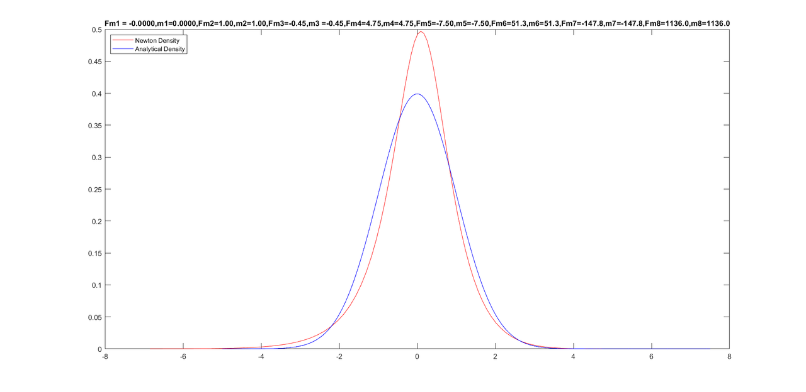](https://postimg.cc/KR6w7KVH)

[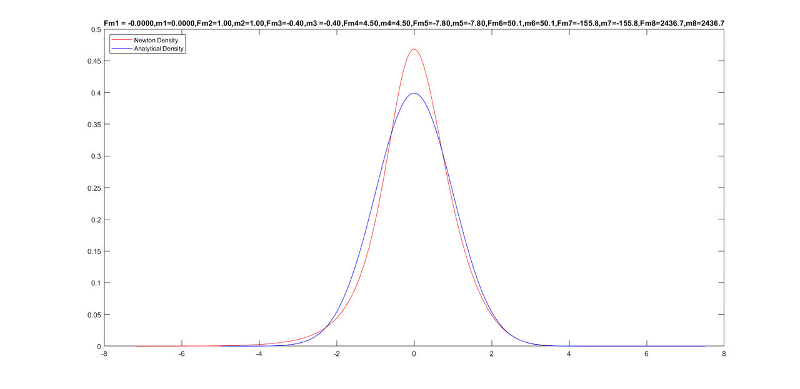](https://postimg.cc/KRkCg79T)

[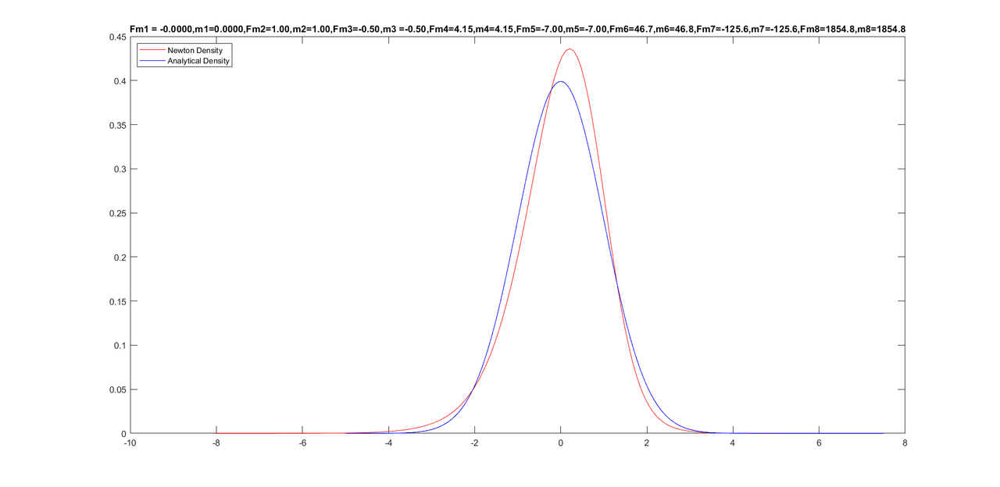](https://postimg.cc/Dmz973LB)

[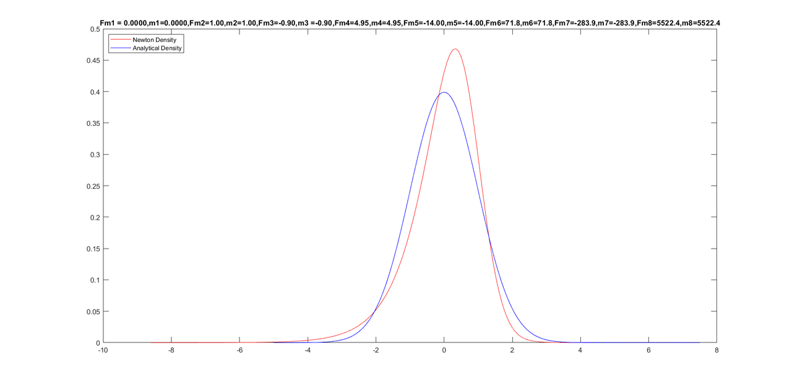](https://postimg.cc/N9dZRdq6)

[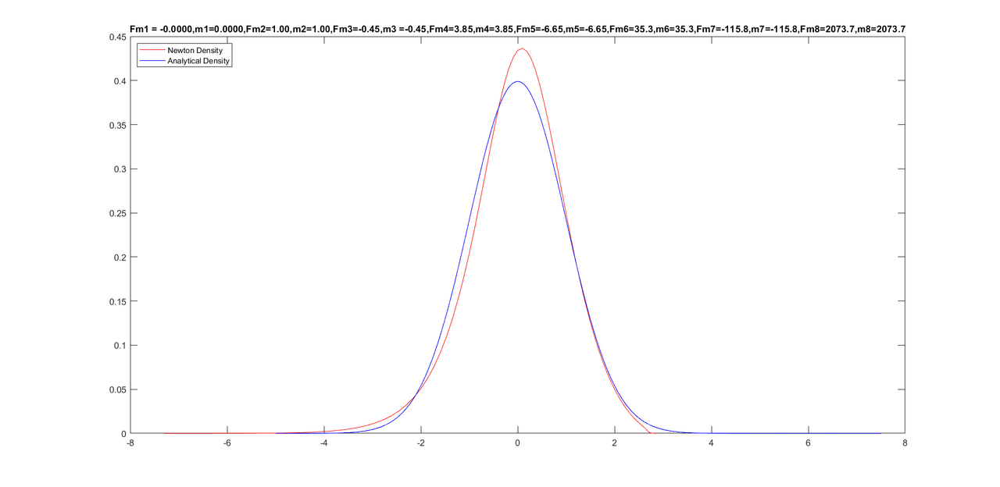](https://postimg.cc/LJj7x9F6)

[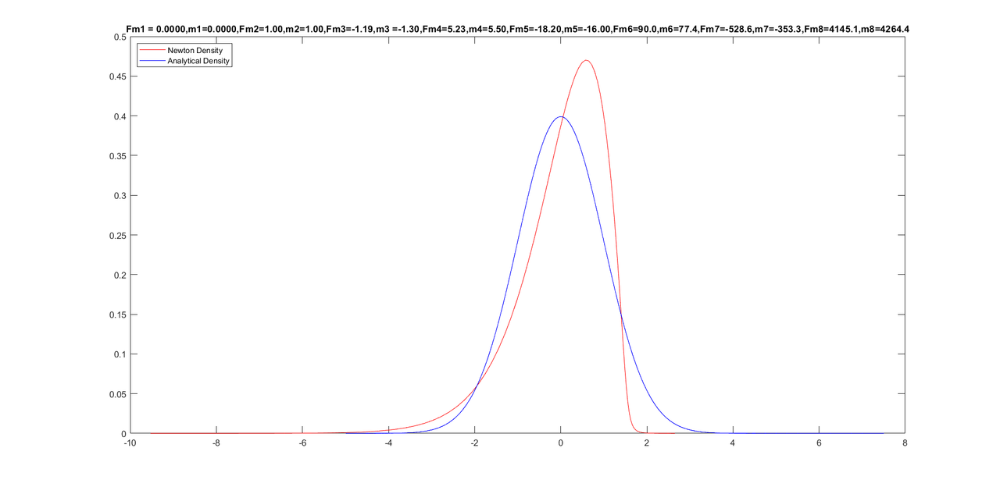](https://postimg.cc/64TgcCtD)

[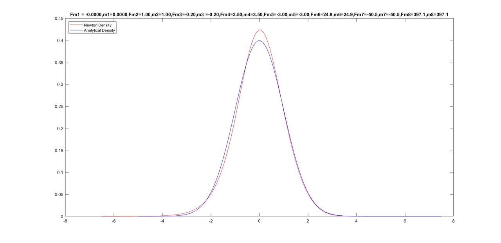](https://postimg.cc/grBfJtKd)

[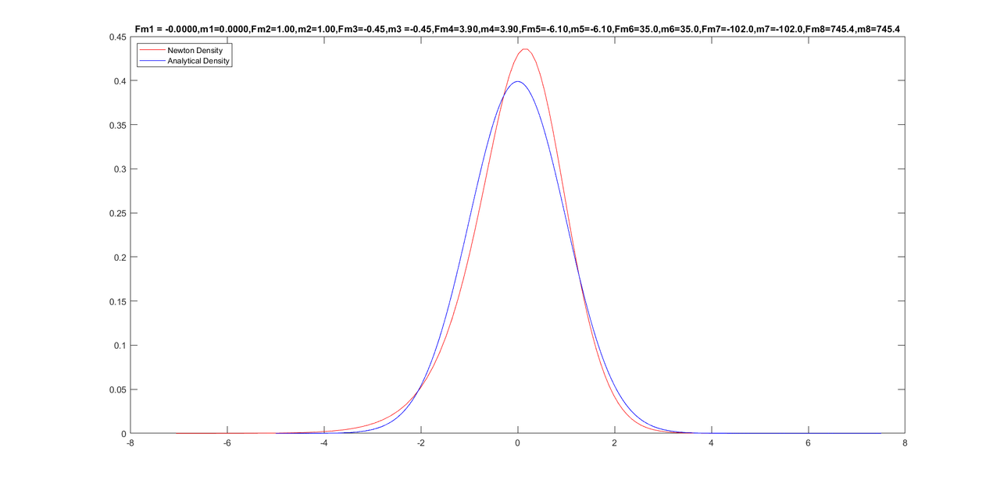](https://postimg.cc/8JpqFq3k)

[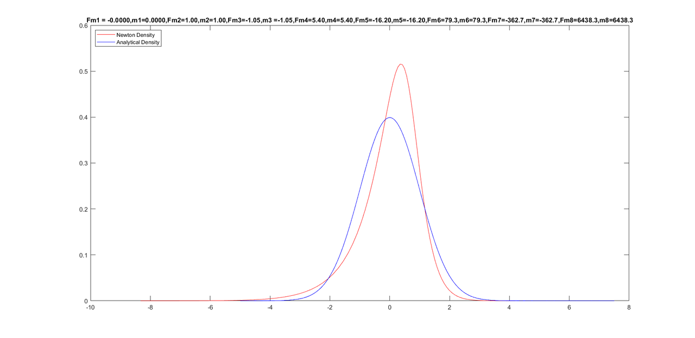](https://postimg.cc/67Lkp9M1)

---

### #1535 — Amin (Topic Author)
*August 20, 2022, 7:51 AM*

Friends, after getting a better orientation with the problem, I have this feeling that applying Newton Method to
standardized moments might possibly be a better approach as compared to applying Newton method to standardized
cumulants. I can quickly do this in our current framework and will let friends know how it goes in a few hours. I hope
it works better.

---

### #1536 — Amin (Topic Author)
*August 20, 2022, 8:37 AM*

Friends, I quickly changed the program from cumulants calibration to standardized moments calibration and want to
mention that it works faster and without any pre-smoothing works well for all the cases including case six for which the
previous program for cumulants was not working. I will be testing it for other more difficult scenarios and post it here
in two to three hours. I think there will be no need for smoothing type treatment now.

Edit: I really think this will be a very close to final program since it works well for a lot of difficult cases and
their reasonably arbitrary perturbations.

---

### #1537 — Amin (Topic Author)
*August 20, 2022, 9:02 AM*

Friends, there is enough linearity in Newton calibration when the problem is tackled in terms of moments. I think
approaching the problem of calibration in terms of cumulants introduces large non-linearities and entries of derivatives
matrix continues to abruptly switch sign. Now with Newton calibration tackled in terms of moments, the problem is
super-stable and finds the true guess for very difficult problems in a few iterations. I am sure we would be able to
easily extend this approach to 12 or 16 moments calibration when some friends would need sharper densities for their
research.

---

### #1538 — Amin (Topic Author)
*August 20, 2022, 9:24 AM*

Friends, I will post a final program with comments and explanations tomorrow. But quickly posting my experimental
program. It is a super-stable program and continues to work for all perturbations of parameters unless the parameters
are in some extreme stress. All the cases given in the program work instantaneously.

.

.

.

```
function [b0,b] = FindZSeriesGivenCumulantsStandard08BNewM(k1,k2,k3,k4,k5,k6,k7,k8)

% %Case1
%  k1=0.0;
%  k2=(1.0);
%  k3=-.45;%1.0;
%  k4=1.750;%-.50;
%  k5=-3;%-.5;%15;
%  k6=8;%10;%100.0;
%  k7=-10;
%  k8=200;

%Case 2
%  k1=0.0;
%  k2=(1.0);
%  k3=-.40;%1.0;
%  k4=1.5;%-.50;
%  k5=-3.80;%-.5;%15;
%  k6=11.0;%10;%100.0;
%  k7=-13.0;
%  k8=1500;

% %Case 3
%  k1=0.0;
%  k2=(1.0);
%  k3=-.5;%1.0;
%  k4=1.150;%-.50;
%  k5=-2;%-.5;%15;
%  k6=12;%10;%100.0;
%  k7=-11;
%  k8=1000;
%
% %Case 4
 k1=0.0;
 k2=(1.0);
 k3=-1.0;%1.0;
 k4=1.950;%-.50;
 k5=-5;%-.5;%15;
 k6=19.5;%10;%100.0;
 k7=-23;
 k8=6850;

% Case 5
%   k1=0.0;
%  k2=(1.0);
%  k3=-.45;%1.0;
%  k4=.850;%-.50;
%  k5=-2.15;%-.5;%15;
%  k6=5.5;%10;%100.0;
%  k7=-10;
%  k8=1500;

 % Case 6
%     k1=0.0;
%    k2=(1.0);
%    k3=-1.4;%1.0;
%    k4=2.50;%-.50;
%    k5=-3.0;%-.5;%15;
%    k6=7.0;%10;%100.0;
%    k7=-30;
%    k8=2000;

%    %Case 7
%    k1=0.0;
%   k2=(1.0);
%   k3=-.2;%1.0;
%   k4=.50;%-.50;
%   k5=-1.0;%-.5;%15;
%   k6=2.0;%10;%100.0;
%   k7=-5;
%   k8=100;

%   %  Case 8
%    k1=0.0;
%   k2=(1.0);
%   k3=-.45;%1.0;
%   k4=.90;%-.50;
%   k5=-1.60;%-.5;%15;
%   k6=4.50;%10;%100.0;
%   k7=-7;
%   k8=200;
%
% %   %Case 9
%        k1=0.0;
%   k2=(1.0);
%   k3=-1.05;%1.0;
%   k4=2.40;%-.50;
%   k5=-1.50*3.80;%-.5;%15;
%   k6=3.60*3.8;%10;%100.0;
%   k7=-5.5*6.10;
%   k8=90*60;

rmu(1)=k1;
rmu(2)=k1*rmu(1)+k2;
rmu(3)=k1*rmu(2)+2*k2*rmu(1)+k3;
rmu(4)=k1*rmu(3)+3*k2*rmu(2)+3*k3*rmu(1)+k4;
rmu(5)=k1*rmu(4)+4*k2*rmu(3)+6*k3*rmu(2)+4*k4*rmu(1)+k5;
rmu(6)=k1*rmu(5)+5*k2*rmu(4)+10*k3*rmu(3)+10*k4*rmu(2)+5*k5*rmu(1)+k6;
rmu(7)=k1*rmu(6)+6*k2*rmu(5)+15*k3*rmu(4)+20*k4*rmu(3)+15*k5*rmu(2)+6*k6*rmu(1)+k7;
rmu(8)=k1*rmu(7)+7*k2*rmu(6)+21*k3*rmu(5)+35*k4*rmu(4)+35*k5*rmu(3)+21*k6*rmu(2)+7*k7*rmu(1)+k8;

%Above are standardized central moments since they are derived from standardized
%cumulants.
%The program below works for eight central moments. You have to specify an
%array of eight central moments.
[c0,c] =PreSmoothingGuess02(rmu);
cc=c;
cc0=-(cc(2)+cc(4)*3+cc(6)*15);

SeriesOrder=7;
NMoments=8;
NZterms=8;

[Moments] = CalculateMomentsOfZSeries(cc0,cc,SeriesOrder,NMoments)
rmu

str=input('Look at moments--before')

C(1:NMoments+1)=0;
C(1)=k1;
C(2)=k2;
C(3)=k3;
C(4)=k4;
C(5)=k5;
C(6)=k6;
C(7)=k7;
C(8)=k8;

%Below calculate F, the defect vector from target cumulants. And calculate
%dF which is the matrix consisting of derivatives of defect vector from
%target cumulants.

%[F,dF] = CalculateCumulantsAndDerivativesFromMoments_0(C,cc0,cc,SeriesOrder,NMoments,8)
[F,dF] = CalculateMomentsAndDerivatives_0(rmu,cc0,cc,SeriesOrder,NZterms,NMoments)
da(1,1)=cc0;
da(2:SeriesOrder+1,1)=cc(1:SeriesOrder);

NoOfCumulants=NMoments
[Moments] = CalculateMomentsOfZSeries(cc0,cc,SeriesOrder,NMoments);
ObjBest=0;

 
 ObjBest=100000*(abs(rmu(1)-Moments(1)))+abs(rmu(2)-Moments(2))+abs((rmu(3)-Moments(3))^(1/1.5))+abs((rmu(4)-Moments(4))^(1/2.0))
+ ...
    abs((rmu(5)-Moments(5))^(1/2.0))+abs((rmu(6)-Moments(6))^(1/2.0))+abs((rmu(7)-Moments(7))^(1/2.0))+ ...
    abs((rmu(8)-Moments(8))^(1/2.0));

b0Best=cc0;
bBest(1:SeriesOrder)=cc(1:SeriesOrder);

nn=0;
while((nn.000000000001) || (abs(F(2,1))>.000000000001) || (abs(F(3,1))>.000000000001) || (abs(F(4,1))>.00000000001)||
(abs(F(5,1))>.00000000001)|| (abs(F(6,1))>.00000000001)  ))

nn=nn+1;
%Below Newton matrix equation to improve the Z-series coefficients guess at previous step.

da=da-dF\F;

%b0=median
b0=da(1,1);
b(1:SeriesOrder)=da(2:SeriesOrder+1,1);

%[F,dF] = CalculateCumulantsAndDerivativesFromMoments_0(C,b0,b,SeriesOrder,SeriesOrder,NoOfCumulants);
[F,dF] = CalculateMomentsAndDerivatives_0(rmu,b0,b,SeriesOrder,NZterms,NMoments);
[IsValidFlag] = CheckIsValidDensity(b0,b)

[Moments] = CalculateMomentsOfZSeries(b0,b,SeriesOrder,NMoments);
ObjNew=0;

   
ObjNew=100000*(abs(rmu(1)-Moments(1)))+abs(rmu(2)-Moments(2))+abs((rmu(3)-Moments(3))^(1/1.5))+abs((rmu(4)-Moments(4))^(1/2.0))
+ ...
    abs((rmu(5)-Moments(5))^(1/2.0))+abs((rmu(6)-Moments(6))^(1/2.0))+abs((rmu(7)-Moments(7))^(1/2.0))+ ...
    abs((rmu(8)-Moments(8))^(1/2.0));

  if((ObjBest>ObjNew) &&( IsValidFlag))

       ObjBest=ObjNew;
       b0Best=b0;
       bBest(1:SeriesOrder)=b(1:SeriesOrder);
   end

da(1,1)=b0;
da(2:SeriesOrder+1,1)=b(1:SeriesOrder);

end
  b0=b0Best;%Best;
  b(1:SeriesOrder)=bBest;%Best(1:SeriesOrder);

  %Above are the best chosen Z-series coefficients based on the objective function.
  %But my objective function can be improved.

[Moments] = CalculateMomentsOfZSeries(b0,b,SeriesOrder,NMoments)
%Above are raw moments calculated from the resulting Z-series from Newton
%Method

%Below are raw moments that were input to calibration.
rmu

b0
b
str=input('Look at comparison of moments calibration');

%Below we do calculations to construct the density from our newly derived
%Z-series.

dNn=.2/2;   % Normal density subdivisions width. would change with number of subdivisions
Nn=90;  % No of normal density subdivisions

NnMid=4.0;

Z(1:Nn)=(((1:Nn)-6.5/1)*dNn-NnMid);
%Z
%str=input('Look at Z');
%ZProb(1)=normcdf(.5*Z(1)+.5*Z(2),0,1)-normcdf(.5*Z(1)+.5*Z(2)-dNn,0,1);
%ZProb(Nn)=normcdf(.5*Z(Nn)+.5*Z(Nn-1)+dNn,0,1)-normcdf(.5*Z(Nn)+.5*Z(Nn-1),0,1);
%ZProb(2:Nn-1)=normcdf(.5*Z(2:Nn-1)+.5*Z(3:Nn),0,1)-normcdf(.5*Z(2:Nn-1)+.5*Z(1:Nn-2),0,1);

  w(1:Nn)=b0;
  for nn=1:SeriesOrder
      w(1:Nn)=w(1:Nn)+b(nn)*Z(1:Nn).^nn;
  end
wnStart=1;
Dfw(wnStart:Nn)=0;
for nn=wnStart+1:Nn-1

    Dfw(nn) = (w(nn + 1) - w(nn - 1))/(Z(nn + 1) - Z(nn - 1));
end

pw(1:Nn)=0;
for nn = wnStart+1:Nn-1

    pw(nn) = (normpdf(Z(nn),0, 1))/abs(Dfw(nn));

end

%
% %Below is the construction of density of our originial analytic density for
% %plotting purposes
%
 dMm=.02/10;
 Mm=1250*5;
 X(1:Mm)=-5+dMm+dMm*(1:Mm);

% %Below is standard Gaussian PDF.
mu=0;
sigma=1;
 pdfG=exp(-0.5* ((X-mu)/sigma).^2)/sigma/sqrt(2*pi);
%
clf;
 plot(w(wnStart+1:Nn-1),pw(wnStart+1:Nn-1),'r',X(1:Mm),pdfG(1:Mm),'b');

 title(sprintf('Fm1 = %.4f,m1=%.4f,Fm2=%.2f,m2=%.2f,Fm3=%.2f,m3
=%.2f,Fm4=%.2f,m4=%.2f,Fm5=%.2f,m5=%.2f,Fm6=%.1f,m6=%.1f,Fm7=%.1f,m7=%.1f,Fm8=%.1f,m8=%.1f',Moments(1),rmu(1),Moments(2),rmu(2),Moments(3),rmu(3),Moments(4),rmu(4),Moments(5),rmu(5),Moments(6),rmu(6),Moments(7),rmu(7),Moments(8),rmu(8)));
 %,sprintf('theta= %f', theta), sprintf('kappa = %f', kappa),sprintf('sigma = %f', sigma0),sprintf('T = %f', T));

 legend({'Newton Density','Analytical Density','Standard Gaussian Density'},'Location','northwest')
str=input('Look at comparison of moments calibration');

cc0
b0
cc
b

end

```

.

.

.

```
function [F,dF] = CalculateMomentsAndDerivatives_0(Ms,a0,a,SeriesOrder,NZterms,NMoments)
%[F,dF] = CalculateCumulantsAndDerivativesFromMoments(C,a0,a,SeriesOrder,SeriesOrder,NoOfCumulants);

%a(1)=a1;
%a(2)=a2;
%a(3)=a3;
%a(4)=a4;
%a(5)=a5;
%a(6)=a6;
%a(7)=a7;

%aa0=a0;
a0=-(a(2)+3*a(4)+15*a(6));% ---1

EZ(1)=0;
EZ(2)=1;
for nn=3:NMoments*SeriesOrder+NZterms+2
    if rem(nn,2)==1
        EZ(nn)=0;
    else
        EZ(nn)=EZ(nn-2)*(nn-1);
        EZ(nn);
    end
end
EZ;

EXZ(1,1)=1;
for pp1=1:NZterms
        EXZ(1,pp1+1)=EZ(pp1);
end

a(SeriesOrder+1:NMoments*SeriesOrder+1)=0;
b0=a0;
b=a;

for mm=1:NMoments
    if(mm>1)
        [b0,b] =SeriesProduct(a0,a,b0,b,SeriesOrder*mm);
        b(SeriesOrder*mm+1:NMoments*SeriesOrder+1)=0;
    end
   % b0
   % b
%str=input('Look at numbers')
    EXZ(mm+1,1)=b0;
    for pp2=1:SeriesOrder*mm

            EXZ(mm+1,1)=EXZ(mm+1,1)+b(pp2).*EZ(pp2);
    end
    for pp1=1:NZterms
        EXZ(mm+1,pp1+1)=b0.*EZ(pp1);
        for pp2=1:SeriesOrder*mm

            EXZ(mm+1,pp1+1)=EXZ(mm+1,pp1+1)+b(pp2).*EZ(pp2+pp1);
        end
    end
end

%u1=EXZ(2,1);
u2=EXZ(3,1);
u3=EXZ(4,1);
u4=EXZ(5,1);

u1=a0+a(2);
if(SeriesOrder>=4)
u1=a0+a(2)+3*a(4);
end
if(SeriesOrder>=6)
u1=u1+15*a(6);
end

%k2=u2-u1^2;
%k3=u3-3*u2*u1+2*u1^3;
%k4=u4-4*u3*u1-3*u2^2+12*u2*u1^2-6*u1^4;

du1(1)=1;%----2
 du2(1)=2*EXZ(2,1);
 du3(1)=3*EXZ(3,1);
 du4(1)=4*EXZ(4,1);

%du1(1)=1;%----2
%du2(1)=0;
%du3(1)=0;
%du4(1)=0;

for mm=2:SeriesOrder+1
du1(mm)=EXZ(1,mm);
du2(mm)=2*EXZ(2,mm);
du3(mm)=3*EXZ(3,mm);
du4(mm)=4*EXZ(4,mm);

end

if(NMoments>=5)
u5=EXZ(6,1);

%du5(1)=5*EXZ(5,1);

for mm=1:SeriesOrder+1
du5(mm)=5*EXZ(5,mm);
end

end

if(NMoments>=6)
u6=EXZ(7,1);
%du6(1)=0;

for mm=1:SeriesOrder+1
du6(mm)=6*EXZ(6,mm);
end

end

if(NMoments>=7)
u7=EXZ(8,1);
%str=input('Look at k7 and k71')

%du7(1)=0;

for mm=1:SeriesOrder+1
du7(mm)=7*EXZ(7,mm);
end

end
if(NMoments>=8)

u8=EXZ(9,1);
for mm=1:SeriesOrder+1
du8(mm)=8*EXZ(8,mm);
end

end

 F(1,1)=u1-Ms(1);
 F(2,1)=u2-Ms(2);
 F(3,1)=u3-Ms(3);
 F(4,1)=u4-Ms(4);
 if(NMoments>=5)
 F(5,1)=u5-Ms(5);
 end
 if(NMoments>=6)
 F(6,1)=u6-Ms(6);
 end
 if(NMoments>=7)
 F(7,1)=u7-Ms(7);
 end
 if(NMoments>=8)
 F(8,1)=u8-Ms(8);
 end

     for mm=1:SeriesOrder+1
        dF(1,mm)=du1(mm);
        dF(2,mm)=du2(mm);
        dF(3,mm)=du3(mm);
        dF(4,mm)=du4(mm);
        if(NMoments>=5)
        dF(5,mm)=du5(mm);
        end
        if(NMoments>=6)
        dF(6,mm)=du6(mm);
        end
        if(NMoments>=7)
        dF(7,mm)=du7(mm);
        end
        if(NMoments>=8)
        dF(8,mm)=du8(mm);
        end
     end

end

```

.

.

.

Here is output you will see when you run this program.

[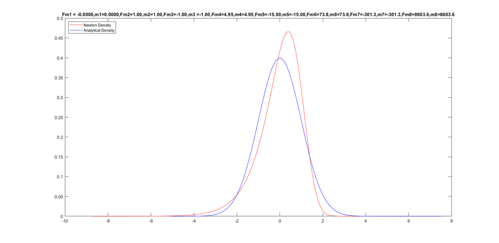](https://postimg.cc/McRgsgvx)

---

### #1539 — Amin (Topic Author)
*August 23, 2022, 1:05 PM*

Friends, I could not work at all yesterday and day before yesterday. I was severely disturbed by the effects of
antipsychotic injection and was having severe bouts of anxiety. At one point I was repeatedly being short of breath.

I will re-start the work tonight and see if I can further improve the function that calibrates the moments to  Z-series
representation of the density.

I also want to take this opportunity to tell friends that mind control agencies continue to drug water and select
beverages in the neighborhood around and I really have to struggle hard to get good water.

Similarly there was one local brand whose tea was not added with mind control chemicals at the manufacturing source and
I am afraid they have started drugging their tea as well. I can still buy some foreign brands tea on large stores but I
am sure they would continue to approach the stores in the neighborhood and add mind control chemicals to foreign
imported tea in order to control me.

But I will continue to work with the program and try to improve it and come back in a day or two with a better program.

---

### #1540 — Amin (Topic Author)
*August 26, 2022, 1:12 PM*

Friends, when we were playing with SDEs a few months earlier, we worked with direct transformation of densities and
transformation of Z-series representation of density into Z-series representation of the new transformed density .

We learnt that direct transformation of the density that has been constructed with a Z-series was usually more accurate
especially deep in the tails. And transformation of Z-series of the original density into Z-series of the transformed
density is usually more desirable since we can do all sort of analytics on it , and find time integrals among other
things.

In the following graphs, I have reverse transformed a CEV density from Bessel type coordinates. I want to show the
friends tails of the densities so they have a good idea how much the difference is between true density and transformed
Z-series density.

CEV transformation is

$ B \, = \, X^{(1-\gamma)}/(1-\gamma) $

While reverse transformation is

$ X \, = \, {((1-\gamma)B)}^{(1/(1-\gamma))} $

I have taken two of the cases in the earlier program and slightly modified them and then calculated the true reverse
transformation with

parameter  $ \gamma=.75 $  by directly transforming the density. This is shown in the graphs in green.

Then I calculated the reverse transformation by transforming the Z-series from Bessel type coordinates to Z-series in
CEV type coordinates. It is very very faithful in the main body of the series but it is slightly off in the tails.

This reverse transformation by transformation of the Z-series is shown in the graphs in red color.

I want to tell friends that I took ten ninth order expansion of the Z-series here as opposed to 7th order expansion of
the Z-series we have been dealing with when we calibrated eight moments. 7th order expansion would be slightly worse
than the ninth order expansion. I took ninth order expansion because in some cases I felt that seventh order
transformation was not extremely good.

Here are the graphs(six in total). There are three density main body graphs and each density main body graph is followed
by graphs of its tails on  1 X 10-3 scale.

So calculations of expectations of functions that are close to linear might just work fine but more difficult function
expectations would be slightly off.

.

.

.

Here are the graphs.

[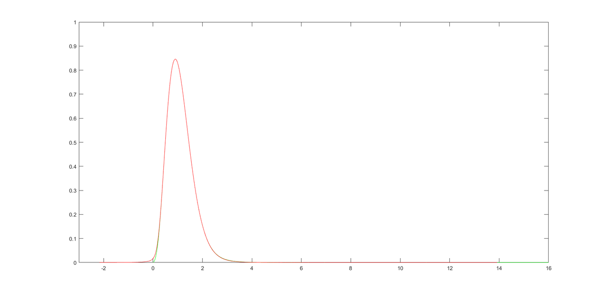](https://postimg.cc/Jyh4CmHN)

[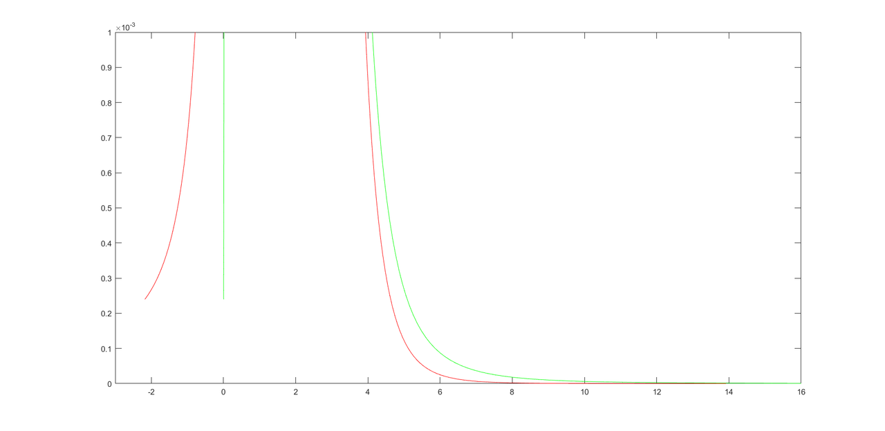](https://postimg.cc/hXsPYhv4)

[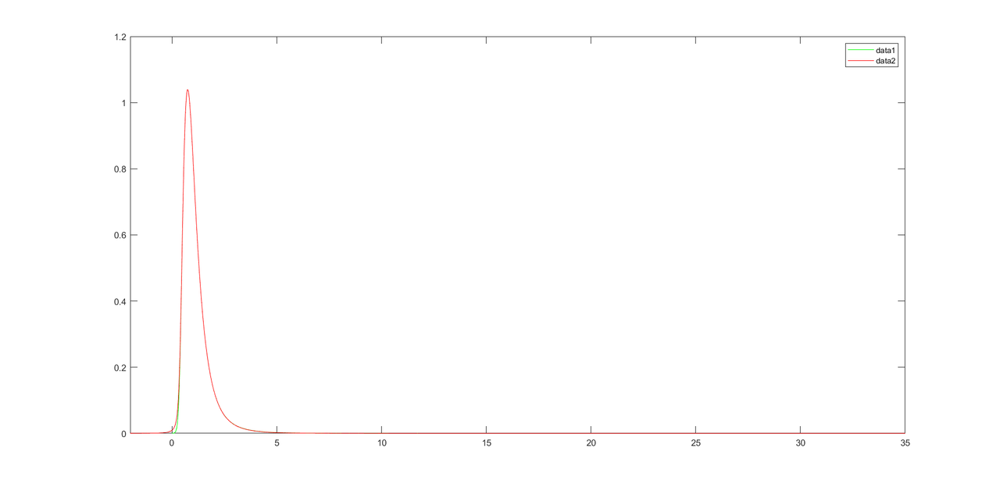](https://postimg.cc/3kYx92Kb)

[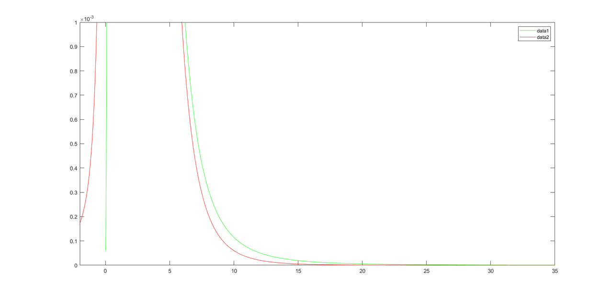](https://postimg.cc/hf9G92qd)

[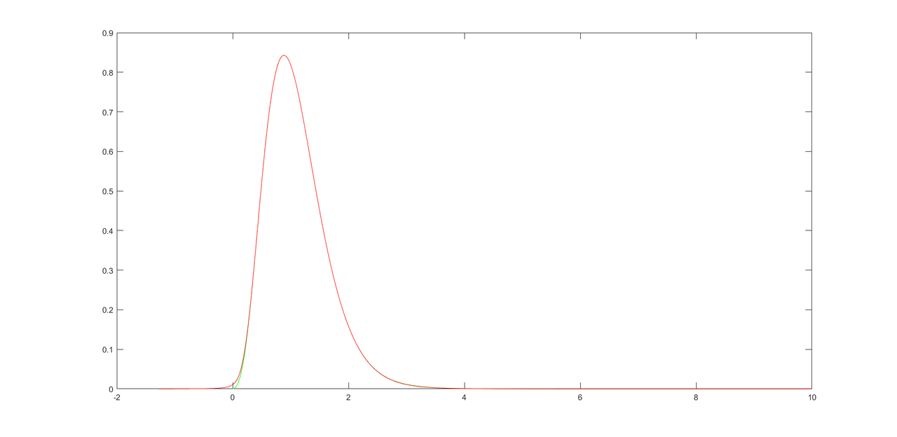](https://postimg.cc/rK6m0v7T)

[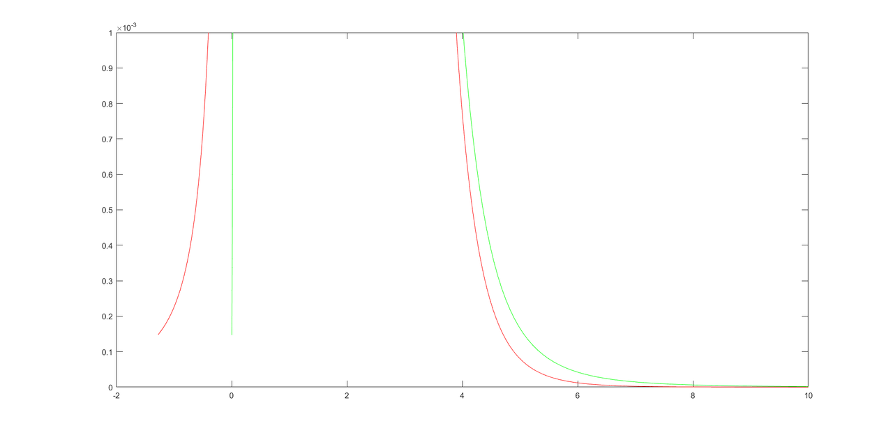](https://postimg.cc/vDxTmQqX)

---

### #1541 — Amin (Topic Author)
*August 26, 2022, 2:24 PM*

Friends, Just quickly correcting an error, the above comparisons of three densities are with Series Order = 7 and not
with Series Order=9 as I earlier mentioned. I had erroneously stated that these calculations are with series order=9.

I checked the Z-series with Series Order =9 and the results are far sharper on both tails of the density as compared to
shown in the graphs.

Sorry this was a minor error.

---

### #1542 — Amin (Topic Author)
*August 26, 2022, 2:44 PM*

Friends, quickly the same graphs as above (sorry order of cases is different) but with Series Order=9. You can see the
density is far better at both tails now. In the previous graphs Series Order was equal to 7.

Here are the graphs of transformed density with series Order =9.

.

.

.

[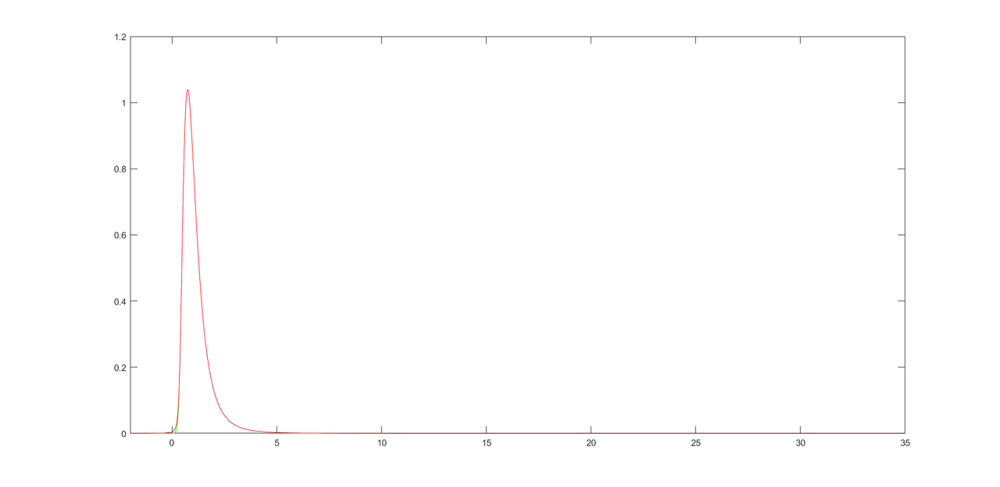](https://postimg.cc/hX4fcNX0)

[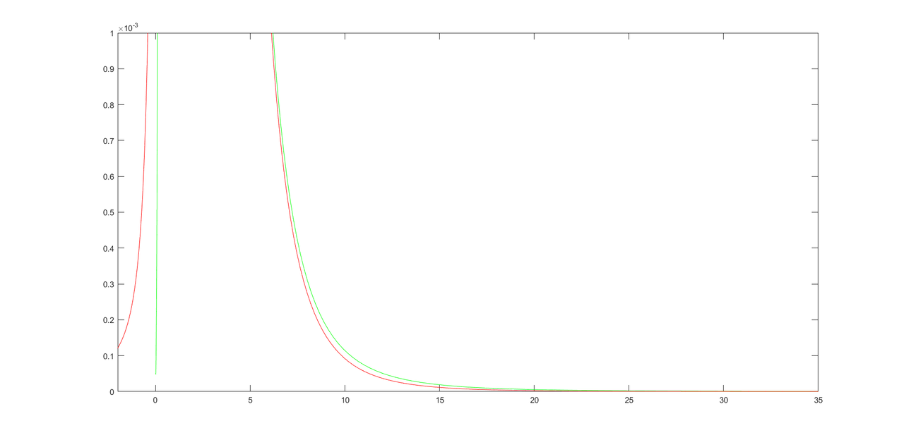](https://postimg.cc/KKRjgLrk)

[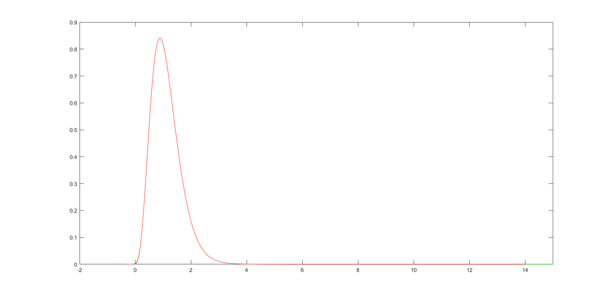](https://postimg.cc/hXChjMxR)

[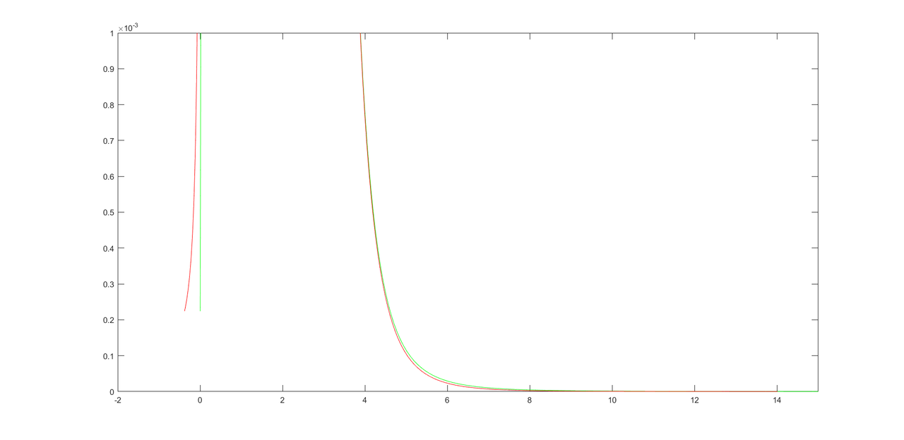](https://postimg.cc/fJfV4MRL)

[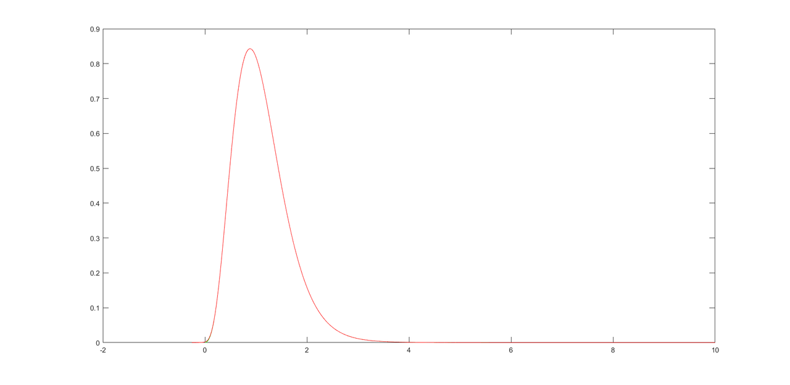](https://postimg.cc/XXFZ8fM9)

[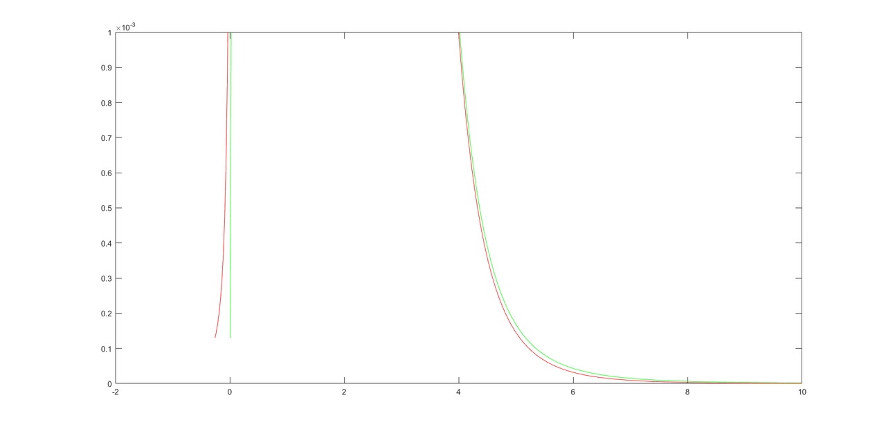](https://postimg.cc/zVryPy56)

---

### #1543 — Amin (Topic Author)
*August 28, 2022, 12:22 AM*

Friends, mind control agents continue to force waves into my back. They continue to force high frequencies and I really
feel large constant pain in the back for many days. I have been able to stand it for past few days but when I woke up
this morning right now, the pain all night was again too much and I decided to write about it.

We are humans but we are treated worse than animals by racist conservatives of American mind control.

---

### #1544 — Amin (Topic Author)
*August 30, 2022, 9:53 AM*

Friends, my post about comparison of tails of  Order seven transformed Z-series and nine order transformed Z-series has
other things I learnt later. If the last coefficient of seventh order Z-series that controls eighth moment is small or
negative, The tails of seventh order Z-series would not diverge beyond the true directly transformed density by much.

Similarly for ninth order Z-series, if the coefficient of ninth power term is small or negative, the tails of ninth
order Z-series density would not diverge from the tails of true directly transformed density.

So both seventh order and ninth order Z-series can have tails diverging from directly transformed density if the last
coefficient of the respective Z-series is large positive.

And both seventh order and ninth order Z-series can have tails matching the tails of directly transformed density if the
last coefficient of the respective Z-series is very small or negative.

---

### #1545 — Amin (Topic Author)
*August 30, 2022, 10:13 AM*

Friends, I am working towards the calibration of our Z-series density to the implied density of the option prices at
different strikes. My plan is to take an initial guess density that matches the option prices at different strikes just
roughly.

For a close fit to the over all density I want to use Newton method again. From our Z-series we can analytically
calculate the option prices for all strikes and also calculate option price sensitivities to coefficients of the
Z-series. But there are a lot more options at different strikes than the number of Z-series parameters (possibly only
seven + 1), so we will have to calibrate in least square sense. We have more equations than there are Coefficients of
Z-series so we use the generalized inverse of the non-square Jacobian matrix for Newton method.

So I intend take an initial guess density and then calculate sensitivities of each option price included in calibration
with respect to Z-series coefficients. These sensitivities are put together to make a non-square Jacobian matrix. And
finally I intend to use generalized inverse of non-square jacobian for the Newton iteration in least square sense.

I have not done any of this but I hope that my program would work well. It can take a few weeks before a final program
is ready.

---

### #1546 — Amin (Topic Author)
*September 7, 2022, 8:22 AM*

Friends, I did some initial work on the above project for 2-3 days but latter stopped working on it. I have been
spending most of my time on crypto trading algorithms.

Though it is quite a nice thing to contribute to mathematics, for several years I have been under an extreme pressure to
be able to make some money. CIA and mind control agencies stubbornly stopped people from working with me and at this
stage I have almost totally given up approaching people for any consulting work to avoid constant embarrassment. After
the lesson I got when I went to UK on tier one visa, I do not want to go to any foreign country to work to make myself a
game for CIA hunters.

I get very limited money from my parents and I only spend it on food, petrol and some clothes. Since petrol prices
increased, I do not even use my car and only have to use a motorcycle (though I am happy to decrease my carbon footprint
and think this is what people should use unless otherwise necessary.)  I almost never have the luxury to eat expensive
food and I myself avoid foot at restaurants where they take time to prepare food in order to avoid drugged food. I only
eat at bakeries or inexpensive restaurants who have already prepared their food and I can take food off the fly. However
since recent food inflation, I have to be very careful in what to eat and a lot of bakeries and street restaurants have
become out of my approach. I really have to compromise quality of food to save money.

I again have this urgency that I have to somehow make real money and I cannot devote all my time to unpaid research.

However I want to tell friends that this is a temporary break and if I succeed in writing some interesting money making
algorithms, I will love to restart my research at stochastics, probability theory and derivatives.

I know that mind control agencies would also love that I am temporarily stopping my research in mathematics and they
would increase their machinations and attempts to retard me so I would continue posting here about their victimization
tactics.

I really would love to re-start working on my last project in a few weeks or when I would find some time from my trading
research so I really hope to post some material soon but it will still be a few weeks.

---

### #1547 — Amin (Topic Author)
*September 7, 2022, 10:02 AM*

My next antipsychotic injection in due on Friday in another two days. I am writing this since I am perfectly sure that
mind control agencies would try their best to give me a "drugged injection". I know that some good people in Europe
asked some mainland European Embassies to try to protect me in the past. I really want to request them to keep a vigil
and ask their country's embassy to force Pakistani army (and ask other influential people in Pakistan)  to not drug
fluanxol antipsychotic injections in Lahore in another day or two. Please ask your country's embassy to keep a watch on
this.  If they succeeded in giving me a bad injection, I would not be able to work properly for several weeks. I would
be extremely thankful to friends for this and all their earlier favors.

---

### #1548 — Amin (Topic Author)
*September 14, 2022, 2:45 PM*

I am writing this post to update friends with what has been going on with me in recent days.

I had earlier told friends that I want to trade on Binance to make some money. I downloaded Binance historical Data and
tried some reasonably high frequency algorithms on that. I was able to find some high Sharpe ( >1 ) algorithms that
worked very well. But when trading costs were added, the algorithms were not profitable. Binance has very high
commissions of .1% of trade notional. Compare this to Interactive Broker's .0035% commission on US stocks. So Binance's
commissions are on cryptocurrencies about 28 times higher than IB's commissions on US stocks. Well comparing commissions
in two different markets might not be fair but this is just to give an idea. Secondly on Binance, cryptocurrency spreads
are very small as compared to spreads of many stocks where one can do profitable trading. BTC is so volatile but
generally has a spread of no more than .1 USD for a notional of 20000 USD despite its high volatility so strategies that
depend on earning high spreads might not work so easily(at least for me) on cryptocurrencies.

I was very worried but found out that Binance had a promotion going that allowed zero commissions on currency pairs with
stable currency BUSD. So I am lucky that I can profitably run my algorithms on those pairs and I have verified
profitability of my algorithms on those pairs. I hope to start trading in two to three weeks since I still have to write
callback programs with the API and later play around to optimize everything. The zero commissions promotion ends close
to end of year 2022 but since my algorithm trades almost every minute(or two), even if I use a small notional of 5000
USD, I can get into Binance high volume categories where I will be able to get a small rebate on futures trading from
Binance. So things look good and I am very confident that I will make it.

But I am very sure that mind control agencies will really continue their machinations to somehow fail me. In this world
when some intelligent Chinese, Indian, Korean or anybody else works their ass off, they become very successful but when
some intelligent muslim tries to work hard, racist scumbags of American army valiantly spring into action to fail them
based on their habitual trickery, lies and machinations even more so since they pavlovianly start salivating in
anticipation of huge rewards they would get from anti-muslim billionaires. My persecution would never have succeeded if
it were not were brazen and completely fabricated lies of racist scumbags in American army. This is despite that I do
not believe in religion and I am far more liberal than these scumbag racist conservatives in American army.

Friends would notice that I started my post on a good note and usually I would not like to end it with anything
unpleasant but I am extremely sure that scumbags of American army will continue their trickery and machinations to
somehow fail me otherwise they will not be able to get any rewards from some billionaires they so anticipate.

Anyway, I do hope that things go well and if it does go well, I will come back in a few weeks to end the work on
stochastics and option pricing that I had started. I have a lot of good ideas about the calibration of options and their
evolution with Z-series densities and I would really like to take my ideas to conclusion.

---

### #1549 — Amin (Topic Author)
*September 24, 2022, 10:23 AM*

Friends, I have been working with my algorithms to predict the crypto prices. In past few months BTC and ETH have been
volatile like anything and very difficult to predict but I have had enough success. But when I was trying to find
parameters for various stochastic process, I had great difficulty finding something that makes a good profit. Until I
wrote a good stochastic optimization routine for finding the optimum values of stochastic parameters. Since I always
believe that I should share basic fundamental research with friends even though sometimes I might not want to share
everything like complete trading algorithms as in this case. Therefore, I decided to share my stochastic optimization
program with friends.

It is a surprisingly simple program but worked like gold for me. You have to provide some reasonable guess for the
stochastic parameters that are to be optimized. And define a reasonable large step. The algorithm then iterates in the
direction of increasing objective function with the large and coarse step added and subtracted to parameters
iteratively. When the algorithm stops improving the objective function, the step is cut to .8 of the initial value and
the algorithm starts iterating again. Each time algorithm stops improving the objective function, we decrease the step
size by a ratio of .8 (or some other suitable ratio). Finally, the algorithm converges to some point with little
variation and the best value of objective function. Due to random nature of stochastic processes, many times, the final
convergence point is entirely different from the points where the algorithm converged with coarse steps.

The good thing about the algorithm is that it explores the whole territory in the direction of increasing objective
function with large and coarse steps at the start, so it does not easily get bogged down by local minima. And as it
refines the step size in successive rounds of searches, it almost always finds a suitable value of the parameters that
optimize the objective function very well.

In my case all the parameters shared the same probable range in which they can take values and therefore shared the same
step change but in general the domain in which different stochastic parameters could take values would be different for
every parameter of the stochastic process and in those cases the step change in each stochastic parameter would be made
proportional to the standard deviation of the probable range(in the same common step ratio multiplied with standard
deviation of every parameter) in which the particular parameter can take values. The above modification should work well
but there will be some cases in which you will need to modify it for different step of some of the parameters.

I am sure that friends who optimize their stochastic neural networks with other optimization routines will really find
my new function valuable for them. I am sure if the algorithm does not always work better than existing optimization
algorithms for stochastic processes, quite a few times it will be very valuable as I found it of great value in my
research.

I will be posting my program tomorrow after making a few changes and adding comments.

---

### #1550 — Amin (Topic Author)
*September 24, 2022, 4:20 PM*

Friends, I am posting the stochastic parameter optimization function below. It is written in matlab but just uses
elementary functions and you can instantly copy it in any language just after inspecting the code and understanding it.
Explanation of the code follows in next post.

.

.

```
function [w1,w2,w3,w4,w5,w6] = OptimizeCoeffsPredictWilmott(Xt1,Xt2,Price0,Tl,VarLogR,IValue)

w1=IValue(1,1);
w2=IValue(1,2);
w3=IValue(1,3);
w4=IValue(1,4);
w5=IValue(1,5);
w6=IValue(1,6);

[ObjOld] = NetworkEvaluationFunction(Xt1,Xt2,Price0,VarLogR,Tl,w1,w2,w3,w4,w5,w6);
Delta=.15;
for nn=1:1000
    Update=0;
    w10=w1+Delta;
    [ObjNew] = NetworkEvaluationFunction(Xt1,Xt2,Price0,VarLogR,Tl,w10,w2,w3,w4,w5,w6);
    if(ObjNew>ObjOld)
        w1=w10;
        Update=1;
        ObjOld=ObjNew;
    else
        w10=w1-Delta;
        [ObjNew] = NetworkEvaluationFunction(Xt1,Xt2,Price0,VarLogR,Tl,w10,w2,w3,w4,w5,w6);
        if(ObjNew>ObjOld)
            w1=w10;
            Update=1;
            ObjOld=ObjNew;

        end
    end

     w20=w2+Delta;
    [ObjNew] = NetworkEvaluationFunction(Xt1,Xt2,Price0,VarLogR,Tl,w1,w20,w3,w4,w5,w6);
    if(ObjNew>ObjOld)
        w2=w20;
        Update=1;
        ObjOld=ObjNew;
    else
        w20=w2-Delta;
        [ObjNew] = NetworkEvaluationFunction(Xt1,Xt2,Price0,VarLogR,Tl,w1,w20,w3,w4,w5,w6);
        if(ObjNew>ObjOld)
            w2=w20;
            Update=1;
            ObjOld=ObjNew;

        end
    end
    w30=w3+Delta;
    [ObjNew] = NetworkEvaluationFunction(Xt1,Xt2,Price0,VarLogR,Tl,w1,w2,w30,w4,w5,w6);
    if(ObjNew>ObjOld)
        w3=w30;
        Update=1;
        ObjOld=ObjNew;
    else
        w30=w3-Delta;
        [ObjNew] = NetworkEvaluationFunction(Xt1,Xt2,Price0,VarLogR,Tl,w1,w2,w30,w4,w5,w6);
        if(ObjNew>ObjOld)
            w3=w30;
            Update=1;
            ObjOld=ObjNew;

        end
    end
    w40=w4+Delta;
    [ObjNew] = NetworkEvaluationFunction(Xt1,Xt2,Price0,VarLogR,Tl,w1,w2,w3,w40,w5,w6);
    if(ObjNew>ObjOld)
        w4=w40;
        Update=1;
        ObjOld=ObjNew;
    else
        w40=w4-Delta;
        [ObjNew] = NetworkEvaluationFunction(Xt1,Xt2,Price0,VarLogR,Tl,w1,w2,w3,w40,w5,w6);
        if(ObjNew>ObjOld)
            w4=w40;
            Update=1;
            ObjOld=ObjNew;

        end
    end
    w50=w5+Delta;
    [ObjNew] = NetworkEvaluationFunction(Xt1,Xt2,Price0,VarLogR,Tl,w1,w2,w3,w4,w50,w6);
    if(ObjNew>ObjOld)
        w5=w50;
        Update=1;
        ObjOld=ObjNew;
    else
        w50=w5-Delta;
        [ObjNew] = NetworkEvaluationFunction(Xt1,Xt2,Price0,VarLogR,Tl,w1,w2,w3,w4,w50,w6);
        if(ObjNew>ObjOld)
            w5=w50;
            Update=1;
            ObjOld=ObjNew;

        end
    end

    w60=w6+Delta;
    [ObjNew] = NetworkEvaluationFunction(Xt1,Xt2,Price0,VarLogR,Tl,w1,w2,w3,w4,w5,w60);
    if(ObjNew>ObjOld)
        w6=w60;
        Update=1;
        ObjOld=ObjNew;
    else
        w60=w6-Delta;
        [ObjNew] = NetworkEvaluationFunction(Xt1,Xt2,Price0,VarLogR,Tl,w1,w2,w3,w4,w5,w60);
        if(ObjNew>ObjOld)
            w6=w60;
            Update=1;
            ObjOld=ObjNew;

        end
    end
    if(Update==0)
        Delta=Delta*.85;
    end
end

end

```

.

.

I will follow on next page with explanation of the function

---

[← Previous](page_030.md) | [Index](index.md) | [Next →](page_032.md)
