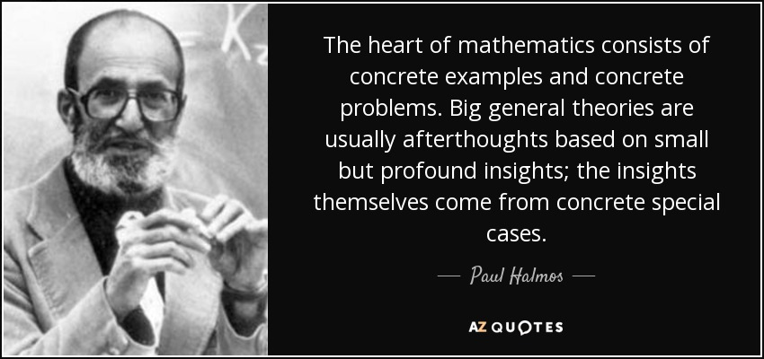
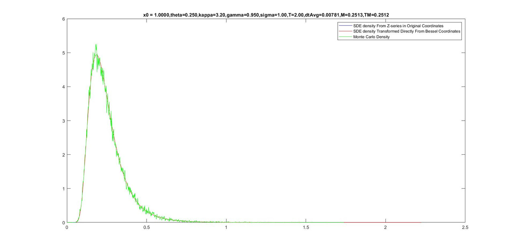
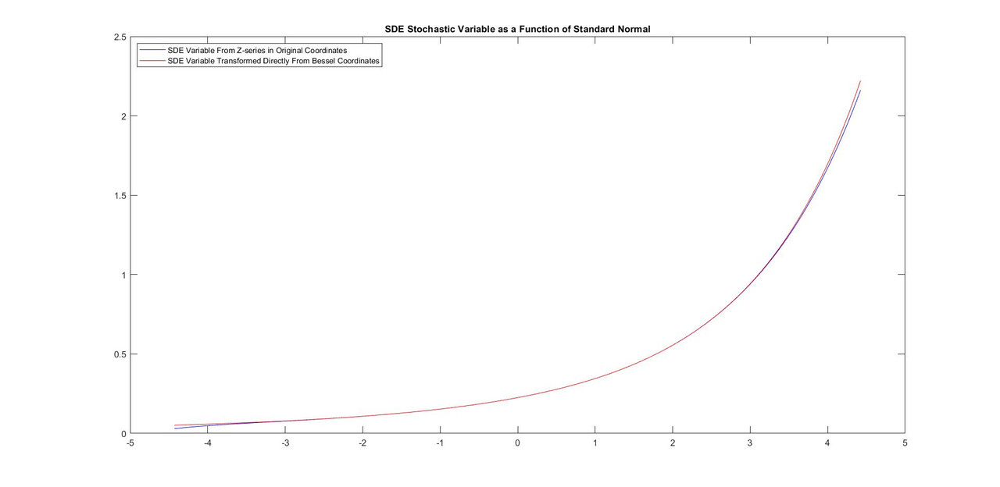
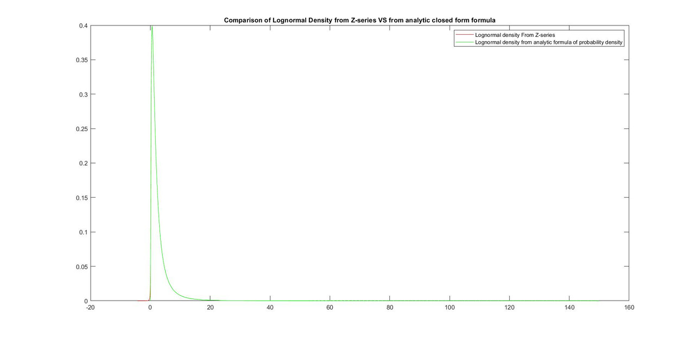
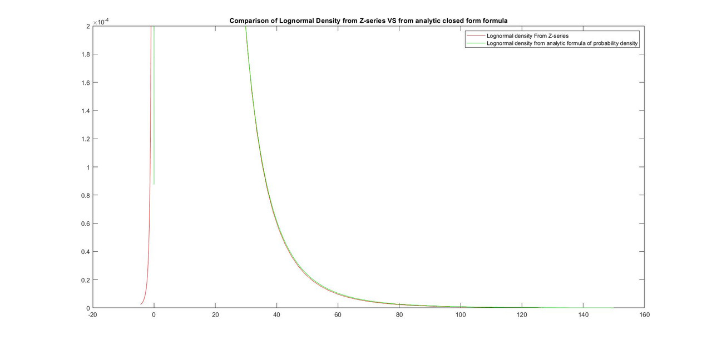
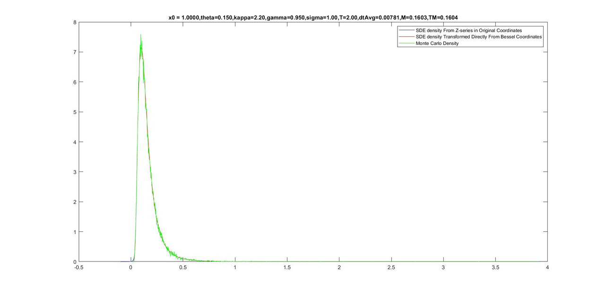
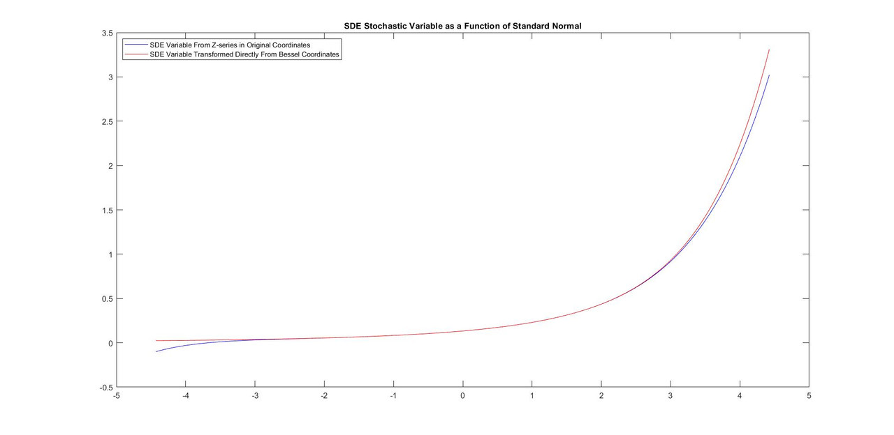
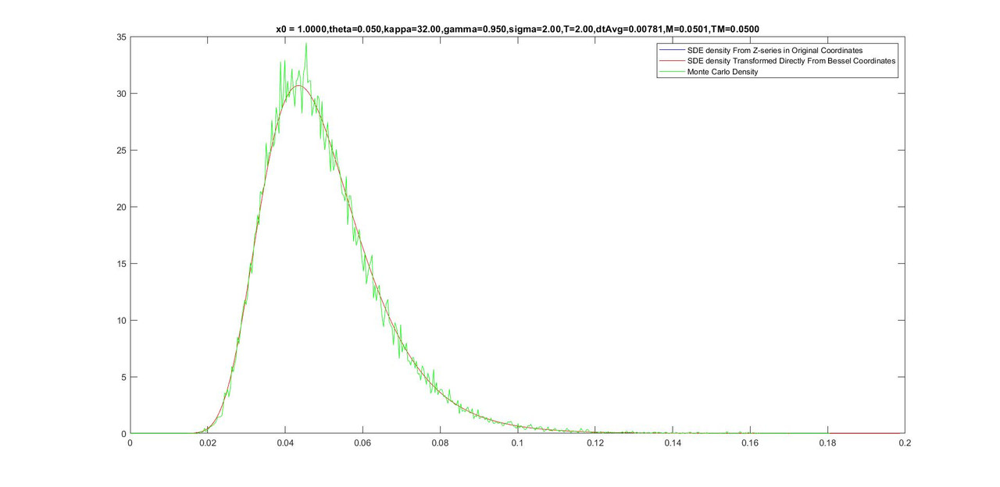
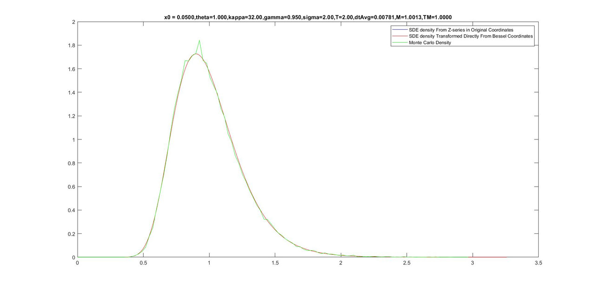

# Breakthrough in the theory of stochastic differential equations and their simulation

**Page 33 of 65** — Posts #1601–#1650

[← Previous](page_032.md) | [Index](index.md) | [Next →](page_034.md)

---

### #1601 — Amin (Topic Author)
*November 18, 2022, 3:14 AM*

Sorry again. Double.

---

### #1602 — Cuchulainn
*November 18, 2022, 10:00 AM*

>
> I have done most of these things and many other on the same thread. I am afraid you have not been following the
thread. For your information, I will give references to where I gave higher order solution to Monte carlo and
Fokker-planck equation.
>
>
>
> When naive monte carlo schemes have biases, you can try trillions of simulations only to get a wrong answer unless the
problem is almost trivial or your step is too miniscule. Only when you have an accurate higher order discretizations
that I presented that you get a right answer when you increase monte carlo paths.
>
> If you think monte carlo is slow, many shops are using my methods with Quasi-random sequences for monte carlo
simulations that are faster than many analytic methods and are practically instantaneous.
>
> I did say that Fokker-planck is among ten most important equations in mathematics.  In somebody's mind it might be
12th or 8th. I do not want to argue about it but it is one of the most important equations in mathematics.
>
>
>
> I have added the following lines to my article here. https://www.linkedin.com/pulse/trading-venture-proposition-ahsan-amin/
> I discovered a new series method to solve Ordinary Differential Equations of first order, nth order ODEs and systems
of ODEs. The method almost always works (until the ODE is singular when you have to transform it into a non-singular
form) and the series solution is series of true analytic solution of the ODE.
Now find some quibble about it as well.

It was a question, not a "quibble".

You might have a point there. The problem is in which of your 1600 posts can I find these claims?

BTW do you write articles thatr we can read? Reading blogs on forums is not verry edifying.

That was my opinion, for what it was worth.

---

### #1603 — Amin (Topic Author)
*November 18, 2022, 12:01 PM*

>
> You might have a point there. The problem is in which of your 1600 posts can I find these claims?
>
>
.

Thank you for pointing out. I will survey all the thread and, in a new post, write the topics I addressed and mention
all the posts associated with those topics. I hope it will become easier for all friends to look at the post and then
directly read the relevant posts rather than keep on searching all over the long thread.

The thread had a life of its own associated with my research. I kept posting all ongoing research on the thread and a
lot of good research people at universities kept track of the research as it continued. I believe my discoveries have
already been learnt by a lot of far more able people at good universities.

BTW, there is more to my research than I mentioned. For example, nobody knew how to integrate an SDE in time properly.
You can do it with monte carlo simulations but it was not known how to do it with analytic solutions of SDEs. I
discovered some techniques to do it and now, for example, you can solve for a mean-reverting SV SDE, integrate the
analytic solution in time and then plug it in lognormal or CEV formula for asset diffusion to quickly get the
distribution of asset in SV model. It all becomes very fast.

I also worked on 2D SV Fokker-planck equation in this thread.

Again, I will make a new post mentioning each research topic and posts associated with that.

.
>
> BTW do you write articles thatr we can read? Reading blogs on forums is not verry edifying.
>
.

Thank you again for mentioning. I love research and inquiry and writing papers can be a bit boring (and time-consuming
to formalize everything) after having posted all the research on internet. I am not in academia and publishing articles
does not have any career or monetary value. But now I do realize that it would have been far more worth-while to publish
everything since it gets one more recognition for the hard work. It is no longer "new research" as a large number of
friends in academia already know everything about it. But I do recall that Hagan and Lesniewski's famous article on SABR
remained on internet for several years before it was finally published in Wilmott. I will really try to put all material
in the form of various articles according to narrow topics and publish it in the form of 5-6 articles in Wilmott.

---

### #1604 — Cuchulainn
*November 18, 2022, 1:52 PM*

*writing papers can be a bit boring (and time-consuming to formalize everything) after having posted all the research on
internet.*

How much time did you not spend on those 1600 informal posts?

---

### #1605 — Amin (Topic Author)
*November 19, 2022, 1:36 AM*

This is strange. LinkedIn has removed my article post and blocked my account. I have not received any email from
linkedin about it whatsoever.

My latest post has been removed: https://www.linkedin.com/pulse/trading-venture-proposition-ahsan-amin/

When I tried to change my password, I was told that I needed to upload an identity verification document. I uploaded
image of my passport and I later received an auto-generated message about the passport that my passport will be reviewed
in 3-5 days.

---

### #1606 — Amin (Topic Author)
*November 19, 2022, 2:08 AM*

Friends somebody out of the blue complained and linkedin suspended my account without even giving me any notice. This is
strange. LinkedIn has removed my article post and blocked my account. I have not received any email from linkedin about
it whatsoever.

My latest post has been removed: https://www.linkedin.com/pulse/trading-venture-proposition-ahsan-amin/

When I tried to change my password, I was told that I needed to upload an identity verification document. I uploaded
image of my passport and I later received an auto-generated message about the passport that my passport will be reviewed
in 3-5 days.

Again I am looking to start a small Hedge Fund in HK/China though I can consider some place in mainland Europe if I can
get a good deal. My email is anan2999(at)yahoo(dot)com.

You can call me on whatsapp but you have to send a message earlier. My mobile whatsapp is  +92-336-2602125

Here is the content of post on linkedin at web address: https://www.linkedin.com/pulse/trading-venture-proposition-ahsan-amin/

Trading Venture Proposition.

Algorithmic Model Description.

Our model is close to high frequency trading models where trades take place roughly every thirty seconds to a minute.

Our model makes a prediction of the market fifteen seconds ahead and then makes decision to buy the stock asset if the
market is predicted to go up and sell it if it is predicted by the model to go down. Once a trade has been made, we keep
the trade alive after fifteen seconds if it is profitable to continue the trade and end the trade if it is not
profitable to continue the trade.

Depending upon the market conditions, our model makes between six hundred to one thousand trades per day with average
lifetime of a trade around thirty seconds to more than a minute.

We enter the trades through limit orders and earn a portion of bid-ask spread.

Our trading style and philosophy is similar to that of the most profitable firms on Wall Street especially Renaissance
Technologies that makes billions of dollars in profits every year. We believe we have equally good trading algorithms.

Machine Learning Techniques Behind the Model.

Our model uses predictive machine learning to make trading decisions. We do research on independent factors that affect
the short-term evolution of the financial asset and then apply machine learning to optimize for the parameters that best
describe the short-term dynamics of the financial asset.

In our back-testing simulations, these optimized parameters are learnt from previous day’s data and are used to make
trading decisions during the following day.

We tested our algorithms on large scale data with above rolling window of training on 24 hours of data and then applying
the model to next 24 hours of data.

Our machine learning method is a new technique and is not known to people in financial markets. This results in more
accurate prediction of the market than any time series model or process that analysts and quants usually use in
financial markets to make a prediction of financial assets.

Calculation of Profits Associated with Our High Frequency Algorithmic Trading.

Author has experience with American stocks data and have previously run several algorithms on Nasdaq Stocks. However
empirical calculations of profit and loss with this algorithm were done on major crypto currencies including Bitcoin and
Ethereum using Binance data. Our algorithms consistently turned profits on both cryptocurrencies despite that they are
far more volatile as compared to US stocks. Our algorithms consistently made profits in both highly bullish and highly
bearish markets.

We used zero leverage in our projection of profits and costs.

In our trading back-testing, we made a profit of 1.5 cents per hundred dollars without including any earned spreads. Our
models made roughly about one thousand trades per day as crypto market remains open for 24 hours. For high volume
traders that trade Binance futures, Binance pays a rebate of one cent per hundred dollars. Adding our profits and rebate
means we can make 2.5 cents per hundred dollars per trade on average. There are roughly one thousand trades per day
taking our profits to (1000 *.025/100=25%) per day.

At this point, I will stop and reassure the reader that these profits are real and I can demonstrate them in independent
back-testing. Such profits became possible due to our superior statistical machine learning model that correctly
captures 20%-30% of all the variation in the financial assets.

When we applied our model on Cryptocurrencies, our Sharpe ratio was roughly 2.0. This is considered excellent Sharpe
ratio with little downside risk.

In our back-testing simulations with Bitcoin and Ethereum there were several months in the data in which we made no loss
during any single day of the month.

In the past, Author has applied vastly inferior models on Nasdaq stocks data and was able to find reasonable profits
with those models. If this superior algorithm is run on Nasdaq stocks data, it can easily earn one cent per hundred
dollars after accounting for round trip brokerage costs associated with every trade. This would result in extremely
profitable trading strategy for Nasdaq stocks trading.

Again, very small but consistent profits when aggregated over a large number of trades become very significant and
usually become several percentage points of the capital for even a single day.

Independent Verification of the Model

We fully welcome independent back-testing and verification of the claims made about profitability of our trading
algorithms. Though we would not be willing to reveal machine learning techniques behind the algorithm, there can be
several ways in which we can pass on parameters from my machine learning optimization that can then be used on future
data to independently verify my claims about the profitability of the algorithms. In fact, I welcome friends to
independently verify the model before sponsoring any capital for the new company.

Risks Associated with the Model.

There are much smaller risks associated with our fast and, short term trading style as compared to plain vanilla buy and
hold strategies. When we make quick trades, it also becomes easier to limit losses since risk management techniques can
be used when model loses money in small successive trades before the accrued losses could become large to make a
significant decline in previously earned profits. Our trading style results in very high Sharpe Ratio for most of the
financial assets we used in historical study. Our trading style is relatively safer as compared to existing trading
strategies used to make profits in financial markets. While trading stocks, we do not intend to use any leverage which
would make risk management of our models much easier. Before trading financial assets, we strongly vet that there are
little known risks of large unexpected moves in the target stock. Our vetting stocks for large unexpected moves, our
short-term trading style and zero leverage ensures that risk management of the trading portfolio remains relatively
simple and straightforward process.

Prospective Financial Markets for Trading.

We want to use our model to trade HK stocks, Nasdaq Stocks, Stock exchange Index futures, currencies and commodities
like oil and gold futures.

Limitations of the Model.

We have tried our models extensively on historical data but we have not done live trading with our models. We want to
train our models comprehensively on paper trading with some good brokers and then use them for live trading in the final
step.

Capital Requirements.

We will require initial amount of roughly two hundred thousand dollars. We need money for office space, a few fast
computers, and high-speed internet. We will also need to hire about a staff of three to four mathematicians and
programmers. We will also need infrastructure to secure the property.

As the profitability of our models becomes evident, we will continue to scale the trading capital with time once our
market trading strategies continue to generate large profits. As we demonstrate that our trading strategies remain
profitable with time, we will gradually increase the trading capital to several hundred million dollars.

About the Author.

Author is a mathematician who has made several important discoveries in mathematics.

For instance, millions of computers in tens of thousands of financial institutions use Monte Carlo simulations of
stochastic differential equations every day to price derivatives and project risk of financial portfolios. Author
discovered for the first time how to do higher order accurate Monte Carlo simulations of stochastic differential
equations (SDEs).

Fokker-Planck partial differential equation is among ten major equations of mathematics and describes the time evolution
of probability densities associated with SDEs. For the first time, author discovered several analytic ways to solve the
Fokker-Planck equation.

Author has found analytic series solutions to first order ODEs, nth order ODEs and systems of ODEs. The series solution
presents the true series of the analytic solution of the ODE. The method applies to all ODEs unless the ODE is singular
when it has to be transformed into a non-singular form.

---

### #1607 — Amin (Topic Author)
*November 19, 2022, 6:27 AM*

This is so ridiculous that instead of promoting business and exchange, linkedin is destroying business.

I had written emails to 5-6 smart connections in Hong Kong and CIA is threatened that I would take cutting edge
knowledge and algorithms to China or HK and it will hurt American interests. So they asked linkedin and my public
profile has been deleted and my article post about my algorithms has been removed.

They want my Chinese friends and connections to think that I am some sort of fake and therefore linkedin has deleted my
public account.

I am a free human being and I suppose I am free to go where-ever I feel like.

---

### #1608 — Amin (Topic Author)
*November 19, 2022, 7:01 AM*

I made the following email to LinkedIn customer support.

Re: LinkedIn Account Recovery Appeal [Case: 221118-017263]

From: Ahsan Amin ([[email protected]](/cdn-cgi/l/email-protection#88e9e6e9e6bab1b1b1c8f1e9e0e7e7a6ebe7e5))

To: [[email protected]](/cdn-cgi/l/email-protection#a5c9cccbcec0c1cccbfad6d0d5d5cad7d1e5c6d68bc9cccbcec0c1cccb8bc6cac8);
[[email protected]](/cdn-cgi/l/email-protection#7819100b1916191511164a414141381f15191114561b1715);
[[email protected]](/cdn-cgi/l/email-protection#2e4f404f401c1717176e574f464141004d4143)

Date: Saturday, 19 November 2022 at 11:57 GMT+5

Hi,

This morning I noticed that my linkedin account has been suspended, my public profile has been deleted and my article
posts have been removed from linkedin. I never believe how linkedin can block my account without contacting me. If I
have done anything wrong in somebody's opinion, you have to give me an opportunity to present my point of view before
arbitrarily blocking my account and deleting my public profile.

Just yesterday, I contacted 6-7 of my Chinese connections for a partnership with my firm. This is a very significant
step in my life and career. Since LinkedIn arbitrarily suspended my account, and blocked my profile, all of my Chinese
friends would be thinking that I am a fake and therefore LinkedIn has blocked my account. I want Linkedin to restore my
account as early as possible and also want an apology from LinkedIn.

Kind regards,

Ahsan Amin

---

### #1609 — Cuchulainn
*November 19, 2022, 7:58 PM*

*Author has found analytic series solutions to first order ODEs, nth order ODEs and systems of ODEs. The series solution
presents the true series of the analytic solution of the ODE. The method applies to all ODEs unless the ODE is singular
when it has to be transformed into a non-singular form.*

That's what intrigues me.

Analytics series solutions sounds too good to be true (in general, we might get *serendipitous solutions*) On paper, I
agree but numerically and in a computer is a different ball game.

What I like in articles is 10% text (bla bla) and 90% maths (AI/ML is the other way around..)

---

### #1610 — Amin (Topic Author)
*November 20, 2022, 1:07 AM*

Please, read the article first and then criticize on merit before making vague statements.

When I did the paper on ODEs, I ran my mathematica expansion algorithm (given in paper and on this forum) on a large
number of ODEs to find their series solutions. Whenever the true solution was known in closed form, the series solution
was always series expansion of the known closed form solution.

---

### #1611 — Amin (Topic Author)
*November 20, 2022, 2:41 AM*

My method for solution of ODE's is a cousin of Taylor series.

What Taylor Series is to analytic functions, my method is to analytic ODE's.

Taylor Series find a true series solution to analytic functions.

My method finds true series solutions to analytic ODEs.

When closed form solution of the ODE is known, the solution from my method is exact Taylor expansion of the closed form
solution of the ODE.

---

### #1612 — Amin (Topic Author)
*November 20, 2022, 7:27 AM*

Cuch, I know you will find something else after this to say about my method to solve SDEs. Just to end the argument, I
have decided to show equivalence of my method to solve ODE's with Taylor Series. I thought of doing it since I am sure
mathematicians would be better able to appreciate my work once they know this equivalence and I believe there are many
generalizations of my method that can be further applied to a lot of other problems especially to PDEs. The way I will
present the problem again and pose solution, it will be very easy for friends to generalize it to other problems very
easily.

My only purpose about openly presenting my research here is that it is mostly science and mathematics and their
innovative applications that has changed the destiny of humanity as we see it today and caused the advance of
civilization. CIA stopped people all over the world from doing business with me. If I cannot benefit from my own
discoveries, I would still want people to use them in innovative ways and benefit from it.

I am really proud that I try to do good science/mathematics.

Within a day, I will write mathematical equations so most mathematicians would be easily able to appreciate the
equivalence between my method and similarity in their derivation to Taylor Series. And then also be able to use it in
many other innovative ways.

---

### #1613 — Amin (Topic Author)
*November 20, 2022, 7:44 AM*

> Cuch, I know you will find something else after this to say about my method to solve SDEs.
Sorry, I meant: Cuch, I know you will find something else after this to say about my method to solve ODEs.

---

### #1614 — Cuchulainn
*November 20, 2022, 2:22 PM*



---

### #1615 — Amin (Topic Author)
*November 20, 2022, 2:55 PM*

For Cuch and other friends, here I want to explain the sheer similarities between my Taylor series method for functions
and my method for ODEs.

First, I will make an intuitive derivation of Taylor Series. I will do everything step by step and sometimes even do
trivial steps but please bear with me. I want to make things as simple and easy as possible. You just need basic
calculus to understand everything.

Intuitive Derivation of Taylor Series.

Suppose We are given a function f(t) whose all derivatives with respect to t can be found. We know the value of function
at a starting point$t_0$ and want to find the value of function at point in neighborhood given by$t_0+\Delta t$

We write

$\, f(t_0 + \Delta t) \, = \, f(t_0) \, + \, \int_{t_0}^{t_0+\Delta t} \, \frac{df(s)}{ds} \, ds $

In above, We have taken value of function at starting point$t_0$ and added integral of first derivative so that it
becomes equal to function value in LHS.

Now we take the first derivative in second term on RHS at initial value and add a second derivative terms so that terms
on RHS equal the function value on LHS.

$\, f(t_0 + \Delta t) \, = \, f(t_0) \, + \, \int_{t_0}^{t_0+\Delta t} \, \frac{df(t_0)}{ds} \, ds \, + \, \int_{t_0}^{t_0+\Delta t} \,\int_{t_0}^{s} \, \frac{d^2f(v)}{dv^2} \, dv \, ds $

In above, we have taken value of function and its first derivative at$t_0$ and used integral of second derivative of
function so that all terms on RHS are equal to function value on LHS.

Please also note that we can take$ \frac{df(t_0)}{ds}$ outside of complete integral
$\int_{t_0}^{t_0+\Delta t} \, \frac{df(0)}{ds} \, ds \,$ because it is a constant term evaluated at initial point$t_0$

So we write

$\, f(t_0 + \Delta t) \, = \, f(t_0) \, + \, \frac{df(t_0)}{dt} \, \int_{t_0}^{t_0+\Delta t} \, ds \, + \, \int_{t_0}^{t_0+\Delta t} \,\int_{t_0}^{s} \, \frac{d^2f(v)}{dv^2} \, dv \, ds $

Now we expand the second derivative integral term on RHS into a second derivative term evaluated at initial value$t_0$
plus an integral of third derivative term as

$\, f(t_0 + \Delta t) \, = \, f(t_0) \, + \, \frac{df(t_0)}{dt} \, \int_{t_0}^{t_0+\Delta t} \, ds \, + \,  \frac{d^2f(t_0)}{dt^2} \,\int_{t_0}^{t_0+\Delta t} \,\int_{t_0}^{s} \, dv \, ds + \, \int_{t_0}^{t_0+\Delta t} \,\int_{t_0}^{s} \,  \,\int_{t_0}^{v}  \frac{d^3f(u)}{du^3} \,du \, dv \, ds$

Repeating similarly for one more step, we obtain

$\, f(t_0 + \Delta t) \, = \, f(t_0) \, + \, \frac{df(0)}{dt} \, \int_{t_0}^{t_0+\Delta t} \, ds \, + \,  \frac{d^2f(0)}{dt^2} \,\int_{t_0}^{t_0+\Delta t} \,\int_{t_0}^{s} \, dv \, ds$

$ + \,  \frac{d^3f(t_0)}{dt^3} \int_{t_0}^{t_0+\Delta t} \,\int_{t_0}^{s} \,  \,\int_{t_0}^{v}  \,du \, dv \, ds + \, \int_{t_0}^{t_0+\Delta t} \,\int_{t_0}^{s} \,\int_{t_0}^{v} \,\int_{t_0}^{u}  \frac{d^4f(h)}{dh^4} \, dh\,du \, dv \, ds$

By solving iterated integrals, we retrieve first three terms of Taylor Series and a remainder term as

$\, f(t_0 + \Delta t) \, = \, f(t_0) \, + \, \frac{df(0)}{dt} \, \Delta t, + \,  \frac{d^2f(0)}{dt^2} \,{\Delta t}^2/2  + \,  \frac{d^3f(t_0)}{dt^3} {\Delta t}^3/6$

$ + \, \int_{t_0}^{t_0+\Delta t} \,\int_{t_0}^{s} \,\int_{t_0}^{v} \,\int_{t_0}^{u}  \frac{d^4f(h)}{dh^4} \, dh\,du \, dv \, ds$

where remainder term after expansion up to three derivatives is given as

$ + \, \int_{t_0}^{t_0+\Delta t} \,\int_{t_0}^{s} \,\int_{t_0}^{v} \,\int_{t_0}^{u}  \frac{d^4f(h)}{dh^4} \, dh\,du \, dv \, ds$

We cannot take integrand in remainder term out of integral signs until we take its value at zero and then also add a
fifth remainder term under integral signs.

The expansions for my method for ODEs follow exactly similar steps but does require some hack.

 Intuitive Derivation of Method of iterated Integrals for ODEs.

Suppose we are given an ODE as

$\, \frac{dx(t)}{dt} \, = \, G(x(t),t) \,$  Eq(1),  with initial value $x(t_0)\,=x_0$

The obvious solution to above problem for a small step is

$x(t_0+\Delta t) = \, x(t_0)\, + \, \int_{t_0}^{t_0+ \Delta t} \, G(x(s),s) \,ds $  Eq(2)

Now we expand the integral on RHS in above equation just like we expanded integrals in Taylor series expansion. We want
friends to be careful and expand$G(x(t),t)$ only in first variable x(t) and not in second variable t which will always
be directly integrated in our exposition. I want friends to know that it is not a two dimensional Taylor expansion at
all. We are only expanding in dependent variable x(t) and directly integrating the explicit terms in t.

So taking the above equation as

$x(t_0+\Delta t) = \, x(t_0)\, + \, \int_{t_0}^{t_0+ \Delta t} \, G(x(s),s) \,ds $  Eq(2)

but we can expand the term inside second integral on right as (This is crucial to understand). I have used chain rule in
the last term below

$\,G(x(s),s) \, = \, \,G(x(t_0),s) \,+  \int_{t_0}^{s} \,\frac{\partial G(x(v),s)}{\partial x} \, \frac{dx(v)}{dv} \,dv$
Eq(3)

but

$\frac{dx(v)}{dv}=G(x(v),v) $ by definition of ODE at start given in Eq(1), So we have

$\,G(x(s),s) \, = \, \,G(x(t_0),s) \,+  \int_{t_0}^{s} \,\frac{\partial G(x(v),s)}{\partial x} \,G(x(v),v) \,dv$  Eq(4)

Inserting above Eq(4) in Eq(2), we get

$x(t_0+\Delta t) = \, x(t_0)\, + \, \int_{t_0}^{t_0+ \Delta t} \, G(x(t_0),s) \,ds+ \, \int_{t_0}^{t_0+ \Delta t} \,\int_{t_0}^{s} \,\frac{\partial G(x(v),s)}{\partial x} \,G(X(v),v) \,dv \,ds $
Eq(5)

We notice that term on RHS with single integral is evaluated at starting value$x(t_0)$ which is a constant. This term
also has dependence on s which can be easily explicitly integrated.

However now the term on RHS with double integrals remains difficult to solve unless we repeat the same trick on it and
evaluate it at$x(t_0)$ but we would still have to add a three integrals term to it to maintain equality with LHS.

We take the term inside double integral and expand it again with a starting value term and a second term using chain
rule as

$\,\frac{\partial G(x(v),s)}{\partial x} \,G(x(v),v)= \, \frac{\partial G(x(t_0),s)}{\partial x} \,G(x(t_0),v) + \int_{t_0}^{v} \frac{\partial [\frac{\partial G(x(u),s)}{\partial x} \,G(X(u),v)]}{\partial x}  \frac{dx(u)}{du}$

We change notation here and represent partial derivative of G(X(v),v) with respect to x as G'(x(v),v)

i.e$G'(x(v),v)=\frac{\partial G(x(v),v)}{\partial x}$ , it should not be confusing since we never take derivative of
G(x(t),t) with respect to second parameter time.

and write the above term as

$ G'(x(v),s)\,G(x(v),v)= \, G'(x(t_0),s) \,G(x(t_0),v) + \int_{t_0}^{v} \frac{\partial [G'(x(u),s) \,G(X(u),v)]}{\partial x}  \frac{dx(u)}{du} \, du$

$= \, G'(x(t_0),s) \,G(x(t_0),v) + \int_{t_0}^{v} [G''(x(u),s) \,G(X(u),v)+G'(x(u),s) \,G'(X(u),v)] G(x(u),u) \, du$
Eq(6)

Now substituting Eq(6) in Eq(5) above, we get

$x(t_0+\Delta t) = \, x(t_0)\, + \, \int_{t_0}^{t_0+ \Delta t} \, G(x(t_0),s) \,ds+ \, \int_{t_0}^{t_0+ \Delta t} \,\int_{t_0}^{s} \ \, G'(x(t_0),s) \,G(x(t_0),v)  \,dv \,ds $

$+ \, \int_{t_0}^{t_0+ \Delta t} \,\int_{t_0}^{s} \ \int_{t_0}^{v} [G''(x(u),s) \,G(X(u),v)+G'(x(u),s) \,G'(X(u),v)] G(x(u),u) \, du \,dv \,ds $
Eq(7)

The above expression is exact but third integral term cannot be evaluated easily. To take a third order approximation,
we evaluate x in third integral at initial value$x(t_0)$ but we would have to add a fourth order remainder term to make
the expression exact. So we can write up to third order as

$x(t_0+\Delta t) = \, x(t_0)\, + \, \int_{t_0}^{t_0+ \Delta t} \, G(x(t_0),s) \,ds+ \, \int_{t_0}^{t_0+ \Delta t} \,\int_{t_0}^{s} \ \, G'(x(t_0),s) \,G(x(t_0),v)  \,dv \,ds $

$+ \, \int_{t_0}^{t_0+ \Delta t} \,\int_{t_0}^{s} \ \int_{t_0}^{v} [G''(x(t_0),s) \,G(X(t_0),v)+G'(x(t_0),s) \,G'(X(t_0),v)] G(x(t_0),u) \, du \,dv \,ds $

$+ Fourth Order Remainder $  Eq(8)

So friends can easily see the similarity in derivation of Taylor Series and my method. I am sure Taylor derived Taylor
series from similar integrals. My derivation of method of iterated integrals for ODEs is exactly similar to derivation
of Taylor series but applied to a more complex problem.

Cuch, if you have any questions, please point the equation number and I would love to explain in more details.

I do believe that method could be applied to PDEs as well and will try to present my thoughts on that in a few days.

---

### #1616 — Cuchulainn
*November 20, 2022, 5:07 PM*

Thanks. I'll have a look!

---

### #1617 — Amin (Topic Author)
*November 21, 2022, 1:23 AM*

>
> For Cuch and other friends, here I want to explain the sheer similarities between my Taylor series method for
functions and my method for ODEs.
>
> First, I will make an intuitive derivation of Taylor Series. I will do everything step by step and sometimes even do
trivial steps but please bear with me. I want to make things as simple and easy as possible. You just need basic
calculus to understand everything.
>
>
>
> Intuitive Derivation of Taylor Series.
>
> Suppose We are given a function f(t) whose all derivatives with respect to t can be found. We know the value of
function at a starting point$t_0$ and want to find the value of function at point in neighborhood given by$t_0+\Delta t$
>
>
>
> We write
>
> $\, f(t_0 + \Delta t) \, = \, f(t_0) \, + \, \int_{t_0}^{t_0+\Delta t} \, \frac{df(s)}{ds} \, ds $
>
> In above, We have taken value of function at starting point$t_0$ and added integral of first derivative so that it
becomes equal to function value in LHS.
>
> Now we take the first derivative in second term on RHS at initial value and add a second derivative terms so that
terms on RHS equal the function value on LHS.
>
>
$\, f(t_0 + \Delta t) \, = \, f(t_0) \, + \, \int_{t_0}^{t_0+\Delta t} \, \frac{df(t_0)}{ds} \, ds \, + \, \int_{t_0}^{t_0+\Delta t} \,\int_{t_0}^{s} \, \frac{d^2f(v)}{dv^2} \, dv \, ds $
>
> In above, we have taken value of function and its first derivative at$t_0$ and used integral of second derivative of
function so that all terms on RHS are equal to function value on LHS.
>
> Please also note that we can take$ \frac{df(t_0)}{ds}$ outside of complete integral
$\int_{t_0}^{t_0+\Delta t} \, \frac{df(0)}{ds} \, ds \,$ because it is a constant term evaluated at initial point$t_0$
>
> So we write
>
>
$\, f(t_0 + \Delta t) \, = \, f(t_0) \, + \, \frac{df(t_0)}{dt} \, \int_{t_0}^{t_0+\Delta t} \, ds \, + \, \int_{t_0}^{t_0+\Delta t} \,\int_{t_0}^{s} \, \frac{d^2f(v)}{dv^2} \, dv \, ds $
>
> Now we expand the second derivative integral term on RHS into a second derivative term evaluated at initial value$t_0$
plus an integral of third derivative term as
>
>
$\, f(t_0 + \Delta t) \, = \, f(t_0) \, + \, \frac{df(t_0)}{dt} \, \int_{t_0}^{t_0+\Delta t} \, ds \, + \,  \frac{d^2f(t_0)}{dt^2} \,\int_{t_0}^{t_0+\Delta t} \,\int_{t_0}^{s} \, dv \, ds + \, \int_{t_0}^{t_0+\Delta t} \,\int_{t_0}^{s} \,  \,\int_{t_0}^{v}  \frac{d^3f(u)}{du^3} \,du \, dv \, ds$
>
> Repeating similarly for one more step, we obtain
>
>
$\, f(t_0 + \Delta t) \, = \, f(t_0) \, + \, \frac{df(0)}{dt} \, \int_{t_0}^{t_0+\Delta t} \, ds \, + \,  \frac{d^2f(0)}{dt^2} \,\int_{t_0}^{t_0+\Delta t} \,\int_{t_0}^{s} \, dv \, ds$
>
>
$ + \,  \frac{d^3f(t_0)}{dt^3} \int_{t_0}^{t_0+\Delta t} \,\int_{t_0}^{s} \,  \,\int_{t_0}^{v}  \,du \, dv \, ds + \, \int_{t_0}^{t_0+\Delta t} \,\int_{t_0}^{s} \,\int_{t_0}^{v} \,\int_{t_0}^{u}  \frac{d^4f(h)}{dh^4} \, dh\,du \, dv \, ds$
>
> By solving iterated integrals, we retrieve first three terms of Taylor Series and a remainder term as
>
>
$\, f(t_0 + \Delta t) \, = \, f(t_0) \, + \, \frac{df(0)}{dt} \, \Delta t, + \,  \frac{d^2f(0)}{dt^2} \,{\Delta t}^2/2  + \,  \frac{d^3f(t_0)}{dt^3} {\Delta t}^3/6$
>
>
$ + \, \int_{t_0}^{t_0+\Delta t} \,\int_{t_0}^{s} \,\int_{t_0}^{v} \,\int_{t_0}^{u}  \frac{d^4f(h)}{dh^4} \, dh\,du \, dv \, ds$
>
>
>
> where remainder term after expansion up to three derivatives is given as
>
>
$ + \, \int_{t_0}^{t_0+\Delta t} \,\int_{t_0}^{s} \,\int_{t_0}^{v} \,\int_{t_0}^{u}  \frac{d^4f(h)}{dh^4} \, dh\,du \, dv \, ds$
>
> We cannot take integrand in remainder term out of integral signs until we take its value at zero and then also add a
fifth remainder term under integral signs.
>
>
>
> The expansions for my method for ODEs follow exactly similar steps but does require some hack.
>
>
>
>  Intuitive Derivation of Method of iterated Integrals for ODEs.
>
> Suppose we are given an ODE as
>
> $\, \frac{dx(t)}{dt} \, = \, G(x(t),t) \,$  Eq(1),  with initial value $x(t_0)\,=x_0$
>
>
>
> The obvious solution to above problem for a small step is
>
>
>
> $x(t_0+\Delta t) = \, x(t_0)\, + \, \int_{t_0}^{t_0+ \Delta t} \, G(x(s),s) \,ds $  Eq(2)
>
>
>
> Now we expand the integral on RHS in above equation just like we expanded integrals in Taylor series expansion. We
want friends to be careful and expand$G(x(t),t)$ only in first variable x(t) and not in second variable t which will
always be directly integrated in our exposition. I want friends to know that it is not a two dimensional Taylor
expansion at all. We are only expanding in dependent variable x(t) and directly integrating the explicit terms in t.
>
> So taking the above equation as
>
> $x(t_0+\Delta t) = \, x(t_0)\, + \, \int_{t_0}^{t_0+ \Delta t} \, G(x(s),s) \,ds $  Eq(2)
>
>
>
> but we can expand the term inside second integral on right as (This is crucial to understand). I have used chain rule
in the last term below
>
>
$\,G(x(s),s) \, = \, \,G(x(t_0),s) \,+  \int_{t_0}^{s} \,\frac{\partial G(x(v),s)}{\partial x} \, \frac{dx(v)}{dv} \,dv$
Eq(3)
>
> but
>
> $\frac{dx(v)}{dv}=G(x(v),v) $ by definition of ODE at start given in Eq(1), So we have
>
>$\,G(x(s),s) \, = \, \,G(x(t_0),s) \,+  \int_{t_0}^{s} \,\frac{\partial G(x(v),s)}{\partial x} \,G(x(v),v) \,dv$ Eq(4)
>
>
>
> Inserting above Eq(4) in Eq(2), we get
>
>
$x(t_0+\Delta t) = \, x(t_0)\, + \, \int_{t_0}^{t_0+ \Delta t} \, G(x(t_0),s) \,ds+ \, \int_{t_0}^{t_0+ \Delta t} \,\int_{t_0}^{s} \,\frac{\partial G(x(v),s)}{\partial x} \,G(X(v),v) \,dv \,ds $
Eq(5)
>
>
>
> We notice that term on RHS with single integral is evaluated at starting value$x(t_0)$ which is a constant. This term
also has dependence on s which can be easily explicitly integrated.
>
> However now the term on RHS with double integrals remains difficult to solve unless we repeat the same trick on it and
evaluate it at$x(t_0)$ but we would still have to add a three integrals term to it to maintain equality with LHS.
>
> We take the term inside double integral and expand it again with a starting value term and a second term using chain
rule as
>
>
$\,\frac{\partial G(x(v),s)}{\partial x} \,G(x(v),v)= \, \frac{\partial G(x(t_0),s)}{\partial x} \,G(x(t_0),v) + \int_{t_0}^{v} \frac{\partial [\frac{\partial G(x(u),s)}{\partial x} \,G(X(u),v)]}{\partial x}  \frac{dx(u)}{du}$
>
> We change notation here and represent partial derivative of G(X(v),v) with respect to x as G'(x(v),v)
>
> i.e$G'(x(v),v)=\frac{\partial G(x(v),v)}{\partial x}$ , it should not be confusing since we never take derivative of
G(x(t),t) with respect to second parameter time.
>
> and write the above term as
>
>
$ G'(x(v),s)\,G(x(v),v)= \, G'(x(t_0),s) \,G(x(t_0),v) + \int_{t_0}^{v} \frac{\partial [G'(x(u),s) \,G(X(u),v)]}{\partial x}  \frac{dx(u)}{du} \, du$
>
>$= \, G'(x(t_0),s) \,G(x(t_0),v) + \int_{t_0}^{v} [G''(x(u),s) \,G(X(u),v)+G'(x(u),s) \,G'(X(u),v)] G(x(u),u) \, du$
Eq(6)
>
>
>
> Now substituting Eq(6) in Eq(5) above, we get
>
>
$x(t_0+\Delta t) = \, x(t_0)\, + \, \int_{t_0}^{t_0+ \Delta t} \, G(x(t_0),s) \,ds+ \, \int_{t_0}^{t_0+ \Delta t} \,\int_{t_0}^{s} \ \, G'(x(t_0),s) \,G(x(t_0),v)  \,dv \,ds $
>
>
$+ \, \int_{t_0}^{t_0+ \Delta t} \,\int_{t_0}^{s} \ \int_{t_0}^{v} [G''(x(u),s) \,G(X(u),v)+G'(x(u),s) \,G'(X(u),v)] G(x(u),u) \, du \,dv \,ds $
Eq(7)
>
>
>
> The above expression is exact but third integral term cannot be evaluated easily. To take a third order approximation,
we evaluate x in third integral at initial value$x(t_0)$ but we would have to add a fourth order remainder term to make
the expression exact. So we can write up to third order as
>
>
>
>
$x(t_0+\Delta t) = \, x(t_0)\, + \, \int_{t_0}^{t_0+ \Delta t} \, G(x(t_0),s) \,ds+ \, \int_{t_0}^{t_0+ \Delta t} \,\int_{t_0}^{s} \ \, G'(x(t_0),s) \,G(x(t_0),v)  \,dv \,ds $
>
>
$+ \, \int_{t_0}^{t_0+ \Delta t} \,\int_{t_0}^{s} \ \int_{t_0}^{v} [G''(x(t_0),s) \,G(X(t_0),v)+G'(x(t_0),s) \,G'(X(t_0),v)] G(x(t_0),u) \, du \,dv \,ds $
>
> $+ Fourth Order Remainder $  Eq(8)
>
>
>
>
>
> So friends can easily see the similarity in derivation of Taylor Series and my method. I am sure Taylor derived Taylor
series from similar integrals. My derivation of method of iterated integrals for ODEs is exactly similar to derivation
of Taylor series but applied to a more complex problem.
>
>
>
> Cuch, if you have any questions, please point the equation number and I would love to explain in more details.
>
>
>
> I do believe that method could be applied to PDEs as well and will try to present my thoughts on that in a few days.
>
.

.

Sorry friends, In some equations in derivation of method for ODEs, an uppercase X appears as in$G'(X(t_0),v)$ that can
be confusing. It is actually$G'(x(t_0),v)$ . Everywhere I have used uppercase X in above post, it is actually lowercase
x. I should not have used uppercase X anywhere. I made a mistake somewhere which inadvertently propagated due to copy
and paste.

The final lines should be

$x(t_0+\Delta t) = \, x(t_0)\, + \, \int_{t_0}^{t_0+ \Delta t} \, G(x(t_0),s) \,ds+ \, \int_{t_0}^{t_0+ \Delta t} \,\int_{t_0}^{s} \ \, G'(x(t_0),s) \,G(x(t_0),v)  \,dv \,ds $

$+ \, \int_{t_0}^{t_0+ \Delta t} \,\int_{t_0}^{s} \ \int_{t_0}^{v} [G''(x(t_0),s) \,G(x(t_0),v)+G'(x(t_0),s) \,G'(x(t_0),v)] G(x(t_0),u) \, du \,dv \,ds $

$+ Fourth Order Remainder $  Eq(8)

---

### #1618 — Amin (Topic Author)
*November 21, 2022, 3:00 PM*

Friends, I am seriously aghast. How can LinkedIn do this? They have restored my account and my posts, but they have
given me no reason whatsoever for blocking my account for three days. How can they possibly do this so cold-bloodedly?

Here is their new email.

LinkedIn Account Recovery Appeal [Case: 221118-017263]

From: LinkedIn Customer Support
([[email protected]](/cdn-cgi/l/email-protection#3a565354515f5e535465494f4a4a55484e7a594914565354515f5e535414595557))

To: [[email protected]](/cdn-cgi/l/email-protection#a8c9c6c9c69a919191e8d1c9c0c7c786cbc7c5)

Date: Monday, 21 November 2022 at 19:45 GMT+5

Status: Closed

Reference # 221118-017263

View your case(s) on our Help Center You may reply to this case for up to 14 days Response (11/21/2022 08:45 CST)

Hi Ahsan,

Thanks for your patience. We've verified your information and the restriction has been removed from your account. If you
still can't sign in, please let me know and I'll help you get access to your account right away.

Regards,

Dean LinkedIn Member Safety and Recovery Consultant

Member (11/19/2022 00:58 CST)

Hi,

This morning I noticed that my linkedin account has been suspended, my public profile has been deleted and my article
posts have been removed from linkedin. I never believe how linkedin can block my account without contacting me. If I
have done anything wrong in somebody's opinion, you have to give me an opportunity to present my point of view before
arbitrarily blocking my account and deleting my public profile. Just yesterday, I contacted 6-7 of my Chinese
connections for a partnership with my firm. This is a very significant step in my life and career. Since LinkedIn
arbitrarily suspended my account, and blocked my profile, all of my Chinese friends would be thinking that I am a fake
and therefore LinkedIn has blocked my account. I want Linkedin to restore my account as early as possible and also want
an apology from LinkedIn.

Kind regards,

Ahsan Amin

Auto-Response (11/18/2022 19:21 CST)

---

### #1619 — Amin (Topic Author)
*November 22, 2022, 3:23 PM*

Friends, I had an antipsychotic injection this Friday and it is already showing effect and I was unable to do anything
today.

Mind control agents release gas again and again both in my room and in attached wash room. I am already tired but gas
saps all energy out of me. And they are releasing gas again and again despite my protests. I was not going to write
anything like that but repeated use of gas when I am trying to sleep has forced me to write about it.

Mind control agencies continue to drug bottled water at a lot of stores in Johar Town and many surrounding
neighborhoods. I also bought drugged bottled water this noon despite that I was very careful.

Every morning, I have to be very very careful about food since pak army secret service agents continue to approach small
food shops to drug the food. I have not been hit in past few days but only because I was extra careful about choosing
where to eat. Despite my being very careful, it becomes obvious that mind control agents are looking for opportunity to
drug my food since many small food-shops try to delay giving me food (so that pak army agents could come in the meantime
and give them drugs that would be added to food) and I have to be too straightforward that I would leave if food would
not be given to me immediately. They have already distributed mind control drugs at a large number of food shops, and I
would have already been hit by bad food unless I were not very careful.

---

### #1620 — Cuchulainn
*November 24, 2022, 8:34 PM*

I have read the equations which are formal mathematics at the moment. My initial approach is to take 2 concrete
examples:

$dx/dt = x/t$ general solution $x = Ct$, $C$ is a constant (A)

$dx/dt = x^2, x(0) = 1$ general solution $x = 1/(1-t)$ (B)

Attention Points

1. Your ODE Eq. (1) does it have a solution and in which interval, e.g. the above A and B.

2. Your Eq. (4) scheme applied to A and B.... what do the schemes look like?

---

### #1621 — Amin (Topic Author)
*November 28, 2022, 3:02 PM*

Cuch, very sorry for delay in my reply. Below is the Mathematica code to solve any 1st order or nth order ODE. I am
writing the code in text format below and explain it again in a next code window.

.

```
Clear[t,y,Zi,Wi,Yi,Y,y0,i,i1,p,n,ZAns];
n=1;
Array[y,n+1,0];
y[1]:= y[0]^2;
Array[y0,n,0];
y0[0]=1;
p=8;
Y:=y0[0];
For[k=1,k ti[n]);
For [i=n,i ti[i+1]));]);];
For[i=n,i y0[k]))];)];
For[i=n,i=1,i1--,(Yi[i1-1]=Integrate[Yi[i1],{ti[i1],0,ti[i1-1]}])];Y=Y+(Yi[0]/.ti[0]-> t);)]
ZAns=Collect[Y,t,Simplify]//PolynomialForm[#,TraditionalOrder -> False]&
```

.

In Below I explain the above code with some comments.

```
Clear[t,y,Zi,Wi,Yi,Y,y0,i,i1,p,n,ZAns];   This line is handy to clear variables especially when you want to solve for
more than one ODE.
n=1;                                      n is order of the ODE. For 1st order ODE n=1;
Array[y,n+1,0];                           Define a workhorse variable.
y[1]:= y[0]^2;                            Specify the ODE. y[1]= dy/dt. y[0]=y[t] and similarly for higher order ODE's
y[2]=d2y/dt2
Array[y0,n,0];
y0[0]=1;                                  Specify initial conditions. y0[0]=y(0) similalry for 2nd order ODE, you will
also have to specify y0[1]=dy(0)/dt and so on.
p=8;                                       Number of powers in expansion of series.
Y:=y0[0];                                  Allocate first initial condition.
For[k=1,k ti[n]);
For [i=n,i ti[i+1]));]);];
For[i=n,i y0[k]))];)];
For[i=n,i=1,i1--,(Yi[i1-1]=Integrate[Yi[i1],{ti[i1],0,ti[i1-1]}])];Y=Y+(Yi[0]/.ti[0]-> t);)];     This is integration
loop which iteratively integrates starting from zero. replace zero with initial time when it is different from zero.
ZAns=Collect[Y,t,Simplify]//PolynomialForm[#,TraditionalOrder -> False]&
```

.

I think your ODE(2) can be very easily solved. ODE(1) seems singular at t=0 but can possibly be solved by changing
starting value to some positive time and specifying initial conditions there.

Please feel free to use the mathematica ODE solver above and come back with your comments.

Sorry, I have been pretty busy with work on my trading algorithms and want to apply them on NASDAQ stocks so little time
left for other things. Will come back soon to tackle the discussion.

In my paper, I have given a mathematica routine that can solve arbitrary systems of nth order ODEs (at least in theory).
I have also given an example explaining the algorithm where I used the algorithm to solve a system of three 2nd order
non-linear ODEs.

---

### #1622 — Cuchulainn
*November 29, 2022, 11:23 AM*

Thanks, Amin

Code is important but it is not the driver. It just produces a number.

We are not on the same wavelength, unfortunately. My two examples were concrete insights into the bespoke qualitative
behaviour of ODEs.

„A good technical writer, trying not to be obvious about it, but says everything twice: formally and informally. Or
maybe three times.“ —  Donald Ervin Knuth

---

### #1623 — Cuchulainn
*November 29, 2022, 11:34 AM*

For completeness

$dx/dt = x^2, x(0) = 1$ general solution $x = 1/(1-t)$ (B)

. The solution can be found by inspection or Picard iteration serie

. The solution does blow up afer t > 1

. Solving (B) by ODE solvers, including yours ... *a prioiri *quantitatve results on stability and accurscy

These are the compelling issues in numerical analysis, like gravity in physics.

---

### #1624 — Amin (Topic Author)
*November 30, 2022, 3:21 PM*

Sorry Cuch, a lot of other things to do. I will come back to your examples soon when I will have some more time. I am
sure they are very simple.

Friends, I have decided to write 3-5 formal papers about the material in this thread that would ideally be submitted to
Wilmott magazine and I will soon be approaching Wilmott people for their requirements and guidelines.

The research subject of first paper would be finding the dynamics of variance/volatility SDE so that volatility surface
is closely fitted across time given that asset SDE in two dimensional correlated SDE system is given either by lognormal
or CEV dynamics.

All through this paper, we will remain mainly in a single dimensional SDE framework other than just a few small
excursions into two dimensions.

For my first paper, I am cleaning up my work on one dimensional SDEs with addition of cumulants. And also on time
integral of the mean-reverting and other SDEs. I want to solve for distribution of integral of volatility/variance SDE
by backing it out from option prices using lognormal or CEV formula. And then I will find the dynamics of volatility SDE
so that it perfectly fits the implied distribution of integral of variance. While backing out integral of volatility, I
will also have to do accounting for correlation and contribution of correlated part of SV SDE but this should be simple
given the insights we have learnt about variances and their addition within Z-series framework. All of this will be done
in a one dimensional SDE framework. We have already done 70% of the work in this thread. I will be changing a few things
like I do not want to go into cumulants at all (even though they should be used a lot for inference) and will be using
new alternative methods. I will also be making some changes to calculation of time integrals of SDEs. Only major part
that remains to be done is bootstrapping of integral of variance SDE and correlated part of the SDE from the
cross-section of option prices. Since we want to remain in the one dimensional domain, I really hope that computational
time for option chains out to 4-5 years will be in seconds and not in minutes.

And my time frame to complete the unfinished part is a few weeks. I will be posting the code on Wilmott as usual.

---

### #1625 — Cuchulainn
*December 1, 2022, 10:37 AM*

*Sorry Cuch, a lot of other things to do. I will come back to your examples soon when I will have some more time. I am
sure they are very simple.*

Take your time. Don't want be a party pooper, but the mathematical and numerical  issues are far from simple.

---

### #1626 — Cuchulainn
*December 1, 2022, 11:27 AM*

>
> Cuch, very sorry for delay in my reply. Below is the Mathematica code to solve any 1st order or nth order ODE. I am
writing the code in text format below and explain it again in a next code window.
>
> .
>
> ```
> Clear[t,y,Zi,Wi,Yi,Y,y0,i,i1,p,n,ZAns];
> n=1;
> Array[y,n+1,0];
> y[1]:= y[0]^2;
> Array[y0,n,0];
> y0[0]=1;
> p=8;
> Y:=y0[0];
> For[k=1,k ti[n]);
> For [i=n,i ti[i+1]));]);];
> For[i=n,i y0[k]))];)];
> For[i=n,i=1,i1--,(Yi[i1-1]=Integrate[Yi[i1],{ti[i1],0,ti[i1-1]}])];Y=Y+(Yi[0]/.ti[0]-> t);)]
> ZAns=Collect[Y,t,Simplify]//PolynomialForm[#,TraditionalOrder -> False]&
> ```
>
> .
>
> In Below I explain the above code with some comments.
>
> ```
> Clear[t,y,Zi,Wi,Yi,Y,y0,i,i1,p,n,ZAns];   This line is handy to clear variables especially when you want to solve for
more than one ODE.
> n=1;                                      n is order of the ODE. For 1st order ODE n=1;
> Array[y,n+1,0];                           Define a workhorse variable.
> y[1]:= y[0]^2;                            Specify the ODE. y[1]= dy/dt. y[0]=y[t] and similarly for higher order ODE's
y[2]=d2y/dt2
> Array[y0,n,0];
> y0[0]=1;                                  Specify initial conditions. y0[0]=y(0) similalry for 2nd order ODE, you will
also have to specify y0[1]=dy(0)/dt and so on.
> p=8;                                       Number of powers in expansion of series.
> Y:=y0[0];                                  Allocate first initial condition.
> For[k=1,k ti[n]);
> For [i=n,i ti[i+1]));]);];
> For[i=n,i y0[k]))];)];
> For[i=n,i=1,i1--,(Yi[i1-1]=Integrate[Yi[i1],{ti[i1],0,ti[i1-1]}])];Y=Y+(Yi[0]/.ti[0]-> t);)];     This is integration
loop which iteratively integrates starting from zero. replace zero with initial time when it is different from zero.
> ZAns=Collect[Y,t,Simplify]//PolynomialForm[#,TraditionalOrder -> False]&
> ```
>
> .
>
> I think your ODE(2) can be very easily solved. ODE(1) seems singular at t=0 but can possibly be solved by changing
starting value to some positive time and specifying initial conditions there.
>
> Please feel free to use the mathematica ODE solver above and come back with your comments.
>
> Sorry, I have been pretty busy with work on my trading algorithms and want to apply them on NASDAQ stocks so little
time left for other things. Will come back soon to tackle the discussion.
>
> In my paper, I have given a mathematica routine that can solve arbitrary systems of nth order ODEs (at least in
theory). I have also given an example explaining the algorithm where I used the algorithm to solve a system of three 2nd
order non-linear ODEs.
>

I have non-hands on experience of Mathematica from a previous article with Alan and Paul.

AFAIR the routine **"Integrate"** is a magic black box ODE solver and has hidden know-how on "tricky" ODEs. It does noty
bring you closer to an understanding of the essential complexity. It is also slow when used as a method of lines (MOL) ,
and relatively few quants use it (?). For speed and insights, I reckon hand-crafted C++ code is needed. Quants  want to
know what is happening under the radar.

---

### #1627 — Amin (Topic Author)
*December 4, 2022, 3:37 PM*

Cuch, Integrate command in my code is nothing more than symbolic integration. It gives an analytic answer which is very
helpful. It is not at all what you suspect and nothing more than symbolic computing. The above code solves nth order
ODEs. So in order to automate everything, there are loops that solve iterated integrals but only symbolic integration is
performed in the final line with loops.

Another thing when we specify ODE

y[1]:= y[0]^2; in the code means dy/dt=y(t)^2;

you could have specified an ODE with t in it as

y[1]:=t y[0]^2 -t y[0]; which would mean the ODE is: dy/dt=t y(t)^2 - t y(t);

It is this specified ODE that is symbolically integrated in iterated integrals using loops. There are loops both to
tackle change of variables and also iterated symbolic integrations. The final answer of mathematica code is a symbolic
series expansion of the true solution of the ODE. It is not anything like numerical integration or MOL or automatic ODE
solutions etc. as you fear.

Mathematic code is a wizard. Paste it in mathematica with your own ODE and initial conditions and you get the series
expansion solution right away.

Friends, I went back to my work on solution of SDEs with addition of cumulants. I had earlier solved one dimensional
SDEs with this method but Z-series I used was only up till 5th power of Z. The previous solution also had relatively
poor convergence because root-search was done over cumulants. With only five powers in the Z-series solution done in
Bessel coordinates meant when we converted the solution into Z-series coefficients in original coordinates, the
approximation in tails was poor at best and it could be easily seen that Z-series coefficients in original coordinates
diverged from true solution to quite large extent in both tails.

Now, I have re-done the above solution of SDEs with a seven power Z-series. I have also updated the root-search and
changed that from cumulants to moments which is very helpful. Z-series root-search solution almost always
converges(though there are relatively rare exceptions when cumulants/moments change too fast and root-search solution to
moments does not converge but I know that can be tackled by adaptively decreasing the step size when moments/cumulants
change too fast. I have not introduced this adaptive step size setting in present program but want to do it sometime in
the future soon.)

But I am absolutely in love with the new program when I noticed that converting Z-series SDE coefficients in Bessel
coordinates to Z-series coefficients in original coordinates very faithfully mimics the true solution. When solution is
plotted from original coordinates Z-series, right tail is almost always indistinguishable from the true right tail till
the end. Left tail close to zero sometimes sneaks into negative territory but that is mostly very little and very
insignificant and very close to true solution.

This is very important since all the stochastic volatility analytics are done on Z-series representation of SDE in
original coordinates. And if conversion of Z-series coefficients from Bessel coordinates to original coordinates is not
faithful, all analytics will be very approximate which is luckily not the case when Z-series coefficients are taken to
seventh power of Z in Bessel coordinates to solve the SDE.

I will post my new programs for one dimensional SDEs that solve the SDE in Bessel coordinates using 7th order Z-series
and also find analytic Z-series in original coordinates in another day or two latest by Tuesday. Again I am very happy
that we have been able to get a faithful analytical representation of SDEs in original coordinates.

And we will need this analytical representation of stochastic volatility SDE in original coordinates again and again
when we would solve for the SV dependent asset SDE using new methods.

---

### #1628 — Cuchulainn
*December 4, 2022, 4:23 PM*

* It is not anything like numerical integration or MOL or automatic ODE solutions etc. as you fear.*

Me fear?

Actually, I was confused with NSolve.

It is possible ODE solvers

[https://library.wolfram.com/infocenter/ ... aPart1.pdf](https://library.wolfram.com/infocenter/Books/8503/AdvancedNumericalDifferentialEquationSolvingInMathematicaPart1.pdf)

And probably better performance than Shlow Symbolix.

---

### #1629 — Amin (Topic Author)
*December 6, 2022, 12:14 PM*

Friends, I am posting my code for solution for densities of one dimensional SDEs from addition of cumulants and
calculation of their variable representation as a Z-series which is a series in powers of standard normal with variable
coefficients (which we calculate for every specific SDE).

I want to submit this work for publication in Wilmott magazine. I am still unsure whether to submit it as one large
article that covers all the work up to solution of system of stochastic volatility SDEs or as in various smaller
articles. But here is the code.

.

.

```
function [] = FPESeriesCoeffsFromMomentsAndVarianceAdditionAdaptStep()

%Copyright Ahsan Amin. Infiniti derivatives Technologies.
%Please fell free to connect on linkedin: linkedin.com/in/ahsan-amin-0a53334
%or skype ahsan.amin2999
%In this program, I am simulating the SDE given as
%dy(t)=mu1 x(t)^beta1 dt + mu2 x(t)^beta2 dt +sigma x(t)^gamma dz(t)

%I have simulated the transformed
%Besse1l process version of the SDE and then changed coordinates to retreive
%the SDE in original coordinates.

dt=.125/2/2*1;   % Simulation time interval.%Fodiffusions close to zero
             %decrease dt for accuracy.
Tt=128/2/2*2;%*4*4*1;%*4;%128*2*2*2;     % Number of simulation levels. Terminal time= Tt*dt; //.125/32*32*16=2 year;
T=Tt*dt;

%Below I have done calculations for smaller step size at start.
ds(1:3)=dt/4;

%Below order for monte carlo
OrderA=4;  %
OrderM=4;  %

if(T>=1)
dtM=1/32;%.0625/1;
TtM=T/dtM;
else
dtM=T/16;%.0625/1;
TtM=T/dtM;
end

dNn=.1/2;   % Normal density subdivisions width. would change with number of subdivisions
Nn=45*4;  % No of normal density subdivisions

x0=1;   % starting value of SDE
beta1=0.0;
beta2=1.0;   % Second drift term power.
gamma=.95;%50;   % volatility power.
kappa=3.2;%.950;   %mean reversion parameter.
theta=.25;%mean reversion target
sigma0=1.0;%Volatility value

%StepSize Management. decrease the step size if MomentsIncreaseRatio is larger
    %than  MaxMomentRatio and increase the step size if
    %MomentsIncreaseRatio is smaller than  MinMomentRatio
    %Look at the code in the body and feel free to play with stepsize
    %variables
MaxMomentRatio=1.01;
MinMomentRatio=1.002;
MaxStepSize=1/128;
MinStepSize=1/512/16;

%you can specify any general mu1 and mu2 and beta1 and beta2.
mu1=1*theta*kappa;   %first drift coefficient.
mu2=-1*kappa;    % Second drift coefficient.
%mu1=0;
%mu2=0;

alpha=1;% x^alpha is being expanded. This is currently for monte carlo only.
alpha1=1-gamma;%This is for expansion of integrals for calculation of drift
%and volatility coefficients
%yy(1:Nn)=x0;
w0=x0^(1-gamma)/(1-gamma);

NnMid=((1+Nn)/2)*dNn;
Z(1:Nn)=(((1:Nn)*dNn)-NnMid);
%Z(1:Nn)=(((1:Nn)-20.5)*dNn-NnMid);
Z
str=input('Look at Z');
ZProb(1)=normcdf(.5*Z(1)+.5*Z(2),0,1)-normcdf(.5*Z(1)+.5*Z(2)-dNn,0,1);
ZProb(Nn)=normcdf(.5*Z(Nn)+.5*Z(Nn-1)+dNn,0,1)-normcdf(.5*Z(Nn)+.5*Z(Nn-1),0,1);
ZProb(2:Nn-1)=normcdf(.5*Z(2:Nn-1)+.5*Z(3:Nn),0,1)-normcdf(.5*Z(2:Nn-1)+.5*Z(1:Nn-2),0,1);

%%%%%%%%%%%%%%%%%%%%%%%%%%%%%%%%%%%%%%%%%%%%%%%%%%%%%%%%%%%%%%%%%%%%%%%%%%%%%%%%%%%%%%%%%%%%%%
%This block is analytics for higher order monte carlo. This is explained in
%my thread on wilmott.com

sigma11(1:OrderA+1)=0;
mu11(1:OrderA+1)=0;
mu22(1:OrderA+1)=0;
sigma22(1:OrderA+1)=0;
% index 1 correponds to zero level since matlab indexing starts at one.
sigma11(1)=1;
mu11(1)=1;
mu22(1)=1;
sigma22(1)=1;

for k=1:(OrderA+1)
    if sigma0~=0
        sigma11(k)=sigma0^(k-1);
    end
    if mu1 ~= 0
        mu11(k)=mu1^(k-1);
    end
    if mu2 ~= 0
        mu22(k)=mu2^(k-1);
    end
    if sigma0~=0
        sigma22(k)=sigma0^(2*(k-1));
    end
end
%Ft(1:TtM+1,1:(OrderA+1),1:(OrderA+1),1:(OrderA+1),1:(OrderA+1))=0; %General time powers on hermite polynomials
Fp(1:(OrderA+1),1:(OrderA+1),1:(OrderA+1),1:(OrderA+1))=0;%General x powers on coefficients of hermite polynomials.
Fp1(1:(OrderA+1),1:(OrderA+1),1:(OrderA+1),1:(OrderA+1))=0;%General x powers for bessel transformed coordinates.

%YCoeff0 and YCoeff are coefficents for original coordinates monte carlo.
%YqCoeff0 and YqCoeff are bessel/lamperti version monte carlo.

YCoeff0(1:(OrderA+1),1:(OrderA+1),1:(OrderA+1),1:(OrderA+1))=0;
YqCoeff0(1:(OrderA+1),1:(OrderA+1),1:(OrderA+1),1:(OrderA+1))=0;
%Pre-compute the time and power exponent values in small multi-dimensional arrays
YCoeff = ItoTaylorCoeffsNew(alpha,beta1,beta2,gamma); %expand y^alpha where alpha=1;
YqCoeff = ItoTaylorCoeffsNew(alpha1,beta1,beta2,gamma);%expand y^alpha1 where alpha1=(1-gamma)
YqCoeff=YqCoeff/(1-gamma); %Transformed coordinates coefficients have to be
%further divided by (1-gamma)

for k = 0 : (OrderA)
    for m = 0:k
        l4 = k - m + 1;
        for n = 0 : m
            l3 = m - n + 1;
            for j = 0:n
                l2 = n - j + 1;
                l1 = j + 1;
                %Ft(l1,l2,l3,l4) = dtM^((l1-1) + (l2-1) + (l3-1) + .5* (l4-1));
                Fp(l1,l2,l3,l4) = (alpha + (l1-1) * beta1 + (l2-1) * beta2 + (l3-1) * 2* gamma + (l4-1) * gamma ...
                    - (l1-1) - (l2-1) - 2* (l3-1) - (l4-1));
                Fp1(l1,l2,l3,l4) = (alpha1 + (l1-1) * beta1 + (l2-1) * beta2 + (l3-1) * 2* gamma + (l4-1) * gamma ...
                    - (l1-1) - (l2-1) - 2* (l3-1) - (l4-1));

                YCoeff0(l1,l2,l3,l4) =YCoeff(l1,l2,l3,l4).*mu11(l1).*mu22(l2).*sigma22(l3).*sigma11(l4);
                YqCoeff0(l1,l2,l3,l4) =YqCoeff(l1,l2,l3,l4).*mu11(l1).*mu22(l2).*sigma22(l3).*sigma11(l4);
            end
        end
    end
end

%%%%%%%%%%%%%%%%%%%%%%%%%%%%%%%%%%%%%%%%%%%%%%%%%%%%%%%%%%%%%%%%%%%%%%%%%%%%%%%%%%%%%%%%%%%%%%
%Below analytics to calculate the Z-series of SDE at different time steps.
%We use the principle of addition of cumulants to find the resulting
%density of SDE at each step.
ExpnOrder=7;
SeriesOrder=7;
NMoments=8;
wnStart=1;
tic
%Tx is running time.
%T is terminal time.
%tt is time index.
Tx=0;
tt=0;
while(TxMaxMomentRatio)
        if (ds(tt)>MinStepSize)
            DecreaseRatioFlag=1;
        end
    elseif (MomentsIncreaseRatioT)
        ds(tt+1)=T-Tx;
    end

    %Assign the median of density to w0
    w0=c0;

    end

end

ttFirst=tt;
wnStart=1;

%Below w which is the SDE in bessel coordinates and it is calulated from
%Z-series in Bessel coordinates.
w(1:Nn)=c0;
for nn=1:ExpnOrder
    w(1:Nn)=w(1:Nn)+c(nn)*Z(1:Nn).^nn;
end
Flag=0;
for nn=Nn-1:-1:1
    if((w(nn)<0)&&(Flag==0))
        wnStart=nn+1;
        Flag=1;
    end
end

%Below we directly transform the density of SDE in bessel coordinates into
%density of SDE in original coordinates.

yy(wnStart:Nn)=((1-gamma).*w(wnStart:Nn)).^(1/(1-gamma));
%yy0=((1-gamma).*w0).^(1/(1-gamma));

%Below we make calculations of density in original coordinates by doing
%change of probability derivative with respect to gaussian density.
Dfyy(wnStart:Nn)=0;
for nn=wnStart+1:Nn-1

    Dfyy(nn) = (yy(nn + 1) - yy(nn - 1))/(Z(nn + 1) - Z(nn - 1));

    %Change of variable derivative for densities
end
Dfyy(Nn)=Dfyy(Nn-1);
Dfyy(1)=Dfyy(2);

pyy(1:Nn)=0;
for nn = wnStart:Nn

    pyy(nn) = (normpdf(Z(nn),0, 1))/abs(Dfyy(nn));
end

toc

%Below we do calculations for change of Z-series coefficients from
%coordinates in Bessel to Z-series coefficients in original coordinates of
%the SDE.
%The new series is expanded around c0 which is median of the density in
%Bessel coordinates.
   Bmu=c0;%+c(2)+3*c(4)+15*c(6)
   Bmu

%Calculate the first seven derivatives of transformation from Bessel
%coordinates to original coordinates of SDE at the median value Bmu=c0.

  yB0=((1-gamma).*Bmu).^(1/(1-gamma));
  dyB0(1)=((1-gamma).*Bmu).^(1/(1-gamma)-1);
  dyB0(2)=(1/(1-gamma)-1).*((1-gamma).*Bmu).^(1/(1-gamma)-2)*(1-gamma);
  dyB0(3)=(1/(1-gamma)-1).*(1/(1-gamma)-2).*((1-gamma).*Bmu).^(1/(1-gamma)-3)*(1-gamma)^2;
  dyB0(4)=(1/(1-gamma)-1).*(1/(1-gamma)-2)*(1/(1-gamma)-3)*((1-gamma).*Bmu).^(1/(1-gamma)-4)*(1-gamma)^3;
 
dyB0(5)=(1/(1-gamma)-1).*(1/(1-gamma)-2)*(1/(1-gamma)-3)*(1/(1-gamma)-4)*((1-gamma).*Bmu).^(1/(1-gamma)-5)*(1-gamma)^4;
 
dyB0(6)=(1/(1-gamma)-1).*(1/(1-gamma)-2)*(1/(1-gamma)-3)*(1/(1-gamma)-4)*(1/(1-gamma)-5)*((1-gamma).*Bmu).^(1/(1-gamma)-6)*(1-gamma)^5;
 
dyB0(7)=(1/(1-gamma)-1).*(1/(1-gamma)-2)*(1/(1-gamma)-3)*(1/(1-gamma)-4)*(1/(1-gamma)-5)*(1/(1-gamma)-6)*((1-gamma).*Bmu).^(1/(1-gamma)-7)*(1-gamma)^6;
% 
dyB0(8)=(1/(1-gamma)-1).*(1/(1-gamma)-2)*(1/(1-gamma)-3)*(1/(1-gamma)-4)*(1/(1-gamma)-5)*(1/(1-gamma)-6)*(1/(1-gamma)-7)*((1-gamma).*Bmu).^(1/(1-gamma)-8)*(1-gamma)^7;
% 
dyB0(9)=(1/(1-gamma)-1).*(1/(1-gamma)-2)*(1/(1-gamma)-3)*(1/(1-gamma)-4)*(1/(1-gamma)-5)*(1/(1-gamma)-6)*(1/(1-gamma)-7)*(1/(1-gamma)-8)*((1-gamma).*Bmu).^(1/(1-gamma)-9)*(1-gamma)^8;
% 
dyB0(10)=(1/(1-gamma)-1).*(1/(1-gamma)-2)*(1/(1-gamma)-3)*(1/(1-gamma)-4)*(1/(1-gamma)-5)*(1/(1-gamma)-6)*(1/(1-gamma)-7)*(1/(1-gamma)-8)*(1/(1-gamma)-9)*((1-gamma).*Bmu).^(1/(1-gamma)-10)*(1-gamma)^9;

c(8:10)=0;

%Below finally calculate the Z-series coefficients from Bessel coordinates
%to original coordinates using derivatives calculated at previous step.
   [d0,d] = CalculateDriftbCoeffs08(yB0,dyB0,c,7);

%Below calculate SDE variable in original coordinates after expanding the
%Z-series coefficients in original coordinates.
Yw(1:Nn)=d0;
for nn=1:7
    Yw(1:Nn)=Yw(1:Nn)+d(nn)*Z(1:Nn).^nn;
end

%Below calculate the density from Z-series Coefficients in original
%coordinates. We want to see how exact they are since we would need to use
%them in analytics later when calculating integrals of variance for
%stochastic volatility models.

DfYw(wnStart:Nn)=0;
for nn=wnStart+1:Nn-1

    DfYw(nn) = (Yw(nn + 1) - Yw(nn - 1))/(Z(nn + 1) - Z(nn - 1));

    %Change of variable derivative for densities
end
DfYw(Nn)=DfYw(Nn-1);
DfYw(1)=DfYw(2);

pYw(1:Nn)=0;
for nn = wnStart:Nn

    pYw(nn) = (normpdf(Z(nn),0, 1))/abs(DfYw(nn));
end

%AnalyticMean1 is calculated from direct transformation of density in Bessel coordinates
AnalyticMean1=sum(yy(wnStart:Nn).*ZProb(wnStart:Nn)) %Original process average from transformed density
%AnalyticMean2 is calculated from Z-series coordinates of density in Original coordinates
AnalyticMean2=d0+d(2)+3*d(4)+15*d(6) %Original process average from coordinates
disp('true Mean only applicable to standard SV mean reverting type models otherwise disregard');
TrueMean=theta+(x0-theta)*exp(-kappa*T)%Mean reverting SDE original variable true average
%yy0
%yB0

%theta1=1;

%Monte Carlo starts here. For details see my thread on wilmott.com
%where I gave details of higher order monte carlo.

rng(29079137, 'twister')
paths=50000;
YY(1:paths)=x0;  %Original process monte carlo.
Random1(1:paths)=0;
for tt=1:TtM

    Random1=randn(size(Random1));
    HermiteP1(1,1:paths)=1;
    HermiteP1(2,1:paths)=Random1(1:paths);
    HermiteP1(3,1:paths)=Random1(1:paths).^2-1;
    HermiteP1(4,1:paths)=Random1(1:paths).^3-3*Random1(1:paths);
    HermiteP1(5,1:paths)=Random1(1:paths).^4-6*Random1(1:paths).^2+3;

    YY(1:paths)=YY(1:paths) + ...
        (YCoeff0(1,1,2,1).*YY(1:paths).^Fp(1,1,2,1)+ ...
        YCoeff0(1,2,1,1).*YY(1:paths).^Fp(1,2,1,1)+ ...
        YCoeff0(2,1,1,1).*YY(1:paths).^Fp(2,1,1,1))*dtM + ...
        (YCoeff0(1,1,3,1).*YY(1:paths).^Fp(1,1,3,1)+ ...
        YCoeff0(1,2,2,1).*YY(1:paths).^Fp(1,2,2,1)+ ...
        YCoeff0(2,1,2,1).*YY(1:paths).^Fp(2,1,2,1)+ ...
        YCoeff0(1,3,1,1).*YY(1:paths).^Fp(1,3,1,1)+ ...
        YCoeff0(2,2,1,1).*YY(1:paths).^Fp(2,2,1,1)+ ...
        YCoeff0(3,1,1,1).*YY(1:paths).^Fp(3,1,1,1))*dtM^2 + ...
        ((YCoeff0(1,1,1,2).*YY(1:paths).^Fp(1,1,1,2).*sqrt(dtM))+ ...
        (YCoeff0(1,1,2,2).*YY(1:paths).^Fp(1,1,2,2)+ ...
        YCoeff0(1,2,1,2).*YY(1:paths).^Fp(1,2,1,2)+ ...
        YCoeff0(2,1,1,2).*YY(1:paths).^Fp(2,1,1,2)).*dtM^1.5) .*HermiteP1(2,1:paths) + ...
        ((YCoeff0(1,1,1,3).*YY(1:paths).^Fp(1,1,1,3) *dtM) + ...
        (YCoeff0(1,1,2,3).*YY(1:paths).^Fp(1,1,2,3)+ ...
        YCoeff0(1,2,1,3).*YY(1:paths).^Fp(1,2,1,3)+ ...
        YCoeff0(2,1,1,3).*YY(1:paths).^Fp(2,1,1,3)).*dtM^2).*HermiteP1(3,1:paths) + ...
        ((YCoeff0(1,1,1,4).*YY(1:paths).^Fp(1,1,1,4)*dtM^1.5 )).*HermiteP1(4,1:paths) + ...
        (YCoeff0(1,1,1,5).*YY(1:paths).^Fp(1,1,1,5)*dtM^2.0).*HermiteP1(5,1:paths);

end

YY(YY<0)=0;
disp('Original process average from monte carlo');
MCMean=sum(YY(:))/paths %origianl coordinates monte carlo average.
disp('Original process average from our simulation');
ItoHermiteMean=sum(yy(wnStart:Nn).*ZProb(wnStart:Nn)) %Original process average from coordinates

disp('true Mean only applicble to standard SV mean reverting type models otherwise disregard');
TrueMean=theta+(x0-theta)*exp(-kappa*T)%Mean reverting SDE original variable true average

MaxCutOff=100;
NoOfBins=round(1*500*gamma^2*4*sigma0/sqrt(MCMean)/(1+kappa));%Decrease the number of bins if the graph is too
[YDensity,IndexOutY,IndexMaxY] = MakeDensityFromSimulation_Infiniti_NEW(YY,paths,NoOfBins,MaxCutOff );
plot(Yw(wnStart+1:Nn-1),pYw(wnStart+1:Nn-1),'b',yy(wnStart+1:Nn-1),pyy(wnStart+1:Nn-1),'r',IndexOutY(1:IndexMaxY),YDensity(1:IndexMaxY),'g');
 %plot(y_w(wnStart+1:Nn-1),fy_w(wnStart+1:Nn-1),'r',IndexOutY(1:IndexMaxY),YDensity(1:IndexMaxY),'g',Z(wnStart+1:Nn-1),fy_w(wnStart+1:Nn-1),'b');

dtAvg=T/ttFirst;

title(sprintf('x0 = %.4f,theta=%.3f,kappa=%.2f,gamma=%.3f,sigma=%.2f,T=%.2f,dtAvg=%.5f,M=%.4f,TM=%.4f',
x0,theta,kappa,gamma,sigma0,T,dtAvg,ItoHermiteMean,TrueMean));%,sprintf('theta= %f', theta), sprintf('kappa = %f',
kappa),sprintf('sigma = %f', sigma0),sprintf('T = %f', T));

legend({'SDE density From Z-series in Original Coordinates','SDE density Transformed Directly From Bessel
Coordinates','Monte Carlo Density'},'Location','northeast')

str=input('red line is density of SDE from Addition of Cumulants, green is monte carlo.');

plot((wnStart+1:Nn-1)*dNn-NnMid,Yw(wnStart+1:Nn-1),'b',(wnStart+1:Nn-1)*dNn-NnMid,yy(wnStart+1:Nn-1),'r');

title('SDE Stochastic Variable as a Function of Standard Normal');%,sprintf('theta= %f', theta), sprintf('kappa = %f',
kappa),sprintf('sigma = %f', sigma0),sprintf('T = %f', T));

legend({'SDE Variable From Z-series in Original Coordinates','SDE Variable Transformed Directly From Bessel
Coordinates'},'Location','northwest')

str=input('red line is density of SDE from addition of Cumulants method, green is monte carlo.');

end
```

.

.

.

```
function [Y] = ItoTaylorCoeffsNew(alpha,beta1,beta2,gamma)

%In the coefficient calculation program which calculates Y(l1,l2,l3,l4),
%I have used four levels of looping each for relevant expansion order.
%The first loop takes four values and second loop takes 16 values and
%third loop takes 64 values and so on. And then each coefficient
%term can be individually calculated while carefully accounting
%for path dependence.
%So for example in a nested loop structure
%m1= 1:mDim
% m2=1:mDim
% m3=1:mDim
%    l(m1)=l(m1)+1;
%    l(m2)=l(m2)+1;
%    l(m3)=l(m3)+1;

%in the above looping loop takes values from one to four with one
%indicating the first drift term, two indicating the second drift term
%and three indicating quadratic variation term and
%four indicating the volatility term. And with this looping structure
%we can So in the above looping m1=1 would mean that all terms are
%descendent of first drift term and m2=4 would mean that all terms are
%descendent of first drift term on first expansion order and descendent
%of volatility term on the second order and so we can keep track of path
%dependence perfectly.
%And on each level, we individually calculate the descendent terms. While
%keeping track of path dependence and calculating the coefficients with
%careful path dependence consideration, we update the appropriate element
%in our polynomial like expansion coefficient array

%explaining the part of code
%m1= 1:mDim
% m2=1:mDim
% m3=1:mDim
%    l(m1)=l(m1)+1;
%    l(m2)=l(m2)+1;
%    l(m3)=l(m3)+1;
%Y(l(1)+1,l(2),l(3),l(4))=Y(l(1)+1,l(2),l(3),l(4))+Coeff1st*IntegralCoeff(1,1,1,2);

%Here l(1) denotes l1 but written as l(1) so it can be conveniently
%updated with the loop variable when the loop variable takes value one
%indicating first drift term . And l(2) could be conveniently updated when
%the loop variable takes value equal to two indicating second
%drift term and so on.
%Here is the part of code snippet for that

%for m1=1:mDim
%    l(1)=1;
%    l(2)=1;
%    l(3)=1;
%    l(4)=1;
%    l(m1)=l(m1)+1;
%CoeffDX1 = alpha + (l(1)-1) *beta1 + (l(2)-1) *beta2 + (l(3)-1) *2*gamma + (l(4)-1)*gamma - (l(1)-1) - (l(2)-1) -
2*(l(3)-1) - (l(4)-1);
%    CoeffDX2 = CoeffDX1 - 1;
%    ArrIndex0=m1;
%    ArrIndex=(m1-1)*mDim;
%    Coeff1st=Y1(ArrIndex0)*CoeffDX1;
%    Coeff2nd=Y1(ArrIndex0)*.5*CoeffDX1*CoeffDX2;
%    Y2(1+ArrIndex)=Coeff1st;
%    Y(l(1)+1,l(2),l(3),l(4))=Y(l(1)+1,l(2),l(3),l(4))+Coeff1st*IntegralCoeff(1,1,2,n1(m1));
%    Y2(2+ArrIndex)=Coeff1st;
%    Y(l(1),l(2)+1,l(3),l(4))=Y(l(1),l(2)+1,l(3),l(4))+Coeff1st*IntegralCoeff(1,1,2,n1(m1));
%    Y2(3+ArrIndex)=Coeff2nd;
%    Y(l(1),l(2),l(3)+1,l(4))=Y(l(1),l(2),l(3)+1,l(4))+Coeff2nd*IntegralCoeff(1,1,2,n1(m1));
%    Y2(4+ArrIndex)=Coeff1st;
%    Y(l(1),l(2),l(3),l(4)+1)=Y(l(1),l(2),l(3),l(4)+1)+Coeff1st*IntegralCoeff(1,1,3,n1(m1));

%The first four lines update the array indices according to the parent term.
%And then CoeffDX1 and CoeffDX2 are calculated according to algebraic exponents on parent terms.
%ArrIndex0=m1; calculates the array index of the parent term
%And ArrIndex=(m1-1)*mDim; calculates the array index of the descendent terms
%And coefficient of the drift and volatility descendent terms is
%calculated by multiplying the coefficient of the parent term by
%Coeff1st=Y1(ArrIndex0)*CoeffDX1;
%And coefficient of the quadratic variation descendent terms is
%calculated by multiplying the coefficient of the parent term by
%Coeff2nd=Y1(ArrIndex0)*.5*CoeffDX1*CoeffDX2;
%And then each of the four descendent terms are updated with Coeff1st
%if they are drift or volatility descendent terms or Coeff2nd if
%they are quadratic variation descendent terms.
%Here Y1 indicates the temporary coefficient array with parent terms on
%first level. And Y2 denotes temporary coefficient array with parent terms
%on second level and Y3 indicates temporary coefficient array with parent terms on third level.

[IntegralCoeff,IntegralCoeffdt,IntegralCoeffdz] = ComputeIntegralCoeffs();

n1(1)=2;
n1(2)=2;
n1(3)=2;
n1(4)=3;
%n1(1), n1(2), n1(3) are drift and quadratic variation term variables
%and take a value equal to 2 indicating a dt integral.
%n1(4) is volatility term variable and indicates a dz-integral by taking a
%value of 3.

mDim=4; % four descendent terms in each expansion
Y(1:5,1:5,1:5,1:5)=0;
Y1(1:mDim)=0;
Y2(1:mDim*mDim)=0;
Y3(1:mDim*mDim*mDim)=0;

%First Ito-hermite expansion level starts here. No loops but four
%descendent terms.
l(1)=1;
l(2)=1;
l(3)=1;
l(4)=1;
CoeffDX1 = alpha;
CoeffDX2 = CoeffDX1 - 1;
Coeff1st=CoeffDX1;
Coeff2nd=.5*CoeffDX1*CoeffDX2;

Y1(1)=Coeff1st;
Y(l(1)+1,l(2),l(3),l(4))=Y(l(1)+1,l(2),l(3),l(4))+Coeff1st*IntegralCoeff(1,1,1,2);
Y1(2)=Coeff1st;
Y(l(1),l(2)+1,l(3),l(4))=Y(l(1),l(2)+1,l(3),l(4))+Coeff1st*IntegralCoeff(1,1,1,2);
Y1(3)=Coeff2nd;
Y(l(1),l(2),l(3)+1,l(4))=Y(l(1),l(2),l(3)+1,l(4))+Coeff2nd*IntegralCoeff(1,1,1,2);
Y1(4)=Coeff1st;
Y(l(1),l(2),l(3),l(4)+1)=Y(l(1),l(2),l(3),l(4)+1)+Coeff1st*IntegralCoeff(1,1,1,3);

%Second Ito-hermite expansion level starts. It has a loop over four parent
%terms and there are four descendent terms for each parent term.
%The coefficient terms are then lumped in a polynomial-like expansion
%array of coefficients.
for m1=1:mDim
    l(1)=1;
    l(2)=1;
    l(3)=1;
    l(4)=1;
    l(m1)=l(m1)+1;
    CoeffDX1 = alpha + (l(1)-1) *beta1 + (l(2)-1) *beta2 + (l(3)-1) *2*gamma + (l(4)-1)*gamma ...
                        - (l(1)-1) - (l(2)-1) - 2*(l(3)-1) - (l(4)-1);
    CoeffDX2 = CoeffDX1 - 1;
    ArrIndex0=m1;
    ArrIndex=(m1-1)*mDim;
    Coeff1st=Y1(ArrIndex0)*CoeffDX1;
    Coeff2nd=Y1(ArrIndex0)*.5*CoeffDX1*CoeffDX2;
    Y2(1+ArrIndex)=Coeff1st;
    Y(l(1)+1,l(2),l(3),l(4))=Y(l(1)+1,l(2),l(3),l(4))+Coeff1st*IntegralCoeff(1,1,2,n1(m1));
    Y2(2+ArrIndex)=Coeff1st;
    Y(l(1),l(2)+1,l(3),l(4))=Y(l(1),l(2)+1,l(3),l(4))+Coeff1st*IntegralCoeff(1,1,2,n1(m1));
    Y2(3+ArrIndex)=Coeff2nd;
    Y(l(1),l(2),l(3)+1,l(4))=Y(l(1),l(2),l(3)+1,l(4))+Coeff2nd*IntegralCoeff(1,1,2,n1(m1));
    Y2(4+ArrIndex)=Coeff1st;
    Y(l(1),l(2),l(3),l(4)+1)=Y(l(1),l(2),l(3),l(4)+1)+Coeff1st*IntegralCoeff(1,1,3,n1(m1));
    %Third Ito-hermite expansion level starts and it is a nested loop with
    %a total of sixteen parents and each parent takes four descendent
    %terms.
    for m2=1:mDim
        l(1)=1;
        l(2)=1;
        l(3)=1;
        l(4)=1;
        l(m1)=l(m1)+1;
        l(m2)=l(m2)+1;
        CoeffDX1 = alpha + (l(1)-1) *beta1 + (l(2)-1) *beta2 + (l(3)-1) *2*gamma + (l(4)-1)*gamma ...
                        - (l(1)-1) - (l(2)-1) - 2*(l(3)-1) - (l(4)-1);
        CoeffDX2=CoeffDX1-1;
        ArrIndex0=(m1-1)*mDim+m2;
        ArrIndex=((m1-1)*mDim+(m2-1))*mDim;
        Coeff1st=Y2(ArrIndex0)*CoeffDX1;
        Coeff2nd=Y2(ArrIndex0)*.5*CoeffDX1*CoeffDX2;
        Y3(1+ArrIndex)=Coeff1st;
        Y(l(1)+1,l(2),l(3),l(4))=Y(l(1)+1,l(2),l(3),l(4))+Coeff1st*IntegralCoeff(1,2,n1(m2),n1(m1));
        Y3(2+ArrIndex)=Coeff1st;
        Y(l(1),l(2)+1,l(3),l(4))=Y(l(1),l(2)+1,l(3),l(4))+Coeff1st*IntegralCoeff(1,2,n1(m2),n1(m1));
        Y3(3+ArrIndex)=Coeff2nd;
        Y(l(1),l(2),l(3)+1,l(4))=Y(l(1),l(2),l(3)+1,l(4))+Coeff2nd*IntegralCoeff(1,2,n1(m2),n1(m1));
        Y3(4+ArrIndex)=Coeff1st;
        Y(l(1),l(2),l(3),l(4)+1)=Y(l(1),l(2),l(3),l(4)+1)+Coeff1st*IntegralCoeff(1,3,n1(m2),n1(m1));
        %fourht Ito-hermite expansion level starts and it is a triply-nested loop with
        %a total of sixteen parents and each parent takes four descendent
        %terms. We then lump the terms in a relatively sparse polynomial
        %like expansion coefficient array that has smaller number of
        %non-zero terms.

        for m3=1:mDim
            l(1)=1;
            l(2)=1;
            l(3)=1;
            l(4)=1;
            l(m1)=l(m1)+1;
            l(m2)=l(m2)+1;
            l(m3)=l(m3)+1;
            CoeffDX1 = alpha + (l(1)-1) *beta1 + (l(2)-1) *beta2 + (l(3)-1) *2*gamma + (l(4)-1)*gamma ...
                        - (l(1)-1) - (l(2)-1) - 2*(l(3)-1) - (l(4)-1);
            CoeffDX2=CoeffDX1-1;
            ArrIndex0=((m1-1)*mDim+(m2-1))*mDim+m3;
            %ArrIndex=(((m1-1)*mDim+(m2-1))*mDim+(m3-1))*mDim;
            Coeff1st=Y3(ArrIndex0)*CoeffDX1;
            Coeff2nd=Y3(ArrIndex0)*.5*CoeffDX1*CoeffDX2;
            %Y4(1+ArrIndex)=Coeff1st;
            Y(l(1)+1,l(2),l(3),l(4))=Y(l(1)+1,l(2),l(3),l(4))+Coeff1st*IntegralCoeff(2,n1(m3),n1(m2),n1(m1));
            %Y4(2+ArrIndex)=Coeff1st;
            Y(l(1),l(2)+1,l(3),l(4))=Y(l(1),l(2)+1,l(3),l(4))+Coeff1st*IntegralCoeff(2,n1(m3),n1(m2),n1(m1));
            %Y4(3+ArrIndex)=Coeff2nd;
            Y(l(1),l(2),l(3)+1,l(4))=Y(l(1),l(2),l(3)+1,l(4))+Coeff2nd*IntegralCoeff(2,n1(m3),n1(m2),n1(m1));
            %Y4(4+ArrIndex)=Coeff1st;
            Y(l(1),l(2),l(3),l(4)+1)=Y(l(1),l(2),l(3),l(4)+1)+Coeff1st*IntegralCoeff(3,n1(m3),n1(m2),n1(m1));
         end
    end
end

end

```

.

.

.

```
function [IntegralCoeff0,IntegralCoeffdt,IntegralCoeffdz] = ComputeIntegralCoeffs()

IntegralCoeff(1:3,1:3,1:3,1:3)=0;
IntegralCoeffdt(1:3,1:3,1:3,1:3)=0;
IntegralCoeffdz(1:3,1:3,1:3,1:3)=0;

IntegralCoeff0(1:3,1:3,1:3,1:3)=0;

IntegralCoeff0(1,1,1,2)=1;
IntegralCoeff0(1,1,1,3)=1;

IntegralCoeff0(1,1,2,2)=1/2;
IntegralCoeff0(1,1,3,2)=1-1/sqrt(3);
IntegralCoeff0(1,1,2,3)=1/sqrt(3);
IntegralCoeff0(1,1,3,3)=1/2;

IntegralCoeff0(1,2,2,2)=1/6;
IntegralCoeff0(1,3,2,2)=(1-1/sqrt(3))*1/2*(1-1/sqrt(5));
IntegralCoeff0(1,2,3,2)=1/sqrt(3)/2*(1-1/sqrt(5));
IntegralCoeff0(1,3,3,2)=1/2*(1-sqrt(2)/2);
IntegralCoeff0(1,2,2,3)=1/2*1/sqrt(5);
IntegralCoeff0(1,3,2,3)=(1-1/sqrt(3))*1/sqrt(2)*1/2;
IntegralCoeff0(1,2,3,3)=1/sqrt(3)/sqrt(2)*1/(2);
IntegralCoeff0(1,3,3,3)=1/6;

IntegralCoeff0(2,2,2,2)=1/24;
IntegralCoeff0(2,2,3,2)=1/2*1/sqrt(5)*1/3*(1-1/sqrt(7));
IntegralCoeff0(2,3,2,2)=1/sqrt(3)*1/2*(1-1/sqrt(5))*1/3*(1-1/sqrt(7));
IntegralCoeff0(3,2,2,2)=(1-1/sqrt(3))*1/2*(1-1/sqrt(5))*1/3*(1-1/sqrt(7));
IntegralCoeff0(3,3,2,2)=1/2*(1-sqrt(2)/2)*1/2*(1-sqrt(2)/sqrt(6));
IntegralCoeff0(2,3,3,2)=1/sqrt(3)*1/sqrt(2)*1/2*1/2*(1-sqrt(2)/sqrt(6));
IntegralCoeff0(3,2,3,2)=(1-1/sqrt(3))*1/sqrt(2)*1/2*1/2*(1-sqrt(2)/sqrt(6));
IntegralCoeff0(3,3,3,2)=1/6*(1-sqrt(3)/sqrt(5));

IntegralCoeff0(2,2,2,3)=1/6*1/sqrt(7);
IntegralCoeff0(2,2,3,3)=1/2*1/sqrt(5)*1/sqrt(2)*1/sqrt(6);
IntegralCoeff0(2,3,2,3)=1/sqrt(3)*1/2*(1-1/sqrt(5))*1/sqrt(2)*1/sqrt(6);
IntegralCoeff0(3,2,2,3)=(1-1/sqrt(3))*1/2*(1-1/sqrt(5))*1/sqrt(2)*1/sqrt(6);
IntegralCoeff0(3,3,2,3)=1/2*(1-sqrt(2)/2)*1/sqrt(3)*1/sqrt(5);
IntegralCoeff0(2,3,3,3)=1/sqrt(3)*1/sqrt(2)*1/sqrt(4)*1/sqrt(3)*(1/sqrt(5));
IntegralCoeff0(3,2,3,3)=(1-1/sqrt(3))*1/sqrt(2)*1/2*1/sqrt(3)*1/sqrt(5);
IntegralCoeff0(3,3,3,3)=1/24;

%Can also be calculated with algorithm below.
%here IntegralCoeffdt indicates the coefficients of a dt-integral.
%This dt-integral means that you are calculating the Ito-hermite expansion
%of  Integral X(t)^alpha dt with X(t) dynamics given by the SDE
%here IntegralCoeffdz indicates the coefficients of a dz-integral.
%This dz-integral means that you are calculating the Ito-hermite expansion
%of  Integral X(t)^alpha dz(t) with X(t) dynamics given by the SDE

%IntegralCoeff is is associated with expansion of X(t)^alpha.
%IntegralCoeff below is not returned and IntegralCoeff0 manually calculated
%above is returned but both are the same.

l0(1:2)=1;

for m4=1:2
    l0(1)=1;
    l0(2)=1;

    %IntegralCoeff4(m4,1,1,1)=1;
    %IntegralCoeff4(m4,1,1,1)=1;
    %1 is added to m4 since index 1 stands for zero, 2 for one and three
    %for two.
    IntegralCoeff(1,1,1,m4+1)=1;
    l0(m4)=l0(m4)+1;
    IntegralCoeffdt(1,1,1,m4+1)=IntegralCoeff(1,1,1,m4+1)* ...
        1/(l0(1)-1+1)*(1-sqrt(l0(2)-1)/sqrt(2*(l0(1)-1)+(l0(2)-1)+2));
    IntegralCoeffdz(1,1,1,m4+1)= IntegralCoeff(1,1,1,m4+1)* ...
        1/sqrt(l0(2)-1+1)/sqrt(2*(l0(1)-1)+(l0(2)-1)+1);
    for m3=1:2
        l0(1)=1;
        l0(2)=1;
        l0(m4)=l0(m4)+1;

        if(m3==1)
            IntegralCoeff(1,1,m4+1,m3+1)=1/(l0(1)-1+1)*(1-sqrt(l0(2)-1)/sqrt(2*(l0(1)-1)+(l0(2)-1)+2));
        end
        if(m3==2)
            IntegralCoeff(1,1,m4+1,m3+1)= 1/sqrt(l0(2)-1+1)/sqrt(2*(l0(1)-1)+(l0(2)-1)+1);
        end
        l0(m3)=l0(m3)+1;
        %IntegralCoeff(1,1,m4+1,m3+1)=IntegralCoeff4(m4,m3,1,1);
        IntegralCoeffdt(1,1,m4+1,m3+1)=IntegralCoeff(1,1,m4+1,m3+1)* ...
            1/(l0(1)-1+1)*(1-sqrt(l0(2)-1)/sqrt(2*(l0(1)-1)+(l0(2)-1)+2));
        IntegralCoeffdz(1,1,m4+1,m3+1)= IntegralCoeff(1,1,m4+1,m3+1)* ...
            1/sqrt(l0(2)-1+1)/sqrt(2*(l0(1)-1)+(l0(2)-1)+1);
        for m2=1:2
            l0(1)=1;
            l0(2)=1;
            l0(m4)=l0(m4)+1;
            l0(m3)=l0(m3)+1;

            if(m2==1)
               
IntegralCoeff(1,m4+1,m3+1,m2+1)=IntegralCoeff(1,1,m4+1,m3+1)*1/(l0(1)-1+1)*(1-sqrt(l0(2)-1)/sqrt(2*(l0(1)-1)+(l0(2)-1)+2));
            end
            if(m2==2)
                IntegralCoeff(1,m4+1,m3+1,m2+1)=
IntegralCoeff(1,1,m4+1,m3+1)*1/sqrt(l0(2)-1+1)/sqrt(2*(l0(1)-1)+(l0(2)-1)+1);
            end
            l0(m2)=l0(m2)+1;
            %IntegralCoeff(1,m4+1,m3+1,m2+1)=IntegralCoeff4(m4,m3,m2,1);
            IntegralCoeffdt(1,m4+1,m3+1,m2+1)=IntegralCoeff(1,m4+1,m3+1,m2+1)* ...
                1/(l0(1)-1+1)*(1-sqrt(l0(2)-1)/sqrt(2*(l0(1)-1)+(l0(2)-1)+2));
            IntegralCoeffdz(1,m4+1,m3+1,m2+1)= IntegralCoeff(1,m4+1,m3+1,m2+1)* ...
                1/sqrt(l0(2)-1+1)/sqrt(2*(l0(1)-1)+(l0(2)-1)+1);

            for m1=1:2
                l0(1)=1;
                l0(2)=1;
                l0(m4)=l0(m4)+1;
                l0(m3)=l0(m3)+1;
                l0(m2)=l0(m2)+1;
                if(m1==1)
                   
IntegralCoeff(m4+1,m3+1,m2+1,m1+1)=IntegralCoeff(1,m4+1,m3+1,m2+1)*1/(l0(1)-1+1)*(1-sqrt(l0(2)-1)/sqrt(2*(l0(1)-1)+(l0(2)-1)+2));
                end
                if(m1==2)
                    IntegralCoeff(m4+1,m3+1,m2+1,m1+1)=
IntegralCoeff(1,m4+1,m3+1,m2+1)*1/sqrt(l0(2)-1+1)/sqrt(2*(l0(1)-1)+(l0(2)-1)+1);
                end
                l0(m1)=l0(m1)+1;
                %IntegralCoeff(m4+1,m3+1,m2+1,m1+1)=IntegralCoeff4(m4,m3,m2,m1);
                IntegralCoeffdt(m4+1,m3+1,m2+1,m1+1)=IntegralCoeff(m4+1,m3+1,m2+1,m1+1)* ...
                    1/(l0(1)-1+1)*(1-sqrt(l0(2)-1)/sqrt(2*(l0(1)-1)+(l0(2)-1)+2));
                IntegralCoeffdz(m4+1,m3+1,m2+1,m1+1)= IntegralCoeff(m4+1,m3+1,m2+1,m1+1)* ...
                    1/sqrt(l0(2)-1+1)/sqrt(2*(l0(1)-1)+(l0(2)-1)+1);
            end
        end
    end
end

end
```

.

.

.

```
function [wMu0dt,dwMu0dtdw] = BesselDriftAndDerivativesH0(w0,YqCoeff0,Fp1,gamma,dt,ExpnOrder)

NoOfTerms=19;
%NoOfTerms=9;

YqCoeffa(1:NoOfTerms)=0.0;
%Fp1
Fp1=Fp1/(1-gamma);
%Fp1
%gamma
YqCoeffa(1)=YqCoeff0(1,1,2,1)*dt;%*(1-gamma)^Fp1(1,1,2,1)*dt;
YqCoeffa(2)=YqCoeff0(1,2,1,1)*dt;%*(1-gamma)^Fp1(1,2,1,1)*dt;
YqCoeffa(3)=YqCoeff0(2,1,1,1)*dt;%*(1-gamma)^Fp1(2,1,1,1)*dt;
YqCoeffa(4)=YqCoeff0(1,1,3,1)*dt^2;%*(1-gamma)^Fp1(1,1,3,1)*dt^2;
YqCoeffa(5)=YqCoeff0(1,2,2,1)*dt^2;%*(1-gamma)^Fp1(1,2,2,1)*dt^2;
YqCoeffa(6)=YqCoeff0(2,1,2,1)*dt^2;%*(1-gamma)^Fp1(2,1,2,1)*dt^2;
YqCoeffa(7)=YqCoeff0(1,3,1,1)*dt^2;%*(1-gamma)^Fp1(1,3,1,1)*dt^2;
YqCoeffa(8)=YqCoeff0(2,2,1,1)*dt^2;%*(1-gamma)^Fp1(2,2,1,1)*dt^2;
YqCoeffa(9)=YqCoeff0(3,1,1,1)*dt^2;%*(1-gamma)^Fp1(3,1,1,1)*dt^2;
YqCoeffa(10)=YqCoeff0(1,1,4,1)*dt^3;%;*(1-gamma)^Fp1(1,1,4,1)*dt^3;
YqCoeffa(11)=YqCoeff0(1,2,3,1)*dt^3;%;*(1-gamma)^Fp1(1,2,3,1)*dt^3;
YqCoeffa(12)=YqCoeff0(2,1,3,1)*dt^3;%*(1-gamma)^Fp1(2,1,3,1)*dt^3;
YqCoeffa(13)=YqCoeff0(1,3,2,1)*dt^3;%*(1-gamma)^Fp1(1,3,2,1)*dt^3;
YqCoeffa(14)=YqCoeff0(2,2,2,1)*dt^3;%*(1-gamma)^Fp1(2,2,2,1)*dt^3;
YqCoeffa(15)=YqCoeff0(3,1,2,1)*dt^3;%*(1-gamma)^Fp1(3,1,2,1)*dt^3;
YqCoeffa(16)=YqCoeff0(1,4,1,1)*dt^3;%*(1-gamma)^Fp1(1,4,1,1)*dt^3;
YqCoeffa(17)=YqCoeff0(2,3,1,1)*dt^3;%*(1-gamma)^Fp1(2,3,1,1)*dt^3;
YqCoeffa(18)=YqCoeff0(3,2,1,1)*dt^3;%*(1-gamma)^Fp1(3,2,1,1)*dt^3;
YqCoeffa(19)=YqCoeff0(4,1,1,1)*dt^3;%*(1-gamma)^Fp1(4,1,1,1)*dt^3;

Fp2(1)=Fp1(1,1,2,1);
Fp2(2)=Fp1(1,2,1,1);
Fp2(3)=Fp1(2,1,1,1);
Fp2(4)=Fp1(1,1,3,1);
Fp2(5)=Fp1(1,2,2,1);
Fp2(6)=Fp1(2,1,2,1);
Fp2(7)=Fp1(1,3,1,1);
Fp2(8)=Fp1(2,2,1,1);
Fp2(9)=Fp1(3,1,1,1);
Fp2(10)=Fp1(1,1,4,1);
Fp2(11)=Fp1(1,2,3,1);
Fp2(12)=Fp1(2,1,3,1);
Fp2(13)=Fp1(1,3,2,1);
Fp2(14)=Fp1(2,2,2,1);
Fp2(15)=Fp1(3,1,2,1);
Fp2(16)=Fp1(1,4,1,1);
Fp2(17)=Fp1(2,3,1,1);
Fp2(18)=Fp1(3,2,1,1);
Fp2(19)=Fp1(4,1,1,1);

%YqCoeffa
%Fp2
%str=input('Look at numbers');
wMu0dt0=0;
dwMu0dt(1:ExpnOrder)=0.0;

wMu0dt=0;
dwMu0dtdw(1:ExpnOrder)=0.0;

for mm=1:NoOfTerms

    wMu0dt0=YqCoeffa(mm).*((1-gamma)*w0).^Fp2(mm);
    for nn=1:ExpnOrder
        if(nn==1)
            dwMu0dt(nn)=wMu0dt0*Fp2(mm)/w0;
        else
        dwMu0dt(nn)=dwMu0dt(nn-1)*(Fp2(mm)-(nn-1))/w0;
        end
    end
    wMu0dt=wMu0dt+wMu0dt0;
    for nn=1:ExpnOrder
        dwMu0dtdw(nn)=dwMu0dtdw(nn)+dwMu0dt(nn);
    end

end

end

```

.

.

.

```
function [b0,b] = CalculateDriftbCoeffs08(wMu0dt,dwMu0dtdw,a,SeriesOrder)

b0=wMu0dt;

b(1)=a(1) *dwMu0dtdw(1);

b(2)=1/2*(2* a(2) *dwMu0dtdw(1)+a(1)^2 *dwMu0dtdw(2));

b(3)=1/6*(6 *a(3) *dwMu0dtdw(1)+6 *a(1)* a(2) *dwMu0dtdw(2)+a(1)^3 *dwMu0dtdw(3));

b(4)=1/24*(24* a(4) *dwMu0dtdw(1)+12* a(2)^2 *dwMu0dtdw(2)+24 *a(1)* a(3) *dwMu0dtdw(2)+ ...
    12* a(1)^2* a(2) *dwMu0dtdw(3)+a(1)^4 *dwMu0dtdw(4));

if(SeriesOrder>=5)
b(5)=1/120*(120* a(5) *dwMu0dtdw(1)+120* a(2) *a(3) *dwMu0dtdw(2)+120* a(1)* a(4) *dwMu0dtdw(2)+ ...
    60 *a(1)* a(2)^2 *dwMu0dtdw(3)+60* a(1)^2* a(3) *dwMu0dtdw(3)+ ...
    20 *a(1)^3* a(2) *dwMu0dtdw(4)+a(1)^5 *dwMu0dtdw(5));
end
if(SeriesOrder>=6)
b(6)=1/720*(720* a(6) *dwMu0dtdw(1)+360* a(3)^2 *dwMu0dtdw(2)+720* a(2)* a(4) *dwMu0dtdw(2)+720* a(1)* a(5)
*dwMu0dtdw(2)+ ...
    120* a(2)^3 *dwMu0dtdw(3)+720* a(1)* a(2)* a(3) *dwMu0dtdw(3)+360* a(1)^2* a(4) *dwMu0dtdw(3)+ ...
    180* a(1)^2* a(2)^2 *dwMu0dtdw(4)+120* a(1)^3* a(3) *dwMu0dtdw(4)+ ...
    30* a(1)^4 *a(2) *dwMu0dtdw(5)+a(1)^6 *dwMu0dtdw(6));
end

if(SeriesOrder>=7)
  b(7)=1/(720*7)*(5040* a(7)*dwMu0dtdw(1)+5040* a(3)* a(4)*dwMu0dtdw(2)+5040* a(2)* a(5) *dwMu0dtdw(2)+5040 *a(1)* a(6)
*dwMu0dtdw(2)+ ...
      2520* a(2)^2* a(3) *dwMu0dtdw(3)+2520* a(1)* a(3)^2 *dwMu0dtdw(3)+5040 *a(1)* a(2)* a(4) *dwMu0dtdw(3)+2520*
a(1)^2 *a(5) *dwMu0dtdw(3)+ ...
      840* a(1)* a(2)^3 *dwMu0dtdw(4)+2520* a(1)^2* a(2)* a(3) *dwMu0dtdw(4)+840* a(1)^3* a(4) *dwMu0dtdw(4)+ ...
      420* a(1)^3* a(2)^2 *dwMu0dtdw(5)+210* a(1)^4* a(3) *dwMu0dtdw(5)+ ...
      42* a(1)^5* a(2) *dwMu0dtdw(6)+a(1)^7 *dwMu0dtdw(7));

end

if(SeriesOrder>=8)
  b(8)=1/(720*7*8)*(40320* a(8) *dwMu0dtdw(1)+20160* a(4)^2 *dwMu0dtdw(2)+40320* a(3)* a(5) *dwMu0dtdw(2)+40320* a(2)
*a(6) *dwMu0dtdw(2)+ ...
      40320* a(1) *a(7) *dwMu0dtdw(2)+ ...
      20160* a(2)* a(3)^2 *dwMu0dtdw(3)+20160* a(2)^2* a(4) *dwMu0dtdw(3)+40320* a(1)* a(3)* a(4) *dwMu0dtdw(3)+40320*
a(1)* a(2)* a(5) *dwMu0dtdw(3)+ ...
      20160* a(1)^2* a(6) *dwMu0dtdw(3)+ ...
      1680* a(2)^4 *dwMu0dtdw(4)+20160* a(1)* a(2)^2* a(3) *dwMu0dtdw(4)+10080* a(1)^2* a(3)^2 *dwMu0dtdw(4)+20160*
a(1)^2* a(2) *a(4) *dwMu0dtdw(4)+ ...
      6720* a(1)^3* a(5) *dwMu0dtdw(4)+ ...
      3360* a(1)^2* a(2)^3 *dwMu0dtdw(5)+6720* a(1)^3 *a(2)* a(3) *dwMu0dtdw(5)+1680* a(1)^4* a(4) *dwMu0dtdw(5)+ ...
      840* a(1)^4* a(2)^2 *dwMu0dtdw(6)+336* a(1)^5* a(3) *dwMu0dtdw(6)+ ...
      56* a(1)^6* a(2) *dwMu0dtdw(7)+a(1)^8 *dwMu0dtdw(8));
end

if(SeriesOrder>=9)
b(9)=1/(720*7*8*9)*(362880* a(9) *dwMu0dtdw(1)+ ...
    362880* a(4)* a(5) *dwMu0dtdw(2)+ 362880* a(3)* a(6) *dwMu0dtdw(2) +362880* a(2)* a(7) *dwMu0dtdw(2) +362880* a(1)
*a(8) *dwMu0dtdw(2) + ...
    60480* a(3)^3 *dwMu0dtdw(3)+362880* a(2)* a(3)* a(4) *dwMu0dtdw(3)+181440* a(1)* a(4)^2 *dwMu0dtdw(3)+181440*
a(2)^2* a(5) *dwMu0dtdw(3) + ...
    362880* a(1)* a(3)* a(5) *dwMu0dtdw(3)+362880 *a(1)* a(2)* a(6) *dwMu0dtdw(3) +181440 *a(1)^2* a(7) *dwMu0dtdw(3)+
...
    60480* a(2)^3* a(3) *dwMu0dtdw(4)+181440* a(1)* a(2)* a(3)^2 *dwMu0dtdw(4)+181440* a(1)* a(2)^2 *a(4) *dwMu0dtdw(4)+
...
    181440* a(1)^2* a(3)* a(4) *dwMu0dtdw(4)+181440* a(1)^2* a(2)* a(5) *dwMu0dtdw(4)+60480* a(1)^3* a(6) *dwMu0dtdw(4)+
...
    15120* a(1)* a(2)^4 *dwMu0dtdw(5)+90720* a(1)^2* a(2)^2* a(3) *dwMu0dtdw(5)+30240* a(1)^3* a(3)^2 *dwMu0dtdw(5)+ ...
    60480 *a(1)^3* a(2)* a(4) *dwMu0dtdw(5)+15120* a(1)^4* a(5) *dwMu0dtdw(5)+ ...
    10080* a(1)^3* a(2)^3 *dwMu0dtdw(6)+15120* a(1)^4 *a(2)* a(3) *dwMu0dtdw(6)+3024* a(1)^5* a(4) *dwMu0dtdw(6)+ ...
    1512* a(1)^5* a(2)^2 *dwMu0dtdw(7)+504* a(1)^6* a(3) *dwMu0dtdw(7)+ ...
    72* a(1)^7 *a(2) *dwMu0dtdw(8)+a(1)^9 *dwMu0dtdw(9));
end

if(SeriesOrder>=10)
b(10)=1/(720*7*8*9*10)*(3628800* a(10)* dwMu0dtdw(1)+ ...
    1814400 * a(5)^2 *dwMu0dtdw(2)+3628800 *a(4)* a(6)* dwMu0dtdw(2)+3628800* a(3)* a(7)* dwMu0dtdw(2)+3628800 *a(2)*
a(8)* dwMu0dtdw(2)+ ...
    3628800* a(1)* a(9)* dwMu0dtdw(2)+ ...
    1814400* a(3)^2* a(4)* dwMu0dtdw(3)+1814400* a(2)* a(4)^2* dwMu0dtdw(3)+3628800* a(2)* a(3)* a(5)*
dwMu0dtdw(3)+3628800* a(1)* a(4)* a(5) *dwMu0dtdw(3)+ ...
    1814400* a(2)^2* a(6)* dwMu0dtdw(3)+3628800* a(1)* a(3)* a(6)* dwMu0dtdw(3)+3628800 *a(1)* a(2)* a(7)*
dwMu0dtdw(3)+1814400* a(1)^2* a(8)* dwMu0dtdw(3)+ ...
    907200* a(2)^2 *a(3)^2* dwMu0dtdw(4)+604800* a(1)* a(3)^3* dwMu0dtdw(4)+604800* a(2)^3* a(4)* dwMu0dtdw(4)+3628800*
a(1)* a(2)* a(3)* a(4)* dwMu0dtdw(4)+ ...
    907200* a(1)^2* a(4)^2* dwMu0dtdw(4)+1814400* a(1)* a(2)^2* a(5)* dwMu0dtdw(4)+1814400* a(1)^2* a(3)* a(5)*
dwMu0dtdw(4)+ ...
    1814400* a(1)^2* a(2)* a(6)* dwMu0dtdw(4)+ 604800* a(1)^3* a(7) *dwMu0dtdw(4)+ ...
    30240 *a(2)^5* dwMu0dtdw(5)+604800* a(1)* a(2)^3* a(3)* dwMu0dtdw(5)+907200 *a(1)^2* a(2)* a(3)^2*
dwMu0dtdw(5)+907200* a(1)^2* a(2)^2* a(4) *dwMu0dtdw(5)+ ...
    604800* a(1)^3* a(3)* a(4)* dwMu0dtdw(5)+604800* a(1)^3* a(2)* a(5)* dwMu0dtdw(5)+151200* a(1)^4* a(6)*
dwMu0dtdw(5)+ ...
    75600* a(1)^2* a(2)^4* dwMu0dtdw(6)+302400 *a(1)^3* a(2)^2* a(3)* dwMu0dtdw(6)+75600* a(1)^4 *a(3)^2*
dwMu0dtdw(6)+151200* a(1)^4* a(2)* a(4) *dwMu0dtdw(6)+ ...
    30240* a(1)^5* a(5)* dwMu0dtdw(6)+ ...
    25200* a(1)^4* a(2)^3* dwMu0dtdw(7)+30240* a(1)^5* a(2)* a(3)* dwMu0dtdw(7)+5040* a(1)^6* a(4)* dwMu0dtdw(7)+ ...
    2520* a(1)^6* a(2)^2* dwMu0dtdw(8)+720* a(1)^7* a(3)* dwMu0dtdw(8)+ ...
    90 *a(1)^8* a(2)* dwMu0dtdw(9)+ ...
    a(1)^10* dwMu0dtdw(10));

end

end

```

.

.

.

```
function [wVol0dt,dwVol0dtdw] = BesselVolAndDerivativesH1(w0,YqCoeff0,Fp1,gamma,dt,ExpnOrder)

% c1(wnStart:Nn)=YqCoeff0(1,1,1,2).*yy(wnStart:Nn).^Fp1(1,1,1,2).*sqrt(dt)+ ...
%     (YqCoeff0(1,1,2,2).*yy(wnStart:Nn).^Fp1(1,1,2,2)+YqCoeff0(1,2,1,2).*yy(wnStart:Nn).^Fp1(1,2,1,2)+ ...
%     YqCoeff0(2,1,1,2).*yy(wnStart:Nn).^Fp1(2,1,1,2)).*dt^1.5+ ...
%     (YqCoeff0(1,1,3,2).*yy(wnStart:Nn).^Fp1(1,1,3,2)+YqCoeff0(1,2,2,2).*yy(wnStart:Nn).^Fp1(1,2,2,2)+ ...
%     YqCoeff0(2,1,2,2).*yy(wnStart:Nn).^Fp1(2,1,2,2)+YqCoeff0(1,3,1,2).*yy(wnStart:Nn).^Fp1(1,3,1,2)+ ...
%     YqCoeff0(2,2,1,2).*yy(wnStart:Nn).^Fp1(2,2,1,2)+YqCoeff0(3,1,1,2).*yy(wnStart:Nn).^Fp1(3,1,1,2)).*dt^2.5;

NoOfTerms=9;%excluding dt^3 terms
YqCoeffa(1:NoOfTerms)=0.0;

Fp1=Fp1/(1-gamma);
YqCoeffa(1)=YqCoeff0(1,1,2,2)*(1-gamma)^Fp1(1,1,2,2)*dt^1.5;
YqCoeffa(2)=YqCoeff0(1,2,1,2)*(1-gamma)^Fp1(1,2,1,2)*dt^1.5;
YqCoeffa(3)=YqCoeff0(2,1,1,2)*(1-gamma)^Fp1(2,1,1,2)*dt^1.5;
YqCoeffa(4)=YqCoeff0(1,1,3,2)*(1-gamma)^Fp1(1,1,3,2)*dt^2.5;
YqCoeffa(5)=YqCoeff0(1,2,2,2)*(1-gamma)^Fp1(1,2,2,2)*dt^2.5;
YqCoeffa(6)=YqCoeff0(2,1,2,2)*(1-gamma)^Fp1(2,1,2,2)*dt^2.5;
YqCoeffa(7)=YqCoeff0(1,3,1,2)*(1-gamma)^Fp1(1,3,1,2)*dt^2.5;
YqCoeffa(8)=YqCoeff0(2,2,1,2)*(1-gamma)^Fp1(2,2,1,2)*dt^2.5;
YqCoeffa(9)=YqCoeff0(3,1,1,2)*(1-gamma)^Fp1(3,1,1,2)*dt^2.5;

Fp2(1)=Fp1(1,1,2,2);
Fp2(2)=Fp1(1,2,1,2);
Fp2(3)=Fp1(2,1,1,2);
Fp2(4)=Fp1(1,1,3,2);
Fp2(5)=Fp1(1,2,2,2);
Fp2(6)=Fp1(2,1,2,2);
Fp2(7)=Fp1(1,3,1,2);
Fp2(8)=Fp1(2,2,1,2);
Fp2(9)=Fp1(3,1,1,2);

wVol0dt0=0;
dwVol0dt(1:ExpnOrder)=0.0;

wVol0dt=0;
dwVol0dtdw(1:ExpnOrder)=0.0;

for mm=1:NoOfTerms

    wVol0dt0=YqCoeffa(mm).*w0.^Fp2(mm);
    for nn=1:ExpnOrder
        if(nn==1)
            dwVol0dt(nn)=wVol0dt0*Fp2(mm)*1/w0;
        else
        dwVol0dt(nn)=dwVol0dt(nn-1)*(Fp2(mm)-(nn-1))/w0;
        end
    end
    wVol0dt=wVol0dt+wVol0dt0;
    for nn=1:ExpnOrder
        dwVol0dtdw(nn)=dwVol0dtdw(nn)+dwVol0dt(nn);
    end

end

end
```

.

.

.

```
function [wVol2dt,dwVol2dtdw] = BesselVolAndDerivativesH2(w0,YqCoeff0,Fp1,gamma,dt,ExpnOrder)

% c2(wnStart:Nn)=YqCoeff0(1,1,1,3).*yy(wnStart:Nn).^Fp1(1,1,1,3) *dt + ...
%     (YqCoeff0(1,1,2,3).*yy(wnStart:Nn).^Fp1(1,1,2,3)+YqCoeff0(1,2,1,3).*yy(wnStart:Nn).^Fp1(1,2,1,3)+ ...
%     YqCoeff0(2,1,1,3).*yy(wnStart:Nn).^Fp1(2,1,1,3)).*dt^2+ ...
%     (YqCoeff0(1,1,3,3).*yy(wnStart:Nn).^Fp1(1,1,3,3)+YqCoeff0(1,2,2,3).*yy(wnStart:Nn).^Fp1(1,2,2,3)+ ...
%     YqCoeff0(2,1,2,3).*yy(wnStart:Nn).^Fp1(2,1,2,3) + YqCoeff0(1,3,1,3).*yy(wnStart:Nn).^Fp1(1,3,1,3)+ ...
%     YqCoeff0(2,2,1,3).*yy(wnStart:Nn).^Fp1(2,2,1,3)+YqCoeff0(3,1,1,3).*yy(wnStart:Nn).^Fp1(3,1,1,3)).*dt^3;

Fp1=Fp1/(1-gamma);

NoOfTerms=9;%excluding dt^3 terms
YqCoeffa(1:NoOfTerms)=0.0;
YqCoeffa(1)=YqCoeff0(1,1,2,3)*(1-gamma)^Fp1(1,1,2,3)*dt^2;
YqCoeffa(2)=YqCoeff0(1,2,1,3)*(1-gamma)^Fp1(1,2,1,3)*dt^2;
YqCoeffa(3)=YqCoeff0(2,1,1,3)*(1-gamma)^Fp1(2,1,1,3)*dt^2;
YqCoeffa(4)=YqCoeff0(1,1,3,3)*(1-gamma)^Fp1(1,1,3,3)*dt^3;
YqCoeffa(5)=YqCoeff0(1,2,2,3)*(1-gamma)^Fp1(1,2,2,3)*dt^3;
YqCoeffa(6)=YqCoeff0(2,1,2,3)*(1-gamma)^Fp1(2,1,2,3)*dt^3;
YqCoeffa(7)=YqCoeff0(1,3,1,3)*(1-gamma)^Fp1(1,3,1,3)*dt^3;
YqCoeffa(8)=YqCoeff0(2,2,1,3)*(1-gamma)^Fp1(2,2,1,3)*dt^3;
YqCoeffa(9)=YqCoeff0(3,1,1,3)*(1-gamma)^Fp1(3,1,1,3)*dt^3;

Fp2(1)=Fp1(1,1,2,3);
Fp2(2)=Fp1(1,2,1,3);
Fp2(3)=Fp1(2,1,1,3);
Fp2(4)=Fp1(1,1,3,3);
Fp2(5)=Fp1(1,2,2,3);
Fp2(6)=Fp1(2,1,2,3);
Fp2(7)=Fp1(1,3,1,3);
Fp2(8)=Fp1(2,2,1,3);
Fp2(9)=Fp1(3,1,1,3);

wVol2dt0=0;
dwVol2dt(1:ExpnOrder)=0.0;

wVol2dt=0;
dwVol2dtdw(1:ExpnOrder)=0.0;

for mm=1:NoOfTerms

    wVol2dt0=YqCoeffa(mm).*w0.^Fp2(mm);
    for nn=1:ExpnOrder
        if(nn==1)
            dwVol2dt(nn)=wVol2dt0*Fp2(mm)*1/w0;
        else
        dwVol2dt(nn)=dwVol2dt(nn-1)*(Fp2(mm)-(nn-1))/w0;
        end
    end
    wVol2dt=wVol2dt+wVol2dt0;
    for nn=1:ExpnOrder
        dwVol2dtdw(nn)=dwVol2dtdw(nn)+dwVol2dt(nn);
    end

end

end
```

.

.

.

```
function [Moments,k] = CalculateVolTermMoments(a0,a,b0,b,SeriesOrder,NMoments)

[EA,EB,EAB] = CalculateSeriesProducts(a0,a,b0,b,SeriesOrder,NMoments);

c0=0;
c(1)=1;
c(2)=0;
d0=-1;
d(1)=0;
d(2)=1;

[EZ1,EZ2,EZ1Z2] = CalculateSeriesProducts(c0,c,d0,d,2,8);

Moments(1)=EA(1)*EZ1(1)+EB(1)*EZ2(1);
Moments(2)=EA(2)*EZ1(2)+2*EAB(1,1)*EZ1Z2(1,1)+EB(2)*EZ2(2);
Moments(3)=EA(3)*EZ1(3)+3*EAB(2,1)*EZ1Z2(2,1)+3*EAB(1,2)*EZ1Z2(1,2)+EB(3)*EZ2(3);
Moments(4)=EA(4)*EZ1(4)+4*EAB(3,1)*EZ1Z2(3,1)+6*EAB(2,2)*EZ1Z2(2,2)+4*EAB(1,3)*EZ1Z2(1,3)+EB(4)*EZ2(4);
Moments(5)=EA(5)*EZ1(5)+5*EAB(4,1)*EZ1Z2(4,1)+10*EAB(3,2)*EZ1Z2(3,2)+10*EAB(2,3)*EZ1Z2(2,3)+5*EAB(1,4)*EZ1Z2(1,4)+EB(5)*EZ2(5);
Moments(6)=EA(6)*EZ1(6)+6*EAB(5,1)*EZ1Z2(5,1)+15*EAB(4,2)*EZ1Z2(4,2)+20*EAB(3,3)*EZ1Z2(3,3)+15*EAB(2,4)*EZ1Z2(2,4)+6*EAB(1,5)*EZ1Z2(1,5)+EB(6)*EZ2(6);
Moments(7)=EA(7)*EZ1(7)+7*EAB(6,1)*EZ1Z2(6,1)+21*EAB(5,2)*EZ1Z2(5,2)+35*EAB(4,3)*EZ1Z2(4,3)+35*EAB(3,4)*EZ1Z2(3,4)+21*EAB(2,5)*EZ1Z2(2,5)+7*EAB(1,6)*EZ1Z2(1,6)+EB(7)*EZ2(7);
Moments(8)=EA(8)*EZ1(8)+8*EAB(7,1)*EZ1Z2(7,1)+28*EAB(6,2)*EZ1Z2(6,2)+56*EAB(5,3)*EZ1Z2(5,3)+70*EAB(4,4)*EZ1Z2(4,4)+56*EAB(3,5)*EZ1Z2(3,5)+28*EAB(2,6)*EZ1Z2(2,6)+8*EAB(1,7)*EZ1Z2(1,7)+EB(8)*EZ2(8);

k(1)=0;
k(2)=Moments(2);
k(3)=Moments(3);
k(4)=Moments(4)-3*Moments(2).^2;
k(5)=Moments(5)-10*Moments(3)*Moments(2);
k(6)=Moments(6)-15*Moments(4)*Moments(2)-10*Moments(3).^2+30*Moments(2).^3;
k(7)=Moments(7)- 21* Moments(2) *Moments(5)- 35* Moments(3) *Moments(4) + 210* Moments(2).^2* Moments(3);
k(8)=Moments(8)- 7 *k(2)* Moments(6) - 21* k(3)* Moments(5) - 35* k(4)* Moments(4) - ...
  35* k(5)* Moments(3) - 21* k(6)* Moments(2);

end

```

.

.

.

```
%function [u1,u2,u3,u4,u5,u6] = CalculateCumulants(a0,a,SeriesOrder,NMoments)
function [CC] = CalculateCumulants(a0,a,SeriesOrder,NMoments)
%[CC] = CalculateCumulants(a0,a,SeriesOrder,NoOfCumulants);

%a(1)=a1;
%a(2)=a2;
%a(3)=a3;
%a(4)=a4;
%a(5)=a5;
%a(6)=a6;
%a(7)=a7;

aa0=a0;
a0=0;

EZ(1)=0;
EZ(2)=1;
for nn=3:NMoments*SeriesOrder+2
    if rem(nn,2)==1
        EZ(nn)=0;
    else
        EZ(nn)=EZ(nn-2)*(nn-1);
        EZ(nn);
    end
end
EZ;

EXZ(1,1)=1;
%for pp1=1:NZterms
%        EXZ(1,pp1+1)=EZ(pp1);
%end

a(SeriesOrder+1:60)=0;
b0=a0;
b=a;

for mm=1:NMoments
    if(mm>1)
        [b0,b] =SeriesProduct(a0,a,b0,b,SeriesOrder*mm);
        b(SeriesOrder*mm+1:60)=0;
    end
   % b0
   % b
%str=input('Look at numbers')
    EXZ(mm+1,1)=b0;
    for pp2=1:SeriesOrder*mm

            EXZ(mm+1,1)=EXZ(mm+1,1)+b(pp2).*EZ(pp2);
    end
end

%u1=EXZ(2,1);

if(SeriesOrder>=4)
u1=a(2)+3*a(4);
end
if(SeriesOrder>=6)
u1=u1+15*a(6);
end

u2=EXZ(3,1);
u3=EXZ(4,1);
u4=EXZ(5,1);

if(SeriesOrder>=4)
k1=aa0+a(2)+3*a(4);
end
if(SeriesOrder>=6)
k1=k1+15*a(6);
end
k2=u2-u1^2;
k3=u3-3*u2*u1+2*u1^3;
k4=u4-4*u3*u1-3*u2^2+12*u2*u1^2-6*u1^4;

CC(1)=k1;
CC(2)=k2;
CC(3)=k3;
CC(4)=k4;

if(NMoments>=5)
u5=EXZ(6,1);
k5=u5-5*u4*u1-10*u3*u2+20*u3*u1^2+30*u2^2*u1-60*u2*u1^3+24*u1^5;
CC(5)=k5;
end
if(NMoments>=6)
u6=EXZ(7,1);
k6=u6-6*u5*u1-15*u4*u2+30*u4*u1^2-10*u3^2+120*u3*u2*u1-120*u3*u1^3+30*u2^3 - ...
    270*u2^2*u1^2+360*u2*u1^4-120*u1^6;
CC(6)=k6;
end
if(NMoments>=7)
u7=EXZ(8,1);
k7=u7-u1*u6-6*k2*u5-15*k3*u4-20*k4*u3-15*k5*u2-6*k6*u1;
CC(7)=k7;
end
if(NMoments>=8)
u8=EXZ(9,1);
k8 = u8 - u1* u7 - 7 *k2* u6 - 21* k3* u5 - 35* k4* u4 - ...
  35* k5* u3 - 21* k6* u2 - 7 *k7* u1;
CC(8)=k8;
end

end

```

.

.

.

```
function [Moments] = CalculateMomentsOfZSeries(a0,a,SeriesOrder,NMoments)

%aa0=a0;
%a0=0;% ---1

EZ(1)=0;
EZ(2)=1;
%LogEZ(2)=0;
for nn=3:NMoments*SeriesOrder
    if rem(nn,2)==1
        EZ(nn)=0;
    else
        EZ(nn)=EZ(nn-2)*(nn-1);
        %LogEZ(nn)=log(EZ(nn-2))+log(nn-1);
        %EZ(nn);
    end
end
%EZ
%EZ(1:30)
%str=input('Look at numbers')
a(SeriesOrder+1:SeriesOrder*NMoments+1)=0;
b0=a0;
b=a;

for mm=1:NMoments
    if(mm>1)
        %[b0,b] =SeriesProductLogarithmic(a0,a,b0,b,SeriesOrder*mm);

        [b0,b] =SeriesProduct(a0,a,b0,b,SeriesOrder*mm);

        %b0-bb0

        %b-bb

        %str=input('Look at two products')

        b(SeriesOrder*mm+1:SeriesOrder*NMoments+1)=0;
    end
   % Logb=log(abs(b));
   % Signb=sign(b);
    EXZ(mm,1)=b0;
    for pp2=1:SeriesOrder*mm
        if rem(pp2,2)==0
            %EXZ(mm,1)=EXZ(mm,1)+exp(Logb(pp2)+LogEZ(pp2)).*Signb(pp2);
            EXZ(mm,1)=EXZ(mm,1)+b(pp2).*EZ(pp2);
 %           b(pp2).*EZ(pp2)
 %           exp(Logb(pp2)+LogEZ(pp2)).*Signb(pp2)
 %           mm
 %           pp2
            %str=input('Look at moment values')
        end
    end
end

for nn=1:NMoments
    Moments(nn)=EXZ(nn,1);
end

end

```

.

.

.

```
function [b0,b] = CalculateDensityFromStandardizedMoments(Moments0,b0Guess,bGuess)

% cmu(1)=0;
% cmu(2)=1;
% cmu(3)=Moments0(3)/Moments0(2).^1.5;
% cmu(4)=Moments0(4)/Moments0(2).^2.0;
% cmu(5)=Moments0(5)/Moments0(2).^2.50;
% cmu(6)=Moments0(6)/Moments0(2).^3.0;
% cmu(7)=Moments0(7)/Moments0(2).^3.50;
% cmu(8)=Moments0(8)/Moments0(2).^4.0;

cmu=Moments0;

%[c0,c] =PreSmoothingGuess02(cmu);
%cc=c;
%cc0=-(cc(2)+cc(4)*3+cc(6)*15);

%cc=bGuess;
%cc0=b0Guess;

%[cc0,cc] =PreSmoothingGuess02(cmu);
[cc0,cc] =PreSmoothingGuess02NewFromGuess(cmu,bGuess);

SeriesOrder=7;
NMoments=8;
NZterms=8;

[Moments] = CalculateMomentsOfZSeries(cc0,cc,SeriesOrder,NMoments)
cmu

%str=input('Look at moments--before')

%Below calculate F, the defect vector from target cumulants. And calculate
%dF which is the matrix consisting of derivatives of defect vector from
%target cumulants.

%[F,dF] = CalculateCumulantsAndDerivativesFromMoments_0(C,cc0,cc,SeriesOrder,NMoments,8)
[F,dF] = CalculateMomentsAndDerivatives_0(cmu,cc0,cc,SeriesOrder,NZterms,NMoments);
da(1,1)=cc0;
da(2:SeriesOrder+1,1)=cc(1:SeriesOrder);

[Moments] = CalculateMomentsOfZSeries(cc0,cc,SeriesOrder,NMoments);
ObjBest=0;

 
 ObjBest=100000*(abs(cmu(1)-Moments(1)))+abs(cmu(2)-Moments(2))+abs((cmu(3)-Moments(3))^(1/1.5))+abs((cmu(4)-Moments(4))^(1/2.0))
+ ...
    abs((cmu(5)-Moments(5))^(1/2.0))+abs((cmu(6)-Moments(6))^(1/2.0))+abs((cmu(7)-Moments(7))^(1/2.0))+ ...
    abs((cmu(8)-Moments(8))^(1/2.0));

b0Best=cc0;
bBest(1:SeriesOrder)=cc(1:SeriesOrder);

nn=0;
while((nn.000000000001) || (abs(F(2,1))>.000000000001) || (abs(F(3,1))>.000000000001) || (abs(F(4,1))>.00000000001)||
(abs(F(5,1))>.00000000001)|| (abs(F(6,1))>.00000000001)|| (abs(F(7,1))>.00000000001)|| (abs(F(8,1))>.00000000001)  ))

nn=nn+1;
%Below Newton matrix equation to improve the Z-series coefficients guess at previous step.

da=da-dF\F;

%b0=median
b0=da(1,1);
b(1:SeriesOrder)=da(2:SeriesOrder+1,1);

%[F,dF] = CalculateCumulantsAndDerivativesFromMoments_0(C,b0,b,SeriesOrder,SeriesOrder,NoOfCumulants);
[F,dF] = CalculateMomentsAndDerivatives_0(cmu,b0,b,SeriesOrder,NZterms,NMoments);
[IsValidFlag] = CheckIsValidDensity(b0,b);

[Moments] = CalculateMomentsOfZSeries(b0,b,SeriesOrder,NMoments);
ObjNew=0;

   
ObjNew=100000*(abs(cmu(1)-Moments(1)))+abs(cmu(2)-Moments(2))+abs((cmu(3)-Moments(3))^(1/1.5))+abs((cmu(4)-Moments(4))^(1/2.0))
+ ...
    abs((cmu(5)-Moments(5))^(1/2.0))+abs((cmu(6)-Moments(6))^(1/2.0))+abs((cmu(7)-Moments(7))^(1/2.0))+ ...
    abs((cmu(8)-Moments(8))^(1/2.0));

  if((ObjBest>ObjNew) &&( IsValidFlag))

       ObjBest=ObjNew;
       b0Best=b0;
       bBest(1:SeriesOrder)=b(1:SeriesOrder);
   end

da(1,1)=b0;
da(2:SeriesOrder+1,1)=b(1:SeriesOrder);

end
  b0=b0Best;%Best;
  b(1:SeriesOrder)=bBest;%Best(1:SeriesOrder);

  %Above are the best chosen Z-series coefficients based on the objective function.
  %But my objective function can be improved.

[Moments] = CalculateMomentsOfZSeries(b0,b,SeriesOrder,NMoments)
%Above are raw moments calculated from the resulting Z-series from Newton
%Method

%Below are raw moments that were input to calibration.
cmu
%str=input('Look at comparison of moments calibration--00');
%b0
%b
nn
%str=input('Look at comparison of moments calibration--0');

b0=b0*sqrt(Moments0(2));
b=b*sqrt(Moments0(2));
b0;
b;
%str=input('Look at comparison of moments calibration--1');
end

```

.

.

.

```
function [XDensity,IndexOut,IndexMax] = MakeDensityFromSimulation_Infiniti_NEW(X,Paths,NoOfBins,MaxCutOff )
%Processes monte carlo paths to return a series Xdensity as a function of IndexOut. IndexMax is the maximum value of
index.
%

Xmin=0;
Xmax=0;
for p=1:Paths
if(X(p)>MaxCutOff)
X(p)=MaxCutOff;
end
%if(X(p)real(X(p)))
Xmin=real(X(p));
end
if(XmaxIndexMax)
index=IndexMax;
end

XDensity(index)=XDensity(index)+1.0/Paths/BinSize;

end

IndexOut(1:IndexMax)=Xmin+(0:(IndexMax-1))*BinSize;

end

```

.

.

.

---

### #1630 — Amin (Topic Author)
*December 6, 2022, 12:20 PM*

Here is the graph output of the program.

The first graph shows density of the SDE from analytic methods VS from monte carlo.

Second graph shows how good reconstruction of the SDE variable is as a function of Standard normal when calculated from
Z-series in original coordinates and it is compared with SDE variable from direct transformation of density in Bessel
coordinates.

.

.

[](https://postimg.cc/YvF67G2P)

[](https://postimg.cc/GHVF6JRY)

---

### #1631 — Amin (Topic Author)
*December 6, 2022, 12:46 PM*

Sorry Missed a few matlab functions needed to run the program. Here they are:

If there is still any function missing, please mention and I will post it. Most of the functions (except a few new ones)
have already been posted in the thread earlier and you can try finding them in the thread.

.

.

.

```
function [c0,c] = PreSmoothingGuess02NewFromGuess(cmu,cin)

Mul=1.0;
SeriesOrder=7;
NMoments=8;

c0=0;
c(1)=1.0;

%At this point, we have set first two coefficients of Z-series. Rest of the coefficients are zero.

if(cmu(3)==0)
    c(2)=cin(2);
else
    if(cmu(3)>0)
        c(2)=.001;
    elseif(cmu(3)0)
%    c(3)=.0001;
%elseif(cmu(4)-Moments2(4)0)
%    c(4)=.0001;
%elseif(cmu(5)-Moments2(5)0)
%    c(5)=.0001;
%elseif(cmu(6)-Moments2(6)0)
%     c(6)=.0001;
%
% elseif(cmu(7)-Moments2(7)0)
%     c(7)=.00005;
%
% elseif(cmu(8)-Moments2(8)<0)
%     c(7)=-.00005;
% end

c(7)=cin(7);

for nn=1:5*Mul
[Moments] = CalculateMomentsOfZSeries(c0,c,SeriesOrder,NMoments);
%please recall that in calculation of Moments2, c7 is zero. We are taking
%slope for eighth moment from where the value of c7 is zero.

Ratio8=(cmu(8)-Moments2(8))/(Moments(8)-Moments2(8));
c(7)=c(7)*(abs(Ratio8))*sign(Ratio8);
if(cmu(8)<Moments2(8))
    c(7)=abs(c(7))*-1;

% cmu(8)
% Moments2(8)
% Moments(8)
% Ratio8
% c(7)
% str=input('Look at eighth moment');
end
[Moments] = CalculateMomentsOfZSeries(c0,c,SeriesOrder,NMoments);
c=c/sqrt(Moments(2));
c0=c0/sqrt(Moments(2));
%Above we have standardized the coefficients so that 2nd central moment is
%one.
end

```

.

.

.

```
function [F,dF] = CalculateMomentsAndDerivatives_0(Ms,a0,a,SeriesOrder,NZterms,NMoments)
%[F,dF] = CalculateCumulantsAndDerivativesFromMoments(C,a0,a,SeriesOrder,SeriesOrder,NoOfCumulants);

%a(1)=a1;
%a(2)=a2;
%a(3)=a3;
%a(4)=a4;
%a(5)=a5;
%a(6)=a6;
%a(7)=a7;

%aa0=a0;
if(NMoments>8)
a0=-(a(2)+3*a(4)+15*a(6)+105*a(8));% ---1
end
if(NMoments1)
        [b0,b] =SeriesProduct(a0,a,b0,b,SeriesOrder*mm);
        b(SeriesOrder*mm+1:NMoments*SeriesOrder+1)=0;
    end
   % b0
   % b
%str=input('Look at numbers')
    EXZ(mm+1,1)=b0;
    for pp2=1:SeriesOrder*mm

            EXZ(mm+1,1)=EXZ(mm+1,1)+b(pp2).*EZ(pp2);
    end
    for pp1=1:NZterms
        EXZ(mm+1,pp1+1)=b0.*EZ(pp1);
        for pp2=1:SeriesOrder*mm

            EXZ(mm+1,pp1+1)=EXZ(mm+1,pp1+1)+b(pp2).*EZ(pp2+pp1);
        end
    end
end

%u1=EXZ(2,1);
u2=EXZ(3,1);
u3=EXZ(4,1);
u4=EXZ(5,1);

u1=a0+a(2);
if(SeriesOrder>=4)
u1=a0+a(2)+3*a(4);
end
if(SeriesOrder>=6)
u1=u1+15*a(6);
end
if(SeriesOrder>=8)
u1=u1+105*a(8);
end

%k2=u2-u1^2;
%k3=u3-3*u2*u1+2*u1^3;
%k4=u4-4*u3*u1-3*u2^2+12*u2*u1^2-6*u1^4;

du1(1)=1;%----2
% du1(2)=0;%----2
% du1(3)=1;%----2
% du1(4)=0;%----2
% du1(5)=1;%----2
% du1(6)=0;%----2
% du1(7)=15;%----2
% du1(8)=0;%----2
% du1(9)=105;%----2
% du1(10)=0;%----2
 du2(1)=2*EXZ(2,1);
 du3(1)=3*EXZ(3,1);
 du4(1)=4*EXZ(4,1);

%du1(1)=1;%----2
%du2(1)=0;
%du3(1)=0;
%du4(1)=0;

for mm=2:SeriesOrder+1
du1(mm)=EXZ(1,mm);
du2(mm)=2*EXZ(2,mm);
du3(mm)=3*EXZ(3,mm);
du4(mm)=4*EXZ(4,mm);

end

if(NMoments>=5)
u5=EXZ(6,1);

%du5(1)=5*EXZ(5,1);

for mm=1:SeriesOrder+1
du5(mm)=5*EXZ(5,mm);
end

end

if(NMoments>=6)
u6=EXZ(7,1);
%du6(1)=0;

for mm=1:SeriesOrder+1
du6(mm)=6*EXZ(6,mm);
end

end

if(NMoments>=7)
u7=EXZ(8,1);
%str=input('Look at k7 and k71')

%du7(1)=0;

for mm=1:SeriesOrder+1
du7(mm)=7*EXZ(7,mm);
end

end
if(NMoments>=8)

u8=EXZ(9,1);
for mm=1:SeriesOrder+1
du8(mm)=8*EXZ(8,mm);
end

end

if(NMoments>=9)

u9=EXZ(10,1);
for mm=1:SeriesOrder+1
du9(mm)=9*EXZ(9,mm);
end

end
if(NMoments>=10)

u10=EXZ(11,1);
for mm=1:SeriesOrder+1
du10(mm)=10*EXZ(10,mm);
end

end

 F(1,1)=u1-Ms(1);
 F(2,1)=u2-Ms(2);
 F(3,1)=u3-Ms(3);
 F(4,1)=u4-Ms(4);
 if(NMoments>=5)
 F(5,1)=u5-Ms(5);
 end
 if(NMoments>=6)
 F(6,1)=u6-Ms(6);
 end
 if(NMoments>=7)
 F(7,1)=u7-Ms(7);
 end
 if(NMoments>=8)
 F(8,1)=u8-Ms(8);
 end
 if(NMoments>=9)
 F(9,1)=u9-Ms(9);
 end
 if(NMoments>=10)
 F(10,1)=u10-Ms(10);
 end

     for mm=1:SeriesOrder+1
        dF(1,mm)=du1(mm);
        dF(2,mm)=du2(mm);
        dF(3,mm)=du3(mm);
        dF(4,mm)=du4(mm);
        if(NMoments>=5)
        dF(5,mm)=du5(mm);
        end
        if(NMoments>=6)
        dF(6,mm)=du6(mm);
        end
        if(NMoments>=7)
        dF(7,mm)=du7(mm);
        end
        if(NMoments>=8)
        dF(8,mm)=du8(mm);
        end
        if(NMoments>=9)
        dF(9,mm)=du9(mm);
        end
        if(NMoments>=10)
        dF(10,mm)=du10(mm);
        end
     end

end

```

.

.

.

```
function [EA,EB,EAB] = CalculateSeriesProducts(a0,a,b0,b,SeriesOrder,NMoments)

EA(1:NMoments)=0;
EB(1:NMoments)=0;
EAB(1:NMoments,1:NMoments)=0;
EA(1)=a0+a(2);
EB(1)=b0+b(2);
if(SeriesOrder>=4)
EA(1)=EA(1)+3*a(4);
EB(1)=EB(1)+3*b(4);

end
if(SeriesOrder>=6)
EA(1)=EA(1)+15*a(6);
EB(1)=EB(1)+15*b(6);
end

EZ(1)=0;
EZ(2)=1;
for nn=3:NMoments*SeriesOrder
    if rem(nn,2)==1
        EZ(nn)=0;
    else
        EZ(nn)=EZ(nn-2)*(nn-1);
        EZ(nn);
    end
end
EZ;

aa(1:NMoments,1:SeriesOrder*NMoments)=0;

aa0(1)=a0;
aa(1,1:SeriesOrder)=a(:);

bb(1:NMoments,1:SeriesOrder*NMoments)=0;
bb0(1)=b0;
bb(1,1:SeriesOrder)=b(:);

for mm=1:NMoments-1
        [ab0,ab] =SeriesProductHigher(a0,a,aa0(mm),aa(mm,:),SeriesOrder*(mm+1));
        aa0(mm+1)=ab0;
        aa(mm+1,1:(mm+1)*SeriesOrder)=ab(1:(mm+1)*SeriesOrder);

        [ac0,ac] =SeriesProductHigher(b0,b,bb0(mm),bb(mm,:),SeriesOrder*(mm+1));
        bb0(mm+1)=ac0;
        bb(mm+1,1:(mm+1)*SeriesOrder)=ac(1:(mm+1)*SeriesOrder);

        EA(mm+1)=aa0(mm+1);
        EB(mm+1)=bb0(mm+1);
        for pp=1:SeriesOrder*(mm+1)

            EA(mm+1)=EA(mm+1)+aa(mm+1,pp).*EZ(pp);
            EB(mm+1)=EB(mm+1)+bb(mm+1,pp).*EZ(pp);

        end
end
        %b(SeriesOrder*mm+1:NMoments*SeriesOrder+1)=0;
aa0;
aa;

for mm=1:NMoments
    for nn=1:NMoments-mm
        dd0=aa0(mm);
        dd=aa(mm,1:SeriesOrder*NMoments);
        ee0=bb0(nn);
        ee=bb(nn,1:SeriesOrder*NMoments);

        [ab0,ab] =SeriesProductHigher(dd0,dd,ee0,ee,SeriesOrder*(mm+nn));
        AB0(mm,nn)=ab0;
        AB(mm,nn,1:SeriesOrder*(mm+nn))=ab(1:SeriesOrder*(mm+nn));

        EAB(mm,nn)=AB0(mm,nn);
        for pp=1:SeriesOrder*(mm+nn)

            EAB(mm,nn)=EAB(mm,nn)+AB(mm,nn,pp).*EZ(pp);
        end

    end

end

end
```

.

.

.

```
function [c0,c] =SeriesProductHigher(a0,a,b0,b,SeriesOrder)

a(size(a,2)+1:SeriesOrder)=0;
b(size(b,2)+1:SeriesOrder)=0;
c0=a0*b0;
c(1:SeriesOrder)=0.0;
%a
%b
%str=input('Look at numbers');
for nn=1:SeriesOrder
    c(nn)=c(nn)+a0*b(nn);
    c(nn)=c(nn)+b0*a(nn);
    for kk=1:nn-1
        c(nn)=c(nn)+a(kk)*b(nn-kk);
    end
end

end

```

.

.

.

```
function [IsValidFlag] = CheckIsValidDensity(cc0,cc)
%Roughly checks if the density is valid. It is not a definitive check but
%just a rough one but mostly works.

Z=2.0;
Xp1=cc0 + cc(1) * Z+ cc(2) * Z^2+ cc(3) * Z^3+ cc(4) * Z^4+ cc(5) * Z^5+ cc(6) * Z^6+ cc(7) * Z^7;

Z=3.0;
Xp2=cc0 + cc(1) * Z+ cc(2) * Z^2+ cc(3) * Z^3+ cc(4) * Z^4+ cc(5) * Z^5+ cc(6) * Z^6+ cc(7) * Z^7;

Z=4.65;
Xp3=cc0 + cc(1) * Z+ cc(2) * Z^2+ cc(3) * Z^3+ cc(4) * Z^4+ cc(5) * Z^5+ cc(6) * Z^6+ cc(7) * Z^7;

Z=-2.0;
Xn1=cc0 + cc(1) * Z+ cc(2) * Z^2+ cc(3) * Z^3+ cc(4) * Z^4+ cc(5) * Z^5+ cc(6) * Z^6+ cc(7) * Z^7;

Z=-3.0;
Xn2=cc0 + cc(1) * Z+ cc(2) * Z^2+ cc(3) * Z^3+ cc(4) * Z^4+ cc(5) * Z^5+ cc(6) * Z^6+ cc(7) * Z^7;

Z=-4.65;
Xn3=cc0 + cc(1) * Z+ cc(2) * Z^2+ cc(3) * Z^3+ cc(4) * Z^4+ cc(5) * Z^5+ cc(6) * Z^6+ cc(7) * Z^7;

IsValidFlag=0;
if( ((Xp2>Xp1) && (Xp3>Xp2)) &&(Xp1>Xn1) && ((Xn2<Xn1) && (Xn3<Xn2)))
    IsValidFlag=1;
end

end

```

.

.

.

```
function [c0,c] =SeriesProduct(a0,a,b0,b,SeriesOrder)

c0=a0*b0;
c(1:SeriesOrder)=0.0;
for nn=1:SeriesOrder
    c(nn)=c(nn)+a0*b(nn);
    c(nn)=c(nn)+b0*a(nn);
    for kk=1:nn-1
        c(nn)=c(nn)+a(kk)*b(nn-kk);
    end
end

end

```

.

.

.

---

### #1632 — Amin (Topic Author)
*December 6, 2022, 3:59 PM*

Friends, almost everyday when I try to go to sleep, mind control agents leave a pungent like gas in my room. I always
keep window of my room open to get fresh air, and as soon as the atmosphere in my room goes from fresh to pungent that
feels like slightly acidic as I breathe it, I can right away tell they have released some gas in my room. The gas is so
acidic that taste in my mouth changes as I breathe it and I can feel acidity in my mouth. I have been busy for past 4-5
days working on my programs and could not find time to mention it on the forum. But now when mind control agents
released gas in my room, I decided to write about it immediately. Please force mind control crooks to stop using
ionized, pungent and acidic gases on innocent civilians.

---

### #1633 — Amin (Topic Author)
*December 7, 2022, 9:49 AM*

Friends, I am travelling tomorrow. I am going from Lahore to Kot Addu where I might stay for a month or slightly more. I
want to complete the work for my paper in the meantime. I want to put serious effort into trying to make it a good
paper. Kot Addu is a very small city and they can easily drug food at just a few places where I can eat outside. I want
to request friends to please ask mind control agencies to not drug any food in the small city. Also an antipsychotic
injection is due next week and there is probably just one pharmacy in Kot Addu where I can get the particular injection
and it would be very easy for them to give me an injection that is filled with mind control chemicals and my life after
that would become extremely difficult. I want to request friends to please keep a vigil and force mind control agencies
to not drug the food or injections. I hope that most friends would like if I can present some good research while
working without mind control chemicals.

Another interesting thing I want to do is to try to discover if we can find out Z-series representation of a stochastic
variable once its closed form density is given. As opposed to finding Z-series from moments of the random variable. I
have some ideas and I am very sure it is possible with a bit of hack. This should be very easy to find out if formulas
for CDF of the random variable are given. I will come back in a two to three days with examples of lognormal diffusions,
CEV diffusions and other cases where closed form formulas exist and will work out how to calculate their Z-series
expansions.

---

### #1634 — Amin (Topic Author)
*December 9, 2022, 9:40 AM*

Friends, I travelled from Lahore to Kot Addu yesterday. It is around six hours of travel. It is not very long but long
enough to be stimulating. Another possible reason for stimulation for a mind control victim might be that it is
difficult to control the victim and project waves on his mind with precision during long travel despite that most major
highways and roads have mind control devices installed in Pakistan and Pak army has ensured that mind control waves
could be projected when CIA mind control victims are travelling on those roads and highways. Especially when some victim
connects his brain when mind control is weak and brain connects to parts unknown to mind control science, it can
continue to create problems for mind control agents for several weeks in properly controlling the victim after the
victim has travelled on a long journey. So when I have to travel, I like to make it stimulating while mind control
agencies like to make it otherwise and sometimes drug the particular beverages like energy and caffeine drinks along the
entire highway.

So something very interesting happened during night before travel. I bought three red bulls (red bull has recently
become good in Lahore) and a chicken grilled sandwich the night before travel and kept them in my room so that I would
be able to eat and drink good food while travelling next day. I know they can open door bolts that are used to lock the
doors from outside and before I sleep, I usually put compressed tissue in the bolt's path so that it could not be opened
from outside using magnets or anything. Mostly I put enough tissue that it would be extremely difficult to open the door
from outside. But no external intrusion/unlocking had happened for more than five months so I was not being extra
careful. I had put compressed tissue beneath the bolt but it was not so super compressed and if enough force could be
applied from outside, it would open. I was just not being careful enough since nothing of the sort had happened for
months. When I woke up in the morning, compressed tissue was lying on the dressing table on one side(as nobody could
place it back from outside using magnets or any devices after locking the door from outside).  I knew they had entered
my room while I was sleeping to drug the red bulls and the sandwich.

We (my parents and I) were supposed to start the travel well into the day since due to high fog motorways are mostly
closed in the morning at this time of the year. I had enough time so I went out and bought a few red bulls and bottled
water again quickly and came back to the house and I had good food while travelling.

The travel was very stimulating and I thought of several new ideas and gained clarity about many new things related to
my research which I will continue to share with wilmott friends in coming weeks.

Today, after coming to Kot addy yesterday evening, I cleaned my room and removed huge amount of dust and then changed
sheets and now I really like my clean and big airy room that has two large windows and lots of sunlight.  I will start
working on my research tonight and hope that it would be a lot of fun working here in our Kot Addu home. I really enjoy
coming to Kot Addu in winters. And drive around on the motorcycle in the morning around the countryside with lush green
fields on both sides of the roads or streams. I was able to do very good research when I came here last winters.

I bought bottled water and some beverages from Kot Addu yesterday night and this morning and bottled water and many
other drinks in the market are perfectly good. I am very afraid that mind control agencies would start drugging the
food, drinks and bottled water in coming days to make life difficult for me. Please ask them to not drug and food or
beverages in Kot Addu.

I will start working on my research in a few hours. Working at night is fun in mild winters. And first thing I Want to
do is to see if we can easily find Z-series of a random variable when its closed form analytic density is given. And
then present some simple examples from lognormal density and other well known densities. I hope some results will be
ready in another day or two. So I hope to come back quickly with some new work in another day.

---

### #1635 — Amin (Topic Author)
*December 9, 2022, 2:31 PM*

Friends, mind control agents are getting desperate to drug my food. And they are coming to my room even when I am
present inside the house somewhere else. We have a large old house that was built in late eighties. Upper floor also has
three bedrooms and a large living room and was constructed a decade later in late nineties. Stairs to upper floor are
right next to main entrance. Main entrance (with stairs) leads to a gallery and other rooms and kitchen have approach
from the gallery. There is no living room on ground floor. My room is on first floor and only I am living on first
floor. It is a large 3.5 kanals house but since nobody lives here (except for my father) everything including lawns
remains dark unless there is somebody living in a room for a few days or weeks.

Somewhat after writing previous post, I went out and brought some food. I quickly had some bit of food in my room on
first floor and then went down to kitchen to make green tea in microwave before I start working on my research. OK, I
very clearly remember this when I was leaving my room, I turned off lights of my room and then also turned off lights
outside my room. And there was dark on first floor and the staircase and no light was coming out of my room even though
its door was open. I clearly remember that I thought I can easily go down the stairs in the dark but it would be
difficult to come up when I would have hot green tea in my hands and then I turned on the light outside my room. I
recall this very clearly that there was dark all over the first floor and then I turned on outside light so I would not
face difficulty going up the stairs when I come back. I remained in the kitchen for more than fifteen minutes. Anybody
could come inside the house from the dark lawns and go to upper floor without my knowing about it at all since kitchen
has approach from gallery and you could not view the entrance or the stairs from there. When I came upstairs after
making green tea, not only outside light was on, the light of my room was also on which I knew very well that I had
turned off. I was very surprised and came down and explicitly asked my brother, father and mother but they all refused
that they went upstairs in my absence. My only guess is that somebody sneaked quickly from the entrance and took stairs
to my room possibly to drug the food when I was in the kitchen making green tea. I am going to be careful with the food
that was left in my room but I want friends to complain to mind control agencies to end their nasty tactics. I really do
not understand what urgency they have that they have to resort to such desperate tactics.

---

### #1636 — Amin (Topic Author)
*December 9, 2022, 6:25 PM*

Friends, here is the program to construct Z-series expansion of a lognormal density. I have expanded to seven powers of
Z-series but you can extend it to any arbitrary power since we are not finding Z-series from moments through
optimization but through an analytic method. To take density to any nth order of Z-series, you will need n-1 derivatives
of the probability density calculated at its median.

Analytic method exploits change of derivatives formula for densities to calculate derivatives of lognormal random
variable with respect to standard normal variable.

Theoretically you could expand normal density as a Series in lognormal density meaning you can expand one random
variable whose density has higher analytic derivatives as an expansion with respect to any other random variable whose
higher derivatives also exist. I am sure there could be some restrictions but I am sure you can expand many random
variables with different  densities as a series in random variables with other densities. It is not necessary that
expansion would be in the form of standard normal as we have been doing. though normal random variable is ideal for
expanding other random variables but many other random variable types could just equally be used for expansion.

I will give details of the method in next post.

Here is the simple program with brief comments that expands a lognormal variable as a Z-series in standard normals and
then compares the density found from Z-series to density from analytic closed form formula of the lognormal density.

.

.

.

```
function [] = LognormalZSeries()

%This Z-series is for lognormal density and not for lognormal diffusions.
%For lognormal diffusions, you would have to subtract half of squared
%volatility from mean to take effective mean.
%Please specify vol and mean term for lognormal density.
sigma=1;
mu=.5;

%Our expansion is around median of densities so we find the median of
%lognormal density.
Xmedian=exp(mu);
%Below we calculate the value of density and its derivatives at median.
px=1/(sqrt(2* pi)*sigma* Xmedian)* exp(-.5* (log(Xmedian)-mu)^2/sigma^2);
pexp=exp(-.5* (log(Xmedian)-mu)^2/sigma^2);
dpxdX=pexp *(0.398942* mu-0.398942* sigma^2-0.398942 *log(Xmedian))/(sigma^3* Xmedian^2);
d2pxdX2=(pexp* (0.398942* mu^2-0.398942* sigma^2-1.19683* mu *sigma^2+0.797885* sigma^4+(-0.797885* mu+1.19683 *sigma^2)
*log(Xmedian)+0.398942* log(Xmedian).^2))/(sigma^5 *Xmedian^3);
d3pxdX3=(1/(sigma^7* Xmedian^4))*pexp* (0.398942 *mu^3-1.19683* mu* sigma^2-2.39365* mu^2* sigma^2+2.39365*
sigma^4+4.38837* mu* sigma^4-2.39365* sigma^6+(-1.19683 *mu^2+1.19683 *sigma^2+4.78731* mu* sigma^2-4.38837* sigma^4)*
log(Xmedian)+(1.19683 *mu-2.39365* sigma^2)* (log(Xmedian)).^2-0.398942* (log(Xmedian)).^3)
d4pxdX4=(1/(sigma^9* Xmedian^5))*pexp* (0.398942* mu^4 - 3.98942* mu^3* sigma^2 + 1.19683* sigma^4 - 13.963* sigma^6 +
9.57461 *sigma^8 + mu^2* (-2.39365* sigma^2 + 13.963* sigma^4) + ...
   mu *(11.9683 *sigma^4 - 19.9471 *sigma^6) + (-1.59577* mu^3 + 4.78731 *mu *sigma^2 + 11.9683* mu^2* sigma^2 -
11.9683* sigma^4 - 27.926* mu* sigma^4 + 19.9471* sigma^6)* log(Xmedian) + (2.39365* mu^2 - 2.39365* sigma^2 - 11.9683*
mu* sigma^2 + 13.963* sigma^4)* (log(Xmedian)).^2 + ...
   (-1.59577* mu + 3.98942* sigma^2)* (log(Xmedian)).^3 + 0.398942* (log(Xmedian))^4);

d5pxdX5=(1/(sigma^11* Xmedian^6))*pexp* (0.398942* mu^5-5.98413 *mu^4* sigma^2+sigma^6* (-17.9524+89.762*
sigma^2-47.8731* sigma^4)+ ...
    mu^3* (-3.98942* sigma^2+33.9101* sigma^4)+mu^2 *(35.9048* sigma^4-89.762* sigma^6)+ mu* (5.98413* sigma^4-101.73
*sigma^6+109.31* sigma^8)+ ...
    (-1.99471* mu^4+23.9365* mu^3* sigma^2-5.98413* sigma^4+101.73* sigma^6-109.31* sigma^8+mu^2* (11.9683*
sigma^2-101.73* sigma^4)+ ...
    mu* (-71.8096* sigma^4+179.524* sigma^6))* log(Xmedian)+ ...
    (3.98942* mu^3-11.9683* mu* sigma^2-35.9048* mu^2* sigma^2+35.9048* sigma^4+101.73* mu* sigma^4-89.762* sigma^6)*
(log(Xmedian)).^2+ ...
    (-3.98942* mu^2+3.98942* sigma^2+23.9365* mu* sigma^2-33.9101* sigma^4)* (log(Xmedian)).^3+ ...
    (1.99471* mu-5.98413* sigma^2)* (log(Xmedian)).^4-0.398942* (log(Xmedian)).^5);

d6pxdX6=1/(sigma^13* Xmedian^7)*pexp* (0.398942* mu^6 - 8.37779 *mu^5* sigma^2 + mu* sigma^6* (-125.667 + 879.668
*sigma^2 - 703.734* sigma^4) + ...
   mu^4* (-5.98413* sigma^2 + 69.8149* sigma^4) + mu^3* (83.7779 *sigma^4 - 293.223* sigma^6) + sigma^6 *(-5.98413 +
209.445* sigma^2 - 647.882* sigma^4 + ...
      287.238 *sigma^6) + mu^2 *(17.9524 *sigma^4 - 418.889* sigma^6 + 647.882 *sigma^8) + (-2.39365* mu^5 + 41.8889
*mu^4* sigma^2 + ...
      mu^3 *(23.9365 *sigma^2 - 279.26 *sigma^4) + sigma^6* (125.667 - 879.668* sigma^2 + 703.734* sigma^4) + mu^2
*(-251.334 *sigma^4 + 879.668 *sigma^6) + ...
      mu *(-35.9048 *sigma^4 + 837.779 *sigma^6 - 1295.76 *sigma^8))* log(Xmedian) + ...
          (5.98413* mu^4 - 83.7779 *mu^3 *sigma^2 + 17.9524* sigma^4 - 418.889 *sigma^6 + 647.882* sigma^8 + mu^2*
(-35.9048 *sigma^2 + 418.889 *sigma^4) + ...
      mu *(251.334 *sigma^4 - 879.668* sigma^6))* (log(Xmedian)).^2 + ...
          (-7.97885* mu^3 + 23.9365* mu *sigma^2 + 83.7779* mu^2* sigma^2 - 83.7779 *sigma^4 - 279.26 *mu* sigma^4 +
293.223* sigma^6)* (log(Xmedian)).^3 + ...
          (5.98413* mu^2 - 5.98413* sigma^2 - 41.8889* mu* sigma^2 + 69.8149* sigma^4) *(log(Xmedian)).^4 + ...
          (-2.39365* mu + 8.37779* sigma^2) *(log(Xmedian)).^5 + 0.398942 *(log(Xmedian)).^6);

% d7pxdX7=1/(sigma^15* Xmedian^8)*pexp* (0.398942* mu^7 - 11.1704 *mu^6* sigma^2 + mu^2* sigma^6 *(-502.667 + 4691.56*
sigma^2 - 5238.91* sigma^4) + ...
%    mu^5 *(-8.37779 *sigma^2 + 128.459 *sigma^4) + sigma^8* (167.556 - 2345.78* sigma^2 + 5238.91* sigma^4 - 2010.67
*sigma^6) + mu^4* (167.556* sigma^4 - 781.927* sigma^6) + ...
%    mu* sigma^6* (-41.8889 + 1926.89 *sigma^2 - 8101.32 *sigma^4 + 5213.38* sigma^6) + mu^3* (41.8889 *sigma^4 -
1284.59 *sigma^6 + ...
%       2700.44 *sigma^8) + (-2.7926* mu^6 + 67.0223* mu^5* sigma^2 + mu^4 *(41.8889* sigma^2 - 642.297* sigma^4) + ...
%       mu *sigma^6 *(1005.33 - 9383.12 *sigma^2 + 10477.8 *sigma^4) + sigma^6 *(41.8889 - 1926.89* sigma^2 + 8101.32*
sigma^4 - 5213.38* sigma^6) + ...
%       mu^3 *(-670.223* sigma^4 + 3127.71 *sigma^6) + mu^2 *(-125.667* sigma^4 + 3853.78 *sigma^6 - 8101.32 *sigma^8))
*log(Xmedian) + ...
%       (8.37779 *mu^5 - 167.556* mu^4 *sigma^2 + sigma^6* (-502.667 + 4691.56* sigma^2 - 5238.91* sigma^4) + mu^3*
(-83.7779 *sigma^2 + 1284.59 *sigma^4) + ...
%       mu^2* (1005.33* sigma^4 - 4691.56* sigma^6) + mu *(125.667* sigma^4 - 3853.78* sigma^6 + 8101.32 *sigma^8))*
(log(Xmedian))^2 + ...
%       (-13.963* mu^4 + 223.408* mu^3 *sigma^2 - 41.8889 *sigma^4 + 1284.59 *sigma^6 - 2700.44* sigma^8 + mu^2*
(83.7779 *sigma^2 - 1284.59 *sigma^4) + ...
%       mu* (-670.223* sigma^4 + 3127.71 *sigma^6))* (log(Xmedian)).^3 + ...
%       (13.963 *mu^3 - 41.8889* mu *sigma^2 - 167.556* mu^2* sigma^2 + 167.556 *sigma^4 + 642.297 *mu *sigma^4 -
781.927 *sigma^6)* (log(Xmedian)).^4 + ...
%       (-8.37779* mu^2 + 8.37779* sigma^2 + 67.0223* mu *sigma^2 - 128.459* sigma^4)* (log(Xmedian)).^5 +...
%       (2.7926* mu - 11.1704 *sigma^2)* (log(Xmedian)).^6 - 0.398942* (log(Xmedian)).^7);

%Now we take median of standard normal density and find its point density
%and derivatives at median
Zm=0;
pz=exp(-0.5* (Zm.^2))/sqrt(2*pi);
dpzdZ=-Zm*exp(-0.5* (Zm.^2))/sqrt(2*pi);
d2pzdZ2=(Zm^2-1)*exp(-0.5* (Zm.^2))/sqrt(2*pi);
d3pzdZ3=-(Zm^3-3*Zm)*exp(-0.5* (Zm.^2))/sqrt(2*pi);
d4pzdZ4=(Zm^4-6*Zm^2+3)*exp(-0.5* (Zm.^2))/sqrt(2*pi);
d5pzdZ5=-(Zm^5-10*Zm^3+15*Zm)*exp(-0.5* (Zm.^2))/sqrt(2*pi);
d6pzdZ6=(Zm^6-15*Zm^4+45*Zm.^2-15)*exp(-0.5* (Zm.^2))/sqrt(2*pi);
%d7pzdZ7=-(Zm^7-21*Zm^5+105*Zm.^3-105*Zm)*exp(-0.5* (Zm.^2))/sqrt(2*pi);
%d8pzdZ8=(Zm^8-28*Zm^6+210*Zm.^4-420*Zm.^2+105)*exp(-0.5* (Zm.^2))/sqrt(2*pi);
%d9pzdZ9=-(Zm^9-36*Zm^7+378*Zm.^5-1260*Zm.^3+945*Zm)*exp(-0.5* (Zm.^2))/sqrt(2*pi);

%From relationships between densities through change of density derivative,
%we determine the following derivatives. See post 1492 on this thread for
%details.

dXdZ=pz/px;

d2XdZ2=(dpzdZ-(dpxdX *dXdZ^2))/px

d3XdZ3=(d2pzdZ2- (2* dpxdX* dXdZ *d2XdZ2+dXdZ *(dXdZ^2* d2pxdX2+dpxdX *d2XdZ2)))/px

d4XdZ4=(d3pzdZ3-(3* d2XdZ2* (dXdZ^2* d2pxdX2+dpxdX *d2XdZ2)+3* dpxdX *dXdZ *d3XdZ3+dXdZ* (3 *dXdZ* d2pxdX2*
d2XdZ2+dXdZ^3* d3pxdX3+dpxdX* d3XdZ3)))/px

d5XdZ5=(d4pzdZ4- (6 *(dXdZ^2 *d2pxdX2+dpxdX *d2XdZ2) *d3XdZ3+4 *d2XdZ2* (3* dXdZ *d2pxdX2 *d2XdZ2+dXdZ^3* d3pxdX3+dpxdX*
d3XdZ3)+4* dpxdX* dXdZ* d4XdZ4+dXdZ *(3* d2pxdX2* d2XdZ2^2+6* dXdZ^2* d2XdZ2* d3pxdX3+4 *dXdZ* d2pxdX2* d3XdZ3+dXdZ^4*
d4pxdX4+dpxdX* d4XdZ4)))/px

d6XdZ6=(d5pzdZ5- (10* d3XdZ3 *(3 *dXdZ* d2pxdX2* d2XdZ2+dXdZ^3* d3pxdX3+dpxdX *d3XdZ3)+10* (dXdZ^2* d2pxdX2+dpxdX
*d2XdZ2)* d4XdZ4+5* d2XdZ2* (3* d2pxdX2* d2XdZ2^2+6* dXdZ^2* d2XdZ2* d3pxdX3+4 *dXdZ* d2pxdX2* d3XdZ3+dXdZ^4*
d4pxdX4+dpxdX* d4XdZ4)+5 *dpxdX* dXdZ* d5XdZ5+dXdZ *(15* dXdZ* d2XdZ2^2* d3pxdX3+10* d2pxdX2* d2XdZ2* d3XdZ3+10* dXdZ^2
*d3pxdX3* d3XdZ3+10* dXdZ^3* d2XdZ2* d4pxdX4+5* dXdZ* d2pxdX2* d4XdZ4+dXdZ^5* d5pxdX5+dpxdX* d5XdZ5)))/px

d7XdZ7=(d6pzdZ6- (20 *(3* dXdZ* d2pxdX2* d2XdZ2+dXdZ^3 *d3pxdX3+dpxdX *d3XdZ3)* d4XdZ4+15* d3XdZ3* (3 *d2pxdX2
*d2XdZ2^2+6* dXdZ^2* d2XdZ2* d3pxdX3+4 *dXdZ* d2pxdX2* d3XdZ3+dXdZ^4* d4pxdX4+dpxdX* d4XdZ4)+15* (dXdZ^2* d2pxdX2+dpxdX*
d2XdZ2)* d5XdZ5+6* d2XdZ2* (15* dXdZ* d2XdZ2^2* d3pxdX3+10* d2pxdX2* d2XdZ2 *d3XdZ3+10 *dXdZ^2 *d3pxdX3 *d3XdZ3+10
*dXdZ^3 *d2XdZ2* d4pxdX4+5 *dXdZ *d2pxdX2 *d4XdZ4+dXdZ^5 *d5pxdX5+dpxdX* d5XdZ5)+6* dpxdX* dXdZ *d6XdZ6+dXdZ* (15
*d2XdZ2^3 *d3pxdX3+60 *dXdZ *d2XdZ2 *d3pxdX3* d3XdZ3+10 *d2pxdX2 *d3XdZ3^2+45 *dXdZ^2* d2XdZ2^2 *d4pxdX4+20* dXdZ^3
*d3XdZ3* d4pxdX4+15 *d2pxdX2* d2XdZ2 *d4XdZ4+15 *dXdZ^2* d3pxdX3 *d4XdZ4+15 *dXdZ^4* d2XdZ2* d5pxdX5+6 *dXdZ *d2pxdX2*
d5XdZ5+dXdZ^6* d6pxdX6+dpxdX *d6XdZ6)))/px

%d8XdZ8=(d7pzdZ7- (35 *d4XdZ4 *(3 *d2pxdX2* d2XdZ2^2+6* dXdZ^2 *d2XdZ2 *d3pxdX3+4* dXdZ* d2pxdX2* d3XdZ3+dXdZ^4
*d4pxdX4+dpxdX *d4XdZ4)+35 *(3* dXdZ *d2pxdX2 *d2XdZ2+dXdZ^3 *d3pxdX3+dpxdX* d3XdZ3)* d5XdZ5+21* d3XdZ3 *(15 *dXdZ*
d2XdZ2^2 *d3pxdX3+10 *d2pxdX2 *d2XdZ2 *d3XdZ3+10* dXdZ^2 *d3pxdX3 *d3XdZ3+10 *dXdZ^3 *d2XdZ2 *d4pxdX4+5* dXdZ *d2pxdX2*
d4XdZ4+dXdZ^5 *d5pxdX5+dpxdX *d5XdZ5)+21 *(dXdZ^2 *d2pxdX2+dpxdX* d2XdZ2) *d6XdZ6+7 *d2XdZ2* (15 *d2XdZ2^3 *d3pxdX3+60
*dXdZ *d2XdZ2 *d3pxdX3 *d3XdZ3+10 *d2pxdX2* d3XdZ3^2+45* dXdZ^2 *d2XdZ2^2 *d4pxdX4+20* dXdZ^3* d3XdZ3 *d4pxdX4+15
*d2pxdX2 *d2XdZ2 *d4XdZ4+15 *dXdZ^2 *d3pxdX3 *d4XdZ4+15* dXdZ^4 *d2XdZ2 *d5pxdX5+6 *dXdZ* d2pxdX2 *d5XdZ5+dXdZ^6
*d6pxdX6+dpxdX *d6XdZ6)+7 *dpxdX* dXdZ* d7XdZ7+dXdZ *(105 *d2XdZ2^2 *d3pxdX3 *d3XdZ3+70 *dXdZ* d3pxdX3 *d3XdZ3^2+105
*dXdZ *d2XdZ2^3 *d4pxdX4+210* dXdZ^2 *d2XdZ2 *d3XdZ3 *d4pxdX4+105* dXdZ *d2XdZ2 *d3pxdX3 *d4XdZ4+35 *d2pxdX2* d3XdZ3
*d4XdZ4+35 *dXdZ^3* d4pxdX4 *d4XdZ4+105* dXdZ^3 *d2XdZ2^2* d5pxdX5+35* dXdZ^4* d3XdZ3 *d5pxdX5+21 *d2pxdX2 *d2XdZ2
*d5XdZ5+21 *dXdZ^2 *d3pxdX3 *d5XdZ5+21 *dXdZ^5 *d2XdZ2 *d6pxdX6+7 *dXdZ* d2pxdX2* d6XdZ6+dXdZ^7* d7pxdX7+dpxdX
*d7XdZ7)))/px

%d9XdZ9=(d8pzdZ8- (70* (3 *d2pxdX2* d2XdZ2^2+6* dXdZ^2* d2XdZ2* d3pxdX3+4* dXdZ* d2pxdX2* d3XdZ3+dXdZ^4 *d4pxdX4+dpxdX*
d4XdZ4) *d5XdZ5+56* d4XdZ4* (15* dXdZ* d2XdZ2^2 *d3pxdX3+10 *d2pxdX2 *d2XdZ2 *d3XdZ3+10 *dXdZ^2 *d3pxdX3 *d3XdZ3+10
*dXdZ^3 *d2XdZ2 *d4pxdX4+5 *dXdZ *d2pxdX2* d4XdZ4+dXdZ^5 *d5pxdX5+dpxdX *d5XdZ5)+56 *(3 *dXdZ *d2pxdX2 *d2XdZ2+dXdZ^3*
d3pxdX3+dpxdX *d3XdZ3) *d6XdZ6+28* d3XdZ3 *(15 *d2XdZ2^3 *d3pxdX3+60 *dXdZ *d2XdZ2 *d3pxdX3 *d3XdZ3+10 *d2pxdX2*
d3XdZ3^2+45 *dXdZ^2 *d2XdZ2^2 *d4pxdX4+20* dXdZ^3 *d3XdZ3 *d4pxdX4+15* d2pxdX2 *d2XdZ2 *d4XdZ4+15 *dXdZ^2 *d3pxdX3
*d4XdZ4+15 *dXdZ^4 *d2XdZ2 *d5pxdX5+6 *dXdZ *d2pxdX2* d5XdZ5+dXdZ^6 *d6pxdX6+dpxdX *d6XdZ6)+28* (dXdZ^2 *d2pxdX2+dpxdX
*d2XdZ2) *d7XdZ7+8 *d2XdZ2 *(105 *d2XdZ2^2 *d3pxdX3 *d3XdZ3+70* dXdZ* d3pxdX3 *d3XdZ3^2+105 *dXdZ* d2XdZ2^3 *d4pxdX4+210
*dXdZ^2 *d2XdZ2* d3XdZ3* d4pxdX4+105 *dXdZ* d2XdZ2 *d3pxdX3 *d4XdZ4+35 *d2pxdX2 *d3XdZ3 *d4XdZ4+35* dXdZ^3 *d4pxdX4
*d4XdZ4+105* dXdZ^3 *d2XdZ2^2 *d5pxdX5+35 *dXdZ^4 *d3XdZ3 *d5pxdX5+21* d2pxdX2* d2XdZ2 *d5XdZ5+21 *dXdZ^2 *d3pxdX3*
d5XdZ5+21* dXdZ^5* d2XdZ2 *d6pxdX6+7 *dXdZ* d2pxdX2 *d6XdZ6+dXdZ^7 *d7pxdX7+dpxdX *d7XdZ7)+8 *dpxdX* dXdZ* d8XdZ8+dXdZ
*(280* d2XdZ2 *d3pxdX3 *d3XdZ3^2+105 *d2XdZ2^4 *d4pxdX4+840 *dXdZ* d2XdZ2^2 *d3XdZ3 *d4pxdX4+280 *dXdZ^2 *d3XdZ3^2
*d4pxdX4+210 *d2XdZ2^2 *d3pxdX3 *d4XdZ4+280 *dXdZ* d3pxdX3 *d3XdZ3 *d4XdZ4+420 *dXdZ^2 *d2XdZ2 *d4pxdX4 *d4XdZ4+35*
d2pxdX2 *d4XdZ4^2+420 *dXdZ^2 *d2XdZ2^3* d5pxdX5+560* dXdZ^3 *d2XdZ2* d3XdZ3* d5pxdX5+70* dXdZ^4 *d4XdZ4 *d5pxdX5+168
*dXdZ *d2XdZ2 *d3pxdX3 *d5XdZ5+56 *d2pxdX2 *d3XdZ3 *d5XdZ5+56* dXdZ^3 *d4pxdX4 *d5XdZ5+210 *dXdZ^4 *d2XdZ2^2 *d6pxdX6+56
*dXdZ^5 *d3XdZ3 *d6pxdX6+28 *d2pxdX2 *d2XdZ2 *d6XdZ6+28* dXdZ^2* d3pxdX3 *d6XdZ6+28 *dXdZ^6 *d2XdZ2 *d7pxdX7+8 *dXdZ
*d2pxdX2 *d7XdZ7+dXdZ^8 *d8pxdX8+dpxdX *d8XdZ8)))/px

%d10XdZ10=(d9pzdZ9-
(126*d5XdZ5*(15*dXdZ*d2XdZ2^2*d3pxdX3+10*d2pxdX2*d2XdZ2*d3XdZ3+10*dXdZ^2*d3pxdX3*d3XdZ3+10*dXdZ^3*d2XdZ2*d4pxdX4+5*dXdZ*d2pxdX2*d4XdZ4+dXdZ^5*d5pxdX5+dpxdX*d5XdZ5)+126*(3*d2pxdX2*d2XdZ2^2+6*dXdZ^2*d2XdZ2*d3pxdX3+4*dXdZ*d2pxdX2*d3XdZ3+dXdZ^4*d4pxdX4+dpxdX*d4XdZ4)*d6XdZ6+84*d4XdZ4*(15*d2XdZ2^3*d3pxdX3+60*dXdZ*d2XdZ2*d3pxdX3*d3XdZ3+10*d2pxdX2*d3XdZ3^2+45*dXdZ^2*d2XdZ2^2*d4pxdX4+20*dXdZ^3*d3XdZ3*d4pxdX4+15*d2pxdX2*d2XdZ2*d4XdZ4+15*dXdZ^2*d3pxdX3*d4XdZ4+15*dXdZ^4*d2XdZ2*d5pxdX5+6*dXdZ*d2pxdX2*d5XdZ5+dXdZ^6*d6pxdX6+dpxdX*d6XdZ6)+84*(3*dXdZ*d2pxdX2*d2XdZ2+dXdZ^3*d3pxdX3+dpxdX*d3XdZ3)*d7XdZ7+36*d3XdZ3*(105*d2XdZ2^2*d3pxdX3*d3XdZ3+70*dXdZ*d3pxdX3*d3XdZ3^2+105*dXdZ*d2XdZ2^3*d4pxdX4+210*dXdZ^2*d2XdZ2*d3XdZ3*d4pxdX4+105*dXdZ*d2XdZ2*d3pxdX3*d4XdZ4+35*d2pxdX2*d3XdZ3*d4XdZ4+35*dXdZ^3*d4pxdX4*d4XdZ4+105*dXdZ^3*d2XdZ2^2*d5pxdX5+35*dXdZ^4*d3XdZ3*d5pxdX5+21*d2pxdX2*d2XdZ2*d5XdZ5+21*dXdZ^2*d3pxdX3*d5XdZ5+21*dXdZ^5*d2XdZ2*d6pxdX6+7*dXdZ*d2pxdX2*d6XdZ6+dXdZ^7*d7pxdX7+dpxdX*d7XdZ7)+36*(dXdZ^2*d2pxdX2+dpxdX*d2XdZ2)*d8XdZ8+9*d2XdZ2*(280*d2XdZ2*d3pxdX3*d3XdZ3^2+105*d2XdZ2^4*d4pxdX4+840*dXdZ*d2XdZ2^2*d3XdZ3*d4pxdX4+280*dXdZ^2*d3XdZ3^2*d4pxdX4+210*d2XdZ2^2*d3pxdX3*d4XdZ4+280*dXdZ*d3pxdX3*d3XdZ3*d4XdZ4+420*dXdZ^2*d2XdZ2*d4pxdX4*d4XdZ4+35*d2pxdX2*d4XdZ4^2+420*dXdZ^2*d2XdZ2^3*d5pxdX5+560*dXdZ^3*d2XdZ2*d3XdZ3*d5pxdX5+70*dXdZ^4*d4XdZ4*d5pxdX5+168*dXdZ*d2XdZ2*d3pxdX3*d5XdZ5+56*d2pxdX2*d3XdZ3*d5XdZ5+56*dXdZ^3*d4pxdX4*d5XdZ5+210*dXdZ^4*d2XdZ2^2*d6pxdX6+56*dXdZ^5*d3XdZ3*d6pxdX6+28*d2pxdX2*d2XdZ2*d6XdZ6+28*dXdZ^2*d3pxdX3*d6XdZ6+28*dXdZ^6*d2XdZ2*d7pxdX7+8*dXdZ*d2pxdX2*d7XdZ7+dXdZ^8*d8pxdX8+dpxdX*d8XdZ8)+9*dpxdX*dXdZ*d9XdZ9+dXdZ*(280*d3pxdX3*d3XdZ3^3+1260*d2XdZ2^3*d3XdZ3*d4pxdX4+2520*dXdZ*d2XdZ2*d3XdZ3^2*d4pxdX4+1260*d2XdZ2*d3pxdX3*d3XdZ3*d4XdZ4+1890*dXdZ*d2XdZ2^2*d4pxdX4*d4XdZ4+1260*dXdZ^2*d3XdZ3*d4pxdX4*d4XdZ4+315*dXdZ*d3pxdX3*d4XdZ4^2+945*dXdZ*d2XdZ2^4*d5pxdX5+3780*dXdZ^2*d2XdZ2^2*d3XdZ3*d5pxdX5+840*dXdZ^3*d3XdZ3^2*d5pxdX5+1260*dXdZ^3*d2XdZ2*d4XdZ4*d5pxdX5+378*d2XdZ2^2*d3pxdX3*d5XdZ5+504*dXdZ*d3pxdX3*d3XdZ3*d5XdZ5+756*dXdZ^2*d2XdZ2*d4pxdX4*d5XdZ5+126*d2pxdX2*d4XdZ4*d5XdZ5+126*dXdZ^4*d5pxdX5*d5XdZ5+1260*dXdZ^3*d2XdZ2^3*d6pxdX6+1260*dXdZ^4*d2XdZ2*d3XdZ3*d6pxdX6+126*dXdZ^5*d4XdZ4*d6pxdX6+252*dXdZ*d2XdZ2*d3pxdX3*d6XdZ6+84*d2pxdX2*d3XdZ3*d6XdZ6+84*dXdZ^3*d4pxdX4*d6XdZ6+378*dXdZ^5*d2XdZ2^2*d7pxdX7+84*dXdZ^6*d3XdZ3*d7pxdX7+36*d2pxdX2*d2XdZ2*d7XdZ7+36*dXdZ^2*d3pxdX3*d7XdZ7+36*dXdZ^7*d2XdZ2*d8pxdX8+9*dXdZ*d2pxdX2*d8XdZ8+dXdZ^9*d9pxdX9+dpxdX*d9XdZ9)))/px

%Since we have found the derivatives of lognormal density variable with
%respect to standard normal variable, we can convert them as coefficients
%of Z-series.

c0=Xmedian
c(1)=dXdZ
c(2)=1/2*1*d2XdZ2
c(3)=1/6*1*d3XdZ3
c(4)=1/24*1*d4XdZ4
c(5)=1/120*1*d5XdZ5
c(6)=1/720*1*d6XdZ6
c(7)=1/720/7*1*d7XdZ7

%Below construct lognormal density from Z-series coefficients

%First find discretization of standard normal
dNn=.1/2;   % Normal density subdivisions width. would change with number of subdivisions
Nn=45*4;  % No of normal density subdivisions
NnMid=((1+Nn)/2)*dNn;
Z(1:Nn)=(((1:Nn)*dNn)-NnMid);

%Now construct lognormal variable from its Z-series coefficients
X(1:Nn)=c0;
for nn=1:7
    X(1:Nn)=X(1:Nn)+c(nn)*Z(1:Nn).^nn;
end

%Find change of density derivative with respect to normal for construction
%of density
DfX(1:Nn)=0;
for nn=2:Nn-1

    DfX(nn) = (X(nn + 1) - X(nn - 1))/(Z(nn + 1) - Z(nn - 1));

    %Change of variable derivative for densities
end
DfX(Nn)=DfX(Nn-1);
DfX(1)=DfX(2);

%Find lognormal density at the normal grid
pX(1:Nn)=0;
for nn = 1:Nn
    pX(nn) = (normpdf(Z(nn),0, 1))/abs(DfX(nn));
end

%Below directly find lognormal density from analytic formula
Y(1:15000)=.00001+.01*(1:15000);
pY=1./(sqrt(2* pi)*sigma.* Y).* exp(-.5.* (log(Y)-mu).^2./sigma^2);

%Compare the graph of same lognormal density derived two different ways from
%Z-series coefficients --red and from analytic formula as green.

plot(X(1:Nn),pX(1:Nn),'r',Y(1:15000),pY(1:15000),'g');

title('Comparison of Lognormal Density from Z-series VS from analytic closed form formula');%,sprintf('theta= %f',
theta), sprintf('kappa = %f', kappa),sprintf('sigma = %f', sigma0),sprintf('T = %f', T));

legend({'Lognormal density From Z-series','Lognormal density from analytic formula of probability
density'},'Location','northeast')

str=input('red line is lognormal density from Z-series, green is analytic formula.');

end

```

.

.

.

Here is the graph comparison from the above program.

[](https://postimg.cc/w3tfF2LD)

Here is the comparison of tails of the lognormal density from Z-series to exact density. Please note that you can
arbitrarily improve the tail by increasing the order of Z-series which only requires simple algebra as opposed to
cumbersome optimizations that we have to do when we find the Z-series from moments of random variables.

[](https://postimg.cc/8sqyYvm9)

---

### #1637 — Amin (Topic Author)
*December 9, 2022, 6:47 PM*

Friends, I had tried this idea earlier when I was finding Z-series of density from its moments in posts 1491 and 1492.
But there I had tried to generate a base density from solution of linear equations applied to match the moments of the
random variable. The idea of expanding any random variable with analytic density at its median and finding its
derivatives with respect to standard normal random variable to from a Z-series of random variable was perfectly sound
but the whole thing did not work as moments calculated from linear equations were totally rubbish.

https://forum.wilmott.com/viewtopic.php?f=4&t=99702&start=1485#p871047

https://forum.wilmott.com/viewtopic.php?f=4&t=99702&start=1485#p871049

Here I copy relevant parts of those above posts.

From post 1491:

Friends, we have earlier learnt when we want to represent a stochastic random variable X, in the form of a Z-series, the
form of equation for X is given as

$X(Z)=a_0  \,+ a_1 \, Z + a_2 \, Z^2 + a_3 \, Z^3 +  a_4 \, Z^4 +\, ... $

The first, second and third  derivatives of w(t) w.r.t Z are given as

$\frac{\partial X}{\partial Z}= a_1 \, + 2 \,a_2 \, Z +3 \, a_3 \, Z^2 +4 \,  a_4 \, Z^3 +\, ... $

$\frac{\partial^2 X}{\partial Z^2}=  2 \,a_2 \, +6 \, a_3 \, Z +12 \,  a_4 \, Z^2 +\, ... $

$\frac{\partial^3 X}{\partial Z^3}=  6 \, a_3 \,  +24 \,  a_4 \, Z \,+60 \,  a_5 \, Z^2 +\, ... $

IF we do all the calculations of series evolution equation at median where Z=0. here all the derivatives are given only
by leading coefficient associated with zeroth power of Z. So at Z=0,

$w(t)=a_0  \,$

$\frac{\partial X}{\partial Z}= a_1 \,  $

$\frac{\partial^2 X}{\partial Z^2}=  2 \,a_2 \, $

$\frac{\partial^3 X}{\partial Z^3}=  6 \, a_3 \,  $

$\frac{\partial^4 X}{\partial Z^4}=  24 \, a_4 \,  $

So we have that

$X(Z)=a_0  \,+ a_1 \, Z + a_2 \, Z^2 + a_3 \, Z^3 +  a_4 \, Z^4 +\, ... $

$X(Z)=a_0  \,+ \frac{\partial X}{\partial Z} \, Z + 1/2 \, \frac{\partial^2 X}{\partial Z^2} \, Z^2 +1/6 \,  \frac{\partial^3 X}{\partial Z^3} \, Z^3 +1/24 \,  \frac{\partial^4 X}{\partial Z^4} \, Z^4 +\, ... $

So basically our power series is the same as Taylor series where derivatives between the two random variables, the
stochastic variable X and standard Gaussian Z, are calculated at the median. ( You could do these calculations at other
points in the density as well but those calculations would be much more involved and if correct should yield the exact
same final result if the density is based on continuous derivatives)

If we could just find the median of density of our random variable X and its derivatives
$\frac{\partial X}{\partial Z}\,  $ ,$\frac{\partial^2 X}{\partial Z^2} $ and other higher derivatives with respect to
Z, we can find coefficients of our power series representation of our random variable X in terms of powers of standard
Gaussian.

Again the above derivatives would have to be calculated at median of densities of both random variables, X and Z.

From Post 1492:

As we learnt in the previous post, In order to construct the Z-series of a particular stochastic random variable X, we
have to find its various derivatives with respect to standard Gaussian at the median(of both densities). So our first
step towards construction of a Z-series representation would be to find median of the stochastic random variable X in
question. I suppose that we have constructed analytical density of X using one of the methods described in previous
post. We would have to find median mostly through Newton-Raphson as there are usually no simple formulas for median of a
density.

After finding median, we can fix first coefficient of Z_Series as

$ c_0 \, = \, Median $

Both our density for random variable X and the standard gaussian density are related through change of variable formula
for two densities as

$p_Z(Z) \, = \, p_X(X(Z)) \, \frac{dX}{dZ} \, $   Eq(1)

So we can find $\, \frac{dX}{dZ} \, $ at median from the ratio of densities of respective variables at median as

$\, \frac{dX}{dZ} \, = \, \frac{p_Z(Z=0)}{p_X(X(Z)=c_0)}= \, \frac{p_Z(0)}{p_X(c_0)}$

In order to find higher derivatives of X with respect to Z at median, we differentiate Eq(1) on both sides w.r.t Z as

$p'_Z(Z) \, = \, p'_X(X(Z)) \, {(\frac{dX}{dZ})}^2 +  \, p_X(X(Z)) \, \frac{d^2X}{dZ^2}\, $ Eq(2)

In above equation and similar subsequent equations, we know the derivatives of gaussian density at Z=0 analytically. And
we can easily find all first few nth derivatives of density of random variable X at its median
$\frac{dp^n_X}{dX^n}(X(Z)) = \, \frac{dp^n_X}{dX^n}(c_0) $ from the analytic density as we have constructed in the
previous post. So we know values of all variables in Eq(2) other than$\, \frac{d^2X}{dZ^2}\, $ whose value we back out
from Eq(2)

The third derivative equation would be

$p''_Z(Z) \, = \, p''_X(X(Z)) \, {(\frac{dX}{dZ})}^3 +  \, 3\, p'_X(X(Z)) \, {\frac{dX}{dZ}} \, {\frac{d^2X}{dZ^2}} +  \, p_X(X(Z)) \, \frac{d^3X}{dZ^3}\, $
Eq(3)

which can be used to back out  $ \, \frac{d^3X}{dZ^3}\,$

Similarly we can continue to differentiate Eq(2) and keep finding value of next higher derivative of X w.r.t Z at
median.

After finding first few derivatives of X w.r.t Z at median, we can construct the Z_series of X as

$X(Z)=a_0  \,+ \frac{\partial X}{\partial Z} \, Z + 1/2 \, \frac{\partial^2 X}{\partial Z^2} \, Z^2 +1/6 \,  \frac{\partial^3 X}{\partial Z^3} \, Z^3 +1/24 \,  \frac{\partial^4 X}{\partial Z^4} \, Z^4 +\, ... $

In a similar spirit, I think we can take the base density as a different density (could be gamma density) and represent
some stochastic variable as a series in Gamma density variable by equating the equations of two densities through change
of density derivative at their median.

---

### #1638 — Amin (Topic Author)
*December 10, 2022, 10:54 AM*

Friends, when I think of new possibilities that can open up in statistics, probability theory and stochastics, I really
believe that Z-series expansions are very interesting development. We can develop complete calculus of probability
distributions with the help of Z-series. We can add, subtract, multiply, divide, differentiate, and integrate
distributions that are correlated or independent once we have specified their Z-series and then find probability
distributions of the resulting random variable. We can also find function transformations of a random variable once its
Z-series is given. I will give a few examples.

Suppose we are given Z-series of three random variables as.

W(Z)=a0 + a1 Z + a2 Z^2 + a3 Z^3 + ...

X(Z)=b0+ b1 Z + b2 Z^2 + b3 Z^3 + ...

Y(Z1)=c0+ c1 Z1 + c2 Z1^2 + c3 Z1^3 + ...

Variables W(Z) and X(Z) are perfectly correlated but possibly in a non-linear way while Y(Z1) is independent of both W
and Y and is function of a different random standard gaussian Z1.

We show how addition, subtraction, multiplication and division of random variables can be done through Z-series in cases
where they are correlated and when they are independent.

Addition of two random variables that are function of the same Z. Correlated case.

In this case coefficients of the sum random variable would be linear sum across the coefficients of the two Z-series.

V=W+X, then

V(Z) = a0+ b0 + (a1 + b1) Z + (a2+b2) Z^2 + (a3 + b3) Z^3 + (a4 + b4) Z^4 + ...

Addition of two random variables that are function of different Z. Independent case.

In this case squared coefficients of the sum random variable would be sum of squared coefficients of respective hermite
polynomials in hermite polynomial representation of the two random variables.

First we will have to convert W and Y Z-series into appropriate Hermite series (We have done this several times earlier
in this thread) as

W(Z) = a0 + a1 Z + a2 Z^2 + a3 Z^3 + ...

=d0 + d1 H1(Z) + d2 H2(Z) + d3 H3(Z) + ...

and

Y(Z1)=c0+ c1 Z1 + c2 Z1^2 + c3 Z1^3 + ...

=e0 + e1 H1(Z1) + e2 H2(Z1) + e3 H3(Z1) + ...

if sum of the two Z-series is given as .

V=W(Z)+Y(Z1), then

V(Z2) = d0+ e0 + Sqrt[(d1^2 + e1^2)] H1(Z2) + Sqrt[(d2^2+e2^2)] H2(Z2) + Sqrt[(d3^2 + e3^2)] H3(Z2) + Sqrt[(d4^2 +
e4^2)] H4(Z2) + ...

 In the squared sum, we have to be careful with the signs and if sign of larger coefficients being sum squared is
negative then resulting sign will be negative. I have omitted signs in the above equation. We have tackled such cases
several times in this thread earlier.

Subtraction of the two series is exactly like summation but with a negative sign applied to coefficients of minus
variable.

Multiplication And Division of two series that are function of the same Z. correlated case

if V(Z)= W(Z) * X(Z)

The Z-series of the resulting product variable will simply be series product of Z-series of W and Z-series of X.

if V(Z)= W(Z) / X(Z)

The Z-series of the resulting division variable will simply be series product of Z-series of W and series reciprocal of
Z-series of X.

Multiplication And Division of two series that are function of two different and independent Zs. Independent case

if V(Z2)= W(Z) * Y(Z1)

In this case we will have to calculate first few moments of W and first few moments of Y. nth moment of V will be
product of nth moment of W and nth moment of Y. Once we calculate first n moments of V using product of moments of W and
Y, we will have to find the density of V by applying our root search to find the coefficients that fit the resulting
moments of V. Density of product V could be calculated from Z-series coefficients that are found from root-search so
that moments of the product are properly fitted.

if V(Z2)= W(Z) / Y(Z1)

Similar to product, we would find nth moment of resulting division variable as division of nth moment of W and nth
moment of Y. We will have to apply root-search to resulting moments to find the Z-series coefficients of V so that
moments obtained from Z-series match the target division variable moments.

Similarly we can find functional transformations of the random variables by Taylor expansion around the median(or
possibly around other convenient points) of the density. We have done that again and again in our solution of SDEs
through Z-series.

I posted a program of Z-series of lognormal random variables. We could have found that Z-series by taking an initial
Z-series that describes a normal random variable with a mean and given variance. Such a series would have only a
constant term and first power of normal random variable i.e. only two terms in total. We could have found the density of
lognormal variable by applying exponential function transformation to our two terms normal Z-series. And it would have
worked equally well.

Integration and differentiation of the Z-series are obvious.

---

### #1639 — Amin (Topic Author)
*December 10, 2022, 2:05 PM*

>
> Integration and differentiation of the Z-series are obvious.
>
.

For integration and differentiation in original random variable coordinates, you will have to use chain rule and inverse
functions of derivatives with Z-series and then you will get all results again in Z-series form. Integration and
differentiation of Z-series w.r.t Z is actually obvious.

In the previous post, I have tried to reconstruct stochastic variables from Z-series (for example for products and
divisions of random variables). We have already done this but current Z-series construction function is not extremely
good for all sort of densities. I am trying to improve this further.

I have previously used a PreSmoothingGuess() named matlab function that finds initial values that are mostly in
catchment of multidimensional Newton root finding algorithm that finds coefficients of Z-series so that target moments
are perfectly matched.

I have some better ideas to improve this initial function that feeds initial values to Newton root-finding algorithm.
Its idea is heuristically based on smoothing techniques of sparse matrix solutions like Gauss-Siedel etc. For example in
Gauss-Siedel, we update one grid variable at a time so that PDE is matched at that grid point but goes slightly off at
neighboring point (where match was perfect just one step earlier). But due to repeated iterations of Gauss-Siedel, the
mismatch continues to decrease all over the grid until it virtually vanishes.

In similar spirit, I am trying to find coefficients so that its associated moment (2nd moment is associated with
coefficient of Z and third moment is associated with coefficient of Z^2 and so on.) is perfectly matched. But perfect
matching to associated moment means that previous moment that had been perfectly matched (and other moments) would
slightly go off but repeated rounds of matching over the coefficients would decrease the mismatch of moments everywhere.
This is only heuristic since I do not have any rigorous fourier theory that exists about PDE smoothing solution methods
like gauss-siedel etc.

I have tried to find ways to make this smoothing faster and more accurate and I have many ideas that I want to use to
improve this function that finds initial guess to Newton method. In previous program that was very slow, I just iterated
once over seven coefficients of the Z-series but with new improvements (that I want to implement), I am sure that I
would be able to make multiple smoothing passes over the coefficients and sometimes initial value might become so good
at smoothing stage that final Newton root search might not even be needed. I want to spend next few days in trying to
improve the smoothing method and making sure that Newton root finding (with better initial values) works for matching
broader range of input moments. This is also important since we will need this function again when solving system of
stochastic volatility equations and we will need this function to be very robust.

---

### #1640 — Amin (Topic Author)
*December 11, 2022, 5:47 AM*

Friends, I went to the previous program again and re-wrote the smoothing/iterating function that finds initial values
later input to Newton multidimensional root-search Method. This is a much better and faster function than before. Please
feel free to increase the SDE step size from the conservative value I have used. Here are the new programs. Most of the
functions are old and I am not posting them again.

I have modified initial smoothing function for use when a good initial guess is known from previous values as in the
case of SDEs. But when starting blind this function may not be optimal and I will post another function based on the
same logic that will approximately fit the moments for use as initial values in Newton root-finding.

.

.

```
function [] = FPESeriesCoeffsFromMomentsAndVarianceAdditionAdaptStep()

%Copyright Ahsan Amin. Infiniti derivatives Technologies.
%Please fell free to connect on linkedin: linkedin.com/in/ahsan-amin-0a53334
%or skype ahsan.amin2999
%In this program, I am simulating the SDE given as
%dy(t)=mu1 x(t)^beta1 dt + mu2 x(t)^beta2 dt +sigma x(t)^gamma dz(t)

%I have simulated the transformed
%Besse1l process version of the SDE and then changed coordinates to retreive
%the SDE in original coordinates.

dt=.125/2/2*1;   % Simulation time interval.%Fodiffusions close to zero
             %decrease dt for accuracy.
Tt=128/2/2*2;%*4*4*1;%*4;%128*2*2*2;     % Number of simulation levels. Terminal time= Tt*dt; //.125/32*32*16=2 year;
T=Tt*dt;

%Below I have done calculations for smaller step size at start.
ds(1:3)=dt/4;

%Below order for monte carlo
OrderA=4;  %
OrderM=4;  %

if(T>=1)
dtM=1/32;%.0625/1;
TtM=T/dtM;
else
dtM=T/16;%.0625/1;
TtM=T/dtM;
end

dNn=.1/2;   % Normal density subdivisions width. would change with number of subdivisions
Nn=45*4;  % No of normal density subdivisions

x0=1;   % starting value of SDE
beta1=0.0;
beta2=1.0;   % Second drift term power.
gamma=.95;%50;   % volatility power.
kappa=2.2;%.950;   %mean reversion parameter.
theta=.15;%mean reversion target
sigma0=1.0;%Volatility value

%StepSize Management. decrease the step size if MomentsIncreaseRatio is larger
    %than  MaxMomentRatio and increase the step size if
    %MomentsIncreaseRatio is smaller than  MinMomentRatio
    %Look at the code in the body and feel free to play with stepsize
    %variables
MaxMomentRatio=1.01;
MinMomentRatio=1.002;
MaxStepSize=1/128;
MinStepSize=1/512/16;

%you can specify any general mu1 and mu2 and beta1 and beta2.
mu1=1*theta*kappa;   %first drift coefficient.
mu2=-1*kappa;    % Second drift coefficient.
%mu1=0;
%mu2=0;

alpha=1;% x^alpha is being expanded. This is currently for monte carlo only.
alpha1=1-gamma;%This is for expansion of integrals for calculation of drift
%and volatility coefficients
%yy(1:Nn)=x0;
w0=x0^(1-gamma)/(1-gamma);

NnMid=((1+Nn)/2)*dNn;
Z(1:Nn)=(((1:Nn)*dNn)-NnMid);
%Z(1:Nn)=(((1:Nn)-20.5)*dNn-NnMid);
Z
str=input('Look at Z');
ZProb(1)=normcdf(.5*Z(1)+.5*Z(2),0,1)-normcdf(.5*Z(1)+.5*Z(2)-dNn,0,1);
ZProb(Nn)=normcdf(.5*Z(Nn)+.5*Z(Nn-1)+dNn,0,1)-normcdf(.5*Z(Nn)+.5*Z(Nn-1),0,1);
ZProb(2:Nn-1)=normcdf(.5*Z(2:Nn-1)+.5*Z(3:Nn),0,1)-normcdf(.5*Z(2:Nn-1)+.5*Z(1:Nn-2),0,1);

%%%%%%%%%%%%%%%%%%%%%%%%%%%%%%%%%%%%%%%%%%%%%%%%%%%%%%%%%%%%%%%%%%%%%%%%%%%%%%%%%%%%%%%%%%%%%%
%This block is analytics for higher order monte carlo. This is explained in
%my thread on wilmott.com

sigma11(1:OrderA+1)=0;
mu11(1:OrderA+1)=0;
mu22(1:OrderA+1)=0;
sigma22(1:OrderA+1)=0;
% index 1 correponds to zero level since matlab indexing starts at one.
sigma11(1)=1;
mu11(1)=1;
mu22(1)=1;
sigma22(1)=1;

for k=1:(OrderA+1)
    if sigma0~=0
        sigma11(k)=sigma0^(k-1);
    end
    if mu1 ~= 0
        mu11(k)=mu1^(k-1);
    end
    if mu2 ~= 0
        mu22(k)=mu2^(k-1);
    end
    if sigma0~=0
        sigma22(k)=sigma0^(2*(k-1));
    end
end
%Ft(1:TtM+1,1:(OrderA+1),1:(OrderA+1),1:(OrderA+1),1:(OrderA+1))=0; %General time powers on hermite polynomials
Fp(1:(OrderA+1),1:(OrderA+1),1:(OrderA+1),1:(OrderA+1))=0;%General x powers on coefficients of hermite polynomials.
Fp1(1:(OrderA+1),1:(OrderA+1),1:(OrderA+1),1:(OrderA+1))=0;%General x powers for bessel transformed coordinates.

%YCoeff0 and YCoeff are coefficents for original coordinates monte carlo.
%YqCoeff0 and YqCoeff are bessel/lamperti version monte carlo.

YCoeff0(1:(OrderA+1),1:(OrderA+1),1:(OrderA+1),1:(OrderA+1))=0;
YqCoeff0(1:(OrderA+1),1:(OrderA+1),1:(OrderA+1),1:(OrderA+1))=0;
%Pre-compute the time and power exponent values in small multi-dimensional arrays
YCoeff = ItoTaylorCoeffsNew(alpha,beta1,beta2,gamma); %expand y^alpha where alpha=1;
YqCoeff = ItoTaylorCoeffsNew(alpha1,beta1,beta2,gamma);%expand y^alpha1 where alpha1=(1-gamma)
YqCoeff=YqCoeff/(1-gamma); %Transformed coordinates coefficients have to be
%further divided by (1-gamma)

for k = 0 : (OrderA)
    for m = 0:k
        l4 = k - m + 1;
        for n = 0 : m
            l3 = m - n + 1;
            for j = 0:n
                l2 = n - j + 1;
                l1 = j + 1;
                %Ft(l1,l2,l3,l4) = dtM^((l1-1) + (l2-1) + (l3-1) + .5* (l4-1));
                Fp(l1,l2,l3,l4) = (alpha + (l1-1) * beta1 + (l2-1) * beta2 + (l3-1) * 2* gamma + (l4-1) * gamma ...
                    - (l1-1) - (l2-1) - 2* (l3-1) - (l4-1));
                Fp1(l1,l2,l3,l4) = (alpha1 + (l1-1) * beta1 + (l2-1) * beta2 + (l3-1) * 2* gamma + (l4-1) * gamma ...
                    - (l1-1) - (l2-1) - 2* (l3-1) - (l4-1));

                YCoeff0(l1,l2,l3,l4) =YCoeff(l1,l2,l3,l4).*mu11(l1).*mu22(l2).*sigma22(l3).*sigma11(l4);
                YqCoeff0(l1,l2,l3,l4) =YqCoeff(l1,l2,l3,l4).*mu11(l1).*mu22(l2).*sigma22(l3).*sigma11(l4);
            end
        end
    end
end

%%%%%%%%%%%%%%%%%%%%%%%%%%%%%%%%%%%%%%%%%%%%%%%%%%%%%%%%%%%%%%%%%%%%%%%%%%%%%%%%%%%%%%%%%%%%%%
%Below analytics to calculate the Z-series of SDE at different time steps.
%We use the principle of addition of cumulants to find the resulting
%density of SDE at each step.
ExpnOrder=7;
SeriesOrder=7;
NMoments=8;
wnStart=1;
tic
%Tx is running time.
%T is terminal time.
%tt is time index.
Tx=0;
tt=0;
while(TxMaxMomentRatio)
        if (ds(tt)>MinStepSize)
            DecreaseRatioFlag=1;
        end
    elseif (MomentsIncreaseRatioT)
        ds(tt+1)=T-Tx;
    end

    %Assign the median of density to w0
    w0=c0;

    end

end

ttFirst=tt;
wnStart=1;

%Below w which is the SDE in bessel coordinates and it is calulated from
%Z-series in Bessel coordinates.
w(1:Nn)=c0;
for nn=1:ExpnOrder
    w(1:Nn)=w(1:Nn)+c(nn)*Z(1:Nn).^nn;
end
Flag=0;
for nn=Nn-1:-1:1
    if((w(nn)<0)&&(Flag==0))
        wnStart=nn+1;
        Flag=1;
    end
end

%Below we directly transform the density of SDE in bessel coordinates into
%density of SDE in original coordinates.

yy(wnStart:Nn)=((1-gamma).*w(wnStart:Nn)).^(1/(1-gamma));
%yy0=((1-gamma).*w0).^(1/(1-gamma));

%Below we make calculations of density in original coordinates by doing
%change of probability derivative with respect to gaussian density.
Dfyy(wnStart:Nn)=0;
for nn=wnStart+1:Nn-1

    Dfyy(nn) = (yy(nn + 1) - yy(nn - 1))/(Z(nn + 1) - Z(nn - 1));

    %Change of variable derivative for densities
end
Dfyy(Nn)=Dfyy(Nn-1);
Dfyy(1)=Dfyy(2);

pyy(1:Nn)=0;
for nn = wnStart:Nn

    pyy(nn) = (normpdf(Z(nn),0, 1))/abs(Dfyy(nn));
end

toc

%Below we do calculations for change of Z-series coefficients from
%coordinates in Bessel to Z-series coefficients in original coordinates of
%the SDE.
%The new series is expanded around c0 which is median of the density in
%Bessel coordinates.
   Bmu=c0;%+c(2)+3*c(4)+15*c(6)
   Bmu

%Calculate the first seven derivatives of transformation from Bessel
%coordinates to original coordinates of SDE at the median value Bmu=c0.

  yB0=((1-gamma).*Bmu).^(1/(1-gamma));
  dyB0(1)=((1-gamma).*Bmu).^(1/(1-gamma)-1);
  dyB0(2)=(1/(1-gamma)-1).*((1-gamma).*Bmu).^(1/(1-gamma)-2)*(1-gamma);
  dyB0(3)=(1/(1-gamma)-1).*(1/(1-gamma)-2).*((1-gamma).*Bmu).^(1/(1-gamma)-3)*(1-gamma)^2;
  dyB0(4)=(1/(1-gamma)-1).*(1/(1-gamma)-2)*(1/(1-gamma)-3)*((1-gamma).*Bmu).^(1/(1-gamma)-4)*(1-gamma)^3;
 
dyB0(5)=(1/(1-gamma)-1).*(1/(1-gamma)-2)*(1/(1-gamma)-3)*(1/(1-gamma)-4)*((1-gamma).*Bmu).^(1/(1-gamma)-5)*(1-gamma)^4;
 
dyB0(6)=(1/(1-gamma)-1).*(1/(1-gamma)-2)*(1/(1-gamma)-3)*(1/(1-gamma)-4)*(1/(1-gamma)-5)*((1-gamma).*Bmu).^(1/(1-gamma)-6)*(1-gamma)^5;
 
dyB0(7)=(1/(1-gamma)-1).*(1/(1-gamma)-2)*(1/(1-gamma)-3)*(1/(1-gamma)-4)*(1/(1-gamma)-5)*(1/(1-gamma)-6)*((1-gamma).*Bmu).^(1/(1-gamma)-7)*(1-gamma)^6;
% 
dyB0(8)=(1/(1-gamma)-1).*(1/(1-gamma)-2)*(1/(1-gamma)-3)*(1/(1-gamma)-4)*(1/(1-gamma)-5)*(1/(1-gamma)-6)*(1/(1-gamma)-7)*((1-gamma).*Bmu).^(1/(1-gamma)-8)*(1-gamma)^7;
% 
dyB0(9)=(1/(1-gamma)-1).*(1/(1-gamma)-2)*(1/(1-gamma)-3)*(1/(1-gamma)-4)*(1/(1-gamma)-5)*(1/(1-gamma)-6)*(1/(1-gamma)-7)*(1/(1-gamma)-8)*((1-gamma).*Bmu).^(1/(1-gamma)-9)*(1-gamma)^8;
% 
dyB0(10)=(1/(1-gamma)-1).*(1/(1-gamma)-2)*(1/(1-gamma)-3)*(1/(1-gamma)-4)*(1/(1-gamma)-5)*(1/(1-gamma)-6)*(1/(1-gamma)-7)*(1/(1-gamma)-8)*(1/(1-gamma)-9)*((1-gamma).*Bmu).^(1/(1-gamma)-10)*(1-gamma)^9;

c(8:10)=0;

%Below finally calculate the Z-series coefficients from Bessel coordinates
%to original coordinates using derivatives calculated at previous step.
   [d0,d] = CalculateDriftbCoeffs08(yB0,dyB0,c,7);

%Below calculate SDE variable in original coordinates after expanding the
%Z-series coefficients in original coordinates.
Yw(1:Nn)=d0;
for nn=1:7
    Yw(1:Nn)=Yw(1:Nn)+d(nn)*Z(1:Nn).^nn;
end

%Below calculate the density from Z-series Coefficients in original
%coordinates. We want to see how exact they are since we would need to use
%them in analytics later when calculating integrals of variance for
%stochastic volatility models.

DfYw(wnStart:Nn)=0;
for nn=wnStart+1:Nn-1

    DfYw(nn) = (Yw(nn + 1) - Yw(nn - 1))/(Z(nn + 1) - Z(nn - 1));

    %Change of variable derivative for densities
end
DfYw(Nn)=DfYw(Nn-1);
DfYw(1)=DfYw(2);

pYw(1:Nn)=0;
for nn = wnStart:Nn

    pYw(nn) = (normpdf(Z(nn),0, 1))/abs(DfYw(nn));
end

%AnalyticMean1 is calculated from direct transformation of density in Bessel coordinates
AnalyticMean1=sum(yy(wnStart:Nn).*ZProb(wnStart:Nn)) %Original process average from transformed density
%AnalyticMean2 is calculated from Z-series coordinates of density in Original coordinates
AnalyticMean2=d0+d(2)+3*d(4)+15*d(6) %Original process average from coordinates
disp('true Mean only applicable to standard SV mean reverting type models otherwise disregard');
TrueMean=theta+(x0-theta)*exp(-kappa*T)%Mean reverting SDE original variable true average
%yy0
%yB0

%theta1=1;

%Monte Carlo starts here. For details see my thread on wilmott.com
%where I gave details of higher order monte carlo.

rng(29079137, 'twister')
paths=50000;
YY(1:paths)=x0;  %Original process monte carlo.
Random1(1:paths)=0;
for tt=1:TtM

    Random1=randn(size(Random1));
    HermiteP1(1,1:paths)=1;
    HermiteP1(2,1:paths)=Random1(1:paths);
    HermiteP1(3,1:paths)=Random1(1:paths).^2-1;
    HermiteP1(4,1:paths)=Random1(1:paths).^3-3*Random1(1:paths);
    HermiteP1(5,1:paths)=Random1(1:paths).^4-6*Random1(1:paths).^2+3;

    YY(1:paths)=YY(1:paths) + ...
        (YCoeff0(1,1,2,1).*YY(1:paths).^Fp(1,1,2,1)+ ...
        YCoeff0(1,2,1,1).*YY(1:paths).^Fp(1,2,1,1)+ ...
        YCoeff0(2,1,1,1).*YY(1:paths).^Fp(2,1,1,1))*dtM + ...
        (YCoeff0(1,1,3,1).*YY(1:paths).^Fp(1,1,3,1)+ ...
        YCoeff0(1,2,2,1).*YY(1:paths).^Fp(1,2,2,1)+ ...
        YCoeff0(2,1,2,1).*YY(1:paths).^Fp(2,1,2,1)+ ...
        YCoeff0(1,3,1,1).*YY(1:paths).^Fp(1,3,1,1)+ ...
        YCoeff0(2,2,1,1).*YY(1:paths).^Fp(2,2,1,1)+ ...
        YCoeff0(3,1,1,1).*YY(1:paths).^Fp(3,1,1,1))*dtM^2 + ...
        ((YCoeff0(1,1,1,2).*YY(1:paths).^Fp(1,1,1,2).*sqrt(dtM))+ ...
        (YCoeff0(1,1,2,2).*YY(1:paths).^Fp(1,1,2,2)+ ...
        YCoeff0(1,2,1,2).*YY(1:paths).^Fp(1,2,1,2)+ ...
        YCoeff0(2,1,1,2).*YY(1:paths).^Fp(2,1,1,2)).*dtM^1.5) .*HermiteP1(2,1:paths) + ...
        ((YCoeff0(1,1,1,3).*YY(1:paths).^Fp(1,1,1,3) *dtM) + ...
        (YCoeff0(1,1,2,3).*YY(1:paths).^Fp(1,1,2,3)+ ...
        YCoeff0(1,2,1,3).*YY(1:paths).^Fp(1,2,1,3)+ ...
        YCoeff0(2,1,1,3).*YY(1:paths).^Fp(2,1,1,3)).*dtM^2).*HermiteP1(3,1:paths) + ...
        ((YCoeff0(1,1,1,4).*YY(1:paths).^Fp(1,1,1,4)*dtM^1.5 )).*HermiteP1(4,1:paths) + ...
        (YCoeff0(1,1,1,5).*YY(1:paths).^Fp(1,1,1,5)*dtM^2.0).*HermiteP1(5,1:paths);

end

YY(YY<0)=0;
disp('Original process average from monte carlo');
MCMean=sum(YY(:))/paths %origianl coordinates monte carlo average.
disp('Original process average from our simulation');
ItoHermiteMean=sum(yy(wnStart:Nn).*ZProb(wnStart:Nn)) %Original process average from coordinates

disp('true Mean only applicble to standard SV mean reverting type models otherwise disregard');
TrueMean=theta+(x0-theta)*exp(-kappa*T)%Mean reverting SDE original variable true average

MaxCutOff=100;
NoOfBins=round(1*500*gamma^2*4*sigma0/sqrt(MCMean)/(1+kappa));%Decrease the number of bins if the graph is too
[YDensity,IndexOutY,IndexMaxY] = MakeDensityFromSimulation_Infiniti_NEW(YY,paths,NoOfBins,MaxCutOff );
plot(Yw(wnStart+1:Nn-1),pYw(wnStart+1:Nn-1),'b',yy(wnStart+1:Nn-1),pyy(wnStart+1:Nn-1),'r',IndexOutY(1:IndexMaxY),YDensity(1:IndexMaxY),'g');
 %plot(y_w(wnStart+1:Nn-1),fy_w(wnStart+1:Nn-1),'r',IndexOutY(1:IndexMaxY),YDensity(1:IndexMaxY),'g',Z(wnStart+1:Nn-1),fy_w(wnStart+1:Nn-1),'b');

dtAvg=T/ttFirst;

title(sprintf('x0 = %.4f,theta=%.3f,kappa=%.2f,gamma=%.3f,sigma=%.2f,T=%.2f,dtAvg=%.5f,M=%.4f,TM=%.4f',
x0,theta,kappa,gamma,sigma0,T,dtAvg,ItoHermiteMean,TrueMean));%,sprintf('theta= %f', theta), sprintf('kappa = %f',
kappa),sprintf('sigma = %f', sigma0),sprintf('T = %f', T));

legend({'SDE density From Z-series in Original Coordinates','SDE density Transformed Directly From Bessel
Coordinates','Monte Carlo Density'},'Location','northeast')

str=input('red line is density of SDE from Addition of Cumulants, green is monte carlo.');

plot((wnStart+1:Nn-1)*dNn-NnMid,Yw(wnStart+1:Nn-1),'b',(wnStart+1:Nn-1)*dNn-NnMid,yy(wnStart+1:Nn-1),'r');

title('SDE Stochastic Variable as a Function of Standard Normal');%,sprintf('theta= %f', theta), sprintf('kappa = %f',
kappa),sprintf('sigma = %f', sigma0),sprintf('T = %f', T));

legend({'SDE Variable From Z-series in Original Coordinates','SDE Variable Transformed Directly From Bessel
Coordinates'},'Location','northwest')

str=input('red line is density of SDE from addition of Cumulants method, green is monte carlo.');

end
```

 .

.

.

```
function [b0,b] = CalculateDensityFromStandardizedMoments(Moments0,b0Guess,bGuess)

% cmu(1)=0;
% cmu(2)=1;
% cmu(3)=Moments0(3)/Moments0(2).^1.5;
% cmu(4)=Moments0(4)/Moments0(2).^2.0;
% cmu(5)=Moments0(5)/Moments0(2).^2.50;
% cmu(6)=Moments0(6)/Moments0(2).^3.0;
% cmu(7)=Moments0(7)/Moments0(2).^3.50;
% cmu(8)=Moments0(8)/Moments0(2).^4.0;

cmu=Moments0;

%[c0,c] =PreSmoothingGuess02(cmu);
%cc=c;
%cc0=-(cc(2)+cc(4)*3+cc(6)*15);

%cc=bGuess;
%cc0=b0Guess;

%[cc0,cc] =PreSmoothingGuess02(cmu);
%[cc0,cc] =PreSmoothingGuess02NewFromGuess(cmu,bGuess);
[cc0,cc] = PreSmoothingGuessAdvancedFromGuess(cmu,bGuess);

SeriesOrder=7;
NMoments=8;
NZterms=8;

%[Moments] = CalculateMomentsOfZSeries(cc0,cc,SeriesOrder,NMoments)
%cmu

%str=input('Look at moments--before')

%Below calculate F, the defect vector from target cumulants. And calculate
%dF which is the matrix consisting of derivatives of defect vector from
%target cumulants.

%[F,dF] = CalculateCumulantsAndDerivativesFromMoments_0(C,cc0,cc,SeriesOrder,NMoments,8)
[F,dF] = CalculateMomentsAndDerivatives_0(cmu,cc0,cc,SeriesOrder,NZterms,NMoments);

%
%  EZ(1)=0;
%  EZ(2)=1;
%  for nn=3:NMoments*SeriesOrder+NZterms+2
%      if rem(nn,2)==1
%          EZ(nn)=0;
%      else
%          EZ(nn)=EZ(nn-2)*(nn-1);
%          EZ(nn);
%      end
%  end
% %[EnMoment,dEnMomentdCoeff] = CalculateParticularMomentAndDerivativeOfItsCoeff(cc0,cc,SeriesOrder,nMoment,EZ)
% [M3,dM3] = CalculateParticularMomentAndDerivativeOfItsCoeff(cc0,cc,7,3,EZ);
%
%
% F(3,1)+cmu(3)
% M3
% dF(3,3)
% dM3
%
% [M4,dM4] = CalculateParticularMomentAndDerivativeOfItsCoeff(cc0,cc,7,4,EZ);
%
%
% F(4,1)+cmu(4)
% M4
% dF(4,4)
% dM4
%
% [M5,dM5] = CalculateParticularMomentAndDerivativeOfItsCoeff(cc0,cc,7,5,EZ);
%
%
% F(5,1)+cmu(5)
% M5
% dF(5,5)
% dM5
%
% [M6,dM6] = CalculateParticularMomentAndDerivativeOfItsCoeff(cc0,cc,7,6,EZ);
%
%
% F(6,1)+cmu(6)
% M6
% dF(6,6)
% dM6
%
% [M7,dM7] = CalculateParticularMomentAndDerivativeOfItsCoeff(cc0,cc,7,7,EZ);
%
%
% F(7,1)+cmu(7)
% M7
% dF(7,7)
% dM7
%
% [M8,dM8] = CalculateParticularMomentAndDerivativeOfItsCoeff(cc0,cc,7,8,EZ);
%
%
% F(8,1)+cmu(8)
% M8
% dF(8,8)
% dM8
% str=input('Look at comparison of moments and coefficients derivative');
da(1,1)=cc0;
da(2:SeriesOrder+1,1)=cc(1:SeriesOrder);

[Moments] = CalculateMomentsOfZSeries(cc0,cc,SeriesOrder,NMoments);
ObjBest=0;

 
 ObjBest=100000*(abs(cmu(1)-Moments(1)))+abs(cmu(2)-Moments(2))+abs((cmu(3)-Moments(3))^(1/1.5))+abs((cmu(4)-Moments(4))^(1/2.0))
+ ...
    abs((cmu(5)-Moments(5))^(1/2.0))+abs((cmu(6)-Moments(6))^(1/2.0))+abs((cmu(7)-Moments(7))^(1/2.0))+ ...
    abs((cmu(8)-Moments(8))^(1/2.0));

b0Best=cc0;
bBest(1:SeriesOrder)=cc(1:SeriesOrder);

nn=0;
while((nn.000000000001) || (abs(F(2,1))>.000000000001) || (abs(F(3,1))>.000000000001) || (abs(F(4,1))>.00000000001)||
(abs(F(5,1))>.00000000001)|| (abs(F(6,1))>.00000000001)|| (abs(F(7,1))>.00000000001)|| (abs(F(8,1))>.00000000001)  ))

nn=nn+1;
%Below Newton matrix equation to improve the Z-series coefficients guess at previous step.

da=da-dF\F;

%b0=median
b0=da(1,1);
b(1:SeriesOrder)=da(2:SeriesOrder+1,1);

%[F,dF] = CalculateCumulantsAndDerivativesFromMoments_0(C,b0,b,SeriesOrder,SeriesOrder,NoOfCumulants);
[F,dF] = CalculateMomentsAndDerivatives_0(cmu,b0,b,SeriesOrder,NZterms,NMoments);
[IsValidFlag] = CheckIsValidDensity(b0,b);

[Moments] = CalculateMomentsOfZSeries(b0,b,SeriesOrder,NMoments);
ObjNew=0;

   
ObjNew=100000*(abs(cmu(1)-Moments(1)))+abs(cmu(2)-Moments(2))+abs((cmu(3)-Moments(3))^(1/1.5))+abs((cmu(4)-Moments(4))^(1/2.0))
+ ...
    abs((cmu(5)-Moments(5))^(1/2.0))+abs((cmu(6)-Moments(6))^(1/2.0))+abs((cmu(7)-Moments(7))^(1/2.0))+ ...
    abs((cmu(8)-Moments(8))^(1/2.0));

  if((ObjBest>ObjNew) &&( IsValidFlag))

       ObjBest=ObjNew;
       b0Best=b0;
       bBest(1:SeriesOrder)=b(1:SeriesOrder);
   end

da(1,1)=b0;
da(2:SeriesOrder+1,1)=b(1:SeriesOrder);

end
  b0=b0Best;%Best;
  b(1:SeriesOrder)=bBest;%Best(1:SeriesOrder);

  %Above are the best chosen Z-series coefficients based on the objective function.
  %But my objective function can be improved.

[Moments] = CalculateMomentsOfZSeries(b0,b,SeriesOrder,NMoments);
%Above are raw moments calculated from the resulting Z-series from Newton
%Method

%Below are raw moments that were input to calibration.
cmu;
%str=input('Look at comparison of moments calibration--00');
%b0
%b
nn
%str=input('Look at comparison of moments calibration--0');

b0=b0*sqrt(Moments0(2));
b=b*sqrt(Moments0(2));
b0;
b;
%str=input('Look at comparison of moments calibration--1');
end

```

.

.

.

```
function [EnMoment,dEnMomentdCoeff] = CalculateParticularMomentAndDerivativeOfItsCoeff(a0,a,SeriesOrder,nMoment,EZ)

% if(SeriesOrder>=8)
% a0=-(a(2)+3*a(4)+15*a(6)+105*a(8));% ---1
% end
% if(SeriesOrder<8)
% a0=-(a(2)+3*a(4)+15*a(6));% ---1
% end
%
% EZ(1)=0;
% EZ(2)=1;
% for nn=3:NMoments*SeriesOrder+NZterms+2
%     if rem(nn,2)==1
%         EZ(nn)=0;
%     else
%         EZ(nn)=EZ(nn-2)*(nn-1);
%         EZ(nn);
%     end
% end
% EZ;

%EXZ(1,1)=1;
%for pp1=1:NZterms
%        EXZ(1,pp1+1)=EZ(pp1);
%end

a(SeriesOrder+1:nMoment*SeriesOrder+1+SeriesOrder)=0;
b0=a0;
b=a;

for mm=2:nMoment

    [b0,b] =SeriesProduct(a0,a,b0,b,SeriesOrder*mm+SeriesOrder+1);
     b(SeriesOrder*mm+1:nMoment*SeriesOrder+SeriesOrder+1)=0;
     if(mm==nMoment-1)
         dEnMomentdCoeff=b0.*EZ(nMoment-1);
         for pp2=1:SeriesOrder*nMoment-1

            dEnMomentdCoeff=dEnMomentdCoeff+b(pp2).*EZ(pp2+nMoment-1);
        end
        dEnMomentdCoeff=dEnMomentdCoeff*nMoment;
     end
     if(mm==nMoment)
        EnMoment=b0;
        for pp2=1:SeriesOrder*nMoment
            EnMoment=EnMoment+b(pp2).*EZ(pp2);

        end
     end
end

end

```

.

.

.

```
function [SecondMoment] = CalculateSecondMomentC7(a0,a)

SecondMoment=a0^2+a(1)^2 +2* a0* a(2) +3*(a(2).^2+2* a(1).* a(3) +2* a0* a(4))+ ...
    15*(a(3).^2 +2 *a(2).* a(4) +2 *a(1).* a(5)+2* a0* a(6))+105*(a(4).^2 +2* a(3).* a(5)+2* a(2).* a(6) +2* a(1).* a(7)
)+ ...
    945*(a(5).^2 +2* a(4).* a(6) +2 *a(3).* a(7) )+(10395)*(a(6).^2+2* a(5).* a(7) )+(135135)*a(7).^2;

end

```

.

.

.

```
function [c0,c] = PreSmoothingGuessAdvancedFromGuess(cmu,cin)

%Mul=1.0;
SeriesOrder=7;
NMoments=8;

 EZ(1)=0;
 EZ(2)=1;
 for nn=3:NMoments*SeriesOrder+SeriesOrder+2
     if rem(nn,2)==1
         EZ(nn)=0;
     else
         EZ(nn)=EZ(nn-2)*(nn-1);
         EZ(nn);
     end
 end

c0=-(cin(2)+3*cin(4)+15*cin(6));
c=cin;

for nn=1:1     %increase the iterations over coefficients if neeeded

[M3,dc2] = CalculateParticularMomentAndDerivativeOfItsCoeff(c0,c,SeriesOrder,3,EZ);

c(2)=c(2)-(M3-cmu(3))/dc2;

[M3,dc2] = CalculateParticularMomentAndDerivativeOfItsCoeff(c0,c,SeriesOrder,3,EZ);

c(2)=c(2)-(M3-cmu(3))/dc2;

c0=-(c(2)+3*c(4)+15*c(6));

[SecondMoment] = CalculateSecondMomentC7(c0,c);

c=c/sqrt(SecondMoment);
c0=c0/sqrt(SecondMoment);

%%%%%%%%%%%%%%%%%%%%%%%%%%%%%%%%

[M4,dc3] = CalculateParticularMomentAndDerivativeOfItsCoeff(c0,c,SeriesOrder,4,EZ);

c(3)=c(3)-(M4-cmu(4))/dc3;

[M4,dc3] = CalculateParticularMomentAndDerivativeOfItsCoeff(c0,c,SeriesOrder,4,EZ);

c(3)=c(3)-(M4-cmu(4))/dc3;

%c0=-(c(2)+3*c(4)+15*c(6));

[SecondMoment] = CalculateSecondMomentC7(c0,c);

c=c/sqrt(SecondMoment);
c0=c0/sqrt(SecondMoment);

%%%%%%%%%%%%%%%%%%%%%%%%%%%%%%%%%%%%%%%%
[M5,dc4] = CalculateParticularMomentAndDerivativeOfItsCoeff(c0,c,SeriesOrder,5,EZ);

c(4)=c(4)-(M5-cmu(5))/dc4;

[M5,dc4] = CalculateParticularMomentAndDerivativeOfItsCoeff(c0,c,SeriesOrder,5,EZ);

c(4)=c(4)-(M5-cmu(5))/dc4;

c0=-(c(2)+3*c(4)+15*c(6));

[SecondMoment] = CalculateSecondMomentC7(c0,c);

c=c/sqrt(SecondMoment);
c0=c0/sqrt(SecondMoment);

%%%%%%%%%%%%%%%%%%%%%%%%%%%%%%%%%%%%%%%%%
[M6,dc5] = CalculateParticularMomentAndDerivativeOfItsCoeff(c0,c,SeriesOrder,6,EZ);

c(5)=c(5)-(M6-cmu(6))/dc5;

[M6,dc5] = CalculateParticularMomentAndDerivativeOfItsCoeff(c0,c,SeriesOrder,6,EZ);

c(5)=c(5)-(M6-cmu(6))/dc5;

%c0=-(c(2)+3*c(4)+15*c(6));

[SecondMoment] = CalculateSecondMomentC7(c0,c);

c=c/sqrt(SecondMoment);
c0=c0/sqrt(SecondMoment);

%%%%%%%%%%%%%%%%%%%%%%%%%%%%%%%%%%%%%%%%%%%%%%%%%%
[M7,dc6] = CalculateParticularMomentAndDerivativeOfItsCoeff(c0,c,SeriesOrder,7,EZ);

c(6)=c(6)-(M7-cmu(7))/dc6;

[M7,dc6] = CalculateParticularMomentAndDerivativeOfItsCoeff(c0,c,SeriesOrder,7,EZ);

c(6)=c(6)-(M7-cmu(7))/dc6;

c0=-(c(2)+3*c(4)+15*c(6));

[SecondMoment] = CalculateSecondMomentC7(c0,c);

c=c/sqrt(SecondMoment);
c0=c0/sqrt(SecondMoment);

%%%%%%%%%%%%%%%%%%%%%%%%%%%%%%%%%%%%%%%%%%%%%%%%%%%%%%%%%
[M8,dc7] = CalculateParticularMomentAndDerivativeOfItsCoeff(c0,c,SeriesOrder,8,EZ);

c(7)=c(7)-(M8-cmu(8))/dc7;

[M8,dc7] = CalculateParticularMomentAndDerivativeOfItsCoeff(c0,c,SeriesOrder,8,EZ);

c(7)=c(7)-(M8-cmu(8))/dc7;

%c0=-(c(2)+3*c(4)+15*c(6));

[SecondMoment] = CalculateSecondMomentC7(c0,c);

c=c/sqrt(SecondMoment);
c0=c0/sqrt(SecondMoment);

end

end

```

.

.

.

Here is the output of the program

.

[](https://postimg.cc/nMpP8h0T)

[](https://postimg.cc/WqNW05hx)

---

### #1641 — Amin (Topic Author)
*December 12, 2022, 4:17 AM*

Friends, the new program works with many stress parameters where no earlier program I made ever worked. For example, I
am simulating the following SDE

dX(t)= kappa *(theta - X(t)) *dt + sigma * X(t)^gamma *dz(t)

I used initial value X0=1, theta =.05, gamma =.95. I increased kappa to very large kappa=32 and sigma to sigma =2 and
the program worked very well. It even worked for kappa=64 or kappa=128. When you do this, please decrease your monte
carlo step size by a very large multiple. I had to decrease the monte carlo simulation step size to end the mismatch
between two as error was in monte carlo with large step.

.

.

.

[](https://postimg.cc/kBMRBs3r)

This is another simulation where X0=.05 and theta=1, kappa=32, sigma=2, gamma=.95

.

[](https://postimg.cc/zbS3fbxX)

---

### #1642 — Amin (Topic Author)
*December 13, 2022, 6:49 PM*

I want to write this post to keep friends aware of current state of my mind control. Things are not looking up in any
way. I got an antipsychotic injection the day before yesterday. I have to eat enough food at home since my parents
insist that I eat at home and whatever meal I try is quite drugged to not let me get back to work again for a few hours.
Mind control agents continue to release sickening gas in my room from time to time. During past few days there were
instances when I woke up in middle of the night and felt there were literally vibrations going on in my body.

So there is really no decrease in mind control activity. I would seriously request friends to please protest to mind
control agencies to end my mind control, respect my human dignity and let me live as a free human being.

---

### #1643 — Amin (Topic Author)
*December 15, 2022, 8:08 AM*

Friends, as we are learning new things about SDEs, moments and cumulants of random variables and how to use them to
construct densities and find products and divisions of random variables, my final goal that might be several years away,
is to be able to build a coupled SDEs and random ODEs based dynamic stochastic system of entire economy.

For example, Several economic variables would be described with low volatility SDEs and a few others like stock markets
with relatively higher volatility SDEs. And there would possibly be some other variables whose evolution will be based
on ODEs of random variables without any exogenous noise. There would be Lotka-Volterra like dynamics, only more complex
in this case, in drift of some SDEs/ODEs possibly taking up to four or five stochastic variables adding all sort of
stochastic dynamics in the drift.

Stock markets, interest rates, inflation, money supply, employment rates, trade, exchange rates, productivity,
innovation, political uncertainties, and most other macroeconomic variables would either be modelled as SDEs or ODEs
with non-linear mostly algebraic stochastic dynamics in the drift terms.

Though large number of future shocks like wars, droughts, crashes still might not be predicted in advance with
certainty, but the model would give us reasonable scenarios about what would happen to different variables in the
economy if there were a war of if there were a pandemic or a crash and sort of other things.

Though development of such a completely coherent and good model could be years away, once it is ready, we could possibly
have a better understanding of our economies in the future and be able to put it for good use everywhere.

I do believe that such a coherent coupled model is really possible, but we do have to work on honing all the tools
required for such modelling. I also think that it would be wonderful if I could contribute towards development of such a
dynamic model. In an era when AI seems to solve all the problems, I believe that proper applied mathematics is an even
stronger tool to model and predict macroeconomic uncertainties if we could make a vigorous effort towards this goal.

---

### #1644 — Amin (Topic Author)
*December 16, 2022, 5:55 PM*

Friends, mind control agents continue to use gases to control me and take down my neurotransmitters. They used gas
several times in my room over past two days. I requested mind control agent to not use any gas on me but to no avail.

Food at home is also lightly drugged but somewhat better than before I complained last time about it a few days ago.

Please protest to mind control agencies against use of gases.

---

### #1645 — Amin (Topic Author)
*December 17, 2022, 3:58 PM*

I went to eat out this evening. I decided to have a burger at a small food shop. I was told by the food shop owner that
I would have to wait for 12 minutes before I could get the burger. I was not expecting mind control agents would come
after me at the shop. When I had the burger, left side of my head started to become numb. The kitchen had two different
entrances and I could not view who was entering or leaving from the other entrance. So, I suppose that mind control
agents reached the other door of the kitchen and gave them mind control drugs when I was waiting for the burger being
prepared. It has been more than two hours, but I am still feeling numbness in left side of my head.

---

### #1646 — Amin (Topic Author)
*December 20, 2022, 4:24 PM*

My research on 2D SV SDEs is going well and I should have initial results from the new method in a few days.

In the meanwhile, I was thinking how I could apply ideas from my research to regression theory and I had several
thoughts that I want to share with friends.

1. Classical regression theory stipulates for a well-meaning regression, the residuals of regression should have a
normal distribution. I think this could be a good topic for research to systematically study the distribution of
residuals in regression and (if residuals are not normally distributed) devise rules of thumb (based on density of the
residuals) how to transform regressors or regressand so that residuals become normal in the new regression with
transformed variables.

2. I really think in many regressions, we need to transform the regressors for better efficiency and better
predictability. Obviously, any such transformation is not known in advance. But a cheap way of finding out would be to
add first few powers of regressors in the regression (I am sure many people already do it) and then drop powers of
regressors whose coefficients are statistically very insignificant. It seems to me that this should be an important step
in systematically doing regressions.

3. Due to possible non-linear relationship between regressors and regressand,  it is possible when a regression is done
on regressand, it shows poor results but when regression is done on some function of regressand, the results could be
excellent. It means that we have to optimize on a space of non-linear functions of regressand and find out specific
function of the regressand that gives the best regression statistics. We would have to iterate over the function space
of regressand and repeatedly do regressions to find the best transformation function of the regressand that gives the
best regression statistics. And then use inverse function map to predict the original regressand.  Though this seems
difficult, I am sure it can be done systematically by approximating non-linear function of regressand as a power series
in regressand and iteratively altering the coefficients of this power series in the direction that optimizes the
regression results. And then applying the inverse map from the optimized power series to the regressand variable itself.
I suppose this can become a very interesting way to make regressions non-linear.

These are just raw ideas but I think if properly studied, can make simple regression mathematics to become competitive
with a lot of AI. If you are an expert in this area of research and you would want to collaborate, please email me and I
would love to put many of these ideas into practice. my email is anan2999(at)yahoo(dot)com.

---

### #1647 — Amin (Topic Author)
*December 25, 2022, 8:28 AM*

Friends, my research is progressing reasonably, slowly but steadily, and I hope to be able to present a working program
in its initial version in about a week. But the way I was excited about working in Kot Addu, it did not work out as well
as I wanted it to be. Mind control agents have done their best to thwart me from doing good work. Food at my home is
highly drugged and it is very difficult to do anything till hours after having a meal at home. Mind control agents
continue to drug water and some beverages in the city. Usually, I am very careful about buying water and buy it only
from very small places where I suppose they would not have gone to drug water. But today I bought water from a small
place from where I had bought it about ten days ago and water was drugged. I only came to know about it after I had come
back home, and it is impossible to go out again to get water. For past few days, it has become a routine that when I
start working on my research, mind control agents start giving me a very strong itch in my back to deter me from doing
my work. Mind control agents hit me several ties with bad food when I eat from outside since they have distributed mind
control chemicals at many food places where they suspect I would eat. Every night, they charge inside of my mouth,
tongue and upper jaw with mind control chemicals, and I become very uncomfortable in my sleep.

Though my work moved slowly, I have been able to make a steady progress and I am very determined to take it to a perfect
conclusion in a few weeks.

I would also be travelling back to Lahore on 31st of December. Though I would have loved to stay in Kot Addu for longer,
they have made it very difficult for me to get good food and bottled water in the small city.

---

### #1648 — Amin (Topic Author)
*December 25, 2022, 6:34 PM*

Friends, while doing research on 2D SDEs, I still continued to think a bit about the problem of finding distribution of
a random variable from its moments. While methods explored in my previous research work well to construct densities of
SDEs in Bessel coordinates, they do not work well to find the probability density in original coordinates of CEV type
SDEs or lognormal SDEs when the moments of SDE random variable are given. I am trying to explore a new method that would
possibly work well even for CEV and lognormal type densities in original coordinates.

The method is based on inverse series expansions when an original series expansion is given. Though in my matlab
program(due in two days) I will deal with a Z-series to 7th order, for brevity with long formulas, we suppose that we
are given a Z-series upto 4th order (that fits five moments).

The Z-series of a stochastic random variable is given as

$X(Z) \, = \, a0 + \, a1 \, Z+ \, a2 \, Z^2+ \, a3 \, Z^3+ \, a4 \, Z^4 $

We can invert the above series to get a new series that expands a standard normal in terms of the random variable X.

when we try to find an inverse series solution to above equation, we get (I used Mathematica to solve for this) the
solution for a standard normal variable as given below.

$Z=\frac{X-\text{a0}}{\text{a1}}-\frac{\text{a2} (X-\text{a0})^2}{\text{a1}^3}+\frac{(X-\text{a0})^3 \left(\frac{2 \text{a2}^2}{\text{a1}^2}-\frac{\text{a3}}{\text{a1}}\right)}{\text{a1}^3}+\frac{(X-\text{a0})^4 \left(-\frac{\text{a2} \left(\frac{5 \text{a2}^2}{\text{a1}^2}-\frac{2 \text{a3}}{\text{a1}}\right)}{\text{a1}}+\frac{3 \text{a2} \text{a3}}{\text{a1}^2}-\frac{\text{a4}}{\text{a1}}\right)}{\text{a1}^4}+O\left((X-\text{a0})^5\right) $

Please note that I assume without loss of generality that we are in our standardized moments framework where mean of
random variable whose moments are to be fitted is zero and its variance is one (since we can standardize any random
variable with arbitrary moments and convert to our framework).

I really believe that above inverse Z-series can easily be used to find the coefficients of the Z-series that fit the
moments of the random variable. For example by taking expectation of the random variables on both sides of the equation

$E[Z]=\frac{E[X-\text{a0}]}{\text{a1}}-\frac{\text{a2} E(X-\text{a0})^2] }{\text{a1}^3}+\frac{E(X-\text{a0})^3] \left(\frac{2 \text{a2}^2}{\text{a1}^2}-\frac{\text{a3}}{\text{a1}}\right)}{\text{a1}^3}+\frac{E[(X-\text{a0})^4] \left(-\frac{\text{a2} \left(\frac{5 \text{a2}^2}{\text{a1}^2}-\frac{2 \text{a3}}{\text{a1}}\right)}{\text{a1}}+\frac{3 \text{a2} \text{a3}}{\text{a1}^2}-\frac{\text{a4}}{\text{a1}}\right)}{\text{a1}^4} $

Please note that$E[X-\text{a0}]$ is not for central moments, it is for moments around median as in our framework mean
was already zero. Expressions like$E[(X-\text{a0})^n]$ can easily be calculated if median a0 is known.

Since  E[Z]=0, our equation becomes

$0=\frac{E[X-\text{a0}]}{\text{a1}}-\frac{\text{a2} E(X-\text{a0})^2] }{\text{a1}^3}+\frac{E(X-\text{a0})^3] \left(\frac{2 \text{a2}^2}{\text{a1}^2}-\frac{\text{a3}}{\text{a1}}\right)}{\text{a1}^3}+\frac{E[(X-\text{a0})^4] \left(-\frac{\text{a2} \left(\frac{5 \text{a2}^2}{\text{a1}^2}-\frac{2 \text{a3}}{\text{a1}}\right)}{\text{a1}}+\frac{3 \text{a2} \text{a3}}{\text{a1}^2}-\frac{\text{a4}}{\text{a1}}\right)}{\text{a1}^4}$

If n moments of X are specified, above equation has n degrees of freedom and only one equation for mean so it can
possibly be solved in n different ways or in other words, there can be n different combinations of coefficients that
would fit a given specification of n moments. Of course, we can possibly write equations for higher moments as opposed
to equation for mean and pin down the degrees of freedom but that is beyond the current scope. But actually, we should
also write second equation for variance and include it in analysis if possible.

I think a recursive algorithm can be used to solve the above equation. I will try to write a small matlab program that
solves recursively for coefficients of the Z-series. Please give me a day or two and I will post a new program that fits
for moments of difficult CEV and lognormal type (in original coordinates) SDE densities to Z-series.

---

### #1649 — Amin (Topic Author)
*December 26, 2022, 6:36 PM*

Incidentally, the equation from above post

$Z=\frac{X-\text{a0}}{\text{a1}}-\frac{\text{a2} (X-\text{a0})^2}{\text{a1}^3}+\frac{(X-\text{a0})^3 \left(\frac{2 \text{a2}^2}{\text{a1}^2}-\frac{\text{a3}}{\text{a1}}\right)}{\text{a1}^3}+\frac{(X-\text{a0})^4 \left(-\frac{\text{a2} \left(\frac{5 \text{a2}^2}{\text{a1}^2}-\frac{2 \text{a3}}{\text{a1}}\right)}{\text{a1}}+\frac{3 \text{a2} \text{a3}}{\text{a1}^2}-\frac{\text{a4}}{\text{a1}}\right)}{\text{a1}^4}+O\left((X-\text{a0})^5\right) $

can be written in a more informative form as

$Z=\frac{\text{a0}^4 \left(-\frac{\text{a2} \left(\frac{5 \text{a2}^2}{\text{a1}^2}-\frac{2 \text{a3}}{\text{a1}}\right)}{\text{a1}}+\frac{3 \text{a2} \text{a3}}{\text{a1}^2}-\frac{\text{a4}}{\text{a1}}\right)}{\text{a1}^4}-\frac{\text{a0}^3 \left(\frac{2 \text{a2}^2}{\text{a1}^2}-\frac{\text{a3}}{\text{a1}}\right)}{\text{a1}^3}-\frac{\text{a0}^2 \text{a2}}{\text{a1}^3}-\frac{\text{a0}}{\text{a1}}$

$+X \left(-\frac{4 \text{a0}^3 \left(-\frac{\text{a2} \left(\frac{5 \text{a2}^2}{\text{a1}^2}-\frac{2 \text{a3}}{\text{a1}}\right)}{\text{a1}}+\frac{3 \text{a2} \text{a3}}{\text{a1}^2}-\frac{\text{a4}}{\text{a1}}\right)}{\text{a1}^4}+\frac{3 \text{a0}^2 \left(\frac{2 \text{a2}^2}{\text{a1}^2}-\frac{\text{a3}}{\text{a1}}\right)}{\text{a1}^3}+\frac{2 \text{a0} \text{a2}}{\text{a1}^3}+\frac{1}{\text{a1}}\right) $

$+X^2 \left(\frac{6 \text{a0}^2 \left(-\frac{\text{a2} \left(\frac{5 \text{a2}^2}{\text{a1}^2}-\frac{2 \text{a3}}{\text{a1}}\right)}{\text{a1}}+\frac{3 \text{a2} \text{a3}}{\text{a1}^2}-\frac{\text{a4}}{\text{a1}}\right)}{\text{a1}^4}-\frac{3 \text{a0} \left(\frac{2 \text{a2}^2}{\text{a1}^2}-\frac{\text{a3}}{\text{a1}}\right)}{\text{a1}^3}-\frac{\text{a2}}{\text{a1}^3}\right)$

$+ X^3 \left(\frac{\frac{2 \text{a2}^2}{\text{a1}^2}-\frac{\text{a3}}{\text{a1}}}{\text{a1}^3}-\frac{4 \text{a0} \left(-\frac{\text{a2} \left(\frac{5 \text{a2}^2}{\text{a1}^2}-\frac{2 \text{a3}}{\text{a1}}\right)}{\text{a1}}+\frac{3 \text{a2} \text{a3}}{\text{a1}^2}-\frac{\text{a4}}{\text{a1}}\right)}{\text{a1}^4}\right)$

$+\frac{X^4 \left(-\frac{\text{a2} \left(\frac{5 \text{a2}^2}{\text{a1}^2}-\frac{2 \text{a3}}{\text{a1}}\right)}{\text{a1}}+\frac{3 \text{a2} \text{a3}}{\text{a1}^2}-\frac{\text{a4}}{\text{a1}}\right)}{\text{a1}^4}$

I have thought of the logic of a very interesting iterative scheme based on derivatives that would find the coefficients
of the original Z-series given the moments of a random variable. It can take me 2-3 days to code it for seven or eight
coefficients Z-series expansion. But I am quite confident that we would be able to solve the general problem of finding
continuous densities of random variables from their moments.

---

### #1650 — Amin (Topic Author)
*December 27, 2022, 2:44 PM*

Friends, I am working full time to solve the problem and I am sure, in a few days, I will have a working program ready
that I will post here. I am very confident that we will settle this mathematical problem.

In the meantime, it seems that mind control agents are very disturbed that I am trying to work hard towards the solution
to this problem. And they are trying their best to drug the small city. Yesterday and the day before yesterday, I bought
bottled water from different small pharmacies. Water was good and I realized that they had not drugged water at
pharmacies. So today I bought water again from a different small pharmacy and I was thinking that water would be good.
When I came home and drank water, I felt marked weakness and pain in my spine. I realized that they had drugged bottled
water at the pharmacies as well and I had bought drugged water. I had also bought russian imported coffee. Sadly, coffee
was also drugged. I had been buying milk powder to make tea and I believe they have drugged milk powder at many places
as well even though I was able to get good milk powder from a small shop.

After painful experience with water, I knew that I would not be able to work at night if I did not have good water. And
therefore, I went out again and filled the bottles with hand pump water from a random hand pump at a small village road
by the side of the city. I am sure if I started getting water from hand pumps, CIA scum will start drugging ground water
in another day or two in the small city.

Though I am trying to concentrate on my research, mind control scumbags are trying to make it difficult for me everyday
to comfortably take on the research.

This Saturday I will travel back to Lahore so there are just another three days left in the city.

---

[← Previous](page_032.md) | [Index](index.md) | [Next →](page_034.md)
