# Breakthrough in the theory of stochastic differential equations and their simulation

**Page 34 of 59** — Posts #1651–#1700

[← Previous](page_033.md) | [Index](index.md) | [Next →](page_035.md)

---

### #1651 — Amin (Topic Author)
*December 29, 2022, 1:31 PM*

Friends, I want to break the good news that I have been able to fit the moments of lognormal and CEV type (in SDE
jargon) random variables(in original coordinates) to coefficients of a Z-series. The fit to moments is exact when they
are derived from a real distribution. The program works very well.

One caveat is that when volatility is very high, even though fit to first prescribed eight moments is exact in my
algorithm, there are times when actual SDE distribution is different from the Z-series distribution even though both fit
the same first eight moments. This is because when volatility is very high and tails of SDE distribution are very large,
it is difficult to pin it down with first eight moments.

For the kind of volatilities we see for stocks (

---

### #1652 — Amin (Topic Author)
*December 29, 2022, 7:09 PM*

Friends, I have written the Z-series probability distribution calculation from moments programs in the form as
independent functions. I will be posting them tomorrow after making minor changes and writing comments.

I have also written functions that calculate the probability density function, cumulative density function and value of
Z once you input the value of X.

$X=c0 + c1 Z+ c2 Z^2+ c3 Z^3+ c4 Z^4+ c5 Z^5+ c6 Z^6+ c7 Z^7$

Since in our framework given above, the value of X is known after value of Z is specified. But mostly we want to know
pdf and cdf directly from value of X and we do not know what is the corresponding value of Z. I have done exactly that
in a new function that inverts the above Z-series and finds Z given a value of X. As we know inverse series is only
approximate, this initial (but very close) guess is fed to Newton method to calculate precise value of Z that solves for
X. After finding appropriate Z, we can easily calculate probability density function and cumulative density function of
specific input value of X associated with calculated Z.

In case, you derived your Z-series from some analytic distribution formula using derivatives, the above formulas will
calculate the same precise values of cdf and pdf that you would find from your closed form formulas of the distribution.

I will be posting my programs tomorrow.

---

### #1653 — Amin (Topic Author)
*December 30, 2022, 4:19 PM*

Friends here are the matlab functions required for Z-series density calibration to first eight raw moments.

.

.

```
function [c0,c,FittedMoments] = CalculateZSeriesDensityFromRawMoments02(rMu)
%The above function takes an array of first eight raw moments as input.
%And returns Z-series Coeffs upto 7th power of Z as in
%Y=c0+c(1)*Z+c(2)*Z^2+c(3)*Z^3+c(4)*Z^4+c(5)*Z^5+c(6)*Z^6+c(7)*Z^7
%Fitted Moments are raw moments of the Z-series density and usually are exactly
%the same as input raw moments rMu(1:8).i.e  FittedMoments(1:8)==rMu(1:8)
%with high precision.

%%%%%%%%%%%%%%%%%%%%%%%%%%%%%%%%%%%%%%%%%%%%%%%%%%%%%%%%%%%%%%%%%%%%%%%%%%%%%%5
%If you do not have valid moments from a density available, please
%uncomment the following input moments to run the program.

rMu(1)=0.000012499863483*10^5;
rMu(2)=0.000021197093700*10^5;
rMu(3)=0.000050274347857*10^5;
rMu(4)=0.000171368317209*10^5;
rMu(5)=0.000856094970826*10^5;
rMu(6)=0.006320436615909*10^5;
rMu(7)=0.068698344472325*10^5;
rMu(8)=1.084082326087001*10^5;

%%%%%%%%%%%%%%%%%%%%%%%%%%%%%%%%%%%%%%%%%%%%%%%%%%%%%%%%%%%%%%%%%%%%%%%%%%%%%%5
SeriesOrder=7;    %Z-series till 7th power. hardcoded here cannot chagne.
mOrder=8;         %Number of raw moments in calibration. hardcoded here cannot chagne.
NMoments=mOrder;
                  %Find central Moments from raw moments
[Mu1,cMu] = ConvertRawMomentsToCentralMoments(rMu,mOrder);
                  %Find standardized Moments from central moments
sMu(1)=0;
sMu(2)=1;
sMu(3)=cMu(3)/cMu(2).^1.5;
sMu(4)=cMu(4)/cMu(2).^2.0;
sMu(5)=cMu(5)/cMu(2).^2.5;
sMu(6)=cMu(6)/cMu(2).^3.0;
sMu(7)=cMu(7)/cMu(2).^3.5;
sMu(8)=cMu(8)/cMu(2).^4.0;

iter=5;           %Number of iterations in the calibration.
                  %Please experiment and play around.
bGuess(2:7)=0;    %We have assigned initial values of coefficients
bGuess(1)=1;      %other than c(1) to zero. We are starting with no prior information.
[c0,c] = PreSmoothingGuessAdvancedFromGuessBestNew(sMu,bGuess,iter);

%%%%%%%%%%%%%%%%%%%%%%%%%%%%%%%%%%%%%%%%%%%%%%%%%%%%%%%%%%%%%%%%%%%%%%%%%%%%%
%Comment this block if you do not want multidimensional Newton pass
%Even though preSmoothing guess is very close to optimal, slight
%inaccuracies can change the shape of probabioity density so this
%Multidimensional Newton is usually required.

[F,dF] = CalculateMomentsAndDerivatives_0(sMu,c0,c,SeriesOrder,SeriesOrder,NMoments);

da(1,1)=c0;
da(2:SeriesOrder+1,1)=c(1:SeriesOrder);

[Moments] = CalculateMomentsOfZSeries(c0,c,SeriesOrder,NMoments);

%Replace with your own more intelligent objective function if you like.
ObjBest=100000*(abs(sMu(1)-Moments(1)))+abs(sMu(2)-Moments(2))+abs((sMu(3)-Moments(3))^(1/1.5))+abs((sMu(4)-Moments(4))^(1/2.0))
+ ...
    abs((sMu(5)-Moments(5))^(1/2.0))+abs((sMu(6)-Moments(6))^(1/2.0))+abs((sMu(7)-Moments(7))^(1/2.0))+ ...
    abs((sMu(8)-Moments(8))^(1/2.0));

b0Best=c0;
bBest(1:SeriesOrder)=c(1:SeriesOrder);

nn=0;
while((nn.000000000001) || (abs(F(2,1))>.000000000001) || (abs(F(3,1))>.000000000001) || (abs(F(4,1))>.00000000001)||
(abs(F(5,1))>.00000000001)|| (abs(F(6,1))>.00000000001)|| (abs(F(7,1))>.00000000001)|| (abs(F(8,1))>.00000000001)  ))

    nn=nn+1;
    %Below Newton matrix equation to improve the Z-series coefficients guess at previous step.
    da=da-dF\F;

    %b0=median
    b0=da(1,1);
    b(1:SeriesOrder)=da(2:SeriesOrder+1,1);

    %[F,dF] = CalculateCumulantsAndDerivativesFromMoments_0(C,b0,b,SeriesOrder,SeriesOrder,NoOfCumulants);
    [F,dF] = CalculateMomentsAndDerivatives_0(sMu,b0,b,SeriesOrder,SeriesOrder,NMoments);
    [IsValidFlag] = CheckIsValidDensity(b0,b);
    [Moments] = CalculateMomentsOfZSeries(b0,b,SeriesOrder,NMoments);

   
ObjNew=100000*(abs(sMu(1)-Moments(1)))+abs(sMu(2)-Moments(2))+abs((sMu(3)-Moments(3))^(1/1.5))+abs((sMu(4)-Moments(4))^(1/2.0))
+ ...
    abs((sMu(5)-Moments(5))^(1/2.0))+abs((sMu(6)-Moments(6))^(1/2.0))+abs((sMu(7)-Moments(7))^(1/2.0))+ ...
    abs((sMu(8)-Moments(8))^(1/2.0));

    if((ObjBest>ObjNew) &&( IsValidFlag))

       ObjBest=ObjNew;
       b0Best=b0;
       bBest(1:SeriesOrder)=b(1:SeriesOrder);
    end

    da(1,1)=b0;
    da(2:SeriesOrder+1,1)=b(1:SeriesOrder);

end
c0=b0Best;%Best;
c(1:SeriesOrder)=bBest;%Best(1:SeriesOrder);

%Above are the best chosen Z-series coefficients based on the objective function.
%But my objective function can be improved.

%Multidimensional Newton root search ends. Comment till here if you like to
%exclude this
%%%%%%%%%%%%%%%%%%%%%%%%%%%%%%%%%%%%%%%%%%%%%%%%%%%%%%%%%%%%%%%%%%%%%%%%%%%%%%%%%%%%%%%%%%%%%%%%%%%%%

%Make sure you do not comment the lines below

c0=c0*sqrt(cMu(2)); %convert from standardized to central moments
c=c*sqrt(cMu(2));   %convert from standardized to central moments

c0=c0+Mu1;          %convert from central to raw moments by adding mean.

[FittedMoments] = CalculateMomentsOfZSeries(c0,c,SeriesOrder,NMoments);
%%%%%%%%%%%%%%%%%%%%%%%%%%%%%%%%%%%%%%%%%%%%%%%%%%%%%%%%%%%%%%%%%%%%%%%%%%%%%%%%%%%%%%%%%%%%%%
%Please Uncomment this if you want to see a comparison of input moments and
%fitted moments
rMu
FittedMoments
str=input('Look at comparison of fitted moments with input moments');
%%%%%%%%%%%%%%%%%%%%%%%%%%%%%%%%%%%%%%%%%%%%%%%%%%%%%%%%%%%%%%%%%%%%%%%%%%%%%%%%%%%%%%%%%%%%%5
%COMMENT lines below if you do not want to see the density of new Z-series random variable with
%fitted moments.
%First calculate normal random variable on a grid below
dNn=.1/2;   % Normal density subdivisions width. would change with number of subdivisions
Nn=45*4;  % No of normal density subdivisions
NnMid=((1+Nn)/2)*dNn;
Z(1:Nn)=(((1:Nn)*dNn)-NnMid);
%Z
%str=input('Look at Z');
%Now calculate Y as a function of normal random variable.
Y(1:Nn)=c0;
for nn=1:7
    Y(1:Nn)=Y(1:Nn)+c(nn)*Z(1:Nn).^nn;
end

%Now take change of densities derivative of Y with respect to normal
DfY(1:Nn)=0;
for nn=2:Nn-1
    DfY(nn) = (Y(nn + 1) - Y(nn - 1))/(Z(nn + 1) - Z(nn - 1));
    %Change of variable derivative for densities
end
DfY(Nn)=DfY(Nn-1);
DfY(1)=DfY(2);

%Now calculate the density of Y from density of normal random variable
%using change of probability derivative.
pY(1:Nn)=0;
for nn = 1:Nn
    pY(nn) = (normpdf(Z(nn),0, 1))/abs(DfY(nn));
end

plot(Y(1:Nn),pY(1:Nn),'b');
title('Density of the Z-Series Variable with Fitted Moments');

%str=input('Look at the density of Z-series random variable')
%%%%%%%%%%%%%%%%%%%%%%%%%%%%%%%%%%%%%%%%%%%%%%%%%%%%%%%%%%%%%%%%%%%%%%%%%%%%%%%%%%%%%%%%%%%%
end
```

.

.

.

```
function [c0,c] = PreSmoothingGuessAdvancedFromGuessBestNew(cmu,cin,iter)

%Mul=1.0;
SeriesOrder=7;
NMoments=8;

 EZ(1)=0;
 EZ(2)=1;
 for nn=3:NMoments*SeriesOrder+SeriesOrder+2
     if rem(nn,2)==1
         EZ(nn)=0;
     else
         EZ(nn)=EZ(nn-2)*(nn-1);
         EZ(nn);
     end
 end

c0=-(cin(2)+3*cin(4)+15*cin(6));  %This is for zero mean condition.
c=cin;
MaxIter=10;

for nn=1:iter     %increase the iterations over coefficients if neeeded

%%%%%%%%%%%%%%%%%%%%%%%%%%%%%%%%%%%%%%%%%%%%%%%%%%%%%%%%%

[M3,dc2] = CalculateParticularMomentAndDerivativeOfItsCoeff(c0,c,SeriesOrder,3,EZ);

tolerance=.0000001*cmu(3);
mm=0;
while ((abs(M3-cmu(3)) >tolerance ) && (mmtolerance ) && (mmtolerance ) && (mmtolerance ) && (mmtolerance ) &&
(mmtolerance ) && (mm<MaxIter))
mm=mm+1;

c(7)=c(7)-(M8-cmu(8))/dc7;
[M8,dc7] = CalculateParticularMomentAndDerivativeOfItsCoeff(c0,c,SeriesOrder,8,EZ);

end

[SecondMoment] = CalculateSecondMomentC7(c0,c);

c=c/sqrt(SecondMoment);
c0=c0/sqrt(SecondMoment);

[c0,c] = IterateSmoothingGuessOverPreviousMoments(cmu,c,8,2,EZ);

%%%%%%%%%%%%%%%%%%%%%%%%%%%%%%%%

end

end

```

.

.

.

```
function [EnMoment,dEnMomentdCoeff] = CalculateParticularMomentAndDerivativeOfItsCoeff(a0,a,SeriesOrder,nMoment,EZ)

% if(SeriesOrder>=8)
% a0=-(a(2)+3*a(4)+15*a(6)+105*a(8));% ---1
% end
% if(SeriesOrder<8)
% a0=-(a(2)+3*a(4)+15*a(6));% ---1
% end
%
% EZ(1)=0;
% EZ(2)=1;
% for nn=3:NMoments*SeriesOrder+NZterms+2
%     if rem(nn,2)==1
%         EZ(nn)=0;
%     else
%         EZ(nn)=EZ(nn-2)*(nn-1);
%         EZ(nn);
%     end
% end
% EZ;

%EXZ(1,1)=1;
%for pp1=1:NZterms
%        EXZ(1,pp1+1)=EZ(pp1);
%end

a(SeriesOrder+1:nMoment*SeriesOrder+1+SeriesOrder)=0;
b0=a0;
b=a;

for mm=2:nMoment

    [b0,b] =SeriesProduct(a0,a,b0,b,SeriesOrder*mm+SeriesOrder+1);
     b(SeriesOrder*mm+1:nMoment*SeriesOrder+SeriesOrder+1)=0;
     if(mm==nMoment-1)
         dEnMomentdCoeff=b0.*EZ(nMoment-1);
         for pp2=1:SeriesOrder*nMoment-1

            dEnMomentdCoeff=dEnMomentdCoeff+b(pp2).*EZ(pp2+nMoment-1);
        end
        dEnMomentdCoeff=dEnMomentdCoeff*nMoment;
     end
     if(mm==nMoment)
        EnMoment=b0;
        for pp2=1:SeriesOrder*nMoment
            EnMoment=EnMoment+b(pp2).*EZ(pp2);

        end
     end
end

end

```

.

.

.

```
function [c0,c] = IterateSmoothingGuessOverPreviousMoments(cmu,c,nMoment,iter,EZ)

MaxIter=7;
SeriesOrder=7;
c0=-(c(2)+3*c(4)+15*c(6));
if(nMoment==3)
for nn=1:iter     %increase the iterations over coefficients if neeeded

%%%%%%%%%%%%%%%%%%%%%%%%%%%%%%%%%%%%%%%%%%%%%%%%%%%%%%%%%

c0=-(c(2)+3*c(4)+15*c(6));

[SecondMoment] = CalculateSecondMomentC7(c0,c);

c=c/sqrt(SecondMoment);
c0=c0/sqrt(SecondMoment);

[M3,dc2] = CalculateParticularMomentAndDerivativeOfItsCoeff(c0,c,SeriesOrder,3,EZ);

tolerance=.0000001*cmu(3);
mm=0;
while ((abs(M3-cmu(3)) >tolerance ) && (mmtolerance ) && (mmtolerance ) && (mmtolerance ) && (mmtolerance ) &&
(mmtolerance ) && (mmtolerance ) && (mmtolerance ) && (mmtolerance ) && (mmtolerance ) && (mmtolerance ) && (mmtolerance
) && (mmtolerance ) && (mmtolerance ) && (mmtolerance ) && (mmtolerance ) && (mmtolerance ) && (mmtolerance ) &&
(mmtolerance ) && (mmtolerance ) && (mmtolerance ) && (mm<MaxIter))
mm=mm+1;

c(7)=c(7)-(M8-cmu(8))/dc7;
[M8,dc7] = CalculateParticularMomentAndDerivativeOfItsCoeff(c0,c,SeriesOrder,8,EZ);

end

[SecondMoment] = CalculateSecondMomentC7(c0,c);

c=c/sqrt(SecondMoment);
c0=c0/sqrt(SecondMoment);

%%%%%%%%%%%%%%%%%%%%%%%%%%%%%%%%

end

end

end

```

.

.

.

```
function [SecondMoment] = CalculateSecondMomentC7(a0,a)

SecondMoment=a0^2+a(1)^2 +2* a0* a(2) +3*(a(2).^2+2* a(1).* a(3) +2* a0* a(4))+ ...
    15*(a(3).^2 +2 *a(2).* a(4) +2 *a(1).* a(5)+2* a0* a(6))+105*(a(4).^2 +2* a(3).* a(5)+2* a(2).* a(6) +2* a(1).* a(7)
)+ ...
    945*(a(5).^2 +2* a(4).* a(6) +2 *a(3).* a(7) )+(10395)*(a(6).^2+2* a(5).* a(7) )+(135135)*a(7).^2;

end

```

.

.

.

```
function [mu1,cMu] = ConvertRawMomentsToCentralMoments(Mu,mOrder)

%cu
%mu
% %mOrder
%str=input('Look at numbers');
mu1=Mu(1);
for mm=2:mOrder
    cMu(mm)=0;
    for jj=0:mm
        if(jj==0)
            cMu(mm)=cMu(mm)+ (-1)^(mm-jj).*factorial(mm)/factorial(jj)/factorial(mm-jj)*1*mu1.^(mm-jj);
        else
            cMu(mm)=cMu(mm)+ (-1)^(mm-jj).*factorial(mm)/factorial(jj)/factorial(mm-jj)*Mu(jj)*mu1.^(mm-jj);
        end
    end
end

```

.

.

.

```
function [F,dF] = CalculateMomentsAndDerivatives_0(Ms,a0,a,SeriesOrder,NZterms,NMoments)
%[F,dF] = CalculateCumulantsAndDerivativesFromMoments(C,a0,a,SeriesOrder,SeriesOrder,NoOfCumulants);

%a(1)=a1;
%a(2)=a2;
%a(3)=a3;
%a(4)=a4;
%a(5)=a5;
%a(6)=a6;
%a(7)=a7;

%aa0=a0;
if(NMoments>8)
a0=-(a(2)+3*a(4)+15*a(6)+105*a(8));% ---1
end
if(NMoments1)
        [b0,b] =SeriesProduct(a0,a,b0,b,SeriesOrder*mm);
        b(SeriesOrder*mm+1:NMoments*SeriesOrder+1)=0;
    end
   % b0
   % b
%str=input('Look at numbers')
    EXZ(mm+1,1)=b0;
    for pp2=1:SeriesOrder*mm

            EXZ(mm+1,1)=EXZ(mm+1,1)+b(pp2).*EZ(pp2);
    end
    for pp1=1:NZterms
        EXZ(mm+1,pp1+1)=b0.*EZ(pp1);
        for pp2=1:SeriesOrder*mm

            EXZ(mm+1,pp1+1)=EXZ(mm+1,pp1+1)+b(pp2).*EZ(pp2+pp1);
        end
    end
end

%u1=EXZ(2,1);
u2=EXZ(3,1);
u3=EXZ(4,1);
u4=EXZ(5,1);

u1=a0+a(2);
if(SeriesOrder>=4)
u1=a0+a(2)+3*a(4);
end
if(SeriesOrder>=6)
u1=u1+15*a(6);
end
if(SeriesOrder>=8)
u1=u1+105*a(8);
end

%k2=u2-u1^2;
%k3=u3-3*u2*u1+2*u1^3;
%k4=u4-4*u3*u1-3*u2^2+12*u2*u1^2-6*u1^4;

du1(1)=1;%----2
% du1(2)=0;%----2
% du1(3)=1;%----2
% du1(4)=0;%----2
% du1(5)=1;%----2
% du1(6)=0;%----2
% du1(7)=15;%----2
% du1(8)=0;%----2
% du1(9)=105;%----2
% du1(10)=0;%----2
 du2(1)=2*EXZ(2,1);
 du3(1)=3*EXZ(3,1);
 du4(1)=4*EXZ(4,1);

%du1(1)=1;%----2
%du2(1)=0;
%du3(1)=0;
%du4(1)=0;

for mm=2:SeriesOrder+1
du1(mm)=EXZ(1,mm);
du2(mm)=2*EXZ(2,mm);
du3(mm)=3*EXZ(3,mm);
du4(mm)=4*EXZ(4,mm);

end

if(NMoments>=5)
u5=EXZ(6,1);

%du5(1)=5*EXZ(5,1);

for mm=1:SeriesOrder+1
du5(mm)=5*EXZ(5,mm);
end

end

if(NMoments>=6)
u6=EXZ(7,1);
%du6(1)=0;

for mm=1:SeriesOrder+1
du6(mm)=6*EXZ(6,mm);
end

end

if(NMoments>=7)
u7=EXZ(8,1);
%str=input('Look at k7 and k71')

%du7(1)=0;

for mm=1:SeriesOrder+1
du7(mm)=7*EXZ(7,mm);
end

end
if(NMoments>=8)

u8=EXZ(9,1);
for mm=1:SeriesOrder+1
du8(mm)=8*EXZ(8,mm);
end

end

if(NMoments>=9)

u9=EXZ(10,1);
for mm=1:SeriesOrder+1
du9(mm)=9*EXZ(9,mm);
end

end
if(NMoments>=10)

u10=EXZ(11,1);
for mm=1:SeriesOrder+1
du10(mm)=10*EXZ(10,mm);
end

end

 F(1,1)=u1-Ms(1);
 F(2,1)=u2-Ms(2);
 F(3,1)=u3-Ms(3);
 F(4,1)=u4-Ms(4);
 if(NMoments>=5)
 F(5,1)=u5-Ms(5);
 end
 if(NMoments>=6)
 F(6,1)=u6-Ms(6);
 end
 if(NMoments>=7)
 F(7,1)=u7-Ms(7);
 end
 if(NMoments>=8)
 F(8,1)=u8-Ms(8);
 end
 if(NMoments>=9)
 F(9,1)=u9-Ms(9);
 end
 if(NMoments>=10)
 F(10,1)=u10-Ms(10);
 end

     for mm=1:SeriesOrder+1
        dF(1,mm)=du1(mm);
        dF(2,mm)=du2(mm);
        dF(3,mm)=du3(mm);
        dF(4,mm)=du4(mm);
        if(NMoments>=5)
        dF(5,mm)=du5(mm);
        end
        if(NMoments>=6)
        dF(6,mm)=du6(mm);
        end
        if(NMoments>=7)
        dF(7,mm)=du7(mm);
        end
        if(NMoments>=8)
        dF(8,mm)=du8(mm);
        end
        if(NMoments>=9)
        dF(9,mm)=du9(mm);
        end
        if(NMoments>=10)
        dF(10,mm)=du10(mm);
        end
     end

end

```

.

.

.

```
function [c0,c] =SeriesProduct(a0,a,b0,b,SeriesOrder)

c0=a0*b0;
c(1:SeriesOrder)=0.0;
for nn=1:SeriesOrder
    c(nn)=c(nn)+a0*b(nn);
    c(nn)=c(nn)+b0*a(nn);
    for kk=1:nn-1
        c(nn)=c(nn)+a(kk)*b(nn-kk);
    end
end

end

```

.

.

.

```
function [Moments] = CalculateMomentsOfZSeries(a0,a,SeriesOrder,NMoments)

%aa0=a0;
%a0=0;% ---1

EZ(1)=0;
EZ(2)=1;
%LogEZ(2)=0;
for nn=3:NMoments*SeriesOrder
    if rem(nn,2)==1
        EZ(nn)=0;
    else
        EZ(nn)=EZ(nn-2)*(nn-1);
        %LogEZ(nn)=log(EZ(nn-2))+log(nn-1);
        %EZ(nn);
    end
end
%EZ
%EZ(1:30)
%str=input('Look at numbers')
a(SeriesOrder+1:SeriesOrder*NMoments+1)=0;
b0=a0;
b=a;

for mm=1:NMoments
    if(mm>1)
        %[b0,b] =SeriesProductLogarithmic(a0,a,b0,b,SeriesOrder*mm);

        [b0,b] =SeriesProduct(a0,a,b0,b,SeriesOrder*mm);

        %b0-bb0

        %b-bb

        %str=input('Look at two products')

        b(SeriesOrder*mm+1:SeriesOrder*NMoments+1)=0;
    end
   % Logb=log(abs(b));
   % Signb=sign(b);
    EXZ(mm,1)=b0;
    for pp2=1:SeriesOrder*mm
        if rem(pp2,2)==0
            %EXZ(mm,1)=EXZ(mm,1)+exp(Logb(pp2)+LogEZ(pp2)).*Signb(pp2);
            EXZ(mm,1)=EXZ(mm,1)+b(pp2).*EZ(pp2);
 %           b(pp2).*EZ(pp2)
 %           exp(Logb(pp2)+LogEZ(pp2)).*Signb(pp2)
 %           mm
 %           pp2
            %str=input('Look at moment values')
        end
    end
end

for nn=1:NMoments
    Moments(nn)=EXZ(nn,1);
end

end

```

.

.

.

```
function [IsValidFlag] = CheckIsValidDensity(cc0,cc)
%Roughly checks if the density is valid. It is not a definitive check but
%just a rough one but mostly works.

Z=2.0;
Xp1=cc0 + cc(1) * Z+ cc(2) * Z^2+ cc(3) * Z^3+ cc(4) * Z^4+ cc(5) * Z^5+ cc(6) * Z^6+ cc(7) * Z^7;

Z=3.0;
Xp2=cc0 + cc(1) * Z+ cc(2) * Z^2+ cc(3) * Z^3+ cc(4) * Z^4+ cc(5) * Z^5+ cc(6) * Z^6+ cc(7) * Z^7;

Z=4.65;
Xp3=cc0 + cc(1) * Z+ cc(2) * Z^2+ cc(3) * Z^3+ cc(4) * Z^4+ cc(5) * Z^5+ cc(6) * Z^6+ cc(7) * Z^7;

Z=-2.0;
Xn1=cc0 + cc(1) * Z+ cc(2) * Z^2+ cc(3) * Z^3+ cc(4) * Z^4+ cc(5) * Z^5+ cc(6) * Z^6+ cc(7) * Z^7;

Z=-3.0;
Xn2=cc0 + cc(1) * Z+ cc(2) * Z^2+ cc(3) * Z^3+ cc(4) * Z^4+ cc(5) * Z^5+ cc(6) * Z^6+ cc(7) * Z^7;

Z=-4.65;
Xn3=cc0 + cc(1) * Z+ cc(2) * Z^2+ cc(3) * Z^3+ cc(4) * Z^4+ cc(5) * Z^5+ cc(6) * Z^6+ cc(7) * Z^7;

IsValidFlag=0;
if( ((Xp2>Xp1) && (Xp3>Xp2)) &&(Xp1>Xn1) && ((Xn2<Xn1) && (Xn3<Xn2)))
    IsValidFlag=1;
end

end

```

.

.

.

When you run the program, you will see a comparison of input moments (rMu) and fitted moments.

rMu =

   1.0e+05 *

  Columns 1 through 7

   0.000012499863483   0.000021197093700   0.000050274347857   0.000171368317209   0.000856094970826 
 0.006320436615909   0.068698344472325

  Column 8

   1.084082326087001

FittedMoments =

   1.0e+05 *

  Columns 1 through 7

   0.000012499863483   0.000021197093700   0.000050274347857   0.000171368317209   0.000856094970826 
 0.006320436615909   0.068698344472325

  Column 8

   1.084082326087000

Look at comparison of fitted moments with input moments.

And you will see the following graph of the density.

[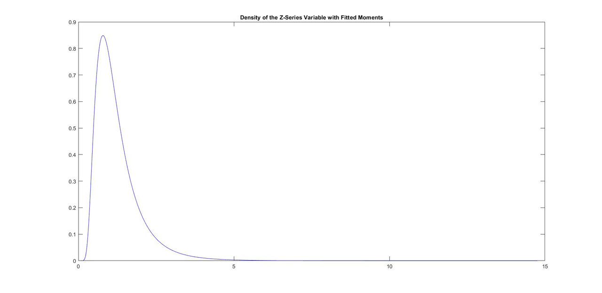](https://postimg.cc/tnhSYYcN)

---

### #1654 — Amin (Topic Author)
*December 30, 2022, 7:52 PM*

Friends, I want to describe my numerical strategy/algorithm to fit the Z-series coefficients to prescribed moments.

Following are the main points

1. The whole procedure is iterative.

2. In our standardized setup, the first moment is always zero. First moment of a Z-series density is given as
$c_0 + c_2 + 3 c_4 + 15 c_6$ which gives us the zero mean condition on$c_0$ as$c_0 = -( c_2 + 3 c_4 + 15 c_6) $ , so
whenever$c_2$ or$c_4$ or$c_6$ changes we again adjust$c_0$ to make sure that zero mean condition is satisfied. You will
see the above equation again and again in the iterative algorithm.

3. In our standardized setup, second standard  moment is always one. Whenever any coefficient changes, it changes the
effective second moment and we have to divide all coefficients with square root of (new) second moment which ensures
that second moment goes to one after the division with (altered new second moment after changing any coefficient).

By using step 2 and 3 above after changing any coefficient, we ensure that first and second moments remain standardized
to zero and one.

4. The most important clue I got when I was playing with moments was that coefficient c_1 is associated with second
moment, c_2 is associated with third moment, c_3 is associated with fourth moment and so on. If you calibrate moments to
an even (around median) density with zero skew, you will notice that there will only be non-zero values for c_1, c_3 ,
c_5, c_7 and c_2, c_4, c_6 will be exactly zero. So over time I gained some intuition that each of the moment has a
major coefficient of one smaller degree associated with it. Though other coefficients affect each moment, the principal
effect after accounting for effect from smaller coefficients is from the major coefficient.

5. Main algorithm is very simple. I start with c_0=0 and c_1 =1, and then I add third moment to calibration. I use
Newton-Raphson to alter c_2 until third moment is perfectly calibrated. Then I go back and make sure using step 2 by
altering c_0 that first moment goes to zero and ,step 3, divide by square-root of new second moment to ensure that
second moment is standardized again. Obviously when I alter c_0 and divide by square-root of first moment, the 3rd
moment that we calibrated with Newton-Raphson will slightly go out of calibration with third moment so we repeat the
whole process with Newton-Raphson again and then standardize again.

Once first three moments are calibrated, I alter c_3 according to Newton-Raphson so that fourth moment is perfectly
calibrated. But perfect calibration here means that first three moments would be slightly out again so calibration is
repeated on them to bring them in line again.

Once first four moments have been calibrated, I change c_4 using Newton-Raphson so that fifth moment is perfectly
calibrated. And then I repeat on all previous moments so that they remain in calibration.

So we continue till eight moments using the same procedure.

After a few iterations of the algorithm, the coefficients are firmly in the catchment of multi-dimensional Newton method
that finds exact calibration to moments in 2-3 iterations after that.

The algorithm works because once we calibrate a moment with Newton-Raphson using associated major coefficient, the newly
created mismatch in smaller moments is very little and decreases fast with every iteration of the algorithm.

Though I tried the algorithm on only first eight moments, you can safely use the algorithm for something like 12 moments
or higher if you wish.

Once you have the appropriate intuition, it is a very simple algorithm.

---

### #1655 — Amin (Topic Author)
*December 30, 2022, 8:11 PM*

Friends, in 2-3 days, I will post 5-7 matlab programs for dealing with Z-series densities. Some of the programs I have
posted before.

These programs will include

1. Calculation of probability density function, cumulative density function and associated value of standard normal.

2. Conversion from Z-series to Hermite series and back.

3. Calculation of variances using hermite polynomial series.

4. Addition of independent densities using squared coefficients of hermite polynomials. You do not need convolutions or
transforms for this anymore. This can make large changes for non-linear filtering and will make non-linear filtering
relatively simpler.

5. Calculation of Z-series representation of functions of the original Z-series random variable.

---

### #1656 — Amin (Topic Author)
*January 1, 2023, 7:31 AM*

Happy new year 2023 to all friends. I wish that this new year brings happiness, prosperity and success to all of us. And
I hope to present better research on my thread for friends this year than I have been able to do in past few years.

Friends, my research work on Z-series densities has become quite mature. We can almost do anything with Z-series
densities that we can do with other densities and this presentation is probably most general and it encompasses most
other densities. What is very interesting that we can find the Z-series density once we are given first few moments of
the random variable using my new algorithm. I also presented a method based on derivatives of densities using which any
known density can be converted into Z-series and presented an example program that finds Z-series density representation
from any lognormal density.

Here I presented the program to convert arbitrary lognormal density into Z-series representation which can easily be generalized to any other density with continuous derivatives to find its Z-series representation:  https://forum.wilmott.com/viewtopic.php?f=4&t=99702&start=1635#p873551   and

https://forum.wilmott.com/viewtopic.php?f=4&t=99702&start=1635#p873552

Since all of this is very interesting development for stochastics, probability theory and statistics, I want to write a
paper on Z-series densities, general formulas related to Z-series densities, and their derivation from known
distributions, and also their derivation from first eight moments of the random variable. I hope that first version of
the paper would be ready in 7-10 days. This is totally new research but open on internet so I want to request friends to
make sure nobody else could present the ideas as genuinely their own in some journal quickly even though most probably
my fears are completely baseless. Of course all friends are free to write their research based on top of ideas presented
in this thread and get it published but I hope they will acknowledge the basic work I have done.

Anyway, I am going to write a formal paper and present it here in 10-15 days.

---

### #1657 — Amin (Topic Author)
*January 1, 2023, 11:03 AM*

Friends a bit after writing the above post I went out for a walk as my only new year resolution is to lose weight. I had
walked one and a half kilometer and I was walking on an almost empty service road. There were a lot of people and also
quite some traffic on the main road. Two people in black jackets who had covered their faces with black woven face-masks
(not the covid medical ones but professional face-masks) approached me from behind on a motorcycle. They stopped me and
started asking why I was walking on the service road. Though they were not in uniform, they claimed they were police.
They started threatening me that I should not walk on the road and I must walk only on a track in the park otherwise
they would arrest me in the future. They continued to harass me for quite a bit until several people around noticed and
approached us and then both men left on the motorcycle.

I have walked on the same path several thousand times since I have been living in the present house in 2005. Some local
police staff even knows me and greets me when they sometime come across me in very early morning since I have been doing
that for more than a decade and they well recognize me.

I want to tell friends that people behind my persecution are becoming impatient and restless with all of this when
things are not going their way and they might ask Pakistan army to use force on me. Pakistan army lifts people who they
do not like on a daily basis, tortures them for a few days in confinement and then releases them on random streets and
then army feigns ignorance about all of this and it is said that unknown people lifted the victim. Everybody knows that
army lifted the victims but nobody mentions army and the word of "unknown people" is used about perpetrators of such
incident. Police and courts are never able to help any such victims.

When I started telling people about mind control nobody believed me and only later most of them realized the truth about
what I was trying to tell them. I want to tell friends that I would have been killed/shot in New York 25 years ago by
some planted mugger (with complete planning) or would have been given poison when my talent was discovered and they
failed to retard me since it was impossible for many people to stand or accept a Muslim with special neurotransmitters.
I remained alive only because a large number of people in the university had already come to know about it and if I were
killed, most of them would have known who was behind it. I bitterly wanted to remain in United States and work there but
once I realized that most people wanted to retard me with an iron fist, I knew I had no future there and I decided to
return to Pakistan and I know I made the right decision.

Later I remained alive since my family was assured when they cooperated that I would not be killed or made "special" and
again a large number of people in my broader family, army and several influential people in Pakistan got to know about
it. But the way people behind my persecution are becoming impatient again, I am seriously afraid they might do what they
never did 25 years ago in New York. I am very afraid they might give money to some mugger to shoot me or create some
other way to end my life with full cooperation and planning of Pakistan army. I want to tell friends very clearly that
if I had premature seemingly accidental death, it would never be accidental, it would be a completely pre-planned
murder.

---

### #1658 — Amin (Topic Author)
*January 1, 2023, 12:03 PM*

Though Z-series densities can be extremely helpful in inference and in so many other ways, they can also be extremely
helpful for simulation of random variables of difficult densities where only imperfect and difficult methods for
simulation exist. All you have to do is to be able to find derivatives of density of random variable and use them to
find equivalent Z-series random variable representation like I have done for lognormal density as in post 1636, and
1637. And then simulation of Z-series random variables only requires simulation of standard gaussian random variable
which is extremely well-understood.

I want to add several examples of conversion of random variables of different densities to random variables of Z-series
in my new upcoming paper.

---

### #1659 — Amin (Topic Author)
*January 2, 2023, 2:40 AM*

As friends are aware that an antipsychotic injection is forced on me due to machinations of mind control agency and
people backing it. American army gives money to Pakistan army generals (several hundred million dollars every year) who
among other things ask Pakistani psychiatrists to declare me schizophrenic despite that I am perfectly mentally sane and
in better mental shape than most of the psychiatrists themselves. psychiatrist following the orders of Pak army will
strictly detain me for several months if I do not take the injection. Most psychiatrists have a private army of about a
dozen poorly educated and low paid young men and there is little oversight about actions of the psychiatrists.

Anyway an antipsychotic injection is due in another two days. Most Fluanxol injections by lundbeck distributed in Lahore
city already have mind control drugs added at manufacturing source. And the effect of mind control chemicals added to
injections is so severe that it is very difficult to work for first ten days after the injection and I remain in an
extremely poor state of mind with far decreased consciousness.

I remained better for past three weeks since when I went to Kot Addu three weeks ago, the first thing I did in the city
was to buy antipsychotic injection before they would get the idea of drugging it and apparently the supply of injections
in Southern Punjab probably did not have mind control chemicals in it.

If it were not for these injections, mind control would not become effective on me. Mind control agencies have to ask
psychiatrists to declare me mentally ill so that I have to take some medicine/injections and then every medicine or
injections is distributed in the entire market with mind control chemicals to control me.

Despite that injections distributed in Lahore city are already drugged with mind control chemicals, I am very afraid
that mind control agencies might try to add even more mind control chemicals in special injections to control me. I
really want to request mainland European embassies to please keep a vigil on any such activity of Pakistan army and try
to stop them from any such thing. I really want to request good European people to urge their embassies to force the
military and influential people in Pakistan to end my mind control. I would have asked good American people to do the
same but American embassy is not controlled by American people, it is controlled by backers of industrial-military
complex where people are dying to retard me forever.

Now several people who do not like me are waiting for my getting injected.

---

### #1660 — Amin (Topic Author)
*January 2, 2023, 5:55 PM*

A very annoying practice of US army is that among many other high-handed practices, they stop emails and linkedin
messages of people they do not like. In past ten years there were numerous instances when they stopped my emails. Just
one incident I want to mention here is that I sent emails to each and every member of upper and lower houses of UK when
I was there in 2010. I tried to tell them about my persecution and how brazenly London city was getting drugged. Aside
from Britvic, there are four or five large departmental chains in UK and all of them were manufacturing beverages,
juices and bottled water that was thoroughly drugged with mind control chemicals. And every single one of the emails I
sent to members of both houses of parliament I sent was stopped. I went to Parliament house in London in person but I
was not allowed to enter inside despite that it was my legal right. They simply asked me that I should come after a week
as it was very cold. They were allowing everyone else to go inside. And they were becoming belligerent when I protested
and I never wanted a fight so I had to return.

There have been many many other instances when I tried to approach people in other countries and my emails or linkedin
messages were stopped.

---

### #1661 — Amin (Topic Author)
*January 4, 2023, 6:59 PM*

Friends, I started writing my paper this evening and wrote first three pages. I hope to quickly complete the paper in
next 5-7 days. Here is the image to first page while you can download the initial three pages from download file link
below.

.

.

.

[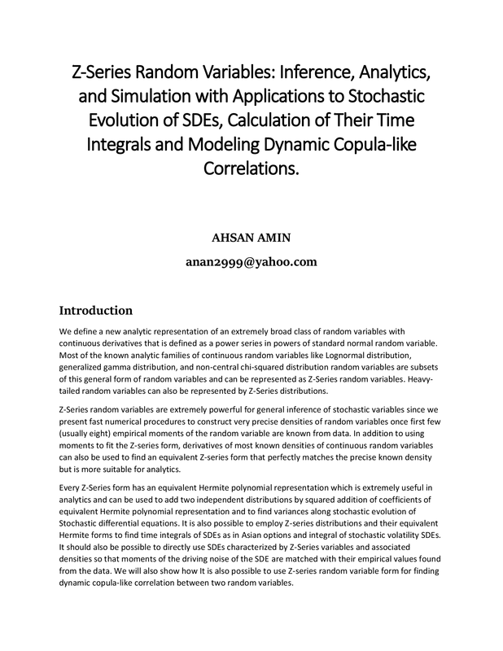](https://postimg.cc/nj09trYP)

Here is the file containing initial three pages.

 [Z-SeriesIntroduction02.pdf](./download/file.php?id=10152&sid=2e0bd677396989af17111de28d4a23fa)
(150.43 KiB) Downloaded 63 times

---

### #1662 — Amin (Topic Author)
*January 7, 2023, 7:49 AM*

Friends, in order to show how well the Z-series density construction from input moments, I have created a few examples.

I used three parameters of generalized gamma distribution to calculate its first eight raw moments. I fed these moments
as input to my Z-series density construction program posted above in post 1653 above on the same page. Then I compare
the Z-series density from fitted moments to original generalized gamma density from the same three parameters that were
used to calculate the moments. And then graph both Z-series density and generalized gamma density on top of each other.

Here are a few graphs from the above procedure.((I will also post matlab program to create these comparison graphs)

The following graphs show three parameters generalized Gamma distribution(as in wikipedia; [https://en.wikipedia.org/wiki/Generaliz ... stribution](https://en.wikipedia.org/wiki/Generalized_gamma_distribution))

as input and we calculates its eight raw moments. These first eight raw moments are input to our Z-series density moment
fitting program (post 1683) above and you can see that match from our Z-Series fitted density to generalized gamma
distribution is mostly exact.

Values of Parameters of the original Generalized gamma distribution a, d, and p are given on title of the graph.

.

[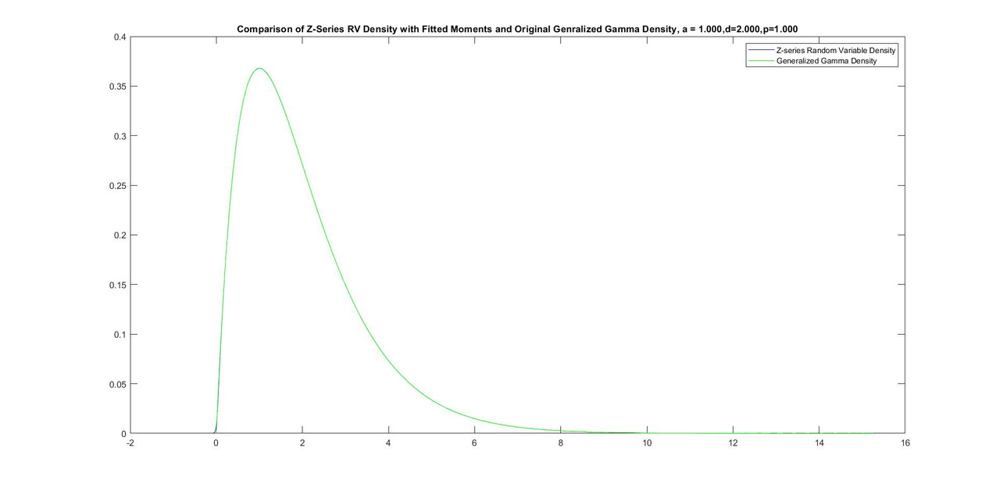](https://postimg.cc/xJMdYq0y)

[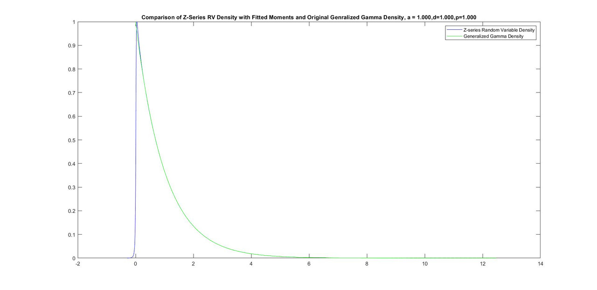](https://postimg.cc/4Kr3rpTx)

[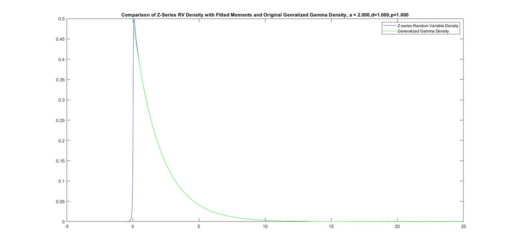](https://postimg.cc/bGGJC3W5)

[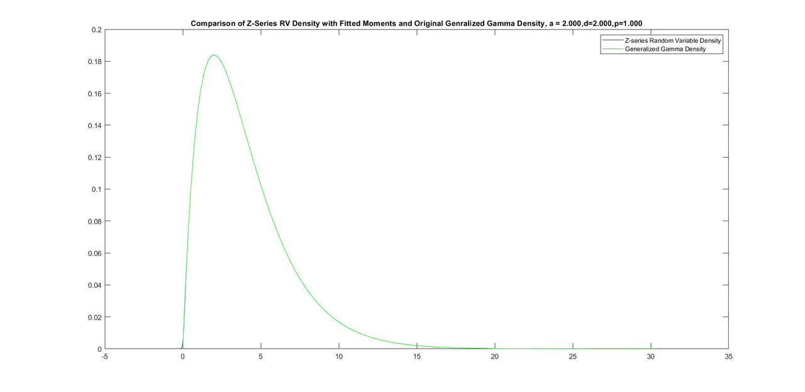](https://postimg.cc/pmLy82ZR)

[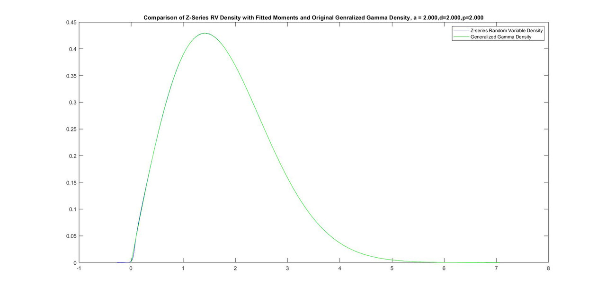](https://postimg.cc/CRr5sWPD)

.

.

.

Matlab program to generate above graphs is given below.

.

```
function [] = FitMomentsOfGeneralizedGammaRV(a,d,p)

%The following program takes three parameters of
%generalized Gamma distribution(as in wikipedia; https://en.wikipedia.org/wiki/Generalized_gamma_distribution)
%as input and calculates its raw moments. These first eight raw moments are
%input to our Z-series density moment fitting program (post 1683) at web
%address below
%https://forum.wilmott.com/viewtopic.php?f=4&t=99702&start=1650#p873803
%and you can see that
%match to generalized gamma distribution is mostly exact.

%Below calculate first eight raw moments of generalized gamma distribution.
rMu(1:8)=0;
for nn=1:8
    rMu(nn)=a^nn*gamma((d+nn)/p)/gamma(d/p);
end

%Feed those raw moments to our Z-series random variable estimation program
[c0,c,FittedMoments] = CalculateZSeriesDensityFromRawMoments02(rMu);

%Below construct generalized gamma density on Gaussian grid.
%First calculate normal random variable on a grid below
dNn=.1/2;   % Normal density subdivisions width. would change with number of subdivisions
Nn=45*4;  % No of normal density subdivisions
NnMid=((1+Nn)/2)*dNn;
Z(1:Nn)=(((1:Nn)*dNn)-NnMid);
%Z
%str=input('Look at Z');
%Now calculate Y as a function of normal random variable.
Y(1:Nn)=c0;
for nn=1:7
    Y(1:Nn)=Y(1:Nn)+c(nn)*Z(1:Nn).^nn;
end

%Now take change of densities derivative of Y with respect to normal
DfY(1:Nn)=0;
for nn=2:Nn-1
    DfY(nn) = (Y(nn + 1) - Y(nn - 1))/(Z(nn + 1) - Z(nn - 1));
    %Change of variable derivative for densities
end
DfY(Nn)=DfY(Nn-1);
DfY(1)=DfY(2);

%Now calculate the density of Y from density of normal random variable
%using change of probability derivative.
pY(1:Nn)=0;
for nn = 1:Nn
    pY(nn) = (normpdf(Z(nn),0, 1))/abs(DfY(nn));
end

%Below calculate generalized gamma distribution from defintion of its
%probability density given the parameters a, d and p.
X(1)=0;
X(5000+1)=Y(Nn);
Delta=(Y(Nn))/5000;

X(2:5001)=X(1)+(1:5000)*Delta;

Xpdf = p/a^d/gamma(d/p).*X.^(d-1).*exp(-(X./a).^p);

plot(Y(1:Nn),pY(1:Nn),'b',X(1:5001),Xpdf(1:5001),'g');
title(sprintf('Comparison of Z-Series RV Density with Fitted Moments and Original Genralized Gamma Density, a =
%.3f,d=%.3f,p=%.3f', a,d,p));

%title('Comparison of Z-Series RV Density with Fitted Moments and Original Genralized Gamma Density');
legend({'Z-series Random Variable Density','Generalized Gamma Density'},'Location','northeast')

str=input('Look at comparison between Z-series Fitted Density and original Generalized Gamma Density');

end
```

.

.

.

I will like to mention here that sometimes density fitted with Z-series random variables is not a good fit. Mostly it
can have two reasons.

1.  Some more moments are needed to perfectly fit the Z-series density and first eight moments might not be enough to
pin the density.

2. Sometime fitted density of Z-series variable goes into origin(zero) and then folds back onto itself and becomes
positive again. In such cases, we would have to add both branches of the density to get one single estimate of the
density. I have still not done that in my experimental programs and would do that in next few days. Please keep checking
the thread. After adding both branches of the density we would get a perfect estimate of the true density.

I really want to request friends to not confuse this new method with Gram-Charlier or edgeworth expansions. It fits
perfectly to input moments and gives a shape of distribution that is very close to original shape when the true shape is
known as in above examples.

---

### #1663 — Amin (Topic Author)
*January 8, 2023, 10:26 AM*

Friends, Pakistan army is drugging Lahore city at a very fast pace again on behest of CIA. Earlier they were confined to
neighborhoods close to Johar Town where I live but not they are drugging food and beverages in even remote areas. This
has been going on for past 5-6 days. I really thought that people will take notice of it and stop the army but they are
ruthlessly drugging the whole city. They go into markets and drug the water, food and beverages on the shelves in entire
markets. People who are aware of tactics of CIA know what I am talking about.

I want to request good American friends to pressurize their government to stop ruthless drugging of Lahore city on
behest of CIA to corner me. I also believe that CIA, and Pak army have connived with my family if I could be targeted
with special drugs, then I might lose my senses and my father would restart my treatment saying that I lost my mental
balance and he had to act to help me in the extreme case. CIA and Pak Army have are machinating again to detain me with
some psychiatrist and restart injections and antipsychotic medicine filled with mind control drugs.

I really want to request good American friends to intervene now before it is too late.

I also want to request Europeans to ask their embassies to keep a vigil and continue to monitor the tactics of CIA as
they drug Lahore city. Please ask them to stay in touch with the matter using their sources to know the reality of mind
control as it is also used on a lot of talented Europeans. This way European nations would also have true knowledge
about the nature of mind control.

I have been able to hold for past few days since I have been very careful about food. I still got hit with bad food
several times but was able to recover and remain perfectly sane since there is still some good food available on stores
if one is careful.

I again want to request American friends to help me and force CIA to stop drugging Lahore city.

---

### #1664 — Amin (Topic Author)
*January 9, 2023, 6:08 PM*

Friends, my work is going very slowly and on most of the past days I could not work. Also because I remained down after
taking drugged food. But here is the next incremental version of the Z-series paper. I will really try to complete the
first version by the end of coming weekend if things go well. Here is the link to current incremental version in which I
have described how to find Z-series of function transformation of a random variable if original Z-series of the random
variable is known. I have also described how to convert from Z-series coordinates to hermite polynomial coordinates. I
have also described how to add two independent Z-series random variables through squared addition of hermite polynomial
representation coefficients.

I want to mention that function transformations of the Z-series random variables are done in original Z-series
coordinates while analytics like addition of independent variables and variances is done in Hermite polynomial
coordinates.

Here is the new incremental version of the paper. [attachment=0]Z-SeriesIntroductionA1.pdf[/attachment]

I will really try to complete the first version by the end of coming weekend if things go well and I am not hit hard by
mind control drugs being spread all over the city by military secret services.

---

### #1665 — Amin (Topic Author)
*January 14, 2023, 4:23 PM*

Friends, another new idea that I want to include in my new paper is about non-linear regressions with Z-Series Hermite
polynomials. The standard linear regression that we currently use is as if we are regressing on data represented by
first hermite polynomial. But with Z-Series, we can extend the idea of linear regression on first hermite to non-linear
regressions on multiple hermite polynomials.

Suppose we want to do a nonlinear regression on W from two explanatory variables X and Y

I will give brief details to outline the new method in a few points.

First we would have to find Z-series representation of all the variables involved including regressand and regressors.
Usually this would be done by calculating moments of all the data and fitting a Z-series density on each of the
regressand and regressors.

For example in our case we would have.

First we find Z-Series of regressand

$W=a_0 + a_1 \, Z_1 + a_2 \, Z_1^2 + a_3 \, Z_1^3 + a_4 \, Z_1^4 + ... +a_7 \, Z_1^7$

Then we find Z-series of regressors

$X=b_0 + b_1 \, Z_2 + b_2 \, Z_2^2 + b_3 \, Z_2^3 + b_4 \, Z_2^4 + ... +b_7 \, Z_2^7$

$Y=c_0 + c_1 \, Z=3 + c_2 \, Z_3^2 + c_3 \, Z_3^3 + c_4 \, Z_3^4 + ... +c_7 \, Z_3^7$

Then we convert from Z-Series representation to hermite representation as I have done many times on this forum and also
mentioned in last incomplete version of my paper above as

$W=ah_0 + ah_1 \, H_1(Z_1) + ah_2 \, H_2(Z_1) + ah_3 \, H_3(Z_1) + ah_4 \, H_4(Z_1) + ... +ah_7 \, H_7(Z_1)$

and

$X=bh_0 + bh_1 \, H_1(Z_2) + bh_2 \, H_2(Z_2) + bh_3 \, H_3(Z_2) + bh_4 \, H_4(Z_2) + ... +bh_7 \, H_7(Z_2)$

$Y=ch_0 + ch_1 \, H_1(Z_3) + ch_2 \, H_2(Z_3) + ch_3 \, H_3(Z_3) + ch_4 \, H_4(Z_3) + ... +ch_7 \, H_7(Z_3)$

The purpose of converting to hermites is that we can convert our problem of regression into several sub-problems since
hermite polynomials are orthogonal to each other.

We want to regress each hermite polynomial term of the regressand on same order hermite polynomial terms of the
regressors

Now we regress 1st hermite term of regressand on first hermite terms of regressors as

Here $k_{11}$ and $k_{12}$ are regression coefficients that we will find through ordinary least squares algorithm.

$ah_1 \, H_1(Z_1) =k_{11} (bh_1 \, H_1(Z_2) )+k_{12} (ch_1 \, H_1(Z_3))$

and for second hermite polynomial regress as

Here $k_{21}$ and $k_{22}$ are regression coefficients that we will find through ordinary least squares algorithm.

$ah_2 \, H_2(Z_1) =k_{21} (bh_2 \, H_2(Z_2) )+k_{22} (ch_2 \, H_2(Z_3))$

and for third polynomial ,we will regress as

$ah_3 \, H_3(Z_1) =k_{31} (bh_3 \, H_3(Z_2) )+k_{32} (ch_3 \, H_3(Z_3))$

after doing these regressions to possibly seventh order, and finding$k_{n1}$ and$k_{n2}$ through least squares
algorithm, we could write the non-linear regression relationship solution for W as

$W=k_0+\displaystyle\sum_{n=1}^{7} \, k_{n1} \, bh_n \, H_n(Z_2) +\displaystyle\sum_{n=1}^{7} \, k_{n2} \, ch_n \, H_n(Z_3) $

Friends, I am sure that this new method and its variants would be able to find all sorts of non-linear relationships
that we could not find with linear regressions. And it would also make new AI a lot more efficient.

I urge friends to play with this method. I will also include it in the applications of Z-series in my working research
paper.

---

### #1666 — Amin (Topic Author)
*January 14, 2023, 4:24 PM*

Sorry, doubled.

Friends, another new idea that I want to include in my new paper is about non-linear regressions with Z-Series Hermite
polynomials. The standard linear regression that we currently use is as if we are regressing on data represented by
first hermite polynomial. But with Z-Series, we can extend the idea of linear regression on first hermite to non-linear
regressions on multiple hermite polynomials.

Suppose we want to do a nonlinear regression on W from two explanatory variables X and Y

I will give brief details to outline the new method in a few points.

First we would have to find Z-series representation of all the variables involved including regressand and regressors.
Usually this would be done by calculating moments of all the data and fitting a Z-series density on each of the
regressand and regressors.

For example in our case we would have.

First we find Z-Series of regressand

$W=a_0 + a_1 \, Z_1 + a_2 \, Z_1^2 + a_3 \, Z_1^3 + a_4 \, Z_1^4 + ... +a_7 \, Z_1^7$

Then we find Z-series of regressors

$X=b_0 + b_1 \, Z_2 + b_2 \, Z_2^2 + b_3 \, Z_2^3 + b_4 \, Z_2^4 + ... +b_7 \, Z_2^7$

$Y=c_0 + c_1 \, Z=3 + c_2 \, Z_3^2 + c_3 \, Z_3^3 + c_4 \, Z_3^4 + ... +c_7 \, Z_3^7$

Then we convert from Z-Series representation to hermite representation as I have done many times on this forum and also
mentioned in last incomplete version of my paper above as

$W=ah_0 + ah_1 \, H_1(Z_1) + ah_2 \, H_2(Z_1) + ah_3 \, H_3(Z_1) + ah_4 \, H_4(Z_1) + ... +ah_7 \, H_7(Z_1)$

and

$X=bh_0 + bh_1 \, H_1(Z_2) + bh_2 \, H_2(Z_2) + bh_3 \, H_3(Z_2) + bh_4 \, H_4(Z_2) + ... +bh_7 \, H_7(Z_2)$

$Y=ch_0 + ch_1 \, H_1(Z_3) + ch_2 \, H_2(Z_3) + ch_3 \, H_3(Z_3) + ch_4 \, H_4(Z_3) + ... +ch_7 \, H_7(Z_3)$

The purpose of converting to hermites is that we can convert our problem of regression into several sub-problems since
hermite polynomials are orthogonal to each other.

We want to regress each hermite polynomial term of the regressand on same order hermite polynomial terms of the
regressors

Now we regress 1st hermite term of regressand on first hermite terms of regressors as

Here $k_{11}$ and $k_{12}$ are regression coefficients that we will find through ordinary least squares algorithm.

$ah_1 \, H_1(Z_1) =k_{11} (bh_1 \, H_1(Z_2) )+k_{12} (ch_1 \, H_1(Z_3))$

and for second hermite polynomial regress as

Here $k_{21}$ and $k_{22}$ are regression coefficients that we will find through ordinary least squares algorithm.

$ah_2 \, H_2(Z_1) =k_{21} (bh_2 \, H_2(Z_2) )+k_{22} (ch_2 \, H_2(Z_3))$

and for third polynomial ,we will regress as

$ah_3 \, H_3(Z_1) =k_{31} (bh_3 \, H_3(Z_2) )+k_{32} (ch_3 \, H_3(Z_3))$

after doing these regressions to possibly seventh order, and finding$k_{n1}$ and$k_{n2}$ through least squares
algorithm, we could write the non-linear regression relationship solution for W as

$W=k_0+\displaystyle\sum_{n=1}^{7} \, k_{n1} \, bh_n \, H_n(Z_2) +\displaystyle\sum_{n=1}^{7} \, k_{n2} \, ch_n \, H_n(Z_3) $

Friends, I am sure that this new method and its variants would be able to find all sorts of non-linear relationships
that we could not find with linear regressions. And it would also make new AI a lot more efficient.

I urge friends to play with this method. I will also include it in the applications of Z-series in my working research
paper.

---

### #1667 — Amin (Topic Author)
*January 14, 2023, 4:39 PM*

>
> Sorry, doubled.
>
> Friends, another new idea that I want to include in my new paper is about non-linear regressions with Z-Series Hermite
polynomials. The standard linear regression that we currently use is as if we are regressing on data represented by
first hermite polynomial. But with Z-Series, we can extend the idea of linear regression on first hermite to non-linear
regressions on multiple hermite polynomials.
>
> Suppose we want to do a nonlinear regression on W from two explanatory variables X and Y
>
> I will give brief details to outline the new method in a few points.
>
> First we would have to find Z-series representation of all the variables involved including regressand and regressors.
Usually this would be done by calculating moments of all the data and fitting a Z-series density on each of the
regressand and regressors.
>
> For example in our case we would have.
>
> First we find Z-Series of regressand
>
> $W=a_0 + a_1 \, Z_1 + a_2 \, Z_1^2 + a_3 \, Z_1^3 + a_4 \, Z_1^4 + ... +a_7 \, Z_1^7$
>
> Then we find Z-series of regressors
>
> $X=b_0 + b_1 \, Z_2 + b_2 \, Z_2^2 + b_3 \, Z_2^3 + b_4 \, Z_2^4 + ... +b_7 \, Z_2^7$
>
> $Y=c_0 + c_1 \, Z=3 + c_2 \, Z_3^2 + c_3 \, Z_3^3 + c_4 \, Z_3^4 + ... +c_7 \, Z_3^7$
>
>
>
> Then we convert from Z-Series representation to hermite representation as I have done many times on this forum and
also mentioned in last incomplete version of my paper above as
>
> $W=ah_0 + ah_1 \, H_1(Z_1) + ah_2 \, H_2(Z_1) + ah_3 \, H_3(Z_1) + ah_4 \, H_4(Z_1) + ... +ah_7 \, H_7(Z_1)$
>
> and
>
> $X=bh_0 + bh_1 \, H_1(Z_2) + bh_2 \, H_2(Z_2) + bh_3 \, H_3(Z_2) + bh_4 \, H_4(Z_2) + ... +bh_7 \, H_7(Z_2)$
>
> $Y=ch_0 + ch_1 \, H_1(Z_3) + ch_2 \, H_2(Z_3) + ch_3 \, H_3(Z_3) + ch_4 \, H_4(Z_3) + ... +ch_7 \, H_7(Z_3)$
>
>
>
> The purpose of converting to hermites is that we can convert our problem of regression into several sub-problems since
hermite polynomials are orthogonal to each other.
>
> We want to regress each hermite polynomial term of the regressand on same order hermite polynomial terms of the
regressors
>
> Now we regress 1st hermite term of regressand on first hermite terms of regressors as
>
> Here $k_{11}$ and $k_{12}$ are regression coefficients that we will find through ordinary least squares algorithm.
>
> $ah_1 \, H_1(Z_1) =k_{11} (bh_1 \, H_1(Z_2) )+k_{12} (ch_1 \, H_1(Z_3))$
>
> and for second hermite polynomial regress as
>
> Here $k_{21}$ and $k_{22}$ are regression coefficients that we will find through ordinary least squares algorithm.
>
> $ah_2 \, H_2(Z_1) =k_{21} (bh_2 \, H_2(Z_2) )+k_{22} (ch_2 \, H_2(Z_3))$
>
> and for third polynomial ,we will regress as
>
> $ah_3 \, H_3(Z_1) =k_{31} (bh_3 \, H_3(Z_2) )+k_{32} (ch_3 \, H_3(Z_3))$
>
>
>
> after doing these regressions to possibly seventh order, and finding$k_{n1}$ and$k_{n2}$ through least squares
algorithm, we could write the non-linear regression relationship solution for W as
>
>
>
>
$W=k_0+\displaystyle\sum_{n=1}^{7} \, k_{n1} \, bh_n \, H_n(Z_2) +\displaystyle\sum_{n=1}^{7} \, k_{n2} \, ch_n \, H_n(Z_3) $
>
>
>
> Friends, I am sure that this new method and its variants would be able to find all sorts of non-linear relationships
that we could not find with linear regressions. And it would also make new AI a lot more efficient.
>
> I urge friends to play with this method. I will also include it in the applications of Z-series in my working research
paper.
>
.

.

.

Friends, please keep in mind that when we are regressing to find$k_{n1}$ and$k_{n2}$ , we would have to arrange the data
into observations as in ordinary least square regressions.

So in the regression for first hermite polynomial below

$ah_1 \, H_1(Z_1) =k_{11} (bh_1 \, H_1(Z_2) )+k_{12} (ch_1 \, H_1(Z_3))$

We use the tuple (Z1,Z2,Z3) associated with each of the joint observations of (W,X,Y) that are observed together. This
tuple will be different for each observation in set of data and would be found by inverting the observation from
original variable into underlying Z in each of the Z-series representation and we would use the same tuple with
different hermite polynomials regressions associated with the same observation.

So for second hermite polynomial regression associated with the same observation, we would use the same tuple (Z1,Z2,Z3)
as we used for first hermite polynomial for the same observation.

---

### #1668 — Amin (Topic Author)
*January 16, 2023, 6:01 PM*

Friends, I am writing this post to request for help against continuing torture with mind control. During past one day,
they have released gas on me in my room several times. They have dozens of different gases they use to control their
targets and this particular one is very sickening and makes it very difficult to breathe. They also continue to try to
target me with bad food and water everyday. Most of the bakeries in adjacent areas and a large number of small
restaurants have been given drugs by army to freely add to their cooked food so when a victim would eat food at some
restaurant or baker in the area, he would automatically get mind control chemicals. Water and beverages are extremely
thoroughly drugged in large number of areas in the city and I have to drive 10 to 15 kilometers into other sides of the
city to get good water. Even though I try to be very careful and go to remote parts of the city to get water and food, I
still got hit with mind control drugs several times in past few days.

But a very difficult thing is to be forced to breathe when they have released sickening mind control gases in the room.
Please protest against mind control torture of innocent people by rich gold-fathers of united states who beacon US
military to torture innocent people due to their hatred and venom for muslims and many others.

---

### #1669 — Amin (Topic Author)
*January 18, 2023, 10:57 AM*

Friends, very sorry that I was unable to complete first preliminary version of the paper by end of last weekend. I had
to fight both the widespread drugging of food and water in Lahore city and the super-sedating effect of antipsychotic
injection. But I have done enough work and in next 3-4 days, I will complete preliminary work on most sections of the
Z-Series paper and also point to related matlab programs already posted on this forum in a way that most friends would
easily understand everything. I will release this first preliminary version in next 3-4 days.

I will continue to work to improve it later and release new versions but a self-contained initial version should be
ready in 3-4 days. Very sorry again for this delay.

---

### #1670 — Amin (Topic Author)
*January 18, 2023, 5:34 PM*

Friends, I am writing this post again to complain about constant release of gas in my room by mind control agents.
Despite it is so cold, I keep window of my room totally open to have fresh air in my room but mind control agents
continue to release gas in my room and I continue to feel constant smell of gas accompanied with difficulty in
breathing. This is really annoying since I continue to complain about the same thing but mind control agents never seem
to care and continue to release gas in my room.

I want to request friends to please protest to mind control agency and American defense against brazen use of sickening
and brain-numbing gases on peaceful civilians.

---

### #1671 — Amin (Topic Author)
*January 18, 2023, 6:02 PM*

Friends, I am working on a new matlab program with stochastic volatility monte carlo simulation. In this program, you
can construct the Z-series density of both the asset and stochastic volatility from the simulated raw moments that are
found in monte carlo simulation. I want to use this program to calculate non-linear correlation between orthogonal
variance components of the simulated variables. I also want to use this program as an example of non-linear regression
with regression broken up on orthogonal polynomial basis as I suggested a few posts ago.

However one most important thing I learnt that if we want to construct the density in original coordinates, it would be
really advisable and prudent to convert the simulation into bessel coordinates and then fit bessel coordinates simulated
moments on the Z-series density. If we try to construct the density in original coordinates(simulated), then many times
noise in simulation is so high that inaccuracies in simulated tails throw moment away and it becomes very difficult to
construct the Z-series density. For example, in original coordinates, I noticed that Z-series density from simulated
moments could be constructed on one monte carlo step but could not be constructed for next several steps and then could
again be constructed for a few time steps and so on. This is because variance and tails are much larger in original
coordinates and hence simulated moments can have large inaccuracies due to slight inaccuracies in simulation.

However, we can easily construct Z-series densities from simulated moments in Bessel coordinates and it almost always
works very nicely due to decreased variance and much smaller tails. And we can always convert these Z-series densities
in Bessel coordinates to densities in original coordinates using functional transformation of the Bessel density. Mostly
Z-series constructed densities from simulation are just as good as our analytic densities were that we constructed from
addition of cumulants method in the past and overlay the monte carlo density very well just as niscely as the analytic
densities we earlier constructed.

I hope to post new matlab programs on Friday or Saturday.

---

### #1672 — Amin (Topic Author)
*January 19, 2023, 3:51 AM*

> However one most important thing I learnt that if we want to construct the density in original coordinates, it would
be really advisable and prudent to convert the simulation into bessel coordinates and then fit bessel coordinates
simulated moments on the Z-series density. If we try to construct the density in original coordinates(simulated), then
many times noise in simulation is so high that inaccuracies in simulated tails throw moment away and it becomes very
difficult to construct the Z-series density. For example, in original coordinates, I noticed that Z-series density from
simulated moments could be constructed on one monte carlo step but could not be constructed for next several steps and
then could again be constructed for a few time steps and so on. This is because variance and tails are much larger in
original coordinates and hence simulated moments can have large inaccuracies due to slight inaccuracies in simulation.
We can perform monte carlo simulation in any coordinates people prefer. But for finding the density, we simply need to
transform the simulated data from original coordinates to bessel coordinates by using transformation,
w=x^(1-gamma)/(1-gamma).

You can do actual simulation in any coordinates you prefer which would usually be original coordinates. Only simulated
data has to be transformed to find the Z-series representation in a stable way in Bessel coordinates.

---

### #1673 — Amin (Topic Author)
*January 19, 2023, 6:40 PM*

Friends, in this post I want to present the ideas about hermite-specific correlation and regression that I have been
mentioning for some time.

Suppose we have Z-series hermite representations of two correlated random variables as

$X= ah_0 \, + \, ah_1 H_1(Z_1)\, + \, ah_2 H_2(Z_1)\, + \, ah_3 H_3(Z_1)\, + \, ... + \, ah_n H_n(Z_1) $

and for Y

$Y= bh_0 \, + \, bh_1 H_1(Z_2)\, + \, bh_2 H_2(Z_2)\, + \, bh_3 H_3(Z_2)\, + \, ... + \, ah_n H_n(Z_2) $

please note that in hermite representation the constant term in RHS is always equal to mean. So we could have equally
written

$X= \mu_X \, + \, ah_1 H_1(Z_1)\, + \, ah_2 H_2(Z_1)\, + \, ah_3 H_3(Z_1)\, + \, ... + \, ah_n H_n(Z_1) $

$Y= \mu_Y \, + \, bh_1 H_1(Z_2)\, + \, bh_2 H_2(Z_2)\, + \, bh_3 H_3(Z_2)\, + \, ... + \, ah_n H_n(Z_2) $

Suppose we have a large set of observations in pairs of X and Y and we want to find their hermite-wise correlation. This
is only very natural since all hermite polynomial components of variance within each of the probability distribution are
orthogonal to each other.

Suppose we have a total of P (as in total paths of joint evolution of both stochastic processes)  joint observations of
stochastic processes X and Y.

For Finding Correlation between first hermite polynomial components, we write the equation for the correlation between
first hermites as

$\rho_{XY,1} \, = \,  \frac{\displaystyle\sum_{p=1}^{P} ah_1 \, Z_{1,p} \, bh_1 \, Z_{2,p} \,}{\sqrt{\displaystyle\sum_{p=1}^{P} ah_1^2 \, {Z_{1,p}}^2 \,\displaystyle\sum_{p=1}^{P} \, bh_1^2 \, {Z_{2,p}}^2 \,}}$

Please notice that for calculation of above equation, we first have to find the specific values of$ Z_{1,p}$ and
$Z_{2,p}$ that are associated with particular pth observation of$X_p$ and$Y_p$ by some inversion method. I will comment
on this inversion at the end of this post.

Similarly for 2nd hermite polynomial, we would have the correlation between X and Y equation calculated over joint
observations of RVs as

$\rho_{XY,2} \, = \,  \frac{\displaystyle\sum_{p=1}^{P} ah_2 \, ({Z_{1,p}}^2-1) \, bh_2 \, ({Z_{2,p}}^2-1) \,}{\sqrt{\displaystyle\sum_{p=1}^{P} ah_2^2 \, {(Z_{1,p}^2-1)}^2 \,\displaystyle\sum_{p=1}^{P} \, bh_2^2 \, {({Z_{2,p}}^2-1})^2 \,}}$

similarly for nth hermite polynaomial correlations, we would write as

$\rho_{XY,n} \, = \,  \frac{\displaystyle\sum_{p=1}^{P} ah_n \, H_n(Z_1) \, bh_n \, H_n(Z_2) \,}{\sqrt{\displaystyle\sum_{p=1}^{P} ah_n^2 \, {H_n(Z_1)}^2 \,\displaystyle\sum_{p=1}^{P} \, bh_n^2 \, {H_n(Z_2)}^2 \,}}$

Please note that correlations are in joint products of hermite polynomials and their coefficients are only good to make
sure they are non-zero and are important to determine the sign of correlation only.

We know from simple regression theory that once we know correlation between two variables, we can write the regression
equation between them as

$Y \, = \, \mu_Y \, + \, \rho_{XY} \frac{s_Y}{s_X} \, (X\, - \, \mu_X) $

So we could write a variant of the above traditional formula in our new case with hermite correlations as

$Y \, = \, \mu_Y \, + \, \rho_{XY,1} \frac{bh_1}{ah_1} \, Z_1 \, + \, \rho_{XY,2} \frac{bh_2}{ah_2} \, ({Z_1}^2 -1) \, + \, \rho_{XY,3} \frac{bh_3}{ah_3} \, ({Z_1}^3 -3 Z_1) + ...+\, \rho_{XY,n} \frac{bh_n}{ah_n} \, H_n(Z_1)$

There is one caveat and that is when we are in mote carlo framework and we want to find above correlations and
regressions, we have to invert extremely large number of observations of X and Y to find their underlying Z's as monte
carlo paths usually would be very large. But this can safely be done by inverse-series in Bessel coordinates. The
specific value of Z associated with observed/simulated data points remains the same in both bessel and original
coordinates. Finding them in Bessel coordinates has extremely small error for most SDE distributions I encountered in 2D
stochastic volatility models when inverse-series method is used. The error is somewhat larger in deep tails  but still
quite small and we would get very valid estimates of correlations and regressions using this series inversion method as
used in mathematica.

Using series inversion in original coordinates would generally have much larger errors deep in the tail. But since The
specific value of Z associated with observed/simulated data points remains the same in both bessel and original
coordinates, we can find them in bessel coordinates (for much better accuracy) and then safely use the same value of Z
for correlation and regression analytics in original coordinates.

I hope to post a worked out matlab program on this in another 2 days.

---

### #1674 — Amin (Topic Author)
*January 20, 2023, 2:01 PM*

Friends, I want to make a special request for help in this post. As I told friends several times, I have been on
antipsychotics since 1999 with the exception of a few brief periods of a few months each. Doctor says the reason behind
forcing antipsychotics on me are my baseless fears that CIA somehow wants to hurt me and damage my brain. Doctors call
me paranoid schizophrenic. Psychiatrists are very aware that I am perfectly healthy but they connive with Pakistan
military who ask them to declare me mentally sick, and use force when I argue against their forced treatment. Most
friends in US know about mind control have learnt over time that CIA in fact does try to retard innocent civilians who
they do not like for whatever reasons. Many people even know complete truth how innocent victims are cornered by adding
mind control drugs in the food, beverages and water supply of entire cities on behest of CIA. And when a victim
complains about it, he is called schizophrenic and this has become a very useful tactic in the hands of CIA and military
agencies to target and victimize people they do not like.

Though I never liked antipsychotics, I have been taking them in one form or another for more than past twenty years.
When I was young, I was still able to take antipsychotics and run for a few kilometers everyday and be able to work
since I used to have enough energy and stimulation. But I am already 50 years old now and it continues to become very
difficult for my body to stand antipsychotic medication now. I am excessively over-weight due to low metabolism rate
associated with decades of antipsychotics. My current weight is roughly 108 Kg which is more than thirty kilograms
higher than the right weight for my height. I suffer from so many other physical problems due to antipsychotics. For
example in the two weeks following an antipsychotic injection (fluanxol) that is given to me every 23 days, my breathing
remains disturbed and is remarkably noisy as compared to breathing of an ordinary healthy human. Sometimes, I would even
give involuntarily snorting like sounds when breathing. And many times I would have difficulty sleeping at night due to
heavy and forced breathing. My family and doctors are not ready to compromise on my antipsychotics so it is useless to
argue with them to end the antipsychotics as I have tried this several times to no avail. My heart beat that used to be
around 75 more than 20 years ago as I recall, now remained around 120 for past twenty years due to high antipsychotics.
These antipsychotics continue to slowly weaken the heart and negatively affect its functioning. I am grateful that I
still do not have diabetes but I am sure that I would be diabetic in next few years because of high weight and low
metabolism. Continued use of antipsychotics also have a positive correlation with diabetes even when controlled for
other factors like weight. Due to continued use of antipsychotics at old age of 50 years, I am rarely upbeat and mostly
remain lethargic and highly sedated. I have constant body aches and pains due to weakness caused by continued use of
antipsychotics.

I know I can do some good research but it is only possible since this is the only thing I did in past twenty years of my
life. Apart from research, there is no bright spot especially regarding my body and physical health. I really want to
request American friends to please force your government and military agencies to not force psychiatrists to give me any
more antipsychotics. My greatest wish at this part of my life is to be able to live a life without antipsychotics forced
on me. I really cannot thank friends enough who could lobby for this or protest to American army against forced
antipsychotics on me. Please help me me live a life without antipsychotics and I would be truly grateful to you.

---

### #1675 — Marsden
*January 20, 2023, 5:06 PM*

Amin, what do you understand the CIA's interest in you to be that they would want you declared paranoid schizophrenic
and put on antipsychotics?

---

### #1676 — Amin (Topic Author)
*January 21, 2023, 4:55 AM*

Marsden, you were at forefront of calling me paranoid schizophrenic when British had drugged beverages, water and a lot
of food in London and police was harassing me everyday. My thread is filled with all the details. All your humanity is
about pretending innocence and naivette so that 24 years of torture on me could continue.

I really want to request people if they really have any true humanity to please forgive me now. At this age it is too
difficult for me to take antipsychotic torture cruelly forced on me.

When I write about my cruel treatment somebody always makes someone insensitive on this forum to cast doubt on my health
that I am indeed schizophrenic and my torture really should continue.

---

### #1677 — Amin (Topic Author)
*January 21, 2023, 7:42 PM*

Friends, another side effect of antipsychotics I forgot to mention was that my vision is getting impaired. About three
years ago when I was given the same injection fluanxol, I went to see a doctor about my eye sight and he suggested I
should use glasses. I bought two pairs of glasses and started using them. But later there was a two and a half month
period in which I was not taking antipsychotics and my eye-sight became good again (This was about two years ago.) and I
stopped using glasses. Most of us take our good eyesight for granted but it is a real joy to see the world perfectly in
its good colors and we only value it when we lose those colors. Though I am not using glasses again but my eyesight has
deteriorated remarkably again and sometimes I am seriously afraid that this would be irreversible this time.

I want friends to know that I like to try doing good research and sharing it with others and I would really want to
continue doing that regardless of what happens. But please do not strip me of the joy of living something that happens
when people are forced on antipsychotics. Since I am not young anymore, when antipsychotic injection is given to me, for
two weeks after that, it is difficult for me to even pass time and it feels as if some heavy sack has been placed on my
head. I want to request people to please do not be cruel to people who try to be good.

---

### #1678 — Marsden
*January 21, 2023, 10:32 PM*

>
> Marsden, you were at forefront of calling me paranoid schizophrenic when British had drugged beverages, water and a
lot of food in London and police was harassing me everyday. My thread is filled with all the details. All your humanity
is about pretending innocence and naivette so that 24 years of torture on me could continue.
>
> I really want to request people if they really have any true humanity to please forgive me now. At this age it is too
difficult for me to take antipsychotic torture cruelly forced on me.
>
> When I write about my cruel treatment somebody always makes someone insensitive on this forum to cast doubt on my
health that I am indeed schizophrenic and my torture really should continue.
>

Amin, I asked you what you understood the CIA's interest in you to be that they would want you declared paranoid
schizophrenic and put on antipsychotics. You might have answered that to the best of your ability.

Instead you accuse me of hostility and insensitivity toward you and pointed me to the depths of this 1675-post thread.

Isn't your response consistent with you being a paranoid schizophrenic?

Can we start over?

Amin, what do you understand the CIA's interest in you to be that they would want you declared paranoid schizophrenic
and put on antipsychotics?

---

### #1679 — Amin (Topic Author)
*January 21, 2023, 10:35 PM*

Friends, I had been trying for past few days to construct Z-Series densities from monte carlo simulations in correlated
stochastic volatility setting. But I continued to run across problems and the whole thing would sometimes work and not
work some other times. However I had new better ideas and I was able to find Z-series coefficients of simulations in an
explicit way and this new method is very stable and always works in my experiments. I was able to extract hermite
coefficients of Z-series densities by taking inner product of monte carlo random variable with various hermite
polynomials over the normal distribution. Inner product with each hermite polynomial extracts its coefficient due to
orthogonality in this new setting. I was surprised since this method is explicit and only requires very cheap
integrations over simulated data and is also super stable for monte carlo simulations. It works much better for
simulations as compared to calculating simulated moments and feeding them to Z-Series coefficient calculation program.

I would have made a more detailed post with equations but it is already 3:30 am and a bit late so I decided to make a
detailed post with the matlab program tomorrow.

---

### #1680 — Amin (Topic Author)
*January 22, 2023, 6:43 AM*

Friends, in a previous post I told friends how staff at a lady psychiatrist's hospital started beating me and abused me.
During past twenty three years, there have been many many instances of my obvious abuse by different psychiatrists. I
will describe some of those instances in this post.

When I came from United States and till fifteen years after that, my father would proudly ask me that I could see any
psychiatrist I wish. This was because Pakistan army was managing my persecution and they would force psychiatrists to
declare me schizophrenic and my father was told that every psychiatrist would be forced to cooperate. However, by chance
in 2016, I came  across a psychiatrist who was far better. I never told him that I was under mind control but whenever
he interviewed me, he always said after the interview that I was perfectly sane and mentally healthy. When my family
would force him to increase the dosage of antipsychotics, the doctor first told me that I should not live with my family
and make a comprehensive plan to support myself and become independent (such a plan could never work since Pakistan army
was threatening people in Pakistan to not give me any business and CIA was making sure that every contact I would reach
for work in Europe (and Singapore/ Japan /Australia) would be approached by CIA telling them that I was a very bad guy
and they must not do business with me. I had not told the doctor any such thing that intelligence agencies were after
me.)  When I told the good doctor how previous psychiatrists had abused me, he would tell me that this used to be a very
widespread practice in America hundred years ago to wrong mentally healthy humans by using corrupt psychiatrists as
instruments to detain them and strip them of their sanity. The good doctor I am talking about was American national with
Pakistan background who had practiced psychiatry in America for over twenty years and had returned to Pakistan. That
good doctor kept me on very low antipsychotics (1 mg resperidone per day) and that too on extreme insistence of my
family. It was only during that time of treatment by that doctor that I got my first break in research and I solved the
problem of high order monte carlo simulations (and analytic series solution of ODEs)  and posted that solution on this
thread. Ok, when my family was fed with the doctor, they detained me with another doctor. They detained me again two
years ago when I requested my family that I wanted to see the same doctor of my choice again( I have been detained every
year for past six or seven years by different doctors), they detained me through a different doctor. So my family now
stubbornly refuses to allow me to see a professional qualified American psychiatrist of my own choice and detains me
every time I try to approach him.

Now back to my obvious abuse by two other psychiatrists. I was detained by this doctor who was running a mental health facility and was not a psychiatrist himself. At that time I did not use to walk very much and my blood pressure used to be somewhat high. Since other antipsychotics had failed to retard me, doctor suggested I take aripperizole injections. These injections affect the heart and also elevate blood pressure but doctor who wanted to retard me had no regard for my health while pretending to cure me. In initial days of my detention, staff at the hospital when checked my blood pressure told me high enough blood pressure in line with what I used to have but after I complained about aripperizole and its effect on blood pressure the staff started doctoring blood pressure and started telling me that my blood pressure was very good or even low. This is a post I wrote on another thread in this forum about it. [How to safeguard my research - Page 32 - wilmott.com](https://forum.wilmott.com/viewtopic.php?f=15&t=94796&start=465#p785440)

.
>
>
> **Amin:**
>
>
>
> Since I wrote about high blood pressure and mentioned high blood pressure before the hospital staff, they have started
to doctor blood pressure. Now, everyday they tell me that my blood pressure is 120/80 or 110/70. While they always told
me that my blood pressure was 130/90 or 140/100 prior to injections. I have never had so good blood pressure for years
that they have started to tell me now. Friends would recall a previous post when I could not sleep at night and had to
take a sleeping pill. When the dispenser came to me at night(The hospital has no MBBS who stays here at night in
Ramadan. Dr. AS used to stay here on some nights earlier but has been totally absent in Ramadan). When the dispenser
checked my blood pressure, he told me that it upper blood pressure is 110. I did not believe him at all. He asked me to
check on my own and put the stethoscope head assembly in my ears. I could easily tell that upper blood pressure was more
than 140 and lower was more than 100. The staff has already started to doctor blood pressure. My parents are going to
Saudi Arabia for two weeks in a few days. Now Dr. AS has the plan to hold me in detention while my parents are abroad. I
had a complete settlement with Dr. N and we(I and the doctor N) both agreed that I would be visiting him every fifteen
days and all modalities were agreed. I do think as a patient it is my right to choose the psychiatrist and Dr. AS( who
is incharge of facility Pav.) has no right to change the doctor after I have selected a psychiatrist and we both agree
on terms of any treatment. Dr. AS has imposed another psychiatrist Dr. M who has not even seen me and has already
started giving me injections and increased medicine without looking at my present condition. Dr. N had explicitly stated
that I would be free to leave if it were his facility. Most major reason for detaining me now is that Dr.AS wants to
continue to detain me while my parents are leaving for abroad for more than two weeks
.

Later after a few days, I was given a second aripperizole injection and released from detention. An injection was due
every fifteen days. My parents were in Saudi Arabia and I was living with my sister. She insisted after fifteen days
that I get a new aripperizole injection. I complained about too much side effects and other serious problems but my
sister insisted that I must get the injection. She talked to another doctor and the doctor told her that if his blood
pressure and pulse are fine, just give him the injection. I asked my sister that my blood pressure must be checked
before I get the new injection. We went to a small hospital close to her house and when my blood pressure was checked my
lower blood pressure was 110. The hospital staff recommended that I stay at the hospital in their care until my blood
pressure decreases. It was a totally random blood perssure check. When hospital staff came to know that I had been given
aripperizole injections, they told my sister to not give me those injections any more. My sister asked the staff to
relieve me and we came home but I was not given aripperizole injections after that.

But this is interesting that the psychiatrist was initially desperate to prescribe aripperizole despite that I had told
him about my heart and blood pressure problems and his staff was asked to doctor blood pressure so that I would accept
the injections.

Good thing is that only after stopping aripperizole, I started my treatment with good psychiatrist  doctor Naeem Aftab
(who is an American national) and he gave me enough relief that I was able to get a break in my research and solve the
problem of high order monte carlo simulations. I would always be thankful to Dr. Naeem Aftab for giving me relief at
such a crucial point in my life.

Yet another experience for abuse was with a seasoned psychiatrist who is known for his connections with Pakistan army.
When army dictator Pervaiz Musharraf ruled the country, he made this doctor the dean(president) of the university of
health sciences which regulates most medical universities in Pakistan. He had treated me for three years in year 2001.
He started my treatment without interviewing me and gave me electric shocks at the start to jumpstart the therapy. I was
given electric shocks for fifteen days in early 2001. I still recall that doctor would place a wooden wedge between my
teeth and then give me an injection and I still recall how numbness would move in my body from feet to the upper body
after the injection.

When going to that doctor's psychiatrist facility in 2001 I had to travel from Kot Addu to Rawalpindi. My family had
given me some drug in my food and I became unconscious after an hour or so. I still recall how I was begging my younger
brother to help me that I do not want to go anywhere and if he could help me but he like everybody else in the family
refused. Slowly drug in food showed its effect and I have absolutely no memory of being taken in my father's car despite
that it would have taken him at least eight hours to take me to Rawalpindi. Psychiatrist did not interview me and
detained me and started giving me electric shocks. I still recall how I defecated in my bed there and they had to wash
it.

Anyway, I was taken to this psychiatrist in 2017 again. He was very clearly told that I had been given antipsychotic
drug larjactil by another doctor and it backfired and I had extremely severe drug-induced jaundice. But the doctor was
so haughty and cavalier and so desperate to retard me that he still insisted that I must get the same drug larjactil and
said that it was not necessary that it would cause jaundice every time. Problem for the doctor was that most
antipsychotics had failed to retard me and he wanted to give me some potent antipsychotic that had not been well-tried
on me. Though the drug was given to me earlier and later discontinued, the doctor wanted to take his chances to retard
me and he had no regard for my health. This doctor is a big crony of Pakistan army and really wanted to please the
generals and therefore he decided to give me larjactil again. And as would already be obvious to most friends, after two
weeks, I started to show all signs of drug-induced jaundice again and my body and eyes were all yellow. My Biluribin
shot like anything. And it took more than two months to control jaundice after that. Though my biluribin came back to
normal after two months, several less known enzymes in my liver remained disturbed for several years after that and
continued to show as abnormal in my liver function test reports.

---

### #1681 — Amin (Topic Author)
*January 22, 2023, 6:44 AM*

Sorry Doubled.

Friends, in a previous post I told friends how staff at a lady psychiatrist's hospital started beating me and abused me.
During past twenty three years, there have been many many instances of my obvious abuse by different psychiatrists. I
will describe some of those instances in this post.

When I came from United States and till fifteen years after that, my father would proudly ask me that I could see any
psychiatrist I wish. This was because Pakistan army was managing my persecution and they would force psychiatrists to
declare me schizophrenic and my father was told that every psychiatrist would be forced to cooperate. However, by chance
in 2016, I came  across a psychiatrist who was far better. I never told him that I was under mind control but whenever
he interviewed me, he always said after the interview that I was perfectly sane and mentally healthy. When my family
would force him to increase the dosage of antipsychotics, the doctor first told me that I should not live with my family
and make a comprehensive plan to support myself and become independent (such a plan could never work since Pakistan army
was threatening people in Pakistan to not give me any business and CIA was making sure that every contact I would reach
for work in Europe (and Singapore/ Japan /Australia) would be approached by CIA telling them that I was a very bad guy
and they must not do business with me. I had not told the doctor any such thing that intelligence agencies were after
me.)  When I told the good doctor how previous psychiatrists had abused me, he would tell me that this used to be a very
widespread practice in America hundred years ago to wrong mentally healthy humans by using corrupt psychiatrists as
instruments to detain them and strip them of their sanity. The good doctor I am talking about was American national with
Pakistan background who had practiced psychiatry in America for over twenty years and had returned to Pakistan. That
good doctor kept me on very low antipsychotics (1 mg resperidone per day) and that too on extreme insistence of my
family. It was only during that time of treatment by that doctor that I got my first break in research and I solved the
problem of high order monte carlo simulations (and analytic series solution of ODEs)  and posted that solution on this
thread. Ok, when my family was fed with the doctor, they detained me with another doctor. They detained me again two
years ago when I requested my family that I wanted to see the same doctor of my choice again( I have been detained every
year for past six or seven years by different doctors), they detained me through a different doctor. So my family now
stubbornly refuses to allow me to see a professional qualified American psychiatrist of my own choice and detains me
every time I try to approach him.

Now back to my obvious abuse by two other psychiatrists. I was detained by this doctor who was running a mental health facility and was not a psychiatrist himself. At that time I did not use to walk very much and my blood pressure used to be somewhat high. Since other antipsychotics had failed to retard me, doctor suggested I take aripperizole injections. These injections affect the heart and also elevate blood pressure but doctor who wanted to retard me had no regard for my health while pretending to cure me. In initial days of my detention, staff at the hospital when checked my blood pressure told me high enough blood pressure in line with what I used to have but after I complained about aripperizole and its effect on blood pressure the staff started doctoring blood pressure and started telling me that my blood pressure was very good or even low. This is a post I wrote on another thread in this forum about it. [How to safeguard my research - Page 32 - wilmott.com](https://forum.wilmott.com/viewtopic.php?f=15&t=94796&start=465#p785440)

.
>
>
> **Amin:**
>
>
>
> Since I wrote about high blood pressure and mentioned high blood pressure before the hospital staff, they have started
to doctor blood pressure. Now, everyday they tell me that my blood pressure is 120/80 or 110/70. While they always told
me that my blood pressure was 130/90 or 140/100 prior to injections. I have never had so good blood pressure for years
that they have started to tell me now. Friends would recall a previous post when I could not sleep at night and had to
take a sleeping pill. When the dispenser came to me at night(The hospital has no MBBS who stays here at night in
Ramadan. Dr. AS used to stay here on some nights earlier but has been totally absent in Ramadan). When the dispenser
checked my blood pressure, he told me that it upper blood pressure is 110. I did not believe him at all. He asked me to
check on my own and put the stethoscope head assembly in my ears. I could easily tell that upper blood pressure was more
than 140 and lower was more than 100. The staff has already started to doctor blood pressure. My parents are going to
Saudi Arabia for two weeks in a few days. Now Dr. AS has the plan to hold me in detention while my parents are abroad. I
had a complete settlement with Dr. N and we(I and the doctor N) both agreed that I would be visiting him every fifteen
days and all modalities were agreed. I do think as a patient it is my right to choose the psychiatrist and Dr. AS( who
is incharge of facility Pav.) has no right to change the doctor after I have selected a psychiatrist and we both agree
on terms of any treatment. Dr. AS has imposed another psychiatrist Dr. M who has not even seen me and has already
started giving me injections and increased medicine without looking at my present condition. Dr. N had explicitly stated
that I would be free to leave if it were his facility. Most major reason for detaining me now is that Dr.AS wants to
continue to detain me while my parents are leaving for abroad for more than two weeks
.

Later after a few days, I was given a second aripperizole injection and released from detention. An injection was due
every fifteen days. My parents were in Saudi Arabia and I was living with my sister. She insisted after fifteen days
that I get a new aripperizole injection. I complained about too much side effects and other serious problems but my
sister insisted that I must get the injection. She talked to another doctor and the doctor told her that if his blood
pressure and pulse are fine, just give him the injection. I asked my sister that my blood pressure must be checked
before I get the new injection. We went to a small hospital close to her house and when my blood pressure was checked my
lower blood pressure was 110. The hospital staff recommended that I stay at the hospital in their care until my blood
pressure decreases. It was a totally random blood perssure check. When hospital staff came to know that I had been given
aripperizole injections, they told my sister to not give me those injections any more. My sister asked the staff to
relieve me and we came home but I was not given aripperizole injections after that.

But this is interesting that the psychiatrist was initially desperate to prescribe aripperizole despite that I had told
him about my heart and blood pressure problems and his staff was asked to doctor blood pressure so that I would accept
the injections.

Good thing is that only after stopping aripperizole, I started my treatment with good psychiatrist  doctor Naeem Aftab
(who is an American national) and he gave me enough relief that I was able to get a break in my research and solve the
problem of high order monte carlo simulations. I would always be thankful to Dr. Naeem Aftab for giving me relief at
such a crucial point in my life.

Yet another experience for abuse was with a seasoned psychiatrist who is known for his connections with Pakistan army.
When army dictator Pervaiz Musharraf ruled the country, he made this doctor the dean(president) of the university of
health sciences which regulates most medical universities in Pakistan. He had treated me for three years in year 2001.
He started my treatment without interviewing me and gave me electric shocks at the start to jumpstart the therapy. I was
given electric shocks for fifteen days in early 2001. I still recall that doctor would place a wooden wedge between my
teeth and then give me an injection and I still recall how numbness would move in my body from feet to the upper body
after the injection.

When going to that doctor's psychiatrist facility in 2001 I had to travel from Kot Addu to Rawalpindi. My family had
given me some drug in my food and I became unconscious after an hour or so. I still recall how I was begging my younger
brother to help me that I do not want to go anywhere and if he could help me but he like everybody else in the family
refused. Slowly drug in food showed its effect and I have absolutely no memory of being taken in my father's car despite
that it would have taken him at least eight hours to take me to Rawalpindi. Psychiatrist did not interview me and
detained me and started giving me electric shocks. I still recall how I defecated in my bed there and they had to wash
it.

Anyway, I was taken to this psychiatrist in 2017 again. He was very clearly told that I had been given antipsychotic
drug larjactil by another doctor and it backfired and I had extremely severe drug-induced jaundice. But the doctor was
so haughty and cavalier and so desperate to retard me that he still insisted that I must get the same drug larjactil and
said that it was not necessary that it would cause jaundice every time. Problem for the doctor was that most
antipsychotics had failed to retard me and he wanted to give me some potent antipsychotic that had not been well-tried
on me. Though the drug was given to me earlier and later discontinued, the doctor wanted to take his chances to retard
me and he had no regard for my health. This doctor is a big crony of Pakistan army and really wanted to please the
generals and therefore he decided to give me larjactil again. And as would already be obvious to most friends, after two
weeks, I started to show all signs of drug-induced jaundice again and my body and eyes were all yellow. My Biluribin
shot like anything. And it took more than two months to control jaundice after that. Though my biluribin came back to
normal after two months, several less known enzymes in my liver remained disturbed for several years after that and
continued to show as abnormal in my liver function test reports.

---

### #1682 — Amin (Topic Author)
*January 22, 2023, 6:45 AM*

I have been detained more than 30 times by various psychiatrists during past twenty-five years on orders of Pakistan
Army.

Here, I will recall an incident eight years ago when I myself approached a lady psychiatrist for help and how she abused
me, and her staff beat me for twenty minutes and then tied me and started my treatment with antipsychotics again.

I am recalling this from early 2015. They had previously put me on extremely high antipsychotics and my creativity was
all gone. I could barely do any intellectual work. At that time, I was able to convince my family to decrease the
injections and they had agreed since I had already lost most of my creativity and intellectual capability. I think mind
control agencies were also thinking that I had lost my creativity forever and they wanted to see if it was right time to
decrease my drugs and still make sure that I would remain intellectually dull after injections had ended.

But I slowly started to work on my research and started to regain my brain. When mind control agencies realized that I
had started to do better research, they asked my family to do something again to retard me. My father asked a
self-stylized religious saint to come to our house and take care of me. He came to our house with one of his followers
and told me that he wanted to give me injections and I would go to sleep for 24 hours, and they would take scans of my
brain to treat me, but I continued to beg and plead him, and I was able to convince him to allow me to leave the home in
my car. The supposed saint allowed me to leave since he was probably sure that he would get me later as I had no other
place to go other than my home and, therefore, I was able to convince him to let me go outside. When I left the house, I
made posts about the saint on at least two different forums from outside my house and pleaded for help. Enough people
were following my story even at that time and the saint had to leave. I also called my father when I was outside and
protested against this.

My family still remained very tense with me, and I was very afraid that they would force antipsychotics injections and
mind control drugs on me therefore I stayed one night out of the home. Here is the post I made when I was away on April
14th, 2015, 2:09 pm

https://forum.wilmott.com/viewtopic.php?f=15&t=94796&start=315#p748191

"I am staying out of my home for the night since I had realized that my father will try to force me into detention again
and I would request a court tomorrow for stay order to stop my father from hospitalizing me forcefully again and I would
request the court that if there has to be a check on my mental health, it has to be done and investigated properly by a
psychiatrist of my choice and I should remain free at the same time. I do not want to be at the mercy of my father's
chosen psychiatrist as we saw in the past year that they continued to quote mental health laws and forcefully manipulate
me into taking injections. If my father forcefully hospitalized me, I would be cutoff from the outer world and they
would do whatever they like. My father's self-stylized saint(peer) had already hinted that he wanted to give me
injections that would put me to sleep for 24 hours and he had no argument for my mental sickness at all.”

Next day, on April 15, 2015, I went to Lahore High Court to find some help but I was told that I had to submit an
application that would be considered several weeks later when its turn would arrive. When I realized that there was no
possibility of help from the court, I decided to see a psychiatrist on my own. I was driving in Garden town Lahore where
I came across B**** psychiatric clinic and decided to see the psychiatrist Dr. N*** there. It was evening but the
psychiatrist still not had arrived there. I waited for an hour in the reception and then had a consultation with her. I
asked her to listen to my case carefully and then decide if I was sane enough and tell my parents about it. She said
that I seemed perfectly fine and asked me that she wanted to hear what my family had to say. I agreed and took an
appointment to visit her again at April 20, 2015. I took my mother on the planned day and my mother did not have
anything decisive to say about any disease other than that I did not eat at home. The psychiatrist asked me to visit her
after one week on 27 April 2015. The next week when I went again to visit the psychiatrist, on April 27, and was sitting
in the waiting room so that I could visit the psychiatrist on my turn. Another lady who was a psychologist came to me
and asked me to go with her in a different room to have a session with psychologist but I declined and said that I was
only interested in seeing the psychiatrist who had promised to see me again the earlier week. After five minutes, at
least four men came to the room and started besting me. They gave me slaps on my face with full force and gave me blows
and they continued to do it for more than fifteen minutes. I had never been beaten like that ever before in my life. All
this time, I was simply trying to raise my hand to somehow protect me. Since I was sitting on the sofa, only my face and
head were the target of slaps and blows. They were very violent with all sort of slaps and blows on my face as I earlier
mentioned that I was sitting and they were standing. . They literally continued to beat me and I continued to beg them
to stop. After fifteen minutes of beating me, they tied my legs and lifted me and put me on a bed in a room in the
psychiatrist facility and told me that doctor had gone to America and she could not see me. It was a complete lie and
the psychiatrist was in her office and was interviewing other patients when I arrived. I continued to ask them to loosen
the knots but they continued to make fun of me. I was totally surprised since Dr. N had behaved very nicely in the
previous meeting held at 20th with my mother and myself and I was sure she would declare me mentally sane on this
meeting. After I was kept tied for about half an hour, a new guard came and opened my hands and legs and said that they
would keep me at the facility for three days. The next day my medication in the form of pills started and I was also
given two more injections. I was given about nine pills at night and about eight pills in the morning. I was still not
given the opportunity to meet the psychiatrist N, and I was told several different things by different people including
that psychiatrist N had gone to America, and she had gone to Islamabad. About three days into my treatment, I saw
through the glass walls that psychiatrist N was interviewing her clients in her office. After seven days, I was asked to
meet psychiatrist N, and she said that she was unaware of the beating as she was in a meeting. Psychiatrist N also
assured me that I had no schizophrenia and previous doctors had very wrongly diagnosed me but it was a case of some
mania that she would properly treat this time.  Her staff continued to say that they were giving me drugs so that the
effect of other drugs given to me by previous psychiatrists would decrease.

Before my computer was taken away from me, I was able to take notes for two days in the hospital on my computer that I
write here. After first two days of medication, I was so extremely weak that I could barely walk and I had extreme
difficulty speaking.

“My Diary for past two days.

4/27/2015

I had two sessions with the doctor N previously on the 20th of April and once before at 13 or 14th of April. I remained
away from home during this time and second meeting on 20th of April, evening after the night when I remained away from
home. I had told the doctor about my circumstances in the first meeting with her. She had said that I looked perfectly
fine mentally but she needed to talk to my family. On 20th of April, I took my mother for a second joint session of
myself and my and the psychiatrist said, after the meeting, that said she really could not call me schizophrenic but she
needed one more sessions and asked me to come to her facility on 27th of April.

When I arrived at the psychiatric facility, a psychologist had asked me to accompany her which I did and on the way to
the her room, I asked for the reason, after which she replied that she wanted to take a session of mine. I told her that
I already had a session with another psyc hologist and also with a psychiatrist so I would prefer to have a new session
with the psychiatrist now. She agreed and I returned to the waiting room. I was sitting on a sofa in the waiting room on
27th at 8:00 PM (PST) in the line to see the psychiatrist when about five guards took control of me, while I was sitting
on a sofa in the waiting room to see the doctor, and gave me an injection. I was beaten and my legs and hands were very
strictly tied for more than hour. Though the doctor was in her consultation room and a lot of people were waiting to see
her, I was told again and again that doctor was not present at the facility.

In the previous two sessions, she had given the impression I was healthy mentally but she used force without
interviewing for the third time or seeing me and without requests to comply. If she was given any special information,
she should have talked to me about it and she should have verified with me any change in circumstances.

One injection was given around 8 PM when I arrived for third session with the doctor N. I really think that the doctor
was there since there was a large rush of visitors and her SUV was parked in the hospital but everybody among the staff
continued to say that doctor did not come to the facility this evening.

I was kept tied for more than one hour. I was taken tied from the waiting room to my room. All these rooms have video
cameras so you can ask Dr. N for a video of the events though she might make the excuse that cameras were not working.
One of the staff had mentioned when they brought me into a patient room in the facility, that everything was watched by
cameras.I would request people familiar with the matter to request her to show them footage of the cameras. Of course,
there could be many excuses that cameras were not working but I insist that cameras were working.

Good Mental health facilities try to avoid treating humans like this.

Another injection was given at night before I slept.

and my internet USB device was also taken. They simply took possession of everything out of my pockets and also took my
laptop.

When I asked why they gave me injections, one of the staff told me you were ?hyper? and I was totally surprised since I
was quietly sitting on the sofa in the waiting lounge for the doctor. I was told that I would stay in the hospital for
three days. I am sure this matter can be resolved who is lying and who is truthful once you look apt video footage of
cameras in most rooms.

4/28/2015

One injection was given in the morning. One injection was given around noon. All injections were IM (given in the
muscle.)

Unknown pills(some pills in the morning +5 pills around noon + 3 pills at night) were given and I was told,? We will
tell you know the names of these pills only when you leave.?

Computer was returned today but I was told that we did not take your mobile and they continued to say we never took my
mobile. My mobile was never returned( despite I always keep my mobile on me.)

I was also not given my EVO USB device and I was told you cannot write anything on internet. However the USB device was
returned to my mother at night.

I was told today by the psychologist that doctor N had gone to America and will come back after seven days and only then
she would be able to see you. I was told we are adjusting your medicine and see what was a good medicine. I was told
they were discussing the drugs with her on phone and skype There were several conflicting statements about where Dr. N
was. Somebody said she was just out of city and had gone to Islamabad.

When I asked my mother who is living with me at the hospital, I wanted a second opinion, because of beating and other
irresponsible behavior of the psychiatrist, my mother would make all sort of excuses while the staff would say that you
cannot leave the hospital until Dr. N arrives who is currently out of country.

Earlier today, I was told that I would live at the hospital for fifteen days and later I was told that I would live at
the facility for seven days. When I was tied, somebody had told me that I would live in the hospital for three days
only.

My mother told me please do not write anything wrong on internet otherwise, they would take your USB forcefully like Dr.
A had done more than one year ago. The purpose was to threaten me to not write about any maltreatment so that the doctor
would continue to freely manipulate me.

7-8 pills were given in the afternoon and similar number of pills were given at night. At many times during the day, I
could barely walk and had extreme difficulty speaking.”

---

### #1683 — Amin (Topic Author)
*January 22, 2023, 6:49 AM*

[My Letter To HRW About My Human Rights Abuse](https://forum.wilmott.com/viewtopic.php?f=15&t=102298)

Above is a very incomplete account of how various psychiatrists continued to play in hands of Pakistan army to retard
me. It also does not cover all the time till year 2022 and the account stops several years earlier.

Pakistan Army has no personal animosity with me. Chief of Pakistan Army staff is given more than 50 billion rupees every
year come rain or shine so that army continues American Mind control of intelligent people in Pakistan. Even when the
relations between both countries are extremely bad, this bribe is always given to Pakistan army generals in time.

Before writing this post, I want to apologize to good jews but want to tell them there are enough evil jews who are
doing everything to tarnish the great goodwill jews have so rightly earned through generations of hard work and being
nice and kind to other people in the society. I want to request good jews to Please force these evil(jewish) people to
end the bad practices that are starting to take root in American and other societies on their behest and before it is
too late. I also really hope that my mind control would finally end(as I have been begging for past twenty years) and I
would never have to write a post like this again.

In the past, I continued to mention about my mind control persecution from time to time but only started writing regularly about it when I arrived in UK on a Highly Skilled Migrant work visa. Mind control agencies did everything in their power to fail me in UK. People were asked to not give me a job. People I contacted were routinely told brazen lies about me totally shamelessly. When I realized that I had no future in UK, I returned to Pakistan after a six month stint in UK. Since my hard earned money had thoroughly insulted mind control infrastructure in UK as they had to drug entire cities with mind control chemicals in UK (read briefly about it in my application to HRW in a previous thread) for a nobody like me and American government had to move all their grand and influential puppets in UK (again for a nobody like me) to force people to drug the manufactured food. British Banks went to the extent to steal my money to bleed me. Read here: https://forum.wilmott.com/viewtopic.php?f=15&t=102298#p857494. British police forcefully stopped me from seeing law firms(Brief details are given in my application to HRW attached as a link below).  Since my money had given mind control agencies a very tough time, mind control agencies decided to never let me make significant money after that. My old Japanese employer was told to not hire me after I returned to Pakistan. Whoever I would contact someone in Europe for job or consulting, mind control agencies would move American embassy infrastructure in that country and somebody highly influential (or army or secret services of that particular country)  in that particular country would approach my target employer and again brazen lies and fabricated stories would be told about me shamelessly. I am a fighter in life and I continued my research despite all economic, coercive and other hardships. All odds were against me but I tried my best to continue.  I have been presenting my research to friends on this forum for past five or six years. At this point, I want to request good American and friends from other countries who have come to know me through my research to please use their influence to end my mind control forever.

Since things might heat up after my writing this and my persecution might increase, I want to ask European embassies in
Pakistan to keep a vigil. I want to tell Europeans that my writing about mind control is in their great interest since
the very same people who instigate retarding of intelligent muslims are behind retarding of dozens of intelligent
europeans and once these people are exposed I am sure they will be far more careful in openly retarding European
talent(that they do not like).

I had told friends earlier that a jewish billionaire is Godfather of mind control. When my persecution started (in late
1997) at the university in New York which is a big time player in mind control of Muslims, blacks and foreigners, many
university officials were very pleased that they were getting written in good books of the billionaire jewish Godfather.
Though there are far richer billionaires in US who are staunchly opposed to mind control, they are not ready to shell
out hundreds of millions of dollars to bribe anyone to end mind control while mind control Godfather continues to give
large bribes to people to continue mind control. Many of the people related to defense in mind control are given
extremely high paying jobs in Godfather and his other jewish friends' companies after they retire from mind control and
Godfather is extremely generous towards them and it is well established and well known to people in mind control that
after retarding muslims, blacks and others in their career, they will move to paradise after they retire. No wonder
there is no let up in mind control whatever good people try.

We know in almost all classic folk lore stories evil is too strong and too sure of itself while good is mostly weak and
just trying to protect itself from evil who is bent on damaging and eradicating the weak and the poor good but it is the
weak and poor good that finally prevails. I want to tell good American friends that evil at this stage has become too
bold and thousands of talented people are retarded every year. And it is just not muslims and blacks that are on the
line, several hundreds of brilliant whites are retarded across United States by mind control agency every year that has
become too emboldened due to lack of any accountability. Thousands of foreigners are also kept retarded in dozens of
countries including many European countries.

My only intention behind this post is that I want mind control to end from our societies. I do not have any joy in
mentioning that there are some bad jewish actors behind it. In American society there are a large number of jews who
have excelled in the professions of science, education, medicine and have made great contributions to our societies.
There are a very large number of jewish professors each of whom would have taught tens of thousands of students on top
of making extraordinary contributions to body of human knowledge through their great research. Then there are
accomplished jewish scientists whose work, research and inventions make our everyday life better. There are great jewish
doctors and surgeons who would treat countless sick people and make them recover from disease. The list of contributions
of jewish people to humanity is very long and it continues. Then there are a large number of ordinary jewish folks who
are known for their goodness and civility to other people in the society. When we know all of this, we do not want to
say anything anti-jewish to hurt the feelings of so many good jewish people. But I still have to say there are really
some bad people who are unconnected with most of the nice and accomplished jews and they instigate and continue cruel
mind control torture on talented people of other ethnicities, religions and countries based on their personal dislike
and hatred. My purpose is only to end the mind control victimization and torture on otherwise nice and talented people
and I do not have any hidden intentions beyond that. And I am sure American society knows very well about the
contributions of good Jews to both their country and broader humanity and my exposing some bad actors would never have
any bad effect of any kind on these good and nice jews who we all respect and who are our role models.I want to tell
friends something I have said before here that I am sure American society would eventually end the menace of mind
control from their and other countries. I want to request all good Americans and Europeans to come forward and invite
any investigative journalist you know to read my threads and ask them to help end the menace of mind control in our
societies through their investigative journalism. Without any accountability evil will continue to grow stronger and
then mind control would start to threaten even those people who consider themselves safe due to affiliations, status or
wealth.

I want to request CNN, New York Times, Washington Post, Al-Jazeera and large reputed European media outlets to run a
comprehensive story on mind control torture, retarding and victimization of intelligent people of US and other nations
by crooks in US army on behest of some powerful people in United States and due to rightwing extremist biases of these
crooks. If you would like to do investigative research about animal practices of US army, one great resource would be
mainland European embassies in Muslim countries who keep a detailed account of mind control persecution of intelligent
muslims in these countries by crooks in US army. Many of the staff in mainland European embassies are very good human
beings who abhor such practices and would love to cooperate with good journalists in exposing the evil animal practices
of US army crooks. Only the accounts of people at mainland European embassies in muslim countries thorough animal
practices of American army's mind control wing would be enough to drop a great bombshell in the media and general public
all across the world. I want to warn all the good people who try to have a civilized dialogue with crooks in American
army to end their evil practices that their being nice with crooks is a very misguided approach. Since good people do
not have the power to forcefully end the evil practices of US army crooks, only way to end the evil practices of US army
crooks is by exposing them openly in US public and all across the world.

It seems that crooks in American army and mind control are unable to pay a heed to civilized calls by good American
people and others to end their animal cruel practices and remain bent on mischief. If crooks in American army and mind
control remain adamant on continuing evil practices, the only solution seems that some brave investigative journalists
expose them by running a comprehensive story on mind control practices by American army. It seems that doing a civilized
dialogue with hardened crooks in mind control gives them a strong sense of weakness of good people and makes the crooks
even more adamant to continue their evil practices.  Reminds me of Abu-Gharib. Very similarly, Crooks in defense had no
conception that they were doing any wrong thing when there was a culture of openly urinating on human captives. It was
an open thing in army and most crooks thought it was indeed a very right thing to do( and I am sure some of those crooks
still believe that it was a right thing they did even after being reprimanded by the broader American society). It was
not until brave people at CNN did a daring story against animal practices by crooks that evil practices stopped. Though
American army crooks retard intelligent people of all color and creed, these ultra right wing army crooks love to retard
blacks and muslims with great relish. Blacks are only 8-10% of US population but make a very large proportion of victims
in united states since many ultra right wing crooks in US army would rather die than let those intelligent blacks
succeed in American society in a big way.

---

### #1684 — Amin (Topic Author)
*January 22, 2023, 6:53 AM*

Friends, I have previously described several horror experiences with psychiatrists but there are many more such
experiences that I have not posted on this thread. Today I am going to describe a continuing experience in which the
psychiatrist did everything in his power to retard me.

This is from year 2004/2005. I had a sound logic at that time and I was working from Lahore at a job with a foreign
Japanese company that was paying me \$4000 per month. I was still on high antipsychotics and when high dosage of normal
antipsychotics did not work, in order to retard me, the psychiatrist employed a procedure that is not known in
psychiatric practice in any country. The psychiatrist would give me some drugs in a glucose drip every two/three days in
the operation theater. When I would be given the glucose drip, I would gradually start to lose consciousness and when
half of the drip bottle would have gone into my blood, I would literally be unconscious, and I would later be taken
unconscious to my hospital bed by the hospital staff and I would wake up several hours later on the bed in my hospital
room and I would be extremely weak.

It was such a frightening experience that I would shudder from horror as the day of this treatment would come closer and
continued to beg the psychiatrist to stop this treatment. The psychiatrist would say that he was giving me vitamins and
vitamins were always harmless. He insisted that vitamins had to be given to me. He never told me what drugs he gave me
that made me unconscious and never discussed it with me other than mentioning vitamins. The psychiatrist continued to
perform this procedure for several weeks after sometimes second or usually third day. Most people cannot imagine how it
would feel when the drug in glucose drip would go into my body and I would lose my senses. To this day I shudder from
complete horror and recall the extremely sick feeling when I would slowly lose consciousness.

Now when I look back, I realize that they were giving me mind control drugs in the drip to take the intelligent
neurotransmitters out of my body. They continued to try to take intelligent neurotransmitters out of my body again and
again through this procedure for several weeks. I was completely helpless before my family and the psychiatrist and had
to go through such unlawful medical procedures.

As friends would have realized that purpose of mind control agencies was always to retard me since neocon scumbags of
pentagon and their backers were not capable of appreciating my humanity and did everything in their power to retard me
with an iron fist.

I have seen continuing pain, trauma and torture in my life only because I had some special neurotransmitters that people
with hatred and venom were not ready to let me have since they considered it a threat to let a Muslim have those
neurotransmitters.

After starting mind control in Lahore in early 2000's, bad jews (again apologies to good jews) were very emboldened how
easy it was to manipulate army and government in Pakistan to start mind control of intelligent people in Pakistan. It
was a time when Pervaiz Musharraf who was an army dictator ruled the country. He was very ready to please the CIA in
order to get help from American army to prolong his illegal dictatorship in Pakistan. He fixed in place all the required
mind control infrastructure in all large cities of Pakistan to please American army who was playing in hand of bad jews
to damage the Muslim majority country.

When Americans rightly blame our country for terrorism, they must not forget that many neocon generals in American army
have played in the hand of bad jews and have made every effort to systematically destroy talent in Pakistan on a very
large scale using mind control technologies to keep it backward forever.

Mind control in Pakistan is ensured by top Pakistani army generals since they are given several hundred million dollars
by US army every year and the top brass of Pakistan army divides this money among themselves with bigger fish getting
larger share and smaller fish getting a smaller share. Therefore, mind control infrastructure in Pakistan is very
detailed and thorough.

From my own experience, there is very large mind control activity in Lahore and Islamabad, the two cities where I have
lived during the past twenty years. There are at least more than 500 mind control targets in Pakistan most of whom are
computer science majors.

Mind control in Pakistan and many other places increased dramatically like never before. We have in Lahore a huge
building called Arfa Towers where all the facilities for technology and IT companies were provided to attract new firms
and entrepreneurs and later Arfa Towers became a scene of mind control carnage since tens of aspiring computer
scientists and entrepreneurs were retarded and it became very easy for mind control agencies to find the talent since
the facility attracted talent and retard it. Time between 2008 and 2016 was like black death for talent in technology in
our country (I am not talking about pseudo-talent that American embassy continued to support and showcase heroically in
the meantime.)  I still recoil with horror when I look back and recall how difficult it was to get good drinking water
in Lahore during that time for more than six months in 2013-2014. I would have to go to remote parts of the city, go to
villages around the city and sometimes even go to other cities and only then I would be able to get some good water
after repeated attempts and my only worry during the day would be to somehow get good food and water.

At this point I like to tell friends that a lot of food and beverages that are drugged with mind control chemicals would
be eaten or taken by most of the population that is not on mind control and they would never notice any anomaly in taste
or any other effect since these mind control chemicals are inactive and inert and become chemically active only when
targeted remotely with precise electromagnetic wave frequencies so only target victims are affected and this is a very
cruel method to target intelligent people by drugging the entire supply of food and beverages and then focusing waves on
the targeted individuals to activate the mind control chemicals. Pakistan army and mind control agencies would drug the
entire public water supply and beverages knowing that the victim would have to drink something somewhere. Ground water
is also so thoroughly drugged with mind control chemicals that entire public water supply of the city and several
kilometers out of the city would be completely drugged with mind control chemicals. Pakistan army routinely does this in
Lahore city on behest of American mind control agencies.

Ten years ago, army soldiers and agents would go to markets to drug the targeted food and beverages with mind control
chemicals which they still. Large scale movements of soldiers and agents raise suspicions in general public and
therefore mind control chemicals are supplied to beverage and food manufacturing companies in Pakistan, and they simply
add the chemicals in food and beverages during the manufacturing process.

In Lahore city, there are more drugged beverages at any time than good beverages in small stores or large supermarkets
alike since most of the beverages are drugged at manufacturing source by coca-cola, pepsi-cola and Nestle.

Coffee stimulates the brain and the brain connects in new ways after taking coffee and good coffee creates problems with
keeping victims on mind control since their brain starts connecting in many new ways after taking good coffee.
All coffee and I repeat that entire coffee in the country present in the stores is drugged with mind control chemicals.
Most of the coffee on good stores is imported from foreign countries. I do not know how it works but importer is
probably told by army to drug the imported coffee before distributing it in the market. It is even very difficult or
rather impossible to get good coffee beans. Two or three years ago it was possible to find some brand of coffee that was
good by trying all new brands but it has not worked for past two years now for me despite that I keep trying. I even
know of instances that when I was able to buy good coffee of a certain brand from very large and posh stores, they took
entire coffee brand off the shelf from all their branches within two to three days. People know that Corrupt Army in
Pakistan that ensures mind control is more powerful than any political government here.

Tea used to be good but for past one year most mainstream Pakistani brands of black tea are drugged with mind control
drugs. This has still not caught up thoroughly like coffee is thoroughly drugged and it is still possible to find some
good foreign brands tea that is good.

All stimulant/energy drinks including red bull are well drugged at manufacturing source. Red bull was better till last
year but then it became drugged everywhere. I even tried it at remote places in several cities other than Lahore and it
has always been drugged lately.

Most of the soaps, shampoos, creams, toothpastes are drugged with mind control chemicals. I do not use shampoos or
creams but whatever rare I tried them once in a while they were drugged and they charged my skin. All of these have mind
control chemicals that charge the skin and make mind control extremely effective. Many people would be amazed when I
tell them that even though I would be in my full senses before washing my head and face with a soap but after washing my
head and face with a drugged soap, my eyesight would deteriorate and my conception of reality would completely change
and sometimes I would face extreme anxiety. It is hard to emphasize that even a small thing like this can completely
change the victim's state of mind and consciousness. Getting a good soap was very difficult for me till last year and I
would drive for several hours in different parts of the city especially looking at all the pharmacies on the way to find
some unknown brand or some soap that would have been manufactured several years ago when soaps were not getting
completely drugged. I tried all the soaps including beauty soaps that are specially made for women, even many unknown
brands, and specially imported soaps(which were all universally drugged thoroughly) and it was very very difficult to
find a good soap. After finding a good soap, I would keep it in my pocket all the time. This is a small thing but you
cannot live without it. Since our mouth is kept charged and some charges continue to go into victim's body from one's
mouth. Therefore toothpastes are also added with mind control chemicals to charge inside of our mouth. You can imagine
that after buying five or six tooth pastes of different remote brands, I would get a good tooth paste. I have recently
been using toothpaste that is imported from abroad and is good. Toothpastes manufactured in Pakistan are all drugged
with mind control chemicals.

Another big problem is that pharmaceutical companies add mind control chemicals to their drugs(pills etc). Most of the
mind control victims are targeted due to their talent and intelligence in mind many times might require special minerals
that are rare in our food.  Most of the mineral and vitamin formulas are also drugged with mind control chemicals. Most
mainstream mineral and vitamin pills in the market are thoroughly drugged with mind control chemicals. I never like to
take names but I would like to tell friends that greatest crook of all times is Glaxosmithkline( I would invite them to
sue me for writing this on Wilmott). GSK's mineral and vitamin formulas, effervescent calcium tablets, and toothpastes
are all drugged with mind control chemicals. There is a tablet by the name Kemadrin that has to be taken with
antipsychotics and GSK manufactures it and it is also drugged with mind control chemicals. My experience with GSK is so
bad that If I have to buy any medicine and if it is made by GSK, I would try my utmost to avoid taking it for the fear
of its being drugged with mind control chemicals and look for alternatives.

Injection fluanxol and clopixol are also drugged with mind control chemicals.

Again all this thorough infrastructure took more than fifteen years to develop in Pakistan and Pakistan army continued
to work hard to develop it over the years. There are at least five hundred brilliant Pakistanis most of whom are
computer scientists who are on active mind control to thwart them to contribute to society in any good way.

All this infrastructure exists in Pakistan and was developed because neocon generals wanted to please bad but rich jews
and American mind control agencies continue to perfect it over last twenty years. Again, mind control in Pakistan is
ensured by top Pakistani army generals since they are given several hundred million dollars by US army

I have not talked about special infrastructure that is used to project EM waves on the target and this infrastructure is
present on all major roads and public places in big cities and major highways and motorways in the country.

---

### #1685 — Amin (Topic Author)
*January 22, 2023, 12:59 PM*

Friends, I did a two year monte carlo simulation in a stochastic volatility model. And took eight snapshots of density
of stock and stochastic variance at .25 year intervals. Red line in graphs is density constructed from Z-series coeffs
using hermite inner product method and green line is direct bin density. I used two million paths. The Z-series density
construction within simulation works seemlessly as you can see in the graph. I conceived this method just last night and
went ahead and programmed it. I am sure if there are any minor problems, we would be able to resolve them. Here are the
graphs.

I would post Matlab program used to construct these graphs in twenty minutes and will come back with another post later
tonight explaining the analytics of the method with latex equations.

Good thing is that we can calculate the Z-series coeffs within simulation and do all sort of variance calculations for
var derivatives and also do hermite wise correlations and regressions all within monte carlo framework. However the
current matlab program only calculates the Z-series density within simulation using hermite inner products with the SDE
variable data.

Here are the SDEs of stock process and stochastic variance process.

dVt=kappa *(theta - Vt)*dt+sigma0 * Vt^gamma * dz1(t)

Xt(0)=x0

dXt=kappaX * (thetaX - Xt )*dt+sigmaX* Vt^gammaV * Xt^gammaX *dz2(t);

=rho *dt

in simulations below kappaX is zero.

Here are the stock and stochastic variance graphs at intervals of .25 years.

.

.

[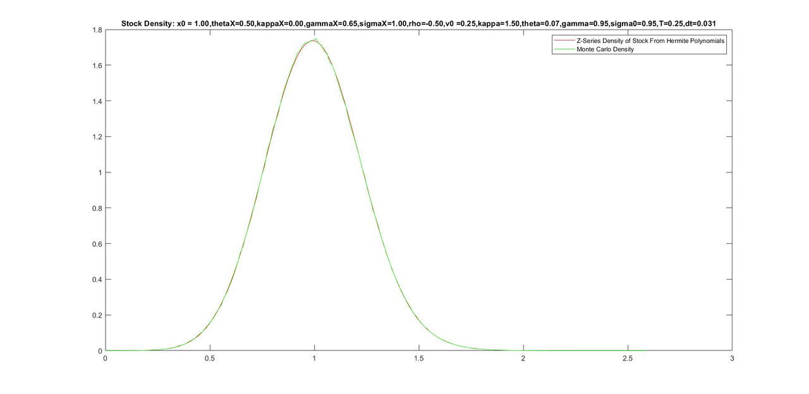](https://postimg.cc/w3Xr55wQ)

[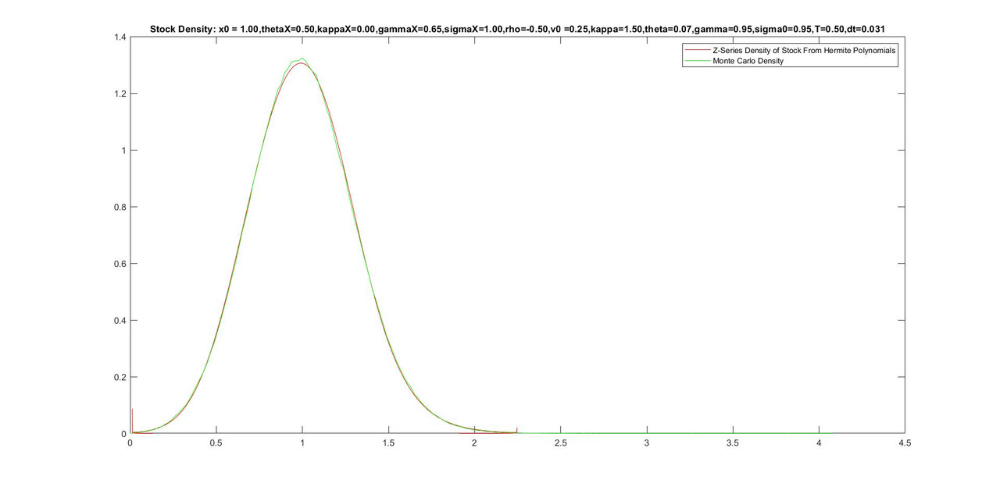](https://postimg.cc/4HQFJZYS)

[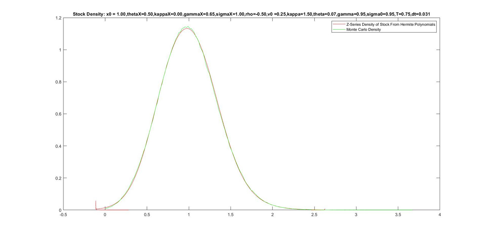](https://postimg.cc/K32HS48T)

[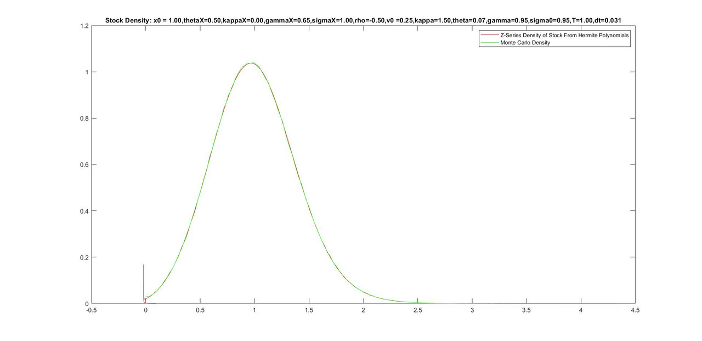](https://postimg.cc/wtnr2wK0)

[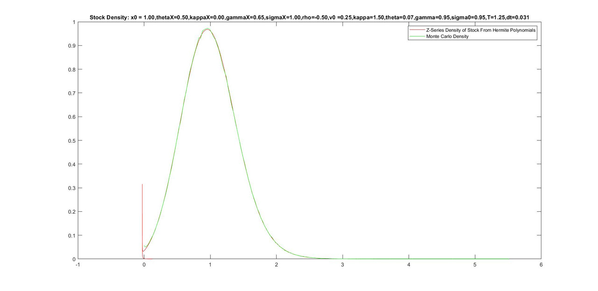](https://postimg.cc/JtZf6CzJ)

[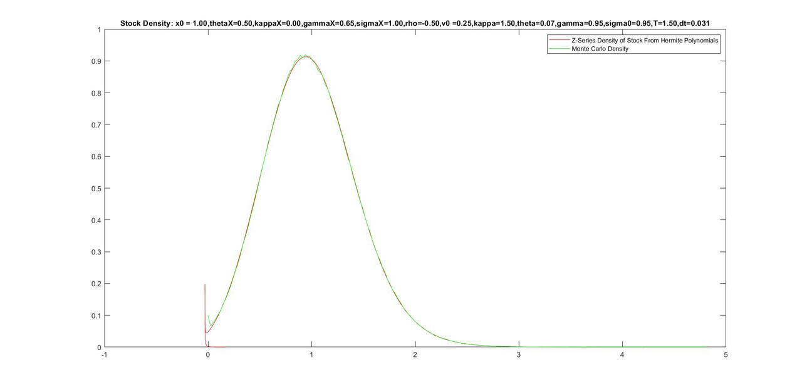](https://postimg.cc/BXCd35Dn)

[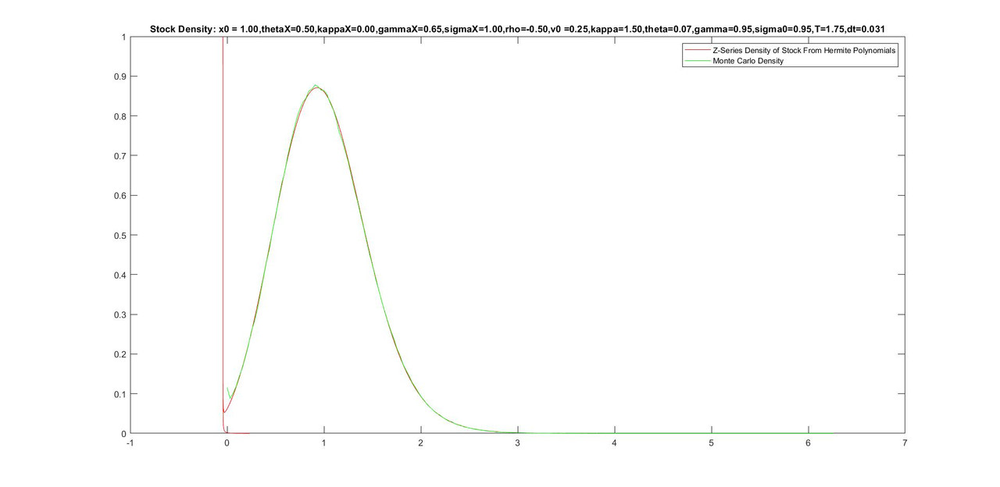](https://postimg.cc/m1f0L88t)

[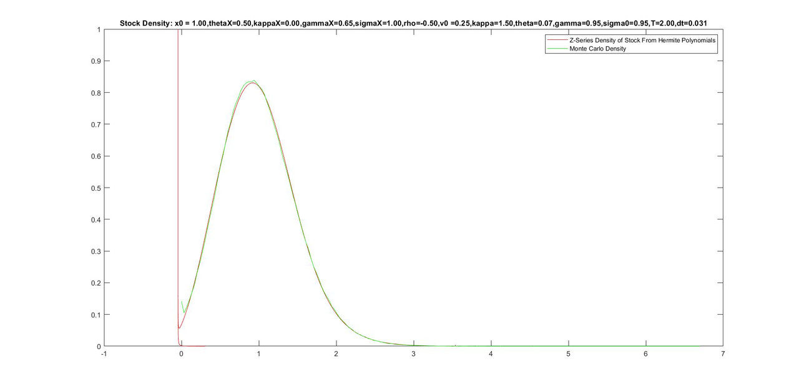](https://postimg.cc/G8sWnZPW)

[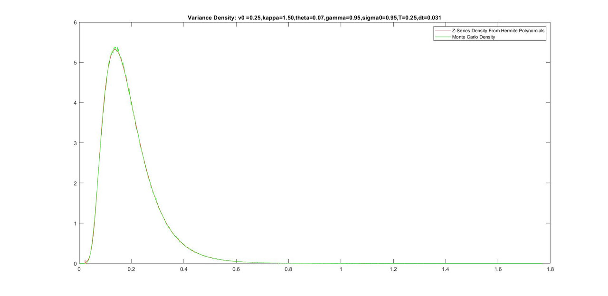](https://postimg.cc/FdcBB0Nm)

[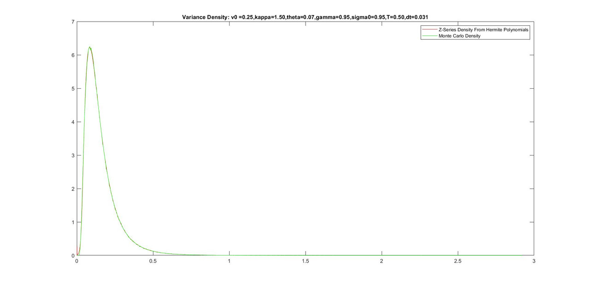](https://postimg.cc/v14j5pK4)

[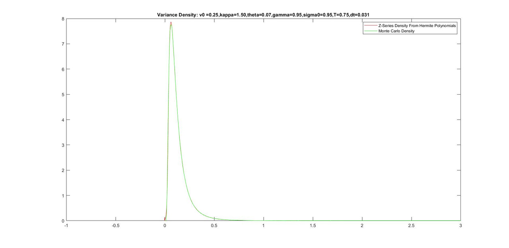](https://postimg.cc/CRPXBFcy)

[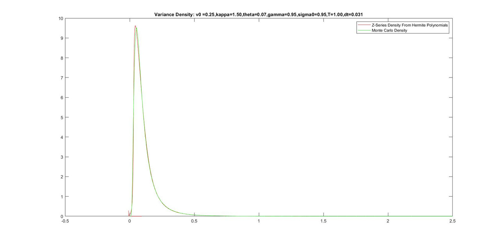](https://postimg.cc/QFxvdBkk)

[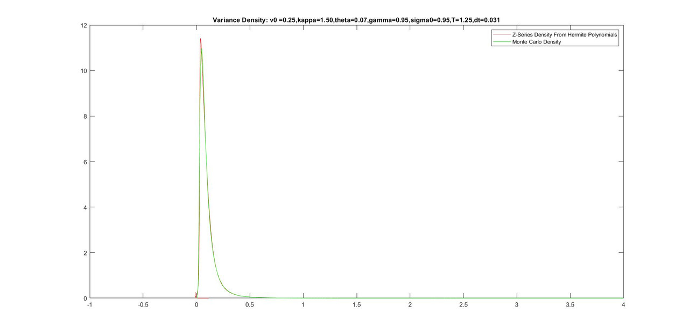](https://postimg.cc/zVN942yQ)

[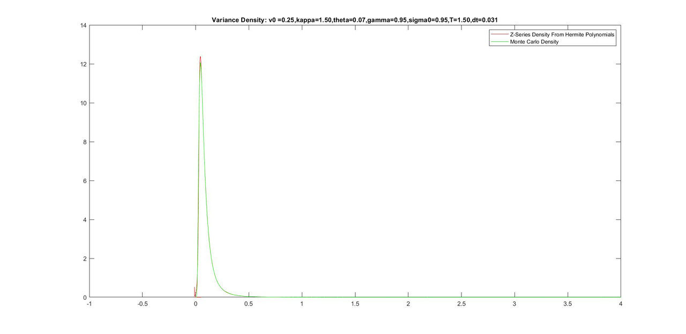](https://postimg.cc/4H6jmVSw)

[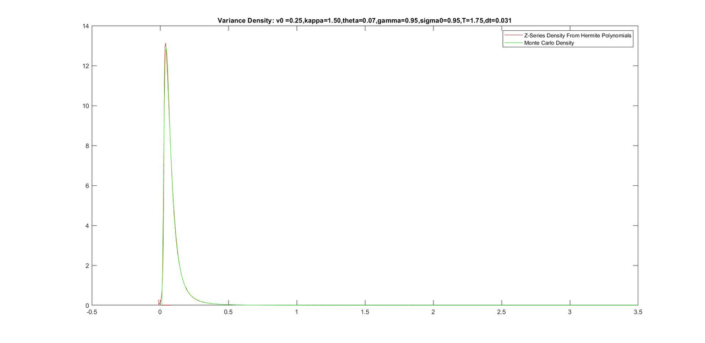](https://postimg.cc/Nyn3VgX8)

[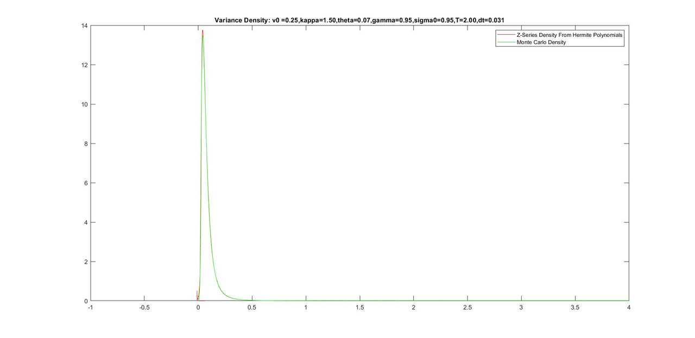](https://postimg.cc/JytwPys4)

---

### #1686 — Amin (Topic Author)
*January 22, 2023, 1:33 PM*

Here is the program used to construct above graphs with all its auxiliary functions.

The program takes a small step and stops after every .25 years to construct the asset density and stochastic variance
density. I am giving Z-series Coeffs that you get when program stops after one year (the 4th time).

You will get the following coeffs for asset density

ch0 =

   1.000504293954663

ch =

   0.387944879882010   0.019230128572635   0.000494145447108   0.001588525145643  -0.000062189649459 
 0.000006642248086   0.000004857389595

c0 =

   0.985940107097660

c =

   0.385019572891282   0.009997878862670   0.001626067849219   0.001488891424346  -0.000164194830963 
 0.000006642248086   0.000004857389595

And the following coeffs for variance density.

dh0 =

   0.113983075015833

dh =

   0.082903984760398   0.034457076958627   0.010065124779018   0.001985239782762   0.000244600151872 
-0.000018504490563  -0.000026167026254

d0 =

   0.085759284763932

d =

   0.059125150458094   0.021712936186735   0.004871585503626   0.002262807141202   0.000794107703207 
-0.000018504490563  -0.000026167026254

Please enjoy the program.

.

.

```
function [] = SVMonteCarloDensity()

%Copyright Ahsan Amin. Infiniti derivatives Technologies.
%Please fell free to connect on linkedin: linkedin.com/in/ahsan-amin-0a53334
%or skype ahsan.amin2999

dt=.125/2/2/2;   % Simulation time interval.%Fodiffusions close to zero
             %decrease dt for accuracy.
Tt=128;%64*4*2;%16*2*4;%*4*4*1;%*4;%128*2*2*2;     % Number of simulation levels. Terminal time= Tt*dt;
//.125/32*32*16=2 year;
T=Tt*dt;

if(T>=1)
dtM=1/32;;
TtM=T/dtM;
else
dtM=T/32;
TtM=T/dtM;
end

v00=.250;   % starting value of SDE
beta1=0.0;
beta2=1.0;   % Second drift term power.
gamma=.950;%50;   % volatility power.
kappa=1.50;%.950;   %mean reversion parameter.
theta=.075;%mean reversion target
sigma0=.9500;%Volatility value

%you can specify any general mu1 and mu2 and beta1 and beta2.
mu1=1*theta*kappa;   %first drift coefficient.
mu2=-1*kappa;    % Second drift coefficient.

%dVt=(mu1*Vt^beta1 + mu2*Vt^beta2)*dt+sigma0 * Vt^gamma * dz1(t)
%Xt(0)=x0
%dXt=(mu1X*Xt^alpha1+mu2X*Xt^alpha2)*dt+sigmaX* Vt^gammaV * Xt^gammaX *dz2(t);
%=rho *dt

x0=1.00;
gammaX=.65;
sigmaX=1.0;
thetaX=.50;
kappaX=0.0;
mu1X=thetaX*kappaX;
mu2X=-1*kappaX;

%%%%%%%%%%%%%%%%%%%%%%%%%%%%%%
%rng(29079137, 'twister')
rng(15898837, 'twister')
paths=2000000;
V(1:paths)=v00;  %Original process monte carlo.
X=0.0;
X(1:paths)=x0;
alpha1=0;
alpha2=1;
a=mu1X;
b=mu2X;
rho=-.5;
sigma1=sigmaX;
gammaV=.5;
Random1(1:paths)=0;
Random2(1:paths)=0;

for ttM=1:TtM
Random1=randn(size(Random1));
Random2=randn(size(Random2));

time1=ttM*dtM

X(1:paths)=X(1:paths)+ ...
    (a* X(1:paths).^alpha1 + b* X(1:paths).^alpha2)* dtM + ...
    sqrt(1-rho^2)* sigma1* V(1:paths).^gammaV.* X(1:paths).^gammaX .*Random1(1:paths) * sqrt(dtM) + ...
    rho* sigma1* V(1:paths).^gammaV .*X(1:paths).^gammaX .*Random2(1:paths)*sqrt(dtM) + ...
    (a*alpha1* X(1:paths).^(alpha1-1)+b*alpha2* X(1:paths).^(alpha2-1)).* ...
    (((a* X(1:paths).^alpha1 + b* X(1:paths).^alpha2)* dtM^2/2)+ ...
    (sqrt(1-rho^2)* sigma1* V(1:paths).^gammaV.* X(1:paths).^gammaX .*Random1(1:paths) *(1-1/sqrt(3)).*dtM^1.5+ ...
    rho* sigma1* V(1:paths).^gammaV .*X(1:paths).^gammaX .*Random2(1:paths)*(1-1/sqrt(3)).*dtM^1.5))+ ...
    .5*(a*alpha1*(alpha1-1)* X(1:paths).^(alpha1-2)+b*alpha2*(alpha2-1).* X(1:paths).^(alpha2-2)).* ...
    ( sigma1^2* V(1:paths).^(2*gammaV).* X(1:paths).^(2*gammaX)) *dtM^2/2 + ...
    sqrt(1-rho^2)* sigma1* V(1:paths).^gammaV.*gammaX.* X(1:paths).^(gammaX-1).* ...
    ((a* X(1:paths).^alpha1 + b* X(1:paths).^alpha2).*Random1(1:paths) * 1/sqrt(3).* dtM^1.5 + ...
    sqrt(1-rho^2)* sigma1* V(1:paths).^gammaV.* X(1:paths).^gammaX .*(Random1(1:paths).^2-1) * dtM/2 + ...
    rho* sigma1* V(1:paths).^gammaV .*X(1:paths).^gammaX .*Random1(1:paths).*Random2(1:paths)*dtM/2)+ ...
    .5*sqrt(1-rho^2)* sigma1* V(1:paths).^gammaV.*gammaX.*(gammaX-1).* X(1:paths).^(gammaX-2).* ...
    (sigma1^2* V(1:paths).^(2*gammaV).* X(1:paths).^(2*gammaX) .*Random1(1:paths).*1/sqrt(3).*dtM^1.5)+ ...
    sqrt(1-rho^2)* sigma1*gammaV.* V(1:paths).^(gammaV-1).* X(1:paths).^(gammaX).* ...
    ((mu1.*V(1:paths).^beta1 + mu2.*V(1:paths).^beta2).*Random1(1:paths) * 1/sqrt(3).* dtM^1.5 + ...
    sigma0*V(1:paths).^gamma.*Random1(1:paths).*Random2(1:paths)*dtM/2)+ ...
    .5*sqrt(1-rho^2)* sigma1*gammaV.*(gammaV-1).* V(1:paths).^(gammaV-2).* X(1:paths).^(gammaX).* ...
    (sigma0^2*V(1:paths).^(2*gamma).*Random1(1:paths)*1/sqrt(3)*dtM^1.5)+ ...
    sqrt(1-rho^2)* sigma1*gammaV.* V(1:paths).^(gammaV-1).*gammaX.* X(1:paths).^(gammaX-1).* ...
    rho.* sigma1.* V(1:paths).^gammaV .*X(1:paths).^gammaX
.*sigma0.*V(1:paths).^gamma.*Random1(1:paths)*1/sqrt(3)*dtM^1.5+ ...
    rho* sigma1* V(1:paths).^gammaV.*gammaX.* X(1:paths).^(gammaX-1).* ...
    ((a* X(1:paths).^alpha1 + b* X(1:paths).^alpha2).*Random2(1:paths) * 1/sqrt(3).* dtM^1.5 + ...
    sqrt(1-rho^2)* sigma1* V(1:paths).^gammaV.* X(1:paths).^gammaX .*Random1(1:paths).*Random2(1:paths) * dtM/2 + ...
    rho* sigma1* V(1:paths).^gammaV .*X(1:paths).^gammaX .*(Random2(1:paths).^2-1)*dtM/2)+ ...
    .5*rho* sigma1* V(1:paths).^gammaV.*gammaX.*(gammaX-1).* X(1:paths).^(gammaX-2).* ...
    (sigma1^2* V(1:paths).^(2*gammaV).* X(1:paths).^(2*gammaX) .*Random2(1:paths).*1/sqrt(3).*dtM^1.5)+ ...
    rho* sigma1*gammaV.* V(1:paths).^(gammaV-1).* X(1:paths).^(gammaX).* ...
    ((mu1.*V(1:paths).^beta1 + mu2.*V(1:paths).^beta2).*Random2(1:paths) * 1/sqrt(3).* dtM^1.5 + ...
    sigma0*V(1:paths).^gamma.*(Random2(1:paths).^2-1)*dtM/2)+ ...
    .5*rho* sigma1*gammaV.*(gammaV-1).* V(1:paths).^(gammaV-2).* X(1:paths).^(gammaX).* ...
    sigma0^2.*V(1:paths).^(2*gamma).*Random2(1:paths) * 1/sqrt(3).* dtM^1.5+ ...
    rho* sigma1*gammaV.* V(1:paths).^(gammaV-1).*gammaX.* X(1:paths).^(gammaX-1).* ...
    rho.* sigma1.* V(1:paths).^gammaV .*X(1:paths).^gammaX
.*sigma0.*V(1:paths).^gamma.*Random2(1:paths)*1/sqrt(3)*dtM^1.5;
X(X<0)=.0000001;
if(rem(ttM,8)==0) %On every eighth monte carlo step construct the density

MaxCutOff=100;
NoOfBins=200;
[XDensity,IndexOutX,IndexMaxX] = MakeDensityFromSimulation_Infiniti_NEW(X,paths,NoOfBins,MaxCutOff );

SeriesOrder=7;
NoOfBins=200;
MaxCutOff=9999999;
%Below function finds hermite coefficients of monte carlo simulated SDE
%of the stock asset.
[ch0,ch] = FindHermiteCoefficientsFromSimulation_Infiniti_NEW(X,paths,NoOfBins,MaxCutOff );
[c0,c] = ConvertHCoeffsToZCoeffs(ch0,ch,7);
ch0
ch
c0
c
str=input('Look at Coeffs of Z-series of stock SDE')

%Below construct density on Gaussian grid.
%First calculate normal random variable on a grid below
dNn=.1/2;   % Normal density subdivisions width. would change with number of subdivisions
Nn=45*4;  % No of normal density subdivisions
NnMid=((1+Nn)/2)*dNn;
Z(1:Nn)=(((1:Nn)*dNn)-NnMid);
%Z
%str=input('Look at Z');
%Now calculate Y as a function of normal random variable.
Y(1:Nn)=c0;
for nn=1:SeriesOrder
    Y(1:Nn)=Y(1:Nn)+c(nn)*Z(1:Nn).^nn;
end

%Now take change of densities derivative of Y with respect to normal
DfY(1:Nn)=0;
for nn=2:Nn-1
    DfY(nn) = (Y(nn + 1) - Y(nn - 1))/(Z(nn + 1) - Z(nn - 1));
    %Change of variable derivative for densities
end
DfY(Nn)=DfY(Nn-1);
DfY(1)=DfY(2);

%Now calculate the density of Y from density of normal random variable
%using change of probability derivative.
pY(1:Nn)=0;
for nn = 1:Nn
    pY(nn) = (normpdf(Z(nn),0, 1))/abs(DfY(nn));
end

plot(Y(1:Nn),pY(1:Nn),'r',IndexOutX(1:IndexMaxX),XDensity(1:IndexMaxX),'g');

title(sprintf('Stock Density: x0 = %.2f,thetaX=%.2f,kappaX=%.2f,gammaX=%.2f,sigmaX=%.2f,rho=%.2f,v0
=%.2f,kappa=%.2f,theta=%.2f,gamma=%.2f,sigma0=%.2f,T=%.2f,dt=%.3f',x0,thetaX,kappaX,gammaX,sigmaX,rho,v00,kappa,theta,gamma,sigma0,time1,dtM));
legend({'Z-Series Density of Stock From Hermite Polynomials','Monte Carlo Density'},'Location','northeast')

str=input('Look at density of stock from simulated data. From Z-series Coefficients in red, Directly from data in
green');
end

VBefore=V;

    V(1:paths)=V(1:paths)+ ...
        (mu1.*V(1:paths).^beta1 + mu2.*V(1:paths).^beta2)*dtM + ...
        sigma0*V(1:paths).^gamma .*Random2(1:paths)*sqrt(dtM) + ...
        (mu1.*beta1*V(1:paths).^(beta1-1) + mu2.*beta2.*V(1:paths).^(beta2-1)).* ...
        ((mu1.*V(1:paths).^beta1 + mu2.*V(1:paths).^beta2)*dtM^2/2 + ...
        sigma0*V(1:paths).^gamma .*Random2(1:paths)*(1-1/sqrt(3))*dtM^1.5) + ...
        .5*(mu1.*beta1.*(beta1-1).*V(1:paths).^(beta1-2) + mu2.*beta2.*(beta2-1).*V(1:paths).^(beta2-2)).* ...
        sigma0^2.*V(1:paths).^(2*gamma).*dtM^2/2 + ...
        sigma0*gamma*V(1:paths).^(gamma-1) .* ...
        ((mu1.*V(1:paths).^beta1 + mu2.*V(1:paths).^beta2).*Random2(1:paths).*1/sqrt(3)*dtM^1.5 + ...
        sigma0.*V(1:paths).^gamma .*(Random2(1:paths).^2-1)*dtM/2) + ...
        .5*sigma0*gamma*(gamma-1).*V(1:paths).^(gamma-2) .* ...
        sigma0^2.*V(1:paths).^(2*gamma) .*Random2(1:paths).*1/sqrt(3)*dtM^1.5;

if(rem(ttM,8)==0)
V(V<=0)=.0000001;
MaxCutOff=100;
NoOfBins=1000;
[VDensity,IndexOutV,IndexMaxV] = MakeDensityFromSimulation_Infiniti_NEW(V,paths,NoOfBins,MaxCutOff );
%Below function finds hermite coefficients of monte carlo simulated SDE
%of stochastic variance.
NoOfBins=400;
MaxCutOff=9999999;
[dh0,dh] = FindHermiteCoefficientsFromSimulation_Infiniti_NEW(V,paths,NoOfBins,MaxCutOff );

[d0,d] = ConvertHCoeffsToZCoeffs(dh0,dh,7);
dh0
dh
d0
d
str=input('Look at Coeffs of stochastic variance Z-Series')

%Below construct variance density on Gaussian grid.
%First calculate normal random variable on a grid below
dNn=.1/2;   % Normal density subdivisions width. would change with number of subdivisions
Nn=45*4;  % No of normal density subdivisions
NnMid=((1+Nn)/2)*dNn;
Z(1:Nn)=(((1:Nn)*dNn)-NnMid);
%Z
%str=input('Look at Z');
%Now calculate Y as a function of normal random variable.
Y(1:Nn)=d0;
for nn=1:SeriesOrder
    Y(1:Nn)=Y(1:Nn)+d(nn)*Z(1:Nn).^nn;
end

%Now take change of densities derivative of Y with respect to normal
DfY(1:Nn)=0;
for nn=2:Nn-1
    DfY(nn) = (Y(nn + 1) - Y(nn - 1))/(Z(nn + 1) - Z(nn - 1));
    %Change of variable derivative for densities
end
DfY(Nn)=DfY(Nn-1);
DfY(1)=DfY(2);

%Now calculate the density of Y from density of normal random variable
%using change of probability derivative.
pY(1:Nn)=0;
for nn = 1:Nn
    pY(nn) = (normpdf(Z(nn),0, 1))/abs(DfY(nn));
end
plot(Y(1:Nn),pY(1:Nn),'r',IndexOutV(1:IndexMaxV),VDensity(1:IndexMaxV),'g');
legend({'Z-Series Density From Hermite Polynomials','Monte Carlo Density'},'Location','northeast')
title(sprintf('Variance Density: v0
=%.2f,kappa=%.2f,theta=%.2f,gamma=%.2f,sigma0=%.2f,T=%.2f,dt=%.3f',v00,kappa,theta,gamma,sigma0,time1,dtM));

str=input('Look at density of volatility from simulated data. From Z-series Coefficients in red and directly from data
in green');
end

end

%SVolMeanAnalytic=thetaV+(V0-thetaV)*exp(-kappaV*dt*Tt)
SVolMeanAnalytic=theta+(v00-theta)*exp(-kappa*dt*Tt)
SVolMeanMC=sum(V(1:paths))/paths
AssetMeanAnalytic=x0
AssetMeanMC=sum(X(1:paths))/paths

end
```

.

.

The following function is responsible for calculation of hermite coeffs with hermite inner product method. I will give
detailed equations in a few hours. These hermite coeffs can later be converted to Z-series coeffs for density
construction.

.

```
function [ch0,ch] = FindHermiteCoefficientsFromSimulation_Infiniti_NEW(X,Paths,NoOfBins,MaxCutOff )
%Processes monte carlo paths to return a series Xdensity as a function of IndexOut. IndexMax is the maximum value of
index.
%

Xmin=999999;
Xmin1=999999;
Xmin2=999999;
Xmax=0;
Xmax1=0;
Xmax2=0;
mean=0;
for p=1:Paths
%if(X(p)>MaxCutOff)
%X(p)=MaxCutOff;
%end
%if(X(p)real(X(p)))
    Xmin2=Xmin1;
    Xmin1=Xmin;
    Xmin=real(X(p));
end
if(XmaxIndexMax)
index=IndexMax;
end

%XDensity(index)=XDensity(index)+1.0/Paths/BinSize;
XDensity(index)=XDensity(index)+1.0/Paths;

end

IndexOut(1:IndexMax)=Xmin2+(0:(IndexMax-1))*BinSize;

XCDF(1:IndexMax)=0;
Z(1:IndexMax)=0;
XCDF(1)=XDensity(1)*.5;
for nn=2:IndexMax
    XCDF(nn)=XCDF(nn-1)+XDensity(nn-1)*.5+XDensity(nn)*.5;
    Z(nn)=norminv(XCDF(nn));
end

%XCDF
%Z

%str=input('Look at XCDF and Z');

ch0=mean;
ch(1:7)=0;
for nn=1:IndexMax
ch(1)=ch(1)+IndexOut(nn).*Z(nn).*XDensity(nn);
ch(2)=ch(2)+.5*IndexOut(nn).*(Z(nn).^2-1).*XDensity(nn);
ch(3)=ch(3)+1/6*IndexOut(nn).*(Z(nn).^3-3*Z(nn)).*XDensity(nn);
ch(4)=ch(4)+1/24*IndexOut(nn).*(Z(nn).^4-6*Z(nn).^2+3).*XDensity(nn);
ch(5)=ch(5)+1/120*IndexOut(nn).*(Z(nn).^5-10*Z(nn).^3+15*Z(nn)).*XDensity(nn);
ch(6)=ch(6)+1/720*IndexOut(nn).*(Z(nn).^6-15*Z(nn).^4+45*Z(nn).^2-15).*XDensity(nn);
ch(7)=ch(7)+1/720/7*IndexOut(nn).*(Z(nn).^7-21*Z(nn).^5+105*Z(nn).^3-105*Z(nn)).*XDensity(nn);
end

end
```

.

.

.

```
function [a0,a] = ConvertHCoeffsToZCoeffs(aH0,aH,SeriesOrder)

if(SeriesOrder==3)
a0=aH0-aH(2);
a(1)=aH(1)-3*aH(3);
a(2)=aH(2);
a(3)=aH(3);
end

if(SeriesOrder==4)
a0=aH0-aH(2)+3*aH(4);
a(1)=aH(1)-3*aH(3);
a(2)=aH(2)-6*aH(4);
a(3)=aH(3);
a(4)=aH(4);
end

if(SeriesOrder==5)
a0=aH0-aH(2)+3*aH(4);
a(1)=aH(1)-3*aH(3)+15*aH(5);
a(2)=aH(2)-6*aH(4);
a(3)=aH(3)-10*aH(5);
a(4)=aH(4);
a(5)=aH(5);
end

if(SeriesOrder==5)
a0=aH0-aH(2)+3*aH(4);
a(1)=aH(1)-3*aH(3)+15*aH(5);
a(2)=aH(2)-6*aH(4);
a(3)=aH(3)-10*aH(5);
a(4)=aH(4);
a(5)=aH(5);
end
% if(SeriesOrder==5)
% a0=aH0-aH(2)-3*aH(4);
% a(1)=aH(1)-3*aH(3)-15*aH(5);
% a(2)=aH(2)-6*aH(4);
% a(3)=aH(3)-10*aH(5);
% a(4)=aH(4);
% a(5)=aH(5);
% end
if(SeriesOrder==6)
a0=aH0-aH(2)+3*aH(4)-15*aH(6);
a(1)=aH(1)-3*aH(3)+15*aH(5);
a(2)=aH(2)-6*aH(4)+45*aH(6);
a(3)=aH(3)-10*aH(5);
a(4)=aH(4)-15*aH(6);
a(5)=aH(5);
a(6)=aH(6);
end

if(SeriesOrder==7)
a0=aH0-aH(2)+3*aH(4)-15*aH(6);
a(1)=aH(1)-3*aH(3)+15*aH(5)-105*aH(7);
a(2)=aH(2)-6*aH(4)+45*aH(6);
a(3)=aH(3)-10*aH(5)+105*aH(7);
a(4)=aH(4)-15*aH(6);
a(5)=aH(5)-21*aH(7);
a(6)=aH(6);
a(7)=aH(7);
end

end

```

.

.

.

```
function [XDensity,IndexOut,IndexMax] = MakeDensityFromSimulation_Infiniti_NEW(X,Paths,NoOfBins,MaxCutOff )
%Processes monte carlo paths to return a series Xdensity as a function of IndexOut. IndexMax is the maximum value of
index.
%

Xmin=0;
Xmax=0;
for p=1:Paths
if(X(p)>MaxCutOff)
X(p)=MaxCutOff;
end
%if(X(p)real(X(p)))
Xmin=real(X(p));
end
if(XmaxIndexMax)
index=IndexMax;
end

XDensity(index)=XDensity(index)+1.0/Paths/BinSize;

end

IndexOut(1:IndexMax)=Xmin+(0:(IndexMax-1))*BinSize;

end
```

.

.

.

---

### #1687 — Marsden
*January 22, 2023, 3:23 PM*

Amin, thank you for making your accounts of your situation more tractable.

A few things are apparent to me, and maybe the only reason you haven't realized them yourself is due to your strong
medication.

First, you have no local allies. It seems that even your family is complicit in your mistreatment.

Second, your tormentors are not worried about what you might do in your current state; the mere fact that you are
allowed -- freely, I assume -- to post here and to relate your mistreatment, and that you have been doing it for years,
indicates that they are confident that nothing will come of your communications.

Third, it is likely that you are mentally ill in some way. You should not dismiss this possibility. Even so, it is
inhumane and immoral to force treatment that you do not want on you, assuming (as seems to be the case) that you do not
pose a physical threat to anyone. And part of any cognitive issues you have may in fact be caused by improper treatment.

The upshot of it all is that you are on your own. You have for years done everything in your power to recruit outsiders
to help you, to no avail. If Human Rights Watch couldn't help you -- and I suspect that at the very least they contacted
the agencies you named as being behind your mistreatment, apparently with no effect -- no inquiry from a concerned
citizen will do so either.

It seems clear -- and maybe the only reason you haven't come to this conclusion on your own is due to your
medically-induced fog -- that what you need to do is to escape your physical situation. Your family, whatever
authorities participate in your mistreatment -- you need physically do disappear from them.

What keeps you from doing this? It seems that you are being fed and housed, and provided computer access, and escape
would probably lose you these things. Is your mental well-being worth it? Only you can decide.

Conditions would likely be very difficult for you if you disappear, but you're clever, and people survive much more
difficult situations than what you'd likely face. Take a menial job; become a beggar; sneak on a freight train to get
out of your geographic location. Maybe you can store up some resources to help you before you go.

But this seems, from where I sit, to be the cost of your freedom.

And with that advice given, I walk away.

---

### #1688 — Amin (Topic Author)
*January 22, 2023, 5:26 PM*

Friends, here is the explanation about the program. I will first give main equations and then relate them to the program
to make it easy for friends to understand the program.

The main idea is to use the orthogonality property of hermite polynomials with respect to standard normal density. Let
us assume we have a random variable X and we can represent it as a Z-series. All we know is that our random variable can
be represented by a Hermite series version of Z-series(as both are equivalent), we do not know the precise coefficients
yet and these coefficients are the ones we want to find out. Let us represent X as a hermite series as

$X \,= ah_0 \, + \, ah_1 \, H_1(Z) \, + ah_2 \, H_2(Z) \, + ... + \,  ah_n \, H_n(Z) \, $

We multiply X with first hermite polynomial and integrate with respect to Gaussian density to find

$ \displaystyle\int_{-\infty}^{\infty} \, X \, H_1(Z) \, p(Z) \, dZ$

$\displaystyle\int_{-\infty}^{\infty} \, (ah_0 \, + \, ah_1 \, H_1(Z) \, + ah_2 \, H_2(Z) \, + ... + \,  ah_n \, H_n(Z) \,) \, H_1(Z) \, p(Z) \, dZ$

$=ah_1$

Similalry taking scalar product of X and second hermite polynomial with respect to Gaussian density would give us

$ \displaystyle\int_{-\infty}^{\infty} \, X \, H_2(Z) \, p(Z) \, dZ$

$\displaystyle\int_{-\infty}^{\infty} \, (ah_0 \, + \, ah_1 \, H_1(Z) \, + ah_2 \, H_2(Z) \, + ... + \,  ah_n \, H_n(Z) \,) \, H_2(Z) \, p(Z) \, dZ$

$=2!  \, ah_2$

Taking scalar product of X with nth hermite polynomial with respect to Gaussian density would give us

$ \displaystyle\int_{-\infty}^{\infty} \, X \, H_n(Z) \, p(Z) \, dZ$

$\displaystyle\int_{-\infty}^{\infty} \, (ah_0 \, + \, ah_1 \, H_1(Z) \, + ah_2 \, H_2(Z) \, + ... + \,  ah_n \, H_n(Z) \,) \, H_n(Z) \, p(Z) \, dZ$

$=n!  \, ah_n$

So basically we have to be able to take scalar product of X and nth hermite polynomial with respect to Gaussian density
to find scaled value of coefficient of nth hermite polynomial.

In order to be able to do this, I first constructed a monte carlo density by dividing the valid domain into equal grid
spacings of$\Delta X$ and calculated probability mass within each grid cell. Since the grid is uniform width, For each
of the P monte carlo paths, we can just use one division per path to assign weight 1/P to appropriate grid cell. Once
the iteration of this is complete over all paths, we get total probability mass in each of the grid cell as a result so
that summed over all the grid cells probability mass becomes one. If there are M grid cells, probability mass in mth
grid cell is given as$\Delta P_m $

Now we associate a value of Z with center of each of the grid cells. For this we take sum of probability mass over all
previous grid cells plus half of the probability mass in the current cell where we want to find the value of Z.

This value of Z is found by norminv(sum of all the probability mass up to center of the grid cell)

It is the value of CDF at a point X that associates a corresponding Z to that point. So the value of Z at center of a
grid cell is found by inversion of CDF of X at center of that grid cell.

Once we have found$Z_m$ associated with center of mth grid cell, we can replace our inner product integrals (between X
and H_n(Z)) with respect to Gaussian density by finite sums over all the grid cells as

$ \displaystyle\int_{-\infty}^{\infty} \, X \, H_n(Z) \, p(Z) \, dZ$

$ \displaystyle\sum_{m=1}^{M} \, X_m \, H_n(Z_m) \, p(Z_m) \, \Delta Z_m$

But we know that  probability mass in mth cell is given as

$p(Z_m) \, \Delta Z_m=p(X_m) \, \Delta X_m = \Delta P_m $

So we can write as

$ \displaystyle\int_{-\infty}^{\infty} \, X \, H_n(Z) \, p(Z) \, dZ$

$ \displaystyle\sum_{m=1}^{M} \, X_m \, H_n(Z_m) \, p(Z_m) \, \Delta Z_m$

$ \displaystyle\sum_{m=1}^{M} \, X_m \, H_n(Z_m) \, \Delta P_m \,$

which means that

$n!  \, ah_n \, = \, \displaystyle\sum_{m=1}^{M} \, X_m \, H_n(Z_m) \, \Delta P_m \,$

All the values in RHS are known .$X_m$ is center of mth grid cell.$Z_m$ is value found by inversion of CDF at$X_m$ and
$\Delta P_m \,$ which is the probability mass in mth grid cell was also calculated when we divided P monte carlo paths
over the grid cells with 1/P weight.

Now relating it to the program,

[ch0,ch] = FindHermiteCoefficientsFromSimulation_Infiniti_NEW(X,Paths,NoOfBins,MaxCutOff )

is the function where we did all of the above calculations in the loop given below as

for nn=1:IndexMax

ch(1)=ch(1)+IndexOut(nn).*Z(nn).*XDensity(nn);

ch(2)=ch(2)+.5*IndexOut(nn).*(Z(nn).^2-1).*XDensity(nn);

ch(3)=ch(3)+1/6*IndexOut(nn).*(Z(nn).^3-3*Z(nn)).*XDensity(nn);

ch(4)=ch(4)+1/24*IndexOut(nn).*(Z(nn).^4-6*Z(nn).^2+3).*XDensity(nn);

ch(5)=ch(5)+1/120*IndexOut(nn).*(Z(nn).^5-10*Z(nn).^3+15*Z(nn)).*XDensity(nn);

ch(6)=ch(6)+1/720*IndexOut(nn).*(Z(nn).^6-15*Z(nn).^4+45*Z(nn).^2-15).*XDensity(nn);

ch(7)=ch(7)+1/720/7*IndexOut(nn).*(Z(nn).^7-21*Z(nn).^5+105*Z(nn).^3-105*Z(nn)).*XDensity(nn);

end

Here ch(.) are hermite coefficients that are being calculated.

Here  IndexOut(nn) is value of X(nn) associated with nnth grid cell. Z(nn) is value of Z associated with nnth grid cell
and XDensity(nn) is probability mass associated with nnth grid cell.

Sorry that IndexOut(nn) is a bad variable name but you can replace it with X(nn).

Once we have hermite coefficients, we can easily convert them to Z-series coefficients.

---

### #1689 — Amin (Topic Author)
*January 25, 2023, 5:59 AM*

Friends, I will be posting a program for calculations of "hermite-wise correlations" in a day or two in monte-carlo
setting. I also have ideas about a simpler method to find hermite-wise correlations in smaller samples. I expect to post
these programs tomorrow or in another day.

It turns out to be slightly more complicated as compared to what I suggested in an older post.

---

### #1690 — Amin (Topic Author)
*January 25, 2023, 4:55 PM*

Friends, I am writing this post to complain about increase of  food drugging activity in Lahore city. I have been going
to remote parts of the city to get good food and water but now Mind control agencies (with the help of Pak Army
soldiers) have started distributing mind control drugs among small restaurants even in remote areas. They give mind
control drugs to small restaurants where cooked food is available and ask them to freely add mind control drugs in the
food they prepare. Today I was hit by mind control drugs when I took food from a restaurant where I never suspected they
would have reached but he had already added drugs in the food and I only realized it after I had eaten some food.
Pakistan Army is distributing mind control drugs among small restaurants in more and more neighborhoods with passing
time.

It is also extremely difficult to get good bottled water but underground water at many places in the city is still good
but I am very afraid if friends did not act to stop them now, Pakistan army will drug underground water in Lahore city
very carefully in next few days.

There is another very important thing that I want to tell friends. It seems that mind control agents have again started
to alter my programs. I wrote a function today to calculate hermite polynomials correlation between two stochastic
variables in a monte carlo setting. The function seemed to work very well and I was getting very reasonable values. Then
I thought that my variables are always misnomers and I should change the names of many variables so it would be easier
for friends to understand the program. I went ahead and changed the names of many variables and re-ran the program. But
then I realized that its output had changed. I spent a long time trying to see where I had made the error but could not
find any source of error. I copied the new function with bad output and pasted it in a different matlab file and
repeatedly used undo button in matlab editor in original file to reverse all the changes in the function that I had
made. When I re-ran the old function, its output was good again as I had reversed all the changes. Since I had pasted
the changed function in a new file, I compared both functions and still could not find the error in the function with
bad output. Then I decided to compare all the inner variables in both functions to see where they would diverge so I
would know where the error in modified function was. But when I ran the modified function that I had copy-pasted in a
separate file before undo, it started giving good values again. And I was totally aghast since the same function was
giving bad values. I am really afraid that mind control agents really do not want me to do any good research and
distribute it among friends and therefore they changed the function somewhere but when I decided to compare inner
variables of both functions on every step, they reverted it back since they realized when I would see different inner
output on the same code, I would automatically blame them. Though this was a common practice for them to alter my
programs more than six years ago, these days it is not an everyday issue and mind control agents really do not change
output of my programs but I am afraid that they are becoming worried that my attempt at doing good research is creating
larger problems for them and they want to stop me from doing it and they have become willing now to alter my programs to
stop me from distributing good research with friends.

I want to request friends to please protest with mind control agencies and American defense to not distribute mind
control drugs among street restaurants in Lahore city and also not to drug underground water that is still good in many
parts of the city. And also please ask them to not alter my matlab programs.

About the progress on my research. I hope to post a matlab function today that constructs a two dimensional density
using joint realizations of two simulated variables in every path and then uses this density to calculate correlation
between hermite polynomials of same order associated with the two simulated variables. This is still preliminary and is
building block part of a larger program but I have decided to post it and I will come back with a more detailed program
in another two days.

---

### #1691 — Amin (Topic Author)
*January 25, 2023, 6:51 PM*

Friends, I am posting this program that is embedded in correlated Stochastic Volatility simulations. At each step, it
calculates the correlations between hermite polynomials of same order associated with asset and stochastic variance. It
is still preliminary and supposed to be part of a larger program that I will post in another two days. I am posting this
version for friends who are also interested in similar research. I will soon come back with the detailed program.

.

.

%This function processes joint observations of two variables X and Y from

%common monte carlo paths and makes a two dimensional density of X and Y.

%Later it finds correlations between hermite polynomials of X with hermite

%polynomials of Y of the same order.

.

.

```
function [corr1,corr2,corr3,corr4,corr5,corr6,corr7] =
FindHermiteCorrelationsFromSimulation_Infiniti_NEW02(X,Y,Paths,NoOfBinsX,NoOfBinsY)

%This function processes joint observations of two variables X and Y from
%common monte carlo paths and makes a two dimensional density of X and Y.
%Later it finds correlations between hermite polynomials of X with hermite
%polynomials of Y of the same order.

Xmin=999999;
Xmin1=999999;
Xmin2=999999;
Xmax=0;
Xmax1=0;
Xmax2=0;

Ymin=999999;
Ymin1=999999;
Ymin2=999999;
Ymax=0;
Ymax1=0;
Ymax2=0;
meanX=0;
meanY=0;
for p=1:Paths

meanX=meanX+X(p)/Paths;
meanY=meanY+Y(p)/Paths;
if(Xmin>real(X(p)))
    Xmin2=Xmin1;
    Xmin1=Xmin;
    Xmin=real(X(p));
end
if(Xmaxreal(Y(p)))
    Ymin2=Ymin1;
    Ymin1=Ymin;
    Ymin=real(Y(p));
end
if(YmaxIndexMaxX)
indexX=IndexMaxX;
end

indexY=real(floor(real(Y(p)-Ymin2)/BinSizeY+.5)+1);
if(real(indexY)IndexMaxY)
indexY=IndexMaxY;
end

%XDensity(index)=XDensity(index)+1.0/Paths/BinSize;
XProbMass(indexX)=XProbMass(indexX)+1.0/Paths;
YProbMass(indexY)=YProbMass(indexY)+1.0/Paths;
XYProbMass2D(indexX,indexY)=XYProbMass2D(indexX,indexY)+1.0/Paths;
end

Xn(1:IndexMaxX)=Xmin2+(0:(IndexMaxX-1))*BinSizeX;
Ym(1:IndexMaxY)=Ymin2+(0:(IndexMaxY-1))*BinSizeY;

XCDF(1:IndexMaxX)=0;
Zx(1:IndexMaxX)=0;
XCDF(1)=XProbMass(1)*.5;
Zx(1)=norminv(XCDF(1));
for nn=2:IndexMaxX
    XCDF(nn)=XCDF(nn-1)+XProbMass(nn-1)*.5+XProbMass(nn)*.5;
    Zx(nn)=norminv(XCDF(nn));
end

YCDF(1:IndexMaxY)=0;
Zy(1:IndexMaxY)=0;
YCDF(1)=YProbMass(1)*.5;
Zy(1)=norminv(YCDF(1));
for nn=2:IndexMaxY
    YCDF(nn)=YCDF(nn-1)+YProbMass(nn-1)*.5+YProbMass(nn)*.5;
    Zy(nn)=norminv(YCDF(nn));
end
corr1=0;
corr2=0;
corr3=0;
corr4=0;
corr5=0;
corr6=0;
corr7=0;
for nn=1:IndexMaxX
    for mm=1:IndexMaxY
        corr1=corr1+Zx(nn).*Zy(mm).*XYProbMass2D(nn,mm);
        corr2=corr2+1/2*(Zx(nn).^2-1).*(Zy(mm).^2-1).*XYProbMass2D(nn,mm);
        corr3=corr3+1/6*(Zx(nn).^3-3*Zx(nn)).*(Zy(mm).^3-3*Zy(mm)).*XYProbMass2D(nn,mm);
        corr4=corr4+1/24*(Zx(nn).^4-6*Zx(nn).^2+3).*(Zy(mm).^4-6*Zy(mm).^2+3).*XYProbMass2D(nn,mm);
        corr5=corr5+1/120*(Zx(nn).^5-10*Zx(nn).^3+15*Zx(mm)).*(Zy(mm).^5-10*Zy(mm).^3+15*Zy(mm)).*XYProbMass2D(nn,mm);
       
corr6=corr6+1/720*(Zx(nn).^6-15*Zx(nn).^4+45*Zx(nn).^2-15).*(Zy(mm).^6-15*Zy(mm).^4+45*Zy(mm).^2-15).*XYProbMass2D(nn,mm);
       
corr7=corr7+1/7/720*(Zx(nn).^7-21*Zx(nn).^5+105*Zx(nn).^3-105.*Zx(nn)).*(Zy(mm).^7-21*Zy(mm).^5+105*Zy(mm).^3-105*Zy(mm)).*XYProbMass2D(nn,mm);

    end
end

end
```

.

.

.

```
function [] = SVMonteCarloDensity()

%Copyright Ahsan Amin. Infiniti derivatives Technologies.
%Please fell free to connect on linkedin: linkedin.com/in/ahsan-amin-0a53334
%or skype ahsan.amin2999

dt=.125/2/2/2;   % Simulation time interval.%Fodiffusions close to zero
             %decrease dt for accuracy.
Tt=128;%64*4*2;%16*2*4;%*4*4*1;%*4;%128*2*2*2;     % Number of simulation levels. Terminal time= Tt*dt;
//.125/32*32*16=2 year;
T=Tt*dt;

if(T>=1)
dtM=1/32;;
TtM=T/dtM;
else
dtM=T/32;
TtM=T/dtM;
end

v00=1.0;%.250;   % starting value of SDE
beta1=0.0;
beta2=1.0;   % Second drift term power.
gamma=.950;%50;   % volatility power.
kappa=1.50;%.950;   %mean reversion parameter.
theta=1.0;%.075;%mean reversion target
sigma0=.9500;%Volatility value

%you can specify any general mu1 and mu2 and beta1 and beta2.
mu1=1*theta*kappa;   %first drift coefficient.
mu2=-1*kappa;    % Second drift coefficient.

%dVt=(mu1*Vt^beta1 + mu2*Vt^beta2)*dt+sigma0 * Vt^gamma * dz1(t)
%Xt(0)=x0
%dXt=(mu1X*Xt^alpha1+mu2X*Xt^alpha2)*dt+sigmaX* Vt^gammaV * Xt^gammaX *dz2(t);
%=rho *dt

x0=1.00;
gammaX=.85;
sigmaX=.250;
thetaX=.50;
kappaX=0.0;
mu1X=thetaX*kappaX;
mu2X=-1*kappaX;

%%%%%%%%%%%%%%%%%%%%%%%%%%%%%%
%rng(29079137, 'twister')
rng(15898837, 'twister')
paths=2000000;
V(1:paths)=v00;  %Original process monte carlo.
X=0.0;
X(1:paths)=x0;
alpha1=0;
alpha2=1;
a=mu1X;
b=mu2X;
rho=-.95;
sigma1=sigmaX;
gammaV=.5;
Random1(1:paths)=0;
Random2(1:paths)=0;
mm=0;
for ttM=1:TtM
Random1=randn(size(Random1));
Random2=randn(size(Random2));

time1=ttM*dtM
Xbefore(1:paths)=X(1:paths);
X(1:paths)=X(1:paths)+ ...
    (a* X(1:paths).^alpha1 + b* X(1:paths).^alpha2)* dtM + ...
    sqrt(1-rho^2)* sigma1* V(1:paths).^gammaV.* X(1:paths).^gammaX .*Random1(1:paths) * sqrt(dtM) + ...
    rho* sigma1* V(1:paths).^gammaV .*X(1:paths).^gammaX .*Random2(1:paths)*sqrt(dtM) + ...
    (a*alpha1* X(1:paths).^(alpha1-1)+b*alpha2* X(1:paths).^(alpha2-1)).* ...
    (((a* X(1:paths).^alpha1 + b* X(1:paths).^alpha2)* dtM^2/2)+ ...
    (sqrt(1-rho^2)* sigma1* V(1:paths).^gammaV.* X(1:paths).^gammaX .*Random1(1:paths) *(1-1/sqrt(3)).*dtM^1.5+ ...
    rho* sigma1* V(1:paths).^gammaV .*X(1:paths).^gammaX .*Random2(1:paths)*(1-1/sqrt(3)).*dtM^1.5))+ ...
    .5*(a*alpha1*(alpha1-1)* X(1:paths).^(alpha1-2)+b*alpha2*(alpha2-1).* X(1:paths).^(alpha2-2)).* ...
    ( sigma1^2* V(1:paths).^(2*gammaV).* X(1:paths).^(2*gammaX)) *dtM^2/2 + ...
    sqrt(1-rho^2)* sigma1* V(1:paths).^gammaV.*gammaX.* X(1:paths).^(gammaX-1).* ...
    ((a* X(1:paths).^alpha1 + b* X(1:paths).^alpha2).*Random1(1:paths) * 1/sqrt(3).* dtM^1.5 + ...
    sqrt(1-rho^2)* sigma1* V(1:paths).^gammaV.* X(1:paths).^gammaX .*(Random1(1:paths).^2-1) * dtM/2 + ...
    rho* sigma1* V(1:paths).^gammaV .*X(1:paths).^gammaX .*Random1(1:paths).*Random2(1:paths)*dtM/2)+ ...
    .5*sqrt(1-rho^2)* sigma1* V(1:paths).^gammaV.*gammaX.*(gammaX-1).* X(1:paths).^(gammaX-2).* ...
    (sigma1^2* V(1:paths).^(2*gammaV).* X(1:paths).^(2*gammaX) .*Random1(1:paths).*1/sqrt(3).*dtM^1.5)+ ...
    sqrt(1-rho^2)* sigma1*gammaV.* V(1:paths).^(gammaV-1).* X(1:paths).^(gammaX).* ...
    ((mu1.*V(1:paths).^beta1 + mu2.*V(1:paths).^beta2).*Random1(1:paths) * 1/sqrt(3).* dtM^1.5 + ...
    sigma0*V(1:paths).^gamma.*Random1(1:paths).*Random2(1:paths)*dtM/2)+ ...
    .5*sqrt(1-rho^2)* sigma1*gammaV.*(gammaV-1).* V(1:paths).^(gammaV-2).* X(1:paths).^(gammaX).* ...
    (sigma0^2*V(1:paths).^(2*gamma).*Random1(1:paths)*1/sqrt(3)*dtM^1.5)+ ...
    sqrt(1-rho^2)* sigma1*gammaV.* V(1:paths).^(gammaV-1).*gammaX.* X(1:paths).^(gammaX-1).* ...
    rho.* sigma1.* V(1:paths).^gammaV .*X(1:paths).^gammaX
.*sigma0.*V(1:paths).^gamma.*Random1(1:paths)*1/sqrt(3)*dtM^1.5+ ...
    rho* sigma1* V(1:paths).^gammaV.*gammaX.* X(1:paths).^(gammaX-1).* ...
    ((a* X(1:paths).^alpha1 + b* X(1:paths).^alpha2).*Random2(1:paths) * 1/sqrt(3).* dtM^1.5 + ...
    sqrt(1-rho^2)* sigma1* V(1:paths).^gammaV.* X(1:paths).^gammaX .*Random1(1:paths).*Random2(1:paths) * dtM/2 + ...
    rho* sigma1* V(1:paths).^gammaV .*X(1:paths).^gammaX .*(Random2(1:paths).^2-1)*dtM/2)+ ...
    .5*rho* sigma1* V(1:paths).^gammaV.*gammaX.*(gammaX-1).* X(1:paths).^(gammaX-2).* ...
    (sigma1^2* V(1:paths).^(2*gammaV).* X(1:paths).^(2*gammaX) .*Random2(1:paths).*1/sqrt(3).*dtM^1.5)+ ...
    rho* sigma1*gammaV.* V(1:paths).^(gammaV-1).* X(1:paths).^(gammaX).* ...
    ((mu1.*V(1:paths).^beta1 + mu2.*V(1:paths).^beta2).*Random2(1:paths) * 1/sqrt(3).* dtM^1.5 + ...
    sigma0*V(1:paths).^gamma.*(Random2(1:paths).^2-1)*dtM/2)+ ...
    .5*rho* sigma1*gammaV.*(gammaV-1).* V(1:paths).^(gammaV-2).* X(1:paths).^(gammaX).* ...
    sigma0^2.*V(1:paths).^(2*gamma).*Random2(1:paths) * 1/sqrt(3).* dtM^1.5+ ...
    rho* sigma1*gammaV.* V(1:paths).^(gammaV-1).*gammaX.* X(1:paths).^(gammaX-1).* ...
    rho.* sigma1.* V(1:paths).^gammaV .*X(1:paths).^gammaX
.*sigma0.*V(1:paths).^gamma.*Random2(1:paths)*1/sqrt(3)*dtM^1.5;

DX=X-Xbefore;
%Uncomment to find Z-series of diffusion noise term of  asset.
% X(X<0)=.0000001;
% if(rem(ttM,8)==0) %On every eighth monte carlo step construct the density
% mm=mm+1;
% MaxCutOff=100;
% NoOfBins=1000;
% DX=X-Xbefore;
% [XDensity,IndexOutX,IndexMaxX] = MakeDensityFromSimulation_Infiniti_NEW(DX,paths,NoOfBins,MaxCutOff );
%
% SeriesOrder=7;
% NoOfBins=2000;
% MaxCutOff=9999999;
% %Below function finds hermite coefficients of monte carlo simulated SDE
% %of the stock asset.
% [ch0,ch] = FindHermiteCoefficientsFromSimulation_Infiniti_NEW(DX,paths,NoOfBins,MaxCutOff );
% [c0,c] = ConvertHCoeffsToZCoeffs(ch0,ch,7);
% ch0
% ch
% c0
% c
%
% str=input('Look at Coeffs of Z-series of stock SDE')
%
% %Below construct density on Gaussian grid.
% %First calculate normal random variable on a grid below
% dNn=.1/2;   % Normal density subdivisions width. would change with number of subdivisions
% Nn=45*4;  % No of normal density subdivisions
% NnMid=((1+Nn)/2)*dNn;
% Z(1:Nn)=(((1:Nn)*dNn)-NnMid);
% %Z
% %str=input('Look at Z');
% %Now calculate Y as a function of normal random variable.
% Y(1:Nn)=c0;
% for nn=1:SeriesOrder
%     Y(1:Nn)=Y(1:Nn)+c(nn)*Z(1:Nn).^nn;
% end
%
% %Now take change of densities derivative of Y with respect to normal
% DfY(1:Nn)=0;
% for nn=2:Nn-1
%     DfY(nn) = (Y(nn + 1) - Y(nn - 1))/(Z(nn + 1) - Z(nn - 1));
%     %Change of variable derivative for densities
% end
% DfY(Nn)=DfY(Nn-1);
% DfY(1)=DfY(2);
%
% %Now calculate the density of Y from density of normal random variable
% %using change of probability derivative.
% pY(1:Nn)=0;
% for nn = 1:Nn
%     pY(nn) = (normpdf(Z(nn),0, 1))/abs(DfY(nn));
% end
%
% plot(Y(1:Nn),pY(1:Nn),'r',IndexOutX(1:IndexMaxX),XDensity(1:IndexMaxX),'g');
%
% title(sprintf('Stock Density: x0 = %.2f,thetaX=%.2f,kappaX=%.2f,gammaX=%.2f,sigmaX=%.2f,rho=%.2f,v0
=%.2f,kappa=%.2f,theta=%.2f,gamma=%.2f,sigma0=%.2f,T=%.2f,dt=%.3f',x0,thetaX,kappaX,gammaX,sigmaX,rho,v00,kappa,theta,gamma,sigma0,time1,dtM));
% legend({'Z-Series Density of Stock From Hermite Polynomials','Monte Carlo Density'},'Location','northeast')
%
% str=input('Look at density of stock from simulated data. From Z-series Coefficients in red, Directly from data in
green');
% end

Vbefore=V;

    V(1:paths)=V(1:paths)+ ...
        (mu1.*V(1:paths).^beta1 + mu2.*V(1:paths).^beta2)*dtM + ...
        sigma0*V(1:paths).^gamma .*Random2(1:paths)*sqrt(dtM) + ...
        (mu1.*beta1*V(1:paths).^(beta1-1) + mu2.*beta2.*V(1:paths).^(beta2-1)).* ...
        ((mu1.*V(1:paths).^beta1 + mu2.*V(1:paths).^beta2)*dtM^2/2 + ...
        sigma0*V(1:paths).^gamma .*Random2(1:paths)*(1-1/sqrt(3))*dtM^1.5) + ...
        .5*(mu1.*beta1.*(beta1-1).*V(1:paths).^(beta1-2) + mu2.*beta2.*(beta2-1).*V(1:paths).^(beta2-2)).* ...
        sigma0^2.*V(1:paths).^(2*gamma).*dtM^2/2 + ...
        sigma0*gamma*V(1:paths).^(gamma-1) .* ...
        ((mu1.*V(1:paths).^beta1 + mu2.*V(1:paths).^beta2).*Random2(1:paths).*1/sqrt(3)*dtM^1.5 + ...
        sigma0.*V(1:paths).^gamma .*(Random2(1:paths).^2-1)*dtM/2) + ...
        .5*sigma0*gamma*(gamma-1).*V(1:paths).^(gamma-2) .* ...
        sigma0^2.*V(1:paths).^(2*gamma) .*Random2(1:paths).*1/sqrt(3)*dtM^1.5;

DV=V-Vbefore;
%Uncomment to find Z-series of diffusion noise term of  variance SDE.
% if(rem(ttM,8)==0)
%
%     %V(V<=0)=.0000001;
%     DV=V-Vbefore;
% MaxCutOff=100;
% NoOfBins=1000;
% [VDensity,IndexOutV,IndexMaxV] = MakeDensityFromSimulation_Infiniti_NEW(DV,paths,NoOfBins,MaxCutOff );
% %Below function finds hermite coefficients of monte carlo simulated SDE
% %of stochastic variance.
% NoOfBins=400;
% MaxCutOff=9999999;
% [dh0,dh] = FindHermiteCoefficientsFromSimulation_Infiniti_NEW(DV,paths,NoOfBins,MaxCutOff );
%
% [d0,d] = ConvertHCoeffsToZCoeffs(dh0,dh,7);
% dh0
% dh
% d0
% d
%
% str=input('Look at Coeffs of stochastic variance Z-Series')
%
%
% %Below construct variance density on Gaussian grid.
% %First calculate normal random variable on a grid below
% dNn=.1/2;   % Normal density subdivisions width. would change with number of subdivisions
% Nn=45*4;  % No of normal density subdivisions
% NnMid=((1+Nn)/2)*dNn;
% Z(1:Nn)=(((1:Nn)*dNn)-NnMid);
% %Z
% %str=input('Look at Z');
% %Now calculate Y as a function of normal random variable.
% Y(1:Nn)=d0;
% for nn=1:SeriesOrder
%     Y(1:Nn)=Y(1:Nn)+d(nn)*Z(1:Nn).^nn;
% end
%
% %Now take change of densities derivative of Y with respect to normal
% DfY(1:Nn)=0;
% for nn=2:Nn-1
%     DfY(nn) = (Y(nn + 1) - Y(nn - 1))/(Z(nn + 1) - Z(nn - 1));
%     %Change of variable derivative for densities
% end
% DfY(Nn)=DfY(Nn-1);
% DfY(1)=DfY(2);
%
% %Now calculate the density of Y from density of normal random variable
% %using change of probability derivative.
% pY(1:Nn)=0;
% for nn = 1:Nn
%     pY(nn) = (normpdf(Z(nn),0, 1))/abs(DfY(nn));
% end
% plot(Y(1:Nn),pY(1:Nn),'r',IndexOutV(1:IndexMaxV),VDensity(1:IndexMaxV),'g');
% legend({'Z-Series Density From Hermite Polynomials','Monte Carlo Density'},'Location','northeast')
% title(sprintf('Variance Density: v0
=%.2f,kappa=%.2f,theta=%.2f,gamma=%.2f,sigma0=%.2f,T=%.2f,dt=%.3f',v00,kappa,theta,gamma,sigma0,time1,dtM));
%
% str=input('Look at density of volatility from simulated data. From Z-series Coefficients in red and directly from data
in green');
% end

%find correlations between hermite polynomials of same order associated with
%asset and volatility diffusion terms
NoOfBinsv=100;
NoOfBinsx=100;

%Below function to calculate correlation of same order hermite polynomials
[corr1,corr2,corr3,corr4,corr5,corr6,corr7] =
FindHermiteCorrelationsFromSimulation_Infiniti_NEW02(DX,DV,paths,NoOfBinsx,NoOfBinsv);
corr1
corr2
corr3
corr4
corr5
corr6
corr7
   str=input('Look at corrs');
end

%SVolMeanAnalytic=thetaV+(V0-thetaV)*exp(-kappaV*dt*Tt)
SVolMeanAnalytic=theta+(v00-theta)*exp(-kappa*dt*Tt)
SVolMeanMC=sum(V(1:paths))/paths
AssetMeanAnalytic=x0
AssetMeanMC=sum(X(1:paths))/paths

end
```

.

.

The stochastic volatility program is run with -.95 correlation between stock and stochastic volatility diffusions. Here
is the hermites correlation on first time step that you will see on screen.

corr1 =

  -0.947841155761345

corr2 =

   0.896664461062579

corr3 =

  -0.843967323299367

corr4 =

   0.782313532194083

corr5 =

  -0.707861129845129

corr6 =

   0.580058382134738

corr7 =

  -0.443654522888022

Look at corrs

---

### #1692 — Amin (Topic Author)
*January 27, 2023, 12:06 AM*

Friends, it is 4:50 am in the morning in Lahore, Pakistan. I decided to sleep at 12:30 am when I could not do any more
work as my body bitterly wanted to go to sleep. But after lying on bed, I have not been able to sleep well at all. They
continue to target medium frequency waves on the victim to not allow the victim to sleep at all. They have done it
partially on many past nights but at this time, I am without proper sleep despite that it is early morning now and
roughly about five hours have passed since I have been trying to sleep.

I had made some progress in my research last night and wanted to post another interim version again last night but I was
too tired to be able to post anything on internet. Now four and half hours after falling on bed, I am complaining of
sleep deprivation torture.

I got off the bed at 3:20 am and tried many things for a better sleep and fell on bed again but nothing worked. When I
am writing now at 5:00 am, I am more mentally distressed now after extremely poor sleep and microwave torture on the
head than I was when I tried to sleep at 12:20 am.

Please protest to American government and defense to end mind control torture and directed microwave torture on innocent
civilian victims.

---

### #1693 — Amin (Topic Author)
*January 27, 2023, 6:00 PM*

Friends, the day before yesterday I posted a program that calculates correlations between hermite polynomials of same
order of two different but correlated diffusions. In that program I constructed a two dimensional density from joint
observations of two diffusions and then found correlations between hermite polynomials of different diffusions by
integrating over the joint two dimensional density. I am posting a slightly modified version of the same program.

I am also posting another function that directly calculates correlations between hermite polynomials (of same order)
associated with observations of simulated correlated diffusions using values of Zx and Zy associated with observations
of each of the diffusions of X and Y. This program does not require calculations of two dimensional density and gives
simulation monte carlo weight of 1/P to each joint observation of X and Y where P are total number of simulation paths.
This is direct calculation of correlations between data without integration over the joint density.

Here is the main program.

.

```
function [] = SVMonteCarloDensity()

%Copyright Ahsan Amin. Infiniti derivatives Technologies.
%Please fell free to connect on linkedin: linkedin.com/in/ahsan-amin-0a53334
%or skype ahsan.amin2999

dt=.125/2/2/2;   % Simulation time interval.%Fodiffusions close to zero
             %decrease dt for accuracy.
Tt=128;%64*4*2;%16*2*4;%*4*4*1;%*4;%128*2*2*2;     % Number of simulation levels. Terminal time= Tt*dt;
//.125/32*32*16=2 year;
T=Tt*dt;

if(T>=1)
dtM=1/32;;
TtM=T/dtM;
else
dtM=T/32;
TtM=T/dtM;
end

v00=1.0;%.250;   % starting value of SDE
beta1=0.0;
beta2=1.0;   % Second drift term power.
gamma=.950;%50;   % volatility power.
kappa=1.50;%.950;   %mean reversion parameter.
theta=1.0;%.075;%mean reversion target
sigma0=.9500;%Volatility value

%you can specify any general mu1 and mu2 and beta1 and beta2.
mu1=1*theta*kappa;   %first drift coefficient.
mu2=-1*kappa;    % Second drift coefficient.

%dVt=(mu1*Vt^beta1 + mu2*Vt^beta2)*dt+sigma0 * Vt^gamma * dz1(t)
%Xt(0)=x0
%dXt=(mu1X*Xt^alpha1+mu2X*Xt^alpha2)*dt+sigmaX* Vt^gammaV * Xt^gammaX *dz2(t);
%=rho *dt

x0=1.00;
gammaX=.85;
sigmaX=.250;
thetaX=.50;
kappaX=0.0;
mu1X=thetaX*kappaX;
mu2X=-1*kappaX;

%%%%%%%%%%%%%%%%%%%%%%%%%%%%%%
%rng(29079137, 'twister')
rng(15898837, 'twister')
paths=2000000;
V(1:paths)=v00;  %Original process monte carlo.
X=0.0;
X(1:paths)=x0;
alpha1=0;
alpha2=1;
a=mu1X;
b=mu2X;
rho=-.95;
sigma1=sigmaX;
gammaV=.5;
Random1(1:paths)=0;
Random2(1:paths)=0;
mm=0;
for ttM=1:TtM
Random1=randn(size(Random1));
Random2=randn(size(Random2));

time1=ttM*dtM
Xbefore(1:paths)=X(1:paths);
X(1:paths)=X(1:paths)+ ...
    (a* X(1:paths).^alpha1 + b* X(1:paths).^alpha2)* dtM + ...
    sqrt(1-rho^2)* sigma1* V(1:paths).^gammaV.* X(1:paths).^gammaX .*Random1(1:paths) * sqrt(dtM) + ...
    rho* sigma1* V(1:paths).^gammaV .*X(1:paths).^gammaX .*Random2(1:paths)*sqrt(dtM) + ...
    (a*alpha1* X(1:paths).^(alpha1-1)+b*alpha2* X(1:paths).^(alpha2-1)).* ...
    (((a* X(1:paths).^alpha1 + b* X(1:paths).^alpha2)* dtM^2/2)+ ...
    (sqrt(1-rho^2)* sigma1* V(1:paths).^gammaV.* X(1:paths).^gammaX .*Random1(1:paths) *(1-1/sqrt(3)).*dtM^1.5+ ...
    rho* sigma1* V(1:paths).^gammaV .*X(1:paths).^gammaX .*Random2(1:paths)*(1-1/sqrt(3)).*dtM^1.5))+ ...
    .5*(a*alpha1*(alpha1-1)* X(1:paths).^(alpha1-2)+b*alpha2*(alpha2-1).* X(1:paths).^(alpha2-2)).* ...
    ( sigma1^2* V(1:paths).^(2*gammaV).* X(1:paths).^(2*gammaX)) *dtM^2/2 + ...
    sqrt(1-rho^2)* sigma1* V(1:paths).^gammaV.*gammaX.* X(1:paths).^(gammaX-1).* ...
    ((a* X(1:paths).^alpha1 + b* X(1:paths).^alpha2).*Random1(1:paths) * 1/sqrt(3).* dtM^1.5 + ...
    sqrt(1-rho^2)* sigma1* V(1:paths).^gammaV.* X(1:paths).^gammaX .*(Random1(1:paths).^2-1) * dtM/2 + ...
    rho* sigma1* V(1:paths).^gammaV .*X(1:paths).^gammaX .*Random1(1:paths).*Random2(1:paths)*dtM/2)+ ...
    .5*sqrt(1-rho^2)* sigma1* V(1:paths).^gammaV.*gammaX.*(gammaX-1).* X(1:paths).^(gammaX-2).* ...
    (sigma1^2* V(1:paths).^(2*gammaV).* X(1:paths).^(2*gammaX) .*Random1(1:paths).*1/sqrt(3).*dtM^1.5)+ ...
    sqrt(1-rho^2)* sigma1*gammaV.* V(1:paths).^(gammaV-1).* X(1:paths).^(gammaX).* ...
    ((mu1.*V(1:paths).^beta1 + mu2.*V(1:paths).^beta2).*Random1(1:paths) * 1/sqrt(3).* dtM^1.5 + ...
    sigma0*V(1:paths).^gamma.*Random1(1:paths).*Random2(1:paths)*dtM/2)+ ...
    .5*sqrt(1-rho^2)* sigma1*gammaV.*(gammaV-1).* V(1:paths).^(gammaV-2).* X(1:paths).^(gammaX).* ...
    (sigma0^2*V(1:paths).^(2*gamma).*Random1(1:paths)*1/sqrt(3)*dtM^1.5)+ ...
    sqrt(1-rho^2)* sigma1*gammaV.* V(1:paths).^(gammaV-1).*gammaX.* X(1:paths).^(gammaX-1).* ...
    rho.* sigma1.* V(1:paths).^gammaV .*X(1:paths).^gammaX
.*sigma0.*V(1:paths).^gamma.*Random1(1:paths)*1/sqrt(3)*dtM^1.5+ ...
    rho* sigma1* V(1:paths).^gammaV.*gammaX.* X(1:paths).^(gammaX-1).* ...
    ((a* X(1:paths).^alpha1 + b* X(1:paths).^alpha2).*Random2(1:paths) * 1/sqrt(3).* dtM^1.5 + ...
    sqrt(1-rho^2)* sigma1* V(1:paths).^gammaV.* X(1:paths).^gammaX .*Random1(1:paths).*Random2(1:paths) * dtM/2 + ...
    rho* sigma1* V(1:paths).^gammaV .*X(1:paths).^gammaX .*(Random2(1:paths).^2-1)*dtM/2)+ ...
    .5*rho* sigma1* V(1:paths).^gammaV.*gammaX.*(gammaX-1).* X(1:paths).^(gammaX-2).* ...
    (sigma1^2* V(1:paths).^(2*gammaV).* X(1:paths).^(2*gammaX) .*Random2(1:paths).*1/sqrt(3).*dtM^1.5)+ ...
    rho* sigma1*gammaV.* V(1:paths).^(gammaV-1).* X(1:paths).^(gammaX).* ...
    ((mu1.*V(1:paths).^beta1 + mu2.*V(1:paths).^beta2).*Random2(1:paths) * 1/sqrt(3).* dtM^1.5 + ...
    sigma0*V(1:paths).^gamma.*(Random2(1:paths).^2-1)*dtM/2)+ ...
    .5*rho* sigma1*gammaV.*(gammaV-1).* V(1:paths).^(gammaV-2).* X(1:paths).^(gammaX).* ...
    sigma0^2.*V(1:paths).^(2*gamma).*Random2(1:paths) * 1/sqrt(3).* dtM^1.5+ ...
    rho* sigma1*gammaV.* V(1:paths).^(gammaV-1).*gammaX.* X(1:paths).^(gammaX-1).* ...
    rho.* sigma1.* V(1:paths).^gammaV .*X(1:paths).^gammaX
.*sigma0.*V(1:paths).^gamma.*Random2(1:paths)*1/sqrt(3)*dtM^1.5;

DX=X-Xbefore;
%Uncomment to find Z-series of diffusion noise term of  asset.
% X(X<0)=.0000001;
% if(rem(ttM,8)==0) %On every eighth monte carlo step construct the density
% mm=mm+1;
% MaxCutOff=100;
% NoOfBins=1000;
% DX=X-Xbefore;
% [XDensity,IndexOutX,IndexMaxX] = MakeDensityFromSimulation_Infiniti_NEW(DX,paths,NoOfBins,MaxCutOff );
%
% SeriesOrder=7;
% NoOfBins=2000;
% MaxCutOff=9999999;
% %Below function finds hermite coefficients of monte carlo simulated SDE
% %of the stock asset.
% [ch0,ch] = FindHermiteCoefficientsFromSimulation_Infiniti_NEW(DX,paths,NoOfBins,MaxCutOff );
% [c0,c] = ConvertHCoeffsToZCoeffs(ch0,ch,7);
% ch0
% ch
% c0
% c
%
% str=input('Look at Coeffs of Z-series of stock SDE')
%
% %Below construct density on Gaussian grid.
% %First calculate normal random variable on a grid below
% dNn=.1/2;   % Normal density subdivisions width. would change with number of subdivisions
% Nn=45*4;  % No of normal density subdivisions
% NnMid=((1+Nn)/2)*dNn;
% Z(1:Nn)=(((1:Nn)*dNn)-NnMid);
% %Z
% %str=input('Look at Z');
% %Now calculate Y as a function of normal random variable.
% Y(1:Nn)=c0;
% for nn=1:SeriesOrder
%     Y(1:Nn)=Y(1:Nn)+c(nn)*Z(1:Nn).^nn;
% end
%
% %Now take change of densities derivative of Y with respect to normal
% DfY(1:Nn)=0;
% for nn=2:Nn-1
%     DfY(nn) = (Y(nn + 1) - Y(nn - 1))/(Z(nn + 1) - Z(nn - 1));
%     %Change of variable derivative for densities
% end
% DfY(Nn)=DfY(Nn-1);
% DfY(1)=DfY(2);
%
% %Now calculate the density of Y from density of normal random variable
% %using change of probability derivative.
% pY(1:Nn)=0;
% for nn = 1:Nn
%     pY(nn) = (normpdf(Z(nn),0, 1))/abs(DfY(nn));
% end
%
% plot(Y(1:Nn),pY(1:Nn),'r',IndexOutX(1:IndexMaxX),XDensity(1:IndexMaxX),'g');
%
% title(sprintf('Stock Density: x0 = %.2f,thetaX=%.2f,kappaX=%.2f,gammaX=%.2f,sigmaX=%.2f,rho=%.2f,v0
=%.2f,kappa=%.2f,theta=%.2f,gamma=%.2f,sigma0=%.2f,T=%.2f,dt=%.3f',x0,thetaX,kappaX,gammaX,sigmaX,rho,v00,kappa,theta,gamma,sigma0,time1,dtM));
% legend({'Z-Series Density of Stock From Hermite Polynomials','Monte Carlo Density'},'Location','northeast')
%
% str=input('Look at density of stock from simulated data. From Z-series Coefficients in red, Directly from data in
green');
% end

Vbefore=V;

    V(1:paths)=V(1:paths)+ ...
        (mu1.*V(1:paths).^beta1 + mu2.*V(1:paths).^beta2)*dtM + ...
        sigma0*V(1:paths).^gamma .*Random2(1:paths)*sqrt(dtM) + ...
        (mu1.*beta1*V(1:paths).^(beta1-1) + mu2.*beta2.*V(1:paths).^(beta2-1)).* ...
        ((mu1.*V(1:paths).^beta1 + mu2.*V(1:paths).^beta2)*dtM^2/2 + ...
        sigma0*V(1:paths).^gamma .*Random2(1:paths)*(1-1/sqrt(3))*dtM^1.5) + ...
        .5*(mu1.*beta1.*(beta1-1).*V(1:paths).^(beta1-2) + mu2.*beta2.*(beta2-1).*V(1:paths).^(beta2-2)).* ...
        sigma0^2.*V(1:paths).^(2*gamma).*dtM^2/2 + ...
        sigma0*gamma*V(1:paths).^(gamma-1) .* ...
        ((mu1.*V(1:paths).^beta1 + mu2.*V(1:paths).^beta2).*Random2(1:paths).*1/sqrt(3)*dtM^1.5 + ...
        sigma0.*V(1:paths).^gamma .*(Random2(1:paths).^2-1)*dtM/2) + ...
        .5*sigma0*gamma*(gamma-1).*V(1:paths).^(gamma-2) .* ...
        sigma0^2.*V(1:paths).^(2*gamma) .*Random2(1:paths).*1/sqrt(3)*dtM^1.5;

DV=V-Vbefore;
%Uncomment to find Z-series of diffusion noise term of  variance SDE.
% if(rem(ttM,8)==0)
%
%     %V(V<=0)=.0000001;
%     DV=V-Vbefore;
% MaxCutOff=100;
% NoOfBins=1000;
% [VDensity,IndexOutV,IndexMaxV] = MakeDensityFromSimulation_Infiniti_NEW(DV,paths,NoOfBins,MaxCutOff );
% %Below function finds hermite coefficients of monte carlo simulated SDE
% %of stochastic variance.
% NoOfBins=400;
% MaxCutOff=9999999;
% [dh0,dh] = FindHermiteCoefficientsFromSimulation_Infiniti_NEW(DV,paths,NoOfBins,MaxCutOff );
%
% [d0,d] = ConvertHCoeffsToZCoeffs(dh0,dh,7);
% dh0
% dh
% d0
% d
%
% str=input('Look at Coeffs of stochastic variance Z-Series')
%
%
% %Below construct variance density on Gaussian grid.
% %First calculate normal random variable on a grid below
% dNn=.1/2;   % Normal density subdivisions width. would change with number of subdivisions
% Nn=45*4;  % No of normal density subdivisions
% NnMid=((1+Nn)/2)*dNn;
% Z(1:Nn)=(((1:Nn)*dNn)-NnMid);
% %Z
% %str=input('Look at Z');
% %Now calculate Y as a function of normal random variable.
% Y(1:Nn)=d0;
% for nn=1:SeriesOrder
%     Y(1:Nn)=Y(1:Nn)+d(nn)*Z(1:Nn).^nn;
% end
%
% %Now take change of densities derivative of Y with respect to normal
% DfY(1:Nn)=0;
% for nn=2:Nn-1
%     DfY(nn) = (Y(nn + 1) - Y(nn - 1))/(Z(nn + 1) - Z(nn - 1));
%     %Change of variable derivative for densities
% end
% DfY(Nn)=DfY(Nn-1);
% DfY(1)=DfY(2);
%
% %Now calculate the density of Y from density of normal random variable
% %using change of probability derivative.
% pY(1:Nn)=0;
% for nn = 1:Nn
%     pY(nn) = (normpdf(Z(nn),0, 1))/abs(DfY(nn));
% end
% plot(Y(1:Nn),pY(1:Nn),'r',IndexOutV(1:IndexMaxV),VDensity(1:IndexMaxV),'g');
% legend({'Z-Series Density From Hermite Polynomials','Monte Carlo Density'},'Location','northeast')
% title(sprintf('Variance Density: v0
=%.2f,kappa=%.2f,theta=%.2f,gamma=%.2f,sigma0=%.2f,T=%.2f,dt=%.3f',v00,kappa,theta,gamma,sigma0,time1,dtM));
%
% str=input('Look at density of volatility from simulated data. From Z-series Coefficients in red and directly from data
in green');
% end

%find correlations between hermite polynomials of same order associated with
%asset and volatility diffusion terms
NoOfBinsv=100;
NoOfBinsx=100;

%Below function to calculate correlation of same order hermite polynomials
[corr1,corr2,corr3,corr4,corr5,corr6,corr7] =
FindHermiteCorrelationsFromSimulation_Infiniti_NEW04B(DX,DV,paths,NoOfBinsx,NoOfBinsv);
corr1
corr2
corr3
corr4
corr5
corr6
corr7
   str=input('Look at corrs--1--using two dimensional density');

[corr1,corr2,corr3,corr4,corr5,corr6,corr7] =
FindHermiteCorrelationsFromSimulationData_Infiniti_NEW04(DX,DV,paths,NoOfBinsx,NoOfBinsv);
 corr1
corr2
corr3
corr4
corr5
corr6
corr7
   str=input('Look at corrs--2--Directly between simulated Data observations of DX and DV');

end

%SVolMeanAnalytic=thetaV+(V0-thetaV)*exp(-kappaV*dt*Tt)
SVolMeanAnalytic=theta+(v00-theta)*exp(-kappa*dt*Tt)
SVolMeanMC=sum(V(1:paths))/paths
AssetMeanAnalytic=x0
AssetMeanMC=sum(X(1:paths))/paths

end

```

.

Here is the updated version of old function that was used to calculate hermite wise correlations using two dimensional
density.

.

```
function [corr1,corr2,corr3,corr4,corr5,corr6,corr7] =
FindHermiteCorrelationsFromSimulation_Infiniti_NEW04B(X,Y,Paths,NoOfBinsX,NoOfBinsY)

%This function processes joint observations of two variables X and Y from
%common monte carlo paths and makes a two dimensional density of X and Y.
%Later it finds correlations between hermite polynomials of X with hermite
%polynomials of Y of the same order.

Xmin=999999;
Xmin1=999999;
Xmin2=999999;
Xmax=0;
Xmax1=0;
Xmax2=0;

Ymin=999999;
Ymin1=999999;
Ymin2=999999;
Ymax=0;
Ymax1=0;
Ymax2=0;
meanX=0;
meanY=0;
for p=1:Paths

meanX=meanX+X(p)/Paths;
meanY=meanY+Y(p)/Paths;
if(Xmin>real(X(p)))
    Xmin2=Xmin1;
    Xmin1=Xmin;
    Xmin=real(X(p));
end
if(Xmaxreal(Y(p)))
    Ymin2=Ymin1;
    Ymin1=Ymin;
    Ymin=real(Y(p));
end
if(YmaxIndexMaxX)
indexX=IndexMaxX;
end

indexY=real(floor(real(Y(p)-Ymin2)/BinSizeY+.5)+1);
%indexYp=real(Y(p)-Ymin2)/BinSizeY;

if(real(indexY)IndexMaxY)
indexY=IndexMaxY;
end

%XDensity(index)=XDensity(index)+1.0/Paths/BinSize;
XProbMass(indexX)=XProbMass(indexX)+1.0/Paths;
YProbMass(indexY)=YProbMass(indexY)+1.0/Paths;
XYProbMass2D(indexX,indexY)=XYProbMass2D(indexX,indexY)+1.0/Paths;
end

XCDF(1:IndexMaxX)=0;
Zx(1:IndexMaxX)=0;
XCDF(1)=XProbMass(1)*.5;
Zx(1)=norminv(XCDF(1));
for nn=2:IndexMaxX
    XCDF(nn)=XCDF(nn-1)+XProbMass(nn-1)*.5+XProbMass(nn)*.5;
    Zx(nn)=norminv(XCDF(nn));
end
% Zxa(1)=Zx(1);
% Zxa(2:IndexMaxX)=.5*Zx(1:IndexMaxX-1)+.5*Zx(2:IndexMaxX);
% Zxb(1:IndexMaxX-1)=Zxa(2:IndexMaxX);
% Zxb(IndexMaxX)=Zx(IndexMaxX);

YCDF(1:IndexMaxY)=0;
Zy(1:IndexMaxY)=0;
YCDF(1)=YProbMass(1)*.5;
Zy(1)=norminv(YCDF(1));
for nn=2:IndexMaxY
    YCDF(nn)=YCDF(nn-1)+YProbMass(nn-1)*.5+YProbMass(nn)*.5;
    Zy(nn)=norminv(YCDF(nn));
end
% Zya(1)=Zy(1);
% Zya(2:IndexMaxY)=.5*Zy(1:IndexMaxY-1)+.5*Zy(2:IndexMaxY);
% Zyb(1:IndexMaxY-1)=Zya(2:IndexMaxY);
% Zyb(IndexMaxY)=Zy(IndexMaxY);

    EH1y_1=0;
    EH1y_2=0;
    EH1y_3=0;
    EH1y_4=0;
    EH1y_5=0;
    EH1y_6=0;
    EH1y_7=0;

    EH1x_1=0;
    EH1x_2=0;
    EH1x_3=0;
    EH1x_4=0;
    EH1x_5=0;
    EH1x_6=0;
    EH1x_7=0;

EH2x_1=0;
EH2x_2=0;
EH2x_3=0;
EH2x_4=0;
EH2x_5=0;
EH2x_6=0;
EH2x_7=0;

EH2y_1=0;
EH2y_2=0;
EH2y_3=0;
EH2y_4=0;
EH2y_5=0;
EH2y_6=0;
EH2y_7=0;

for nn=1:IndexMaxX

        EH1x_1=EH1x_1+Zx(nn).*XProbMass(nn);
        EH1x_2=EH1x_2+(Zx(nn).^2-1).*XProbMass(nn);
        EH1x_3=EH1x_3+(Zx(nn).^3-3*Zx(nn)).*XProbMass(nn);
        EH1x_4=EH1x_4+(Zx(nn).^4-6*Zx(nn).^2+3).*XProbMass(nn);
        EH1x_5=EH1x_5+(Zx(nn).^5-10*Zx(nn).^3+15*Zx(nn)).*XProbMass(nn);
        EH1x_6=EH1x_6+(Zx(nn).^6-15*Zx(nn).^4+45*Zx(nn).^2-15).*XProbMass(nn);
        EH1x_7=EH1x_7+(Zx(nn).^7-21*Zx(nn).^5+105*Zx(nn).^3-105.*Zx(nn)).*XProbMass(nn);
        EH2x_1=EH2x_1+Zx(nn).*Zx(nn).*XProbMass(nn);
        EH2x_2=EH2x_2+(Zx(nn).^2-1).*(Zx(nn).^2-1).*XProbMass(nn);
        EH2x_3=EH2x_3+(Zx(nn).^3-3*Zx(nn)).*(Zx(nn).^3-3*Zx(nn)).*XProbMass(nn);
        EH2x_4=EH2x_4+(Zx(nn).^4-6*Zx(nn).^2+3).*(Zx(nn).^4-6*Zx(nn).^2+3).*XProbMass(nn);
        EH2x_5=EH2x_5+(Zx(nn).^5-10*Zx(nn).^3+15*Zx(nn)).*(Zx(nn).^5-10*Zx(nn).^3+15*Zx(nn)).*XProbMass(nn);
        EH2x_6=EH2x_6+(Zx(nn).^6-15*Zx(nn).^4+45*Zx(nn).^2-15).*(Zx(nn).^6-15*Zx(nn).^4+45*Zx(nn).^2-15).*XProbMass(nn);
       
EH2x_7=EH2x_7+(Zx(nn).^7-21*Zx(nn).^5+105*Zx(nn).^3-105.*Zx(nn)).*(Zx(nn).^7-21*Zx(nn).^5+105*Zx(nn).^3-105.*Zx(nn)).*XProbMass(nn);
end
    for nn=1:IndexMaxY
        EH1y_1=EH1y_1+Zy(nn).*YProbMass(nn);
        EH1y_2=EH1y_2+(Zy(nn).^2-1).*YProbMass(nn);
        EH1y_3=EH1y_3+(Zy(nn).^3-3*Zy(nn)).*YProbMass(nn);
        EH1y_4=EH1y_4+(Zy(nn).^4-6*Zy(nn).^2+3).*YProbMass(nn);
        EH1y_5=EH1y_5+(Zy(nn).^5-10*Zy(nn).^3+15*Zy(nn)).*YProbMass(nn);
        EH1y_6=EH1y_6+(Zy(nn).^6-15*Zy(nn).^4+45*Zy(nn).^2-15).*YProbMass(nn);
        EH1y_7=EH1y_7+(Zy(nn).^7-21*Zy(nn).^5+105*Zy(nn).^3-105.*Zy(nn)).*YProbMass(nn);

        EH2y_1=EH2y_1+Zy(nn).*Zy(nn).*YProbMass(nn);
        EH2y_2=EH2y_2+(Zy(nn).^2-1).*(Zy(nn).^2-1).*YProbMass(nn);
        EH2y_3=EH2y_3+(Zy(nn).^3-3*Zy(nn)).*(Zy(nn).^3-3*Zy(nn)).*YProbMass(nn);
        EH2y_4=EH2y_4+(Zy(nn).^4-6*Zy(nn).^2+3).*(Zy(nn).^4-6*Zy(nn).^2+3).*YProbMass(nn);
        EH2y_5=EH2y_5+(Zy(nn).^5-10*Zy(nn).^3+15*Zy(nn)).*(Zy(nn).^5-10*Zy(nn).^3+15*Zy(nn)).*YProbMass(nn);
        EH2y_6=EH2y_6+(Zy(nn).^6-15*Zy(nn).^4+45*Zy(nn).^2-15).*(Zy(nn).^6-15*Zy(nn).^4+45*Zy(nn).^2-15).*YProbMass(nn);
       
EH2y_7=EH2y_7+(Zy(nn).^7-21*Zy(nn).^5+105*Zy(nn).^3-105.*Zy(nn)).*(Zy(nn).^7-21*Zy(nn).^5+105*Zy(nn).^3-105.*Zy(nn)).*YProbMass(nn);

    end

%     EH1y_1
%     EH1y_2
%     EH1y_3
%     EH1y_4
%     EH1y_5
%     EH1y_6
%     EH1y_7
%
%     EH2y_1
%     EH2y_2
%     EH2y_3
%     EH2y_4
%     EH2y_5
%     EH2y_6
%     EH2y_7
% str=input('Look at hermite expectations');
corr1=0;
corr2=0;
corr3=0;
corr4=0;
corr5=0;
corr6=0;
corr7=0;
for nn=1:IndexMaxX
    for mm=1:IndexMaxY
        corr1=corr1+Zx(nn).*Zy(mm).*XYProbMass2D(nn,mm)/sqrt(EH2x_1)/sqrt(EH2y_1);
        corr2=corr2+(Zx(nn).^2-1).*(Zy(mm).^2-1).*XYProbMass2D(nn,mm)/sqrt(EH2x_2)/sqrt(EH2y_2);
        corr3=corr3+(Zx(nn).^3-3*Zx(nn)).*(Zy(mm).^3-3*Zy(mm)).*XYProbMass2D(nn,mm)/sqrt(EH2x_3)/sqrt(EH2y_3);
        corr4=corr4+(Zx(nn).^4-6*Zx(nn).^2+3).*(Zy(mm).^4-6*Zy(mm).^2+3).*XYProbMass2D(nn,mm)/sqrt(EH2x_4)/sqrt(EH2y_4);
       
corr5=corr5+(Zx(nn).^5-10*Zx(nn).^3+15*Zx(nn)).*(Zy(mm).^5-10*Zy(mm).^3+15*Zy(mm)).*XYProbMass2D(nn,mm)/sqrt(EH2x_5)/sqrt(EH2y_5);
       
corr6=corr6+(Zx(nn).^6-15*Zx(nn).^4+45*Zx(nn).^2-15).*(Zy(mm).^6-15*Zy(mm).^4+45*Zy(mm).^2-15).*XYProbMass2D(nn,mm)/sqrt(EH2x_6)/sqrt(EH2y_6);
       
corr7=corr7+(Zx(nn).^7-21*Zx(nn).^5+105*Zx(nn).^3-105.*Zx(nn)).*(Zy(mm).^7-21*Zy(mm).^5+105*Zy(mm).^3-105*Zy(mm)).*XYProbMass2D(nn,mm)/sqrt(EH2x_7)/sqrt(EH2y_7);

    end
end

end

```

.

Here is the second new function that directly calculates the correlations between hermite polynomials without
integrating over two dimensional joint density.

.

```
function [corrP1,corrP2,corrP3,corrP4,corrP5,corrP6,corrP7] =
FindHermiteCorrelationsFromSimulationData_Infiniti_NEW04(X,Y,Paths,NoOfBinsX,NoOfBinsY)

%This function processes observations of X and Y to create their densities.
%We backout associated Zx and Zy on the density grid points using
%inverse cdf function.
%At the sametime whil calculating the above densities, we assign each
%monte carlo path a grid index and distance from the center of the grid.
%This helps us quickly find Zxp associated with each monte carlo path by
%interpolating values of Zx on the boundaries of the X grid.
%grids.% Similarly This also helps us quickly find Zyp associated with
%each monte carlo path by interpolating values of Zy on the boundaries
%of the Y grid.
%Once we calculate Zxp and Zyp associated with each monte carlo path
%cheaply using above algorithm, we use them for finding path-wise
%correlation between hermite polynomials of Zxp and Zyp.
%We do not calculate two-dimensional density in this new function and two
%dimensional density is not needed.

Xmin=999999;
Xmin1=999999;
Xmin2=999999;
Xmax=0;
Xmax1=0;
Xmax2=0;

Ymin=999999;
Ymin1=999999;
Ymin2=999999;
Ymax=0;
Ymax1=0;
Ymax2=0;
meanX=0;
meanY=0;
for p=1:Paths

meanX=meanX+X(p)/Paths;
meanY=meanY+Y(p)/Paths;
if(Xmin>real(X(p)))
    Xmin2=Xmin1;
    Xmin1=Xmin;
    Xmin=real(X(p));
end
if(Xmaxreal(Y(p)))
    Ymin2=Ymin1;
    Ymin1=Ymin;
    Ymin=real(Y(p));
end
if(YmaxIndexMaxX)
indexX=IndexMaxX;
end

%Below we note the grid cell index associated with each monte carlo path
%This grid cell index means that Zxp associated with the particular path
%would lie within boundaries of this grid cell.
%We also calculate the displacement of monte carlo simulated path value
%from the center of the grid cell.
%We can reconstruct each of the monte carlo simulated value from sum of
% the centre of the associated grid cell and its displacement from
%the centre of the particular grid cell.
Xp(p)=indexX;
Xdelta(p)=X(p)-Xn(indexX);

indexY=real(floor(real(Y(p)-Ymin2)/BinSizeY+.5)+1);
%indexYp=real(Y(p)-Ymin2)/BinSizeY;

if(real(indexY)IndexMaxY)
indexY=IndexMaxY;
end

%Below we repeat the calculation of associated grid cell center and
%displacement from the center of grid cell for simulated variable Y.
Yp(p)=indexY;
Ydelta(p)=Y(p)-Ym(indexY);

%XDensity(index)=XDensity(index)+1.0/Paths/BinSize;
XProbMass(indexX)=XProbMass(indexX)+1.0/Paths;
YProbMass(indexY)=YProbMass(indexY)+1.0/Paths;
end

%Below Zxa is array carrying values of Z on left boundary of X grid cells
%Below Zxb is array carrying values of Z on right boundary of X grid cells
XCDF(1:IndexMaxX)=0;
Zxb(1:IndexMaxX)=0;
XCDF(1)=XProbMass(1);
Zxb(1)=norminv(XCDF(1));
for nn=2:IndexMaxX-1
    XCDF(nn)=XCDF(nn-1)+XProbMass(nn);
    Zxb(nn)=norminv(XCDF(nn));
end
Zxb(IndexMaxX)=norminv(XCDF(IndexMaxX-1)+.25*XProbMass(IndexMaxX));
Zxa(1)=norminv(XCDF(1)*.75);
Zxa(2:IndexMaxX)=Zxb(1:IndexMaxX-1);

%Below Zya is array carrying values of Z on left boundary of Y grid cells
%Below Zyb is array carrying values of Z on right boundary of Y grid cells
YCDF(1:IndexMaxY)=0;
Zyb(1:IndexMaxY)=0;
YCDF(1)=YProbMass(1);
Zyb(1)=norminv(YCDF(1));
for nn=2:IndexMaxY-1
    YCDF(nn)=YCDF(nn-1)+YProbMass(nn);
    Zyb(nn)=norminv(YCDF(nn));
end
Zyb(IndexMaxY)=norminv(YCDF(IndexMaxY-1)+.25*YProbMass(IndexMaxY));
Zya(1)=norminv(YCDF(1)*.75);
Zya(2:IndexMaxY)=Zyb(1:IndexMaxY-1);

%Below find values of Zx and Zy associated with each simulation path
%by cheaply interpolating from the values of Zx and Zy on boundaries of
%grid cells. Zxa is left boundary Z. Zxb is right boundary Z.
%Zya is value of Z on left boundary of Y grid and Zyb is Z on right boundary.
%For this we use originally calculated values of center of grid associated
%with each monte carlo path and displacement from center as I described
%earlier.
Zxp(1:Paths)=Zxa(Xp(1:Paths)).*(.5*BinSizeX-Xdelta(1:Paths))/BinSizeX+Zxb(Xp(1:Paths)).*(.5*BinSizeX+Xdelta(1:Paths))/BinSizeX;
Zyp(1:Paths)=Zya(Yp(1:Paths)).*(.5*BinSizeY-Ydelta(1:Paths))/BinSizeY+Zyb(Yp(1:Paths)).*(.5*BinSizeY+Ydelta(1:Paths))/BinSizeY;

%Below calculate hermite correlations by summing calculations of values
%of hermite polynomials over all paths.

    corrP1=sum(Zxp(1:Paths).*Zyp(1:Paths))/sqrt(sum(Zxp(1:Paths).^2))/sqrt(sum(Zyp(1:Paths).^2));
   
corrP2=sum((Zxp(1:Paths).^2-1).*(Zyp(1:Paths).^2-1))/sqrt(sum((Zxp(1:Paths).^2-1).^2))/sqrt(sum((Zyp(1:Paths).^2-1).^2));
   
corrP3=sum((Zxp(1:Paths).^3-3*Zxp(1:Paths)).*(Zyp(1:Paths).^3-3*Zyp(1:Paths)))/sqrt(sum((Zxp(1:Paths).^3-3*Zxp(1:Paths)).^2))/sqrt(sum((Zyp(1:Paths).^3-3*Zyp(1:Paths)).^2));
   
corrP4=sum((Zxp(1:Paths).^4-6*Zxp(1:Paths).^2+3).*(Zyp(1:Paths).^4-6*Zyp(1:Paths).^2+3))/sqrt(sum((Zxp(1:Paths).^4-6*Zxp(1:Paths).^2+3).^2))/sqrt(sum((Zyp(1:Paths).^4-6*Zyp(1:Paths).^2+3).^2));
   
corrP5=sum((Zxp(1:Paths).^5-10*Zxp(1:Paths).^3+15*Zxp(1:Paths)).*(Zyp(1:Paths).^5-10*Zyp(1:Paths).^3+15*Zyp(1:Paths)))/sqrt(sum((Zxp(1:Paths).^5-10*Zxp(1:Paths).^3+15*Zxp(1:Paths)).^2))/sqrt(sum((Zyp(1:Paths).^5-10*Zyp(1:Paths).^3+15*Zyp(1:Paths)).^2));
   
corrP6=sum((Zxp(1:Paths).^6-15*Zxp(1:Paths).^4+45*Zxp(1:Paths).^2-15).*(Zyp(1:Paths).^6-15*Zyp(1:Paths).^4+45*Zyp(1:Paths).^2-15))/sqrt(sum((Zxp(1:Paths).^6-15*Zxp(1:Paths).^4+45*Zxp(1:Paths).^2-15).^2))/sqrt(sum((Zyp(1:Paths).^6-15*Zyp(1:Paths).^4+45*Zyp(1:Paths).^2-15).^2));
   
corrP7=sum((Zxp(1:Paths).^7-21*Zxp(1:Paths).^5+105*Zxp(1:Paths).^3-105*Zxp(1:Paths)).*(Zyp(1:Paths).^7-21*Zyp(1:Paths).^5+105*Zyp(1:Paths).^3-105*Zyp(1:Paths)))/sqrt(sum((Zxp(1:Paths).^7-21*Zxp(1:Paths).^5+105*Zxp(1:Paths).^3-105*Zxp(1:Paths)).^2))/sqrt(sum((Zyp(1:Paths).^7-21*Zyp(1:Paths).^5+105*Zyp(1:Paths).^3-105*Zyp(1:Paths)).^2));

%     Paths
%     corrP1
%     corrP2
%     corrP3
%     corrP4
%     corrP5
%     corrP6
%     corrP7
%     str=input('Look at CorrP1');
%

end

```

.

.

.

Here is the output comparison of correlations calculated with both methods in the first step of simulation. This is
directly copied from matlab screen. Please note that corresponding correlations calculated with each of the two methods
match with each other well.

time1 =

   0.031250000000000

IndexMaxX =

   101

IndexMaxY =

   101

corr1 =

  -0.949183452536722

corr2 =

   0.899807263855206

corr3 =

  -0.850933403909789

corr4 =

   0.800799240531867

corr5 =

  -0.748708460339308

corr6 =

   0.692354670405357

corr7 =

  -0.636364169023430

Look at corrs--1--using two dimensional density

IndexMaxX =

   101

IndexMaxY =

   101

corr1 =

  -0.949810309939746

corr2 =

   0.901101916616058

corr3 =

  -0.853022697232446

corr4 =

   0.804356800948378

corr5 =

  -0.755360437736705

corr6 =

   0.702919493820407

corr7 =

  -0.644527734650945

Look at corrs--2--Directly between simulated Data observations of DX and DV

---

### #1694 — Amin (Topic Author)
*January 27, 2023, 6:15 PM*

>
> Friends, in this post I want to present the ideas about hermite-specific correlation and regression that I have been
mentioning for some time.
>
> Suppose we have Z-series hermite representations of two correlated random variables as
>
>
>
> $X= ah_0 \, + \, ah_1 H_1(Z_1)\, + \, ah_2 H_2(Z_1)\, + \, ah_3 H_3(Z_1)\, + \, ... + \, ah_n H_n(Z_1) $
>
>
>
> and for Y
>
>
>
> $Y= bh_0 \, + \, bh_1 H_1(Z_2)\, + \, bh_2 H_2(Z_2)\, + \, bh_3 H_3(Z_2)\, + \, ... + \, ah_n H_n(Z_2) $
>
>
>
> please note that in hermite representation the constant term in RHS is always equal to mean. So we could have equally
written
>
>
>
> $X= \mu_X \, + \, ah_1 H_1(Z_1)\, + \, ah_2 H_2(Z_1)\, + \, ah_3 H_3(Z_1)\, + \, ... + \, ah_n H_n(Z_1) $
>
>
>
> $Y= \mu_Y \, + \, bh_1 H_1(Z_2)\, + \, bh_2 H_2(Z_2)\, + \, bh_3 H_3(Z_2)\, + \, ... + \, ah_n H_n(Z_2) $
>
>
>
> Suppose we have a large set of observations in pairs of X and Y and we want to find their hermite-wise correlation.
This is only very natural since all hermite polynomial components of variance within each of the probability
distribution are orthogonal to each other.
>
>
>
> Suppose we have a total of P (as in total paths of joint evolution of both stochastic processes)  joint observations
of stochastic processes X and Y.
>
> For Finding Correlation between first hermite polynomial components, we write the equation for the correlation between
first hermites as
>
>
>
>
$\rho_{XY,1} \, = \,  \frac{\displaystyle\sum_{p=1}^{P} ah_1 \, Z_{1,p} \, bh_1 \, Z_{2,p} \,}{\sqrt{\displaystyle\sum_{p=1}^{P} ah_1^2 \, {Z_{1,p}}^2 \,\displaystyle\sum_{p=1}^{P} \, bh_1^2 \, {Z_{2,p}}^2 \,}}$
>
>
>
> Please notice that for calculation of above equation, we first have to find the specific values of$ Z_{1,p}$ and
$Z_{2,p}$ that are associated with particular pth observation of$X_p$ and$Y_p$ by some inversion method. I will comment
on this inversion at the end of this post.
>
> Similarly for 2nd hermite polynomial, we would have the correlation between X and Y equation calculated over joint
observations of RVs as
>
>
>
>
$\rho_{XY,2} \, = \,  \frac{\displaystyle\sum_{p=1}^{P} ah_2 \, ({Z_{1,p}}^2-1) \, bh_2 \, ({Z_{2,p}}^2-1) \,}{\sqrt{\displaystyle\sum_{p=1}^{P} ah_2^2 \, {(Z_{1,p}^2-1)}^2 \,\displaystyle\sum_{p=1}^{P} \, bh_2^2 \, {({Z_{2,p}}^2-1})^2 \,}}$
>
>
>
> similarly for nth hermite polynaomial correlations, we would write as
>
>
>
>
$\rho_{XY,n} \, = \,  \frac{\displaystyle\sum_{p=1}^{P} ah_n \, H_n(Z_1) \, bh_n \, H_n(Z_2) \,}{\sqrt{\displaystyle\sum_{p=1}^{P} ah_n^2 \, {H_n(Z_1)}^2 \,\displaystyle\sum_{p=1}^{P} \, bh_n^2 \, {H_n(Z_2)}^2 \,}}$
>
>
>
> Please note that correlations are in joint products of hermite polynomials and their coefficients are only good to
make sure they are non-zero and are important to determine the sign of correlation only.
>
>
>
> We know from simple regression theory that once we know correlation between two variables, we can write the regression
equation between them as
>
>
>
> $Y \, = \, \mu_Y \, + \, \rho_{XY} \frac{s_Y}{s_X} \, (X\, - \, \mu_X) $
>
>
>
> So we could write a variant of the above traditional formula in our new case with hermite correlations as
>
>
>
>
$Y \, = \, \mu_Y \, + \, \rho_{XY,1} \frac{bh_1}{ah_1} \, Z_1 \, + \, \rho_{XY,2} \frac{bh_2}{ah_2} \, ({Z_1}^2 -1) \, + \, \rho_{XY,3} \frac{bh_3}{ah_3} \, ({Z_1}^3 -3 Z_1) + ...+\, \rho_{XY,n} \frac{bh_n}{ah_n} \, H_n(Z_1)$
>
>
>
> There is one caveat and that is when we are in mote carlo framework and we want to find above correlations and
regressions, we have to invert extremely large number of observations of X and Y to find their underlying Z's as monte
carlo paths usually would be very large. But this can safely be done by inverse-series in Bessel coordinates. The
specific value of Z associated with observed/simulated data points remains the same in both bessel and original
coordinates. Finding them in Bessel coordinates has extremely small error for most SDE distributions I encountered in 2D
stochastic volatility models when inverse-series method is used. The error is somewhat larger in deep tails  but still
quite small and we would get very valid estimates of correlations and regressions using this series inversion method as
used in mathematica.
>
> Using series inversion in original coordinates would generally have much larger errors deep in the tail. But since The
specific value of Z associated with observed/simulated data points remains the same in both bessel and original
coordinates, we can find them in bessel coordinates (for much better accuracy) and then safely use the same value of Z
for correlation and regression analytics in original coordinates.
>
> I hope to post a worked out matlab program on this in another 2 days.
>
.

.

Please notice that method used in new function in the previous post is in line with the latex equations suggested in
above copied post 1673. I have not used hermite coefficients in calculations of correlations since they would simply
cancel out. In this new program, I have not used inverse series and rather used interpolation over a grid to find values
of Z associated with monte carlo simulated random variables.

Over the weekend, I will be posting new programs for regression over several variables as suggested in post 1673 and in
another post earlier.

---

### #1695 — Amin (Topic Author)
*January 28, 2023, 3:31 PM*

Friends, despite my repeated protests, mind control agencies continue to drug food and beverages throughout Lahore city
even in many remote areas. Today I had my lunch at a small street restaurant and even though I was careful to make sure
that staff did not add anything in the cooked food placed in trays after my arrival, I realized that food was mildly
drugged after I had taken it. Restaurant staff must have been adding mind control chemicals regularly to their food.
When I left the restaurant, the staff was looking very suspiciously at me. I believe Pakistan army agents reached there
and tried to ask them to give me drugged water or something else. Some people who had come later also left
simultaneously in a van when I left the small restaurant.

Later I tried to get good water for several hours, but I still could not get good water. Nestle and Dasani (coca-cola)
water had been good in the market for past one year but Nestle water with new manufacturing dates is slightly drugged in
the market. It is not extremely drugged to completely alter my state of consciousness and create extreme anxiety, but it
is still slightly drugged to alter my mental state enough to not let me concentrate and work after I had taken Nestle
water. Over past week, I tried Nestle water at many places where I was sure that Pakistan army would never have drugged
bottled water but still Nestle water was not good.

So today I spent several hours trying to get good water but to no avail. I bought water from multiple places while being
extremely careful, and it was still not good. I also filled water bottles with water supply and water pumped from
underground from several different places and I still could not get good water. Then I bought some sweet drinks of less
known brands and came back home with water that was as good as I could find (though it was still drugged) after
attempting several times.

I want to tell friends that mind control agencies and Pakistan army are not decreasing the persecution activity and
drugging of food and beverages in the city. Underground water was good just a few days ago but I repeatedly failed to
get good ground water today despite trying again and again. Even though they might be saying different things to good
American people, mind control agencies are totally adamant and resolute in their attempts to retard me, and I do not
think they will stop or decrease their activities anytime soon.

---

### #1696 — Amin (Topic Author)
*January 29, 2023, 6:41 AM*

Friends, we have gained reasonable understanding of many new tools that we can now apply towards option-pricing and
trading (apart from applications in other areas of science).

Within options and derivatives, there is great opportunity to apply new statistical tools towards

1. hedged simulations where we would have access to various greeks of particular derivative product in parametric form
within simulations and we could find our P/L and other risk along the evolution of any simulated monte carlo path.

2. Modelling of volatility surfaces in parametric forms.

3. Modelling of risk-neutral densities especially the challenging bi-modal densities in parametric form.

4. Trading and hedging of variance swaps by making a statistical comparison of implied and realized volatility.

5. Trading of options in general by making a statistical comparison of various factors affecting the option prices as
between factors realized from risk-neutral data and the same factors realized from the underlying markets and gaining
exposure to the particular factor that is misaligned between the two markets while hedging other factors that affect the
option pricing.

6. Developing trading strategies that employ a combination of trading in a specific type of exotic option while
simultaneously trading the underlying or other simple options.

I will be sharing all the codes and insights with friends on this forum as usual.

I want to work on application of our newly developed tools towards above and so many other possibilities in hedging and
trading of options and other derivatives for next 4-5 months. After that I want to start shifting towards AI so that we
will start using our insights and understanding in further new ways. I really regret that I stopped working on my
research for 2-3 months close to the end of the last year and wish that I had continued to work on stochastics research
even when I was working with algorithmic trading.

---

### #1697 — Amin (Topic Author)
*January 29, 2023, 8:17 PM*

Friends, in this post I want to describe how we can calculate option prices, their delta and gamma at every point on a
grid or along every path in monte carlo simulations.

First I describe the related mathematics with equations and then explain how we can embed it in monte carlo simulations
or a forward grid.

First we suppose that we are doing monte carlo simulations of an asset according to its stochastic differential
equation. This can possibly be a single lognormal/ CEV SDE or asset SDE in a correlated system with stochastic
volatility.

Suppose we represent the asset SDE at any intermediate point t in monte carlo simulation by its Z-series representation
as

$X_t \, = \, a_0 \, + a_1 \, Z_t \, + a_2 \, {Z_t}^2 \, + ...+ a_n \, {Z_t}^n$

This would have an equivalent hermite representation as

$X_t \, = \, ah_0 \, + ah_1 \,H_1( Z_t) \, + ah_2 \, H_2(Z_t) \, + ...+ ah_n \, H_n(Z_t)$

Now we suppose that asset SDE at terminal time related to option maturity is given by its Z-series as

$X_T \, = \, b_0 \, + b_1 \, Z_T \, + b_2 \, {Z_T}^2 \, + ...+ b_n \, {Z_T}^n$

which will have an equivalent hermite representation as

$X_T \, = \, bh_0 \, + bh_1 \,H_1( Z_T) \, + bh_2 \, H_2(Z_T) \, + ...+ bh_n \, H_n(Z_T)$

As I have been showing in previous post and also in my paper, we can find the stochastic evolution of SDE between
intermediate time t and terminal time T as

$X_{t,T} \, = \, bh_0 \,- \, ah_0 + sgn(bh_1 - ah_1) \, \sqrt{sgn(bh_1) \, {bh_1}^2 - sgn(ah_1) \, {ah_1}^2} \,H_1( Z_{t,T}) \, + ...$

$+  sgn(bh_n - ah_n) \, \sqrt{sgn(bh_n )\, {bh_n}^2 - sgn(ah_n) \, {ah_n}^2} \,H_n( Z_{t,T}) \,$

Once we have calculated hermite representation of $X_{t,T}$, we can also find its equivalent Z-series representation as

$X_{t,T} \, = \, c_0  \, + c_1 \,  Z_{t,T} \, + c_2 \, {Z_{t,T}}^2 \, + ...+ c_n \, {Z_{t,T}}^n$

Since  $X_{T}$ is sum of  $X_{t}$ and  $X_{t,T}$, we can write it as

$X_T \, = \, X_{t} \, + \, X_{t,T} $

which can be written as summation of respective Z-series as

$X_T \, = \, a_0 \, + a_1 \, Z_t \, + a_2 \, {Z_t}^2 \, + ...+ a_n \, {Z_t}^n$

$+\, c_0  \, + c_1 \,  Z_{t,T} \, + c_2 \, {Z_{t,T}}^2 \, + ...+ c_n \, {Z_{t,T}}^n$

To find the option prices and asset greeks at time$X_t$ at time t, we realize that first line in above equation becomes
conditional mean and second line becomes variance of the SDE at time t. So we can also write for a particular realized
value of$X_t$ in simulation as

$X_T \,|X_t = \,X_t \, +\, c_0  \, + c_1 \,  Z_{t,T} \, + c_2 \, {Z_{t,T}}^2 \, + ...+ c_n \, {Z_{t,T}}^n$

A call option with strike K can easily be found at time t given the particular value of $X_t$ as

$\displaystyle\int_K^{\infty} \, (X_T \, - \, K) \, p(X_T) dX_T $

$=\displaystyle\int_{Z_K}^{\infty} \, (\,X_t \, +\, c_0  \, + c_1 \,  Z_{t,T} \, + c_2 \, {Z_{t,T}}^2 \, + ...+ c_n \, {Z_{t,T}}^n\, - \, K) \, p(Z_{t,T}) dZ_{t,T} $

where $Z_K$ is different for every particular value of $X_t$ and can be found from relation ship

$\, K \, - \, X_t \, = \, +\, c_0  \, + c_1 \,  Z_{K} \, + c_2 \, {Z_{K}}^2 \, + ...+ c_n \, {Z_{K}}^n$

so $ Z_K$ is particular value of $Z_{t,T}$  that equates $X_{t,T} \, = \, K \, - \, X_t \,$

Once $Z_K$ has been found, we can convert the equation for call price given previously as

$=\displaystyle\int_{Z_K}^{\infty} \, (\,X_t \, +\, c_0  \, + c_1 \,  Z_{t,T} \, + c_2 \, {Z_{t,T}}^2 \, + ...+ c_n \, {Z_{t,T}}^n\, - \, K) \, p(Z_{t,T}) dZ_{t,T} $

into hermite polynomials and cheaply solve the equation quickly.

This way we can find option prices analytically along any simulation grid or path(More on how to do it in mote carlo
setting later).

We can easily extend the technique to find delta and gamma greeks in middle of the simulation. Here is how.

We first write the equation for call option again as

$\displaystyle\int_K^{\infty} \, (X_T \, - \, K) \, p(X_T) dX_T $

$=\displaystyle\int_{Z_K}^{\infty} \, (X_T(Z_t,Z_{t,T}) \, - \, K) \, p(Z_{t,T}) dZ_{t,T} $

where in above equation $X_T(Z_t,Z_{t,T}) \,$ is given as

$X_T(Z_t,Z_{t,T}) \, = \, a_0 \, + a_1 \, Z_t \, + a_2 \, {Z_t}^2 \, + ...+ a_n \, {Z_t}^n$

$+\, c_0  \, + c_1 \,  Z_{t,T} \, + c_2 \, {Z_{t,T}}^2 \, + ...+ c_n \, {Z_{t,T}}^n$

To find delta, we write

$\Delta =\frac{d \big[\displaystyle\int_{Z_K}^{\infty} \, (X_T(Z_t,Z_{t,T}) \, - \, K) \, p(Z_{t,T}) dZ_{t,T} \big]}{dX_t}$

$=\frac{d \big[\displaystyle\int_{Z_K}^{\infty} \, (X_T(Z_t,Z_{t,T}) \, - \, K) \, p(Z_{t,T}) dZ_{t,T} \big]}{dZ_t} \, \frac{dZ_t}{dX_t}$

So in order to calculate delta, we have to find the integral

$\frac{d \big[\displaystyle\int_{Z_K}^{\infty} \, (X_T(Z_t,Z_{t,T}) \, - \, K) \, p(Z_{t,T}) dZ_{t,T} \big]}{dZ_t} \, $

$=\displaystyle\int_{Z_K}^{\infty} \, \frac{d \big[X_T(Z_t,Z_{t,T}) \big]}{dZ_t}  \, p(Z_{t,T})  dZ_{t,T} \,- \frac{dZ_K}{dZ_t} (X_T(Z_t,Z_K) \, - \, K) \, p(Z_{K}) $

For a vanilla call option, the second term of Liebniz integral rule goes to zero since$(X_T(Z_t,Z_K) \, - \, K)$ goes to
zero because$X_T(Z_t,Z_K) \, = \, K$

and we are left with solving only the integral below as

$\displaystyle\int_{Z_K}^{\infty} \, \frac{d \big[X_T(Z_t,Z_{t,T})]}{dZ_t}  \, p(Z_{t,T}) dZ_{t,T} $

since

$X_T(Z_t,Z_{t,T}) \, = \, a_0 \, + a_1 \, Z_t \, + a_2 \, {Z_t}^2 \, + ...+ a_n \, {Z_t}^n$

$+\, c_0  \, + c_1 \,  Z_{t,T} \, + c_2 \, {Z_{t,T}}^2 \, + ...+ c_n \, {Z_{t,T}}^n$

We have

$\displaystyle\int_{Z_K}^{\infty} \, \frac{d \big[ (\, a_0 \, + a_1 \, Z_t \, + a_2 \, {Z_t}^2 \, + ...+ a_n \, {Z_t}^n)+\, c_0  \, + c_1 \,  Z_{t,T} \, + c_2 \, {Z_{t,T}}^2 \, + ...+ c_n \, {Z_{t,T}}^n \big]}{dZ_t}  \, p(Z_{t,T}) dZ_{t,T} $

differentiating with respect to$Z_t$ is relevant for the conditional mean only and performing the differentiation, our
new equation becomes

$\displaystyle\int_{Z_K}^{\infty} \,  \big[ \,(a_1 \, +2 a_2 \, Z_t \, + ...+n \, a_n \, {Z_t}^{n-1})+\, c_0  \, + c_1 \,  Z_{t,T} \, + c_2 \, {Z_{t,T}}^2 \, + ...+ c_n \, {Z_{t,T}}^n \, \big]  \, p(Z_{t,T}) dZ_{t,T} $

Above integral can be easily integrated analytically. Again the boundary value of$Z_K$ is found differently for every
particular value of$X_t$ from relationship

$\, K \, - \, X_t \, = \, +\, c_0  \, + c_1 \,  Z_{K} \, + c_2 \, {Z_{K}}^2 \, + ...+ c_n \, {Z_{K}}^n$

so $ Z_K$ is particular value of $Z_{t,T}$  that equates $X_{t,T} \, = \, K \, - \, X_t \,$

Calculating the last integral would find the value for delta for call option at a particular point$X_t$ on a simulation
grid after substituting it in previous relevant equation.

We can find gamma by repeating the procedure for delta but we might have to include the Liebniz integral rule term in
gamma calculations that went to zero for calculations of delta.

An important point for monte carlo simulations is that we can probably do two simulations. In first simulation, we can
calculate the Z_series parameters on every time step and also calculate all variances$X{t,T}$ . For monte carlo
simulations, it would be convenient to form a uniform grid(or variable grid if you can) and find option prices and
deltas on the grid using above procedure. In later simulation, option prices and delta, gammas can be found by
interpolation of monte carlo simulated values between the grid points. I did something like this in a different setting
in one of recent programs that I posted on Wilmott.

I will try to write a program about it and post it on Wilmott in next few days.

I also have an antipsychotic injection due tomorrow and I may not remain lucid for another 7-10 days after that. I want
to request friends again to please protest to American government and defense for forcing innocent people who just want
to do science on antipsychotic injections.

---

### #1698 — Amin (Topic Author)
*January 30, 2023, 6:48 AM*

Friends, very sorry for this but I have made a few errors in the previous post. I will come back with a perfectly
corrected and re-written post in a day. But just quickly I want to point out the errors.

I have written the following equation which is perfectly right.

$X_T \, = \, a_0 \, + a_1 \, Z_t \, + a_2 \, {Z_t}^2 \, + ...+ a_n \, {Z_t}^n$

$+\, c_0  \, + c_1 \,  Z_{t,T} \, + c_2 \, {Z_{t,T}}^2 \, + ...+ c_n \, {Z_{t,T}}^n$

but then I write the next equation after replacing $Z_t$ series with $X_t$ as

$X_T \,|X_t = \,X_t \, +\, c_0  \, + c_1 \,  Z_{t,T} \, + c_2 \, {Z_{t,T}}^2 \, + ...+ c_n \, {Z_{t,T}}^n$

which is wrong. The second equation implies that future variance is identical with respect to$X_t$ which is totally
counterintuitive since for example we know lognormal SDE diffusion in original coordinates takes very large diffusion in
extreme right tail and very small diffusion in extreme left tail.

Point here is that future variance is identical with respect to$Z_t$ coordinates but not with respect to$X_t$
coordinates (that we see in reality as in lognormal SDE for example).

I believe when we switch from$Z_t $ coordinates to$X_t$ coordinates, the future variance has to be multiplied with
$\frac{dX_t}{dZ_t}$ as in

$X_T \,|X_t = \,X_t \,  \, + \frac{dX_t}{dZ_t} \Big[ \, c_0 \, + \, c_1 \,  Z_{t,T} \, + c_2 \, {Z_{t,T}}^2 \, + ...+ c_n \, {Z_{t,T}}^n \Big]$

This is a very quick and very tentative correction but I will come back with a complete corrected post in a day or two.
Please read previous post in light of this tentative correction. And please pardon this mistake, I will fix it in a day.

---

### #1699 — Amin (Topic Author)
*January 31, 2023, 4:56 PM*

Friends, I am sorry about this but calculation of option prices, delta and gamma everywhere on the grid cannot be done
as I suggested in previous two posts and would require additional analytics. Please read previous two posts only with
the intention to learn about the problem but they are not a solution. I again apologize friends for this mistake.

I will work on this problem further along with other research ideas and will come back again if I can find a definitive
solution. I do have several ideas about the solution of the problem but they might take a week to ten days. We have
unconditional variances but we would like to calculate conditional variances everywhere with accuracy as well. I am
thinking further about a complete solution to the problem.

Friends sorry again for the bad two previous posts. But I am thinking about the problem again.

---

### #1700 — Amin (Topic Author)
*February 5, 2023, 3:39 PM*

I want to keep friends updated with progress of my new research. I have been working on finding a parametric
representation of coefficients of Z-series variables that describe the conditional evolution of the diffusions from a
certain point or a certain grid cell in monte carlo simulations.

Suppose we have a certain SDE (plain vanilla or possibly SV SDE) and we can simulate it. Suppose we can find conditional
diffusion from a certain particular point$ X_t$ as

$X_{t,T} \, | \, X_{t} \, = a_0 \, + a_1 \, Z_{t,T} \,+ a_2 \, {Z_{t,T}}^2 \, + ... + a_n \, {Z_{t,T}}^n \,$

The above equation is only valid for a certain point on Xt surafce of the SDE. We want to find a general representation
that is valid from all the points on surface of Xt. For that I will have to describe each of the coefficients of above
Z-Series as further Z-Series in$Z_t$ so that we have a parametric relationship that governs conditional evolution of SDE
from any arbitrary point$X_t$ at time t

so first parameter would be expanded as

$ a_0(Z_t) \, = \, a_{00} \, + a_{01} \, Z_t  + a_{02} \, {Z_t}^2 + ... + a_{0n} \, {Z_t}^n$

and similarly for other coefficients as

$ a_n(Z_t) \, = \, a_{n0} \, + a_{n1} \, Z_t  + a_{n2} \, {Z_t}^2 + ... + a_{nn} \, {Z_t}^n$

So we would be able to have a parametric representation of conditional diffusion from any point on the surface of$X_t$
as

$X_{t,T} \, | \, X_{t} \, = a_0(Z_t) \, + a_1(Z_t) \, \, Z_{t,T} \,+ a_2(Z_t) \, \, {Z_{t,T}}^2 \, + ... + a_n(Z_t) \, \, {Z_{t,T}}^n \,$

 where equations of $\, a_0(Z_t) \, $ , .., $a_n(Z_t) \, $ are given above.

And another condition would be that above conditional diffusions would integrate to their unconditional values we have
found earlier.

To make it very useful, I want to do it in a SV monte carlo setting. If the whole project is successful, we would be
able to find option prices and most greeks at all points on the monte carlo simulated grid or in monte carlo paths
everywhere even in an SV setting.

This can sometimes be done with small error by switching to bessel coordinates but I want to try a method that can be
used on every diffusion directly.

---

[← Previous](page_033.md) | [Index](index.md) | [Next →](page_035.md)
