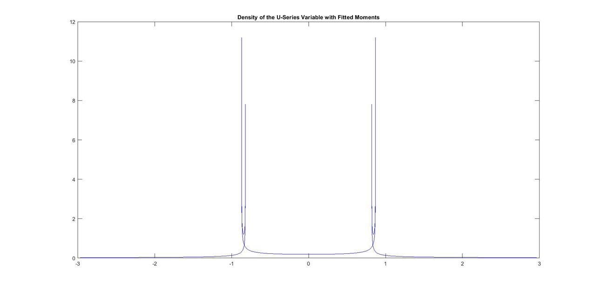
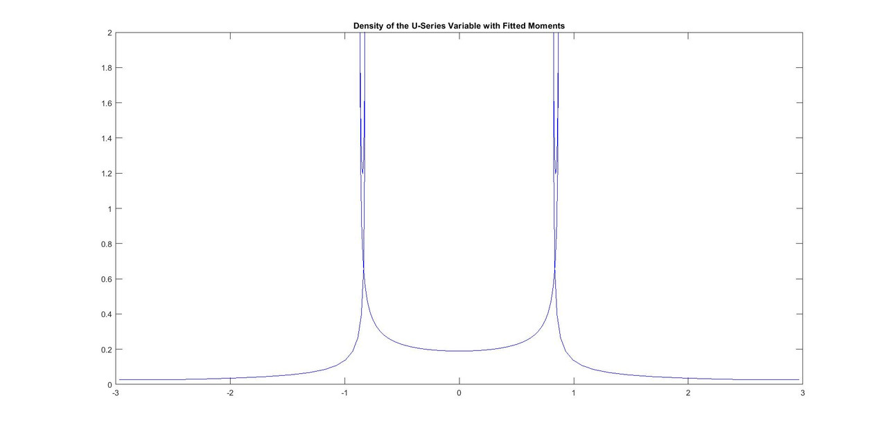

# Breakthrough in the theory of stochastic differential equations and their simulation

**Page 36 of 59** — Posts #1751–#1800

[← Previous](page_035.md) | [Index](index.md) | [Next →](page_037.md)

---

### #1751 — Amin (Topic Author)
*March 20, 2023, 7:49 PM*

>
> Friends, I continued to think about yesterday's ideas and seem to possibly have more insight about using Taylor series
for orthogonal regressions. But still this is non-tested theory and I might be totally off and therefore I want to
request friends to pardon any possible mistakes in my exposition.
>
>
>
> In deterministic setting, if we want to do an orthogonal regression between explanatory variables and explained
variable, we first have to choose an appropriate base function into which we will Taylor-expand our variables.
(Non-linearity of a variable is with respect to another variable that is related through a non-linear function. However
non-linear a variable with respect to some other variable, it is perfectly linear on its own axis and obviously cannot
be taylor-expanded onto itself.) So first we have to find an appropriate base function with respect to which we will
Taylor-expand explained and explanatory variables. In our orthogonal stochastic hermite regressions, the base variable
was a standard gaussian into which we expanded explained and explanatory variables.
>
>
>
> To keep things simple, we suppose that we are orthogonal-Taylor-regressing one explained variable Y on one explanatory
variable X. Suppose we choose base function as$ \, f(u)\, = \, {u}^{\frac{1}{4}} \, $ . Again, there can be many
possible choices of base functions that can even possibly be better but we are giving this one-fourth power as one
possible base function.
>
>
>
> We want to orthogonal-Taylor-Regress Y on X.   Using the base function mentioned above, we have
>
> $ \, W \, = \, {X}^{\frac{1}{4}} \, $   meaning  $\, X \, = \, W^4 \, $
>
> and
>
> $ \, V \, = \, {Y}^{\frac{1}{4}} \, $   meaning  $\, Y \, = \, V^4 \, $
>
>
>
> W is base variable for X while V is base variable for Y. In our hermite-orthogonal-regressions independent Z's were
base variables.
>
>
>
> We Taylor-expand X in its base variable W and we also Taylor-expand Y in its base variable V as   (around appropriate
series centre points. We would have to work these things out where to place center points of series. These centre points
corresponded to medians in our Z-series for hermite-orthogonal-regressions.)
>
>
>
> following our previous equation$\, X \, = \, W^4 \, $ , we taylor expand around appropriate expansion point$W_0(X_0) $
as
>
>
$X \, = \, W_0 \, + \, 4 \, {W_0}^3 \, (W \, - \, W_0) \, + 1/2 \,*\, 12 \, {W_0}^2 \, {(W \, - \, W_0)}^2+ 1/6 \,*\, 24 \, {W_0} \, {(W \, - \, W_0)}^3+ 1/24 \,*\, 24  \, {(W \, - \, W_0)}^4 $
>
> which can be sucintly written as
>
>
$X \, = \, b_0 \, + \, b_1 \, (W \, - \, W_0) \, + b_2\, {(W \, - \, W_0)}^2+ b_3 \, {(W \, - \, W_0)}^3+ b_4  \, {(W \, - \, W_0)}^4 $
>
>
>
> Similarly, following above steps again, we can Taylor-expand Y in terms of V as
>
>
>
>
$Y \, = \, c_0 \, + \, c_1 \, (V \, - \, V_0) \, + c_2\, {(V \, - \, V_0)}^2+ c_3 \, {(V \, - \, V_0)}^3+ c_4  \, {(V \, - \, V_0)}^4 $
>
>
>
> Please notice the similarity of Taylor-expansions of X and Y with our previous Z-series expansions.
>
>
>
> Now to set up the regression, we would have to convert X and Y data points into W and V data points as we had to do in
the inversion of Z-series. Our final data before regression would be in terms of W and V variables (as opposed to Z1 and
Z2 in case of hermite Z-series orthogonal regressions)
>
>
>
> Now, in order to regress Y on X,  we can simply do four regressions, with each regression between appropriate
expansion powers. These regressions would be between (just like we have to take into account covariances, we would have
to take into account coefficients on each of these pairs mentioned below)
>
> $(V \, - \, V_0)$  and  $(W \, - \, W_0)$
>
> ${(V \, - \, V_0)}^2$  and  ${(W \, - \, W_0)}^2$
>
> ${(V \, - \, V_0)}^3$  and  ${(W \, - \, W_0)}^3$
>
> ${(V \, - \, V_0)}^4$  and  ${(W \, - \, W_0)}^4$
>
>
>
> There will be four pairs of orthogonal regressions since the base function we chose allowed for expansion up to fourth
power only. Some Other base functions could possibly do better. But these details we will continue to know in coming
weeks and months. We could combine the results from above orthogonal regressions to come up with one estimator for the
explained variable.)
>
>
>
> Friends above is my brief plan of attack for orthogonal Taylor regressions but I might have made some mistakes or
something might possibly be wrong so please pardon any mistakes.
>
>
>
> I will try to come up with a Taylor orthogonal regression program in next 3-4 days.
>
>
>
> As I see, if we take deterministic functions without any noise in data, and do above steps appropriately by choosing
an appropriate expansion point and other things right, we might possibly get a fourth order accurate result from this
regression if the data is from deterministic functions without noise.
>
.

.

Friends, I suggested in the copied paste that

We want to regress using taylor basis functions and

our base variable for explanatory variable could possibly be$ \, W \, = \, {X}^{\frac{1}{4}} \, $ meaning original
variable would be given as$\, X \, = \, W^4 \, $

There would usually not be any integer power function and we have no way to know whether X can be denoted as an integer
power function as in above.

But we can easily assume that X is a polynomial function of W. If we want to take analytics to fourth power, this
polynomial relationship can be stated as

$X\, = \, a \, W^4 \, + \, b \, W^3 \, + \, c\, W^2 \, + \, d \, W \, + \, e $

and we have to find W through inverse function using numerical inversion of X since data is given in X
coordinates.(Similarly we would have a different polynomial function usually for same order relating to base variables
for all explained and explanatory variables)

Now we can Taylor expand X as

$ \overline{X(W)}\, =\,X(W_0) \, + \frac{dX}{dW}(W_0) \, (W\, - \, W_0) \,+ \frac{1}{2} \, \frac{d^2 X}{dW^2}(W_0) \, {(W\, - \, W_0)}^2 \,+\frac{1}{6} \, \frac{d^3 X}{dW^3}(W_0) \, {(W\, - \, W_0)}^3 \,$

$+ \frac{1}{24} \,\frac{d^4 X}{dW^4}(W_0) \, {(W\, - \, W_0)}^4 \,$

overline on X denotes that this value of X is derived from Taylor expansion given the value of W (which is found from X
after numerical inversion of original polynomial function relationship)

where

$\,X(W_0) \,=\, a \, {W_0}^4 \, + \, b \, {W_0}^3 \, + \, c\, {W_0}^2 \, + \, d \, W_0 \, + \, e $

$\,\frac{dX}{dW}(W_0) \,=\,4 \, a \, {W_0}^3 \, + \, 3\, b \, {W_0}^2 \, + \,2\,  c\, {W_0} \, + \, d \, $

$\,\frac{d^2 X}{dW^2}(W_0) \,=\,12 \, a \, {W_0}^2 \, + \, 6 \, b \, {W_0} \, + \,2\,  c\, $

$\,\frac{d^3 X}{dW^3}(W_0) \,=\,24 \, a \, {W_0} \, + \, 6 \, b \, $

$\,\frac{d^4 X}{dW^4}(W_0) \,=\,24 \, a \, $

We start with guess coefficients a, b, c, d, and e. We now take all the data values$X_n$ and their respective Taylor
derived values$\overline{X_n}$ and perturb and optimize for the coefficients a, b, c, d, and e until
$\sum  {(X_n\, - \, \overline{X_n})}^2 $ is minimized.

The true coefficients for X as a function of W for a particular expansion order would be the ones that minimize
$\sum  {(X_n\, - \, \overline{X_n})}^2 $ meaning our chosen coefficients make the polynomial base function calculation
of the data variables as close to the data observations as possible.

Even if Taylor does not work perfectly for regression(something we have yet to check in our experiments), we could
easily change  the above calculations into Legendre orthogonal polynomial basis and run an orthogonal regression as we
did with hermite polynomials.

Above was just a post explaining my strategy to find the best Taylor expansion of a certain order given some numerical
data. I will come with a new program with Taylor expansion and regression in Taylor expanded basis or possibly also in
Legendre orthogonal basis in a few days.

---

### #1752 — Amin (Topic Author)
*March 21, 2023, 1:30 PM*

Friends, I want to write this post to protest since crooks of Pentagon stop good people both of US and other countries
to reach out to me. They immediately approach people who contact me and ask them to stop communicating with me.

For the context of people who just joined this thread, I will explain a few things again.

There are tens of thousands of mind control victims of crooks of Pentagon in United States of whom a very large
percentage whose persecution started when they were  mathematics and computer science students or had recently joined
these professions after graduation.

As I had previously said that there are many Jewish actors associated with this widespread mind control. There are many
different types of people in each community, society and religion and it is a very bad thing to generalize something bad
to any religion or community and therefore I would like to tell even though there are enough Jewish actors associated
with mind control, most other Jews have nothing to do with mind control and they would never like to harm anyone with
something like mind control . As a (non-practicing and non-believing) Muslim, I know there are enough violent and
fundamentalist Muslim who would gladly kill or injure someone who is a non-Muslim and such incidents happen sporadically
every few years, but there are , at the same time, a very large percentage of civilized Muslims who are thoroughly
opposed to such cruelties and would try to stop them at all cost and therefore cannot see in the eyes of their (western)
countrymen due to shame and stigma every time such incidents of brazen animal cruelty happens in the hands of some
extremist Muslim. Just like in Muslims or any other community there are enough ultra-conservative Jews who take pride in
retarding intelligent Muslims who study science an mathematics and might get known to have a chance to excel in their
profession. While a very large percentage of Jews would shudder at the idea of torturing anybody and stripping one's
intelligence whatever one's religion. Most of the good people among Jewish community have nothing to do with persecution
and mind control of any innocent human and they would rather do everything in their power to stop ultra-conservative
jews to end mind control of innocent people. But still in every large university, you will find a small number of people
who initiate mind control of innocent students (and they know who to contact in US army to start mind control of
innocent students while most other good people have no such clue or any such contacts) and  when you see what community
most of these people who start mind control  belong to, a pattern would start to emerge before you.

Again with apologies to good jews and many great Jewish billionaires(who are great human beings), a Jewish billionaire
is Godfather of mind control. He and his cohort of some other rich Jews have great influence in Pentagon. The powerful
people in Pentagon who follow the orders of the rich Jewish Billionaire Godfather are rewarded by lucrative jobs paying
millions of dollars after these influential people (who have followed the wishes of the Billionaire Godfather while they
were in military service) retire. These obedient staff of Pentagon virtually enters paradise after their retirement from
military and it is well known among the officers in US army what are the meanings of obliging the billionaire Godfather
and the great consequences that would follow.

The closely knit group of many ultra-conservative Jews in many universities remains in touch with the Jewish Billionaire
Godfather of mind control and his puppets in Pentagon to continue mind control of hundreds of innocent students in these
universities every year.

Now the obedient staff of Godfather in Pentagon who were related to my mind control know they have fucked up. And these
crooks of Pentagon know that Billionaire Godfather is in no way obliged to give them any favor of offering them jobs
paying millions of dollars after their poor execution of my mind control. And these crooks in Pentagon had been dreaming
during all their service about entering the paradise of Godfather, become even more desperate to do something to somehow
control me so they can possibly make it to several million dollar club.

I want to tell American people that I think America is a very diverse country with some of the greatest of all human
beings living in United States and also most vile creatures in the world living in United States. But generally
Americans are a very nice, kind, humane and civilized people. I have said again and again on this forum that my research
could never have been possible if it were not for support from good American people who continued to protest about my
ill treatment and bad people at pentagon had to scale down their tactics that gave me enough opportunity to concentrate
on my research. If I have been able to explore something in mathematics, I truly owe it to good people in American
universities who tried to support me and without their support nothing like this could ever have been possible for me.

But I really want to tell friends that bad people at Pentagon are not at all willing to yield on my mind control. They
are looking to buy time so that all of this goes out of limelight and they re-start their tactics with great zeal again.

And they really continue to stop any body who tries to approach me by telling them brazen lies about me and insist they
never approach me again.

---

### #1753 — Amin (Topic Author)
*March 21, 2023, 6:21 PM*

Friends, as a second thought, any Taylor expansion of data with unknown functional form should be with respect to
uniform measure. In a way this should be equivalent to an expansion for data in terms of standard uniform variable U
with range -1 to +1. Just like we had a Z-series when we were finding an expansion for data in terms of standard normal,
we can have a U-series that finds an expansion for the data in terms of standard Uniform variable. Legendre polynomials
would be to U-series what Hermite polynomials were to Z-series. And just like Z-series representation could be changed
to Hermite polynomials representation by matching coefficients of each power of Z, We could convert U-series
representation to Legendre polynomial representation by matching powers of U.

A random variable X could be represented in a U-series as

$ \, X \, = \, a_0 \, + \, a_1 \, U \,+ \, a_2 \, U^2 \,+ \, a_3 \, U^3 \,+ \, a_4 \, U^4 \,+ \, a_5 \, U^5 \,$

Where U is a standard uniform

 The above expansion would be equivalent with Legendre polynomial expansion given as

$ \, X \, = \, al_0 \, + \, al_1 \, L_1(U) \,+ \, al_2 \,L_2(U) \,+ \, al_3 \, L_3(U) \,+ \, al_4 \, L_4(U) \,+ \, al_5 \, L_5(U) \,$

where $L_n(U)$ is the notation used for Legendre polynomial of nth order.

We could find the uniform series representation by finding appropriate coefficients in U-series expansion so that
moments of U-series match with moments of the data. Just like we matched moments of Z-series with moments of the data in
our earlier work.

Another way to find a U-series (other than matching moments with data moments) could be through extracting Legendre
coefficients by inner product of data with Legendre polynomials after wrapping standard Uniform variable on data through
equivalent CDF. Just like we did when we found coefficients for hermite polynomials through inner product with the data
after wrapping standard normal variable on data through equivalent CDF.

Taylor series around the median would correspond to standard U-series around the median.

Another caveat could be that just like first order positivity condition required for good Z-series , we might need first
derivative positivity condition for U-series as

$\frac{dX}{dU} > 0 $ within the range of data.

---

### #1754 — Amin (Topic Author)
*March 21, 2023, 6:48 PM*

Just like we had with Z-series, where we calculated functions of a Z-series variable by Taylor series around median, in
case of U-Series, we could find functions of a U-series variable by Taylor series around median.

Variances of U-series variables could be added after conversion into Legendre polynomials and adding coefficients of
Legendre polynomials in a squared fashion just as we had to convert Z-series to Hermite polynomial representation and
then added coefficients of hermite polynomials in a squared fashion.

Correlation across Legendre orthogonal polynomials would go just as we found it across hermite polynomials and similarly
for regressions.

Though I did not study Laguerre, Chebyshev or Jacobi polynomials, but I am sure all of this could be carried in a
straightforward manner to those polynomials as well.

Coming back to the earlier question we had whether we needed orthogonal basis for regression or if we could just use any
independent basis for regression should be equivalent to asking if we could somehow regress  Z-series/U-series in their
original basis or we had to resort to hermite polynomials/Legendre polynomials for a proper regression.

---

### #1755 — Amin (Topic Author)
*March 22, 2023, 3:09 AM*

Friends, my mind control continues unabated. On almost every day, mind control agents try to not let me have a deep
sleep. The extent of this torture varies with my need for sleep. When I sleep late and need a good sleep to be fresh in
the next day, they are very aggressive in not letting me have a deep and proper sleep. When I sleep early, I would
usually just have a barely reasonable sleep. I rarely have a very deep and good sleep at night. And that is when I
dramatically change where I sleep in the room or sleep on the floor somewhere in the room after sleeping on the bed for
more than a week. This good sleep is because once I change my sleeping place, their sensors go off and it is difficult
to control every part of the brain to not let me have a good sleep.

For past few nights, the problem with sleep has been increasing and this is where mind control agents have been trying
to work on. Last night when I tried to sleep, they continued to target lasers on my ears. I could literally hear a
throbbing sound as they forced electromagnetic pulses into my ear. Our ears are very vulnerable as they have a direct
opening into our brain. I do not put any cotton in my ears(or do anything of the sort that people could see and think I
am mentally sick) but pulses into the ear were so severe that I tried to put a compressed tissue in my ears (as my room
was locked while sleeping and nobody could see). But it did not help. I also tried to change my sleeping position by
moving the cot but still it did not work and I had to continuously face torture.

I really want to request good people to please force the bad people at Pentagon to finally stop their animal tactics on
me and let me live with my human dignity intact.

---

### #1756 — Amin (Topic Author)
*March 22, 2023, 10:53 AM*

Friends, since I have already worked on similar ideas related to Z-series and Hermite polynomials representation of data
and I am reasonably familiar with most concepts involved, I have decided to write similar programs for U-series and
Legendre polynomials including Legendre and U-series representation of data by matching moments as we did for Z-series
representation of data. I will also write a program to extract Legendre coefficients from data using inner product with
Legendre polynomials when standard Uniform density is wrapped on data through equivalent CDF. This second method would
work well when we could have large number of data points while earlier mentioned method of matching moments could work
well even when we have just a few data points.

I will also try to write programs that convert a U-series variable into U-Series of its functions through Taylor series
around the median of density. And finally write a program for orthogonal regressions of various data variables on each
other through Legendre polynomials basis functions.

I have done very similar work for Z-series and hermite polynomials so most of the work should not take more than 3-4
days. I hope I will be able to finish the work before next antipsychotic injection is due.

Please do read my post on last page that I wrote earlier today.

---

### #1757 — Amin (Topic Author)
*March 23, 2023, 7:47 AM*

Friends, I hate to say this again and again but I would really like to tell people that bad people in American army are
more determined than ever about my persecution. If they tell friends anything like that they are decreasing my mind
control, they are brazenly lying and deceiving good people. They have absolutely no intention of decreasing my mind
control and they are bracing for the long haul while buying time at the moment.

Before I tell people how I know about their intentions, I would like to mention a few related things.

When I go out in the city to take food and buy anything, mostly I use a motorcycle to move around within the city. I had
very rarely used motorcycle for past twenty years and previously always used my car. When I went to live in Kot Addu
twice in winters of 2021-2022, I started using motorcycle to drive around  countryside around Kot Addu in pleasant
weather. When I came back to Lahore after winter of 2021-2022, I started using motorcycle in Lahore once in a while in
early morning or late evening when it would be pleasant. And then prices of petrol increased from Rs. 80 per liter to Rs
250 per liter and I started to use more of the motorcycle to save money.  I would still use my car a lot but avoid
taking it out when going to a close by neighborhood of the city. And when I went to Kot Addu again in winters of
2022-2023, I again used motorcycle a lot to move around in pleasant weather and really enjoyed it. After coming back to
Lahore in Jan 2023, I started using the motorcycle all the time since weather has also been pleasant. Now I rarely use
my car and just use the motorcycle to even go to remote areas of the city. This really helped me since there are a large
number of relatively less affluent but still bustling neighborhoods in the city where streets and relatively narrow and
crowded and you cannot take your car there but easily move around on the motorcycle. Earlier I was limited to only parts
of the city where there were good roads and Pakistan army knew very well most of the places where victims like me could
go and buy food and other things so they would quickly drug any food place or sometimes the entire markets on the main
roads. But when they drugged ground water and bottled water(of all companies including Nestle, coca-cola etc.) earlier
this year, I was able to buy good water from manufacturing dates of last year since I would take my motorcycle into maze
of relatively narrow streets and markets and would be able to buy good water lying at shelves at many places. I could
never have survived if I were using my car and only trying larger roads in the city. There are very large number of such
interconnected streets in the city where markets are bustling but you cannot drive a car there. So against all odds,
despite that all the ground water and newly manufactured water was drugged, I still had no difficulty in getting good
water.

Now I love driving my motorcycle in the city even though most people who are conscious of status in our country would
never drive a motorcycle and some even might look down at people driving motorcycles but I am just in love with this. My
only worry is that it would become very difficult to go out on motorcycle in the sun when harsh summer arrives in a
month.

Now coming to the point how motorcycle made it difficult for them to keep me under mind control. In my car, they have
miniscule devices everywhere(in the seats, in the roof and in the mirrors and everywhere else)  for mind control and
they have a very controlled environment (as they an keep releasing gases) and the victims remains firmly in control. A
car cannot go to small streets. On every large road in the city, Pakistan army has installed EM waves mind control
infrastructure to keep the victim in control. This EM waves mind control infrastructure had not been installed in
smaller roads of most residential areas(where no mind control target lives) and narrow streets and markets of the city.

At this point I want to tell friends that among other things that are done to mind control victims, it is made sure by
mind control agents to not let a victim connect his brain to special parts of the brain that have the most brilliance.
EM waves travel at the speed of light but most neurotransmitters in our brain travel very slowly. When a special
neurotransmitter starts to move to connect the remaining brain to special parts of the brain, mind control agents
already know since they get a signal instantaneously at the speed of light at fast neurotransmitters and they use EM
waves resonance to stop (and kick out of the pathways) the special neurotransmitter that had started to move to connect
the brain but long before it had succeeded. This way several mind control agents make sure that victim is never allowed
to connect his functioning brain to special parts that have the most intelligence and brilliance. Every neurotransmitter
that tries to connect is kicked out of its pathways before it had succeeded to connect.

So the point about going to smaller roads and narrow markets is that since Pakistan Army had not installed EM Mind
control infrastructure on those parts of the city, when I would go there, many times my brain would start connecting to
special parts and connect-reconnect in its own natural ways. This creates a great problem for the mind control agents to
control the brain perfectly.

Now I want to tell friends another special thing about mind control. It is known to me for more than ten years that when
I go to some road or place with very special mind control, the bottom of my pants get charged and I have an exaggerated
sensation when my pants rub with my legs. Even I an feel hair on my legs rubbing with the cloth of the pants. Otherwise
in normal conditions, my legs would continue to rub with the cloth of the pants and I would absolutely not have any
special feelings and hair on legs would also not have any feeling at all. But whenever I have this feeling, I know there
is very special mind control here and I try to avoid that place.

Earlier when I would go to small roads in many adjacent residential areas and narrow markets, I would absolutely not
have any special feeling of the sort I described above. But since past 7-10 days, I have started to notice that when I
would drive on many many smaller roads in entire adjacent residential areas, and also in many narrow roads on my
motorcycle, my legs would become very sensitive and I would have very exaggerated sensation of my clothes (pants)
rubbing with my legs.

I really believe that within past one or two weeks, Pakistan army has installed special EM waves and mind control
infrastructure in many more parts of Lahore city in areas that were not perfectly covered with mind control
infrastructure. They have installed very special mind control devices all over those parts of Lahore city where mind
control did not exist earlier since they think that lack of mind control infrastructure is one reason that I have
continued to escape their mind control.

I would invite good people in America and Europe who have approach to influential European embassies to check on their
own and they would get to know that mind control infrastructure on large number of smaller roads and entire
neighborhoods have indeed been upgraded or newly installed by Pakistan Army on behest of crooks of Pentagon.

Even otherwise mind control is not decreasing. I complained yesterday that I am not allowed a good sleep by mind control
agents but still to no avail. This night, I continued to sleep for a long time but my sleep was extremely poor and I was
feeling tired after waking up and I could tell that they were trying to not let me have a good all night. They really
try to induce poor sleep in their victims since a good sleep is very important for the brain.

So I would really like to say to Good American people again that bad people in American army and their jewish backers
are more determined than ever about my persecution. If they tell friends anything like that they are decreasing my mind
control, they are brazenly lying and deceiving good people. They have absolutely no intention of decreasing my mind
control and they are bracing for the long haul while buying time at the moment. American army has absolutely no
intention of decreasing my mind control, they only want to increase it and take it to their desired perfect conclusion.

---

### #1758 — Amin (Topic Author)
*March 25, 2023, 12:38 PM*

Friends, I tried to write algorithm to compute U-series (expansion of random variables with respect to polynomial in
Uniform variable) but I had little luck in devising any algorithm that works all the time. Therefore I decided to look
for alternative ways to find U-series of arbitrary random variables. And I have some good ideas. If you can find
expansions of your data in terms of a polynomial with variable with respect to any density, you can convert it to a
polynomial with respect to (our version of) standard Uniform(also called a U-series). For example, if you have fitted
first few moments to a Z-series (polynomial with respect to standard normal), you can directly convert your Z-series
into a U-series. However describing an normal density variable (that sits on a squared exponential density) in terms of
a polynomial in standard Uniform variable might take a (U-series) polynomial of far greater degree than the original
Z-series expansion.

Once we have found the U-series, we can easily convert it into a series in Legendre polynomials with very simple
algebra. For example if the U-series is of 8h order, we need to divide it once with respect to eighth order Legendre
polynomial. This division will in general only eliminate the 8th power of U-series. The quotient will be the coefficient
of 8th degree Legendre polynomial. Since we have matched the eighth power and eliminated it, the remainder will in
general be a seventh degree polynomial in standard uniform variable( seventh order U-series). Now we will divide this
seventh degree polynomial with seventh order Legendre polynomial to eliminate the seventh power of polynomial in uniform
variable. The quotient of this division by seventh order Legendre polynomial would be coefficient of seventh order
Legendre polynomial. And remainder will in general be sixth degree polynomial from which we will find coefficient of
sixth degree Legendre polynomial after division and so on until we are left with a simple coefficient that will be the
coefficient of zeroth degree Legendre polynomial. In fact, we can represent any ordinary polynomial in terms of
coefficients of (any of the popular and common) orthogonal polynomials using this method. In polynomial space of same
order of polynomials, they are all equivalent.

To give friends some ideas about how to convert a standard normal variable (or any other density with continuous
derivatives) into (our version of) standard uniform, I want friends to read some preliminaries including  few older
posts where I have mentioned how to do this.

Below I am directly copying the contents of this post so it is easier to read. Here is the original post 1637: https://forum.wilmott.com/viewtopic.php?f=4&t=99702&start=1635#p873552

I will copy contents of the above post below and then explain how a Z-series can be converted directly into a U-series
in the next post. This means that if we are given a polynomial representation of our data in terms of polynomial in
powers of standard normal, we can describe the same data by a polynomial in standard uniform. Preliminaries first and
then I give the details in next post.

The idea is to expand standard normal and its powers as a Taylor series in (our version of) standard Uniform variable.
The derivatives of Z with respect to U of all orders required for this Taylor expansion are found by  simple analytics
related to change of density derivative of standard normal density with respect to standard uniform density. Please read
the copied post below and I explain the ideas in more details in next post in the context of conversion of Z-series in
U-series.

Below is the copy of post 1637.

-----------------------------------------------------------------------------------------------------------------------------------------------------------------------------------------------------------------

Friends, I had tried this idea earlier when I was finding Z-series of density from its moments in posts 1491 and 1492.
But there I had tried to generate a base density from solution of linear equations applied to match the moments of the
random variable. The idea of expanding any random variable with analytic density at its median and finding its
derivatives with respect to standard normal random variable to from a Z-series of random variable was perfectly sound
but the whole thing did not work as moments calculated from linear equations were totally rubbish.

https://forum.wilmott.com/viewtopic.php?f=4&t=99702&start=1485#p871047

https://forum.wilmott.com/viewtopic.php?f=4&t=99702&start=1485#p871049

Here I copy relevant parts of those above posts.

From post 1491:

Friends, we have earlier learnt when we want to represent a stochastic random variable X, in the form of a Z-series, the
form of equation for X is given as

$X(Z)=a_0  \,+ a_1 \, Z + a_2 \, Z^2 + a_3 \, Z^3 +  a_4 \, Z^4 +\, ... $

The first, second and third  derivatives of w(t) w.r.t Z are given as

$\frac{\partial X}{\partial Z}= a_1 \, + 2 \,a_2 \, Z +3 \, a_3 \, Z^2 +4 \,  a_4 \, Z^3 +\, ... $

$\frac{\partial^2 X}{\partial Z^2}=  2 \,a_2 \, +6 \, a_3 \, Z +12 \,  a_4 \, Z^2 +\, ... $

$\frac{\partial^3 X}{\partial Z^3}=  6 \, a_3 \,  +24 \,  a_4 \, Z \,+60 \,  a_5 \, Z^2 +\, ... $

IF we do all the calculations of series evolution equation at median where Z=0. here all the derivatives are given only
by leading coefficient associated with zeroth power of Z. So at Z=0,

$w(t)=a_0  \,$

$\frac{\partial X}{\partial Z}= a_1 \,  $

$\frac{\partial^2 X}{\partial Z^2}=  2 \,a_2 \, $

$\frac{\partial^3 X}{\partial Z^3}=  6 \, a_3 \,  $

$\frac{\partial^4 X}{\partial Z^4}=  24 \, a_4 \,  $

So we have that

$X(Z)=a_0  \,+ a_1 \, Z + a_2 \, Z^2 + a_3 \, Z^3 +  a_4 \, Z^4 +\, ... $

$X(Z)=a_0  \,+ \frac{\partial X}{\partial Z} \, Z + 1/2 \, \frac{\partial^2 X}{\partial Z^2} \, Z^2 +1/6 \,  \frac{\partial^3 X}{\partial Z^3} \, Z^3 +1/24 \,  \frac{\partial^4 X}{\partial Z^4} \, Z^4 +\, ... $

So basically our power series is the same as Taylor series where derivatives between the two random variables, the
stochastic variable X and standard Gaussian Z, are calculated at the median. ( You could do these calculations at other
points in the density as well but those calculations would be much more involved and if correct should yield the exact
same final result if the density is based on continuous derivatives)

If we could just find the median of density of our random variable X and its derivatives
$\frac{\partial X}{\partial Z}\,  $ ,$\frac{\partial^2 X}{\partial Z^2} $ and other higher derivatives with respect to
Z, we can find coefficients of our power series representation of our random variable X in terms of powers of standard
Gaussian.

Again the above derivatives would have to be calculated at median of densities of both random variables, X and Z.

From Post 1492:

As we learnt in the previous post, In order to construct the Z-series of a particular stochastic random variable X, we
have to find its various derivatives with respect to standard Gaussian at the median(of both densities). So our first
step towards construction of a Z-series representation would be to find median of the stochastic random variable X in
question. I suppose that we have constructed analytical density of X using one of the methods described in previous
post. We would have to find median mostly through Newton-Raphson as there are usually no simple formulas for median of a
density.

After finding median, we can fix first coefficient of Z_Series as

$ c_0 \, = \, Median $

Both our density for random variable X and the standard gaussian density are related through change of variable formula
for two densities as

$p_Z(Z) \, = \, p_X(X(Z)) \, \frac{dX}{dZ} \, $   Eq(1)

So we can find $\, \frac{dX}{dZ} \, $ at median from the ratio of densities of respective variables at median as

$\, \frac{dX}{dZ} \, = \, \frac{p_Z(Z=0)}{p_X(X(Z)=c_0)}= \, \frac{p_Z(0)}{p_X(c_0)}$

In order to find higher derivatives of X with respect to Z at median, we differentiate Eq(1) on both sides w.r.t Z as

$p'_Z(Z) \, = \, p'_X(X(Z)) \, {(\frac{dX}{dZ})}^2 +  \, p_X(X(Z)) \, \frac{d^2X}{dZ^2}\, $ Eq(2)

In above equation and similar subsequent equations, we know the derivatives of gaussian density at Z=0 analytically. And
we can easily find all first few nth derivatives of density of random variable X at its median
$\frac{dp^n_X}{dX^n}(X(Z)) = \, \frac{dp^n_X}{dX^n}(c_0) $ from the analytic density as we have constructed in the
previous post. So we know values of all variables in Eq(2) other than$\, \frac{d^2X}{dZ^2}\, $ whose value we back out
from Eq(2)

The third derivative equation would be

$p''_Z(Z) \, = \, p''_X(X(Z)) \, {(\frac{dX}{dZ})}^3 +  \, 3\, p'_X(X(Z)) \, {\frac{dX}{dZ}} \, {\frac{d^2X}{dZ^2}} +  \, p_X(X(Z)) \, \frac{d^3X}{dZ^3}\, $
Eq(3)

which can be used to back out  $ \, \frac{d^3X}{dZ^3}\,$

Similarly we can continue to differentiate Eq(2) and keep finding value of next higher derivative of X w.r.t Z at
median.

After finding first few derivatives of X w.r.t Z at median, we can construct the Z_series of X as

$X(Z)=a_0  \,+ \frac{\partial X}{\partial Z} \, Z + 1/2 \, \frac{\partial^2 X}{\partial Z^2} \, Z^2 +1/6 \,  \frac{\partial^3 X}{\partial Z^3} \, Z^3 +1/24 \,  \frac{\partial^4 X}{\partial Z^4} \, Z^4 +\, ... $

In a similar spirit, I think we can take the base density as a different density (could be gamma density) and represent
some stochastic variable as a series in Gamma density variable by equating the equations of two densities through change
of density derivative at their median.

---

### #1759 — Amin (Topic Author)
*March 25, 2023, 1:37 PM*

Again, the idea is to expand standard normal and its powers as a Taylor series in (our version of) standard Uniform
variable. The derivatives of Z with respect to U of all orders required for this Taylor expansion are found by  simple
analytics related to change of density derivative of standard normal density with respect to standard uniform density.

If we could know derivatives of standard normal variable Z with respect to standard uniform variable U, at a common CDF
point preferably at median of two densities, this Taylor expansion would be given as

$\, Z(U)\, = \, Z(U_0) \, + \, \frac{dZ(U_0)}{dU} \, (U \, - \, U_0)  \, + \, \frac{1}{2} \, \frac{d^2Z(U_0)}{dU^2} \, {(U \, - \, U_0)}^2$

$  \, + \, \frac{1}{6} \, \frac{d^3Z(U_0)}{dU^3} \, {(U \, - \, U_0)}^3\, + \, \frac{1}{24} \, \frac{d^4Z(U_0)}{dU^4} \, {(U \, - \, U_0)}^4 +  \ldots $

One might have to consider that converting from an exponential measure to uniform measure might require reasonably large
number of derivatives. But if you want to represent your data in uniform measure (and in related Legendre polynomials),
you might have to sacrifice some brevity associated with polynomial representation associated with standard normal
measure. I have to understand that this is usually related to data itself and if I directly fit the data that is
(normal-like enough), I will still need a large degree of polynomial in standard uniform to fit the data (It does not
have to do with that we are converting Z-series to U-series) A higher order representation in uniform series  is a
feature of the data.

It turns out that we can easily find the derivatives$\, \frac{dZ(U_0)}{dU} $ ,$\frac{d^2Z(U_0)}{dU^2}$ ,
$\frac{d^3Z(U_0)}{dU^3}$ and all other higher derivatives. Though we can expand around any point on both standard normal
and standard uniform density associated with a common CDF, I would generally prefer to almost always expand around
points associated with median of both densities. In standard normal and in our version of standard uniform, both these
densities have a median at zero.

For functions of standard normal variable (As Z-series representation of a random variable is a polynomial function of
standard normal variable), we will use a version of Taylor given as below. Here$Z_0$ is point on normal density
associated with expansion point$U_0$ and I would prefer that$Z_0$ and$U_0$ both are median of respective densities (and
hence associated with common CDF). Particularly$\, f(Z(U_0)) \,= \, f(Z_0) $

$\, f(Z(U))\, = \, f(Z(U_0)) \, + \, \frac{df(Z_0)}{dZ}\, \frac{dZ(U_0)}{dU} \, (U \, - \, U_0)  \, + \, \frac{1}{2} \, \, \Big[ \frac{d^2f(Z_0)}{dZ^2}\, \big[\frac{dZ(U_0)}{dU} \big]^2 +\,\frac{df(Z_0)}{dZ}\, \frac{d^2Z(U_0)}{dU^2}  \Big] \, {(U \, - \, U_0)}^2$

$  \, + \, \frac{1}{6} \,\Big[ \frac{d^3f(Z_0)}{dZ^3}\, \big[\frac{dZ(U_0)}{dU} \big]^3 +3 \,  \frac{d^2f(Z_0)}{dZ^2}\, {\frac{dZ(U_0)}{dU}} \, {\frac{d^2Z(U_0)}{dU^2}} +\frac{df(Z_0)}{dZ}\, \frac{d^3Z(U_0)}{dU^3} \,\Big] \, {(U \, - \, U_0)}^3\, +  \ldots $

In the next post, I explain how to find derivatives of standard normal with respect to standard uniform by relating
standard normal density to standard uniform density through change of variables derivatives between both densities.

---

### #1760 — Amin (Topic Author)
*March 25, 2023, 3:25 PM*

From the change of variables between continuous probability distributions, we can find the relationship between standard
normal density and standard uniform density ad derivatives between their variables. If$g(Z)$ represents standard normal
density and$f(U)$ represents standard uniform density, we have

$g(Z) \, = \frac{1}{\sqrt{2 \, \pi}}\, \exp(-.5 \, Z^2)\,$

and

$ f(U) \, = \, \frac{1}{2} $ for $\, -1 \, \geq \, U \, \geq \, 1$  zero otherwise

Through change of variable derivative relationship between densities we know that

$g(Z) \, dZ \, = f(U) \, dU \,$

or

$g(Z) \, \frac{dZ}{dU} \, = f(U) \,$

The above relationship is related through common cdf or common probability mass. For details please look up in
wikipedia.

At a point related through common CDF, if$G(Z_0)  \, = \, F(U_0) \, \,$ where G and F represent their respective CDF, we
have

$g(Z_0) \, \frac{dZ}{dU} \, = f(U_0) \, \,$

or

$\frac{dZ}{dU} \, = \frac{f(U_0)}{g(Z_0)} \, \,$

The above derivative is valid at common CDF points. In our expansions, we take this derivative at median of both
densities which are both incidentally zero.

Sorry friends, but we cannot take higher derivatives of standard normal with respect to standard uniform. We cannot
differentiate uniform density. We could have equated a zero derivative with second order derivative equation on other
(standard normal )side but first hermite (which is derivative of standard normal density) also goes to zero at median.
So we cannot find higher derivatives of standard normal with respect to standard uniform at median.

Sorry for this since I was erroneously thinking we could take higher derivatives of standard normal with respect to
uniform even if we could not take derivatives of uniform.

I would have to try some other way to solve this problem.

I still think that earlier exposition could be useful in many ways especially with densities that take continuous
derivatives.

I will look at things more carefully and try to see how we can solve this problem.

It would be possibly interesting to see if using just first derivatives in Taylor series of functions of normal might
possibly help us in getting a decent initial point for optimizations for U-series.

---

### #1761 — Amin (Topic Author)
*March 26, 2023, 1:33 PM*

Friends, I was thinking about the problem of finding the coefficients of Legendre polynomials that can well describe the
data. And I had some very interesting ideas that I decided to share with friends. I will write a program based on these
ideas but that might still be a week away but I am sharing ideas with friends. Some ideas might possibly have errors so
please pardon if there are any errors.

These ideas can easily be applied to Legendre polynomials in Uniform measure and Hermite polynomials in gaussian
measure. I believe these ideas can also be used in a reasonable way to find a very good guess that can be used with
moment matching optimizations to fit the coefficients of orthogonal polynomials on normal or uniform distribution.

We start with the basic premises that whatever the distribution of data is, the variable in Legendre polynomial used to
fit the data should (ideally) be a perfect uniform density after we invert the Legendre polynomial representation (or
alternatively the U-series representation) of data. Similarly when a well-fitted Hermite polynomial representation (or
its associated Z-series) is inverted, it should ideally give us a perfect normal distribution. Alternatively it means
that Legendre polynomials and Hermite polynomials used to fit the data (and find their coefficients representing the
data) are from true uniform and true normal distribution respectively.

 We first create the perfect uniform measure for Legendre polynomials and a perfect gaussian measure in case of hermite
polynomials. If there are twenty points in the data and  we are assuming a perfect uniform distribution, each point
should have probability equal to 1/20 and the grid should be equidistant as well. Similarly in case of a perfect
gaussian distribution we will need a twenty points grid so that probability mass in each grid point is 1/20 but these
grid centre points would be very close to each other around the median and very far from each other in the tails since
they are dictated by a discretized gaussian density. These are both discretized version of perfect uniform and perfect
gaussian density. We use these discretized versions of Gaussian density and uniform density to form discretized versions
of Hermite polynomials and Legendre polynomial in data.

In reality the data is random and never equidistant or equiprobable ever but we use this idea of discretized version of
the uniform and normal distributions as an ideal situation from which we find coefficients of respective polynomials by
minimizing least squares.

Again if we have twenty data points, we sort them in increasing order and associate a uniform on discretized uniform
density with each of the data points.

First polynomial basis is linear in both hermite and Legendre and is given as distance from median of the density. But
this first hermite/legendre polynomial is more difficult and usually its coefficient cannot be found by minimizing least
squares. The coefficient of first orthogonal polynomial affects all of the higher polynomials and has to be selected by
trial and error. We intend to start with a suitable number for coefficient of first hermite or legendre polynomial and
then find coefficients of all of the higher order polynomials by least square minimization. We note how good the fit to
data is for first few orthogonal polynomials. We repeat the process by perturbing the coefficients of first
hermite/Legedre polynomial in the direction of better fit and regress higher order polynomials and again find least
square fit to data. We choose the optimization associated with that coefficient of first orthogonal polynomial where fit
to data from all polynomials least square fit is the best. So again first coefficient (of first orthogonal polynomial)
is chosen by trial ad error in direction of over all best fit  to data and rest of the higher order polynomial
coefficients are fitted by minimizing least squares to data.

Again the choice of coefficient associated with first hermite/Legendre polynomial is the most difficult and basically
pins the linear span of true Gaussian or Uniform density.

Suppose we have twenty data points and we want to fit coefficients of Legendre polynomials to describe the data. The
data is sorted in increasing order by

$X_n$ where n ranges from one to twenty. We have our ideally discretized uniform density with equidistant grid of twenty
points and 1/20 probability mass in each grid cell.

This Un would be centers of each equiprobable grid cells.

U(1)=-.95,U(2)=-.85,,U(3)=-.75,  ...  , U(10)=-.05, U(11)=.05, .... , U(20)=.95

With each $X_n$, there is associated a $U_n$ so that

$X_n \, - \, X_0 = c_1 \, (U_n \, - \, U_0) \, + R_{1,n}$

This$c_1$ is chosen by trial and error and$R_{1,n}$ denotes defect in fit of nth point with respect to first Legendre
polynomial.

Now we choose coefficient of second Legendre polynomial by regressing the defect of data points from first polynomial to
higher polynomials.

$c_2$ is chosen so that expression below is minimized

$\sum_{n=1}^{n=20} \, {(R_{1,n} \, - \, c_2 \, L_2(U_n))}^2 $

Where$L_2(U_n)$ is value of second Legendre polynomial associated with value of Uniform associated with nth grid cell on
our idealized uniform density.

Once we have found coefficient $c_2$ associated with second Legendre polynomial, we find further remainder as

$R_{1,n} \, - \, c_2 \, L_2(U_n)= R_{2,n}$

Now we fit third Legendre polynomial on this remainder from fitting of second Legendre polynomial by minimizing the
following expression in least square sense as

$\sum_{n=1}^{n=20} \, {(R_{2,n} \, - \, c_3 \, L_3(U_n))}^2 $

This way we can fit as many Legendre polynomials as we want. If we fit m polynomials, we will get the following number
for criteria of fit

$\sum_{n=1}^{20} \, {R_{m,n}}^2 $

But our choice of first coefficient$c_1$ was based on trial and error. We now perturb the first coefficient and redo the
whole procedure for fitting the coefficients on first m Legendre polynomials and note criteria of fit. We continue to
perturb it in the direction of minimizing criteria of fit and this whole process is repeated again and again until
criteria of fit statistic is minimized.

We have an ideal uniform measure for the underlying but data is usually too random and therefore we can get resulting
coefficients of Legendre polynomials from above procedure and possibly use them as initial guess for moment matching
procedure of the U-series.

Similar process can easily be used with normal distribution and hermite polynomials. In which we can arrange data in
increasing order by sorting and then associate a discretized normal (on our perfect normal density with equal
probability mass in each grid  cell.) We will have to choose coefficient of first hermite polynomial by trial and error
and then choose the coefficients of higher polynomials by minimizing least squares. And repeating the whole process by
perturbing c1 and redoing calculations of coefficients of higher hermites so that criteria of fit with the whole process
is optimized.

I will have to get an antipsychotic injection in two days,  and I am travelling tomorrow to Islamabad, therefore it may
take me a week or so to finish this program. I will be posting it here on the forum as always.

---

### #1762 — Amin (Topic Author)
*March 26, 2023, 4:30 PM*

Friends, I am travelling to Islamabad tomorrow and plan to stay there for a week. I am very sure that mind control
agencies would start to drug food, beverages and water across Islamabad and Rawalpindi cities. Mind control agencies
will also take other measures like possibly installing new mind control equipment to ensure that my mid control
successfully continues. I want to request friends to use their sources to find out about all the steps mind control
agencies will take to drug food and water and use other electronic means to ensure my mind control. I will also request
European Embassies in Islamabad to keep an eye on new mind control activities in Islamabad and what Pakistan army is
doing on behest of American army to continue my mind control.

---

### #1763 — Amin (Topic Author)
*March 27, 2023, 9:40 PM*

Friends, I have to write this post in middle of the night at 1:55 AM to protest about extremely high mind control
tonight and the during the day earlier.

I was very tired and feeling extremely frail(as if I were 90) in the evening  and therefore decided to sleep very early.
But there was some gas in my room and I would feel slightly short of breath and try to breathe very deep and fast and
feel worse as I breathe. It is hard to describe these feelings since things like this are not common. In my room on
first floor at my sister's house in Islamabad, there is a very large window in which both the glass and the wire-mesh
are retractable and half of the window would be entirely open. I opened as much (half) of the window as I could open but
I still could not sleep due to sickening gas.

They also continued to force  EM waves pulses into my right ear and I could literally hear a pulsating sound in the ear
slightly similar to very loud throbbing of the heart.

Earlier I drove to Islamabad with my parents early in the morning. One reason to travel is that I would setup some of my
trading programs on my nephew's computer. I was supposed to do it several months earlier but had repeatedly delayed
travelling due to one reason or other.

When I reached Islamabad my sister gave me some food that probably had mind control drugs in it. Mind control agents ask
my family to drug my food and extremely play down everything as if there would be no consequences for me and it would
just be a regular thing. Later during the day when I was feeling both good and lively in the office of my
brother-in-law, they took some neurotransmitters out of my brain and I was as if I were going to fall due to weakness. I
had a small tetrapack packet of milk in my bag and I had the milk right away and I was barely slightly better. I came
back home and then went out to have some good food to feel better. I had some good food ad drinks and I was slightly
better but I still had extreme weakness. People in my age do not know what it means to feel frail ( as if you were 90) 
but I have experienced it very large number of times. When I feel frail due to mind control, I would be feeling so weak
that it would be difficult to even walk. And worst of all, I would feel extremely weak in the brain. It is a feeling
hard to describe for most of the people unless they faced some extreme disease that would be totally debilitating.

I had a decent sleep for few hours after coming back home but I was still feeling bad at iftar dinner. I continued to
feel very bad even after having food at iftar and tried to go out for a 600-700 meters walk (to nearby market and back)
but I was feeling so bad that I could barely lift my steps and I was feeling very helpless.

After coming back home, I decided to sleep again but really could not sleep due to gas as I have described at the start
of this post. Despite trying my best, I could not sleep all night due to gases in my room.

Instead of any decrease in my mind control, American army has sharply increased my mind control.

Due to its relevance, I am copying another old post for friends. Please read the next post as well.

---

### #1764 — Amin (Topic Author)
*March 27, 2023, 10:02 PM*

This is a part of post 1657 written earlier and I am copying it because of its relevance.

When I started telling people about mind control nobody believed me and only later most of them realized the truth about
what I was trying to tell them. I want to tell friends that I would have been killed/shot in New York 25 years ago by
some planted mugger (with complete planning) or would have been given poison when my talent was discovered and they
failed to retard me since it was impossible for many people to stand or accept a Muslim with special neurotransmitters.
I remained alive only because a large number of people in the university had already come to know about it and if I were
killed, most of them would have known who was behind it. I bitterly wanted to remain in United States and work there but
once I realized that most people wanted to retard me with an iron fist, I knew I had no future there and I decided to
return to Pakistan and I know I made the right decision.

Later I remained alive since my family was assured when they cooperated that I would not be killed or made "special" and
again a large number of people in my broader family, army and several influential people in Pakistan got to know about
it. But the way people behind my persecution are becoming impatient again, I am seriously afraid they might do what they
never did 25 years ago in New York. I am very afraid they might give money to some mugger to shoot me or create some
other way to end my life with full cooperation and planning of Pakistan army. I want to tell friends very clearly that
if I had premature seemingly accidental death, it would never be accidental, it would be a completely pre-planned
murder.

I have copied above post since I really felt during past ten days that mind control agents are becoming extremely
impatient and have started to use tactics that they rarely use otherwise. For example, for several days in a row, I
would feel pain in my heart and I was sure that mind control agents were doing it. They can in fact do it (have the
technology for it) and have tried such things on me on some rare occasions in the past. In fact, I wrote it in one or
two posts several years ago when they were trying to give pain in my heart.

So they might as well be saying in a few weeks that Amin was very obese and have died due to heart attack.

Though anybody can have a heart attack anytime, I would be fifty this September.

---

### #1765 — Amin (Topic Author)
*March 30, 2023, 6:36 PM*

Friends, after I wrote the previous post, my two nights wet relatively better and I had reasonably good sleep. But now
when I came to my room to sleep from lounge where I was working, I again noticed that there is huge gas in my room.

I really want to tell friends that scumbags of American army who are behind my persecution are too desperate to get into
the paradise of Jewish Godfather and there is absolutely no way they can let me live with my human dignity. However hard
good people protest to scum in American army, these scumbags are more determined than ever to continue my persecution.

---

### #1766 — Amin (Topic Author)
*March 31, 2023, 6:24 PM*

Friends, my persecution continues unabated. I continued to work today on trading models and I hope to end this work in
another day or two and come back to Lahore and restart my research where I left it.

So in the evening I was working on first floor of my sister's house when my father called on phone and said that he
wanted me to be at home at iftar time and eat with everyone else. I wanted to avoid being at home but decided to stay at
home and eat with the family. I was able to work very well with clarity before iftar but when I tried to work after
iftar, I was horrified to notice that all my clarity (that had continued for past few days) was gone and I was unable to
do any more work.

I went out for half and hour and tried to get some good food but it did not help to regain my clarity.

I decided to sleep early around 8:00 pm but mind control agents again had gas in my room and I could not sleep properly
either. I tried to change my sleeping position by putting my head on back of the bed and legs towards the front(where we
are supposed to place our head) but it did not help at all.

Since I was unable to sleep, I decided to write this post and tell friends that mind control agents are bent on
retarding me at all cost and they have absolutely no intention of letting me live with my full mind and with my human
dignity.

I want to go back to sleep again but do not know whether they would let me sleep but I would try to write about it in
the morning.

---

### #1767 — Amin (Topic Author)
*April 5, 2023, 10:53 AM*

Friends, I returned from Islamabad and came back to Lahore on Sunday. I slept through rest of the day aft coming back to
Lahore.

I had an antipsychotic injection on last Wednesday and it has started to show its full effect. I slept for more than 14
hours both yesterday and the day before yesterday. I would wake up from deep sleep and feel better and then try to do my
work but I would be completely exhausted and fatigued after twenty minutes of work and would go back to sleep again.
This thing happened repeatedly over past two days.

Yesterday, when I woke up very early in the morning after a very long sleep, I was feeling somewhat better and decided
to go for a walk.

Usually I go for walk when two weeks have passed after the injections and I walk for more than two and a half hours in
the morning.

I was thinking of a long walk as usual but only after fifteen minutes of walk, I was extremely tired and decided to
return.

Mind control agents were probably also of the thought that I would walk for several hours as usual.

When I returned home and opened the screen of my newly bought used laptop, the screen would not open. I noticed that its
hinge was broken and its holding screws had come out of their base in the screen. Outer plastic lining/casing that holds
the screen had also come off and would start to roll over the keyboard as I would try to open the screen.

It seems when I decided to go for a walk, mind control agents also thought that I would be away for several hours and
decided to install their spying and program altering gadgets on my laptop. But when I abruptly decided to return, They
cold not put everything back quickly and broke the hinge of my computer.

My brother helped my fix the hinge by using slow binding adhesive magic and tried to put the screws of the hinge back in
their casing and it worked for sometime. But the hinge got broken after a few hours and I have to open it very
carefully. I can still use my computer but I am not sure how long can I continue using it since everytime I open it, its
condition is worse.

I want to tell friends that mind control agents are completely resolved to continue my mind control to its perfect
conclusion when they would have retarded me. That is the only reason they wanted to install thier equipment on my
computer so that they can change my programs at will as they feel like. I am sure they already had full control of my
computer but they wanted even larger control.

I re-wrote this post several times before hitting the submit button. Every time, I would write it, my screen would go
blank and data would be lost. Either the movement in hinge is causing defect on my computer or they are trying  to stop
me from writing this post.

---

### #1768 — Amin (Topic Author)
*April 5, 2023, 11:24 AM*

Last night, I tried to fit a standard normal density with Legendre polynomials up to eighth moment. The fit to moments
is close but fit to density is very off. Of course, higher moments might be very off.

I was just experimenting but it shows that densities on normal measure cannot be replicated by densities using Legendre
polynomials as basis functions with respect to uniform density.  Standard normal is the simplest density so more
complicated normal based densities are not a possibility at all with orthogonal polynomials with respect to uniform
measure.

Here is fit to raw moments.

rMu =

     0     1     0     3     0    15     0   105

FittedMoments =

   1.0e+02 *

  Columns 1 through 3

                   0   0.010000000000000                   0

  Columns 4 through 6

   0.029639290354623                   0   0.157690924062288

  Columns 7 through 8

                   0   1.020776620351699

and here are the graphs. First the full graph

[](https://postimg.cc/47QZn2sB)

This second graph is a close up zoomed version of the previous graph.

[](https://postimg.cc/jnqTf6jK)

---

### #1769 — Amin (Topic Author)
*April 6, 2023, 5:45 AM*

Friends, I feel a bit better and slightly/partially out of the effect of injections and want to restart my research.

First of all I want to try the method I suggested two weeks ago by choosing a base variance of first orthogonal
polynomial and then finding values of coefficients of higher polynomials by minimizing least squares. I want to try this
on both normal like densities and uniform like densities. I am also particularly interested in seeing if beta density
random variables could be approximated by Legendre polynomial basis with respect to uniform density.

I want to recall that we were able to find representations of lognormal random variables and generalized gamma random
variables in terms of a Z-series. I think generalized gamma density is associated with Laguerre polynomials but it can
be well represented by a polynomial function of standard normal random variable. SO I had the hypothesis that we can
represent variables of one density in terms of orthogonal polynomials or series in another density when derivatives of
all order exist between two densities ( as we computed them ago by change of variables for densities). This is the case
for normal-lognormal and normal-generalized gamma densities.

However I suppose beta density might not have derivatives of all order with respect to uniform density but shares the
discontinuity at the end of the range of the uniform density.

I will try to program the method I suggested two weeks ago today and try it both for normal like densities and uniform
like densities. I hope to be able to post the program sometime early this weekend.

---

### #1770 — Amin (Topic Author)
*April 9, 2023, 4:30 PM*

Friends, as I had mentioned that my laptop was damaged probably by mind control agents trying to fix gadgets in it in my
absence. And I mentioned that my brother tried to fix it with adhesive but the repair did not last for more than a day
and I had difficulty opening the laptop again.

On friday morning when I woke up and tried to use my computer, it would not turn on. I asked my younger brother for help
and he told me that the laptop's button to shut it down was getting pressed by the broken hinge and therefore laptop
would not turn on. I asked him to try to fix it, and he agreed. He separated the screen, applied magic again and also
loosened the hinges. He was also able to turn on the laptop earlier before doing all this operation. But when he
assembelled the laptop again it would not start at all. He had tried his best but something had gone wrong. We decided
to show the laptop to some professional to fix it. So on Friday evening my brother dropped the laptop with a repair shop
to be fixed. This is my second laptop going bad in a month. I do not believe they had anything to do with problems in
first laptop other than they tried to delay its repair but I am very sure they caused the problem in the new (used
)laptop I bought.

Without the laptop yesterday and today, I decided to brainstorm and had some great ideas. I also thought about improving
the calibration procedure that finds Z-series or U-series from data of moments. The earlier procedure was ad-hoc and I
was able to think of a more elegant way of fitting the moments in a way that can be used by any set of orthogonal
polynomials with respect to a density/measure. Obviously without my laptop, I have not been able to test  the procedure
but I am confident it would work very well since it is based on common sense. I will be sharing it with friends in a new
post after a few hours or possibly tomorrow.

I hope I will get my repaired laptop in a day or two and re-start normal working.

I am going to write a special next post and really want to request friends to read it and really help me if you can.

---

### #1771 — Amin (Topic Author)
*April 9, 2023, 5:15 PM*

I had earlier told friends that mind control agents and their backers are only buying time and they really want to
increase mind control again as soon as the whole thing goes out of limelight.

Now this observation is proving to be exactly true. Mind control agents are again pressurizing my family especially my
parents and my sister to do something to help the mind control agents in my mind control. About a month ago, doctor had
decreased the period between my antipsychotic injection to one month. I was feeling remarkably better due to doctor's
decision. Just about a week or so ago, many colors returned in my eyes and I was able to see the world as I used to
before the start of mind control. And I was happy like a child when I would notice the brightness in many shades of
colors. When people say that animals cannot see many colors and their shades, I know this firsthand since I have
experienced it myself several times in past twenty five years. When I would not notice some shade or see it differently
without brightness, I would have some sense that I am missing something in my brain but I would not know what I am
missing. But when some parts of my brain would recombine and I would see some shades with brightness and richness again,
I would know that I missed this color for several months or years. Just a few months ago, I was in such a bad state that
it was difficult for me many times to differentiate many shades of blue and green.

Now after 25 years of my persecution, I am used to colors going out of my eyes and then coming back again after several
years. But recently for more than a week, I have been seeing many colors and their shades with special richness as I had
not done for many long years. And many times I become happy like a child when I see the world in its original and
complete beauty.

But mind control agents are getting upset that they are losing control of my brain and some of my research has also gone
out of limelight, therefore mind control agents have started to pressurize my family to find ways to put me back into
complete mind control. They want my family to ask the psychiatrist that I am not doing well and he should increase my
medication and put me back to 21 days interval between the antipsychotic injections. My sister called today and told me
that she had realized that I was not taking proper care of my self and she would call the doctor on her own and ask her
to increase my medication again. Mind control agents pressurize my family who are mere puppets in their hands and now my
family wants to do everything possible to convince the doctor to increase my medication.

I am perfectly healthy in all respect but Pakistan army pressurizes the doctors to cooperate with CIA and when the
psychiatrists also know that victim's family is also playing in their hands, they become too bold in forcing
antipsychotic drugs on their victims. Though the current doctor is very aware that I am perfectly healthy and has
maltreated me, I am still thankful that he was finally ready to decrease my medication and increase the interval between
antipsychotic injections to thirty days. But now mind control agents want to pressurize my family to roll back what
psychiatrist has done. I think I have told friends earlier that I am not allowed by my family to choose a psychiatrist
of my own choice and every time I tried to approach a psychiatrist of my own choice, they detained me for months with
their own psychiatrist.

I was rather hoping that my antipsychotics would completely end very soon but now that seems a relatively remote
scenario and I am afraid that my family wants the doctor to undo whatever favor he has already given me.

I want friends that if I have just one wish in my mind, it is to be able to live a life without forced antipsychotics. I
would not be willing to accept hundreds of millions of dollars if you pay me that money to continue my antipsychotics.

I really want to request good American people to ask their government and army to stop giving me antipsychotics and end
my mind control. Please ask the American army and CIA to not force my family to be anal with me. I Want to request those
jews and neocons behind me persecution to Please let me live with human dignity if you are ready to accept meas a human
being and if it is not beyond your capability to accept a human being of muslim origin getting ahead in life.

I also want to respect good Europeans who sympathise with me to ask their embassies in Pakistan to force the Pakistan
army to end mind control of innocent intelligent people on behest of neocons in CIA and also ask the psychiatrists to
end the forced persecution of innocent victims.

---

### #1772 — Amin (Topic Author)
*April 9, 2023, 6:24 PM*

> Without the laptop yesterday and today, I decided to brainstorm and had some great ideas. I also thought about
improving the calibration procedure that finds Z-series or U-series from data of moments. The earlier procedure was
ad-hoc and I was able to think of a more elegant way of fitting the moments in a way that can be used by any set of
orthogonal polynomials with respect to a density/measure. Obviously without my laptop, I have not been able to test  the
procedure but I am confident it would work very well since it is based on common sense. I will be sharing it with
friends in a new post after a few hours or possibly tomorrow.
Friends, I would post the details tomorrow. It is a very simple procedure and I am sure it will be very effective and I
think it would be possible to use it with all sort of orthogonal polynomials with respect to their respective densities.
I will be posting the details with latex equations tomorrow.

I am currently using an antiquated laptop that I had given my brother some seven or eight years ago and borrowed it from
him(It was earlier being used by my nephew who stopped using it several years ago.) It does not have any programs I use
on it.

---

### #1773 — Amin (Topic Author)
*April 10, 2023, 7:16 AM*

Friends, I want to describe the simple numerical procedure that can help match the coefficients of orthogonal
polynomials with respect to special densities so that moments of the series in orthogonal polynomials match with the
moments of the data. I am sure this can be used with any orthogonal polynomials but I am using the notation for hermite
polynomials in my exposition.

Suppose we want to expand a random variable in terms of hermite polynomials, its series expansion could be given as (I
am expanding to five polynomials. You can expand to arbitrary number of polynomials)

$ Y \, = \, \mu \, + \, ch_1 \, H_1(Z) \, + \, ch_2 \, H_2(Z) \, + \, ch_3 \, H_3(Z) \, + \, ch_4 \, H_4(Z) \, + \, ch_5 \, H_5(Z) \, $

here$ch_n$ represents the coefficient of nth hermite polynomial and$H_n(Z)$ represents the nth hermite polynomial
itself.

Our problem would be solved when we would have successfully chosen coefficients$ch_n$ so that powers of expression on
rhs would equate to raw moments of random variable Y (as calculated from data.)

Friends who are familiar with my earlier work would recall that before matching the moments, I standardized them and it
was standardized moments that were matched with Z/hermite series. We could convert the standardized moments calibrated
Z/hermite series to actual calibration by multiplying it with square root of variance and then could convert from
central moments Z/hermite series to raw moments Z/hermite series by adding the mean to zeroth  coefficients in the
series.

With standardized  central moments, our input second moment is unity. which implies that in hermite series, squared
coefficients have to lie on a multidimensional ellipsoid. I try to show this as

$E[(Y-mu)^2]  = E[ ch_1 \, H_1(Z) \, + \, ch_2 \, H_2(Z) \, + \, ch_3 \, H_3(Z) \, + \, ch_4 \, H_4(Z) \, + \, ch_5 \, H_5(Z) \,]^2 =\, 1\,$

$ {ch_1}^2 \, + \, 2\, {ch_2}^2 \, + \,6 \, {ch_3}^2  \, + \, 24\, {ch_4}^2 \, +\, 120 \, {ch_5}^2 =\, 1\,$

The above equation shows that hermite coefficients to be optimized are under constraint to remain on surface of an
ellipsoid given by above equation(of second standardized central moment/variance).

We try to leverage the above constraint to find a optimization-search method that perturbs the coefficients in a way
that the ellipsoid constraint is satisfied and we continue to move towards higher value of criteria of fit objective
function. We do not need to take derivatives for this optimization. All we have to do is to implement the ellipsoid
constraint in an intelligent way.

We have not yet specified the objective function yet. We do not want to apply sum of  squared deviations between fitted
moments and input moments since higher moments can be too big to eclipse and overwhelm the quality of fit in smaller
moments that are even more important. I thought of criteria of fit as squared deviations between applied cumulants and
fitted cumulants as choice of cumulants in squared deviation will somewhat alleviate the huge distortion caused by large
moments in the degree of fit when moments are chosen as variables in squared deviations. We tried cumulants in earlier
work with limited success but that problem was different and required calculation of derivatives where cumulants
abruptly would change sign not in proportion to coefficients being optimized. Our problem now is different and much
simpler and choice of cumulants in least squared deviations  criteria of fit should work well.

Now coming to crux of our strategy,  we know whatever coefficients we choose, the hermite coefficients have to be
constarined to lie on an ellipsoid. We start with some trial coefficients which can be found possibly by one or two
passes of simple smoothing method I used earlier in my previous work. We perturb one hermite coefficient by a small
amount by increasing it and we know that weighted sum of rest of the squared coefficients have to be decreased by the
same amount for all coefficients to remain on ellipsoid. We decide to keep the ratio of all other coefficients the same
as we decrease them and find new coefficients. Again we have increased one coefficients by a small amount and decreased
the cumulative expression of the rest of the coefficients by the same amount while decreasing them in the same ratio
they earlier were. We evaluate the objective function and if the objective function decreases, we accept the new
coefficients. Otherwise we move the first coefficient in negative direction and increase the expression for rest of the
coefficients by the same amount keeping the squared coefficients in proportion they already were in. After accepting
iteration for the first variable, we iterate the same procedure by increasing or decreasing all of the rest of the
coefficients and continue to perturb until we get extremely close to desired solution, where we can get to perfect
solution with one or two iterations of newton method.

Here I describe the above procedure with simple equations.

Our constraint it given as

$ {ch_1}^2 \, + \, 2\, {ch_2}^2 \, + \,6 \, {ch_3}^2  \, + \, 24\, {ch_4}^2 \, +\, 120 \, {ch_5}^2 =\, 1\,$

Suppose, for trial evaluation of objective function, we want to increase$ch_1$ . Our equation is given in terms of
squared coefficients. We denote a change in squared coefficients by large delta and denote it s magnitude by C as

$ \Delta [{ch_1}^2] \, =\, C$

change in the rest of the expression should be an equivalent negative so we write that as

$ \Delta \big[\, 2\, {ch_2}^2 \, + \,6 \, {ch_3}^2  \, + \, 24\, {ch_4}^2 \, +\, 120 \, {ch_5}^2 \big]=\, -C \,$

we introduce a proportionality constant in the above equation and equate it with the required change as

$ \, 2\, \eta \,  {ch_2}^2 \, + \,6 \, \eta\, {ch_3}^2  \, + \, 24\,\eta \, {ch_4}^2 \, +\, 120 \,\eta \, {ch_5}^2 \, =\, -C \,$

from where we can calculate $\eta $ as

$ \, \eta  = \,\frac{ -C }{\, 2\,  {ch_2}^2 \, + \,6 \, {ch_3}^2  \, + \, 24\, {ch_4}^2 \, +\, 120  \, {ch_5}^2 \, }\,$

from where we can infer that

$ \Delta [{ch_2}^2] \, =\, \eta {ch_2}^2$

$ \Delta [{ch_3}^2] \, =\, \eta {ch_3}^2$

$ \Delta [{ch_4}^2] \, =\, \eta {ch_4}^2$

$ \Delta [{ch_5}^2] \, =\, \eta {ch_5}^2$

new values of coefficients would be (beware of signs. they can be both positive or negative.)

$ \,ch_1 = \sqrt{{ch_1}^2 + \Delta [{ch_1}^2] }\, $

$ \,ch_2 = \sqrt{{ch_2}^2 + \Delta [{ch_2}^2] }\, $

$ \,ch_3 = \sqrt{{ch_3}^2 + \Delta [{ch_3}^2] }\, $

$ \,ch_4 = \sqrt{{ch_4}^2 + \Delta [{ch_4}^2] }\, $

$ \,ch_5 = \sqrt{{ch_5}^2 + \Delta [{ch_5}^2] }\, $

These new values of coefficients would again lie on the ellipsoid. So we would be able to evaluate the objective
function for these new values of coefficients of hermite polynomials and then see if the objective criteria is
minimized, if it is minimized, we accept it otherwise move the coefficient in other direction. We do not need to take
derivatives of any equations  or coefficients however there could be some variant that uses derivatives and could be
faster.

So we could slowly perturb the coefficients one by one and move towards better fit to objective function.

I do not have my computer on me and I have not run any of the analytics so I cannot know if taking large steps in
simulation could be possible.

Same technique could be used for polynomials other than hermite polynomials.

As soon as my laptop come back from repair shop, I will program and post a copy of working algorithm in matlab here.

Another thing that would still be needed is to modify the coefficients so that positivity of first order derivative of
the expression with respect to standard normal is maintained.

---

### #1774 — Amin (Topic Author)
*April 11, 2023, 5:33 AM*

Friends, I still could not get my laptop back. As soon as I get my laptop, I will write programs for calibration of data
moments to hermite and Legendre polynomials using the method I just mentioned in previous post.

After adding the new capability, I want to improve the orthogonal polynomial regression programs. Currently we calibrate
data in original variables to orthogonal polynomials in a different but related density by calibrating raw moments. And
then we run the regression between data in hermite polynomial coordinates. And we get our regression results in hermite
polynomial coordinates.

However one final step is still missing. How to represent the orthogonal polynomial regressors back into original
coordinates such that regression quality remains intact. Most of us especially the scientists trying to explore
relationship between data are familiar with original coordinates and have insight in original coordinates of the data.
So it seems important that we convert the hermite polynomial regressors back into original coordinates as faithfully as
we can so that friends who want to find the relationships between data could get insight in the coordinates they are
familiar with.

So this is the direction in which I want to take my research in the near future.

After solving most of these problems, I will try to run orthogonal polynomial regressions on public data sets of
importance and post 3-4 regression examples every week on public data sets.

---

### #1775 — Amin (Topic Author)
*April 11, 2023, 5:55 AM*

In fact, there could be further possibilities. You can possibly describe the orthogonal polynomial results not only in
original data variables but also approximately closely in chosen desired functions of the original data variables with a
bit of hack. So if you want to find a relationship between data and some chosen functions of the regressors in original
variables, it could be possible to run orthogonal polynomial relationship regression and then convert from orthogonal
polynomials to functions of original variables.

Though explaining data in terms of every function might not be possible, we could find the results of regressions in a
reasonably large space of functions. especially if a parsimonious converging Taylor Series relationship for the function
could be found.

In earlier work, we spent a lot of time converting original variables into their functions and converting across
functions using Taylor series and this should work well since we mostly have the entire density of the different
variables in data.

So these are various ideas I have to take my research further ahead.

---

### #1776 — Amin (Topic Author)
*April 11, 2023, 7:12 AM*

>
> In fact, there could be further possibilities. You can possibly describe the orthogonal polynomial results not only in
original data variables but also approximately closely in chosen desired functions of the original data variables with a
bit of hack. So if you want to find a relationship between data and some chosen functions of the regressors in original
variables, it could be possible to run orthogonal polynomial relationship regression and then convert from orthogonal
polynomials to functions of original variables.
>
> Though explaining data in terms of every function might not be possible, we could find the results of regressions in a
reasonably large space of functions. especially if a parsimonious converging Taylor Series relationship for the function
could be found.
>
> In earlier work, we spent a lot of time converting original variables into their functions and converting across
functions using Taylor series and this should work well since we mostly have the entire density of the different
variables in data.
>
> So these are various ideas I have to take my research further ahead.
>
.

By representing in terms of a function, I mean a series in the powers of the function or a best fit function plus a
series in original variable. Or possibly in terms of  some combination of sums/products of functions plus a series. You
could throw functions and mathematical expressions (sum/products etc.) of functions to find out if a particular form
well describes the data with minimum residual series in original variable. These are all different possibilities.

---

### #1777 — Amin (Topic Author)
*April 11, 2023, 11:48 AM*

>
> Friends, I still could not get my laptop back. As soon as I get my laptop, I will write programs for calibration of
data moments to hermite and Legendre polynomials using the method I just mentioned in previous post.
>
> After adding the new capability, I want to improve the orthogonal polynomial regression programs. Currently we
calibrate data in original variables to orthogonal polynomials in a different but related density by calibrating raw
moments. And then we run the regression between data in hermite polynomial coordinates. And we get our regression
results in hermite polynomial coordinates.
>
> However one final step is still missing. How to represent the orthogonal polynomial regressors back into original
coordinates such that regression quality remains intact. Most of us especially the scientists trying to explore
relationship between data are familiar with original coordinates and have insight in original coordinates of the data.
So it seems important that we convert the hermite polynomial regressors back into original coordinates as faithfully as
we can so that friends who want to find the relationships between data could get insight in the coordinates they are
familiar with.
>
> So this is the direction in which I want to take my research in the near future.
>
> After solving most of these problems, I will try to run orthogonal polynomial regressions on public data sets of
importance and post 3-4 regression examples every week on public data sets.
>
.

.

Hermite polynomials coordinates are based on standard normal random variable.

By original coordinates, here I meant as a power series in original data variables as opposed to power series in
standard normal variable or hermite series in standard normal variables.

Sorry I was not clear when I used the term original coordinates. I meant original data variables. As opposed to standard
normal random variable used for interim regression calculations.

---

### #1778 — Amin (Topic Author)
*April 11, 2023, 8:39 PM*

>
>
> In fact, there could be further possibilities. You can possibly describe the orthogonal polynomial results not only in
original data variables but also approximately closely in chosen desired functions of the original data variables with a
bit of hack. So if you want to find a relationship between data and some chosen functions of the regressors in original
variables, it could be possible to run orthogonal polynomial relationship regression and then convert from orthogonal
polynomials to functions of original variables.
>
> Though explaining data in terms of every function might not be possible, we could find the results of regressions in a
reasonably large space of functions. especially if a parsimonious converging Taylor Series relationship for the function
could be found.
>
> In earlier work, we spent a lot of time converting original variables into their functions and converting across
functions using Taylor series and this should work well since we mostly have the entire density of the different
variables in data.
>
> So these are various ideas I have to take my research further ahead.
>
.

By representing in terms of a function, I mean a series in the powers of the function or a best fit function plus a
series in original variable. Or possibly in terms of  some combination of sums/products of functions plus a series. You
could throw functions and mathematical expressions (sum/products etc.) of functions to find out if a particular form
well describes the data with minimum residual series in original variable. These are all different possibilities.

.

.

Sorry for possible ambiguity but by function, I meant closed form function.

---

### #1779 — Amin (Topic Author)
*April 12, 2023, 8:03 AM*

Friends, I still could not get my laptop and continued to just think about other applications of numerical optimization
technique I described a few posts ago.

One possible application is in calculations of Mean variance analysis and modern portfolio theory.

But when I look at wikipedia how variance is calculated in Mean variance analysis or Merkowitz criteria, I realized that
calculating  variance this way is very suboptimal and is perfectly valid only when all assets involved are perfectly
normal and have only two cumulants and their higher cumulants vanish.

When higher cumulants exist, we have to divide the variance of each asset between hermite polynomials of various degree
in a way that moments/cumulants of hermite polynomial series expression match the moments/cumulants of the asset.

The currently accepted expression of variance only includes total variances and covariances but when higher cumulants
exist, it has to be modified and replaced by sum of variances and covariances associated with each hermite orthogonal
polynomial.

So total variance of each asset is decomposed into variances/coefficients of orthognal hermite polynomials. And each
orthogonal polynomial of certain degree has correlations and hence covariances with hermite polynomials of the same
degree associated with other assets.

So instead of writing a single expression of sum of variances and covariances, when higher cumulants exist, we have to
repeat this expression for sum of variances and covariances associated with each degree of hermite polynomials. So a
total expression of variance should sum over variances and covariances of first hermite polynomial and then variances
and covariances of second hermite polynomial and so on until we add the variances and covariances associated with the
maximum degree of hermite polynomial we are using in our analysis.

I will explain this with equations in a few hours.

---

### #1780 — Amin (Topic Author)
*April 12, 2023, 5:43 PM*

Friends, in classic statistics literature, it is possible to find covariances if the random variables involved belong to
one of the well-known densities. When density of a random variable deviates from the well-known major densities, the
covariance calculations between such random variables become more and more approximate as the deviation of their
densities from the base density increases.

This is where my research comes in and my research helps to faithfully find covariances between very large classes of
densities where it was earlier difficult to make good covariance calculations.

This is very helpful since most of the statistical prediction, regression theory, pattern-recognition and filtering
theory are based on reliable calculations of covariances between the random variables involved.

What I did in my research was that I represented the distribution of data in terms of a series in orthogonal polynomials
with respect to a particular base density so that moments of the data match with moments of the orthogonal polynomial
series representation of the data.

The base density could be standard normal density with hermite polynomials, uniform density with legendre polynomials,
or Laguerre polynomials with respect to gamma density. You could also possibly expand in Jacobi, Chebyshev or other
orthogonal polynomials with respect to their respective densities. Though details are going to vary, the basic idea to
represent the random variables in orthogonal polynomials of related density is exactly the same.

When large data sets are given so that CDF of the density of random variables associated with the data can be
well-calculated, I have proposed another method that extracts coefficients of orthogonal polynomials using inner product
of the data with orthogonal polynomials of various order.

Once a series representation of the data random variables have been found in terms of common orthogonal polynomials with
respect to a base density, we have to find correlations and covariances between two random variables differently for
orthogonal polynomial of every order.

Pure Gaussian densities can be described by just first orthogonal polynomial and classic formulas for correlations and
covariances simply assume that we are describing the density of random variables in data in terms of first orthogonal
polynomial only. This representation might not always be appropriate especially for densities that have non-negligible
higher cumulants. More the density of data deviates from normal density or other base density, the more inappropriate
the formulas of correlations and covariances that are based on first orthogonal polynomial representation of the
density. of random variables in data.

Similarly, the portfolio variance calculations in Merkoitz criteria are valid  if assets are perfectly normal. The more
the deviations from Gaussianity, the more inappropriate the total variance of the portfolio  calculated in classic way
since it is based on covariances that assume just the first orthogonal hermite polynomial. Also it neglects the fact
that each hermite polynomial of certain order takes its own correlations across different assets.

---

### #1781 — Amin (Topic Author)
*April 12, 2023, 6:15 PM*

>
> Friends, I want to describe the simple numerical procedure that can help match the coefficients of orthogonal
polynomials with respect to special densities so that moments of the series in orthogonal polynomials match with the
moments of the data. I am sure this can be used with any orthogonal polynomials but I am using the notation for hermite
polynomials in my exposition.
>
> Suppose we want to expand a random variable in terms of hermite polynomials, its series expansion could be given as (I
am expanding to five polynomials. You can expand to arbitrary number of polynomials)
>
>
>
>
$ Y \, = \, \mu \, + \, ch_1 \, H_1(Z) \, + \, ch_2 \, H_2(Z) \, + \, ch_3 \, H_3(Z) \, + \, ch_4 \, H_4(Z) \, + \, ch_5 \, H_5(Z) \, $
>
>
>
> here$ch_n$ represents the coefficient of nth hermite polynomial and$H_n(Z)$ represents the nth hermite polynomial
itself.
>
> Our problem would be solved when we would have successfully chosen coefficients$ch_n$ so that powers of expression on
rhs would equate to raw moments of random variable Y (as calculated from data.)
>
>
>
> Friends who are familiar with my earlier work would recall that before matching the moments, I standardized them and
it was standardized moments that were matched with Z/hermite series. We could convert the standardized moments
calibrated Z/hermite series to actual calibration by multiplying it with square root of variance and then could convert
from central moments Z/hermite series to raw moments Z/hermite series by adding the mean to zeroth  coefficients in the
series.
>
>
>
> With standardized  central moments, our input second moment is unity. which implies that in hermite series, squared
coefficients have to lie on a multidimensional ellipsoid. I try to show this as
>
>
>
>
$E[(Y-mu)^2]  = E[ ch_1 \, H_1(Z) \, + \, ch_2 \, H_2(Z) \, + \, ch_3 \, H_3(Z) \, + \, ch_4 \, H_4(Z) \, + \, ch_5 \, H_5(Z) \,]^2 =\, 1\,$
>
> $ {ch_1}^2 \, + \, 2\, {ch_2}^2 \, + \,6 \, {ch_3}^2  \, + \, 24\, {ch_4}^2 \, +\, 120 \, {ch_5}^2 =\, 1\,$
>
>
>
> The above equation shows that hermite coefficients to be optimized are under constraint to remain on surface of an
ellipsoid given by above equation(of second standardized central moment/variance).
>
>
>
> We try to leverage the above constraint to find a optimization-search method that perturbs the coefficients in a way
that the ellipsoid constraint is satisfied and we continue to move towards higher value of criteria of fit objective
function. We do not need to take derivatives for this optimization. All we have to do is to implement the ellipsoid
constraint in an intelligent way.
>
>
>
> We have not yet specified the objective function yet. We do not want to apply sum of  squared deviations between
fitted moments and input moments since higher moments can be too big to eclipse and overwhelm the quality of fit in
smaller moments that are even more important. I thought of criteria of fit as squared deviations between applied
cumulants and fitted cumulants as choice of cumulants in squared deviation will somewhat alleviate the huge distortion
caused by large moments in the degree of fit when moments are chosen as variables in squared deviations. We tried
cumulants in earlier work with limited success but that problem was different and required calculation of derivatives
where cumulants abruptly would change sign not in proportion to coefficients being optimized. Our problem now is
different and much simpler and choice of cumulants in least squared deviations  criteria of fit should work well.
>
>
>
> Now coming to crux of our strategy,  we know whatever coefficients we choose, the hermite coefficients have to be
constarined to lie on an ellipsoid. We start with some trial coefficients which can be found possibly by one or two
passes of simple smoothing method I used earlier in my previous work. We perturb one hermite coefficient by a small
amount by increasing it and we know that weighted sum of rest of the squared coefficients have to be decreased by the
same amount for all coefficients to remain on ellipsoid. We decide to keep the ratio of all other coefficients the same
as we decrease them and find new coefficients. Again we have increased one coefficients by a small amount and decreased
the cumulative expression of the rest of the coefficients by the same amount while decreasing them in the same ratio
they earlier were. We evaluate the objective function and if the objective function decreases, we accept the new
coefficients. Otherwise we move the first coefficient in negative direction and increase the expression for rest of the
coefficients by the same amount keeping the squared coefficients in proportion they already were in. After accepting
iteration for the first variable, we iterate the same procedure by increasing or decreasing all of the rest of the
coefficients and continue to perturb until we get extremely close to desired solution, where we can get to perfect
solution with one or two iterations of newton method.
>
>
>
> Here I describe the above procedure with simple equations.
>
> Our constraint it given as
>
> $ {ch_1}^2 \, + \, 2\, {ch_2}^2 \, + \,6 \, {ch_3}^2  \, + \, 24\, {ch_4}^2 \, +\, 120 \, {ch_5}^2 =\, 1\,$
>
>
>
> Suppose, for trial evaluation of objective function, we want to increase$ch_1$ . Our equation is given in terms of
squared coefficients. We denote a change in squared coefficients by large delta and denote it s magnitude by C as
>
> $ \Delta [{ch_1}^2] \, =\, C$
>
> change in the rest of the expression should be an equivalent negative so we write that as
>
> $ \Delta \big[\, 2\, {ch_2}^2 \, + \,6 \, {ch_3}^2  \, + \, 24\, {ch_4}^2 \, +\, 120 \, {ch_5}^2 \big]=\, -C \,$
>
> we introduce a proportionality constant in the above equation and equate it with the required change as
>
>
>
>
$ \, 2\, \eta \,  {ch_2}^2 \, + \,6 \, \eta\, {ch_3}^2  \, + \, 24\,\eta \, {ch_4}^2 \, +\, 120 \,\eta \, {ch_5}^2 \, =\, -C \,$
>
>
>
> from where we can calculate $\eta $ as
>
>
>
>$ \, \eta  = \,\frac{ -C }{\, 2\,  {ch_2}^2 \, + \,6 \, {ch_3}^2  \, + \, 24\, {ch_4}^2 \, +\, 120  \, {ch_5}^2 \, }\,$
>
> from where we can infer that
>
> $ \Delta [{ch_2}^2] \, =\, \eta {ch_2}^2$
>
> $ \Delta [{ch_3}^2] \, =\, \eta {ch_3}^2$
>
> $ \Delta [{ch_4}^2] \, =\, \eta {ch_4}^2$
>
> $ \Delta [{ch_5}^2] \, =\, \eta {ch_5}^2$
>
>
>
> new values of coefficients would be (beware of signs. they can be both positive or negative.)
>
>
>
> $ \,ch_1 = \sqrt{{ch_1}^2 + \Delta [{ch_1}^2] }\, $
>
> $ \,ch_2 = \sqrt{{ch_2}^2 + \Delta [{ch_2}^2] }\, $
>
> $ \,ch_3 = \sqrt{{ch_3}^2 + \Delta [{ch_3}^2] }\, $
>
> $ \,ch_4 = \sqrt{{ch_4}^2 + \Delta [{ch_4}^2] }\, $
>
> $ \,ch_5 = \sqrt{{ch_5}^2 + \Delta [{ch_5}^2] }\, $
>
>
>
> These new values of coefficients would again lie on the ellipsoid. So we would be able to evaluate the objective
function for these new values of coefficients of hermite polynomials and then see if the objective criteria is
minimized, if it is minimized, we accept it otherwise move the coefficient in other direction. We do not need to take
derivatives of any equations  or coefficients however there could be some variant that uses derivatives and could be
faster.
>
>
>
> So we could slowly perturb the coefficients one by one and move towards better fit to objective function.
>
>
>
> I do not have my computer on me and I have not run any of the analytics so I cannot know if taking large steps in
simulation could be possible.
>
>
>
> Same technique could be used for polynomials other than hermite polynomials.
>
>
>
> As soon as my laptop come back from repair shop, I will program and post a copy of working algorithm in matlab here.
>
>
>
> Another thing that would still be needed is to modify the coefficients so that positivity of first order derivative of
the expression with respect to standard normal is maintained.
>
.

.

You can also use the above numerical method to optimize portfolio weights in Merkowitz Efficient Frontier calculations.
This will work with both classic portfolio variance calculations or new appropriate portfolio variance calculations
based on my research.

---

### #1782 — Amin (Topic Author)
*April 13, 2023, 4:35 AM*

>
> Friends, in classic statistics literature, it is possible to find covariances if the random variables involved belong
to one of the well-known densities. When density of a random variable deviates from the well-known major densities, the
covariance calculations between such random variables become more and more approximate as the deviation of their
densities from the base density increases.
>
> This is where my research comes in and my research helps to faithfully find covariances between very large classes of
densities where it was earlier difficult to make good covariance calculations.
>
> This is very helpful since most of the statistical prediction, regression theory, pattern-recognition and filtering
theory are based on reliable calculations of covariances between the random variables involved.
>
> What I did in my research was that I represented the distribution of data in terms of a series in orthogonal
polynomials with respect to a particular base density so that moments of the data match with moments of the orthogonal
polynomial series representation of the data.
>
> The base density could be standard normal density with hermite polynomials, uniform density with legendre polynomials,
or Laguerre polynomials with respect to gamma density. You could also possibly expand in Jacobi, Chebyshev or other
orthogonal polynomials with respect to their respective densities. Though details are going to vary, the basic idea to
represent the random variables in orthogonal polynomials of related density is exactly the same.
>
> When large data sets are given so that CDF of the density of random variables associated with the data can be
well-calculated, I have proposed another method that extracts coefficients of orthogonal polynomials using inner product
of the data with orthogonal polynomials of various order.
>
> Once a series representation of the data random variables have been found in terms of common orthogonal polynomials
with respect to a base density, we have to find correlations and covariances between two random variables differently
for orthogonal polynomial of every order.
>
> Pure Gaussian densities can be described by just first orthogonal polynomial and classic formulas for correlations and
covariances simply assume that we are describing the density of random variables in data in terms of first orthogonal
polynomial only. This representation might not always be appropriate especially for densities that have non-negligible
higher cumulants. More the density of data deviates from normal density or other base density, the more inappropriate
the formulas of correlations and covariances that are based on first orthogonal polynomial representation of the
density. of random variables in data.
>
> Similarly, the portfolio variance calculations in Merkoitz criteria are valid  if assets are perfectly normal. The
more the deviations from Gaussianity, the more inappropriate the total variance of the portfolio  calculated in classic
way since it is based on covariances that assume just the first orthogonal hermite polynomial. Also it neglects the fact
that each hermite polynomial of certain order takes its own correlations across different assets.
>
.

.

Many types of calculations of variances that were considered very difficult, can be done with this new method. You can
find formulas for calculations of distribution of sums of lognormals or sum of mixed densities like some CEV and some
lognormal etc. You can also find sum of heavy-tailed lognormal based or mixed densities.

All you have to do is to find the hermite representation of each density and then find correlations/covariances between
hermite polynomials of various order and then add over variances and covariances of all hermite polynomials in squared
fashion while taking account of portfolio weights.

---

### #1783 — Amin (Topic Author)
*April 13, 2023, 6:34 AM*

Friends, sorry, I was too tired last night to get myself to write latex equations for variance of sum of  (gaussian-like
but non-gaussian) random variables despite my efforts but here they are. Even lognormal density is gaussian-like since
it can be represented by a series expansion in hermite polynomials of standard Gaussian density.

In this post I want to make calculations of a sum of two random variables with different weights when their hermite
representation has been calculated by matching matching data moments with moments of hermite representation.

Suppose our first asset/random variable is$Y_1$ with weight$w_1$ and hermite representation (upto fourth hermite
polynomial) of the first asset/random variable is given as

$\, Y_1\, = \, a_0 \, + \, a_1 \, Z_1 \, + \, a_2 \, \big[ {Z_1}^2 -1 \big]\, + \, a_3 \, \big[{Z_1}^3 -3 \, Z_1\big]\, + \, a_4 \, \big[{Z_1}^4 \, -3 \, {Z_1}^2 \, +3 \big]\,$

our second asset/random variable is$Y_2$ with weight$w_2$ and hermite representation (upto fourth hermite polynomial) of
the second asset/random variable is given as

$\, Y_2 \, = \, b_0 \, + \, b_1 \, Z_2 \, + \, b_2 \, \big[ {Z_2}^2 -1 \big]\, + \, b_3 \, \big[{Z_2}^3 -3 \, Z_2\big]\, + \, b_4 \, \big[{Z_2}^4 \, -3 \, {Z_2}^2 \, +3 \big]\,$

Now

$Var[Y_1] \, = \, {a_1}^2 \, + \, 2 \, {a_2}^2 + \, 6 \, {a_3}^2+ \, 24 \, {a_4}^2 $

$Var[Y_2] \, = \, {b_1}^2 \, + \, 2 \, {b_2}^2 + \, 6 \, {b_3}^2+ \, 24 \, {b_4}^2 $

We also have correlations between orthogonal polynomials of the same order as given below.

$ \rho_1 \, =\frac{ E\big[Z_1 \, Z_2 \big]\,}{\sqrt{E\big[{Z_1}^2 \big] \, E\big[{Z_2}^2 \big] }} $

$ \rho_2 \, =\frac{ E\big[({Z_1}^2-1) \, ({Z_2}^2-1) \big] \,}{\sqrt{E\big[({Z_1}^2-1)^2 \big] \, E\big[({Z_2}^2-1)^2 \big] }} $

$ \rho_3 \, =\frac{ E\big[({Z_1}^3- 3 \, Z_1) \, ({Z_2}^3-3 \, Z_2) \big] \,}{\sqrt{E\big[({Z_1}^3-3 \, Z_1)^2 \big] \, E\big[({Z_2}^3-3 \, Z_2)^2 \big] }} $

$ \rho_4 \, =\frac{ E\big[({Z_1}^4- 6 \, {Z_1}^2 \, + 3) \, ({Z_2}^4-6\, {Z_2}^2 \,+3 ) \big] \,}{\sqrt{E\big[({Z_1}^4-6 \, {Z_1}^2 +3 )^2 \big] \, E\big[({Z_2}^4-6 \, {Z_2}^2 \, +3)^2 \big] }} $

please look at his post to see how to actually make these calculations on data: https://forum.wilmott.com/viewtopic.php?f=4&t=99702&start=1665#p874028

In next post, I substitute these values in expression for square of the sum of two weighted random variables to find
their variance.

---

### #1784 — Amin (Topic Author)
*April 13, 2023, 6:59 AM*

When we expand the above into variance of the weighted sum of the random variables our expression would be

$Var \big[w_1 \, Y_1 \,+\, w_2 \, Y_2 \big] \,= \, \big[ {w_1}^2 \, \big[\, {a_1}^2 \, + \, 2 \, {a_2}^2 + \, 6 \,
{a_3}^2+ \, 24 \, {a_4}^2 \big] \\

+ \, {w_2}^2 \, \big[ {b_1}^2 \, + \, 2 \, {b_2}^2 + \, 6 \, {b_3}^2+ \, 24 \, {b_4}^2 \big] \\ + 2 \, w_1 \, w_2 \,
\big[ a_1 \, b_1 \, \rho_1 + 2 \, a_2 \, b_2 \, \rho_2 +\, 6 \, a_3 \, b_3 \, \rho_3 + \, 24 \, a_4 \, b_4 \, \rho_4
\big]$

If you have correctly found hermite representation of your random variables, you can easily find the variance of sums of
relatively disparate random variables like a normal and a lognormal and a CEV and a heavy-tailed random variable.

---

### #1785 — Amin (Topic Author)
*April 13, 2023, 9:58 AM*

Friends, in my previous post, I was thinking about variance of the sum of two random variables. But many friends would
find it interesting to find a hermite polynomial series expression for the density of the sum of to random variables
that can be used for further analytics. Here I try to write the equations for that.

Suppose our first asset/random variable is$Y_1$ with weight$w_1$ and hermite representation (upto fourth hermite
polynomial) of the first asset/random variable is given as

$\, Y_1\, = \, a_0 \, + \, a_1 \, Z_1 \, + \, a_2 \, \big[ {Z_1}^2 -1 \big]\, + \, a_3 \, \big[{Z_1}^3 -3 \, Z_1\big]\, + \, a_4 \, \big[{Z_1}^4 \, -3 \, {Z_1}^2 \, +3 \big]\,$

our second asset/random variable is$Y_2$ with weight$w_2$ and hermite representation (upto fourth hermite polynomial) of
the second asset/random variable is given as

$\, Y_2 \, = \, b_0 \, + \, b_1 \, Z_2 \, + \, b_2 \, \big[ {Z_2}^2 -1 \big]\, + \, b_3 \, \big[{Z_2}^3 -3 \, Z_2\big]\, + \, b_4 \, \big[{Z_2}^4 \, -3 \, {Z_2}^2 \, +3 \big]\,$

and we want to find hermite series expression for the sum random variable where

$ \, Y_3 \, = w_1 \, Y_1 \, + \, w_2 \, Y_2 $

Let us first describe the hermite form of this summed random variable$ Y_3$ and then we would relate its hermite
coefficients to hermite coefficients of$Y_1$ and$Y_2$ . This hermite form of$Y_3$ with yet unknown coefficients is given
as

$\, Y_3 \, = \, c_0 \, + \, c_1 \, Z_3 \, + \, c_2 \, \big[ {Z_3}^2 -1 \big]\, + \, c_3 \, \big[{Z_3}^3 -3 \, Z_3\big]\, + \, c_4 \, \big[{Z_3}^4 \, -3 \, {Z_3}^2 \, +3 \big]\,$

Now we write the coefficients of $Y_3$ in terms of coefficients of $Y_1$ and $Y_2$

Zeroth coefficient is mean in this expansion and is added linearly. Coefficients of higher order hermite polynomials are
added in sum squared fashion but accounting for sign.

$c_0 \, =\,  w_1\, a_0 \, + \,w_2 \, b_0 \,$

Expressions below are very simple but since higher hermite coefficients can have both negative and positive signs, you
have to be careful in squared sum that when a large negative coefficient is squared and added to a small positive
coefficient squared, the result is a smaller negative squared. We take its absolute value, take its squared root and
assign it a negative sign.

Please note that coefficient of first hermite polynomial coefficients would almost always be positive. I have never
encountered a situation in which coefficient of first hermite polynomial was negative otherwise the derivative of random
variable with respect to standard normal will possibly take a negative value which is not allowed for densities. All
hermite polynomials after first hermite polynomial can have negative signs for their coefficients.

This is really a simple squared sum but accounting for sign makes the resulting expression a bit complicated.

$c_1 \, = \sqrt{ \,{w_1}^2 \, {a_1}^2 \, + \, {w_2}^2 \,{b_1}^2 + \, 2 \, \rho_1 \, w_1 \, w_2 \,a_1 \, b_1} \,$

$c_2 \, = sgn({sgn(a_2) \,{w_1}^2 \, {a_2}^2 \, + \, sgn(b_2) {w_2}^2 \,{b_2}^2 + \, 2 \, \rho_2 \, w_1 \, w_2 \,a_2 \, b_2}) \\ *\, \sqrt{ |{sgn(a_2) \,{w_1}^2 \, {a_2}^2 \, + \, sgn(b_2) {w_2}^2 \,{b_2}^2 + \, 2 \, \rho_2 \, w_1 \, w_2 \,a_2 \, b_2}|} \,$

$c_3 \, = sgn({sgn(a_3) \,{w_1}^2 \, {a_3}^2 \, + \, sgn(b_3) {w_2}^2 \,{b_3}^2 + \, 2 \, \rho_3 \, w_1 \, w_2 \,a_3 \, b_3}) \\ *\, \sqrt{ |{sgn(a_3) \,{w_1}^2 \, {a_3}^2 \, + \, sgn(b_3) {w_2}^2 \,{b_3}^2 + \, 2 \, \rho_3 \, w_1 \, w_2 \,a_3 \, b_3}|} \,$

$c_4 \, = sgn({sgn(a_4) \,{w_1}^2 \, {a_4}^2 \, + \, sgn(b_4) {w_2}^2 \,{b_4}^2 + \, 2 \, \rho_4 \, w_1 \, w_2 \,a_4 \, b_4}) \\ *\, \sqrt{ |{sgn(a_4) \,{w_1}^2 \, {a_4}^2 \, + \, sgn(b_4) {w_2}^2 \,{b_4}^2 + \, 2 \, \rho_4 \, w_1 \, w_2 \,a_4 \, b_4}|} \,$

Since a formal expression taking into account signs is unnecessarily complicated, I am writing simpler expression
without correlations for friends to gain intuition.

If there are zero correlations between hermite polynomials, we get simpler expressions that are given in case of zero
correlations as

$c_1 \, =\sqrt{ \,{w_1}^2 \, {a_1}^2 \, +  {w_2}^2 \,{b_1}^2 }\,$

$c_2 \, = sgn(w_1 \,a_2\, + \, w_2 \, b_2) \, \sqrt{ |{sgn(a_2) \,{w_1}^2 \, {a_2}^2 \, + \, sgn(b_2) {w_2}^2 \,{b_2}^2 }|} \,$

$c_3 \, = sgn(w_1 \,a_3\, + \, w_2\, b_3) \, \sqrt{ |{sgn(a_3) \,{w_1}^2 \, {a_3}^2 \, + \, sgn(b_3) {w_2}^2 \,{b_3}^2 }|} \,$

$c_4 \, = sgn(w_1 \,a_4\, + \, w_2 \, b_4) \, \sqrt{ |{sgn(a_4) \,{w_1}^2 \, {a_4}^2 \, + \, sgn(b_4) {w_2}^2 \,{b_4}^2 }|} \,$

---

### #1786 — Amin (Topic Author)
*April 13, 2023, 11:31 AM*

>
> Friends, in my previous post, I was thinking about variance of the sum of two random variables. But many friends would
find it interesting to find a hermite polynomial series expression for the density of the sum of to random variables
that can be used for further analytics. Here I try to write the equations for that.
>
>
>
> Suppose our first asset/random variable is$Y_1$ with weight$w_1$ and hermite representation (upto fourth hermite
polynomial) of the first asset/random variable is given as
>
>
>
>
$\, Y_1\, = \, a_0 \, + \, a_1 \, Z_1 \, + \, a_2 \, \big[ {Z_1}^2 -1 \big]\, + \, a_3 \, \big[{Z_1}^3 -3 \, Z_1\big]\, + \, a_4 \, \big[{Z_1}^4 \, -3 \, {Z_1}^2 \, +3 \big]\,$
>
>
>
> our second asset/random variable is$Y_2$ with weight$w_2$ and hermite representation (upto fourth hermite polynomial)
of the second asset/random variable is given as
>
>
>
>
$\, Y_2 \, = \, b_0 \, + \, b_1 \, Z_2 \, + \, b_2 \, \big[ {Z_2}^2 -1 \big]\, + \, b_3 \, \big[{Z_2}^3 -3 \, Z_2\big]\, + \, b_4 \, \big[{Z_2}^4 \, -3 \, {Z_2}^2 \, +3 \big]\,$
>
>
>
> and we want to find hermite series expression for the sum random variable where
>
>
>
> $ \, Y_3 \, = w_1 \, Y_1 \, + \, w_2 \, Y_2 $
>
>
>
> Let us first describe the hermite form of this summed random variable$ Y_3$ and then we would relate its hermite
coefficients to hermite coefficients of$Y_1$ and$Y_2$ . This hermite form of$Y_3$ with yet unknown coefficients is given
as
>
>
>
>
$\, Y_3 \, = \, c_0 \, + \, c_1 \, Z_3 \, + \, c_2 \, \big[ {Z_3}^2 -1 \big]\, + \, c_3 \, \big[{Z_3}^3 -3 \, Z_3\big]\, + \, c_4 \, \big[{Z_3}^4 \, -3 \, {Z_3}^2 \, +3 \big]\,$
>
>
>
> Now we write the coefficients of $Y_3$ in terms of coefficients of $Y_1$ and $Y_2$
>
> Zeroth coefficient is mean in this expansion and is added linearly. Coefficients of higher order hermite polynomials
are added in sum squared fashion but accounting for sign.
>
>
>
> $c_0 \, =\,  w_1\, a_0 \, + \,w_2 \, b_0 \,$
>
>
>
> Expressions below are very simple but since higher hermite coefficients can have both negative and positive signs, you
have to be careful in squared sum that when a large negative coefficient is squared and added to a small positive
coefficient squared, the result is a smaller negative squared. We take its absolute value, take its squared root and
assign it a negative sign.
>
>
>
> Please note that coefficient of first hermite polynomial coefficients would almost always be positive. I have never
encountered a situation in which coefficient of first hermite polynomial was negative otherwise the derivative of random
variable with respect to standard normal will possibly take a negative value which is not allowed for densities. All
hermite polynomials after first hermite polynomial can have negative signs for their coefficients.
>
> This is really a simple squared sum but accounting for sign makes the resulting expression a bit complicated.
>
>
>
> $c_1 \, = \sqrt{ \,{w_1}^2 \, {a_1}^2 \, + \, {w_2}^2 \,{b_1}^2 + \, 2 \, \rho_1 \, w_1 \, w_2 \,a_1 \, b_1} \,$
>
>
>
>
$c_2 \, = sgn({sgn(a_2) \,{w_1}^2 \, {a_2}^2 \, + \, sgn(b_2) {w_2}^2 \,{b_2}^2 + \, 2 \, \rho_2 \, w_1 \, w_2 \,a_2 \, b_2}) \\ *\, \sqrt{ |{sgn(a_2) \,{w_1}^2 \, {a_2}^2 \, + \, sgn(b_2) {w_2}^2 \,{b_2}^2 + \, 2 \, \rho_2 \, w_1 \, w_2 \,a_2 \, b_2}|} \,$
>
>
>
>
$c_3 \, = sgn({sgn(a_3) \,{w_1}^2 \, {a_3}^2 \, + \, sgn(b_3) {w_2}^2 \,{b_3}^2 + \, 2 \, \rho_3 \, w_1 \, w_2 \,a_3 \, b_3}) \\ *\, \sqrt{ |{sgn(a_3) \,{w_1}^2 \, {a_3}^2 \, + \, sgn(b_3) {w_2}^2 \,{b_3}^2 + \, 2 \, \rho_3 \, w_1 \, w_2 \,a_3 \, b_3}|} \,$
>
>
>
>
$c_4 \, = sgn({sgn(a_4) \,{w_1}^2 \, {a_4}^2 \, + \, sgn(b_4) {w_2}^2 \,{b_4}^2 + \, 2 \, \rho_4 \, w_1 \, w_2 \,a_4 \, b_4}) \\ *\, \sqrt{ |{sgn(a_4) \,{w_1}^2 \, {a_4}^2 \, + \, sgn(b_4) {w_2}^2 \,{b_4}^2 + \, 2 \, \rho_4 \, w_1 \, w_2 \,a_4 \, b_4}|} \,$
>
> Since a formal expression taking into account signs is unnecessarily complicated, I am writing simpler expression
without correlations for friends to gain intuition.
>
> If there are zero correlations between hermite polynomials, we get simpler expressions that are given in case of zero
correlations as
>
>
>
> $c_1 \, =\sqrt{ \,{w_1}^2 \, {a_1}^2 \, +  {w_2}^2 \,{b_1}^2 }\,$
>
>
>
>
$c_2 \, = sgn(w_1 \,a_2\, + \, w_2 \, b_2) \, \sqrt{ |{sgn(a_2) \,{w_1}^2 \, {a_2}^2 \, + \, sgn(b_2) {w_2}^2 \,{b_2}^2 }|} \,$
>
>
>
>
$c_3 \, = sgn(w_1 \,a_3\, + \, w_2\, b_3) \, \sqrt{ |{sgn(a_3) \,{w_1}^2 \, {a_3}^2 \, + \, sgn(b_3) {w_2}^2 \,{b_3}^2 }|} \,$
>
>
>
>
$c_4 \, = sgn(w_1 \,a_4\, + \, w_2 \, b_4) \, \sqrt{ |{sgn(a_4) \,{w_1}^2 \, {a_4}^2 \, + \, sgn(b_4) {w_2}^2 \,{b_4}^2 }|} \,$
>
.

.

Friends, sorry about this above post. Please disregard above post 1785. I confused signs while recalling from a recent
case when there where some correlations. The corrected post is given below. Sorry again since many times I write on
wilmott, I do not make any notes and write from memory and confused signs with a recent case where there were some
correlations.

Friends, in my previous post, I was thinking about variance of the sum of two random variables. But many friends would
find it interesting to find a hermite polynomial series expression for the density of the sum of to random variables
that can be used for further analytics. Here I try to write the equations for that.

Suppose our first asset/random variable is$Y_1$ with weight$w_1$ and hermite representation (upto fourth hermite
polynomial) of the first asset/random variable is given as

$\, Y_1\, = \, a_0 \, + \, a_1 \, Z_1 \, + \, a_2 \, \big[ {Z_1}^2 -1 \big]\, + \, a_3 \, \big[{Z_1}^3 -3 \, Z_1\big]\, + \, a_4 \, \big[{Z_1}^4 \, -3 \, {Z_1}^2 \, +3 \big]\,$

our second asset/random variable is$Y_2$ with weight$w_2$ and hermite representation (upto fourth hermite polynomial) of
the second asset/random variable is given as

$\, Y_2 \, = \, b_0 \, + \, b_1 \, Z_2 \, + \, b_2 \, \big[ {Z_2}^2 -1 \big]\, + \, b_3 \, \big[{Z_2}^3 -3 \, Z_2\big]\, + \, b_4 \, \big[{Z_2}^4 \, -3 \, {Z_2}^2 \, +3 \big]\,$

and we want to find hermite series expression for the sum random variable where

$ \, Y_3 \, = w_1 \, Y_1 \, + \, w_2 \, Y_2 $

Let us first describe the hermite form of this summed random variable$ Y_3$ and then we would relate its hermite
coefficients to hermite coefficients of$Y_1$ and$Y_2$ . This hermite form of$Y_3$ with yet unknown coefficients is given
as

$\, Y_3 \, = \, c_0 \, + \, c_1 \, Z_3 \, + \, c_2 \, \big[ {Z_3}^2 -1 \big]\, + \, c_3 \, \big[{Z_3}^3 -3 \, Z_3\big]\, + \, c_4 \, \big[{Z_3}^4 \, -3 \, {Z_3}^2 \, +3 \big]\,$

Now we write the coefficients of $Y_3$ in terms of coefficients of $Y_1$ and $Y_2$

Zeroth coefficient is mean in this expansion and is added linearly. Coefficients of higher order hermite polynomials are
added in sum squared fashion but accounting for sign.

$c_0 \, =\,  w_1\, a_0 \, + \,w_2 \, b_0 \,$

Expressions below are very simple but since higher hermite coefficients can have both negative and positive signs, you
have to be careful in squared sum that when a large negative coefficient is squared and added to a small positive
coefficient squared, the result is a smaller negative squared. We take its absolute value, take its squared root and
assign it a negative sign.

Please note that coefficient of first hermite polynomial coefficients would almost always be positive. I have never
encountered a situation in which coefficient of first hermite polynomial was negative otherwise the derivative of random
variable with respect to standard normal will possibly take a negative value which is not allowed for densities. All
hermite polynomials after first hermite polynomial can have negative signs for their coefficients.

This is really a simple squared sum but accounting for sign makes the resulting expression a bit complicated.

$c_1 \, = \sqrt{ \,{w_1}^2 \, {a_1}^2 \, + \, {w_2}^2 \,{b_1}^2 + \, 2 \, \rho_1 \, w_1 \, w_2 \,a_1 \, b_1} \,$

$c_2 \, =  \sqrt{ \,{w_1}^2 \, {a_2}^2 \, + \, {w_2}^2 \,{b_2}^2 + \, 2 \, \rho_2 \, w_1 \, w_2 \,a_2 \, b_2} \,$

$c_3 \, = \, \sqrt{ \,{w_1}^2 \, {a_3}^2 \, + \, {w_2}^2 \,{b_3}^2 + \, 2 \, \rho_3 \, w_1 \, w_2 \,a_3 \, b_3} \,$

$c_4 \, =\, \sqrt{ \,{w_1}^2 \, {a_4}^2 \, + \, {w_2}^2 \,{b_4}^2 + \, 2 \, \rho_4 \, w_1 \, w_2 \,a_4 \, b_4} \,$

Since a formal expression taking into account signs is unnecessarily complicated, I am writing simpler expression
without correlations for friends to gain intuition.

If there are zero correlations between hermite polynomials, we get simpler expressions that are given in case of zero
correlations as

$c_1 \, =\sqrt{ \,{w_1}^2 \, {a_1}^2 \, +  {w_2}^2 \,{b_1}^2 }\,$

$c_2 \, =  \, \sqrt{ \,{w_1}^2 \, {a_2}^2 \, + \, {w_2}^2 \,{b_2}^2 } \,$

$c_3 \, = \, \sqrt{ \,{w_1}^2 \, {a_3}^2 \, + \, {w_2}^2 \,{b_3}^2 }\,$

$c_4 \, = \, \sqrt{ {w_1}^2 \, {a_4}^2 \, + \,{w_2}^2 \,{b_4}^2 }\,$

---

### #1787 — Amin (Topic Author)
*April 14, 2023, 5:55 AM*

Friends, I will continue to write small posts to explain the calculation of correlations/covariances, regression example
and calibration of moments to coefficients of hermite series so that certain numbers of moments of the Hermite series
representation of the random variable match the moments calculated from the data. When a hermite representation has been
found, the density of the random variable is pinned down and can easily be found.

Over the weekend, I will also give references to posts where I have posted some important matlab program or where I
explained some idea related to Hermite series representation and related analytics.

If you have not been following my work, you will still be able to learn most of the important things now within a few
days.

Since I got the information that motherboard of my second laptop  also has problems, I am trying to install my working
programs on this old computer to keep working with my programming for a week or so until I buy a new laptop again.

---

### #1788 — Amin (Topic Author)
*April 14, 2023, 8:33 PM*

Friends, in next three four days, I will explain all major basics about my research and point out related matlab
programs and also try to explain main programs.

But before I start explaining everything in more detail, I want to point out relationship between Z-series and hermite
polynomial series. This is important to understand since in my programs, I continued to switch from Z-series
representation of densities to hermite polynomial representation of the densities of random variables.

Below is a Z-series representation of the density of a random variable.

$\, X \, = \, c_0 \, + \, c_1 \, Z + \, c_2 \, Z^2 + \, c_3 \, Z^3 + \, c_4 \, Z^4 + \, c_5 \, Z^5 $

Below is a hermite-series representation of the density of a random variable.

$\, X \, = \, ch_0 \, + \, ch_1 \, Z + \, ch_2 \, (Z^2 - \, 1) + \, ch_3 \, (Z^3 \, - 3 \, Z)+ \, ch_4 \,( Z^4 \, - 6 \, Z^2 \, + 3) + \, ch_5 \, (Z^5 \, - 10 \, Z^3 \, + 15 \, Z)$

Though both series look very different, they are both same order polynomials and share the same span of (fifth order
here in above equations) same order polynomials. So every random variable that can be represented by a Z-series of
certain order can also be represented by a hermite series of the same order (since they share the same span) and
vice-versa. However the coefficients chosen on different order terms would be different. The fixed relationship between
these coefficients can be found by simple algebra. Below I have given programs that have the relationships between
coefficients of hermite series and Z-series hard-coded so that they point to same random variable.

A hermite series representation of the density of random variables is very suitable for analytics like addition of
random variables, calculation of correlations, variances and covariances.

But there are certain things you cannot do with a hermite series representation and you have to use equivalent Z-series
for that. For example once you have a hermite series representation of a random variable and you want to find hermite
series representation of a function of the random variable (like for example square-root of the random variable or any
other function), you would have to do that through Taylor series in Z-series representation.

For example, suppose you want to add a lognormal random variable and a heavy-tailed CEV random variable and then you
want to find hermite representation of the  square-root of the resulting sum. First you would add the lognormal and CEV
random variable through taking square-root of the squared sum of the coefficients of respective orthogonal polynomials
in orthogonal polynomial  hermite representation of the lognormal and CEV variable. This would give us hermite
representation of the sum of the two random variables. But in order to find  the (density of) square-root (or any other
function) of the resultant variable, you would have to first convert to Z-series representation of the resultant sum and
then do  a Taylor expansion of resultant Z-series and then re-convert it back to hermite polynomial representation.

Making friends familiar with my programs.

Below is the simple program to convert Coefficients of a Z-series to coefficients of equivalent hermite series so that
both of them would represent the same random variable.

The function header is

[aH0,aH] = ConvertZCoeffsToHCoeffs(a0,a,SeriesOrder)

Here scalar value a0 represents the first coefficient of the Z-series. a is an array of coefficients that represents
coefficients of non-zero powers of the Z-series. SeriesOrder means the order of the input Z-series and it also
determines the length of input array of coefficients a.

The output of program is a scalar value  aH0 which is the coefficient of zerothe hermite term (hence the mean) and aH is
an array of length Series order and represents the coefficients of hermite polynomial of same order as index of the
array. H in aH0 and aH is used to know that this is hermite series coefficients.

```
function [aH0,aH] = ConvertZCoeffsToHCoeffs(a0,a,SeriesOrder)

if(SeriesOrder==3)
aH0=a0+a(2);
aH(1)=a(1)+3*a(3);
aH(2)=a(2);
aH(3)=a(3);
end

if(SeriesOrder==4)
aH0=a0+a(2)+3*a(4);
aH(1)=a(1)+3*a(3);
aH(2)=a(2)+6*a(4);
aH(3)=a(3);
aH(4)=a(4);
end

if(SeriesOrder==5)
aH0=a0+a(2)+3*a(4);
aH(1)=a(1)+3*a(3)+15*a(5);
aH(2)=a(2)+6*a(4);
aH(3)=a(3)+10*a(5);
aH(4)=a(4);
aH(5)=a(5);
end

if(SeriesOrder==6)
aH0=a0+a(2)+3*a(4)+15*a(6);
aH(1)=a(1)+3*a(3)+15*a(5);
aH(2)=a(2)+6*a(4)+45*a(6);
aH(3)=a(3)+10*a(5);
aH(4)=a(4)+15*a(6);
aH(5)=a(5);
aH(6)=a(6);
end

if(SeriesOrder==7)
aH0=a0+a(2)+3*a(4)+15*a(6);
aH(1)=a(1)+3*a(3)+15*a(5)+105*a(7);
aH(2)=a(2)+6*a(4)+45*a(6);
aH(3)=a(3)+10*a(5)+105*a(7);
aH(4)=a(4)+15*a(6);
aH(5)=a(5)+21*a(7);
aH(6)=a(6);
aH(7)=a(7);
end

end
```

.

The function below converts coefficients of a Hermite series to Coefficients of a Z-series. Its function header is

function [a0,a] = ConvertHCoeffsToZCoeffs(aH0,aH,SeriesOrder)

It takes as its arguments first a scalar value that is coefficient of the Zeroth order hermite and then an array of
coefficients of hermite polynomials stored in aH which has a length equal to series order.

And it returns a scalar value a0 which is the coefficient of the Zeroth order power of Z(this is also equal to median)
and an array (of length series order) representing the coefficients of non-zero powers of the array ranging from one to
series order.

.

.

```
function [a0,a] = ConvertHCoeffsToZCoeffs(aH0,aH,SeriesOrder)

if(SeriesOrder==3)
a0=aH0-aH(2);
a(1)=aH(1)-3*aH(3);
a(2)=aH(2);
a(3)=aH(3);
end

if(SeriesOrder==4)
a0=aH0-aH(2)+3*aH(4);
a(1)=aH(1)-3*aH(3);
a(2)=aH(2)-6*aH(4);
a(3)=aH(3);
a(4)=aH(4);
end

if(SeriesOrder==5)
a0=aH0-aH(2)+3*aH(4);
a(1)=aH(1)-3*aH(3)+15*aH(5);
a(2)=aH(2)-6*aH(4);
a(3)=aH(3)-10*aH(5);
a(4)=aH(4);
a(5)=aH(5);
end

if(SeriesOrder==5)
a0=aH0-aH(2)+3*aH(4);
a(1)=aH(1)-3*aH(3)+15*aH(5);
a(2)=aH(2)-6*aH(4);
a(3)=aH(3)-10*aH(5);
a(4)=aH(4);
a(5)=aH(5);
end
% if(SeriesOrder==5)
% a0=aH0-aH(2)-3*aH(4);
% a(1)=aH(1)-3*aH(3)-15*aH(5);
% a(2)=aH(2)-6*aH(4);
% a(3)=aH(3)-10*aH(5);
% a(4)=aH(4);
% a(5)=aH(5);
% end
if(SeriesOrder==6)
a0=aH0-aH(2)+3*aH(4)-15*aH(6);
a(1)=aH(1)-3*aH(3)+15*aH(5);
a(2)=aH(2)-6*aH(4)+45*aH(6);
a(3)=aH(3)-10*aH(5);
a(4)=aH(4)-15*aH(6);
a(5)=aH(5);
a(6)=aH(6);
end

if(SeriesOrder==7)
a0=aH0-aH(2)+3*aH(4)-15*aH(6);
a(1)=aH(1)-3*aH(3)+15*aH(5)-105*aH(7);
a(2)=aH(2)-6*aH(4)+45*aH(6);
a(3)=aH(3)-10*aH(5)+105*aH(7);
a(4)=aH(4)-15*aH(6);
a(5)=aH(5)-21*aH(7);
a(6)=aH(6);
a(7)=aH(7);
end

end
```

---

### #1789 — Amin (Topic Author)
*April 14, 2023, 8:47 PM*

First important thing to learn is how to find the actual density of a random variable once its hermite series or
equivalently Z-series is given.

Suppose the Z-series representation of a random variable is given as

$\, X \, = \, c_0 \, + \, c_1 \, Z + \, c_2 \, Z^2 + \, c_3 \, Z^3 + \, c_4 \, Z^4 + \, c_5 \, Z^5 $    Equation(1)

and we want to find its density.

First we take a grid in Z ranging from -5 to +5 with equal intervals. nth point on the grid is denoted as$Z_n$ and there
are a total of N points.

We find$X(Z_n)$ with respect to every point on the grid and also calculate$\frac{dX}{dZ}$ at nth point either by finite
differences or by differentiating the expression for X and then evaluating it at$Z_n$ . We use Equation(1) for these
calculations.

now

$p(X(Z_n)) \, = \, p(Z_n) \, \frac{dZ_n}{dX(Z_n)} $

Here p(Z_n) is standard normal density at nth grid point that was earlier calculated.

The above equation is calculated on the enire Z-grid and you can find the probability density at every point$X_n$ and
plot it.

---

### #1790 — Amin (Topic Author)
*April 14, 2023, 9:32 PM*

I will come towards the details of moments calibrations to hermite series to find the coefficients of hermite series
later. First we suppose that we have found coefficients of hermite series already so that the coefficients represent a
random variable through matching its moments.

We suppose that we have already determined the coefficients of our hermite series or equivalently its Z-series.

Below is a Z-series representation of the density of a random variable.

$\, X \, = \, c_0 \, + \, c_1 \, Z + \, c_2 \, Z^2 + \, c_3 \, Z^3 + \, c_4 \, Z^4 + \, c_5 \, Z^5 $    Equation(1)

When we make an observation of the variable, we know its value in X-coordinates. But in most calculations, and
analytics, we would need to know the underlying value of Z. This underlying value of Z is the value that when used in
RHS of Equation(1), makes the result on LHS equal to observed value of X.

We will need the value of Z underlying observations for analytics like calculations of correlations between various
hermits polynomials and regression based predictions.

This underlying value of Z is found by Newton root-finding. To find the initial starting guess for Newtons's method, I
used inverse series from Mathematica which is an expansion of Z in terms of powers of X. The program takes an array of
values of observations of the same random variable and does Newton-root finding. Then it checks for convergence of each
observation so that it matches the calculated underlying Z-values. The values that have not converged are given to a
second function that finds the underlying Z-value through bisection method.

Here is the matlab(please do not worry about matlab since I rarely used any matlab specific function and it is mostly
arithmetic coded in matlab) program.

header of the function is

function [Z] = CalculateZgivenXAndZSeriesC3(X,c0,c)

The function takes in an array of observations for which we have to find an array of underlying Z-values. c0 is a scalar
input to function and represents the first coefficient of zeroth poer of Z-series representation of the random variable
and c is an array of coefficients of higher powers of Z-series.

This function will only work for Z-series of third order of highest power only equal to three.

.

```
function [Z] = CalculateZgivenXAndZSeriesC3(X,c0,c)

%Below is starting guess for Newton from inverse Series of third order. We are inverting
Z=(X-c0)/c(1)-(c(2) * (X-c0).^2)/c(1).^3+(((2* c(2).^2)./c(1).^2-c(3)./c(1)).* (X-c0).^3)./c(1).^3;

%Below we go into Newton while-loop
mm=0;
while((max(abs(X-(c0+c(1)*Z+c(2)*Z.^2+c(3)*Z.^3)))>.00000001) && (mm=10)
    pp=0;
    for nn=1:length(X)
        if( abs(X(nn)-(c0+c(1)*Z+c(2)*Z.^2+c(3)*Z.^3))>.00000001 )
            pp=pp+1;
            Y(pp)=X(nn);
            Index(pp)=nn;
        end
    end
    for ppp=1:pp
        ZZ(ppp)=CalculateZgivenXAndZSeriesBisectionC3(Y(ppp),c0,c);
        Z(Index(ppp))=ZZ(ppp);
    end
end

end
```

.

.

The program below takes a scalar observation as input and returns its underlying Z-value as result. It also takes a
scalar value c0 equal to zeroth-coefficient of Z-series of the random variable and an array of coefficients of first
three powers of Z-series.

.

.

.

```
function [Z]=CalculateZgivenXAndZSeriesBisectionC3(Y,c0,c)

if(Y>c0)
    if(Y c0+c(1)*Zmid+c(2)*Zmid^2 +c(3) * Zmid^3)
            Za=Zmid;
        end
    Z=.5*Za+.5*Zb;
    Za
    Zb
    Z
    end

end

if(Y c0+c(1)*-.5+c(2)*(-.5)^2 +c(3) * (-.5)^3)
        Za=-.5;
        Zb=0;
    elseif(Y> c0+c(1)*(-1)+c(2)*(-1)^2 +c(3) * (-1)^3)
        Za=-1;
        Zb=-.5;
    elseif(Y> c0+c(1)*(-1.5)+c(2)*(-1.5)^2 +c(3) * (-1.5)^3)
        Za=-1.5;
        Zb=-1;
    elseif(Y> c0+c(1)*(-2)+c(2)*(-2)^2 +c(3) * (-2)^3)
        Za=-2;
        Zb=-1.5;
    elseif(Y> c0+c(1)*(-2.5)+c(2)*(-2.5)^2 +c(3) * (-2.5)^3)
        Za=-2.5;
        Zb=-2.0;
    elseif(Y> c0+c(1)*(-3)+c(2)*(-3)^2 +c(3) * (-3)^3)
        Za=-3;
        Zb=-2.5;
    elseif(Y> c0+c(1)*(-3.5)+c(2)*(-3.5)^2 +c(3) * (-3.5)^3)
        Za=-3.5;
        Zb=-3.0;
    elseif(Y> c0+c(1)*(-4)+c(2)*(-4)^2 +c(3) * (-4)^3)
        Za=-4;
        Zb=-3.5;
    elseif(Y> c0+c(1)*(-4.5)+c(2)*(-4.5)^2 +c(3) * (-4.5)^3)
        Za=-4.5;
        Zb=-4.0;
    else
        Za=-5.5;
        Zb=-4.5;
    end
    for mm=1:100
        Zmid=.5*Za+.5*Zb;
        if(Y c0+c(1)*Zmid+c(2)*Zmid^2 +c(3) * Zmid^3)
            Za=Zmid;
        end
    Z=.5*Za+.5*Zb;
    Za
    Zb
    Z
    end

end

end
```

.

.

Using above programs, we calculate the value of Z underlying an observation when coefficients of Z-series are given. The
above programs work only for third order polynomial representation of random variable.

---

### #1791 — Amin (Topic Author)
*April 14, 2023, 9:49 PM*

Once we find a Z-series representation by fitting first four moment, it would be a third order polynomial.

Suppose we have Z-series of two random variables are given and we want to find correlations between them given a set of
joint observations of two variables.

The first variable is

$Y=a_0 + a_1 \, Z_1 + a_2 \, Z_1^2 + a_3 \, Z_1^3 $  Eq(A)

The second variable is

$X=b_0 + b_1 \, Z_2 + b_2 \, Z_2^2 + b_3 \, Z_2^3 $  Eq(B)

We want to remind the friends that for every Z-series in powers of Z, there is an equivalent Z-series in hermite
polynomials given as

$Y=ah_0 + ah_1 \, Z_1 + ah_2 \, (Z_1^2-1) + ah_{3} \, (Z_1^3-3 \, Z_1) $

and

$X=bh_0 + bh_1 \, Z_2 + bh_2 \, (Z_2^2 \, -\, 1) + bh_3 \, (Z_2^3 \, - \, 3 \, Z_2)$

For each data point for every variable, we find out corresponding value of Z by inverting the Z-series relationship
given in equations A and B.

In previous post, we found out how to do this and I also gave a program does exactly this to calculate the underlying
Z-values given the observations of a random variable when coefficients of its Z-series are known.

Suppose we have a total of P  joint observations of stochastic processes $X$ and Y. Here

$ Z_{1,p} $ denotes our standardized Z-value corresponding to pth observation of data of Y and$ Z_{2,p} $ denotes our
standardized Z-value corresponding to pth observation of data of explanatory variable$X$

For Finding Correlation between first hermite polynomial components, we write the equation for the correlation between
first hermites of both variables as

$\rho_{XY,1} \, = \,  \frac{\displaystyle\sum_{p=1}^{P} \, Z_{1,p} \, \, Z_{2,p} \,}{\sqrt{\displaystyle\sum_{p=1}^{P} \, {Z_{1,p}}^2 \,\displaystyle\sum_{p=1}^{P} \, \, {Z_{2,p}}^2 \,}}$

Again, Please notice that for calculation of above equation, we first have to find the specific values of$ Z_{1,p}$ and
$Z_{2,p}$ that are associated with particular pth observation of$X_p$ and$Y_p$ by some inversion method as we did in
previous post.

For Finding Correlation between second hermite polynomials, we write the equation for the correlation between second
hermite polynomial of observation Z-values of X and Y as

$\rho_{XY,2} \, = \,  \frac{\displaystyle\sum_{p=1}^{P} \, ({Z_{1,p}}^2-1) \, \, ({Z_{2,p}}^2-1) \,}{\sqrt{\displaystyle\sum_{p=1}^{P} \, {(Z_{1,p}^2-1)}^2 \,\displaystyle\sum_{p=1}^{P} \, \, {({Z_{2,p}}^2-1})^2 \,}}$

similarly for nth hermite polynaomial correlations,( even though we have only three hermites in this example) we would
write as

$\rho_{XY,n} \, = \,  \frac{\displaystyle\sum_{p=1}^{P}\, H_n(Z_1) \, \, H_n(Z_2) \,}{\sqrt{\displaystyle\sum_{p=1}^{P} \, {H_n(Z_1)}^2 \,\displaystyle\sum_{p=1}^{P} \, \, {H_n(Z_2)}^2 \,}}$

Please note that correlations are in joint products of hermite polynomials associated with observation Z-values. Their
coefficients are only required for covariances between hermite polynomials.

---

### #1792 — Amin (Topic Author)
*April 15, 2023, 7:01 PM*

After Calculations of Correlations, it is obvious how to calculate covariances between two random variables whose
hermite orthogonal representation is known. However, we introduce some nomenclature that would help us clearly
understand the regression between random variables in question.

First of all we copy the hermite series of the two random variables from previous post.

The hermite polynomial series of first random variable is given as

$Y=ah_0 + ah_1 \, Z_1 + ah_2 \, (Z_1^2-1) + ah_{3} \, (Z_1^3-3 \, Z_1) $       Equation(1)

and the hermite polynomial series of second random variable is given as

$X=bh_0 + bh_1 \, Z_2 + bh_2 \, (Z_2^2 \, -\, 1) + bh_3 \, (Z_2^3 \, - \, 3 \, Z_2)$  Equation(2)

Here I want to tell friends an interesting thing that first zeroth coefficient in hermite series representation is
always mean of the random variable.

We write the equation(1) for Y  dividing it into orthogonal polynomial components as

$Y=\mu_Y + Y_1 + Y_2  + Y_3 \,$

where

$\mu_Y= \, ah_0 $ ,$\, Y_1 \, = \, ah_1 \, Z_1 \, $ ,$\, Y_2 \, = \, ah_2 \, ({Z_1}^2 \, - \, 1) \, $ ,
$\, Y_3 \, = \, ah_3 \, ({Z_1}^3 \, - \, 3 \, Z_1) \, $

Similarly, we write the equation(2) for X dividing it into orthogonal polynomial components as

$X=\mu_X + X_1 + X_2  + X_3 \,$

where

$\mu_X= \, bh_0 $ ,$\, X_1 \, = \, bh_1 \, Z_2 \, $ ,$\, X_2 \, = \, bh_2 \, ({Z_2}^2 \, - \, 1) \, $ ,
$\, X_3 \, = \, bh_3 \, ({Z_2}^3 \, - \, 3 \, Z_2) \, $

So total covariance between X and Y would be sum of covariances across various orthogonal polynomial components

$ \, COV[X,Y] \, = \, E[\, X\, - \,\mu_X, \, Y\, -\, \mu_Y ] =E[ \,( X_1 + X_2  + X_3 \,) \,( Y_1 + Y_2  + Y_3 \,)] \, $

We notice that there are possible non-zero correlations between X and Y components with the same index. When X and Y do
not share any index, their product goes to zero since they belong to orthogonal polynomial of a different order.

So

$ \, COV[X,Y] \,  =E[ \,( X_1 \, Y_1+ X_2\, Y_2  + X_3 \, Y_3 \,) \,] \, $

$=\,E \Big[ \, \big[bh_1 \,Z_2 \big]\, \big[ah_1 \, Z_1 \big]+ \big[bh_2 \, ({Z_2}^2 \, - \, 1) \big], \big[ah_2 ({Z_1}^2\,-\,1) \big] + \big[bh_3 \, ({Z_2}^3 \, - \, 3 \, Z_2)\big]\,  \big[ah_3 ({Z_1}^3\,-\,3 \, Z_1) \big] \Big] \, $

$=\, (ah_1 \, bh_1)\, E\big[Z_2 \,Z_1 \big]\, + \, \, (ah_2 \, bh_2)\, E\big[ ({Z_2}^2 \, - \, 1) \,({Z_1}^2\,-\,1) \big] + \, \, (ah_3 \, bh_3)\,E\big[ \, ({Z_2}^3 \, - \, 3 \, Z_2)\, ({Z_1}^3\,-\,3 \, Z_1) \big]  \, $

But we know from previous posts that

$E\big[Z_2 \,Z_1 \big]\,= \rho_{XY,1} \,$

$E\big[ ({Z_2}^2 \, - \, 1) \,({Z_1}^2\,-\,1) \big]\,= 2 \, \rho_{XY,2} \,$

$E\big[ \, ({Z_2}^3 \, - \, 3 \, Z_2)\, ({Z_1}^3\,-\,3 \, Z_1) \big]  \,\,= 6 \, \rho_{XY,3} \,$

So our complete covariance equation would become

$\, COV[X,Y] \, =\, ah_1 \, bh_1\, \rho_{XY,1} \,\, + \,2 \, ah_2 \, bh_2\,\rho_{XY,2} \, + \,6 \, ah_3 \, bh_3 \,\rho_{XY,3} \, \, $

$\, COV[X,Y] \, = COV_{XY,1} \, + \, COV_{XY,2} \, + \, COV_{XY,3} \,$

We will like to introduce similar notation for Variances as

$\, Var[Y] \, =\, {ah_1}^2 \, + \, 2 \,  {ah_2}^2 \, + \, 6 \,  {ah_3}^2 \,$

$=\, Var_{Y,1} \,+\, Var_{Y,2} \,+\, Var_{Y,3} \, $

Similarly for X

$\, Var[X] \, =\, {bh_1}^2 \, + \, 2 \,  {bh_2}^2 \, + \, 6 \,  {bh_3}^2 \,$

$=\, Var_{X,1} \,+\, Var_{X,2} \,+\, Var_{X,3} \, $

---

### #1793 — Amin (Topic Author)
*April 15, 2023, 7:57 PM*

We want to learn univariate regression in this post. Please consider this post extension of previous post.

We know classical univariate regression formula is given as

$\, E[Y \,|X] \, = \, \mu_Y \, + \, \frac{COV[X,Y]}{Var[X]} \, (X\, - \, \mu_X) \, $

We modify the above formula to deal with our orthogonal hermite components representation as

$\, E[Y \, | {X_1,X_2,X_3}] \, = \, \mu_Y \, + \, \frac{COV_{XY,1}}{VAR_{X,1}} \, X_1\,+ \, \frac{COV_{XY,2}}{VAR_{X,2}} \, X_2\,+ \, \frac{COV_{XY,3}}{VAR_{X,3}} \, X_3\, $

We have calculated the values of all variables on rhs in above equation in previous post. Substituting those values from
previous post into this equation , we get

$\, E[Y \, | {X_1,X_2,X_3}] \, = \, \mu_Y \, + \, \frac{\, ah_1 \, bh_1\, \rho_{XY,1} \,}{\, {bh_1}^2 \,} \,(\, bh_1 \, Z_2 \,)\,+ \, \, \frac{\,2\, ah_2 \, bh_2\, \rho_{XY,2} \,}{\,2\, {bh_2}^2 \,} \,\, (\, bh_2 \, ({Z_2}^2 \, - \, 1) \,)\,+ \,  \, \frac{\,6 \, ah_3 \, bh_3\, \rho_{XY,3} \,}{\,6\, {bh_3}^2 \,}  \, (\, bh_3 \, ({Z_2}^3 \, - \, 3 \, Z_2) \,)\, $

Simplifying above, we get simple univariate rgression equation with multiple hermite polynomial representation as

$\, E[Y \, | {X_1,X_2,X_3}] \, = \, \mu_Y \, + \,  ah_1 \, \rho_{XY,1}   \, Z_2 \,+ \, \,  ah_2 \, \rho_{XY,2} \, ({Z_2}^2 \, - \, 1) \,+ \,  \, ah_3 \, \rho_{XY,3} \, ({Z_2}^3 \, - \, 3 \, Z_2) \, $

Please notice that in above equation, we only have values of hermite polynomials of the regressors and not their
coefficients (of hermite polynomials of regressors) in the equation.

where

$X=bh_0 + bh_1 \, Z_2 + bh_2 \, (Z_2^2 \, -\, 1) + bh_3 \, (Z_2^3 \, - \, 3 \, Z_2)$

$=\mu_X + X_1 + X_2  + X_3 \,$

---

### #1794 — Amin (Topic Author)
*April 15, 2023, 8:40 PM*

Friends, I will write another post about multivariate regressions tomorrow.

Only today evening, I was able to install an old version of windows 7 on my computer and installed computational
programs on that. My younger brother did all of this for me.

I will start working on my computational work tomorrow. First I expect to re-write the moments calibration to hermite
series part of the program using the idea of perturbing parameters while staying on ellipsoid. As soon as that moments
calibration work is complete, I will start to solve important public data sets for regression of variables and .post my
programs here.

We merely do not merely want to calculate proper calculations, in future research, we want to find out the dynamics
behind the change of correlations. I am brainstorming if we could use differential equations with random noise for that
purpose. But this is only after we are a bit more familiar with the current work and apply it at a few places in applied
setting.

I also wanted to write a post describing how my mind control has increased in many aspects but  I am a bit sleepy and
will write the post tomorrow. One of the worse things is that they are freely using gases again in my room that tend to
sicken me. Mind control guys are completely resolved to continue my mind control. I will write this post tomorrow.

I will also be writing a small formal paper 10-15 pages using most of the material already posted on this forum. It will
describe moments of a random variable calibration to hermite series all the way to regression with hermite poynomial
representation of the random variables. In this paper, I do not intend to add any of my earlier research on SDEs.

---

### #1795 — Amin (Topic Author)
*April 16, 2023, 9:09 PM*

Friends, I will give detailed information about matching moments of a random variable to find its hermite orthogonal
polynomial series expansion later since I am updating the numerical method that does this work.

However matching moments of a random variable to find the coefficients of hermite series is not the only method which
can be used to find coefficients of hermite series expansion of the random variable. I have previously discovered
another method that finds the density of the given random variable on a grid and then maps a standard normal random
variable on this grid of the random variable through equivalent CDF and then extracts coefficients of hermite polynomial
series by inner product between each orthogonal hermite polynomial and the given random variable whose hermite series
representation has to be found. By mapping standard normal on the density of a given random variable, I mean that we
find the CDF of the given random variable along each point on the constructed grid on which its probability density has
been calculated and then use norminv function (that maps a CDF to value of standard normal variable at that point) to
find the value of standard normal associated with the CDF of random variable. So standard normal random variable is
mapped on the grid of original random variable so that both random variables share the same CDF at each grid cell. From
the value of standard normal on each grid cell, we can find the values of hermite polynomials of various order
associated with that grid cell and then be able to take inner product of hermite polynomials with the original random
variable whose hermite polynomial representation has to be found.

This method works well when we have enough samples of the random variable to be able to construct its Parzen windom
based density on a grid. I used it to find the hermite polynomial series representation of an asset in stochastic
volatility monte carlo setting. On the other hand, you can use matching moments method when only as low as  7-9 samples
of the density are available.

I explained this method in post 1688 written on January 22nd this year. https://forum.wilmott.com/viewtopic.php?f=4&t=99702&start=1680#p874060

Here I copy the post from there again for friends.

Friends, here is the explanation about the program. I will first give main equations and then relate them to the program
to make it easy for friends to understand the program.

The main idea is to use the orthogonality property of hermite polynomials with respect to standard normal density. Let
us assume we have a random variable X and we can represent it as a Z-series. All we know is that our random variable can
be represented by a Hermite series version of Z-series(as both are equivalent), we do not know the precise coefficients
yet and these coefficients are the ones we want to find out. Let us represent X as a hermite series as

$X \,= ah_0 \, + \, ah_1 \, H_1(Z) \, + ah_2 \, H_2(Z) \, + ... + \,  ah_n \, H_n(Z) \, $

We multiply X with first hermite polynomial and integrate with respect to Gaussian density to find

$ \displaystyle\int_{-\infty}^{\infty} \, X \, H_1(Z) \, p(Z) \, dZ$

$\displaystyle\int_{-\infty}^{\infty} \, (ah_0 \, + \, ah_1 \, H_1(Z) \, + ah_2 \, H_2(Z) \, + ... + \,  ah_n \, H_n(Z) \,) \, H_1(Z) \, p(Z) \, dZ$

$=ah_1$

Similalry taking scalar product of X and second hermite polynomial with respect to Gaussian density would give us

$ \displaystyle\int_{-\infty}^{\infty} \, X \, H_2(Z) \, p(Z) \, dZ$

$\displaystyle\int_{-\infty}^{\infty} \, (ah_0 \, + \, ah_1 \, H_1(Z) \, + ah_2 \, H_2(Z) \, + ... + \,  ah_n \, H_n(Z) \,) \, H_2(Z) \, p(Z) \, dZ$

$=2!  \, ah_2$

Taking scalar product of X with nth hermite polynomial with respect to Gaussian density would give us

$ \displaystyle\int_{-\infty}^{\infty} \, X \, H_n(Z) \, p(Z) \, dZ$

$\displaystyle\int_{-\infty}^{\infty} \, (ah_0 \, + \, ah_1 \, H_1(Z) \, + ah_2 \, H_2(Z) \, + ... + \,  ah_n \, H_n(Z) \,) \, H_n(Z) \, p(Z) \, dZ$

$=n!  \, ah_n$

So basically we have to be able to take scalar product of X and nth hermite polynomial with respect to Gaussian density
to find scaled value of coefficient of nth hermite polynomial.

In order to be able to do this, I first constructed a monte carlo density by dividing the valid domain into equal grid
spacings of$\Delta X$ and calculated probability mass within each grid cell. Since the grid is uniform width, For each
of the P monte carlo paths, we can just use one division per path to assign weight 1/P to appropriate grid cell. Once
the iteration of this is complete over all paths, we get total probability mass in each of the grid cell as a result so
that summed over all the grid cells probability mass becomes one. If there are M grid cells, probability mass in mth
grid cell is given as$\Delta P_m $

Now we associate a value of Z with center of each of the grid cells. For this we take sum of probability mass over all
previous grid cells plus half of the probability mass in the current cell where we want to find the value of Z.

This value of Z is found by norminv(sum of all the probability mass up to center of the grid cell)

It is the value of CDF at a point X that associates a corresponding Z to that point. So the value of Z at center of a
grid cell is found by inversion of CDF of X at center of that grid cell.

Once we have found$Z_m$ associated with center of mth grid cell, we can replace our inner product integrals (between X
and H_n(Z)) with respect to Gaussian density by finite sums over all the grid cells as

$ \displaystyle\int_{-\infty}^{\infty} \, X \, H_n(Z) \, p(Z) \, dZ$

$ \displaystyle\sum_{m=1}^{M} \, X_m \, H_n(Z_m) \, p(Z_m) \, \Delta Z_m$

But we know that  probability mass in mth cell is given as

$p(Z_m) \, \Delta Z_m=p(X_m) \, \Delta X_m = \Delta P_m $

So we can write as

$ \displaystyle\int_{-\infty}^{\infty} \, X \, H_n(Z) \, p(Z) \, dZ$

$ \displaystyle\sum_{m=1}^{M} \, X_m \, H_n(Z_m) \, p(Z_m) \, \Delta Z_m$

$ \displaystyle\sum_{m=1}^{M} \, X_m \, H_n(Z_m) \, \Delta P_m \,$

which means that

$n!  \, ah_n \, = \, \displaystyle\sum_{m=1}^{M} \, X_m \, H_n(Z_m) \, \Delta P_m \,$

All the values in RHS are known .$X_m$ is center of mth grid cell.$Z_m$ is value found by inversion of CDF at$X_m$ and
$\Delta P_m \,$ which is the probability mass in mth grid cell was also calculated when we divided P monte carlo paths
over the grid cells with 1/P weight.

---

### #1796 — Amin (Topic Author)
*April 16, 2023, 9:35 PM*

https://forum.wilmott.com/viewtopic.php?f=4&t=99702&start=1635#p873552

In the post given in link below, I have discussed another method about how to find Z-series of a random variable when
its density is given in closed form for example as a lognormal random variable or as a CEV random variable etc. Once we
find Z-series of the given random variable, we can convert it to its equivalent hermite orthogonal polynomials series
expansion and then use it for all sort of analytics.

So we have three ways to find hermite orthogonal polynomial representation of a random variable.

1. By finding coefficients of the hermite polynomial series expansion so that moments of hermite series match the data
moments of the random variable. This can possibly work well even when we have very few data points/samples from the
density of the random variable.

2. By constructing a Parzen-window type density of the random variable when we have a large number of data points from
its distribution. We map standard normal random variable on Parzen-window grid of the original random variable through
equivalent CDF and then extract coefficients of the hermite polynomial representation of the random variable by doing
inner product of the random variable with hermite polynomials of differnet order on the grid.

3. When we are given closed form density of the random variable, we can find its hermite representation by using the
method to which I have given the link at the start of this post.

---

### #1797 — Amin (Topic Author)
*April 17, 2023, 5:42 PM*

Friends, I have been saying for quite some time that CIA and mind control agencies are only buying time and they have
absolutely no intention to let me get off their mind control and start a normal life.

Even though my family became somewhat better with me after my latest research, I am convinced that mind control agencies
recently started asking them that my forced and undue medication with antipsychotics has to be increased since I have
started doing better intellectual work after my medication decreased. CIA and mind control agencies have desperate
urgency that they cannot let this continue that I keep doing good research and keep posting it on internet while
exposing their mean and inhuman tactics at the same time.

At home, I remain busy with my work and I rarely have negative thoughts about others despite that my family forced
anitpsychotics on me. Even if I have some negative thoughts, I shrug them off and continue my research. And I remain
amicable with my family in all respects.

Recently, on the insistence of mind control agents, my mother started taunting me that I was getting sick again and I
had refused eating at home and I needed treatment. Just to show her that it was not the case, I took some food (two
pieces of mutton meat) and ate them.

I am writing this to tell friends what it means to have food drugged with mind control chemicals and what victim has to
go through when he eats drugged food.

A few minutes after eating mutton pieces, (all of a sudden out of the blue) I felt strong resentment and anger about my
family that they were helping CIA in my persecution and were openly trying to deceive me. I also had strong feeling of
anger that CIA had raped me for more than twenty years. Though I totally controlled my self and showed no emotion at
all, I was being very upset inside and my mood was very bad.

Here I will really tell friends that I had to live with my family and over time I learnt to remain perfectly amicable
and really have no negative thoughts about them. If I were fighting with them all the time, I could never have gotten
any space to do the research work I have been able to do. I really try to concentrate on my work. At this stage I have
practically forgiven them and I do not fret about how they behaved in the past and I remain perfectly amicable. Only
time I show some resistance is when they try to do something to increase my medication. Really, if I had taken their bad
behaviour to heart and kept fighting them, I would never have been able to do any research.

But I want to tell friends that mind control agencies give drugs with "mean neurotransmitters" to my family to add to my
food. These drugs induce negative thoughts about my family and this is the purpose behind the drugs so that I would lose
composure and start fighting with my family and I would be declared sick and schizophrenic.

I really want to request good Americans to please stop CIA and mind control agencies and ask them to end my persecution
and let me live as a normal human being. I want to continue my research and people at CIA have already realized that it
was a mistake to let me work on my research on insistence of so many good Americans who earlier protested about my
inhuman treatment. They have started using gases in my room again that they had almost stopped a few weeks ago. Today,
they drugged water at a store where I bought it and I bought drugged water and brought it home. They were very carefully
mapping my path when I went out on motorcycle. I am sure they must have drugged water at several stores that lied on my
way. (Though I was lucky that I also had some empty water bottles that I filled from elsewhere and they were good).

I really want to tell friends that CIA has absolutely no intention of ending my mind control and they want to continue
my persecution at all cost.

For the context, I am copying some old posts. In these posts I have spoken about role of some bad jews in continuing my
mind control. There I apologize to all good jews and tell them that my posts are not meant to hurt them in any way and I
do not hole them responsible for this.  I pray for happiness and great future of all good jews who are nice to others
and want everybody else to do the same.

---

### #1798 — Amin (Topic Author)
*April 17, 2023, 5:47 PM*

Friends, I want to make a special request for help in this post. As I told friends several times, I have been on
antipsychotics since 1999 with the exception of a few brief periods of a few months each. Doctor says the reason behind
forcing antipsychotics on me are my baseless fears that CIA somehow wants to hurt me and damage my brain. Doctors call
me paranoid schizophrenic. Psychiatrists are very aware that I am perfectly healthy but they connive with Pakistan
military who ask them to declare me mentally sick, and use force when I argue against their forced treatment. Most
friends in US know about mind control have learnt over time that CIA in fact does try to retard innocent civilians who
they do not like for whatever reasons. Many people even know complete truth how innocent victims are cornered by adding
mind control drugs in the food, beverages and water supply of entire cities on behest of CIA. And when a victim
complains about it, he is called schizophrenic and this has become a very useful tactic in the hands of CIA and military
agencies to target and victimize people they do not like.

Though I never liked antipsychotics, I have been taking them in one form or another for more than past twenty years.
When I was young, I was still able to take antipsychotics and run for a few kilometers everyday and be able to work
since I used to have enough energy and stimulation. But I am already 50 years old now and it continues to become very
difficult for my body to stand antipsychotic medication now. I am excessively over-weight due to low metabolism rate
associated with decades of antipsychotics. My current weight is roughly 108 Kg which is more than thirty kilograms
higher than the right weight for my height. I suffer from so many other physical problems due to antipsychotics. For
example in the two weeks following an antipsychotic injection (fluanxol) that is given to me every 23 days, my breathing
remains disturbed and is remarkably noisy as compared to breathing of an ordinary healthy human. Sometimes, I would even
give involuntarily snorting like sounds when breathing. And many times I would have difficulty sleeping at night due to
heavy and forced breathing. My family and doctors are not ready to compromise on my antipsychotics so it is useless to
argue with them to end the antipsychotics as I have tried this several times to no avail. My heart beat that used to be
around 75 more than 20 years ago as I recall, now remained around 120 for past twenty years due to high antipsychotics.
These antipsychotics continue to slowly weaken the heart and negatively affect its functioning. I am grateful that I
still do not have diabetes but I am sure that I would be diabetic in next few years because of high weight and low
metabolism. Continued use of antipsychotics also have a positive correlation with diabetes even when controlled for
other factors like weight. Due to continued use of antipsychotics at old age of 50 years, I am rarely upbeat and mostly
remain lethargic and highly sedated. I have constant body aches and pains due to weakness caused by continued use of
antipsychotics.

I know I can do some good research but it is only possible since this is the only thing I did in past twenty years of my
life. Apart from research, there is no bright spot especially regarding my body and physical health. I really want to
request American friends to please force your government and military agencies to not force psychiatrists to give me any
more antipsychotics. My greatest wish at this part of my life is to be able to live a life without antipsychotics forced
on me. I really cannot thank friends enough who could lobby for this or protest to American army against forced
antipsychotics on me. Please help me me live a life without antipsychotics and I would be truly grateful to you.

I had earlier told friends that mind control agents and their backers are only buying time and they really want to
increase mind control again as soon as the whole thing goes out of limelight.

Now this observation is proving to be exactly true. Mind control agents are again pressurizing my family especially my
parents and my sister to do something to help the mind control agents in my mind control. About a month ago, doctor had
decreased the period between my antipsychotic injection to one month. I was feeling remarkably better due to doctor's
decision. Just about a week or so ago, many colors returned in my eyes and I was able to see the world as I used to
before the start of mind control. And I was happy like a child when I would notice the brightness in many shades of
colors. When people say that animals cannot see many colors and their shades, I know this firsthand since I have
experienced it myself several times in past twenty five years. When I would not notice some shade or see it differently
without brightness, I would have some sense that I am missing something in my brain but I would not know what I am
missing. But when some parts of my brain would recombine and I would see some shades with brightness and richness again,
I would know that I missed this color for several months or years. Just a few months ago, I was in such a bad state that
it was difficult for me many times to differentiate many shades of blue and green.

Now after 25 years of my persecution, I am used to colors going out of my eyes and then coming back again after several
years. But recently for more than a week, I have been seeing many colors and their shades with special richness as I had
not done for many long years. And many times I become happy like a child when I see the world in its original and
complete beauty.

But mind control agents are getting upset that they are losing control of my brain and some of my research has also gone
out of limelight, therefore mind control agents have started to pressurize my family to find ways to put me back into
complete mind control. They want my family to ask the psychiatrist that I am not doing well and he should increase my
medication and put me back to 21 days interval between the antipsychotic injections. My sister called today and told me
that she had realized that I was not taking proper care of my self and she would call the doctor on her own and ask her
to increase my medication again. Mind control agents pressurize my family who are mere puppets in their hands and now my
family wants to do everything possible to convince the doctor to increase my medication.

I am perfectly healthy in all respect but Pakistan army pressurizes the doctors to cooperate with CIA and when the
psychiatrists also know that victim's family is also playing in their hands, they become too bold in forcing
antipsychotic drugs on their victims. Though the current doctor is very aware that I am perfectly healthy and has
maltreated me, I am still thankful that he was finally ready to decrease my medication and increase the interval between
antipsychotic injections to thirty days. But now mind control agents want to pressurize my family to roll back what
psychiatrist has done. I think I have told friends earlier that I am not allowed by my family to choose a psychiatrist
of my own choice and every time I tried to approach a psychiatrist of my own choice, they detained me for months with
their own psychiatrist.

I was rather hoping that my antipsychotics would completely end very soon but now that seems a relatively remote
scenario and I am afraid that my family wants the doctor to undo whatever favor he has already given me.

I want friends that if I have just one wish in my mind, it is to be able to live a life without forced antipsychotics. I
would not be willing to accept hundreds of millions of dollars if you pay me that money to continue my antipsychotics.

I really want to request good American people to ask their government and army to stop giving me antipsychotics and end
my mind control. Please ask the American army and CIA to not force my family to be inhuman with me. I Want to request
those jews and neocons behind me persecution to Please let me live with human dignity if you are ready to accept meas a
human being and if it is not beyond your capability to accept a human being of muslim origin getting ahead in life.

I also want to respect good Europeans who sympathise with me to ask their embassies in Pakistan to force the Pakistan
army to end mind control of innocent intelligent people on behest of neocons in CIA and also ask the psychiatrists to
end the forced persecution of innocent victims.

---

### #1799 — Amin (Topic Author)
*April 17, 2023, 5:57 PM*

Friends, in a previous post I told friends how staff at a lady psychiatrist's hospital started beating me and abused me.
During past twenty three years, there have been many many instances of my obvious abuse by different psychiatrists. I
will describe some of those instances in this post.

When I came from United States and till fifteen years after that, my father would proudly ask me that I could see any
psychiatrist I wish. This was because Pakistan army was managing my persecution and they would force psychiatrists to
declare me schizophrenic and my father was told that every psychiatrist would be forced to cooperate. However, by chance
in 2016, I came  across a psychiatrist who was far better. I never told him that I was under mind control but whenever
he interviewed me, he always said after the interview that I was perfectly sane and mentally healthy. When my family
would force him to increase the dosage of antipsychotics, the doctor first told me that I should not live with my family
and make a comprehensive plan to support myself and become independent (such a plan could never work since Pakistan army
was threatening people in Pakistan to not give me any business and CIA was making sure that every contact I would reach
for work in Europe (and Singapore/ Japan /Australia) would be approached by CIA telling them that I was a very bad guy
and they must not do business with me. I had not told the doctor any such thing that intelligence agencies were after
me.)  When I told the good doctor how previous psychiatrists had abused me, he would tell me that this used to be a very
widespread practice in America hundred years ago to wrong mentally healthy humans by using corrupt psychiatrists as
instruments to detain them and strip them of their sanity. The good doctor I am talking about was American national with
Pakistan background who had practiced psychiatry in America for over twenty years and had returned to Pakistan. That
good doctor kept me on very low antipsychotics (1 mg resperidone per day) and that too on extreme insistence of my
family. It was only during that time of treatment by that doctor that I got my first break in research and I solved the
problem of high order monte carlo simulations (and analytic series solution of ODEs)  and posted that solution on this
thread. Ok, when my family was fed with the doctor, they detained me with another doctor. They detained me again two
years ago when I requested my family that I wanted to see the same doctor of my choice again( I have been detained every
year for past six or seven years by different doctors), they detained me through a different doctor. So my family now
stubbornly refuses to allow me to see a professional qualified American psychiatrist of my own choice and detains me
every time I try to approach him.

Now back to my obvious abuse by two other psychiatrists. I was detained by this doctor who was running a mental health facility and was not a psychiatrist himself. At that time I did not use to walk very much and my blood pressure used to be somewhat high. Since other antipsychotics had failed to retard me, doctor suggested I take aripperizole injections. These injections affect the heart and also elevate blood pressure but doctor who wanted to retard me had no regard for my health while pretending to cure me. In initial days of my detention, staff at the hospital when checked my blood pressure told me high enough blood pressure in line with what I used to have but after I complained about aripperizole and its effect on blood pressure the staff started doctoring blood pressure and started telling me that my blood pressure was very good or even low. This is a post I wrote on another thread in this forum about it. [How to safeguard my research - Page 32 - wilmott.com](https://forum.wilmott.com/viewtopic.php?f=15&t=94796&start=465#p785440)

.
>
>
> **Amin:**
>
>
>
> Since I wrote about high blood pressure and mentioned high blood pressure before the hospital staff, they have started
to doctor blood pressure. Now, everyday they tell me that my blood pressure is 120/80 or 110/70. While they always told
me that my blood pressure was 130/90 or 140/100 prior to injections. I have never had so good blood pressure for years
that they have started to tell me now. Friends would recall a previous post when I could not sleep at night and had to
take a sleeping pill. When the dispenser came to me at night(The hospital has no MBBS who stays here at night in
Ramadan. Dr. AS used to stay here on some nights earlier but has been totally absent in Ramadan). When the dispenser
checked my blood pressure, he told me that it upper blood pressure is 110. I did not believe him at all. He asked me to
check on my own and put the stethoscope head assembly in my ears. I could easily tell that upper blood pressure was more
than 140 and lower was more than 100. The staff has already started to doctor blood pressure. My parents are going to
Saudi Arabia for two weeks in a few days. Now Dr. AS has the plan to hold me in detention while my parents are abroad. I
had a complete settlement with Dr. N and we(I and the doctor N) both agreed that I would be visiting him every fifteen
days and all modalities were agreed. I do think as a patient it is my right to choose the psychiatrist and Dr. AS( who
is incharge of facility Pav.) has no right to change the doctor after I have selected a psychiatrist and we both agree
on terms of any treatment. Dr. AS has imposed another psychiatrist Dr. M who has not even seen me and has already
started giving me injections and increased medicine without looking at my present condition. Dr. N had explicitly stated
that I would be free to leave if it were his facility. Most major reason for detaining me now is that Dr.AS wants to
continue to detain me while my parents are leaving for abroad for more than two weeks
.

Later after a few days, I was given a second aripperizole injection and released from detention. An injection was due
every fifteen days. My parents were in Saudi Arabia and I was living with my sister. She insisted after fifteen days
that I get a new aripperizole injection. I complained about too much side effects and other serious problems but my
sister insisted that I must get the injection. She talked to another doctor and the doctor told her that if his blood
pressure and pulse are fine, just give him the injection. I asked my sister that my blood pressure must be checked
before I get the new injection. We went to a small hospital close to her house and when my blood pressure was checked my
lower blood pressure was 110. The hospital staff recommended that I stay at the hospital in their care until my blood
pressure decreases. It was a totally random blood perssure check. When hospital staff came to know that I had been given
aripperizole injections, they told my sister to not give me those injections any more. My sister asked the staff to
relieve me and we came home but I was not given aripperizole injections after that.

But this is interesting that the psychiatrist was initially desperate to prescribe aripperizole despite that I had told
him about my heart and blood pressure problems and his staff was asked to doctor blood pressure so that I would accept
the injections.

Good thing is that only after stopping aripperizole, I started my treatment with good psychiatrist  doctor Naeem Aftab
(who is an American national) and he gave me enough relief that I was able to get a break in my research and solve the
problem of high order monte carlo simulations. I would always be thankful to Dr. Naeem Aftab for giving me relief at
such a crucial point in my life.

Yet another experience for abuse was with a seasoned psychiatrist who is known for his connections with Pakistan army.
When army dictator Pervaiz Musharraf ruled the country, he made this doctor the dean(president) of the university of
health sciences which regulates most medical universities in Pakistan. He had treated me for three years in year 2001.
He started my treatment without interviewing me and gave me electric shocks at the start to jumpstart the therapy. I was
given electric shocks for fifteen days in early 2001. I still recall that doctor would place a wooden wedge between my
teeth and then give me an injection and I still recall how numbness would move in my body from feet to the upper body
after the injection.

When going to that doctor's psychiatrist facility in 2001 I had to travel from Kot Addu to Rawalpindi. My family had
given me some drug in my food and I became unconscious after an hour or so. I still recall how I was begging my younger
brother to help me that I do not want to go anywhere and if he could help me but he like everybody else in the family
refused. Slowly drug in food showed its effect and I have absolutely no memory of being taken in my father's car despite
that it would have taken him at least eight hours to take me to Rawalpindi. Psychiatrist did not interview me and
detained me and started giving me electric shocks. I still recall how I defecated in my bed there and they had to wash
it.

Anyway, I was taken to this psychiatrist in 2017 again. He was very clearly told that I had been given antipsychotic
drug larjactil by another doctor and it backfired and I had extremely severe drug-induced jaundice. But the doctor was
so haughty and cavalier and so desperate to retard me that he still insisted that I must get the same drug larjactil and
said that it was not necessary that it would cause jaundice every time. Problem for the doctor was that most
antipsychotics had failed to retard me and he wanted to give me some potent antipsychotic that had not been well-tried
on me. Though the drug was given to me earlier and later discontinued, the doctor wanted to take his chances to retard
me and he had no regard for my health. This doctor is a big crony of Pakistan army and really wanted to please the
generals and therefore he decided to give me larjactil again. And as would already be obvious to most friends, after two
weeks, I started to show all signs of drug-induced jaundice again and my body and eyes were all yellow. My Biluribin
shot like anything. And it took more than two months to control jaundice after that. Though my biluribin came back to
normal after two months, several less known enzymes in my liver remained disturbed for several years after that and
continued to show as abnormal in my liver function test reports.

I have been detained more than 30 times by various psychiatrists during past twenty-five years on orders of Pakistan
Army. This is despite that I have never been violent all my life. I have never hit anyone in my adult life and I rarely
speak with anyone in a loud voice. I have never done anything like breaking a glass or any utensils that is associated
with sick people.

Here, I will recall an incident eight years ago when I myself approached a lady psychiatrist for help and how she abused
me, and her staff beat me for twenty minutes and then tied me and started my treatment with antipsychotics again.

I am recalling this from early 2015. They had previously put me on extremely high antipsychotics and my creativity was
all gone. I could barely do any intellectual work. At that time, I was able to convince my family to decrease the
injections and they had agreed since I had already lost most of my creativity and intellectual capability. I think mind
control agencies were also thinking that I had lost my creativity forever and they wanted to see if it was right time to
decrease my drugs and still make sure that I would remain intellectually dull after injections had ended.

But I slowly started to work on my research and started to regain my brain. When mind control agencies realized that I
had started to do better research, they asked my family to do something again to retard me. My father asked a
self-stylized religious saint to come to our house and take care of me. He came to our house with one of his followers
and told me that he wanted to give me injections and I would go to sleep for 24 hours, and they would take scans of my
brain to treat me, but I continued to beg and plead him, and I was able to convince him to allow me to leave the home in
my car. The supposed saint allowed me to leave since he was probably sure that he would get me later as I had no other
place to go other than my home and, therefore, I was able to convince him to let me go outside. When I left the house, I
made posts about the saint on at least two different forums from outside my house and pleaded for help. Enough people
were following my story even at that time and the saint had to leave. I also called my father when I was outside and
protested against this.

My family still remained very tense with me, and I was very afraid that they would force antipsychotics injections and
mind control drugs on me therefore I stayed one night out of the home. Here is the post I made when I was away on April
14th, 2015, 2:09 pm

https://forum.wilmott.com/viewtopic.php?f=15&t=94796&start=315#p748191

"I am staying out of my home for the night since I had realized that my father will try to force me into detention again
and I would request a court tomorrow for stay order to stop my father from hospitalizing me forcefully again and I would
request the court that if there has to be a check on my mental health, it has to be done and investigated properly by a
psychiatrist of my choice and I should remain free at the same time. I do not want to be at the mercy of my father's
chosen psychiatrist as we saw in the past year that they continued to quote mental health laws and forcefully manipulate
me into taking injections. If my father forcefully hospitalized me, I would be cutoff from the outer world and they
would do whatever they like. My father's self-stylized saint(peer) had already hinted that he wanted to give me
injections that would put me to sleep for 24 hours and he had no argument for my mental sickness at all.”

Next day, on April 15, 2015, I went to Lahore High Court to find some help but I was told that I had to submit an
application that would be considered several weeks later when its turn would arrive. When I realized that there was no
possibility of help from the court, I decided to see a psychiatrist on my own. I was driving in Garden town Lahore where
I came across B**** psychiatric clinic and decided to see the psychiatrist Dr. N*** there. It was evening but the
psychiatrist still not had arrived there. I waited for an hour in the reception and then had a consultation with her. I
asked her to listen to my case carefully and then decide if I was sane enough and tell my parents about it. She said
that I seemed perfectly fine and asked me that she wanted to hear what my family had to say. I agreed and took an
appointment to visit her again at April 20, 2015. I took my mother on the planned day and my mother did not have
anything decisive to say about any disease other than that I did not eat at home. The psychiatrist asked me to visit her
after one week on 27 April 2015. The next week when I went again to visit the psychiatrist, on April 27, and was sitting
in the waiting room so that I could visit the psychiatrist on my turn. Another lady who was a psychologist came to me
and asked me to go with her in a different room to have a session with psychologist but I declined and said that I was
only interested in seeing the psychiatrist who had promised to see me again the earlier week. After five minutes, at
least four men came to the room and started besting me. They gave me slaps on my face with full force and gave me blows
and they continued to do it for more than fifteen minutes. I had never been beaten like that ever before in my life. All
this time, I was simply trying to raise my hand to somehow protect me. Since I was sitting on the sofa, only my face and
head were the target of slaps and blows. They were very violent with all sort of slaps and blows on my face as I earlier
mentioned that I was sitting and they were standing. . They literally continued to beat me and I continued to beg them
to stop. After fifteen minutes of beating me, they tied my legs and lifted me and put me on a bed in a room in the
psychiatrist facility and told me that doctor had gone to America and she could not see me. It was a complete lie and
the psychiatrist was in her office and was interviewing other patients when I arrived. I continued to ask them to loosen
the knots but they continued to make fun of me. I was totally surprised since Dr. N had behaved very nicely in the
previous meeting held at 20th with my mother and myself and I was sure she would declare me mentally sane on this
meeting. After I was kept tied for about half an hour, a new guard came and opened my hands and legs and said that they
would keep me at the facility for three days. The next day my medication in the form of pills started and I was also
given two more injections. I was given about nine pills at night and about eight pills in the morning. I was still not
given the opportunity to meet the psychiatrist N, and I was told several different things by different people including
that psychiatrist N had gone to America, and she had gone to Islamabad. About three days into my treatment, I saw
through the glass walls that psychiatrist N was interviewing her clients in her office. After seven days, I was asked to
meet psychiatrist N, and she said that she was unaware of the beating as she was in a meeting. Psychiatrist N also
assured me that I had no schizophrenia and previous doctors had very wrongly diagnosed me but it was a case of some
mania that she would properly treat this time.  Her staff continued to say that they were giving me drugs so that the
effect of other drugs given to me by previous psychiatrists would decrease.

Before my computer was taken away from me, I was able to take notes for two days in the hospital on my computer that I
write here. After first two days of medication, I was so extremely weak that I could barely walk and I had extreme
difficulty speaking.

“My Diary for past two days.

4/27/2015

I had two sessions with the doctor N previously on the 20th of April and once before at 13 or 14th of April. I remained
away from home during this time and second meeting on 20th of April, evening after the night when I remained away from
home. I had told the doctor about my circumstances in the first meeting with her. She had said that I looked perfectly
fine mentally but she needed to talk to my family. On 20th of April, I took my mother for a second joint session of
myself and my and the psychiatrist said, after the meeting, that said she really could not call me schizophrenic but she
needed one more sessions and asked me to come to her facility on 27th of April.

When I arrived at the psychiatric facility, a psychologist had asked me to accompany her which I did and on the way to
the her room, I asked for the reason, after which she replied that she wanted to take a session of mine. I told her that
I already had a session with another psyc hologist and also with a psychiatrist so I would prefer to have a new session
with the psychiatrist now. She agreed and I returned to the waiting room. I was sitting on a sofa in the waiting room on
27th at 8:00 PM (PST) in the line to see the psychiatrist when about five guards took control of me, while I was sitting
on a sofa in the waiting room to see the doctor, and gave me an injection. I was beaten and my legs and hands were very
strictly tied for more than hour. Though the doctor was in her consultation room and a lot of people were waiting to see
her, I was told again and again that doctor was not present at the facility.

In the previous two sessions, she had given the impression I was healthy mentally but she used force without
interviewing for the third time or seeing me and without requests to comply. If she was given any special information,
she should have talked to me about it and she should have verified with me any change in circumstances.

One injection was given around 8 PM when I arrived for third session with the doctor N. I really think that the doctor
was there since there was a large rush of visitors and her SUV was parked in the hospital but everybody among the staff
continued to say that doctor did not come to the facility this evening.

I was kept tied for more than one hour. I was taken tied from the waiting room to my room. All these rooms have video
cameras so you can ask Dr. N for a video of the events though she might make the excuse that cameras were not working.
One of the staff had mentioned when they brought me into a patient room in the facility, that everything was watched by
cameras.I would request people familiar with the matter to request her to show them footage of the cameras. Of course,
there could be many excuses that cameras were not working but I insist that cameras were working.

Good Mental health facilities try to avoid treating humans like this.

Another injection was given at night before I slept.

and my internet USB device was also taken. They simply took possession of everything out of my pockets and also took my
laptop.

When I asked why they gave me injections, one of the staff told me you were ?hyper? and I was totally surprised since I
was quietly sitting on the sofa in the waiting lounge for the doctor. I was told that I would stay in the hospital for
three days. I am sure this matter can be resolved who is lying and who is truthful once you look apt video footage of
cameras in most rooms.

4/28/2015

One injection was given in the morning. One injection was given around noon. All injections were IM (given in the
muscle.)

Unknown pills(some pills in the morning +5 pills around noon + 3 pills at night) were given and I was told,? We will
tell you know the names of these pills only when you leave.?

Computer was returned today but I was told that we did not take your mobile and they continued to say we never took my
mobile. My mobile was never returned( despite I always keep my mobile on me.)

I was also not given my EVO USB device and I was told you cannot write anything on internet. However the USB device was
returned to my mother at night.

I was told today by the psychologist that doctor N had gone to America and will come back after seven days and only then
she would be able to see you. I was told we are adjusting your medicine and see what was a good medicine. I was told
they were discussing the drugs with her on phone and skype There were several conflicting statements about where Dr. N
was. Somebody said she was just out of city and had gone to Islamabad.

When I asked my mother who is living with me at the hospital, I wanted a second opinion, because of beating and other
irresponsible behavior of the psychiatrist, my mother would make all sort of excuses while the staff would say that you
cannot leave the hospital until Dr. N arrives who is currently out of country.

Earlier today, I was told that I would live at the hospital for fifteen days and later I was told that I would live at
the facility for seven days. When I was tied, somebody had told me that I would live in the hospital for three days
only.

My mother told me please do not write anything wrong on internet otherwise, they would take your USB forcefully like Dr.
A had done more than one year ago. The purpose was to threaten me to not write about any maltreatment so that the doctor
would continue to freely manipulate me.

7-8 pills were given in the afternoon and similar number of pills were given at night. At many times during the day, I
could barely walk and had extreme difficulty speaking.”

Friends, I have previously described several horror experiences with psychiatrists but there are many more such
experiences that I have not posted on this thread. Today I am going to describe a continuing experience in which the
psychiatrist did everything in his power to retard me.

This is from year 2004/2005. I had a sound logic at that time and I was working from Lahore at a job with a foreign
Japanese company that was paying me \$4000 per month. I was still on high antipsychotics and when high dosage of normal
antipsychotics did not work, in order to retard me, the psychiatrist employed a procedure that is not known in
psychiatric practice in any country. The psychiatrist would give me some drugs in a glucose drip every two/three days in
the operation theater. When I would be given the glucose drip, I would gradually start to lose consciousness and when
half of the drip bottle would have gone into my blood, I would literally be unconscious, and I would later be taken
unconscious to my hospital bed by the hospital staff and I would wake up several hours later on the bed in my hospital
room and I would be extremely weak.

It was such a frightening experience that I would shudder from horror as the day of this treatment would come closer and
continued to beg the psychiatrist to stop this treatment. The psychiatrist would say that he was giving me vitamins and
vitamins were always harmless. He insisted that vitamins had to be given to me. He never told me what drugs he gave me
that made me unconscious and never discussed it with me other than mentioning vitamins. The psychiatrist continued to
perform this procedure for several weeks after sometimes second or usually third day. Most people cannot imagine how it
would feel when the drug in glucose drip would go into my body and I would lose my senses. To this day I shudder from
complete horror and recall the extremely sick feeling when I would slowly lose consciousness.

Now when I look back, I realize that they were giving me mind control drugs in the drip to take the intelligent
neurotransmitters out of my body. They continued to try to take intelligent neurotransmitters out of my body again and
again through this procedure for several weeks. I was completely helpless before my family and the psychiatrist and had
to go through such unlawful medical procedures.

As friends would have realized that purpose of mind control agencies was always to retard me since neocon scumbags of
pentagon and their backers were not capable of appreciating my humanity and did everything in their power to retard me
with an iron fist.

I have seen continuing pain, trauma and torture in my life only because I had some special neurotransmitters that people
with hatred and venom were not ready to let me have since they considered it a threat to let a Muslim have those
neurotransmitters.

After starting mind control in Lahore in early 2000's, bad jews (again apologies to good jews) were very emboldened how
easy it was to manipulate army and government in Pakistan to start mind control of intelligent people in Pakistan. It
was a time when Pervaiz Musharraf who was an army dictator ruled the country. He was very ready to please the CIA in
order to get help from American army to prolong his illegal dictatorship in Pakistan. He fixed in place all the required
mind control infrastructure in all large cities of Pakistan to please American army who was playing in hand of bad jews
to damage the Muslim majority country.

When Americans rightly blame our country for terrorism, they must not forget that many neocon generals in American army
have played in the hand of bad jews and have made every effort to systematically destroy talent in Pakistan on a very
large scale using mind control technologies to keep it backward forever.

Mind control in Pakistan is ensured by top Pakistani army generals since they are given several hundred million dollars
by US army every year and the top brass of Pakistan army divides this money among themselves with bigger fish getting
larger share and smaller fish getting a smaller share. Therefore, mind control infrastructure in Pakistan is very
detailed and thorough.

From my own experience, there is very large mind control activity in Lahore and Islamabad, the two cities where I have
lived during the past twenty years. There are at least more than 500 mind control targets in Pakistan most of whom are
computer science majors.

Mind control in Pakistan and many other places increased dramatically like never before. We have in Lahore a huge
building called Arfa Towers where all the facilities for technology and IT companies were provided to attract new firms
and entrepreneurs and later Arfa Towers became a scene of mind control carnage since tens of aspiring computer
scientists and entrepreneurs were retarded and it became very easy for mind control agencies to find the talent since
the facility attracted talent and retard it. Time between 2008 and 2016 was like black death for talent in technology in
our country (I am not talking about pseudo-talent that American embassy continued to support and showcase heroically in
the meantime.)  I still recoil with horror when I look back and recall how difficult it was to get good drinking water
in Lahore during that time for more than six months in 2013-2014. I would have to go to remote parts of the city, go to
villages around the city and sometimes even go to other cities and only then I would be able to get some good water
after repeated attempts and my only worry during the day would be to somehow get good food and water.

At this point I like to tell friends that a lot of food and beverages that are drugged with mind control chemicals would
be eaten or taken by most of the population that is not on mind control and they would never notice any anomaly in taste
or any other effect since these mind control chemicals are inactive and inert and become chemically active only when
targeted remotely with precise electromagnetic wave frequencies so only target victims are affected and this is a very
cruel method to target intelligent people by drugging the entire supply of food and beverages and then focusing waves on
the targeted individuals to activate the mind control chemicals. Pakistan army and mind control agencies would drug the
entire public water supply and beverages knowing that the victim would have to drink something somewhere. Ground water
is also so thoroughly drugged with mind control chemicals that entire public water supply of the city and several
kilometers out of the city would be completely drugged with mind control chemicals. Pakistan army routinely does this in
Lahore city on behest of American mind control agencies.

Ten years ago, army soldiers and agents would go to markets to drug the targeted food and beverages with mind control
chemicals which they still. Large scale movements of soldiers and agents raise suspicions in general public and
therefore mind control chemicals are supplied to beverage and food manufacturing companies in Pakistan, and they simply
add the chemicals in food and beverages during the manufacturing process.

In Lahore city, there are more drugged beverages at any time than good beverages in small stores or large supermarkets
alike since most of the beverages are drugged at manufacturing source by coca-cola, pepsi-cola and Nestle.

Coffee stimulates the brain and the brain connects in new ways after taking coffee and good coffee creates problems with
keeping victims on mind control since their brain starts connecting in many new ways after taking good coffee.
All coffee and I repeat that entire coffee in the country present in the stores is drugged with mind control chemicals.
Most of the coffee on good stores is imported from foreign countries. I do not know how it works but importer is
probably told by army to drug the imported coffee before distributing it in the market. It is even very difficult or
rather impossible to get good coffee beans. Two or three years ago it was possible to find some brand of coffee that was
good by trying all new brands but it has not worked for past two years now for me despite that I keep trying. I even
know of instances that when I was able to buy good coffee of a certain brand from very large and posh stores, they took
entire coffee brand off the shelf from all their branches within two to three days. People know that Corrupt Army in
Pakistan that ensures mind control is more powerful than any political government here.

Tea used to be good but for past one year most mainstream Pakistani brands of black tea are drugged with mind control
drugs. This has still not caught up thoroughly like coffee is thoroughly drugged and it is still possible to find some
good foreign brands tea that is good.

All stimulant/energy drinks including red bull are well drugged at manufacturing source. Red bull was better till last
year but then it became drugged everywhere. I even tried it at remote places in several cities other than Lahore and it
has always been drugged lately.

Most of the soaps, shampoos, creams, toothpastes are drugged with mind control chemicals. I do not use shampoos or
creams but whatever rare I tried them once in a while they were drugged and they charged my skin. All of these have mind
control chemicals that charge the skin and make mind control extremely effective. Many people would be amazed when I
tell them that even though I would be in my full senses before washing my head and face with a soap but after washing my
head and face with a drugged soap, my eyesight would deteriorate and my conception of reality would completely change
and sometimes I would face extreme anxiety. It is hard to emphasize that even a small thing like this can completely
change the victim's state of mind and consciousness. Getting a good soap was very difficult for me till last year and I
would drive for several hours in different parts of the city especially looking at all the pharmacies on the way to find
some unknown brand or some soap that would have been manufactured several years ago when soaps were not getting
completely drugged. I tried all the soaps including beauty soaps that are specially made for women, even many unknown
brands, and specially imported soaps(which were all universally drugged thoroughly) and it was very very difficult to
find a good soap. After finding a good soap, I would keep it in my pocket all the time. This is a small thing but you
cannot live without it. Since our mouth is kept charged and some charges continue to go into victim's body from one's
mouth. Therefore toothpastes are also added with mind control chemicals to charge inside of our mouth. You can imagine
that after buying five or six tooth pastes of different remote brands, I would get a good tooth paste. I have recently
been using toothpaste that is imported from abroad and is good. Toothpastes manufactured in Pakistan are all drugged
with mind control chemicals.

Another big problem is that pharmaceutical companies add mind control chemicals to their drugs(pills etc). Most of the
mind control victims are targeted due to their talent and intelligence in mind many times might require special minerals
that are rare in our food.  Most of the mineral and vitamin formulas are also drugged with mind control chemicals. Most
mainstream mineral and vitamin pills in the market are thoroughly drugged with mind control chemicals. I never like to
take names but I would like to tell friends that greatest crook of all times is Glaxosmithkline( I would invite them to
sue me for writing this on Wilmott). GSK's mineral and vitamin formulas, effervescent calcium tablets, and toothpastes
are all drugged with mind control chemicals. There is a tablet by the name Kemadrin that has to be taken with
antipsychotics and GSK manufactures it and it is also drugged with mind control chemicals. My experience with GSK is so
bad that If I have to buy any medicine and if it is made by GSK, I would try my utmost to avoid taking it for the fear
of its being drugged with mind control chemicals and look for alternatives.

Injection fluanxol and clopixol are also drugged with mind control chemicals.

Again all this thorough infrastructure took more than fifteen years to develop in Pakistan and Pakistan army continued
to work hard to develop it over the years. There are at least five hundred brilliant Pakistanis most of whom are
computer scientists who are on active mind control to thwart them to contribute to society in any good way.

All this infrastructure exists in Pakistan and was developed because neocon generals wanted to please bad but rich jews
and American mind control agencies continue to perfect it over last twenty years. Again, mind control in Pakistan is
ensured by top Pakistani army generals since they are given several hundred million dollars by US army

I have not talked about special infrastructure that is used to project EM waves on the target and this infrastructure is
present on all major roads and public places in big cities and major highways and motorways in the country.

---

### #1800 — Amin (Topic Author)
*April 17, 2023, 6:04 PM*

[My Letter To HRW About My Human Rights Abuse](https://forum.wilmott.com/viewtopic.php?f=15&t=102298)

Above is a very incomplete account of how various psychiatrists continued to play in hands of Pakistan army to retard
me. It also does not cover all the time till year 2022 and the account stops several years earlier.

Pakistan Army has no personal animosity with me. Chief of Pakistan Army staff is given more than 50 billion rupees every
year come rain or shine so that army continues American Mind control of intelligent people in Pakistan. Even when the
relations between both countries are extremely bad, this bribe is always given to Pakistan army generals in time.

Before writing this post, I want to apologize to good jews but want to tell them there are enough evil jews who are
doing everything to tarnish the great goodwill jews have so rightly earned through generations of hard work and being
nice and kind to other people in the society. I want to request good jews to Please force these evil(jewish) people to
end the bad practices that are starting to take root in American and other societies on their behest and before it is
too late. I also really hope that my mind control would finally end(as I have been begging for past twenty years) and I
would never have to write a post like this again.

In the past, I continued to mention about my mind control persecution from time to time but only started writing regularly about it when I arrived in UK on a Highly Skilled Migrant work visa. Mind control agencies did everything in their power to fail me in UK. People were asked to not give me a job. People I contacted were routinely told brazen lies about me totally shamelessly. When I realized that I had no future in UK, I returned to Pakistan after a six month stint in UK. Since my hard earned money had thoroughly insulted mind control infrastructure in UK as they had to drug entire cities with mind control chemicals in UK (read briefly about it in my application to HRW in a previous thread) for a nobody like me and American government had to move all their grand and influential puppets in UK (again for a nobody like me) to force people to drug the manufactured food. British Banks went to the extent to steal my money to bleed me. Read here: https://forum.wilmott.com/viewtopic.php?f=15&t=102298#p857494. British police forcefully stopped me from seeing law firms(Brief details are given in my application to HRW attached as a link below).  Since my money had given mind control agencies a very tough time, mind control agencies decided to never let me make significant money after that. My old Japanese employer was told to not hire me after I returned to Pakistan. Whoever I would contact someone in Europe for job or consulting, mind control agencies would move American embassy infrastructure in that country and somebody highly influential (or army or secret services of that particular country)  in that particular country would approach my target employer and again brazen lies and fabricated stories would be told about me shamelessly. I am a fighter in life and I continued my research despite all economic, coercive and other hardships. All odds were against me but I tried my best to continue.  I have been presenting my research to friends on this forum for past five or six years. At this point, I want to request good American and friends from other countries who have come to know me through my research to please use their influence to end my mind control forever.

Since things might heat up after my writing this and my persecution might increase, I want to ask European embassies in
Pakistan to keep a vigil. I want to tell Europeans that my writing about mind control is in their great interest since
the very same people who instigate retarding of intelligent muslims are behind retarding of dozens of intelligent
europeans and once these people are exposed I am sure they will be far more careful in openly retarding European
talent(that they do not like).

I had told friends earlier that a jewish billionaire is Godfather of mind control. When my persecution started (in late
1997) at the university in New York which is a big time player in mind control of Muslims, blacks and foreigners, many
university officials were very pleased that they were getting written in good books of the billionaire jewish Godfather.
Though there are far richer billionaires in US who are staunchly opposed to mind control, they are not ready to shell
out hundreds of millions of dollars to bribe anyone to end mind control while mind control Godfather continues to give
large bribes to people to continue mind control. Many of the people related to defense in mind control are given
extremely high paying jobs in Godfather and his other jewish friends' companies after they retire from mind control and
Godfather is extremely generous towards them and it is well established and well known to people in mind control that
after retarding muslims, blacks and others in their career, they will move to paradise(tens of people from army/Pentagon
who follow whims of Billionaire Godfather are given jobs paying milllons of dollars by Godfather and his jewish cohort
in several companies) after they retire. No wonder there is no let up in mind control whatever good people try.

We know in almost all classic folk lore stories evil is too strong and too sure of itself while good is mostly weak and
just trying to protect itself from evil who is bent on damaging and eradicating the weak and the poor good but it is the
weak and poor good that finally prevails. I want to tell good American friends that evil at this stage has become too
bold and thousands of talented people are retarded every year. And it is just not muslims and blacks that are on the
line, several hundreds of brilliant whites are retarded across United States by mind control agency every year that has
become too emboldened due to lack of any accountability. Thousands of foreigners are also kept retarded in dozens of
countries including many European countries.

My only intention behind this post is that I want mind control to end from our societies. I do not have any joy in
mentioning that there are some bad jewish actors behind it. In American society there are a large number of jews who
have excelled in the professions of science, education, medicine and have made great contributions to our societies.
There are a very large number of jewish professors each of whom would have taught tens of thousands of students on top
of making extraordinary contributions to body of human knowledge through their great research. Then there are
accomplished jewish scientists whose work, research and inventions make our everyday life better. There are great jewish
doctors and surgeons who would treat countless sick people and make them recover from disease. The list of contributions
of jewish people to humanity is very long and it continues. Then there are a large number of ordinary jewish folks who
are known for their goodness and civility to other people in the society. When we know all of this, we do not want to
say anything anti-jewish to hurt the feelings of so many good jewish people. But I still have to say there are really
some bad people who are unconnected with most of the nice and accomplished jews and they instigate and continue cruel
mind control torture on talented people of other ethnicities, religions and countries based on their personal dislike
and hatred. My purpose is only to end the mind control victimization and torture on otherwise nice and talented people
and I do not have any hidden intentions beyond that. And I am sure American society knows very well about the
contributions of good Jews to both their country and broader humanity and my exposing some bad actors would never have
any bad effect of any kind on these good and nice jews who we all respect and who are our role models.I want to tell
friends something I have said before here that I am sure American society would eventually end the menace of mind
control from their and other countries. I want to request all good Americans and Europeans to come forward and invite
any investigative journalist you know to read my threads and ask them to help end the menace of mind control in our
societies through their investigative journalism. Without any accountability evil will continue to grow stronger and
then mind control would start to threaten even those people who consider themselves safe due to affiliations, status or
wealth.

I want to request CNN, New York Times, Washington Post, Al-Jazeera and large reputed European media outlets to run a
comprehensive story on mind control torture, retarding and victimization of intelligent people of US and other nations
by crooks in US army on behest of some powerful people in United States and due to rightwing extremist biases of these
crooks. If you would like to do investigative research about animal practices of US army, one great resource would be
mainland European embassies in Muslim countries who keep a detailed account of mind control persecution of intelligent
muslims in these countries by crooks in US army. Many of the staff in mainland European embassies are very good human
beings who abhor such practices and would love to cooperate with good journalists in exposing the evil animal practices
of US army crooks. Only the accounts of people at mainland European embassies in muslim countries thorough animal
practices of American army's mind control wing would be enough to drop a great bombshell in the media and general public
all across the world. I want to warn all the good people who try to have a civilized dialogue with crooks in American
army to end their evil practices that their being nice with crooks is a very misguided approach. Since good people do
not have the power to forcefully end the evil practices of US army crooks, only way to end the evil practices of US army
crooks is by exposing them openly in US public and all across the world.

It seems that crooks in American army and mind control are unable to pay a heed to civilized calls by good American
people and others to end their animal cruel practices and remain bent on mischief. If crooks in American army and mind
control remain adamant on continuing evil practices, the only solution seems that some brave investigative journalists
expose them by running a comprehensive story on mind control practices by American army. It seems that doing a civilized
dialogue with hardened crooks in mind control gives them a strong sense of weakness of good people and makes the crooks
even more adamant to continue their evil practices.  Reminds me of Abu-Gharib. Very similarly, Crooks in defense had no
conception that they were doing any wrong thing when there was a culture of openly urinating on human captives. It was
an open thing in army and most crooks thought it was indeed a very right thing to do( and I am sure some of those crooks
still believe that it was a right thing they did even after being reprimanded by the broader American society). It was
not until brave people at CNN did a daring story against animal practices by crooks that evil practices stopped. Though
American army crooks retard intelligent people of all color and creed, these ultra right wing army crooks love to retard
blacks and muslims with great relish. Blacks are only 8-10% of US population but make a very large proportion of victims
in united states since many ultra right wing crooks in US army would rather die than let those intelligent blacks
succeed in American society in a big way.

---

[← Previous](page_035.md) | [Index](index.md) | [Next →](page_037.md)
