# Breakthrough in the theory of stochastic differential equations and their simulation

**Page 37 of 59** — Posts #1801–#1850

[← Previous](page_036.md) | [Index](index.md) | [Next →](page_038.md)

---

### #1801 — Amin (Topic Author)
*April 18, 2023, 7:46 PM*

Friends, I have set up a simulation program in matlab that simulates hermite orthogonal series random variables. This
program is used to simulate and then sum two different independent (initially) or correlated (capability that I will add
later)hermite series random variables. These simulated random variables are summed and then the density of the summed
random variable is found.

We also analytically find the density of sum of two hermite polynomial series based random variables.

We then make a comparison of density of summed random variable that are found from the simulation and the analytic
density of the sum of two hermite polynomial series random variables.

Friends would be able to choose all sort of coefficients of two input hermite series random variables and then make a
comparison of simulated and analytic density of sum of two random variables.

Some things will be different from what I described a few days ago.

I want everything to work well so I will be posting the program on Friday by the earliest.

---

### #1802 — Amin (Topic Author)
*April 18, 2023, 10:27 PM*

Friends, I am trying to rigorously find the analytics of sum of two random variables whose hermite polynomial expansion
is given, both when correlated and uncorrelated, in terms of two dimensional Taylor series expansion.

The expansion function is $W\, = \, f(X(Z_1),Y(Z_2)) \, =\, X(Z_1) \, + \, Y(Z_2)\, $

which will be expanded in $Z_1$ and $Z_2$

This will be a nested expansion since W depends upon $Z_1 $ through X and depends upon $Z_2$  through Y.

I will come back with detailed results on Friday or possibly on Thursday.

To find the dynamics of second moment, you could apply 2D Taylor expansion on function below

$ f(X(Z_1),Y(Z_2)) \, =\,{\big[ \, X(Z_1) \, + \, Y(Z_2)\, \big]}^2 $

---

### #1803 — Amin (Topic Author)
*April 19, 2023, 6:20 AM*

Since I am openly exposing CIA crooks and tell people stories of their inhuman torture, it seems that I have stepped on
the tail of many Pentagon officers who want to continue to curry favor with Jewish billionaire Goldfather at all cost by
retarding innocent and talented human beings all over the world, they have started a new phase of torture and abuse on
me.

Last night, I continued to work late on my research and slept after 3:30 AM. I was overwhelmed with sleep by that time
but when I tried to sleep, they targeted high frequency waves on my head and towards several parts of my body. I had a
very severe headache due to waves pointed on my head. I changed my sleeping position and place at least three times
during the night but to no avail and the torture continued all night.

When mind control agents are tortured like this by technology, they have to submit to it. They have nowhere to go. For
example if I complain to my family or the doctor about torture with high frequency waves pointed towards my head, they
will right away declare me schizophrenic.

So I had nowhere to go but try to sleep. I had an extremely light sleep for only two to three hours and I was still
pretty much conscious during my sleep.

Crooks at CIA also want to stop me from further research since all this thing got into limelight since I tried to do
good research. A bad night's sleep means a very bad day and very little productivity and therefore they resorted to
keeping me awake with their torture so I cannot do any further research.

Just like any other good human being, I want to have my expression in doing something good(like good research) that
contributes to humanity but evil crooks of CIA and some evil jews are annoyed when they see us doing something like that
and then CIA starts machinating to prevent good people from making a difference in any good respect by openly and 
proudly retarding them.

I want to appeal to American president Joe Biden as a responsible President of the greatest nation on the planet to take
actions to immediately stop extra-judicial mind control of Americans, foreigners, and other people  all over the world.
Despite what CIA would like to tell you, they are performing a coordinated rape of intelligent people all over the
world. And this abuse has already taken root in the society. In stark contrast to great American values and American
ethics, the practice of mind control is an ignominy on the face of otherwise great American nation. If this practice has
been able to take root in American society, it is because scum in CIA and Pentagon actively deceives good American
people about true hideous, cruel and animal nature of mind control. Manifestation of the same extreme mindset is behind
mind control in America that went to war hundreds of years ago to continue slavery.

Why are 90% of the mind control targets in Pakistan computer science and math majors? Probably CIA would like to explain
it by telling good people that this major has a huge association with terrorism.

---

### #1804 — Amin (Topic Author)
*April 19, 2023, 11:28 AM*

Friends, perfectly rigorous way to add two arbitrary densities whose hermite polynomial representation has already been
found is to find the moments of sum random variable. We can then apply our numerical moment matching algorithm to find
the hermite polynomial representation of the sum density. When densities being added are perfectly uncorrelated, this is
very simple and summation of cumulants would also equally work. We have done this several times when we were dealing
with simulation of SDEs by Z-series/hermite -series.

When there are correlations between hermite polynomials of same order across two random variables, we will have to apply
these correlations while finding expected values of moments from the series expansion. And then we would apply numerical
method that finds the hermite polynomial expansion of the sum random variable by matching moments.

For example if we are given hermite/Z-series expansions of two random variables and we want to find their sum.

The first variable is

$Y=a_0 + a_1 \, Z_1 + a_2 \, {Z_1}^2 + a_3 \, {Z_1}^3 \, + \ldots \, + a_n \, {Z_1}^n $  Eq(A)

The second variable is

$X=b_0 + b_1 \, Z_2 + b_2 \, {Z_2}^2 + b_3 \, {Z_2}^3\, + \ldots \, + b_n \, {Z_2}^n $  Eq(B)

We want to remind the friends that for every Z-series in powers of Z, there is an equivalent Z-series in hermite
polynomials given as

$Y=\mu_Y \, + ah_1 \, Z_1 + ah_2 \, (Z_1^2-1) + ah_{3} \, (Z_1^3-3 \, Z_1) + \ldots \, + ah_n \, H_n(Z_1) $

and

$X=\mu_X \, + bh_1 \, Z_2 + bh_2 \, (Z_2^2 \, -\, 1) + bh_3 \, (Z_2^3 \, - \, 3 \, Z_2)+ \ldots \, + bh_n \, H_n(Z_2) $

We will have to find mth moment as

$E\big[{(\, X \, + \, Y\, )}^m \, \big] $

Hermite series of X and Y are known and their correlations are also known so we know everything in the expansion of
above expression we need to find its expected value.

We will have to take expectations over powers of Z or powers of products of hermite polynomials depending upon which
setting you expand the above expression. If there are non-zero correlations between hermite polynomials of various
order., it would be advisable to expand as hermite polynomials and apply correlations between hermite polynomials of the
same order across different variables.

After finding the expectations of moments of the sum random variable, we would have to apply our numerical moment
matching technique to find the hermite polynomial representation of the sum from the calculated moments.

There are simpler heuristic methods to add two densities using their hermite polynomial representation but those methods
are somewhat approximate and we can use them as finding a starting guess for the numerical technique that finds true
hermite representation of the random variable given their moments. I am sure it will be a fast numerical routine.

I am working on this and will soon be posting a matlab program that finds sum of two arbitrary densities with given
correlations between hermite polynomials of different variables but of the same order by matching first six moments. I
will try to use the new suggested numerical method that finds variance coefficients on the surface of ellipsoid and try
to make it fast.

It will take a few days since I will try to make it a good program that is genuinely helpful.

---

### #1805 — Amin (Topic Author)
*April 19, 2023, 3:06 PM*

Friends, I really could not sleep properly at all last night and also worked during the day today. I have decided to
sleep early at 8:00 pm now since it is impossible for me to do any work now. But when I am trying to get ready for
sleep, I notice there is huge sickening gas in my room and it causes light pain in my heart. I am really bewildered that
mind control agents have absolutely no humanity for me and are bent on raping me forcefully at all cost. They have no
absolutely no intention of decreasing torture on me and are starting to openly use gases again.

Please ask mind control agencies and CIA to end their animal practices.

---

### #1806 — Amin (Topic Author)
*April 20, 2023, 5:29 PM*

Friends, I implemented the new optimisation program that tries to minimise an objective function of Z-series fit to
moments. The program works reasonably but is mostly slow. I, then thought of improving it and was able to think of a new
version based on derivatives that simultaneously perturbs multiple coefficients and perturbed coefficients still remains
on the ellipsoid. I am quite optimistic that this new version would work well. I will be implementing tomorrow.

I am very concerned that mind control agents now want to use my family to help them control me. My family will make all
sorts of complaints to the psychiatrist that my condition is worsening and he needed to increase my medication. Mind
control agencies are completely determined to continue my mind control and have absolutely no intentions to let me off
their mind control. They are, on the other hand, planning to increase my mind control by asking my family to forcefully
stress on psychiatrist that my condition has deteriorated and my medication must be increased. In a few weeks, when the
whole thing will go out of limelight and pressure from good people would decrease, they are planning to increase my
medication or detain me again so that they would be able to take away all my good neurotransmitters in the controlled
environment of the confinement and then re-start my mind control again. If they are telling good people that they want
to end my mind control, they are totally deceiving good people and trying to buy time.

---

### #1807 — Amin (Topic Author)
*April 21, 2023, 8:09 AM*

Friends, I started working in the day about two hours ago and made steady progress on the new program with derivatives
of objective function. When mind control agents realized that I was quickly writing the program and it would be ready
very soon, they have started to release huge gas from the fans making it very difficult for me to work and concentrate.
I still have not completed the program but I am very optimistic that it would be a good program. But they have really
stalled my progress by releasing gas from the fan in the living room where I was working.

This is because they do not want me to do any good work that would create further problems for them.

My sleep last night was good and there was no gas but I could feel that they would target certain parts of my head for
brief periods after 30-40 minutes with microwaves as I could feel unease in my head.

---

### #1808 — Amin (Topic Author)
*April 21, 2023, 1:33 PM*

Friends, I am writing this post with special request for help

If friends do not help me now, I might be doomed. I am reading signs that my family really wants to detain me in next
few days. CIA knows that it is very difficult to continue my mind control as many of my neurotransmitters are coming
back. Therefore they want to move my family now. They want to detain me for a long period in a controlled environment
where they could give me any medication and mind control drugs they wish so as to control any neurotransmitters they
want to block. I cannot thank friends enough who tried to help me in the past and want to request them that now I need
their help more than ever. Otherwise, I will again end up in psychiatric detention with all potent neurotransmitters
gone and I will have to struggle from zero again.

Next few days are very crucial for me.

Please help me if you can. Thank you.

---

### #1809 — Amin (Topic Author)
*April 22, 2023, 2:16 PM*

Today we had Eid day in Pakistan. I woke up a bit late and wore Pakistani dress Shalwar Qameez after several years. My
mother was also better and I was slightly re-assured that she was composed and was not pointing out my disease. I also
discussed with my mother when the next antipsychotic injection was due (I would much rather get an antipsychotic
injection with mind control drugs after every 28 days than restart on new treatment with very heavy medication) I was
trying to see what she thought of the injection. We decided that I will get new injection on this coming Thursday.
Though anything can change anytime, I was feeling better that my parents might not possibly detain me very soon.

I am working on several projects on my research. I did a lot of work for the program that would optimize for the fit to
moments objective function while staying on the ellipsoid and would take help from the derivatives of the objective
function. I had coded most of the thing but I later realized that my old derivatives calculation program would not work
since the earlier program finds derivatives of moments with respect to Z-series coefficients while I need the
derivatives in with respect to coeffs of hermite polynomial series. I will have to see if there is some analytical way
to convert these derivatives. Otherwise I will write an expansion program with derivatives in terms of hermite
polynomials.

I am also thinking of other ways to get initial seed for moments fit to Z-series coeffs optimization program. I was
thinking that I will try to project the moments on a simpler density like lognormal, generalized gamma or non-central
chisquared random variable using simple optimization and then find initial coefficients of hermite polynomials through
their inner product with the fitted random variable. These coefficients would then be used as an initial guess for
moments matching coeff of Z-series optimization program.

Last thing I am thinking about is how to deal with triple and higher order products of correlated hermite polynomials as
in expansion of (X+Y)^m when correlations are specified between various hermite polynomials. Expansion of second moment
is simple but expansion of higher order moments with correlations could possibly be tricky and I was thinking of how to
tackle that.

I also plan to post simple programs for addition of non-correlated random variables but it will still be two to three
days before I post them since I want to try improving the base program that find coefficients of Z-series so that
moments are matched. As soon as I complete that part, I will post some matlab programs on addition of non-correlated
random variables.

---

### #1810 — Amin (Topic Author)
*April 23, 2023, 4:00 PM*

Friends, I worked today on improving the original smoothing program that finds guess for the Z-series so that initial
guess is within catchment of Newton's method. This is a faster and a better program. It is at least two to three times
faster than the previous program and produces better values. I am also trying to implement logic so that it tries to
pick a good value for Newton seed since sometimes more iterations of smoothing on difficult densities start to decrease
the fit or start to violate the positivity offirst derivative condition.

I will be posting this program tomorrow.

It is the same program that I used for fitting Z-series to eight moments. I will also try to automate it so that you can
specify any number of moments up to eighth moment.

---

### #1811 — Amin (Topic Author)
*April 24, 2023, 7:40 PM*

Friends, it will be another day before I could post the new program for finding coefficients of Z-series so that moments
of the random variable are matched. I have made many major improvements in the program. In moments calibration, we
previously only tried to fit each coefficient to its related moment but now the program also checks for global fit to
all moments simultaneously. It also checks if the density has a valid shape and does not revert back anywhere. In
smoothing part, we try to improve the fit to moments while keeping track of the best value that has the least objective
function. As the iterations increase, mostly the smoothing part of the program converges to some value which does not
change when iterations further increase.

I have also found a way to produce a simple guess for the smoothing function.

But there is still some work to do and I will post the new program later tomorrow.

---

### #1812 — Amin (Topic Author)
*April 25, 2023, 2:58 PM*

Friends, I have updated the program to find coefficients of Z-series random variable from data of moments of the random
variable. It is certainly a better program but more work still needs to be done. I will continue to work to improve it
in many different ways but release an interim version later today.

Here I am posting some graphs of normal random variable from Z-series representation whose coefficients are found by
matching first eight moments of the lognormal random variable for given value of sigma and mu as in classical lognormal
formula. True analytic density is also known and is plotted in green. For very high sigma=.9, there is slight mismatch
between two densities. When volatility increases too much, first eight moments are not enough to find a good
representation of lognormal density since its higher moments become extremely large. For smaller sigma=.7, the
approximation is excellent. Please note that very very small probability mass goes to negative values and that is why
matlab does not cut the horizontal axis at zero.

I will be releasing the interim version of the matlab program later today.

[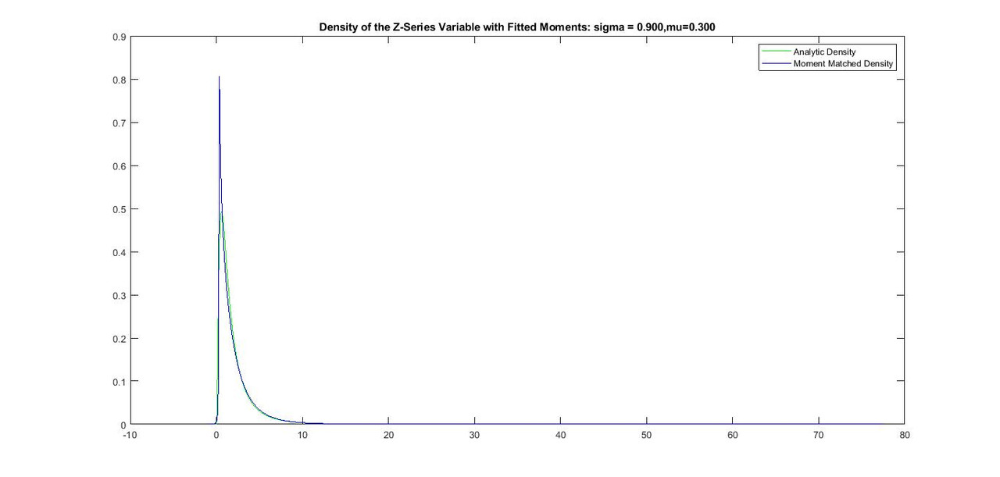](https://postimg.cc/GHjjxjf3)

[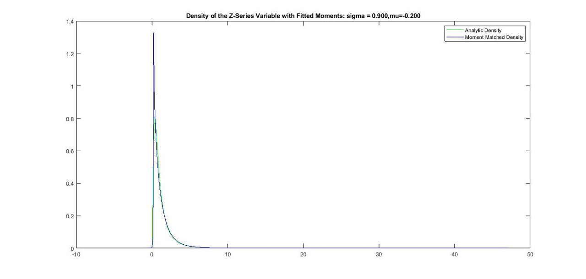](https://postimg.cc/WqvMMD6J)

[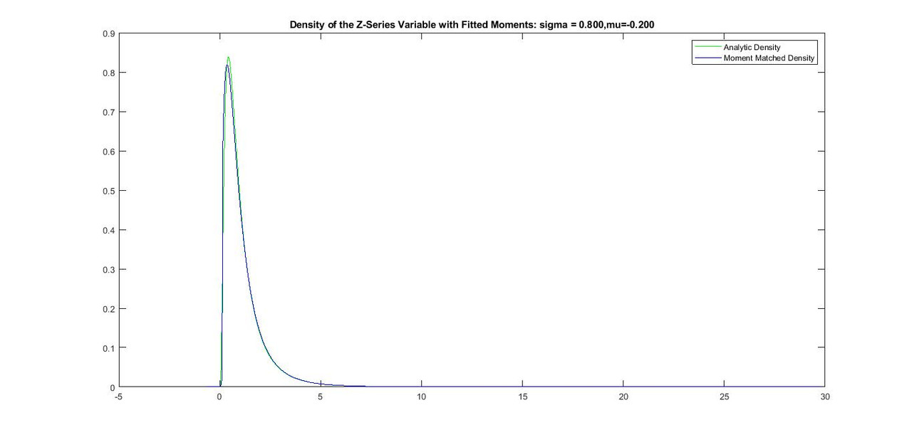](https://postimg.cc/CZ9CxrR7)

[](https://postimg.cc/2VCQyZSs)

[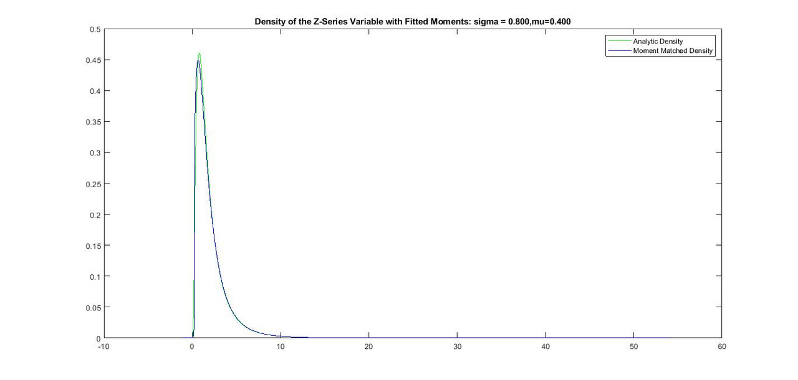](https://postimg.cc/dkd2kRdY)

[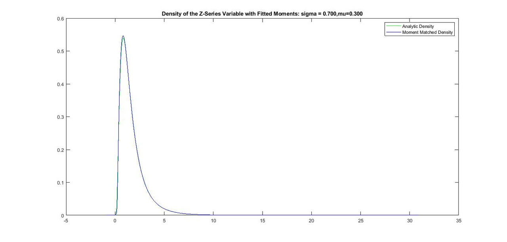](https://postimg.cc/RJLwGMXp)

[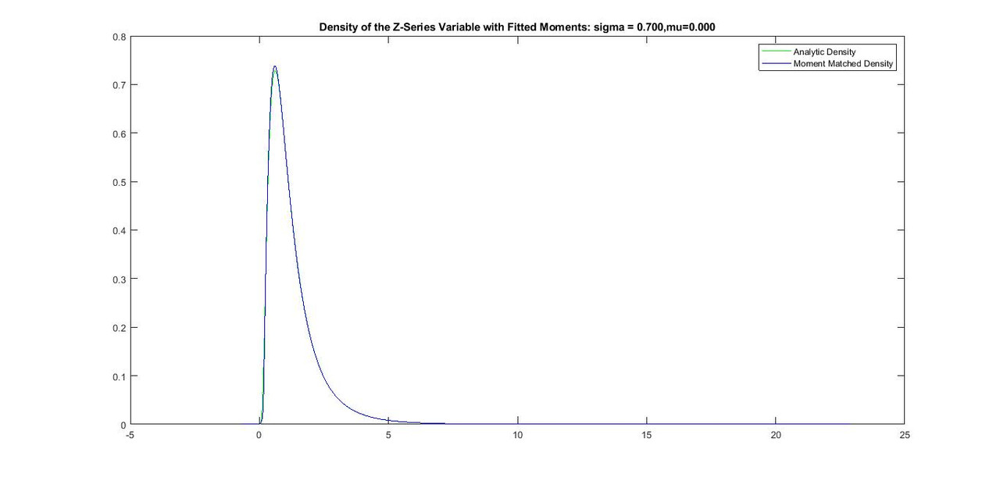](https://postimg.cc/7b31qVw1)

[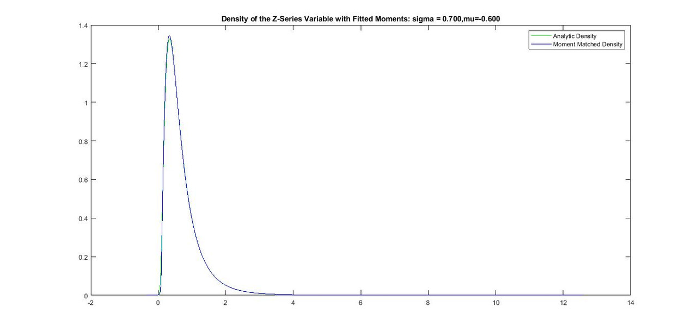](https://postimg.cc/N5b1Hjy5)

[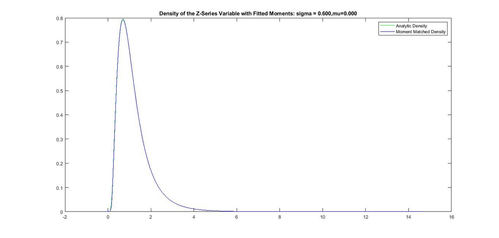](https://postimg.cc/94DtVHQz)

[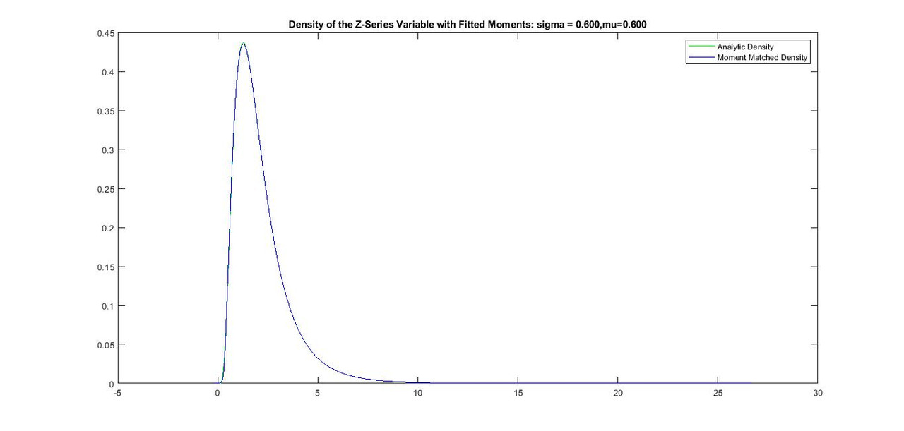](https://postimg.cc/CR1bHpDJ)

[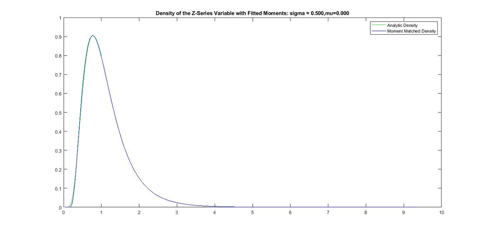](https://postimg.cc/Y4LgZNdW)

[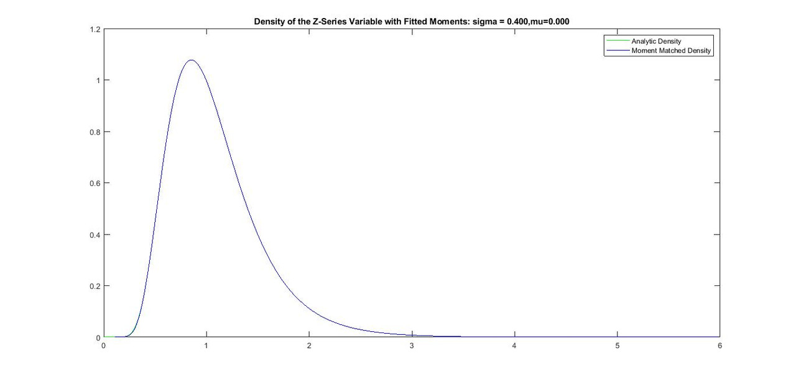](https://postimg.cc/YvsYdDz7)

---

### #1813 — Amin (Topic Author)
*April 25, 2023, 5:38 PM*

Friends, this is only an interim version of the new matlab program. I will release a final new version with many further
improvements in a few days or a week. The current program fits to eight moments. In next version, I will automate it to
fit to any number of moments between four and eight. Work also needs to be done to find out when input moments are not
consistent with first derivative positivity condition in an efficient way.

.

.

```
function [c0,c,FittedMoments] = CalculateZSeriesDensityFromRawMoments02A(rMu)
%The above function takes an array of first eight raw moments as input.
%And returns Z-series Coeffs upto 7th power of Z as in
%Y=c0+c(1)*Z+c(2)*Z^2+c(3)*Z^3+c(4)*Z^4+c(5)*Z^5+c(6)*Z^6+c(7)*Z^7
%Fitted Moments are raw moments of the Z-series density and usually are exactly
%the same as input raw moments rMu(1:8).i.e  FittedMoments(1:8)==rMu(1:8)
%with high precision.

%%%%%%%%%%%%%%%%%%%%%%%%%%%%%%%%%%%%%%%%%%%%%%%%%%%%%%%%%%%%%%%%%%%%%%%%%%%%%%5
%If you do not have valid moments from a density available, please
%uncomment the following input moments to run the program.

%You can use the lognormal moment generation program below to generate raw
%moments of lognormal random variable.
mu=0;
sigma=.8;
for n=1:8
rMu(n)=exp(n*mu+n^2/2*sigma^2);
end

% rMu(1)=0.000012499863483*10^5;
% rMu(2)=0.000021197093700*10^5;
% rMu(3)=0.000050274347857*10^5;
% rMu(4)=0.000171368317209*10^5;
% rMu(5)=0.000856094970826*10^5;
% rMu(6)=0.006320436615909*10^5;
% rMu(7)=0.068698344472325*10^5;
% rMu(8)=1.084082326087001*10^5;

%  rMu(1)=0;
%  rMu(2)=1.0;
%  rMu(3)=.01;
%  rMu(4)=2;
%  rMu(5)=.02;
%  rMu(6)=11;
%  rMu(7)=.08;
%  rMu(8)=90;

%
% c(1)=.8;
% c(2)=.150;
% c(3)=.03;
% c(4)=.010;
% c(5)=.005;
% c(6)=.00050;
% c(7)=.00001;
% c0=.0;
%
%
% SeriesOrder=7;
% NMoments=SeriesOrder+1;
%
% %[rMu] = CalculateMomentsOfZSeries(c0,c,SeriesOrder,NMoments);

%%%%%%%%%%%%%%%%%%%%%%%%%%%%%%%%%%%%%%%%%%%%%%%%%%%%%%%%%%%%%%%%%%%%%%%%%%%%%%5
SeriesOrder=7;    %Z-series till 7th power. hardcoded here cannot chagne.
mOrder=8;         %Number of raw moments in calibration. hardcoded here cannot chagne.
NMoments=mOrder;
                  %Find central Moments from raw moments
[Mu1,cMu] = ConvertRawMomentsToCentralMoments(rMu,mOrder);
                  %Find standardized Moments from central moments
sMu(1)=0;
sMu(2)=1;
sMu(3)=cMu(3)/cMu(2).^1.5;
sMu(4)=cMu(4)/cMu(2).^2.0;
sMu(5)=cMu(5)/cMu(2).^2.5;
sMu(6)=cMu(6)/cMu(2).^3.0;
sMu(7)=cMu(7)/cMu(2).^3.5;
sMu(8)=cMu(8)/cMu(2).^4.0;

%str=input("Look at sMu");

%The function below produces an initial seed for smoothing algorithm

[c0,c] = ProduceInitialGuess(sMu,SeriesOrder);

%c0
%c

%str=input("Look at Initial Guess ---2");

iter=50;           %Number of iterations in the calibration.
                  %Please experiment and play around.
%bGuess(2:7)=0;    %We have assigned initial values of coefficients
%bGuess(1)=1;%other than c(1) to zero. We are starting with no prior information.
bGuess=c;
tic
[c0,c] = PreSmoothingGuessAdvancedFromGuessBestAll(sMu,bGuess,iter);
toc

% %%%%%%%%%%%%%%%%%%%%%%%%%%%%%%%%%%%%%%%%%%%%%%%%%%%%%%%%%%%%%%%%%%%%%%%%%%%%%
%Comment this block if you do not want multidimensional Newton pass
%Even though preSmoothing guess is very close to optimal, slight
%inaccuracies can change the shape of probabioity density so this
%Multidimensional Newton is usually required.

[F,dF] = CalculateMomentsAndDerivatives_0(sMu,c0,c,SeriesOrder,SeriesOrder,NMoments);

da(1,1)=c0;
da(2:SeriesOrder+1,1)=c(1:SeriesOrder);

[ObjBest] =CalculateMomentsMatchObjFunction(c0,c,SeriesOrder,NMoments,sMu);

b0Best=c0;
bBest(1:SeriesOrder)=c(1:SeriesOrder);

nn=0;
while((nn.000000000001) || (abs(F(2,1))>.000000000001) || (abs(F(3,1))>.000000000001) || (abs(F(4,1))>.00000000001)||
(abs(F(5,1))>.00000000001)|| (abs(F(6,1))>.00000000001)|| (abs(F(7,1))>.00000000001)|| (abs(F(8,1))>.00000000001)  ))

    nn=nn+1;
    %Below Newton matrix equation to improve the Z-series coefficients guess at previous step.
    da=da-dF\F;

    %b0=median
    b0=da(1,1);
    b(1:SeriesOrder)=da(2:SeriesOrder+1,1);

    %[F,dF] = CalculateCumulantsAndDerivativesFromMoments_0(C,b0,b,SeriesOrder,SeriesOrder,NoOfCumulants);
    [F,dF] = CalculateMomentsAndDerivatives_0(sMu,b0,b,SeriesOrder,SeriesOrder,NMoments);
    [IsValidFlag] = CheckIsValidDensity(b0,b);
    %[Moments] = CalculateMomentsOfZSeries(b0,b,SeriesOrder,NMoments);

     [ObjNew] =CalculateMomentsMatchObjFunction(c0,c,SeriesOrder,NMoments,sMu);

    if((ObjBest>ObjNew) &&( IsValidFlag))

       ObjBest=ObjNew;
       b0Best=b0;
       bBest(1:SeriesOrder)=b(1:SeriesOrder);
    end
    ObjBest
    da(1,1)=b0;
    da(2:SeriesOrder+1,1)=b(1:SeriesOrder);

end
c0=b0Best;%Best;
c(1:SeriesOrder)=bBest;%Best(1:SeriesOrder);

%Above are the best chosen Z-series coefficients based on the objective function.
%But my objective function can be improved.

%Multidimensional Newton root search ends. Comment till here if you like to
%exclude this
%%%%%%%%%%%%%%%%%%%%%%%%%%%%%%%%%%%%%%%%%%%%%%%%%%%%%%%%%%%%%%%%%%%%%%%%%%%%%%%%%%%%%%%%%%%%%%%%%%%%%
[FittedMoments] = CalculateMomentsOfZSeries(c0,c,SeriesOrder,NMoments);
sMu
FittedMoments
str=input('Look at comparison of fitted moments with input standardized moments');

%%%%%%%%%%%%%%%%%%%%%%%%%%%%%%%%%%%%%%%%%%%%%%%%%%%%%%%%%%%%%%%%%%%%%%%%%%%%%%%%%%%%%%%%%%%%%%%%%%%%5

%Make sure you do not comment the lines below

c0=c0*sqrt(cMu(2)); %convert from standardized to central moments
c=c*sqrt(cMu(2));   %convert from standardized to central moments

c0=c0+Mu1;          %convert from central to raw moments by adding mean.

[FittedMoments] = CalculateMomentsOfZSeries(c0,c,SeriesOrder,NMoments);
%%%%%%%%%%%%%%%%%%%%%%%%%%%%%%%%%%%%%%%%%%%%%%%%%%%%%%%%%%%%%%%%%%%%%%%%%%%%%%%%%%%%%%%%%%%%%%
%Please Uncomment this if you want to see a comparison of input moments and
%fitted moments
rMu
FittedMoments
str=input('Look at comparison of fitted moments with input moments');

%%%%%%%%%%%%%%%%%%%%%%%%%%%%%%%%%%%%%%%%%%%%%%%%%%%%%%%%%%%%%%%%%%%%%%%%%%%%%%%%%%%%%%%%%%%%%5
%COMMENT lines below if you do not want to see the density of new Z-series random variable with
%fitted moments.
%First calculate normal random variable on a grid below
dNn=.1/2;   % Normal density subdivisions width. would change with number of subdivisions
Nn=45*4;  % No of normal density subdivisions
NnMid=((1+Nn)/2)*dNn;
Z(1:Nn)=(((1:Nn)*dNn)-NnMid);
%Z
%str=input('Look at Z');
%Now calculate Y as a function of normal random variable.
Y(1:Nn)=c0;
for nn=1:7
    Y(1:Nn)=Y(1:Nn)+c(nn)*Z(1:Nn).^nn;
end

%Now take change of densities derivative of Y with respect to normal
DfY(1:Nn)=0;
for nn=2:Nn-1
    DfY(nn) = (Y(nn + 1) - Y(nn - 1))/(Z(nn + 1) - Z(nn - 1));
    %Change of variable derivative for densities
end
DfY(Nn)=DfY(Nn-1);
DfY(1)=DfY(2);

%Now calculate the density of Y from density of normal random variable
%using change of probability derivative.
pY(1:Nn)=0;
for nn = 1:Nn
    pY(nn) = (normpdf(Z(nn),0, 1))/abs(DfY(nn));
end

plot(Y(1:Nn),pY(1:Nn),'b');

title('Density of the Z-Series Variable with Fitted Moments; sigma=.8 ');

%str=input('Look at the density of Z-series random variable')
%%%%%%%%%%%%%%%%%%%%%%%%%%%%%%%%%%%%%%%%%%%%%%%%%%%%%%%%%%%%%%%%%%%%%%%%%%%%%%%%%%%%%%%%%%%%

%Please comment the lines below when you do not want to seem comparison
%with analytic lognromal density. It borrows mu and sigma from start of the
%program that were used to generate lognormal moments

delta=.1/5;
lnx(1:500)=(mu)-5+sigma*delta*(1:500);
x(1:500)=exp(lnx(1:500));
pX(1:500)=1./x(1:500)/sqrt(2*pi).*exp(-.5*(lnx(1:500)-mu).^2/sigma^2)/sigma;

plot(x(1:500),pX(1:500),'g',Y(1:Nn),pY(1:Nn),'b');
title(sprintf('Density of the Z-Series Variable with Fitted Moments: sigma = %.3f,mu=%.3f', sigma,mu));%,sprintf('theta=
%f', theta), sprintf('kappa = %f', kappa),sprintf('sigma = %f', sigma0),sprintf('T = %f', T));
legend({'Analytic Density','Moment Matched Density'}, ...
    'Location','northeast')

end
```

.

.

.

```
function [ObjNew] =CalculateMomentsMatchObjFunction(c0,c,SeriesOrder,NMoments,sMu)
[Moments] = CalculateMomentsOfZSeries(c0,c,SeriesOrder,NMoments);

if((sMu(3)<.00001) || (sMu(5)<.00001) || (sMu(7)<.00001))  %If Odd standardized input Moments are zero
     ObjNew=((sMu(2)-Moments(2))/sMu(2)).^2+((sMu(3)-Moments(3))).^2+((sMu(4)-Moments(4))/sMu(4)).^2+ ...
    ((sMu(5)-Moments(5))).^2+((sMu(6)-Moments(6))/sMu(6)).^2+((sMu(7)-Moments(7))).^2+ ...
    ((sMu(8)-Moments(8))/sMu(8)).^2;
else
    ObjNew=((sMu(2)-Moments(2))/sMu(2)).^2+((sMu(3)-Moments(3))/sMu(3)).^2+((sMu(4)-Moments(4))/sMu(4)).^2+ ...
    ((sMu(5)-Moments(5))/sMu(5)).^2+((sMu(6)-Moments(6))/sMu(6)).^2+((sMu(7)-Moments(7))/sMu(7)).^2+ ...
    ((sMu(8)-Moments(8))/sMu(8)).^2;
end

%sMu
%Moments
%str=input("Look at numbers");
end

```

.

.

.

```
function [c0best,cbest,ObjBest] = IterateSmoothingGuessOverOddEvenMomentsWithGlobalConstraints(sMu,cin,iter,EZ)

SeriesOrder=7;
NMoments=SeriesOrder+1;
c0=-(cin(2)+3*cin(4)+15*cin(6));  %This is for zero mean condition.
c=cin;
cbest=cin;

[ObjNew] =CalculateMomentsMatchObjFunction(c0,c,SeriesOrder,NMoments,sMu);

    ObjBest=ObjNew;
  %  str=input("Look at ObjNew----1");

MaxIter=10;

for nn=1:iter     %increase the iterations over coefficients if neeeded

%%%%%%%%%%%%%%%%%%%%%%%%%%%%%%%%%%%%%%%%%%%%%%%%%%%%%%%%%

[M3,dc2] = CalculateParticularMomentAndDerivativeOfItsCoeff(c0,c,SeriesOrder,3,EZ);

tolerance=.000001*sMu(3);
mm=0;
ObjDecreaseFlag=1;

while ((abs(M3-sMu(3)) >tolerance ) && (mmtolerance ) && (mmtolerance ) && (mmtolerance ) && (mmtolerance ) &&
(mmtolerance ) && (mm<MaxIter)&&(ObjDecreaseFlag==1))
mm=mm+1;

if(mm==1)
    %c=cbest;
c(7)=c(7)-(M8-sMu(8))/dc7;
end
[M8,dc7] = CalculateParticularMomentAndDerivativeOfItsCoeff(c0,c,SeriesOrder,8,EZ);

c(7)=c(7)-(M8-sMu(8))/dc7;
[ObjNew] =CalculateMomentsMatchObjFunction(c0,c,SeriesOrder,NMoments,sMu);
[IsValidFlag] = CheckIsValidDensity(c0,c);
if((ObjNew<ObjBest)&&(IsValidFlag==1))
    ObjBest=ObjNew;
    ObjDecreaseFlag=1;
    cbest=c;
else
    ObjDecreaseFlag=0;
end

% [SecondMoment] = CalculateSecondMomentC7(c0,c);
%
% c=c/sqrt(SecondMoment);
% c0=c0/sqrt(SecondMoment);
end

[SecondMoment] = CalculateSecondMomentC7(c0,c);

c=c/sqrt(SecondMoment);
c0=c0/sqrt(SecondMoment);

%[c0,c] = IterateSmoothingGuessOverPreviousMoments(sMu,c,8,2,EZ);

c0best=-(cbest(2)+3*cbest(4)+15*cbest(6));

%%%%%%%%%%%%%%%%%%%%%%%%%%%%%%%%

end

end

```

.

.

.

```
function [c0,c] = ProduceInitialGuess(sMu,SeriesOrder)

%Input to this function are standardized moments. It is only supposed to
%work with standardized central moments and mean zero.

NMoments=SeriesOrder+1;
c(1)=0;
[cuMu] = ConvertRawMomentsToCumulants(sMu);

c(2)=sign(cuMu(3)).*(abs(cuMu(3)))/18;
%c(2)=sign(cuMu(3)).*log(abs(cuMu(3)))/6

if(abs(cuMu(4))>1.0)
c(3)=sign(cuMu(4)).*log(abs(cuMu(4)))/24/4*sqrt(2);
else
c(3)=0;
end
if(abs(cuMu(5))>1.0)
c(4)=sign(cuMu(5)).*log(abs(cuMu(5)))/24/5/5;
else
c(4)=0;
end

if(abs(cuMu(6))>1.0)
c(5)=sign(cuMu(6)).*log(abs(cuMu(6)))/120/6/6;
else
c(5)=0;
end

if(abs(cuMu(7))>1.0)
c(6)=sign(cuMu(7)).*log(abs(cuMu(7)))/120/6/7/7;
else
c(6)=0;
end

if(abs(cuMu(8))>1.0)
c(7)=sign(cuMu(8)).*log(abs(cuMu(8)))/720/7/8/8*sqrt(1.5);
else
c(7)=0;
end

c0=-(c(2)+3*c(4)+15*c(6));

[ch0,ch]=ConvertZCoeffsToHCoeffs(c0,c,SeriesOrder);

ch(1)=real(sqrt(1-ch(2).^2*2-ch(3).^2*6-ch(4).^2*24-ch(5).^2*120-ch(6).^2*720-ch(7).^2*720*7));

[c0,c]=ConvertHCoeffsToZCoeffs(ch0,ch,SeriesOrder);

if(c(1)<.5)
    c(1)=.5;
end

%c0;
%c;
%str=input("Look at numbers")

end

```

.

.

.

```
function [CC] = ConvertRawMomentsToCumulants(rMu)

CC(1)=rMu(1);
CC(2)=rMu(2)-rMu(1).^2;
CC(3)=rMu(3)-3*rMu(2)*rMu(1)+2*rMu(1).^3;
CC(4)=rMu(4)-4*rMu(3)*rMu(1)-3*rMu(2)^2+12*rMu(2)*rMu(1).^2-6*rMu(1).^4;

CC(5)=rMu(5)-5*rMu(4)*rMu(1)-10*rMu(3)*rMu(2)+20*rMu(3)*rMu(1).^2+30*rMu(2).^2*rMu(1)-60*rMu(2)*rMu(1).^3+24*rMu(1).^5;

CC(6)=rMu(6)-6*rMu(5)*rMu(1)-15*rMu(4)*rMu(2)+30*rMu(4)*rMu(1).^2-10*rMu(3).^2+120*rMu(3)*rMu(2)*rMu(1)-120*rMu(3)*rMu(1).^3+30*rMu(2).^3
- ...
    270*rMu(2).^2*rMu(1).^2+360*rMu(2)*rMu(1).^4-120*rMu(1).^6;

CC(7)=rMu(7)-rMu(1)*rMu(6)-6*CC(2)*rMu(5)-15*CC(3)*rMu(4)-20*CC(4)*rMu(3)-15*CC(5)*rMu(2)-6*CC(6)*rMu(1);

CC(8) =rMu(8) - rMu(1)* rMu(7) - 7 *CC(2)* rMu(6) - 21* CC(3)* rMu(5) - 35* CC(4)* rMu(4) - ...
  35* CC(5)* rMu(3) - 21* CC(6)* rMu(2) - 7 *CC(7)* rMu(1);

end
```

.

.

.

```
function [Mu] = ConvertCentralMomentsToRawMoments(cu,mu,mOrder)

%cu
%mu
%mOrder
%str=input('Look at numbers');
Mu(1)=mu;
for mm=2:mOrder
    Mu(mm)=0;
    for jj=0:mm
        if(jj==0)
            Mu(mm)=Mu(mm)+factorial(mm)/factorial(jj)/factorial(mm-jj)*1*mu.^(mm-jj);
        else
            Mu(mm)=Mu(mm)+factorial(mm)/factorial(jj)/factorial(mm-jj)*cu(jj)*mu.^(mm-jj);
        end
    end
end

end
```

.

.

.

```
function [CC] = CalculateCumulants(a0,a,SeriesOrder,NMoments)
%[CC] = CalculateCumulants(a0,a,SeriesOrder,NoOfCumulants);

%a(1)=a1;
%a(2)=a2;
%a(3)=a3;
%a(4)=a4;
%a(5)=a5;
%a(6)=a6;
%a(7)=a7;

aa0=a0;
a0=0;

EZ(1)=0;
EZ(2)=1;
for nn=3:NMoments*SeriesOrder+2
    if rem(nn,2)==1
        EZ(nn)=0;
    else
        EZ(nn)=EZ(nn-2)*(nn-1);
        EZ(nn);
    end
end
EZ;

EXZ(1,1)=1;
%for pp1=1:NZterms
%        EXZ(1,pp1+1)=EZ(pp1);
%end

a(SeriesOrder+1:60)=0;
b0=a0;
b=a;

for mm=1:NMoments
    if(mm>1)
        [b0,b] =SeriesProduct(a0,a,b0,b,SeriesOrder*mm);
        b(SeriesOrder*mm+1:60)=0;
    end
   % b0
   % b
%str=input('Look at numbers')
    EXZ(mm+1,1)=b0;
    for pp2=1:SeriesOrder*mm

            EXZ(mm+1,1)=EXZ(mm+1,1)+b(pp2).*EZ(pp2);
    end
end

%u1=EXZ(2,1);

if(SeriesOrder>=4)
u1=a(2)+3*a(4);
end
if(SeriesOrder>=6)
u1=u1+15*a(6);
end

u2=EXZ(3,1);
u3=EXZ(4,1);
u4=EXZ(5,1);

if(SeriesOrder>=4)
k1=aa0+a(2)+3*a(4);
end
if(SeriesOrder>=6)
k1=k1+15*a(6);
end
k2=u2-u1^2;
k3=u3-3*u2*u1+2*u1^3;
k4=u4-4*u3*u1-3*u2^2+12*u2*u1^2-6*u1^4;

CC(1)=k1;
CC(2)=k2;
CC(3)=k3;
CC(4)=k4;

if(NMoments>=5)
u5=EXZ(6,1);
k5=u5-5*u4*u1-10*u3*u2+20*u3*u1^2+30*u2^2*u1-60*u2*u1^3+24*u1^5;
CC(5)=k5;
end
if(NMoments>=6)
u6=EXZ(7,1);
k6=u6-6*u5*u1-15*u4*u2+30*u4*u1^2-10*u3^2+120*u3*u2*u1-120*u3*u1^3+30*u2^3 - ...
    270*u2^2*u1^2+360*u2*u1^4-120*u1^6;
CC(6)=k6;
end
if(NMoments>=7)
u7=EXZ(8,1);
k7=u7-u1*u6-6*k2*u5-15*k3*u4-20*k4*u3-15*k5*u2-6*k6*u1;
CC(7)=k7;
end
if(NMoments>=8)
u8=EXZ(9,1);
k8 = u8 - u1* u7 - 7 *k2* u6 - 21* k3* u5 - 35* k4* u4 - ...
  35* k5* u3 - 21* k6* u2 - 7 *k7* u1;
CC(8)=k8;
end

end

```

.

.

.

```
function [c0,c] = PreSmoothingGuessAdvancedFromGuessBestAll(cmu,cin,iter)

%Mul=1.0;
SeriesOrder=7;
NMoments=8;

 EZ(1)=0;
 EZ(2)=1;
 for nn=3:NMoments*SeriesOrder+SeriesOrder+2
     if rem(nn,2)==1
         EZ(nn)=0;
     else
         EZ(nn)=EZ(nn-2)*(nn-1);
         EZ(nn);
     end
 end

c0=-(cin(2)+3*cin(4)+15*cin(6));  %This is for zero mean condition.
c=cin;
MaxIter=10;

ObjDecrease=1;
ObjBest=999999;
nn=0;
while ((nn < iter ) &&(ObjDecrease==1))
    nn=nn+1;
    [c0,c,ObjNew] = IterateSmoothingGuessOverOddEvenMomentsWithGlobalConstraints(cmu,c,1,EZ);
    if(nn==1)
        ObjBest=ObjNew;

    elseif((ObjNew+.0000001)<ObjBest)
        ObjBest=ObjNew;
        ObjDecrease=1;
    else
        ObjDecrease=0;
    end
    ObjBest

end

end
```

.

.

.

```
function [IsValidFlag] = CheckIsValidDensity(cc0,cc)
%Roughly checks if the density is valid. It is not a definitive check but
%just a rough one but mostly works.

Z(1)=2.0;
Z(2)=3.0;
Z(3)=3.9;
Z(4)=4.2;

Z(5)=-2.0;
Z(6)=-3.0;
Z(7)=-3.9;
Z(8)=-4.2;

X=cc0 + cc(1) * Z+ cc(2) * Z.^2+ cc(3) * Z.^3+ cc(4) * Z.^4+ cc(5) * Z.^5+ cc(6) * Z.^6+ cc(7) * Z.^7;

IsValidFlag=0;
if( ((X(4)>=X(3)) && (X(3)>X(2))) && (X(2)>X(1))&&(X(1)>X(5))&&(X(5)>X(6)) && ((X(6)>X(7)) && (X(7)>X(8))))
    IsValidFlag=1;
end

end

```

.

.

.

```
function [SecondMoment] = CalculateSecondMomentC7(a0,a)

SecondMoment=a0^2+a(1)^2 +2* a0* a(2) +3*(a(2).^2+2* a(1).* a(3) +2* a0* a(4))+ ...
    15*(a(3).^2 +2 *a(2).* a(4) +2 *a(1).* a(5)+2* a0* a(6))+105*(a(4).^2 +2* a(3).* a(5)+2* a(2).* a(6) +2* a(1).* a(7)
)+ ...
    945*(a(5).^2 +2* a(4).* a(6) +2 *a(3).* a(7) )+(10395)*(a(6).^2+2* a(5).* a(7) )+(135135)*a(7).^2;

end
```

.

.

.

```
function [a0,a] = ConvertHCoeffsToZCoeffs(aH0,aH,SeriesOrder)

if(SeriesOrder==3)
a0=aH0-aH(2);
a(1)=aH(1)-3*aH(3);
a(2)=aH(2);
a(3)=aH(3);
end

if(SeriesOrder==4)
a0=aH0-aH(2)+3*aH(4);
a(1)=aH(1)-3*aH(3);
a(2)=aH(2)-6*aH(4);
a(3)=aH(3);
a(4)=aH(4);
end

if(SeriesOrder==5)
a0=aH0-aH(2)+3*aH(4);
a(1)=aH(1)-3*aH(3)+15*aH(5);
a(2)=aH(2)-6*aH(4);
a(3)=aH(3)-10*aH(5);
a(4)=aH(4);
a(5)=aH(5);
end

if(SeriesOrder==5)
a0=aH0-aH(2)+3*aH(4);
a(1)=aH(1)-3*aH(3)+15*aH(5);
a(2)=aH(2)-6*aH(4);
a(3)=aH(3)-10*aH(5);
a(4)=aH(4);
a(5)=aH(5);
end
% if(SeriesOrder==5)
% a0=aH0-aH(2)-3*aH(4);
% a(1)=aH(1)-3*aH(3)-15*aH(5);
% a(2)=aH(2)-6*aH(4);
% a(3)=aH(3)-10*aH(5);
% a(4)=aH(4);
% a(5)=aH(5);
% end
if(SeriesOrder==6)
a0=aH0-aH(2)+3*aH(4)-15*aH(6);
a(1)=aH(1)-3*aH(3)+15*aH(5);
a(2)=aH(2)-6*aH(4)+45*aH(6);
a(3)=aH(3)-10*aH(5);
a(4)=aH(4)-15*aH(6);
a(5)=aH(5);
a(6)=aH(6);
end

if(SeriesOrder==7)
a0=aH0-aH(2)+3*aH(4)-15*aH(6);
a(1)=aH(1)-3*aH(3)+15*aH(5)-105*aH(7);
a(2)=aH(2)-6*aH(4)+45*aH(6);
a(3)=aH(3)-10*aH(5)+105*aH(7);
a(4)=aH(4)-15*aH(6);
a(5)=aH(5)-21*aH(7);
a(6)=aH(6);
a(7)=aH(7);
end

end
```

.

.

.

```
function [c0,c] =SeriesProduct(a0,a,b0,b,SeriesOrder)

c0=a0*b0;
c(1:SeriesOrder)=0.0;
for nn=1:SeriesOrder
    c(nn)=c(nn)+a0*b(nn);
    c(nn)=c(nn)+b0*a(nn);
    for kk=1:nn-1
        c(nn)=c(nn)+a(kk)*b(nn-kk);
    end
end

end
```

.

.

.

```
function [aH0,aH] = ConvertZCoeffsToHCoeffs(a0,a,SeriesOrder)

if(SeriesOrder==3)
aH0=a0+a(2);
aH(1)=a(1)+3*a(3);
aH(2)=a(2);
aH(3)=a(3);
end

if(SeriesOrder==4)
aH0=a0+a(2)+3*a(4);
aH(1)=a(1)+3*a(3);
aH(2)=a(2)+6*a(4);
aH(3)=a(3);
aH(4)=a(4);
end

if(SeriesOrder==5)
aH0=a0+a(2)+3*a(4);
aH(1)=a(1)+3*a(3)+15*a(5);
aH(2)=a(2)+6*a(4);
aH(3)=a(3)+10*a(5);
aH(4)=a(4);
aH(5)=a(5);
end

if(SeriesOrder==6)
aH0=a0+a(2)+3*a(4)+15*a(6);
aH(1)=a(1)+3*a(3)+15*a(5);
aH(2)=a(2)+6*a(4)+45*a(6);
aH(3)=a(3)+10*a(5);
aH(4)=a(4)+15*a(6);
aH(5)=a(5);
aH(6)=a(6);
end

if(SeriesOrder==7)
aH0=a0+a(2)+3*a(4)+15*a(6);
aH(1)=a(1)+3*a(3)+15*a(5)+105*a(7);
aH(2)=a(2)+6*a(4)+45*a(6);
aH(3)=a(3)+10*a(5)+105*a(7);
aH(4)=a(4)+15*a(6);
aH(5)=a(5)+21*a(7);
aH(6)=a(6);
aH(7)=a(7);
end

end
```

.

.

.

```
function [Moments] = CalculateMomentsOfZSeries(a0,a,SeriesOrder,NMoments)

%aa0=a0;
%a0=0;% ---1

EZ(1)=0;
EZ(2)=1;
%LogEZ(2)=0;
for nn=3:NMoments*SeriesOrder
    if rem(nn,2)==1
        EZ(nn)=0;
    else
        EZ(nn)=EZ(nn-2)*(nn-1);
        %LogEZ(nn)=log(EZ(nn-2))+log(nn-1);
        %EZ(nn);
    end
end
%EZ
%EZ(1:30)
%str=input('Look at numbers')
a(SeriesOrder+1:SeriesOrder*NMoments+1)=0;
b0=a0;
b=a;

for mm=1:NMoments
    if(mm>1)
        %[b0,b] =SeriesProductLogarithmic(a0,a,b0,b,SeriesOrder*mm);

        [b0,b] =SeriesProduct(a0,a,b0,b,SeriesOrder*mm);

        %b0-bb0

        %b-bb

        %str=input('Look at two products')

        b(SeriesOrder*mm+1:SeriesOrder*NMoments+1)=0;
    end
   % Logb=log(abs(b));
   % Signb=sign(b);
    EXZ(mm,1)=b0;
    for pp2=1:SeriesOrder*mm
        if rem(pp2,2)==0
            %EXZ(mm,1)=EXZ(mm,1)+exp(Logb(pp2)+LogEZ(pp2)).*Signb(pp2);
            EXZ(mm,1)=EXZ(mm,1)+b(pp2).*EZ(pp2);
 %           b(pp2).*EZ(pp2)
 %           exp(Logb(pp2)+LogEZ(pp2)).*Signb(pp2)
 %           mm
 %           pp2
            %str=input('Look at moment values')
        end
    end
end

for nn=1:NMoments
    Moments(nn)=EXZ(nn,1);
end

end
```

.

.

.

```
function [EnMoment,dEnMomentdCoeff] = CalculateParticularMomentAndDerivativeOfItsCoeff(a0,a,SeriesOrder,nMoment,EZ)

% if(SeriesOrder>=8)
% a0=-(a(2)+3*a(4)+15*a(6)+105*a(8));% ---1
% end
% if(SeriesOrder<8)
% a0=-(a(2)+3*a(4)+15*a(6));% ---1
% end
%
% EZ(1)=0;
% EZ(2)=1;
% for nn=3:NMoments*SeriesOrder+NZterms+2
%     if rem(nn,2)==1
%         EZ(nn)=0;
%     else
%         EZ(nn)=EZ(nn-2)*(nn-1);
%         EZ(nn);
%     end
% end
% EZ;

%EXZ(1,1)=1;
%for pp1=1:NZterms
%        EXZ(1,pp1+1)=EZ(pp1);
%end

a(SeriesOrder+1:nMoment*SeriesOrder+1+SeriesOrder)=0;
b0=a0;
b=a;

for mm=2:nMoment

    [b0,b] =SeriesProduct(a0,a,b0,b,SeriesOrder*mm+SeriesOrder+1);
     b(SeriesOrder*mm+1:nMoment*SeriesOrder+SeriesOrder+1)=0;
     if(mm==nMoment-1)
         dEnMomentdCoeff=b0.*EZ(nMoment-1);
         for pp2=1:SeriesOrder*nMoment-1

            dEnMomentdCoeff=dEnMomentdCoeff+b(pp2).*EZ(pp2+nMoment-1);
        end
        dEnMomentdCoeff=dEnMomentdCoeff*nMoment;
     end
     if(mm==nMoment)
        EnMoment=b0;
        for pp2=1:SeriesOrder*nMoment
            EnMoment=EnMoment+b(pp2).*EZ(pp2);

        end
     end
end

end
```

.

.

.

```
function [F,dF] = CalculateMomentsAndDerivatives_0(Ms,a0,a,SeriesOrder,NZterms,NMoments)
%[F,dF] = CalculateCumulantsAndDerivativesFromMoments(C,a0,a,SeriesOrder,SeriesOrder,NoOfCumulants);

%a(1)=a1;
%a(2)=a2;
%a(3)=a3;
%a(4)=a4;
%a(5)=a5;
%a(6)=a6;
%a(7)=a7;

%aa0=a0;
if(NMoments>8)
a0=-(a(2)+3*a(4)+15*a(6)+105*a(8));% ---1
end
if(NMoments==8)
a0=-(a(2)+3*a(4)+15*a(6));% ---1
end
if(NMoments==6)
a0=-(a(2)+3*a(4));% ---1
end

EZ(1)=0;
EZ(2)=1;
for nn=3:NMoments*SeriesOrder+NZterms+2
    if rem(nn,2)==1
        EZ(nn)=0;
    else
        EZ(nn)=EZ(nn-2)*(nn-1);
        EZ(nn);
    end
end
EZ;

EXZ(1,1)=1;
for pp1=1:NZterms
        EXZ(1,pp1+1)=EZ(pp1);
end

a(SeriesOrder+1:NMoments*SeriesOrder+1)=0;
b0=a0;
b=a;

for mm=1:NMoments
    if(mm>1)
        [b0,b] =SeriesProduct(a0,a,b0,b,SeriesOrder*mm);
        b(SeriesOrder*mm+1:NMoments*SeriesOrder+1)=0;
    end
   % b0
   % b
%str=input('Look at numbers')
    EXZ(mm+1,1)=b0;
    for pp2=1:SeriesOrder*mm

            EXZ(mm+1,1)=EXZ(mm+1,1)+b(pp2).*EZ(pp2);
    end
    for pp1=1:NZterms
        EXZ(mm+1,pp1+1)=b0.*EZ(pp1);
        for pp2=1:SeriesOrder*mm

            EXZ(mm+1,pp1+1)=EXZ(mm+1,pp1+1)+b(pp2).*EZ(pp2+pp1);
        end
    end
end

%u1=EXZ(2,1);
u2=EXZ(3,1);
u3=EXZ(4,1);
u4=EXZ(5,1);

u1=a0+a(2);
if(SeriesOrder>=4)
u1=a0+a(2)+3*a(4);
end
if(SeriesOrder>=6)
u1=u1+15*a(6);
end
if(SeriesOrder>=8)
u1=u1+105*a(8);
end

%k2=u2-u1^2;
%k3=u3-3*u2*u1+2*u1^3;
%k4=u4-4*u3*u1-3*u2^2+12*u2*u1^2-6*u1^4;

du1(1)=1;%----2
% du1(2)=0;%----2
% du1(3)=1;%----2
% du1(4)=0;%----2
% du1(5)=1;%----2
% du1(6)=0;%----2
% du1(7)=15;%----2
% du1(8)=0;%----2
% du1(9)=105;%----2
% du1(10)=0;%----2
 du2(1)=2*EXZ(2,1);
 du3(1)=3*EXZ(3,1);
 du4(1)=4*EXZ(4,1);

%du1(1)=1;%----2
%du2(1)=0;
%du3(1)=0;
%du4(1)=0;

for mm=2:SeriesOrder+1
du1(mm)=EXZ(1,mm);
du2(mm)=2*EXZ(2,mm);
du3(mm)=3*EXZ(3,mm);
du4(mm)=4*EXZ(4,mm);

end

if(NMoments>=5)
u5=EXZ(6,1);

%du5(1)=5*EXZ(5,1);

for mm=1:SeriesOrder+1
du5(mm)=5*EXZ(5,mm);
end

end

if(NMoments>=6)
u6=EXZ(7,1);
%du6(1)=0;

for mm=1:SeriesOrder+1
du6(mm)=6*EXZ(6,mm);
end

end

if(NMoments>=7)
u7=EXZ(8,1);
%str=input('Look at k7 and k71')

%du7(1)=0;

for mm=1:SeriesOrder+1
du7(mm)=7*EXZ(7,mm);
end

end
if(NMoments>=8)

u8=EXZ(9,1);
for mm=1:SeriesOrder+1
du8(mm)=8*EXZ(8,mm);
end

end

if(NMoments>=9)

u9=EXZ(10,1);
for mm=1:SeriesOrder+1
du9(mm)=9*EXZ(9,mm);
end

end
if(NMoments>=10)

u10=EXZ(11,1);
for mm=1:SeriesOrder+1
du10(mm)=10*EXZ(10,mm);
end

end

 F(1,1)=u1-Ms(1);
 F(2,1)=u2-Ms(2);
 F(3,1)=u3-Ms(3);
 F(4,1)=u4-Ms(4);
 if(NMoments>=5)
 F(5,1)=u5-Ms(5);
 end
 if(NMoments>=6)
 F(6,1)=u6-Ms(6);
 end
 if(NMoments>=7)
 F(7,1)=u7-Ms(7);
 end
 if(NMoments>=8)
 F(8,1)=u8-Ms(8);
 end
 if(NMoments>=9)
 F(9,1)=u9-Ms(9);
 end
 if(NMoments>=10)
 F(10,1)=u10-Ms(10);
 end

     for mm=1:SeriesOrder+1
        dF(1,mm)=du1(mm);
        dF(2,mm)=du2(mm);
        dF(3,mm)=du3(mm);
        dF(4,mm)=du4(mm);
        if(NMoments>=5)
        dF(5,mm)=du5(mm);
        end
        if(NMoments>=6)
        dF(6,mm)=du6(mm);
        end
        if(NMoments>=7)
        dF(7,mm)=du7(mm);
        end
        if(NMoments>=8)
        dF(8,mm)=du8(mm);
        end
        if(NMoments>=9)
        dF(9,mm)=du9(mm);
        end
        if(NMoments>=10)
        dF(10,mm)=du10(mm);
        end
     end

end
```

.

.

.

Following is the graph, you will see when you run the above program.

rMu =

   1.0e+08 *

  Columns 1 through 6

   0.000000013771278   0.000000035966397   0.000000178142732   0.000001673353696   0.000029809579870   0.001007099618670

  Columns 7 through 8

   0.064526405977972   7.840630531366783

FittedMoments =

   1.0e+08 *

  Columns 1 through 6

   0.000000013771278   0.000000036208940   0.000000179039758   0.000001687726168   0.000030800753171   0.001069301083701

  Columns 7 through 8

   0.066883035946947   7.034215593578554

Look at comparison of fitted moments with input moments

ans =

   0.997197908841059

[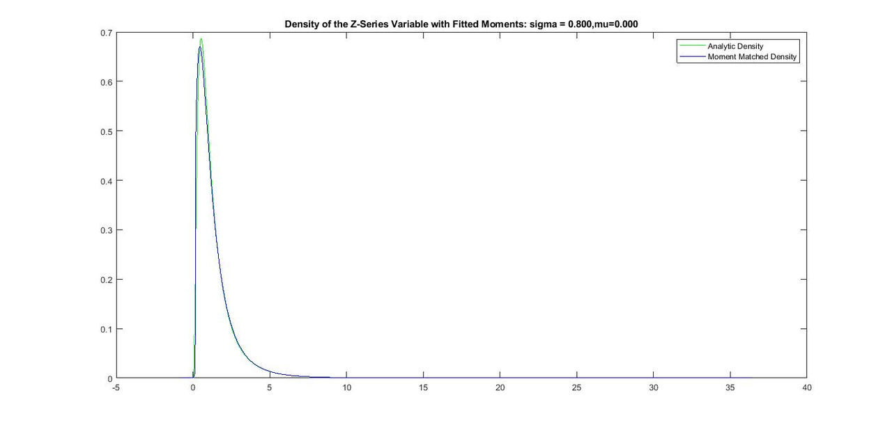](https://postimg.cc/D47H4XK9)

---

### #1814 — Amin (Topic Author)
*April 25, 2023, 7:36 PM*

Friends, in many cases the new program will underperform the old program but it is only an interim version with a lot of
work still left to do and I really hope when the new program would be ready in a week or so, it will be a very good
program.

---

### #1815 — Amin (Topic Author)
*April 25, 2023, 8:44 PM*

For better initial seed, I want to systematically project the data moments on generalized gamma density, lognormal
density, and non-central chi-squared density. And then find the inner-product of the best fit density with hermite
polynomials to extract the coefficients of hermite polynomials which will be used as a starting point for smoothing
method. I am sure we will gain more insight as we work with the method and some new possibilities might open up. I want
to continue working on improving the program that finds coefficients of z-series from data..

---

### #1816 — Amin (Topic Author)
*April 26, 2023, 8:03 PM*

>
> Friends, this is interesting but I am not sure whether it would be directly possible or not. Some thoughts that I am
sharing with friends. For example when I was working with solution of Z-series coefficients that match a particular set
of standardized central moments, I would think that I should possibly try to train some AI model and then retrieve
coefficients of Z-series out of it. Analytically, this required solution of highly non-linear equations with number of
equations equal to number of moments being matched. We could possibly solve for coefficients in sets of non-linear
equations by hermite regression.
>
> For example if we want to find coefficients of Z-series that match a given set of moments and we can roughly know the
domain of solution, it could be possible with some effort to generate data of moments by picking approximately random
coefficients in the domain of solution and then find an approximate non-linear relationship (through non-linear hermite
regression) valid in that domain that gives us coefficients of Z-series given any set of moments. Though it might be
directly possible, even if it is not possible right away,  we would surely be solving for coefficients of sets of
non-linear equations with constraints (by generating random data and doing hermite non-linear regression on it) using
hermite polynomials with some further research in a few months or years.
>
> I am sure there are many more interesting possibilities that  would open up with this research.
>
> Though I will continue to post interesting examples of hermite regression and also a new program very soon, I would
also go back to completing my Z-series research paper with special emphasis on hermite non-linear regressions in it.
>
.

.

Friends, I made this above copied post two months ago. I really think we can possibly use our hermite orthogonal
regression as a parallel to AI. For using AI, we have to train a model on data first and then we use it to make out of
sample predictions.

Can it not be possible that we can try to solve two (as a start) mildly non-linear equations with arbitrary
coefficients. We change the equations to a standard form. We can sample independent or correlated coefficients and then
find the answer as X and Y (We will have to actually solve the equations for this step). We can then orthogonal
polynomial regress the answer set on coefficients of equations(whose distribution was known when we sampled them) to
find regression coefficients(which are obviously different from original equation coefficients). So this way we could
possibly solve a certain set of algebraic equation statistically only by writing the regression solution equation in
terms of its coefficients.

If such simple experiments work, we can possibly start working on more complex problems.

When I tried the method for problem, in above post, I was totally bogged down since it was a too complex problem to
start with. It took me several days without any progress. But starting simple and trying to find out if it works on
simple problems would be a lot of interesting fun.

---

### #1817 — Amin (Topic Author)
*April 28, 2023, 1:08 PM*

Friends, to find a very good value for initial guess for coefficients when fitting Z-series moments to data moments, we
can use the method given in this wikipedia link "Polynomial Regression". We would have to use this initial seed method
with original data values (and not with moments of the data).

https://en.wikipedia.org/wiki/Polynomial_regression

Please look below the heading on the wikipedia link above: Matrix form and calculation of estimates

There you can specify the data values y, and design matrix of powers of standard normal and then find the coefficients
beta.

In order to find the value of standard normal (whose powers have to be used in design matrix in the same row as
particular data value) associated with each data value, I first sorted the data. Then I divided the normal density into
equal probability mass subdivisions with number of subdivisions equal to number of data values (these are naturally
sorted). Then I assigned sorted normal values to sorted data values in increasing order. In the design matrix, I used
the value of powers of Z that was assigned to the data value in the same row.

I have written a matlab program to do this and would share it with friends later today or tomorrow.

---

### #1818 — Amin (Topic Author)
*April 28, 2023, 6:59 PM*

Friends, I am posting a graph in which I have found the density from Z-series Coefficients calculated from linear
regression (shown as red line in graph). And compared it with the Z-series Coefficients found from matching
moments(shown as green line in graph). The data consists of twenty sample observations of the random variable. This
random variable is log-differences of microsoft stock prices over twenty days for the same data that I posted earlier.

I am posting the matlab progarm in next post.

You have to know that similar to other methods, this method also does not automatically satisfy positivity condition for
first derivative and it would have to be checked. Similar to phenomenon with moment matching method, the density can
have very odd shapes when the positivity condition of first derivative is not satisfied so please be careful about it.

I noticed in some examples that the linear regression method tended to gave coefficients that produced the density with
higher kurtosis than the other method. I am sure such issues would be easily resolved by further research.

.

[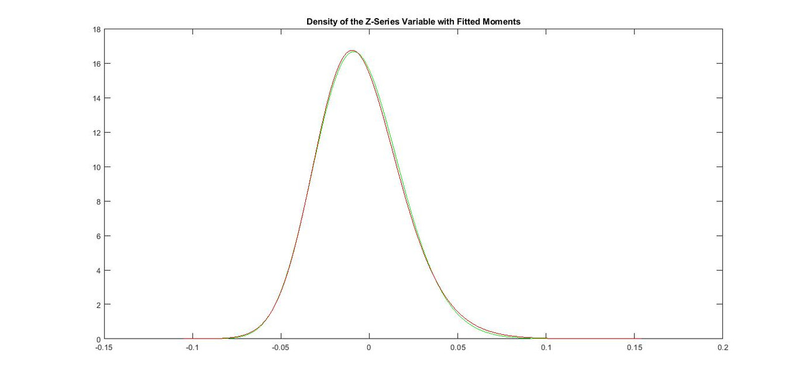](https://postimg.cc/XZr1s70H)

---

### #1819 — Amin (Topic Author)
*April 28, 2023, 7:05 PM*

.

When you run the program in this post, it will produce the graph shown in previous post. Any supporting functions that I
have not posted are the ones I have posted on this forum earlier.

.

.

```
function [] = FindCoefficientsOfZSeriesByLinearRegression()

%Below, read AAPL, AMZN, GOOGL,MSFT,NVDA, NASDAQ100 daily open and
%close data files and extract daily open from the files. All files are
%exactly the same length and therefore corresponding array entries are
%from the same dates.
T = readtable('C:\Users\Infiniti Derivatives\Documents\MATLAB\HistoricalPricesAAPL2022.csv');
[NDays,NVar]=size(T);
ApplPrices(1:NDays)=table2array(T(1:NDays,2));
T = readtable('C:\Users\Infiniti Derivatives\Documents\MATLAB\HistoricalPricesAMZN2022.csv');
AmznPrices(1:NDays)=table2array(T(1:NDays,2));
T = readtable('C:\Users\Infiniti Derivatives\Documents\MATLAB\HistoricalPricesGOOGL2022.csv');
GooglPrices(1:NDays)=table2array(T(1:NDays,2));
T = readtable('C:\Users\Infiniti Derivatives\Documents\MATLAB\HistoricalPricesMSFT2022.csv');
MsftPrices(1:NDays)=table2array(T(1:NDays,2));
T = readtable('C:\Users\Infiniti Derivatives\Documents\MATLAB\HistoricalPricesNVDA2022.csv');
NvdaPrices(1:NDays)=table2array(T(1:NDays,2));
T = readtable('C:\Users\Infiniti Derivatives\Documents\MATLAB\HistoricalPricesNASDAQ1002022.csv');
NasdaqPrices(1:NDays)=table2array(T(1:NDays,2));

%choose the last entry of the regression
StartI=01+0*10;%choose the start of the regression
EndI=01+2*10;%choose the last entry of the regression
NDays=EndI-StartI;

DMsftPrices(1:NDays)=log(MsftPrices(StartI+1:EndI))-log(MsftPrices(StartI:EndI-1));

clf;

rMu= CalculateFourRawMomentsFromData(DMsftPrices,NDays);%Calculate four raw moments of each time series.
[c0,c] = CalculateZSeriesDensityFromRawMomentsFix4thMoment(rMu);
[b0,b] = CalculateZSeriesCoeffsByIdealMeasure02(DMsftPrices)

 PlotZSeriesDensity(c0,c,'g');%Look at the density to make sure it is valid. If the tails fall
    hold on

 PlotZSeriesDensity(b0,b,'r');
    c0
    c
    b0
    b

    str=input("Look at density comparison from two methods")

end
```

.

.

.

.

```
function [ZZ] = StandardNormalIdealDesity(Ndata)
%Ndata is number of data points in sample, for which we want to find the
%coefficients of the Z-series.

if (rem(Ndata,2)==0)
    NnMid=Ndata/2;
    ZZ(NnMid+1)=norminv(.5+1/Ndata*.5);
    ZZ(NnMid)=norminv(.5-1/Ndata*.5);
    for nn=2:NnMid
        ZZ(nn+NnMid)=norminv(.5+(nn-.5)*1/Ndata);
        ZZ(-nn+1+NnMid)=norminv(.5-(nn-.5)*1/Ndata);
    end
end

if (rem(Ndata,2)==1)
    NnMid=(Ndata+1)/2;
    ZZ(NnMid)=0;
    for nn=1:NnMid-1
        ZZ(nn+NnMid)=norminv(.5+(nn)*1/Ndata);
        ZZ(-nn+NnMid)=norminv(.5-(nn)*1/Ndata);
    end
end

%plot(ZZ)
%str=input("Look at density plot standard")

end

```

.

.

.

```
function [c0,c] = CalculateZSeriesCoeffsByIdealMeasure02(data)
%data is (array of) sample observations of random variable whose Z-series
%Coefficients have to be found.

Ndata=length(data);
[ZI] = StandardNormalIdealDesity(Ndata);

Sdata=sort(data);

Y(1:Ndata,1)=Sdata(1:Ndata);
for nn=1:Ndata
    X(nn,1)=1;
    X(nn,2)=ZI(nn);
    X(nn,3)=ZI(nn).^2;
    X(nn,4)=ZI(nn).^3;
end

coeff=inv(X'*X)*(X'*Y);

c0=coeff(1,1);
c(1:3)=coeff(2:4,1);

end

```

---

### #1820 — Amin (Topic Author)
*April 29, 2023, 7:39 AM*

Friends, I just constructed ideal standard normal density by creating equal probability mass grid(since this is how I
had been doing in my initial experiments). However, I am afraid that its all moments would not integrate to moments of
standard normal. Next step would be to slightly alter the "ideal standard normal grid" so that all the standard normal
moments are retrieved.

I also want to see if standardizing the data with square root of variance possibly has any effect on over all
coefficients fit.

---

### #1821 — Amin (Topic Author)
*April 29, 2023, 6:48 PM*

**(broken latex: Unbalanced $: 1)**

```latex
Friends, I have been saying all along that black sheep in American army and Pentagon are absolutely determined to
continue my persecution. I am very sure they had decided to detain me but changed their plans after I raised hue and cry
on this forum and I am sure good people really made some effort to deter them from detaining me.

I have been very quiet about it for past seven to ten days but lot of things have completely changed during this time.
First of all, there is a renewed attempt to drug bottled water in the city. Till December last year, both nestle water,
and dasani (coka-cola water) were very good and I used to think that times when water was completely drugged at
manufacturing source were over. But both dasani and nestle water in Dec 2022 became very bad and they were drugged at
manufacturing source by the respective companies. At that time, I lived by buying water from inner part of the cities
with older manufacturing dates as I had previously told friends in a post. Dasani water turned good again in March 2023
and I started freely using it again. Nestle water remained drugged with mind control chemicals even after that but I did
not care and simply used dasani water.

Here I will digress to tell friends that some distributors buy very large quantities of bottled water from coca-cola and
Nestle at very deep discounts and later slowly offload the water to the retailers in the market.

Since last ten days, I was very surprised to find dasani water(with manufacturing dates that were very good earlier) had
turned bad even in remote parts of the city or small street markets where I would earlier go and get good water. I
really believe "rishwat-khor" crooks in  Pakistan army tracked the distributors who would supply water to retailers in
various areas and asked them to drug the water they had bought from coca-cola and then distribute it in the entire
target areas. Though I have still been able to get good water during past few days, the level of difficulty required to
get good water has exponentially increased.

I am very sure that crooks of Pakistan army will follow by drugging underground water in  they city within a few days.

They have also been using mind control gases in my room recently despite that I mentioned it several times. My sleep is
definitely better as compared to worst but I still mostly do not get a good quality sleep. And they continue to target
lasers on several parts of my body including my head.

Another serious problem with is that all of the coffee and tea in the city is drugged with mind control chemicals. As
friends know that I am on antipsychotics and it is very difficult for me to stimulate my mind to think deeper and
creatively about my research. It had been impossible to get good coffee in most large cities of Pakistan where I have
lived but I was still able to get good tea with increasing difficulty. About a year ago all large tea companies(there
are four or five of them) were selling tea with mind control drugs. But there is still a reasonably large market of
independent distributors who just pack the tea in paper and plastic and it can be found at some cheap retailers. Some
retailers buy, for example, a large sack of tea from the distributor and continue to sell 500 grams or so to their
customers. But recently all of such tea has been drugged by Pakistan army or they have approached distributors to drug
their entire cache of tea. In past one month, I have tried tea to buy dozens of time but every time, it was drugged with
mind control chemicals. Last time when I got tea by chance was when I was driving my motorcycle on the outskirts of the
city in a poor neighborhood and there was "tea"  especially written on a small store. When I asked the shopkeeper in
detail about the tea, I came to know that he had tea in a sack from last year and he had not been able to completely
sell it. I told him that this is precisely the tea I wanted and bought tea from there. I have not been using the tea for
past ten days now since I have only a few servings left from that tea and I might need to use it at some difficult time.
I really believe that I remained relatively dull in past ten days despite that effect of antipsychotic injection had
decreased since I could not have tea several times a days as I previously used to do.

I really miss good coffee like anything but I cannot even have good tea now.

There is another thing I would like to tell friends. In the autumn of last year I had told friends that I used to get
very limited money regularly from my parents and it was not even enough for food after food prices increased. Please let
me digress and tell friends that when I resigned in 2010 to go to UK, even though I was on very high antipsychotics, I
was making a decent money and my yearly income in last year was more than
$ 120,000. My father had borrowed Rs: 5,500,000 from me roughly equivalent of  \$ 50,000 at that time (and would be
equivalent of Rs: 12,500,000 today) . I was told that he would return the money in a few years. Later he refused to give
me any money. I was just given enough money barely sufficient for my expenses. I continued to ask my father for money
and there were times he would say he would give me some money later while there were other times when he would totally
refuse. Later my father would say that I was not earning any money and I would say that if he could return my money, I
can start something for income. So my father gave me ten lac rupees equivalent of \
$4,000 in OCT/NOV last year and only then I was able to restart my research. It is only because of this money that I have been able to survive and as able to do relatively good research in past few months. I only spend money on food. I do not eat expensive food but still try to get some good food when I can. And yes, I spent quite some reasonable money \$
700 on the last computer I bought that was damaged by mind control crooks in my absence when I was away from home.

I would still have to be able to make some money in a few months but my first priority was good research and I hope that
other normal things would slowly follow.
```

---

### #1822 — Amin (Topic Author)
*April 30, 2023, 6:31 PM*

Friends, I was able to improve the matlab program that finds coefficients of Z-series by regression on ideal normal
density. I will post the new program tomorrow but here are some graphs. I have yet tried this only for case with first
four moments.

In the graphs from moment matched Z-series coefficients by old optimization method are shown in green and graphs from
new regression based method are shown in red. I will be posting new program tomorrow.

The data sample count for densities in graphs below range from 20 to 240.

.

.

[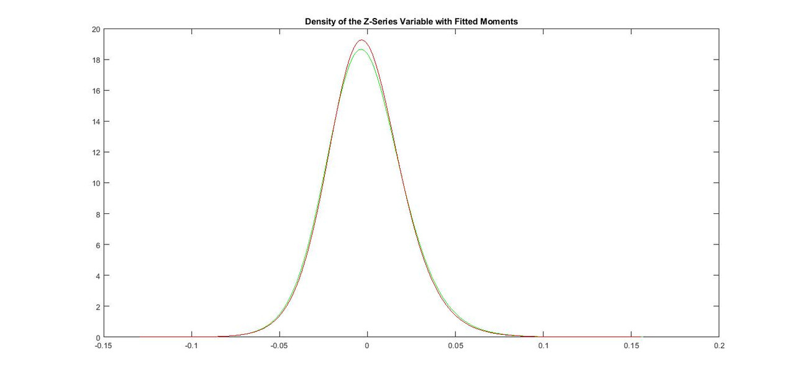](https://postimg.cc/XZHRNFXN)

[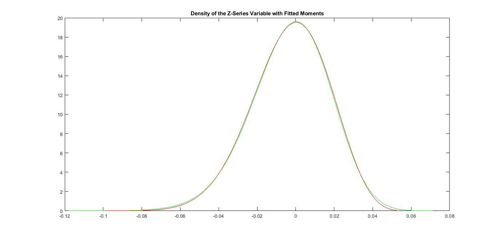](https://postimg.cc/zy5Zx89N)

[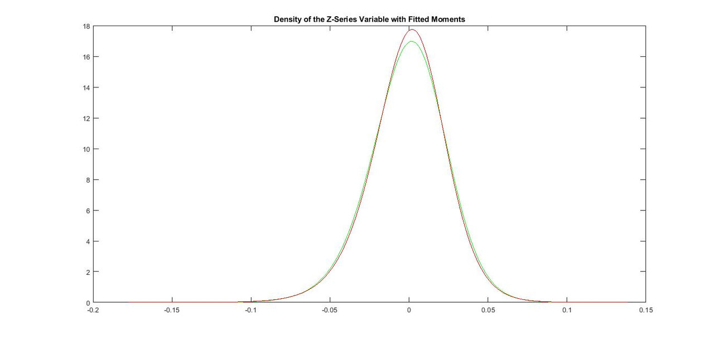](https://postimg.cc/YGTTYH1J)

[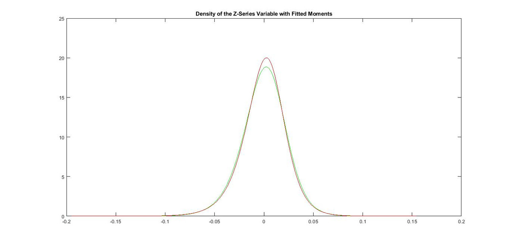](https://postimg.cc/MMnhnTj7)

[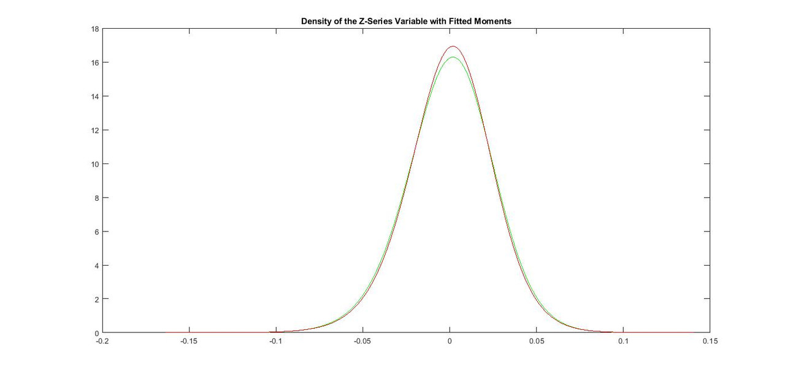](https://postimg.cc/xqwSbK5c)

[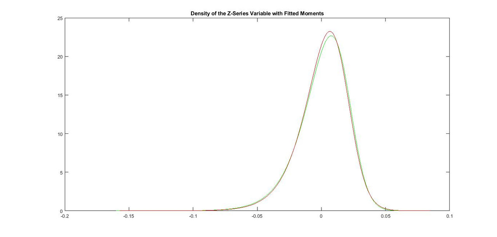](https://postimg.cc/8jQqCTkv)

[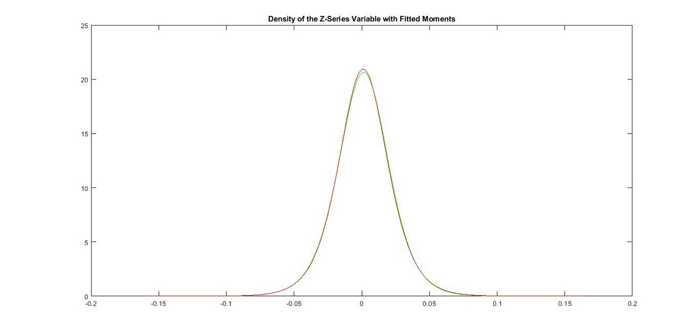](https://postimg.cc/tnPwzMk7)

[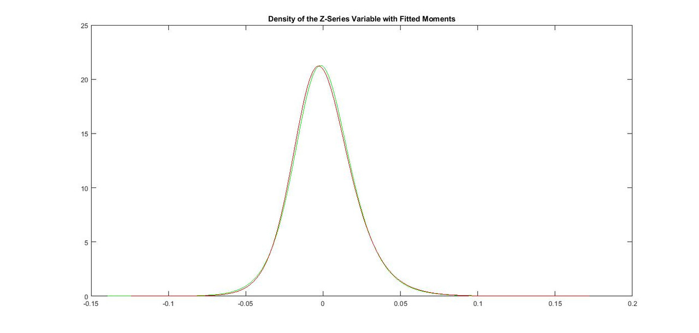](https://postimg.cc/6TGkw8Kw)

[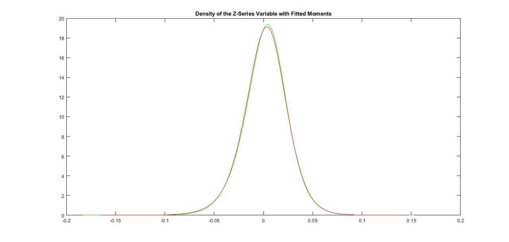](https://postimg.cc/yk0Chkpn)

---

### #1823 — Amin (Topic Author)
*May 1, 2023, 6:44 AM*

Friends, here are the matlab programs I used to create the above graphs. The new program finds coefficients of Z-series
by linear regression rather than by optimization. Comparison of output from both programs is shown by graphs on previous
post and also in a graph here.

I think this program can be slightly improved further but I will try to see that later. And also try to see if six
moments fit can be replicated by this method.

.

.

.

```
function [] = FindCoefficientsOfZSeriesByLinearRegression()

%Below, read AAPL, AMZN, GOOGL,MSFT,NVDA, NASDAQ100 daily open and
%close data files and extract daily open from the files. All files are
%exactly the same length and therefore corresponding array entries are
%from the same dates.
T = readtable('C:\Users\Infiniti Derivatives\Documents\MATLAB\HistoricalPricesAAPL2022.csv');
[NDays,NVar]=size(T);
ApplPrices(1:NDays)=table2array(T(1:NDays,2));
T = readtable('C:\Users\Infiniti Derivatives\Documents\MATLAB\HistoricalPricesAMZN2022.csv');
AmznPrices(1:NDays)=table2array(T(1:NDays,2));
T = readtable('C:\Users\Infiniti Derivatives\Documents\MATLAB\HistoricalPricesGOOGL2022.csv');
GooglPrices(1:NDays)=table2array(T(1:NDays,2));
T = readtable('C:\Users\Infiniti Derivatives\Documents\MATLAB\HistoricalPricesMSFT2022.csv');
MsftPrices(1:NDays)=table2array(T(1:NDays,2));
T = readtable('C:\Users\Infiniti Derivatives\Documents\MATLAB\HistoricalPricesNVDA2022.csv');
NvdaPrices(1:NDays)=table2array(T(1:NDays,2));
T = readtable('C:\Users\Infiniti Derivatives\Documents\MATLAB\HistoricalPricesNASDAQ1002022.csv');
NasdaqPrices(1:NDays)=table2array(T(1:NDays,2));

%choose the last entry of the regression
StartI=02+24*10;%choose the start of the regression
EndI=02+27*10;%choose the last entry of the regression
NDays=EndI-StartI;

DMsftPrices(1:NDays)=log(MsftPrices(StartI+1:EndI))-log(MsftPrices(StartI:EndI-1));

clf;

rMu= CalculateFourRawMomentsFromData(DMsftPrices,NDays);%Calculate four raw moments of each time series.
[c0,c,FixFlag] = CalculateZSeriesDensityFromRawMomentsFix4thMoment(rMu);

Mean=sum(DMsftPrices(1:NDays))/NDays;
Sigma=sqrt(sum((DMsftPrices(1:NDays)-Mean).^2)/NDays);
DMsftPrices0=(DMsftPrices-Mean)/Sigma; %Standardize the MSFT log difference prices.

[b0,b] = CalculateZSeriesCoeffsByIdealMeasure00(DMsftPrices0);
b0=b0*Sigma;
b=b*Sigma;
b0=b0+Mean;

 PlotZSeriesDensity(c0,c,'g');%Look at the density to make sure it is valid. If the tails fall
    hold on

 PlotZSeriesDensity(b0,b,'r');
    c0
    c
    b0
    b
    FixFlag
    str=input("Look at density comparison from two methods")

end
```

.

.

.

```
function [c0,c] = CalculateZSeriesCoeffsByIdealMeasure00(data)
%data is (array of) sample observations of random variable whose Z-series
%Coefficients have to be found.

Ndata=length(data);
%Sigma=1.0-(1/Ndata)*sqrt(.5);
Sigma=1.0-(1/Ndata);
[ZI] = StandardNormalIdealDesity00(Ndata,Sigma);

Sdata=sort(data);

Y(1:Ndata,1)=Sdata(1:Ndata);
for nn=1:Ndata
    X(nn,1)=1;
    X(nn,2)=ZI(nn);
    X(nn,3)=ZI(nn).^2;
    X(nn,4)=ZI(nn).^3;
end

coeff=inv(X'*X)*(X'*Y);

c0=coeff(1,1);
c(1:3)=coeff(2:4,1);

end

```

.

.

.

```
function [ZZ] = StandardNormalIdealDesity00(Ndata,Sigma)
%Ndata is number of data points in sample, for which we want to find the
%coefficients of the Z-series.

if (rem(Ndata,2)==0)
    NnMid=Ndata/2;
    ZZ(NnMid+1)=norminv(.5+1/Ndata*.5,0,Sigma);
    ZZ(NnMid)=norminv(.5-1/Ndata*.5,0,Sigma);
    for nn=2:NnMid-1
        ZZ(nn+NnMid)=norminv(.5+(nn-.5)*1/Ndata,0,Sigma);
        ZZ(-nn+1+NnMid)=norminv(.5-(nn-.5)*1/Ndata,0,Sigma);
    end

    A=norminv((Ndata-1)/Ndata);
    ZZ(Ndata)=A +0.398942 *exp(-.5*A^2)/sqrt(1/Ndata)/sqrt(.5);
    ZZ(1)=-A-0.398942 *exp(-.5*A^2)/sqrt(1/Ndata)/sqrt(.5);

  %   A=norminv((Ndata-1)/Ndata,0,Sigma);
  %   ZZ(Ndata)=A +0.398942/(Sigma) *exp(-.5*A^2/Sigma^2)/sqrt(1/Ndata)/sqrt(.5);
  %   ZZ(1)=-A-0.398942/Sigma *exp(-.5*A^2/Sigma^2)/sqrt(1/Ndata)/sqrt(.5);
end

if (rem(Ndata,2)==1)
    NnMid=(Ndata+1)/2;
    ZZ(NnMid)=0;
    for nn=1:NnMid-2
        ZZ(nn+NnMid)=norminv(.5+(nn)*1/Ndata,0,Sigma);
        ZZ(-nn+NnMid)=norminv(.5-(nn)*1/Ndata,0,Sigma);
    end
   A=norminv((Ndata-1)/Ndata);
    ZZ(Ndata)=A +0.398942 *exp(-.5*A^2)/sqrt(1/Ndata)/sqrt(.5);
    ZZ(1)=-A-0.398942 *exp(-.5*A^2)/sqrt(1/Ndata)/sqrt(.5);
end

% ZZ
% A
% plot(ZZ)
% str=input("Look at density plot standard")

end

```

.

.

I made  a small change to earlier program below (that loops until positivity condition is satisfied in optimization
case) and added an output parameter FixFlag that is one when we had to alter the fourth moment again and again so that
positivity condition of first derivative was satisfied.

.

.

```
function [c0,c,FixFlag] = CalculateZSeriesDensityFromRawMomentsFix4thMoment(rMu)

pMu=rMu;

[c0,c] = CalculateZSeriesDensityFromRawMomentsM4(rMu);
FixFlag=0;
nn=0;
while((c(2)^2-3*c(1)*c(3))>=0)
    rMu(4)=rMu(4)*1.01;%increase the 4th raw moment by one percent everytime
    [c0,c] = CalculateZSeriesDensityFromRawMomentsM4(rMu);
    nn=nn+1
end
if(nn>0)
    FixFlag=1;
end

pMu
rMu
str=input('Look at pMu--input moments and rMu-calibrated moments')

end
```

.

.

.

Here is the graph you will see when you run this program.

.

[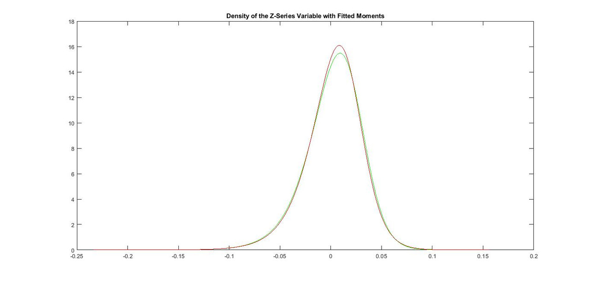](https://postimg.cc/Czpj5xZb)

.

.

.

Here is the output you will see when you run this program.

c0 =

   0.005032064167348

c =

   0.026148954762373  -0.002370751045537   0.000694258171966

b0 =

   0.004832741215378

b =

   0.025105959293247  -0.002170290119296   0.000921228410339

FixFlag =

     0

Look at density comparison from two methods

---

### #1824 — Amin (Topic Author)
*May 7, 2023, 6:55 PM*

Friends, it's been ten days since I got the antipsychotic injection and I am slowly getting back to life. Among other
things, I have been thinking how to tackle dummy variables in our hermite polynomial regression setting. A large number
of data sets I looked into had some sort of dummy variables and I had no clue how to tackle them  in our orthogonal
plynomial set up.

But then I realized that dummy variables can be very easily tackled. After finding the values(from Z-series inversion of
data points) of hermite polynomials associated with data, we can set up our regression in two parts. The first part
would have a constant, any dummy variables and first hemrite polynomials and this part would be solved like we solve
classic multivariate regressions.  The second part would consist of all higher hermite polynomials whose effects would
be added independently on top of the solution from first part. This is perfectly valid due to orthogonality of hermite
polynomials.

In a day or two, I would try to come up with a few worked out examples of regressions from classic data sets that take
dummy variables as input.

I think most of the extensions of classic linear regression methods can also be applied to our hermite orthogonal
polynomial regression set up and all the extensive theory about various versions of linear regressions models can be
applied to hermite orthogonal regressions.

---

### #1825 — Amin (Topic Author)
*May 10, 2023, 7:40 PM*

Friends, I was playing around with addition/subtraction of densities using cumulants in our Z-series framework. It works
quite well when we know the cumulants of two densities and we can convert them into Z-series and also add or subtract
the cumulants to find the cumulants of resulting density which can again be shown in a Z-series form.

The problem occurs when it becomes difficult to find Z-series of a density from its cumulants and our density
construction programs fail to work successfully. To understand the reason behind this failure to construct "density with
matching moments" phenomenon, we have to understand that Z-series is natural to only normal like densities that deviate
just enough from normal density. For the kind of positive densities that take a very extreme right tail, it is much more
natural to expand the random variable in terms of Laguerre polynomials instead of hermite polynomials. And once we have
a fitted Laguerre polynomials to match the density of a random variable, we can easily convert the Laguerre
representation to hermite polynomial form.

So I think that attempts to fit all sort of densities to orthogonal polynomials should shift focus from research solely
on fitting hermite polynomials towards greater research on Laguerre and other related orthogonal polynomials. I am quite
sure that positive densities with huge skew and accompanying kurtosis that become very difficult to match using hermite
polynomials can very easily and parsimoniously be matched by polynomials that are more natural to that kind of target
densities. And when needed, we could convert them into a hermite polynomial form with simple calculus.

We have large applications of long tailed densities and therefore, I thought that I would try to write a program that
works with Laguerre polynomials upto eight order and just does what our earlier Z-series density fitting program did
with hermite polynomials.

---

### #1826 — Amin (Topic Author)
*May 10, 2023, 8:20 PM*

Friends, when I wrote the previous post, I was working on a table-chair placed in the open (from sides) car garage of
our house. It is early summer and temperature at this part of the night is very pleasant outside. But when I just came
to sleep inside in my room, there was huge smell of pungent gas in the room and it becomes difficult to breathe inside
my room.

Both due to gas in my room and higher temperature, I used to sleep for a large part of the summers in the car garage
after placing a cot there. Friends would recall that I had dengue fever one and a half year ago when I used to sleep in
the car garage. Later last year, when dengue season was gone, I started sleeping in the car garage again. I really feel
much better since my sleep is far better there due to relative lack of gases and better/lower temperature at night (I
cannot use AC in my room since there is so huge gas when I turn on AC that I remain badly affected for several days
after breathing in the gas for two to three hours).

But last year, sometime in early June, they injected me with some drug while I was sleeping in the car garage (Car
garage is in the pathway and everybody coming inside the house has to pass through it). At that time, I used to walk
everyday in the morning for more than two hours but all of a sudden after they injected me when I was sleeping, I
stopped walking in the morning and I could not do good work for weeks and there were several other un-explainable sudden
changes in my behaviour. After that I decided to never sleep in the open where anybody can approach me at night when I
would be asleep and easily inject me when they wish.

But sleeping inside the room has its own pitfalls. Even when I do not complain there is usually some low potency gas in
my room that continues to badly affect me during my sleep. But when I walked inside my room to sleep now, there was huge
gas in my room and it was difficult to breathe inside the room. And therefore I decided to write this post.

---

### #1827 — Amin (Topic Author)
*May 11, 2023, 7:52 AM*

I am trying to find helpful research work about Laguerre polynomials and among other things found this wonderful paper. Of course, we are not taking the approach to model the density directly rather we want to model the random variable directly using Laguerre polynomials but I found it a very good work and decided to share with friends. https://core.ac.uk/download/pdf/82490019.pdf

---

### #1828 — Amin (Topic Author)
*May 11, 2023, 8:57 PM*

Friends, I will write a detailed post later but very quickly I want to mention my approach to modelling of Gamma Series
that has coefficients so that Gamma series moments match the moments of the random variable in question.

First of all Generalized gamma polynomials with parameter alpha are orthogonal with respect to density of Gamma variable
with shape parameter alpha plus one. So if we start with Generalized gamma polynomials with alpha equal to unity/one, we
will have to choose shape parameter of our gamma variable equal to two. This is just as a starting point and may be we
can later arbitrarily change shape parameter of gamma variable and accompanying parameter alpha of generalized Laguerre
polynomials more arbitrarily.

So I want to start experimenting with Gamma series of the form

$ \, X \, = \, a_0 \, + \, a_1 \, \Gamma(2,1)\, + \, a_2 \, {\Gamma(2,1)}^2 \, + \, a_3 \, {\Gamma(2,1)}^3 \, + \, \ldots$

It seems easier to optimize the above form to match moments with data since it is easier to calculate the derivatives
with respect to coefficients as in above Gamma series. It would, at first glance, seems more difficult to directly
optimize the generalized Laguerre polynomial version but once we have found the coefficients of above Gamma series, it
is very easy to convert it to a Ganaeralized Laguerre polynomial series (as they span the same polynomial space and we
can switch from one form to other using polynomial divisions)

I have already altered my program that calculated moments of Z-series so that the new program calculates the moments of
Gamma series or G-series. I am now working on altering the program that calculated the derivatives of moments of
Z-series with respect to its coefficients so that the new program calculates the derivatives of moments of G-series with
respect to coefficients of G-series (Both programs for two series share the same basic logic).

The above things are easy but First test would be if we could use modified version of smoothing method we applied to
find initial coefficients of Z-series and be able to use its modified version for G-series and get a guess that is
inside the catchment of Newton method.

It would be simple to convert the above calculated Gamma Series into a Z-series and I will also write that program.

I want to first find the standardised version of input moments but since we are in a positive random variable framework,
mean cannot be zero and possibly will have to take any standardisation that accompanies conversion to unit variance and
standardised higher moments. Though something here might change as I gain more insight after playing with the method
further.

---

### #1829 — Amin (Topic Author)
*May 11, 2023, 9:43 PM*

>
> Friends, I will write a detailed post later but very quickly I want to mention my approach to modelling of Gamma
Series that has coefficients so that Gamma series moments match the moments of the random variable in question.
>
>
>
> First of all Generalized gamma polynomials with parameter alpha are orthogonal with respect to density of Gamma
variable with shape parameter alpha plus one. So if we start with Generalized gamma polynomials with alpha equal to
unity/one, we will have to choose shape parameter of our gamma variable equal to two. This is just as a starting point
and may be we can later arbitrarily change shape parameter of gamma variable and accompanying parameter alpha of
generalized Laguerre polynomials more arbitrarily.
>
>
>
> So I want to start experimenting with Gamma series of the form
>
>
>
>
$ \, X \, = \, a_0 \, + \, a_1 \, \Gamma(2,1)\, + \, a_2 \, {\Gamma(2,1)}^2 \, + \, a_3 \, {\Gamma(2,1)}^3 \, + \, \ldots$
>
>
>
> It seems easier to optimize the above form to match moments with data since it is easier to calculate the derivatives
with respect to coefficients as in above Gamma series. It would, at first glance, seems more difficult to directly
optimize the generalized Laguerre polynomial version but once we have found the coefficients of above Gamma series, it
is very easy to convert it to a Ganaeralized Laguerre polynomial series (as they span the same polynomial space and we
can switch from one form to other using polynomial divisions)
>
>
>
> I have already altered my program that calculated moments of Z-series so that the new program calculates the moments
of Gamma series or G-series. I am now working on altering the program that calculated the derivatives of moments of
Z-series with respect to its coefficients so that the new program calculates the derivatives of moments of G-series with
respect to coefficients of G-series (Both programs for two series share the same basic logic).
>
>
>
> The above things are easy but First test would be if we could use modified version of smoothing method we applied to
find initial coefficients of Z-series and be able to use its modified version for G-series and get a guess that is
inside the catchment of Newton method.
>
>
>
> It would be simple to convert the above calculated Gamma Series into a Z-series and I will also write that program.
>
>
>
> I want to first find the standardised version of input moments but since we are in a positive random variable
framework, mean cannot be zero and possibly will have to take any standardisation that accompanies conversion to unit
variance and standardised higher moments. Though something here might change as I gain more insight after playing with
the method further.
>
.

.

Sorry, I believe we can remain in classic (as opposed to generalized with positive alpha parameter) Laguerre polynomial
framework with alpha parameter associated with the polynomial equal to zero. This will be orthogonal with respect to
standard gamma random variable$\Gamma(1,1)$ (i.e the shape parameter of our gamma variable will be equal to one) and
then our initial gamma series would be of the form of standard gamma variable as

$ \, X \, = \, a_0 \, + \, a_1 \, \Gamma(1,1)\, + \, a_2 \, {\Gamma(1,1)}^2 \, + \, a_3 \, {\Gamma(1,1)}^3 \, + \, \ldots$

Above is the Gamma series form I have and I want to calculate the coefficients of G-series so that moments of above
G-series match with the moments of our given random variable.

Here$\Gamma(1,1)\,$ represents Gamma random variable with shape parameter one and scale parameter one i.e a standard
Gamma random variable.

---

### #1830 — Amin (Topic Author)
*May 13, 2023, 9:57 PM*

Friends, I tried to make the optimization work for finding coefficients of standard gamma series so that its moments
match with the moments of random variable in question. But a strategy like I used for finding coefficients of hermite
polynomials series does not seem to work well here.

I came across this paper and decided to try its strategy. Here is the paper   https://adsabs.harvard.edu/full/2005rdra.book...55M

I want to first find the density in native random variable as done in the above cited paper and later convert it from
native random variable to powers of standard gamma and powers of standard normal random variable using the work I have
already done.  Once we have derived a density representation in native random variable, it is very simple to convert it
to powers of standard gamma(alternatively Laguerre polynomial series) or standard normal random variable(or hermite
polynomials series).

I should be able to complete this work in next three to four days.

I also want to come back to work on option pricing. Many people say that option pricing formulas are wrong. As I see
that option prices can deviate from its realized volatility value only if we cannot properly delta hedge. Local supply
and demand pressures can also cause option prices to deviate from their true backward implied values. I am not
considering stochastic volatility explicitly in my analysis today but will try to re-do the analytics again after
including the effect of stochastic volatility.

We know that a call price is given as

$C_t \, = \, \exp(-r (T-t) ) E \Big[ (X_T \, - K)^{+} | \mathcal{F}_t \Big] \, $

We know that (from option implied density or from historical analysis or from some combination of these and other
factors)

$\, X_T \, = X_t \, + \, a_1 \, Z \, \, + \, a_2 \, (Z^2-1) \, \, + \, a_3 \, (Z^3 -3 Z) \, + \ldots$

Substituting the value of $X_T$ in above equation, we have

$C_t \, = \, \exp(-r (T-t) ) E \Big[ (X_t \, + \, a_1 \, Z \, \, + \, a_2 \, (Z^2-1) \, \, + \, a_3 \, (Z^3 -3 Z) \,  \, - K)^{+} \, | \mathcal{F}_t \, \Big] \, $

We can convert the above expectation into an explicit integral but first we would have to solve for the value of Z for
which$X_T$ would become equal to strike K. We call this particular value of Z as$Z_K$

So writing in an integral form, we get

$C_t \, = \, \exp(-r (T-t) ) \int_{Z_K}^{\infty}  \Big[ (X_t \, + \, a_1 \, Z \, \, + \, a_2 \, (Z^2-1) \, \, + \, a_3 \, (Z^3 -3 Z) \,  \, - K)  \, \Big] \frac{\exp[-.5 \, Z^2]}{\sqrt{ 2 \pi}}\, dZ $

We can analytically solve the above integral as

$C_t \, = \, \exp(-r (T-t) )   \Big[ (X_t \,-K) (1- P(Z_K)) \, +\frac{\exp[-.5 \, {Z_K}^2]}{\sqrt{ 2 \pi}}\, (\, a_1  \, \, + \, a_2 \, Z_K \, \, + \, a_3 \, ({Z_K}^2 -1) \, )  \, \Big] \,$

$= \, \exp(-r (T-t) )   \Big[ (X_t \,-K) (1- \Phi(Z_K)) \, + \, \phi(Z_K)\, (\, a_1  \, \, + \, a_2 \, Z_K \, \, + \, a_3 \, ({Z_K}^2 -1) \, )  \, \Big] \,$

The above is an analytical formula for option price that can be used for any strike.

I think if we want to improve on this formula, we have to add more independent noise in the above equation to account
for the possibility of jumps where we could not properly delta hedge the option and local P&L of our option becomes
slightly stochastic as opposed to riskless. Obviously variance of this noise has to be a small fraction of delta and
should be equated to possible mismatch in hedging. We could also add small noise in option dynamics to account for
option price deviations from their true value caused by local supply and demand imbalances.

I will try to explain these ideas in more details later and also do the analysis after explicitly including the effect
of stochastic volatility.

---

### #1831 — Amin (Topic Author)
*May 15, 2023, 6:25 AM*

Friends, my persecution did decrease for a bit as many friends might have judged since I have not been writing posts
about corrupt people in Pentagon. But one reason might have been that I was extra careful about my food and tried to
make sure that I get food from random sources I have not thought about before.

Yesterday night I bought two sandwiches from a bakery and only after eating them I realized that they were drugged. They
must have drugged food at more then a dozen bakeris in the area. After eating the sandwiches all my drive for my
research work was gone and I simply sat on the chair for hours trying to think what to do and had absolutely no
motivation to do any work.

Just one hour earlier, I bought cold bottled water from a shop in a close by market. Water was good and I really liked
it also because weather has already become very hot. I was feeling bad that I bought only one water bottle and went back
an hour later to buy a few more cold water bottles. When I drank water again, it was thoroughly drugged and I was very
disappointed.

I really want to say that good for nothing scum in Pentagon had very high hopes that Jewish Goldfather would give them
jobs paying millions of dollars after retarding me and several other innocent victims like me. The way scum believed in
their great luck and believed that that despite being good for nothing, they would get jobs for the rest of their life
paying millions of dollars. Now when good Americans realize the true motives of corrupt scum at Pentagon, it is very
hard for the scum to come into terms with the reality that their dreams of millions of dollars were just a mirage and
scum becomes even more motivated to do something to change the reality again. Again Jewish Goldfather is in no way
obliged to hire scum at millions of dollars paying jobs and would do that only if scum at Pentagon shows some progress
on ground in retarding the mind control victims pointed out by the Goldfather.

Believe me or not, retarding victims with mind control to please the jewish Goldfather and his likes is the largest
money making business among corrupt scum at Pentagon.

---

### #1832 — Amin (Topic Author)
*May 15, 2023, 9:18 PM*

>
> Friends, I tried to make the optimization work for finding coefficients of standard gamma series so that its moments
match with the moments of random variable in question. But a strategy like I used for finding coefficients of hermite
polynomials series does not seem to work well here.
>
> I came across this paper and decided to try its strategy. Here is the paper   https://adsabs.harvard.edu/full/2005rdra.book...55M
>
> I want to first find the density in native random variable as done in the above cited paper and later convert it from
native random variable to powers of standard gamma and powers of standard normal random variable using the work I have
already done.  Once we have derived a density representation in native random variable, it is very simple to convert it
to powers of standard gamma(alternatively Laguerre polynomial series) or standard normal random variable(or hermite
polynomials series).
>
> I should be able to complete this work in next three to four days.
.

Friends, I have coded most of the above method to construct the density with Laguerre polynomials that matches specified
moments in matlab and I hope it should be ready in another day. Then I will go on to taking derivatives between density
constructed with this method and the standard normal density/standard gamma density. And these derivatives would be used
to construct the power series in standard normal (or equivalently in hermite polynomials ) that I have been calling
Z-series. You could also construct the power series in standard gamma variable. I hope all of this work will be ready in
a few days.

Its already summers and temperature during the day is very high so I try to avoid going out during the day in Sun's
heat. I go out regularly after sunset when temperature has somewhat decreased. Also I try to work till late at night (It
is 2:00 AM here in Lahore) and I usually use a pedestal fan in the porch/garage of our house where I work. There is a
ceiling fan in the garage but sparrows have made a nest inside the hole in roof above the fan and its electric wire is
broken/disconnected. I decided to not repair and use the ceiling fan until the birds abandon the nest. But pedestal fan
used to work fine and there was not a problem. Last night when I slept, I took the pedestal fan inside my room and
placed it inside the window of my room to pull colder air from outside the window. I had an absolutely fantastic sleep
after that. Mind control agents spend a lot of time at night when I sleeping to try to control my neurotransmitters and
fast moving air and fresh air without gases create problems with their operations. Fast moving air decreases the
accuracy of EM resonance and fresh air restores the original neurotransmitters. Anyway, when I went out after sunset and
then came back and started to work in the garage again, I brought the pedestal fan outside but was horrified to know
there was some sick gas or special charges and it was impossible to work in the air of the pedestal fan. I tried to
brave through and keep using the fan since it was still too warm but then realized that I was being more and more sick
and unable to do any work. And then I turned off the fan and started working without any fan. I will not be able to use
the fan inside my room anymore since it would be far more difficult to sleep in its gas mixed air of the fan inside the
closed room.

This is a standard practice of inhuman animals of mind control. Whenever I get some comfort in anything like a fan or
some other thing, these animals are very quick to create problems with that thing right away. Somebody has to teach
humanity 101 to scum at Pentagon.

---

### #1833 — Amin (Topic Author)
*May 18, 2023, 11:20 AM*

Friends, yesterday night, I was able to complete the work I was doing. But I was slightly disappointed with results.
There could be a possibility that I made errors, but when I tried finding a density with Laguerre polynomials applied to
gamma density, I noticed that many times the resulting density would go into negative territory and there were large
oscillations in density. I found that taking first four Laguerre polynomials usually resulted in a stable well defined
density but it was usually somewhat away from true density that had been fit perfectly to first eight moments. Whenever
I tried more than first four polynomials, the procedure usually resulted in very large oscillations and unstable
density.

However, I might have made some errors in the implementation of the method.

Once a density was ready using first four Laguerre polynomials, I was able to convert it to Z-series quite faithfully
(with very small error) into Z-series density by matching the derivatives of Gamma + Laguerre density and a standard
normal density at their median. This part worked quite well.

I will be posting the code with comments and minor changes tomorrow.

---

### #1834 — Amin (Topic Author)
*May 18, 2023, 11:30 AM*

Friends, I have ideas for research on Z-series neural networks and I hope that they would go one step beyond Z-series
hermite polynomial regressions in predicting the target variables. I have thought about optimizing them in a
semi-analytic way first to quickly find a suitable starting point and after finding a very good guess,these Z-series
neural networks would be optimized after that with full-fledged optimization techniques. Lot of ideas here would be
based on mathematics and there will be no black-box thing. I really hope that these neural networks will work better
than plain hermite orthogonal rgressions in time series predictions.

I have an antipsychotic injection due at the end of next week so I have 8-9 days and I really will try to complete as
much work before that time as possible.

---

### #1835 — Amin (Topic Author)
*May 19, 2023, 7:58 PM*

Friends, when I went out to get food after sunset, mind control agencies were able to drug some food that I later
bought. I have been feeling very bad and have no drive to do anything as if my mind is frozen.

Though mind control agents were trying to retard me all the time even before, they have set out with unprecedented
strength after I wrote the post in which mentioned that people of pentagon were scum. I seriously think that, for past
few days, hundreds of Pakistan army soldiers try to drug food when I go out at night and I have to be very lucky to
escape them. I think most of the things I bought were good but I picked something bad and it has had very adverse effect
on me. I think I am able to survive since most of the food was good. I really want to request friends to please ask the
corrupt people at Pentagon to end my persecution. Retarding innocent and intelligent people of different nations on
behest of rich people in US is an extremely lucrative and multi-billion dollar business for corrupt people at Pentagon
and it is very difficult for these corrupt people to accept the alternative world where they would be forced to live
without huge corruption money just like as an average American lives.

I do not expect people to blindly believe me. I have just raised voice about something that nobody else was ready to
talk about. But I am sure most intelligent people in United States are smart enough to use their resources to
investigate the truth on their own about who are the people being retarded and who are the people convincing others that
retarding of mind control victims is a good thing and who points to people of Pentagon about retarding innocent people.
If corrupt people at Pentagon, as I say they are, are in fact good, they should be willing to convince Americans by
presenting any argument and proof that they have about their being good instead of trying to stifle my voice. The way
they have been trying to stifle my voice by increasing the persecution and drugging of food to a whole new degree in
past few days, should tell people that they are threatened by my allegations and have no sound arguments against my
allegations of corruption. If they really had any strong arguments, they would already be presenting those arguments to
people to convince them that their mind control drive was indeed a good thing.

Do not expect that mediocre people of Pentagon would voluntarily follow any laws or good human/American  ethics or
virtues. Not only are they mediocre, they are above the law. A large number of them are simply maximizing their personal
profits leveraging the power they have over good, innocent and intelligent people. I really do not believe that
unbridled power in hands of mediocre people who are above the law is a good thing for any society.

Sorry, but due to the effect of drugs in my food, I was really not able to write comments and make the work presentable
to post it today. I would be posting it tomorrow. I also lost a lot of enthusiasm about it when I noticed that I could
not fit any Laguerre polynomial after fourth order. Anyway, I would be posting it tomorrow.

---

### #1836 — Amin (Topic Author)
*May 22, 2023, 2:23 PM*

Friends, I wanted to share some ideas about time series modelling and forecasts.

I suppose we can do a hermite orthogonal regression on lagged variables in so many ways using hermite polynomial
correlations of target variable with lagged variables.

Suppose Y is regressed on N lagged variables denoted by $X_n, n=1,2, \ldots , N$ each.

$Y \, = \, a_0 \, + a_1 \, Z_{y} \,+ a_2 \, ({Z_{y}}^2-1) \,+ a_3 \, ({Z_{y}}^3 - 3 Z_y) \, + \, \ldots$

$=a_0 \, + Y_1 \, + \, Y_2 \, + \, Y_3 \,$

Above, we have divided Y into three orthogonal hermite components.

We can decompose each $X_n$ into orthogonal hermite polynomial parts as

$X_n \, = \, c_0 \, + c_1 \, Z_{n} \,+ c_2 \, ({Z_{n}}^2-1) \,+ c_3 \, ({Z_{n}}^3 - 3 Z_n) \, + \, \ldots$

The idea is to construct covariance matrices from realized values of each of the above hermite polynomials and find its
orthonormal eigenvectors. One set of orthonormal eigenvectors would come from covariane matrix of first hermite
polynomial, second set of orthonormal eigenvectors would come from covariance matrix of second hermite polynomials and
so on.

Suppose vector of observed values of first hermite polynomial is given as

$Z_t=\begin{pmatrix}Z_{1,t}\\Z_{2,t}\\ \vdots\\ Z_{N,t}\end{pmatrix}$

We find the covariance matrix as

$ Cov_1= \frac{1}{T} \, \sum_{t=1}^{T} \, Z_t \, tr({Z_t})$

now we do eigenvalue decomposition of the above covariance matrix to find N orthogonal eigenvectors
$\zeta_1, \zeta_2, \ldots , \zeta_N$

We know that N orthogonal vectors span the entire space of N dimensional vectors, we can represent$Z_t$ at any point in
time as

$Z_t \, = b_{t,1} \, \zeta_1 \, + \, b_{t,2} \, \zeta_2 + \, \ldots \, + b_{t,N} \, \zeta_N$

where

$b_{t,1} = Z_t \, . \, \zeta_1$

$b_{t,2} = Z_t \, . \, \zeta_2$

i.e the above coefficients are found by inner product with particular orthonormal eigenvector. We can understand it as
that$b_{t,1}$ is the portion of first eigenvector in particular realization of$Z_t$

What we can do is that we can find correlation between$Z_{y,t}$ and$b_{t,1}$ as proxy for correlation between first
eigenvector$\zeta_1$ and$Y_1$ where$Y_1$ represents the first hermite component of$Y_t$ .

Suppose

$\rho_1 = corr, t=1,2, \, \ldots, T$

$\rho_2 = corr, t=1,2, \, \ldots, T$

Luckily correlation with only first few eigenvectors would be significant. So we could write first hermite polynomial
component of our regression in totally orthogonal coordinates as

$\, Y_1 \, = \, \rho_1 \, b_{t,1} \,+\, \rho_2 \, b_{t,2} \,+ \, \ldots \, $

This is important since we can get information from movement of eigenvectors that are realized out of movements of a
large number of assets.

This is also important since first few eigenvectors usually have their interpretations as level, slope and twist etc so
their significant move can help us give more information about the market movement and we can use them in some special
ways in our algos.

Though we use a full rank matrix to determine these eigenvectors, only first few eigenvectors would usually be
significant and rest will be noise and we might not want to add them in our regression.

In the above explanation, we have specifically done eigenvector decomposition of first hermite polynomial part of
regression. We will have to repeat the above process for each of the orthogonal hermite polynomial.

So we not only orthogonalize the non-gaussian densities using hermite polynomials, we also orthogonalize
covariances/correlations from each hermite polynomial into orthogonal eigenvectors. Since everything is orthogonal, we
can try to understand changing correlations in a more simpler one dimensional setting.

---

### #1837 — Amin (Topic Author)
*May 22, 2023, 7:48 PM*

Friends, here is my other program that constructs density of a random variable so that resulting density is product of a
base gamma density multiplied with a fourth order polynomial whose coefficients are chosen so that first four moments of
the Gamma + polynomial series density match the input moments of the random variable. We then find median of this gamma
+ polynomial density and  find the derivatives of the density with respect to the random variable at the median. These
derivatives are matched with derivatives of standard normal density with respect to standard normal random variable at
its median. We then find the first seven derivatives of the input random variable whose Gamma + polynomial multiple
series was found with respect to standard normal variable. These derivatives are used to construct the Z-series of the
variable whose gamma + multiplied polynomial density was found.

I wanted to post the program yesterday but was hit with bad food and could not properly concentrate at night. Sorry for
the delay.

Here are matlab program files:

```
function [c0,c] = ZSeriesFromGammaDensityExpansion(rMu)

% mu=-.2;
% sigma=.65;
% for n=1:8
%     rMu(n)=exp(n*mu+n^2/2*sigma^2);
% end
%
 rMu(1)=0.000012499863483*10^5;
 rMu(2)=0.000021197093700*10^5;
 rMu(3)=0.000050274347857*10^5;
 rMu(4)=0.000171368317209*10^5;
 rMu(5)=0.000856094970826*10^5;
 rMu(6)=0.006320436615909*10^5;
 rMu(7)=0.068698344472325*10^5;
 rMu(8)=1.084082326087001*10^5;

[Coeffii,k,theta,a] = CalculateLaguerreSeriesDensityFromMoments(rMu);

a=0;%parameter a is used to shift the gamma density as in shifted gamma
%density. I have kept it at 0 in my experiments.
%Sorry for bad notation but please do not confuse parameter a of shifted
%gamma density with a0,a1,a2,a3,a4 which are coefficients of respective
%powers of x in the polynomial that multiplies the base gamma density.

a0=Coeffii(1);
a1=Coeffii(2);
a2=Coeffii(3);
a3=Coeffii(4);
a4=Coeffii(5);
%The above functions "CalculateLaguerreSeriesDensityFromMoments" takes
%raw moments.It returns a density representation
%of the random variable which is of the form
%p(y)= (y-a)^v * exp(-(y-a)/theta)/theta^(v+1)/Gamma(v+1) * ...
%(a0+a1*(y-a)/theta +a2*((y-a)/theta)^2+a3*((y-a)/theta)^3 + ...
%a4* ((y-a)/theta)^4;
%where v=k-1;
% k is the shape parameter, and v is the parameter asscoaited with
%generalized Laguerre coefficients.
%If you have solved for density in terms of Laguerre polynomials, you will
%have to convert it into a single polynomial form as above by adding
%together coefficients on the same powers of x in different Laguerre
%polynomials.

Nn=5000;
dNn=.002;

v=k-1;
%Y(1:Nn)=a+((1:Nn)-1)/theta*dNn;
Y(1:Nn)=((1:Nn)-1)*dNn;
fY0(1:Nn)=((Y(1:Nn)-a)).^v .* exp((a-Y(1:Nn))/theta) ./ theta^(v+1)/gamma(v+1);

%fY0(1:Nn) represents the discretized version of base gamma density
%given as: (y-a)^v * exp(-(y-a)/theta)/theta^(v+1)/Gamma(v+1)

Ph(1:Nn)=a0;

for ll=1:4
  Ph(1:Nn)=Ph(1:Nn)+Coeffii(ll+1).*((Y(1:Nn)-a)/theta).^ll;
end

%Ph(1:Nn) above represents the discretized version of
%(a0+a1*(y-a)/theta +a2*((y-a)/theta)^2+a3*((y-a)/theta)^3 + ...
%a4* ((y-a)/theta)^4;
%This is the discretized version of polynomial that multiplies the
%discretized version of gamma density.

%NormConst=sum(EataL(1:5))
NormConst=sum(fY0(2:Nn).*Ph(2:Nn))*dNn;
fY(1:Nn)=fY0(1:Nn).*Ph(1:Nn)/NormConst;

%fY(1:Nn) is a product of base gamma density and fourth order polynomial
%discretized at all points on the grid. This is effective density.

plot(Y(1:Nn),fY(1:Nn),'r');

str=input("Look at graph of gamma density multiplied with fourth order polynomial");

[Xmedian] = FindMedianOfGammaSeriesDensity(a,a0,a1,a2,a3,a4,k,theta);

%Above function finds median of the new effective density. We find the
%median since we compare derivatives there.

Xmedian

str=input("Look at Xmedian");
[px,dpdx] = DerivativesOfGammaSeriesDensityAtMedian(Xmedian,a,a0,a1,a2,a3,a4,k,theta);

%Above function finds derivatives of the effective density at its median
%with respect to its random variable.
%Please note that the effective density is given as
%p(y)= (y-a)^v * exp(-(y-a)/theta)/theta^(v+1)/Gamma(v+1) * ...
%(a0+a1*(y-a)/theta +a2*((y-a)/theta)^2+a3*((y-a)/theta)^3 + ...
%a4* ((y-a)/theta)^4;
%where v=k-1;
% k is the shape parameter, and v is the parameter asscoaited with
%generalized Laguerre coefficients.

dpxdX=dpdx(1);
d2pxdX2=dpdx(2);
d3pxdX3=dpdx(3);
d4pxdX4=dpdx(4);
d5pxdX5=dpdx(5);
d6pxdX6=dpdx(6);

%Below are derivatives of standard normal density at its median.
Zm=0;
pz=exp(-0.5* (Zm.^2))/sqrt(2*pi);
dpzdZ=-Zm*exp(-0.5* (Zm.^2))/sqrt(2*pi);
d2pzdZ2=(Zm^2-1)*exp(-0.5* (Zm.^2))/sqrt(2*pi);
d3pzdZ3=-(Zm^3-3*Zm)*exp(-0.5* (Zm.^2))/sqrt(2*pi);
d4pzdZ4=(Zm^4-6*Zm^2+3)*exp(-0.5* (Zm.^2))/sqrt(2*pi);
d5pzdZ5=-(Zm^5-10*Zm^3+15*Zm)*exp(-0.5* (Zm.^2))/sqrt(2*pi);
d6pzdZ6=(Zm^6-15*Zm^4+45*Zm.^2-15)*exp(-0.5* (Zm.^2))/sqrt(2*pi);

%Below are the derivatives of the random variable whose gamma expansion
%density was found with respect to standard normal random variable.

dXdZ=pz/px;

d2XdZ2=(dpzdZ-(dpxdX *dXdZ^2))/px

d3XdZ3=(d2pzdZ2- (2* dpxdX* dXdZ *d2XdZ2+dXdZ *(dXdZ^2* d2pxdX2+dpxdX *d2XdZ2)))/px

d4XdZ4=(d3pzdZ3-(3* d2XdZ2* (dXdZ^2* d2pxdX2+dpxdX *d2XdZ2)+3* dpxdX *dXdZ *d3XdZ3+dXdZ* (3 *dXdZ* d2pxdX2*
d2XdZ2+dXdZ^3* d3pxdX3+dpxdX* d3XdZ3)))/px

d5XdZ5=(d4pzdZ4- (6 *(dXdZ^2 *d2pxdX2+dpxdX *d2XdZ2) *d3XdZ3+4 *d2XdZ2* (3* dXdZ *d2pxdX2 *d2XdZ2+dXdZ^3* d3pxdX3+dpxdX*
d3XdZ3)+4* dpxdX* dXdZ* d4XdZ4+dXdZ *(3* d2pxdX2* d2XdZ2^2+6* dXdZ^2* d2XdZ2* d3pxdX3+4 *dXdZ* d2pxdX2* d3XdZ3+dXdZ^4*
d4pxdX4+dpxdX* d4XdZ4)))/px

d6XdZ6=(d5pzdZ5- (10* d3XdZ3 *(3 *dXdZ* d2pxdX2* d2XdZ2+dXdZ^3* d3pxdX3+dpxdX *d3XdZ3)+10* (dXdZ^2* d2pxdX2+dpxdX
*d2XdZ2)* d4XdZ4+5* d2XdZ2* (3* d2pxdX2* d2XdZ2^2+6* dXdZ^2* d2XdZ2* d3pxdX3+4 *dXdZ* d2pxdX2* d3XdZ3+dXdZ^4*
d4pxdX4+dpxdX* d4XdZ4)+5 *dpxdX* dXdZ* d5XdZ5+dXdZ *(15* dXdZ* d2XdZ2^2* d3pxdX3+10* d2pxdX2* d2XdZ2* d3XdZ3+10* dXdZ^2
*d3pxdX3* d3XdZ3+10* dXdZ^3* d2XdZ2* d4pxdX4+5* dXdZ* d2pxdX2* d4XdZ4+dXdZ^5* d5pxdX5+dpxdX* d5XdZ5)))/px

d7XdZ7=(d6pzdZ6- (20 *(3* dXdZ* d2pxdX2* d2XdZ2+dXdZ^3 *d3pxdX3+dpxdX *d3XdZ3)* d4XdZ4+15* d3XdZ3* (3 *d2pxdX2
*d2XdZ2^2+6* dXdZ^2* d2XdZ2* d3pxdX3+4 *dXdZ* d2pxdX2* d3XdZ3+dXdZ^4* d4pxdX4+dpxdX* d4XdZ4)+15* (dXdZ^2* d2pxdX2+dpxdX*
d2XdZ2)* d5XdZ5+6* d2XdZ2* (15* dXdZ* d2XdZ2^2* d3pxdX3+10* d2pxdX2* d2XdZ2 *d3XdZ3+10 *dXdZ^2 *d3pxdX3 *d3XdZ3+10
*dXdZ^3 *d2XdZ2* d4pxdX4+5 *dXdZ *d2pxdX2 *d4XdZ4+dXdZ^5 *d5pxdX5+dpxdX* d5XdZ5)+6* dpxdX* dXdZ *d6XdZ6+dXdZ* (15
*d2XdZ2^3 *d3pxdX3+60 *dXdZ *d2XdZ2 *d3pxdX3* d3XdZ3+10 *d2pxdX2 *d3XdZ3^2+45 *dXdZ^2* d2XdZ2^2 *d4pxdX4+20* dXdZ^3
*d3XdZ3* d4pxdX4+15 *d2pxdX2* d2XdZ2 *d4XdZ4+15 *dXdZ^2* d3pxdX3 *d4XdZ4+15 *dXdZ^4* d2XdZ2* d5pxdX5+6 *dXdZ *d2pxdX2*
d5XdZ5+dXdZ^6* d6pxdX6+dpxdX *d6XdZ6)))/px

c0=Xmedian
c(1)=dXdZ
c(2)=1/2*1*d2XdZ2
c(3)=1/6*1*d3XdZ3
c(4)=1/24*1*d4XdZ4
c(5)=1/120*1*d5XdZ5
c(6)=1/720*1*d6XdZ6
c(7)=1/720/7*1*d7XdZ7

%Above are coefficients of Z_series density
%We have the power series in standard normal given as
%Y=c0+c(1) Z + c(2) Z^2 + c(3) Z^3 + c(4) Z^4 +c(5) z^5 +c(6) Z^6 +c(7)
%Z^7;

%Below we graph the Z_series density from its coefficients

dNn=.1/2;   % Normal density subdivisions width. would change with number of subdivisions
Nn=45*4;  % No of normal density subdivisions
NnMid=((1+Nn)/2)*dNn;
Z(1:Nn)=(((1:Nn)*dNn)-NnMid);

%Now construct random variable from its Z-series coefficients
X(1:Nn)=c0;
for nn=1:7
    X(1:Nn)=X(1:Nn)+c(nn)*Z(1:Nn).^nn;
end

%Find change of density derivative with respect to normal for construction
%of density
DfX(1:Nn)=0;
for nn=2:Nn-1

    DfX(nn) = (X(nn + 1) - X(nn - 1))/(Z(nn + 1) - Z(nn - 1));

    %Change of variable derivative for densities
end
DfX(Nn)=DfX(Nn-1);
DfX(1)=DfX(2);

%Find lognormal density at the normal grid
pX(1:Nn)=0;
for nn = 1:Nn
    pX(nn) = (normpdf(Z(nn),0, 1))/abs(DfX(nn));
end

plot(X(1:Nn),pX(1:Nn),'r');

end

```

.

.

.

.

```
function [Coeffii,k,theta,a] = CalculateLaguerreSeriesDensityFromMoments(rMu)

POrder=4; % we use first four Laguerre Polynomials
a=0;
k=(rMu(1)-a).^2/(rMu(2)-rMu(1).^2);
v=k-1;
theta=(rMu(2)-rMu(1).^2)./(rMu(1)-a);

%Above we have chosen shape variable k and scale variable theta so that
%first two given moments are matched with the base gamma density.

for mm=1:4
    rMu(mm)=rMu(mm)/theta^(mm);
end

[EataL,CoeffL]=CalibrateLaguerreSeriesCoefficients(POrder,rMu,v,1);

%The above function returns the coefficients of powers of x that define
%generalized Laguerre polynomials of various orders.
%EataL are coefficients of each Laguerre polynomial so that when Laguerre
%polynomials series with these coefficients EataL is multiplied with base
%gamma density, first four moments of the resulting density match with
%first four iput moments.

% %Below is the program to graph the density.
% Nn=2000;
% dNn=.005;
%
%
% %Y(1:Nn)=a+((1:Nn)-1)/theta*dNn;
% Y(1:Nn)=((1:Nn)-1)*dNn;
%
% %fY0(1:Nn)=(Y(1:Nn)-a).^v .* exp((a-Y(1:Nn))/theta) ./ theta^(v+1)/gamma(v+1);
% fY0(1:Nn)=((Y(1:Nn)-a)).^v .* exp((a-Y(1:Nn))/theta) ./ theta^(v+1)/gamma(v+1);

Coeffii(1:5)=0;
Coeffii(1)=1;
for ll=1:4
    for ii=0:ll
        Coeffii(ii+1)=Coeffii(ii+1)+CoeffL(ll+1,ii+1).*EataL(ll+1);
    end
end

% Coeffii(2:5)=Coeffii(2:5); %Check and verify this theta multiplication
% a0=Coeffii(1);
% a1=Coeffii(2);
% a2=Coeffii(3);
% a3=Coeffii(4);
% a4=Coeffii(5);
%
% Ph(1:Nn)=a0;
%
% Ph(1:Nn)=Ph(1:Nn)+a1.*((Y(1:Nn)-a)/theta) + ...
%     +a2.*((Y(1:Nn)-a)/theta).^2 + ...
%     +a3.*((Y(1:Nn)-a)/theta).^3 + ...
%     +a4.*((Y(1:Nn)-a)/theta).^4;
%
%
% %NormConst=sum(EataL(1:5))
% NormConst=sum(fY0(2:Nn).*Ph(2:Nn))*dNn
% fY(1:Nn)=fY0(1:Nn).*Ph(1:Nn)/NormConst;
% plot(Y(1:Nn),fY(1:Nn),'r');
%
% str=input("Look at integral");
end

```

.

.

.

```
function [EataL,CoeffL] = CalibrateLaguerreSeriesCoefficients(POrder,rMu,alpha,theta)

[CoeffL] = CalculateGeneralizedLaguerreCoefficients(POrder,alpha)

%OrthognalityConst(mm)=gamma(mm+alpha+1)/gamma(alpha+1)/factorial(mm);

for mm=0:POrder
    OrthognalityConst(mm+1)=gamma(mm+alpha+1)/gamma(alpha+1)/factorial(mm)/theta;%*gamma(alpha+1);
    EataL(mm+1)=0;
    for nn=0:mm
        if(nn==0)

            EataL(mm+1)=EataL(mm+1)+CoeffL(mm+1,nn+1);
        else

            EataL(mm+1)=EataL(mm+1)+CoeffL(mm+1,nn+1).*rMu(nn);
        end
    end
    EataL(mm+1)=EataL(mm+1)./OrthognalityConst(mm+1);
end

end

```

.

.

.

```
function [CoeffL] = CalculateGeneralizedLaguerreCoefficients(POrder,alpha)

%This function finds the coefficients of powers of x for a particular Laguerre polynomial.
%CoeffL(nn+1,ii+1) indicates the coefficients of iith power in nnth
%Laguerre polynomial.
%POrder is the number of highest Laguerre polynomial whose coefficients are
%calulcated

CoeffL(1,1)=1;
for nn=1:POrder
    for ii=0:nn
        mm=nn+alpha;

        CoeffL(nn+1,ii+1)=(-1)^ii .*gamma(mm+1)/gamma(ii+alpha+1)/factorial(nn-ii)/factorial(ii);
    end
end

end

```

.

.

.

```
function [ymedian] = FindMedianOfGammaSeriesDensity(a,a0,a1,a2,a3,a4,k,theta)
%This program uses neton-raphson to find median of the following density
%p(y)=(y - a)^(alpha - 1) *exp((a - y)/theta)/theta^alpha/gamma(alpha)*(a0 + a1* (y - a)/theta + a2 *((y - a)/theta)^2 +
...
%   a3* ((y - a)/theta)^3 + a4* ((y - a)/theta)^4);

alpha=k; % shape parameter.
%integral a to y.

%Initial guess
 y=  theta*(k-1/3+8/405/k + 184/25515/k^2+2248/3444525/k^3-19006408/15345358875/k^4);

Xtheta= (-a + y)/theta;
Integral=theta^(-4 - alpha).* ((1/theta)^-alpha .*(-a^4.* a4 + a^3.* a3 .*theta - a^2.* a2 .*theta^2 + a.* a1.* theta^3
+ ...
    alpha.* (a1 + (1 + alpha).* (a2 + (2 + alpha).* (a3 + a4 .*(3 + alpha)))).* theta^4) + ...
    (1/gamma(alpha)).*(-a + y)^alpha .*((-a + y)/theta)^-alpha.* ((a^4 .*a4 - a^3.* a3.* theta + a^2 .*a2 .*theta^2 -
a.* a1.* theta^3 + ...
    a0.* theta^4).* gamma(alpha) - theta^4.* (a0.* igamma(alpha,Xtheta) + a1.* igamma(1 + alpha,Xtheta) + ...
         a2.* igamma(2 + alpha,Xtheta) + a3 .*igamma(3 + alpha,Xtheta) + a4.* igamma(4 + alpha,Xtheta))));
  % y0=y;
  % alpha1=alpha+1;
  % alpha2=alpha+2;
  % alpha3=alpha+3;
  % alpha4=alpha+4;
 %(1/gamma(alpha)).*theta^(-alpha) .* (y0/theta)^(-alpha).* ((1/theta)^(4 - alpha).* (a0 *(1/theta)^(-4 + alpha)*
y0^alpha + ...
 %     alpha *(a1 + (1 + alpha)* (a2 + (2 + alpha)* (a3 + a4* (3 + alpha)))) *theta^4 *(y0/theta)^alpha)* gamma(alpha) -
...
 %  y0^alpha* (a0* gammainc(y0/theta,alpha) + a1* gammainc(y0/theta,alpha1) +a2 *gammainc(y0/theta,alpha2) + ...
 %  a3* gammainc(y0/theta,alpha3) + a4 *gammainc(y0/theta,alpha4)))

% Xtheta=(-a+y)/theta;
% Integral=theta^(-4 - alpha).* ((1/theta)^-alpha .*(-a^4.* a4 + a^3.* a3 .*theta - a^2.* a2 .*theta^2 + a.* a1.*
theta^3 + ...
%     alpha.* (a1 + (1 + alpha).* (a2 + (2 + alpha).* (a3 + a4 .*(3 + alpha)))).* theta^4) + ...
%     (1/gamma(alpha)).*(-a + y)^alpha .*((-a + y)/theta)^-alpha.* ((a^4 .*a4 - a^3.* a3.* theta + a^2 .*a2 .*theta^2 -
a.* a1.* theta^3 + ...
%     a0.* theta^4).* gamma(alpha) - theta^4.* (a0.* gammainc(alpha, Xtheta) + a1.* gammainc(1 + alpha, Xtheta) + ...
%          a2.* gammainc(2 + alpha, Xtheta) + a3 .*gammainc(3 + alpha, Xtheta) + a4.* gammainc(4 + alpha, Xtheta))))
%

     dIntegraldy=(y - a)^(alpha - 1) *exp((a - y)/theta)/theta^alpha/gamma(alpha)*(a0 + a1* (y - a)/theta + a2 *((y -
a)/theta)^2 + ...
   a3* ((y - a)/theta)^3 + a4* ((y - a)/theta)^4);

%Integral
%dIntegraldy

%str=input("Inside the loop---look at y");

 nn=0;
while (abs(Integral-.5)>.000000001)
 %nn
 %y
 %Integral

    nn=nn+1;
y=y-(Integral-.5)/dIntegraldy;

Xtheta= (-a + y)/theta;
Integral=theta^(-4 - alpha).* ((1/theta)^-alpha .*(-a^4.* a4 + a^3.* a3 .*theta - a^2.* a2 .*theta^2 + a.* a1.* theta^3
+ ...
    alpha.* (a1 + (1 + alpha).* (a2 + (2 + alpha).* (a3 + a4 .*(3 + alpha)))).* theta^4) + ...
    (1/gamma(alpha)).*(-a + y)^alpha .*((-a + y)/theta)^-alpha.* ((a^4 .*a4 - a^3.* a3.* theta + a^2 .*a2 .*theta^2 -
a.* a1.* theta^3 + ...
    a0.* theta^4).* gamma(alpha) - theta^4.* (a0.* igamma(alpha,Xtheta) + a1.* igamma(1 + alpha,Xtheta) + ...
         a2.* igamma(2 + alpha,Xtheta) + a3 .*igamma(3 + alpha,Xtheta) + a4.* igamma(4 + alpha,Xtheta))));

dIntegraldy=(y - a)^(alpha - 1) *exp((a - y)/theta)/theta^alpha/gamma(alpha)*(a0 + a1* (y - a)/theta + a2 *((y -
a)/theta)^2 + ...
   a3* ((y - a)/theta)^3 + a4* ((y - a)/theta)^4);

end

ymedian=y;

end

```

.

.

.

.

```
function [py,dpdy] = DerivativesOfGammaSeriesDensityAtMedian(ymedian,a,a0,a1,a2,a3,a4,k,theta)
y=ymedian;

alpha=k;

py=(y - a)^(alpha - 1) *exp((a - y)/theta)/theta^alpha/gamma(alpha)*(a0 + a1* (y - a)/theta + a2 *((y - a)/theta)^2 +
...
   a3* ((y - a)/theta)^3 + a4* ((y - a)/theta)^4);

dpdy(1)=(1/gamma(alpha)) * theta^(-5 - alpha) *exp((a - y)/theta)* (-a + y)^(-2 + alpha)* (-theta *(a - y)* (a1* theta^3
+ 3* a3 *theta* (a - y)^2 - ...
      4* a4* (a - y)^3 + 2* a2* theta^2 *(-a + y)) - (1 - alpha) *theta* (a0* theta^4 + a2* theta^2* (a - y)^2 - ...
      a3 *theta* (a - y)^3 + a4* (a - y)^4 + a1* theta^3* (-a + y)) + (a - y)* (a0* theta^4 + a2* theta^2* (a - y)^2 -
a3* theta* (a - y)^3 + ...
      a4* (a - y)^4 + a1* theta^3* (-a + y)));

dpdy(2)=(1/gamma(alpha))*theta^(-4 - alpha)* exp((a - y)/theta)* (-a + y)^(-3 + alpha) *(2 *(a - y)^2* (a2* theta^2 + 6
*a4 *(a - y)^2 + ...
      3 *a3* theta* (-a + y)) + (1/theta)*2 *(a + (-1 + alpha)* theta - y)* (-a + y)* (a1 *theta^3 + 3 *a3 *theta* (a -
y)^2 - ...
      4* a4* (a - y)^3 + 2 *a2 *theta^2* (-a + y)) + (1/(theta^2))*(a^2 + 2* a *(-1 + alpha)* theta + (-2 + alpha)* (-1
+ alpha)* theta^2 - ...
      2* a* y - 2* (-1 + alpha)* theta* y + y^2)* (a0* theta^4 + a2 *theta^2 *(a - y)^2 - a3 *theta* (a - y)^3 + a4* (a
- y)^4 + a1* theta^3 *(-a + y)));

dpdy(3)=(1/gamma(alpha)) *theta^(-4 - alpha)* exp((a - y)/theta) *(-a + y)^(-4 + alpha)* (6 *(-a + y)^3* (-4 *a *a4 + a3
*theta + 4* a4* y) + ...
    (1/theta)*6 *(a - y)^2 *(a + (-1 + alpha)* theta - y) *(6* a^2 *a4 + a2* theta^2 + 3 *y *(a3* theta + 2* a4* y) - 3*
a* (a3* theta + 4* a4* y)) + ...
    (1/(theta^3))*(a0* theta^4 + a2* theta^2* (a - y)^2 - a3* theta* (a - y)^3 + a4* (a - y)^4 + a1* theta^3 *(-a + y))*
(a^3 + (-3 + alpha)* (-2 + alpha) * ...
    (-1 + alpha)* theta^3 + 3* a^2 *((-1 + alpha)* theta - y) - 3 *(-2 + alpha)* (-1 + alpha)* theta^2* y + 3* (-1 +
alpha) *theta *y^2 -y^3 + ...
    3* a* ((-2 + alpha)* (-1 + alpha) *theta^2 - 2 *(-1 + alpha)* theta* y + y^2)) + ...
    (1/(theta^2))*3 *(-a + y)* (a^2 + 2* a *(-1 + alpha)* theta + (-2 + alpha) *(-1 + alpha)* theta^2 - ...
      2 *a *y - 2 *(-1 + alpha)* theta* y + y^2)* (-4* a^3* a4 + a1* theta^3 + 3* a^2 *(a3* theta + 4 *a4* y) + ...
      y *(2* a2* theta^2 + 3 *a3* theta* y + 4* a4* y^2) - 2* a* (a2* theta^2 + 3* y* (a3 *theta + 2* a4* y))));

dpdy(4)=(1/gamma(alpha))*theta^(-4 - alpha)* exp((a - y)/theta)* (-a + y)^(-5 + alpha)* (24* a4 *(a - y)^4 + ...
    (24* (a + (-1 + alpha)* theta - y)* (-a + y)^3 *(-4* a* a4 + a3* theta + 4* a4* y))/theta + ...
    ((-4 + alpha)* (-3 + alpha)* (-2 + alpha)* (-1 + alpha) + (4 *(-3 + alpha)* (-2 + alpha)* (-1 + alpha)* (a -
y))/theta + ...
    (6* (-2 + alpha) *(-1 + alpha)* (a - y)^2)/theta^2 + ...
    (4* (-1 + alpha) *(a - y)^3)/theta^3 + (a - y)^4/theta^4) *(a0 *theta^4 + a2* theta^2* (a - y)^2 - a3* theta* (a -
y)^3 + a4* (a - y)^4 + a1* theta^3* (-a + y)) + ...
    (1/(theta^2))*12* (a - y)^2 *(a^2 + 2* a* (-1 + alpha)* theta + (-2 + alpha)* (-1 + alpha)* theta^2 - 2* a *y - 2
*(-1 + alpha) *theta* y + y^2)* ...
    (6* a^2 *a4 + a2 *theta^2 + 3 *y *(a3* theta + 2* a4* y) - 3 *a *(a3* theta + 4* a4 *y)) + ...
    (1/(theta^3))*4 *(-a + y)* (a1* theta^3 + 3* a3* theta *(a - y)^2 - 4* a4* (a - y)^3 + 2* a2* theta^2 *(-a + y))*
...
    (a^3 + (-3 + alpha)* (-2 + alpha)* (-1 + alpha)* theta^3 + 3* a^2* ((-1 + alpha)* theta - y) - ...
      3 *(-2 + alpha) *(-1 + alpha)* theta^2* y + 3* (-1 + alpha)* theta* y^2 -y^3 + 3* a *((-2 + alpha)* (-1 + alpha)*
theta^2 - 2* (-1 + alpha)* theta* y + y^2)));

  dpdy(5)=(1/gamma(alpha))*theta^(-4 - alpha)* exp((a - y)/theta) *(-a + y)^(-6 + alpha) * ...
      ((120* a4* (a - y)^4 *(a + (-1 + alpha)* theta - y))/theta + (1/(theta^2))*60 *(-a + y)^3* (-4* a* a4 + a3* theta
+ 4* a4* y)* ...
      (a^2 + 2* a *(-1 + alpha)* theta + (-2 + alpha)* (-1 + alpha)* theta^2 - 2* a* y - 2 *(-1 + alpha)* theta* y +
y^2) + ...
      5* ((-4 + alpha)* (-3 + alpha)* (-2 + alpha)* (-1 + alpha) + (4 *(-3 + alpha)* (-2 + alpha)* (-1 + alpha)* (a -
y))/theta + ...
      (6 *(-2 + alpha) *(-1 + alpha) *(a - y)^2)/theta^2 + (4* (-1 + alpha)* (a - y)^3)/theta^3 + (a - y)^4/theta^4)*
...
      (-a + y)* (a1* theta^3 + 3 *a3* theta* (a - y)^2 - 4* a4* (a - y)^3 + 2* a2* theta^2* (-a + y)) + ((-5 + alpha)*
(-4 + alpha) * ...
      (-3 + alpha)* (-2 + alpha)* (-1 + alpha) + (5 *(-4 + alpha)* (-3 + alpha)* (-2 + alpha)* (-1 + alpha)* (a -
y))/theta + ...
      (10* (-3 + alpha)* (-2 + alpha)* (-1 + alpha)* (a - y)^2)/theta^2 + (10 *(-2 + alpha)* (-1 + alpha) *(a -
y)^3)/theta^3 + ...
      (5* (-1 + alpha)* (a - y)^4)/theta^4 + (a - y)^5/theta^5) *(a0 *theta^4 + a2* theta^2* (a - y)^2 - a3* theta* (a -
y)^3 + a4 *(a - y)^4 + ...
      a1* theta^3 *(-a + y)) + (1/(theta^3))*20 *(a - y)^2 *(6* a^2 *a4 + a2* theta^2 + 3 *y* (a3* theta + 2* a4* y) -
...
      3* a *(a3* theta + 4 *a4* y))* (a^3 + (-3 + alpha)* (-2 + alpha)* (-1 + alpha)* theta^3 + 3 *a^2* ((-1 + alpha)*
theta - y) - ...
      3 *(-2 + alpha)* (-1 + alpha)* theta^2* y + 3* (-1 + alpha)* theta* y^2 -y^3 + 3* a *((-2 + alpha)* (-1 + alpha)*
theta^2 - ...
         2* (-1 + alpha)* theta *y + y^2)));

   dpdy(6)=(1/gamma(alpha))*theta^(-4 - alpha)* exp((a - y)/theta)* (-a + y)^(-7 + alpha)* ...
       ((1/(theta^2))*360 *a4 *(a - y)^4* (a^2 + 2* a* (-1 + alpha)* theta + (-2 + alpha)* (-1 + alpha)* theta^2 - ...
      2 *a *y - 2* (-1 + alpha)* theta* y + y^2) + ...
   30* ((-4 + alpha)* (-3 + alpha)* (-2 + alpha) *(-1 + alpha) + ( 4 *(-3 + alpha)* (-2 + alpha)* (-1 + alpha)* (a -
y))/theta + ...
   (6* (-2 + alpha) *(-1 + alpha)* (a - y)^2)/theta^2 + (4* (-1 + alpha)* (a - y)^3)/theta^3 + (a - y)^4/theta^4)* ...
   (a - y)^2* (a2 *theta^2 + 6* a4* (a - y)^2 + 3* a3* theta *(-a + y)) + ...
   6* ((-5 + alpha)* (-4 + alpha)* (-3 + alpha)* (-2 + alpha)* (-1 + alpha) + ...
   (5 *(-4 + alpha)* (-3 + alpha)* (-2 + alpha)* (-1 + alpha)* (a - y))/theta + (10* (-3 + alpha)* (-2 + alpha)* (-1 +
alpha) *(a - y)^2)/theta^2 + ...
   (10* (-2 + alpha)* (-1 + alpha)* (a - y)^3)/theta^3 + (5 *(-1 + alpha) *(a - y)^4)/theta^4 + (a - y)^5/theta^5)* ...
   (-a + y)* (a1 *theta^3 + 3 *a3* theta* (a - y)^2 - 4* a4 *(a - y)^3 + 2* a2 *theta^2 *(-a + y)) + ((-6 + alpha)* (-5
+ alpha)* ...
   (-4 + alpha)* (-3 + alpha)* (-2 + alpha)* (-1 + alpha) + (6 *(-5 + alpha) *(-4 + alpha)* (-3 + alpha)* (-2 + alpha)*
(-1 + alpha)* ...
   (a - y))/theta + (15* (-4 + alpha)* (-3 + alpha)* (-2 + alpha) *(-1 + alpha)* (a - y)^2)/theta^2 + ...
   (20* (-3 + alpha)* (-2 + alpha)* (-1 + alpha)* (a - y)^3)/theta^3 + (15* (-2 + alpha) *(-1 + alpha)* (a -
y)^4)/theta^4 + ...
   (6* (-1 + alpha)* (a - y)^5)/theta^5 + (a - y)^6/theta^6)* (a0 *theta^4 + a2* theta^2 *(a - y)^2 - a3* theta* (a -
y)^3 + ...
      a4* (a - y)^4 + a1 *theta^3* (-a + y)) - (1/(theta^3))*120 *(a - y)^3 *(-4* a* a4 + a3* theta + 4* a4* y)* ...
      (a^3 + (-3 + alpha)* (-2 + alpha)* (-1 + alpha)* theta^3 + 3* a^2* ((-1 + alpha)* theta - y) - ...
      3* (-2 + alpha)* (-1 + alpha) *theta^2* y + 3* (-1 + alpha)* theta* y^2 -y^3 + 3* a* ((-2 + alpha)* (-1 + alpha)*
theta^2 - ...
         2 *(-1 + alpha) *theta* y + y^2)));

end
```

.

.

.

.

---

### #1838 — Amin (Topic Author)
*May 23, 2023, 8:40 AM*

I will suggest friends who are interested in above post(where I calculated Z-series of Gamma expansion density) to please also read the post # 1636 here: [https://forum.wilmott.com/viewtopic.php?f=4&t=99702&start=1635](https://forum.wilmott.com/viewtopic.php?f=4&t=99702&hilit=lognormal&start=1635)

In post 1636, I have used the same method to find Z-series of lognormal density that I used to find Z-series of
Gamma-Laguerre expansion density in previous post. In fact, I borrowed most of matlab program in my previous post(other
than construction of gamma expansion density) from the matlab program given in post 1636 for lognormal density.

Comparing both programs in previous post and in post 1636, will give a very good idea where to replace the program with
derivatives of the input density with continuous derivatives and let rest of the program(which is common in both matlab
programs) run unchanged to get good results.

In fact decommenting some of the code in post 1636 and making small changes, you can find an expansion to 10th power of
Z-series for lognormal density or any other input density.

Please also read post 1637 for detailed explanation of the method.

If a density with continuous derivatives is not well-constructed by the method, there could be to reasons. Our numerical
calculation of median might be off. Or more derivatives i.e higher order Z-series might be required for a faithful
construction of density.

---

### #1839 — Amin (Topic Author)
*May 24, 2023, 10:25 PM*

Friends, some of my neurotransmitters that mind control agencies had kept blocked for several years have been coming
back and becoming active in past one month or so. In the past whenever these special neurotransmitters became active,
mind control agencies were quick to block them again fearing that if these neurotransmitters remained active for a
longer time, it would be impossible to permanently block them again. So in past twenty four years whenever my
neurotransmitters came back, CIA and mind control agencies dropped all semblance of humanity, became true animals and
blocked these neurotransmitters with an iron fist by forcefully detaining me. I have been detained at least twenty times
in past twenty four years. One doctor, after I returned from London in 2011, forcefully detained me for nine months. At
the end of my detention, I wanted to live separately from my family but the doctor threatened to detain me indefinitely
if I did not agree to live with my family. Usual average detention times at other places was two months of detention.
This is despite I have never hit anyone even once in all of my adult life and have never verbally abused or threatened
anyone. I have never done any drugs and have never even smoked a cigarette.

CIA and mind control agencies were foreseeing that some of my neurotransmitters are coming back when they wanted to
detain me a month ago and I made a request to friends for help. I am sure several American friends strongly protested to
American government and mind control agencies backed off from detaining me at that time.

I want to tell friends that CIA and mind control agencies are becoming very desperate again to control my
neurotransmitters again before it is too late. Corrupt Pakistan Army, on behest of CIA, has been drugging food in entire
markets of many neigborhoods of Lahore city for past one week. Mind control agencies have been trying their best to
block any special neurotransmitters and stop them from being active again. And I am sure they will continue to drug food
in the entire neighborhoods everyday where they suspect I would go to get food. I would request friends who sources in
mainland European embassies to verify on their own how brazenly food is being drugged at a large number of places in
Lahore city. In fact, I would request European embassies to thoroughly investigate how the food is being drugged in
Lahore city with mind control chemicals since similar this will help European embassies understand the true nature of
mind control and also since similar tactics are used to retard totally innocent European researchers who have some
brilliant neurotransmitters. This will also help friends understand why I call Pentagon full of human scum since most
animals who work there are devoid of any humanity and they have no conception of good and evil that most good Americans
or good humans have. They simply use their position of influence and the fact that they are above the law to please and
gain favors from likes of Jewish billionaire Goldfather. I like to say about these animals that they are human because
they eat food and have sex like most of us but their humanity is full of cruelty and lacks any compassion for suffering
they cause by their torture and heinous deeds. They proudly inflict misery on entire nations and then celebrate their
machinations. These moronic people of pentagon say that we are only making america great. It might be a badly
constructed metaphor but consider if some guy in a community blinded everyone and after blinding everyone started saying
that I have made myself great. Only these scumloads of pentagon cannot retard Chinese, Russians and Turkish people who
do not openly allow them to operate on their lands.

I really want to thank so many good American friends who strongly supported me in the past and saved me from forced
detention or were able to end the drugging of food in Lahore city. I really want to say that I really need their support
because otherwise I am very sure that mind control agencies would certainly detain me again in a few weeks so that they
can again block my neurotransmitters that have been coming back. The way I was retarded with iron fist every time my
neurotransmitters came back, I am very sure that it will not be any different this time if good Americans did not
support me.

---

### #1840 — Amin (Topic Author)
*May 27, 2023, 9:23 AM*

Friends, I have been trying to analyse time series data. And write small programs to automate handling of the data. I
want to play with the data and experiment with various ideas for a week to ten days. I want to be more familiar and at
home with various aspects of time series data. I am still trying to use traditional methods of time series analysis in a
more novel way by combining them with my previous research and new ideas.

But eventually in a week to ten days, I want to start working with Z-series neural networks and try to build simple
basic constructs of Z-series neural networks.

As always, I will be sharing most of the significant work and ideas with friends. And also share my matlab programs for
Z-series neural networks.

Eventually I want to develop it towards a broader framework and not merely something for quick prediction of stock
markets.

Even though a week ago, I was thinking that I could produce something in ten days, I do not have anything very
significant at the moment. I just wrote small basic program for handling, manipulation and analysis of data but these
program will be very helpful in the future.

Though I want to aim for Z-series neural networks to be a successful technique for time series and data analysis. doing
something significant requires large investments in time. I still recall that I had started research with monte-carlo
like methods in 2013-2014 but it was only in late 2016 when I was able to think of iterated integrals method. And it
still took me till middle of 2018 to post a full-fledged monte carlo program. But one reason behind slow progress was
that I was on very high anti-psychotics and I could be able to work for only one or two days a week on average.

I continued my research on SDEs but again it took several years to make something out of it and it was only in year 2022
and early 2023 when I could produce something reasonable. But again, it was also due to antipsychotics and other
difficulties that I could not work properly otherwise I could possibly had made a better progress.

So I think that making something substantial out of Z-series neural networks would take a consistent effort for at least
a year or two. I hope this time I would possibly be able to work better since I am on smaller dose of antipsychotics.

I also want to thank friends who supported me in the past by protesting to American government about CIA and mind
control agencies about my inhuman treatment. I really think that I was able to do any good work only because my
persecution decreased for reasonably large intervals(several weeks) whenever good Americans protested to their
government. Without support from good friends, I do not think that I could have any meaningful research.I really cannot
thank friends enough who went out of their way to support me. There was earlier a stage in my life when I would become
ironic and ask myself where is the human goodness in so many people but my faith in good  humanity was only restored
when many good people who never knew me personally but still tried to help me after knowing that I was a genuine victim
of persecution who also tried to do good research. It is only because of support from good Americans that I have
reasonable respect among community due to my research as opposed to a general target of ridicule some people had made
out of me.

I am very enthusiastic about learning and exploring more about Z-series neural networks and hope to continue the work
until there is very good success. I am very hopeful that it will also be a successful line of research.

I will also be posting my new programs once there is more order in things that are still a bit haphazard.

---

### #1841 — Amin (Topic Author)
*May 27, 2023, 6:21 PM*

Friends, I am sure that it would take us several months to perfect Z-series neural networks, I want to share very
initial and very basic thoughts about how I want to start work in this domain.

Since a lot of data is available, we will start with stock time series prediction models. We suppose that there are a
few stocks in the models whose evolution we want to describe from their time series. Parameters that describe the
evolution of stocks would themselves be variables depending upon the "feature space variables" that collectively affect
the market trading. Feature space variables would be bullishnes/bearishness of the market, volatility, liquidity, local
limit order book imbalances, and  other similar variables. We will take distributions of these "feature space variables"
possibly as Z-series and determine their point values at any time from appropriate local market data possibly using our
hermite regressions or decoders/encoders if they work better. Once we have determined the local factors that affect the
market also called feature space variables, we will use them to determine the local values of time series parameter
variables.  These times series parameter variables for example will change around their mean value as a linear or
non-linear function of deviation of feature space variables from their mean. These relationships that determine how time
series parameters change as a set of feature space variables could be found by nested Z-series regressions on a long
stretch of training data or optimizations on training data. With changing market conditions as quantized by feature
space variables, the values of time series parameters would also change along the evolution of market in any day. This
could be possible that parameters would have their own Z-series distribution but this would have to be seen carefully.

These are some of the basic starting ideas without any equations but as we put these ideas into practice and the
research develops, I expect that a lot of things would also change from these initial ideas.

I expect that it would still be two weeks before the first matlab programs would be ready that try to put the above
ideas into practice.

---

### #1842 — Amin (Topic Author)
*May 28, 2023, 4:56 AM*

Friends, in a previous post I told friends how staff at a lady psychiatrist's hospital started beating me and abused me.
During past twenty three years, there have been many many instances of my obvious abuse by different psychiatrists. I
will describe some of those instances in this post.

When I came from United States and till fifteen years after that, my father would proudly ask me that I could see any
psychiatrist I wish. This was because Pakistan army was managing my persecution and they would force psychiatrists to
declare me schizophrenic and my father was told that every psychiatrist would be forced to cooperate. However, by chance
in 2016, I came  across a psychiatrist who was far better. I never told him that I was under mind control but whenever
he interviewed me, he always said after the interview that I was perfectly sane and mentally healthy. When my family
would force him to increase the dosage of antipsychotics, the doctor first told me that I should not live with my family
and make a comprehensive plan to support myself and become independent (such a plan could never work since Pakistan army
was threatening people in Pakistan to not give me any business and CIA was making sure that every contact I would reach
for work in Europe (and Singapore/ Japan /Australia) would be approached by CIA telling them that I was a very bad guy
and they must not do business with me. I had not told the doctor any such thing that intelligence agencies were after
me.)  When I told the good doctor how previous psychiatrists had abused me, he would tell me that this used to be a very
widespread practice in America hundred years ago to wrong mentally healthy humans by using corrupt psychiatrists as
instruments to detain them and strip them of their sanity. The good doctor I am talking about was American national with
Pakistan background who had practiced psychiatry in America for over twenty years and had returned to Pakistan. That
good doctor kept me on very low antipsychotics (1 mg resperidone per day) and that too on extreme insistence of my
family. It was only during that time of treatment by that doctor that I got my first break in research and I solved the
problem of high order monte carlo simulations (and analytic series solution of ODEs)  and posted that solution on this
thread. Ok, when my family was fed with the doctor, they detained me with another doctor. They detained me again two
years ago when I requested my family that I wanted to see the same doctor of my choice again( I have been detained every
year for past six or seven years by different doctors), they detained me through a different doctor. So my family now
stubbornly refuses to allow me to see a professional qualified American psychiatrist of my own choice and detains me
every time I try to approach him.

Now back to my obvious abuse by two other psychiatrists. I was detained by this doctor who was running a mental health facility and was not a psychiatrist himself. At that time I did not use to walk very much and my blood pressure used to be somewhat high. Since other antipsychotics had failed to retard me, doctor suggested I take aripperizole injections. These injections affect the heart and also elevate blood pressure but doctor who wanted to retard me had no regard for my health while pretending to cure me. In initial days of my detention, staff at the hospital when checked my blood pressure told me high enough blood pressure in line with what I used to have but after I complained about aripperizole and its effect on blood pressure the staff started doctoring blood pressure and started telling me that my blood pressure was very good or even low. This is a post I wrote on another thread in this forum about it. [How to safeguard my research - Page 32 - wilmott.com](https://forum.wilmott.com/viewtopic.php?f=15&t=94796&start=465#p785440)

.
>
>
> **Amin:**
>
>
>
> Since I wrote about high blood pressure and mentioned high blood pressure before the hospital staff, they have started
to doctor blood pressure. Now, everyday they tell me that my blood pressure is 120/80 or 110/70. While they always told
me that my blood pressure was 130/90 or 140/100 prior to injections. I have never had so good blood pressure for years
that they have started to tell me now. Friends would recall a previous post when I could not sleep at night and had to
take a sleeping pill. When the dispenser came to me at night(The hospital has no MBBS who stays here at night in
Ramadan. Dr. AS used to stay here on some nights earlier but has been totally absent in Ramadan). When the dispenser
checked my blood pressure, he told me that it upper blood pressure is 110. I did not believe him at all. He asked me to
check on my own and put the stethoscope head assembly in my ears. I could easily tell that upper blood pressure was more
than 140 and lower was more than 100. The staff has already started to doctor blood pressure. My parents are going to
Saudi Arabia for two weeks in a few days. Now Dr. AS has the plan to hold me in detention while my parents are abroad. I
had a complete settlement with Dr. N and we(I and the doctor N) both agreed that I would be visiting him every fifteen
days and all modalities were agreed. I do think as a patient it is my right to choose the psychiatrist and Dr. AS( who
is incharge of facility Pav.) has no right to change the doctor after I have selected a psychiatrist and we both agree
on terms of any treatment. Dr. AS has imposed another psychiatrist Dr. M who has not even seen me and has already
started giving me injections and increased medicine without looking at my present condition. Dr. N had explicitly stated
that I would be free to leave if it were his facility. Most major reason for detaining me now is that Dr.AS wants to
continue to detain me while my parents are leaving for abroad for more than two weeks
.

Later after a few days, I was given a second aripperizole injection and released from detention. An injection was due
every fifteen days. My parents were in Saudi Arabia and I was living with my sister. She insisted after fifteen days
that I get a new aripperizole injection. I complained about too much side effects and other serious problems but my
sister insisted that I must get the injection. She talked to another doctor and the doctor told her that if his blood
pressure and pulse are fine, just give him the injection. I asked my sister that my blood pressure must be checked
before I get the new injection. We went to a small hospital close to her house and when my blood pressure was checked my
lower blood pressure was 110. The hospital staff recommended that I stay at the hospital in their care until my blood
pressure decreases. It was a totally random blood perssure check. When hospital staff came to know that I had been given
aripperizole injections, they told my sister to not give me those injections any more. My sister asked the staff to
relieve me and we came home but I was not given aripperizole injections after that.

But this is interesting that the psychiatrist was initially desperate to prescribe aripperizole despite that I had told
him about my heart and blood pressure problems and his staff was asked to doctor blood pressure so that I would accept
the injections.

Good thing is that only after stopping aripperizole, I started my treatment with good psychiatrist  doctor Naeem Aftab
(who is an American national) and he gave me enough relief that I was able to get a break in my research and solve the
problem of high order monte carlo simulations. I would always be thankful to Dr. Naeem Aftab for giving me relief at
such a crucial point in my life.

Yet another experience for abuse was with a seasoned psychiatrist who is known for his connections with Pakistan army.
When army dictator Pervaiz Musharraf ruled the country, he made this doctor the dean(president) of the university of
health sciences which regulates most medical universities in Pakistan. He had treated me for three years in year 2001.
He started my treatment without interviewing me and gave me electric shocks at the start to jumpstart the therapy. I was
given electric shocks for fifteen days in early 2001. I still recall that doctor would place a wooden wedge between my
teeth and then give me an injection and I still recall how numbness would move in my body from feet to the upper body
after the injection.

When going to that doctor's psychiatrist facility in 2001 I had to travel from Kot Addu to Rawalpindi. My family had
given me some drug in my food and I became unconscious after an hour or so. I still recall how I was begging my younger
brother to help me that I do not want to go anywhere and if he could help me but he like everybody else in the family
refused. Slowly drug in food showed its effect and I have absolutely no memory of being taken in my father's car despite
that it would have taken him at least eight hours to take me to Rawalpindi. Psychiatrist did not interview me and
detained me and started giving me electric shocks. I still recall how I defecated in my bed there and they had to wash
it.

Anyway, I was taken to this psychiatrist in 2017 again. He was very clearly told that I had been given antipsychotic
drug larjactil by another doctor and it backfired and I had extremely severe drug-induced jaundice. But the doctor was
so haughty and cavalier and so desperate to retard me that he still insisted that I must get the same drug larjactil and
said that it was not necessary that it would cause jaundice every time. Problem for the doctor was that most
antipsychotics had failed to retard me and he wanted to give me some potent antipsychotic that had not been well-tried
on me. Though the drug was given to me earlier and later discontinued, the doctor wanted to take his chances to retard
me and he had no regard for my health. This doctor is a big crony of Pakistan army and really wanted to please the
generals and therefore he decided to give me larjactil again. And as would already be obvious to most friends, after two
weeks, I started to show all signs of drug-induced jaundice again and my body and eyes were all yellow. My Biluribin
shot like anything. And it took more than two months to control jaundice after that. Though my biluribin came back to
normal after two months, several less known enzymes in my liver remained disturbed for several years after that and
continued to show as abnormal in my liver function test reports.

I have been detained more than 30 times by various psychiatrists during past twenty-five years on orders of Pakistan
Army. This is despite that I have never been violent all my life. I have never hit anyone in my adult life and I rarely
speak with anyone in a loud voice. I have never done anything like breaking a glass or any utensils that is associated
with sick people.

Here, I will recall an incident eight years ago when I myself approached a lady psychiatrist for help and how she abused
me, and her staff beat me for twenty minutes and then tied me and started my treatment with antipsychotics again.

I am recalling this from early 2015. They had previously put me on extremely high antipsychotics and my creativity was
all gone. I could barely do any intellectual work. At that time, I was able to convince my family to decrease the
injections and they had agreed since I had already lost most of my creativity and intellectual capability. I think mind
control agencies were also thinking that I had lost my creativity forever and they wanted to see if it was right time to
decrease my drugs and still make sure that I would remain intellectually dull after injections had ended.

But I slowly started to work on my research and started to regain my brain. When mind control agencies realized that I
had started to do better research, they asked my family to do something again to retard me. My father asked a
self-stylized religious saint to come to our house and take care of me. He came to our house with one of his followers
and told me that he wanted to give me injections and I would go to sleep for 24 hours, and they would take scans of my
brain to treat me, but I continued to beg and plead him, and I was able to convince him to allow me to leave the home in
my car. The supposed saint allowed me to leave since he was probably sure that he would get me later as I had no other
place to go other than my home and, therefore, I was able to convince him to let me go outside. When I left the house, I
made posts about the saint on at least two different forums from outside my house and pleaded for help. Enough people
were following my story even at that time and the saint had to leave. I also called my father when I was outside and
protested against this.

My family still remained very tense with me, and I was very afraid that they would force antipsychotics injections and
mind control drugs on me therefore I stayed one night out of the home. Here is the post I made when I was away on April
14th, 2015, 2:09 pm

https://forum.wilmott.com/viewtopic.php?f=15&t=94796&start=315#p748191

"I am staying out of my home for the night since I had realized that my father will try to force me into detention again
and I would request a court tomorrow for stay order to stop my father from hospitalizing me forcefully again and I would
request the court that if there has to be a check on my mental health, it has to be done and investigated properly by a
psychiatrist of my choice and I should remain free at the same time. I do not want to be at the mercy of my father's
chosen psychiatrist as we saw in the past year that they continued to quote mental health laws and forcefully manipulate
me into taking injections. If my father forcefully hospitalized me, I would be cutoff from the outer world and they
would do whatever they like. My father's self-stylized saint(peer) had already hinted that he wanted to give me
injections that would put me to sleep for 24 hours and he had no argument for my mental sickness at all.”

Next day, on April 15, 2015, I went to Lahore High Court to find some help but I was told that I had to submit an
application that would be considered several weeks later when its turn would arrive. When I realized that there was no
possibility of help from the court, I decided to see a psychiatrist on my own. I was driving in Garden town Lahore where
I came across B**** psychiatric clinic and decided to see the psychiatrist Dr. N*** there. It was evening but the
psychiatrist still not had arrived there. I waited for an hour in the reception and then had a consultation with her. I
asked her to listen to my case carefully and then decide if I was sane enough and tell my parents about it. She said
that I seemed perfectly fine and asked me that she wanted to hear what my family had to say. I agreed and took an
appointment to visit her again at April 20, 2015. I took my mother on the planned day and my mother did not have
anything decisive to say about any disease other than that I did not eat at home. The psychiatrist asked me to visit her
after one week on 27 April 2015. The next week when I went again to visit the psychiatrist, on April 27, and was sitting
in the waiting room so that I could visit the psychiatrist on my turn. Another lady who was a psychologist came to me
and asked me to go with her in a different room to have a session with psychologist but I declined and said that I was
only interested in seeing the psychiatrist who had promised to see me again the earlier week. After five minutes, at
least four men came to the room and started besting me. They gave me slaps on my face with full force and gave me blows
and they continued to do it for more than fifteen minutes. I had never been beaten like that ever before in my life. All
this time, I was simply trying to raise my hand to somehow protect me. Since I was sitting on the sofa, only my face and
head were the target of slaps and blows. They were very violent with all sort of slaps and blows on my face as I earlier
mentioned that I was sitting and they were standing. . They literally continued to beat me and I continued to beg them
to stop. After fifteen minutes of beating me, they tied my legs and lifted me and put me on a bed in a room in the
psychiatrist facility and told me that doctor had gone to America and she could not see me. It was a complete lie and
the psychiatrist was in her office and was interviewing other patients when I arrived. I continued to ask them to loosen
the knots but they continued to make fun of me. I was totally surprised since Dr. N had behaved very nicely in the
previous meeting held at 20th with my mother and myself and I was sure she would declare me mentally sane on this
meeting. After I was kept tied for about half an hour, a new guard came and opened my hands and legs and said that they
would keep me at the facility for three days. The next day my medication in the form of pills started and I was also
given two more injections. I was given about nine pills at night and about eight pills in the morning. I was still not
given the opportunity to meet the psychiatrist N, and I was told several different things by different people including
that psychiatrist N had gone to America, and she had gone to Islamabad. About three days into my treatment, I saw
through the glass walls that psychiatrist N was interviewing her clients in her office. After seven days, I was asked to
meet psychiatrist N, and she said that she was unaware of the beating as she was in a meeting. Psychiatrist N also
assured me that I had no schizophrenia and previous doctors had very wrongly diagnosed me but it was a case of some
mania that she would properly treat this time.  Her staff continued to say that they were giving me drugs so that the
effect of other drugs given to me by previous psychiatrists would decrease.

Before my computer was taken away from me, I was able to take notes for two days in the hospital on my computer that I
write here. After first two days of medication, I was so extremely weak that I could barely walk and I had extreme
difficulty speaking.

“My Diary for past two days.

4/27/2015

I had two sessions with the doctor N previously on the 20th of April and once before at 13 or 14th of April. I remained
away from home during this time and second meeting on 20th of April, evening after the night when I remained away from
home. I had told the doctor about my circumstances in the first meeting with her. She had said that I looked perfectly
fine mentally but she needed to talk to my family. On 20th of April, I took my mother for a second joint session of
myself and my and the psychiatrist said, after the meeting, that said she really could not call me schizophrenic but she
needed one more sessions and asked me to come to her facility on 27th of April.

When I arrived at the psychiatric facility, a psychologist had asked me to accompany her which I did and on the way to
the her room, I asked for the reason, after which she replied that she wanted to take a session of mine. I told her that
I already had a session with another psyc hologist and also with a psychiatrist so I would prefer to have a new session
with the psychiatrist now. She agreed and I returned to the waiting room. I was sitting on a sofa in the waiting room on
27th at 8:00 PM (PST) in the line to see the psychiatrist when about five guards took control of me, while I was sitting
on a sofa in the waiting room to see the doctor, and gave me an injection. I was beaten and my legs and hands were very
strictly tied for more than hour. Though the doctor was in her consultation room and a lot of people were waiting to see
her, I was told again and again that doctor was not present at the facility.

In the previous two sessions, she had given the impression I was healthy mentally but she used force without
interviewing for the third time or seeing me and without requests to comply. If she was given any special information,
she should have talked to me about it and she should have verified with me any change in circumstances.

One injection was given around 8 PM when I arrived for third session with the doctor N. I really think that the doctor
was there since there was a large rush of visitors and her SUV was parked in the hospital but everybody among the staff
continued to say that doctor did not come to the facility this evening.

I was kept tied for more than one hour. I was taken tied from the waiting room to my room. All these rooms have video
cameras so you can ask Dr. N for a video of the events though she might make the excuse that cameras were not working.
One of the staff had mentioned when they brought me into a patient room in the facility, that everything was watched by
cameras.I would request people familiar with the matter to request her to show them footage of the cameras. Of course,
there could be many excuses that cameras were not working but I insist that cameras were working.

Good Mental health facilities try to avoid treating humans like this.

Another injection was given at night before I slept.

and my internet USB device was also taken. They simply took possession of everything out of my pockets and also took my
laptop.

When I asked why they gave me injections, one of the staff told me you were ?hyper? and I was totally surprised since I
was quietly sitting on the sofa in the waiting lounge for the doctor. I was told that I would stay in the hospital for
three days. I am sure this matter can be resolved who is lying and who is truthful once you look apt video footage of
cameras in most rooms.

4/28/2015

One injection was given in the morning. One injection was given around noon. All injections were IM (given in the
muscle.)

Unknown pills(some pills in the morning +5 pills around noon + 3 pills at night) were given and I was told,? We will
tell you know the names of these pills only when you leave.?

Computer was returned today but I was told that we did not take your mobile and they continued to say we never took my
mobile. My mobile was never returned( despite I always keep my mobile on me.)

I was also not given my EVO USB device and I was told you cannot write anything on internet. However the USB device was
returned to my mother at night.

I was told today by the psychologist that doctor N had gone to America and will come back after seven days and only then
she would be able to see you. I was told we are adjusting your medicine and see what was a good medicine. I was told
they were discussing the drugs with her on phone and skype There were several conflicting statements about where Dr. N
was. Somebody said she was just out of city and had gone to Islamabad.

When I asked my mother who is living with me at the hospital, I wanted a second opinion, because of beating and other
irresponsible behavior of the psychiatrist, my mother would make all sort of excuses while the staff would say that you
cannot leave the hospital until Dr. N arrives who is currently out of country.

Earlier today, I was told that I would live at the hospital for fifteen days and later I was told that I would live at
the facility for seven days. When I was tied, somebody had told me that I would live in the hospital for three days
only.

My mother told me please do not write anything wrong on internet otherwise, they would take your USB forcefully like Dr.
A had done more than one year ago. The purpose was to threaten me to not write about any maltreatment so that the doctor
would continue to freely manipulate me.

7-8 pills were given in the afternoon and similar number of pills were given at night. At many times during the day, I
could barely walk and had extreme difficulty speaking.”

Friends, I have previously described several horror experiences with psychiatrists but there are many more such
experiences that I have not posted on this thread. Today I am going to describe a continuing experience in which the
psychiatrist did everything in his power to retard me.

This is from year 2004/2005. I had a sound logic at that time and I was working from Lahore at a job with a foreign
Japanese company that was paying me \$4000 per month. I was still on high antipsychotics and when high dosage of normal
antipsychotics did not work, in order to retard me, the psychiatrist employed a procedure that is not known in
psychiatric practice in any country. The psychiatrist would give me some drugs in a glucose drip every two/three days in
the operation theater. When I would be given the glucose drip, I would gradually start to lose consciousness and when
half of the drip bottle would have gone into my blood, I would literally be unconscious, and I would later be taken
unconscious to my hospital bed by the hospital staff and I would wake up several hours later on the bed in my hospital
room and I would be extremely weak.

It was such a frightening experience that I would shudder from horror as the day of this treatment would come closer and
continued to beg the psychiatrist to stop this treatment. The psychiatrist would say that he was giving me vitamins and
vitamins were always harmless. He insisted that vitamins had to be given to me. He never told me what drugs he gave me
that made me unconscious and never discussed it with me other than mentioning vitamins. The psychiatrist continued to
perform this procedure for several weeks after sometimes second or usually third day. Most people cannot imagine how it
would feel when the drug in glucose drip would go into my body and I would lose my senses. To this day I shudder from
complete horror and recall the extremely sick feeling when I would slowly lose consciousness.

Now when I look back, I realize that they were giving me mind control drugs in the drip to take the intelligent
neurotransmitters out of my body. They continued to try to take intelligent neurotransmitters out of my body again and
again through this procedure for several weeks. I was completely helpless before my family and the psychiatrist and had
to go through such unlawful medical procedures.

As friends would have realized that purpose of mind control agencies was always to retard me since neocon scumbags of
pentagon and their backers were not capable of appreciating my humanity and did everything in their power to retard me
with an iron fist.

I have seen continuing pain, trauma and torture in my life only because I had some special neurotransmitters that people
with hatred and venom were not ready to let me have since they considered it a threat to let a Muslim have those
neurotransmitters.

After starting mind control in Lahore in early 2000's, bad jews (again apologies to good jews) were very emboldened how
easy it was to manipulate army and government in Pakistan to start mind control of intelligent people in Pakistan. It
was a time when Pervaiz Musharraf who was an army dictator ruled the country. He was very ready to please the CIA in
order to get help from American army to prolong his illegal dictatorship in Pakistan. He fixed in place all the required
mind control infrastructure in all large cities of Pakistan to please American army who was playing in hand of bad jews
to damage the Muslim majority country.

When Americans rightly blame our country for terrorism, they must not forget that many neocon generals in American army
have played in the hand of bad jews and have made every effort to systematically destroy talent in Pakistan on a very
large scale using mind control technologies to keep it backward forever.

Mind control in Pakistan is ensured by top Pakistani army generals since they are given several hundred million dollars
by US army every year and the top brass of Pakistan army divides this money among themselves with bigger fish getting
larger share and smaller fish getting a smaller share. Therefore, mind control infrastructure in Pakistan is very
detailed and thorough.

From my own experience, there is very large mind control activity in Lahore and Islamabad, the two cities where I have
lived during the past twenty years. There are at least more than 500 mind control targets in Pakistan most of whom are
computer science majors.

Mind control in Pakistan and many other places increased dramatically like never before. We have in Lahore a huge
building called Arfa Towers where all the facilities for technology and IT companies were provided to attract new firms
and entrepreneurs and later Arfa Towers became a scene of mind control carnage since tens of aspiring computer
scientists and entrepreneurs were retarded and it became very easy for mind control agencies to find the talent since
the facility attracted talent and retard it. Time between 2008 and 2016 was like black death for talent in technology in
our country (I am not talking about pseudo-talent that American embassy continued to support and showcase heroically in
the meantime.)  I still recoil with horror when I look back and recall how difficult it was to get good drinking water
in Lahore during that time for more than six months in 2013-2014. I would have to go to remote parts of the city, go to
villages around the city and sometimes even go to other cities and only then I would be able to get some good water
after repeated attempts and my only worry during the day would be to somehow get good food and water.

At this point I like to tell friends that a lot of food and beverages that are drugged with mind control chemicals would
be eaten or taken by most of the population that is not on mind control and they would never notice any anomaly in taste
or any other effect since these mind control chemicals are inactive and inert and become chemically active only when
targeted remotely with precise electromagnetic wave frequencies so only target victims are affected and this is a very
cruel method to target intelligent people by drugging the entire supply of food and beverages and then focusing waves on
the targeted individuals to activate the mind control chemicals. Pakistan army and mind control agencies would drug the
entire public water supply and beverages knowing that the victim would have to drink something somewhere. Ground water
is also so thoroughly drugged with mind control chemicals that entire public water supply of the city and several
kilometers out of the city would be completely drugged with mind control chemicals. Pakistan army routinely does this in
Lahore city on behest of American mind control agencies.

Ten years ago, army soldiers and agents would go to markets to drug the targeted food and beverages with mind control
chemicals which they still. Large scale movements of soldiers and agents raise suspicions in general public and
therefore mind control chemicals are supplied to beverage and food manufacturing companies in Pakistan, and they simply
add the chemicals in food and beverages during the manufacturing process.

In Lahore city, there are more drugged beverages at any time than good beverages in small stores or large supermarkets
alike since most of the beverages are drugged at manufacturing source by coca-cola, pepsi-cola and Nestle.

Coffee stimulates the brain and the brain connects in new ways after taking coffee and good coffee creates problems with
keeping victims on mind control since their brain starts connecting in many new ways after taking good coffee.
All coffee and I repeat that entire coffee in the country present in the stores is drugged with mind control chemicals.
Most of the coffee on good stores is imported from foreign countries. I do not know how it works but importer is
probably told by army to drug the imported coffee before distributing it in the market. It is even very difficult or
rather impossible to get good coffee beans. Two or three years ago it was possible to find some brand of coffee that was
good by trying all new brands but it has not worked for past two years now for me despite that I keep trying. I even
know of instances that when I was able to buy good coffee of a certain brand from very large and posh stores, they took
entire coffee brand off the shelf from all their branches within two to three days. People know that Corrupt Army in
Pakistan that ensures mind control is more powerful than any political government here.

Tea used to be good but for past one year most mainstream Pakistani brands of black tea are drugged with mind control
drugs. This has still not caught up thoroughly like coffee is thoroughly drugged and it is still possible to find some
good foreign brands tea that is good.

All stimulant/energy drinks including red bull are well drugged at manufacturing source. Red bull was better till last
year but then it became drugged everywhere. I even tried it at remote places in several cities other than Lahore and it
has always been drugged lately.

Most of the soaps, shampoos, creams, toothpastes are drugged with mind control chemicals. I do not use shampoos or
creams but whatever rare I tried them once in a while they were drugged and they charged my skin. All of these have mind
control chemicals that charge the skin and make mind control extremely effective. Many people would be amazed when I
tell them that even though I would be in my full senses before washing my head and face with a soap but after washing my
head and face with a drugged soap, my eyesight would deteriorate and my conception of reality would completely change
and sometimes I would face extreme anxiety. It is hard to emphasize that even a small thing like this can completely
change the victim's state of mind and consciousness. Getting a good soap was very difficult for me till last year and I
would drive for several hours in different parts of the city especially looking at all the pharmacies on the way to find
some unknown brand or some soap that would have been manufactured several years ago when soaps were not getting
completely drugged. I tried all the soaps including beauty soaps that are specially made for women, even many unknown
brands, and specially imported soaps(which were all universally drugged thoroughly) and it was very very difficult to
find a good soap. After finding a good soap, I would keep it in my pocket all the time. This is a small thing but you
cannot live without it. Since our mouth is kept charged and some charges continue to go into victim's body from one's
mouth. Therefore toothpastes are also added with mind control chemicals to charge inside of our mouth. You can imagine
that after buying five or six tooth pastes of different remote brands, I would get a good tooth paste. I have recently
been using toothpaste that is imported from abroad and is good. Toothpastes manufactured in Pakistan are all drugged
with mind control chemicals.

Another big problem is that pharmaceutical companies add mind control chemicals to their drugs(pills etc). Most of the
mind control victims are targeted due to their talent and intelligence in mind many times might require special minerals
that are rare in our food.  Most of the mineral and vitamin formulas are also drugged with mind control chemicals. Most
mainstream mineral and vitamin pills in the market are thoroughly drugged with mind control chemicals. I never like to
take names but I would like to tell friends that greatest crook of all times is Glaxosmithkline( I would invite them to
sue me for writing this on Wilmott). GSK's mineral and vitamin formulas, effervescent calcium tablets, and toothpastes
are all drugged with mind control chemicals. There is a tablet by the name Kemadrin that has to be taken with
antipsychotics and GSK manufactures it and it is also drugged with mind control chemicals. My experience with GSK is so
bad that If I have to buy any medicine and if it is made by GSK, I would try my utmost to avoid taking it for the fear
of its being drugged with mind control chemicals and look for alternatives.

Injection fluanxol and clopixol are also drugged with mind control chemicals.

Again all this thorough infrastructure took more than fifteen years to develop in Pakistan and Pakistan army continued
to work hard to develop it over the years. There are at least five hundred brilliant Pakistanis most of whom are
computer scientists who are on active mind control to thwart them to contribute to society in any good way.

All this infrastructure exists in Pakistan and was developed because neocon generals wanted to please bad but rich jews
and American mind control agencies continue to perfect it over last twenty years. Again, mind control in Pakistan is
ensured by top Pakistani army generals since they are given several hundred million dollars by US army

I have not talked about special infrastructure that is used to project EM waves on the target and this infrastructure is
present on all major roads and public places in big cities and major highways and motorways in the country.

---

### #1843 — Amin (Topic Author)
*May 28, 2023, 5:02 AM*

[My Letter To HRW About My Human Rights Abuse](https://forum.wilmott.com/viewtopic.php?f=15&t=102298)

Above is a very incomplete account of how various psychiatrists continued to play in hands of Pakistan army to retard
me. It also does not cover all the time till year 2022 and the account stops several years earlier.

Pakistan Army has no personal animosity with me. Chief of Pakistan Army staff is given more than 50 billion rupees every
year(exchanged rate has increased three times in past two years and money is paid in dollars) come rain or shine so that
army continues American Mind control of intelligent people in Pakistan. Even when the relations between both countries
are extremely bad, this bribe is always given to Pakistan army generals in time.

Before writing this post, I want to apologize to good jews but want to tell them there are enough evil jews who are
doing everything to tarnish the great goodwill jews have so rightly earned through generations of hard work and being
nice and kind to other people in the society. I want to request good jews to Please force these evil(jewish) people to
end the bad practices that are starting to take root in American and other societies on their behest and before it is
too late. I also really hope that my mind control would finally end(as I have been begging for past twenty years) and I
would never have to write a post like this again.

In the past, I continued to mention about my mind control persecution from time to time but only started writing regularly about it when I arrived in UK on a Highly Skilled Migrant work visa. Mind control agencies did everything in their power to fail me in UK. People were asked to not give me a job. People I contacted were routinely told brazen lies about me totally shamelessly. When I realized that I had no future in UK, I returned to Pakistan after a six month stint in UK. Since my hard earned money had thoroughly insulted mind control infrastructure in UK as they had to drug entire cities with mind control chemicals in UK (read briefly about it in my application to HRW in a previous thread) for a nobody like me and American government had to move all their grand and influential puppets in UK (again for a nobody like me) to force people to drug the manufactured food. British Banks went to the extent to steal my money to bleed me. Read here: https://forum.wilmott.com/viewtopic.php?f=15&t=102298#p857494. British police forcefully stopped me from seeing law firms(Brief details are given in my application to HRW attached as a link below).  Since my money had given mind control agencies a very tough time, mind control agencies decided to never let me make significant money after that. My old Japanese employer was told to not hire me after I returned to Pakistan. Whoever I would contact someone in Europe for job or consulting, mind control agencies would move American embassy infrastructure in that country and somebody highly influential (or army or secret services of that particular country)  in that particular country would approach my target employer and again brazen lies and fabricated stories would be told about me shamelessly. I am a fighter in life and I continued my research despite all economic, coercive and other hardships. All odds were against me but I tried my best to continue.  I have been presenting my research to friends on this forum for past five or six years. At this point, I want to request good American and friends from other countries who have come to know me through my research to please use their influence to end my mind control forever.

Since things might heat up after my writing this and my persecution might increase, I want to ask European embassies in
Pakistan to keep a vigil. I want to tell Europeans that my writing about mind control is in their great interest since
the very same people who instigate retarding of intelligent muslims are behind retarding of dozens of intelligent
europeans and once these people are exposed I am sure they will be far more careful in openly retarding European
talent(that they do not like).

I had told friends earlier that a jewish billionaire is Godfather of mind control. When my persecution started (in late
1997) at the university in New York which is a big time player in mind control of Muslims, blacks and foreigners, many
university officials were very pleased that they were getting written in good books of the billionaire jewish Godfather.
Though there are far richer billionaires in US who are staunchly opposed to mind control, they are not ready to shell
out hundreds of millions of dollars to bribe anyone to end mind control while mind control Godfather continues to give
large bribes to people to continue mind control. Many of the people related to defense in mind control are given
extremely high paying jobs in Godfather and his other jewish friends' companies after they retire from mind control and
Godfather is extremely generous towards them and it is well established and well known to scum in mind control that
after retarding muslims, blacks and others in their career, they will move to paradise(tens of people from army/Pentagon
who follow whims of Billionaire Godfather are given jobs paying milllons of dollars by Godfather and his jewish cohort
in several companies) after they retire. No wonder there is no let up in mind control whatever good people try.

We know in almost all classic folk lore stories evil is too strong and too sure of itself while good is mostly weak and
just trying to protect itself from evil who is bent on damaging and eradicating the weak and the poor good but it is the
weak and poor good that finally prevails. I want to tell good American friends that evil at this stage has become too
bold and thousands of talented people are retarded every year. And it is just not muslims and blacks that are on the
line, several hundreds of brilliant whites are retarded across United States by mind control agency every year that has
become too emboldened due to lack of any accountability. Thousands of foreigners are also kept retarded in dozens of
countries including many European countries.

My only intention behind this post is that I want mind control to end from our societies. I do not have any joy in
mentioning that there are some bad jewish actors behind it. In American society there are a large number of jews who
have excelled in the professions of science, education, medicine and have made great contributions to our societies.
There are a very large number of jewish professors each of whom would have taught tens of thousands of students on top
of making extraordinary contributions to body of human knowledge through their great research. Then there are
accomplished jewish scientists whose work, research and inventions make our everyday life better. There are great jewish
doctors and surgeons who would treat countless sick people and make them recover from disease. The list of contributions
of jewish people to humanity is very long and it continues. Then there are a large number of ordinary jewish folks who
are known for their goodness and civility to other people in the society. When we know all of this, we do not want to
say anything anti-jewish to hurt the feelings of so many good jewish people. But I still have to say there are really
some bad people who are unconnected with most of the nice and accomplished jews and they instigate and continue cruel
mind control torture on talented people of other ethnicities, religions and countries based on their personal dislike
and hatred. My purpose is only to end the mind control victimization and torture on otherwise nice and talented people
and I do not have any hidden intentions beyond that. And I am sure American society knows very well about the
contributions of good Jews to both their country and broader humanity and my exposing some bad actors would never have
any bad effect of any kind on these good and nice jews who we all respect and who are our role models.I want to tell
friends something I have said before here that I am sure American society would eventually end the menace of mind
control from their and other countries. I want to request all good Americans and Europeans to come forward and invite
any investigative journalist you know to read my threads and ask them to help end the menace of mind control in our
societies through their investigative journalism. Without any accountability evil will continue to grow stronger and
then mind control would start to threaten even those people who consider themselves safe due to affiliations, status or
wealth.

I want to request CNN, New York Times, Washington Post, Al-Jazeera and large reputed European media outlets to run a
comprehensive story on mind control torture, retarding and victimization of intelligent people of US and other nations
by scum in US army on behest of some powerful people in United States and due to rightwing extremist biases of these
scumloads. If you would like to do investigative research about animal practices of US army, one great resource would be
mainland European embassies in Muslim countries who keep a detailed account of mind control persecution of intelligent
muslims in these countries by scum in US army. Many of the staff in mainland European embassies are very good human
beings who abhor such practices and would love to cooperate with good journalists in exposing the evil animal practices
of US army scum. Only the accounts of people at mainland European embassies in muslim countries thorough animal
practices of American army's mind control wing would be enough to drop a great bombshell in the media and general public
all across the world. I want to warn all the good people who try to have a civilized dialogue with scum in American army
to end their evil practices that their being nice with US army scumloads is a very misguided approach. Since good people
do not have the power to forcefully end the evil practices of US army scum, only way to end the evil practices of US
army crooks is by exposing them openly in US public and all across the world.

It seems that scum in American army and mind control are unable to pay a heed to civilized calls by good American people
and others to end their animal cruel practices and remain bent on mischief. If crooks in American army and mind
control remain adamant on continuing evil practices, the only solution seems that some brave investigative journalists
expose them by running a comprehensive story on mind control practices by American army. It seems that doing a civilized
dialogue with hardened crooks in mind control gives them a strong sense of weakness of good people and makes the crooks
even more adamant to continue their evil practices.  Reminds me of Abu-Gharib. Very similarly, scum in defense had no
conception that they were doing any wrong thing when there was a culture of openly urinating on human captives. It was
an open thing in army and most scumloads thought it was indeed a very right thing to do( and I am sure some of those
crooks still believe that it was a right thing they did even after being reprimanded by the broader American society).
It was not until brave people at CNN did a daring story against animal practices by crooks that evil practices stopped.
Though American army scumloads retard intelligent people of all color and creed, these ultra right wing army scumloads
love to retard blacks and muslims with great relish. Blacks are only 8-10% of US population but make a very large
proportion of victims in united states since many ultra right wing scum in US army would rather die than let those
intelligent blacks succeed in American society in a big way.

---

### #1844 — Amin (Topic Author)
*May 28, 2023, 6:59 AM*

Friends, after coming back from UK in 2011, I always wanted to live in my country. I tried to do good research and had
enough success despite all hardships. Though malicious people spread all kind of lies about me and successfully made me
an object of ridicule all over the world, I was till able to earn enough respect among good people due to my research
who tried to protect me again and again several times. But at this age of fifty years (I will be fifty this September),
it is very difficult for me to simultaneously fight mind control and try to make something out of my future.
Conservative army scum shares the same hatred for Muslims that was prevalent in Europe in fifteenth century and US army
scum completely refuses to grow out of that hatred for Muslims. On top of that there is a cohort of rich Jews headed by
a Jewish billionaire who go out of their way to create multi-million dollar opportunities for officers in American army
and Pentagon(after their retirement from American army) who retard Muslims and others targeted by the Jewish Godfather.
There is an active network of many jews in US universities who remain in touch with the billionaire Jewish Godfather and
american army and continue to point out who to retard.

I am extremely thankful to good people in United States who tried to protect me in the past. I do not have words to
describe the gratitude I have towards them. But hardliner conservatives in American army are too strong and they have
absolutely no intention of ending my torture and mind control. I really think whatever I try or good people try, my
density will surely remain in doldrums. I will be kept on antipsychotics with occassional detentions and mind control
will continue.

Twenty five years have passed since my mind control started but I never lost hope that one day I would be free and live
in the world without the yoke of mind control on me. I am more optimistic today then ever that my mind control will end
one day but American army scum is also, at the same time, more emboldened than ever and are not ready at all to decrease
any mind control.

Again I wanted to remain in my own country for the rest of my life but again and again I feel that my life here will
remain miserable. I have therefore decided that I will try to approach top five or six universities in China and try to
get a research position there. I will tell them in detail about my mind control in Pakistan and several hundred others
like me who are forced to live under the constant yoke of mind control by US army. I will also try to describe my
academic achievements. I hope that I would be able to get some place in some good Chinese university. I do not think I
have any future if I remain in Pakistan. Bad people in US army are stronger than any voice of sanity in that country. So
I have made up my mind to try to settle in China.

In fact I urge all Pakistani students who have any special talent to go to China for higher education. Despite whatever
good people in US try, there is a strong network of bad people in US universities that looks for Muslim talent and then
asks US army to retard them. It is ensured that people who are targeted live a life of total failure and misery after
that.  if you have any special talent, please do not waste your life. However, if you are in the middle without any very
special talent or ambition(sorry for being honest), you can safely go there and have a happy life.

Chinese education is not bad at all. There are two very good professors in NUST(that is the best Pakistani university)
who I respect due to their research and one of them did his PhD from China and the other did his PhD from Japan. These
two people in my Network have done excellent ground-breaking research in their fields.

I want to spend next week trying to write letters to Chinese professors or admin in Good Chinese universities. I hope
that once I am free, I will continue to do good research.

---

### #1845 — Amin (Topic Author)
*May 28, 2023, 7:40 PM*

Friends, I wrote a rough subject of the letter I intend to send to various professors and staff in some good Chinese
Universities in Beijing or Shanghai. I will make some minor changes to it tomorrow, add title and a resume and start
sending it to Chinese friends possibly day after tomorrow since I still have to edit my resume. I want to request good
European and American friends in academia if they know any Chinese professors, please tell them about my case and refer
them to this thread. I really want to leave Pakistan at the moment and settle in China for several years and try to make
something out of my future without yoke of mind control placed constantly on my shoulders.

Here is the rough letter.

I am a Pakistani researcher in stochastics,  quantitative finance and statistical learning who has made some special
discoveries in the aforementioned  fields of mathematics. Unfortunately I am also part of a group of more than 500 very
talented Pakistanis who are kept under mind control by US Army to systematically keep our country backward. Since China
is a friendly country that also does not allow US Army mind control torture on its soil, I want to start my research at
-------- university where I could do interdisciplinary research with other Chinese scholars with complete freedom and
without the fear of US state persecution. Under these circumstances, I am looking for a research assistant position in
your university.

Before I describe my accomplishments in mathematics research, I want to tell Chinese friends that I was targeted by US
Army for mind control because of my creativity and talent for mathematics when I was a masters student at NYU in 1998.
US military and other agencies systematically tried to fail me and persecuted me in various countries like Singapore,
Japan and UK due to global reach of US military. Unfortunately unlike proud Chinese people, Pakistani government and
military are a puppet of US army and they openly allow US military to operate in Pakistan and execute mind control of
innocent Pakistani citizens. However just like China, American Army considers Pakistan an enemy country and tries its
best to damage the interests of our country even though they pretend to be friends on the veneer. In order to obstruct
progress of our country Pakistan, American Army has a group of more than 500 very talented Pakistani computer scientists
and researchers who are kept on mind control all the time so they cannot contribute to our country and society in any
positive way. I have written about my persecution on hands of US military at several places on Wilmott forum on internet
and I am giving links to those threads so that Chinese friends can know about the cruelty with which American military
retards innocent and talented people of our poor countries to keep the destinies of our backward countries bleak
forever.

My Letter to HRW About My Human Rights Abuses: [viewtopic.php?f=15&t=102298](https://forum.wilmott.com/viewtopic.php?f=15&t=102298)

How To Safeguard My Research: [viewtopic.php?f=15&t=94796](https://forum.wilmott.com/viewtopic.php?f=15&t=94796)

Breakthrough In the Theory of Stochastic Differential Equations and Their Simulation: [viewtopic.php?f=4&t=99702](https://forum.wilmott.com/viewtopic.php?f=4&t=99702)

Please consider my request to join your university as a request for asylum against torture and persecution of American
military. I want to assure that I would try to make a very positive contribution towards the research activity of the
university in my field of applied mathematics.

Among my previous research achievements in the field of stochastics, I solved the longstanding problem of higher order
accurate monte carlo simulations of stochastic differential equations. This problem had evaded large number of brilliant
researchers all over the world for several decades without anybody finding a proper solution to the problem.

Later I found an orthogonal hermite polynomial representation of a very large class of random variables encompassing
most of the classes of non-cental chi-squared random variables, generalized gamma random variables, lognormal random
variables, heavy tailed distributed random variables and many more. The class of random variables that could be
represented by hermite polynomial series expansion covers almost all the different types of random variables we come
across in qunatitative finance. I discovered a numerical method that would take first eight moments of the random
varaibles as input and present a hermite polynomial analytic series representation of the density so that first eight
moments of the analytic hermite expression would exactly match the input moments. This method is far superior to earlier
used methods like edgeworth or gram-charlier expansions and mostly gives a perfectly exact fit to the density when valid
moments are input to the numerical method.

Later I found in my research that prevalent classic method of calculation of pearson correlation was highly suoptimal in
general. It was optimal only for perfectly gaussian random variables. In general, the greater the deviation from
gausssianity in two random variables, the more suboptimal the classic calculation of pearson correlation would become. I
found in my research that a proper way to calculate correlations between two non-gaussian random variables was to
represent the random variables as series in hermite orthogonal polynomials and then find correlations independently
between hermite polynomials of the same order across two variables. This discovery means that most of the classic models
and numerical methods in stochastics and time series that are based on proper calculation of correlations or covariances
between two or more random variables have to be properly altered by replacing one gross estimate of Pearson correlation
by multiple estimates of correlations between hermite polynomials of the same order across two ariables when the random
variables under consideration are non-gaussian.

 The observation that pearson correlations have to be calculated independently for each hermite polynomial  led to a new
ground breaking concept  of analytic hermite polynomial regression between two or more non-gaussian variables. This
orthogonal regression breaks down every non-gaussian random variable into a series in hermite polynomials and then
hermite polynomials of every order are regressed independently on each other depending upon their indpendent pearson
correlations and then results from various orthogonal hermite polynomial regressions is added to give planar curves that
make a fit to the regression data.  As opposed to straight lines making a fit between variables in linear regression, in
hermite orthogonal regression,  polynomials are used to find a fit to data and this fit is in the form of
high-dimensional analytic hyperplanar-curves. Please note that Hermite orthogonal regression I am referring to is a very
new discovery that I recently made in Feb 2023 and it is different, far better and unrelated to another classic method
known by the name of hermite polynomial regression which has been known for decades. This new method of hermite
orthogonal regression is a strong competitor and usually better than most AI and machine learning regresssion methods
that fit a curve to data.

One of my articles on interest rate derivatives, "Calibration, Simulation and Hedging in a Heston Libor Market Model with Stochastic Basis"  was an invited publication in a risk book here: [https://riskbooks.com/interest-rate-mod ... ial-crisis](https://riskbooks.com/interest-rate-modelling-after-the-financial-crisis)

Please look under table of contents for my article.

---

### #1846 — Amin (Topic Author)
*May 29, 2023, 1:32 PM*

Friends, I want to try my best to get a research position at some good Chinese university since I also want to be free
from mind control forever. Though I am truly against the evil people of Pentagon, I do not make a difference between
good people anywhere in the world. I believe that all human beings are equal and should learn to respect each other and
live together amicably.

I am very proud of the fact that whatever little research I did, I shared it with other people without any reservation.
My psychology was shaped by good old Indian songs of fifties and sixties about love and respect for other human beings
despite hardships that I used to listen in my car while going to my office everyday more than six or seven years ago.
Though most people were not good to me, I had a desire to do something good in this world and a lot of this desire was a
result of old classic Indian music that I really liked.

Now that I plan to go to China and re-start my research there, I do not want to back down on ideals I tried to follow.
After trying to be good for so many years, I do not want to turn negative in any way. I want to make sure that I freely
continue to distribute my research in coming years even after I successfully settle in China. I thoroughly respect
Chinese people and would love to work and research together with them, I am not going to be in any block against anyone,
and my only block is humanity.

I want to tell American friends who always supported me that I have absolutely no intention of participating in anything
anti-American though I would always criticize inhuman animal practices of hardliners in Pentagon due to gross human
suffering they cause. But I will never do anything that validates the anti-Muslim narrative or intentions of hardliners
in Pentagon. And I will always be thankful to American or European friends who tried to help me since I would never have
been able to make it to this point without their support. And I hope that I will never let good people down who
supported me.

---

### #1847 — Amin (Topic Author)
*May 30, 2023, 9:34 PM*

Friends, I skimmed through the thread today and made note of the important posts. Here I am describing various research
themes that I followed over the years and  post numbers of the most relevant associated posts.

1. Monte Carlo simulation of Stochastic Differential Equations.

In order to simulate an SDE with variable drift terms and variable volatility term, we apply Ito formula on variable
drift and variable volatility terms and find  an equivalent expression for each of the variable terms comprising a
stochastic integral with constant integrand first term evaluated at initial value and several variable integrand terms
under iterated stochastic integrals. We again apply Ito formula on variable integrand terms under the stochastic
integral sign  to convert them into constant integrand terms evaluated at initial values and further variable integrand
terms under higher order iterated integrals. After N repeated application of the above procedure, we obtain an  Nth
order discretization of the SDE  comprising a large number of constant integrand terms evaluated at initial values and
we also get some N+1 order terms with variable integrands under the iterated integrals. We can easily evaluate the all
the constant integrand terms up to order N under iterated stochastic integral signs and neglect the rest N+1 order
variable integrand  terms. All the constant integrand stochastic integrals can be analytically solved using hermite
polynomials. This process can be repeatedly carried out to achieve high degree of accuracy in monte carlo simulations of
the SDEs. Since number of terms involved in higher order expansions increases very fast and cannot be easily done with
hand, I distributed an algorithm coded in matlab that calculated all the stochastic integrals and their coefficients
from constant integrand terms involved and these coefficients are later used in higher order simulations of  Stochastic
differential equations.

In post 37 below, I described how to apply Ito change of variable formula on drift and volatility terms of the SDE and
then substitute them in the original integral representation of the SDE. I also explained how to repeatedly apply the
Ito Change of variable formula on variable integrand terms for higher order simulation of the SDEs. This post 37 was
written on Monday, May 02, 2016 1:43 pm. I think due to forum adjustments, proper formatting of this post is lost but
you can still properly read the equations in which Ito change of variable formula is repeatedly applied.

https://forum.wilmott.com/viewtopic.php?f=4&t=99702&start=30#p782234

I later stopped working on SDEs and applied the same idea on solution of ODEs. I started working on SDEs again after
quite some time and then wrote another post describing how to expand the integral solution of an SDE to higher order by
repeatedly applying Ito Change of variable formula. This post 564 is similar to post 37. Post 564 was written on Thu Nov
23, 2017 10:48 am.

https://forum.wilmott.com/viewtopic.php?f=4&t=99702&start=555#p816432

When I wrote the above post, I had only successfully expanded the SDE into constant integrand iterated stochastic
integrals but I still had not given the proper analytic formulas for the solution of iterated stochastic integrals.

I was only able to solve for various iterated stochastic integrals whose integrands were constant values evaluated at
initial starting time. I wrote this post 690 written on Thu May 10, 2018 10:38 pm where I gave analytic expressions for
solution of stochastic integrals

https://forum.wilmott.com/viewtopic.php?f=4&t=99702&start=675#p827224

One day later I, latexed the formulas given in post 690 and wrote them again. This was done in post 693 written on Fri
May 11, 2018 6:08 pm

https://forum.wilmott.com/viewtopic.php?f=4&t=99702&start=690#p827246

Here in post 736, I presented a program based on above research that would evolve density of an SDE without pseudo
random numbers using a non-branching tree for underlying normal driving density. This program would automatically do
repeated Taylor expansions of SDEs with two drift terms and one volatility term and would also automatically solve for
all stochastic integrals involved. This program had exact behaviour for one evolution/simulation  step of the
non-branching tree but its multi-step behaviour with deterministic non-branching tree was flawed . As it turns out when
we simulate with pseudo-random numbers, if the SDE does not have explicit dependence on time, we always simulate the SDE
at the start of interval as if we are starting from time zero. So while multi-step simulation algorithm was not good for
analytic non-branching density tree, its one-step version was perfect, precise and ideal for Monte Carlo simulations
with pseudo-random numbers. However, it was only a few weeks later, when I started using the one step simulation scheme
in monte carlo simulations. Again the algorithm and its explanation were given in post 736 written on Mon Jul 02, 2018
10:56 am here.

https://forum.wilmott.com/viewtopic.php?f=4&t=99702&start=735#p830547

It was the algorithm in above post that a lot of friends copied from my thread and distributed around. It would
discretize for any arbitrary SDE with two drift terms and one volatility term without explicit time dependence in the
SDE.

I later used the algorithm given in post # 736 for monte carlo simulations for the first time in a matlab program distributed in post # 773, written on Sun Nov 04, 2018 6:34 pm given here: https://forum.wilmott.com/viewtopic.php?f=4&t=99702&start=765#p837313

In the above post, I simulated both bessel process version of the SDE and original coordinates version of the SDE with
monte carlo simulations employing pseudo random numbers.

Here in post 891, I presented the same monte carlo simulation algorithm but all the binomial loops have been removed and all the various integrand terms are directly written as a summation. It is the same monte carlo algorithm as old but all the terms in expansion are written directly without any looping. Here is the link to post  891  written on Sat Mar 14, 2020 5:54 pm : https://forum.wilmott.com/viewtopic.php?f=4&t=99702&start=885#p855539

Here is posts 892 and 893, I have earlier collected all my posts written about monte carlo simulations and associated
matlab programs.

Post 892:  https://forum.wilmott.com/viewtopic.php?f=4&t=99702&start=885#p855649

Post 893: https://forum.wilmott.com/viewtopic.php?f=4&t=99702&start=885#p855653

Here in post 1172 and 1173, I presented ideas about expansion of high dimensional monte carlo simulations like we have
for interest rate derivatives and equity baskets.

Post 1172: https://forum.wilmott.com/viewtopic.php?f=4&t=99702&start=1170#p866762

Post 1173: https://forum.wilmott.com/viewtopic.php?f=4&t=99702&start=1170#p866774

Here in post 1213, I have presented a higher order monte carlo program for very general system of correlated system of
asset and SV SDEs.

Asset SDE is of the form

$\, dX(t)=(a X(t)^{\alpha_1} + b X(t)^{\alpha_2}) dt + \sqrt{(1-\rho^2)} \sigma_1 \, V(t)^{\gamma_V} \, X(t)^{\gamma_X} dZ1(t) + \rho \sigma_1 V(t)^{\gamma_V} X(t)^{\gamma_X} dZ2(t)$

while volatility SDE is of the form

$dV(t)=(\mu_1 V(t)^{\beta_1} + \mu_2 \, V(t)^{\beta_2}) \, dt + \, \sigma_0 \, V(t)^{\gamma} dZ2(t)$

Here is the higher order monte carlo simulation program for above general correlated system of SDEs written on Fri Aug 13, 2021 1:04 pm. Here is the address of post 1213:  https://forum.wilmott.com/viewtopic.php?f=4&t=99702&start=1200#p867829

2. Initial Value problems of first and higher order ODEs and systems of ODEs.

You can read all about my work here: https://papers.ssrn.com/sol3/papers.cfm?abstract_id=2872598

Interestingly, I used the same basic ideas for solution of ODEs and SDEs. The common original idea involves taking
iterated integrals of higher derivatives and then solve for stochastic integrals (in case of SDEs) and deterministic
integrals (in case of ODEs). These integrals can easily be solved since their integrand is a constant value evaluated at
initial time.

I will be making a separate post about my research work during last two years.

---

### #1848 — Amin (Topic Author)
*May 31, 2023, 9:49 AM*

Friends, in this post I am writing some notes that would be helpful when friends download and understand monte carlo SDE
simulation programs in previous post.

I presented solution of stochastic integrals in post 690 and 693 here: https://forum.wilmott.com/viewtopic.php?f=4&t=99702&start=690#p827246

I have not presented the proof of those formulas but I will give friends an idea how to solve those iterated stochastic
integrals. It is very embarrassing to admit but when I started out to solve for those integrals, I very naively thought
that in iterated stochastic integrals with repeated dz(t) and dt, these integrals commute. Only later when I simulated
the lognormal and other SDEs to higher order that I realized that these integrals do not commute.

Here in this post 689, I told friends that I had made an error and my earlier thoughts that stochastic integrals commute
and resulting calculations were wrong.

https://forum.wilmott.com/viewtopic.php?f=4&t=99702&start=675#p826905Then I went to blackboard again and found out that my method to evaluate dz integrals with Ito-isometry like formula with variances was very right but stochastic integrals that ended with dt were wrong.

I wrote this post four days later and gave the correct formulas. Post 690 here: https://forum.wilmott.com/viewtopic.php?f=4&t=99702&start=675#p827224

For reference, here is the original post # 32 where I claimed that stochastic integrals should commute. The method suggested in that post only works for dz-integrals and not on dt-integrals. Here is the original post: https://forum.wilmott.com/viewtopic.php?f=4&t=99702&start=30#p782089

Sometime after writing that post, I started working on ODEs and stopped the work on SDEs which I restarted later. I was
forcefully detained several times in that duration.

Those dt integrals that could not be directly evaluated had to be first converted to dz integrals as below and then we
could use ito isometry like formulas to solve for them and get exact results.

Then just like we approach the formulas
$\int_0^{t} z(s) \, ds \, =\,\int_0^{t} \, d[\, s \, z]\, - \int_0^{t} \, s \, dz(s) \, $

I applied that to hermite polynomials as

$\, \int_0^{t} H_n(z(s)) \, ds \, =\,\int_0^{t} \, d[\, s \, H_n(z(s))]\, - \int_0^{t} \, s \, dH_n(z(s)) \, $

where second integral on RHS can be solved with ito-isometry like formula. So I had to replace dt integrals with$dz(t)]$
or$dH_n(z(t))$ integrals which could be solved easily.

Using above recursions given in post 693, you can solve for a very large class of stochastic integrals by representing
arbitrary polynomial expressions of z(t) in terms of hermite polynomials and then use above recursions.

Here in post 697, I have given a toy example how you could solve for integral $\, \int_0^t \, z(s)^4 \, ds$. Following the logic in  that example you can easily solve for a very large number of stochastic integrals. : https://forum.wilmott.com/viewtopic.php?f=4&t=99702&start=690#p827488

I recall reading a scholarly paper in which author had calculated above integral$\, \int_0^t \, z(s)^4 \, ds$ with great
difficulty but you can very quickly solve it by representing it in a hermite polynomial form and then applying the
stochastic integral solution recursions of post 697.

Another thing I want to mention that iterate integral formula with repeated Ito is completely general and can be applied
to any univariate or multivariate SDEs or systems of SDEs. But you have to generalize it according to the problem. For
example in stochastic volatility SDEs setting when we have two different variables in a term as can happen that in
volatility term of asset there could be a power of asset and also a power of volatility. In such cases, you apply Ito
product rule instead of Ito change of variable formula and successive application of Ito product rule would convert the
original SDE into large number of terms with constant integrand evaluated at initial time and then all we need is to
solve for the appropriate stochastic integrals. It is a bit tedious but straightforward.

I was not going to write a full-fledged stochastic volatility program and thought most people would do it on their own
after looking at my research on strictly one dimensional SDEs. I wrote stochastic volatility program only because I
needed a correct reference program which can be used to find the true distribution of the SV SDEs and I wanted to
compare results from my experiments with other analytic methods that did not use any pseudo-random numbers.

Again here is the link to general Stochastic volatility SDEs program: https://forum.wilmott.com/viewtopic.php?f=4&t=99702&start=1200#p867829

---

### #1849 — Amin (Topic Author)
*June 1, 2023, 12:04 PM*

**Simulation of SDEs Using Transition Probabilities Framework**

Friends, going into year 2020, I made a lot of effort to find analytic methods for evolution of stochastic differential
equations but I had very limited success.

I was later able to make some solid success towards evolution of densities of SDEs with transition probabilities in
early 2021. I borrowed high order discretization schemes from earlier work on monte carlo simulations and inverted them
to find the estimate of transition normal and its associated probabilities between grid cells on first time grid and
grid cells on second time grid. I also accounted for width of the originating grid cell using Taylor expansions to make
sure that resulting estimate of the transition probabilities is valid fro transition probability from one complete grid
cell to other complete grid cell.

Here in post 1129, made on Wed Apr 21, 2021 12:41 pm, I had posted a good program that advances the densities of SDEs by using transition probabilities framework. Here is the link to post: https://forum.wilmott.com/viewtopic.php?f=4&t=99702&start=1125#p865466

For dependencies of this program, you will have to download code from 2-3 posts earlier. For friends who want to understand the context and theory perfectly, please read the relevant posts between  posts 1059 and post 1129. Here is the web address of post 1059: https://forum.wilmott.com/viewtopic.php?f=4&t=99702&start=1050#p864474

**Limit Order Book Construction From NASDAQ ITCH Protocol Streaming Data using C++.**

After completing the work with transition probabilities densities, I started playing with different topics. I posted a C++ program to construct limit order book from Nasdaq ITCH format data. Here you can download the program. I had written a basic version of this program several years earlier. This C++ program  was distributed in post 1162 here: https://forum.wilmott.com/viewtopic.php?f=4&t=99702&start=1155#p866534

**Very High Order Monte Carlo Discretizations of SDEs Employing Hermite Polynomials Up to Eight Order and Twelfth Order
For Special Precision of Very Difficult SDEs.**

Later I posted code for monte carlo simulation of SDEs with 8th and 12th order of expansion of SDEs. The original monte carlo simulation code I had written was only till fourth order and only employed fourth hermite polynomial as max order polynomial. I wrote new functions that could monte carlo simulate using  8th or 12th orders of expansions of SDEs for each time step. I thought that these very high order expansions would be helpful for friends who need very high accuracy for non-linear like SDEs. This code was distributed here on Tue Jun 15, 2021 2:51 pm, Post 1168 and 1169 : https://forum.wilmott.com/viewtopic.php?f=4&t=99702&start=1155#p866726

**Semi-Analytic Solution of Fokker-Planck Equation associated with the SDE based on Principle of Conservation of Mass**

Later I found a simpler way to solve fokker-planck equation. This is a new method based on principle of conservation of
probability mass. in this method the grid expands in time so as to conserve the probability mass associated with each
grid point while simultaneously following the dynamics of Fokker-Planck equation associated with the SDE. In other
words, the grid expands along constant CDF lines.

We model this method by equating time derivative of the CDF Integral upto the grid point as equal to zero. This gives us
an equation in terms of time derivative of the boundary grid point and the integral of fokker-planck equation of the
SDE. It turns out that expression under integral sign is a complete integral leaving us a first order partial
differential equation that determines the evolution of constant CDF points. Then I do a change of probability density
and convert the probability density of the SDE into probability density of standard normal and associated change of
probability derivative. Upon simplifications, the whole thing can be solved like a first order ODE for each constant
probability point on the grid.

You can download the program and details from posts around post 1198 here written on Wed Jul 28, 2021 5:49 pm here: https://forum.wilmott.com/viewtopic.php?f=4&t=99702&start=1185#p867692

More detailed explanation here in post 1202 : https://forum.wilmott.com/viewtopic.php?f=4&t=99702&start=1200#p867718

**Solution of Fokker-Planck Probability Mass Conservation Grid Formula For SDEs with a series in Powers of Standard
Normal.**

This is first time I conceived the idea of Z-Series and it worked very well to represent the random variables associated
with SDEs.

Suppose we have a random variable X and belongs to very large class of distributions that can be represented as a power
series in standard normal random variable. We can then represent the random variable X as

$X \, = \, a_0 \, + \, a_1 \, Z \, + \, a_2 \, Z^2 \, +\, a_3 \, Z^3 \, +\, a_4 \, Z^4 \, +\, a_5 \, Z^5 \, +\, a_6 \, Z^6 \, + \, \ldots $

We also want the reader to know that for every Z-series there is an equivalent Orthogonal Polynomial Series with
different coefficients. We know the relationships between coefficients so we can easily convert a Z-series to Hermite
Polynomial series and vice versa. Here is a general representation of Hermite polynomial Series

$X \, = \, \mu \, + \, c_1 \, H_1(Z) \, + \, c_2 \, H_2(Z) \, +\, \, c_3 \, H_3(Z) \, +\, c_4 \, H_4(Z) \, +\, c_5 \, H_5(Z) \, +\, c_6 \, H_6(Z) \, + \, \ldots $

For a given random variable, we know how to convert from coefficients$a_n$ of Z-series to coefficients$c_n$ of hermite
polynomial series and vice versa.

Here in post 1272, written on Thu Nov 11, 2021 7:19 pm, I conceived the idea of semi-analytic solution of fokker-plack equation by inserting a series in powers of standard normal random variable with undetermined coefficients whose coefficients would be later found by matching coefficients right and left hand side of equations for each power of Z. Here I described the idea https://forum.wilmott.com/viewtopic.php?f=4&t=99702&start=1260#p868341

This was the first time, I used Z-series in the context of stochastic differential equations. You can download a program in post 1288. You will need to look at posts 1272-1296 for development on this topic. Especially read post 1291 and later posts : https://forum.wilmott.com/viewtopic.php?f=4&t=99702&start=1290#p868483

**Solution of Analytic Evolution of SDEs in Bessel Coordinates using Z-series and Addition of Cumulants**

Later I had the idea of using Z-series representation of SDE random variables independently of Fokker-Planck equation
and decided to use addition of cumulants to find the analytic evolution of SDEs without any pseudo random numbers.

Later in January 2022, I proposed to directly represent the initial distribution of the SDE at each time step and distribution of its diffusion at that step both as independent Z-series random variables. Since in bessel coordinates the evolution of SDE is almost independent of its initial value, I could use cumulant addition to advance the Z-series representation of the densities of SDEs. You can read relevant posts    1338,1339, 1343, 1345, 1349,1378, 1629, 1640. Here is post 1640 where a final program is distributed: https://forum.wilmott.com/viewtopic.php?f=4&t=99702&start=1635#p873577

Please note that for mean-reverting and many other types of SDEs there is still some dependence between initial
distribution of the SDE and distribution of its generator even in Bessel coordinates but the method worked perfectly
well over large enough time steps.

**Similarity Between Method of Iterated Integrals used to Solve SDEs and ODEs and the Taylor Series Expansions. Both
Methods are Cousins.**

You can read this post for basic similarity  between Taylor series and method of iterated integrals used to find solution of ODEs and SDEs. https://forum.wilmott.com/viewtopic.php?f=4&t=99702&start=1605#p873291

**Z-Series/ Hermite Orthogonal Polynomial Series Construction of Densities with continuous derivatives.**

Most densities with continuous derivatives and vanishing tails can be represented in terms of Z-Series or alternatively
in terms of series in Hermite Orthogonal polynomials. This is true for lognormal density, generalized gamma density and
its various variants and chi-squared density and its variants.

Here is a post to find Z-series representation of lognormal random variables: [viewtopic.php?f=4&t=99702&start=1635#p873551](https://forum.wilmott.com/viewtopic.php?f=4&t=99702&start=1635#p873551)

**Z-Series/Hermite Orthogonal Polynomial Series Expressions for Random variables whose first four to Eight Moments are
given.**

This method generates densities of random variables so that first eight moments of the density perfectly match with
first eight moments input to the method. Mostly the match of the densities is precisely perfect. In this method, we find
coefficients of Z-series or Hermite orthogonal Polynomial series so that moments of resulting density precisely match
the input moments. Though Edgeworth and Gram-Charlier like methods have been very useful, this new method is a very
significant improvement upon classic methods of construction of densities when moments are given.

Here I distributed a program that finds Z-series representation of a random variable when first eight moments of the random variable are input to the program. It is in post 1653: https://forum.wilmott.com/viewtopic.php?f=4&t=99702&start=1650#p873803

Please also read post 1662 where I have written a small program that anlytically constructs generalized gamma density. The first eight moments of generalized gamma density are input to our Z-series density construction program. As it turns out, when graphed on the same axes, our newly constructed Z-series density is indistinguishable from analytic graph of generalized gamma density. Post 1662:  https://forum.wilmott.com/viewtopic.php?f=4&t=99702&start=1650#p873846

**Correlations Between Hermite Polynomials of Same Order across two Random Variables And Orthogonal Hermite Polynomial
Regressions**

Later I did a monte carlo simulation of system of asset and SV SDEs and found the Z-series representation of the asset density from moments of asset calculated in monte carlo. Posts 1685, 1686 and 1688:  https://forum.wilmott.com/viewtopic.php?f=4&t=99702&start=1680#p874055

This monte carlo program led me to think about calculating correlations between orthogonal hermite polynomials of same degree across two correlated variables. I calculated correlations beteween hermite polynomials of same order between two correlated variables in monte carlo setting in a matlab program in this post 1691 and 1693: https://forum.wilmott.com/viewtopic.php?f=4&t=99702&start=1680#p874075

This led me to thinking that prevalent classic method of calculation of pearson correlation between two random variables
was highly suboptimal when the densities of the variables are non-gaussian. It was optimal only for perfectly gaussian
random variables. In general, the greater the deviation from gaussianity in two random variables, the more suboptimal
the classic calculation of pearson correlation would become. I found in my research that a proper way to calculate
correlations between two non-gaussian random variables was to represent the random variables as series in hermite
orthogonal polynomials and then find correlations independently between hermite polynomials of the same order across two
variables. This discovery means that most of the classic models and numerical methods in stochastics and time series
that are based on proper calculation of correlations or covariances between two or more random variables have to be
properly altered by replacing one gross estimate of Pearson correlation by multiple estimates of correlations between
hermite polynomials of the same order across two variables when the random variables under consideration are
non-gaussian.

The observation that pearson correlations have to be calculated independently for each hermite polynomial  led to a new
ground breaking concept  of analytic hermite polynomial regression between two or more non-gaussian variables. This
orthogonal regression breaks down every non-gaussian random variable into a series in hermite polynomials and then
hermite polynomials of every order are regressed independently on each other depending upon their indpendent pearson
correlations and then results from various orthogonal hermite polynomial regressions is added to give high dimensional
curved surfaces with smooth derivatives that make a fit to the regression data.  As opposed to straight lines making a
fit between variables in linear regression, in hermite orthogonal regression,  polynomials are used to find a fit to
data and this fit is in the form of high-dimensional analytic, and curved surfaces with smooth derivatives. Please note
that Hermite orthogonal regression I am referring to is a very new discovery that I recently made in Feb 2023 and it is
different, far better and unrelated to another classic method known by the name of hermite polynomial regression which
has been known for decades. This new method of hermite orthogonal regression is a strong competitor and usually better
than most AI and machine learning regresssion methods that fit a curve to data.  As opposed to functional regression,
our new orthogonal hermite polynomial regression method depends on correlations between hermite polynomials. While
classic regression that depends upon correlations between first hermite polynomial our new method is a generalization of
classic first hermite polynomial regression to a new method of regression that depends upon correlations between
multiple orthogonal hermite polynomials of same order across different variables.

Below I show three graphs of hermite orthogonal regressions that try to explain Apple Stock returns VS Microsoft and
Nvidia Stock returns. All three graphs use only nine data observations over non-overlapping periods.

[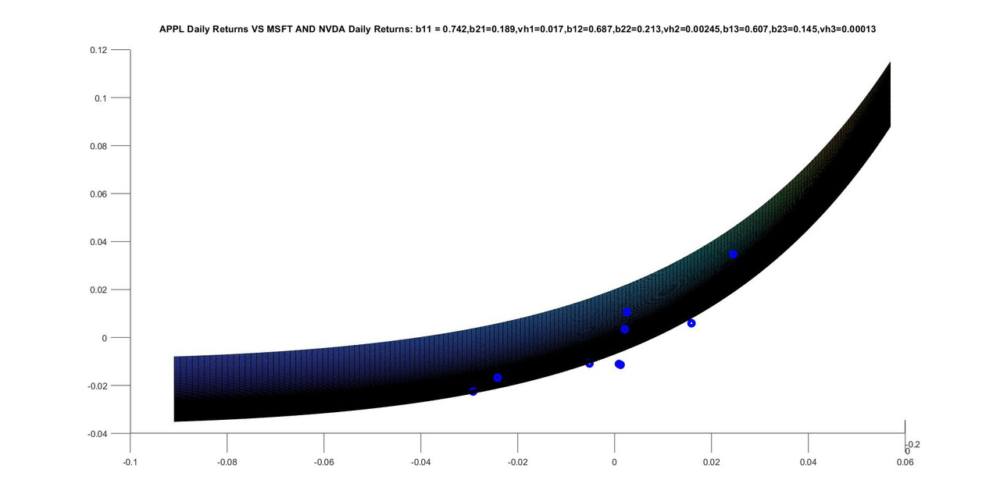](https://postimg.cc/JtDs5n08)

[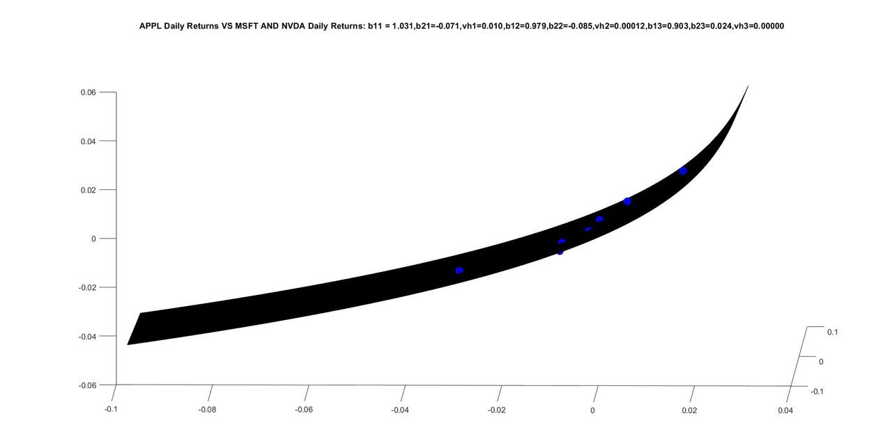](https://postimg.cc/JGjtS2jd)

[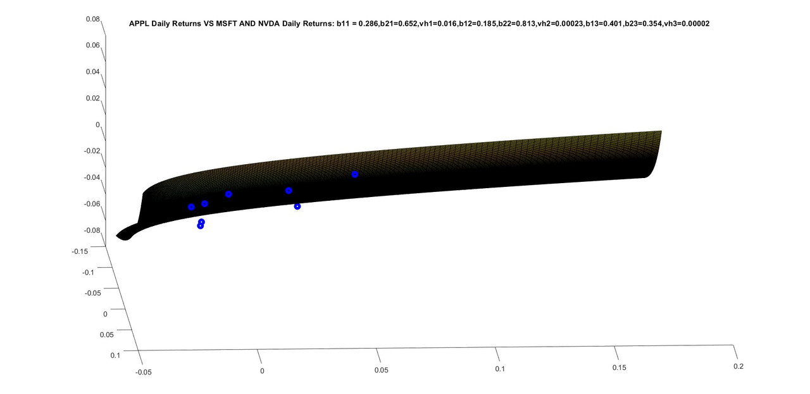](https://postimg.cc/kVGJM1tC)

The next three posts 1791, 1792 and 1793 describe calculation of correlations, covariances and regressions between
non-gaussian random variables when their Z-series representation is given.

 https://forum.wilmott.com/viewtopic.php?f=4&t=99702&start=1770#p875136

https://forum.wilmott.com/viewtopic.php?f=4&t=99702&start=1785#p875153

https://forum.wilmott.com/viewtopic.php?f=4&t=99702&start=1785#p875155

Particularly the last post analytically explains the concept of regression between two Z-series random variables.

Please also read posts 1731, 1732 and 1734 for hermite polynomial correlations and regressions:

https://forum.wilmott.com/viewtopic.php?f=4&t=99702&start=1710#p874492

https://forum.wilmott.com/viewtopic.php?f=4&t=99702&start=1725#p874542

https://forum.wilmott.com/viewtopic.php?f=4&t=99702&start=1725#p874578

Here I distributed program for doing multivariate hermite regression in post 1722: https://forum.wilmott.com/viewtopic.php?f=4&t=99702&start=1710#p874497

I presented results of one dimensional hermite regression in post 1705 here: https://forum.wilmott.com/viewtopic.php?f=4&t=99702&start=1680#p874075

The hermite regression program is given in post 1706 here: https://forum.wilmott.com/viewtopic.php?f=4&t=99702&start=1695#p874270

I also learnt that in order to do robust hermite orthogonal regressions, we needed to apply positivity condition of the derivatives of the density. Here I have described the positivity condition for derivatives of the density in post 1719: https://forum.wilmott.com/viewtopic.php?f=4&t=99702&start=1710#p874464

After proper application of positivity condition, hermite regressions worked in an excellent fashion. I showed some results here in post 1721: https://forum.wilmott.com/viewtopic.php?f=4&t=99702&start=1710#p874492

Please read posts 1783 and 1784 for calculation of variance of sum of two non-gaussian random variables when their
hermite polynomials have correlations

https://forum.wilmott.com/viewtopic.php?f=4&t=99702&start=1770#p875135

https://forum.wilmott.com/viewtopic.php?f=4&t=99702&start=1770#p875136

Please disregard post 1785 and 1785, they have some errors.

A Z-series option pricing formula is given in post 1830 here: https://forum.wilmott.com/viewtopic.php?f=4&t=99702&start=1815#p875619

---

### #1850 — Amin (Topic Author)
*June 1, 2023, 6:09 PM*

Friends, I want to prepare some more material and then do a little bit of research for a few days over the weekend and
then plan to start contacting people at Chinese universities at the start of next week,

However I am facing some very dire issues. As I told friends a few days earlier that Pakistan Army is drugging food and
water in Lahore city on an unprecedented scale. I have been hit with bad food at least twice (in remote and unexpected
places in the city) in past few days but I realized it and spitted all the food at the start right away both times. And
it still took me several hours hours to get myself in perfect senses. I have also seen suspicious people at too many
places (army agents reach the target expected places and start dusting at the stores or cleaning the floor and then try
to help you when you want to get some food but mostly you could still tell that this guy does not belong here) . It is
one of the thirty largest cities in the world and still very difficult to drug everywhere and that is why I have
survived well because I have been very careful. For friends who have resources, I really want to request them to verify
on their own and they would know that many areas in the city are being drugged at an unprecedented scale. Since I try to
be very careful, and it is a huge city, I still think that I can survive for a few weeks.

But people at Pentagon are way too desperate to let me continue. They know my original neurotransmitters that they tried
to block for past twenty five years are coming back and that is the major reason to try drugging the city so that those
important neurotransmitters could be blocked again and I would also lose my calm and my focus. But they have pretty much
failed and I am very sure that next step would be that they would use a psychiatrist to detain me in a few days with
complete surprise. My mother would simply make a summary statement saying that she had realized that I was not feeling
well and therefore needed treatment.

I was careful to keep taking a monthly antipsychotic injection so that my parents would not have any excuse to detain me
but I am seriously worried that people at mind control agencies and their backers want to detain me as soon as possible
before it is too late to control my neurotransmitters.

I have been previously detained more than twenty times in past twenty five years mostly on completely flimsy excuses.
And then I am given all sort of injections and pills. Most psychiatrist doctors do not even care to let their patients
know the name of antipsychotic drugs that are given to their patients during detention and absolutely anything can be
given orally or injected. Last time I was detained in 2021 but I was not detained in past two years since I was able to
do some better research in past two years and several good people in America supported me by protesting to agencies.
About five or six weeks earlier, mind control agencies were getting ready  to detain me but their behavior changed
dramatically for the better after I mentioned their plans on the forum.

I really feel that mind control agencies are again under even more pressure from their backers and are becoming too
desperate to detain me again. In the past when they would drug food in various neighborhoods of the city and I would
mention on this forum, mostly the food drugging activity would decrease. But I have mentioned it at least twice in past
week or ten days but mind control agencies continued to increase the food drugging activity with a complete resolve. I
am very sure that they would now resort to detaining me in next few days.

I really want to request good people in US and other places to please protest against my continuing mind control and
also ask American mind control agencies to not detain me on completely flimsy excuses after they have failed to target
me by drugging food in large number of neighborhoods in the city. If they detain me in a few days, I would be given all
sort of mind control drugs in injections and most of my good neurotransmitters would be completely blocked again. And I
would have to restart my research with extreme difficulty again. Most people who have remained on Wilmott for several
years would have noticed how my English language would severely deteriorate and I would would write in extremely poor
English after I would be released from detention. And my mathematics research would also become extremely slow and small
things that need mere days would take me several weeks to complete. It is only that good people protested against such
persecution activity during past two years and I have been spared the misery that was repeated every year.

I want to request good American people to please help me again and protest to responsible people in mind control
agencies to end my persecution now and not detain me again in next few weeks as they have planned.

For some back ground on my mind control persecution, please see  https://forum.wilmott.com/viewtopic.php?f=4&t=99702&start=1830#p875779

https://forum.wilmott.com/viewtopic.php?f=15&t=102298

https://forum.wilmott.com/viewtopic.php?f=4&t=99702&start=1830#p875778

---

[← Previous](page_036.md) | [Index](index.md) | [Next →](page_038.md)
