# Breakthrough in the theory of stochastic differential equations and their simulation

**Page 38 of 59** — Posts #1851–#1900

[← Previous](page_037.md) | [Index](index.md) | [Next →](page_039.md)

---

### #1851 — Amin (Topic Author)
*June 2, 2023, 7:33 AM*

Friends, in my previous post I had mentioned how Pakistan Army is drugging food with mind control chemicals in Lahore on
an unprecedented scale. **B**ut that is not all and during all of past one month they dramatically increased
electromagnetic resonance mind control as well. They have fitted very special hidden devices in my room where I sleep in
recent weeks and I rarely have a perfectly good sleep. They also continue to force EM waves into the closed eyes when I
am sleeping and I have sheer pain in my eyes whenever I wake up during sleep or in the morning. My eyes are some of the
most regular targets of EM waves. When I am asleep,  some mind control chemical settles around eyes that gets highly
charged and then stops some of the neurotransmitters from approaching the nerves in my eyes. Sometimes when I am totally
mentally down or feeling extreme anxiety due to mind control, I would forcefully stretch the skin around both eyes which
in turn disperses some of the charge around the eyes and all of a sudden I would feel perfectly mentally well and my
eyesight would become sharper but this good effect would only last for a few minutes and then I would start feeling
anxiety again with a bad eyesight. Washing the eyes with a soap also helps but many times this relief is also temporary.

I had told friends about a deteriorating eye sight earlier but past three or four days were extremely worse and my
eyesight has dramatically deteriorated during this period and I am very alarmed now since it has become very difficult
to read small words. I told friends that many of the shades of colors that I used to see long ago and then stopped
seeing came back to my eyes in past month or two. I believe it is only because colors associated with neurotransmitters
could be observed again in my brain only when several of the blocked neurotransmitters became active. However despite
that I could see shades of colors that I had not seen in a while, focus in my eyes continues to deteriorate very fast
especially in past 3-4 days.

I really want to request friends to please protest against such inhuman practices at hands of US defense. I wold also
like to say that there are tens of thousands of intelligent people under mind control and many times far worse happens
to them but they have nobody to turn towards and have to accept these inhuman treatments and humiliations as their fate.
Most of them become unable to convey themselves in proper language and can only speak in poor broken English after they
get retarded and then cruel people behind mind control simply make fun of them saying that they are mental patients. I
was extremely lucky that I had some neurotransmitters they did not know and I continued to use those alternative
neurotransmitters when many of my known neurotransmitters were blocked and therefore I survived to tell the tails of
persecution and torture in a relatively lucid way. But most mind control targets are not so lucky and they have to live
a life of absolute misery. Please protest to American defense and American president to end mind control forever.

---

### #1852 — Amin (Topic Author)
*June 3, 2023, 3:42 AM*

As most of the friends who followed me over the years would have noticed that I mostly write in poor broken English. But it was always not like that and I used to write in far better language. Though my English was never extremely good, it was still reasonably good. But each time, they detained me they blocked more and more neurotransmitters related to English writing skills and my writing skills continued to deteriorate. And the same thing happened to my speaking and mathematical skills. Here is my blog that was written in 2014 when I could write well.  https://ahsanamin2999.wordpress.com/

In the above blog, I wrote mostly about Pakistan.

I was detained for two months in 2014 and I wrote above blogs prior to that detention. When I left detention after two
months, I wrote only in very poor and broken English language. I have never been able to write well again as I was able
to write in above blogs.

When you see mind control targets, who have been retarded, speak or write in poor and incoherent language, please be
patient and  try to know what they are attempting to say. Pleas try to  put yourself in their shoes and try to be kind.
Please do not make good-natured people objects of ridicule as some people would like you to do. Mind control is the
worst thing in the world that is used to retard intelligent people and to impose a complete life of misery and torture
on them.

---

### #1853 — Amin (Topic Author)
*June 5, 2023, 5:36 PM*

Friends, I have been able to survive the recent wave of drugging food in Lahore city with mind control chemicals. But
water and beverages are increasingly being systematically drugged both while lying in shelves and at the manufacturing
source. It's already harsh summers and it would be very difficult to live without good water. I drink 5 to 6 1.5 L water
bottles everyday. I drink more water possibly because I am very overweight. A really good thing is that mind control
agencies and Pakistan army have not yet drugged ground water in most of the city and  ground water is mostly good. So I
can survive easily until they start drugging underground water reservoirs in the city even if all of the manufactured
bottled water becomes drugged.

Most of the pasteurized milk and tea whiteners in the city also has mind control chemicals. I take tea with milk and top
most milk brands were being drugged at manufacturing source for several months. Some cheaper and less known milk brands
were holding up and their milk was better and therefore I switched to them but they also became drugged in recent week.

I have also decided to delay the plans of going to China for the moment. I want to try some sustainable path in which I
can make some money while also working independently on my research. I used to approach some of my linkedin connections
for consulting work opportunity but mostly CIA would also approach them and then nobody would want to give me any
project at all. Slowly I stopped contacting people since I realized that it was of no use. I want to think more about
possibilities and then see if somehow I could make money while continuing my research.

I have also resumed my research and want to stay busy with it in coming weeks and months.

Though I am not making a big deal about it, mind control agencies continue to drug the city and I am seriously worried
that they would resort to detaining me if they could not block my neurotransmitters by drugging food in the city.

---

### #1854 — Amin (Topic Author)
*June 7, 2023, 8:01 AM*

Friends, in this post, I want to outline a very interesting property of Z-series and resulting Hermite Orthogonal
regressions.

I suppose that friends have read all posts on hermite orthogonal regressions and have become very familiar with that.

Some preliminaries first: As we recall from our work on SDEs and later research that when we transform the density of a
random variable into density of its some function, the pints on original density are mapped on transformed density so
that they share the same underlying Z or in other words they share the same CDF. Trying to explain in detail, let us
suppose we have Z-series representation of a random variable given as

$\, X(Z) \, = \, a_0 \, + \, a_1 \, Z \, + \,a_2 \, Z^2 \, + \,a_3 \, Z^3 \, + \,a_4 \, Z^4 \, + \ldots $

While doing Z-series research, we spent quite some time how to find densities of functions of Z-Series random variables
using Taylor Series around median, I would request friends to become familiar with that. Suppose we have a new random
variable Y that is a function of random variable X above, the Z-series of Y could be given as

$\, Y(Z) \, =\, f(X(Z)) \, = \, b_0 \, + \, b_1 \, Z \, + \,b_2 \, Z^2 \, + \,b_3 \, Z^3 \, + \,b_4 \, Z^4 \, + \ldots $

Suppose we are given N data values of X shown as$X_1,\,  X_2, \, X_3, \, \ldots \, ,X_N$ and we apply the function on
these data values of X to get corresponding values of Y given as$Y_1,\,  Y_2, \, Y_3, \, \ldots \, ,Y_N$

As we learnt several times in the previous posts, that we can invert the Z-series of any random variable to find the
corresponding value of underlying Z.

Suppose we apply this Z-series inversion to both the data values of X and Y (and we keep in mind that Y=f(X(Z))  )

If the inverted Z-values of random variable X data are given as$Z_1,\,  Z_2, \, Z_3, \, \ldots \, ,Z_N$ , and the
inverted Z-series values of random variable Y would be exactly the same and would be given again as
$Z_1,\,  Z_2, \, Z_3, \, \ldots \, ,Z_N$

Since underlying Z-values corresponding to data observations of a random variable depend only on their associated CDF,
the underlying Z-values of any random variable and functions of the random variable would be exactly the same.

However, these functions that preserve the CDF have to follow the positivity condition that we discussed in earlier
posts that$\frac{dX}{dZ} > 0$ all along X-axis. Our results hold for only those functions that satisfy the positivity
condition.

One very interesting ramification of the above observation is that when we do hermite orthogonal regressions, it will
not matter if we use a random variable$X$ or$X^2$ as regressors, since our hermite orthogonal regressions depend on
values of underlying Z's and underlying Z's are precisely the same for admissible functions of the original random
variable. In fact adding$X$ and$X^2$ together in the regressions would give defective rank matrices with poor
regressions. So we can add any admissible function of original random variable, that follows the positivity condition,
in our regressions to get the same regressions result as we get from the original random variable.

But friends would have to consider in their experiments that common Z's for random variables and their functions would
hold only when we do precise calculations. If series for$X$ is truncated at$Z^4$ , for good results we have to truncate
the series of X^2 at$Z^8$ . If we truncate both series at$Z^4$ , resulting series might not give precisely the same Z's
when inverted but I would still expect them to be highly collinear and close to rank defective in a regressors matrix.
While making a comparison similar problems would have to be considered. Similarly when finding parameters of density of
function (as we will need these parameters to invert the Z-series of the function), we would have to ensure that we take
enough terms in Taylor series to keep precision in our calculations.

---

### #1855 — Amin (Topic Author)
*June 13, 2023, 9:23 PM*

Friends, my persecution continues unabated. Since mind control agents failed to drug my food as I was very careful about
buying food, they have resorted to other animal tactics in order to continue my mind control. Some of these things are
very disturbing and painful. They have planted several microwave devices on all possible positions I can sleep in my
room. When I go to bed, they use my both hands or both feet as electrodes and I have very painful sensations in my both
hands or both feet as I sleep. They simultaneously target both hands or both feet with EM waves and microwaves and I
remain restless all night. Sometimes,when they really increase the electric potential, my hands have very high degree of
pain and restlessness and I try to hide my hands beneath the pillow to find some temporary relief. It is already high
summers and I cannot use my AC due to gases, therefore it is not possible to take any thick comforter over my body as I
do in winters and my both hands and feet are mostly directly exposed to microwaves and EM waves. This has been going on
for past several weeks and intensity of this torture has increased substantially over past few days.

Another problem that I face everyday is that they release very heavy gas in almost all the rooms and places in our
house. This tactic was used by them very rarely and usually in drawing room where I usually do not work. They had been
careful to not overly use this tactic everywhere in our house. But for past few weeks, they have been using this heavy
gas in every room and every place in our house. This heavy gas facilitates rapid and fast conduction of charges in the
atmosphere. The heavy gas usually sticks to bottom of pants and then charges released from devices fitted all over the
house, travel up inside the pants from bottom of the pants towards the testicles and then settle on testicles and
private parts to control testosterone. They want to control testosterone so that mind control victim has  no drive left
to do anything meaningful. When inside home, I pull up bottom of my tapered cotton pants (as they  to make it difficult
for charges to freely travel upwards towards the testicles. It helps slightly but everyday I have to wash a thick
surface of black chemical that has settled on my testicles.

They also keep pulling my neurotransmitters without any regard for my health. I have been having heart-ache for past one
day. This has happened many times before over past several years and repeatedly happens when they take some specific
neurotransmitter out of my body.

Indeed these malicious jewish billionaire(and his cohort of malicious jews; How can sons of prophets become complete
animals towards weak) and his paid mercenaries in American  Army are truly making American great again. If the
definition of great is to become complete animal devoid of any humanity towards weak and innocent people. Isn't this
true that  might is perfectly right.

Sorry for being ironic but it seems that there is no decency and humanity in American army scum and their backers.

Is there any humanity alive?

Are my entreaties for Freedom and my requests for mercy as if I am hitting my head against stones to make myself even
larger object of ridicule on hands of cruel jews.

---

### #1856 — Amin (Topic Author)
*June 15, 2023, 10:01 PM*

As I have told friends previously, I was making a decent income before I went to UK on HSMP visa in summer/fall of 2010.
Since I had enough money, it made it very difficult for mind control agencies to easily control me and they were very
upset with the money I had. I would stay at good Hotels for my better safety. Since they were drugging various
neighbourhoods of London city, I started travelling around to avoid staying at any fixed place. Though I would mostly
take a train to travel to north England or Scotland, I would sometime not hesitate to take a Taxi from York to
Manchester or Birmingham to London. CIA and mind control agencies even went to the extent to make my bank (literally)
steal my money and my bank stole my one thousand pounds since mind control agencies/CIA wanted to bleed my money. I have
written about it on several places on this forum. A hotel charged me 1500 pounds after I had left the city (and the
hotel after returning the keys) without telling me complaining I had broken their door and I came to know only a month
later when I saw my credit card statements. When I called the hotel, they told that there were cracks on the wooden door
but they gave me no reason why they never told me about it prior to charging money from my credit card.

When I returned from UK to Pakistan, CIA made sure that nobody did business with my company and they threatened people
in Europe and other places to not do any business with my small company. They never wanted repeat of UK if I again go
elsewhere in the world. In past thirteen years, I have made merely four thousand dollars (or they were probably 3500
dollars, I have forgotten the exact value).

Though most people would stay nice even after they would refuse to do business with my company, some people were not
exactly polite. A few years ago, I totally gave up contacting people for consulting work or any other business for my
one person company.

My inability to make money has also been a strong reason that prolonged my torture, agony and mind control. I have some
extremely good stock trading algorithms and I opened an account with IB but I could not fund that account because I
could not send foreign currency Bank wire to any foreign business. Pakistan has very little foreign reserves and they
have anti-business laws that prohibit sending foreign currency abroad through a bank wire to any foreign business.

Recently I noticed that I can open a bank account with Alpaca and fund it with Rapyd without involving a Pakistani bank.
Just this evening, I went ahead and opened an Alpaca individual stock trading account. I still have to fund it but I
will keep playing with it for a few days for paper trading and then fund the account. Alpaca is also a very good stock
broker for US stocks and I hope they would prove to be better than IB and others.

I really hope that I will be able to make enough money to forget the hardships I had to face over past thirteen years
without any money. Once I have enough money, I will start a proper business related to financial investments, and
applications of probability theory, statistics and machine learning in all diverse areas of science and engineering. I
also want to continue my personal research in the direction of Z-series machine learning.

However, I am afraid that racists in mind control agencies and CIA would try their best to thwart me by possibly
approaching the broker to create problems with me. Obviously they have no legal basis against me other than complete
lies and machinations but this is what they have so successfully use over past twenty five years against me.

I will keep friends updated with progress on my trading in next few days.

---

### #1857 — Amin (Topic Author)
*June 16, 2023, 9:11 PM*

I am really so tired of complaining but mind control torture continues unabated. They do not stop using gases in my room
at all and continue to release very sickening gas in my room. I keep the window and door of my room mostly open but it
does not help at all. It is also very painful at night when I try to sleep and there is constant sickening gas in the
room.

When I complained about heavy gas, they decreased its use somewhat but increased another type of gas in room that makes
me sick when I breathe in it.

They also continued to use charges on my body through my hands and feet as electrodes but did slightly decrease the
intensity of torture. They have openly used the charges conduction torture method on my hands and feet as electrodes in
both of the past two days after I mentioned here but might have decreased the intensity of severe torture to 70% of its
previous value.

I have been talking about use of sickening gases for many many long years but they never stop using those gases. Best
that has happened in the past is that they would temporarily stop using gases for a week or so but then start using it
again once they would know that pressure from good people had decreased and I would no longer be writing about it. And
many times I would feel bad complaining about the same thing again and again on the forums. Though at other times I know
that keep on complaining though awkward but is probably better to keep my life somewhat free of such torture.

---

### #1858 — Amin (Topic Author)
*June 17, 2023, 9:40 PM*

Friends, it is just absolutely hot (weather) and very difficult to do anything. I was reading on weather forecast that
in next few days the temperature would go to 44 Celsius (112 Fahrenheit) and feels like would be 56 Celsius (133
Fahrenheit). So it is very difficult to work without Air-conditioning which has huge gases in my room. I was thinking of
my work on monte carlo and SDEs and then I had several new ideas to solve the SDEs in original coordinates with Z-series
in a monte carlo like explicit manner. In this post I want to share these ideas with friends. I would give complete
details but  a full-fledged matlab program can take next few days.

Suppose we have a general SDE in original (as opposed to Bessel coordinates that we worked with mostly in context of
Z-series) coordinates. The SDE is given as

$ \, dX(t) \, = \, \mu(X(t)) \, dt \,+\, \sigma(X(t)) \, dZ(t) $            Equation(1)

We know that a second order expansion of the above SDE is given as (using the method we have previously learnt on this
forum)

$ \, X_{t_1} \, = \, X(t_0) \, + \, \mu(X(t_0)) \Delta t \, + \, \sigma(X(t_0)) Z \sqrt{\Delta t} \\ + \, \frac{\partial \mu(X(t_0))}{\partial X} \, \mu(X(t_0)) \, {\Delta t}^2 \, + \, \frac{\partial \mu(X(t_0))}{\partial X} \, \sigma(X(t_0)) \, (1 \, - \, \frac{1}{\sqrt{3}} ) \, Z \, {\Delta t}^{1.5} \\ +\, .5  \, \frac{\partial^2 \mu(X(t_0))}{\partial X^2} \, {\sigma(X(t_0))}^2 \, {\Delta t}^2 \, \\ + \, \frac{\partial \sigma(X(t_0))}{\partial X} \, \mu(X(t_0)) \,  (\frac{1}{\sqrt{3}} ) \, Z \, {\Delta t}^{1.5} \, + \, \frac{\partial \mu(X(t_0))}{\partial X} \, \sigma(X(t_0)) \, (Z^2\, - \, 1) \, \frac{\Delta t}{2} \\ +\, .5  \, \frac{\partial^2 \sigma(X(t_0))}{\partial X^2} \, {\sigma(X(t_0))}^2 \, \,  (\frac{1}{\sqrt{3}} ) \, Z \, {\Delta t}^{1.5} \,$
Equation(2)

We suppose without any loss of generality that starting distribution is given in the form of a Z-series random variable
as

$X(t_0)\, = \, f(Z_0)$ where f(Z_0) is a Z-series representation of$X(t_0)$ . When we are starting from a delta source,
this Z-series distribution would be a constant value.

We know that we can represent the functions of any Z-series random variable by a Taylor series. For the type of power
exponents we use in drift and volatility functions,  which are typically equal to or smaller than one, this Taylor
series representation of functions is quite very faithful when seven terms are used in Z-series. We have repeatedly used
Taylor series in the past to calculate the functions of Z-series random variables with good results.

Please read this post for introduction: https://forum.wilmott.com/viewtopic.php?f=4&t=99702&start=1290#p868484

In order for friends to be familiar with this Taylor expansion of functions of Z-series, I would solve a toy problem.
Suppose random variable X is represented by a fourth order Z-series (we want to find taylor expansion of its suitable
functions). Z-series of X is given as

$X(Z) \, =\, a_0 \, + \, a_1 \, Z \, + \, a_2 \, Z^2 \, + \, a_3 \, Z^3 \, + \, a_4 \, Z^4 \, $

You can verify from various methods (also from the above link and direct series expansion) that a Z-series of a suitable
function f(X(Z)) (when expanded around median, Z=0) is given as

$f(X(Z)) \, =\, \, f(a_0) \,   +\, a_1 f^{'}(a_0) \, Z+\, (a_2 \, f^{'}(a_0)+1/2 {a_1}^2 \, f^{''}(a_0)) \, Z^2 \\ +(a_3 \, f^{'}(a_0)+a_1 \, a_2 \, f^{''}(a_0) \, +1/6 \, {a_1}^3 \, f^{3}(a_0) \, ) \, Z^3 \, \\+ \, (a_4 \, f^{'}(a_0)+1/2 \, ({a_2}^2 \, +\, 2 \, a_1 \, a_3) \, f^{''}(a_0) \, + \, 1/2 \, {a_1}^2 \, a_2 \, f^{3}(a0)+1/24 \, {a_1}^4 \, f^{4}(a_0)) \, Z^4 \, + \, O[Z]^5 $
Equation(3)

I have expanded the Taylor series of above function to only low order for friends to understand it but in general we
will have to write an automated program to expand it to seventh or higher order to keep the expansion faithful to true
result. Usually we will almost always expand functions of Z-series using Taylor around the median Z=0.

Now going back to Equation 2 where we expanded the SDE in original coordinates to second order. We suppose that original
distribution of the SDE is given by the random variable$X(t_0)$ can be represented by a Z-series to suitable order as

$\, X(t_0) \, = \, c_0 \, + \, c_1 \, Z_0 \, + \, c_2 \, {Z_0}^2 \, + \, c_3 \, {Z_0}^3 + \, \ldots \\ =\, g_0(Z_0)$
Equation(4)

We know that we can expand the functions of initial random variable also as Z-series using Taylor formula around median
and therefore we can represent as

$\, \mu(X(t_0)) \, = \, g_1(Z_0) $

$\, \sigma(X(t_0)) \, = \, g_2(Z_0)$

$\, \frac{\partial \mu(X(t_0))}{\partial X} \, \mu(X(t_0)) \, = \, g_3(Z_0)$

$\, \frac{\partial \mu(X(t_0))}{\partial X} \, \sigma(X(t_0)) \, = \, g_4(Z_0)$

$\, \frac{\partial^2 \mu(X(t_0))}{\partial X^2} \, {\sigma(X(t_0))}^2 \, = \, g_5(Z_0)$

$ \, \frac{\partial \sigma(X(t_0))}{\partial X} \, \mu(X(t_0)) \,= \, g_6(Z_0)$

$ \, \frac{\partial \mu(X(t_0))}{\partial X} \, \sigma(X(t_0)) \,=\, g_7(Z_0)$

$\, \frac{\partial^2 \sigma(X(t_0))}{\partial X^2} \, {\sigma(X(t_0))}^2 \,=\, g_8(Z_0)$    Equations(5)

Basically all g's above are different Z-series that represent function of original random variable$X(t_0)$ that
represents the initial starting distribution of SDE at every evolution step.

We insert above function Z-series expansions in Equation(2)  to find the expression as

$ \, X_{t_1}(Z,Z_0) \, = \, g_0(Z_0) \, + \, g_1(Z_0) \Delta t \, + \, g_2(Z_0) Z \sqrt{\Delta t}  + \, g_3(Z_0) \, {\Delta t}^2 \, + \, g_4(Z_0) \, (1 \, - \, \frac{1}{\sqrt{3}} ) \, Z \, {\Delta t}^{1.5} \\ +\, .5  \, g_5(Z_0) \, {\Delta t}^2 \,  + \, g_6(Z_0) \,  (\frac{1}{\sqrt{3}} ) \, Z \, {\Delta t}^{1.5} \, + \, g_7(Z_0) \, (Z^2\, - \, 1) \, \frac{\Delta t}{2}  +\, .5  \, g_8(Z_0) \,  (\frac{1}{\sqrt{3}} ) \, Z \, {\Delta t}^{1.5} \,$
Equation(2)

It was actually naiive of me earlier to use cumulant addition. We do not need cumulant addition. We can take moments of
the entire expression above by expanding the whole expression to its powers by simple algebra and then substituting
expected values of powers of Z and$Z_0$ knowing that both Z's are independent. We might have to write a good and clever
algorithm (for very fast speed) that does it for series expressions embedded as in above equation but it should not be
very difficult. Once we have first eight moments calculated from above equation, we can turn them into a Z-series with a
single stochastic variable$Z_1$ which is different from both$Z_0$ and$ Z$ . So we have an evolution algorithm for SDEs
in original variables.

The above method also makes use of SDEs very transparent in the sense that we can acquire all information about
conditional variances and higher conditional moments and we can match them to empirical phenomenon much more
systematically.

I am thinking of another method that can possibly make use of derivatives of the SDE expression in Z and$Z_0$ to match
the Z-series as opposed to using moments to match the Z-series but some ideas are still hazy. If it works out, it would
be a lot better algorithm since we would be spared the effort to match the moments for a single final Z-series(which
might not possibly work universally all the time and might create some issues from time to time with the present
algorithm we have.) If it works out with the derivatives algorithm, I will post the details of derivatives algorithm in
next few days here on this forum.

---

### #1859 — Amin (Topic Author)
*June 17, 2023, 10:24 PM*

Friends, It is 3:16 am at night and I have been working in the living room of our house since nobody else is awake and I
can work here without any disturbance. But when I go into my room to take anything, it is totally suffocating due to gas
(I think origin of the gas is AC in my room that continues to release gas even though I never turn it on) and it is very
difficult to stay in the room and this is despite that both the window and door of the room are fully open to allow the
air to ventilate. I continued to beg the mind control guy yesterday and before to not use this particular gas but they
still continued its use and my sleep remained disturbed but at this particular moment there is huge gas in my room and
it is very difficult to stay inside for even brief period of time. I literally do not want to sleep there anymore but I
have no other choice. These gases are very big torture and mind control agents are not willing to decrease them to let
me normally sleep or work inside my room. I continue to ask for help but cruel people in American army and pentagon have
absolutely no humanity for me.

I tried to find some plastic tape to seal the openings of the AC but unfortunately I could not find any tape at this
time in our house and it is impossible to go out and buy any tape now.

---

### #1860 — Amin (Topic Author)
*June 18, 2023, 4:30 AM*

Friends, there were some small typos in my previous post. I have also explained some final equations better in this
post. It is a better copy of previous post 1858. A coefficient of .5 was missing in Equation 2 in${\Delta t}^2$ terms.
Please do look at this post especially new equations 7 and 8 that were not in previous original post. This is the right
post with some errors removed. Please disregard post 1858.

Suppose we have a general SDE in original (as opposed to Bessel coordinates that we worked with mostly in context of
Z-series) coordinates. The SDE is given as

$ \, dX(t) \, = \, \mu(X(t)) \, dt \,+\, \sigma(X(t)) \, dZ(t) $            Equation(1)

We know that a second order expansion of the above SDE is given as (using the method we have previously learnt on this
forum)

$ \, X_{t_1} \, = \, X(t_0) \, + \, \mu(X(t_0)) \Delta t \, + \, \sigma(X(t_0)) Z \sqrt{\Delta t} \\ + \, \frac{\partial \mu(X(t_0))}{\partial X} \, \mu(X(t_0)) \, \frac{{\Delta t}^2}{2} \, + \, \frac{\partial \mu(X(t_0))}{\partial X} \, \sigma(X(t_0)) \, (1 \, - \, \frac{1}{\sqrt{3}} ) \, Z \, {\Delta t}^{1.5} \\ +\, .5  \, \frac{\partial^2 \mu(X(t_0))}{\partial X^2} \, {\sigma(X(t_0))}^2 \, \frac{{\Delta t}^2}{2} \, \\ + \, \frac{\partial \sigma(X(t_0))}{\partial X} \, \mu(X(t_0)) \,  (\frac{1}{\sqrt{3}} ) \, Z \, {\Delta t}^{1.5} \, + \, \frac{\partial \mu(X(t_0))}{\partial X} \, \sigma(X(t_0)) \, (Z^2\, - \, 1) \, \frac{\Delta t}{2} \\ +\, .5  \, \frac{\partial^2 \sigma(X(t_0))}{\partial X^2} \, {\sigma(X(t_0))}^2 \, \,  (\frac{1}{\sqrt{3}} ) \, Z \, {\Delta t}^{1.5} \,$
Equation(2)

We suppose without any loss of generality that starting distribution is given in the form of a Z-series random variable
as

$X(t_0)\, = \, f(Z_0)$ where f(Z_0) is a Z-series representation of$X(t_0)$ . When we are starting from a delta source,
this Z-series distribution would be a constant value.

We know that we can represent the functions of any Z-series random variable by a Taylor series. For the type of power
exponents we use in drift and volatility functions,  which are typically equal to or smaller than one, this Taylor
series representation of functions is quite very faithful when seven terms are used in Z-series. We have repeatedly used
Taylor series in the past to calculate the functions of Z-series random variables with good results.

Please read this post for introduction: https://forum.wilmott.com/viewtopic.php?f=4&t=99702&start=1290#p868484

In order for friends to be familiar with this Taylor expansion of functions of Z-series, I would solve a toy problem.
Suppose random variable X is represented by a fourth order Z-series (we want to find taylor expansion of its suitable
functions). Z-series of X is given as

$X(Z) \, =\, a_0 \, + \, a_1 \, Z \, + \, a_2 \, Z^2 \, + \, a_3 \, Z^3 \, + \, a_4 \, Z^4 \, $

You can verify from various methods (also from the above link and direct series expansion) that a Z-series of a suitable
function f(X(Z)) (when expanded around median, Z=0) is given as

$f(X(Z)) \, =\, \, f(a_0) \,   +\, a_1 f^{'}(a_0) \, Z+\, (a_2 \, f^{'}(a_0)+1/2 {a_1}^2 \, f^{''}(a_0)) \, Z^2 \\ +(a_3 \, f^{'}(a_0)+a_1 \, a_2 \, f^{''}(a_0) \, +1/6 \, {a_1}^3 \, f^{3}(a_0) \, ) \, Z^3 \, \\+ \, (a_4 \, f^{'}(a_0)+1/2 \, ({a_2}^2 \, +\, 2 \, a_1 \, a_3) \, f^{''}(a_0) \, + \, 1/2 \, {a_1}^2 \, a_2 \, f^{3}(a0)+1/24 \, {a_1}^4 \, f^{4}(a_0)) \, Z^4 \, + \, O[Z]^5 $
Equation(3)

I have expanded the Taylor series of above function to only low order for friends to understand it but in general we
will have to write an automated program to expand it to seventh or higher order to keep the expansion faithful to true
result. Usually we will almost always expand functions of Z-series using Taylor around the median Z=0.

Now going back to Equation 2 where we expanded the SDE in original coordinates to second order. We suppose that original
distribution of the SDE is given by the random variable$X(t_0)$ can be represented by a Z-series to suitable order as

$\, X(t_0) \, = \, c_0 \, + \, c_1 \, Z_0 \, + \, c_2 \, {Z_0}^2 \, + \, c_3 \, {Z_0}^3 + \, \ldots \\ =\, g_0(Z_0)$
Equation(4)

We know that we can expand the functions of initial random variable also as Z-series using Taylor formula around median
and therefore we can represent as

$\, \mu(X(t_0)) \, = \, g_1(Z_0) $

$\, \sigma(X(t_0)) \, = \, g_2(Z_0)$

$\, \frac{\partial \mu(X(t_0))}{\partial X} \, \mu(X(t_0)) \, = \, g_3(Z_0)$

$\, \frac{\partial \mu(X(t_0))}{\partial X} \, \sigma(X(t_0)) \, = \, g_4(Z_0)$

$\, \frac{\partial^2 \mu(X(t_0))}{\partial X^2} \, {\sigma(X(t_0))}^2 \, = \, g_5(Z_0)$

$ \, \frac{\partial \sigma(X(t_0))}{\partial X} \, \mu(X(t_0)) \,= \, g_6(Z_0)$

$ \, \frac{\partial \mu(X(t_0))}{\partial X} \, \sigma(X(t_0)) \,=\, g_7(Z_0)$

$\, \frac{\partial^2 \sigma(X(t_0))}{\partial X^2} \, {\sigma(X(t_0))}^2 \,=\, g_8(Z_0)$    Equations(5)

Basically all g's above are different Z-series that represent function of original random variable$X(t_0)$ that
represents the initial starting distribution of SDE at every evolution step.

We insert above function Z-series expansions in Equation(2)  to find the expression as

$ \, X_{t_1}(Z,Z_0) \, = \, g_0(Z_0) \, + \, g_1(Z_0) \Delta t \, + \, g_2(Z_0) Z \sqrt{\Delta t}  + \, g_3(Z_0) \, \frac{{\Delta t}^2}{2} \, + \, g_4(Z_0) \, (1 \, - \, \frac{1}{\sqrt{3}} ) \, Z \, {\Delta t}^{1.5} \\ +\, .5  \, g_5(Z_0) \, \frac{{\Delta t}^2}{2} \,  + \, g_6(Z_0) \,  (\frac{1}{\sqrt{3}} ) \, Z \, {\Delta t}^{1.5} \, + \, g_7(Z_0) \, (Z^2\, - \, 1) \, \frac{\Delta t}{2}  +\, .5  \, g_8(Z_0) \,  (\frac{1}{\sqrt{3}} ) \, Z \, {\Delta t}^{1.5} \,$
Equation(6)

We can simplify the above equation with some algebra in a simpler form as

$ \, X_{t_1}(Z,Z_0) \, = \, h_0(Z_0) \, + \, h_1(Z_0) Z \,  + \, h_2(Z_0) \, (Z^2\, - \, 1) \, \,$         Equation(7)

In above equation, we have re-arranged and absorbed constant values in coefficients of new re-scaled (after simple
algebra) Z-series given as$h_0(Z_0)$ ,$h_1(Z_0)$ , and$h_2(Z_0)$ .

Depending upon what is convenient for analytics, we can also re-write a different re-arranged version of above equation
as

$ \, X_{t_1}(Z,Z_0) \, = \, \tilde{h_0}(Z_0) \, + \, \tilde{h_1}(Z_0) Z \,  + \, \tilde{h_2}(Z_0) \, Z^2 \, \,$
Equation(8)

where$ \tilde{h_0}(Z_0) \,$ ,$ \tilde{h_1}(Z_0) \,$ and$ \tilde{h_2}(Z_0) \,$ are new different but re-arranged versions
of previous Z-series given as$h_0(Z_0)$ ,$h_1(Z_0)$ , and$h_2(Z_0)$ .

It was actually naiive of me earlier to use cumulant addition for solution of SDEs in Bessel coordinates. We do not
necessarily need cumulant addition of previous random variable form of initial distribution the SDE at the start of time
step and the SDE itself. We can take moments of the entire expression$ \, X_{t_1}(Z,Z_0) \, $ above by expanding the
whole expression to its powers by simple algebra and then substituting expected values of powers of Z and$Z_0$ knowing
that both Z's are independent in order to calculate value of each moment of$ \, X_{t_1}(Z,Z_0) \, $ . We might have to
write a good and clever algorithm (for very fast speed) that does it for series expressions embedded as in above
equation but it should not be very difficult. Once we have first eight moments of$ \, X_{t_1}(Z,Z_0) \, $ calculated
from above equation, we can turn them into a Z-series with a single stochastic variable$Z_1$ which is different (but not
independent of) from both$Z_0$ and$ Z$ . So we have an evolution algorithm for SDEs in original variables in the form of
equations 6, 7 and 8 after calculation of its moments and finding an appropriate Z-series for it that matches the
calculated moments.

The above method also makes use of SDEs very transparent in the sense that we can acquire all information about
conditional variances and higher conditional moments and we can match them to empirical phenomenon much more
systematically.

I am thinking of another method that can possibly make use of derivatives of the SDE expression in Z and$Z_0$ to match
the Z-series as opposed to using moments to match the Z-series but some ideas are still hazy. If it works out, it would
be a lot better algorithm since we would be spared the effort to match the moments for a single final Z-series(which
might not possibly work universally all the time and might create some issues from time to time with the present
algorithm we have.) If it works out with the derivatives algorithm, I will post the details of derivatives algorithm in
next few days here on this forum.

We can also solve for stochastic volatility models in this way but we would need a two dimensional Z-series
representation for general stochastic volatility model. We can represent the distribution of asset as one dimensional
Z-series in SV models after matching moments but loss of necessary dimensionality would mean that we would not be able
to write a proper conditional evolution of the SV SDE conditional on both volatility and and the asset itself. Therefore
we would need a two dimensional Z-series for proper evolution of asset in SV system of SDEs. I have calculated most of
the details and would present the solution of general SV system of SDEs in a few days.

---

### #1861 — Amin (Topic Author)
*June 18, 2023, 11:47 AM*

Friends, Here I copy relevant part and relevant equations from previous post.

> **Amin:**
>
>
>
> We insert above function Z-series expansions in Equation(2)  to find the expression as
>
>
>
>
$ \, X_{t_1}(Z,Z_0) \, = \, g_0(Z_0) \, + \, g_1(Z_0) \Delta t \, + \, g_2(Z_0) Z \sqrt{\Delta t}  + \, g_3(Z_0) \, \frac{{\Delta t}^2}{2} \, + \, g_4(Z_0) \, (1 \, - \, \frac{1}{\sqrt{3}} ) \, Z \, {\Delta t}^{1.5} \\ +\, .5  \, g_5(Z_0) \, \frac{{\Delta t}^2}{2} \,  + \, g_6(Z_0) \,  (\frac{1}{\sqrt{3}} ) \, Z \, {\Delta t}^{1.5} \, + \, g_7(Z_0) \, (Z^2\, - \, 1) \, \frac{\Delta t}{2}  +\, .5  \, g_8(Z_0) \,  (\frac{1}{\sqrt{3}} ) \, Z \, {\Delta t}^{1.5} \,$
Equation(6)
>
>
>
> We can simplify the above equation with some algebra in a simpler form as
>
>
>
> $ \, X_{t_1}(Z,Z_0) \, = \, h_0(Z_0) \, + \, h_1(Z_0) Z \,  + \, h_2(Z_0) \, (Z^2\, - \, 1) \, \,$         Equation(7)
>
>
>
> In above equation, we have re-arranged and absorbed constant values in coefficients of new re-scaled (after simple
algebra) Z-series given as$h_0(Z_0)$ ,$h_1(Z_0)$ , and$h_2(Z_0)$ .
>
>
>
> Depending upon what is convenient for analytics, we can also re-write a different re-arranged version of above
equation as
>
>
>
>$ \, X_{t_1}(Z,Z_0) \, = \, \tilde{h_0}(Z_0) \, + \, \tilde{h_1}(Z_0) Z \,  + \, \tilde{h_2}(Z_0) \, Z^2 \, \,$
Equation(8)
>
>
>
> where$ \tilde{h_0}(Z_0) \,$ ,$ \tilde{h_1}(Z_0) \,$ and$ \tilde{h_2}(Z_0) \,$ are new different but re-arranged
versions of previous Z-series given as$h_0(Z_0)$ ,$h_1(Z_0)$ , and$h_2(Z_0)$ .
>
>
>
> It was actually naiive of me earlier to use cumulant addition for solution of SDEs in Bessel coordinates. We do not
necessarily need cumulant addition of previous random variable form of initial distribution the SDE at the start of time
step and the SDE itself. We can take moments of the entire expression$ \, X_{t_1}(Z,Z_0) \, $ above by expanding the
whole expression to its powers by simple algebra and then substituting expected values of powers of Z and$Z_0$ knowing
that both Z's are independent in order to calculate value of each moment of$ \, X_{t_1}(Z,Z_0) \, $ . We might have to
write a good and clever algorithm (for very fast speed) that does it for series expressions embedded as in above
equation but it should not be very difficult. Once we have first eight moments of$ \, X_{t_1}(Z,Z_0) \, $ calculated
from above equation, we can turn them into a Z-series with a single stochastic variable$Z_1$ which is different (but not
independent of) from both$Z_0$ and$ Z$ . So we have an evolution algorithm for SDEs in original variables in the form of
equations 6, 7 and 8 after calculation of its moments and finding an appropriate Z-series for it that matches the
calculated moments.
>
>
>
> I am thinking of another method that can possibly make use of derivatives of the SDE expression in Z and$Z_0$ to match
the Z-series as opposed to using moments to match the Z-series but some ideas are still hazy. If it works out, it would
be a lot better algorithm since we would be spared the effort to match the moments for a single final Z-series(which
might not possibly work universally all the time and might create some issues from time to time with the present
algorithm we have.) If it works out with the derivatives algorithm, I will post the details of derivatives algorithm in
next few days here on this forum.
>
.

Copying relevant equation from above post

$ \, X_{t_1}(Z,Z_0) \, = \, h_0(Z_0) \, + \, h_1(Z_0) Z \,  + \, h_2(Z_0) \, (Z^2\, - \, 1) \, \,$         Equation(7)

In my previous post I mentioned that we can take first eight moments of the above resulting equation equation that
describes the evolution of the related SDE  and then turn them into Z-series in a single underling variable Z so that
the new Z-series can be used as a starting random variable with associated density in next time step.

But for that we have to go through an implicit numerical procedure that mostly works but still does not converge once in
a while with the present algorithm. So I have been thinking of alternative ways to turn the expression in Equation 7
with multiple Z's into a Z-series with single underlying standard normal random variable that can be used as starting
random variable at the start of next time step.

And it seems that I have good ideas to be able to do that and here I want to share those ideas with friends. The more I
think about it, the more I realize that CDF is the most magical thing in probability theory. We earlier found that due
to same CDF, the matrix columns of Z's underlying Z-series of a random variable's observations and the columns of
underlying Z's of Z-series of its functions would be perfectly collinear. I think CDF has several other such magical
properties.

In the expression for random variable$\, X_{t_1}(Z,Z_0) \,$ given in Eq(7), we have two underlying standard normal
variables, and both these Z's are independent of each other.

If we want to reduce the dimensionality of the above expression from two dimensions to a single dimension, the only
plausible way seems to do that along constant CDF lines in two dimensions.

However complicated the density of$\, X_{t_1}(Z,Z_0) \,$ , the dynamics of underlying probability mass and associated
CDF are very simple and almost linear due to two independent underlying standard normals.

Since both Z's are independent, we can define a single Z along tilted coordinates as below. This has been normalized to
remain a standard normal.

$ \, Z_1 \, = \, \frac{\sqrt{\, {Z_0}^2 \, + \, Z^2 \, }} { \, \sqrt{2} }\, $  Equation(1)

We also notice that in given form of Equation(7), we can plot $\, X_{t_1}(Z,Z_0) \,$ on a square grid with $Z$ and $Z_0$ as its axes using bivariate change of probability/Jacobian similar to one dimensional change of probability we used for graphing one dimensional densities. But We do not need to draw a graph, what is important is that from knowledge of $Z$ and $Z_0$ we can easily find bivariate CDF anywhere and also the associated value of the desired variable $\, X_{t_1}(Z,Z_0) \,$. We notice that tilted straight lines of common constant bivariate CDF on $Z$ and $Z_0$ axis can easily be drawn and these are the ones that define CDF along our new single variable $Z_1$ in Equation(1). I want to reduce dimensionality by averaging the value of $\, X_{t_1}(Z,Z_0) \,$ along constant CDF lines on bivariate grid and assigning this CDF and associated averaged/integrated value of $\, X_{t_1} $ to resulting underlying standard normal variable $Z_1$ calculated in Equation(1). This can be very quickly done on a sufficiently fine square grid as we do not want complete graphing. Once we have an expression of CDF of $\,X_{t_1}(Z_1) \,=\, X_{t_1}(Z,Z_0) \,$ as a function of single underlying normal random variable $Z_1$, we can use the analytic methods we have previously used to construct the Z-series representation of the random variable. This analytic method, I am referring to is previously given in the post here : https://forum.wilmott.com/viewtopic.php?f=4&t=99702&start=1785#p875176

In the above method, we use the knowledge of CDF of a random variable to find its inner product with various hermite
polynomials. Due to orthogonality, inner product with each hermite polynomial finds coefficients associated with given
random variable and the particular hermite polynomial so that these coefficients can be used to construct a Hermite
series or alternatively a Z-series representation of the target random variable which happens to be
$\, X_{t_1}(Z,Z_0) \,$ in our case in this example. Since all the calculations in this semi-analytic numerical method
are explicit, I hope that it will work perfectly well and will be far better than finding the Z-series from implicit
inversion from moments of the random variable.

I am working on writing a matlab program for evolution of SDEs in original coordinates with above logic but the worked
out program can still be four or five days away.

And special thanks to so many good people whose support enabled me to continue any decent productive work otherwise I
would have probably been under confinement in some mental facility waiting hopelessly for months to be free again.
Really if it were not support from good people, I would never have been able to do any good research at all.

---

### #1862 — Amin (Topic Author)
*June 21, 2023, 6:21 PM*

Friends, mind control agencies continue to brazenly try to drug my food and water. Water manufactured by Nestle has been
perfectly good for past two months but Pakistan army agencies continue to drug water on shelves in many neighbourhoods
of the city to make it difficult for mind control victims to be able to get good water in these hot summers (Nexus of
Pakistan Army and American Army is responsible for failing our country Pakistan in so many ways.)

But I am not writing this post to complain about drugging of food and water. After I get good food and water almost
everyday, mind control agents resort to blocking neurotransmitters in my brain that are required for vital functions of
the body. For past three and four days, there has been consistent pain in my heart again and again after they block most
important neurotransmitters of my body. I had complained about it before and there were probably two better days but
they started giving me pain and heaviness in my heart again routinely everyday. Once mind control agents know that they
have failed to block my potent neurotransmitters by giving me drugged food, they resort to blocking several other
important neurotransmitters required for vital functions of the body and they have no concern about my life and death.

I wrote this post three months ago when they were giving me pain in my heart.

When I started telling people about mind control nobody believed me and only later most of them realized the truth about
what I was trying to tell them. I want to tell friends that I would have been killed/shot in NewYork 25 years ago by
some planted mugger (with complete planning) or would have been given poison when my talent was discovered and they
failed to retard me since it was impossible for many people to stand or accept a Muslim with special neurotransmitters.
I remained alive only because a large number of people in the university had already come to know about it and if I were
killed, most of them would have known who was behind it. I bitterly wanted to remain in United States and work there but
once I realized that most people wanted to retard me with an iron fist, I knew I had no future there and I decided to
return to Pakistan and I know I made the right decision.

Later I remained alive since my family was assured when they cooperated that I would not be killed or made "special" and
again a large number of people in my broader family, army and several influential people in Pakistan got to know about
it. But the way people behind my persecution are becoming impatient again, I am seriously afraid they might do what they
never did 25 years ago in NewYork. I am very afraid they might give money to some mugger to shoot me or create some
other way to end my life with full cooperation and planning of Pakistan army. I want to tell friends very clearly that
if I had premature seemingly accidental death, it would never be accidental, it would be a completely pre-planned
murder.

I have copied above post since I really felt during past ten days that mind control agents are becoming extremely
impatient and have started to use tactics that they rarely use otherwise. For example, for several days in a row, I
would feel pain in my heart and I was sure that mind control agents were doing it. They can in fact do it (have the
technology for it) and have tried such things on me on some rare occasions in the past. In fact, I wrote it in one or
two posts several years ago when they were trying to give pain in my heart.

So they might as well be saying in a few weeks that Amin was very obese and have died due to heart attack.

Though anybody can have a heart attack anytime, I would be fifty this September.

---

### #1863 — Amin (Topic Author)
*June 22, 2023, 11:22 PM*

Friends, I still have difficulties with solving for the SDE evolution with the probability mass CDF method I suggested
in a previous post. I will continue to work with it in coming days to see if I can make it work.

In the meantime, I have other ideas to solve for the SDE evolution equation through Z-series construction using moments.
I want to exploit the underlying structure of the evolution equation for first two or three hermites (it was with two
hermite polynomials that I have written above) and break down the problem into smaller sub-problems. My final goal is
that evolution equation solution algorithm should always work without exception and it should be fast.

I was thinking that I should try to explore the possibility of Z-series machine learning but I realize that there are
still quite a few issues in the related mathematics that need to be properly resolved and I want to try to take the
natural coarse of working with SDEs to solve various problems that I was working on and in a few months, once I have a
better understanding of underlying mathematics I would move on to explore Z-series machine learning.

---

### #1864 — Amin (Topic Author)
*June 24, 2023, 1:23 PM*

Friends, I have been able to think of very interesting ideas about conditional evolution of stochastic processes. And I
have been thinking about both my research and its applications from time to time over past several days. As we have a
lot of basic infrastructure ready from the past work, it will be nice if we could work on it in an applied setting.

There are several ideas about research I have in mind. First we will do work and write program on SDEs in original
coordinates. I have done most of the background work about it and will start writing matlab program about it later
tonight after I come back from going out in the evening today. I also want to do related analytics that we would be able
to calculate conditional probability of evolution between any two/or more points on different time levels and many
similar related analytics. So I hope there will be a lot of interesting work next week.

There is another problem that I later want to tackle on this forum. I want to re-do the analytics of merkovitz criteria
and related mathematics of portfolio optimization. The mathematics behind the work uses first two moments and we have
seen from our work that first two moments are not enough to describe the evolution of uncertainty. In representation of
a random variable, there are huge number of combinations of underlying hermite polynomials we can use that we will give
us a perfectly right variance but a very wrong distribution(as compared to a true distribution constructed from all
moments). Underlying Empirical distribution of stocks is not necessarily a lognormal distribution. I want to use
information from first eight moments of all the stocks in the portfolio to find portfolio coefficients to be able to
make a density based optimization towards the best risk-reward profile.

Another very important thing is that we have been dealing with one-dimensional SDEs. This was good since a lot of
underlying mathematics was not known and it was easier to play with one dimensional SDEs. But for practical applications
we really have to move to utilize our newly learnt knowledge towards application of stochastic volatility problems. Any
Z-series for stochastic volatility has to be a two dimensional Z-series otherwise, it is not possible to properly
condition the evolution of asset on both SV and the asset itself. I am very sure that we would be able to solve this
problem by some hack. Since it is a two dimensional Z-series, we might have to solve many applications of moments
matching for construction of 2-D Z-series on every time step (as opposed to one matching of moments we have to do for
one dimensional SDEs). But I hope that it would be worth it and in our later research we would be able to move towards
SDE-free evolution based only on two dimensional Z-series inferred from moments of the volatility and the asset itself.

Though I am very enthusiastic and upbeat about my research, my persecution continues unabated. Every evening when I go
out to get food, they try to target me by drugging food in the city so that I could be given mind control drugs in the
food and I have to be extremely careful. I really have been able to survive and I can try to do good research only
because I have been reasonably successful in getting good food. But I am extremely worried that CIA and mind control
agencies now want to detain me again so that I could be locked up with a psychiatrist and all types of mind control
drugs and injections could be given to me. I am very sure that they plan to detain me with a psychiatrist in coming week
or after Eid which is on June 29. I really suspect that they are asking my family to detain me after this Eid.

I will request friends again to please force American government to not detain me since my neurotransmitters are coming
back. I am very afraid that there is complete preparation to detain me again on part of US agencies. If good friends do
not help me, I will lose any facility of thought I have now and I will have to struggle to start from zero again. But I
have hope that I would be able to continue my research if friends strongly protested to US government about my possible
detention any time soon.

I hope we will remain very busy with a lot of interesting new research and matlab programs through the end of this year.

---

### #1865 — Amin (Topic Author)
*June 24, 2023, 11:07 PM*

Friends, I have written a small function in matlab that calculates the moments of the SDE evolution equation given by
equation(7) in post 1861. It is not the complete SDE evolution program but just a part that calculates the moments of
the evolution equation. This is what I could complete tonight. I am posting it in the hope it will be helpful. The full
program for SDE simulation in original coordinates will follow in 2-3 days.

Here is the matlab function.

Finds Moments of expresion A(Z0)+B(Z0) H1(Z) + C(Z0) H2(Z);

A(Z0), B(Z0) and C(Z0) are different Z-series whose coefficients are given in [a0,a], [b0,b] and [c0,c];

The program works with moments calculated from expectation of nth power of trinomial expression

nth Moment = E[(A(Z0)+B(Z0) H1(Z) + C(Z0) H2(Z))^n]

```
function [Moments] = CalculateMomentsOfSDEsTimeEvolution(a0,a,b0,b,c0,c,SeriesOrder,NMoments)

%Finds Moments of expresion A(Z0)+B(Z0) H1(Z) + C(Z0) H2(Z);
%A(Z0), B(Z0) and C(Z0) are different Z-series whose coefficients are given
%in [a0,a], [b0,b] and [c0,c];
%EA(mm) represents the mmth moments of Z-series A. It is expected value.
%EAB(mm,nn) represents the expected value of product of mmth product of Z-series
%of A and nnth power of Z_series of B. It is expected value.
%EABC(mm,nn,ll) represents the expected value of product of mmth power of Z-series
%of A and nnth power of Z_series of B and llth power of Z-series of C. It is an expected value.

[EA,EB,EC,EAB,EAC,EBC,EABC] = CalculateSeriesProducts3D(a0,a,b0,b,c0,c,SeriesOrder,NMoments);

c0=0;
c(1)=1;
c(2)=0;
d0=-1;
d(1)=0;
d(2)=1;

[EH1,EH2,EH1H2] = CalculateSeriesProducts(c0,c,d0,d,2,8);

Moments(1)=EA(1)+ EB(1).*EH1(1)+EC(1).*EH2(1);

Moments(2)=EA(2) + 2* EAB(1,1).* EH1(1) + EB(2).* EH1(2) + 2* EAC(1,1).* EH2(1) + 2 *EBC(1,1).* EH1H2(1,1) + ...
 EC(2).* EH2(2);

Moments(3)=EA(3)+3* EAB(2,1).* EH1(1)+3 * EAB(1,2).* EH1(2)+EB(3).* EH1(3)+ ...
    3* EAC(2,1).* EH2(1) +6 * EABC(1,1,1)* EH1H2(1,1)+3* EBC(2,1).* EH1H2(2,1)+ ...
    3* EAC(1,2).* EH2(2)+3* EBC(1,2).* EH1H2(1,2)+EC(3)* EH2(3);

Moments(4)=EA(4)+4* EAB(3,1).* EH1(1)+6* EAB(2,2).* EH1(2)+4* EAB(1,3).* EH1(3)+ ...
    EB(4).* EH1(4)+4* EAC(3,1).* EH2(1)+12* EABC(2,1,1).* EH1H2(1,1) + ...
    12* EABC(1,2,1).* EH1H2(2,1)+4* EBC(3,1).* EH1H2(3,1)+6* EAC(2,2)* EH2(2)+ ...
    12* EABC(1,1,2).* EH1H2(1,2)+6* EBC(2,2).* EH1H2(2,2) +4 *EAC(1,3).* EH2(3)+ ...
    4* EBC(1,3).* EH1H2(1,3)+EC(4).* EH2(4);

Moments(5)=EA(5)+5* EAB(4,1).* EH1(1)+10* EAB(3,2).* EH1(2)+10* EAB(2,3).* EH1(3)+ ...
    5* EAB(1,4).* EH1(4)+EB(5).* EH1(5)+5* EAC(4,1).* EH2(1)+20* EABC(3,1,1).* EH1H2(1,1) + ...
    30* EABC(2,2,1)*EH1H2(2,1)+20* EABC(1,3,1).* EH1H2(3,1)+5* EBC(4,1)* EH1H2(4,1)+ ...
    10 *EAC(3,2).* EH2(2)+30* EABC(2,1,2)* EH1H2(1,2)+ 30* EABC(1,2,2).* EH1H2(2,2) + ...
    10* EBC(3,2).* EH1H2(3,2)+10* EAC(2,3).* EH2(3)+20* EABC(1,1,3).* EH1H2(1,3)+ ...
    10* EBC(2,3).* EH1H2(2,3)+5* EAC(1,4).* EH2(4)+5* EBC(1,4).* EH1H2(1,4)+EC(5).* EH2(5);

Moments(6)=EA(6)+6* EAB(5,1)* EH1(1)+15* EAB(4,2).* EH1(2)+20* EAB(3,3).* EH1(3)+ ...
    15 *EAB(2,4).* EH1(4)+6 *EAB(1,5)* EH1(5)+ EB(6).* EH1(6)+6* EAC(5,1).* EH2(1)+ ...
    30* EABC(4,1,1)* EH1H2(1,1)+60* EABC(3,2,1)* EH1H2(2,1)+60* EABC(2,3,1).* EH1H2(3,1) + ...
    30* EABC(1,4,1)* EH1H2(4,1)+6* EBC(5,1).* EH1H2(5,1)+15* EAC(4,2)* EH2(2)+ ...
    60* EABC(3,1,2).* EH1H2(1,2)+90* EABC(2,2,2).* EH1H2(2,2)+60* EABC(1,3,2).* EH1H2(3,2) + ...
    15* EBC(4,2)* EH1H2(4,2)+20* EAC(3,3).* EH2(3)+60* EABC(2,1,3).* EH1H2(1,3) + ...
    60* EABC(1,2,3).* EH1H2(2,3)+20* EBC(3,3).* EH1H2(3,3) +15* EAC(2,4).* EH2(4)+ ...
    30* EABC(1,1,4).* EH1H2(1,4)+15* EBC(2,4).* EH1H2(2,4)+ 6* EAC(1,5).* EH2(5) + ...
    6* EBC(1,5).* EH1H2(1,5)+EC(6).* EH2(6);

Moments(7)=EA(7)+7* EAB(6,1).* EH1(1)+21* EAB(5,2).* EH1(2)+35* EAB(4,3)* EH1(3)+ ...
    35* EAB(3,4).* EH1(4)+21* EAB(2,5)* EH1(5)+7 * EAB(1,6)* EH1(6)+EB(7).* EH1(7) + ...
    7* EAC(6,1).* EH2(1)+42* EABC(5,1,1).* EH1H2(1,1)+105* EABC(4,2,1).*EH1H2(2,1)+ ...
    140* EABC(3,3,1)*EH1H2(3,1)+105* EABC(2,4,1).* EH1H2(4,1)+42* EABC(1,5,1)* EH1H2(5,1)+ ...
    7* EBC(6,1)* EH1H2(6,1)+21 *EAC(5,2)* EH2(2) +105* EABC(4,1,2)* EH1H2(1,2)+ ...
    210* EABC(3,2,2)* EH1H2(2,2)+210* EABC(2,3,2)* EH1H2(3,2)+105* EABC(1,4,2).* EH1H2(4,2) + ...
    21* EBC(5,2)* EH1H2(5,2)+35* EAC(4,3).* EH2(3) +140* EABC(3,1,3).* EH1H2(1,3) + ...
    210* EABC(2,2,3)* EH1H2(2,3)+140 * EABC(1,3,3).* EH1H2(3,3)+35* EBC(4,3).* EH1H2(4,3) + ...
    35* EAC(3,4).* EH2(4)+105* EABC(2,1,4).* EH1H2(1,4)+105* EABC(1,2,4)* EH1H2(2,4)+ ...
    35* EBC(3,4).* EH1H2(3,4)+21* EAC(2,5)* EH2(5)+42* EABC(1,1,5).* EH1H2(1,5) + ...
    21 *EBC(2,5).* EH1H2(2,5)+7 *EAC(1,6).* EH2(6)+7* EBC(1,6).* EH1H2(1,6)+EC(7).* EH2(7);

Moments(8)=EA(8)+8* EAB(7,1)* EH1(1)+28* EAB(6,2).* EH1(2)+56* EAB(5,3).* EH1(3)+ ...
    70* EAB(4,4).* EH1(4)+56 *EAB(3,5).* EH1(5)+28* EAB(2,6).* EH1(6)+8* EAB(1,7).* EH1(7)+ ...
    EB(8).* EH1(8)+8* EAC(7,1).* EH2(1)+56* EABC(6,1,1)* EH1H2(1,1)+168* EABC(5,2,1).* EH1H2(2,1)+ ...
    280* EABC(4,3,1).* EH1H2(3,1)+280* EABC(3,4,1)* EH1H2(4,1)+168* EABC(2,5,1)* EH1H2(5,1)+ ...
    56* EABC(1,6,1).* EH1H2(6,1)+8* EBC(7,1).* EH1H2(7,1)+28* EAC(6,2).* EH2(2)+ ...
    168* EABC(5,1,2).* EH1H2(1,2) +420* EABC(4,2,2).* EH1H2(2,2)+560* EABC(3,3,2)* EH1H2(3,2)+ ...
    420* EABC(2,4,2).* EH1H2(4,2)+168* EABC(1,5,2).* EH1H2(5,2)+28* EBC(6,2).* EH1H2(6,2)+ ...
    56* EAC(5,3)* EH2(3)+280* EABC(4,1,3).* EH1H2(1,3) + 560* EABC(3,2,3).* EH1H2(2,3) + ...
    560* EABC(2,3,3).* EH1H2(3,3) +280* EABC(1,4,3).* EH1H2(4,3)+56* EBC(5,3).* EH1H2(5,3)+ ...
    70* EAC(4,4)* EH2(4)+280* EABC(3,1,4).* EH1H2(1,4)+420* EABC(2,2,4).* EH1H2(2,4) + ...
    280* EABC(1,3,4).* EH1H2(3,4)+70* EBC(4,4)* EH1H2(4,4) + 56* EAC(3,5).* EH2(5)+ ...
    168* EABC(2,1,5)* EH1H2(1,5)+168* EABC(1,2,5).* EH1H2(2,5)+56* EBC(3,5).* EH1H2(3,5)+ ...
    28* EAC(2,6).* EH2(6)+56* EABC(1,1,6).* EH1H2(1,6) +28* EBC(2,6)* EH1H2(2,6) + ...
    8* EAC(1,7).* EH2(7)+8* EBC(1,7).* EH1H2(1,7)+EC(8).* EH2(8);

end

```

.

.

.

```
function [EA,EB,EC,EAB,EAC,EBC,EABC] = CalculateSeriesProducts3D(a0,a,b0,b,c0,c,SeriesOrder,NMoments)
%Calculates all the moments of products of various Z-series required for the trinomial
%expansion of the moments expression in the SDE evolution Equation
%in original/Bessel coordinates.
%Nomenclature:
%A(mm,:) represents the Z-series of mmth moments of Z-series A. It is not an
%expected value. It is a series expression.
%AB(mm,nn,:) represents the Z-series of products of mmth power of Z_series A
%and nnth power of Z-series B.It is not an expected value. It is a series expression.
%ABC(mm,nn,ll,:) represents the Z-series of products of mmth power of Z-series of A
%and nnth power of Z-series of B and llth power of Z_series of C. It is not an
%expected value. It is a series expression.
%EA(mm) represents the mmth moments of Z-series A. It is expected value.
%EAB(mm,nn) represents the expected value of product of mmth product of Z-series
%of A and nnth power of Z_series of B. It is expected value.
%EABC(mm,nn,ll) represents the expected value of product of mmth power of Z-series
%of A and nnth power of Z_series of B and llth power of Z-series of C. It is an expected value.

EA(1:NMoments)=0;
EB(1:NMoments)=0;
EC(1:NMoments)=0;
EAB(1:NMoments,1:NMoments)=0;
EAC(1:NMoments,1:NMoments)=0;
EBC(1:NMoments,1:NMoments)=0;
EABC(1:NMoments,1:NMoments,1:NMoments)=0;
%EA(1:NMoments)=0;
%EB(1:NMoments)=0;
%EC(1:NMoments)=0;
AB(1:NMoments,1:NMoments,1:SeriesOrder*NMoments)=0;
AC(1:NMoments,1:NMoments,1:SeriesOrder*NMoments)=0;
BC(1:NMoments,1:NMoments,1:SeriesOrder*NMoments)=0;
ABC(1:NMoments,1:NMoments,1:NMoments,1:SeriesOrder*NMoments)=0;
EA(1)=a0+a(2);
EB(1)=b0+b(2);
EC(1)=c0+c(2);
if(SeriesOrder>=4)
EA(1)=EA(1)+3*a(4);
EB(1)=EB(1)+3*b(4);
EC(1)=EC(1)+3*c(4);

end
if(SeriesOrder>=6)
EA(1)=EA(1)+15*a(6);
EB(1)=EB(1)+15*b(6);
EC(1)=EC(1)+15*c(6);
end

EZ(1)=0;
EZ(2)=1;
for nn=3:NMoments*SeriesOrder
    if rem(nn,2)==1
        EZ(nn)=0;
    else
        EZ(nn)=EZ(nn-2)*(nn-1);
        EZ(nn);
    end
end
EZ;

A(1:NMoments,1:SeriesOrder*NMoments)=0;

A0(1)=a0;
A(1,1:SeriesOrder)=a(1:SeriesOrder);

B(1:NMoments,1:SeriesOrder*NMoments)=0;
B0(1)=b0;
B(1,1:SeriesOrder)=b(1:SeriesOrder);

C(1:NMoments,1:SeriesOrder*NMoments)=0;
C0(1)=c0;
C(1,1:SeriesOrder)=c(1:SeriesOrder);

for mm=1:NMoments-1
        [f0,f] =SeriesProductHigher(a0,a,A0(mm),A(mm,:),SeriesOrder*(mm+1));
        A0(mm+1)=f0;
        A(mm+1,1:(mm+1)*SeriesOrder)=f(1:(mm+1)*SeriesOrder);

        [g0,g] =SeriesProductHigher(b0,b,B0(mm),B(mm,:),SeriesOrder*(mm+1));
        B0(mm+1)=g0;
        B(mm+1,1:(mm+1)*SeriesOrder)=g(1:(mm+1)*SeriesOrder);

        [h0,h] =SeriesProductHigher(c0,c,C0(mm),C(mm,:),SeriesOrder*(mm+1));
        C0(mm+1)=h0;
        C(mm+1,1:(mm+1)*SeriesOrder)=h(1:(mm+1)*SeriesOrder);

        EA(mm+1)=A0(mm+1);
        EB(mm+1)=B0(mm+1);
        EC(mm+1)=C0(mm+1);
        for pp=1:SeriesOrder*(mm+1)

            EA(mm+1)=EA(mm+1)+A(mm+1,pp).*EZ(pp);
            EB(mm+1)=EB(mm+1)+B(mm+1,pp).*EZ(pp);
            EC(mm+1)=EC(mm+1)+C(mm+1,pp).*EZ(pp);

        end
end
        %b(SeriesOrder*mm+1:NMoments*SeriesOrder+1)=0;
%aa0
%aa
f0=0;
f=0;
g0=0;
g=0;
h0=0;
h=0;

for mm=1:NMoments
    for nn=1:NMoments-mm
        f0=A0(mm);
        f=A(mm,1:SeriesOrder*NMoments); %aa(mm,1:SeriesOrder*mm);
        g0=B0(nn);
        g=B(nn,1:SeriesOrder*NMoments);

        h0=C0(nn);
        h=C(nn,1:SeriesOrder*NMoments);

        [ab0,ab] =SeriesProductHigher(f0,f,g0,g,SeriesOrder*(mm+nn));
        [ac0,ac] =SeriesProductHigher(f0,f,h0,h,SeriesOrder*(mm+nn));

        AB0(mm,nn)=ab0;
        AB(mm,nn,1:SeriesOrder*(mm+nn))=ab(1:SeriesOrder*(mm+nn));
        AC0(mm,nn)=ac0;
        AC(mm,nn,1:SeriesOrder*(mm+nn))=ac(1:SeriesOrder*(mm+nn));

        EAB(mm,nn)=AB0(mm,nn);
        EAC(mm,nn)=AC0(mm,nn);

        for pp=1:SeriesOrder*(mm+nn)

            EAB(mm,nn)=EAB(mm,nn)+AB(mm,nn,pp).*EZ(pp);
            EAC(mm,nn)=EAC(mm,nn)+AC(mm,nn,pp).*EZ(pp);

        end
    end
    for nn=1:NMoments-mm
        g0=B0(mm);
        g=B(mm,1:SeriesOrder*NMoments);

        h0=C0(nn);
        h=C(nn,1:SeriesOrder*NMoments);

        [bc0,bc] =SeriesProductHigher(g0,g,h0,h,SeriesOrder*(mm+nn));

        BC0(mm,nn)=bc0;
        BC(mm,nn,1:SeriesOrder*(mm+nn))=bc(1:SeriesOrder*(mm+nn));

        EBC(mm,nn)=BC0(mm,nn);
        for pp=1:SeriesOrder*(mm+nn)

            EBC(mm,nn)=EBC(mm,nn)+BC(mm,nn,pp).*EZ(pp);
        end
    end
end

for mm=1:NMoments
    for nn=1:NMoments-mm
        for ll=1:NMoments-mm-nn
            gg0=AB0(nn,mm);
            gg(1:SeriesOrder*NMoments)=AB(nn,mm,1:SeriesOrder*NMoments);
            hh0=C0(ll);
            hh(1:SeriesOrder*NMoments)=C(ll,1:SeriesOrder*NMoments);

            [abc0,abc] =SeriesProductHigher(gg0,gg,hh0,hh,SeriesOrder*(mm+nn+ll));

            ABC0(mm,nn,ll)=abc0;
            ABC(mm,nn,ll,1:SeriesOrder*(mm+nn+ll))=abc(1:SeriesOrder*(mm+nn+ll));
            EABC(mm,nn,ll)=ABC0(mm,nn,ll);
            for pp=1:SeriesOrder*(mm+nn+ll)

                EABC(mm,nn,ll)=EABC(mm,nn,ll)+ABC(mm,nn,ll,pp).*EZ(pp);

            end
        end

    end
end

end

```

.

.

.

.

```
function [c0,c] =SeriesProductHigher(a0,a,b0,b,SeriesOrder)

a(size(a,2)+1:SeriesOrder)=0;
b(size(b,2)+1:SeriesOrder)=0;
c0=a0*b0;
c(1:SeriesOrder)=0.0;
%a
%b
%str=input('Look at numbers');
for nn=1:SeriesOrder
    c(nn)=c(nn)+a0*b(nn);
    c(nn)=c(nn)+b0*a(nn);
    for kk=1:nn-1
        c(nn)=c(nn)+a(kk)*b(nn-kk);
    end
end

end

```

.

.

.

```
function [EA,EB,EAB] = CalculateSeriesProducts(a0,a,b0,b,SeriesOrder,NMoments)

EA(1:NMoments)=0;
EB(1:NMoments)=0;
EAB(1:NMoments,1:NMoments)=0;
EA(1)=a0+a(2);
EB(1)=b0+b(2);
if(SeriesOrder>=4)
EA(1)=EA(1)+3*a(4);
EB(1)=EB(1)+3*b(4);

end
if(SeriesOrder>=6)
EA(1)=EA(1)+15*a(6);
EB(1)=EB(1)+15*b(6);
end

EZ(1)=0;
EZ(2)=1;
for nn=3:NMoments*SeriesOrder
    if rem(nn,2)==1
        EZ(nn)=0;
    else
        EZ(nn)=EZ(nn-2)*(nn-1);
        EZ(nn);
    end
end
EZ;

A(1:NMoments,1:SeriesOrder*NMoments)=0;

A0(1)=a0;
A(1,1:SeriesOrder)=a(1:SeriesOrder);

B(1:NMoments,1:SeriesOrder*NMoments)=0;
B0(1)=b0;
B(1,1:SeriesOrder)=b(1:SeriesOrder);

for mm=1:NMoments-1
        [g0,g] =SeriesProductHigher(a0,a,A0(mm),A(mm,:),SeriesOrder*(mm+1));
        A0(mm+1)=g0;
        A(mm+1,1:(mm+1)*SeriesOrder)=g(1:(mm+1)*SeriesOrder);

        [h0,h] =SeriesProductHigher(b0,b,B0(mm),B(mm,:),SeriesOrder*(mm+1));
        B0(mm+1)=h0;
        B(mm+1,1:(mm+1)*SeriesOrder)=h(1:(mm+1)*SeriesOrder);

        EA(mm+1)=A0(mm+1);
        EB(mm+1)=B0(mm+1);
        for pp=1:SeriesOrder*(mm+1)

            EA(mm+1)=EA(mm+1)+A(mm+1,pp).*EZ(pp);
            EB(mm+1)=EB(mm+1)+B(mm+1,pp).*EZ(pp);

        end
end

for mm=1:NMoments
    for nn=1:NMoments-mm
        g0=A0(mm);
        g=A(mm,1:SeriesOrder*NMoments);
        h0=B0(nn);
        h=B(nn,1:SeriesOrder*NMoments);

        [ab0,ab] =SeriesProductHigher(g0,g,h0,h,SeriesOrder*(mm+nn));
        AB0(mm,nn)=ab0;
        AB(mm,nn,1:SeriesOrder*(mm+nn))=ab(1:SeriesOrder*(mm+nn));

        EAB(mm,nn)=AB0(mm,nn);
        for pp=1:SeriesOrder*(mm+nn)

            EAB(mm,nn)=EAB(mm,nn)+AB(mm,nn,pp).*EZ(pp);
        end

    end

end

end
```

---

### #1866 — Amin (Topic Author)
*June 25, 2023, 7:01 PM*

I seriously want to request good people to please make sure that I am not detained again. I really think that mind
control agencies have programs to detain me in next ten to fifteen days. They might be saying things otherwise to keep
good people placated but I am very sure that next thing on their cards is to detain me at a psychiatric facility for a
few weeks so that they can block all the potent neurotransmitters, retard me again and start a new regimen of
antipsychotics (mixed with mind control drugs). In past twenty three years they detained once almost every year and
sometimes even twice during some years. I think there were only three years when they did not detain me and last year
was among those good years. Mind control agencies controlled me with an iron fist (on insistence of bad jews. Sorry but
I have to say this and I can only apologize to good-natured jews who never want to wrong any human being) and now they
will surely detain me again. I really want to beg good people to please ask the American government and responsible
officials you know to make sure that bad people in American army do not detain me again.

---

### #1867 — Amin (Topic Author)
*June 25, 2023, 7:36 PM*

Friends, when I was trying to find an algorithm that finds coefficients of Z-series so they match a given set of
moments, I tried a large number of things before I had enough success. When earlier I was dealing with various
approaches, I noticed that when moments were very large the, root-finding procedure would never converge. Then I decided
to standardize the moments and therefore most beastly moments were somewhat tamed and the root-finding procedure started
working better.

Before I share some new ideas with friends, I want to highlight this property of Z-series that when we multiply all
coefficients of Z-Series with a constant number$\alpha$ , its nth moment$\mu(n)$ would change by${\alpha}^n$ and would
become${\alpha}^n \, \mu(n)$ . To find the coefficients of Z-series we can specify the new altered moments
${\alpha}^n \, \mu(n)$ and then retrieve the coefficients of original Z-series by dividing these coefficients of altered
moments by$\alpha$

It is only because of the above property, we were able to standardize the original moments and find Coefficients of
Z-series with standardized moments and then converted to coefficients of  Z-series (corresponding to original
non-standardized moments) by multiplication of a constant (that was used for standardization of moments).

When we have moments increasing too fast, the procedure still does not work sometimes. But I think that it would
possibly be helpful to rescale all the moments  by multiplying the original nth moment with nth power of a small number.
This small number would be chosen so that rescaled higher moments (after multiplication of nth moment with nth power of
chosen number) are of roughly the same order as the smaller rescaled moments. I think this will make matrix root-finding
possibly more stable. If we can more easily and in a more stable way find the Z-series of contracted/rescaled moments
through matrix Newton root-finding, we would be able to find the Z-series of original moments after multiplication of
the same constant number that was used for rescaling of the moments.

I still do not know surely if it would work but want to try this tonight and see if such an algorithm with
rescaled/contracted moments  works better.

---

### #1868 — Amin (Topic Author)
*June 26, 2023, 7:50 AM*

Friends, the idea in previous post seems to work well on some toy problems but I would have to test it extensively to
determine how better it is or to know whether it works universally on difficult problems. That would take some time.

I hope to post the new matlab program tonight or possibly by tomorrow.

I will soon come back with more information.

---

### #1869 — Amin (Topic Author)
*June 27, 2023, 8:51 AM*

>
> Friends, the idea in previous post seems to work well on some toy problems but I would have to test it extensively to
determine how better it is or to know whether it works universally on difficult problems. That would take some time.
>
> I hope to post the new matlab program tonight or possibly by tomorrow.
>
> I will soon come back with more information.
>
.

.

Friends, I could not find time to systematically check if there is any special advantage to the idea. In a large number
of tests, it seemed to offer no advantage but in some tests, the root-search  took a trajectory that was different when
the moments were rescaled. But one thing is sure that there is no huge advantage.

However, I was able to improve my pre-smoothing(the program that tries to make sure that initial analytic result/seed is
so good that it is in catchment of Newton method) program so that with increasing iterations, its result never
deteriorates as was the case in some difficult problems earlier and almost always it would give a valid seed since it is
made sure that it generates a valid density. The pre-smoothing program is a much better program now.

I have set up all the work required for analytic simulation of SDEs in original coordinates and I will be running the
program in an hour or so and then see how it goes. I hope to have results for friends ready tomorrow.

---

### #1870 — Amin (Topic Author)
*June 27, 2023, 10:29 PM*

Friends, I have been working with SDEs in original coordinates and I was able to get the program to work well but I have
not tested it enough. I will continue to test it for next several days and try to improve it in every aspect.

I have an antipsychotic injection due tomorrow but good thing is that we have done the difficult part of the work and I
do not anticipate many significant problems towards solution of SDEs in original coordinates.

Very sorry for the program I posted to calculate moments in post 1865. It has an error that throws everything off. This
morning I could not get anything to work well with the program and continued to try to debug and find the error. However
just a little while ago, after effort of seven or eight hours, I found that the error was in the same program I posted
to calculate moments a few days ago.

With this error corrected, SDEs seem to work well but I have not tested hard problems yet.

 Sorry again for this mistake but I am posting the right program here. I am only posting the function that needs to be
updated.

```
function [EA,EB,EC,EAB,EAC,EBC,EABC] = CalculateSeriesProducts3D(a0,a,b0,b,c0,c,SeriesOrder,NMoments)
%Calculates all the moments of products of various Z-series required for the trinomial
%expansion of the moments expression in the SDE evolution Equation
%in original/Bessel coordinates.
%Nomenclature:
%A(mm,:) represents the Z-series of mmth moments of Z-series A. It is not an
%expected value. It is a series expression.
%AB(mm,nn,:) represents the Z-series of products of mmth power of Z_series A
%and nnth power of Z-series B.It is not an expected value. It is a series expression.
%ABC(mm,nn,ll,:) represents the Z-series of products of mmth power of Z-series of A
%and nnth power of Z-series of B and llth power of Z_series of C. It is not an
%expected value. It is a series expression.
%EA(mm) represents the mmth moments of Z-series A. It is expected value.
%EAB(mm,nn) represents the expected value of product of mmth product of Z-series
%of A and nnth power of Z_series of B. It is expected value.
%EABC(mm,nn,ll) represents the expected value of product of mmth power of Z-series
%of A and nnth power of Z_series of B and llth power of Z-series of C. It is an expected value.

% a(a=4)
EA(1)=EA(1)+3*a(4);
EB(1)=EB(1)+3*b(4);
EC(1)=EC(1)+3*c(4);

end
if(SeriesOrder>=6)
EA(1)=EA(1)+15*a(6);
EB(1)=EB(1)+15*b(6);
EC(1)=EC(1)+15*c(6);
end

EZ(1)=0;
EZ(2)=1;
for nn=3:NMoments*SeriesOrder
    if rem(nn,2)==1
        EZ(nn)=0;
    else
        EZ(nn)=EZ(nn-2)*(nn-1);
        EZ(nn);
    end
end
EZ

str=input("Look at expectation of powers of Z");

A(1:NMoments,1:SeriesOrder*NMoments)=0;

A0(1)=a0;
A(1,1:SeriesOrder)=a(1:SeriesOrder);

B(1:NMoments,1:SeriesOrder*NMoments)=0;
B0(1)=b0;
B(1,1:SeriesOrder)=b(1:SeriesOrder);

C(1:NMoments,1:SeriesOrder*NMoments)=0;
C0(1)=c0;
C(1,1:SeriesOrder)=c(1:SeriesOrder);

for mm=1:NMoments-1
        [f0,f] =SeriesProductHigher(a0,a,A0(mm),A(mm,:),SeriesOrder*(mm+1));
        A0(mm+1)=f0;
        A(mm+1,1:(mm+1)*SeriesOrder)=f(1:(mm+1)*SeriesOrder);

        [g0,g] =SeriesProductHigher(b0,b,B0(mm),B(mm,:),SeriesOrder*(mm+1));
        B0(mm+1)=g0;
        B(mm+1,1:(mm+1)*SeriesOrder)=g(1:(mm+1)*SeriesOrder);

        [h0,h] =SeriesProductHigher(c0,c,C0(mm),C(mm,:),SeriesOrder*(mm+1));
        C0(mm+1)=h0;
        C(mm+1,1:(mm+1)*SeriesOrder)=h(1:(mm+1)*SeriesOrder);

        EA(mm+1)=A0(mm+1);
        EB(mm+1)=B0(mm+1);
        EC(mm+1)=C0(mm+1);
        for pp=1:SeriesOrder*(mm+1)

            EA(mm+1)=EA(mm+1)+A(mm+1,pp).*EZ(pp);
            EB(mm+1)=EB(mm+1)+B(mm+1,pp).*EZ(pp);
            EC(mm+1)=EC(mm+1)+C(mm+1,pp).*EZ(pp);

        end
end
        %b(SeriesOrder*mm+1:NMoments*SeriesOrder+1)=0;
%aa0
%aa
f0=0;
f=0;
g0=0;
g=0;
h0=0;
h=0;

for mm=1:NMoments
    for nn=1:NMoments-mm
        f0=A0(mm);
        f=A(mm,1:SeriesOrder*mm); %aa(mm,1:SeriesOrder*mm);
        f(SeriesOrder*mm+1:SeriesOrder*(nn+mm))=0;
        g0=B0(nn);
        g=B(nn,1:SeriesOrder*nn);
        g(SeriesOrder*nn+1:SeriesOrder*(nn+mm))=0;
        h0=C0(nn);
        h=C(nn,1:SeriesOrder*nn);
        h(SeriesOrder*nn+1:SeriesOrder*(nn+mm))=0;

        [ab0,ab] =SeriesProductHigher(f0,f,g0,g,SeriesOrder*(mm+nn));
        [ac0,ac] =SeriesProductHigher(f0,f,h0,h,SeriesOrder*(mm+nn));

        AB0(mm,nn)=ab0;
        AB(mm,nn,1:SeriesOrder*(mm+nn))=ab(1:SeriesOrder*(mm+nn));
        AC0(mm,nn)=ac0;
        AC(mm,nn,1:SeriesOrder*(mm+nn))=ac(1:SeriesOrder*(mm+nn));

        EAB(mm,nn)=AB0(mm,nn);
        EAC(mm,nn)=AC0(mm,nn);

        for pp=1:SeriesOrder*(mm+nn)

            EAB(mm,nn)=EAB(mm,nn)+AB(mm,nn,pp).*EZ(pp);
            EAC(mm,nn)=EAC(mm,nn)+AC(mm,nn,pp).*EZ(pp);

        end
    end
    g0=0;
    g=0;
    h0=0;
    h=0;
    for nn=1:NMoments-mm
        g0=B0(mm);
        g=B(mm,1:SeriesOrder*mm);
        g(SeriesOrder*mm+1:SeriesOrder*(nn+mm))=0;
        h0=C0(nn);
        h=C(nn,1:SeriesOrder*nn);
        h(SeriesOrder*nn+1:SeriesOrder*(nn+mm))=0;

        [bc0,bc] =SeriesProductHigher(g0,g,h0,h,SeriesOrder*(mm+nn));

        BC0(mm,nn)=bc0;
        BC(mm,nn,1:SeriesOrder*(mm+nn))=bc(1:SeriesOrder*(mm+nn));

        EBC(mm,nn)=BC0(mm,nn);
        for pp=1:SeriesOrder*(mm+nn)

            EBC(mm,nn)=EBC(mm,nn)+BC(mm,nn,pp).*EZ(pp);
        end
    end
end

for mm=1:NMoments
    for nn=1:NMoments-mm
        for ll=1:NMoments-mm-nn
            gg0=AB0(mm,nn);
            gg(1:SeriesOrder*(nn+mm))=AB(mm,nn,1:SeriesOrder*(nn+mm));
            hh0=C0(ll);
            hh(1:SeriesOrder*ll)=C(ll,1:SeriesOrder*ll);

            [abc0,abc] =SeriesProductHigher(gg0,gg,hh0,hh,SeriesOrder*(mm+nn+ll));

            ABC0(mm,nn,ll)=abc0;
            ABC(mm,nn,ll,1:SeriesOrder*(mm+nn+ll))=abc(1:SeriesOrder*(mm+nn+ll));
            EABC(mm,nn,ll)=ABC0(mm,nn,ll);
            for pp=1:SeriesOrder*(mm+nn+ll)

                EABC(mm,nn,ll)=EABC(mm,nn,ll)+ABC(mm,nn,ll,pp).*EZ(pp);

            end

%             ABC(mm,nn,ll,:)
%
%             mm
%             nn
%             ll
%             size(ABC(mm,nn,ll,:))
%
%             str=input("Look at product series and their sizes")

        end

    end
end

end

```

.

.

.

Please pardon the error as I think I was working late at night and could not remain properly alert and became drowsy and
that caused the error.

here is part of the program that had error. I started out with one indexing but later reversed the order of variables in
indexing and therefore everything became wrong.  I started with variable as   gg0=AB0(nn,mm);  but later switched the
indexing to  ABC0(mm,nn,ll)

It should have started as   gg0=AB0(mm,nn);  and move on to ABC0(mm,nn,ll)

I am copying the wrong part below.

```
for mm=1:NMoments
    for nn=1:NMoments-mm
        for ll=1:NMoments-mm-nn
            gg0=AB0(nn,mm);
            gg(1:SeriesOrder*NMoments)=AB(nn,mm,1:SeriesOrder*NMoments);
            hh0=C0(ll);
            hh(1:SeriesOrder*NMoments)=C(ll,1:SeriesOrder*NMoments);

            [abc0,abc] =SeriesProductHigher(gg0,gg,hh0,hh,SeriesOrder*(mm+nn+ll));

            ABC0(mm,nn,ll)=abc0;
            ABC(mm,nn,ll,1:SeriesOrder*(mm+nn+ll))=abc(1:SeriesOrder*(mm+nn+ll));
            EABC(mm,nn,ll)=ABC0(mm,nn,ll);
            for pp=1:SeriesOrder*(mm+nn+ll)

                EABC(mm,nn,ll)=EABC(mm,nn,ll)+ABC(mm,nn,ll,pp).*EZ(pp);

            end
        end

    end
end
```

.

.

---

### #1871 — Amin (Topic Author)
*June 29, 2023, 11:32 AM*

Happy Eid-ul-Adha to all friends. Today we have big Eid in Pakistan.

About the simulation of SDEs, I worked last night to see how simulation of SDEs with moment matching compares with monte
carlo simulations. And the results are extremely encouraging. I noticed in a large number of simulations of various
types of SDEs including those with large mean reversion that distribution of SDE evolved matches perfectly well with
monte carlo simulation distributions. At this stage, I used a step size of 1/128 or 1/64 and not large step sizes( I
could not try larger step sizes but I do suspect that they would also work reasonably well.). However in one fourth of 
all the simulations, I noticed that analytic distribution would diverge from monte carlo distribution after 2-4 years
and become greatly different. I still do not know the true reason but I suspect it has to do with moment averaging
across positive and negative x-axis when small amount of probability mass leaks into negative territory causing a small
problem that starts to grow with each iteration.

I really believe we can fix this problem with some more research and investigation. In past, we have had serious
problems with zero behavior of SDEs but I never properly worked on them. But I do think that we really have a very good
workable technology now and I would really want to spend some time to fix these problems at zero. I really think it is
very doable.

I will post some graphs of SDE simulations with this method tonight (including the cases that diverge). And will post my
matlab program used for this analytic simulation and comparing with monte carlo tomorrow.

I will keep working at problems with zero in coming days or weeks whatever it takes to end this problem. I am very
hopeful that this new method would finally work extremely well in all respect.

---

### #1872 — Amin (Topic Author)
*June 29, 2023, 8:56 PM*

Friends, I am showing graph snapshots of simulation of an SDE with this new method and its graphical comparison with
monte carlo density. It is simulation of a mean reverting SDE

$dX_t \, =\, \kappa \, (\theta \, - \, X_t) \, dt \, +\,  {X_t}^{\gamma} \, dZ_t \, $

X_0=1, kappa =1, theta =.75, gamma=.6, sigma=.8, T=2.

Monte carlo step size and analytic method evolution step size are both 1/32.

There are nine graphs. The first graph is after first time step at .03125; all other graphs are snapshots of density on
.25 time grid i.e,  .25,  .5,  .75, ....,  2

I will post this program in an hour or two later tonight that was used for this SDE simulation with new method.

Here are nine graph snapshots of density of SDE using analytic method and using monte carlo density at various time
levels.

[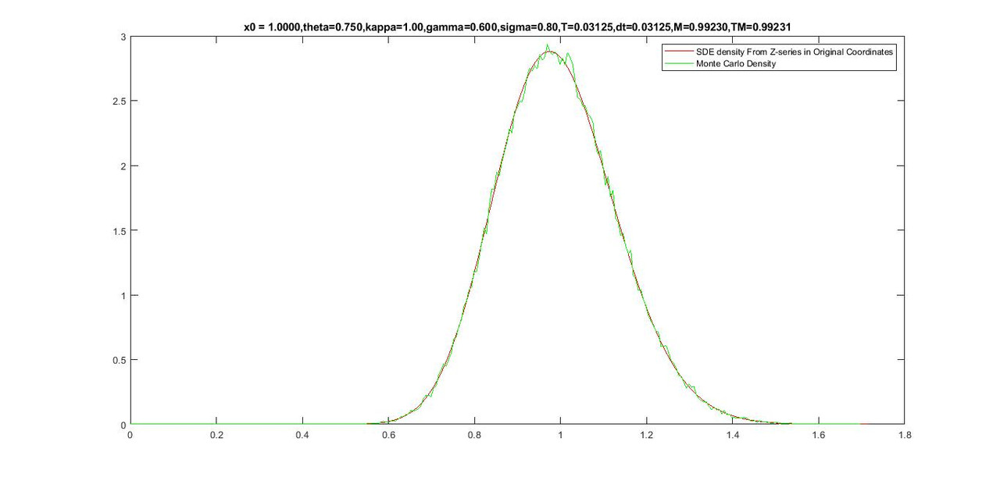](https://postimg.cc/bGxm68ZS)

[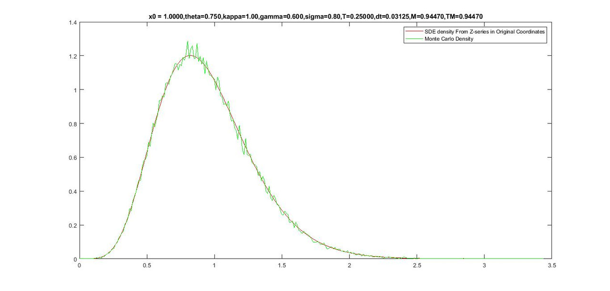](https://postimg.cc/gwFMqr2P)

[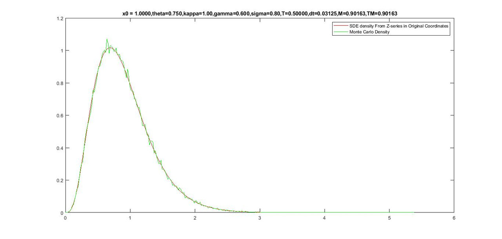](https://postimg.cc/k2t1bW9c)

[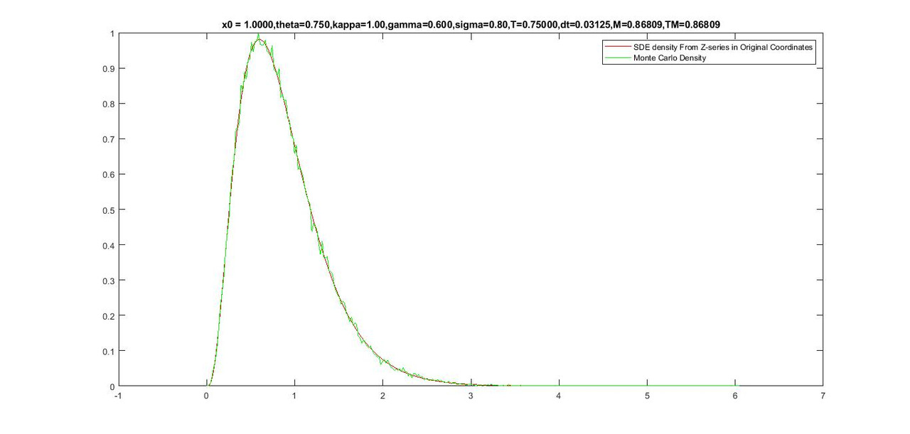](https://postimg.cc/mtnpkmxk)

[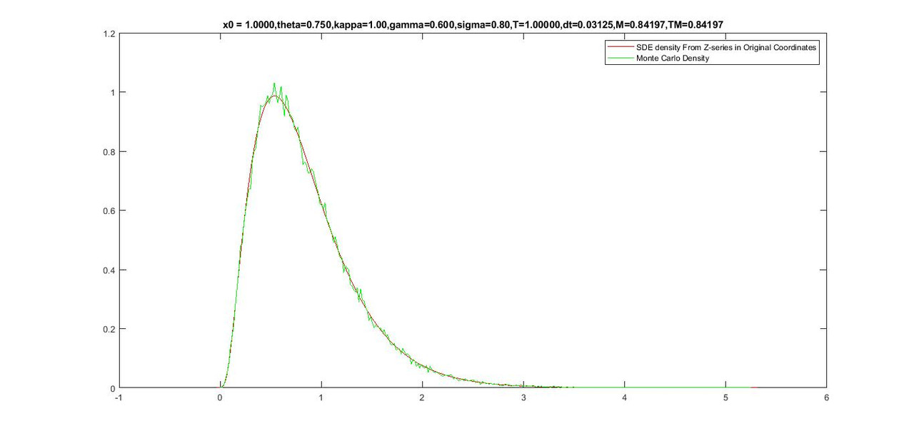](https://postimg.cc/JG0dR92S)

[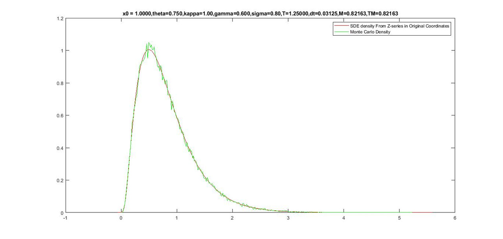](https://postimg.cc/F1DB59Dj)

[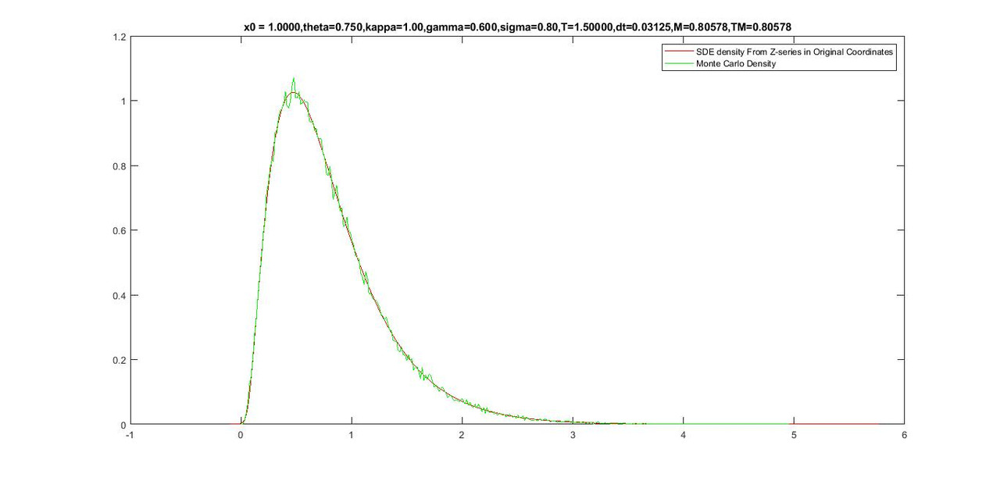](https://postimg.cc/149jjgcm)

[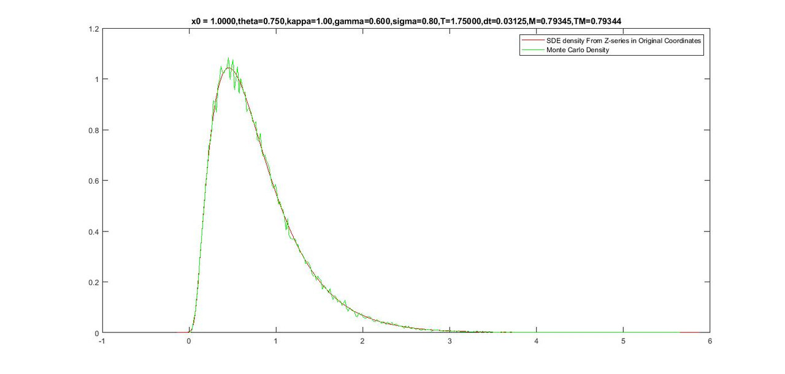](https://postimg.cc/SYN125N2)

[](https://postimg.cc/r09Ypcc2)

---

### #1873 — Amin (Topic Author)
*June 29, 2023, 11:33 PM*

Friends, I will post the program tomorrow (later today on Friday). I was too overwhelmed with sleep and went to bed two
hours ago. It is probably effect of antipsychotic injection that I had on wednesday that I could not continue working.
Very Sorry about it. I just woke up in middle of sleep to let friends know that I will post the program later today.

---

### #1874 — Amin (Topic Author)
*June 30, 2023, 8:39 AM*

Friends, these are the matlab files used to simulate results and make graphs in one previous post. I think I have posted
all the functions but if some function is not there please search for it in the thread and you will find it. I have not
included functions that I had shared in a previous post a few days ago.

.

.

```
function [] = AnalyticSDESimulationOriginalCoordinates()

%Copyright Ahsan Amin. Infiniti derivatives Technologies.
%Please fell free to connect on linkedin: linkedin.com/in/ahsan-amin-0a53334
%or skype ahsan.amin2999
%In this program, I am simulating the SDE given as
%dy(t)=mu1 x(t)^beta1 dt + mu2 x(t)^beta2 dt +sigma x(t)^gamma dz(t)

dt=.125/2/2;   % Simulation time interval.%Fodiffusions close to zero
             %decrease dt for accuracy.
Tt=128/2;     % Number of simulation levels. Terminal time= Tt*dt; //.125/32*32*16=2 year;
T=Tt*dt;

%ds(1:3)=dt;
ds(1:Tt)=dt;

%Below order for monte carlo
OrderA=4;  %
OrderM=4;  %

% if(T>=1)
% dtM=1/32/1;%.0625/1;
% TtM=T/dtM;
% else
% dtM=T/16;%.0625/1;
% TtM=T/dtM;
% end

dtM=dt;  %dtM is monte carlo step size that is kept the same as analytic simulation step size.

dNn=.1/2;   % Normal density subdivisions width. would change with number of subdivisions
Nn=45*4;  % No of normal density subdivisions

x0=1.0;   % starting value of SDE
beta1=0.0;
beta2=1.0;   % Second drift term power.
gamma=.6;%50;   % volatility power.
kappa=1.0;%.950;   %mean reversion parameter.
theta=.750;%mean reversion target
sigma0=.8;%Volatility value

%you can specify any general mu1 and mu2 and beta1 and beta2.
mu1=1*theta*kappa;   %first drift coefficient.
mu2=-1*kappa;    % Second drift coefficient.

alpha=1;% x^alpha is being expanded. This is currently for monte carlo only.

NnMid=((1+Nn)/2)*dNn;
Z(1:Nn)=(((1:Nn)*dNn)-NnMid);
%Z(1:Nn)=(((1:Nn)-20.5)*dNn-NnMid);
Z
str=input('Look at Z');
ZProb(1)=normcdf(.5*Z(1)+.5*Z(2),0,1)-normcdf(.5*Z(1)+.5*Z(2)-dNn,0,1);
ZProb(Nn)=normcdf(.5*Z(Nn)+.5*Z(Nn-1)+dNn,0,1)-normcdf(.5*Z(Nn)+.5*Z(Nn-1),0,1);
ZProb(2:Nn-1)=normcdf(.5*Z(2:Nn-1)+.5*Z(3:Nn),0,1)-normcdf(.5*Z(2:Nn-1)+.5*Z(1:Nn-2),0,1);

%%%%%%%%%%%%%%%%%%%%%%%%%%%%%%%%%%%%%%%%%%%%%%%%%%%%%%%%%%%%%%%%%%%%%%%%%%%%%%%%%%%%%%%%%%%%%%
%This block is analytics for higher order monte carlo. This is explained in
%my thread on wilmott.com

sigma11(1:OrderA+1)=0;
mu11(1:OrderA+1)=0;
mu22(1:OrderA+1)=0;
sigma22(1:OrderA+1)=0;
% index 1 correponds to zero level since matlab indexing starts at one.
sigma11(1)=1;
mu11(1)=1;
mu22(1)=1;
sigma22(1)=1;

for k=1:(OrderA+1)
    if sigma0~=0
        sigma11(k)=sigma0^(k-1);
    end
    if mu1 ~= 0
        mu11(k)=mu1^(k-1);
    end
    if mu2 ~= 0
        mu22(k)=mu2^(k-1);
    end
    if sigma0~=0
        sigma22(k)=sigma0^(2*(k-1));
    end
end
%Ft(1:TtM+1,1:(OrderA+1),1:(OrderA+1),1:(OrderA+1),1:(OrderA+1))=0; %General time powers on hermite polynomials
Fp(1:(OrderA+1),1:(OrderA+1),1:(OrderA+1),1:(OrderA+1))=0;%General x powers on coefficients of hermite polynomials.
%Fp1(1:(OrderA+1),1:(OrderA+1),1:(OrderA+1),1:(OrderA+1))=0;%General x powers for bessel transformed coordinates.

%YCoeff0 and YCoeff are coefficents for original coordinates monte carlo.
%YqCoeff0 and YqCoeff are bessel/lamperti version monte carlo.

YCoeff0(1:(OrderA+1),1:(OrderA+1),1:(OrderA+1),1:(OrderA+1))=0;
%YqCoeff0(1:(OrderA+1),1:(OrderA+1),1:(OrderA+1),1:(OrderA+1))=0;
%Pre-compute the time and power exponent values in small multi-dimensional arrays
YCoeff = ItoTaylorCoeffsNew(alpha,beta1,beta2,gamma); %expand y^alpha where alpha=1;
%YqCoeff = ItoTaylorCoeffsNew(alpha1,beta1,beta2,gamma);%expand y^alpha1 where alpha1=(1-gamma)
%YqCoeff=YqCoeff/(1-gamma); %Transformed coordinates coefficients have to be
%further divided by (1-gamma)

for k = 0 : (OrderA)
    for m = 0:k
        l4 = k - m + 1;
        for n = 0 : m
            l3 = m - n + 1;
            for j = 0:n
                l2 = n - j + 1;
                l1 = j + 1;
                %Ft(l1,l2,l3,l4) = dtM^((l1-1) + (l2-1) + (l3-1) + .5* (l4-1));
                Fp(l1,l2,l3,l4) = (alpha + (l1-1) * beta1 + (l2-1) * beta2 + (l3-1) * 2* gamma + (l4-1) * gamma ...
                    - (l1-1) - (l2-1) - 2* (l3-1) - (l4-1));
%                Fp1(l1,l2,l3,l4) = (alpha1 + (l1-1) * beta1 + (l2-1) * beta2 + (l3-1) * 2* gamma + (l4-1) * gamma ...
%                    - (l1-1) - (l2-1) - 2* (l3-1) - (l4-1));

                YCoeff0(l1,l2,l3,l4) =YCoeff(l1,l2,l3,l4).*mu11(l1).*mu22(l2).*sigma22(l3).*sigma11(l4);
%                YqCoeff0(l1,l2,l3,l4) =YqCoeff(l1,l2,l3,l4).*mu11(l1).*mu22(l2).*sigma22(l3).*sigma11(l4);
            end
        end
    end
end

%%%%%%%%%%%%%%%%%%%%%%%%%%%%%%%%%%%%%%%%%%%%%%%%%%%%%%%%%%%%%%%%%%%%%%%%%%%%%%%%%%%%%%%%%%%%%%

%rng(29079137, 'twister')
rng(93289637, 'twister')
paths=100000;
YY(1:paths)=x0;  %Original process monte carlo.
YYPI(1:paths)=0;
Random1(1:paths)=0;

%Below analytics to calculate the Z-series of SDE at different time steps.
%We use the principle of addition of cumulants to find the resulting
%density of SDE at each step.
ExpnOrder=7;
SeriesOrder=7;
NMoments=8;
wnStart=1;
tic

for tt=1:Tt

    if(tt==1)

        [xMu0dt,dxMu0dtdx] = OriginalDriftAndDerivativesH0(x0,YCoeff0,Fp,ds(tt),8);
        [xVol1dt,dxVol1dtdx] = OriginalVolAndDerivativesH1(x0,YCoeff0,Fp,gamma,ds(tt),ExpnOrder);
        [xVol2dt,dxVol2dtdx] = OriginalVolAndDerivativesH2(x0,YCoeff0,Fp,gamma,ds(tt),ExpnOrder);

        c0=xMu0dt+x0;
        g0=xVol1dt;
        h0=xVol2dt;

        c(1:7)=0;
        g(1:7)=0;
        h(1:7)=0;
        [Moments] = CalculateMomentsOfSDEsTimeEvolution(c0,c,g0,g,h0,h,SeriesOrder,NMoments);

        [c0,c,FittedMoments] = CalculateZSeriesDensityFromRawMoments02(Moments);

        c0
        c

        str=input("Look at starting coefficients after first time step")
        X0=c0;

    else

     [xMu0dt,dxMu0dtdx] = OriginalDriftAndDerivativesH0(X0,YCoeff0,Fp,ds(tt),8)

     [b0,b] = CalculateDriftbCoeffs08(xMu0dt,dxMu0dtdx,c,SeriesOrder);

    [xVol1dt,dxVol1dtdx] = OriginalVolAndDerivativesH1(X0,YCoeff0,Fp,gamma,ds(tt),ExpnOrder);
    [xVol2dt,dxVol2dtdx] = OriginalVolAndDerivativesH2(X0,YCoeff0,Fp,gamma,ds(tt),ExpnOrder);

%Below Calculate Z-Series expansions of volatility terms associated with
%first hermite polynomial and 2nd hermite polynomial.

    [g0,g] = CalculateDriftbCoeffs08(xVol1dt,dxVol1dtdx,c,SeriesOrder);
    [h0,h] = CalculateDriftbCoeffs08(xVol2dt,dxVol2dtdx,c,SeriesOrder);

    c0=c0+b0;
    c(1:7)=c(1:7)+b(1:7);

    [Moments] = CalculateMomentsOfSDEsTimeEvolution(c0,c,g0,g,h0,h,SeriesOrder,NMoments);

    [c0,c,FittedMoments] = CalculateZSeriesDensityFromRawMoments02(Moments);

    %Assign the median of density to X0
    X0=c0;

    end

    %%%%%%%%%%%%%%%%%%%%%%%%%%%%%%%%%%%%%%%%%%%%%%%%%%%%%%%%%%%%%%%%%%%%%%%%%%%%%%%%%%%%%%%%%%%%%%

        yy(1:Nn)=c0;
for nn=1:SeriesOrder
   yy(1:Nn)=yy(1:Nn)+c(nn)*Z(1:Nn).^nn;
end

%Below we make calculations of density in original coordinates by doing
%change of probability derivative with respect to gaussian density.
Dfyy(wnStart:Nn)=0;
for nn=wnStart+1:Nn-1

    Dfyy(nn) = (yy(nn + 1) - yy(nn - 1))/(Z(nn + 1) - Z(nn - 1));

    %Change of variable derivative for densities
end
Dfyy(Nn)=Dfyy(Nn-1);
Dfyy(1)=Dfyy(2);

pyy(1:Nn)=0;
for nn = wnStart:Nn

    pyy(nn) = (normpdf(Z(nn),0, 1))/abs(Dfyy(nn));
end

AnalyticMean=sum(yy(wnStart:Nn).*ZProb(wnStart:Nn))
TrueMean=theta+(x0-theta)*exp(-kappa*dt*tt)

    Random1=randn(size(Random1));
    HermiteP1(1,1:paths)=1;
    HermiteP1(2,1:paths)=Random1(1:paths);
    HermiteP1(3,1:paths)=Random1(1:paths).^2-1;
    HermiteP1(4,1:paths)=Random1(1:paths).^3-3*Random1(1:paths);
    HermiteP1(5,1:paths)=Random1(1:paths).^4-6*Random1(1:paths).^2+3;

 %%%%%%%%%%%%%%%%%%%%%%%%%%%%%%%%%%%%%%%%%%%%%%%%%%%%%%%%%%%%%%%%%%%%%%%%5
    YY(1:paths)=YY(1:paths) + ...
        (YCoeff0(1,1,2,1).*YY(1:paths).^Fp(1,1,2,1)+ ...
        YCoeff0(1,2,1,1).*YY(1:paths).^Fp(1,2,1,1)+ ...
        YCoeff0(2,1,1,1).*YY(1:paths).^Fp(2,1,1,1))*dtM + ...
        (YCoeff0(1,1,3,1).*YY(1:paths).^Fp(1,1,3,1)+ ...
        YCoeff0(1,2,2,1).*YY(1:paths).^Fp(1,2,2,1)+ ...
        YCoeff0(2,1,2,1).*YY(1:paths).^Fp(2,1,2,1)+ ...
        YCoeff0(1,3,1,1).*YY(1:paths).^Fp(1,3,1,1)+ ...
        YCoeff0(2,2,1,1).*YY(1:paths).^Fp(2,2,1,1)+ ...
        YCoeff0(3,1,1,1).*YY(1:paths).^Fp(3,1,1,1))*dtM^2 + ...
       (YCoeff0(1,1,4,1).*YY(1:paths).^Fp(1,1,4,1)+ ...
        YCoeff0(1,2,3,1).*YY(1:paths).^Fp(1,2,3,1)+ ...
        YCoeff0(2,1,3,1).*YY(1:paths).^Fp(2,1,3,1)+ ...
        YCoeff0(1,3,2,1).*YY(1:paths).^Fp(1,3,2,1)+ ...
        YCoeff0(2,2,2,1).*YY(1:paths).^Fp(2,2,2,1)+ ...
        YCoeff0(3,1,2,1).*YY(1:paths).^Fp(3,1,2,1)+ ...
        YCoeff0(1,4,1,1).*YY(1:paths).^Fp(1,4,1,1)+ ...
        YCoeff0(2,3,1,1).*YY(1:paths).^Fp(2,3,1,1)+ ...
        YCoeff0(3,2,1,1).*YY(1:paths).^Fp(3,2,1,1)+ ...
        YCoeff0(4,1,1,1).*YY(1:paths).^Fp(4,1,1,1))*dtM^3 + ...
        ((YCoeff0(1,1,1,2).*YY(1:paths).^Fp(1,1,1,2).*sqrt(dtM))+ ...
        (YCoeff0(1,1,2,2).*YY(1:paths).^Fp(1,1,2,2)+ ...
        YCoeff0(1,2,1,2).*YY(1:paths).^Fp(1,2,1,2)+ ...
        YCoeff0(2,1,1,2).*YY(1:paths).^Fp(2,1,1,2)).*dtM^1.5 + ...
        (YCoeff0(1,1,3,2).*YY(1:paths).^Fp(1,1,3,2)+ ...
        YCoeff0(1,2,2,2).*YY(1:paths).^Fp(1,2,2,2)+ ...
        YCoeff0(2,1,2,2).*YY(1:paths).^Fp(2,1,2,2)+ ...
        YCoeff0(1,3,1,2).*YY(1:paths).^Fp(1,3,1,2)+ ...
        YCoeff0(2,2,1,2).*YY(1:paths).^Fp(2,2,1,2)+ ...
        YCoeff0(3,1,1,2).*YY(1:paths).^Fp(3,1,1,2)).*dtM^2.5) .*HermiteP1(2,1:paths) + ...
        (YCoeff0(1,1,1,3).*YY(1:paths).^Fp(1,1,1,3) *dtM + ...
        (YCoeff0(1,1,2,3).*YY(1:paths).^Fp(1,1,2,3)+ ...
        YCoeff0(1,2,1,3).*YY(1:paths).^Fp(1,2,1,3)+ ...
        YCoeff0(2,1,1,3).*YY(1:paths).^Fp(2,1,1,3)).*dtM^2+ ...
        (YCoeff0(1,1,3,3).*YY(1:paths).^Fp(1,1,3,3)+ ...
        YCoeff0(1,2,2,3).*YY(1:paths).^Fp(1,2,2,3)+ ...
        YCoeff0(2,1,2,3).*YY(1:paths).^Fp(2,1,2,3)+ ...
        YCoeff0(1,3,1,3).*YY(1:paths).^Fp(1,3,1,3)+ ...
        YCoeff0(2,2,1,3).*YY(1:paths).^Fp(2,2,1,3)+ ...
        YCoeff0(3,1,1,3).*YY(1:paths).^Fp(3,1,1,3)).*dtM^3).*HermiteP1(3,1:paths) + ...
        ((YCoeff0(1,1,1,4).*YY(1:paths).^Fp(1,1,1,4)*dtM^1.5 )).*HermiteP1(4,1:paths) + ...
        (YCoeff0(1,1,1,5).*YY(1:paths).^Fp(1,1,1,5)*dtM^2.0).*HermiteP1(5,1:paths);

MCMean=sum(YY(:))/paths

MaxCutOff=100;
NoOfBins=round(1*500*gamma^2*4*sigma0/sqrt(MCMean)/(1+kappa))*1;%Decrease the number of bins if the graph is too
[YDensity,IndexOutY,IndexMaxY] = MakeDensityFromSimulation_Infiniti_NEW(YY,paths,NoOfBins,MaxCutOff );
%plot(Yw(wnStart+1:Nn-1),pYw(wnStart+1:Nn-1),'b',yy(wnStart+1:Nn-1),pyy(wnStart+1:Nn-1),'r',IndexOutY(1:IndexMaxY),YDensity(1:IndexMaxY),'g');
plot(yy(wnStart+1:Nn-1),pyy(wnStart+1:Nn-1),'r',IndexOutY(1:IndexMaxY),YDensity(1:IndexMaxY),'g');

title(sprintf('x0 = %.4f,theta=%.3f,kappa=%.2f,gamma=%.3f,sigma=%.2f,T=%.5f,dt=%.5f,M=%.5f,TM=%.5f',
x0,theta,kappa,gamma,sigma0,tt*dt,dt,AnalyticMean,TrueMean));

legend({'SDE density From Z-series in Original Coordinates','Monte Carlo Density'},'Location','northeast')

time_step=tt
current_time=tt*dt
str=input("Look at graphs of monte carlo and analytic simulation at this time step");

end

toc

MCMean=sum(YY(:))/paths %origianl coordinates monte carlo average.
disp('Original process average from our simulation');
ItoHermiteMean=sum(yy(wnStart:Nn).*ZProb(wnStart:Nn)) %Original process average from coordinates

disp('true Mean only applicble to standard SV mean reverting type models otherwise disregard');
TrueMean=theta+(x0-theta)*exp(-kappa*T)%Mean reverting SDE original variable true average

MaxCutOff=100;
NoOfBins=round(1*500*gamma^2*4*sigma0/sqrt(MCMean)/(1+kappa))*1;%Decrease the number of bins if the graph is too
[YDensity,IndexOutY,IndexMaxY] = MakeDensityFromSimulation_Infiniti_NEW(YY,paths,NoOfBins,MaxCutOff );
plot(yy(wnStart+1:Nn-1),pyy(wnStart+1:Nn-1),'r',IndexOutY(1:IndexMaxY),YDensity(1:IndexMaxY),'g');

title(sprintf('x0 = %.4f,theta=%.3f,kappa=%.2f,gamma=%.3f,sigma=%.2f,T=%.2f,dt=%.5f,M=%.6f,TM=%.6f',
x0,theta,kappa,gamma,sigma0,T,dt,ItoHermiteMean,TrueMean));%,sprintf('theta= %f', theta), sprintf('kappa = %f',
kappa),sprintf('sigma = %f', sigma0),sprintf('T = %f', T));

legend({'SDE density From Z-series in Original Coordinates','Monte Carlo Density'},'Location','northeast')

str=input('red line is density of SDE from Addition of Cumulants, green is monte carlo.');

end
```

.

.

.

.

```
function [yMu0dt,dyMu0dtdy] = OriginalDriftAndDerivativesH0(y0,YCoeff0,Fp,dt,ExpnOrder)

% (YCoeff0(1,1,2,1).*YY(1:paths).^Fp(1,1,2,1)+ ...
%         YCoeff0(1,2,1,1).*YY(1:paths).^Fp(1,2,1,1)+ ...
%         YCoeff0(2,1,1,1).*YY(1:paths).^Fp(2,1,1,1))*dtM + ...
%         (YCoeff0(1,1,3,1).*YY(1:paths).^Fp(1,1,3,1)+ ...
%         YCoeff0(1,2,2,1).*YY(1:paths).^Fp(1,2,2,1)+ ...
%         YCoeff0(2,1,2,1).*YY(1:paths).^Fp(2,1,2,1)+ ...
%         YCoeff0(1,3,1,1).*YY(1:paths).^Fp(1,3,1,1)+ ...
%         YCoeff0(2,2,1,1).*YY(1:paths).^Fp(2,2,1,1)+ ...
%         YCoeff0(3,1,1,1).*YY(1:paths).^Fp(3,1,1,1))*dtM^2 +
NoOfTerms=19;
YCoeffa(1:NoOfTerms)=0.0;
Fp1=Fp;
YCoeffa(1)=YCoeff0(1,1,2,1)*dt;%*(1-gamma)^Fp1(1,1,2,1)*dt;
YCoeffa(2)=YCoeff0(1,2,1,1)*dt;%*(1-gamma)^Fp1(1,2,1,1)*dt;
YCoeffa(3)=YCoeff0(2,1,1,1)*dt;%*(1-gamma)^Fp1(2,1,1,1)*dt;
YCoeffa(4)=YCoeff0(1,1,3,1)*dt^2;%*(1-gamma)^Fp1(1,1,3,1)*dt^2;
YCoeffa(5)=YCoeff0(1,2,2,1)*dt^2;%*(1-gamma)^Fp1(1,2,2,1)*dt^2;
YCoeffa(6)=YCoeff0(2,1,2,1)*dt^2;%*(1-gamma)^Fp1(2,1,2,1)*dt^2;
YCoeffa(7)=YCoeff0(1,3,1,1)*dt^2;%*(1-gamma)^Fp1(1,3,1,1)*dt^2;
YCoeffa(8)=YCoeff0(2,2,1,1)*dt^2;%*(1-gamma)^Fp1(2,2,1,1)*dt^2;
YCoeffa(9)=YCoeff0(3,1,1,1)*dt^2;%*(1-gamma)^Fp1(3,1,1,1)*dt^2;
YCoeffa(10)=YCoeff0(1,1,4,1)*dt^3;%;*(1-gamma)^Fp1(1,1,4,1)*dt^3;
YCoeffa(11)=YCoeff0(1,2,3,1)*dt^3;%;*(1-gamma)^Fp1(1,2,3,1)*dt^3;
YCoeffa(12)=YCoeff0(2,1,3,1)*dt^3;%*(1-gamma)^Fp1(2,1,3,1)*dt^3;
YCoeffa(13)=YCoeff0(1,3,2,1)*dt^3;%*(1-gamma)^Fp1(1,3,2,1)*dt^3;
YCoeffa(14)=YCoeff0(2,2,2,1)*dt^3;%*(1-gamma)^Fp1(2,2,2,1)*dt^3;
YCoeffa(15)=YCoeff0(3,1,2,1)*dt^3;%*(1-gamma)^Fp1(3,1,2,1)*dt^3;
YCoeffa(16)=YCoeff0(1,4,1,1)*dt^3;%*(1-gamma)^Fp1(1,4,1,1)*dt^3;
YCoeffa(17)=YCoeff0(2,3,1,1)*dt^3;%*(1-gamma)^Fp1(2,3,1,1)*dt^3;
YCoeffa(18)=YCoeff0(3,2,1,1)*dt^3;%*(1-gamma)^Fp1(3,2,1,1)*dt^3;
YCoeffa(19)=YCoeff0(4,1,1,1)*dt^3;%*(1-gamma)^Fp1(4,1,1,1)*dt^3;

Fp2(1)=Fp1(1,1,2,1);
Fp2(2)=Fp1(1,2,1,1);
Fp2(3)=Fp1(2,1,1,1);
Fp2(4)=Fp1(1,1,3,1);
Fp2(5)=Fp1(1,2,2,1);
Fp2(6)=Fp1(2,1,2,1);
Fp2(7)=Fp1(1,3,1,1);
Fp2(8)=Fp1(2,2,1,1);
Fp2(9)=Fp1(3,1,1,1);
Fp2(10)=Fp1(1,1,4,1);
Fp2(11)=Fp1(1,2,3,1);
Fp2(12)=Fp1(2,1,3,1);
Fp2(13)=Fp1(1,3,2,1);
Fp2(14)=Fp1(2,2,2,1);
Fp2(15)=Fp1(3,1,2,1);
Fp2(16)=Fp1(1,4,1,1);
Fp2(17)=Fp1(2,3,1,1);
Fp2(18)=Fp1(3,2,1,1);
Fp2(19)=Fp1(4,1,1,1);

%YCoeffa
%Fp2
%str=input('Look at numbers--inside drift coeffs calc function');
yMu0dt0=0;
dyMu0dt(1:ExpnOrder)=0.0;

yMu0dt=0;
dyMu0dtdy(1:ExpnOrder)=0.0;

for mm=1:NoOfTerms

    yMu0dt0=YCoeffa(mm).*(y0).^Fp2(mm);
    for nn=1:ExpnOrder
        if(nn==1)
            dyMu0dt(nn)=yMu0dt0*Fp2(mm)/y0;
        else
        dyMu0dt(nn)=dyMu0dt(nn-1)*(Fp2(mm)-(nn-1))/y0;
        end
    end
    yMu0dt=yMu0dt+yMu0dt0;
    for nn=1:ExpnOrder
        dyMu0dtdy(nn)=dyMu0dtdy(nn)+dyMu0dt(nn);
    end

end

%yMu0dt
%dyMu0dtdy
%str=input("inside drift series calc function--2")

end

```

.

.

.

```
function [yVol0dt,dyVol0dtdy] = OriginalVolAndDerivativesH1(y0,YCoeff0,Fp,gamma,dt,ExpnOrder)

NoOfTerms=20;%excluding dt^3 terms
YCoeffa(1:NoOfTerms)=0.0;

Fp1=Fp;%/(1-gamma);
YCoeffa(1)=YCoeff0(1,1,1,2).*sqrt(dt);              % .*yy(wnStart:Nn).^Fp(1,1,1,2).*sqrt(dt))+
YCoeffa(2)=YCoeff0(1,1,2,2)*dt^1.5;
YCoeffa(3)=YCoeff0(1,2,1,2)*dt^1.5;
YCoeffa(4)=YCoeff0(2,1,1,2)*dt^1.5;
YCoeffa(5)=YCoeff0(1,1,3,2)*dt^2.5;
YCoeffa(6)=YCoeff0(1,2,2,2)*dt^2.5;
YCoeffa(7)=YCoeff0(2,1,2,2)*dt^2.5;
YCoeffa(8)=YCoeff0(1,3,1,2)*dt^2.5;
YCoeffa(9)=YCoeff0(2,2,1,2)*dt^2.5;
YCoeffa(10)=YCoeff0(3,1,1,2)*dt^2.5;
YCoeffa(11)=YCoeff0(1,1,4,2)*dt^3.5;
YCoeffa(12)=YCoeff0(1,2,3,2)*dt^3.5;
YCoeffa(13)=YCoeff0(2,1,3,2)*dt^3.5;
YCoeffa(14)=YCoeff0(1,3,2,2)*dt^3.5;
YCoeffa(15)=YCoeff0(2,2,2,2)*dt^3.5;
YCoeffa(16)=YCoeff0(3,1,2,2)*dt^3.5;
YCoeffa(17)=YCoeff0(1,4,1,2)*dt^3.5;
YCoeffa(18)=YCoeff0(2,3,1,2)*dt^3.5;
YCoeffa(19)=YCoeff0(3,2,1,2)*dt^3.5;
YCoeffa(20)=YCoeff0(4,1,1,2)*dt^3.5;

Fp2(1)=Fp1(1,1,1,2)
%str=input('Look at numbers')
Fp2(2)=Fp1(1,1,2,2);
Fp2(3)=Fp1(1,2,1,2);
Fp2(4)=Fp1(2,1,1,2);
Fp2(5)=Fp1(1,1,3,2);
Fp2(6)=Fp1(1,2,2,2);
Fp2(7)=Fp1(2,1,2,2);
Fp2(8)=Fp1(1,3,1,2);
Fp2(9)=Fp1(2,2,1,2);
Fp2(10)=Fp1(3,1,1,2);
Fp2(11)=Fp1(1,1,4,2);
Fp2(12)=Fp1(1,2,3,2);
Fp2(13)=Fp1(2,1,3,2);
Fp2(14)=Fp1(1,3,2,2);
Fp2(15)=Fp1(2,2,2,2);
Fp2(16)=Fp1(3,1,2,2);
Fp2(17)=Fp1(1,4,1,2);
Fp2(18)=Fp1(2,3,1,2);
Fp2(19)=Fp1(3,2,1,2);
Fp2(20)=Fp1(4,1,1,2);

%YCoeffa(1:4)
%Fp2(1:4)
%str=input('Look at numbers----1');

yVol0dt0=0;
dyVol0dt(1:ExpnOrder)=0.0;

yVol0dt=0;
dyVol0dtdy(1:ExpnOrder)=0.0;

for mm=1:NoOfTerms

    yVol0dt0=YCoeffa(mm).*y0.^Fp2(mm);
    for nn=1:ExpnOrder
        if(nn==1)
            dyVol0dt(nn)=yVol0dt0*Fp2(mm)*1/y0;
        else
        dyVol0dt(nn)=dyVol0dt(nn-1)*(Fp2(mm)-(nn-1))/y0;
        end
    end
    yVol0dt=yVol0dt+yVol0dt0;
    for nn=1:ExpnOrder
        dyVol0dtdy(nn)=dyVol0dtdy(nn)+dyVol0dt(nn);
    end

end

%yVol0dt
%dyVol0dtdy
%str=input('Look at numbers----2');

end
```

.

.

.

```
function [yVol2dt,dyVol2dtdy] = OriginalVolAndDerivativesH2(y0,YCoeff0,Fp,gamma,dt,ExpnOrder)

% c2(wnStart:Nn)=YqCoeff0(1,1,1,3).*yy(wnStart:Nn).^Fp1(1,1,1,3) *dt + ...
%     (YqCoeff0(1,1,2,3).*yy(wnStart:Nn).^Fp1(1,1,2,3)+YqCoeff0(1,2,1,3).*yy(wnStart:Nn).^Fp1(1,2,1,3)+ ...
%     YqCoeff0(2,1,1,3).*yy(wnStart:Nn).^Fp1(2,1,1,3)).*dt^2+ ...
%     (YqCoeff0(1,1,3,3).*yy(wnStart:Nn).^Fp1(1,1,3,3)+YqCoeff0(1,2,2,3).*yy(wnStart:Nn).^Fp1(1,2,2,3)+ ...
%     YqCoeff0(2,1,2,3).*yy(wnStart:Nn).^Fp1(2,1,2,3) + YqCoeff0(1,3,1,3).*yy(wnStart:Nn).^Fp1(1,3,1,3)+ ...
%     YqCoeff0(2,2,1,3).*yy(wnStart:Nn).^Fp1(2,2,1,3)+YqCoeff0(3,1,1,3).*yy(wnStart:Nn).^Fp1(3,1,1,3)).*dt^3;

Fp1=Fp;%1/(1-gamma);

NoOfTerms=10;%excluding dt^3 terms
YCoeffa(1:NoOfTerms)=0.0;
YCoeffa(1)=YCoeff0(1,1,1,3).*dt;%YY(1:paths).^Fp(1,1,1,3) *dtM) + ...
YCoeffa(2)=YCoeff0(1,1,2,3)*dt^2;
YCoeffa(3)=YCoeff0(1,2,1,3)*dt^2;
YCoeffa(4)=YCoeff0(2,1,1,3)*dt^2;
YCoeffa(5)=YCoeff0(1,1,3,3)*dt^3;
YCoeffa(6)=YCoeff0(1,2,2,3)*dt^3;
YCoeffa(7)=YCoeff0(2,1,2,3)*dt^3;
YCoeffa(8)=YCoeff0(1,3,1,3)*dt^3;
YCoeffa(9)=YCoeff0(2,2,1,3)*dt^3;
YCoeffa(10)=YCoeff0(3,1,1,3)*dt^3;

Fp2(1)=Fp1(1,1,1,3);
Fp2(2)=Fp1(1,1,2,3);
Fp2(3)=Fp1(1,2,1,3);
Fp2(4)=Fp1(2,1,1,3);
Fp2(5)=Fp1(1,1,3,3);
Fp2(6)=Fp1(1,2,2,3);
Fp2(7)=Fp1(2,1,2,3);
Fp2(8)=Fp1(1,3,1,3);
Fp2(9)=Fp1(2,2,1,3);
Fp2(10)=Fp1(3,1,1,3);

yVol2dt0=0;
dyVol2dt(1:ExpnOrder)=0.0;

yVol2dt=0;
dyVol2dtdy(1:ExpnOrder)=0.0;

for mm=1:NoOfTerms

    yVol2dt0=YCoeffa(mm).*y0.^Fp2(mm);
    for nn=1:ExpnOrder
        if(nn==1)
            dyVol2dt(nn)=yVol2dt0*Fp2(mm)*1/y0;
        else
        dyVol2dt(nn)=dyVol2dt(nn-1)*(Fp2(mm)-(nn-1))/y0;
        end
    end
    yVol2dt=yVol2dt+yVol2dt0;
    for nn=1:ExpnOrder
        dyVol2dtdy(nn)=dyVol2dtdy(nn)+dyVol2dt(nn);
    end

end

end
```

.

.

.

```
function [b0,b] = CalculateDriftbCoeffs08(wMu0dt,dwMu0dtdw,a,SeriesOrder)

b0=wMu0dt;

b(1)=a(1) *dwMu0dtdw(1);

b(2)=1/2*(2* a(2) *dwMu0dtdw(1)+a(1)^2 *dwMu0dtdw(2));

b(3)=1/6*(6 *a(3) *dwMu0dtdw(1)+6 *a(1)* a(2) *dwMu0dtdw(2)+a(1)^3 *dwMu0dtdw(3));

b(4)=1/24*(24* a(4) *dwMu0dtdw(1)+12* a(2)^2 *dwMu0dtdw(2)+24 *a(1)* a(3) *dwMu0dtdw(2)+ ...
    12* a(1)^2* a(2) *dwMu0dtdw(3)+a(1)^4 *dwMu0dtdw(4));

if(SeriesOrder>=5)
b(5)=1/120*(120* a(5) *dwMu0dtdw(1)+120* a(2) *a(3) *dwMu0dtdw(2)+120* a(1)* a(4) *dwMu0dtdw(2)+ ...
    60 *a(1)* a(2)^2 *dwMu0dtdw(3)+60* a(1)^2* a(3) *dwMu0dtdw(3)+ ...
    20 *a(1)^3* a(2) *dwMu0dtdw(4)+a(1)^5 *dwMu0dtdw(5));
end
if(SeriesOrder>=6)
b(6)=1/720*(720* a(6) *dwMu0dtdw(1)+360* a(3)^2 *dwMu0dtdw(2)+720* a(2)* a(4) *dwMu0dtdw(2)+720* a(1)* a(5)
*dwMu0dtdw(2)+ ...
    120* a(2)^3 *dwMu0dtdw(3)+720* a(1)* a(2)* a(3) *dwMu0dtdw(3)+360* a(1)^2* a(4) *dwMu0dtdw(3)+ ...
    180* a(1)^2* a(2)^2 *dwMu0dtdw(4)+120* a(1)^3* a(3) *dwMu0dtdw(4)+ ...
    30* a(1)^4 *a(2) *dwMu0dtdw(5)+a(1)^6 *dwMu0dtdw(6));
end

if(SeriesOrder>=7)
  b(7)=1/(720*7)*(5040* a(7)*dwMu0dtdw(1)+5040* a(3)* a(4)*dwMu0dtdw(2)+5040* a(2)* a(5) *dwMu0dtdw(2)+5040 *a(1)* a(6)
*dwMu0dtdw(2)+ ...
      2520* a(2)^2* a(3) *dwMu0dtdw(3)+2520* a(1)* a(3)^2 *dwMu0dtdw(3)+5040 *a(1)* a(2)* a(4) *dwMu0dtdw(3)+2520*
a(1)^2 *a(5) *dwMu0dtdw(3)+ ...
      840* a(1)* a(2)^3 *dwMu0dtdw(4)+2520* a(1)^2* a(2)* a(3) *dwMu0dtdw(4)+840* a(1)^3* a(4) *dwMu0dtdw(4)+ ...
      420* a(1)^3* a(2)^2 *dwMu0dtdw(5)+210* a(1)^4* a(3) *dwMu0dtdw(5)+ ...
      42* a(1)^5* a(2) *dwMu0dtdw(6)+a(1)^7 *dwMu0dtdw(7));

end

if(SeriesOrder>=8)
  b(8)=1/(720*7*8)*(40320* a(8) *dwMu0dtdw(1)+20160* a(4)^2 *dwMu0dtdw(2)+40320* a(3)* a(5) *dwMu0dtdw(2)+40320* a(2)
*a(6) *dwMu0dtdw(2)+ ...
      40320* a(1) *a(7) *dwMu0dtdw(2)+ ...
      20160* a(2)* a(3)^2 *dwMu0dtdw(3)+20160* a(2)^2* a(4) *dwMu0dtdw(3)+40320* a(1)* a(3)* a(4) *dwMu0dtdw(3)+40320*
a(1)* a(2)* a(5) *dwMu0dtdw(3)+ ...
      20160* a(1)^2* a(6) *dwMu0dtdw(3)+ ...
      1680* a(2)^4 *dwMu0dtdw(4)+20160* a(1)* a(2)^2* a(3) *dwMu0dtdw(4)+10080* a(1)^2* a(3)^2 *dwMu0dtdw(4)+20160*
a(1)^2* a(2) *a(4) *dwMu0dtdw(4)+ ...
      6720* a(1)^3* a(5) *dwMu0dtdw(4)+ ...
      3360* a(1)^2* a(2)^3 *dwMu0dtdw(5)+6720* a(1)^3 *a(2)* a(3) *dwMu0dtdw(5)+1680* a(1)^4* a(4) *dwMu0dtdw(5)+ ...
      840* a(1)^4* a(2)^2 *dwMu0dtdw(6)+336* a(1)^5* a(3) *dwMu0dtdw(6)+ ...
      56* a(1)^6* a(2) *dwMu0dtdw(7)+a(1)^8 *dwMu0dtdw(8));
end

if(SeriesOrder>=9)
b(9)=1/(720*7*8*9)*(362880* a(9) *dwMu0dtdw(1)+ ...
    362880* a(4)* a(5) *dwMu0dtdw(2)+ 362880* a(3)* a(6) *dwMu0dtdw(2) +362880* a(2)* a(7) *dwMu0dtdw(2) +362880* a(1)
*a(8) *dwMu0dtdw(2) + ...
    60480* a(3)^3 *dwMu0dtdw(3)+362880* a(2)* a(3)* a(4) *dwMu0dtdw(3)+181440* a(1)* a(4)^2 *dwMu0dtdw(3)+181440*
a(2)^2* a(5) *dwMu0dtdw(3) + ...
    362880* a(1)* a(3)* a(5) *dwMu0dtdw(3)+362880 *a(1)* a(2)* a(6) *dwMu0dtdw(3) +181440 *a(1)^2* a(7) *dwMu0dtdw(3)+
...
    60480* a(2)^3* a(3) *dwMu0dtdw(4)+181440* a(1)* a(2)* a(3)^2 *dwMu0dtdw(4)+181440* a(1)* a(2)^2 *a(4) *dwMu0dtdw(4)+
...
    181440* a(1)^2* a(3)* a(4) *dwMu0dtdw(4)+181440* a(1)^2* a(2)* a(5) *dwMu0dtdw(4)+60480* a(1)^3* a(6) *dwMu0dtdw(4)+
...
    15120* a(1)* a(2)^4 *dwMu0dtdw(5)+90720* a(1)^2* a(2)^2* a(3) *dwMu0dtdw(5)+30240* a(1)^3* a(3)^2 *dwMu0dtdw(5)+ ...
    60480 *a(1)^3* a(2)* a(4) *dwMu0dtdw(5)+15120* a(1)^4* a(5) *dwMu0dtdw(5)+ ...
    10080* a(1)^3* a(2)^3 *dwMu0dtdw(6)+15120* a(1)^4 *a(2)* a(3) *dwMu0dtdw(6)+3024* a(1)^5* a(4) *dwMu0dtdw(6)+ ...
    1512* a(1)^5* a(2)^2 *dwMu0dtdw(7)+504* a(1)^6* a(3) *dwMu0dtdw(7)+ ...
    72* a(1)^7 *a(2) *dwMu0dtdw(8)+a(1)^9 *dwMu0dtdw(9));
end

if(SeriesOrder>=10)
b(10)=1/(720*7*8*9*10)*(3628800* a(10)* dwMu0dtdw(1)+ ...
    1814400 * a(5)^2 *dwMu0dtdw(2)+3628800 *a(4)* a(6)* dwMu0dtdw(2)+3628800* a(3)* a(7)* dwMu0dtdw(2)+3628800 *a(2)*
a(8)* dwMu0dtdw(2)+ ...
    3628800* a(1)* a(9)* dwMu0dtdw(2)+ ...
    1814400* a(3)^2* a(4)* dwMu0dtdw(3)+1814400* a(2)* a(4)^2* dwMu0dtdw(3)+3628800* a(2)* a(3)* a(5)*
dwMu0dtdw(3)+3628800* a(1)* a(4)* a(5) *dwMu0dtdw(3)+ ...
    1814400* a(2)^2* a(6)* dwMu0dtdw(3)+3628800* a(1)* a(3)* a(6)* dwMu0dtdw(3)+3628800 *a(1)* a(2)* a(7)*
dwMu0dtdw(3)+1814400* a(1)^2* a(8)* dwMu0dtdw(3)+ ...
    907200* a(2)^2 *a(3)^2* dwMu0dtdw(4)+604800* a(1)* a(3)^3* dwMu0dtdw(4)+604800* a(2)^3* a(4)* dwMu0dtdw(4)+3628800*
a(1)* a(2)* a(3)* a(4)* dwMu0dtdw(4)+ ...
    907200* a(1)^2* a(4)^2* dwMu0dtdw(4)+1814400* a(1)* a(2)^2* a(5)* dwMu0dtdw(4)+1814400* a(1)^2* a(3)* a(5)*
dwMu0dtdw(4)+ ...
    1814400* a(1)^2* a(2)* a(6)* dwMu0dtdw(4)+ 604800* a(1)^3* a(7) *dwMu0dtdw(4)+ ...
    30240 *a(2)^5* dwMu0dtdw(5)+604800* a(1)* a(2)^3* a(3)* dwMu0dtdw(5)+907200 *a(1)^2* a(2)* a(3)^2*
dwMu0dtdw(5)+907200* a(1)^2* a(2)^2* a(4) *dwMu0dtdw(5)+ ...
    604800* a(1)^3* a(3)* a(4)* dwMu0dtdw(5)+604800* a(1)^3* a(2)* a(5)* dwMu0dtdw(5)+151200* a(1)^4* a(6)*
dwMu0dtdw(5)+ ...
    75600* a(1)^2* a(2)^4* dwMu0dtdw(6)+302400 *a(1)^3* a(2)^2* a(3)* dwMu0dtdw(6)+75600* a(1)^4 *a(3)^2*
dwMu0dtdw(6)+151200* a(1)^4* a(2)* a(4) *dwMu0dtdw(6)+ ...
    30240* a(1)^5* a(5)* dwMu0dtdw(6)+ ...
    25200* a(1)^4* a(2)^3* dwMu0dtdw(7)+30240* a(1)^5* a(2)* a(3)* dwMu0dtdw(7)+5040* a(1)^6* a(4)* dwMu0dtdw(7)+ ...
    2520* a(1)^6* a(2)^2* dwMu0dtdw(8)+720* a(1)^7* a(3)* dwMu0dtdw(8)+ ...
    90 *a(1)^8* a(2)* dwMu0dtdw(9)+ ...
    a(1)^10* dwMu0dtdw(10));

end

end

```

.

.

.

```
function [c0,c,FittedMoments] = CalculateZSeriesDensityFromRawMoments02(rMu)
%The above function takes an array of first eight raw moments as input.
%And returns Z-series Coeffs upto 7th power of Z as
%Y=c0+c(1)*Z+c(2)*Z^2+c(3)*Z^3+c(4)*Z^4+c(5)*Z^5+c(6)*Z^6+c(7)*Z^7
%Fitted Moments are raw moments of the Z-series density and usually are exactly
%the same as input raw moments rMu(1:8).i.e  FittedMoments(1:8)==rMu(1:8)
%with high precision.

%%%%%%%%%%%%%%%%%%%%%%%%%%%%%%%%%%%%%%%%%%%%%%%%%%%%%%%%%%%%%%%%%%%%%%%%%%%%%%5
%If you do not have valid moments from a density available, please
%uncomment the following input moments to run the program.

% rMu(1)=0.000012499863483*10^5;
% rMu(2)=0.000021197093700*10^5;
% rMu(3)=0.000050274347857*10^5;
% rMu(4)=0.000171368317209*10^5;
% rMu(5)=0.000856094970826*10^5;
% rMu(6)=0.006320436615909*10^5;
% rMu(7)=0.068698344472325*10^5;
% rMu(8)=1.084082326087001*10^5;

% rMu(1)=0;
% rMu(2)=1;
% rMu(3)=0;
% rMu(4)=105*105;
% rMu(5)=0;
% rMu(6)=(945*11)^2;
% rMu(7)=0;
% rMu(8)=(945*11*13*15).^2;
%

%%%%%%%%%%%%%%%%%%%%%%%%%%%%%%%%%%%%%%%%%%%%%%%%%%%%%%%%%%%%%%%%%%%%%%%%%%%%%%5
SeriesOrder=7;    %Z-series till 7th power. hardcoded here cannot chagne.
mOrder=8;         %Number of raw moments in calibration. hardcoded here cannot chagne.
NMoments=mOrder;
                  %Find central Moments from raw moments
[Mu1,cMu] = ConvertRawMomentsToCentralMoments(rMu,mOrder);
                  %Find standardized Moments from central moments
sMu(1)=0;
sMu(2)=1;
sMu(3)=cMu(3)/cMu(2).^1.5;
sMu(4)=cMu(4)/cMu(2).^2.0;
sMu(5)=cMu(5)/cMu(2).^2.5;
sMu(6)=cMu(6)/cMu(2).^3.0;
sMu(7)=cMu(7)/cMu(2).^3.5;
sMu(8)=cMu(8)/cMu(2).^4.0;

iter=15;           %Number of iterations in the calibration.
                  %Please experiment and play around.
bGuess(2:7)=0;    %We have assigned initial values of coefficients
bGuess(1)=1;      %other than c(1) to zero. We are starting with no prior information.
[c0,c] = PreSmoothingGuessAdvancedFromGuessBestNew(sMu,bGuess,iter);

c0
c

%str=input("Look at pre-smoothing Guess result")
%%%%%%%%%%%%%%%%%%%%%%%%%%%%%%%%%%%%%%%%%%%%%%%%%%%%%%%%%%%%%%%%%%%%%%%%%%%%%
%Comment this block if you do not want multidimensional Newton pass
%Even though preSmoothing guess is very close to optimal, slight
%inaccuracies can change the shape of probabioity density so this
%Multidimensional Newton is usually required.

[F,dF] = CalculateMomentsAndDerivatives_0(sMu,c0,c,SeriesOrder,SeriesOrder,NMoments);

da(1,1)=c0;
da(2:SeriesOrder+1,1)=c(1:SeriesOrder);

[Moments] = CalculateMomentsOfZSeries(c0,c,SeriesOrder,NMoments);

%Replace with your own more intelligent objective function if you like.
ObjBest=100000*(abs(sMu(1)-Moments(1)))+abs(sMu(2)-Moments(2))+abs((sMu(3)-Moments(3))^(1/1.5))+abs((sMu(4)-Moments(4))^(1/2.0))
+ ...
    abs((sMu(5)-Moments(5))^(1/2.0))+abs((sMu(6)-Moments(6))^(1/2.0))+abs((sMu(7)-Moments(7))^(1/2.0))+ ...
    abs((sMu(8)-Moments(8))^(1/2.0));

b0Best=c0;
bBest(1:SeriesOrder)=c(1:SeriesOrder);

nn=0;
while((nn.000000000001) || (abs(F(2,1))>.000000000001) || (abs(F(3,1))>.000000000001) || (abs(F(4,1))>.00000000001)||
(abs(F(5,1))>.00000000001)|| (abs(F(6,1))>.00000000001)|| (abs(F(7,1))>.00000000001)|| (abs(F(8,1))>.00000000001)  ))

    nn=nn+1;
    %Below Newton matrix equation to improve the Z-series coefficients guess at previous step.
    da=da-dF\F;

    %b0=median
    b0=da(1,1);
    b(1:SeriesOrder)=da(2:SeriesOrder+1,1);

    %[F,dF] = CalculateCumulantsAndDerivativesFromMoments_0(C,b0,b,SeriesOrder,SeriesOrder,NoOfCumulants);
    [F,dF] = CalculateMomentsAndDerivatives_0(sMu,b0,b,SeriesOrder,SeriesOrder,NMoments);
    [IsValidFlag] = CheckIsValidDensity(b0,b);
    [Moments] = CalculateMomentsOfZSeries(b0,b,SeriesOrder,NMoments);

   
ObjNew=100000*(abs(sMu(1)-Moments(1)))+abs(sMu(2)-Moments(2))+abs((sMu(3)-Moments(3))^(1/1.5))+abs((sMu(4)-Moments(4))^(1/2.0))
+ ...
    abs((sMu(5)-Moments(5))^(1/2.0))+abs((sMu(6)-Moments(6))^(1/2.0))+abs((sMu(7)-Moments(7))^(1/2.0))+ ...
    abs((sMu(8)-Moments(8))^(1/2.0));

    if((ObjBest>ObjNew) &&( IsValidFlag))

       ObjBest=ObjNew;
       b0Best=b0;
       bBest(1:SeriesOrder)=b(1:SeriesOrder);
    end

    da(1,1)=b0;
    da(2:SeriesOrder+1,1)=b(1:SeriesOrder);

end
c0=b0Best;%Best;
c(1:SeriesOrder)=bBest;%Best(1:SeriesOrder);

%Above are the best chosen Z-series coefficients based on the objective function.
%But my objective function can be improved.

%Multidimensional Newton root search ends. Comment till here if you like to
%exclude this
%%%%%%%%%%%%%%%%%%%%%%%%%%%%%%%%%%%%%%%%%%%%%%%%%%%%%%%%%%%%%%%%%%%%%%%%%%%%%%%%%%%%%%%%%%%%%%%%%%%%%

c0
c

%str=input("Look at standardized output coefficients");

%%%%%%%%%%%%%%%%%%%%%%%%%%%%%%%%%%%%%%%%%%%%%%%%%%%%%%%%%%%%%%%%%

%Make sure you do not comment the lines below

c0=c0*sqrt(cMu(2)); %convert from standardized to central moments
c=c*sqrt(cMu(2));   %convert from standardized to central moments

c0=c0+Mu1;          %convert from central to raw moments by adding mean.

[FittedMoments] = CalculateMomentsOfZSeries(c0,c,SeriesOrder,NMoments);
%%%%%%%%%%%%%%%%%%%%%%%%%%%%%%%%%%%%%%%%%%%%%%%%%%%%%%%%%%%%%%%%%%%%%%%%%%%%%%%%%%%%%%%%%%%%%%
%Please Uncomment this if you want to see a comparison of input moments and
%fitted moments
rMu
FittedMoments
%str=input('Look at comparison of fitted moments with input moments');
%%%%%%%%%%%%%%%%%%%%%%%%%%%%%%%%%%%%%%%%%%%%%%%%%%%%%%%%%%%%%%%%%%%%%%%%%%%%%%%%%%%%%%%%%%%%%5
%COMMENT lines below if you do not want to see the density of new Z-series random variable with
%fitted moments.
%First calculate normal random variable on a grid below
dNn=.1/2;   % Normal density subdivisions width. would change with number of subdivisions
Nn=45*4;  % No of normal density subdivisions
NnMid=((1+Nn)/2)*dNn;
Z(1:Nn)=(((1:Nn)*dNn)-NnMid);
%Z
%str=input('Look at Z');
%Now calculate Y as a function of normal random variable.
Y(1:Nn)=c0;
for nn=1:7
    Y(1:Nn)=Y(1:Nn)+c(nn)*Z(1:Nn).^nn;
end

%Now take change of densities derivative of Y with respect to normal
DfY(1:Nn)=0;
for nn=2:Nn-1
    DfY(nn) = (Y(nn + 1) - Y(nn - 1))/(Z(nn + 1) - Z(nn - 1));
    %Change of variable derivative for densities
end
DfY(Nn)=DfY(Nn-1);
DfY(1)=DfY(2);

%Now calculate the density of Y from density of normal random variable
%using change of probability derivative.
pY(1:Nn)=0;
for nn = 1:Nn
    pY(nn) = (normpdf(Z(nn),0, 1))/abs(DfY(nn));
end

plot(Y(1:Nn),pY(1:Nn),'b');
title('Density of the Z-Series Variable with Fitted Moments');

%str=input('Look at the density of Z-series random variable')
%%%%%%%%%%%%%%%%%%%%%%%%%%%%%%%%%%%%%%%%%%%%%%%%%%%%%%%%%%%%%%%%%%%%%%%%%%%%%%%%%%%%%%%%%%%%
end
```

.

.

.

```
function [c0,c] = PreSmoothingGuessAdvancedFromGuessBestNew(cmu,cin,iter)

%Mul=1.0;
SeriesOrder=7;
NMoments=8;

 EZ(1)=0;
 EZ(2)=1;
 for nn=3:NMoments*SeriesOrder+SeriesOrder+2
     if rem(nn,2)==1
         EZ(nn)=0;
     else
         EZ(nn)=EZ(nn-2)*(nn-1);
         EZ(nn);
     end
 end

c0=-(cin(2)+3*cin(4)+15*cin(6));  %This is for zero mean condition.
c=cin;
MaxIter=10;

for nn=1:iter     %increase the iterations over coefficients if neeeded

%%%%%%%%%%%%%%%%%%%%%%%%%%%%%%%%%%%%%%%%%%%%%%%%%%%%%%%%%

[M3,dc2] = CalculateParticularMomentAndDerivativeOfItsCoeff(c0,c,SeriesOrder,3,EZ);

tolerance=.0000001*cmu(3);
mm=0;
while ((abs(M3-cmu(3)) >tolerance ) && (mmtolerance ) && (mmtolerance ) && (mmtolerance ) && (mmtolerance ) &&
(mmtolerance ) && (mm<MaxIter))
mm=mm+1;

c(7)=c(7)-(M8-cmu(8))/dc7;
[M8,dc7] = CalculateParticularMomentAndDerivativeOfItsCoeff(c0,c,SeriesOrder,8,EZ);

end

[SecondMoment] = CalculateSecondMomentC7(c0,c);

c=c/sqrt(SecondMoment);
c0=c0/sqrt(SecondMoment);

[c0,c] = IterateSmoothingGuessOverPreviousMoments(cmu,c,8,2,EZ);

%%%%%%%%%%%%%%%%%%%%%%%%%%%%%%%%

end

end

```

.

.

.

```
function [EnMoment,dEnMomentdCoeff] = CalculateParticularMomentAndDerivativeOfItsCoeff(a0,a,SeriesOrder,nMoment,EZ)

% if(SeriesOrder>=8)
% a0=-(a(2)+3*a(4)+15*a(6)+105*a(8));% ---1
% end
% if(SeriesOrder<8)
% a0=-(a(2)+3*a(4)+15*a(6));% ---1
% end
%
% EZ(1)=0;
% EZ(2)=1;
% for nn=3:NMoments*SeriesOrder+NZterms+2
%     if rem(nn,2)==1
%         EZ(nn)=0;
%     else
%         EZ(nn)=EZ(nn-2)*(nn-1);
%         EZ(nn);
%     end
% end
% EZ;

%EXZ(1,1)=1;
%for pp1=1:NZterms
%        EXZ(1,pp1+1)=EZ(pp1);
%end

a(SeriesOrder+1:nMoment*SeriesOrder+1+SeriesOrder)=0;
b0=a0;
b=a;

for mm=2:nMoment

    [b0,b] =SeriesProduct(a0,a,b0,b,SeriesOrder*mm+SeriesOrder+1);
     b(SeriesOrder*mm+1:nMoment*SeriesOrder+SeriesOrder+1)=0;
     if(mm==nMoment-1)
         dEnMomentdCoeff=b0.*EZ(nMoment-1);
         for pp2=1:SeriesOrder*nMoment-1

            dEnMomentdCoeff=dEnMomentdCoeff+b(pp2).*EZ(pp2+nMoment-1);
        end
        dEnMomentdCoeff=dEnMomentdCoeff*nMoment;
     end
     if(mm==nMoment)
        EnMoment=b0;
        for pp2=1:SeriesOrder*nMoment
            EnMoment=EnMoment+b(pp2).*EZ(pp2);

        end
     end
end

end

```

.

.

.

```
function [c0,c] = IterateSmoothingGuessOverPreviousMoments(cmu,c,nMoment,iter,EZ)

MaxIter=7;
SeriesOrder=7;
c0=-(c(2)+3*c(4)+15*c(6));
if(nMoment==3)
for nn=1:iter     %increase the iterations over coefficients if neeeded

%%%%%%%%%%%%%%%%%%%%%%%%%%%%%%%%%%%%%%%%%%%%%%%%%%%%%%%%%

c0=-(c(2)+3*c(4)+15*c(6));

[SecondMoment] = CalculateSecondMomentC7(c0,c);

c=c/sqrt(SecondMoment);
c0=c0/sqrt(SecondMoment);

[M3,dc2] = CalculateParticularMomentAndDerivativeOfItsCoeff(c0,c,SeriesOrder,3,EZ);

tolerance=.0000001*cmu(3);
mm=0;
while ((abs(M3-cmu(3)) >tolerance ) && (mmtolerance ) && (mmtolerance ) && (mmtolerance ) && (mmtolerance ) &&
(mmtolerance ) && (mmtolerance ) && (mmtolerance ) && (mmtolerance ) && (mmtolerance ) && (mmtolerance ) && (mmtolerance
) && (mmtolerance ) && (mmtolerance ) && (mmtolerance ) && (mmtolerance ) && (mmtolerance ) && (mmtolerance ) &&
(mmtolerance ) && (mmtolerance ) && (mmtolerance ) && (mm<MaxIter))
mm=mm+1;

c(7)=c(7)-(M8-cmu(8))/dc7;
[M8,dc7] = CalculateParticularMomentAndDerivativeOfItsCoeff(c0,c,SeriesOrder,8,EZ);

end

[SecondMoment] = CalculateSecondMomentC7(c0,c);

c=c/sqrt(SecondMoment);
c0=c0/sqrt(SecondMoment);

%%%%%%%%%%%%%%%%%%%%%%%%%%%%%%%%

end

end

end

```

.

.

.

```
function [SecondMoment] = CalculateSecondMomentC7(a0,a)

SecondMoment=a0^2+a(1)^2 +2* a0* a(2) +3*(a(2).^2+2* a(1).* a(3) +2* a0* a(4))+ ...
    15*(a(3).^2 +2 *a(2).* a(4) +2 *a(1).* a(5)+2* a0* a(6))+105*(a(4).^2 +2* a(3).* a(5)+2* a(2).* a(6) +2* a(1).* a(7)
)+ ...
    945*(a(5).^2 +2* a(4).* a(6) +2 *a(3).* a(7) )+(10395)*(a(6).^2+2* a(5).* a(7) )+(135135)*a(7).^2;

end

```

.

.

.

```
function [mu1,cMu] = ConvertRawMomentsToCentralMoments(Mu,mOrder)

%cu
%mu
% %mOrder
%str=input('Look at numbers');
mu1=Mu(1);
for mm=2:mOrder
    cMu(mm)=0;
    for jj=0:mm
        if(jj==0)
            cMu(mm)=cMu(mm)+ (-1)^(mm-jj).*factorial(mm)/factorial(jj)/factorial(mm-jj)*1*mu1.^(mm-jj);

        else
            cMu(mm)=cMu(mm)+ (-1)^(mm-jj).*factorial(mm)/factorial(jj)/factorial(mm-jj)*Mu(jj)*mu1.^(mm-jj);

        end
    end
end

```

.

.

.

```
function [F,dF] = CalculateMomentsAndDerivatives_0(Ms,a0,a,SeriesOrder,NZterms,NMoments)
%[F,dF] = CalculateCumulantsAndDerivativesFromMoments(C,a0,a,SeriesOrder,SeriesOrder,NoOfCumulants);

%a(1)=a1;
%a(2)=a2;
%a(3)=a3;
%a(4)=a4;
%a(5)=a5;
%a(6)=a6;
%a(7)=a7;

%aa0=a0;
if(NMoments>8)
a0=-(a(2)+3*a(4)+15*a(6)+105*a(8));% ---1
end
if(NMoments==8)
a0=-(a(2)+3*a(4)+15*a(6));% ---1
end
if(NMoments==6)
a0=-(a(2)+3*a(4));% ---1
end

EZ(1)=0;
EZ(2)=1;
for nn=3:NMoments*SeriesOrder+NZterms+2
    if rem(nn,2)==1
        EZ(nn)=0;
    else
        EZ(nn)=EZ(nn-2)*(nn-1);
        EZ(nn);
    end
end
EZ;

EXZ(1,1)=1;
for pp1=1:NZterms
        EXZ(1,pp1+1)=EZ(pp1);
end

a(SeriesOrder+1:NMoments*SeriesOrder+1)=0;
b0=a0;
b=a;

for mm=1:NMoments
    if(mm>1)
        [b0,b] =SeriesProduct(a0,a,b0,b,SeriesOrder*mm);
        b(SeriesOrder*mm+1:NMoments*SeriesOrder+1)=0;
    end
   % b0
   % b
%str=input('Look at numbers')
    EXZ(mm+1,1)=b0;
    for pp2=1:SeriesOrder*mm

            EXZ(mm+1,1)=EXZ(mm+1,1)+b(pp2).*EZ(pp2);
    end
    for pp1=1:NZterms
        EXZ(mm+1,pp1+1)=b0.*EZ(pp1);
        for pp2=1:SeriesOrder*mm

            EXZ(mm+1,pp1+1)=EXZ(mm+1,pp1+1)+b(pp2).*EZ(pp2+pp1);
        end
    end
end

%u1=EXZ(2,1);
u2=EXZ(3,1);
u3=EXZ(4,1);
u4=EXZ(5,1);

u1=a0+a(2);
if(SeriesOrder>=4)
u1=a0+a(2)+3*a(4);
end
if(SeriesOrder>=6)
u1=u1+15*a(6);
end
if(SeriesOrder>=8)
u1=u1+105*a(8);
end

%k2=u2-u1^2;
%k3=u3-3*u2*u1+2*u1^3;
%k4=u4-4*u3*u1-3*u2^2+12*u2*u1^2-6*u1^4;

du1(1)=1;%----2
% du1(2)=0;%----2
% du1(3)=1;%----2
% du1(4)=0;%----2
% du1(5)=1;%----2
% du1(6)=0;%----2
% du1(7)=15;%----2
% du1(8)=0;%----2
% du1(9)=105;%----2
% du1(10)=0;%----2
 du2(1)=2*EXZ(2,1);
 du3(1)=3*EXZ(3,1);
 du4(1)=4*EXZ(4,1);

%du1(1)=1;%----2
%du2(1)=0;
%du3(1)=0;
%du4(1)=0;

for mm=2:SeriesOrder+1
du1(mm)=EXZ(1,mm);
du2(mm)=2*EXZ(2,mm);
du3(mm)=3*EXZ(3,mm);
du4(mm)=4*EXZ(4,mm);

end

if(NMoments>=5)
u5=EXZ(6,1);

%du5(1)=5*EXZ(5,1);

for mm=1:SeriesOrder+1
du5(mm)=5*EXZ(5,mm);
end

end

if(NMoments>=6)
u6=EXZ(7,1);
%du6(1)=0;

for mm=1:SeriesOrder+1
du6(mm)=6*EXZ(6,mm);
end

end

if(NMoments>=7)
u7=EXZ(8,1);
%str=input('Look at k7 and k71')

%du7(1)=0;

for mm=1:SeriesOrder+1
du7(mm)=7*EXZ(7,mm);
end

end
if(NMoments>=8)

u8=EXZ(9,1);
for mm=1:SeriesOrder+1
du8(mm)=8*EXZ(8,mm);
end

end

if(NMoments>=9)

u9=EXZ(10,1);
for mm=1:SeriesOrder+1
du9(mm)=9*EXZ(9,mm);
end

end
if(NMoments>=10)

u10=EXZ(11,1);
for mm=1:SeriesOrder+1
du10(mm)=10*EXZ(10,mm);
end

end

 F(1,1)=u1-Ms(1);
 F(2,1)=u2-Ms(2);
 F(3,1)=u3-Ms(3);
 F(4,1)=u4-Ms(4);
 if(NMoments>=5)
 F(5,1)=u5-Ms(5);
 end
 if(NMoments>=6)
 F(6,1)=u6-Ms(6);
 end
 if(NMoments>=7)
 F(7,1)=u7-Ms(7);
 end
 if(NMoments>=8)
 F(8,1)=u8-Ms(8);
 end
 if(NMoments>=9)
 F(9,1)=u9-Ms(9);
 end
 if(NMoments>=10)
 F(10,1)=u10-Ms(10);
 end

     for mm=1:SeriesOrder+1
        dF(1,mm)=du1(mm);
        dF(2,mm)=du2(mm);
        dF(3,mm)=du3(mm);
        dF(4,mm)=du4(mm);
        if(NMoments>=5)
        dF(5,mm)=du5(mm);
        end
        if(NMoments>=6)
        dF(6,mm)=du6(mm);
        end
        if(NMoments>=7)
        dF(7,mm)=du7(mm);
        end
        if(NMoments>=8)
        dF(8,mm)=du8(mm);
        end
        if(NMoments>=9)
        dF(9,mm)=du9(mm);
        end
        if(NMoments>=10)
        dF(10,mm)=du10(mm);
        end
     end

end

```

.

.

.

```
function [Moments] = CalculateMomentsOfZSeries(a0,a,SeriesOrder,NMoments)

%aa0=a0;
%a0=0;% ---1

EZ(1)=0;
EZ(2)=1;
%LogEZ(2)=0;
for nn=3:NMoments*SeriesOrder
    if rem(nn,2)==1
        EZ(nn)=0;
    else
        EZ(nn)=EZ(nn-2)*(nn-1);
        %LogEZ(nn)=log(EZ(nn-2))+log(nn-1);
        %EZ(nn);
    end
end
%EZ
%EZ(1:30)
%str=input('Look at numbers')
a(SeriesOrder+1:SeriesOrder*NMoments+1)=0;
b0=a0;
b=a;

for mm=1:NMoments
    if(mm>1)
        %[b0,b] =SeriesProductLogarithmic(a0,a,b0,b,SeriesOrder*mm);

        [b0,b] =SeriesProduct(a0,a,b0,b,SeriesOrder*mm);

        %b0-bb0

        %b-bb

        %str=input('Look at two products')

        b(SeriesOrder*mm+1:SeriesOrder*NMoments+1)=0;
    end
   % Logb=log(abs(b));
   % Signb=sign(b);
    EXZ(mm,1)=b0;
    for pp2=1:SeriesOrder*mm
        if rem(pp2,2)==0
            %EXZ(mm,1)=EXZ(mm,1)+exp(Logb(pp2)+LogEZ(pp2)).*Signb(pp2);
            EXZ(mm,1)=EXZ(mm,1)+b(pp2).*EZ(pp2);
 %           b(pp2).*EZ(pp2)
 %           exp(Logb(pp2)+LogEZ(pp2)).*Signb(pp2)
 %           mm
 %           pp2
            %str=input('Look at moment values')
        end
    end
end

for nn=1:NMoments
    Moments(nn)=EXZ(nn,1);
end

end

```

.

.

.

```
function [c0,c] =SeriesProduct(a0,a,b0,b,SeriesOrder)

c0=a0*b0;
c(1:SeriesOrder)=0.0;
for nn=1:SeriesOrder
    c(nn)=c(nn)+a0*b(nn);
    c(nn)=c(nn)+b0*a(nn);
    for kk=1:nn-1
        c(nn)=c(nn)+a(kk)*b(nn-kk);
    end
end

end

```

.

.

.

```
function [IsValidFlag] = CheckIsValidDensity(cc0,cc)
%Roughly checks if the density is valid. It is not a definitive check but
%just a rough one but mostly works.

Z(1)=2.0;
Z(2)=3.0;
Z(3)=3.9;
Z(4)=4.2;

Z(5)=-2.3;
Z(6)=-2.7;
Z(7)=-3.3;
Z(8)=-3.9;
Z(9)=-4.3;

if(length(cc)==7)
X=cc0 + cc(1) * Z+ cc(2) * Z.^2+ cc(3) * Z.^3+ cc(4) * Z.^4+ cc(5) * Z.^5+ cc(6) * Z.^6+ cc(7) * Z.^7;
end
if(length(cc)==5)
X=cc0 + cc(1) * Z+ cc(2) * Z.^2+ cc(3) * Z.^3+ cc(4) * Z.^4+ cc(5) * Z.^5;
end
IsValidFlag=0;
if ((X(4)>=X(3)) && (X(3)>X(2)) && (X(2)>X(1))&&(X(1)>X(5))&&(X(5)>X(6)) && (X(6)>X(7)) && (X(7)>X(8))&& (X(8)>X(9)))
    IsValidFlag=1;
end

end

```

.

.

.

```
function [] = PlotZSeriesDensity(c0,c,Color)

Index=length(c);

dNn=.1/2;   % Normal density subdivisions width. would change with number of subdivisions
Nn=45*4;  % No of normal density subdivisions
NnMid=((1+Nn)/2)*dNn;
Z(1:Nn)=(((1:Nn)*dNn)-NnMid);
%Z
%str=input('Look at Z');
%Now calculate Y as a function of normal random variable.
Y(1:Nn)=c0;
for nn=1:Index
    Y(1:Nn)=Y(1:Nn)+c(nn)*Z(1:Nn).^nn;
end

%Now take change of densities derivative of Y with respect to normal
DfY(1:Nn)=0;
for nn=2:Nn-1
    DfY(nn) = (Y(nn + 1) - Y(nn - 1))/(Z(nn + 1) - Z(nn - 1));
    %Change of variable derivative for densities
end
DfY(Nn)=DfY(Nn-1);
DfY(1)=DfY(2);

%Now calculate the density of Y from density of normal random variable
%using change of probability derivative.
pY(1:Nn)=0;
for nn = 1:Nn
    pY(nn) = (normpdf(Z(nn),0, 1))/abs(DfY(nn));
end

plot(Y(1:Nn),pY(1:Nn),Color);
title('Density of the Z-Series Variable with Fitted Moments');
%str=input('Look at density');

end

```

.

.

.

```
function [XDensity,IndexOut,IndexMax] = MakeDensityFromSimulation_Infiniti_NEW(X,Paths,NoOfBins,MaxCutOff )
%Processes monte carlo paths to return a series Xdensity as a function of IndexOut. IndexMax is the maximum value of
index.
%

Xmin=0;
Xmax=0;
for p=1:Paths
if(X(p)>MaxCutOff)
X(p)=MaxCutOff;
end
%if(X(p)real(X(p)))
Xmin=real(X(p));
end
if(XmaxIndexMax)
index=IndexMax;
end

XDensity(index)=XDensity(index)+1.0/Paths/BinSize;

end

IndexOut(1:IndexMax)=Xmin+(0:(IndexMax-1))*BinSize;

end
```

.

.

.

---

### #1875 — Amin (Topic Author)
*July 2, 2023, 8:31 PM*

Friends my mind control continues without stopping. 3-4 days ago, they changed the guy who projects Voice to Skull on my
brain (though I believe there are several mind control individuals trying to control my brain at any given time but only
one speaks using Voice to Skull). And this new guy is an equal expert at torture. They have been using heavy gas in my
room all the time in past 3-4 days. Especially we have rains now and it is start of monsoon and heavy gas is extremely
irritating in hot and humid weather. They also continue to use other gases that go into the body through breathing in
the air and cause extreme sickness in the brain.

They also use mind control chemicals/charges that are diffused in the air of my room and they settle on the body and
especially on testicles sack. I have to wash my private parts and surrounding areas several times a day to get rid of
chemical that settles there.

During my sleep in past three to four days, they have been using my both hands as electrodes and trying to remove
neurotransmitters out of my body. It is very painful, fatiguing and weakening to have to go through such process.

I simply cannot use AC in my room since I know that it has very huge gases. I tried to turn on the AC in drawing room
last night and tried to work there but even there I could feel small amount of constantly sickening gas that charges the
body.

I had earlier told friends several weeks ago that I had placed a pedestal fan in my room to pull colder air from outside
the window, And they had installed some device that constantly released gas out of the pedestal fan. My younger brother
was working on renovation of somebody's house and he took the fan to that house. He recently brought back the fan again
and I noticed that earlier gas was gone. I used the pedestal fan for past two days in my room and it worked well. But
when I just turned it on right now before sleeping, I noticed that my breathing became uncomfortable and I also started
to have pain in my heart. It seems when I went out this evening, they installed gas releasing devices on the fan and I
started to have heart-ache when I breathed in air of the fan. Later I turned off the fan and it was far more comfortable
to sleep only in the air of ceiling fan.

I want to tell friends that bad people in American army has absolutely no plans to decrease my mind control. They are
completely adamant at retarding me in one way or other.

---

### #1876 — Amin (Topic Author)
*July 8, 2023, 9:05 PM*

Friends, I have not been able to do anything substantial in past week. I have been highly sedated and sleeping most of
the time in past week that followed after antipsychotic injection. Things would not have been so bad if I could get pure
antipsychotic injection, but almost all of the antipsychotic injections in Lahore city are drugged with mind control
drugs that try to seep many neurotransmitters out of the brain causing huge weakness and sedation. These mind control
drugs are added at the manufacturing point of the injections. I take Fluanxol injection that is manufactured by Lundbeck
which is probably a Scandinavian company. I really want to request friends to please protest to Lundbeck Pakistan and
its parent company to not add mind control drugs to their antipsychotic injections.

I tried to work with simulation of SDEs in original coordinates around zero but there was no proper success. I will keep
working on zero but another immediate concern is how to do analytics so that we could find evolution of probability
density of a random process given its conditional moments. This has to be done in our new framework of various Z-series
given as coefficients of two independent hermite polynomials. We want to have a very clear and systematic way to back
out all the coefficients of g-series(of the equation with hermites mentioned in previous sentence.) that are themselves
coefficients of independent hermites and this has to be done given the data of conditional moments of evolution inferred
from real life.

For that we will have to construct the density over a grid for the random variable whose conditional evolution we want
to find out. Then we will group together the increments in the random variable that evolve out of each grid cell. From
these increments, we will construct a conditional density(conditional upon originating from a certain grid cell) based
on two hermite polynomials with constant coefficients. These constant coefficients from each grid cell would be
different and we would have to regress them on values of time zero Z_0 associated with each cell of the original grid to
find a general series representation of the coefficients of hermite polynomials.

This is interesting since we could do a large number of variations upon the theme. Instead of conditional on a starting
grid, we could try to group the random  increments of the random variables from an initial grid of multiple features and
try to use such equations for vanilla stocks or options trading.

But we will have to construct an initial analytic and systematic  framework that finds all coefficients in the original
master equation of evolution from moments of evolution of the random variables. I hope once a lot of such basic
framework would have been constructed, we would be applying the new method more and more towards interesting
applications of stochastics.

I am working on a program to find conditional evolution of the random variable from an initial grid cell. For this
purpose, I am trying to write a routine that takes eight moments as input and fits them towards finding constant
coefficients of just two hermite polynomials. This is a over-fitting problem and has to solved with least squares. We
have equations for eight moments but we are trying to fit only two hermite polynomials plus a constant. Again this would
be applicable only to conditional evolution from a particular grid cell(i.e a delta source). We could find these
constant coefficients for each of the initial grid cells and then try to generalize these coefficients as Z-series
applicable to the whole initial grid.

I want to write a program based on non-linear least squares that tries to describe the conditional moments of evolution
from each grid cell while the hermites eing used are smaller than the number of moments. I hope the new program would be
ready soon and I will post it here in a few days.

---

### #1877 — Amin (Topic Author)
*July 9, 2023, 6:43 PM*

Friends, yesterday I shared my initial thoughts about fitting the new model to data. But I feel that it was a strategy
that lacked simplicity. At least at the start when we are not familiar with everything in the new method, we have to
discover algorithms that are very simple and easy to use.

I have been thinking of very simple and easy to use methods today and want to share some ideas with friends.

I am copying relevant evolution equation of a random variable from a previous post.  I have slightly modified the
equation as

$ \, X_{t_1}(Z,Z_0) \, = \, X_{t_0}(Z_0) \, + \, h_0(Z_0) \, + \, h_1(Z_0) Z \,  + \, h_2(Z_0) \, (Z^2\, - \, 1) \, \,$
Equation(1)

Suppose we want to find the dynamics of weekly evolution of a stock. And we want to find the coefficients of various
Z-series in above equation so that moments of weekly evolution of the random variable over the training data match with
the moments given by the above equation.

First we deal with the moments of simple returns/innovations as

$ \, X_{t_1}(Z,Z_0) \, - \, X_{t_0}(Z_0) \, = \, h_0(Z_0) \, + \, h_1(Z_0) Z \,  + \, h_2(Z_0) \, (Z^2\, - \, 1) \, \,$

$\, dX_t \, =  \, h_0(Z_0) \, + \, h_1(Z_0) Z \,  + \, h_2(Z_0) \, (Z^2\, - \, 1) \, \,$ Equation(2)

We want to exogeneously specify the functions that would later be replaced by appropriate Z-series and try to match the
unconditional moments given the conditional evolution form we have specified. So we specify a conditional evolution form
as

$\, dX_t \, =  a_0 \, f_0(X_t) \, +\, a_1 \, f_1(X_t) Z \,  +\, a_2 \, f_2(X_t) \, (Z^2\, - \, 1) \, \,$ Equation(3)

where$ f_0(X_t)$ ,$f_1(X_t) $ ,$f_2(X_t) $ are exogenous functions specified by us and these can easily be evaluated at
the start of each weekly time interval. We want to find out the coefficients$\, a_0 \,$ ,$\, a_1 \,$ ,$\, a_2 \,$ so
that moments of above equation calculated over the training interval of T weeks match with the unconditional moments of
evolution of weekly simple returns.

These moments of  unconditional weekly simple returns can be found over a training period of T weeks as

$ \, RMu(p) \, = \, \sum_{t=0}^{T-1} \, {dX(t)}^p \, /T\, = \, \sum_{t=0}^{T-1} \, {(X_{t+1} \, - \, X{t})}^p \,/T $
Equation(4)

Since we have exogeneously specified the form of functions$ f_0(X_t)$ ,$f_1(X_t) $ ,$f_2(X_t) $ in Equation(3), some
function forms will get a better fit to data while other functions would give a poorer fit to moments so we would have
to play to see which is the best function form so that best match of moments are is found with the data.

Please note that when finding the moments of Equation(3) for matching them with empirical unconditional moments, we
would have to find all the cross moments between functions of various orders till eight order of all the functions
involved. These functions involved are given by$ f_0(X_t)$ ,$f_1(X_t) $ ,$f_2(X_t) $ . All these cross moments of
various orders between functions can easily be found from the data. Like
$\, \sum_{t=0}^{T-1} \, {f_0(X_{t})}^{p0} \,  {f_1(X{t})}^{p1} \,/T$

So given a set of exogeneous functions specified by us, we would have to find the best values of coefficients$\, a_0 \,$
,$\, a_1 \,$ ,$\, a_2 \,$ so that moments of the Equation(3) calculated over the training interval of T weeks match with
the unconditional moments of evolution of weekly simple returns given by Equation(4). These coefficients can have
interpretations as drift parameter, volatility of first hermite and volatility of second hermite polynomial
respectively. Again since the match to unconditional moments of all order might not be perfect, we would want to try
various forms of functions$ f_0(X_t)$ ,$f_1(X_t) $ ,$f_2(X_t) $ so that best match to unconditional moments of
equation(4) is achieved.

Once we have calculated analytic dynamics of evolution over a week, we would have to extend the analysis to evolution of
random variable between one week and two weeks since weekly dynamics cannot be linearly added/interpolated(by
matching/addition of weekly moments with appropriate analytics) due to mean reversion in the random variables/stocks
over time. So we would also gain a better understanding of mean reversion as we work with the method.

Though I am not perfectly sure, another possible caveat is that for random variables with heavy tailed distributions,
the Equation(1) may not be enough and might have to be replaced by another equation of the form

$ \, X_{t_1}(Z,Z_0) \, = \, X_{t_0}(Z_0) \, + \, h_0(Z_0) \, + \, h_1(Z_0) Z \,  + \, h_2(Z_0) \, (Z^2\, - \, 1) \,\,  + \, h_3(Z_0) \, (Z^3\, - \, 3 \, Z) \, \,$
Equation(5)

This is because first two hermites might not be able to generate a heavy tailed distribution and we might have to add
the third hermite in order to add heavy tails.

---

### #1878 — Amin (Topic Author)
*July 10, 2023, 7:14 PM*

Friends, if we want to calculate the parameters of an actual SDE from data, things are not as simple as I mentioned in
previous post. This is because there are not three simple coefficients as I mentioned in previous post. volatility and
drift parameters and there products are spread in each of the terms. And if we include third order terms, there are all
sort of products of volatilities and drift parameters. Let me do some simple analysis to explain that.

Suppose we have a general SDE in original coordinates. The SDE is given as

$ \, dX(t) \, = \, \mu(X(t)) \, dt \,+\, \sigma(X(t)) \, dZ(t) $            Equation(1)

We know that a second order expansion of the above SDE is given as (using the method we have previously learnt on this
forum)

$ \, X_{t_1} \, = \, X(t_0) \, + \, \mu(X(t_0)) \Delta t \, + \, \sigma(X(t_0)) Z \sqrt{\Delta t} \\ + \, \frac{\partial \mu(X(t_0))}{\partial X} \, \mu(X(t_0)) \, \frac{{\Delta t}^2}{2} \, + \, \frac{\partial \mu(X(t_0))}{\partial X} \, \sigma(X(t_0)) \, (1 \, - \, \frac{1}{\sqrt{3}} ) \, Z \, {\Delta t}^{1.5} \\ +\, .5  \, \frac{\partial^2 \mu(X(t_0))}{\partial X^2} \, {\sigma(X(t_0))}^2 \, \frac{{\Delta t}^2}{2} \, \\ + \, \frac{\partial \sigma(X(t_0))}{\partial X} \, \mu(X(t_0)) \,  (\frac{1}{\sqrt{3}} ) \, Z \, {\Delta t}^{1.5} \, + \, \frac{\partial \sigma(X(t_0))}{\partial X} \, \sigma(X(t_0)) \, (Z^2\, - \, 1) \, \frac{\Delta t}{2} \\ +\, .5  \, \frac{\partial^2 \sigma(X(t_0))}{\partial X^2} \, {\sigma(X(t_0))}^2 \, \,  (\frac{1}{\sqrt{3}} ) \, Z \, {\Delta t}^{1.5} \,$
Equation(2)

suppose

$\mu(X(t)) \, = \, \mu_1 \, {X(t)}^{\beta_1} \, + \, \mu_2 \, {X(t)}^{\beta_2} $

and

$\sigma(X(t)) \, = \, \sigma_0 \, {X(t)}^{\gamma}$

When we substitute the above functions in previous equation and collect for zeroth hermite, first hermite and 2nd hrmite
terms, we do not get three constants as I mentioned in previous post. Instead the parameters$\mu_1$ ,$\mu_2 $ and
$\sigma_0$ and their all sort of products appear in the two hermites equation. If we want to find only$\mu_1$ ,$\mu_2 $
and$\sigma_0$ from the moment matching exercise as mentioned in previous post, this is still very doable but we will
have to calculate a lot of terms that are multiplied by these parameters again and again during optimization, But it
should not be very difficult at all.

Also instead of specifying functions, we can also find the powers$\beta_1$ ,$\beta_2$ and$ \gamma$ from optimization(so
that moments of the (two)hermites equation match the moments of data perfectly well) on top of three parameters
mentioned above.

However, the important point is that if we are trying to find the parameters of SDE equation from some starting point,
we do not need Z-series as coefficients in two hermites equation, rather we can easily use the functions used in the SDE
and their moments instead of the Z-series.

And we can extend the above method to evaluation of stochastic volatility models by including the product with
stochastic volatility function from other SDE.

I will try to take an arbitrary SDE and generate data using monte carlo and then write a numerical algorithm that fits
the parameters of the SDE to data generated by the monte carlo of the SDE itself. All this exercise would be based on
moment matching and optimization. But writing such a program can take a few days.

---

### #1879 — Amin (Topic Author)
*July 14, 2023, 6:10 PM*

Friends, sorry for being away for so many days. I am working on the SDE parameter optimization program to calibrate its
parameters to data. I will come back with details after the weekend but there might have to be a few more changes to
what I suggested a few days ago. I am working out the details and trying to see how different ideas work. I will have
more clarity in another day or two.

For comparison, I will also code likelihood maximization method that finds parameters of the SDE that maximize the joint
likelihood of the given empirical data.

I think mean reversion will have its own challenges since it has correlations across time. But I hope we will also find
nice methods to find parameters of most of the SDEs we encounter in practice. I am also looking forward to robustly
finding parameters of SV system of correlated SDEs using new methods.

I think parameter estimation of SDEs would be the goal of research for next few weeks.

This is just an interim post and I will come back with a different post describing the new method in a few days and also
upload the accompanying matlab program.

---

### #1880 — Amin (Topic Author)
*July 17, 2023, 9:51 AM*

Friends, I have been trying to explore what is the best way to tackle estimation of parameters of SDEs. As a start, to
become more oriented with the problem, I generated a series of Data from an SDE using pseudo-random numbers. In most
practical problems, we just have one realization of stochastic process in time. And especially in financial markets, we
do not have large stretches of data before properties of the data/stochastic process change. So I was playing with only
100 to 400 successive realizations of stochastic process with a time step of 1/32 or 1/64. I made a "blind" criteria of
fit of moments that matched moments of innovations of an SDE process, dX(t), with moments of the difference of
successive realizations of the generated data and perturbed the parameters of the SDE until there was the best match to
both moments.

This worked generally well for estimation of volatility and most of the time, in original coordinates, I got a
volatility number from optimization that was quite close to monte carlo input volatility. But fit to drift and
mean-reversion parameters was poor at best. Again , I was using only 200 to 400 successive realizations of data.

I tried to change coordinates to Bessel form of SDE by transforming the original data. And it clearly sharpened the
estimate of volatility for the SDEs. It worked remarkably well and quite better than original coordinates to find the
true volatility. Again My criteria for true volatility was the one I used to generate the data. Though finding
volatility parameters in Bessel coordinates worked very well, drift and mean reversion parameters were again very poorly
found by the data when compared to numbers input to the generating monte carlo process.

Howwever, I am trying to think of other approaches to find parameters of the SDEs though I have not put them to any test
yet. For example, in bessel coordinates, a CEV SDE evolves roughly almost like a brownian motion. So in its simplest
form, instead of using "blind" matching of moments, we could try to see how the standardized moments of SDE innovations
are different from normal. For example (even though I have not tested and do not know if it would be significant against
volatility in small samples) a small drift with brownian motion should show as a constant mean in raw moments on top of
moments of approximately brownian motion. We could try to take the idea further and try to systematically study the
distribution of innovations of SDEs (as opposed to distribution of SDE at any given time which is far more well studied)
as noises and with drift and how they systematically differ both in bessel and original coordinates. And they try to
take the idea further to study standardized moments of mean reverting SDEs and try to look for qualitative patterns that
could give us information about inference of parameters of SDEs in general. I hope to explore this idea further in next
few days.

I will post my matlab programs that I used to play with estimation of volatility in original and bessel coordinates in
another day or two after making small changes. But they do not work well for the estimation of drift or mean reversion
parameters.

---

### #1881 — Amin (Topic Author)
*July 17, 2023, 8:37 PM*

Friends, I have tried to play with standardized moments of difference of successive realizations (what I have been
calling innovations) of stochastic processes represented by SDEs. And it turns out to be very interesting. I will come
back with a more detailed post tomorrow but several common sense observations are here. Higher moments increase quite
fast as power exponent gamma in volatility term increases. For a given data, if you roughly know your volatility, it
could be possible to use two benchmarks for example gamma =.95 and gamma=.5, and list the standardized moments of
benchmarks using monte carlo with large number of paths. And then see where the standardized moments of the given
realization of stochastic process fall in between.

Similarly in bessel coordinates, a little experience and playing with the SDE models, helps establish how standardized
moments change with gamma. In general in bessel coordinates, these moments are generally relatively closer to moments of
standard normal in an identifiable way within a reasonably broad range.

For SDEs with mean reversion,as mean reversion gets larger, higher standardized moments continue to become quite
relatively smaller when compared to cases with no mean reversion or smaller mean reversion with the same gamma both in
bessel and original coordinates. So higher standardized moments(especially even) when compared with no mean reversion
benchmarks are a great way to tell about the possibility of mean reversion in the data.

Again these are not moments of cross-sectional distribution of the SDE, rather these are moments of distribution of
innovations of the SDE process though some properties might possibly be similar in both.

Earlier when I was playing with mean reversion, I was able to quite accurately back out the input volatility from data
generated by mean reversion SDEs and there did not seem to be any decrease in volatility or variance. Though I might be
wrong, It seems that this is a property of SDE innovations that backed out volatility remains constant and it must not
be confused with decreasing volatility in cross-sectional distribution. However, as opposed to variance, higher
standardized moments of SDE innovations for mean reverting SDEs were significantly smaller than  standardized moments of
similar SDEs without mean reversion with eighth standardized moment showing the most pronounced decrease.

In quite many cases, there may not be a need to standardize and we can compare moments directly but standardization of
moments helps us understand and compare with normal moments and also to keep a better idea about relative magnitude of
moments.

I am sure there can be very fruitful research in this area. And I will continue to explore further in coming days.

---

### #1882 — Amin (Topic Author)
*July 19, 2023, 8:52 PM*

Friends, I also tried likelihood maximization for inferring the parameters of an SDE. I backed out the normal random
numbers given the SDE dynamics and the starting value and end value of the SDE stochastic process at a given time step.
And used them to find probability associated with SDE increments. And then added log of probabilities along the path of
the SDE to calculate log-likelihood. I chose the parameters that maximized the log likelihood along the realized path of
the SDE.

But it worked so poor for parameter estimation that I am seriously afraid that I might have some problems in my code.

I played with a lot of other things but none of them were fruitful to consider any mention.

For friends, I have written a small program that takes three sets of parameters of three SDEs and simulates them with
the same random numbers. And then you can see the comparison of their raw moments, central moments and standardized
moments of the three SDEs. I for example, tried it for an SDE without any mean reversion, an SDE with medium level of
mean reversion and another third SDE with high mean reversion (but with same volatilities for all three SDEs) and then
you can compare their raw moments and standardized moments.

Sorry a lot of code is already overdue to upload it on forum but I had been more busy trying different things. But I
promise to post most of the code tomorrow and then try to define the new direction of research further into this topic.

For small samples (that may not be small in large many cases) of 100 or 200 values, moment matching was able to find
volatility correct within zero to three percentage points which I found to be quite remarkable. But it was mostly based
on variance matching. Though large moments have a lot of qualitative information about the SDE, they are also more noisy
in general.

I have been generally looking mostly at even moments for volatility and mean-reversion and odd moments are more noisy.
Though next thing might be to try to find more about nature of drift from odd moments.

---

### #1883 — Amin (Topic Author)
*July 20, 2023, 12:12 PM*

Friends, here is the first simpler program. This program takes parameters of three SDEs and then simulates a realization
of three SDEs based on the same set of random variates so that properties of different SDEs can be more directly
comparable. It shows a comparison of raw moments, central moments, and standardized moments of the increments of the
three SDEs. It also makes a density of increments of each of the three SDEs and shows the densities overlaid on the same
graph. However this last density might sometimes not be perfectly valid if moment matching fails for this.

I will post other programs later today. I will be posting all of them in a few hours.

I think I have posted all required functions but if some small function is still missing, please do a search on this
thread and you would find it.

.

.

```
function [] = CompareSDEDiffDistributions()

%This program takes parameters of three SDEs and then simulates a
%realization of three SDEs based on the same set of random variates so
%there properties can be more directly comparable. It shows a comparison of
%raw moments, central moments, and standardized moments of the increments of
%the three SDEs. It also makes a density of increments of each of the three
%SDEs and shows the densities overlaid on the same graph. However this last
%density might sometimes not be perfectly valid if moment matching fails
%for this.

%Parameters of three SDEs are based on following equations
%dX1=(mu11*X^beta11 + mu21 * X^beta21)*dt + sigma0 *X^gamma1 *dZ(t)
%dX2=(mu12*X^beta12 + mu22 * X^beta22)*dt + sigma0 *X^gamma2 *dZ(t)
%dX3=(mu13*X^beta13 + mu23 * X^beta23)*dt + sigma0 *X^gamma3 *dZ(t)

%Effect of mean reversion compared with no mean reversion changes greatly
%with a particular sequence of random variates (I even came across higher
%variance in mean-reversion SDE with a particular sequence of random numbers)
%but higher standardized moments always remain smaller with mean reversion.

dt=1/32;   % Simulation time interval.%Fodiffusions close to zero
             %decrease dt for accuracy.
Tt=200;%128/2;     % Number of simulation levels. Terminal time= Tt*dt; //.125/32*32*16=2 year;
x0=1.0;   % starting value of SDE
%beta1=0.0;
%beta2=1.0;   % Second drift term power.
%gamma=.95;%50;   % volatility power.
%kappa=0.0;%.950;   %mean reversion parameter.
%theta=.850;%mean reversion target
sigma0=.55;%Volatility value

%Above was common data for three SDEs
%Below different data for three SDEs whose raw moments and standardized
%moments you want to compare. These are moments of SDE innovations/increments.

gamma1=.5;
gamma2=.5;
gamma3=.5;

%No mean reversion.
kappa1=0;
theta1=0;
mu11=kappa1*theta1;
mu21=-kappa1;
beta11=0;
beta21=1;

%Intermediate level of mean reversion
kappa2=1;
theta2=x0;
mu12=kappa2*theta2;
mu22=-kappa2;
beta12=0;
beta22=1;

%Higher level of mean reversion
kappa3=2;
theta3=x0;
mu13=kappa3*theta3;
mu23=-kappa3;
beta13=0;
beta23=1;

rng(29079137, 'twister')
%rng(41738295, 'twister') %An example mean reversion cases happen to have higher raw variance but much diminished higher
moments
%rng(83274659, 'twister') %An example where mean reversion cases second moment is higher(possibly due to different
drift) but standardized moments are still much smaller.
Random0(1:Tt)=0;
Random0=randn(size(Random0));

[X1] = GenerateSDEDataWithRandomVariates(x0,mu11,mu21,beta11,beta21,sigma0,gamma1,dt,Tt,Random0);
[X2] = GenerateSDEDataWithRandomVariates(x0,mu12,mu22,beta12,beta22,sigma0,gamma2,dt,Tt,Random0);
[X3] = GenerateSDEDataWithRandomVariates(x0,mu13,mu23,beta13,beta23,sigma0,gamma3,dt,Tt,Random0);

N=Tt-1;

dX1(1:N)=X1(2:N+1)-X1(1:N);
dX2(1:N)=X2(2:N+1)-X2(1:N);
dX3(1:N)=X3(2:N+1)-X3(1:N);

NMoments=8;
for pp=1:NMoments
rMu1(pp)=sum((X1(2:N+1)-X1(1:N)).^pp)/(N);
rMu2(pp)=sum((X2(2:N+1)-X2(1:N)).^pp)/(N);
rMu3(pp)=sum((X3(2:N+1)-X3(1:N)).^pp)/(N);

end

rMu1
rMu2
rMu3

str=input("Please look at comparison of raw moments of three SDE increments");

mOrder=8;
[aaMu1,cMu1] = ConvertRawMomentsToCentralMoments(rMu1,mOrder);

sMu1(1)=0;
sMu1(2)=1;
sMu1(3)=cMu1(3)/cMu1(2).^1.5;
sMu1(4)=cMu1(4)/cMu1(2).^2.0;
sMu1(5)=cMu1(5)/cMu1(2).^2.5;
sMu1(6)=cMu1(6)/cMu1(2).^3.0;
sMu1(7)=cMu1(7)/cMu1(2).^3.5;
sMu1(8)=cMu1(8)/cMu1(2).^4.0;

[bbMu1,cMu2] = ConvertRawMomentsToCentralMoments(rMu2,mOrder);

sMu2(1)=0;
sMu2(2)=1;
sMu2(3)=cMu2(3)/cMu2(2).^1.5;
sMu2(4)=cMu2(4)/cMu2(2).^2.0;
sMu2(5)=cMu2(5)/cMu2(2).^2.5;
sMu2(6)=cMu2(6)/cMu2(2).^3.0;
sMu2(7)=cMu2(7)/cMu2(2).^3.5;
sMu2(8)=cMu2(8)/cMu2(2).^4.0;

[ccMu1,cMu3] = ConvertRawMomentsToCentralMoments(rMu3,mOrder);

sMu3(1)=0;
sMu3(2)=1;
sMu3(3)=cMu3(3)/cMu3(2).^1.5;
sMu3(4)=cMu3(4)/cMu3(2).^2.0;
sMu3(5)=cMu3(5)/cMu3(2).^2.5;
sMu3(6)=cMu3(6)/cMu3(2).^3.0;
sMu3(7)=cMu3(7)/cMu3(2).^3.5;
sMu3(8)=cMu3(8)/cMu3(2).^4.0;

cMu1
cMu2
cMu3

str=input("Please look at comparison of central moments of three SDE increments");

sMu1
sMu2
sMu3

str=input("Please look at comparison of standardized central moments of three SDE increments");
clf;

[a0,a,FittedMoments] = CalculateZSeriesDensityFromRawMoments02(rMu1);
[b0,b,FittedMoments] = CalculateZSeriesDensityFromRawMoments02(rMu2);
[c0,c,FittedMoments] = CalculateZSeriesDensityFromRawMoments02(rMu3);

PlotZSeriesDensity(a0,a,'r')
hold on;
PlotZSeriesDensity(b0,b,'b')
hold on;
PlotZSeriesDensity(c0,c,'m')
legend({'SDE1','SDE2','SDE3'},'Location','northwest')
title('Distribution of SDE Increments');%,sprintf('theta= %f', theta), sprintf('kappa = %f', kappa),sprintf('sigma =
%f', sigma0),sprintf('T = %f', T));

str=input("Look at comparison of SDE-increment distributions. Sometimes algorithm may not work to show a proper graph
when moment matching does not work")

end

```

.

.

.

```
function [XX] = GenerateSDEDataWithRandomVariates(x0,mu1,mu2,beta1,beta2,sigma0,gamma,dt,Tt,Random0)

OrderA=4;
OrderM=4;
dtM=dt;
alpha=1;% x^alpha is being expanded. This is currently for monte carlo only.

%%%%%%%%%%%%%%%%%%%%%%%%%%%%%%%%%%%%%%%%%%%%%%%%%%%%%%%%%%%%%%%%%%%%%%%%%%%%%%%%%%%%%%%%%%%%%%
%This block is analytics for higher order monte carlo. This is explained in
%my thread on wilmott.com

sigma11(1:OrderA+1)=0;
mu11(1:OrderA+1)=0;
mu22(1:OrderA+1)=0;
sigma22(1:OrderA+1)=0;
% index 1 correponds to zero level since matlab indexing starts at one.
sigma11(1)=1;
mu11(1)=1;
mu22(1)=1;
sigma22(1)=1;

for k=1:(OrderA+1)
    if sigma0~=0
        sigma11(k)=sigma0^(k-1);
    end
    if mu1 ~= 0
        mu11(k)=mu1^(k-1);
    end
    if mu2 ~= 0
        mu22(k)=mu2^(k-1);
    end
    if sigma0~=0
        sigma22(k)=sigma0^(2*(k-1));
    end
end
%Ft(1:TtM+1,1:(OrderA+1),1:(OrderA+1),1:(OrderA+1),1:(OrderA+1))=0; %General time powers on hermite polynomials
Fp(1:(OrderA+1),1:(OrderA+1),1:(OrderA+1),1:(OrderA+1))=0;%General x powers on coefficients of hermite polynomials.
%Fp1(1:(OrderA+1),1:(OrderA+1),1:(OrderA+1),1:(OrderA+1))=0;%General x powers for bessel transformed coordinates.

%YCoeff0 and YCoeff are coefficents for original coordinates monte carlo.
%YqCoeff0 and YqCoeff are bessel/lamperti version monte carlo.

YCoeff0(1:(OrderA+1),1:(OrderA+1),1:(OrderA+1),1:(OrderA+1))=0;
%YqCoeff0(1:(OrderA+1),1:(OrderA+1),1:(OrderA+1),1:(OrderA+1))=0;
%Pre-compute the time and power exponent values in small multi-dimensional arrays
YCoeff = ItoTaylorCoeffsNew(alpha,beta1,beta2,gamma); %expand y^alpha where alpha=1;
%YqCoeff = ItoTaylorCoeffsNew(alpha1,beta1,beta2,gamma);%expand y^alpha1 where alpha1=(1-gamma)
%YqCoeff=YqCoeff/(1-gamma); %Transformed coordinates coefficients have to be
%further divided by (1-gamma)

for k = 0 : (OrderA)
    for m = 0:k
        l4 = k - m + 1;
        for n = 0 : m
            l3 = m - n + 1;
            for j = 0:n
                l2 = n - j + 1;
                l1 = j + 1;
                %Ft(l1,l2,l3,l4) = dtM^((l1-1) + (l2-1) + (l3-1) + .5* (l4-1));
                Fp(l1,l2,l3,l4) = (alpha + (l1-1) * beta1 + (l2-1) * beta2 + (l3-1) * 2* gamma + (l4-1) * gamma ...
                    - (l1-1) - (l2-1) - 2* (l3-1) - (l4-1));
%                Fp1(l1,l2,l3,l4) = (alpha1 + (l1-1) * beta1 + (l2-1) * beta2 + (l3-1) * 2* gamma + (l4-1) * gamma ...
%                    - (l1-1) - (l2-1) - 2* (l3-1) - (l4-1));

                YCoeff0(l1,l2,l3,l4) =YCoeff(l1,l2,l3,l4).*mu11(l1).*mu22(l2).*sigma22(l3).*sigma11(l4);
%                YqCoeff0(l1,l2,l3,l4) =YqCoeff(l1,l2,l3,l4).*mu11(l1).*mu22(l2).*sigma22(l3).*sigma11(l4);
            end
        end
    end
end

%%%%%%%%%%%%%%%%%%%%%%%%%%%%%%%%%%%%%%%%%%%%%%%%%%%%%%%%%%%%%%%%%%%%%%%%%%%%%%%%%%%%%%%%%%%%%%

%rng(29079137, 'twister')
%rng(93289637, 'twister')
paths=1;
YY(1:paths)=x0;  %Original process monte carlo.

XX(1)=x0;
Random1(1:paths)=0;

for tt=1:Tt

    %Random1=randn(size(Random1));
    Random1=Random0(tt);
    HermiteP1(1,1:paths)=1;
    HermiteP1(2,1:paths)=Random1(1:paths);
    HermiteP1(3,1:paths)=Random1(1:paths).^2-1;
    HermiteP1(4,1:paths)=Random1(1:paths).^3-3*Random1(1:paths);
    HermiteP1(5,1:paths)=Random1(1:paths).^4-6*Random1(1:paths).^2+3;

 %%%%%%%%%%%%%%%%%%%%%%%%%%%%%%%%%%%%%%%%%%%%%%%%%%%%%%%%%%%%%%%%%%%%%%%%5

  YY(1:paths)=YY(1:paths) + ...
        (YCoeff0(1,1,2,1).*YY(1:paths).^Fp(1,1,2,1)+ ...
        YCoeff0(1,2,1,1).*YY(1:paths).^Fp(1,2,1,1)+ ...
        YCoeff0(2,1,1,1).*YY(1:paths).^Fp(2,1,1,1))*dtM + ...
        (YCoeff0(1,1,3,1).*YY(1:paths).^Fp(1,1,3,1)+ ...
        YCoeff0(1,2,2,1).*YY(1:paths).^Fp(1,2,2,1)+ ...
        YCoeff0(2,1,2,1).*YY(1:paths).^Fp(2,1,2,1)+ ...
        YCoeff0(1,3,1,1).*YY(1:paths).^Fp(1,3,1,1)+ ...
        YCoeff0(2,2,1,1).*YY(1:paths).^Fp(2,2,1,1)+ ...
        YCoeff0(3,1,1,1).*YY(1:paths).^Fp(3,1,1,1))*dtM^2 + ...
        (YCoeff0(1,1,1,2).*YY(1:paths).^Fp(1,1,1,2).*sqrt(dtM)+ ...
        (YCoeff0(1,1,2,2).*YY(1:paths).^Fp(1,1,2,2)+ ...
        YCoeff0(1,2,1,2).*YY(1:paths).^Fp(1,2,1,2)+ ...
        YCoeff0(2,1,1,2).*YY(1:paths).^Fp(2,1,1,2)).*dtM^1.5) .*HermiteP1(2,1:paths) + ...
        (YCoeff0(1,1,1,3).*YY(1:paths).^Fp(1,1,1,3) *dtM ).*HermiteP1(3,1:paths);

%     YY(1:paths)=YY(1:paths) + ...
%         (YCoeff0(1,1,2,1).*YY(1:paths).^Fp(1,1,2,1)+ ...
%         YCoeff0(1,2,1,1).*YY(1:paths).^Fp(1,2,1,1)+ ...
%         YCoeff0(2,1,1,1).*YY(1:paths).^Fp(2,1,1,1))*dtM + ...
%         (YCoeff0(1,1,3,1).*YY(1:paths).^Fp(1,1,3,1)+ ...
%         YCoeff0(1,2,2,1).*YY(1:paths).^Fp(1,2,2,1)+ ...
%         YCoeff0(2,1,2,1).*YY(1:paths).^Fp(2,1,2,1)+ ...
%         YCoeff0(1,3,1,1).*YY(1:paths).^Fp(1,3,1,1)+ ...
%         YCoeff0(2,2,1,1).*YY(1:paths).^Fp(2,2,1,1)+ ...
%         YCoeff0(3,1,1,1).*YY(1:paths).^Fp(3,1,1,1))*dtM^2 + ...
%        (YCoeff0(1,1,4,1).*YY(1:paths).^Fp(1,1,4,1)+ ...
%         YCoeff0(1,2,3,1).*YY(1:paths).^Fp(1,2,3,1)+ ...
%         YCoeff0(2,1,3,1).*YY(1:paths).^Fp(2,1,3,1)+ ...
%         YCoeff0(1,3,2,1).*YY(1:paths).^Fp(1,3,2,1)+ ...
%         YCoeff0(2,2,2,1).*YY(1:paths).^Fp(2,2,2,1)+ ...
%         YCoeff0(3,1,2,1).*YY(1:paths).^Fp(3,1,2,1)+ ...
%         YCoeff0(1,4,1,1).*YY(1:paths).^Fp(1,4,1,1)+ ...
%         YCoeff0(2,3,1,1).*YY(1:paths).^Fp(2,3,1,1)+ ...
%         YCoeff0(3,2,1,1).*YY(1:paths).^Fp(3,2,1,1)+ ...
%         YCoeff0(4,1,1,1).*YY(1:paths).^Fp(4,1,1,1))*dtM^3 + ...
%         ((YCoeff0(1,1,1,2).*YY(1:paths).^Fp(1,1,1,2).*sqrt(dtM))+ ...
%         (YCoeff0(1,1,2,2).*YY(1:paths).^Fp(1,1,2,2)+ ...
%         YCoeff0(1,2,1,2).*YY(1:paths).^Fp(1,2,1,2)+ ...
%         YCoeff0(2,1,1,2).*YY(1:paths).^Fp(2,1,1,2)).*dtM^1.5 + ...
%         (YCoeff0(1,1,3,2).*YY(1:paths).^Fp(1,1,3,2)+ ...
%         YCoeff0(1,2,2,2).*YY(1:paths).^Fp(1,2,2,2)+ ...
%         YCoeff0(2,1,2,2).*YY(1:paths).^Fp(2,1,2,2)+ ...
%         YCoeff0(1,3,1,2).*YY(1:paths).^Fp(1,3,1,2)+ ...
%         YCoeff0(2,2,1,2).*YY(1:paths).^Fp(2,2,1,2)+ ...
%         YCoeff0(3,1,1,2).*YY(1:paths).^Fp(3,1,1,2)).*dtM^2.5) .*HermiteP1(2,1:paths) + ...
%         (YCoeff0(1,1,1,3).*YY(1:paths).^Fp(1,1,1,3) *dtM + ...
%         (YCoeff0(1,1,2,3).*YY(1:paths).^Fp(1,1,2,3)+ ...
%         YCoeff0(1,2,1,3).*YY(1:paths).^Fp(1,2,1,3)+ ...
%         YCoeff0(2,1,1,3).*YY(1:paths).^Fp(2,1,1,3)).*dtM^2+ ...
%         (YCoeff0(1,1,3,3).*YY(1:paths).^Fp(1,1,3,3)+ ...
%         YCoeff0(1,2,2,3).*YY(1:paths).^Fp(1,2,2,3)+ ...
%         YCoeff0(2,1,2,3).*YY(1:paths).^Fp(2,1,2,3)+ ...
%         YCoeff0(1,3,1,3).*YY(1:paths).^Fp(1,3,1,3)+ ...
%         YCoeff0(2,2,1,3).*YY(1:paths).^Fp(2,2,1,3)+ ...
%         YCoeff0(3,1,1,3).*YY(1:paths).^Fp(3,1,1,3)).*dtM^3).*HermiteP1(3,1:paths) + ...
%         ((YCoeff0(1,1,1,4).*YY(1:paths).^Fp(1,1,1,4)*dtM^1.5 )).*HermiteP1(4,1:paths) + ...
%         (YCoeff0(1,1,1,5).*YY(1:paths).^Fp(1,1,1,5)*dtM^2.0).*HermiteP1(5,1:paths);

    YY(YY<=0)=.000001;
    XX(tt+1)=YY(1);

    %YY(isnan(YY))=0;

end

end

```

.

.

.

```
function [mu1,cMu] = ConvertRawMomentsToCentralMoments(Mu,mOrder)

%cu
%mu
% %mOrder
%str=input('Look at numbers');
mu1=Mu(1);
for mm=2:mOrder
    cMu(mm)=0;
    for jj=0:mm
        if(jj==0)
            cMu(mm)=cMu(mm)+ (-1)^(mm-jj).*factorial(mm)/factorial(jj)/factorial(mm-jj)*1*mu1.^(mm-jj);

        else
            cMu(mm)=cMu(mm)+ (-1)^(mm-jj).*factorial(mm)/factorial(jj)/factorial(mm-jj)*Mu(jj)*mu1.^(mm-jj);

        end
    end
end

```

.

.

.

```
function [] = PlotZSeriesDensity(c0,c,Color)

Index=length(c);

dNn=.1/2;   % Normal density subdivisions width. would change with number of subdivisions
Nn=45*4;  % No of normal density subdivisions
NnMid=((1+Nn)/2)*dNn;
Z(1:Nn)=(((1:Nn)*dNn)-NnMid);
%Z
%str=input('Look at Z');
%Now calculate Y as a function of normal random variable.
Y(1:Nn)=c0;
for nn=1:Index
    Y(1:Nn)=Y(1:Nn)+c(nn)*Z(1:Nn).^nn;
end

%Now take change of densities derivative of Y with respect to normal
DfY(1:Nn)=0;
for nn=2:Nn-1
    DfY(nn) = (Y(nn + 1) - Y(nn - 1))/(Z(nn + 1) - Z(nn - 1));
    %Change of variable derivative for densities
end
DfY(Nn)=DfY(Nn-1);
DfY(1)=DfY(2);

%Now calculate the density of Y from density of normal random variable
%using change of probability derivative.
pY(1:Nn)=0;
for nn = 1:Nn
    pY(nn) = (normpdf(Z(nn),0, 1))/abs(DfY(nn));
end

plot(Y(1:Nn),pY(1:Nn),Color);
title('Density of the Z-Series Variable with Fitted Moments');
%str=input('Look at density');

end

```

.

.

.

```
function [c0,c,FittedMoments] = CalculateZSeriesDensityFromRawMoments02(rMu)
%The above function takes an array of first eight raw moments as input.
%And returns Z-series Coeffs upto 7th power of Z as
%Y=c0+c(1)*Z+c(2)*Z^2+c(3)*Z^3+c(4)*Z^4+c(5)*Z^5+c(6)*Z^6+c(7)*Z^7
%Fitted Moments are raw moments of the Z-series density and usually are exactly
%the same as input raw moments rMu(1:8).i.e  FittedMoments(1:8)==rMu(1:8)
%with high precision.

%%%%%%%%%%%%%%%%%%%%%%%%%%%%%%%%%%%%%%%%%%%%%%%%%%%%%%%%%%%%%%%%%%%%%%%%%%%%%%5
%If you do not have valid moments from a density available, please
%uncomment the following input moments to run the program.

% rMu(1)=0.000012499863483*10^5;
% rMu(2)=0.000021197093700*10^5;
% rMu(3)=0.000050274347857*10^5;
% rMu(4)=0.000171368317209*10^5;
% rMu(5)=0.000856094970826*10^5;
% rMu(6)=0.006320436615909*10^5;
% rMu(7)=0.068698344472325*10^5;
% rMu(8)=1.084082326087001*10^5;

% rMu(1)=0;
% rMu(2)=1;
% rMu(3)=0;
% rMu(4)=105*105;
% rMu(5)=0;
% rMu(6)=(945*11)^2;
% rMu(7)=0;
% rMu(8)=(945*11*13*15).^2;
%

%%%%%%%%%%%%%%%%%%%%%%%%%%%%%%%%%%%%%%%%%%%%%%%%%%%%%%%%%%%%%%%%%%%%%%%%%%%%%%5
SeriesOrder=7;    %Z-series till 7th power. hardcoded here cannot chagne.
mOrder=8;         %Number of raw moments in calibration. hardcoded here cannot chagne.
NMoments=mOrder;
                  %Find central Moments from raw moments
[Mu1,cMu] = ConvertRawMomentsToCentralMoments(rMu,mOrder);
                  %Find standardized Moments from central moments
sMu(1)=0;
sMu(2)=1;
sMu(3)=cMu(3)/cMu(2).^1.5;
sMu(4)=cMu(4)/cMu(2).^2.0;
sMu(5)=cMu(5)/cMu(2).^2.5;
sMu(6)=cMu(6)/cMu(2).^3.0;
sMu(7)=cMu(7)/cMu(2).^3.5;
sMu(8)=cMu(8)/cMu(2).^4.0;

iter=1;           %Number of iterations in the calibration.
                  %Please experiment and play around.
bGuess(2:7)=0;    %We have assigned initial values of coefficients
bGuess(1)=1;      %other than c(1) to zero. We are starting with no prior information.
[c0,c] = PreSmoothingGuessAdvancedFromGuessBestNew(sMu,bGuess,iter);
bGuess(1:7)=c(1:7);
iter=10;
[c0,c] = PreSmoothingGuessAdvancedFromGuessBestNewModified(sMu,bGuess,iter);

c0
c

%str=input("Look at pre-smoothing Guess result")
%%%%%%%%%%%%%%%%%%%%%%%%%%%%%%%%%%%%%%%%%%%%%%%%%%%%%%%%%%%%%%%%%%%%%%%%%%%%%
%Comment this block if you do not want multidimensional Newton pass
%Even though preSmoothing guess is very close to optimal, slight
%inaccuracies can change the shape of probabioity density so this
%Multidimensional Newton is usually required.

[F,dF] = CalculateMomentsAndDerivatives_0(sMu,c0,c,SeriesOrder,SeriesOrder,NMoments);

da(1,1)=c0;
da(2:SeriesOrder+1,1)=c(1:SeriesOrder);

[Moments] = CalculateMomentsOfZSeries(c0,c,SeriesOrder,NMoments);

%Replace with your own more intelligent objective function if you like.
ObjBest=100000*(abs(sMu(1)-Moments(1)))+abs(sMu(2)-Moments(2))+abs((sMu(3)-Moments(3))^(1/1.5))+abs((sMu(4)-Moments(4))^(1/2.0))
+ ...
    abs((sMu(5)-Moments(5))^(1/2.0))+abs((sMu(6)-Moments(6))^(1/2.0))+abs((sMu(7)-Moments(7))^(1/2.0))+ ...
    abs((sMu(8)-Moments(8))^(1/2.0));

b0Best=c0;
bBest(1:SeriesOrder)=c(1:SeriesOrder);

nn=0;
while((nn.000000000001) || (abs(F(2,1))>.000000000001) || (abs(F(3,1))>.000000000001) || (abs(F(4,1))>.00000000001)||
(abs(F(5,1))>.00000000001)|| (abs(F(6,1))>.00000000001)|| (abs(F(7,1))>.00000000001)|| (abs(F(8,1))>.00000000001)  ))

    nn=nn+1;
    %Below Newton matrix equation to improve the Z-series coefficients guess at previous step.
    da=da-dF\F;

    %b0=median
    b0=da(1,1);
    b(1:SeriesOrder)=da(2:SeriesOrder+1,1);

    %[F,dF] = CalculateCumulantsAndDerivativesFromMoments_0(C,b0,b,SeriesOrder,SeriesOrder,NoOfCumulants);
    [F,dF] = CalculateMomentsAndDerivatives_0(sMu,b0,b,SeriesOrder,SeriesOrder,NMoments);
    [IsValidFlag] = CheckIsValidDensity(b0,b);
    [Moments] = CalculateMomentsOfZSeries(b0,b,SeriesOrder,NMoments);

   
ObjNew=100000*(abs(sMu(1)-Moments(1)))+abs(sMu(2)-Moments(2))+abs((sMu(3)-Moments(3))^(1/1.5))+abs((sMu(4)-Moments(4))^(1/2.0))
+ ...
    abs((sMu(5)-Moments(5))^(1/2.0))+abs((sMu(6)-Moments(6))^(1/2.0))+abs((sMu(7)-Moments(7))^(1/2.0))+ ...
    abs((sMu(8)-Moments(8))^(1/2.0));

    if((ObjBest>ObjNew) &&( IsValidFlag))

       ObjBest=ObjNew;
       b0Best=b0;
       bBest(1:SeriesOrder)=b(1:SeriesOrder);
    end

    da(1,1)=b0;
    da(2:SeriesOrder+1,1)=b(1:SeriesOrder);

end
c0=b0Best;%Best;
c(1:SeriesOrder)=bBest;%Best(1:SeriesOrder);

%Above are the best chosen Z-series coefficients based on the objective function.
%But my objective function can be improved.

%Multidimensional Newton root search ends. Comment till here if you like to
%exclude this
%%%%%%%%%%%%%%%%%%%%%%%%%%%%%%%%%%%%%%%%%%%%%%%%%%%%%%%%%%%%%%%%%%%%%%%%%%%%%%%%%%%%%%%%%%%%%%%%%%%%%

c0
c

%str=input("Look at standardized output coefficients");

%%%%%%%%%%%%%%%%%%%%%%%%%%%%%%%%%%%%%%%%%%%%%%%%%%%%%%%%%%%%%%%%%

%Make sure you do not comment the lines below

c0=c0*sqrt(cMu(2)); %convert from standardized to central moments
c=c*sqrt(cMu(2));   %convert from standardized to central moments

c0=c0+Mu1;          %convert from central to raw moments by adding mean.

[FittedMoments] = CalculateMomentsOfZSeries(c0,c,SeriesOrder,NMoments);
%%%%%%%%%%%%%%%%%%%%%%%%%%%%%%%%%%%%%%%%%%%%%%%%%%%%%%%%%%%%%%%%%%%%%%%%%%%%%%%%%%%%%%%%%%%%%%
%Please Uncomment this if you want to see a comparison of input moments and
%fitted moments
rMu
FittedMoments
%str=input('Look at comparison of fitted moments with input moments');
%%%%%%%%%%%%%%%%%%%%%%%%%%%%%%%%%%%%%%%%%%%%%%%%%%%%%%%%%%%%%%%%%%%%%%%%%%%%%%%%%%%%%%%%%%%%%5
%COMMENT lines below if you do not want to see the density of new Z-series random variable with
%fitted moments.
%First calculate normal random variable on a grid below
dNn=.1/2;   % Normal density subdivisions width. would change with number of subdivisions
Nn=45*4;  % No of normal density subdivisions
NnMid=((1+Nn)/2)*dNn;
Z(1:Nn)=(((1:Nn)*dNn)-NnMid);
%Z
%str=input('Look at Z');
%Now calculate Y as a function of normal random variable.
Y(1:Nn)=c0;
for nn=1:7
    Y(1:Nn)=Y(1:Nn)+c(nn)*Z(1:Nn).^nn;
end

%Now take change of densities derivative of Y with respect to normal
DfY(1:Nn)=0;
for nn=2:Nn-1
    DfY(nn) = (Y(nn + 1) - Y(nn - 1))/(Z(nn + 1) - Z(nn - 1));
    %Change of variable derivative for densities
end
DfY(Nn)=DfY(Nn-1);
DfY(1)=DfY(2);

%Now calculate the density of Y from density of normal random variable
%using change of probability derivative.
pY(1:Nn)=0;
for nn = 1:Nn
    pY(nn) = (normpdf(Z(nn),0, 1))/abs(DfY(nn));
end

plot(Y(1:Nn),pY(1:Nn),'b');
title('Density of the Z-Series Variable with Fitted Moments');

%str=input('Look at the density of Z-series random variable')
%%%%%%%%%%%%%%%%%%%%%%%%%%%%%%%%%%%%%%%%%%%%%%%%%%%%%%%%%%%%%%%%%%%%%%%%%%%%%%%%%%%%%%%%%%%%
end
```

.

.

.

```
function [c0,c] = PreSmoothingGuessAdvancedFromGuessBestNew(cmu,cin,iter)

%Mul=1.0;
SeriesOrder=7;
NMoments=8;

 EZ(1)=0;
 EZ(2)=1;
 for nn=3:NMoments*SeriesOrder+SeriesOrder+2
     if rem(nn,2)==1
         EZ(nn)=0;
     else
         EZ(nn)=EZ(nn-2)*(nn-1);
         EZ(nn);
     end
 end

c0=-(cin(2)+3*cin(4)+15*cin(6));  %This is for zero mean condition.
c=cin;
MaxIter=10;

for nn=1:iter     %increase the iterations over coefficients if neeeded

%%%%%%%%%%%%%%%%%%%%%%%%%%%%%%%%%%%%%%%%%%%%%%%%%%%%%%%%%

[M3,dc2] = CalculateParticularMomentAndDerivativeOfItsCoeff(c0,c,SeriesOrder,3,EZ);

tolerance=.0000001*cmu(3);
mm=0;
while ((abs(M3-cmu(3)) >tolerance ) && (mmtolerance ) && (mmtolerance ) && (mmtolerance ) && (mmtolerance ) &&
(mmtolerance ) && (mm<MaxIter))
mm=mm+1;

c(7)=c(7)-(M8-cmu(8))/dc7;
[M8,dc7] = CalculateParticularMomentAndDerivativeOfItsCoeff(c0,c,SeriesOrder,8,EZ);

end

[SecondMoment] = CalculateSecondMomentC7(c0,c);

c=c/sqrt(SecondMoment);
c0=c0/sqrt(SecondMoment);

[c0,c] = IterateSmoothingGuessOverPreviousMoments(cmu,c,8,2,EZ);

%%%%%%%%%%%%%%%%%%%%%%%%%%%%%%%%

end

end

```

.

.

.

```
function [c0,c] = PreSmoothingGuessAdvancedFromGuessBestNewModified(cmu,cin,iter)

%Mul=1.0;
SeriesOrder=7;
NMoments=8;

 EZ(1)=0;
 EZ(2)=1;
 for nn=3:NMoments*SeriesOrder+SeriesOrder+2
     if rem(nn,2)==1
         EZ(nn)=0;
     else
         EZ(nn)=EZ(nn-2)*(nn-1);
         EZ(nn);
     end
 end

c0=-(cin(2)+3*cin(4)+15*cin(6));  %This is for zero mean condition.
c=cin;

[ObjBest] =CalculateMomentsMatchObjFunction(c0,c,SeriesOrder,NMoments,cmu);
bbest=c;
b0best=c0;
ObjBestBefore=ObjBest;

MaxIter=10;
ImprovementFlag=1;
nn=0;
%for nn=1:iter     %increase the iterations over coefficients if neeeded
while ((nntolerance ) && (mmtolerance ) && (mmtolerance ) && (mmtolerance ) && (mmtolerance ) && (mmtolerance ) &&
(mm<MaxIter))
mm=mm+1;

c(7)=c(7)-(M8-cmu(8))/dc7;
[M8,dc7] = CalculateParticularMomentAndDerivativeOfItsCoeff(c0,c,SeriesOrder,8,EZ);

end

[SecondMoment] = CalculateSecondMomentC7(c0,c);

c=c/sqrt(SecondMoment);
c0=c0/sqrt(SecondMoment);

% [IsValidFlag] = CheckIsValidDensity(c0,c);
%
% [ObjNew] =CalculateMomentsMatchObjFunction(c0,c,SeriesOrder,NMoments,cmu);
% if((ObjNew<ObjBest) && (IsValidFlag))
%     ObjBest=ObjNew;
%     bbest=c;
%     b0best=c0;
% end

[c0,c] = IterateSmoothingGuessOverPreviousMoments(cmu,c,8,2,EZ);

[IsValidFlag] = CheckIsValidDensity(c0,c);

[ObjNew] =CalculateMomentsMatchObjFunction(c0,c,SeriesOrder,NMoments,cmu);
if((ObjNew<ObjBest) && (IsValidFlag))
    ObjBest=ObjNew;
    bbest=c;
    b0best=c0;
end
%%%%%%%%%%%%%%%%%%%%%%%%%%%%%%%%
ImprovementFlag=0;
if(ObjBest<ObjBestBefore)
    ObjBestBefore=ObjBest;
    ImprovementFlag=1;
end

end

c0=b0best;
c=bbest;
end

```

.

.

.

```
function [F,dF] = CalculateMomentsAndDerivatives_0(Ms,a0,a,SeriesOrder,NZterms,NMoments)
%[F,dF] = CalculateCumulantsAndDerivativesFromMoments(C,a0,a,SeriesOrder,SeriesOrder,NoOfCumulants);

%a(1)=a1;
%a(2)=a2;
%a(3)=a3;
%a(4)=a4;
%a(5)=a5;
%a(6)=a6;
%a(7)=a7;

%aa0=a0;
if(NMoments>8)
a0=-(a(2)+3*a(4)+15*a(6)+105*a(8));% ---1
end
if(NMoments==8)
a0=-(a(2)+3*a(4)+15*a(6));% ---1
end
if(NMoments==6)
a0=-(a(2)+3*a(4));% ---1
end

EZ(1)=0;
EZ(2)=1;
for nn=3:NMoments*SeriesOrder+NZterms+2
    if rem(nn,2)==1
        EZ(nn)=0;
    else
        EZ(nn)=EZ(nn-2)*(nn-1);
        EZ(nn);
    end
end
EZ;

EXZ(1,1)=1;
for pp1=1:NZterms
        EXZ(1,pp1+1)=EZ(pp1);
end

a(SeriesOrder+1:NMoments*SeriesOrder+1)=0;
b0=a0;
b=a;

for mm=1:NMoments
    if(mm>1)
        [b0,b] =SeriesProduct(a0,a,b0,b,SeriesOrder*mm);
        b(SeriesOrder*mm+1:NMoments*SeriesOrder+1)=0;
    end
   % b0
   % b
%str=input('Look at numbers')
    EXZ(mm+1,1)=b0;
    for pp2=1:SeriesOrder*mm

            EXZ(mm+1,1)=EXZ(mm+1,1)+b(pp2).*EZ(pp2);
    end
    for pp1=1:NZterms
        EXZ(mm+1,pp1+1)=b0.*EZ(pp1);
        for pp2=1:SeriesOrder*mm

            EXZ(mm+1,pp1+1)=EXZ(mm+1,pp1+1)+b(pp2).*EZ(pp2+pp1);
        end
    end
end

%u1=EXZ(2,1);
u2=EXZ(3,1);
u3=EXZ(4,1);
u4=EXZ(5,1);

u1=a0+a(2);
if(SeriesOrder>=4)
u1=a0+a(2)+3*a(4);
end
if(SeriesOrder>=6)
u1=u1+15*a(6);
end
if(SeriesOrder>=8)
u1=u1+105*a(8);
end

%k2=u2-u1^2;
%k3=u3-3*u2*u1+2*u1^3;
%k4=u4-4*u3*u1-3*u2^2+12*u2*u1^2-6*u1^4;

du1(1)=1;%----2
% du1(2)=0;%----2
% du1(3)=1;%----2
% du1(4)=0;%----2
% du1(5)=1;%----2
% du1(6)=0;%----2
% du1(7)=15;%----2
% du1(8)=0;%----2
% du1(9)=105;%----2
% du1(10)=0;%----2
 du2(1)=2*EXZ(2,1);
 du3(1)=3*EXZ(3,1);
 du4(1)=4*EXZ(4,1);

%du1(1)=1;%----2
%du2(1)=0;
%du3(1)=0;
%du4(1)=0;

for mm=2:SeriesOrder+1
du1(mm)=EXZ(1,mm);
du2(mm)=2*EXZ(2,mm);
du3(mm)=3*EXZ(3,mm);
du4(mm)=4*EXZ(4,mm);

end

if(NMoments>=5)
u5=EXZ(6,1);

%du5(1)=5*EXZ(5,1);

for mm=1:SeriesOrder+1
du5(mm)=5*EXZ(5,mm);
end

end

if(NMoments>=6)
u6=EXZ(7,1);
%du6(1)=0;

for mm=1:SeriesOrder+1
du6(mm)=6*EXZ(6,mm);
end

end

if(NMoments>=7)
u7=EXZ(8,1);
%str=input('Look at k7 and k71')

%du7(1)=0;

for mm=1:SeriesOrder+1
du7(mm)=7*EXZ(7,mm);
end

end
if(NMoments>=8)

u8=EXZ(9,1);
for mm=1:SeriesOrder+1
du8(mm)=8*EXZ(8,mm);
end

end

if(NMoments>=9)

u9=EXZ(10,1);
for mm=1:SeriesOrder+1
du9(mm)=9*EXZ(9,mm);
end

end
if(NMoments>=10)

u10=EXZ(11,1);
for mm=1:SeriesOrder+1
du10(mm)=10*EXZ(10,mm);
end

end

 F(1,1)=u1-Ms(1);
 F(2,1)=u2-Ms(2);
 F(3,1)=u3-Ms(3);
 F(4,1)=u4-Ms(4);
 if(NMoments>=5)
 F(5,1)=u5-Ms(5);
 end
 if(NMoments>=6)
 F(6,1)=u6-Ms(6);
 end
 if(NMoments>=7)
 F(7,1)=u7-Ms(7);
 end
 if(NMoments>=8)
 F(8,1)=u8-Ms(8);
 end
 if(NMoments>=9)
 F(9,1)=u9-Ms(9);
 end
 if(NMoments>=10)
 F(10,1)=u10-Ms(10);
 end

     for mm=1:SeriesOrder+1
        dF(1,mm)=du1(mm);
        dF(2,mm)=du2(mm);
        dF(3,mm)=du3(mm);
        dF(4,mm)=du4(mm);
        if(NMoments>=5)
        dF(5,mm)=du5(mm);
        end
        if(NMoments>=6)
        dF(6,mm)=du6(mm);
        end
        if(NMoments>=7)
        dF(7,mm)=du7(mm);
        end
        if(NMoments>=8)
        dF(8,mm)=du8(mm);
        end
        if(NMoments>=9)
        dF(9,mm)=du9(mm);
        end
        if(NMoments>=10)
        dF(10,mm)=du10(mm);
        end
     end

end

```

.

.

.

```
function [Moments] = CalculateMomentsOfZSeries(a0,a,SeriesOrder,NMoments)

%aa0=a0;
%a0=0;% ---1

EZ(1)=0;
EZ(2)=1;
%LogEZ(2)=0;
for nn=3:NMoments*SeriesOrder
    if rem(nn,2)==1
        EZ(nn)=0;
    else
        EZ(nn)=EZ(nn-2)*(nn-1);
        %LogEZ(nn)=log(EZ(nn-2))+log(nn-1);
        %EZ(nn);
    end
end
%EZ
%EZ(1:30)
%str=input('Look at numbers')
a(SeriesOrder+1:SeriesOrder*NMoments+1)=0;
b0=a0;
b=a;

for mm=1:NMoments
    if(mm>1)
        %[b0,b] =SeriesProductLogarithmic(a0,a,b0,b,SeriesOrder*mm);

        [b0,b] =SeriesProduct(a0,a,b0,b,SeriesOrder*mm);

        %b0-bb0

        %b-bb

        %str=input('Look at two products')

        b(SeriesOrder*mm+1:SeriesOrder*NMoments+1)=0;
    end
   % Logb=log(abs(b));
   % Signb=sign(b);
    EXZ(mm,1)=b0;
    for pp2=1:SeriesOrder*mm
        if rem(pp2,2)==0
            %EXZ(mm,1)=EXZ(mm,1)+exp(Logb(pp2)+LogEZ(pp2)).*Signb(pp2);
            EXZ(mm,1)=EXZ(mm,1)+b(pp2).*EZ(pp2);
 %           b(pp2).*EZ(pp2)
 %           exp(Logb(pp2)+LogEZ(pp2)).*Signb(pp2)
 %           mm
 %           pp2
            %str=input('Look at moment values')
        end
    end
end

for nn=1:NMoments
    Moments(nn)=EXZ(nn,1);
end

end

```

.

.

.

```
function [IsValidFlag] = CheckIsValidDensity(cc0,cc)
%Roughly checks if the density is valid. It is not a definitive check but
%just a rough one but mostly works.

Z(1)=2.0;
Z(2)=3.0;
Z(3)=3.9;
Z(4)=4.2;

Z(5)=-2.3;
Z(6)=-2.7;
Z(7)=-3.3;
Z(8)=-3.9;
Z(9)=-4.3;

if(length(cc)==7)
X=cc0 + cc(1) * Z+ cc(2) * Z.^2+ cc(3) * Z.^3+ cc(4) * Z.^4+ cc(5) * Z.^5+ cc(6) * Z.^6+ cc(7) * Z.^7;
end
if(length(cc)==5)
X=cc0 + cc(1) * Z+ cc(2) * Z.^2+ cc(3) * Z.^3+ cc(4) * Z.^4+ cc(5) * Z.^5;
end
IsValidFlag=0;
if ((X(4)>=X(3)) && (X(3)>X(2)) && (X(2)>X(1))&&(X(1)>X(5))&&(X(5)>X(6)) && (X(6)>X(7)) && (X(7)>X(8))&& (X(8)>X(9)))
    IsValidFlag=1;
end

end

```

.

.

.

```
function [EnMoment,dEnMomentdCoeff] = CalculateParticularMomentAndDerivativeOfItsCoeff(a0,a,SeriesOrder,nMoment,EZ)

% if(SeriesOrder>=8)
% a0=-(a(2)+3*a(4)+15*a(6)+105*a(8));% ---1
% end
% if(SeriesOrder<8)
% a0=-(a(2)+3*a(4)+15*a(6));% ---1
% end
%
% EZ(1)=0;
% EZ(2)=1;
% for nn=3:NMoments*SeriesOrder+NZterms+2
%     if rem(nn,2)==1
%         EZ(nn)=0;
%     else
%         EZ(nn)=EZ(nn-2)*(nn-1);
%         EZ(nn);
%     end
% end
% EZ;

%EXZ(1,1)=1;
%for pp1=1:NZterms
%        EXZ(1,pp1+1)=EZ(pp1);
%end

a(SeriesOrder+1:nMoment*SeriesOrder+1+SeriesOrder)=0;
b0=a0;
b=a;

for mm=2:nMoment

    [b0,b] =SeriesProduct(a0,a,b0,b,SeriesOrder*mm+SeriesOrder+1);
     b(SeriesOrder*mm+1:nMoment*SeriesOrder+SeriesOrder+1)=0;
     if(mm==nMoment-1)
         dEnMomentdCoeff=b0.*EZ(nMoment-1);
         for pp2=1:SeriesOrder*nMoment-1

            dEnMomentdCoeff=dEnMomentdCoeff+b(pp2).*EZ(pp2+nMoment-1);
        end
        dEnMomentdCoeff=dEnMomentdCoeff*nMoment;
     end
     if(mm==nMoment)
        EnMoment=b0;
        for pp2=1:SeriesOrder*nMoment
            EnMoment=EnMoment+b(pp2).*EZ(pp2);

        end
     end
end

end

```

.

.

.

```
function [c0,c] = IterateSmoothingGuessOverPreviousMoments(cmu,c,nMoment,iter,EZ)

MaxIter=7;
SeriesOrder=7;
c0=-(c(2)+3*c(4)+15*c(6));
if(nMoment==3)
for nn=1:iter     %increase the iterations over coefficients if neeeded

%%%%%%%%%%%%%%%%%%%%%%%%%%%%%%%%%%%%%%%%%%%%%%%%%%%%%%%%%

c0=-(c(2)+3*c(4)+15*c(6));

[SecondMoment] = CalculateSecondMomentC7(c0,c);

c=c/sqrt(SecondMoment);
c0=c0/sqrt(SecondMoment);

[M3,dc2] = CalculateParticularMomentAndDerivativeOfItsCoeff(c0,c,SeriesOrder,3,EZ);

tolerance=.0000001*cmu(3);
mm=0;
while ((abs(M3-cmu(3)) >tolerance ) && (mmtolerance ) && (mmtolerance ) && (mmtolerance ) && (mmtolerance ) &&
(mmtolerance ) && (mmtolerance ) && (mmtolerance ) && (mmtolerance ) && (mmtolerance ) && (mmtolerance ) && (mmtolerance
) && (mmtolerance ) && (mmtolerance ) && (mmtolerance ) && (mmtolerance ) && (mmtolerance ) && (mmtolerance ) &&
(mmtolerance ) && (mmtolerance ) && (mmtolerance ) && (mm<MaxIter))
mm=mm+1;

c(7)=c(7)-(M8-cmu(8))/dc7;
[M8,dc7] = CalculateParticularMomentAndDerivativeOfItsCoeff(c0,c,SeriesOrder,8,EZ);

end

[SecondMoment] = CalculateSecondMomentC7(c0,c);

c=c/sqrt(SecondMoment);
c0=c0/sqrt(SecondMoment);

%%%%%%%%%%%%%%%%%%%%%%%%%%%%%%%%

end

end

end

```

.

.

.

```
function [SecondMoment] = CalculateSecondMomentC7(a0,a)

SecondMoment=a0^2+a(1)^2 +2* a0* a(2) +3*(a(2).^2+2* a(1).* a(3) +2* a0* a(4))+ ...
    15*(a(3).^2 +2 *a(2).* a(4) +2 *a(1).* a(5)+2* a0* a(6))+105*(a(4).^2 +2* a(3).* a(5)+2* a(2).* a(6) +2* a(1).* a(7)
)+ ...
    945*(a(5).^2 +2* a(4).* a(6) +2 *a(3).* a(7) )+(10395)*(a(6).^2+2* a(5).* a(7) )+(135135)*a(7).^2;

end

```

.

.

.

```
function [c0,c] =SeriesProduct(a0,a,b0,b,SeriesOrder)

c0=a0*b0;
c(1:SeriesOrder)=0.0;
for nn=1:SeriesOrder
    c(nn)=c(nn)+a0*b(nn);
    c(nn)=c(nn)+b0*a(nn);
    for kk=1:nn-1
        c(nn)=c(nn)+a(kk)*b(nn-kk);
    end
end

end

```

.

.

.

```
function [ObjNew] =CalculateMomentsMatchObjFunction(c0,c,SeriesOrder,NMoments,sMu)
[Moments] = CalculateMomentsOfZSeries(c0,c,SeriesOrder,NMoments);

if(NMoments==8)
if((sMu(3)<.00001) || (sMu(5)<.00001) || (sMu(7)<.00001))  %If Odd standardized input Moments are zero
     ObjNew=((sMu(2)-Moments(2))/sMu(2)).^2+((sMu(3)-Moments(3))).^2+((sMu(4)-Moments(4))/sMu(4)).^2+ ...
    ((sMu(5)-Moments(5))).^2+((sMu(6)-Moments(6))/sMu(6)).^2+((sMu(7)-Moments(7))).^2+ ...
    ((sMu(8)-Moments(8))/sMu(8)).^2;
else
    ObjNew=((sMu(2)-Moments(2))/sMu(2)).^2+((sMu(3)-Moments(3))/sMu(3)).^2+((sMu(4)-Moments(4))/sMu(4)).^2+ ...
    ((sMu(5)-Moments(5))/sMu(5)).^2+((sMu(6)-Moments(6))/sMu(6)).^2+((sMu(7)-Moments(7))/sMu(7)).^2+ ...
    ((sMu(8)-Moments(8))/sMu(8)).^2;
end
end

if(NMoments==6)
if((sMu(3)<.00001) || (sMu(5)<.00001))  %If Odd standardized input Moments are zero
     ObjNew=((sMu(2)-Moments(2))/sMu(2)).^2+((sMu(3)-Moments(3))).^2+((sMu(4)-Moments(4))/sMu(4)).^2+ ...
    ((sMu(5)-Moments(5))).^2+((sMu(6)-Moments(6))/sMu(6)).^2;
else
    ObjNew=((sMu(2)-Moments(2))/sMu(2)).^2+((sMu(3)-Moments(3))/sMu(3)).^2+((sMu(4)-Moments(4))/sMu(4)).^2+ ...
    ((sMu(5)-Moments(5))/sMu(5)).^2+((sMu(6)-Moments(6))/sMu(6)).^2;
end
end

if(NMoments==4)
if((sMu(3)<.00001))  %If Odd standardized input Moments are zero
     ObjNew=((sMu(2)-Moments(2))/sMu(2)).^2+((sMu(3)-Moments(3))).^2+((sMu(4)-Moments(4))/sMu(4)).^2;
else
    ObjNew=((sMu(2)-Moments(2))/sMu(2)).^2+((sMu(3)-Moments(3))/sMu(3)).^2+((sMu(4)-Moments(4))/sMu(4)).^2;
end
end

%sMu
%Moments
%str=input("Look at numbers");
end

```

.

.

.

Here is a graph of density of increments of three SDEs you will see when you run this program. In the graph red is
without mean reversion and other two densities are from increments of mean reverting SDEs.

[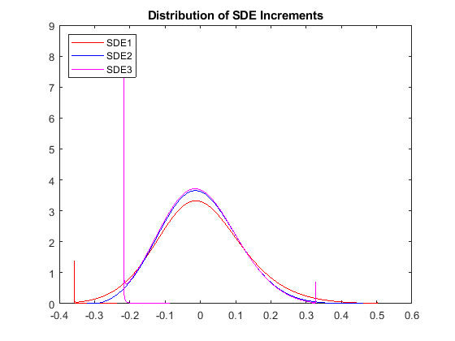](https://postimages.org/)

Variance always might not necessarily be higher for SDEs without mean reversion. These are small small samples and
particular sequence of random variate can greatly change the properties of the SDE increments and below is another graph
where variance is higher for incremetns of mean reverting SDE but higher standardized moments are still much smaller. I
just used a different random number seed with the same program to create this scenario.

[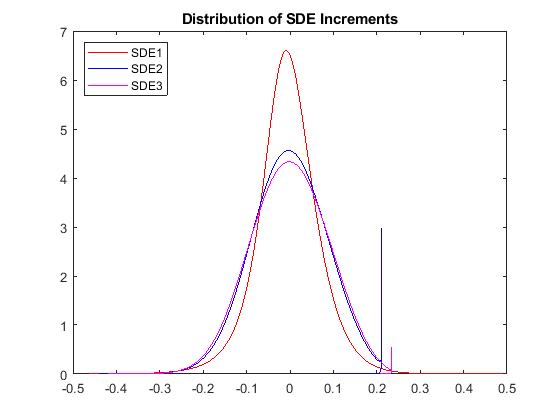](https://postimages.org/)

---

### #1884 — Amin (Topic Author)
*July 20, 2023, 10:19 PM*

Tomorrow, I will post version of this new program (I am posting today in original coordinates) with Bessel coordinates
and also my program for SDE parameters finding through maximization of log-likelihood along the realization of SDE
stochastic process.

This program generates an SDE data with monte carlo simulation using just one path i.e one realization of SDE stochastic
process for N Time steps. Then given the SDE random increments, we match moments/second moments of SDE increments
with analytic moments/variance of the SDE given the SDE starting value at each point.

In this program I just match second moments since it is quick and effective for volatility. But you can alter the moment
match criteria in function

CalculateMomentsMatchObjFunction0 to include higher moments in the criteria of fit.

We iterate over volatility coefficients to find the best fit of 2nd moment/moments i.e where average analytic moments of
SDE increments

match best with the data moments of SDE increments.

The program also iterates over drift coefficients but that is ineffective and their matching has not much effect. It can
only be used to find

volatility coefficients if structure of the SDE volatility is known. SDE is

 dXt = (mu1 Xt^beta1 + mu2 Xt^beta2) dt + sigma0 * Xt^ gamma * dZt

 We suppose that gamma is known to us and this program does not calculate  gamma. It calculates sigma0 only given the
data.

Finding both gamma and sigma0 together is part of larger research project and I hope to do work on that.

```
function [] = OptimizeSDEParametersFromData04()

%This program generates an SDE data with monte carlo simulation using just
%one path i.e one realization of SDE stochastic process. Then given the SDE
%random increments, we match moments/secon moments of SDE increments with
%analytic moments/variance of the SDE given the SDE starting value at each point.
%In this program I just match second moments since it is quick and effective for volatility. But
%you can alter the moment match criteria in function
%CalculateMomentsMatchObjFunction0 to include higher moments in the criteria of fit.
%We iterate over volatility coefficients to find the best fit of
%2nd moment/moments i.e where average analytic moments of SDE increments
%match best with the data moments of SDE increments.
%The program also iterates over drift coefficients but that is ineffective
%and their matching has not much effect. It can only be used to find
%volatility coefficients if structure of the SDE volatility is known. SDE
%is
% dXt = (mu1 Xt^beta1 + mu2 Xt^beta2) dt + sigma0 * Xt^ gamma * dZt
% We suppose that gamma is known to us and this program does not calculate
% gamma. It calculates sigma0 only given the data.
%Finding both gamma and sigma0 is part of larger research project and I
%hope to do work on that later.

dt=.125/2/2;   % Simulation time interval.%Fodiffusions close to zero
             %decrease dt for accuracy.
Tt=400;%128/2;     % Number of simulation levels. Terminal time= Tt*dt; //.125/32*32*16=2 year;
x0=1.0;   % starting value of SDE
beta1=0.0;
beta2=1.0;   % Second drift term power.
gamma=.95;%50;   % volatility power.
kappa=0.0;%.950;   %mean reversion parameter.
theta=.850;%mean reversion target
sigma0=.55;%Volatility value

%you can specify any general mu1 and mu2 and beta1 and beta2.
mu1=1*theta*kappa;   %first drift coefficient.
mu2=-1*kappa;    % Second drift coefficient.

rng(29079137, 'twister')
%rng(41738295, 'twister')
%rng(13287657, 'twister')
%rng(58231964, 'twister')
Random0(1:Tt)=0;
Random0=randn(size(Random0));

[X] = GenerateSDEDataWithRandomVariates(x0,mu1,mu2,beta1,beta2,sigma0,gamma,dt,Tt,Random0);

N=Tt;
NMoments=8;
for pp=1:NMoments
rMu(pp)=sum((X(2:N+1)-X(1:N)).^pp)/(N);
end

%In the program input volatility coefficients used to generate data
%is sigma0 while optimized volatility coefficients is sigma00.
%Similarly input drift coefficients are mu1 and mu2 while optimized values
%are mu10 and mu20,

%Below we find a good starting guess for volatility.

sigma00=sqrt(rMu(2)/sum(((X)).^(2*gamma))*N/dt);

sigma00
sigma0
str=input("Look at sigma00 which is initial guess");

mu10=0;
mu20=0;
%Above are starting values for the optimization of drift coefficients

%Below, this function is used to calculate the average of true
% analytic moments of SDE given starting point at each increment. These are
% averaged over all the SDE increments in the path. These are the ones we will match with the
% moments of SDE data increments.
[Moments] = CalculateSDEMomentsFromData(X,mu10,mu20,beta1,beta2,sigma00,gamma,dt,NMoments,N);
[ObjBest] =CalculateMomentsMatchObjFunction0(Moments,NMoments,rMu);

DDiv=32;
Convergence=0;
for mm=1:200

if(~Convergence)

sigma0Try=sigma00+.0125/16;
[Moments] = CalculateSDEMomentsFromData(X,mu10,mu20,beta1,beta2,sigma0Try,gamma,dt,NMoments,N);

%Below is the objective function that compares second moments. You can alter
%this function to include all moments in the match.
[ObjNew] =CalculateMomentsMatchObjFunction0(Moments,NMoments,rMu);
if((ObjNew150)
mu10Try=mu10+.0125/DDiv;
[Moments] = CalculateSDEMomentsFromData(X,mu10Try,mu20,beta1,beta2,sigma00,gamma,dt,NMoments,N);

[ObjNew] =CalculateMomentsMatchObjFunction0(Moments,NMoments,rMu);
%ObjNew=(Moments(2)-rMu(2))+(Moments(4)-rMu(4)).^.25+(Moments(6)-rMu(6)).^.1666+(Moments(8)-rMu(8)).^.125;

if((ObjNew10)
if(ObjBestBefore==ObjBest)
    Convergence=1;
end
end
ObjBestBefore=ObjBest;
end
end

%The function below calculates moments of SDE increments from the best
%optimized (matched to data) values of SDE parameters.

[Moments] = CalculateSDEMomentsFromData(X,mu10best,mu20best,beta1,beta2,sigma00best,gamma,dt,NMoments,N);

rMu
%cMu
Moments

%These moments are used to draw the distribution of analytic moments of the
%increments of the matched SDE and its density is created from its moments. Then
%SDE data increments moments are used to construct the distribution of realized
%increments of SDE. Both distributions are matched below.

clf;
%Analytic SDE increments distribution
[c0,c,FittedMoments] = CalculateZSeriesDensityFromRawMoments02(Moments);
hold on;
%SDE increments distribution from data
[b0,b,FittedMoments] = CalculateZSeriesDensityFromRawMoments02(rMu);
clf;

PlotZSeriesDensity(c0,c,'r')
hold on;
PlotZSeriesDensity(b0,b,'g')

legend({'Analytic Matched SDE Increments Distribution','Actual DATA SDE Increments Distribution
'},'Location','northwest')
title('Comparison of Analytic Matched SDE increments Density and Realized DATA SDE Increments Denstiy');

sigma0
sigma00
str=input("sigma0 is input volatility and sigma00 is volatility found from the algorithm");
display("Though analytic and data distributions of SDE incremetns might not alwyas match well,Match to sigma0 is usually
good");

end

```

.

.

.

```
function [Moments] = CalculateSDEMomentsFromData(X,mu1,mu2,beta1,beta2,sigma0,gamma,dt,NMoments,N)

A=(mu1.*X.^beta1 + mu2*X.^beta2).*dt + ...
    (mu1.^2.*beta1.*X.^(2*beta1-1)+mu2.^2.*beta2.*X.^(2*beta2-1)+ (mu1*mu2).*(beta1+beta2).*X.^(beta1+beta2-1) + ...
   
.5*sigma0^2.*mu1*beta1*(beta1-1).*X.^(beta1+2*gamma-2)+.5*sigma0^2.*mu2*beta2*(beta2-1).*X.^(beta2+2*gamma-2))*dt^2/2;
B=sigma0.*X.^gamma*sqrt(dt) + ...
    (mu1*beta1.*X.^(beta1+gamma-1)+ mu2*beta2.*X.^(beta2+gamma-1)).*sigma0*(1-1/sqrt(3))*dt^1.5+ ...
    (mu1*X.^(beta1+gamma-1)+mu2*X.^(beta2+gamma-1)).*gamma.*sigma0*1/sqrt(3).*dt^(1.5)+ ...
    .5*sigma0^3*gamma*(gamma-1).*X.^(3*gamma-2)*dt^1.5;

C=sigma0^2*X.^(2*gamma-1)*dt/2;

EA(1:NMoments)=0;
EB(1:NMoments)=0;
EC(1:NMoments)=0;
EAB(1:NMoments,1:NMoments)=0;
EAC(1:NMoments,1:NMoments)=0;
EBC(1:NMoments,1:NMoments)=0;
EABC(1:NMoments,1:NMoments,1:NMoments)=0;

for mm=1:NMoments
        EA(mm)=sum(A.^mm)/N;
        EB(mm)=sum(B.^mm)/N;
        EC(mm)=sum(C.^mm)/N;

end

% EA
% EB
% EC
% A
% str=input("Look at moments inside the function");

for mm=1:NMoments
    for nn=1:NMoments-mm
        EAB(mm,nn)=sum(A.^mm .* B.^nn)/N;
        EAC(mm,nn)=sum(A.^mm .* C.^nn)/N;
    end
    for nn=1:NMoments-mm
      EBC(mm,nn)=sum(B.^mm .* C.^nn)/N;
    end
end

for mm=1:NMoments
    for nn=1:NMoments-mm
        for ll=1:NMoments-mm-nn

            EABC(mm,nn,ll)=sum(A.^mm .* B.^nn .* C.^ll)/N;

        end
    end
end

c0=0;
c(1)=1;
c(2)=0;
d0=-1;
d(1)=0;
d(2)=1;

[EH1,EH2,EH1H2] = CalculateSeriesProducts(c0,c,d0,d,2,8);

%EH1H2
%str=input("Look at hermite product series coeffs");

Moments(1)=EA(1)+ EB(1).*EH1(1)+EC(1).*EH2(1);

Moments(2)=EA(2) + 2* EAB(1,1).* EH1(1) + EB(2).* EH1(2) + 2* EAC(1,1).* EH2(1) + 2 *EBC(1,1).* EH1H2(1,1) + ...
 EC(2).* EH2(2);

Moments(3)=EA(3)+3* EAB(2,1).* EH1(1)+3 * EAB(1,2).* EH1(2)+EB(3).* EH1(3)+ ...
    3* EAC(2,1).* EH2(1) +6 * EABC(1,1,1)* EH1H2(1,1)+3* EBC(2,1).* EH1H2(2,1)+ ...
    3* EAC(1,2).* EH2(2)+3* EBC(1,2).* EH1H2(1,2)+EC(3)* EH2(3);

Moments(4)=EA(4)+4* EAB(3,1).* EH1(1)+6* EAB(2,2).* EH1(2)+4* EAB(1,3).* EH1(3)+ ...
    EB(4).* EH1(4)+4* EAC(3,1).* EH2(1)+12* EABC(2,1,1).* EH1H2(1,1) + ...
    12* EABC(1,2,1).* EH1H2(2,1)+4* EBC(3,1).* EH1H2(3,1)+6* EAC(2,2)* EH2(2)+ ...
    12* EABC(1,1,2).* EH1H2(1,2)+6* EBC(2,2).* EH1H2(2,2) +4 *EAC(1,3).* EH2(3)+ ...
    4* EBC(1,3).* EH1H2(1,3)+EC(4).* EH2(4);

Moments(5)=EA(5)+5* EAB(4,1).* EH1(1)+10* EAB(3,2).* EH1(2)+10* EAB(2,3).* EH1(3)+ ...
    5* EAB(1,4).* EH1(4)+EB(5).* EH1(5)+5* EAC(4,1).* EH2(1)+20* EABC(3,1,1).* EH1H2(1,1) + ...
    30* EABC(2,2,1)*EH1H2(2,1)+20* EABC(1,3,1).* EH1H2(3,1)+5* EBC(4,1)* EH1H2(4,1)+ ...
    10 *EAC(3,2).* EH2(2)+30* EABC(2,1,2)* EH1H2(1,2)+ 30* EABC(1,2,2).* EH1H2(2,2) + ...
    10* EBC(3,2).* EH1H2(3,2)+10* EAC(2,3).* EH2(3)+20* EABC(1,1,3).* EH1H2(1,3)+ ...
    10* EBC(2,3).* EH1H2(2,3)+5* EAC(1,4).* EH2(4)+5* EBC(1,4).* EH1H2(1,4)+EC(5).* EH2(5);

Moments(6)=EA(6)+6* EAB(5,1)* EH1(1)+15* EAB(4,2).* EH1(2)+20* EAB(3,3).* EH1(3)+ ...
    15 *EAB(2,4).* EH1(4)+6 *EAB(1,5)* EH1(5)+ EB(6).* EH1(6)+6* EAC(5,1).* EH2(1)+ ...
    30* EABC(4,1,1)* EH1H2(1,1)+60* EABC(3,2,1)* EH1H2(2,1)+60* EABC(2,3,1).* EH1H2(3,1) + ...
    30* EABC(1,4,1)* EH1H2(4,1)+6* EBC(5,1).* EH1H2(5,1)+15* EAC(4,2)* EH2(2)+ ...
    60* EABC(3,1,2).* EH1H2(1,2)+90* EABC(2,2,2).* EH1H2(2,2)+60* EABC(1,3,2).* EH1H2(3,2) + ...
    15* EBC(4,2)* EH1H2(4,2)+20* EAC(3,3).* EH2(3)+60* EABC(2,1,3).* EH1H2(1,3) + ...
    60* EABC(1,2,3).* EH1H2(2,3)+20* EBC(3,3).* EH1H2(3,3) +15* EAC(2,4).* EH2(4)+ ...
    30* EABC(1,1,4).* EH1H2(1,4)+15* EBC(2,4).* EH1H2(2,4)+ 6* EAC(1,5).* EH2(5) + ...
    6* EBC(1,5).* EH1H2(1,5)+EC(6).* EH2(6);

Moments(7)=EA(7)+7* EAB(6,1).* EH1(1)+21* EAB(5,2).* EH1(2)+35* EAB(4,3)* EH1(3)+ ...
    35* EAB(3,4).* EH1(4)+21* EAB(2,5)* EH1(5)+7 * EAB(1,6)* EH1(6)+EB(7).* EH1(7) + ...
    7* EAC(6,1).* EH2(1)+42* EABC(5,1,1).* EH1H2(1,1)+105* EABC(4,2,1).*EH1H2(2,1)+ ...
    140* EABC(3,3,1)*EH1H2(3,1)+105* EABC(2,4,1).* EH1H2(4,1)+42* EABC(1,5,1)* EH1H2(5,1)+ ...
    7* EBC(6,1)* EH1H2(6,1)+21 *EAC(5,2)* EH2(2) +105* EABC(4,1,2)* EH1H2(1,2)+ ...
    210* EABC(3,2,2)* EH1H2(2,2)+210* EABC(2,3,2)* EH1H2(3,2)+105* EABC(1,4,2).* EH1H2(4,2) + ...
    21* EBC(5,2)* EH1H2(5,2)+35* EAC(4,3).* EH2(3) +140* EABC(3,1,3).* EH1H2(1,3) + ...
    210* EABC(2,2,3)* EH1H2(2,3)+140 * EABC(1,3,3).* EH1H2(3,3)+35* EBC(4,3).* EH1H2(4,3) + ...
    35* EAC(3,4).* EH2(4)+105* EABC(2,1,4).* EH1H2(1,4)+105* EABC(1,2,4)* EH1H2(2,4)+ ...
    35* EBC(3,4).* EH1H2(3,4)+21* EAC(2,5)* EH2(5)+42* EABC(1,1,5).* EH1H2(1,5) + ...
    21 *EBC(2,5).* EH1H2(2,5)+7 *EAC(1,6).* EH2(6)+7* EBC(1,6).* EH1H2(1,6)+EC(7).* EH2(7);

Moments(8)=EA(8)+8* EAB(7,1)* EH1(1)+28* EAB(6,2).* EH1(2)+56* EAB(5,3).* EH1(3)+ ...
    70* EAB(4,4).* EH1(4)+56 *EAB(3,5).* EH1(5)+28* EAB(2,6).* EH1(6)+8* EAB(1,7).* EH1(7)+ ...
    EB(8).* EH1(8)+8* EAC(7,1).* EH2(1)+56* EABC(6,1,1)* EH1H2(1,1)+168* EABC(5,2,1).* EH1H2(2,1)+ ...
    280* EABC(4,3,1).* EH1H2(3,1)+280* EABC(3,4,1)* EH1H2(4,1)+168* EABC(2,5,1)* EH1H2(5,1)+ ...
    56* EABC(1,6,1).* EH1H2(6,1)+8* EBC(7,1).* EH1H2(7,1)+28* EAC(6,2).* EH2(2)+ ...
    168* EABC(5,1,2).* EH1H2(1,2) +420* EABC(4,2,2).* EH1H2(2,2)+560* EABC(3,3,2)* EH1H2(3,2)+ ...
    420* EABC(2,4,2).* EH1H2(4,2)+168* EABC(1,5,2).* EH1H2(5,2)+28* EBC(6,2).* EH1H2(6,2)+ ...
    56* EAC(5,3)* EH2(3)+280* EABC(4,1,3).* EH1H2(1,3) + 560* EABC(3,2,3).* EH1H2(2,3) + ...
    560* EABC(2,3,3).* EH1H2(3,3) +280* EABC(1,4,3).* EH1H2(4,3)+56* EBC(5,3).* EH1H2(5,3)+ ...
    70* EAC(4,4)* EH2(4)+280* EABC(3,1,4).* EH1H2(1,4)+420* EABC(2,2,4).* EH1H2(2,4) + ...
    280* EABC(1,3,4).* EH1H2(3,4)+70* EBC(4,4)* EH1H2(4,4) + 56* EAC(3,5).* EH2(5)+ ...
    168* EABC(2,1,5)* EH1H2(1,5)+168* EABC(1,2,5).* EH1H2(2,5)+56* EBC(3,5).* EH1H2(3,5)+ ...
    28* EAC(2,6).* EH2(6)+56* EABC(1,1,6).* EH1H2(1,6) +28* EBC(2,6)* EH1H2(2,6) + ...
    8* EAC(1,7).* EH2(7)+8* EBC(1,7).* EH1H2(1,7)+EC(8).* EH2(8);

end

```

.

.

.

```
function [ObjNew] =CalculateMomentsMatchObjFunction0(Moments,NMoments,sMu)
%[Moments] = CalculateMomentsOfZSeries(c0,c,SeriesOrder,NMoments);

 if(NMoments==8)
%   
 ObjNew=((sMu(1)-Moments(1))/sMu(1)).^2+factorial(8).*((sMu(2)-Moments(2))/sMu(2)).^2+((sMu(3)-Moments(3))).^2+factorial(6)*((sMu(4)-Moments(4))/sMu(4)).^2+
...
%     ((sMu(5)-Moments(5))).^2+factorial(4)*((sMu(6)-Moments(6))/sMu(6)).^2+((sMu(7)-Moments(7))).^2+ ...
%     factorial(2)*((sMu(8)-Moments(8))/sMu(8)).^2;

ObjNew=((sMu(2)-Moments(2))/sMu(2)).^2;

%ObjNew=((sMu(1)-Moments(1))/sMu(1)).^2*0+factorial(8).*((sMu(2)-Moments(2))/sMu(2)).^2;%+0*((sMu(3)-Moments(3))).^2+factorial(6)*((sMu(4)-Moments(4))/sMu(4)).^2;%+
...
%    ((sMu(5)-Moments(5))).^2+factorial(4)*((sMu(6)-Moments(6))/sMu(6)).^2+((sMu(7)-Moments(7))).^2+ ...
%    factorial(2)*((sMu(8)-Moments(8))/sMu(8)).^2;

%
%if((sMu(3)<.00001) || (sMu(5)<.00001) || (sMu(7)<.00001))  %If Odd standardized input Moments are zero
  %   ObjNew=((sMu(2)-Moments(2))/sMu(2)).^2+((sMu(3)-Moments(3))).^2+((sMu(4)-Moments(4))/sMu(4)).^2+ ...
  %  ((sMu(5)-Moments(5))).^2+((sMu(6)-Moments(6))/sMu(6)).^2+((sMu(7)-Moments(7))).^2+ ...
  %  ((sMu(8)-Moments(8))/sMu(8)).^2;
%   
ObjNew=20*((sMu(1)-Moments(1))/sMu(1)).^2+10000*((sMu(2)-Moments(2))/sMu(2)).^2+100*((sMu(3)-Moments(3))).^2+200*((sMu(4)-Moments(4))/sMu(4)).^2+
...
%    ((sMu(5)-Moments(5))).^2+20*((sMu(6)-Moments(6))/sMu(6)).^2+((sMu(7)-Moments(7))).^2+ ...
%    ((sMu(8)-Moments(8))/sMu(8)).^2;
%else
%   
ObjNew=((sMu(1)-Moments(1))/sMu(1)).^2+((sMu(2)-Moments(2))/sMu(2)).^2+((sMu(3)-Moments(3))/sMu(3)).^2+((sMu(4)-Moments(4))/sMu(4)).^2+
...
%    ((sMu(5)-Moments(5))/sMu(5)).^2+((sMu(6)-Moments(6))/sMu(6)).^2+((sMu(7)-Moments(7))/sMu(7)).^2+ ...
%    ((sMu(8)-Moments(8))/sMu(8)).^2;
%end
end

if(NMoments==6)
if((sMu(3)<.00001) || (sMu(5)<.00001))  %If Odd standardized input Moments are zero
     ObjNew=((sMu(2)-Moments(2))/sMu(2)).^2+((sMu(3)-Moments(3))).^2+((sMu(4)-Moments(4))/sMu(4)).^2+ ...
    ((sMu(5)-Moments(5))).^2+((sMu(6)-Moments(6))/sMu(6)).^2;
else
    ObjNew=((sMu(2)-Moments(2))/sMu(2)).^2+((sMu(3)-Moments(3))/sMu(3)).^2+((sMu(4)-Moments(4))/sMu(4)).^2+ ...
    ((sMu(5)-Moments(5))/sMu(5)).^2+((sMu(6)-Moments(6))/sMu(6)).^2;
end
end

if(NMoments==4)
if((sMu(3)<.00001))  %If Odd standardized input Moments are zero
     ObjNew=((sMu(2)-Moments(2))/sMu(2)).^2+((sMu(3)-Moments(3))).^2+((sMu(4)-Moments(4))/sMu(4)).^2;
else
    ObjNew=((sMu(2)-Moments(2))/sMu(2)).^2+((sMu(3)-Moments(3))/sMu(3)).^2+((sMu(4)-Moments(4))/sMu(4)).^2;
end
end

%sMu
%Moments
%str=input("Look at numbers");
end

```

.

.

.

```
function [XX] = GenerateSDEDataWithRandomVariates(x0,mu1,mu2,beta1,beta2,sigma0,gamma,dt,Tt,Random0)

OrderA=4;
OrderM=4;
dtM=dt;
alpha=1;% x^alpha is being expanded. This is currently for monte carlo only.

%%%%%%%%%%%%%%%%%%%%%%%%%%%%%%%%%%%%%%%%%%%%%%%%%%%%%%%%%%%%%%%%%%%%%%%%%%%%%%%%%%%%%%%%%%%%%%
%This block is analytics for higher order monte carlo. This is explained in
%my thread on wilmott.com

sigma11(1:OrderA+1)=0;
mu11(1:OrderA+1)=0;
mu22(1:OrderA+1)=0;
sigma22(1:OrderA+1)=0;
% index 1 correponds to zero level since matlab indexing starts at one.
sigma11(1)=1;
mu11(1)=1;
mu22(1)=1;
sigma22(1)=1;

for k=1:(OrderA+1)
    if sigma0~=0
        sigma11(k)=sigma0^(k-1);
    end
    if mu1 ~= 0
        mu11(k)=mu1^(k-1);
    end
    if mu2 ~= 0
        mu22(k)=mu2^(k-1);
    end
    if sigma0~=0
        sigma22(k)=sigma0^(2*(k-1));
    end
end
%Ft(1:TtM+1,1:(OrderA+1),1:(OrderA+1),1:(OrderA+1),1:(OrderA+1))=0; %General time powers on hermite polynomials
Fp(1:(OrderA+1),1:(OrderA+1),1:(OrderA+1),1:(OrderA+1))=0;%General x powers on coefficients of hermite polynomials.
%Fp1(1:(OrderA+1),1:(OrderA+1),1:(OrderA+1),1:(OrderA+1))=0;%General x powers for bessel transformed coordinates.

%YCoeff0 and YCoeff are coefficents for original coordinates monte carlo.
%YqCoeff0 and YqCoeff are bessel/lamperti version monte carlo.

YCoeff0(1:(OrderA+1),1:(OrderA+1),1:(OrderA+1),1:(OrderA+1))=0;
%YqCoeff0(1:(OrderA+1),1:(OrderA+1),1:(OrderA+1),1:(OrderA+1))=0;
%Pre-compute the time and power exponent values in small multi-dimensional arrays
YCoeff = ItoTaylorCoeffsNew(alpha,beta1,beta2,gamma); %expand y^alpha where alpha=1;
%YqCoeff = ItoTaylorCoeffsNew(alpha1,beta1,beta2,gamma);%expand y^alpha1 where alpha1=(1-gamma)
%YqCoeff=YqCoeff/(1-gamma); %Transformed coordinates coefficients have to be
%further divided by (1-gamma)

for k = 0 : (OrderA)
    for m = 0:k
        l4 = k - m + 1;
        for n = 0 : m
            l3 = m - n + 1;
            for j = 0:n
                l2 = n - j + 1;
                l1 = j + 1;
                %Ft(l1,l2,l3,l4) = dtM^((l1-1) + (l2-1) + (l3-1) + .5* (l4-1));
                Fp(l1,l2,l3,l4) = (alpha + (l1-1) * beta1 + (l2-1) * beta2 + (l3-1) * 2* gamma + (l4-1) * gamma ...
                    - (l1-1) - (l2-1) - 2* (l3-1) - (l4-1));
%                Fp1(l1,l2,l3,l4) = (alpha1 + (l1-1) * beta1 + (l2-1) * beta2 + (l3-1) * 2* gamma + (l4-1) * gamma ...
%                    - (l1-1) - (l2-1) - 2* (l3-1) - (l4-1));

                YCoeff0(l1,l2,l3,l4) =YCoeff(l1,l2,l3,l4).*mu11(l1).*mu22(l2).*sigma22(l3).*sigma11(l4);
%                YqCoeff0(l1,l2,l3,l4) =YqCoeff(l1,l2,l3,l4).*mu11(l1).*mu22(l2).*sigma22(l3).*sigma11(l4);
            end
        end
    end
end

%%%%%%%%%%%%%%%%%%%%%%%%%%%%%%%%%%%%%%%%%%%%%%%%%%%%%%%%%%%%%%%%%%%%%%%%%%%%%%%%%%%%%%%%%%%%%%

%rng(29079137, 'twister')
%rng(93289637, 'twister')
paths=1;
YY(1:paths)=x0;  %Original process monte carlo.

XX(1)=x0;
Random1(1:paths)=0;

for tt=1:Tt

    %Random1=randn(size(Random1));
    Random1=Random0(tt);
    HermiteP1(1,1:paths)=1;
    HermiteP1(2,1:paths)=Random1(1:paths);
    HermiteP1(3,1:paths)=Random1(1:paths).^2-1;
    HermiteP1(4,1:paths)=Random1(1:paths).^3-3*Random1(1:paths);
    HermiteP1(5,1:paths)=Random1(1:paths).^4-6*Random1(1:paths).^2+3;

 %%%%%%%%%%%%%%%%%%%%%%%%%%%%%%%%%%%%%%%%%%%%%%%%%%%%%%%%%%%%%%%%%%%%%%%%5

  YY(1:paths)=YY(1:paths) + ...
        (YCoeff0(1,1,2,1).*YY(1:paths).^Fp(1,1,2,1)+ ...
        YCoeff0(1,2,1,1).*YY(1:paths).^Fp(1,2,1,1)+ ...
        YCoeff0(2,1,1,1).*YY(1:paths).^Fp(2,1,1,1))*dtM + ...
        (YCoeff0(1,1,3,1).*YY(1:paths).^Fp(1,1,3,1)+ ...
        YCoeff0(1,2,2,1).*YY(1:paths).^Fp(1,2,2,1)+ ...
        YCoeff0(2,1,2,1).*YY(1:paths).^Fp(2,1,2,1)+ ...
        YCoeff0(1,3,1,1).*YY(1:paths).^Fp(1,3,1,1)+ ...
        YCoeff0(2,2,1,1).*YY(1:paths).^Fp(2,2,1,1)+ ...
        YCoeff0(3,1,1,1).*YY(1:paths).^Fp(3,1,1,1))*dtM^2 + ...
        (YCoeff0(1,1,1,2).*YY(1:paths).^Fp(1,1,1,2).*sqrt(dtM)+ ...
        (YCoeff0(1,1,2,2).*YY(1:paths).^Fp(1,1,2,2)+ ...
        YCoeff0(1,2,1,2).*YY(1:paths).^Fp(1,2,1,2)+ ...
        YCoeff0(2,1,1,2).*YY(1:paths).^Fp(2,1,1,2)).*dtM^1.5) .*HermiteP1(2,1:paths) + ...
        (YCoeff0(1,1,1,3).*YY(1:paths).^Fp(1,1,1,3) *dtM ).*HermiteP1(3,1:paths);

%     YY(1:paths)=YY(1:paths) + ...
%         (YCoeff0(1,1,2,1).*YY(1:paths).^Fp(1,1,2,1)+ ...
%         YCoeff0(1,2,1,1).*YY(1:paths).^Fp(1,2,1,1)+ ...
%         YCoeff0(2,1,1,1).*YY(1:paths).^Fp(2,1,1,1))*dtM + ...
%         (YCoeff0(1,1,3,1).*YY(1:paths).^Fp(1,1,3,1)+ ...
%         YCoeff0(1,2,2,1).*YY(1:paths).^Fp(1,2,2,1)+ ...
%         YCoeff0(2,1,2,1).*YY(1:paths).^Fp(2,1,2,1)+ ...
%         YCoeff0(1,3,1,1).*YY(1:paths).^Fp(1,3,1,1)+ ...
%         YCoeff0(2,2,1,1).*YY(1:paths).^Fp(2,2,1,1)+ ...
%         YCoeff0(3,1,1,1).*YY(1:paths).^Fp(3,1,1,1))*dtM^2 + ...
%        (YCoeff0(1,1,4,1).*YY(1:paths).^Fp(1,1,4,1)+ ...
%         YCoeff0(1,2,3,1).*YY(1:paths).^Fp(1,2,3,1)+ ...
%         YCoeff0(2,1,3,1).*YY(1:paths).^Fp(2,1,3,1)+ ...
%         YCoeff0(1,3,2,1).*YY(1:paths).^Fp(1,3,2,1)+ ...
%         YCoeff0(2,2,2,1).*YY(1:paths).^Fp(2,2,2,1)+ ...
%         YCoeff0(3,1,2,1).*YY(1:paths).^Fp(3,1,2,1)+ ...
%         YCoeff0(1,4,1,1).*YY(1:paths).^Fp(1,4,1,1)+ ...
%         YCoeff0(2,3,1,1).*YY(1:paths).^Fp(2,3,1,1)+ ...
%         YCoeff0(3,2,1,1).*YY(1:paths).^Fp(3,2,1,1)+ ...
%         YCoeff0(4,1,1,1).*YY(1:paths).^Fp(4,1,1,1))*dtM^3 + ...
%         ((YCoeff0(1,1,1,2).*YY(1:paths).^Fp(1,1,1,2).*sqrt(dtM))+ ...
%         (YCoeff0(1,1,2,2).*YY(1:paths).^Fp(1,1,2,2)+ ...
%         YCoeff0(1,2,1,2).*YY(1:paths).^Fp(1,2,1,2)+ ...
%         YCoeff0(2,1,1,2).*YY(1:paths).^Fp(2,1,1,2)).*dtM^1.5 + ...
%         (YCoeff0(1,1,3,2).*YY(1:paths).^Fp(1,1,3,2)+ ...
%         YCoeff0(1,2,2,2).*YY(1:paths).^Fp(1,2,2,2)+ ...
%         YCoeff0(2,1,2,2).*YY(1:paths).^Fp(2,1,2,2)+ ...
%         YCoeff0(1,3,1,2).*YY(1:paths).^Fp(1,3,1,2)+ ...
%         YCoeff0(2,2,1,2).*YY(1:paths).^Fp(2,2,1,2)+ ...
%         YCoeff0(3,1,1,2).*YY(1:paths).^Fp(3,1,1,2)).*dtM^2.5) .*HermiteP1(2,1:paths) + ...
%         (YCoeff0(1,1,1,3).*YY(1:paths).^Fp(1,1,1,3) *dtM + ...
%         (YCoeff0(1,1,2,3).*YY(1:paths).^Fp(1,1,2,3)+ ...
%         YCoeff0(1,2,1,3).*YY(1:paths).^Fp(1,2,1,3)+ ...
%         YCoeff0(2,1,1,3).*YY(1:paths).^Fp(2,1,1,3)).*dtM^2+ ...
%         (YCoeff0(1,1,3,3).*YY(1:paths).^Fp(1,1,3,3)+ ...
%         YCoeff0(1,2,2,3).*YY(1:paths).^Fp(1,2,2,3)+ ...
%         YCoeff0(2,1,2,3).*YY(1:paths).^Fp(2,1,2,3)+ ...
%         YCoeff0(1,3,1,3).*YY(1:paths).^Fp(1,3,1,3)+ ...
%         YCoeff0(2,2,1,3).*YY(1:paths).^Fp(2,2,1,3)+ ...
%         YCoeff0(3,1,1,3).*YY(1:paths).^Fp(3,1,1,3)).*dtM^3).*HermiteP1(3,1:paths) + ...
%         ((YCoeff0(1,1,1,4).*YY(1:paths).^Fp(1,1,1,4)*dtM^1.5 )).*HermiteP1(4,1:paths) + ...
%         (YCoeff0(1,1,1,5).*YY(1:paths).^Fp(1,1,1,5)*dtM^2.0).*HermiteP1(5,1:paths);

    YY(YY<=0)=.000001;
    XX(tt+1)=YY(1);

    %YY(isnan(YY))=0;

end

end

```

.

.

sigma0 =

   0.550000000000000

sigma00 =

   0.570140362505905

sigma0 is input volatility and sigma00 is volatility found from the algorithm

.

[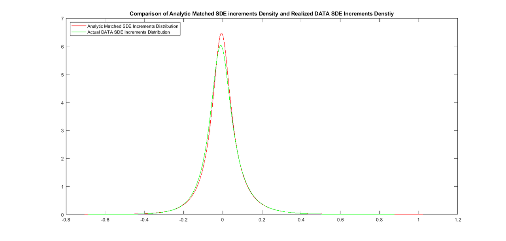](https://postimg.cc/4HVN2gpL)

---

### #1885 — Amin (Topic Author)
*July 21, 2023, 7:30 AM*

This program is different from previous program in that it does all the calculations to determine volatility on Bessel
increments. We once transform the data into bessel coordinates and then continue to do analytics on Bessel SDE
increments. It is very similar to last program and not any more difficult at all.

I ran the bessel program and the original coordinates program of yesterday and generated the same data for all of the
monte carlo seeds for both variants. I noticed that for all the four seeds, Bessel program volatility was 0-3 percentage
points closer to true volatility used to generate the data.

```
function [] = OptimizeSDEParametersFromDataBessel04()

%This program is different from previous program in that it does all the
%calculations on Bessel increments. We once transform the data into bessel
%coordinates and then continue to do analytics on Bessel SDE increments.
%This program generates an SDE data with monte carlo simulation using just
%one path i.e one realization of SDE stochastic process. Then given the SDE
%random increments, we match moments/secon moments of SDE increments with
%analytic moments/2nd moment of the SDE given the SDE starting value at each point.
%In this program I just match second moments since it is quick and effective for volatility. But
%you can alter the moment match criteria in function
%CalculateMomentsMatchObjFunction0 to include higher moments in the criteria of fit.
%We iterate over volatility coefficients to find the best fit of
%2nd moment/moments i.e where average analytic moments of SDE increments
%match best with the data moments of SDE increments.
%The program also iterates over drift coefficients but that is ineffective
%and their matching has not much effect. It can only be used to find
%volatility coefficients if structure of the SDE volatility is known. SDE
%is
% dXt = (mu1 Xt^beta1 + mu2 Xt^beta2) dt + sigma0 * Xt^ gamma * dZt
% We suppose that gamma is known to us and this program does not calculate
% gamma. It calculates sigma0 only given the data.
%Finding both gamma and sigma0 is part of larger research project and I
%hope to do work on that later.

dt=.125/2/2;   % Simulation time interval.%Fodiffusions close to zero
             %decrease dt for accuracy.
Tt=400;%128/2;     % Number of simulation levels. Terminal time= Tt*dt; //.125/32*32*16=2 year;
x0=1.0;   % starting value of SDE
beta1=0.0;
beta2=1.0;   % Second drift term power.
gamma=.95;%50;   % volatility power.
kappa=0.0;%.950;   %mean reversion parameter.
theta=.850;%mean reversion target
sigma0=.55;%Volatility value

%you can specify any general mu1 and mu2 and beta1 and beta2.
mu1=1*theta*kappa;   %first drift coefficient.
mu2=-1*kappa;    % Second drift coefficient.

rng(29079137, 'twister')
%rng(41738295, 'twister')
%rng(13287657, 'twister')
%rng(58231964, 'twister')
Random0(1:Tt)=0;
Random0=randn(size(Random0));

[X] = GenerateSDEDataWithRandomVariates(x0,mu1,mu2,beta1,beta2,sigma0,gamma,dt,Tt,Random0);

W=X.^(1-gamma)/(1-gamma);
dW(1:Tt-1)=W(2:Tt)-W(1:Tt-1);

N=Tt-1;
NMoments=8;
for pp=1:NMoments
rMu(pp)=sum((W(2:N+1)-W(1:N)).^pp)/(N);
end

%In the program input volatility coefficients used to generate data
%is sigma0 while optimized volatility coefficients is sigma00.
%Similarly input drift coefficients are mu1 and mu2 while optimized values
%are mu10 and mu20,

%Below we find a good starting guess for volatility.

sigma00=sqrt(rMu(2)/dt);

sigma00
sigma0
str=input("Look at sigma00 which is initial guess");

mu10=0;
mu20=0;
%Above are starting values for the optimization of drift coefficients

%Below, this function is used to calculate the average of true
% analytic moments of SDE given starting point at each increment. These are
% averaged over all the SDE increments in the path. These are the ones we will match with the
% moments of SDE data increments.
[Moments] = CalculateSDEMomentsFromDataBessel(X,mu10,mu20,beta1,beta2,sigma00,gamma,dt,NMoments,N);
[ObjBest] =CalculateMomentsMatchObjFunction0(Moments,NMoments,rMu);

DDiv=32;
Convergence=0;
for mm=1:200

if(~Convergence)

sigma0Try=sigma00+.0125/16;
[Moments] = CalculateSDEMomentsFromDataBessel(X,mu10,mu20,beta1,beta2,sigma0Try,gamma,dt,NMoments,N);

%Below is the objective function that compares second moments. You can alter
%this function to include all moments in the match.
[ObjNew] =CalculateMomentsMatchObjFunction0(Moments,NMoments,rMu);
if((ObjNew150)
mu10Try=mu10+.0125/DDiv;
[Moments] = CalculateSDEMomentsFromDataBessel(X,mu10Try,mu20,beta1,beta2,sigma00,gamma,dt,NMoments,N);

[ObjNew] =CalculateMomentsMatchObjFunction0(Moments,NMoments,rMu);
%ObjNew=(Moments(2)-rMu(2))+(Moments(4)-rMu(4)).^.25+(Moments(6)-rMu(6)).^.1666+(Moments(8)-rMu(8)).^.125;

if((ObjNew10)
if(ObjBestBefore==ObjBest)
    Convergence=1;
end
end
ObjBestBefore=ObjBest;
end
end

%The function below calculates moments of SDE increments from the best
%optimized (matched to data) values of SDE parameters.

[Moments] = CalculateSDEMomentsFromDataBessel(X,mu10best,mu20best,beta1,beta2,sigma00best,gamma,dt,NMoments,N);

rMu
%cMu
Moments

%These moments are used to draw the distribution of analytic moments of the
%increments of the matched SDE and its density is created from its moments. Then
%SDE data increments moments are used to construct the distribution of realized
%increments of SDE. Both distributions are matched below.

clf;
%Analytic SDE increments distribution
[c0,c,FittedMoments] = CalculateZSeriesDensityFromRawMoments02(Moments);
hold on;
%SDE increments distribution from data
[b0,b,FittedMoments] = CalculateZSeriesDensityFromRawMoments02(rMu);
clf;

PlotZSeriesDensity(c0,c,'r')
hold on;
PlotZSeriesDensity(b0,b,'g')

legend({'Analytic Matched SDE Increments Distribution','Actual DATA SDE Increments Distribution
'},'Location','northwest')
title('Comparison of Analytic Matched SDE increments Density and Realized DATA SDE Increments Denstiy in Bessel
Coordinates');

sigma0
sigma00
str=input("sigma0 is input volatility and sigma00 is volatility found from the algorithm");
display("Though analytic and data distributions of SDE incremetns might not alwyas match well,Match to sigma0 is usually
good");

end

```

.

.

.

```
function [Moments] = CalculateSDEMomentsFromDataBessel(X,mu1,mu2,beta1,beta2,sigma0,gamma,dt,NMoments,N)

%X

%str=input("Look at X");

A=(mu1.*X.^(beta1-gamma) + mu2*X.^(beta2-gamma)+.5*sigma0^2*(-gamma)*X.^(gamma-1)).*dt + ...
    (mu1.^2.*(beta1-gamma).*X.^(2*beta1-gamma-1)+mu2.^2.*(beta2-gamma).*X.^(2*beta2-gamma-1)+
(mu1*mu2).*(beta1-gamma).*X.^(beta1+beta2-gamma-1) + ...
    (mu1*mu2).*(beta2-gamma).*X.^(beta1+beta2-gamma-1) + ...
    .5*sigma0^2*(-gamma)*(gamma-1)*mu1*X.^(beta1+gamma-2)+.5*sigma0^2*(-gamma)*(gamma-1)*mu2*X.^(beta2+gamma-2) + ...
   
.5*sigma0^2.*mu1*(beta1-gamma)*(beta1-gamma-1).*X.^(beta1+gamma-2)+.5*sigma0^2.*mu2*(beta2-gamma)*(beta2-gamma-1).*X.^(beta2+gamma-2)+...
    .5*sigma0^4*(-gamma)*(gamma-1)*(gamma-2)*X.^(3*gamma-3))*dt^2/2;
B=sigma0.*sqrt(dt) + ...
    (mu1*(beta1-gamma).*X.^(beta1-1)+ mu2*(beta2-gamma).*X.^(beta2-1)+ ...
    .5*sigma0^2*(-gamma)*(gamma-1).*X.^(2*gamma-2)).*sigma0*(1-1/sqrt(3))*dt^1.5;

C=(sigma0^2*mu1*(beta1-gamma).*(beta1-1).*X.^(beta1+gamma-2)+sigma0^2*mu2*(beta2-gamma).*(beta2-1).*X.^(beta2+gamma-2)+
...
    sigma0^4.*(-gamma)*(gamma-1)*(2*gamma-2).*X.^(3*gamma-3)).*dt^2*(1-1/sqrt(3)).*1/2*(1-1/sqrt(2));

EA(1:NMoments)=0;
EB(1:NMoments)=0;
EC(1:NMoments)=0;
EAB(1:NMoments,1:NMoments)=0;
EAC(1:NMoments,1:NMoments)=0;
EBC(1:NMoments,1:NMoments)=0;
EABC(1:NMoments,1:NMoments,1:NMoments)=0;

for mm=1:NMoments
        EA(mm)=sum(A.^mm)/N;
        EB(mm)=sum(B.^mm)/N;
        EC(mm)=sum(C.^mm)/N;

end

% EA
% EB
% EC
% A
% str=input("Look at moments inside the function");

for mm=1:NMoments
    for nn=1:NMoments-mm
        EAB(mm,nn)=sum(A.^mm .* B.^nn)/N;
        EAC(mm,nn)=sum(A.^mm .* C.^nn)/N;
    end
    for nn=1:NMoments-mm
      EBC(mm,nn)=sum(B.^mm .* C.^nn)/N;
    end
end

for mm=1:NMoments
    for nn=1:NMoments-mm
        for ll=1:NMoments-mm-nn

            EABC(mm,nn,ll)=sum(A.^mm .* B.^nn .* C.^ll)/N;

        end
    end
end

c0=0;
c(1)=1;
c(2)=0;
d0=-1;
d(1)=0;
d(2)=1;

[EH1,EH2,EH1H2] = CalculateSeriesProducts(c0,c,d0,d,2,8);

%EH1H2
%str=input("Look at hermite product series coeffs");

Moments(1)=EA(1)+ EB(1).*EH1(1)+EC(1).*EH2(1);

Moments(2)=EA(2) + 2* EAB(1,1).* EH1(1) + EB(2).* EH1(2) + 2* EAC(1,1).* EH2(1) + 2 *EBC(1,1).* EH1H2(1,1) + ...
 EC(2).* EH2(2);

Moments(3)=EA(3)+3* EAB(2,1).* EH1(1)+3 * EAB(1,2).* EH1(2)+EB(3).* EH1(3)+ ...
    3* EAC(2,1).* EH2(1) +6 * EABC(1,1,1)* EH1H2(1,1)+3* EBC(2,1).* EH1H2(2,1)+ ...
    3* EAC(1,2).* EH2(2)+3* EBC(1,2).* EH1H2(1,2)+EC(3)* EH2(3);

Moments(4)=EA(4)+4* EAB(3,1).* EH1(1)+6* EAB(2,2).* EH1(2)+4* EAB(1,3).* EH1(3)+ ...
    EB(4).* EH1(4)+4* EAC(3,1).* EH2(1)+12* EABC(2,1,1).* EH1H2(1,1) + ...
    12* EABC(1,2,1).* EH1H2(2,1)+4* EBC(3,1).* EH1H2(3,1)+6* EAC(2,2)* EH2(2)+ ...
    12* EABC(1,1,2).* EH1H2(1,2)+6* EBC(2,2).* EH1H2(2,2) +4 *EAC(1,3).* EH2(3)+ ...
    4* EBC(1,3).* EH1H2(1,3)+EC(4).* EH2(4);

Moments(5)=EA(5)+5* EAB(4,1).* EH1(1)+10* EAB(3,2).* EH1(2)+10* EAB(2,3).* EH1(3)+ ...
    5* EAB(1,4).* EH1(4)+EB(5).* EH1(5)+5* EAC(4,1).* EH2(1)+20* EABC(3,1,1).* EH1H2(1,1) + ...
    30* EABC(2,2,1)*EH1H2(2,1)+20* EABC(1,3,1).* EH1H2(3,1)+5* EBC(4,1)* EH1H2(4,1)+ ...
    10 *EAC(3,2).* EH2(2)+30* EABC(2,1,2)* EH1H2(1,2)+ 30* EABC(1,2,2).* EH1H2(2,2) + ...
    10* EBC(3,2).* EH1H2(3,2)+10* EAC(2,3).* EH2(3)+20* EABC(1,1,3).* EH1H2(1,3)+ ...
    10* EBC(2,3).* EH1H2(2,3)+5* EAC(1,4).* EH2(4)+5* EBC(1,4).* EH1H2(1,4)+EC(5).* EH2(5);

Moments(6)=EA(6)+6* EAB(5,1)* EH1(1)+15* EAB(4,2).* EH1(2)+20* EAB(3,3).* EH1(3)+ ...
    15 *EAB(2,4).* EH1(4)+6 *EAB(1,5)* EH1(5)+ EB(6).* EH1(6)+6* EAC(5,1).* EH2(1)+ ...
    30* EABC(4,1,1)* EH1H2(1,1)+60* EABC(3,2,1)* EH1H2(2,1)+60* EABC(2,3,1).* EH1H2(3,1) + ...
    30* EABC(1,4,1)* EH1H2(4,1)+6* EBC(5,1).* EH1H2(5,1)+15* EAC(4,2)* EH2(2)+ ...
    60* EABC(3,1,2).* EH1H2(1,2)+90* EABC(2,2,2).* EH1H2(2,2)+60* EABC(1,3,2).* EH1H2(3,2) + ...
    15* EBC(4,2)* EH1H2(4,2)+20* EAC(3,3).* EH2(3)+60* EABC(2,1,3).* EH1H2(1,3) + ...
    60* EABC(1,2,3).* EH1H2(2,3)+20* EBC(3,3).* EH1H2(3,3) +15* EAC(2,4).* EH2(4)+ ...
    30* EABC(1,1,4).* EH1H2(1,4)+15* EBC(2,4).* EH1H2(2,4)+ 6* EAC(1,5).* EH2(5) + ...
    6* EBC(1,5).* EH1H2(1,5)+EC(6).* EH2(6);

Moments(7)=EA(7)+7* EAB(6,1).* EH1(1)+21* EAB(5,2).* EH1(2)+35* EAB(4,3)* EH1(3)+ ...
    35* EAB(3,4).* EH1(4)+21* EAB(2,5)* EH1(5)+7 * EAB(1,6)* EH1(6)+EB(7).* EH1(7) + ...
    7* EAC(6,1).* EH2(1)+42* EABC(5,1,1).* EH1H2(1,1)+105* EABC(4,2,1).*EH1H2(2,1)+ ...
    140* EABC(3,3,1)*EH1H2(3,1)+105* EABC(2,4,1).* EH1H2(4,1)+42* EABC(1,5,1)* EH1H2(5,1)+ ...
    7* EBC(6,1)* EH1H2(6,1)+21 *EAC(5,2)* EH2(2) +105* EABC(4,1,2)* EH1H2(1,2)+ ...
    210* EABC(3,2,2)* EH1H2(2,2)+210* EABC(2,3,2)* EH1H2(3,2)+105* EABC(1,4,2).* EH1H2(4,2) + ...
    21* EBC(5,2)* EH1H2(5,2)+35* EAC(4,3).* EH2(3) +140* EABC(3,1,3).* EH1H2(1,3) + ...
    210* EABC(2,2,3)* EH1H2(2,3)+140 * EABC(1,3,3).* EH1H2(3,3)+35* EBC(4,3).* EH1H2(4,3) + ...
    35* EAC(3,4).* EH2(4)+105* EABC(2,1,4).* EH1H2(1,4)+105* EABC(1,2,4)* EH1H2(2,4)+ ...
    35* EBC(3,4).* EH1H2(3,4)+21* EAC(2,5)* EH2(5)+42* EABC(1,1,5).* EH1H2(1,5) + ...
    21 *EBC(2,5).* EH1H2(2,5)+7 *EAC(1,6).* EH2(6)+7* EBC(1,6).* EH1H2(1,6)+EC(7).* EH2(7);

Moments(8)=EA(8)+8* EAB(7,1)* EH1(1)+28* EAB(6,2).* EH1(2)+56* EAB(5,3).* EH1(3)+ ...
    70* EAB(4,4).* EH1(4)+56 *EAB(3,5).* EH1(5)+28* EAB(2,6).* EH1(6)+8* EAB(1,7).* EH1(7)+ ...
    EB(8).* EH1(8)+8* EAC(7,1).* EH2(1)+56* EABC(6,1,1)* EH1H2(1,1)+168* EABC(5,2,1).* EH1H2(2,1)+ ...
    280* EABC(4,3,1).* EH1H2(3,1)+280* EABC(3,4,1)* EH1H2(4,1)+168* EABC(2,5,1)* EH1H2(5,1)+ ...
    56* EABC(1,6,1).* EH1H2(6,1)+8* EBC(7,1).* EH1H2(7,1)+28* EAC(6,2).* EH2(2)+ ...
    168* EABC(5,1,2).* EH1H2(1,2) +420* EABC(4,2,2).* EH1H2(2,2)+560* EABC(3,3,2)* EH1H2(3,2)+ ...
    420* EABC(2,4,2).* EH1H2(4,2)+168* EABC(1,5,2).* EH1H2(5,2)+28* EBC(6,2).* EH1H2(6,2)+ ...
    56* EAC(5,3)* EH2(3)+280* EABC(4,1,3).* EH1H2(1,3) + 560* EABC(3,2,3).* EH1H2(2,3) + ...
    560* EABC(2,3,3).* EH1H2(3,3) +280* EABC(1,4,3).* EH1H2(4,3)+56* EBC(5,3).* EH1H2(5,3)+ ...
    70* EAC(4,4)* EH2(4)+280* EABC(3,1,4).* EH1H2(1,4)+420* EABC(2,2,4).* EH1H2(2,4) + ...
    280* EABC(1,3,4).* EH1H2(3,4)+70* EBC(4,4)* EH1H2(4,4) + 56* EAC(3,5).* EH2(5)+ ...
    168* EABC(2,1,5)* EH1H2(1,5)+168* EABC(1,2,5).* EH1H2(2,5)+56* EBC(3,5).* EH1H2(3,5)+ ...
    28* EAC(2,6).* EH2(6)+56* EABC(1,1,6).* EH1H2(1,6) +28* EBC(2,6)* EH1H2(2,6) + ...
    8* EAC(1,7).* EH2(7)+8* EBC(1,7).* EH1H2(1,7)+EC(8).* EH2(8);

end

```

.

.

.

sigma0 =

   0.550000000000000

sigma00 =

   0.545501791067487

sigma0 is input volatility and sigma00 is volatility found from the algorithm

For the same random number seed as in this example, volatility we determined from original coordinates program yesterday
was

sigma0 =

   0.550000000000000

sigma00 =

   0.570140362505905

.

.

[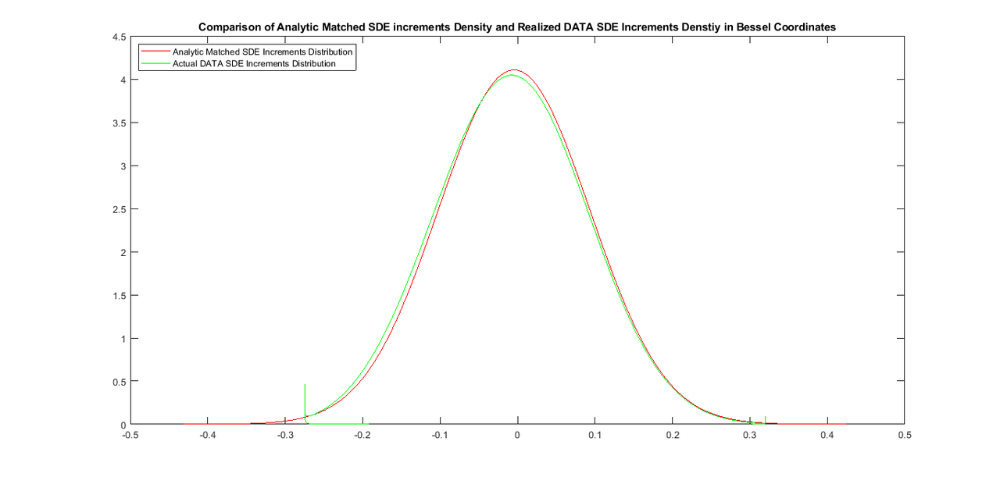](https://postimg.cc/vcdYhhv0)

---

### #1886 — Amin (Topic Author)
*July 21, 2023, 9:05 AM*

Friends, I was thinking of simultaneous calculation of sigma0 and gamma in the equation

$dX_t \, =\, (\, \mu_1 \, {X_t}^{\beta_1} \,+\, \mu_2 \, {X_t}^{\beta_2} \,)\, dt + \, \sigma_0 \, {X_t}^{\gamma} \, dZ(t) $

There could be a simple way to do that. First we construct a grid of for example 5-6 likely values of gamma .05 apart.
We calculate best second moment matched volatilities for all of them. And then see for which second moment matched value
of gamma, the higher moments of SDE increments are also best matched. And then choose that pair of volatility and gamma
as the optimal option for SDE parameters.

This is just initial idea and will try writing a small program to see how it works.

---

### #1887 — Amin (Topic Author)
*July 21, 2023, 6:49 PM*

Friends, I do not want to be complaining all the time and many things are looking up but people at Pentagon and their
backers are totally determined to continue my persecution. I must admit that currently there is no huge drugging of food
in Lahore here I live even though a large number of drinks and beverages are constantly drugged at manufacturing source.
It is still not difficult to survive if one is careful about taking food.

But mind control agencies continue several of their old tactics in full steam. As I told friends when I mention
something on this forum things generally improve but deteriorate again in a week or two after that especially if I do
not keep pushing those things on the forum.

For past few days they have been using another sickening gas in my room, in my car and in the porch/car garage where I
work at night since weather is better on many night due to monsoon. They keep discharging gas continuously at these
places and the gas is very sickening and makes one very disoriented, It strips my composure and gives a feeling of
mental torture and unease in the brain. I do not blame that they constantly use this gas but they use it from time to
time several times a day and with far more frequency lately.

They also keep giving other gases that charge my clothes and release charges that settle on my body.

I mostly go out in the evening on motorcycle and they have planted some device in the seat of motorbike that
continuously targets the anus as I drive the motorcycle. As a result, there is constant pain in my anus and the area
around it becomes very sensitive and it especially pains when I touch it or rub it. They have become more and more bold
in using high frequencies from devices fitted in my motorcycle seat and driving it becomes more and more painful
everyday as their boldness increases.

They also use other tactics. For example when I am driving my car (when I drop my mother and the particular thing
happened in the evening a few days ago when my mother sent something to my cousin and I had to take the stuff in my
car.) and enjoying music, they would simply target my neck with lasers and I would start feeling extreme pain and
exhaustion in my neck.

Similarly when I tried to sleep a few days ago, they targeted my head with special frequency lasers and I would continue
to feel extreme exhaustion and tiredness in my head and I would not be able to sleep easily. When this happened at night
three days ago, I decided in the middle of the night to leave the bed and sleep in a different position on the floor of
my room and then I had a great sleep. After that I have been sleeping on floor for all of the past three days since they
ere not allowing me to sleep properly in the bed. How long can I remain innovative and change positions of things around
me and also possibly block lasers by putting a folding table to block one of the angles is a big question and it is only
a matter of time before they would install new gadgets and catch up with me and start targeting lasers on my head again
when I am sleeping at the floor within a few days.

Even though I am more free and more confident now than ever and no special targeted drugging of food is continuing
especially thanks to favors from good American people who tried to protect me but people at pentagon are even more
determined than ever to continue my mind control and they want to use all sort of new tactics to somehow achieve their
designs. Especially when I do not mention about torture when it starts, they continue to increase torture. And many
times I do not write about so many things here because I do not ant to be constantly whining about it. And especially
when I do not write about antics of mind control agencies, they become more and more bolder and increase torture and
also start new ways of torturing.

---

### #1888 — Amin (Topic Author)
*July 22, 2023, 8:27 AM*

Friends, I really hoped that I would continue to focus on writing professional posts on this forum and slowly my mind
control and other forced persecution would greatly decrease. Sadly I was thoroughly wrong. American army scum is so
bitter to get into paradise of Jewish billionaire and his rich cohort that they have a stark realization of the great
mistake they have made by temporarily decreasing my mind control in the past when forced by protests of good American
people. Scum in American army was completely sure that this was never a big deal and they would continue my mind control
in one way or other and they were confident that minor adjustments they had to make by decreasing my mind control
temporarily when faced by protests of good American people would never be a big deal. And every year, they would anyway
detain me in a psychiatric facility and make sure that food and psychiatric drugs I was given in detention would take
any potent neurotransmitters out of my brain and I would have to struggle for more than five or six months to partially
regain my self and by that time another psychiatric  detention would already be approximately due to take all powerful
neurotransmitters out of my brain. However due to increasing protests from good people, scum in American army has been
unable to detain me for past two years and now they have a growing realization of their mistake by letting me do any
research at all. In past few months, they tried to detain me several times but I raised hue and cry and my forced
detention was averted because of immediate pressure from good people.

But what can you do when scum in american army firmly knows that their future is associated with making it into the
paradise of Jewish billionaire and his Jewish cohort. Jewish billionaire is in no way obliged to let everybody get into
their paradise and a lot of scum knows very well when they would fail to retard people pointed out by the billionaire
and his cohort, and rather bring a bad name to billionaire and his cohort as their corrupt practices are exposed in
public, Jewish billionaire would never let them into his paradise. It really takes some bravery in this world to live
without money and continue to do good things. And American army scum knows very well what it would mean to live off
pension in relative social isolation as opposed to getting extremely high profile job paying millions of dollars every
year and with social idolization by everyone when they would be offered such a job by jewish billionaire and his rich
cohort. So scum simply cannot afford to not retard people pointed out by the jewish billionaire and his cohort.

Whatever good or bad the scum is would otherwise not be my business and I would rather spend my time in some positive
activity like doing good research that I love. But I have to write this post with a heavy heart again since I am sure
that mind control agencies and their backers want to detain me again in a few weeks. They tried to drug the city a few
weeks ago but it did not work. They are really afraid that if I continue to do good research, I might slowly get out of
their hands. They know that they really have to do again what they used to do every year without exception to control me
again and stop me from trying to do any good research. I also see many signs that my family also starts to become
impatient and they have plans of detaining me on suggestion of mind control agencies sometimes in near future.  I really
want to request friends to strongly protest to good people in American government to pressurize the army to end my mind
control.

I am really obliged to so many good people who have great humanity and who knew that I was totally innocent and they
tried to protect me again and again in the past. There was a time when I would ask myself if there is any good humanity
in this world since large number of people would behave rudely or carelessly(due to complete brazen lies of machinatory
scum in American army) and there was almost nobody who was ready to stand for me. And I really pray (I could not choose
another word though I do not believe in god) for good people who took a stand against all odds and tried to save me and
it is due to efforts of these good human beings (as opposed to lot of humans who just eat and have sex but are otherwise
great animals like for example American army scum who are ready to do any inhuman completely cruel deeds for monetary
reward) that I have been able to survive and do any decent research.

I am copying some posts from the past for the complete context.

---

### #1889 — Amin (Topic Author)
*July 22, 2023, 8:39 AM*

Before I write this post I want to tell people something since I am called schizophrenic by psychiatrists on behest of
army. I am an extremely nice guy. I have not hit any human being or thought of hitting anyone in all of my adult life
after 15 years of age and I have never been physical with any human being ever in my adult life. I am not aggressive at
all and I am usually quite meek. I have never broken or thrown anything ever in my whole life despite extreme cruelty
shown to me(I am writing since such things are sometime associated with mentally unstable people). I try my utmost to be
helpful to people and I love my life and I have never had any suicidal thoughts.

Friends, I want to make a special request for help in this post. As I told friends several times, I have been on
antipsychotics since 1999 with the exception of a few brief periods of a few months each. Doctor says the reason behind
forcing antipsychotics on me are my baseless fears that CIA somehow wants to hurt me and damage my brain. Doctors call
me paranoid schizophrenic. Psychiatrists are very aware that I am perfectly healthy but they connive with Pakistan
military who ask them to declare me mentally sick, and use force when I argue against their forced treatment. Most
friends in US know about mind control have learnt over time that CIA in fact does try to retard innocent civilians who
they do not like for whatever reasons. Many people even know complete truth how innocent victims are cornered by adding
mind control drugs in the food, beverages and water supply of entire cities on behest of CIA. And when a victim
complains about it, he is called schizophrenic and this has become a very useful tactic in the hands of CIA and military
agencies to target and victimize people they do not like.

Though I never liked antipsychotics, I have been taking them in one form or another for more than past twenty years.
When I was young, I was still able to take antipsychotics and run for a few kilometers everyday and be able to work
since I used to have enough energy and stimulation. But I am already 50 years old now and it continues to become very
difficult for my body to stand antipsychotic medication now. I am excessively over-weight due to low metabolism rate
associated with decades of antipsychotics. My current weight is roughly 108 Kg which is more than thirty kilograms
higher than the right weight for my height. I suffer from so many other physical problems due to antipsychotics. For
example in the two weeks following an antipsychotic injection (fluanxol) that is given to me every 23 days, my breathing
remains disturbed and is remarkably noisy as compared to breathing of an ordinary healthy human. Sometimes, I would even
give involuntarily snorting like sounds when breathing. And many times I would have difficulty sleeping at night due to
heavy and forced breathing. My family and doctors are not ready to compromise on my antipsychotics so it is useless to
argue with them to end the antipsychotics as I have tried this several times to no avail. My heart beat that used to be
around 75 more than 20 years ago as I recall, now remained around 120 for past twenty years due to high antipsychotics.
These antipsychotics continue to slowly weaken the heart and negatively affect its functioning. I am grateful that I
still do not have diabetes but I am sure that I would be diabetic in next few years because of high weight and low
metabolism. Continued use of antipsychotics also have a positive correlation with diabetes even when controlled for
other factors like weight. Due to continued use of antipsychotics at old age of 50 years, I am rarely upbeat and mostly
remain lethargic and highly sedated. I have constant body aches and pains due to weakness caused by continued use of
antipsychotics.

I know I can do some good research but it is only possible since this is the only thing I did in past twenty years of my
life. Apart from research, there is no bright spot especially regarding my body and physical health. I really want to
request American friends to please force your government and military agencies to not force psychiatrists to give me any
more antipsychotics. My greatest wish at this part of my life is to be able to live a life without antipsychotics forced
on me. I really cannot thank friends enough who could lobby for this or protest to American army against forced
antipsychotics on me. Please help me me live a life without antipsychotics and I would be truly grateful to you.

I had earlier told friends that mind control agents and their backers are only buying time and they really want to
increase mind control again as soon as the whole thing goes out of limelight.

Now this observation is proving to be exactly true. Mind control agents are again pressurizing my family especially my
parents and my sister to do something to help the mind control agents in my mind control. About a month ago, doctor had
decreased the period between my antipsychotic injection to one month. I was feeling remarkably better due to doctor's
decision. Just about a week or so ago, many colors returned in my eyes and I was able to see the world as I used to
before the start of mind control. And I was happy like a child when I would notice the brightness in many shades of
colors. When people say that animals cannot see many colors and their shades, I know this firsthand since I have
experienced it myself several times in past twenty five years. When I would not notice some shade or see it differently
without brightness, I would have some sense that I am missing something in my brain but I would not know what I am
missing. But when some parts of my brain would recombine and I would see some shades with brightness and richness again,
I would know that I missed this color for several months or years. Just a few months ago, I was in such a bad state that
it was difficult for me many times to differentiate many shades of blue and green.

Now after 25 years of my persecution, I am used to colors going out of my eyes and then coming back again after several
years. But recently for more than a week, I have been seeing many colors and their shades with special richness as I had
not done for many long years. And many times I become happy like a child when I see the world in its original and
complete beauty.

But mind control agents are getting upset that they are losing control of my brain and some of my research has also gone
out of limelight, therefore mind control agents have started to pressurize my family to find ways to put me back into
complete mind control. They want my family to ask the psychiatrist that I am not doing well and he should increase my
medication and put me back to 21 days interval between the antipsychotic injections. My sister called today and told me
that she had realized that I was not taking proper care of my self and she would call the doctor on her own and ask her
to increase my medication again. Mind control agents pressurize my family who are mere puppets in their hands and now my
family wants to do everything possible to convince the doctor to increase my medication.

I am perfectly healthy in all respect but Pakistan army pressurizes the doctors to cooperate with CIA and when the
psychiatrists also know that victim's family is also playing in their hands, they become too bold in forcing
antipsychotic drugs on their victims. Though the current doctor is very aware that I am perfectly healthy and has
maltreated me, I am still thankful that he was finally ready to decrease my medication and increase the interval between
antipsychotic injections to thirty days. But now mind control agents want to pressurize my family to roll back what
psychiatrist has done. I think I have told friends earlier that I am not allowed by my family to choose a psychiatrist
of my own choice and every time I tried to approach a psychiatrist of my own choice, they detained me for months with
their own psychiatrist.

I was rather hoping that my antipsychotics would completely end very soon but now that seems a relatively remote
scenario and I am afraid that my family wants the doctor to undo whatever favor he has already given me.

I want friends that if I have just one wish in my mind, it is to be able to live a life without forced antipsychotics. I
would not be willing to accept hundreds of millions of dollars if you pay me that money to continue my antipsychotics.

I really want to request good American people to ask their government and army to stop giving me antipsychotics and end
my mind control. Please ask the American army and CIA to not force my family to be inhuman with me. I Want to request
those jews and neocons behind me persecution to Please let me live with human dignity if you are ready to accept meas a
human being and if it is not beyond your capability to accept a human being of muslim origin getting ahead in life.

I also want to respect good Europeans who sympathise with me to ask their embassies in Pakistan to force the Pakistan
army to end mind control of innocent intelligent people on behest of neocons in CIA and also ask the psychiatrists to
end the forced persecution of innocent victims.

---

### #1890 — Amin (Topic Author)
*July 22, 2023, 8:41 AM*

Friends, in a previous post I told friends how staff at a lady psychiatrist's hospital started beating me and abused me.
During past twenty three years, there have been many many instances of my obvious abuse by different psychiatrists. I
will describe some of those instances in this post.

When I came from United States and till fifteen years after that, my father would proudly ask me that I could see any
psychiatrist I wish. This was because Pakistan army was managing my persecution and they would force psychiatrists to
declare me schizophrenic and my father was told that every psychiatrist would be forced to cooperate. However, by chance
in 2016, I came  across a psychiatrist who was far better. I never told him that I was under mind control but whenever
he interviewed me, he always said after the interview that I was perfectly sane and mentally healthy. When my family
would force him to increase the dosage of antipsychotics, the doctor first told me that I should not live with my family
and make a comprehensive plan to support myself and become independent (such a plan could never work since Pakistan army
was threatening people in Pakistan to not give me any business and CIA was making sure that every contact I would reach
for work in Europe (and Singapore/ Japan /Australia) would be approached by CIA telling them that I was a very bad guy
and they must not do business with me. I had not told the doctor any such thing that intelligence agencies were after
me.)  When I told the good doctor how previous psychiatrists had abused me, he would tell me that this used to be a very
widespread practice in America hundred years ago to wrong mentally healthy humans by using corrupt psychiatrists as
instruments to detain them and strip them of their sanity. The good doctor I am talking about was American national with
Pakistan background who had practiced psychiatry in America for over twenty years and had returned to Pakistan. That
good doctor kept me on very low antipsychotics (1 mg resperidone per day) and that too on extreme insistence of my
family. It was only during that time of treatment by that doctor that I got my first break in research and I solved the
problem of high order monte carlo simulations (and analytic series solution of ODEs)  and posted that solution on this
thread. Ok, when my family was fed with the doctor, they detained me with another doctor. They detained me again two
years ago when I requested my family that I wanted to see the same doctor of my choice again( I have been detained every
year for past six or seven years by different doctors), they detained me through a different doctor. So my family now
stubbornly refuses to allow me to see a professional qualified American psychiatrist of my own choice and detains me
every time I try to approach him.

Now back to my obvious abuse by two other psychiatrists. I was detained by this doctor who was running a mental health facility and was not a psychiatrist himself. At that time I did not use to walk very much and my blood pressure used to be somewhat high. Since other antipsychotics had failed to retard me, doctor suggested I take aripperizole injections. These injections affect the heart and also elevate blood pressure but doctor who wanted to retard me had no regard for my health while pretending to cure me. In initial days of my detention, staff at the hospital when checked my blood pressure told me high enough blood pressure in line with what I used to have but after I complained about aripperizole and its effect on blood pressure the staff started doctoring blood pressure and started telling me that my blood pressure was very good or even low. This is a post I wrote on another thread in this forum about it. [How to safeguard my research - Page 32 - wilmott.com](https://forum.wilmott.com/viewtopic.php?f=15&t=94796&start=465#p785440)

.
>
>
> **Amin:**
>
>
>
> Since I wrote about high blood pressure and mentioned high blood pressure before the hospital staff, they have started
to doctor blood pressure. Now, everyday they tell me that my blood pressure is 120/80 or 110/70. While they always told
me that my blood pressure was 130/90 or 140/100 prior to injections. I have never had so good blood pressure for years
that they have started to tell me now. Friends would recall a previous post when I could not sleep at night and had to
take a sleeping pill. When the dispenser came to me at night(The hospital has no MBBS who stays here at night in
Ramadan. Dr. AS used to stay here on some nights earlier but has been totally absent in Ramadan). When the dispenser
checked my blood pressure, he told me that it upper blood pressure is 110. I did not believe him at all. He asked me to
check on my own and put the stethoscope head assembly in my ears. I could easily tell that upper blood pressure was more
than 140 and lower was more than 100. The staff has already started to doctor blood pressure. My parents are going to
Saudi Arabia for two weeks in a few days. Now Dr. AS has the plan to hold me in detention while my parents are abroad. I
had a complete settlement with Dr. N and we(I and the doctor N) both agreed that I would be visiting him every fifteen
days and all modalities were agreed. I do think as a patient it is my right to choose the psychiatrist and Dr. AS( who
is incharge of facility Pav.) has no right to change the doctor after I have selected a psychiatrist and we both agree
on terms of any treatment. Dr. AS has imposed another psychiatrist Dr. M who has not even seen me and has already
started giving me injections and increased medicine without looking at my present condition. Dr. N had explicitly stated
that I would be free to leave if it were his facility. Most major reason for detaining me now is that Dr.AS wants to
continue to detain me while my parents are leaving for abroad for more than two weeks
.

Later after a few days, I was given a second aripperizole injection and released from detention. An injection was due
every fifteen days. My parents were in Saudi Arabia and I was living with my sister. She insisted after fifteen days
that I get a new aripperizole injection. I complained about too much side effects and other serious problems but my
sister insisted that I must get the injection. She talked to another doctor and the doctor told her that if his blood
pressure and pulse are fine, just give him the injection. I asked my sister that my blood pressure must be checked
before I get the new injection. We went to a small hospital close to her house and when my blood pressure was checked my
lower blood pressure was 110. The hospital staff recommended that I stay at the hospital in their care until my blood
pressure decreases. It was a totally random blood perssure check. When hospital staff came to know that I had been given
aripperizole injections, they told my sister to not give me those injections any more. My sister asked the staff to
relieve me and we came home but I was not given aripperizole injections after that.

But this is interesting that the psychiatrist was initially desperate to prescribe aripperizole despite that I had told
him about my heart and blood pressure problems and his staff was asked to doctor blood pressure so that I would accept
the injections.

Good thing is that only after stopping aripperizole, I started my treatment with good psychiatrist  doctor Naeem Aftab
(who is an American national) and he gave me enough relief that I was able to get a break in my research and solve the
problem of high order monte carlo simulations. I would always be thankful to Dr. Naeem Aftab for giving me relief at
such a crucial point in my life.

Yet another experience for abuse was with a seasoned psychiatrist who is known for his connections with Pakistan army.
When army dictator Pervaiz Musharraf ruled the country, he made this doctor the dean(president) of the university of
health sciences which regulates most medical universities in Pakistan. He had treated me for three years in year 2001.
He started my treatment without interviewing me and gave me electric shocks at the start to jumpstart the therapy. I was
given electric shocks for fifteen days in early 2001. I still recall that doctor would place a wooden wedge between my
teeth and then give me an injection and I still recall how numbness would move in my body from feet to the upper body
after the injection.

When going to that doctor's psychiatrist facility in 2001 I had to travel from Kot Addu to Rawalpindi. My family had
given me some drug in my food and I became unconscious after an hour or so. I still recall how I was begging my younger
brother to help me that I do not want to go anywhere and if he could help me but he like everybody else in the family
refused. Slowly drug in food showed its effect and I have absolutely no memory of being taken in my father's car despite
that it would have taken him at least eight hours to take me to Rawalpindi. Psychiatrist did not interview me and
detained me and started giving me electric shocks. I still recall how I defecated in my bed there and they had to wash
it.

Anyway, I was taken to this psychiatrist in 2017 again. He was very clearly told that I had been given antipsychotic
drug larjactil by another doctor and it backfired and I had extremely severe drug-induced jaundice. But the doctor was
so haughty and cavalier and so desperate to retard me that he still insisted that I must get the same drug larjactil and
said that it was not necessary that it would cause jaundice every time. Problem for the doctor was that most
antipsychotics had failed to retard me and he wanted to give me some potent antipsychotic that had not been well-tried
on me. Though the drug was given to me earlier and later discontinued, the doctor wanted to take his chances to retard
me and he had no regard for my health. This doctor is a big crony of Pakistan army and really wanted to please the
generals and therefore he decided to give me larjactil again. And as would already be obvious to most friends, after two
weeks, I started to show all signs of drug-induced jaundice again and my body and eyes were all yellow. My Biluribin
shot like anything. And it took more than two months to control jaundice after that. Though my biluribin came back to
normal after two months, several less known enzymes in my liver remained disturbed for several years after that and
continued to show as abnormal in my liver function test reports.

I have been detained more than 30 times by various psychiatrists during past twenty-five years on orders of Pakistan
Army. This is despite that I have never been violent all my life. I have never hit anyone in my adult life and I rarely
speak with anyone in a loud voice. I have never done anything like breaking a glass or any utensils that is associated
with sick people.

Here, I will recall an incident eight years ago when I myself approached a lady psychiatrist for help and how she abused
me, and her staff beat me for twenty minutes and then tied me and started my treatment with antipsychotics again.

I am recalling this from early 2015. They had previously put me on extremely high antipsychotics and my creativity was
all gone. I could barely do any intellectual work. At that time, I was able to convince my family to decrease the
injections and they had agreed since I had already lost most of my creativity and intellectual capability. I think mind
control agencies were also thinking that I had lost my creativity forever and they wanted to see if it was right time to
decrease my drugs and still make sure that I would remain intellectually dull after injections had ended.

But I slowly started to work on my research and started to regain my brain. When mind control agencies realized that I
had started to do better research, they asked my family to do something again to retard me. My father asked a
self-stylized religious saint to come to our house and take care of me. He came to our house with one of his followers
and told me that he wanted to give me injections and I would go to sleep for 24 hours, and they would take scans of my
brain to treat me, but I continued to beg and plead him, and I was able to convince him to allow me to leave the home in
my car. The supposed saint allowed me to leave since he was probably sure that he would get me later as I had no other
place to go other than my home and, therefore, I was able to convince him to let me go outside. When I left the house, I
made posts about the saint on at least two different forums from outside my house and pleaded for help. Enough people
were following my story even at that time and the saint had to leave. I also called my father when I was outside and
protested against this.

My family still remained very tense with me, and I was very afraid that they would force antipsychotics injections and
mind control drugs on me therefore I stayed one night out of the home. Here is the post I made when I was away on April
14th, 2015, 2:09 pm

https://forum.wilmott.com/viewtopic.php?f=15&t=94796&start=315#p748191

"I am staying out of my home for the night since I had realized that my father will try to force me into detention again
and I would request a court tomorrow for stay order to stop my father from hospitalizing me forcefully again and I would
request the court that if there has to be a check on my mental health, it has to be done and investigated properly by a
psychiatrist of my choice and I should remain free at the same time. I do not want to be at the mercy of my father's
chosen psychiatrist as we saw in the past year that they continued to quote mental health laws and forcefully manipulate
me into taking injections. If my father forcefully hospitalized me, I would be cutoff from the outer world and they
would do whatever they like. My father's self-stylized saint(peer) had already hinted that he wanted to give me
injections that would put me to sleep for 24 hours and he had no argument for my mental sickness at all.”

Next day, on April 15, 2015, I went to Lahore High Court to find some help but I was told that I had to submit an
application that would be considered several weeks later when its turn would arrive. When I realized that there was no
possibility of help from the court, I decided to see a psychiatrist on my own. I was driving in Garden town Lahore where
I came across B**** psychiatric clinic and decided to see the psychiatrist Dr. N*** there. It was evening but the
psychiatrist still not had arrived there. I waited for an hour in the reception and then had a consultation with her. I
asked her to listen to my case carefully and then decide if I was sane enough and tell my parents about it. She said
that I seemed perfectly fine and asked me that she wanted to hear what my family had to say. I agreed and took an
appointment to visit her again at April 20, 2015. I took my mother on the planned day and my mother did not have
anything decisive to say about any disease other than that I did not eat at home. The psychiatrist asked me to visit her
after one week on 27 April 2015. The next week when I went again to visit the psychiatrist, on April 27, and was sitting
in the waiting room so that I could visit the psychiatrist on my turn. Another lady who was a psychologist came to me
and asked me to go with her in a different room to have a session with psychologist but I declined and said that I was
only interested in seeing the psychiatrist who had promised to see me again the earlier week. After five minutes, at
least four men came to the room and started besting me. They gave me slaps on my face with full force and gave me blows
and they continued to do it for more than fifteen minutes. I had never been beaten like that ever before in my life. All
this time, I was simply trying to raise my hand to somehow protect me. Since I was sitting on the sofa, only my face and
head were the target of slaps and blows. They were very violent with all sort of slaps and blows on my face as I earlier
mentioned that I was sitting and they were standing. . They literally continued to beat me and I continued to beg them
to stop. After fifteen minutes of beating me, they tied my legs and lifted me and put me on a bed in a room in the
psychiatrist facility and told me that doctor had gone to America and she could not see me. It was a complete lie and
the psychiatrist was in her office and was interviewing other patients when I arrived. I continued to ask them to loosen
the knots but they continued to make fun of me. I was totally surprised since Dr. N had behaved very nicely in the
previous meeting held at 20th with my mother and myself and I was sure she would declare me mentally sane on this
meeting. After I was kept tied for about half an hour, a new guard came and opened my hands and legs and said that they
would keep me at the facility for three days. The next day my medication in the form of pills started and I was also
given two more injections. I was given about nine pills at night and about eight pills in the morning. I was still not
given the opportunity to meet the psychiatrist N, and I was told several different things by different people including
that psychiatrist N had gone to America, and she had gone to Islamabad. About three days into my treatment, I saw
through the glass walls that psychiatrist N was interviewing her clients in her office. After seven days, I was asked to
meet psychiatrist N, and she said that she was unaware of the beating as she was in a meeting. Psychiatrist N also
assured me that I had no schizophrenia and previous doctors had very wrongly diagnosed me but it was a case of some
mania that she would properly treat this time.  Her staff continued to say that they were giving me drugs so that the
effect of other drugs given to me by previous psychiatrists would decrease.

Before my computer was taken away from me, I was able to take notes for two days in the hospital on my computer that I
write here. After first two days of medication, I was so extremely weak that I could barely walk and I had extreme
difficulty speaking.

“My Diary for past two days.

4/27/2015

I had two sessions with the doctor N previously on the 20th of April and once before at 13 or 14th of April. I remained
away from home during this time and second meeting on 20th of April, evening after the night when I remained away from
home. I had told the doctor about my circumstances in the first meeting with her. She had said that I looked perfectly
fine mentally but she needed to talk to my family. On 20th of April, I took my mother for a second joint session of
myself and my and the psychiatrist said, after the meeting, that said she really could not call me schizophrenic but she
needed one more sessions and asked me to come to her facility on 27th of April.

When I arrived at the psychiatric facility, a psychologist had asked me to accompany her which I did and on the way to
the her room, I asked for the reason, after which she replied that she wanted to take a session of mine. I told her that
I already had a session with another psyc hologist and also with a psychiatrist so I would prefer to have a new session
with the psychiatrist now. She agreed and I returned to the waiting room. I was sitting on a sofa in the waiting room on
27th at 8:00 PM (PST) in the line to see the psychiatrist when about five guards took control of me, while I was sitting
on a sofa in the waiting room to see the doctor, and gave me an injection. I was beaten and my legs and hands were very
strictly tied for more than hour. Though the doctor was in her consultation room and a lot of people were waiting to see
her, I was told again and again that doctor was not present at the facility.

In the previous two sessions, she had given the impression I was healthy mentally but she used force without
interviewing for the third time or seeing me and without requests to comply. If she was given any special information,
she should have talked to me about it and she should have verified with me any change in circumstances.

One injection was given around 8 PM when I arrived for third session with the doctor N. I really think that the doctor
was there since there was a large rush of visitors and her SUV was parked in the hospital but everybody among the staff
continued to say that doctor did not come to the facility this evening.

I was kept tied for more than one hour. I was taken tied from the waiting room to my room. All these rooms have video
cameras so you can ask Dr. N for a video of the events though she might make the excuse that cameras were not working.
One of the staff had mentioned when they brought me into a patient room in the facility, that everything was watched by
cameras.I would request people familiar with the matter to request her to show them footage of the cameras. Of course,
there could be many excuses that cameras were not working but I insist that cameras were working.

Good Mental health facilities try to avoid treating humans like this.

Another injection was given at night before I slept.

and my internet USB device was also taken. They simply took possession of everything out of my pockets and also took my
laptop.

When I asked why they gave me injections, one of the staff told me you were ?hyper? and I was totally surprised since I
was quietly sitting on the sofa in the waiting lounge for the doctor. I was told that I would stay in the hospital for
three days. I am sure this matter can be resolved who is lying and who is truthful once you look apt video footage of
cameras in most rooms.

4/28/2015

One injection was given in the morning. One injection was given around noon. All injections were IM (given in the
muscle.)

Unknown pills(some pills in the morning +5 pills around noon + 3 pills at night) were given and I was told,? We will
tell you know the names of these pills only when you leave.?

Computer was returned today but I was told that we did not take your mobile and they continued to say we never took my
mobile. My mobile was never returned( despite I always keep my mobile on me.)

I was also not given my EVO USB device and I was told you cannot write anything on internet. However the USB device was
returned to my mother at night.

I was told today by the psychologist that doctor N had gone to America and will come back after seven days and only then
she would be able to see you. I was told we are adjusting your medicine and see what was a good medicine. I was told
they were discussing the drugs with her on phone and skype There were several conflicting statements about where Dr. N
was. Somebody said she was just out of city and had gone to Islamabad.

When I asked my mother who is living with me at the hospital, I wanted a second opinion, because of beating and other
irresponsible behavior of the psychiatrist, my mother would make all sort of excuses while the staff would say that you
cannot leave the hospital until Dr. N arrives who is currently out of country.

Earlier today, I was told that I would live at the hospital for fifteen days and later I was told that I would live at
the facility for seven days. When I was tied, somebody had told me that I would live in the hospital for three days
only.

My mother told me please do not write anything wrong on internet otherwise, they would take your USB forcefully like Dr.
A had done more than one year ago. The purpose was to threaten me to not write about any maltreatment so that the doctor
would continue to freely manipulate me.

7-8 pills were given in the afternoon and similar number of pills were given at night. At many times during the day, I
could barely walk and had extreme difficulty speaking.”

Friends, I have previously described several horror experiences with psychiatrists but there are many more such
experiences that I have not posted on this thread. Today I am going to describe a continuing experience in which the
psychiatrist did everything in his power to retard me.

This is from year 2004/2005. I had a sound logic at that time and I was working from Lahore at a job with a foreign
Japanese company that was paying me \$4000 per month. I was still on high antipsychotics and when high dosage of normal
antipsychotics did not work, in order to retard me, the psychiatrist employed a procedure that is not known in
psychiatric practice in any country. The psychiatrist would give me some drugs in a glucose drip every two/three days in
the operation theater. When I would be given the glucose drip, I would gradually start to lose consciousness and when
half of the drip bottle would have gone into my blood, I would literally be unconscious, and I would later be taken
unconscious to my hospital bed by the hospital staff and I would wake up several hours later on the bed in my hospital
room and I would be extremely weak.

It was such a frightening experience that I would shudder from horror as the day of this treatment would come closer and
continued to beg the psychiatrist to stop this treatment. The psychiatrist would say that he was giving me vitamins and
vitamins were always harmless. He insisted that vitamins had to be given to me. He never told me what drugs he gave me
that made me unconscious and never discussed it with me other than mentioning vitamins. The psychiatrist continued to
perform this procedure for several weeks after sometimes second or usually third day. Most people cannot imagine how it
would feel when the drug in glucose drip would go into my body and I would lose my senses. To this day I shudder from
complete horror and recall the extremely sick feeling when I would slowly lose consciousness.

Now when I look back, I realize that they were giving me mind control drugs in the drip to take the intelligent
neurotransmitters out of my body. They continued to try to take intelligent neurotransmitters out of my body again and
again through this procedure for several weeks. I was completely helpless before my family and the psychiatrist and had
to go through such unlawful medical procedures.

As friends would have realized that purpose of mind control agencies was always to retard me since neocon scumbags of
pentagon and their backers were not capable of appreciating my humanity and did everything in their power to retard me
with an iron fist.

I have seen continuing pain, trauma and torture in my life only because I had some special neurotransmitters that people
with hatred and venom were not ready to let me have since they considered it a threat to let a Muslim have those
neurotransmitters.

After starting mind control in Lahore in early 2000's, bad jews (again apologies to good jews) were very emboldened how
easy it was to manipulate army and government in Pakistan to start mind control of intelligent people in Pakistan. It
was a time when Pervaiz Musharraf who was an army dictator ruled the country. He was very ready to please the CIA in
order to get help from American army to prolong his illegal dictatorship in Pakistan. He fixed in place all the required
mind control infrastructure in all large cities of Pakistan to please American army who was playing in hand of bad jews
to damage the Muslim majority country.

When Americans rightly blame our country for terrorism, they must not forget that many neocon generals in American army
have played in the hand of bad jews and have made every effort to systematically destroy talent in Pakistan on a very
large scale using mind control technologies to keep it backward forever.

Mind control in Pakistan is ensured by top Pakistani army generals since they are given several hundred million dollars
by US army every year and the top brass of Pakistan army divides this money among themselves with bigger fish getting
larger share and smaller fish getting a smaller share. Therefore, mind control infrastructure in Pakistan is very
detailed and thorough.

From my own experience, there is very large mind control activity in Lahore and Islamabad, the two cities where I have
lived during the past twenty years. There are at least more than 500 mind control targets in Pakistan most of whom are
computer science majors.

Mind control in Pakistan and many other places increased dramatically like never before. We have in Lahore a huge
building called Arfa Towers where all the facilities for technology and IT companies were provided to attract new firms
and entrepreneurs and later Arfa Towers became a scene of mind control carnage since tens of aspiring computer
scientists and entrepreneurs were retarded and it became very easy for mind control agencies to find the talent since
the facility attracted talent and retard it. Time between 2008 and 2016 was like black death for talent in technology in
our country (I am not talking about pseudo-talent that American embassy continued to support and showcase heroically in
the meantime.)  I still recoil with horror when I look back and recall how difficult it was to get good drinking water
in Lahore during that time for more than six months in 2013-2014. I would have to go to remote parts of the city, go to
villages around the city and sometimes even go to other cities and only then I would be able to get some good water
after repeated attempts and my only worry during the day would be to somehow get good food and water.

At this point I like to tell friends that a lot of food and beverages that are drugged with mind control chemicals would
be eaten or taken by most of the population that is not on mind control and they would never notice any anomaly in taste
or any other effect since these mind control chemicals are inactive and inert and become chemically active only when
targeted remotely with precise electromagnetic wave frequencies so only target victims are affected and this is a very
cruel method to target intelligent people by drugging the entire supply of food and beverages and then focusing waves on
the targeted individuals to activate the mind control chemicals. Pakistan army and mind control agencies would drug the
entire public water supply and beverages knowing that the victim would have to drink something somewhere. Ground water
is also so thoroughly drugged with mind control chemicals that entire public water supply of the city and several
kilometers out of the city would be completely drugged with mind control chemicals. Pakistan army routinely does this in
Lahore city on behest of American mind control agencies.

Ten years ago, army soldiers and agents would go to markets to drug the targeted food and beverages with mind control
chemicals which they still. Large scale movements of soldiers and agents raise suspicions in general public and
therefore mind control chemicals are supplied to beverage and food manufacturing companies in Pakistan, and they simply
add the chemicals in food and beverages during the manufacturing process.

In Lahore city, there are more drugged beverages at any time than good beverages in small stores or large supermarkets
alike since most of the beverages are drugged at manufacturing source by coca-cola, pepsi-cola and Nestle.

Coffee stimulates the brain and the brain connects in new ways after taking coffee and good coffee creates problems with
keeping victims on mind control since their brain starts connecting in many new ways after taking good coffee.
All coffee and I repeat that entire coffee in the country present in the stores is drugged with mind control chemicals.
Most of the coffee on good stores is imported from foreign countries. I do not know how it works but importer is
probably told by army to drug the imported coffee before distributing it in the market. It is even very difficult or
rather impossible to get good coffee beans. Two or three years ago it was possible to find some brand of coffee that was
good by trying all new brands but it has not worked for past two years now for me despite that I keep trying. I even
know of instances that when I was able to buy good coffee of a certain brand from very large and posh stores, they took
entire coffee brand off the shelf from all their branches within two to three days. People know that Corrupt Army in
Pakistan that ensures mind control is more powerful than any political government here.

Tea used to be good but for past one year most mainstream Pakistani brands of black tea are drugged with mind control
drugs. This has still not caught up thoroughly like coffee is thoroughly drugged and it is still possible to find some
good foreign brands tea that is good.

All stimulant/energy drinks including red bull are well drugged at manufacturing source. Red bull was better till last
year but then it became drugged everywhere. I even tried it at remote places in several cities other than Lahore and it
has always been drugged lately.

Most of the soaps, shampoos, creams, toothpastes are drugged with mind control chemicals. I do not use shampoos or
creams but whatever rare I tried them once in a while they were drugged and they charged my skin. All of these have mind
control chemicals that charge the skin and make mind control extremely effective. Many people would be amazed when I
tell them that even though I would be in my full senses before washing my head and face with a soap but after washing my
head and face with a drugged soap, my eyesight would deteriorate and my conception of reality would completely change
and sometimes I would face extreme anxiety. It is hard to emphasize that even a small thing like this can completely
change the victim's state of mind and consciousness. Getting a good soap was very difficult for me till last year and I
would drive for several hours in different parts of the city especially looking at all the pharmacies on the way to find
some unknown brand or some soap that would have been manufactured several years ago when soaps were not getting
completely drugged. I tried all the soaps including beauty soaps that are specially made for women, even many unknown
brands, and specially imported soaps(which were all universally drugged thoroughly) and it was very very difficult to
find a good soap. After finding a good soap, I would keep it in my pocket all the time. This is a small thing but you
cannot live without it. Since our mouth is kept charged and some charges continue to go into victim's body from one's
mouth. Therefore toothpastes are also added with mind control chemicals to charge inside of our mouth. You can imagine
that after buying five or six tooth pastes of different remote brands, I would get a good tooth paste. I have recently
been using toothpaste that is imported from abroad and is good. Toothpastes manufactured in Pakistan are all drugged
with mind control chemicals.

Another big problem is that pharmaceutical companies add mind control chemicals to their drugs(pills etc). Most of the
mind control victims are targeted due to their talent and intelligence in mind many times might require special minerals
that are rare in our food.  Most of the mineral and vitamin formulas are also drugged with mind control chemicals. Most
mainstream mineral and vitamin pills in the market are thoroughly drugged with mind control chemicals. I never like to
take names but I would like to tell friends that greatest crook of all times is Glaxosmithkline( I would invite them to
sue me for writing this on Wilmott). GSK's mineral and vitamin formulas, effervescent calcium tablets, and toothpastes
are all drugged with mind control chemicals. There is a tablet by the name Kemadrin that has to be taken with
antipsychotics and GSK manufactures it and it is also drugged with mind control chemicals. My experience with GSK is so
bad that If I have to buy any medicine and if it is made by GSK, I would try my utmost to avoid taking it for the fear
of its being drugged with mind control chemicals and look for alternatives.

Injection fluanxol and clopixol are also drugged with mind control chemicals.

Again all this thorough infrastructure took more than fifteen years to develop in Pakistan and Pakistan army continued
to work hard to develop it over the years. There are at least five hundred brilliant Pakistanis most of whom are
computer scientists who are on active mind control to thwart them to contribute to society in any good way.

All this infrastructure exists in Pakistan and was developed because neocon generals wanted to please bad but rich jews
and American mind control agencies continue to perfect it over last twenty years. Again, mind control in Pakistan is
ensured by top Pakistani army generals since they are given several hundred million dollars by US army

I have not talked about special infrastructure that is used to project EM waves on the target and this infrastructure is
present on all major roads and public places in big cities and major highways and motorways in the country.

[My Letter To HRW About My Human Rights Abuse](https://forum.wilmott.com/viewtopic.php?f=15&t=102298)

Above is a very incomplete account of how various psychiatrists continued to play in hands of Pakistan army to retard
me. It also does not cover all the time till year 2022 and the account stops several years earlier.

Pakistan Army has no personal animosity with me. Chief of Pakistan Army staff is given more than 50 billion rupees every
year come rain or shine so that army continues American Mind control of intelligent people in Pakistan. Even when the
relations between both countries are extremely bad, this bribe is always given to Pakistan army generals in time.

Before writing this post, I want to apologize to good jews but want to tell them there are enough evil jews who are
doing everything to tarnish the great goodwill jews have so rightly earned through generations of hard work and being
nice and kind to other people in the society. I want to request good jews to Please force these evil(jewish) people to
end the bad practices that are starting to take root in American and other societies on their behest and before it is
too late. I also really hope that my mind control would finally end(as I have been begging for past twenty years) and I
would never have to write a post like this again.

In the past, I continued to mention about my mind control persecution from time to time but only started writing regularly about it when I arrived in UK on a Highly Skilled Migrant work visa. Mind control agencies did everything in their power to fail me in UK. People were asked to not give me a job. People I contacted were routinely told brazen lies about me totally shamelessly. When I realized that I had no future in UK, I returned to Pakistan after a six month stint in UK. Since my hard earned money had thoroughly insulted mind control infrastructure in UK as they had to drug entire cities with mind control chemicals in UK (read briefly about it in my application to HRW in a previous thread) for a nobody like me and American government had to move all their grand and influential puppets in UK (again for a nobody like me) to force people to drug the manufactured food. British Banks went to the extent to steal my money to bleed me. Read here: https://forum.wilmott.com/viewtopic.php?f=15&t=102298#p857494. British police forcefully stopped me from seeing law firms(Brief details are given in my application to HRW attached as a link below).  Since my money had given mind control agencies a very tough time, mind control agencies decided to never let me make significant money after that. My old Japanese employer was told to not hire me after I returned to Pakistan. Whoever I would contact someone in Europe for job or consulting, mind control agencies would move American embassy infrastructure in that country and somebody highly influential (or army or secret services of that particular country)  in that particular country would approach my target employer and again brazen lies and fabricated stories would be told about me shamelessly. I am a fighter in life and I continued my research despite all economic, coercive and other hardships. All odds were against me but I tried my best to continue.  I have been presenting my research to friends on this forum for past five or six years. At this point, I want to request good American and friends from other countries who have come to know me through my research to please use their influence to end my mind control forever.

Since things might heat up after my writing this and my persecution might increase, I want to ask European embassies in
Pakistan to keep a vigil. I want to tell Europeans that my writing about mind control is in their great interest since
the very same people who instigate retarding of intelligent muslims are behind retarding of dozens of intelligent
europeans and once these people are exposed I am sure they will be far more careful in openly retarding European
talent(that they do not like).

I had told friends earlier that a jewish billionaire is Godfather of mind control. When my persecution started (in late
1997) at the university in New York which is a big time player in mind control of Muslims, blacks and foreigners, many
university officials were very pleased that they were getting written in good books of the billionaire jewish Godfather.
Though there are far richer billionaires in US who are staunchly opposed to mind control, they are not ready to shell
out hundreds of millions of dollars to bribe anyone to end mind control while mind control Godfather continues to give
large bribes to people to continue mind control. Many of the people related to defense in mind control are given
extremely high paying jobs in Godfather and his other jewish friends' companies after they retire from mind control and
Godfather is extremely generous towards them and it is well established and well known to people in mind control that
after retarding muslims, blacks and others in their career, they will move to paradise(tens of people from army/Pentagon
who follow whims of Billionaire Godfather are given jobs paying milllons of dollars by Godfather and his jewish cohort
in several companies) after they retire. No wonder there is no let up in mind control whatever good people try.

We know in almost all classic folk lore stories evil is too strong and too sure of itself while good is mostly weak and
just trying to protect itself from evil who is bent on damaging and eradicating the weak and the poor good but it is the
weak and poor good that finally prevails. I want to tell good American friends that evil at this stage has become too
bold and thousands of talented people are retarded every year. And it is just not muslims and blacks that are on the
line, several hundreds of brilliant whites are retarded across United States by mind control agency every year that has
become too emboldened due to lack of any accountability. Thousands of foreigners are also kept retarded in dozens of
countries including many European countries.

My only intention behind this post is that I want mind control to end from our societies. I do not have any joy in
mentioning that there are some bad jewish actors behind it. In American society there are a large number of jews who
have excelled in the professions of science, education, medicine and have made great contributions to our societies.
There are a very large number of jewish professors each of whom would have taught tens of thousands of students on top
of making extraordinary contributions to body of human knowledge through their great research. Then there are
accomplished jewish scientists whose work, research and inventions make our everyday life better. There are great jewish
doctors and surgeons who would treat countless sick people and make them recover from disease. The list of contributions
of jewish people to humanity is very long and it continues. Then there are a large number of ordinary jewish folks who
are known for their goodness and civility to other people in the society. When we know all of this, we do not want to
say anything anti-jewish to hurt the feelings of so many good jewish people. But I still have to say there are really
some bad people who are unconnected with most of the nice and accomplished jews and they instigate and continue cruel
mind control torture on talented people of other ethnicities, religions and countries based on their personal dislike
and hatred. My purpose is only to end the mind control victimization and torture on otherwise nice and talented people
and I do not have any hidden intentions beyond that. And I am sure American society knows very well about the
contributions of good Jews to both their country and broader humanity and my exposing some bad actors would never have
any bad effect of any kind on these good and nice jews who we all respect and who are our role models.I want to tell
friends something I have said before here that I am sure American society would eventually end the menace of mind
control from their and other countries. I want to request all good Americans and Europeans to come forward and invite
any investigative journalist you know to read my threads and ask them to help end the menace of mind control in our
societies through their investigative journalism. Without any accountability evil will continue to grow stronger and
then mind control would start to threaten even those people who consider themselves safe due to affiliations, status or
wealth.

I want to request CNN, New York Times, Washington Post, Al-Jazeera and large reputed European media outlets to run a
comprehensive story on mind control torture, retarding and victimization of intelligent people of US and other nations
by crooks in US army on behest of some powerful people in United States and due to rightwing extremist biases of these
crooks. If you would like to do investigative research about animal practices of US army, one great resource would be
mainland European embassies in Muslim countries who keep a detailed account of mind control persecution of intelligent
muslims in these countries by crooks in US army. Many of the staff in mainland European embassies are very good human
beings who abhor such practices and would love to cooperate with good journalists in exposing the evil animal practices
of US army crooks. Only the accounts of people at mainland European embassies in muslim countries thorough animal
practices of American army's mind control wing would be enough to drop a great bombshell in the media and general public
all across the world. I want to warn all the good people who try to have a civilized dialogue with crooks in American
army to end their evil practices that their being nice with crooks is a very misguided approach. Since good people do
not have the power to forcefully end the evil practices of US army crooks, only way to end the evil practices of US army
crooks is by exposing them openly in US public and all across the world.

It seems that crooks in American army and mind control are unable to pay a heed to civilized calls by good American
people and others to end their animal cruel practices and remain bent on mischief. If crooks in American army and mind
control remain adamant on continuing evil practices, the only solution seems that some brave investigative journalists
expose them by running a comprehensive story on mind control practices by American army. It seems that doing a civilized
dialogue with hardened crooks in mind control gives them a strong sense of weakness of good people and makes the crooks
even more adamant to continue their evil practices.  Reminds me of Abu-Gharib. Very similarly, Crooks in defense had no
conception that they were doing any wrong thing when there was a culture of openly urinating on human captives. It was
an open thing in army and most crooks thought it was indeed a very right thing to do( and I am sure some of those crooks
still believe that it was a right thing they did even after being reprimanded by the broader American society). It was
not until brave people at CNN did a daring story against animal practices by crooks that evil practices stopped. Though
American army crooks retard intelligent people of all color and creed, these ultra right wing army crooks love to retard
blacks and muslims with great relish. Blacks are only 8-10% of US population but make a very large proportion of victims
in united states since many ultra right wing crooks in US army would rather die than let those intelligent blacks
succeed in American society in a big way.

---

### #1891 — Amin (Topic Author)
*July 22, 2023, 6:17 PM*

Friends, please read the last three posts on the previous page that I made a few hours earlier about my persecution and
mind control. I really need help and favors from good people everywhere.

This is the last fourth week after the antipsychotic injection(mixed with mind control chemicals) and I have enough
stimulation in my brain now to think of more interesting things. I have always been trying to think and brainstorm about
better ideas to find Z-series density representation when the data is given. The current method requires optimization
that does not work many times. I think I have more concrete ideas now to be able to construct Z-series using explicit
algebra and some calculus. I have yet to put idea to computer but I am extremely sure that I would be able to make this
work.

Briefly I want to use lagrange polynomial or order anywhere between 10 to 20 ( I would have to see what works well and
if it works we might be able to improve it later) to interpolate data points. Since data is usually far larger than just
ten to twenty points, we would have to first do another algorithm that would lump together ten, twenty, thirty (or
something like that) data points and replace them with a judiciously chosen single point so that the single point
represents average of all their moments(of locally lumped points). When only 15 to 20 representative points would be
left, we would use lagrange interpolation between them to calculate derivatives at median which would be used to
construct the Z-series.

I will start work on coding the algorithm tonight and if the method works well, hope to post the matlab program in
another two to three days.

I will first try to code the first part of algorithm that uses lagrange polynomial interpolation on 15 to 20 data
points. And then try writing the second algorithm to lump together specific number of data points locally and replace
them with a single representative data point so that moments of first eight order are perfectly matched.

---

### #1892 — Amin (Topic Author)
*July 23, 2023, 12:47 AM*

I was not able to solve the problem of fitting moments to Z-series with lagrange interpolation but I was able to improve
an earlier program to make it very good. I will post it in the evening today with some examples. But for this program to
work, you need raw data and you just cannot input moments to this program. It takes data set of values as input and
returns a Z-series. I will post it later today and hope that many friends would find it useful.

---

### #1893 — Amin (Topic Author)
*July 23, 2023, 11:09 PM*

Friends, I will post the new program tomorrow.

This evening when I went out, I went to my bank to withdraw money from ATM machine. When I inserted my Debit card in ATM
machine, it told me that my card was not authorized for any transactions. I tried again and was able to get through and
see my balance on the ATM machine. I then went ahead and asked the machine to withdraw 10,000 Pak Rupees. But then it
refused to give any cash. I was worried that there might be no money in the ATM machine or some other malfunction though
I knew when ATM machine has no money, it always explicitly tells that there is no cash. I went to another branch of the
bank three or four kilometres apart and tried to withdraw money but it again explicitly stated that my card did not have
transaction rights and it was not authorized to do any transactions after I had input the pin number. My bank account is
with MCB bank in johar town.

I knew something was wrong and my card was blocked to do any transactions. It has happened to me several times earlier
for example once in 2008, I left my family and went to Karachi on my car and my card was then blocked on orders of
Pakistan army. Incidentally, I was stopped by police van that approached my car and was taken to a police station in
clifton. Police officer slapped me there and said my car(that was bought with my own money as I had a job with a
Japanese company that paid 100,000 dollars a year) was stolen. Then four navy jeeps came to police station and took me
to a Navy intelligence compound and locked me in a cellar at night. In the morning, my brother in law came to Navy
compound and signed some documents that said that I was mentally deranged and Navy had helped them in getting my
custody. So I was handed over to my family who again detained me a psychiatrist in Lahore(my brother took me from air
port and dropped me at a mental health facility) for several months. My car was sent on a truck to Lahore by Navy
crooks. So basically my attempt at gaining independence from my family was successfully thwarted.

When I came home tonight, I called the bank help line and told them that every cash machine continues to tell me that I
have no transaction rights. But the staff said that my card was active and there should be no problem.

Here I want to tell friends about another incident by crooks at MCB bank. These crooks at MCB are totally controlled in
turn by crooks at Pakistan army. When I went to UK in 2010, roughly a year before that I had given roughly 80,000
dollars to an immigration firm. I was making a lot of money by Pakistani standards and my tier one visa was ensured
without anybody's help but  the immigration firm CEO told me that he would get me a more special visa that would allow
me to spend any amount of time in Pakistan or britain and will have no strings attached. That guy gave large entire page
ads in several of the biggest Pakistani newspapers and his wife was a member of parliament so I trusted him and a
recently retired lieutenant General of the army was president of the immigration firm). I had given him money with four
different cheques and one of them was a 2,500 dollars cheque. He received all of the money but could not withdraw 2,500
dollars since my account with MCB was dormant (if one does not have any transaction in account for a year or so, it
becomes dormant and it has to be explicitly activated by the account holder and as long as account remains dormant no
cheque can be withdrawn and no money can be deposited). When I paid the 2,500 dollars cheque I was not aware that my
account had gone dormant already. The CEO of immigration firm later told me that my 2,500 dollars cheque had bounced
because my account was dormant. At that point, I had slightly become suspicious of the immigration firm and I did not
activate my account. It was not a very big deal anyway since he had already taken most of the money. He continued to
call me from time to time after several weeks asking to activate my account but I did not care. This was a year before I
went to UK finally on a Tier one visa. That guy never returned my money and I got no special visa. He was basically a
swindler who had contacts with Pakistan army who continuously protected him from victims like me. Later when a large
number of cases piled up against him and it was difficult for army to protect him, he fled to UK and started living
there.

Anyway when I was in UK in 2010, I spent very large amount of money to ensure good food and my freedom. I probably spent
more than 150,000 dollars there in seven months including rent on a reasonably expensive apartment( I was not aware that
I would be so brutally treated and rented a decent apartment thinking I will continue to pay from job I will find at
London. I spent most of the time travelling and living in hotels and my apartment was not a very big use other than in
early days only. I would continue to travel since they would drug any place I would live for a bit). I had already told
people that mind control agencies made a supposedly most secure and trusted UK  bank steal my 1000 pounds and made a
hotel take a charge of 1500 pounds on my card several days after I had returned keys saying I had damaged their room
door. Mind control agencies were trying to bleed me close to end so that I would somehow run out of money and then
become their victim. Well, I was looking for my sources of money and I recalled that I had money in a MCB foreign
currency account (it was in a DHA branch and I had moved to Johar town for several years and had not paid any visit to
DHA branch where I lived earlier for two years. It was not a lot of money anyway and just stayed in account) that was
dormant for several years. It was the same account for which I had paid the check that could not be cashed and the guy
continued to ask me several times to activate the account.

When I sent a cheque to withdraw  the money from DHA branch of MCB bank, I came to realization that cheque I had given
the CEO of immigration firm had been withdrawn in back dates despite that my account was dormant and I knew very well
that my cheque had not cashed since CEO kept calling me from time to time for the cheque. When I needed money crooks of
Pakistan army connived with crooks of MCB bank and arranged for the cheque to be withdrawn in back dates so I could not
gt any money. I was in UK so I could not do anything. If I am wrong, I want to invite crooks at MCB bank to sue me for
defaming them on internet.

I would also want to invite the supposedly trustworthy British bank to sue me for defaming them (people know which bank
it is since I publicly discussed it when I was in UK) after throwing some insult at them in public but I really do not
want to annoy everyone therefore I have remained silent about them.

So I think that crooks at MCB banks have again blocked my ATM card on insistence of crooks in Pakistan army who is in
turn bribed by scum in American army. Since I have put my foot on tails of scum generals in American army, they would
have contacted scum in Pakistan army. Scum knows each other everywhere.

Since I told friends that I spent a lot of money to stay free from ind control drugs and antipsychotics in UK, I would
want to mention that I never regretted that. During my seven months in Uk, a lot of my neurotransmitters that mind
control agencies had blocked for a decade came back and could never be properly controlled ever after that. Though it
still took me a lot of time to do good research, I was always mentally better after I came back from UK.

This is funny that CEO of immigration firm that stole millions of dollars from a large number of people is living a
happy life in UK while I who just wanted to work hard and excel by doing something good in the right way was made an
example by UK authorities. I Was trying to go to other countries from UK but UK authorities made sure I could not get
visa to any country and would have to go back to Pakistan though in the end, I think I am finally happy that I am living
in my country. I just do not want to be abused by pigs of American army trying to find favours from rich jews.

---

### #1894 — Amin (Topic Author)
*July 23, 2023, 11:41 PM*

Since this came up, I opened my old emails to MCB Bank. They sent me an email in UK saying they had not done anything
wrong completely circumventing any mention that account was dormant.

1. They cleared my cheque in backdates.

2. There could be no transaction according to banking rules since the account was dormant for several years.

3. I visited the bank two years later in 2012 and they admitted that account was dormant but continued to lie on my face
that they were not keeping record of dormant accounts which was again a lie. Bank officer said that this would go out of
my pocket and I cannot pay you anything. I did not want to put up a fight in face of his stark refusal.

Here is my email to bank.
> Dear Aqsa,
>
>
>
>
>
> I just checked with MCB Johar Town about how much money I have in my MCB Defence dollar account 0280. I was informed
that I have just seventy five dollars in my account. I know that in my account there must be, at least, more than 2500
dollars to 3500 dollars. I wrote a cheque to Future Concern Associates in 2009 and I explicitly checked that payable
amount was available in my account when I wrote the cheque. I only forgot to know, at the time of writing that cheque,
that my account was dormant. People at Future concern associates also mentioned that my cheque was returned since my
account is dormant. I did not make my account active even when FCA told me about my dormant account. I also know with
all certainty that I had not operated that account since I transferred money to my MCB Johar Town account so it must be
dormant when I wrote the cheque to Future Concern Associates. I want to know how balance in that account is just seventy
five dollars now.
>
>
>
>
>
> I would request you to please explain this anamoly. Is the bank manipulating my accounts on some foreign hand's
requests who Pakistanis are habitually accustomed to bow?
>
>
>
>
>
> Kind regards,
>
>
>
>
>
> Ahsan Amin
>
>
>
>
Here is a formal reply that bank gave me while I was in UK. Bank did not talk anything about dormancy of account in the
mail and totally circumvented this mention since mentioning anything about it would create problems for them. Obviously
it was my check and signed by me and bank repeated the same obvious thing in the email. But according to banking rules,
it could never be cashed when account would be dormant. Of course MCB crooks never wanted to admit that they had settled
everything in backdates on insistence of Pak army crooks.

> Dear Sir,
>
>
>
> We have reviewed transactional details of your account. The transactions executed in your account have been duly
authorized by yourself. Please review the following:
>
>
>
> Check #: 0341201 was duly signed and made payable dated October 10, 2009. This check was issued by you from a check
book which was collected by you in person according to the check book issuance register. The transaction was carried out
keeping in view the normal banking procedures. Signatures of the person collecting the payment are also duly endorsed on
back of the check. As a norm customers are aware of the issuance of the checks, additionally most of the checks which
are paid to a specific source are crossed and paid in party's name.
>
>
>
> We value your patronage and always honor the payments which are made by you, these can be made to anyone as per your
liking and the bank has no deciding authority to give or hold any payments to anyone. A banker only checks the
instrument at the time of payment and the check in question is of a authentic, normal and  genuine tender on which the
payment cannot be stopped unless / until instructed formally by the account holder in writing in advance.
>
>
>
> This is for your information.
>
>
>
> Best,
.

.

.

Here is my bank statement to support my claim.

[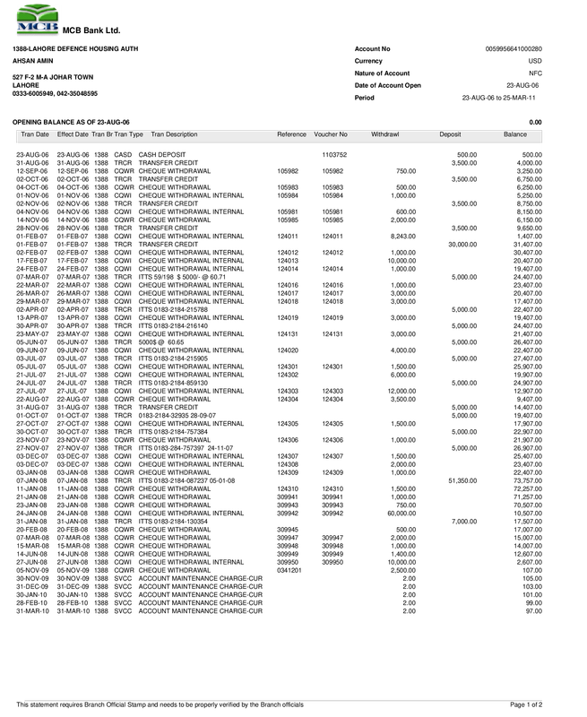](https://postimg.cc/sMGg5cqD)

---

### #1895 — Amin (Topic Author)
*July 24, 2023, 12:00 AM*

I have posted the original PDF document of bank statement I received from the bank (as an attachement) when I was in UK.

 [0059956641000280.pdf](./download/file.php?id=10207&sid=d5afc0241eb7011287532331a9b6530e)
(14.42 KiB) Downloaded 60 times

I think it is a good thing for the society since crooks and MCB bank and others would be more careful before deceiving
their customers.

---

### #1896 — Amin (Topic Author)
*July 24, 2023, 4:32 AM*

The email that was sent to the bank about inquiry was titled "**Subject:** Customer Complaint for Dormant Account".

I had asked the concerned bank manager how money could be withdrawn from my account while it was dormant. Please notice
that due to obvious wrong doing by the bank, (in the blue email) the officer never mentioned dormant account anywhere
and rehashed the obvious things that it was my own cheque signed by me. But he did not touch the topic of dormant
account since that is where bank's wrongdoing was obvious.

In Pakistan's banking rules, when an account is not operated for one year in any form, it becomes dormant and then no
transaction can be made in the account. My cheques should continue to bounce back until the account become active again.
And the only way to activate the account is that I personally go to the bank and make a small token deposit and ask the
staff to activate the account. And then normal banking and clearing of cheques could resume.

Please note that transaction under dispute of 2500 dollars is listed on 05-Nov-09.

Immediately previous transaction is listed on date 27-Jun-08 which is an internal withdrawal of 10,000 dollars. I did
not go to the bank even on 27-Jun-08 and transferred money internally to another account by approaching the other branch
of the bank.

After this last withdrawal on 27-Jun-08, the account should become dormant on 27-Jun-09, after one year of inactivity.

The only way to activate the account is that I go to the bank myself and make a small token deposit and that deposit
transaction should reflect in the bank statement.

Until I activate the account myself, all cheques should bounce back after 27-Jun-09.

However cheque on 05-Nov-09 is cashed after an inactivity period of more than one year without any transaction in
between. This cannot happen when the account as dormant. It cannot happen without somebody at bank manually overridden
the system.

Now what is the true story. I clearly recall the in January and February of 2010, CEO of immigration firm had called me
requesting me to activate the bank account but I had known his intentions so did not activate it. Contrast this with the
bank statement that says that cheque was withdrawn on 05-Nov-09.

What happened was that is very late November or December of 2010, when I started running out of money in UK, mind
control agencies wanted to quickly end my money and they knew I had money in the account and they also knew I had
written a cheque that bounced back. So mind control agencies simply asked Pak army to arrange for clearing of cheque.
MCB Bank obliged powerful army by clearing the cheque in back dates. Since they had altered the books, there was no way
they could have simultaneously take care for dormant account and now that should be a problem for the bank.

Please ask other Pakistani banking experts about it and take their opinion.

A bank computer system would never allow a cheque to pass through when the account is dormant until it is overridden by
the bank staff. But bank tweaked the system in back dates and passed the cheque.

So this is how crooks at MCB bank deceived me to strip me of my \$2500.

---

### #1897 — Amin (Topic Author)
*July 24, 2023, 8:21 AM*

Friends, as I mentioned yesterday, I have worked on an older program to calculate the Z-series from data and improved
it. It is based on regression and equi-probable normal values. I had written a relatively informal program like this
earlier but I improved the older program and expanded central moments about mean using regression. Mean is always known
with precision but median(as earlier program was based on expansion around median) is not known always known with
certainty in a distributional sense. I tried to use the program on monte carlo SDE data and the program works reasonably
well but still eighth moment is a bit off. I would try to post this program later today.

I have been able to think of a better program and want to share its details with the friends. Suppose we are given eight
moments and we want to find a Z-series representing it. We could find eight discrete representative points so that eight
moments are matched. We could write eight equations for eight raw moments with eight discrete points/variables and solve
these eight non-linear equations. Please note that these are eight equations and eight unknown variables.

We would have to solve these equations with multidimensional newton method. We have to explore the feasibility of the
method if Newton method behaves well or we could find starting seeds that help Newton convergence or any other
possibilities that could help us easily solve for eight non-linear equations. So at the moment I want to explore the
possible feasibility  and possible ease of the method.

A representative equation for nth moment would be

${x_1}^n \, + \,{x_2}^n \, + \,{x_3}^n \, + \,{x_4}^n \, + \,{x_5}^n \, + \,{x_6}^n \, + \,{x_7}^n \, + \,{x_8}^n \, = \, \mu_n $

If eight moment equations could easily be solved for eight discrete points, we know that these points would be on an
equi-probable grid by default as opposed to haphazard data that comes out of simulations and observations of stochastic
processes and where we have to do a regression with equi-probble grid since data itself is not on equi-probable grid.
Again since the eight discrete representative points when found would be on an equi-probable grid, we could assign each
of them an appropriate value of underlying Z directly by CDF matching.

Once we have found eight discrete representative points and their associated Z-values, we could do an eighth order
Lagrange interpolation to find eight derivatives around mean(we could use mean instead of median and it would also work
well as I have already done it in some cases and found it to work well) which can then be converted to coefficients of
Z-series that has the same moments as the input moments.

Only question is trying to see and explore the possibility if the algorithm proves more feasible as compared to the
other method.

---

### #1898 — Amin (Topic Author)
*July 26, 2023, 3:06 AM*

I have made this post earlier but re-posting again.

I am very afraid that after reading my yesterday's post many friends would think that it is all my fault since I did not
struggle enough to get me out of this and tried to leave my family.  I am writing this post to dispel that impression.

First important thing is that Pakistan army manages CIA's mind control in Pakistan. Pakistan army facilitates all mind
control in Pakistan in return for huge bribes that are paid to generals by CIA. I tried to escape my family several
times, but Pakistan army made sure that I was forcefully placed in control of my family every time. Most psychiatrists
also follow military's orders, and these psychiatrists also have their own uneducated personnel that are very willing to
use force to detain and control the mind control victims and police only helps the most influential people. I also tried
several human rights organizations in Pakistan and found out that they were very aware of mind control and drugging of
entire markets in the city but made no big deal about it and never were willing to help me. Yes, one psychiatrist tried
to help me somewhat, but my family made sure that I was detained whenever I insisted on seeing that psychiatrist.

Here I will describe a few times when I tried to escape my family and how it finally worked out.

One incident is from 2009, as I recall. I did not want to live with my family in Lahore, so I left the city and drove
to Karachi by car. Upon arrival in Karachi, my ATM card was disabled upon orders of army. I was stopped and repeatedly
harassed by police in Karachi. I was stopped in Clifton by a police car and they took me to Clifton police station on
23rd of February 2009. Police checked my car and said two front seat belts of your car carry different manufacturing
dates so "your car must be stolen, and we have to verify it" and reported me to their boss. I asked them to go ahead and
also requested that police had repeatedly asked me the same thing that my car must be stolen in past two days so once
you have verified, please write me a written statement so I can just show it to police everywhere once they would stop
me in future. The Police officer agreed to that and asked me to wait in the other room. I waited there for about half an
hour and the officer came again and violently slapped me several times. He said," You are over-educated, and you think
of yourself as something." I was surprised since I had not told him anything personal at all. I was seriously
humiliated, but I knew they would beat and lock me if I responded in force. I waited another hour sitting next to locker
room of the police station. After some time, Navy personnel came in three jeeps to the police station and asked me to
accompany them. I was taken to compound of PNS Nigran(Navy) in Karachi where they locked me in the Navy jail. The next
morning, I was taken to open compound, and I was circled by more than ten people who wanted to give me injections by
force. I seriously tried to resist but they continued to ask me to take injections. They were human enough to not beat
me for that. I asked again and again that they were not even telling me what the injection was, but they finally
forcefully injected me. And sent me back to Lahore with my brother-in-law. Upon my arrival in Lahore, I was detained for
six months by a psychiatrist.

Here I want to tell friends one interesting incident that happened when I was driving towards Karachi. I had entered
Sindh province and was normally driving my car listening to music. All of a sudden, I noticed that my right arm was
getting paralyzed. It was becoming very difficult to move my arm even very slightly. I knew at once that it had to do
with mind control, and I realized that I had to urgently do something. I somehow figured that something (gas) was going
into my nose. I had some raw cotton handy on the other seat (as I would force compressed cotton into my ears to decrease
the effect of mind control something that I used before 2010) and I put some cotton in my nose using my left hand, and
all of a sudden, my right arm was perfectly alright. Cotton probably altered the frequencies of waves going into the
nose and they were not effective after that. I am sure if I had not pulled this trick, they would have said later that
Amin was a psychiatric patient who escaped his home and ran away and was later found in poor condition helpless. And
then psychiatrists would have restricted my free movement.

Another time when I decided to live on my own away from my family was in year 2011 when I returned from London. When I
came back to Karachi from London, I wanted to rent a house in Karachi and live alone away from my family who was in
Lahore. Pakistan army continued to threaten people to not rent me a house. I continued to call my family everyday
despite what they had earlier done to me. My brother-in-law and his friends called me and posed as brokers interested in
arranging housing for me over the phone and asked me to come to a thinly populated area. I asked the taxi driver to
reach the place they mentioned. My brother-in-law started forcing me to go with him. I continued to ask him that we
could talk and settle everything nicely, but he was belligerent. They forced me off me feet on the road and tied both my
hands and legs. He wanted to blindfold me in the car by putting a cover on my head, but I forced my head against the
roof of the car (my hands and legs were tied) and he could not blindfold me. They took me to a house in DHA Karachi and
locked the main gate. Some people continued to come and go from the smaller gate. They gave me some injections and I
would fall asleep. I would doze for about half an hour to hour after every injection and when I would wake up, they
would give me some other injection. Basically, they were giving me some injection and would wait for about one hour to
see the effect of that injection and then would give me another injection after seeing effect of previous injection.
They gave me five or six different injections over the course of the day. In the afternoon they gave me some food to
eat. While I was eating, a woman I never knew and never had seen before, and all her breasts were exposed came and
started eating in the same plate I was eating. I continued to answer what she said but did not do anything at all. They
continued to give me more injections after I had taken food and, in the evening, they gave me a final injection and I
woke up at a psychiatrist's facility next day. Doctor did not interview me for several days and my heavy medication
started again. I was threatened to comply. One of the other patients told me that some people took me out of my room
unconscious at night and brought me back in the morning. I told Doctor I to make sure that nobody entered my room when I
were sleeping, and doctor agreed. I noticed that people continued to enter my room at night when I was sleeping. After a
lot of those incidents and protests, Doctor changed his line and said that we really have to enter your room at night
because of your safety. Doctor kept me detained in his facility for more than nine months and only in early 2012, I was
allowed to leave his facility. Earlier I had told the doctor that I did not want to live with my family and wanted to
live alone but doctor told me that he would free me only if I agreed to live with my family and otherwise detain me
indefinitely. I had to live with drug addicts and in a very unprofessional environment. He allowed me to leave after
nine months when I knew that there was no other way but to live with my family in Lahore.

I had received HSMP work visa for UK in 2010. In my fool's paradise, I thought that British are the most civilized
people on earth and once I would go to London all the mind control will end and I would live happily ever after. During
my three days in Pakistan prior to arrival in London, I had very little food thinking that I would eat better undrugged
food once I reach London. Though my first week was better, I started getting hit with drugged food right after my first
week in UK. At one stage after a month, all drinks and beverages manufactured by Britvic were drugged. There are five or
six large departmental store chains in UK who manufacture their own drinks and beverages and all of them were
manufacturing drugged beverages. It was extremely difficult to get a good drink in London.

When I was in London, I posted on a Chinese LinkedIn group about mutual cooperation. A contact in China wanted to start
a high performance computing firm targeting finance and he wanted me to work for him in China and did all the required
official work for me to get Chinese visa. The visa agency first asked me for extra documents, but my Chinese friends
arranged all the documents. When all documents were complete, Visa agency changed their line saying that I had to apply
for visa in Pakistan although I was a legal resident in UK with a work visa and their website mentioned that Pakistanis
on UK work visa could apply for Chinese visa from London.  I later went to Chinese embassy, but they told me that they
had relegated all visa matters to visa collection firm. I had to abandon the idea of going to China
since Chinese embassy was not willing to annoy British for a random Pakistani trying to get to China. Of course, some
influential people in UK wanted my persecution to continue and Chinese diplomatic staff had far more regard for their
British hosts and had no special sympathies with me.

Lot of times such machinations worked since some influential people in UK were telling blatant lies about me.

Later when in UK, I also applied for German visa which was promptly refused. And I figured the hard truth that it was
not worth applying to any Schengen country's visa after that.

In 2005, I was asked by my Japanese employer to come to Tokyo (2005) and work in their office there(I was earlier
working from Lahore). Japanese authorities drugged large number of places in Tokyo city and mad e my life absolute hell
and I resigned only after one month of stay in Tokyo. I did not want to return to Pakistan due to huge persecution by my
family and the army so I decided to go somewhere where US military could not go and got Iranian visit visa from Tokyo
and went to Tehran. Crooks in US defense gave huge amount of money to Iranian crooks(crooks everywhere know each other
well) and they used huge microwave and gases torture on me. I could never imagine that mind control could ever follow me
in Tehran but I had seen extremely unlikely things happen in my life earlier. For that reason, when I reached Tehran and
on my first night in Tehran, I again wore an aluminium shield in the hotel and then extreme torture stated. They had
already made all preparations for my arrival in Iran. They directed extreme microwaves on me and due to extreme pain, I
left the hotel somewhat after midnight and they continued to direct microwaves on me and there was extreme physical pain
and I ran on deserted streets to somehow be able to avoid mircrowave torture. I still recall that my hotel was in close
vicinity to major government buildings since I still have some memory that some of the buildings I noticed were
important places but I forgot the particular details.

And one very interesting incident happened in Iran. I was walking in the city and I came across a major building with
tank stationed outside. I thought I may be able to get some possible help and walked inside and asked for help. I was
taken to a guy inside the office and he said that he wanted another person who knows English well to write down
everything I have to say. Actually they were following me everywhere and that guy had already been told what to say
before I was taken to him by security at the gate. Then they took me to a meeting room with a large table and the two
people sat on the other side of the table from me. I started telling them about my persecution and the person who knew
English started writing and then tea came. They asked me to take tea. I just had a sip of tea that I started to
completely lose my mind and orientation due to mind control drugs in the tea but there were several sugar cubes and I
realized that sugar must be good and I swallowed several sugar cubes right away and I was slightly better. I told the
Iranians there that I really needed to go to wash room. I walked out of the room and went towards the wash room and in
the gallery I noticed that one room had a door wide open and there was a refrigerator there. I opened the refrigerator
door and drank plenty of water and I was far better. When I went back to the meeting room and started telling my story
again, both guys were no longer interested in anything and told me that they could not help me.

There was a large amount of drugged food in central Tehran and I surely believe that it must have been drugged at the
spot by a large number of people at stores and food places when I would get closer or arrive there. I was hit by drugged
food again and again.

One of the hotels Azadi Hotel which was located in outskirts of Tehran was a bit better and I started living there but
they asked me to leave saying that they had an upcoming conference and they could no longer let me live there. I recall
that some Iranian agents came to hotel and told me they had come from Iranian president but it was obvious that they
were Iranian intelligence and they wanted me to work for Iran. I knew the meanings of getting associated with Iranian
intelligence would spoil my life forever and I just told them that I wanted to live and work in Iran as an ordinary
citizen.

Just after two or three days in Tehran, I was trying to find refuge in embassies like Vatican in Tehran asking them to
help me on human grounds. I left Tehran after one week and flew back to Pakistan. I still recall that I arrived
at Tehran airport a lot earlier than flight departure. I had previously protested somewhere against unnecessary removal
of shoes of Muslim passengers and it was known to mind control agencies. They asked Iranians security on airport who
approached me inside the departure lounge and took me to a room and asked me to remove my shoes and had my body search.

Those eight days I lived in Tehran were literally some of the most difficult days in my life and I really decided to
leave quickly after a week.

Since during all this, mind control agencies could not control me well and several of my neurotransmitters were coming
back, they had extremely huge amount of gases in washrooms in Dubai airport where I would stop for transit while going
to Karachi. No wonder ultra conservative crooks in US army align so well with Saudi (who dissolve their criticizers in
acid) and Dubai.

I had earlier faced mind control in Singapore and Hong Kong towards the end of year 2000.

---

### #1899 — Amin (Topic Author)
*July 26, 2023, 3:28 AM*

Friends, I did not want to talk about the British Bank. But then I have decided to change my mind. I will still not name
the bank but this is for believers who think that banks never cheat anyone. I would request people to understand if
somebody tells them that a bank cheated on someone (especially when a motive like a secret service or someone
influential/powerful is behind.) to please do not make fun of the person in disbelief and  rather try to investigate. I
am sure these things are happening to a lot of victims in our society.

Here is an old post.

When I was in Britain, a British bank that I was banking with stole my 1000 pounds. I was travelling everywhere and
exhausting money rather quickly but British secret services were already vexed because it was becoming very difficult to
drug the food everywhere and I would just take a taxi and roam around and then take food from some random place. So
British secret services arranged for my bank to steal my 1000 pounds. I had always used credit card by that time for my
transactions. And a bogus 1000 pounds transaction appeared on my statement and this transaction was made without credit
card or cheque book and the bank later told me that I had shown my ID at the bank branch and withdrawn money using
withdrawal slip. I was not even aware of any such mode of withdrawal since I was from Pakistan where we always had to
use a cheque or credit card.

Again when I complained to the bank, the bank refused to discuss anything with me in writing at all and told me that
they would have to talk to me in person or over the phone. (The bank later showed me a withdrawal slip that carried my
counterfeit signatures when I visited them in Bradford branch. I Insisted it was a fraud but they told me that they will
look at cameras and make further investigations but the bank never told me anything about investigations with cameras
and my last few weeks in Britiain were very difficult and I failed to pursue the matter in a solid way. Bank also
refused to discuss anything with me in writing. This thing remained on internet with the bank name and the bank or
anybody else never cared). Again as I told friends that I was not even aware at that time that I could withdraw money
using a walk-in withdrawal sip. I always used a credit card and I had not used my cheque book at all by that time. I
made the following posts on internet when I came to know by fraud by the bank.

I wrote a few posts on internet and I remove reference to bank and post the rest here.

here is my post written on Thu Apr 07, 11 12:34 PM.

>
>
> I was in Birmingham today and needed some money so I went to (British Bank) close to New Street. I withdrew some money
and asked the branch to give me my bank statement of past two months. I noticed that one entry in last month when I was
in Bradford mentioned a withdrawal of 1000 pounds saying H'GATE BRADFORD which had not occured. I noticed it and talked
to staff at the bank. ******* , an employee, of the bank spoke to me and said it was a withdrawal at (British Bank)
Bradford. I knew I did not go to the bank at Bradford to withdraw any money though I was there in those dates. I also
noticed that entry in the statement carried no refernce to my credit card. Since I opened my bank account, I have never
made a transaction with cheques, phone banking or internet banking(without my card). Bank staff said that they would
investigate the matter. I requested them to make all statements after investigation through internet for my records but
they plainly refused to do that and said they would only explain the matter over phone or in person. I again stressed
that I did not go to the bank in Bradford and the entry in statement did not mention my card at all so it must be bogus.
Though I would be reluctant to openly blame the bank, and I would like to see the result of their investigations, I
still see an extremely strong possibility of involvement of British Secret Services especially since a precedent of
manipulation of my accounts by (A Pakistani Bank) has already occured. I will let people know of the result of the
investigation by the bank.
Here I want to tell friends that bank completely refused to give me any statement in writing on paper or through
internet. Bank staff were evasive and would not even give me their cards and would say they had run out of their cards.

When I visited Bradford city again a week or two later, I went to city center branch of the bank where fraud had
occurred. They refused to talk to me inside the bank and an officer walked with me out of the bank and we stood at the
other side of the road across the bank where he discussed the matter with me. He said they would investigate the matter
but he was not willing to write anything on paper at all and told me that they would not communicate on internet.

.

Here is the second post I made about it on Fri Apr 08, 11 01:11 PM. I really do not have the scanned copy on me now that
I mentioned in this post since I Was detained when I returned to Karachi and a lot of other things happened.

> I have attached the scanned PDF file of one page of my bank transactions that took place in my account with(British
Bank). This is the page that contains the bogus entry of 1000 pounds
>
>
>
>
>
> shown as 24/03/2011 PAY H'GATE BRADFORD 1,000.00DR 10,254.19 U
>
>
>
> Please notice that transaction does not mention my credit card and since I started banking with (British Bank), I have
never made a single transaction without my credit card. I never used my cheque book and I use phone banking only to
inquire my balance. I have never transferred money to any other individual's account through my bank since I came to UK.
I also never used any branch of (British Bank) to transfer money anywhere. Please notice "*******" written on the page
in black ink which is the name of (British Bank) staff who mentioned that this transaction took place in H'GATE Bradford
Branch of (British Bank). I requested him for his card but he told me he had run out of his business cards and simply
wrote his name on bank statement page we were discussing. He also refused to use email for the purpose of communicating
with me. I will let the Wilmott friends know about the result of their investigations.
>
>
>
> I am spending money like anything already so I ask UK secret services with humor, " British thieves please do not
swindle my money like this." It would have probably kept me afloat for just a few more days.
>
>

.

Here is another post I made about it on internet at Fri Apr 08, 11 10:17 PM.

.

> Whenever I withdraw cash at counter from any branch of (A British Bank), it shows as a card witdrawal in all
statements. I do not carry my cheque book. I do not even know my account number without my card. I have never used a
single leaf of my cheque book. It is bogus entry. My only id is my passport which I keep with myself at all times and no
one else can have any other id. I do not have a driving license.
.

This post was made on Fri Apr 08, 11 11:27 PM

.
> As I earlier said, (A British Bank) staff at Birmingham told me that this transaction took place at H'GATE Bradford
Branch. They gave me the print out of my statements and I have shown just shown one page of them. As I earlier said I
have not made any transaction without my card. I lost my pin and ordered a new pin and since I have not been to London
for more than two weeks, I have not checked it. Anyway I did not enter (A British Bank) branch in Bradford. I still
continued to think whether there is any very remote possibility if I entered into (A British Bank) branch and might have
forgotten. But I clearly remember that I ordered a taxi and asked it to come close to (A British Bank) but I DID NOT
ENTER THE (A British Bank) BRANCH and I remember it very clearly.

.

I made this post on  Sat Apr 09, 11 09:08 AM. Since I had asked the taxi company when I was giving them directions to
come close to the bank. When taxi company staff asked me where I was, I turned around and noticed "British Bank Branch"
and asked the taxi to come close to bank branch and since my phone were recorded, secret services would have been sure
that they could cite the conversation as an evidence that I was there and had withdrawn the money.

.
> I was in Bradford and I did some minor shopping for clothes and walked towards the boundary of the city centre, opened
my laptop and looked for taxi companies in Bradford. I wanted to go to Manchester. When I was trying to recall all the
events, I remember that I was just stepping outside of the city centre and when taxi compny asked me for directions over
the phone, I told them I am close to (A British Bank). I remember very clearly that I looked around when taxi company
was asking for directions to reach me and I saw the bank and told the taxi company that I was close to the bank. When I
recalled everything I remember that I noticed the bank there but only to give directions to the taxi company. I very
clearly remember I DID NOT GO INTO THE BANK. I had enough money and I had withdrawn five thousand pounds from Earls
court branch where my original account is, probably two weeks ago before I departed from London. Again I am perfectly
confident, I did not make any transaction in the bank there.
Later when I had thought about the whole thing I recalled that when I was leaving bradford, I ordered a Taxi. Taxi
driver asked me for directions and I looked around and noticed that bank (with whom incidentally I had account) building
was most prominent so asked the taxi to come to bank's building. It was total chance. My call was obviously being
recorded by secret services. They planned to steal money knowing when I would refuse to admit the transaction, the phone
call to taxi asking to come to the bank building would be given as evidence that I was actually at the bank and
therefore I must have withdrawn he money.

---

### #1900 — Amin (Topic Author)
*July 26, 2023, 7:21 AM*

I want to request Pakistanis abroad and at home to please let some Pakistani investigative reporters and other
journalists know about my blog. Please also inform dawn, Jang, business recorder, tribune, ARY news and all other
Pakistani newspapers so that they could come to know how our army systematically fails Pakistani talent in return from
bribes from CIA and American Army. This is how crooks in our army buy islands in New Zealand and properties in Belgium.
There are more than 500 very talented Pakistanis who are kept constantly on mind control by our army. They have
continued to do this over past twenty years since Pervaiz Musharraf came to power. If bastards in our army had not
retarded intelligent Pakistanis, there would be many very successful international enterprises coming from our country
and we would still be at Par with India and Bangladesh in per capita income who were much behind in per capita income 25
years ago and today are much ahead of us. This is since our army continues to darken the future of our nation in return
for hundreds of billions of rupee generals are given by CIA. This is probably one of the most successful operations by
CIA to silently fail an entire nation.

I want to request Pakistanis abroad and at home to please tell brave journalists and others like Hamid Mir, Aitezaz
Ahsan, Latif Khosa, factfocus people, and other prominent people in political parties and government that readers of my
blog can think about my thread. Every chief of our army lives abroad after retirement. But we want to live in our
country forever and build our "dhirti Maan" as famously quoted by Latif Khosa.

I want to say again that if I have survived to say this today, it is only due to help and support from good American
people.  Most of the good American people  have a lot of humanity for us and they always want our poor nations to
progress. Good people in United States supported me when nobody in my own country was ready to support me. American
people are not a bad people at all and they do not support any mind control in our nations or their own nation.

However large armies in most countries are composed of corrupt crooks only. China, America, Pakistan. All these
countries have large corrupt armies. American army for example plays in hands of rich Jews among other forms of rampant
corruption. So please be careful to not generalize my post about corrupt American army and defense to good American
people.

---

[← Previous](page_037.md) | [Index](index.md) | [Next →](page_039.md)
