# Breakthrough in the theory of stochastic differential equations and their simulation

**Page 42 of 59** — Posts #2051–#2100

[← Previous](page_041.md) | [Index](index.md) | [Next →](page_043.md)

---

### #2051 — Amin (Topic Author)
*November 7, 2023, 6:59 PM*

I tried various parameter scenarios for SV SDEs and found out that the new program works very well out to four years
where previous program did not work. I will be posting this new matlab program tomorrow or possibly by day after
tomorrow at the latest.

---

### #2052 — Amin (Topic Author)
*November 8, 2023, 8:21 PM*

Friends, I have posted some graphs of bivariate densities each followed by the respective values of analytic call prices
and monte carlo call prices. I will be posting the programs used to create these graphs and calculate given call prices
tomorrow.

For first three graphs  gammaX=.95,.75,.55 while gamma=.95 , vol of vol=sigma0=1.2

For last three graphs  gammaX=.95,.75,.55 while gamma=.5 , vol of vol=sigma0=.8

for all graphs v0=.35, thetaV=.06,kappaV=1.25, T=4

SDE parameters are also on the title of each graph.

dX(t)=V(t)^.5*X(t)^gammaX*dZ1(t)

dV(t)=kappaV* (thetaV - V(t) )*dt  + sigma0 *V(t)^gamma*dZ2(t)

T=4

correlation=0

[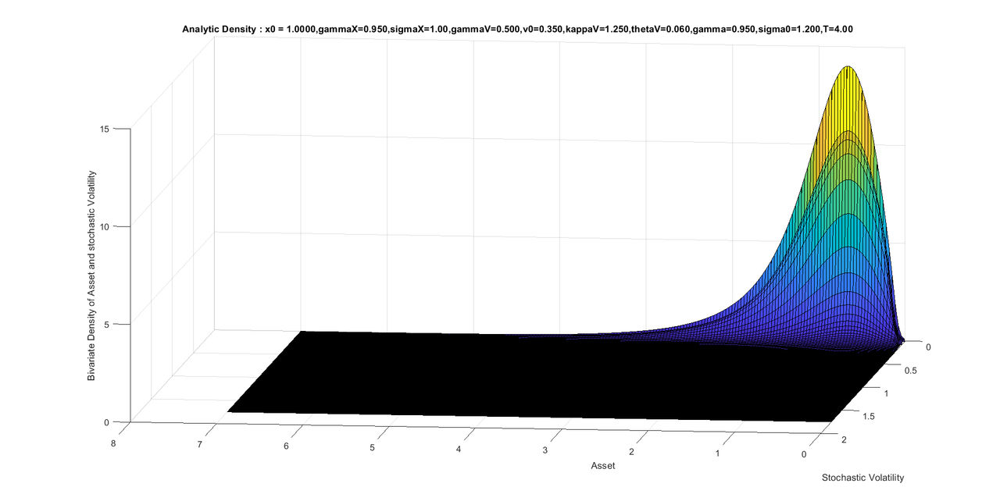](https://postimg.cc/FY66NqBf)

CallStrikes =

  Columns 1 through 3

   0.500000000000000   0.550000000000000   0.600000000000000

  Columns 4 through 6

   0.650000000000000   0.700000000000000   0.750000000000000

  Columns 7 through 9

   0.800000000000000   0.850000000000000   0.900000000000000

  Columns 10 through 12

   0.950000000000000   1.000000000000000   1.050000000000000

  Columns 13 through 15

   1.100000000000000   1.150000000000000   1.200000000000000

  Columns 16 through 18

   1.250000000000000   1.300000000000000   1.350000000000000

  Columns 19 through 21

   1.400000000000000   1.450000000000000   1.500000000000000

  Columns 22 through 24

   1.550000000000000   1.600000000000000   1.650000000000000

  Columns 25 through 26

   1.700000000000000   1.750000000000000

CallPricesAnalytic =

  Columns 1 through 3

   0.537926835877369   0.500152612118761   0.464486597161106

  Columns 4 through 6

   0.430968174377953   0.399602639855606   0.370364238614663

  Columns 7 through 9

   0.343200449341003   0.318036958533778   0.294782799534387

  Columns 10 through 12

   0.273335257170325   0.253584282371143   0.235416281719161

  Columns 13 through 15

   0.218717234466911   0.203375148716088   0.189281906392691

  Columns 16 through 18

   0.176334568970976   0.164436226509000   0.153496474448381

  Columns 19 through 21

   0.143431598341543   0.134164538428706   0.125624695677418

  Columns 22 through 24

   0.117747629995561   0.110474690874392   0.103752611343892

  Columns 25 through 26

   0.097533088130262   0.091772364359853

CallPricesMC =

  Columns 1 through 3

   0.536793297899013   0.499154375469270   0.463674017192146

  Columns 4 through 6

   0.430383296933582   0.399251716888628   0.370261179363154

  Columns 7 through 9

   0.343324156923675   0.318340673629315   0.295213532885733

  Columns 10 through 12

   0.273848237450996   0.254130205848175   0.235963964617648

  Columns 13 through 15

   0.219230337508026   0.203831810404914   0.189663058532127

  Columns 16 through 18

   0.176638347696134   0.164662380254535   0.153658832729428

  Columns 19 through 21

   0.143542641021019   0.134227628373004   0.125657140915244

  Columns 22 through 24

   0.117761713743098   0.110486884419954   0.103773490707376

  Columns 25 through 26

   0.097573767111599   0.091838900421060

Look at comparison of analytic and monte carlo call prices

.

.

.

2

[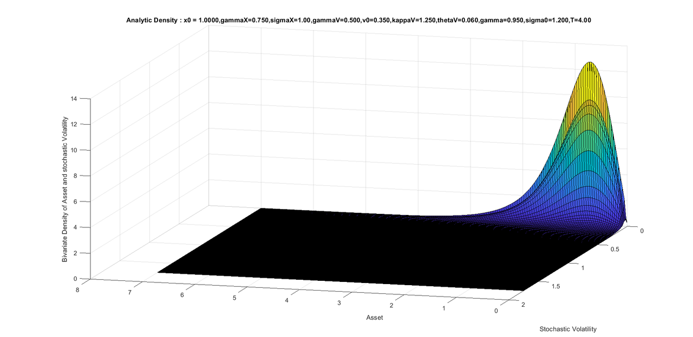](https://postimg.cc/WttJJHWp)

CallPricesAnalytic =

  Columns 1 through 3

   0.545425807698928   0.507898693895143   0.472235072986369

  Columns 4 through 6

   0.438474201811599   0.406633318982441   0.376708741514096

  Columns 7 through 9

   0.348677556910613   0.322499775378766   0.298120787048754

  Columns 10 through 12

   0.275473969595896   0.254483307679456   0.235065910573224

  Columns 13 through 15

   0.217134342502909   0.200598707647171   0.185368456340500

  Columns 16 through 18

   0.171353899720097   0.158467436540210   0.146624508190562

  Columns 19 through 21

   0.135744306407811   0.125750263228044   0.116570354957945

  Columns 22 through 24

   0.108137251947685   0.100388344327680   0.093265671172367

  Columns 25 through 26

   0.086715777245705   0.080689517938374

CallPricesMC =

  Columns 1 through 3

   0.544524075517865   0.507036862437665   0.471442514772908

  Columns 4 through 6

   0.437789698902691   0.406077391166198   0.376300240664841

  Columns 7 through 9

   0.348425899843087   0.322392026744226   0.298139253136114

  Columns 10 through 12

   0.275588195074561   0.254655681271312   0.235280564374217

  Columns 13 through 15

   0.217360169582993   0.200813143364511   0.185557836091708

  Columns 16 through 18

   0.171497146580336   0.158565174347879   0.146676146393314

  Columns 19 through 21

   0.135753275975130   0.125722784026546   0.116510800081843

  Columns 22 through 24

   0.108054490018235   0.100287157515397   0.093152541074038

  Columns 25 through 26

   0.086598094098213   0.080569276713314

Look at comparison of analytic and monte carlo call prices

3.

[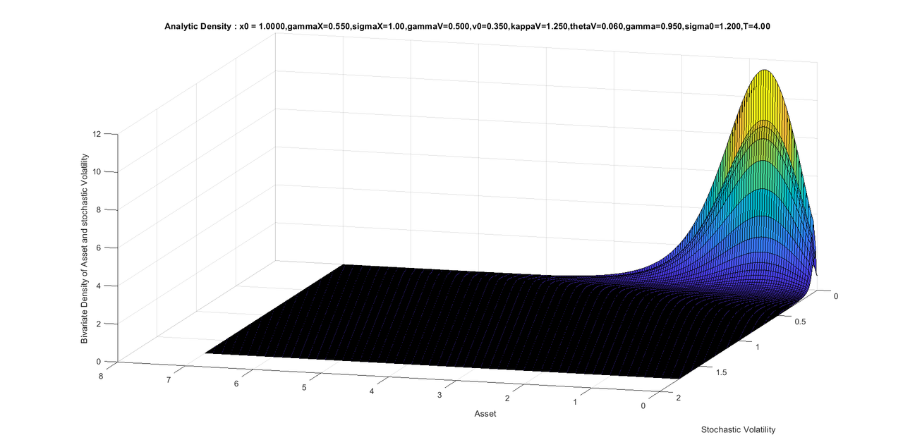](https://postimg.cc/dZdsjrZ6)

CallPricesAnalytic =

  Columns 1 through 3

   0.553154230839965   0.515727260225382   0.479943901775300

  Columns 4 through 6

   0.445847785329868   0.413468644127601   0.382822201025609

  Columns 7 through 9

   0.353910370854767   0.326721768926119   0.301232501589582

  Columns 10 through 12

   0.277407202063480   0.255200264773041   0.234557224977368

  Columns 13 through 15

   0.215416227806497   0.197709531766396   0.181364995752975

  Columns 16 through 18

   0.166307504924643   0.152460298655862   0.139746172512933

  Columns 19 through 21

   0.128088535114407   0.117412309305799   0.107644674836354

  Columns 22 through 24

   0.098715656338048   0.090558565669539   0.083110311528853

  Columns 25 through 26

   0.076311591704640   0.070106984565268

CallPricesMC =

  Columns 1 through 3

   0.553419577145168   0.515905651132007   0.480057384659420

  Columns 4 through 6

   0.445926913095879   0.413542602993833   0.382909868613168

  Columns 7 through 9

   0.354047756881760   0.326921725794559   0.301500958208169

  Columns 10 through 12

   0.277747401552384   0.255594524346139   0.234990834599493

  Columns 13 through 15

   0.215887215417880   0.198200269697573   0.181860521224182

  Columns 16 through 18

   0.166797588303380   0.152929623493798   0.140196287795888

  Columns 19 through 21

   0.128513919773964   0.117812429569080   0.108014635708646

  Columns 22 through 24

   0.099061824535526   0.090881386769305   0.083414237129980

  Columns 25 through 26

   0.076596811599668   0.070367022620465

Look at comparison of analytic and monte carlo call prices

4.

[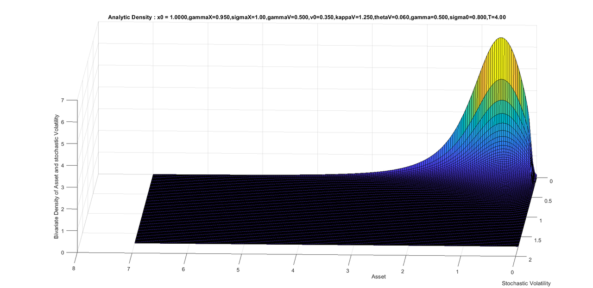](https://postimg.cc/75Bk7mQD)

CallPricesAnalytic =

  Columns 1 through 3

   0.546272105616170   0.509574226674259   0.474899114465324

  Columns 4 through 6

   0.442276311709327   0.411707769012113   0.383169250314847

  Columns 7 through 9

   0.356612929698367   0.331970911669707   0.309159280465292

  Columns 10 through 12

   0.288082287756505   0.268636367195922   0.250713760604827

  Columns 13 through 15

   0.234205627141900   0.219004577483511   0.205006630266132

  Columns 16 through 18

   0.192112628528435   0.180229180293272   0.169269201084758

  Columns 19 through 21

   0.159152139366994   0.149803961502263   0.141156963778418

  Columns 22 through 24

   0.133149467846374   0.125725444386708   0.118834099165162

  Columns 25 through 26

   0.112429446452426   0.106469887278635

CallPricesMC =

  Columns 1 through 3

   0.545368076157899   0.508853086037912   0.474372778668777

  Columns 4 through 6

   0.441948400401515   0.411563833687200   0.383180582092740

  Columns 7 through 9

   0.356735134743637   0.332171790784078   0.309399725680000

  Columns 10 through 12

   0.288340316997791   0.268878353296638   0.250918250702356

  Columns 13 through 15

   0.234346383315440   0.219066057142301   0.204990358477065

  Columns 16 through 18

   0.192025398350339   0.180087362200428   0.169080406715534

  Columns 19 through 21

   0.158928902305196   0.149557082477249   0.140909985209471

  Columns 22 through 24

   0.132914382044620   0.125507309150219   0.118646349085830

  Columns 25 through 26

   0.112283201846716   0.106380006239010

Look at comparison of analytic and monte carlo call prices

5.

[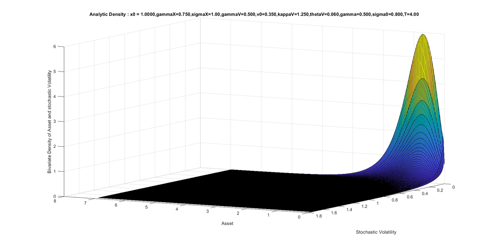](https://postimg.cc/9rb55L2T)

CallPricesAnalytic =

  Columns 1 through 3

   0.554241784711384   0.517622344187124   0.482809354915949

  Columns 4 through 6

   0.449837207939995   0.418720228645241   0.389453213714901

  Columns 7 through 9

   0.362012652987503   0.336358541379940   0.312436632247277

  Columns 10 through 12

   0.290180957804054   0.269516444206636   0.250361470743069

  Columns 13 through 15

   0.232630255079978   0.216234982328154   0.201087629875744

  Columns 16 through 18

   0.187101469523128   0.174192251914357   0.162279095167842

  Columns 19 through 21

   0.151285110335556   0.141137801758279   0.131769281686058

  Columns 22 through 24

   0.123116336890513   0.115120381489889   0.107727325723179

  Columns 25 through 26

   0.100887385607796   0.094554853746470

CallPricesMC =

  Columns 1 through 3

   0.553879919297930   0.517346847552536   0.482596955348027

  Columns 4 through 6

   0.449674713557342   0.418581928727298   0.389313237397408

  Columns 7 through 9

   0.361842016997210   0.336140120405385   0.312152190853246

  Columns 10 through 12

   0.289830939877146   0.269102610109687   0.249881630493695

  Columns 13 through 15

   0.232083597300649   0.215613351850829   0.200398337189012

  Columns 16 through 18

   0.186363192454096   0.173421347388467   0.161481446828400

  Columns 19 through 21

   0.150479294793463   0.140342368525498   0.130992258540283

  Columns 22 through 24

   0.122379830049507   0.114432526277204   0.107088419135747

  Columns 25 through 26

   0.100308213471844   0.094046553165801

Look at comparison of analytic and monte carlo call prices

.

.

.

6.

[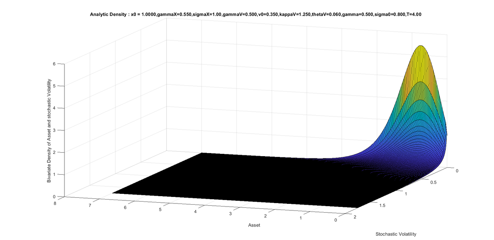](https://postimg.cc/QBRvkPgL)

CallPricesAnalytic =

  Columns 1 through 3

   0.561527450274528   0.524918382337343   0.489913608387108

  Columns 4 through 6

   0.456552121243980   0.424859722828515   0.394848708106190

  Columns 7 through 9

   0.366517921156712   0.339853184712964   0.314828080247612

  Columns 10 through 12

   0.291405033130582   0.269536639674371   0.249167161985045

  Columns 13 through 15

   0.230234113020792   0.212669857525311   0.196403163161351

  Columns 16 through 18

   0.181360648446476   0.167468088163665   0.154651551153003

  Columns 19 through 21

   0.142838358506490   0.131957861323954   0.121942045898090

  Columns 22 through 24

   0.112725980390668   0.104248120916450   0.096450496810285

  Columns 25 through 26

   0.089278795138373   0.082682363657354

CallPricesMC =

  Columns 1 through 3

   0.563490754564520   0.526771483300768   0.491621175392750

  Columns 4 through 6

   0.458090819974471   0.426218888990960   0.396012587145756

  Columns 7 through 9

   0.367478905429374   0.340611714493581   0.315397690878662

  Columns 10 through 12

   0.291809686416249   0.269791999456781   0.249305432908664

  Columns 13 through 15

   0.230285796666707   0.212644370696246   0.196317197149356

  Columns 16 through 18

   0.181226137561613   0.167304459592057   0.154490009518272

  Columns 19 through 21

   0.142686094709070   0.131832637198140   0.121846429054105

  Columns 22 through 24

   0.112677148571275   0.104258228870156   0.096509037784795

  Columns 25 through 26

   0.089392804916416   0.082858955103459

Look at comparison of analytic and monte carlo call prices

---

### #2053 — Amin (Topic Author)
*November 9, 2023, 5:12 PM*

Friends, here are the new matlab program functions. If some functions are missing, I have posted them earlier and you
can download them from past page or so.

.

.

.

```
function [] = SVMonteCarloAndAssetConditionalDensity04NewA()

X0=1.0;
alpha1=0;
alpha2=1;
kappaX=0;
thetaX=1;
a=kappaX*thetaX;
b=-kappaX;

rho=0;
sigma1=1;
gammaV=.5;
gammaX=.95;
%%%%%%%%`%%%%%
V0=.35;
thetaV=.06;
kappaV=1.250;
mu1=kappaV*thetaV;
mu2=-kappaV;
beta1=0;
beta2=1;
gamma=.95;
sigma0=1.1;

dt=.03125/2;
Tt=64*4;

T=Tt*dt;

%%%%%%%%%%%%%%%%%%%%%%%%5
rng(82139475, 'twister')
paths=500000;
V(1:paths)=V0;  %Original process monte carlo.
X(1:paths)=X0;
paths0=paths/2;
paths00=paths/4;
Random1(1:paths00)=0;
Random2(1:paths0)=0;

for tt=1:Tt

Random2=randn(size(Random2));
Random1=randn(size(Random1));
Random1(paths00+1:2*paths00)=-1*Random1(1:paths00);
Random2(paths0+1:2*paths0)=-1*Random2(1:paths0);
Random1(paths0+1:2*paths0)=Random1(1:paths0);
%antithetic variates above

X(1:paths)=X(1:paths)+ ...
    (a* X(1:paths).^alpha1 + b* X(1:paths).^alpha2)* dt + ...
    sqrt(1-rho^2)* sigma1* V(1:paths).^gammaV.* X(1:paths).^gammaX .*Random1(1:paths) * sqrt(dt) + ...
    rho* sigma1* V(1:paths).^gammaV .*X(1:paths).^gammaX .*Random2(1:paths)*sqrt(dt) + ...
    (a*alpha1* X(1:paths).^(alpha1-1)+b*alpha2* X(1:paths).^(alpha2-1)).* ...
    (((a* X(1:paths).^alpha1 + b* X(1:paths).^alpha2)* dt^2/2)+ ...
    (sqrt(1-rho^2)* sigma1* V(1:paths).^gammaV.* X(1:paths).^gammaX .*Random1(1:paths) *(1-1/sqrt(3)).*dt^1.5+ ...
    rho* sigma1* V(1:paths).^gammaV .*X(1:paths).^gammaX .*Random2(1:paths)*(1-1/sqrt(3)).*dt^1.5))+ ...
    .5*(a*alpha1*(alpha1-1)* X(1:paths).^(alpha1-2)+b*alpha2*(alpha2-1).* X(1:paths).^(alpha2-2)).* ...
    ( sigma1^2* V(1:paths).^(2*gammaV).* X(1:paths).^(2*gammaX)) *dt^2/2 + ...
    sqrt(1-rho^2)* sigma1* V(1:paths).^gammaV.*gammaX.* X(1:paths).^(gammaX-1).* ...
    ((a* X(1:paths).^alpha1 + b* X(1:paths).^alpha2).*Random1(1:paths) * 1/sqrt(3).* dt^1.5 + ...
    sqrt(1-rho^2)* sigma1* V(1:paths).^gammaV.* X(1:paths).^gammaX .*(Random1(1:paths).^2-1) * dt/2 + ...
    rho* sigma1* V(1:paths).^gammaV .*X(1:paths).^gammaX .*Random1(1:paths).*Random2(1:paths)*dt/2)+ ...
    .5*sqrt(1-rho^2)* sigma1* V(1:paths).^gammaV.*gammaX.*(gammaX-1).* X(1:paths).^(gammaX-2).* ...
    (sigma1^2* V(1:paths).^(2*gammaV).* X(1:paths).^(2*gammaX) .*Random1(1:paths).*1/sqrt(3).*dt^1.5)+ ...
    sqrt(1-rho^2)* sigma1*gammaV.* V(1:paths).^(gammaV-1).* X(1:paths).^(gammaX).* ...
    ((mu1.*V(1:paths).^beta1 + mu2.*V(1:paths).^beta2).*Random1(1:paths) * 1/sqrt(3).* dt^1.5 + ...
    sigma0*V(1:paths).^gamma.*Random1(1:paths).*Random2(1:paths)*dt/2)+ ...
    .5*sqrt(1-rho^2)* sigma1*gammaV.*(gammaV-1).* V(1:paths).^(gammaV-2).* X(1:paths).^(gammaX).* ...
    (sigma0^2*V(1:paths).^(2*gamma).*Random1(1:paths)*1/sqrt(3)*dt^1.5)+ ...
    sqrt(1-rho^2)* sigma1*gammaV.* V(1:paths).^(gammaV-1).*gammaX.* X(1:paths).^(gammaX-1).* ...
    rho.* sigma1.* V(1:paths).^gammaV .*X(1:paths).^gammaX
.*sigma0.*V(1:paths).^gamma.*Random1(1:paths)*1/sqrt(3)*dt^1.5+ ...
    rho* sigma1* V(1:paths).^gammaV.*gammaX.* X(1:paths).^(gammaX-1).* ...
    ((a* X(1:paths).^alpha1 + b* X(1:paths).^alpha2).*Random2(1:paths) * 1/sqrt(3).* dt^1.5 + ...
    sqrt(1-rho^2)* sigma1* V(1:paths).^gammaV.* X(1:paths).^gammaX .*Random1(1:paths).*Random2(1:paths) * dt/2 + ...
    rho* sigma1* V(1:paths).^gammaV .*X(1:paths).^gammaX .*(Random2(1:paths).^2-1)*dt/2)+ ...
    .5*rho* sigma1* V(1:paths).^gammaV.*gammaX.*(gammaX-1).* X(1:paths).^(gammaX-2).* ...
    (sigma1^2* V(1:paths).^(2*gammaV).* X(1:paths).^(2*gammaX) .*Random2(1:paths).*1/sqrt(3).*dt^1.5)+ ...
    rho* sigma1*gammaV.* V(1:paths).^(gammaV-1).* X(1:paths).^(gammaX).* ...
    ((mu1.*V(1:paths).^beta1 + mu2.*V(1:paths).^beta2).*Random2(1:paths) * 1/sqrt(3).* dt^1.5 + ...
    sigma0*V(1:paths).^gamma.*(Random2(1:paths).^2-1)*dt/2)+ ...
    .5*rho* sigma1*gammaV.*(gammaV-1).* V(1:paths).^(gammaV-2).* X(1:paths).^(gammaX).* ...
    sigma0^2.*V(1:paths).^(2*gamma).*Random2(1:paths) * 1/sqrt(3).* dt^1.5+ ...
    rho* sigma1*gammaV.* V(1:paths).^(gammaV-1).*gammaX.* X(1:paths).^(gammaX-1).* ...
    rho.* sigma1.* V(1:paths).^gammaV .*X(1:paths).^gammaX
.*sigma0.*V(1:paths).^gamma.*Random2(1:paths)*1/sqrt(3)*dt^1.5;

    V(1:paths)=V(1:paths)+ ...
        (mu1.*V(1:paths).^beta1 + mu2.*V(1:paths).^beta2)*dt + ...
        sigma0*V(1:paths).^gamma .*Random2(1:paths)*sqrt(dt) + ...
        (mu1.*beta1*V(1:paths).^(beta1-1) + mu2.*beta2.*V(1:paths).^(beta2-1)).* ...
        ((mu1.*V(1:paths).^beta1 + mu2.*V(1:paths).^beta2)*dt^2/2 + ...
        sigma0*V(1:paths).^gamma .*Random2(1:paths)*(1-1/sqrt(3))*dt^1.5) + ...
        .5*(mu1.*beta1.*(beta1-1).*V(1:paths).^(beta1-2) + mu2.*beta2.*(beta2-1).*V(1:paths).^(beta2-2)).* ...
        sigma0^2.*V(1:paths).^(2*gamma).*dt^2/2 + ...
        sigma0*gamma*V(1:paths).^(gamma-1) .* ...
        ((mu1.*V(1:paths).^beta1 + mu2.*V(1:paths).^beta2).*Random2(1:paths).*1/sqrt(3)*dt^1.5 + ...
        sigma0.*V(1:paths).^gamma .*(Random2(1:paths).^2-1)*dt/2) + ...
        .5*sigma0*gamma*(gamma-1).*V(1:paths).^(gamma-2) .* ...
        sigma0^2.*V(1:paths).^(2*gamma) .*Random2(1:paths).*1/sqrt(3)*dt^1.5;

end

X(XCallStrikes(nn))
            CallPricesMC(nn)=CallPricesMC(nn)+(X(pp)-CallStrikes(nn))/paths;
        end
    end
end

SVolMeanAnalytic=thetaV+exp(-kappaV*T)*(V0-thetaV)
SVolMean=sum(V(1:paths))/paths
AssetMeanAnalytic=thetaX+exp(-kappaX*T)*(X0-thetaX)
AssetMean=sum(X(1:paths))/paths

MaxCount=2000;
%For asset SDE volatility exponents close to lognormal, please choose
%MaxCount=500;
%For asset SDE volatility exponents close to .75, please choose
%MaxCount=1000;
%For asset SDE volatility exponents close to .5, please choose
%MaxCount=2000;

if(gammaX>.87)
    MaxCount=500;
elseif((gammaX=.67))
    MaxCount=1000;
elseif(gammaX<.67)
    MaxCount=2000;
end
MinCount=100;

[aa0,aa,VProbMass,NoOfBinsV0,Vm,Zv]
=FindConditionalZSeriesXAndZyFromSimulation_NewGranularGridLS02(X,V,paths,MaxCount,MinCount)

%Below calculate the parameters of Z-series of asset in each of the
%volatility subdivisions.
%variable size of a0 is  "NSubDivs X 1"
%variable size of a is   "NSubDivs X 5" as there are five Z-series
%coefficients for each of the volatility subdivisions.

%IndexMaxV=NoOfBinsV;

%%%%%%%%%%%%%%%%%%%%%%%%%%%%%%%%%%%%%%%%%%%%%%%%%%%%%%%%%%%%%%%%%%%%%%%%%%%%%%%%%%5
%In this block, I calculate and graph the conditional Z-series Coeffs from
%analytic Z-series of coeffs and graphically compare them with numerically
%computed Z-series coeffs for each volatility grid cell.

dNn=.1/2;   % Normal density subdivisions width. would change with number of subdivisions
Nn=45*4;  % No of normal density subdivisions
NnMid=((1+Nn)/2)*dNn;
Z(1:Nn)=(((1:Nn)*dNn)-NnMid);

[coeff0,coeff]= FindZSeriesByPolynomialRegressionOnUnderlyingZ02(aa0,Zv,VProbMass,NoOfBinsV0)
display("Look at coeffs of conditional median");

Coeff(1,1)=coeff0;
Coeff(1,2:6)=coeff(1:5);

Y(1:Nn)=coeff0;
for nn=1:5
    Y(1:Nn)=Y(1:Nn)+coeff(nn)*Z(1:Nn).^nn;
end

plot(Z(1:Nn),Y(1:Nn),'r',Zv(1:length(Zv)),aa0(1:length(Zv)),'g')
title('Graph of c0 coefficient(Median) of conditional asset Z-series as a function of underlying Z associated with
stochastic volatility grid'); %: x0 =
%.2f,gammaX=%.2f,sigmaX=%.2f,gammaV=%.2f,v0=%.2f,kappaV=%.2f,thetaV=%.2f,gamma=%.2f,sigma0=%.2f,T=%.2f',
X0,gammaX,sigma1,gammaV,V0,kappaV,thetaV,gamma,sigma0,T));%,sprintf('theta= %f', theta), sprintf('kappa = %f',
kappa),sprintf('sigma = %f', sigma0),sprintf('T = %f', T));
legend({'c0 coefficient (Median of conditional Asset) analytically calculated from further Z-series of c0 along the
volatility grid','c0 coefficient (Median of conditional asset Z-series) individually and numerically calculated along
each volatility grid cell'},'Location','northwest')
xlabel('Underlying Z associated with Stochastic Volatility Grid'),ylabel('c0 Coefficient (Median)')

str=input("look at the graph of median of asset as a function of stochastic volatility grid");

[coeff0,coeff] = FindZSeriesByPolynomialRegressionOnUnderlyingZ02(aa(1,:),Zv,VProbMass,NoOfBinsV0)
% PlotZSeriesDensity(coeff0,coeff,'r');
% str=input("Look at coeff density--1")
Coeff(2,1)=coeff0;
Coeff(2,2:6)=coeff(1:5);
Y(1:Nn)=coeff0;
for nn=1:5
    Y(1:Nn)=Y(1:Nn)+coeff(nn)*Z(1:Nn).^nn;
end

plot(Z(1:Nn),Y(1:Nn),'r',Zv(1:length(Zv)),aa(1,1:length(Zv)),'g')
title('Graph of c1 coefficient of conditional asset Z-series as a function of underlying Z associated with stochastic
volatility grid');% : x0 =
%.2f,gammaX=%.2f,sigmaX=%.2f,gammaV=%.2f,v0=%.2f,kappaV=%.2f,thetaV=%.2f,gamma=%.2f,sigma0=%.2f,T=%.2f',
X0,gammaX,sigma1,gammaV,V0,kappaV,thetaV,gamma,sigma0,T));%,sprintf('theta= %f', theta), sprintf('kappa = %f',
kappa),sprintf('sigma = %f', sigma0),sprintf('T = %f', T));
legend({'c1 coefficient of conditional Asset Z-series analytically calculated from further Z-series of c1 along the
volatility grid ','c1 coefficient of conditional asset Z-series individually and numerically calculated along each
volatility grid cell'},'Location','northwest')
xlabel('Underlying Z associated with Stochastic Volatility Grid'),ylabel('c1 Coefficient')

str=input("look at the graph of coeff-1 of asset Z-series as a function of stochastic volatility grid");

[coeff0,coeff] = FindZSeriesByPolynomialRegressionOnUnderlyingZ02(aa(2,:),Zv,VProbMass,NoOfBinsV0)
 %PlotZSeriesDensity(coeff0,coeff,'r');
 %str=input("Look at coeff density--2")
Coeff(3,1)=coeff0;
Coeff(3,2:6)=coeff(1:5);

Y(1:Nn)=coeff0;
for nn=1:5
    Y(1:Nn)=Y(1:Nn)+coeff(nn)*Z(1:Nn).^nn;
end

plot(Z(1:Nn),Y(1:Nn),'r',Zv(1:length(Zv)),aa(2,1:length(Zv)),'g')

title('Graph of c2 coefficient of conditional asset Z-series as a function of underlying Z associated with stochastic
volatility grid');% : x0 =
%.2f,gammaX=%.2f,sigmaX=%.2f,gammaV=%.2f,v0=%.2f,kappaV=%.2f,thetaV=%.2f,gamma=%.2f,sigma0=%.2f,T=%.2f',
X0,gammaX,sigma1,gammaV,V0,kappaV,thetaV,gamma,sigma0,T));%,sprintf('theta= %f', theta), sprintf('kappa = %f',
kappa),sprintf('sigma = %f', sigma0),sprintf('T = %f', T));
legend({'c2 coefficient of conditional Asset Z-series analytically calculated from further Z-series of c2 along the
volatility grid ','c2 coefficient of conditional asset Z-series individually and numerically calculated along each
volatility grid cell'},'Location','northwest')
xlabel('Underlying Z associated with Stochastic Volatility Grid'),ylabel('c2 Coefficient')

str=input("look at the graph of coeff-2 of asset Z-series as a function of stochastic volatility grid");

[coeff0,coeff] = FindZSeriesByPolynomialRegressionOnUnderlyingZ02(aa(3,:),Zv,VProbMass,NoOfBinsV0)
% PlotZSeriesDensity(coeff0,coeff,'r');
% str=input("Look at coeff density--3")
Coeff(4,1)=coeff0;
Coeff(4,2:6)=coeff(1:5);
Y(1:Nn)=coeff0;
for nn=1:5
    Y(1:Nn)=Y(1:Nn)+coeff(nn)*Z(1:Nn).^nn;
end

plot(Z(1:Nn),Y(1:Nn),'r',Zv(1:length(Zv)),aa(3,1:length(Zv)),'g')
title('Graph of c3 coefficient of conditional asset Z-series as a function of underlying Z associated with stochastic
volatility grid');% : x0 =
%.2f,gammaX=%.2f,sigmaX=%.2f,gammaV=%.2f,v0=%.2f,kappaV=%.2f,thetaV=%.2f,gamma=%.2f,sigma0=%.2f,T=%.2f',
X0,gammaX,sigma1,gammaV,V0,kappaV,thetaV,gamma,sigma0,T));%,sprintf('theta= %f', theta), sprintf('kappa = %f',
kappa),sprintf('sigma = %f', sigma0),sprintf('T = %f', T));
legend({'c3 coefficient of conditional asset Z-series analytically calculated from further Z-series of c3 along the
volatility grid ','c3 coefficient of conditional asset Z-series individually and numerically calculated along each
volatility grid cell'},'Location','northwest')
xlabel('Underlying Z associated with Stochastic Volatility Grid'),ylabel('c3 Coefficient')

str=input("look at the graph of coeff-3 of asset Z-series as a function of stochastic volatility grid");

[coeff0,coeff] = FindZSeriesByPolynomialRegressionOnUnderlyingZ02(aa(4,:),Zv,VProbMass,NoOfBinsV0)
% PlotZSeriesDensity(coeff0,coeff,'r');
Coeff(5,1)=coeff0;
Coeff(5,2:6)=coeff(1:5);
Y(1:Nn)=coeff0;
for nn=1:5
    Y(1:Nn)=Y(1:Nn)+coeff(nn)*Z(1:Nn).^nn;
end

plot(Z(1:Nn),Y(1:Nn),'r',Zv(1:length(Zv)),aa(4,1:length(Zv)),'g')
title('Graph of c4 coefficient of conditional asset Z-series as a function of underlying Z associated with stochastic
volatility grid');% : x0 =
%.2f,gammaX=%.2f,sigmaX=%.2f,gammaV=%.2f,v0=%.2f,kappaV=%.2f,thetaV=%.2f,gamma=%.2f,sigma0=%.2f,T=%.2f',
X0,gammaX,sigma1,gammaV,V0,kappaV,thetaV,gamma,sigma0,T));%,sprintf('theta= %f', theta), sprintf('kappa = %f',
kappa),sprintf('sigma = %f', sigma0),sprintf('T = %f', T));
legend({'c4 coefficient of conditional asset Z-series analytically calculated from further Z-series of c4 along the
volatility grid ','c4 coefficient of conditional asset Z-series individually and numerically calculated along each
volatility grid cell'},'Location','northwest')
xlabel('Underlying Z associated with Stochastic Volatility Grid'),ylabel('c4 Coefficient')

str=input("look at the graph of coeff-4  of asset Z-series as a function of stochastic volatility grid");

[coeff0,coeff] = FindZSeriesByPolynomialRegressionOnUnderlyingZ02(aa(5,:),Zv,VProbMass,NoOfBinsV0)
% PlotZSeriesDensity(coeff0,coeff,'r');
% str=input("Look at coeff density--5")
Coeff(6,1)=coeff0;
Coeff(6,2:6)=coeff(1:5);

Y(1:Nn)=coeff0;
for nn=1:5
    Y(1:Nn)=Y(1:Nn)+coeff(nn)*Z(1:Nn).^nn;
end

plot(Z(1:Nn),Y(1:Nn),'r',Zv(1:length(Zv)),aa(5,1:length(Zv)),'g')
title('Graph of c5 coefficient of conditional asset Z-series as a function of underlying Z associated with stochastic
volatility grid');% : x0 =
%.2f,gammaX=%.2f,sigmaX=%.2f,gammaV=%.2f,v0=%.2f,kappaV=%.2f,thetaV=%.2f,gamma=%.2f,sigma0=%.2f,T=%.2f',
X0,gammaX,sigma1,gammaV,V0,kappaV,thetaV,gamma,sigma0,T));%,sprintf('theta= %f', theta), sprintf('kappa = %f',
kappa),sprintf('sigma = %f', sigma0),sprintf('T = %f', T));
legend({'c5 coefficient of conditional asset Z-series analytically calculated from further Z-series of c5 along the
volatility grid ','c5 coefficient of conditional asset Z-series individually and numerically calculated along each
volatility grid cell'},'Location','northwest')
xlabel('Underlying Z associated with Stochastic Volatility Grid'),ylabel('c5 Coefficient')

str=input("look at the graph of coeff-5  of asset Z-series as a function of stochastic volatility grid");

%%%%%%%%%%%%%%%%%%%%%%%%%%%%%%%%%%%%%%%%%%%%%%%%%%%%%%%%%%%%%%%%%%%%%%%%%%%%%%%%%%%

for indexV=1:-1

    clf;

    PlotZSeriesDensity(aa0(indexV),aa(:,indexV),'g');
    hold on
    %str=input("Look at X conditional density graph");
    %Below conditional coefficients are calculated from coefficients of
    %coefficients dependent on Zv. Then a graphical comparison is made
    %between conditional density of asset from analytic coefficients and
    %conditional asset density from individually numerically  calculated
    %coefficients of Z-series

   
b0=Coeff(1,1)+Coeff(1,2).*Zv(indexV)+Coeff(1,3).*Zv(indexV).^2+Coeff(1,4).*Zv(indexV).^3+Coeff(1,5).*Zv(indexV).^4+Coeff(1,6).*Zv(indexV).^5;
    %b0=b0+1;

    for mm=2:6
       
b(mm-1)=Coeff(mm,1)+Coeff(mm,2).*Zv(indexV)+Coeff(mm,3).*Zv(indexV).^2+Coeff(mm,4).*Zv(indexV).^3+Coeff(mm,5).*Zv(indexV).^4+Coeff(mm,6).*Zv(indexV).^5;
    end

    [Zc]=CalculateZgivenXAndZSeriesBisection2C5Improved(0,b0,b);

    [aH0,aH] = ConvertZCoeffsToHCoeffs(b0,b,5);

    MeanXv(indexV)= (aH0)*(1-normcdf(Zc))+exp(-.5*Zc^2)/sqrt(2*pi)*(aH(1) + aH(2) *Zc + aH(3)* (Zc^2-1) + aH(4) *(Zc^3 -
3 *Zc) + aH(5) *(Zc^4 -6 * Zc^2 +3));
    MeanXv(indexV)
    aH0

    b0=b0/MeanXv(indexV);
    b=b/MeanXv(indexV);

    PlotZSeriesDensity(b0,b,'r');
    title(sprintf('Conditional V=%.3f,Zv=%.3f,x0 =
%.4f,gammaX=%.3f,sigmaX=%.2f,gammaV=%.3f,v0=%.3f,kappaV=%.3f,thetaV=%.3f,gamma=%.3f,sigma0=%.3f,T=%.2f',
Vm(indexV),Zv(indexV), X0,gammaX,sigma1,gammaV,V0,kappaV,thetaV,gamma,sigma0,T));
    legend({'Conditional Asset density From numerical Z-series','Conditional Asset density From new analytic Coeffs
Z-series'},'Location','northeast')
    xlabel('Asset'), ylabel('Conditional Asset Density')
    display(fprintf('conditional value of stochastic volatility Grid cell for this graph: V=%.3f,Zv=%.3f,SV grid cell
number = %.1f, Total SV Grid Cells=%.1f',Vm(indexV),Zv(indexV),indexV, IndexMaxV));
%    str=input("Lok at comparison of numerically calculated conditional asset density and analytic coeffs conditional
asset density plots")
    hold off
end

[a0,a] = FindZSeriesByPolynomialRegressionOnUnderlyingZ02(Vm,Zv,VProbMass,NoOfBinsV0);

%Please note that for drawing bivariate density of asset and stochastic volatility, grid parameters have changed from
brom before in below.

NoOfBinsV=200;
NoOfBinsX=200;
MaxCutOffX=7;
MaxCutOffV=1.75;

[XYProbDensity2D,XYProbMass2D,XProbMass,VProbMass,IndexMaxX,IndexMaxV,Xn,Vm,Zx,Zv,BinSizeX,BinSizeV]=
Find2DDensityAndCDFFromSimulation_Infiniti04(X,V,paths,NoOfBinsX,NoOfBinsV,MaxCutOffX,MaxCutOffV);
%Please look at matlab file of above function for etailed explanation of
%all its input and output parameters.

%surf(Xn,Vm,transpose(XYProbDensity2D));

%xlabel('Asset'), ylabel('Stochastic Volatility'), zlabel('Probability Density 2D')
%title('Graph of 2D Density of Asset and SV from Parzen Density')

surf(Xn(2:NoOfBinsX+1),Vm(3:NoOfBinsV+1),transpose(XYProbDensity2D(2:NoOfBinsX+1,3:NoOfBinsV+1)))
title(sprintf('Numerical Density : x0 =
%.4f,gammaX=%.3f,sigmaX=%.2f,gammaV=%.3f,v0=%.3f,kappaV=%.3f,thetaV=%.3f,gamma=%.3f,sigma0=%.3f,T=%.2f',
X0,gammaX,sigma1,gammaV,V0,kappaV,thetaV,gamma,sigma0,T));%,sprintf('theta= %f', theta), sprintf('kappa = %f',
kappa),sprintf('sigma = %f', sigma0),sprintf('T = %f', T));
xlabel('Asset'), ylabel('Stochastic Volatility'),zlabel('Bivariate Density of Asset and Volatility')

str=input("Look at numerical bivariate density of Asset and Stochastic Volatility")

[pXY2D] = Calculate2VariablesOn2DGridFromAnalyticZSeries(Xn,Vm,NoOfBinsX,NoOfBinsV,Coeff,a0,a)

surf(Xn(1:NoOfBinsX+1),Vm(1:NoOfBinsV+1),transpose(pXY2D(1:NoOfBinsX+1,1:NoOfBinsV+1)))
title(sprintf('Analytic Density : x0 =
%.4f,gammaX=%.3f,sigmaX=%.2f,gammaV=%.3f,v0=%.3f,kappaV=%.3f,thetaV=%.3f,gamma=%.3f,sigma0=%.3f,T=%.2f',
X0,gammaX,sigma1,gammaV,V0,kappaV,thetaV,gamma,sigma0,T));%,sprintf('theta= %f', theta), sprintf('kappa = %f',
kappa),sprintf('sigma = %f', sigma0),sprintf('T = %f', T));
xlabel('Asset'), ylabel('Stochastic Volatility'),zlabel('Bivariate Density of Asset and stochastic Volatility')

str=input("Look at Analytic density of Asset and Stochastic volatility")
surf(Xn(2:NoOfBinsX+1),Vm(3:NoOfBinsV+1),transpose(pXY2D(2:NoOfBinsX+1,3:NoOfBinsV+1)-XYProbDensity2D(2:NoOfBinsX+1,3:NoOfBinsV+1)))
title(sprintf('Difference of Analytic and Numerical Density  : x0 =
%.4f,gammaX=%.3f,sigmaX=%.2f,gammaV=%.3f,v0=%.3f,kappaV=%.3f,thetaV=%.3f,gamma=%.3f,sigma0=%.3f,T=%.2f',
X0,gammaX,sigma1,gammaV,V0,kappaV,thetaV,gamma,sigma0,T));%,sprintf('theta= %f', theta), sprintf('kappa = %f',
kappa),sprintf('sigma = %f', sigma0),sprintf('T = %f', T));
xlabel('Asset'), ylabel('Stochastic Volatility'),zlabel('Bivariate Density of Asset and stochastic Volatility')

str=input("Look at difference of numerical and analytic densities of Asset and stochastic volatility")

CallStrikes=[.5,.55,.6,.65,.7,.75,.8,.85,.9,.95,1,1.05,1.1,1.15,1.2,1.25,1.3,1.35,1.4,1.45,1.5,1.55,1.6,1.65,1.7,1.75]

VolZEquiDistGridSize=200;
[CallPricesAnalytic]=PriceCallArrayOver2DDensity(a0,a,Coeff,CallStrikes,VolZEquiDistGridSize);
CallPricesAnalytic
CallPricesMC

str=input("Look at comparison of analytic and monte carlo call prices");

end

```

.

.

.

```
function [a0,a,YProbMass,NSubDivs,Ym,Zy]
=FindConditionalZSeriesXAndZyFromSimulation_NewGranularGridLS02(X,Y,Paths,MaxCount,MinCount)

%Inputs: X are monte carlo simulated paths of the asset. Y are monte carlo
%simulated paths of the stochastic volatility. Paths are total number of
%paths in monte carlo simulation.

Mtable=readtable('C:\Users\Lenovo\Documents\MATLAB\MATLAB1\MomentMatchParams08.txt');

%Above file contains a table of 1250  X 4 Values. These values are moment matching parameters for
% equi-probable (monte carlo like) data and depend upon Number of data
% elements. These moment matching parameters were obtained by running
% moment matching optimizations on different carefully chosen total number
%of data elements. These parameters are saved in a file and then
%interpolated for number of data elements in between that are not directly
%in the file. Then we can calculate moment matching parameters of monte carlo
%like equiprobable data size anywhere between 26 to one million total data
%elements count or paths using interpolation.

[A,B,Zy,CDF,NSubDivs,YProbMass] =MakeGranularGrid(Paths,MaxCount,MinCount)

%The parameter A(nn) coming out of the above function is the starting
%path number of any nnth subdivision and
%parameter B(nn) is the last path number of any nnth subdivisions.
%So total number of paths in any subdivision are (B(nn)-A(nn)+1)

[Ys,I]=sort(Y);

%Above we sort the stochastic volatility paths. I is the index that maps
%unsorted array to sorted array. Please look at defintion of sort on interent
%as this is a matlab internal function.
%We later use map I in the output of above sort function to automatically
%pull the asset paths that are associated with stochastic volatility paths in
%each of the volatility subdivisions. This association was fromed in
%the monte carlo simulation.

for nn=1:NSubDivs
    NoOfPathsV(nn)=B(nn)-A(nn)+1;
    Ndata=NoOfPathsV(nn);

%The program below takes data count of asset paths in each volatility
%subdivision and then interpolates the moment matching parameters from the
%Mtable,data read from file, instead of full blown optimization each time.
%This gives us a moment matched array of standard normal values for use in
%Least Squares regression.
    [ZI] = MatchMomentParametersOfIdealZhalf04(Ndata,Mtable);

    %Below use the map I to assign asset paths to appropriate volatility
    %subdivisions.
    Xv(1:NoOfPathsV(nn),nn)=X(I(A(nn):B(nn)));
    Mean(nn)=sum(Xv(:,nn))./NoOfPathsV(nn);

    %Below correct the mean to one within each subdivision.
    Xv(:,nn)=Xv(:,nn)./Mean(nn);

    Xv0=0;
    Xv0(1:NoOfPathsV(nn))=Xv(1:NoOfPathsV(nn),nn);

    %Below is probability associated with each path.
    ZProb(1:NoOfPathsV(nn))=1/NoOfPathsV(nn);

    %Below calculate the parameters of Z-series of asset in each of the
    %volatility subdivisions.
    %variable size of a0 is  "NSubDivs X 1"
    %variable size of a is   "NSubDivs X 5" as there are five Z-series
    %coefficients for each of the volatility subdivisions.

    [a0(nn),a(:,nn)] = CalculateZSeriesDensityByIdealMeasureMean05WithZI(Xv0,ZI,ZProb);

    %Ym is the value of stochastic volatility grid that is calculated from
    %the median of stochstic volatility paths in each subdivision.
    Ym(nn)=Ys(floor((B(nn)+A(nn))/2+.5));
end

end
```

.

.

.

.

```
function [A,B,Zy,CDF,NSubDivs,YProbMass] =MakeGranularGrid(Paths,MaxCount,Granularity)

%This function takes total number of monte carlo paths associated with
%simulation and then divides them into stochastic volatility grid. For best
%results all three input parmeters should be a multiple of each other.The
%algorithm starts constructing the grid from the centre of the standard
%normal density and assigns the central grid subdivisions a total number of
%monte carlo paths equal to MaxCount. Dp0 is standard normal density( pdf) in the
%centre(median) of standard normal random variable.
%The grid is symmetric around zero.
%Movong away from the median,the total number of monte carlo paths in the
%next grid subdivisions are calculated from the amplitude of standard
%normal density there, Dp(nn),  by the formula
%Number of paths in nnth
%subdivision=min(ceil(pdf(nn)/pdf(median)*Granularity)*Granularity,MaxCount)
%Number of paths in nnth
%subdivision=min(ceil(Dp(nn)/Dp0*MinCount)*MinCount,MaxCount)
%Where Granularity is equal to MinCount.
%The parameter A(nn) in the program is the starting path number of any nnth subdivision and
%parameter B(nn) is the last path number of any nnth subdivisions.
%So total number of paths in any subdivision are (B(nn)-A(nn)+1) and
%probability mass in any subdivision is given as
%YProbMass(nn)=(B(nn)-A(nn)+1)/Paths;

Dp0=normpdf(.5);
if(rem(Paths,2)==0)
    pPaths(1)=ceil(MaxCount/Granularity)*Granularity;
    Bp(1)=Paths/2+pPaths(1);
    Zp(1)=norminv(Bp(1)/Paths);
    Dp(1)=normpdf(Zp(1));
    RemainingPaths=Paths-Bp(1);
end

nn=1;
while (RemainingPaths>0)
    nnMax=nn+1;

    %Below pPaths are number of monte carlo paths that lie in the (nn+1)th subdivision.
    %While Bp(nn+1) has cumulative number of paths that lie till the end of
    %(nn+1)th subdivision. This is used to calculated CDF that is invrted
    %to find the value of Zp(nn+1) at the end of the grid which is again
    %used to find the pdf of standard normal density which is used in the
    %next step of algorithm to know how many paths/prob mass to assign to
    %next subdivision.
    pPaths(nn+1)=min(ceil(MaxCount*Dp(nn)/Dp0/Granularity)*Granularity,MaxCount);
    Bp(nn+1)=Bp(nn)+pPaths(nn+1);
    Zp(nn+1)=norminv(Bp(nn+1)/Paths);
    Dp(nn+1)=normpdf(Zp(nn+1));
    RemainingPaths=Paths-Bp(nn+1);
    nn=nn+1;
end
%Bp

A(nnMax)=Paths/2-pPaths(1)+1;
A(nnMax+1)=Paths/2+1;

for nn=1:nnMax-1
    A(nnMax-nn)=A(nnMax-nn+1)-pPaths(nn+1);
    A(nnMax+nn+1)=A(nnMax+nn)+pPaths(nn);
end
A(1)=1;
B(1:nnMax*2-1)=A(2:nnMax*2)-1;
B(nnMax*2)=Paths;

%The parameter A above is the starting path number of any subdivision and
%parameter B is the last path number of any subdivisions.
%So total number of paths in any subdivision are (B(nn)-A(nn)+1) and
%probability mass in any subdivision is given as
%YProbMass(nn)=(B(nn)-A(nn)+1)/Paths;

for nn=1:nnMax*2
    CDF(nn)=(.5*A(nn)+.5*B(nn))./Paths;
    Zy(nn)=norminv(CDF(nn));
    YProbMass(nn)=(B(nn)-A(nn)+1)/Paths;
end

%Total number of subdivisions in the grid are nnMax*2 since the grid is
%symmetric around zero and nnMax is maximum number of grid points on any
%side.

NSubDivs=nnMax*2;

end

```

.

.

.

```
function [y0] = InterpolateOrderN6(N,x0,x1,x2,x3,x4,x5,x6,y1,y2,y3,y4,y5,y6)

if(N==6)
y0=(x0-x2).*(x0-x3).*(x0-x4).*(x0-x5).*(x0-x6)./((x1-x2).*(x1-x3).*(x1-x4).*(x1-x5).*(x1-x6)).*y1+ ...
   (x0-x1).*(x0-x3).*(x0-x4).*(x0-x5).*(x0-x6)./((x2-x1).*(x2-x3).*(x2-x4).*(x2-x5).*(x2-x6)).*y2+ ...
   (x0-x1).*(x0-x2).*(x0-x4).*(x0-x5).*(x0-x6)./((x3-x1).*(x3-x2).*(x3-x4).*(x3-x5).*(x3-x6)).*y3+ ...
   (x0-x1).*(x0-x2).*(x0-x3).*(x0-x5).*(x0-x6)./((x4-x1).*(x4-x2).*(x4-x3).*(x4-x5).*(x4-x6)).*y4+ ...
   (x0-x1).*(x0-x2).*(x0-x3).*(x0-x4).*(x0-x6)./((x5-x1).*(x5-x2).*(x5-x3).*(x5-x4).*(x5-x6)).*y5+ ...
   (x0-x1).*(x0-x2).*(x0-x3).*(x0-x4).*(x0-x5)./((x6-x1).*(x6-x2).*(x6-x3).*(x6-x4).*(x6-x5)).*y6;
end

if(N==5)
y0=(x0-x2).*(x0-x3).*(x0-x4).*(x0-x5)./((x1-x2).*(x1-x3).*(x1-x4).*(x1-x5)).*y1+ ...
   (x0-x1).*(x0-x3).*(x0-x4).*(x0-x5)./((x2-x1).*(x2-x3).*(x2-x4).*(x2-x5)).*y2+ ...
   (x0-x1).*(x0-x2).*(x0-x4).*(x0-x5)./((x3-x1).*(x3-x2).*(x3-x4).*(x3-x5)).*y3+ ...
   (x0-x1).*(x0-x2).*(x0-x3).*(x0-x5)./((x4-x1).*(x4-x2).*(x4-x3).*(x4-x5)).*y4+ ...
   (x0-x1).*(x0-x2).*(x0-x3).*(x0-x4)./((x5-x1).*(x5-x2).*(x5-x3).*(x5-x4)).*y5;
end
if(N==4)
y0=(x0-x2).*(x0-x3).*(x0-x4)./((x1-x2).*(x1-x3).*(x1-x4)).*y1+ ...
   (x0-x1).*(x0-x3).*(x0-x4)./((x2-x1).*(x2-x3).*(x2-x4)).*y2+ ...
   (x0-x1).*(x0-x2).*(x0-x4)./((x3-x1).*(x3-x2).*(x3-x4)).*y3+ ...
   (x0-x1).*(x0-x2).*(x0-x3)./((x4-x1).*(x4-x2).*(x4-x3)).*y4;
end
if(N==3)
y0=(x0-x2).*(x0-x3)./((x1-x2).*(x1-x3)).*y1+ ...
   (x0-x1).*(x0-x3)./((x2-x1).*(x2-x3)).*y2+ ...
   (x0-x1).*(x0-x2)./((x3-x1).*(x3-x2)).*y3;
end
if(N==2)
y0=(x0-x2)./((x1-x2)).*y1+ ...
   (x0-x1)./((x2-x1)).*y2;
end

%y0=(x0-x3)/(x2-x3)*y2+(x0-x2)/(x3-x2)*y3;

end
```

.

.

.

```
function [a0,a] = FindZSeriesByPolynomialRegressionOnUnderlyingZ02(aa0,Zy,VProbMass,IndexMaxV)

%Function below takes the standard normal values array and does moment
%matching on it so that it can be used for regression. This function is to
%be used when association with underlying Z is known with certainty as
%we have in case of functions of stochastic volatility grid.( as
%opposed to random data that is sorted and value of Z is assigned in
%increasing order). Output Zy is moment matched.
[Zy,alpha,beta,gamma] = MatchMomentParametersOfIdealZ02New(Zy,VProbMass);

%Below diagonal matrix of weights for weighted least squares.
for nn=1:IndexMaxV
    for mm=1:IndexMaxV
        if(nn==mm)
            W(nn,mm)=VProbMass(nn);
        end
    end
end

%Below interpolate the median from surrounding cells. Works for even number
%of paths.

x0=0;
x1=Zy(IndexMaxV/2-3);
x2=Zy(IndexMaxV/2-2);
x3=Zy(IndexMaxV/2-1);
x4=Zy(IndexMaxV/2+1);
x5=Zy(IndexMaxV/2+2);
x6=Zy(IndexMaxV/2+3);

y1=aa0(IndexMaxV/2-3);
y2=aa0(IndexMaxV/2-2);
y3=aa0(IndexMaxV/2-1);
y4=aa0(IndexMaxV/2+1);
y5=aa0(IndexMaxV/2+2);
y6=aa0(IndexMaxV/2+3);
N=6;
[y0] = InterpolateOrderN6(N,x0,x1,x2,x3,x4,x5,x6,y1,y2,y3,y4,y5,y6);

Median=y0;
Zu=0;
Ymu(1:IndexMaxV,1)=aa0(1:IndexMaxV)-Median;

for nn=1:IndexMaxV
    X(nn,1)=1;
    X(nn,2)=(Zy(nn)-Zu);
    X(nn,3)=(Zy(nn)-Zu).^2;
    X(nn,4)=(Zy(nn)-Zu).^3;
    X(nn,5)=(Zy(nn)-Zu).^4;
    X(nn,6)=(Zy(nn)-Zu).^5;

end

%standard unweighted least squares below. Are commented. only for
%comparison if you want to see.
% coeffA=(X'*X)$X'*Ymu);
% c0A=coeffA(1,1);
% cA(1:5)=coeffA(2:6,1);

%weighted least squares below
coeff=(X'*W*X)$X'*W*Ymu);
c0=coeff(1,1);
c(1:5)=coeff(2:6,1);

% c0A
% cA
%
% c0
% c
% str=input("Look at numbers");

a0=c0;
a=c;
a0=a0+Median;

end
```

.

.

.

.

.

```
function [ZnNew,alpha,beta,gamma] = MatchMomentParametersOfIdealZ02New(Zn,Pn)

Ndata=length(Zn);
% Ndata
% str=input("Look at number of data points");

if(Ndata30)&&(Ndata100)&&(Ndata500)&&(Ndata1000)&&(Ndata3000)&&(Ndata6000)&&(Ndata10000)&&(Ndata100000)&&(Ndata500000)

    Iterations=225;
end

%Iterations=10;
alpha=1;
beta=0;
gamma=0;

Moment2=sum(Zn(1:Ndata).^2.*Pn(1:Ndata))
Moment4=sum(Zn(1:Ndata).^4.*Pn(1:Ndata))
Moment6=sum(Zn(1:Ndata).^6.*Pn(1:Ndata))
display("Initial Moments");

ZnNew(1:Ndata)=Zn(1:Ndata).*(alpha+beta*(Zn(1:Ndata).^2-1)+gamma*(Zn(1:Ndata).^4-6*Zn(1:Ndata).^2+3));

w1=5000;
w2=200;

ObjFuncBest=(Moment2-1).^2*w1+(Moment4-3).^2*w2+(Moment6-15).^2;

delta_alpha=.00025;
delta_beta=.0002;
delta_gamma=.0002;
alphaSuccessCount=0;
betaSuccessCount=0;
gammaSuccessCount=0;
SuccessPrevalpha=0;
SuccessPrevbeta=0;
SuccessPrevgamma=0;

mul1=.9;
mul2=1.1;

for iter=1:Iterations
    alphaNew=alpha+delta_alpha;
    betaNew=beta;
    gammaNew=gamma;
    ZnNew(1:Ndata)=Zn(1:Ndata).*(alphaNew+betaNew*(Zn(1:Ndata).^2-1)+gammaNew*(Zn(1:Ndata).^4-6*Zn(1:Ndata).^2+3));
    Moment2=sum(ZnNew(1:Ndata).^2.*Pn(1:Ndata));
    Moment4=sum(ZnNew(1:Ndata).^4.*Pn(1:Ndata));
    Moment6=sum(ZnNew(1:Ndata).^6.*Pn(1:Ndata));

    ObjFuncNew=(Moment2-1).^2*w1+(Moment4-3).^2*w2+(Moment6-15).^2;

    if(ObjFuncNew4)
        delta_alpha=delta_alpha*mul2;
    end
    if(betaSuccessCount>4)
        delta_beta=delta_beta*mul2;
    end
    if(gammaSuccessCount>4)
        delta_gamma=delta_gamma*mul2;
    end
end

ZnNew(1:Ndata)=Zn(1:Ndata).*(alpha+beta*(Zn(1:Ndata).^2-1)+gamma*(Zn(1:Ndata).^4-6*Zn(1:Ndata).^2+3));

Moment2=sum(ZnNew(1:Ndata).^2.*Pn(1:Ndata));
Moment4=sum(ZnNew(1:Ndata).^4.*Pn(1:Ndata));
Moment6=sum(ZnNew(1:Ndata).^6.*Pn(1:Ndata));

Moment2
Moment4
Moment6
display("fitted Moments");
%str=input("Look at moment values")

end

```

.

.

.

```
function [XYProbDensity2D,XYProbMass2D,XProbMass,YProbMass,IndexMaxX,IndexMaxY,Xn,Ym,Zx,Zy,BinSizeX,BinSizeY] =
Find2DDensityAndCDFFromSimulation_Infiniti04(X,Y,Paths,NoOfBinsX,NoOfBinsY,MaxCutOffX,MaxCutOffY)

%This function processes joint observations of two stochastic variables X and Y from
%common monte carlo paths and makes a two dimensional density of X and Y.

%Explanation of Input Parameters
%X and Y are 1D arrays so that nth element of each makes a joint
%observation of nth monte carlo path X(n) and Y(n) form joint nth observation of two stochastic variables.
%paths ---- total monte carlo paths.
%NoOfBinsX ---- Uniform Grid size in X for density construction. You can alter
%this. But you will have to make sure to alter grid sizes in main program after
%this function has returned results.
%NoOfBinsY ---- Uniform Grid size in Y for density construction. You can alter
%this.

%Explanation of output Parameters
%XYProbDensity2D --- is 2D numerically constructed Parzen density on input
%grid in X and Y.
%XYProbMass2D, ------ is integrated version of 2D parzen density that gives
%two D probability mass on input grid in X and Y.
%XProbMass  ---- is probability mass of 1D marginal density in X on NoOfBinsX Grid.
%YProbMass  ---- is probability mass of 1D marginal density in Y on NoOfBinsY Grid.
%IndexMaxX ----- This is size of grid in X and corresponds to NoOfBinsX and
%is NoOfBinsX+1. Naturally This is also size of array that returns
%X-values on the X-axis of 2D uniform grid.
%IndexMaxY ----- This is size of grid in X and corresponds to NoOfBinsY and
%is  NoOfBinsY+1. Naturally This is also size of array that returns
%Y-values on Y-axis of the 2D uniform grid.
%Xn--- is an array of size IndexMaxX that contains values of X at the
%center of each grid cell on X-axis on 2D uniform grid.
%Ym--- is an array of size IndexMaxY that contains values of Y at the
%center of each grid cell on Y-axis on 2D uniform grid.
%Zx----- this is a 2D array. This returns the value of standard normal associated with Xn for every
%Ym grid cell. Given a certain grid cell Ym, we calculate CDF along all X grid
%cells with the same Ym. This is derived from inversion of univariate CDF on X-grid
%or X-axis associated with each Y grid cell. Zx(n,m) is a 2D array.
%Zy----- this is the value of standard normal associated with Ym at center
%of each grid cell on Y-axis. This is derived from inversion of univariate CDF on Y-grid
%or Y-axis. This is 1D array. This is used for vol which is independent of
%X.

X(X>MaxCutOffX)=MaxCutOffX;
Y(Y>MaxCutOffY)=MaxCutOffY;

hX = maxk(X,5);
Xmax2=min(hX);
Xmin2=min(X);

hY=maxk(Y,5);
Ymax2=min(hY);
Ymin2=min(Y);

Xmax2
Ymax2

str=input("Look at max values");

BinSizeX=(Xmax2-Xmin2)/NoOfBinsX;
BinSizeY=(Ymax2-Ymin2)/NoOfBinsY;
IndexMaxX=floor((Xmax2-Xmin2)/BinSizeX+.5)+1;
IndexMaxY=floor((Ymax2-Ymin2)/BinSizeY+.5)+1;

Xn(1:IndexMaxX)=Xmin2+(0:(IndexMaxX-1))*BinSizeX;
Ym(1:IndexMaxY)=Ymin2+(0:(IndexMaxY-1))*BinSizeY;

XYProbMass2D(1:IndexMaxX,1:IndexMaxY)=0.0;
XYProbDensity2D(1:IndexMaxX,1:IndexMaxY)=0.0;
XProbMass(1:IndexMaxX)=0;
YProbMass(1:IndexMaxY)=0;

for p=1:Paths
indexX=real(floor(real(X(p)-Xmin2)/BinSizeX+.5)+1);
%indexXp=real(X(p)-Xmin2)/BinSizeX+1;

if(real(indexX)IndexMaxX)
indexX=IndexMaxX;
end

indexY=real(floor(real(Y(p)-Ymin2)/BinSizeY+.5)+1);
%indexYp=real(Y(p)-Ymin2)/BinSizeY;

if(real(indexY)IndexMaxY)
indexY=IndexMaxY;
end

%XDensity(index)=XDensity(index)+1.0/Paths/BinSize;
XProbMass(indexX)=XProbMass(indexX)+1.0/Paths;
YProbMass(indexY)=YProbMass(indexY)+1.0/Paths;
XYProbMass2D(indexX,indexY)=XYProbMass2D(indexX,indexY)+1.0/Paths;
XYProbDensity2D(indexX,indexY)=XYProbDensity2D(indexX,indexY)+1.0/Paths/BinSizeX/BinSizeY;

end

X_avg=sum(X(1:Paths))/Paths

%%%%%%%%%%%%%%%%%%%%%%%%%%%%%%%%%%%%%%%5
%Below calculate Zx by inversion of 1D X-CDF associated with each volatility grid cell
%so that resulting array is 2D.
XProbSum(1:IndexMaxX,1:IndexMaxY)=0;
XCDF(1:IndexMaxX,1:IndexMaxY)=0;
Zx(1:IndexMaxX,1:IndexMaxY)=0;

for mm=1:IndexMaxY
    XProbSum(1,mm)=XYProbMass2D(1,mm)*.5;
    if(YProbMass(mm)>0)
        XCDF(1,mm)=XProbSum(1,mm)./YProbMass(mm);

    else
        XCDF(1,mm)=0;
    end
    if((XCDF(1,mm)>0) && (XCDF(1,mm).999999999)
        Zx(1,mm)=5;
    end
    for nn=2:IndexMaxX
        XProbSum(nn,mm)=XProbSum(nn-1,mm)+XYProbMass2D(nn-1,mm)*.5+XYProbMass2D(nn,mm)*.5;
        if(YProbMass(mm)>0)
            XCDF(nn,mm)=XProbSum(nn,mm)./YProbMass(mm);
        else
            XCDF(nn,mm)=0;
        end
        if((XCDF(nn,mm)>0) && (XCDF(nn,mm).999999999)
            Zx(nn,mm)=5;
        end
        if (Zx(nn,mm)5)
            Zx(nn,mm)=5;
        end
    end
end

%%%%%%%%%%%%%%%%%%%%%%%%%%%%%%%%%%%%%%%%

YCDF(1:IndexMaxY)=0;
Zy(1:IndexMaxY)=0;
YCDF(1)=YProbMass(1)*.5;
Zy(1)=norminv(YCDF(1));
for nn=2:IndexMaxY
    YCDF(nn)=YCDF(nn-1)+YProbMass(nn-1)*.5+YProbMass(nn)*.5;
    Zy(nn)=norminv(YCDF(nn));
    if (Zy(nn)5)
            Zy(nn)=5;
    end
end

end
```

.

.

.

.

```
function [pXY2D] = Calculate2VariablesOn2DGridFromAnalyticZSeries(XX,YY,NoOfBinsX,NoOfBinsY,Coeff,a0,a)

%YY are Y-coordinates of 2D Grid. In our case this is stochastic
%volatility and is univariate and independent of asset so it can be
%inverted as a univariate Z-series. its Z-series is given by a0 and a.

[Zy] = CalculateZgivenXAndZSeriesC5Improved(YY,a0,a);

Zy

%str=input("Look at Zy");

for indexW=1:NoOfBinsY+1
   
b0=Coeff(1,1)+Coeff(1,2).*Zy(indexW)+Coeff(1,3).*Zy(indexW).^2+Coeff(1,4).*Zy(indexW).^3+Coeff(1,5).*Zy(indexW).^4+Coeff(1,6).*Zy(indexW).^5;

    for mm=2:6
       
b(mm-1)=Coeff(mm,1)+Coeff(mm,2).*Zy(indexW)+Coeff(mm,3).*Zy(indexW).^2+Coeff(mm,4).*Zy(indexW).^3+Coeff(mm,5).*Zy(indexW).^4+Coeff(mm,6).*Zy(indexW).^5;
    end

      [Zc]=CalculateZgivenXAndZSeriesBisection2C5Improved(0,b0,b);
    %[Zd]=CalculateZgivenXAndZSeriesBisection2C5(0,d0,d);

    [aH0,aH] = ConvertZCoeffsToHCoeffs(b0,b,5);

    MeanXv(indexW)= (aH0)*(1-normcdf(Zc))+exp(-.5*Zc^2)/sqrt(2*pi)*(aH(1) + aH(2) *Zc + aH(3)* (Zc^2-1) + aH(4) *(Zc^3 -
3 *Zc) + aH(5) *(Zc^4 -6 * Zc^2 +3));

    %aH0

    b0=b0/MeanXv(indexW);
    b=b/MeanXv(indexW);

    [Zx0] = CalculateZgivenXAndZSeriesC5Improved(XX,b0,b);
    Zx(1:NoOfBinsX+1,indexW)=Zx0(1:NoOfBinsX+1);
end

MeanXv
display("Look at non-corrected Mean of positive density")
%str=input("Look at mean");

%Below we make calculations of density in original coordinates by doing
%change of probability derivative with respect to gaussian density.
DinvfXX(1:NoOfBinsX+1,1:NoOfBinsY+1)=0;
for mm=1:NoOfBinsY
    %DinvfXX(1,mm)= (Zx(1 + 1,mm) - Zx(1,mm))/(XX(1 + 1) - XX(1));
    for nn=2:NoOfBinsX

        DinvfXX(nn,mm) = (Zx(nn + 1,mm) - Zx(nn - 1,mm))/(XX(nn + 1) - XX(nn - 1));

    end
    %DinvfXX(nn,mm) = (Zx(nn + 1,mm) - Zx(nn - 1,mm))/(XX(nn + 1) - XX(nn - 1));
    DinvfXX(NoOfBinsX+1,mm)=DinvfXX(NoOfBinsX,mm);
    DinvfXX(1,mm)=DinvfXX(2,mm);
end

DinvfYY(1:NoOfBinsY+1)=0;
%DinvfYY(1) = (Zy(1+1) - Zy(1))/(YY(1 + 1) - YY(1));
for mm=2:NoOfBinsY

        DinvfYY(mm) = (Zy(mm+1) - Zy(mm-1))/(YY(mm + 1) - YY(mm - 1));

end
DinvfYY(NoOfBinsY+1)=DinvfYY(NoOfBinsY);
DinvfYY(1)=DinvfYY(2);

pXY2D(1:NoOfBinsX+1,1:NoOfBinsY+1)=0;
for mm=1:NoOfBinsY
    for nn=1:NoOfBinsX

    pXY2D(nn,mm) = (normpdf(Zx(nn,mm),0, 1))*abs(DinvfXX(nn,mm)).*(normpdf(Zy(mm),0, 1))*abs(DinvfYY(mm));

    end
end

end

```

.

.

.

```
function [Z] = CalculateZgivenXAndZSeriesC5Improved(X,c0,c)

Z(1:length(X))=0;

for nn=1:length(X)
    %X(nn)
    %c0
        Z(nn)=CalculateZgivenXAndZSeriesBisection2C5Improved(X(nn),c0,c);
    %Z(nn)
end

end

```

.

.

.

.

```
function [Z]=CalculateZgivenXAndZSeriesBisection2C5Improved(Y,c0,c)

%[Z]=CalculateZgivenXAndZSeriesBisection2C5(Y,c0,c);

%This program takes a value of Y as input and returns the corresponding
%value of Z given the parameters of the Z-series.
%It first see if the value of Y is greater than median or smaller than
%median. If the value of Y is greater than median Z has to be greater than
%zero and if the value of Y is smaller than median Z has to be negative.
% Once we know whether Z is greater than Z or smaller than Zero, we divide
% the program into two repeated if loops, one for Z greater than zero and
%one for Z smaller than zero.
%If Z is positive, we have to assign it a valid band of upper and
%lower values between which it can be found.
%This is done sequentially by calculating Y(.5) at Z=.5, if Y is smaller
%than Y(.5), we know that true value of Y will lie between 0 and .5
%so we assign a lower band value Za=0 and upper band value Zb=.5
%If however Y is greater than Y(.5), we know that true Z should be larger
%than .5 and we again evaluate Y(1) at Z=1, If Y is smaller than Y(1),
%we know that true value of Z should be between .5 and 1, and we assign a
%lower band value Za=.5 and upper band value of Zb=1. Through repeated
%elseif we continue until we find an appropriate band value of Z.

%Once we have determined the upper band value of Zb and lower band value of
%Za, We find Zmid=(Za+Zb)/2. We then evaluate Y(Zmid) and if Y  Y(Zmid), we assign the lower band value equal to Zmid as
Za=Zmid. In a
% few iterations, this bisection procedure gets extremely close to true
% value of Z for which Y(Z)=Y

Z=0;

if(Y>c0)
    %Z=.5;
    if((Y  EvaluateZSeriesC5(c0,c,Zmid))
            Za=Zmid;
        end
    Z=.5*Za+.5*Zb; %This can be taken out of the loop and does not
    %necessarily have to be calculated again and again. Has to be
    %calculated at least once after the loop to determine the true value of
    %Z.

    end

end

if(Y  EvaluateZSeriesC5(c0,c,-.5))|| (EvaluateZSeriesdXdZC5(c0,c,-.5)  EvaluateZSeriesC5(c0,c,-1))||
(EvaluateZSeriesdXdZC5(c0,c,-1)  EvaluateZSeriesC5(c0,c,-1.5))|| (EvaluateZSeriesdXdZC5(c0,c,-1.5) 
EvaluateZSeriesC5(c0,c,-2))|| (EvaluateZSeriesdXdZC5(c0,c,-2)  EvaluateZSeriesC5(c0,c,-2.5))||
(EvaluateZSeriesdXdZC5(c0,c,-2.5)  EvaluateZSeriesC5(c0,c,-3))|| (EvaluateZSeriesdXdZC5(c0,c,-3.0) 
EvaluateZSeriesC5(c0,c,-3.5))|| (EvaluateZSeriesdXdZC5(c0,c,-3.5)  EvaluateZSeriesC5(c0,c,-4))||
(EvaluateZSeriesdXdZC5(c0,c,-4)  EvaluateZSeriesC5(c0,c,-4.5))|| (EvaluateZSeriesdXdZC5(c0,c,-4.5) 
EvaluateZSeriesC5(c0,c,-5))|| (EvaluateZSeriesdXdZC5(c0,c,-5)  EvaluateZSeriesC5(c0,c,-5.5))||
(EvaluateZSeriesdXdZC5(c0,c,-5.5)  EvaluateZSeriesC5(c0,c,-6.0))|| (EvaluateZSeriesdXdZC5(c0,c,-6)
EvaluateZSeriesC5(c0,c,Zmid))
%             Za=Zmid;
%         end
        if((Y> EvaluateZSeriesC5(c0,c,Zmid))|| (EvaluateZSeriesdXdZC5(c0,c,Zmid)<0))
            Za=Zmid;
        elseif(Y< EvaluateZSeriesC5(c0,c,Zmid))
            Zb=Zmid;
        end
    Z=.5*Za+.5*Zb; %This can be taken out of the loop and does not
    %necessarily have to be calculated again and again. Has to be
    %calculated at least once after the loop to determine the true value of
    %Z
    end

end

end

```

.

.

.

```
function [CallPrices]=PriceCallArrayOver2DDensity(a0,a,Coeff,CallStrikes,VolZEquiDistGridSize)

NoOfCallStrikes=length(CallStrikes);

%dNn=.1/2;   % Normal density subdivisions width. would change with number of subdivisions
Nn=VolZEquiDistGridSize;  % No of normal density subdivisions
dNn=(8)/Nn;
NnMid=((1+Nn)/2)*dNn;
Zv(1:Nn)=(((1:Nn)*dNn)-NnMid);
ZProb(1)=normcdf(.5*Zv(1)+.5*Zv(2),0,1)-normcdf(.5*Zv(1)+.5*Zv(2)-dNn,0,1);
ZProb(Nn)=normcdf(.5*Zv(Nn)+.5*Zv(Nn-1)+dNn,0,1)-normcdf(.5*Zv(Nn)+.5*Zv(Nn-1),0,1);
ZProb(2:Nn-1)=normcdf(.5*Zv(2:Nn-1)+.5*Zv(3:Nn),0,1)-normcdf(.5*Zv(2:Nn-1)+.5*Zv(1:Nn-2),0,1);

%ZProb(3:Nn)=ZProb(3:Nn).*1./sum(ZProb(3:Nn));

CallPriceV(1:Nn,1:NoOfCallStrikes)=0;

CallPrices(1:NoOfCallStrikes)=0;

for indexV=1:Nn

    V(indexV)=a0 + a(1)*Zv(indexV)+a(2)*Zv(indexV).^2+a(3).*Zv(indexV).^3+a(4).*Zv(indexV).^4+a(5).*Zv(indexV).^5;

       
b0=Coeff(1,1)+Coeff(1,2).*Zv(indexV)+Coeff(1,3).*Zv(indexV).^2+Coeff(1,4).*Zv(indexV).^3+Coeff(1,5).*Zv(indexV).^4+Coeff(1,6).*Zv(indexV).^5;

    for mm=2:6
       
b(mm-1)=Coeff(mm,1)+Coeff(mm,2).*Zv(indexV)+Coeff(mm,3).*Zv(indexV).^2+Coeff(mm,4).*Zv(indexV).^3+Coeff(mm,5).*Zv(indexV).^4+Coeff(mm,6).*Zv(indexV).^5;
    end
    %if(V(indexV)>0)
    [Zc]=CalculateZgivenXAndZSeriesBisection2C5Improved(0,b0,b);

    [aH0,aH] = ConvertZCoeffsToHCoeffs(b0,b,5);

    MeanXv(indexV)= (aH0)*(1-normcdf(Zc))+exp(-.5*Zc^2)/sqrt(2*pi)*(aH(1) + aH(2) *Zc + aH(3)* (Zc^2-1) + aH(4) *(Zc^3 -
3 *Zc) + aH(5) *(Zc^4 -6 * Zc^2 +3));

    b0=b0/MeanXv(indexV);
    b=b/MeanXv(indexV);
    %end
    for ll=1:NoOfCallStrikes
        [CallPriceV(indexV,ll)] = ZSeriesCallIntegrate(CallStrikes(ll),b0,b);

        if(CallPriceV(indexV,ll) <0 )
            CallPriceV(indexV,ll)=0;
        end

    end

end
% for ss=1:12
% CallPriceV(ss,:)=CallPriceV(13,:);
% CallPriceV(Nn-ss+1,:)=CallPriceV(Nn-12,:);
% end
for indexV=1:Nn
    for ll=1:NoOfCallStrikes
        CallPrices(ll)=CallPrices(ll)+CallPriceV(indexV,ll).*ZProb(indexV);
    end
end

%CallPriceV
%str=input("Look at conditional call prices");

end

```

.

.

.

```
function [CallPrice] = ZSeriesCallIntegrate(Xc,a0,a)

%[Zc]=CalculateZgivenXAndZSeriesBisection2C5Improved(Xc,a0,a);
[Zc]=CalculateZgivenXAndZSeriesBisection2C5(Xc,a0,a);

[aH0,aH] = ConvertZCoeffsToHCoeffs(a0,a,5);

CallPrice= (aH0-Xc)*(1-normcdf(Zc))+exp(-.5*Zc^2)/sqrt(2*pi)*(aH(1) + aH(2) *Zc + aH(3)* (Zc^2-1) + aH(4) *(Zc^3 - 3
*Zc) + aH(5) *(Zc^4 -6 * Zc^2 +3));

end

```

.

.

.

Here is the one of the graphs (rotated) you will see when you run the above program.

[](https://postimg.cc/QBRvkPgL)

Here are the call prices match from the program.

CallStrikes =

  Columns 1 through 3

   0.500000000000000   0.550000000000000   0.600000000000000

  Columns 4 through 6

   0.650000000000000   0.700000000000000   0.750000000000000

  Columns 7 through 9

   0.800000000000000   0.850000000000000   0.900000000000000

  Columns 10 through 12

   0.950000000000000   1.000000000000000   1.050000000000000

  Columns 13 through 15

   1.100000000000000   1.150000000000000   1.200000000000000

  Columns 16 through 18

   1.250000000000000   1.300000000000000   1.350000000000000

  Columns 19 through 21

   1.400000000000000   1.450000000000000   1.500000000000000

  Columns 22 through 24

   1.550000000000000   1.600000000000000   1.650000000000000

  Columns 25 through 26

   1.700000000000000   1.750000000000000

CallPricesAnalytic =

  Columns 1 through 3

   0.538199121455695   0.500585836909902   0.465113785482745

  Columns 4 through 6

   0.431813629195653   0.400679754631289   0.371674763478340

  Columns 7 through 9

   0.344735082756266   0.319776930430586   0.296702034974717

  Columns 10 through 12

   0.275402740786341   0.255766331876043   0.237678540361343

  Columns 13 through 15

   0.221026283158862   0.205699709131989   0.191593655075780

  Columns 16 through 18

   0.178608611759897   0.166651296323444   0.155634917985178

  Columns 19 through 21

   0.145479212507152   0.136110308646402   0.127460477993220

  Columns 22 through 24

   0.119467808816040   0.112075835189481   0.105233144867695

  Columns 25 through 26

   0.098892982991579   0.093012863633772

CallPricesMC =

  Columns 1 through 3

   0.537179239890042   0.499753295503468   0.464493884360471

  Columns 4 through 6

   0.431421151979029   0.400503829275295   0.371703777731321

  Columns 7 through 9

   0.344933830780205   0.320095933652668   0.297086782060678

  Columns 10 through 12

   0.275808198151483   0.256150589494383   0.238019434897070

  Columns 13 through 15

   0.221298522878751   0.205889938943296   0.191692155113095

  Columns 16 through 18

   0.178621645303514   0.166587018029432   0.155511007159764

  Columns 19 through 21

   0.145310580578912   0.135909918591166   0.127248154914973

  Columns 22 through 24

   0.119261761881888   0.111887545092808   0.105077575988165

  Columns 25 through 26

   0.098781394156369   0.092948979845199

Look at comparison of analytic and monte carlo call prices

---

### #2054 — Amin (Topic Author)
*November 9, 2023, 5:18 PM*

The name of text file below is :  MomentMatchParams08.txt         ;Save with this name in matlab path or specify matlab
path to file. You will have to adjust the function that reads this file   MomentMatchParams08.txt

```
26 1.2941177702 -0.0842878183 0.1219733049
27 1.2326402879 -0.0693309443 0.0921452420
28 1.1967142883 -0.0608892367 0.0757251026
29 1.1738982562 -0.0556759072 0.0653905049
30 1.1568925617 -0.0517404526 0.0577832854
31 1.1433502044 -0.0485173559 0.0518098116
32 1.1322017873 -0.0457759327 0.0469579022
33 1.1227634116 -0.0433707794 0.0429095079
34 1.1146440313 -0.0412280404 0.0394751864
35 1.1075687075 -0.0392967735 0.0365227953
36 1.1013331798 -0.0375389047 0.0339556213
37 1.0957910241 -0.0359282549 0.0317034524
38 1.0908293347 -0.0344445252 0.0297124876
39 1.0863593038 -0.0330715652 0.0279406782
40 1.0823101838 -0.0317963497 0.0263546856
41 1.0786245269 -0.0306080871 0.0249276252
42 1.0752553159 -0.0294977779 0.0236376035
43 1.0721634548 -0.0284577514 0.0224665500
44 1.0693161961 -0.0274814255 0.0213994260
45 1.0666857996 -0.0265630730 0.0204235920
46 1.0642486416 -0.0256976909 0.0195283575
47 1.0619844447 -0.0248808720 0.0187046137
48 1.0598756907 -0.0241087081 0.0179445498
49 1.0579071646 -0.0233777184 0.0172414319
50 1.0560655801 -0.0226847867 0.0165894229
51 1.0543392808 -0.0220271124 0.0159834394
52 1.0527179943 -0.0214021689 0.0154190344
53 1.0511926314 -0.0208076690 0.0148923014
54 1.0497551190 -0.0202415362 0.0143997959
55 1.0483982610 -0.0197018801 0.0139384692
56 1.0471156222 -0.0191869749 0.0135056140
57 1.0459014296 -0.0186952416 0.0130988189
58 1.0447504893 -0.0182252324 0.0127159290
59 1.0436581154 -0.0177756167 0.0123550134
60 1.0426200695 -0.0173451698 0.0120143375
61 1.0416325083 -0.0169327618 0.0116923386
62 1.0406919389 -0.0165373490 0.0113876059
63 1.0397951796 -0.0161579654 0.0110988625
64 1.0389393263 -0.0157937158 0.0108249503
65 1.0381217226 -0.0154437693 0.0105648167
66 1.0373399346 -0.0151073535 0.0103175031
67 1.0365917273 -0.0147837496 0.0100821347
68 1.0358750458 -0.0144722876 0.0098579120
69 1.0351879967 -0.0141723427 0.0096441028
70 1.0345288333 -0.0138833309 0.0094400354
71 1.0338959413 -0.0136047063 0.0092450926
72 1.0332878268 -0.0133359577 0.0090587067
73 1.0327031052 -0.0130766062 0.0088803543
74 1.0321404914 -0.0128262024 0.0087095524
75 1.0315987916 -0.0125843243 0.0085458545
76 1.0310768945 -0.0123505754 0.0083888476
77 1.0305737653 -0.0121245827 0.0082381489
78 1.0300884384 -0.0119059948 0.0080934031
79 1.0296200125 -0.0116944809 0.0079542803
80 1.0291676449 -0.0114897287 0.0078204736
81 1.0287305470 -0.0112914435 0.0076916973
82 1.0283079803 -0.0110993472 0.0075676851
83 1.0278992519 -0.0109131766 0.0074481885
84 1.0275037118 -0.0107326829 0.0073329754
85 1.0271207492 -0.0105576303 0.0072218286
86 1.0267497897 -0.0103877959 0.0071145451
87 1.0263902929 -0.0102229680 0.0070109346
88 1.0260417494 -0.0100629459 0.0069108186
89 1.0257036793 -0.0099075392 0.0068140297
90 1.0253756297 -0.0097565670 0.0067204106
91 1.0250571727 -0.0096098574 0.0066298134
92 1.0247479043 -0.0094672469 0.0065420989
93 1.0244474422 -0.0093285801 0.0064571362
94 1.0241554248 -0.0091937088 0.0063748017
95 1.0238715094 -0.0090624920 0.0062949791
96 1.0235953713 -0.0089347955 0.0062175585
97 1.0233267028 -0.0088104911 0.0061424360
98 1.0230652117 -0.0086894565 0.0060695136
99 1.0228106204 -0.0085715752 0.0059986985
100 1.0225626655 -0.0084567357 0.0059299029
101 1.0223079367 -0.0083396432 0.0058609107
103 1.0218495639 -0.0081268240 0.0057337654
105 1.0214086430 -0.0079224524 0.0056125785
107 1.0209868567 -0.0077271356 0.0054973924
109 1.0205833413 -0.0075404760 0.0053878181
111 1.0202044733 -0.0073649514 0.0052846692
113 1.0198406276 -0.0071966775 0.0051862070
115 1.0194923549 -0.0070358037 0.0050923247
117 1.0191538039 -0.0068799719 0.0050019741
119 1.0188375276 -0.0067340990 0.0049169492
121 1.0185248944 -0.0065907332 0.0048342221
123 1.0182360530 -0.0064578660 0.0047568057
125 1.0179523837 -0.0063280144 0.0046816920
127 1.0176813919 -0.0062041130 0.0046099268
129 1.0174183552 -0.0060842799 0.0045407270
131 1.0171692562 -0.0059708228 0.0044748846
133 1.0169266564 -0.0058607488 0.0044112007
135 1.0166925171 -0.0057548075 0.0043499043
137 1.0164684290 -0.0056535925 0.0042911523
139 1.0162511702 -0.0055557856 0.0042344069
141 1.0160416493 -0.0054617222 0.0041797451
143 1.0158375099 -0.0053704220 0.0041267586
145 1.0156422155 -0.0052832540 0.0040759140
147 1.0154530770 -0.0051991062 0.0040267641
149 1.0152693524 -0.0051176558 0.0039791552
151 1.0150906965 -0.0050387449 0.0039329986
155 1.0147522584 -0.0048899055 0.0038454209
159 1.0144333858 -0.0047506674 0.0037631200
163 1.0141329755 -0.0046204239 0.0036856894
167 1.0138488095 -0.0044981451 0.0036125997
171 1.0135808435 -0.0043836867 0.0035436549
175 1.0133254353 -0.0042754607 0.0034781702
179 1.0130849363 -0.0041743210 0.0034163349
183 1.0128560470 -0.0040788355 0.0033575470
187 1.0126378052 -0.0039885293 0.0033015546
191 1.0124299592 -0.0039032261 0.0032482199
195 1.0122319493 -0.0038226257 0.0031973671
199 1.0120425502 -0.0037461688 0.0031487420
203 1.0118615807 -0.0036737249 0.0031022435
207 1.0116882368 -0.0036049132 0.0030576900
211 1.0115217196 -0.0035393621 0.0030149098
215 1.0113626373 -0.0034772743 0.0029739279
219 1.0112096063 -0.0034180473 0.0029345029
223 1.0110626150 -0.0033616399 0.0028965856
227 1.0109211190 -0.0033077971 0.0028600587
231 1.0107848626 -0.0032563837 0.0028248471
235 1.0106533798 -0.0032071826 0.0027908522
239 1.0105266493 -0.0031601577 0.0027580354
243 1.0104045400 -0.0031152344 0.0027263489
247 1.0102862883 -0.0030720785 0.0026956623
251 1.0101721501 -0.0030307754 0.0026659822
255 1.0100615236 -0.0029910592 0.0026372035
259 1.0099548591 -0.0029531000 0.0026093632
263 1.0098513547 -0.0029165536 0.0025823342
267 1.0097508782 -0.0028813523 0.0025560793
271 1.0096535753 -0.0028475425 0.0025305986
275 1.0095589603 -0.0028149136 0.0025058115
279 1.0094672787 -0.0027835562 0.0024817340
283 1.0093780767 -0.0027532741 0.0024582916
287 1.0092915932 -0.0027241553 0.0024355003
291 1.0092073405 -0.0026959927 0.0024132848
295 1.0091252848 -0.0026687648 0.0023916283
299 1.0090455361 -0.0026425080 0.0023705314
303 1.0089677974 -0.0026170958 0.0023499467
307 1.0088919342 -0.0025924664 0.0023298459
311 1.0088181701 -0.0025687064 0.0023102475
315 1.0087461274 -0.0025456553 0.0022910942
319 1.0086758601 -0.0025233313 0.0022723840
323 1.0086072877 -0.0025016963 0.0022540982
327 1.0085400657 -0.0024806053 0.0022361855
331 1.0084748694 -0.0024603329 0.0022187237
335 1.0084109700 -0.0024405756 0.0022016135
339 1.0083484499 -0.0024213647 0.0021848588
343 1.0082873435 -0.0024027109 0.0021684571
347 1.0082275829 -0.0023845851 0.0021523946
351 1.0081690672 -0.0023669426 0.0021366521
355 1.0081117983 -0.0023497821 0.0021212245
359 1.0080556895 -0.0023330672 0.0021060962
363 1.0080007863 -0.0023168134 0.0020912669
367 1.0079469623 -0.0023009684 0.0020767170
371 1.0078942167 -0.0022855297 0.0020624412
375 1.0078425649 -0.0022705031 0.0020484374
379 1.0077918528 -0.0022558235 0.0020346821
383 1.0077421002 -0.0022414984 0.0020211741
387 1.0076933330 -0.0022275374 0.0020079123
391 1.0076454531 -0.0022138995 0.0019948812
395 1.0075984019 -0.0022005596 0.0019820702
399 1.0075523091 -0.0021875712 0.0019694916
403 1.0075069576 -0.0021748435 0.0019571157
407 1.0074624174 -0.0021624053 0.0019449478
411 1.0074186666 -0.0021502473 0.0019329823
415 1.0073756951 -0.0021383650 0.0019212152
419 1.0073334475 -0.0021267353 0.0019096368
423 1.0072918523 -0.0021153282 0.0018982360
427 1.0072510445 -0.0021041999 0.0018870263
431 1.0072108420 -0.0020932745 0.0018759834
435 1.0071713137 -0.0020825809 0.0018651131
439 1.0071323880 -0.0020720892 0.0018544046
443 1.0070940952 -0.0020618121 0.0018438593
447 1.0070563715 -0.0020517234 0.0018334674
451 1.0070193207 -0.0020418659 0.0018232390
455 1.0069827799 -0.0020321725 0.0018131530
459 1.0069467985 -0.0020226638 0.0018032131
463 1.0069113531 -0.0020133302 0.0017934148
467 1.0068764229 -0.0020041634 0.0017837538
471 1.0068420070 -0.0019951631 0.0017742280
475 1.0068081024 -0.0019863287 0.0017648359
479 1.0067746810 -0.0019776485 0.0017555720
483 1.0067416825 -0.0019690975 0.0017464277
487 1.0067092412 -0.0019607325 0.0017374175
491 1.0066772112 -0.0019524926 0.0017285225
495 1.0066455991 -0.0019443811 0.0017197421
499 1.0066144535 -0.0019364185 0.0017110806
503 1.0065832479 -0.0019283876 0.0017024769
507 1.0065526585 -0.0019205664 0.0016940039
511 1.0065224748 -0.0019128690 0.0016856406
515 1.0064929253 -0.0019053957 0.0016774112
519 1.0064638292 -0.0018980644 0.0016692899
523 1.0064356806 -0.0018910843 0.0016613367
527 1.0064070471 -0.0018838611 0.0016533838
531 1.0063791089 -0.0018768844 0.0016455665
535 1.0063512355 -0.0018698928 0.0016378103
539 1.0063238159 -0.0018630446 0.0016301575
543 1.0062972373 -0.0018565152 0.0016226581
547 1.0062697210 -0.0018495486 0.0016150984
551 1.0062437486 -0.0018431841 0.0016077673
559 1.0061922195 -0.0018305129 0.0015933000
567 1.0061417653 -0.0018181302 0.0015791444
575 1.0060921179 -0.0018059298 0.0015652641
583 1.0060437118 -0.0017940969 0.0015517032
591 1.0059963932 -0.0017825690 0.0015384365
599 1.0059504398 -0.0017714657 0.0015254899
607 1.0059050214 -0.0017604437 0.0015127639
615 1.0058609217 -0.0017498330 0.0015003420
623 1.0058171323 -0.0017392169 0.0014881055
631 1.0057749452 -0.0017291339 0.0014761933
639 1.0057333477 -0.0017191679 0.0014644888
647 1.0056923386 -0.0017093203 0.0014529870
655 1.0056524461 -0.0016998142 0.0014417424
663 1.0056135196 -0.0016905898 0.0014307340
671 1.0055749624 -0.0016814004 0.0014198917
679 1.0055372294 -0.0016724341 0.0014092600
687 1.0055002320 -0.0016636669 0.0013988310
695 1.0054637807 -0.0016550135 0.0013885757
703 1.0054282633 -0.0016466406 0.0013785339
711 1.0053930700 -0.0016382953 0.0013686362
719 1.0053587103 -0.0016301942 0.0013589357
727 1.0053247651 -0.0016221640 0.0013493833
735 1.0052914032 -0.0016142767 0.0013399944
743 1.0052589485 -0.0016066709 0.0013308019
751 1.0052264969 -0.0015989695 0.0013217043
759 1.0051948347 -0.0015915045 0.0013127846
767 1.0051638529 -0.0015842317 0.0013040288
775 1.0051334324 -0.0015771050 0.0012954226
783 1.0051032059 -0.0015699702 0.0012869221
791 1.0050732237 -0.0015628471 0.0012785283
799 1.0050442792 -0.0015560804 0.0012703336
807 1.0050156989 -0.0015493806 0.0012622549
815 1.0049872065 -0.0015426380 0.0012542640
823 1.0049596286 -0.0015361964 0.0012464455
831 1.0049320133 -0.0015296627 0.0012386977
839 1.0049051499 -0.0015233667 0.0012311022
847 1.0048783973 -0.0015170424 0.0012235889
855 1.0048522037 -0.0015108797 0.0012162043
863 1.0048261901 -0.0015047196 0.0012089060
871 1.0048007651 -0.0014987376 0.0012017367
879 1.0047757073 -0.0014928406 0.0011946711
887 1.0047509535 -0.0014870030 0.0011877003
895 1.0047263651 -0.0014811678 0.0011808082
903 1.0047022581 -0.0014754708 0.0011740277
911 1.0046784166 -0.0014698217 0.0011673346
919 1.0046549017 -0.0014642469 0.0011607332
927 1.0046317557 -0.0014587654 0.0011542274
935 1.0046088739 -0.0014533338 0.0011478037
943 1.0045863282 -0.0014479871 0.0011414713
951 1.0045641469 -0.0014427343 0.0011352294
959 1.0045421544 -0.0014375059 0.0011290598
967 1.0045205069 -0.0014323653 0.0011229766
975 1.0044990047 -0.0014272312 0.0011169584
983 1.0044777544 -0.0014221494 0.0011110155
991 1.0044569290 -0.0014171956 0.0011051658
999 1.0044363909 -0.0014123096 0.0010993924
1007 1.0044070155 -0.0014036244 0.0010927233
1015 1.0043916056 -0.0014008298 0.0010875935
1023 1.0043746644 -0.0013973034 0.0010823318
1031 1.0043546040 -0.0013924202 0.0010767842
1039 1.0043324859 -0.0013866152 0.0010710567
1047 1.0043151095 -0.0013827805 0.0010658875
1055 1.0042947992 -0.0013776566 0.0010604397
1063 1.0042764859 -0.0013733195 0.0010552423
1071 1.0042572205 -0.0013685377 0.0010499798
1079 1.0042385198 -0.0013639791 0.0010448309
1087 1.0042124944 -0.0013562030 0.0010389137
1095 1.0041999552 -0.0013541899 0.0010344959
1103 1.0041873248 -0.0013520632 0.0010300897
1111 1.0041680235 -0.0013470525 0.0010250097
1119 1.0041520243 -0.0013434104 0.0010203132
1127 1.0041297281 -0.0013370814 0.0010150002
1135 1.0041122092 -0.0013327274 0.0010102202
1143 1.0040984880 -0.0013299215 0.0010058619
1151 1.0040811953 -0.0013255816 0.0010011676
1159 1.0040688546 -0.0013233037 0.0009970168
1167 1.0040514962 -0.0013188667 0.0009923801
1175 1.0040353238 -0.0013149017 0.0009879029
1183 1.0040200870 -0.0013112935 0.0009835462
1191 1.0039997143 -0.0013054719 0.0009786894
1199 1.0039881873 -0.0013033683 0.0009747770
1207 1.0039696138 -0.0012982224 0.0009701534
1215 1.0039525259 -0.0012936863 0.0009657198
1223 1.0039423090 -0.0012920714 0.0009620433
1231 1.0039259862 -0.0012878164 0.0009577603
1239 1.0039133967 -0.0012850817 0.0009538627
1247 1.0038993678 -0.0012817305 0.0009498589
1255 1.0038810143 -0.0012765176 0.0009454341
1263 1.0038650044 -0.0012722620 0.0009412786
1271 1.0038542432 -0.0012702076 0.0009376928
1279 1.0038365816 -0.0012652012 0.0009334183
1287 1.0038220084 -0.0012614754 0.0009294896
1295 1.0038133642 -0.0012602267 0.0009261889
1303 1.0037983178 -0.0012562470 0.0009222599
1311 1.0037813579 -0.0012513895 0.0009181390
1319 1.0037711044 -0.0012494220 0.0009147643
1327 1.0037556191 -0.0012451808 0.0009108602
1335 1.0037442690 -0.0012426423 0.0009073920
1343 1.0037298492 -0.0012388028 0.0009036466
1351 1.0037188215 -0.0012363682 0.0009002598
1367 1.0036924864 -0.0012296254 0.0008931258
1383 1.0036669758 -0.0012231367 0.0008861596
1399 1.0036413367 -0.0012164841 0.0008792535
1415 1.0036149375 -0.0012094237 0.0008723510
1431 1.0035936771 -0.0012044944 0.0008660629
1447 1.0035710040 -0.0011988335 0.0008596831
1463 1.0035465817 -0.0011923816 0.0008532179
1479 1.0035241717 -0.0011866800 0.0008470101
1495 1.0035007147 -0.0011804758 0.0008407794
1511 1.0034791792 -0.0011750289 0.0008348180
1527 1.0034574131 -0.0011693689 0.0008288741
1543 1.0034376692 -0.0011645310 0.0008232145
1559 1.0034165870 -0.0011590506 0.0008174809
1575 1.0033952412 -0.0011533942 0.0008117802
1591 1.0033762279 -0.0011486512 0.0008063686
1607 1.0033537466 -0.0011423746 0.0008006704
1623 1.0033341540 -0.0011372745 0.0007953195
1639 1.0033140125 -0.0011318805 0.0007899668
1655 1.0032966247 -0.0011275833 0.0007849376
1671 1.0032793098 -0.0011233175 0.0007799955
1687 1.0032580720 -0.0011172304 0.0007746648
1703 1.0032397473 -0.0011123930 0.0007697024
1719 1.0032217662 -0.0011076277 0.0007648151
1735 1.0032049251 -0.0011033122 0.0007600975
1751 1.0031869458 -0.0010984691 0.0007553144
1767 1.0031714433 -0.0010946129 0.0007508133
1783 1.0031526106 -0.0010892931 0.0007460283
1799 1.0031343203 -0.0010841689 0.0007413426
1815 1.0031194155 -0.0010804364 0.0007370337
1831 1.0031026280 -0.0010758364 0.0007325676
1847 1.0030881605 -0.0010722171 0.0007283923
1863 1.0030716876 -0.0010676877 0.0007240484
1879 1.0030547032 -0.0010628965 0.0007196932
1895 1.0030390630 -0.0010586410 0.0007155093
1911 1.0030240632 -0.0010546128 0.0007114206
1927 1.0030098704 -0.0010509010 0.0007074547
1943 1.0029939101 -0.0010463847 0.0007033426
1959 1.0029787689 -0.0010421909 0.0006993535
1975 1.0029628281 -0.0010376075 0.0006953115
1991 1.0029491031 -0.0010339560 0.0006915285
2007 1.0029351604 -0.0010301666 0.0006877562
2023 1.0029222951 -0.0010268000 0.0006841138
2039 1.0029065424 -0.0010221723 0.0006802261
2055 1.0028931684 -0.0010185256 0.0006766000
2071 1.0028796568 -0.0010147877 0.0006729887
2087 1.0028659493 -0.0010109517 0.0006693975
2103 1.0028536376 -0.0010076641 0.0006659620
2119 1.0028401179 -0.0010038206 0.0006624322
2135 1.0028264149 -0.0009998863 0.0006589180
2151 1.0028151789 -0.0009969826 0.0006556777
2167 1.0028025467 -0.0009934457 0.0006523209
2183 1.0027872437 -0.0009887417 0.0006487327
2199 1.0027768293 -0.0009860984 0.0006456436
2215 1.0027649461 -0.0009828113 0.0006424405
2231 1.0027516250 -0.0009788865 0.0006391276
2247 1.0027410770 -0.0009761012 0.0006360952
2263 1.0027287812 -0.0009725576 0.0006329238
2279 1.0027161722 -0.0009688585 0.0006297455
2295 1.0027063205 -0.0009663060 0.0006268543
2311 1.0026926998 -0.0009621333 0.0006236278
2327 1.0026820334 -0.0009591930 0.0006207065
2343 1.0026703515 -0.0009557870 0.0006177043
2359 1.0026609864 -0.0009533598 0.0006149483
2375 1.0026497139 -0.0009500988 0.0006120348
2391 1.0026383597 -0.0009467713 0.0006091275
2407 1.0026275354 -0.0009436570 0.0006062953
2423 1.0026161514 -0.0009402722 0.0006034215
2439 1.0026041339 -0.0009366150 0.0006005194
2455 1.0025954015 -0.0009343431 0.0005979517
2471 1.0025863746 -0.0009319121 0.0005953646
2487 1.0025748572 -0.0009283996 0.0005925618
2503 1.0025640413 -0.0009251774 0.0005898493
2519 1.0025553668 -0.0009228499 0.0005873536
2535 1.0025452624 -0.0009198899 0.0005847406
2551 1.0025347927 -0.0009167642 0.0005821133
2567 1.0025256010 -0.0009141530 0.0005796194
2583 1.0025167070 -0.0009116749 0.0005771798
2599 1.0025061243 -0.0009084396 0.0005745877
2615 1.0024969547 -0.0009057999 0.0005721505
2631 1.0024863939 -0.0009025427 0.0005695949
2647 1.0024774901 -0.0008999886 0.0005672153
2663 1.0024678292 -0.0008970842 0.0005647753
2679 1.0024592121 -0.0008946239 0.0005624541
2695 1.0024503388 -0.0008920279 0.0005601208
2711 1.0024417702 -0.0008895508 0.0005578298
2727 1.0024318716 -0.0008864979 0.0005554347
2743 1.0024239095 -0.0008842524 0.0005532340
2759 1.0024154988 -0.0008818008 0.0005510019
2775 1.0024053983 -0.0008786178 0.0005486312
2791 1.0023970015 -0.0008761588 0.0005464348
2807 1.0023886336 -0.0008736773 0.0005442452
2823 1.0023806180 -0.0008713403 0.0005421065
2839 1.0023717741 -0.0008686373 0.0005399029
2855 1.0023645253 -0.0008666095 0.0005378658
2871 1.0023560293 -0.0008640371 0.0005357249
2887 1.0023483628 -0.0008617977 0.0005336693
2903 1.0023388019 -0.0008587424 0.0005314551
2919 1.0023330624 -0.0008573149 0.0005296084
2935 1.0023231506 -0.0008540831 0.0005273805
2951 1.0023154411 -0.0008517866 0.0005253746
2983 1.0022998232 -0.0008470738 0.0005213766
3015 1.0022706681 -0.0008365696 0.0005161807
3047 1.0022590403 -0.0008334117 0.0005126104
3079 1.0022453017 -0.0008293974 0.0005089421
3111 1.0022255150 -0.0008227154 0.0005047369
3143 1.0022206101 -0.0008223913 0.0005019535
3175 1.0022042089 -0.0008171122 0.0004981416
3207 1.0021890905 -0.0008122135 0.0004944481
3239 1.0021655280 -0.0008039492 0.0004901269
3271 1.0021635994 -0.0008047188 0.0004877481
3303 1.0021455423 -0.0007985503 0.0004839104
3335 1.0021421820 -0.0007986806 0.0004815038
3367 1.0021228638 -0.0007919047 0.0004776306
3399 1.0021132368 -0.0007893377 0.0004747224
3431 1.0021056482 -0.0007875717 0.0004720173
3463 1.0020851748 -0.0007802328 0.0004681381
3495 1.0020763377 -0.0007778564 0.0004653753
3527 1.0020594963 -0.0007720576 0.0004619228
3559 1.0020479366 -0.0007684625 0.0004589753
3591 1.0020398971 -0.0007663720 0.0004563724
3623 1.0020266793 -0.0007620397 0.0004533343
3655 1.0020207109 -0.0007607824 0.0004509776
3687 1.0020027519 -0.0007543022 0.0004475284
3719 1.0020005383 -0.0007546136 0.0004455820
3751 1.0019879458 -0.0007504270 0.0004426949
3783 1.0019727431 -0.0007451504 0.0004396232
3815 1.0019656031 -0.0007432242 0.0004372656
3847 1.0019521490 -0.0007386461 0.0004343898
3879 1.0019418149 -0.0007353664 0.0004318166
3911 1.0019314601 -0.0007320553 0.0004292629
3943 1.0019217500 -0.0007289834 0.0004267808
3975 1.0019140607 -0.0007267589 0.0004245114
4007 1.0019049515 -0.0007239089 0.0004221227
4039 1.0018941701 -0.0007203505 0.0004196269
4071 1.0018881271 -0.0007187523 0.0004175564
4103 1.0018738055 -0.0007136145 0.0004147653
4135 1.0018705814 -0.0007132688 0.0004130252
4167 1.0018567276 -0.0007083156 0.0004103193
4199 1.0018466807 -0.0007049585 0.0004079828
4231 1.0018433806 -0.0007044764 0.0004062603
4263 1.0018277202 -0.0006987119 0.0004034626
4295 1.0018223438 -0.0006973156 0.0004015897
4327 1.0018101478 -0.0006929900 0.0003991338
4359 1.0018046883 -0.0006915469 0.0003973008
4391 1.0017956433 -0.0006884645 0.0003951327
4423 1.0017858368 -0.0006852189 0.0003929712
4455 1.0017831181 -0.0006848870 0.0003914218
4487 1.0017671523 -0.0006788732 0.0003887042
4519 1.0017643944 -0.0006785076 0.0003871923
4551 1.0017573641 -0.0006762833 0.0003853056
4583 1.0017481989 -0.0006731764 0.0003832544
4615 1.0017360062 -0.0006687175 0.0003809349
4647 1.0017271661 -0.0006656895 0.0003789258
4679 1.0017252646 -0.0006656547 0.0003775756
4711 1.0017164421 -0.0006626421 0.0003756165
4743 1.0017089089 -0.0006601711 0.0003737868
4775 1.0016996290 -0.0006568163 0.0003717503
4807 1.0016938632 -0.0006551010 0.0003701268
4839 1.0016882096 -0.0006534337 0.0003685158
4871 1.0016774451 -0.0006495026 0.0003664334
4903 1.0016716578 -0.0006477520 0.0003648342
4935 1.0016702482 -0.0006477847 0.0003636006
4967 1.0016608097 -0.0006444188 0.0003616875
4999 1.0016543848 -0.0006423177 0.0003600445
5031 1.0016485273 -0.0006404379 0.0003584594
5063 1.0016429727 -0.0006387169 0.0003569321
5095 1.0016310028 -0.0006341920 0.0003548260
5127 1.0016255927 -0.0006325039 0.0003533312
5159 1.0016195998 -0.0006305560 0.0003517920
5191 1.0016152160 -0.0006292933 0.0003504021
5223 1.0016071489 -0.0006264402 0.0003487010
5255 1.0015986370 -0.0006234018 0.0003469777
5287 1.0015963674 -0.0006229970 0.0003457990
5319 1.0015863785 -0.0006192950 0.0003439587
5351 1.0015844177 -0.0006190060 0.0003428269
5383 1.0015763064 -0.0006161148 0.0003411868
5415 1.0015721299 -0.0006148496 0.0003398712
5447 1.0015643890 -0.0006120686 0.0003382633
5479 1.0015606285 -0.0006110053 0.0003370198
5511 1.0015502107 -0.0006070580 0.0003351931
5543 1.0015462857 -0.0006058947 0.0003339515
5575 1.0015455714 -0.0006061349 0.0003330127
5607 1.0015337028 -0.0006015533 0.0003310884
5639 1.0015293638 -0.0006002082 0.0003298454
5671 1.0015268642 -0.0005996267 0.0003287568
5703 1.0015208411 -0.0005975329 0.0003273729
5735 1.0015142923 -0.0005952204 0.0003259549
5767 1.0015089505 -0.0005934066 0.0003246459
5799 1.0015034815 -0.0005915320 0.0003233376
5831 1.0014968392 -0.0005891636 0.0003219413
5863 1.0014904187 -0.0005868610 0.0003205590
5895 1.0014851850 -0.0005851057 0.0003193017
5927 1.0014826790 -0.0005844597 0.0003182768
5959 1.0014755092 -0.0005818190 0.0003168526
5991 1.0014717036 -0.0005806561 0.0003157449
6023 1.0014554006 -0.0005740291 0.0003135165
6055 1.0014562186 -0.0005748425 0.0003128298
6087 1.0014320194 -0.0005648975 0.0003099509
6119 1.0014337068 -0.0005660215 0.0003093237
6151 1.0014184111 -0.0005597449 0.0003072140
6215 1.0014119554 -0.0005580403 0.0003052402
6279 1.0013979469 -0.0005526303 0.0003025072
6343 1.0013851723 -0.0005480152 0.0002999776
6407 1.0013839508 -0.0005480598 0.0002983516
6471 1.0013726714 -0.0005442160 0.0002961395
6535 1.0013718387 -0.0005445231 0.0002946911
6599 1.0013419996 -0.0005325492 0.0002908091
6663 1.0013491713 -0.0005363864 0.0002901560
6727 1.0013578833 -0.0005407096 0.0002895731
6791 1.0013466278 -0.0005365488 0.0002873309
6855 1.0013312116 -0.0005306015 0.0002847387
6919 1.0013108290 -0.0005226214 0.0002817921
6983 1.0013126078 -0.0005239005 0.0002807068
7047 1.0012960491 -0.0005174712 0.0002780856
7111 1.0012880200 -0.0005144986 0.0002761709
7175 1.0012895059 -0.0005158262 0.0002752022
7239 1.0012544846 -0.0005014585 0.0002710514
7303 1.0012720220 -0.0005094591 0.0002714072
7367 1.0012532745 -0.0005020448 0.0002687181
7431 1.0012508838 -0.0005015517 0.0002674273
7495 1.0012665812 -0.0005087998 0.0002676977
7559 1.0012421403 -0.0004988241 0.0002645221
7623 1.0012422204 -0.0004993386 0.0002634936
7687 1.0012191258 -0.0004900282 0.0002605120
7751 1.0012076593 -0.0004854465 0.0002584750
7815 1.0012125566 -0.0004880950 0.0002579205
7879 1.0012127815 -0.0004887521 0.0002569709
7943 1.0012123893 -0.0004890006 0.0002559565
8007 1.0011881068 -0.0004789744 0.0002529012
8071 1.0011854256 -0.0004783298 0.0002517566
8135 1.0011897645 -0.0004806407 0.0002511871
8199 1.0011558490 -0.0004663779 0.0002473226
8263 1.0011619194 -0.0004695044 0.0002469758
8327 1.0011624068 -0.0004701889 0.0002461233
8391 1.0011666222 -0.0004724554 0.0002456338
8455 1.0011426039 -0.0004625706 0.0002427029
8519 1.0011454151 -0.0004640707 0.0002420487
8583 1.0011458566 -0.0004646606 0.0002412490
8647 1.0011365740 -0.0004611104 0.0002396425
8711 1.0011509336 -0.0004676973 0.0002400478
8775 1.0011303299 -0.0004592142 0.0002374674
8839 1.0011318882 -0.0004602147 0.0002367928
8903 1.0011211432 -0.0004559640 0.0002350667
8967 1.0011092447 -0.0004512501 0.0002332975
9031 1.0011005376 -0.0004479253 0.0002318122
9095 1.0011067938 -0.0004508408 0.0002315273
9159 1.0011005666 -0.0004485960 0.0002302846
9223 1.0010917857 -0.0004451161 0.0002287557
9287 1.0010979515 -0.0004481191 0.0002285574
9351 1.0010813971 -0.0004413604 0.0002264205
9415 1.0010885728 -0.0004447375 0.0002263157
9479 1.0010656266 -0.0004350928 0.0002236119
9543 1.0010666960 -0.0004359866 0.0002230445
9607 1.0010441007 -0.0004263763 0.0002203673
9671 1.0010496497 -0.0004291923 0.0002202055
9735 1.0010494372 -0.0004294475 0.0002195123
9799 1.0010506215 -0.0004301412 0.0002189094
9863 1.0010323483 -0.0004226661 0.0002167261
9927 1.0010326580 -0.0004230844 0.0002160841
9991 1.0010410072 -0.0004270177 0.0002161826
10055 1.0009979868 -0.0004086066 0.0002118232
10119 1.0010196030 -0.0004182666 0.0002130590
10183 1.0010123063 -0.0004154632 0.0002118423
10247 1.0010019053 -0.0004111739 0.0002102946
10311 1.0009821726 -0.0004028263 0.0002079839
10375 1.0009957677 -0.0004091091 0.0002085732
10439 1.0009945902 -0.0004089015 0.0002079091
10503 1.0009934940 -0.0004087032 0.0002072143
10567 1.0009875460 -0.0004063908 0.0002061244
10631 1.0010001043 -0.0004119008 0.0002065571
10695 1.0009802519 -0.0004039133 0.0002044506
10759 1.0009798575 -0.0004038023 0.0002037543
10823 1.0009694674 -0.0003995546 0.0002023070
10887 1.0009649692 -0.0003977777 0.0002013617
10951 1.0009818043 -0.0004051963 0.0002021842
11015 1.0009565597 -0.0003946543 0.0001995355
11079 1.0009541504 -0.0003938306 0.0001988128
11143 1.0009378084 -0.0003867887 0.0001968106
11207 1.0009633174 -0.0003981760 0.0001984871
11271 1.0009498508 -0.0003926256 0.0001968442
11335 1.0009345804 -0.0003860782 0.0001949759
11399 1.0009228391 -0.0003815850 0.0001936141
11463 1.0009302996 -0.0003848511 0.0001936938
11527 1.0009219162 -0.0003813078 0.0001924226
11591 1.0009049537 -0.0003742293 0.0001905076
11655 1.0009143168 -0.0003782893 0.0001906756
11719 1.0009160688 -0.0003793349 0.0001903941
11783 1.0009090772 -0.0003768046 0.0001894552
11847 1.0009083115 -0.0003763686 0.0001887855
11911 1.0009130222 -0.0003786680 0.0001887510
11975 1.0009056879 -0.0003758807 0.0001877378
12039 1.0009071419 -0.0003765555 0.0001873064
12103 1.0008882197 -0.0003686144 0.0001852911
12167 1.0008923759 -0.0003706273 0.0001851952
12231 1.0008777039 -0.0003642817 0.0001834404
12295 1.0008864200 -0.0003685411 0.0001838358
12359 1.0008915053 -0.0003706582 0.0001837210
12423 1.0008734315 -0.0003628880 0.0001817065
12487 1.0008760793 -0.0003642592 0.0001815016
12551 1.0008674600 -0.0003606884 0.0001803642
12679 1.0008452603 -0.0003515652 0.0001777004
12807 1.0008681305 -0.0003616857 0.0001787067
12935 1.0008639898 -0.0003603058 0.0001775678
13063 1.0008533898 -0.0003559511 0.0001758194
13191 1.0008442490 -0.0003524505 0.0001743336
13319 1.0008469711 -0.0003538142 0.0001737357
13447 1.0008383789 -0.0003503857 0.0001722484
13575 1.0008333884 -0.0003485098 0.0001710568
13703 1.0008312623 -0.0003479484 0.0001701623
13831 1.0008256116 -0.0003457167 0.0001689435
13959 1.0008257895 -0.0003460390 0.0001682221
14087 1.0008012573 -0.0003358058 0.0001654770
14215 1.0008022817 -0.0003363472 0.0001648293
14343 1.0008040386 -0.0003373134 0.0001642758
14471 1.0007936312 -0.0003332741 0.0001627920
14599 1.0007959421 -0.0003341932 0.0001621836
14727 1.0007863725 -0.0003304439 0.0001607883
14855 1.0007819530 -0.0003288233 0.0001597915
14983 1.0007762078 -0.0003265341 0.0001586890
15111 1.0007735215 -0.0003256316 0.0001578331
15239 1.0007731211 -0.0003256542 0.0001571648
15367 1.0007503157 -0.0003159660 0.0001546366
15495 1.0007682661 -0.0003238523 0.0001555212
15623 1.0007668765 -0.0003234878 0.0001548012
15751 1.0007255781 -0.0003061315 0.0001509353
15879 1.0007327191 -0.0003090192 0.0001507955
16007 1.0007524018 -0.0003178307 0.0001518787
16135 1.0007322414 -0.0003092101 0.0001496151
16263 1.0007289056 -0.0003079242 0.0001487488
16391 1.0007301916 -0.0003087727 0.0001483823
16519 1.0007379806 -0.0003122955 0.0001484654
16647 1.0007193579 -0.0003044311 0.0001463917
16775 1.0007252400 -0.0003070766 0.0001463493
16903 1.0007170836 -0.0003038974 0.0001452164
17031 1.0007187758 -0.0003046657 0.0001447888
17159 1.0006994227 -0.0002966832 0.0001427928
17287 1.0007025675 -0.0002979861 0.0001424518
17415 1.0006931999 -0.0002938776 0.0001411247
17543 1.0006855748 -0.0002911084 0.0001401407
17671 1.0006849107 -0.0002906906 0.0001395106
17799 1.0007037532 -0.0002990492 0.0001406107
17927 1.0006863486 -0.0002917935 0.0001387543
18055 1.0006837502 -0.0002907118 0.0001380537
18183 1.0006681712 -0.0002839187 0.0001361793
18311 1.0006791642 -0.0002888847 0.0001367094
18439 1.0006764500 -0.0002878946 0.0001360649
18567 1.0006631441 -0.0002823415 0.0001345742
18695 1.0006790783 -0.0002892667 0.0001353946
18823 1.0006671403 -0.0002843059 0.0001340278
18951 1.0006538023 -0.0002786915 0.0001324939
19079 1.0006546949 -0.0002791516 0.0001321328
19207 1.0006481331 -0.0002765585 0.0001312304
19335 1.0006569459 -0.0002804957 0.0001315478
19463 1.0006531440 -0.0002789034 0.0001308143
19591 1.0006354400 -0.0002713815 0.0001289639
19719 1.0006387050 -0.0002728103 0.0001288259
19847 1.0006429481 -0.0002750055 0.0001288709
19975 1.0006346192 -0.0002712219 0.0001276671
20103 1.0006356900 -0.0002718728 0.0001274073
20231 1.0006383810 -0.0002731452 0.0001272569
20359 1.0006204455 -0.0002655011 0.0001254062
20487 1.0006282482 -0.0002689495 0.0001256909
20615 1.0006222576 -0.0002665169 0.0001248350
20743 1.0006185327 -0.0002648948 0.0001241482
20871 1.0006279649 -0.0002690500 0.0001245405
20999 1.0006145281 -0.0002634745 0.0001231413
21127 1.0006210121 -0.0002661815 0.0001232448
21255 1.0006176200 -0.0002648606 0.0001226356
21383 1.0006106310 -0.0002619032 0.0001217248
21511 1.0006055922 -0.0002599462 0.0001210410
21639 1.0006107068 -0.0002621540 0.0001210619
21767 1.0006061650 -0.0002603207 0.0001203763
21895 1.0005916570 -0.0002541155 0.0001188779
22023 1.0006062470 -0.0002605180 0.0001197272
22151 1.0005977975 -0.0002568666 0.0001186993
22279 1.0006068912 -0.0002608873 0.0001191101
22407 1.0005962737 -0.0002564621 0.0001179721
22535 1.0005934776 -0.0002553411 0.0001174274
22663 1.0005921024 -0.0002547683 0.0001169903
22791 1.0005863405 -0.0002523934 0.0001162167
22919 1.0005717053 -0.0002461665 0.0001147550
23047 1.0005849478 -0.0002517939 0.0001154580
23175 1.0005814108 -0.0002504365 0.0001149000
23303 1.0005745944 -0.0002475450 0.0001140578
23431 1.0005672894 -0.0002444743 0.0001131826
23559 1.0005689323 -0.0002452700 0.0001130135
23687 1.0005684588 -0.0002451236 0.0001126811
23815 1.0005673266 -0.0002446636 0.0001122871
23943 1.0005618531 -0.0002423760 0.0001115777
24071 1.0005707326 -0.0002462599 0.0001120083
24199 1.0005627581 -0.0002428516 0.0001110658
24327 1.0005574443 -0.0002407274 0.0001104076
24455 1.0005487719 -0.0002370816 0.0001094705
24583 1.0005474748 -0.0002363718 0.0001089857
24711 1.0005499525 -0.0002375805 0.0001089696
24839 1.0005488147 -0.0002371516 0.0001086167
24967 1.0005486453 -0.0002371436 0.0001083259
25095 1.0005427878 -0.0002347866 0.0001076460
25223 1.0005421129 -0.0002345277 0.0001073193
25351 1.0005380933 -0.0002328150 0.0001067469
25607 1.0005321603 -0.0002303639 0.0001057632
25863 1.0005231262 -0.0002265936 0.0001045265
26119 1.0005273277 -0.0002284470 0.0001043778
26375 1.0005190824 -0.0002250940 0.0001032598
26631 1.0005107851 -0.0002216403 0.0001021436
26887 1.0005156936 -0.0002237803 0.0001020375
27143 1.0005158403 -0.0002238755 0.0001015885
27399 1.0005149551 -0.0002235431 0.0001010504
27655 1.0005117807 -0.0002222701 0.0001003591
27911 1.0005134205 -0.0002230736 0.0001000535
28167 1.0005020751 -0.0002182951 0.0000987412
28423 1.0004983448 -0.0002167812 0.0000980103
28679 1.0005000724 -0.0002176031 0.0000977442
28935 1.0005010059 -0.0002180867 0.0000974170
29191 1.0004861746 -0.0002117880 0.0000958365
29447 1.0004883326 -0.0002127801 0.0000956260
29703 1.0004857166 -0.0002116967 0.0000950072
29959 1.0004916725 -0.0002143043 0.0000950878
30215 1.0004801919 -0.0002094006 0.0000937816
30471 1.0004805877 -0.0002096634 0.0000934685
30727 1.0004762819 -0.0002079018 0.0000927597
30983 1.0004661215 -0.0002035606 0.0000915875
31239 1.0004695926 -0.0002051073 0.0000915012
31495 1.0004672682 -0.0002041264 0.0000909554
31751 1.0004634502 -0.0002025194 0.0000902994
32007 1.0004598834 -0.0002010590 0.0000896831
32263 1.0004532601 -0.0001982976 0.0000888273
32519 1.0004571892 -0.0002000730 0.0000888307
32775 1.0004472239 -0.0001957616 0.0000876748
33031 1.0004541830 -0.0001988699 0.0000879323
33287 1.0004465970 -0.0001955985 0.0000870030
33543 1.0004490933 -0.0001967036 0.0000868811
33799 1.0004375739 -0.0001918366 0.0000856799
34055 1.0004335348 -0.0001901093 0.0000850432
34311 1.0004448729 -0.0001950235 0.0000856306
34567 1.0004373770 -0.0001918884 0.0000847599
34823 1.0004362416 -0.0001913766 0.0000843477
35079 1.0004310448 -0.0001891422 0.0000836306
35335 1.0004274080 -0.0001876674 0.0000830782
35591 1.0004239714 -0.0001860627 0.0000824703
35847 1.0004302972 -0.0001890258 0.0000827525
36103 1.0004227964 -0.0001858360 0.0000818817
36359 1.0004164348 -0.0001832007 0.0000811362
36615 1.0004211729 -0.0001851657 0.0000811965
36871 1.0004254391 -0.0001870450 0.0000812763
37127 1.0004167400 -0.0001833103 0.0000803231
37383 1.0004110187 -0.0001809408 0.0000796347
37639 1.0004138657 -0.0001821907 0.0000796059
37895 1.0004127932 -0.0001817476 0.0000792628
38151 1.0004141780 -0.0001823827 0.0000791203
38407 1.0003979283 -0.0001754135 0.0000776011
38663 1.0003994026 -0.0001760107 0.0000774407
38919 1.0004040026 -0.0001781554 0.0000776010
39175 1.0004001492 -0.0001763961 0.0000770217
39431 1.0004061504 -0.0001790347 0.0000772681
39687 1.0003949559 -0.0001742532 0.0000761502
39943 1.0004001765 -0.0001764936 0.0000763186
40199 1.0003993218 -0.0001762083 0.0000760531
40455 1.0003929087 -0.0001734231 0.0000753060
40711 1.0003913221 -0.0001726980 0.0000749345
40967 1.0003876720 -0.0001712002 0.0000744483
41223 1.0003868985 -0.0001709507 0.0000741903
41479 1.0003915643 -0.0001729451 0.0000743240
41735 1.0003817247 -0.0001686972 0.0000733156
41991 1.0003843752 -0.0001698619 0.0000733262
42247 1.0003867256 -0.0001709158 0.0000733065
42503 1.0003770032 -0.0001667894 0.0000723536
42759 1.0003784869 -0.0001674399 0.0000722527
43015 1.0003776772 -0.0001670920 0.0000719808
43271 1.0003750266 -0.0001660309 0.0000716025
43527 1.0003722525 -0.0001647767 0.0000711605
43783 1.0003700564 -0.0001638529 0.0000707825
44039 1.0003759261 -0.0001664129 0.0000710626
44295 1.0003705436 -0.0001641351 0.0000704519
44551 1.0003652806 -0.0001619127 0.0000698608
44807 1.0003720530 -0.0001647873 0.0000701829
45063 1.0003574605 -0.0001585937 0.0000688799
45319 1.0003651230 -0.0001618125 0.0000692626
45575 1.0003596622 -0.0001595027 0.0000686613
45831 1.0003613405 -0.0001602329 0.0000686106
46087 1.0003614440 -0.0001602983 0.0000684344
46343 1.0003573556 -0.0001585985 0.0000679615
46599 1.0003516225 -0.0001561054 0.0000673154
46855 1.0003544368 -0.0001573344 0.0000673757
47111 1.0003532711 -0.0001568474 0.0000671123
47367 1.0003561510 -0.0001580794 0.0000671486
47623 1.0003491298 -0.0001550509 0.0000664294
47879 1.0003558789 -0.0001579936 0.0000667967
48135 1.0003489410 -0.0001550543 0.0000661037
48391 1.0003423932 -0.0001521851 0.0000654033
48647 1.0003463915 -0.0001539337 0.0000655612
48903 1.0003492586 -0.0001551878 0.0000656232
49159 1.0003489266 -0.0001550544 0.0000654380
49415 1.0003433330 -0.0001526795 0.0000648542
49671 1.0003400629 -0.0001512353 0.0000644128
49927 1.0003360403 -0.0001495753 0.0000639840
50183 1.0003383105 -0.0001505561 0.0000639938
50439 1.0003346277 -0.0001489548 0.0000635411
50695 1.0003360227 -0.0001495767 0.0000635091
50951 1.0003338545 -0.0001487607 0.0000632352
51463 1.0003335040 -0.0001485306 0.0000628743
51975 1.0003257011 -0.0001452176 0.0000619799
52487 1.0003256664 -0.0001452165 0.0000616936
52999 1.0003246658 -0.0001447304 0.0000613122
53511 1.0003264201 -0.0001455402 0.0000611815
54023 1.0003195615 -0.0001425759 0.0000603656
54535 1.0003210223 -0.0001432360 0.0000602200
55047 1.0003204452 -0.0001429965 0.0000599152
55559 1.0003133957 -0.0001400338 0.0000591292
56071 1.0003149133 -0.0001406342 0.0000589712
56583 1.0003128636 -0.0001397827 0.0000585660
57095 1.0003099588 -0.0001385431 0.0000580987
57607 1.0003098970 -0.0001385134 0.0000578429
58119 1.0003076082 -0.0001375216 0.0000574223
58631 1.0003050649 -0.0001364469 0.0000569975
59143 1.0003021907 -0.0001352192 0.0000565440
59655 1.0003017195 -0.0001350105 0.0000562684
60167 1.0002959829 -0.0001325716 0.0000556086
60679 1.0002930680 -0.0001313107 0.0000551617
61191 1.0002986159 -0.0001337015 0.0000553698
61703 1.0002870948 -0.0001287890 0.0000542754
62215 1.0002881177 -0.0001291639 0.0000541246
62727 1.0002882836 -0.0001292696 0.0000539353
63239 1.0002840954 -0.0001274600 0.0000534088
63751 1.0002870450 -0.0001287693 0.0000534430
64263 1.0002826998 -0.0001269051 0.0000529106
64775 1.0002799302 -0.0001256781 0.0000524811
65287 1.0002780464 -0.0001248830 0.0000521437
65799 1.0002757752 -0.0001239395 0.0000517896
66311 1.0002731077 -0.0001228545 0.0000514174
66823 1.0002712630 -0.0001219818 0.0000510563
67335 1.0002723937 -0.0001224842 0.0000509763
67847 1.0002730052 -0.0001227054 0.0000508167
68359 1.0002688865 -0.0001209762 0.0000503394
68871 1.0002705741 -0.0001216711 0.0000502837
69383 1.0002657594 -0.0001196157 0.0000497481
69895 1.0002641056 -0.0001189409 0.0000494548
70407 1.0002573457 -0.0001159453 0.0000487368
70919 1.0002601389 -0.0001171845 0.0000487996
71431 1.0002589716 -0.0001166569 0.0000485323
71943 1.0002643084 -0.0001189786 0.0000487878
72455 1.0002582887 -0.0001163892 0.0000481683
72967 1.0002553178 -0.0001151320 0.0000477911
73479 1.0002557688 -0.0001153275 0.0000476593
73991 1.0002594735 -0.0001168971 0.0000477843
74503 1.0002570940 -0.0001158660 0.0000474459
75015 1.0002523389 -0.0001138681 0.0000469505
75527 1.0002533196 -0.0001142602 0.0000468642
76039 1.0002543314 -0.0001146725 0.0000467809
76551 1.0002492487 -0.0001124746 0.0000462432
77063 1.0002475983 -0.0001117734 0.0000459797
77575 1.0002483732 -0.0001120968 0.0000458875
78087 1.0002466162 -0.0001113558 0.0000456164
78599 1.0002477132 -0.0001118176 0.0000455605
79111 1.0002448126 -0.0001105852 0.0000452084
79623 1.0002449438 -0.0001106423 0.0000450818
80135 1.0002416342 -0.0001091883 0.0000446866
80647 1.0002394262 -0.0001082372 0.0000443809
81159 1.0002416506 -0.0001091943 0.0000444216
81671 1.0002376860 -0.0001075009 0.0000439902
82183 1.0002370725 -0.0001072237 0.0000438174
82695 1.0002368857 -0.0001071231 0.0000436677
83207 1.0002372390 -0.0001072785 0.0000435675
83719 1.0002330277 -0.0001054941 0.0000431316
84231 1.0002379285 -0.0001075637 0.0000433721
84743 1.0002337861 -0.0001057836 0.0000429331
85255 1.0002347858 -0.0001062093 0.0000428898
85767 1.0002327518 -0.0001053491 0.0000426221
86279 1.0002281379 -0.0001033521 0.0000421502
86791 1.0002273215 -0.0001029947 0.0000419644
87303 1.0002236923 -0.0001014554 0.0000415889
87815 1.0002286517 -0.0001035141 0.0000418260
88327 1.0002270741 -0.0001029008 0.0000416187
88839 1.0002257007 -0.0001022626 0.0000413815
89351 1.0002212150 -0.0001003375 0.0000409362
89863 1.0002220278 -0.0001006850 0.0000408790
90375 1.0002207379 -0.0001001281 0.0000406816
90887 1.0002188753 -0.0000993428 0.0000404391
91399 1.0002199580 -0.0000997894 0.0000404038
91911 1.0002200015 -0.0000997906 0.0000402961
92423 1.0002159267 -0.0000980228 0.0000398825
92935 1.0002172227 -0.0000985722 0.0000398742
93447 1.0002148506 -0.0000975175 0.0000395808
93959 1.0002158841 -0.0000980010 0.0000395722
94471 1.0002148529 -0.0000975633 0.0000393953
94983 1.0002187515 -0.0000992165 0.0000395885
95495 1.0002106017 -0.0000957150 0.0000388706
96007 1.0002077003 -0.0000944499 0.0000385510
96519 1.0002122608 -0.0000964188 0.0000388032
97031 1.0002133004 -0.0000968556 0.0000387835
97543 1.0002086661 -0.0000948370 0.0000383329
98055 1.0002094602 -0.0000951783 0.0000383010
98567 1.0002085862 -0.0000948285 0.0000381476
99079 1.0002061543 -0.0000937694 0.0000378649
99591 1.0002047761 -0.0000931669 0.0000376730
100103 1.0002056507 -0.0000935329 0.0000376440
100615 1.0002064275 -0.0000938584 0.0000376102
101127 1.0002048856 -0.0000932077 0.0000374112
101639 1.0002018890 -0.0000919195 0.0000370948
102151 1.0002037597 -0.0000927001 0.0000371480
103175 1.0002058509 -0.0000935769 0.0000371288
104199 1.0002005055 -0.0000912585 0.0000365483
105223 1.0001988197 -0.0000905576 0.0000362657
106247 1.0001969636 -0.0000897525 0.0000359622
107271 1.0001950086 -0.0000888527 0.0000356392
108295 1.0001953911 -0.0000890294 0.0000355138
109319 1.0001954543 -0.0000890480 0.0000353665
110343 1.0001886931 -0.0000862014 0.0000347204
111367 1.0001895273 -0.0000865204 0.0000346272
112391 1.0001894012 -0.0000863923 0.0000344478
113415 1.0001902585 -0.0000867587 0.0000343683
114439 1.0001882327 -0.0000858836 0.0000340749
115463 1.0001858459 -0.0000847832 0.0000337336
116487 1.0001861731 -0.0000849619 0.0000336350
117511 1.0001828296 -0.0000835040 0.0000332374
118535 1.0001825540 -0.0000833974 0.0000330921
119559 1.0001827877 -0.0000834549 0.0000329649
120583 1.0001792083 -0.0000819069 0.0000325686
121607 1.0001806388 -0.0000825322 0.0000325529
122631 1.0001779956 -0.0000813797 0.0000322223
123655 1.0001774761 -0.0000811444 0.0000320583
124679 1.0001753706 -0.0000802210 0.0000317712
125703 1.0001742231 -0.0000797289 0.0000315693
126727 1.0001735731 -0.0000794115 0.0000313954
127751 1.0001708347 -0.0000782649 0.0000310882
128775 1.0001729162 -0.0000791628 0.0000311299
129799 1.0001707433 -0.0000781646 0.0000308278
130823 1.0001691807 -0.0000774840 0.0000306018
131847 1.0001668459 -0.0000764605 0.0000303123
132871 1.0001661433 -0.0000761613 0.0000301546
133895 1.0001678286 -0.0000768497 0.0000301612
134919 1.0001685704 -0.0000771740 0.0000301171
135943 1.0001639140 -0.0000751450 0.0000296570
136967 1.0001626296 -0.0000746117 0.0000294673
137991 1.0001629260 -0.0000747289 0.0000293837
139015 1.0001629672 -0.0000747488 0.0000292924
140039 1.0001619895 -0.0000743002 0.0000291116
141063 1.0001598480 -0.0000733757 0.0000288524
142087 1.0001610126 -0.0000738522 0.0000288388
143111 1.0001588394 -0.0000728994 0.0000285778
144135 1.0001564403 -0.0000719050 0.0000283175
145159 1.0001576778 -0.0000723835 0.0000283032
146183 1.0001573421 -0.0000722171 0.0000281779
147207 1.0001571770 -0.0000721358 0.0000280765
148231 1.0001555797 -0.0000714293 0.0000278593
149255 1.0001543481 -0.0000709089 0.0000276891
150279 1.0001517696 -0.0000697877 0.0000274060
151303 1.0001512758 -0.0000695924 0.0000272885
152327 1.0001517527 -0.0000697768 0.0000272361
153351 1.0001501979 -0.0000690684 0.0000270242
154375 1.0001507481 -0.0000693233 0.0000269877
155399 1.0001515152 -0.0000696109 0.0000269531
156423 1.0001495037 -0.0000687362 0.0000267225
157447 1.0001477576 -0.0000679889 0.0000265142
158471 1.0001477986 -0.0000679822 0.0000264295
159495 1.0001464248 -0.0000674734 0.0000262853
160519 1.0001428016 -0.0000658124 0.0000258949
161543 1.0001438656 -0.0000662712 0.0000259035
162567 1.0001443112 -0.0000664713 0.0000258705
163591 1.0001448134 -0.0000666580 0.0000258235
164615 1.0001446008 -0.0000665334 0.0000257244
165639 1.0001431671 -0.0000658944 0.0000255382
166663 1.0001401097 -0.0000646206 0.0000252496
167687 1.0001427761 -0.0000657294 0.0000253707
168711 1.0001411707 -0.0000650279 0.0000251768
169735 1.0001405481 -0.0000647543 0.0000250620
170759 1.0001399709 -0.0000644988 0.0000249468
171783 1.0001392221 -0.0000641733 0.0000248243
172807 1.0001373670 -0.0000634055 0.0000246324
173831 1.0001375285 -0.0000634404 0.0000245650
174855 1.0001380062 -0.0000636121 0.0000245254
175879 1.0001379309 -0.0000635570 0.0000244497
176903 1.0001367614 -0.0000630496 0.0000242983
177927 1.0001346434 -0.0000621589 0.0000240828
178951 1.0001343921 -0.0000620050 0.0000239879
179975 1.0001354231 -0.0000624414 0.0000240023
180999 1.0001350485 -0.0000622840 0.0000239166
182023 1.0001327771 -0.0000612876 0.0000236805
183047 1.0001312228 -0.0000606092 0.0000234963
184071 1.0001334186 -0.0000615505 0.0000236048
185095 1.0001321292 -0.0000609787 0.0000234446
186119 1.0001315447 -0.0000607170 0.0000233421
187143 1.0001316828 -0.0000607640 0.0000232899
188167 1.0001298679 -0.0000599954 0.0000231017
189191 1.0001310615 -0.0000604891 0.0000231299
190215 1.0001275574 -0.0000589752 0.0000228115
191239 1.0001271325 -0.0000588002 0.0000227296
192263 1.0001268711 -0.0000586587 0.0000226443
193287 1.0001278072 -0.0000590513 0.0000226577
194311 1.0001272901 -0.0000588213 0.0000225633
195335 1.0001259572 -0.0000582402 0.0000224060
196359 1.0001260493 -0.0000582661 0.0000223566
197383 1.0001248691 -0.0000577450 0.0000222150
198407 1.0001254804 -0.0000580001 0.0000222060
199431 1.0001244447 -0.0000575507 0.0000220771
200455 1.0001233323 -0.0000570715 0.0000219469
201479 1.0001235026 -0.0000571219 0.0000219013
202503 1.0001236658 -0.0000571915 0.0000218621
203527 1.0001243426 -0.0000574640 0.0000218588
204551 1.0001134016 -0.0000527365 0.0000209864
206599 1.0001173127 -0.0000544489 0.0000211897
208647 1.0001089850 -0.0000508968 0.0000204809
210695 1.0001144707 -0.0000531863 0.0000207863
212743 1.0001064389 -0.0000497612 0.0000201061
214791 1.0001070792 -0.0000499315 0.0000200324
216839 1.0001092695 -0.0000508621 0.0000200989
218887 1.0001012583 -0.0000474390 0.0000194104
220935 1.0001064298 -0.0000496610 0.0000197203
222983 1.0001079139 -0.0000502782 0.0000197423
225031 1.0001068300 -0.0000498452 0.0000195938
227079 1.0001030487 -0.0000481593 0.0000192086
229127 1.0001032651 -0.0000482483 0.0000191609
231175 1.0001021650 -0.0000477260 0.0000189798
233223 1.0001025842 -0.0000479343 0.0000189382
235271 1.0000991716 -0.0000463717 0.0000185823
237319 1.0000947330 -0.0000444373 0.0000181638
239367 1.0001009454 -0.0000471264 0.0000185562
241415 1.0001005843 -0.0000469973 0.0000184735
243463 1.0000983466 -0.0000459806 0.0000182220
245511 1.0001021949 -0.0000476155 0.0000184329
247559 1.0000955913 -0.0000448417 0.0000178904
249607 1.0000981235 -0.0000458593 0.0000179985
251655 1.0000964881 -0.0000451138 0.0000177806
253703 1.0000927012 -0.0000434753 0.0000174396
255751 1.0000959822 -0.0000448865 0.0000176200
257799 1.0000975459 -0.0000455635 0.0000176743
259847 1.0000987991 -0.0000460654 0.0000176970
261895 1.0000949472 -0.0000444089 0.0000173491
263943 1.0000930506 -0.0000435732 0.0000171432
265991 1.0000927975 -0.0000435008 0.0000170794
268039 1.0000938922 -0.0000439156 0.0000170811
270087 1.0000933669 -0.0000436437 0.0000169538
272135 1.0000926020 -0.0000433365 0.0000168531
274183 1.0000895210 -0.0000420033 0.0000165616
276231 1.0000901681 -0.0000421891 0.0000165361
278279 1.0000886177 -0.0000415508 0.0000163726
280327 1.0000915023 -0.0000428364 0.0000165432
282375 1.0000911389 -0.0000426310 0.0000164549
284423 1.0000864929 -0.0000406233 0.0000160387
286471 1.0000860832 -0.0000404973 0.0000159891
288519 1.0000907117 -0.0000424424 0.0000162602
290567 1.0000881556 -0.0000413126 0.0000160123
292615 1.0000854529 -0.0000401465 0.0000157516
294663 1.0000871484 -0.0000408042 0.0000158146
296711 1.0000853386 -0.0000399657 0.0000156116
298759 1.0000872410 -0.0000408499 0.0000157217
300807 1.0000817421 -0.0000385321 0.0000152910
302855 1.0000848069 -0.0000398141 0.0000154581
304903 1.0000860006 -0.0000403039 0.0000154917
306951 1.0000829382 -0.0000389323 0.0000151954
308999 1.0000829100 -0.0000389436 0.0000151483
311047 1.0000809686 -0.0000381012 0.0000149641
313095 1.0000829503 -0.0000389430 0.0000150603
315143 1.0000832825 -0.0000390539 0.0000150367
317191 1.0000836698 -0.0000392523 0.0000150324
319239 1.0000831701 -0.0000390100 0.0000149484
321287 1.0000807727 -0.0000379949 0.0000147249
323335 1.0000832778 -0.0000390162 0.0000148569
325383 1.0000818746 -0.0000384431 0.0000147193
327431 1.0000829242 -0.0000388399 0.0000147399
329479 1.0000783013 -0.0000368486 0.0000143598
331527 1.0000810891 -0.0000380479 0.0000145270
333575 1.0000787356 -0.0000370353 0.0000143036
335623 1.0000778959 -0.0000366494 0.0000141940
337671 1.0000748219 -0.0000353267 0.0000139293
339719 1.0000769253 -0.0000362261 0.0000140516
341767 1.0000755399 -0.0000355816 0.0000138923
343815 1.0000773008 -0.0000364116 0.0000140130
345863 1.0000769074 -0.0000361494 0.0000139148
347911 1.0000779798 -0.0000367492 0.0000140102
349959 1.0000774642 -0.0000364275 0.0000139002
352007 1.0000735683 -0.0000347090 0.0000135501
354055 1.0000740660 -0.0000349343 0.0000135584
356103 1.0000739554 -0.0000348253 0.0000135034
358151 1.0000744070 -0.0000350841 0.0000135183
360199 1.0000775080 -0.0000363863 0.0000137075
362247 1.0000738580 -0.0000347542 0.0000133839
364295 1.0000727786 -0.0000343141 0.0000132702
366343 1.0000716912 -0.0000338712 0.0000131709
368391 1.0000748440 -0.0000351586 0.0000133486
370439 1.0000739345 -0.0000348006 0.0000132570
372487 1.0000705147 -0.0000333090 0.0000129704
374535 1.0000714850 -0.0000337063 0.0000130036
376583 1.0000694448 -0.0000328474 0.0000128209
378631 1.0000706093 -0.0000333286 0.0000128723
380679 1.0000700767 -0.0000330809 0.0000127915
382727 1.0000692520 -0.0000327478 0.0000127164
384775 1.0000708544 -0.0000333834 0.0000127848
386823 1.0000703911 -0.0000331421 0.0000126999
388871 1.0000699750 -0.0000329948 0.0000126609
390919 1.0000707265 -0.0000333363 0.0000126936
392967 1.0000720828 -0.0000338998 0.0000127526
395015 1.0000698267 -0.0000329199 0.0000125546
397063 1.0000681072 -0.0000321902 0.0000123991
399111 1.0000672456 -0.0000317577 0.0000122920
401159 1.0000691732 -0.0000325960 0.0000124067
403207 1.0000660669 -0.0000312799 0.0000121551
405255 1.0000676548 -0.0000319549 0.0000122454
407303 1.0000708430 -0.0000332947 0.0000124458
409351 1.0000647955 -0.0000306751 0.0000119651
413447 1.0000676381 -0.0000319135 0.0000121226
417543 1.0000666298 -0.0000314665 0.0000119965
421639 1.0000665595 -0.0000314215 0.0000119343
425735 1.0000636902 -0.0000301981 0.0000116738
429831 1.0000680244 -0.0000320115 0.0000119298
433927 1.0000622563 -0.0000294746 0.0000114367
438023 1.0000679081 -0.0000319114 0.0000118081
442119 1.0000643733 -0.0000304213 0.0000115087
446215 1.0000638386 -0.0000301278 0.0000114040
450311 1.0000635281 -0.0000299955 0.0000113319
454407 1.0000646687 -0.0000304928 0.0000113772
458503 1.0000602548 -0.0000285730 0.0000110025
462599 1.0000603532 -0.0000286158 0.0000109627
466695 1.0000622270 -0.0000294338 0.0000110671
470791 1.0000596824 -0.0000283370 0.0000108340
474887 1.0000595309 -0.0000281889 0.0000107523
478983 1.0000588748 -0.0000279381 0.0000106787
483079 1.0000594226 -0.0000281409 0.0000106653
487175 1.0000560380 -0.0000266720 0.0000103662
491271 1.0000591520 -0.0000280085 0.0000105612
495367 1.0000581153 -0.0000274859 0.0000104321
499463 1.0000589577 -0.0000278806 0.0000104611
503559 1.0000456705 -0.0000222125 0.0000094459
507655 1.0000451611 -0.0000219996 0.0000093961
511751 1.0000442258 -0.0000216202 0.0000092831
515847 1.0000453068 -0.0000220243 0.0000093004
519943 1.0000433086 -0.0000210686 0.0000090928
524039 1.0000525386 -0.0000251891 0.0000098083
528135 1.0000437025 -0.0000213060 0.0000090752
532231 1.0000469649 -0.0000226126 0.0000092605
536327 1.0000439042 -0.0000212431 0.0000089798
540423 1.0000450094 -0.0000217625 0.0000090459
544519 1.0000423671 -0.0000206646 0.0000088234
548615 1.0000438162 -0.0000211533 0.0000088618
552711 1.0000480216 -0.0000231115 0.0000091997
556807 1.0000437606 -0.0000213073 0.0000088576
560903 1.0000432041 -0.0000210529 0.0000087745
564999 1.0000426796 -0.0000208263 0.0000087036
569095 1.0000400791 -0.0000195754 0.0000084272
573191 1.0000427672 -0.0000208542 0.0000086581
577287 1.0000416868 -0.0000205418 0.0000086104
581383 1.0000417977 -0.0000203010 0.0000084866
585479 1.0000463573 -0.0000223060 0.0000088068
589575 1.0000410562 -0.0000199903 0.0000083667
593671 1.0000409698 -0.0000199299 0.0000083405
597767 1.0000396575 -0.0000193742 0.0000082209
601863 1.0000401940 -0.0000195123 0.0000081897
605959 1.0000412799 -0.0000200557 0.0000082780
610055 1.0000446968 -0.0000216572 0.0000085606
614151 1.0000381866 -0.0000186889 0.0000079705
618247 1.0000392474 -0.0000191312 0.0000080330
622343 1.0000372725 -0.0000182582 0.0000078677
626439 1.0000386231 -0.0000189539 0.0000079788
630535 1.0000419365 -0.0000202231 0.0000081199
634631 1.0000398416 -0.0000193878 0.0000079801
638727 1.0000375790 -0.0000184424 0.0000077956
642823 1.0000403923 -0.0000196166 0.0000079655
646919 1.0000342915 -0.0000170698 0.0000075207
651015 1.0000370472 -0.0000181804 0.0000076709
655111 1.0000368277 -0.0000180438 0.0000076226
659207 1.0000398041 -0.0000193087 0.0000078212
663303 1.0000399705 -0.0000192807 0.0000077687
667399 1.0000343564 -0.0000169608 0.0000073791
671495 1.0000372615 -0.0000183957 0.0000076102
675591 1.0000365709 -0.0000178447 0.0000074720
679687 1.0000376666 -0.0000183079 0.0000075243
683783 1.0000383756 -0.0000186310 0.0000075684
687879 1.0000376409 -0.0000182966 0.0000074785
691975 1.0000358014 -0.0000174952 0.0000073238
696071 1.0000337790 -0.0000165894 0.0000071397
700167 1.0000369169 -0.0000180060 0.0000073698
704263 1.0000343734 -0.0000168563 0.0000071377
708359 1.0000335134 -0.0000165624 0.0000070900
712455 1.0000382657 -0.0000185239 0.0000074055
716551 1.0000375524 -0.0000181790 0.0000073092
720647 1.0000342990 -0.0000168481 0.0000070758
724743 1.0000368806 -0.0000179243 0.0000072425
728839 1.0000343870 -0.0000169649 0.0000070779
732935 1.0000383956 -0.0000185937 0.0000073137
737031 1.0000355643 -0.0000173971 0.0000070948
741127 1.0000395422 -0.0000191077 0.0000073761
745223 1.0000330905 -0.0000163042 0.0000068771
749319 1.0000329206 -0.0000161761 0.0000068247
753415 1.0000357152 -0.0000172752 0.0000069833
757511 1.0000363044 -0.0000176561 0.0000070431
761607 1.0000332735 -0.0000163198 0.0000067823
765703 1.0000348714 -0.0000169585 0.0000068796
769799 1.0000337250 -0.0000165245 0.0000068002
773895 1.0000319821 -0.0000157316 0.0000066451
777991 1.0000340300 -0.0000165816 0.0000067659
782087 1.0000378303 -0.0000182117 0.0000070236
786183 1.0000298631 -0.0000147940 0.0000064156
790279 1.0000314381 -0.0000154135 0.0000065030
794375 1.0000351086 -0.0000170566 0.0000067788
798471 1.0000340556 -0.0000166478 0.0000067032
802567 1.0000328978 -0.0000160825 0.0000065860
806663 1.0000306865 -0.0000152183 0.0000064263
810759 1.0000327248 -0.0000160082 0.0000065313
814855 1.0000355255 -0.0000172192 0.0000067267
818951 1.0000319885 -0.0000156791 0.0000064399
827143 1.0000301999 -0.0000150192 0.0000063186
835335 1.0000318898 -0.0000155610 0.0000063549
843527 1.0000314676 -0.0000153588 0.0000062865
851719 1.0000313819 -0.0000153962 0.0000062783
859911 1.0000318663 -0.0000155953 0.0000062865
868103 1.0000315290 -0.0000154185 0.0000062281
876295 1.0000370399 -0.0000177427 0.0000065904
884487 1.0000307880 -0.0000149444 0.0000060713
892679 1.0000355251 -0.0000172530 0.0000064864
900871 1.0000306301 -0.0000149603 0.0000060256
909063 1.0000301737 -0.0000146962 0.0000059600
917255 1.0000284826 -0.0000139979 0.0000058167
925447 1.0000305503 -0.0000149012 0.0000059496
933639 1.0000289110 -0.0000141449 0.0000057879
941831 1.0000314744 -0.0000153028 0.0000059718
950023 1.0000271893 -0.0000135115 0.0000056467
958215 1.0000301429 -0.0000145880 0.0000057814
966407 1.0000281719 -0.0000138525 0.0000056413
974599 1.0000253689 -0.0000127068 0.0000054311
982791 1.0000275942 -0.0000135516 0.0000055450
990983 1.0000277311 -0.0000136249 0.0000055356
999175 1.0000275090 -0.0000135146 0.0000055001
1007367 1.0000276826 -0.0000136026 0.0000054961
1015559 1.0000260862 -0.0000129481 0.0000053737
1023751 1.0000248447 -0.0000123619 0.0000052303
1031943 1.0000259874 -0.0000128399 0.0000052986
1040135 1.0000270194 -0.0000132699 0.0000053556
1048327 1.0000267857 -0.0000131860 0.0000053183
1056519 1.0000259900 -0.0000127943 0.0000052275
1064711 1.0000256305 -0.0000126115 0.0000051573
1072903 1.0000253267 -0.0000125987 0.0000051729
1081095 1.0000260465 -0.0000128542 0.0000051924
1089287 1.0000278213 -0.0000135984 0.0000052987
1097479 1.0000266509 -0.0000130209 0.0000051678
1105671 1.0000240835 -0.0000119078 0.0000049575
1113863 1.0000257085 -0.0000125656 0.0000050356
1122055 1.0000236199 -0.0000117796 0.0000049135
1130247 1.0000246366 -0.0000121103 0.0000049256
1138439 1.0000242902 -0.0000119807 0.0000049027
1146631 1.0000249760 -0.0000122608 0.0000049292
1154823 1.0000288808 -0.0000139568 0.0000052049
1163015 1.0000225881 -0.0000113163 0.0000047486
1171207 1.0000230651 -0.0000114432 0.0000047467
1179399 1.0000248686 -0.0000122134 0.0000048561
1187591 1.0000246208 -0.0000121390 0.0000048355
1195783 1.0000231261 -0.0000114877 0.0000047106
1203975 1.0000235593 -0.0000116394 0.0000047184
1212167 1.0000299260 -0.0000143245 0.0000051511
1220359 1.0000227801 -0.0000113346 0.0000046399

```

---

### #2055 — Amin (Topic Author)
*November 9, 2023, 5:41 PM*

**(broken latex: Unbalanced $: 1)**

```latex
Sorry. I noticed that some functions are still missing. I am attaching them here.

```
function [ZnNew] = MatchMomentParametersOfIdealZhalf04(Ndata,Mtable)
[Zn] = StandardNormalIdealDesity02(Ndata,1);

[alpha0,beta0,gamma0] = ReadParamsFile(Ndata,Mtable)

ZnNew(1:Ndata)=Zn(1:Ndata).*(alpha0+beta0*(Zn(1:Ndata).^2-1)+gamma0*(Zn(1:Ndata).^4-6*Zn(1:Ndata).^2+3));

Moment2=sum(ZnNew(1:Ndata).^2)*1/Ndata;
Moment4=sum(ZnNew(1:Ndata).^4)*1/Ndata;
Moment6=sum(ZnNew(1:Ndata).^6)*1/Ndata;

Moment2
Moment4
Moment6
display("fitted Moments");
%str=input("Look at moment values")

end

```

.

.

.

```
function [a0,a] = CalculateZSeriesDensityByIdealMeasureMean05WithZI(data,ZI,ZProb)

Ndata=length(data);

Sdata=sort(data);

Y(1:Ndata,1)=Sdata(1:Ndata);
Mean=sum(Y(1:Ndata,1))/Ndata;
Y(1:Ndata,1)=Y(1:Ndata,1)-Mean; %subtract the mean. Variance standardization might not have an effect.
if (rem(Ndata,2)==0)
%Median1=sum(Y(Ndata/2,1)+Y(Ndata/2+1,1))/2;

x0=0;
x1=ZI(Ndata/2-3);
x2=ZI(Ndata/2-2);
x3=ZI(Ndata/2-1);
x4=ZI(Ndata/2+1);
x5=ZI(Ndata/2+2);
x6=ZI(Ndata/2+3);

y1=Y(Ndata/2-3);
y2=Y(Ndata/2-2);
y3=Y(Ndata/2-1);
y4=Y(Ndata/2+1);
y5=Y(Ndata/2+2);
y6=Y(Ndata/2+3);
N=6;
[y0] = InterpolateOrderN6(N,x0,x1,x2,x3,x4,x5,x6,y1,y2,y3,y4,y5,y6);

Median=y0;

% Median1
% Median
% %str=input("Look at Medians");
else
Median=Y(floor(Ndata/2+1),1);
end

Ymu(1:Ndata,1)=Y(1:Ndata,1)-Median;%subtract the median
Zu=0;   %Since median is subtracted from mean-standardized data, we have to
%subtract the Z=0 from ZI i.e subtract nothing.
X(1:Ndata,1:6)=0;
%Below I am regressing powers of Z as in Z-series but hermites could
%equally be regressed and I expect that results would probably be extremely
%close.
for nn=1:Ndata
    X(nn,1)=1;
    X(nn,2)=(ZI(nn)-Zu);
    X(nn,3)=(ZI(nn)-Zu).^2;
    X(nn,4)=(ZI(nn)-Zu).^3;
    X(nn,5)=(ZI(nn)-Zu).^4;
    X(nn,6)=(ZI(nn)-Zu).^5;
    %X(nn,7)=(ZI(nn)-Zu).^6;
    %X(nn,8)=(ZI(nn)-Zu).^7;
end

%coeff=inv(X'*X)*(X'*Ymu);
coeff=(X'*X)$X'*Ymu);
c0=coeff(1,1);
c(1:5)=coeff(2:6,1);

a0=c0;
a=c;
a0=a0+Median+Mean;
end
```

.

.

.

```
function [X] = EvaluateZSeriesC5(c0,c,Z)

X=c0+c(1)*Z+c(2)*Z.^2+c(3)*Z.^3+c(4)*Z.^4+c(5)*Z.^5;

end

```

.

.

.

```
function [dXdZ] = EvaluateZSeriesdXdZC5(c0,c,Z)

dXdZ=c(1)+2*c(2)*Z+3*c(3)*Z.^2+4*c(4)*Z.^3+5*c(5)*Z.^4;

end

```

.

.

.

```
function [aH0,aH] = ConvertZCoeffsToHCoeffs(a0,a,SeriesOrder)

if(SeriesOrder==3)
aH0=a0+a(2);
aH(1)=a(1)+3*a(3);
aH(2)=a(2);
aH(3)=a(3);
end

if(SeriesOrder==4)
aH0=a0+a(2)+3*a(4);
aH(1)=a(1)+3*a(3);
aH(2)=a(2)+6*a(4);
aH(3)=a(3);
aH(4)=a(4);
end

if(SeriesOrder==5)
aH0=a0+a(2)+3*a(4);
aH(1)=a(1)+3*a(3)+15*a(5);
aH(2)=a(2)+6*a(4);
aH(3)=a(3)+10*a(5);
aH(4)=a(4);
aH(5)=a(5);
end

if(SeriesOrder==6)
aH0=a0+a(2)+3*a(4)+15*a(6);
aH(1)=a(1)+3*a(3)+15*a(5);
aH(2)=a(2)+6*a(4)+45*a(6);
aH(3)=a(3)+10*a(5);
aH(4)=a(4)+15*a(6);
aH(5)=a(5);
aH(6)=a(6);
end

if(SeriesOrder==7)
aH0=a0+a(2)+3*a(4)+15*a(6);
aH(1)=a(1)+3*a(3)+15*a(5)+105*a(7);
aH(2)=a(2)+6*a(4)+45*a(6);
aH(3)=a(3)+10*a(5)+105*a(7);
aH(4)=a(4)+15*a(6);
aH(5)=a(5)+21*a(7);
aH(6)=a(6);
aH(7)=a(7);
end

end

```

.

.

.

```
function [alpha0,beta0,gamma0] = ReadParamsFile(Ndata,Mtable)

A=Mtable;
NSubDivs=A.(1);
alpha=A.(2);
beta=A.(3);
gamma=A.(4);
% NSubDivs
% alpha
% beta
% gamma
%
% A.(1)(1)

%Ndata;

nn=1;
if(NdataNdata))
            alpha1=alpha(nn-1);
            alpha2=alpha(nn);
            alpha3=alpha(nn+1)
            alpha4=alpha(nn+2);

            beta1=beta(nn-1);
            beta2=beta(nn);
            beta3=beta(nn+1)
            beta4=beta(nn+2);

            gamma1=gamma(nn-1);
            gamma2=gamma(nn);
            gamma3=gamma(nn+1)
            gamma4=gamma(nn+2);

            x1=NSubDivs(nn-1);
            x2=NSubDivs(nn);
            x3=NSubDivs(nn+1);
            x4=NSubDivs(nn+2);

            x0=Ndata;
            N=4;

            [alpha0] = InterpolateOrderN6(N,x0,x1,x2,x3,x4,0,0,alpha1,alpha2,alpha3,alpha4,0,0);
            [beta0] = InterpolateOrderN6(N,x0,x1,x2,x3,x4,0,0,beta1,beta2,beta3,beta4,0,0);
            [gamma0] = InterpolateOrderN6(N,x0,x1,x2,x3,x4,0,0,gamma1,gamma2,gamma3,gamma4,0,0);
           
%alpha0=alpha(nn)*(Ndata-NSubDivs(nn))/(NSubDivs(nn+1)-NSubDivs(nn))+alpha(nn+1)*(NSubDivs(nn+1)-Ndata)/(NSubDivs(nn+1)-NSubDivs(nn));
           
%beta0=beta(nn)*(Ndata-NSubDivs(nn))/(NSubDivs(nn+1)-NSubDivs(nn))+beta(nn+1)*(NSubDivs(nn+1)-Ndata)/(NSubDivs(nn+1)-NSubDivs(nn));
           
%gamma0=gamma(nn)*(Ndata-NSubDivs(nn))/(NSubDivs(nn+1)-NSubDivs(nn))+gamma(nn+1)*(NSubDivs(nn+1)-Ndata)/(NSubDivs(nn+1)-NSubDivs(nn));
            display("I am in part--2");
        end
        nn=nn+1;
    end
else
    display("data out of range")
end

end

```

.

.

.
```

---

### #2056 — Amin (Topic Author)
*November 10, 2023, 8:13 AM*

Friends, please notice the part of main program where I have specified MaxCount and MinCount in the code below. I
noticed that this is relevant to half a million paths and have to be proportionally altered when total number of paths
change. MaxCount caps the maximum paths that can be allocated to any volatility grid cell. In my implementation, Total
number of paths, MaxCount and MinCount have to be multiple of each other (as I have used) but the grid can work for
non-multiples as well(I have not tested those cases).

When I tried the program out to four years at the start after writing it, it was not working for lognormal type asset
very well but when I decreased the MaxCount or alternatively increased sampling frequency, lognormal type asset was
working far better.

This ad-hoc increase in sampling frequency might still not be perfectly optimal. But I learnt that sampling has to be
proportional to local volatility of the asset in the subdivision. I still have not implemented this local volatility in
design of the volatility grid cells. This is still a hypothesis but this hypothesis has enough weight.

I believe that sampling of the data by the polynomial grid has to be more carefully studied but I think that local
polynomial sampling frequency has to be proportional to both probability of the SV and variance/volatility of the asset
in the relevant grid cell. I must warn that this is just a hypothesis at this stage and needs to be more carefully
checked.

My grid does not implement local asset volatility and is refined universally for asset volatility in right tail as I
have used greater sampling frequency for lognormal type asset and lesser sampling frequency for asset volatility
exponent equal to .5

I will try some better design for underlying grid to see if the hypothesis does hold and come back to friends. But it
does make sense to think that sampling frequency should be proportional to how fast the underlying variable being
modelled is changing locally.

There is another possible improvement point. In the current program, sampling frequency(which is not equi-probable and
is not on a probability grid but is on a Z-grid)  for calculation of call prices is totally independent of the sampling
frequency elsewhere and only related to rest of the program through Z-series coefficients of conditional Coefficients of
individual Z-series across the volatility grid. I also want to see how altering that sampling frequency of Z-grid for
calculation of call prices increases or decreases the accuracy of call prices.

```
MaxCount=2000;
%For asset SDE volatility exponents close to lognormal, please choose
%MaxCount=500;
%For asset SDE volatility exponents close to .75, please choose
%MaxCount=1000;
%For asset SDE volatility exponents close to .5, please choose
%MaxCount=2000;

if(gammaX>.87)
    MaxCount=500;
elseif((gammaX=.67))
    MaxCount=1000;
elseif(gammaX<.67)
    MaxCount=2000;
end
MinCount=100;

```

.

.

---

### #2057 — Amin (Topic Author)
*November 10, 2023, 9:18 AM*

>
> Friends, I want to share the details of my small algorithm to correct the moments of arrays of standard normals
associated with equiprobable normal grid subdivisions. These arrays of standard normals would later be used for
polynomial regression on the data to find parameters of Z-series from the data.
>
>
>
> Suppose there are N data members and we want to do a hermite polynomial regression on this data to find Z-series
parameters of data random variable. We will divide the standard normal density into N subdivisions with each subdivision
sharing an equal probability mass of 1/N.
>
> However discrete values of Zn when integrated on probability mass 1/N, can have moments different from moments of
standard normal density which will create inaccuracies in our polynomial regression to find Z-series parameters of the
data random variable.
>
>
>
> I thought of multiplying the data array with an expression comprising sum of hermite polynomials with unspecified
coefficients. We would write equations of moments and then find coefficients of hermite polynomials that pin down the 
moments of new data precisely equal to target moments.
>
>
>
> One consideration is that our Zn array is perfectly symmetric around zero so all odd moments are zero. We want to add
only even hermite polynomials in the expression of hermite polynomials with unspecified coefficients(that is multiplied
to original Zn array to make its moments equal to target moments). We do not want odd hermite polynomials in this
expression with unspecified coefficients as they would introduce skew in our array of equi-probable standard normal
values(and then we would have to do unnecessary work to cancel the skew). In order to have zero odd moments(as in case
of standard normals), we only multiply with a series in even hermite polynomials with unspecified coefficients that
preserves perfect symmetry around zero so we would not have to bother with any odd moments and all odd moments will be
zero by construction due to symmetry of our Zn array around zero.
>
>
>
> Our original standard normal Zn array associated with equiprobable grid is multiplied with a series in hermite
polynomials as
>
>
>
>
$Z_{n,Corrected} \, = \, Z_n \, (\alpha \, +  \beta \, (Z_n^2-1) \, + \, \gamma \, ({Z_n}^4 \, + \, 6 \, {Z_n}^2 \, + \, 3 \,))\,$
>
>
>
> We find coefficients$\alpha$ ,$\beta$ , and$\gamma$ so that our objective function matching moments of
$Z_{n,Corrected} \, $ with target moments is maximized.
>
>
>
> $Moment2\, = \sum\limits_{n=1}^{n=N} \, {Z_{n,Corrected}}^2 \, \frac{1}{N} $
>
>
$= \, \sum\limits_{n=1}^{n=N} \,  {Z_n}^2 \, {(\alpha \, +  \beta \, (Z_n^2-1) \, + \, \gamma \, ({Z_n}^4 \, + \, 6 \, {Z_n}^2 \, + \, 3 \,))}^2\, \frac{1}{N} $
>
> $Moment4\, = \sum\limits_{n=1}^{n=N} \, {Z_{n,Corrected}}^4 \, \frac{1}{N} $
>
>
$= \,  \sum\limits_{n=1}^{n=N} \, {Z_n}^4 \, {(\alpha \, +  \beta \, (Z_n^2-1) \, + \, \gamma \, ({Z_n}^4 \, + \, 6 \, {Z_n}^2 \, + \, 3 \,))}^4\, \frac{1}{N} $
>
> $Moment6\, = \sum\limits_{n=1}^{n=N} \, {Z_{n,Corrected}}^6 \, \frac{1}{N} $
>
>
$= \, \sum\limits_{n=1}^{n=N} \,  {Z_n}^6 \, {(\alpha \, +  \beta \, (Z_n^2-1) \, + \, \gamma \, ({Z_n}^4 \, + \, 6 \, {Z_n}^2 \, + \, 3 \,))}^6\, \frac{1}{N} $
>
>
>
> Here is an iterative optimization matlab program that finds$Z_{n,Corrected}$ whose moments match the standard normal
moments with great precision. I improved this program and now it takes only 3-7 seconds as opposed to 30-40 secs it was
taking yesterday. So if great speed is not the concern, you can easily embed it in your programs.
>
>
>
> .
>
> .
>
> .
>
> ```
> function [ZnNew] = MatchMomentsOfIdealZ(Zn)
>
> Ndata=length(Zn);
> if(Ndata100)&&(Ndata500)&&(Ndata1000)&&(Ndata3000)&&(Ndata6000)&&(Ndata10000)
>     Iterations=50;
> end
> alpha=1;
> beta=0;
> gamma=0;
>
> ZnNew(1:Ndata)=Zn(1:Ndata).*(alpha+beta*(Zn(1:Ndata).^2-1)+gamma*(Zn(1:Ndata).^4-6*Zn(1:Ndata).^2+3));
>
> Moment2=sum(ZnNew(1:Ndata).^2)*1/Ndata
> Moment4=sum(ZnNew(1:Ndata).^4)*1/Ndata
> Moment6=sum(ZnNew(1:Ndata).^6)*1/Ndata
>
> w1=5000;
> w2=200;
>
> ObjFuncBest=(Moment2-1).^2*w1+(Moment4-3).^2*w2+(Moment6-15).^2;
>
>
> delta_alpha=.00025;
> delta_beta=.0002;
> delta_gamma=.0002;
> alphaSuccessCount=0;
> betaSuccessCount=0;
> gammaSuccessCount=0;
> SuccessPrevalpha=0;
> SuccessPrevbeta=0;
> SuccessPrevgamma=0;
>
> mul1=.9;
> mul2=1.1;
>
> for iter=1:Iterations
>     alphaNew=alpha+delta_alpha;
>     betaNew=beta;
>     gammaNew=gamma;
>     ZnNew(1:Ndata)=Zn(1:Ndata).*(alphaNew+betaNew*(Zn(1:Ndata).^2-1)+gammaNew*(Zn(1:Ndata).^4-6*Zn(1:Ndata).^2+3));
>     Moment2=sum(ZnNew(1:Ndata).^2)*1/Ndata;
>     Moment4=sum(ZnNew(1:Ndata).^4)*1/Ndata;
>     Moment6=sum(ZnNew(1:Ndata).^6)*1/Ndata;
>
>     ObjFuncNew=(Moment2-1).^2*w1+(Moment4-3).^2*w2+(Moment6-15).^2;
>
>
>     if(ObjFuncNew4)
>         delta_alpha=delta_alpha*mul2;
>     end
>     if(betaSuccessCount>4)
>         delta_beta=delta_beta*mul2;
>     end
>     if(gammaSuccessCount>4)
>         delta_gamma=delta_gamma*mul2;
>     end
> end
> ZnNew(1:Ndata)=Zn(1:Ndata).*(alpha+beta*(Zn(1:Ndata).^2-1)+gamma*(Zn(1:Ndata).^4-6*Zn(1:Ndata).^2+3));
>
> Moment2=sum(ZnNew(1:Ndata).^2)*1/Ndata;
> Moment4=sum(ZnNew(1:Ndata).^4)*1/Ndata;
> Moment6=sum(ZnNew(1:Ndata).^6)*1/Ndata;
>
>
> Moment2
> Moment4
> Moment6
>
> %str=input("Look at moment values")
>
> end
>
>
> ```
>
>
.

.

.

I have in the copied post talked about moment matching for monte carlo where underlying probability of every path is
equal and uniform. But this new post deals with cases when underlying probability is known with certainty and is not
uniform or symmetric around median.

Another point under consideration is that I have used moment matching for regression that calculates Z-series of
coefficients of conditional Z-series of asset density for every volatility grid cell. But our underlying stochastic
volatility grid till now has been symmetric around median. Once we make it proportional to local change in parameters,
the underlying volatility grid will not remain symmetric any more. For moment matching of a symmetric grid, we needed to
match only three parameters(through hermite series multiplication) in our numerical iterative moment matching function
but in case of a completely general grid, we will have to match six parameters in our grid so there will be some more
work required to properly calculate everything.

---

### #2058 — Amin (Topic Author)
*November 11, 2023, 11:52 AM*

Friends, I have been very careful about food and trying to avoid anything that can possibly be drugged and therefore
have been able to survive and do decent research. But mind control agents are extremely upset that they failed to retard
me despite drugging food in huge swathes of Lahore city and now they have resorted to other tactics.

I had told friends that they were targeting my teeth with electromagnetic waves. I would have pain in all teeth but one
of the teeth that was slightly weaker would have huge pain. However they ended focusing EM waves on my teeth later and
the pain ended in all of the teeth. But after failing to retard me in past few weeks, they have started targeting my
teeth again with EM waves and there is huge pain in the teeth again. Mind control agents are extremely upset that I am
trying to do good research and want to stop me at all cost.

---

### #2059 — Amin (Topic Author)
*November 11, 2023, 6:28 PM*

Friends, I updated the new grid generation algorithm and now it can generate systematic non-symmetric probability mass
based grids. I have also modified the moment matching program to deal with moment matching of non-symmetric Z-based
grids for regression. This new optimization program modifies the Z-array associated with the probability mass of
un-symmetric grid by optimizing six parameters and works well.

I will be playing with the program for a day or two and then post the new program again on Wilmott.

We are getting closer to end of the first chapter of our research and will move on to more related and more interesting
research work in about a week.

We have to tackle the correlated SV SDEs case and we also want to work with modelling the future distribution of asset
conditional on both asset and volatility at some earlier point in time.

---

### #2060 — Amin (Topic Author)
*November 12, 2023, 6:11 AM*

Friends, I have been thinking of modelling of correlated SV SDE simulated stochastic variables and other cases when two
variables are correlated. I think I have good ideas about how to tackle the correlated case.

First of all, we have to find univariate Z-series of stochastic volatility and asset and represent them by respective
hermite polynomial series. Then we find covariances between hermite polynomials of different order between the both
univariate hermite polynomial series of asset and stochastic volatility. After finding covariace/correlations, we
separate the asset into a Z-series part correlated with stochastic volatility and another Z-series part uncorrelated
with stochastic volatility. We model the uncorrelated part of the asset just as we have been doing in our experiments
for past few weeks. And model the correlated part of the asset as a pure function of stochastic volatility in terms of
stochastic volatility Z-series.

We can apply the same general procedure for modelling of stochastic variables other than SDE simulated data.

I will try to explain the above procedure in terms of equations and in more detail later. I hope that we will have a
working program ready for dealing with modelling of monte carlo simulated correlated stochastic variables in a few days.

---

### #2061 — Amin (Topic Author)
*November 16, 2023, 7:07 AM*

Friends, for past few days, I tried to tackle the correlated SDEs case but I have not been successful yet. I am still
working on it and hope that we will soon have a well defined strategy to deal with various types of data.

Meanwhile, I had other ideas about dealing with the 2D case. I believe that we can deal with two dimensional random
variable case in a single weighted least squares regression. And similarly for three dimensional and higher dimensional
random variables. I hope to present a program by the end of this weekend that solves the 2D density of asset and
stochastic volatility problem with a single weighted least squares regression.

Sometimes, I  think that we just need to increase dimensionality to deal with correlated case and I will have to check
this possibility.

Please not that cross-sectional correlation that we have in our problem is different from correlation in time that is
used to advance monte carlo simulations.

Meanwhile, my persecution by drugging the city continues unabated. They have distributed mind control drugs among a very
large number of street restaurants and they keep adding them to their food. Day before Yesterday, I bought a very small
amount of cooked food and had a complete hangover yesterday after having food.

Mind control agents are so desperate that they try to stop shopkeepers from selling me food when they notice that I am
buying good food. They project their voice on shopkeepers through voice to skull and try to persuade the shopkeepers to
not sell me good food. Some shopkeepers are nice and ignore the voice to skull messages but others become belligerent to
not sell their food items. Day before yesterday, I went to a bakery in a remote far off area of the city. It had a brand
of milk that has remained good for a long time. I asked the shopkeeper to give me a few packets of milk. He gave me the
milk and I looked carefully at the production date of the milk which was in September 2023 and the expiry of milk was
end December 2023. My eyes have become weak and it took me sometime to read the production date. In the meantime, mind
control agents asked the shopkeeper over voice to skull to not sell me the milk. He had already placed milk tetra packs
on the counter but he told me that he would not sell the milk as it was expired. I told him that he could verify on the
tetra packs that milk would expire on 29th Dec 2023. He argued with me for a bit but then agreed that milk was not
expired but still took the milk packets off the counter and placed them on the aisle saying that his partner would come
in a few minutes and only he could give the milk to me. He totally refused to sell the milk to me until his partner
would come.

And this is not a single isolated incident. Such incidents of people trying to not sell their food happen almost
everyday even though some people really do not care about voice to skull and remain very nice.

Another similar thing. Army has already approached almost all pharmacies in Lahore and have asked them to obey whenever
they would send voice to skull messages to pharmacy staff. I buy an antipsychotic injection after a month and also buy
some vitamins and minerals after a month. And many of the pharmacy staff refuse that they have the vitamins/minerals I
ask for when voice to skull asks them to not sell anything of the sort related to good vitamins/minerals. I try to take
mineral supplements regularly since I think that many of the rare elements that are in our body in only trace amounts
are used in our brain to make special neurotransmitters and I will also like to suggest to people who do a lot of mental
and creative work that they should take some good mineral supplements for better neurotransmitters(even though there are
many research reports that mineral and vitamin supplements might have no special benefit for everyone). And mind control
agents have a very severe problem with my vitamin/mineral supplement. I would like to tell friends at this time that a
large number of vitamin and mineral supplements in the pharmacies especially by big multinational drug companies and
their associates in Pakistan are added with mind control chemicals at the time of manufacturing as ordered by army. But
some lesser known brands of vitamin and mineral supplements remain good and do not have mind control chemicals in them
and I have been able to buy them for past few months.

---

### #2062 — Amin (Topic Author)
*November 17, 2023, 2:32 PM*

Friends, when I returned home yesterday after buying food in the city, I was feeling very cold and my body has been
breaking (has aches all over) for past few days. I never made a big deal and thought it is minor cold but it was more
severe today. I slept relatively early yesterday and woke up at three in the morning to work but was too tired to do
anything. In the morning, I checked my temperature and found that I had 101.2 F fever. I took two panadol tablets and
had some rest and all fever was gone in a few hours and I felt really sturdy. I wrote core of the new program  on matlab
program to solve the 2D interpolation problem in one single regression in the afternoon.  I had thought that my fever
was gone but I started to feel cold now in the night and found out that I had 101 F fever again. I had hoped to complete
the program and make it perfectly running tonight but now will have to wait till tomorrow at the earliest.

Meanwhile mind control agents continue to cause strong pain in my heart and right now I am reeling from this pain.

I am slightly afraid that I might have dengue fever since I had been working in the open at night and in the evening
regularly. I had dengue fever about two/three years ago and it was extremely exhausting right from the start and it was
not possible to do anything other try to rest in the bed but I really have not been feeling that bad at all despite that
I have aches in the back and in the body for past few days. So I am not sure about whether it is just cold or dengue
fever.

I hope I recover by tomorrow and post the new matlab program in Wilmott. I am not feeling extremely bad but I have aches
all over and sometimes I feel cold.

---

### #2063 — Amin (Topic Author)
*November 17, 2023, 3:18 PM*

Even though I have fever and I am not doing anything and just trying to sleep, mind control agents continue to highly
charge my both hands like electrodes and I have very awkward feelings in both hands.

I am lying on a cot in my room and I had placed a side table by the bed/cot with my computer on the side table and  had
made my previous post lying in the bed. I had a very slight sleep after that but woke up and felt that my both hands
were getting charged like electrodes with pain in both hands. Since my laptop was by my side, I decided to make this
post while still in the bed.

---

### #2064 — Amin (Topic Author)
*November 19, 2023, 6:02 AM*

Friends, the new method I had talked before again required a 2D grid. It was supposed to solve the 2D interpolation
problem in a single WLS regression. But even this method required to make a 2D grid first. But I have been thinking that
creating a 2D/3D grid is a major difficulty and might not be easily possible when data is not too large. So I have been
thinking hard about any possible methods in which we do not have to construct a grid. I have thought of some ideas and
want to experiment with them. I am quite confident that I might be able to solve the 2D/3D problems without construction
of an underlying 2D/3D grid and we might have to use joint data with 2D or 3D arrays. I hope to be coming back on
wilmott in a few days with a lot of matlab stuff.

Regarding other activities. Yesterday, I went out to get food when it was just early afternoon and it was warm and
sunny. I was thinking that I had been going out to get food in earlier days after sunset and it is much colder at that
time and therefore I caught cold as I was taking it too easy and was not even wearing a sweater or jacket. Since I had
just gotten out of fever, I decided to go out when it was warm and sunny. I also bought a very nice and surprisingly
cheap sweater-jacket (It cost me slightly upwards of four dollars). Most of my life, I had been buying brand clothes but
I know now how less affluent people buy very nice clothes.

Earlier, I would go out to get food everyday after sunset but for past ten days, I have been going out to get food every
second day. It would take four to five hours everyday and it was a huge drain on my time that I needed to use towards my
research. I also realized that I would spend less money when I go out every other day. So I remain mostly at home in
between second day motor cycle trips other than when I have to take my mother somewhere for her class or for her
shopping on the car which is considered my responsibility at home.

I have much less money left and I just spend money on food. My average expense on food is less than 14/15 dollars after
every two days or seven dollars per day. And I hope that at this rate of spending, I can last till mid of February next
year and then I would have to approach people with request for possible consulting projects in order to make money.
Ironic that American defense is willing to spend hundreds of millions of dollars every year to drug the entire Lahore
city to keep tabs on my research as racist pigs of American defense and some other insecure people get slighted when
they see my doing good research. It is difficult to not get flattered given the grandiose scale of money spent by
American defense to retard me.

What hell can I, who has a mere few hundred dollars, let loose that American defense has to spend hundreds of millions
of dollars every year to drug Lahore city in order to retard me.

Even though I have a Muslim heritage, I do not believe in any truth about religion(s). Of course, due to my muslim
background, I would like muslims to be educated, tolerant, liberal and embracing people of all other nations and
religions with love. I would want them to have properties of good and nice human beings. I would want them to have a
soft heart that cannot allow cruelty or wrong towards any other human being ever. But I wish the same for all people of
other religions and nations and all human beings.

However, all other things apart, only important thing for me, at the moment,  is to do as good research as possible till
the mid of February and think of no other thing. I will reassess everything after that to see what to do but of course,
my greatest priority is to continue doing good research and keep distributing it and I hope that I will get some decent
consulting projects to support me while continuing my research into the future.

---

### #2065 — Amin (Topic Author)
*November 19, 2023, 8:35 PM*

Friends, I have been trying to make the single regression idea for modelling the 2D densities work but a single
regression framework does not seem to work very well. I will continue to see if I can possibly alter some part to make
it work but it seems a bit difficult at the moment.

I have not been able to work well for past few days. Earlier I had bad food about six days ago that was drugged and then
I had body aches and other problems. I think later I caught cold and had fever also due to weakness and aches  that were
induced by bad drugged food. I am really good now finally but I could not properly work for many days and really lament
the lost time.

Though I could not properly do the single regression for solution of 2D densities, I will quickly try to write a program
that finds the 2D Z-series from 1st six and eight moments and all cross-moments of the same order. This program will not
take the raw data as input but rather only moments and cross-moments. Given the case with single dimensional Z-series,
similarly I do not expect that program will universally work without exception but I hope that it will be very useful
for well defined densities. I hope that this new program will complement the analytic regression based framework for
representing the 2D density.

Simultaneously, I also want to write a small function that calculates the graphs and densities of Z-series that have a
negative first derivative dX/dZ of Z-series anywhere single or multiple times(when density folds back onto itself in
previous graphing routine and the new program will just show one continuous density). I have worked on the logic of the
program and would put it together quickly soon.

I also want to quickly write a routine for positive densities that have a small tail in negative X-axis to numerically
convert them into an all positive densities with unit mass and as close to true positive densities as possible. This
obviously will not be a Z-series representation and it will be a final numerical correction to Z-series density to
convert it analytically into an alll positive density.

And I hope that I will continue the momentum of the 2D interpolation of density project and its applications to option
pricing.

---

### #2066 — Amin (Topic Author)
*November 21, 2023, 11:45 AM*

Friends, I had been trying to write optimization program for 2D Z-series but I wandered and had random thoughts and I
realized that actual problem is much simpler. And I would probably not need the 2D optimization program that I was
writing.

Once we want to find 2D Z-series of two random variables from their moments and cross-moments, We actually need to find
their univariate Hermite series only. And we need to specify correlations between all hermite polynomials (of the same
order across both random variables) up to a high degree(for example 20-30 or higher).  Again the thesis is that once
univariate Z-series of two random variables are known, all cross-moments can be pinned down if correlations between all
hermite polynomials of two random variables till a high enough degree is known.

This is because powers of hermite polynomials can be re-written and replaced simply by a local hermite series(2nd power
of 2nd hermite can be substituted by a hermite series of three terms in 4th, 2nd and zeroth hermite polynomials.
Similarly for all other powers of various hermites) . We can expand cross moments from multiplication of powers of two
univariate hermite series of both random variables and then substitute equivalent local hermite series in place of
powers of hermite polynomials everywhere. These local hermite series have first powers of various hermite polynomials
only and then we have an expression of cross-moments in terms of products of (first powers of) hermite polynomials of
two random variables. Again we are trying to find cross moments between two random variables by taking product of
appropriate powers of individual Hermite series of two random variables. Only free variables that can match this
expression of product of powers of two univariate Z-series with given values of relevant cross-moments(found from data)
are correlations across various hermite polynomials across two random variables since we have converted all the cross
moment product expression into terms containing  only products of first powers of different hermite polynomials(hence
the correlations where applicable).

We can also more easily try to find these correlations from cross-moments data by optimization since correlations are
only first order variables and are not found in the form of powers in our setup.

Again the thesis is that once individual Z-series/Hermite Series of two random variables are known, all cross-moments
can be pinned down if correlations between hermite polynomials of two random variables till a high enough degree is
known.

For friends, who have never followed previous discussions, correlations between hermite polynomials of two random
variables are across the polynomials of same degree. first/nth hermite polynomial of one random variable can be
correlated with first/nth hermite polynomial of some other  random variable.

There might be wild inaccuracies in calculation of these correlations in practice but that is not the topic of this post
and I hope we will continue to see what can be done.

Giving a simple example, If univariate Hermite-series of two different variables are expanded to fifth hermite term, the
calcuation of E[X^3Y^3] can require correlations between up to fifteenth hermite polynomials between two random
variables. When cross moment  E[X^3Y^3] is calculated from data, we can possibly use it along with other cross moments
to back out correlations between hermites by optimization since correlations are just first order variables.

I will try to explain this with Latex Equations later tonight. Obviously this result can be generalized to higher
dimensions also.

---

### #2067 — Amin (Topic Author)
*November 21, 2023, 12:41 PM*

Again a 2D Hermite Series/Z Series of product of two random variables is merely a product of two univariate Hermite
series of individual random variables but we have to do accounting for correlations between hemite polynomials of
various orders. And in order to do that we have to represent the  more complicated raw "product of two univariate
Hermite-series expression" by a perfectly (algebraically) equivalent expression with terms containing only products of
first powers of hermite polynomials of various orders and then we can apply the hermite correlations if known.

Similarly for addition of two random variables when their Hermite series are given, I expect that if all hermite
polynomials across two random variables are uncorrelated we would add them by squared addition of coefficients and then
taking square root. However if a correlation exists between two variables, they could be added by squared addition of
uncorrelated parts of hermite polynomial coefficients while correlated parts of coefficients would be added linearly.

---

### #2068 — Amin (Topic Author)
*November 21, 2023, 2:40 PM*

Friends, I slept late yesterday night and woke up early this morning. I am feeling a bit off and therefore going to
sleep in a bit and will make a formal post with latex equations tomorrow. I am sure friends who have been following my
research would have surely found my previous posts helpful and already got the idea. Sorry for this delay.

---

### #2069 — Amin (Topic Author)
*November 22, 2023, 3:45 PM*

Friends, I had started to believe that all magic is in correlations between various hermites. In order to test this
idea, I wrote a small matlab program that evolves stochastic volatility and asset in a similar framework that we had
been using. I calculated hermite series of both asset and SV and added them analytically (for that analytic part I
calculated correlation between hermite polynomials of two variables from numerical data). Then I numerically added the
SV and asset data from paths and made its Hermite series and plotted both analytical and numerical hermite series of the
sum variable and the match between two densities was remarkable. I noticed that sometimes for extreme SDE parameters the
method does not work well and I think the reason was that I was using only hermite series till 5th hermite and for
accuracy in such cases we might need a 7th order hermite series.

When I used asset as base variable and added correlated part of stochastic volatility linearly to it before squaring,
the method did not work well. But when I took volatility as base variable and added correlated part of asset linearly to
it, it worked extremely well. So I believe some work has to be done in order to know which variable to add linearly to
other variable. It was more obvious in our case since SV was independent variable(in our traditional sense).

I simply found correlations between hermite polynomials of both hermite series and added correlated part of asset
hermite polynomials linearly to volatility hermite polynomials and then squared it and added it to square of
uncorrelated part of the asset hermite polynomials.

Hermite polynomials are added as

$H_{S,0} \, = H_{V,0} \, + \, H_{X,0}$

$H_{S,1} \, = \sqrt{ {\big[H_{V,1} \, + \rho_1 \, H_{X,1}\big]}^2+ \, (1- \, {\rho_1}^2) \, {H_{X,1}}^2 }$

$H_{S,2} \, = \sqrt{ {\big[H_{V,2} \, + \rho_2 \, H_{X,2}\big]}^2+ \, (1- \, {\rho_2}^2) \, {H_{X,2}}^2 }$

$H_{S,3} \, = \sqrt{ {\big[H_{V,3} \, + \rho_3 \, H_{X,3}\big]}^2+ \, (1- \, {\rho_3}^2) \, {H_{X,3}}^2 }$

$H_{S,4} \, = \sqrt{ {\big[H_{V,4} \, + \rho_4 \, H_{X,4}\big]}^2+ \, (1- \, {\rho_4}^2) \, {H_{X,4}}^2 }$

$H_{S,5} \, = \sqrt{ {\big[H_{V,5} \, + \rho_5 \, H_{X,5}\big]}^2+ \, (1- \, {\rho_5}^2) \, {H_{X,5}}^2 }$

Here$H_{S,n}$ is nth hermite of the sum random variable,$H_{V,n}$ is nth hermite of stochastic volatility and$H_{X,n}$
is the nth hermite of asset. It is SV and asset that are being added to find the sum variable.

I will post my simulation program for above within one and a half  hour and hope that it will help in better
understanding of the method.

---

### #2070 — Amin (Topic Author)
*November 22, 2023, 6:13 PM*

**(broken latex: Unbalanced $: 1)**

```latex
Friends, I am posting the program in the hope that it would be helpful for friends and they could just try their version
of equations for summation without having to go through writing all the basic program.

Sorry for breaking the excitement but it seems that more work needs to be done to settle the problem and I realized that
a lot of scenarios are not working very well. I am trying to concentrate on this problem to solve the addition and
products with correlations and will try to see if I can think of anything interesting.

Case for correlation between asset and SV needs to be more deeply considered. One reason for lack of good program might
be that I am using almost lognormal asset and almost lognormal volatility and even fore moderate volatilities, they
cannot be described by five hermite polynomials. Please try some smaller CEV indexes. Though I believe more serious work
has to be done on the problem.

Here is the program. You might have to look for the thread for some basic functions that we have been using all the
time.

```
function [] = AnalyticAddTwoSDEDensities()

X0=1.0;
alpha1=0;
alpha2=1;
kappaX=0;
thetaX=1;
a=kappaX*thetaX;
b=-kappaX;

rho=0;
sigma1=.65;
gammaV=.5;
gammaX=.95;
%%%%%%%%`%%%%%
V0=.950;
thetaV=.75;
kappaV=.650;
mu1=kappaV*thetaV;
mu2=-kappaV;
beta1=0;
beta2=1;
gamma=.95;
sigma0=.65;

dt=.03125/2;
Tt=64*1;

T=Tt*dt;

%%%%%%%%%%%%%%%%%%%%%%%%5
rng(82139475, 'twister')
paths=500000;
V(1:paths)=V0;  %Original process monte carlo.
X(1:paths)=X0;
% paths0=paths/2;
% paths00=paths/4;
% Random1(1:paths00)=0;
% Random2(1:paths0)=0;

paths0=paths;
paths00=paths;
Random1(1:paths00)=0;
Random2(1:paths0)=0;

for tt=1:Tt

Random2=randn(size(Random2));
Random1=randn(size(Random1));

% sum(Random1)/paths
% sum(Random1.^2)/paths
% sum(Random1.^3)/paths
% sum(Random1.^4)/paths
% sum(Random1.^5)/paths
% sum(Random1.^6)/paths
%
% tt
%
% str=input("Look at moments of MC Normals");

%Random1(paths00+1:2*paths00)=-1*Random1(1:paths00);
%Random2(paths0+1:2*paths0)=-1*Random2(1:paths0);
%Random1(paths0+1:2*paths0)=Random1(1:paths0);
%antithetic variates above

X(1:paths)=X(1:paths)+ ...
    (a* X(1:paths).^alpha1 + b* X(1:paths).^alpha2)* dt + ...
    sqrt(1-rho^2)* sigma1* V(1:paths).^gammaV.* X(1:paths).^gammaX .*Random1(1:paths) * sqrt(dt) + ...
    rho* sigma1* V(1:paths).^gammaV .*X(1:paths).^gammaX .*Random2(1:paths)*sqrt(dt) + ...
    (a*alpha1* X(1:paths).^(alpha1-1)+b*alpha2* X(1:paths).^(alpha2-1)).* ...
    (((a* X(1:paths).^alpha1 + b* X(1:paths).^alpha2)* dt^2/2)+ ...
    (sqrt(1-rho^2)* sigma1* V(1:paths).^gammaV.* X(1:paths).^gammaX .*Random1(1:paths) *(1-1/sqrt(3)).*dt^1.5+ ...
    rho* sigma1* V(1:paths).^gammaV .*X(1:paths).^gammaX .*Random2(1:paths)*(1-1/sqrt(3)).*dt^1.5))+ ...
    .5*(a*alpha1*(alpha1-1)* X(1:paths).^(alpha1-2)+b*alpha2*(alpha2-1).* X(1:paths).^(alpha2-2)).* ...
    ( sigma1^2* V(1:paths).^(2*gammaV).* X(1:paths).^(2*gammaX)) *dt^2/2 + ...
    sqrt(1-rho^2)* sigma1* V(1:paths).^gammaV.*gammaX.* X(1:paths).^(gammaX-1).* ...
    ((a* X(1:paths).^alpha1 + b* X(1:paths).^alpha2).*Random1(1:paths) * 1/sqrt(3).* dt^1.5 + ...
    sqrt(1-rho^2)* sigma1* V(1:paths).^gammaV.* X(1:paths).^gammaX .*(Random1(1:paths).^2-1) * dt/2 + ...
    rho* sigma1* V(1:paths).^gammaV .*X(1:paths).^gammaX .*Random1(1:paths).*Random2(1:paths)*dt/2)+ ...
    .5*sqrt(1-rho^2)* sigma1* V(1:paths).^gammaV.*gammaX.*(gammaX-1).* X(1:paths).^(gammaX-2).* ...
    (sigma1^2* V(1:paths).^(2*gammaV).* X(1:paths).^(2*gammaX) .*Random1(1:paths).*1/sqrt(3).*dt^1.5)+ ...
    sqrt(1-rho^2)* sigma1*gammaV.* V(1:paths).^(gammaV-1).* X(1:paths).^(gammaX).* ...
    ((mu1.*V(1:paths).^beta1 + mu2.*V(1:paths).^beta2).*Random1(1:paths) * 1/sqrt(3).* dt^1.5 + ...
    sigma0*V(1:paths).^gamma.*Random1(1:paths).*Random2(1:paths)*dt/2)+ ...
    .5*sqrt(1-rho^2)* sigma1*gammaV.*(gammaV-1).* V(1:paths).^(gammaV-2).* X(1:paths).^(gammaX).* ...
    (sigma0^2*V(1:paths).^(2*gamma).*Random1(1:paths)*1/sqrt(3)*dt^1.5)+ ...
    sqrt(1-rho^2)* sigma1*gammaV.* V(1:paths).^(gammaV-1).*gammaX.* X(1:paths).^(gammaX-1).* ...
    rho.* sigma1.* V(1:paths).^gammaV .*X(1:paths).^gammaX
.*sigma0.*V(1:paths).^gamma.*Random1(1:paths)*1/sqrt(3)*dt^1.5+ ...
    rho* sigma1* V(1:paths).^gammaV.*gammaX.* X(1:paths).^(gammaX-1).* ...
    ((a* X(1:paths).^alpha1 + b* X(1:paths).^alpha2).*Random2(1:paths) * 1/sqrt(3).* dt^1.5 + ...
    sqrt(1-rho^2)* sigma1* V(1:paths).^gammaV.* X(1:paths).^gammaX .*Random1(1:paths).*Random2(1:paths) * dt/2 + ...
    rho* sigma1* V(1:paths).^gammaV .*X(1:paths).^gammaX .*(Random2(1:paths).^2-1)*dt/2)+ ...
    .5*rho* sigma1* V(1:paths).^gammaV.*gammaX.*(gammaX-1).* X(1:paths).^(gammaX-2).* ...
    (sigma1^2* V(1:paths).^(2*gammaV).* X(1:paths).^(2*gammaX) .*Random2(1:paths).*1/sqrt(3).*dt^1.5)+ ...
    rho* sigma1*gammaV.* V(1:paths).^(gammaV-1).* X(1:paths).^(gammaX).* ...
    ((mu1.*V(1:paths).^beta1 + mu2.*V(1:paths).^beta2).*Random2(1:paths) * 1/sqrt(3).* dt^1.5 + ...
    sigma0*V(1:paths).^gamma.*(Random2(1:paths).^2-1)*dt/2)+ ...
    .5*rho* sigma1*gammaV.*(gammaV-1).* V(1:paths).^(gammaV-2).* X(1:paths).^(gammaX).* ...
    sigma0^2.*V(1:paths).^(2*gamma).*Random2(1:paths) * 1/sqrt(3).* dt^1.5+ ...
    rho* sigma1*gammaV.* V(1:paths).^(gammaV-1).*gammaX.* X(1:paths).^(gammaX-1).* ...
    rho.* sigma1.* V(1:paths).^gammaV .*X(1:paths).^gammaX
.*sigma0.*V(1:paths).^gamma.*Random2(1:paths)*1/sqrt(3)*dt^1.5;

    V(1:paths)=V(1:paths)+ ...
        (mu1.*V(1:paths).^beta1 + mu2.*V(1:paths).^beta2)*dt + ...
        sigma0*V(1:paths).^gamma .*Random2(1:paths)*sqrt(dt) + ...
        (mu1.*beta1*V(1:paths).^(beta1-1) + mu2.*beta2.*V(1:paths).^(beta2-1)).* ...
        ((mu1.*V(1:paths).^beta1 + mu2.*V(1:paths).^beta2)*dt^2/2 + ...
        sigma0*V(1:paths).^gamma .*Random2(1:paths)*(1-1/sqrt(3))*dt^1.5) + ...
        .5*(mu1.*beta1.*(beta1-1).*V(1:paths).^(beta1-2) + mu2.*beta2.*(beta2-1).*V(1:paths).^(beta2-2)).* ...
        sigma0^2.*V(1:paths).^(2*gamma).*dt^2/2 + ...
        sigma0*gamma*V(1:paths).^(gamma-1) .* ...
        ((mu1.*V(1:paths).^beta1 + mu2.*V(1:paths).^beta2).*Random2(1:paths).*1/sqrt(3)*dt^1.5 + ...
        sigma0.*V(1:paths).^gamma .*(Random2(1:paths).^2-1)*dt/2) + ...
        .5*sigma0*gamma*(gamma-1).*V(1:paths).^(gamma-2) .* ...
        sigma0^2.*V(1:paths).^(2*gamma) .*Random2(1:paths).*1/sqrt(3)*dt^1.5;

end
% X1=X;
% V1=V;
%
% save('MonteCarloData1','X1','V1');

%str=input("Monte carlo data has been saved");
X(X<0)=0;
V(V<0)=0;
X=real(X);
V=real(V);

% SVolMeanAnalytic=thetaV+exp(-kappaV*T)*(V0-thetaV)
% SVolMean=sum(V(1:paths))/paths
% AssetMeanAnalytic=thetaX+exp(-kappaX*T)*(X0-thetaX)
% AssetMean=sum(X(1:paths))/paths

    W=X+V; %Add asset and volatility to find sum variable

    Ndata=paths;
    Mtable=readtable('C:\Users\Lenovo\Documents\MATLAB\MATLAB1\MomentMatchParams08.txt');
    [Xs,Ix]=sort(X);
    [ZI] = MatchMomentParametersOfIdealZhalf04(Ndata,Mtable);
    ZProb(1:Ndata)=1/Ndata;
    [a0,a] = CalculateZSeriesDensityByIdealMeasureMean05WithZI(Xs,ZI,ZProb);
    [ah0,ah] = ConvertZCoeffsToHCoeffs(a0,a,5);

    %Above ah0, ah are coefficients of hermite series of asset. a0,a are
    %coefficients of Z-series of assset.

    [Vs,Iv]=sort(V);
    %[ZI] = MatchMomentParametersOfIdealZhalf04(Ndata,Mtable);
    ZProb(1:Ndata)=1/Ndata;
    [b0,b] = CalculateZSeriesDensityByIdealMeasureMean05WithZI(Vs,ZI,ZProb);
    [bh0,bh] = ConvertZCoeffsToHCoeffs(b0,b,5);

     %Above bh0, bh are coefficients of hermite series of SV. b0,b are
    %coefficients of Z-series of SV.

    [Zx0] = CalculateZgivenXAndZSeriesC5Improved(X,a0,a);
    [Zv0] = CalculateZgivenXAndZSeriesC5Improved(V,b0,b);

    for pp=1:paths
       Zx1(Ix(pp))=norminv(pp/paths-.000001*pp/paths);
       Zv1(Iv(pp))=norminv(pp/paths-.000001*pp/paths);
    end

    Nhermites=5;
    [CorrH1] = CalculateCorrelationsBetweenTwoZSeriesRVs(Zx0,Zv0,paths,Nhermites);

    [CorrH] = CalculateCorrelationsBetweenTwoZSeriesRVs(Zx1,Zv1,paths,Nhermites);

    CorrH
    CorrH1
    str=input("Look at correlations");

    ch0=ah0+bh0;

%     chh(1)=sqrt((ah(1)+CorrH(1).*bh(1)).^2+(1-CorrH(1).^2).*bh(1).^2);
%     chh(2)=sqrt((ah(2)+CorrH(2).*bh(2)).^2+(1-CorrH(2).^2).*bh(2).^2);
%     chh(3)=sqrt((ah(3)+CorrH(3).*bh(3)).^2+(1-CorrH(3).^2).*bh(3).^2);
%     chh(4)=sqrt((ah(4)+CorrH(4).*bh(4)).^2+(1-CorrH(4).^2).*bh(4).^2);
%     chh(5)=sqrt((ah(5)+CorrH(5).*bh(5)).^2+(1-CorrH(5).^2).*bh(5).^2);
%
%

%Equations for Sum random variable as posted on wilmott.
     ch(1)=sqrt((bh(1)+CorrH(1).*ah(1)).^2+(1-CorrH(1).^2).*ah(1).^2);
     ch(2)=sqrt((bh(2)+CorrH(2).*ah(2)).^2+(1-CorrH(2).^2).*ah(2).^2);
     ch(3)=sqrt((bh(3)+CorrH(3).*ah(3)).^2+(1-CorrH(3).^2).*ah(3).^2);
     ch(4)=sqrt((bh(4)+CorrH(4).*ah(4)).^2+(1-CorrH(4).^2).*ah(4).^2);
     ch(5)=sqrt((bh(5)+CorrH(5).*ah(5)).^2+(1-CorrH(5).^2).*ah(5).^2);

%Works very well for uncorrelated(in traditional sense) but is seemingly wrong.
%     ch(1)=sqrt((bh(1)+CorrH(1).*ah(1)).^2+(1-CorrH(1)).^2.*ah(1).^2);
%     ch(2)=sqrt((bh(2)+CorrH(2).*ah(2)).^2+(1-CorrH(2)).^2.*ah(2).^2);
%     ch(3)=sqrt((bh(3)+CorrH(3).*ah(3)).^2+(1-CorrH(3)).^2.*ah(3).^2);
%     ch(4)=sqrt((bh(4)+CorrH(4).*ah(4)).^2+(1-CorrH(4)).^2.*ah(4).^2);
%     ch(5)=sqrt((bh(5)+CorrH(5).*ah(5)).^2+(1-CorrH(5)).^2.*ah(5).^2);
%

%     ch(1)=.5*ch(1)+.5*chh(1);
%     ch(2)=.5*ch(2)+.5*chh(2);
%     ch(3)=.5*ch(3)+.5*chh(3);
%     ch(4)=.5*ch(4)+.5*chh(4);
%     ch(5)=.5*ch(5)+.5*chh(5);

    [c0,c] = ConvertHCoeffsToZCoeffs(ch0,ch,5);

    [Ws,Iw]=sort(W);
    [d0,d] = CalculateZSeriesDensityByIdealMeasureMean05WithZI(Ws,ZI,ZProb);
    [dh0,dh] = ConvertHCoeffsToZCoeffs(d0,d,5);

    ah0
    ah
    bh0
    bh
    ch0
    ch
    dh0
    dh

    a0
    a
    b0
    b
    d0
    c0
    d
    c

    dNn=.1/2;   % Normal density subdivisions width. would change with number of subdivisions
Nn=45*4;  % No of normal density subdivisions
NnMid=((1+Nn)/2)*dNn;
Z(1:Nn)=(((1:Nn)*dNn)-NnMid);

XX(1:Nn)=c0;
for nn=1:5
    XX(1:Nn)=XX(1:Nn)+c(nn)*Z(1:Nn).^nn;
end

XX0(1:Nn)=d0;
for nn=1:5
    XX0(1:Nn)=XX0(1:Nn)+d(nn)*Z(1:Nn).^nn;
end

clf;

plot(Z(1:Nn),XX(1:Nn),'r',Z(1:Nn),XX0(1:Nn),'g')

    str=input("Look at coeffs of Added variable and Graph comparison")

    clf;
    PlotZSeriesDensity(d0,d,'g');
    hold on
    PlotZSeriesDensity(c0,c,'r');
    hold off
    str=input("Look at densities Graph comparison")

end

```

.

.

.

```
function [ZnNew] = MatchMomentParametersOfIdealZhalf04(Ndata,Mtable)
[Zn] = StandardNormalIdealDesity02(Ndata,1);

[alpha0,beta0,gamma0] = ReadParamsFile(Ndata,Mtable)

ZnNew(1:Ndata)=Zn(1:Ndata).*(alpha0+beta0*(Zn(1:Ndata).^2-1)+gamma0*(Zn(1:Ndata).^4-6*Zn(1:Ndata).^2+3));

Moment2=sum(ZnNew(1:Ndata).^2)*1/Ndata;
Moment4=sum(ZnNew(1:Ndata).^4)*1/Ndata;
Moment6=sum(ZnNew(1:Ndata).^6)*1/Ndata;

Moment2
Moment4
Moment6
display("fitted Moments");
%str=input("Look at moment values")

end

```

.

.

.

```
function [a0,a] = CalculateZSeriesDensityByIdealMeasureMean05WithZI(data,ZI,ZProb)

Ndata=length(data);

Sdata=sort(data);

Y(1:Ndata,1)=Sdata(1:Ndata);
Mean=sum(Y(1:Ndata,1))/Ndata;
Y(1:Ndata,1)=Y(1:Ndata,1)-Mean; %subtract the mean. Variance standardization might not have an effect.
if (rem(Ndata,2)==0)
%Median1=sum(Y(Ndata/2,1)+Y(Ndata/2+1,1))/2;

x0=0;
x1=ZI(Ndata/2-3);
x2=ZI(Ndata/2-2);
x3=ZI(Ndata/2-1);
x4=ZI(Ndata/2+1);
x5=ZI(Ndata/2+2);
x6=ZI(Ndata/2+3);

y1=Y(Ndata/2-3);
y2=Y(Ndata/2-2);
y3=Y(Ndata/2-1);
y4=Y(Ndata/2+1);
y5=Y(Ndata/2+2);
y6=Y(Ndata/2+3);
N=6;
[y0] = InterpolateOrderN6(N,x0,x1,x2,x3,x4,x5,x6,y1,y2,y3,y4,y5,y6);

Median=y0;

% Median1
% Median
% %str=input("Look at Medians");
else
Median=Y(floor(Ndata/2+1),1);
end

Ymu(1:Ndata,1)=Y(1:Ndata,1)-Median;%subtract the median
Zu=0;   %Since median is subtracted from mean-standardized data, we have to
%subtract the Z=0 from ZI i.e subtract nothing.
X(1:Ndata,1:6)=0;
%Below I am regressing powers of Z as in Z-series but hermites could
%equally be regressed and I expect that results would probably be extremely
%close.
for nn=1:Ndata
    X(nn,1)=1;
    X(nn,2)=(ZI(nn)-Zu);
    X(nn,3)=(ZI(nn)-Zu).^2;
    X(nn,4)=(ZI(nn)-Zu).^3;
    X(nn,5)=(ZI(nn)-Zu).^4;
    X(nn,6)=(ZI(nn)-Zu).^5;
    %X(nn,7)=(ZI(nn)-Zu).^6;
    %X(nn,8)=(ZI(nn)-Zu).^7;
end

%coeff=inv(X'*X)*(X'*Ymu);
coeff=(X'*X)$X'*Ymu);
c0=coeff(1,1);
c(1:5)=coeff(2:6,1);

a0=c0;
a=c;
a0=a0+Median+Mean;
end
```

.

.

.

```
function [CorrH] = CalculateCorrelationsBetweenTwoZSeriesRVs(Z1,Z2,paths,Nhermites)

CorrH(1:Nhermites)=0;
CovH(1:Nhermites)=0;
VarH1(1:Nhermites)=0;
VarH2(1:Nhermites)=0;
for pp=1:paths
    for hh=1:Nhermites
        if(hh==1)
            CovH(hh)=CovH(hh)+Z1(pp).*Z2(pp)/paths;
            VarH1(hh)=VarH1(hh)+Z1(pp).*Z1(pp)/paths;
            VarH2(hh)=VarH2(hh)+Z2(pp).*Z2(pp)/paths;
        end
        if(hh==2)
            CovH(hh)=CovH(hh)+(Z1(pp).^2-1).*(Z2(pp).^2-1)/paths;
            VarH1(hh)=VarH1(hh)+(Z1(pp).^2-1).*(Z1(pp).^2-1)/paths;
            VarH2(hh)=VarH2(hh)+(Z2(pp).^2-1).*(Z2(pp).^2-1)/paths;
        end
        if(hh==3)
            CovH(hh)=CovH(hh)+(Z1(pp).^3-3*Z1(pp)).*(Z2(pp).^3-3*Z2(pp))/paths;
            VarH1(hh)=VarH1(hh)+(Z1(pp).^3-3*Z1(pp)).*(Z1(pp).^3-3*Z1(pp))/paths;
            VarH2(hh)=VarH2(hh)+(Z2(pp).^3-3*Z2(pp)).*(Z2(pp).^3-3*Z2(pp))/paths;
        end
        if(hh==4)
            CovH(hh)=CovH(hh)+(Z1(pp).^4-6*Z1(pp).^2+3).*(Z2(pp).^4-6*Z2(pp).^2+3)/paths;
            VarH1(hh)=VarH1(hh)+(Z1(pp).^4-6*Z1(pp).^2+3).*(Z1(pp).^4-6*Z1(pp).^2+3)/paths;
            VarH2(hh)=VarH2(hh)+(Z2(pp).^4-6*Z2(pp).^2+3).*(Z2(pp).^4-6*Z2(pp).^2+3)/paths;
        end
        if(hh==5)
            CovH(hh)=CovH(hh)+(Z1(pp).^5-10*Z1(pp).^3+15*Z1(pp)).*(Z2(pp).^5-10*Z2(pp).^3+15*Z2(pp))/paths;
            VarH1(hh)=VarH1(hh)+(Z1(pp).^5-10*Z1(pp).^3+15*Z1(pp)).*(Z1(pp).^5-10*Z1(pp).^3+15*Z1(pp))/paths;
            VarH2(hh)=VarH2(hh)+(Z2(pp).^5-10*Z2(pp).^3+15*Z2(pp)).*(Z2(pp).^5-10*Z2(pp).^3+15*Z2(pp))/paths;
        end
    end
end

for hh=1:Nhermites
     CorrH(hh)=CovH(hh)./sqrt(VarH1(hh))./sqrt(VarH2(hh));
%      if(hh==1)
%          CorrH(hh)=CovH(hh);
%      end
%      if(hh==2)
%          CorrH(hh)=CovH(hh)/2;;
%      end
%     if(hh==3)
%          CorrH(hh)=CovH(hh)/6;
%     end
%     if(hh==4)
%          CorrH(hh)=CovH(hh)/24;
%     end
%     if(hh==5)
%          CorrH(hh)=CovH(hh)/120;
%      end

end

VarH1
VarH2
CovH
CorrH

end

```

.

.

.

```
function [] = PlotZSeriesDensity(c0,c,Color)

Index=length(c);

dNn=.1/2;   % Normal density subdivisions width. would change with number of subdivisions
Nn=45*4;  % No of normal density subdivisions
NnMid=((1+Nn)/2)*dNn;
Z(1:Nn)=(((1:Nn)*dNn)-NnMid);
%Z
%str=input('Look at Z');
%Now calculate Y as a function of normal random variable.
Y(1:Nn)=c0;
for nn=1:Index
    Y(1:Nn)=Y(1:Nn)+c(nn)*Z(1:Nn).^nn;
end

%Now take change of densities derivative of Y with respect to normal
DfY(1:Nn)=0;
for nn=2:Nn-1
    DfY(nn) = (Y(nn + 1) - Y(nn - 1))/(Z(nn + 1) - Z(nn - 1));
    %Change of variable derivative for densities
end
DfY(Nn)=DfY(Nn-1);
DfY(1)=DfY(2);

%Now calculate the density of Y from density of normal random variable
%using change of probability derivative.
pY(1:Nn)=0;
for nn = 1:Nn
    pY(nn) = (normpdf(Z(nn),0, 1))/abs(DfY(nn));
end
Y;
%clf;
plot(Y(1:Nn),pY(1:Nn),Color);
title('Density of the Z-Series Variable with Fitted Moments');
str=input('Look at density');

% %clf;
% plot(Z(1:Nn),Y(1:Nn),Color);
% title('Graph of Z-Series Variable as a function of underlying standard normal');
% str=input('Look at Graph of Z-Series Variable as a function of underlying standard normal');
%

end

```

.

.

.
```

---

### #2071 — Amin (Topic Author)
*November 22, 2023, 8:59 PM*

I have been thinking more about the problem of addition of two Z-series. I think in order to solve the problem we will
have to do away with a mis-alignment of the higher hermite polynomials of the two random variables. And it has
everything to do with the median.

First hermite polynomial is a straight line and can be added everywhere to another straight line in squared fashion
since sliding a straight line along Z does not alter its slope anywhere and other properties. But first hermite
polynomial is an exception.

Second hermite polynomial is a parabola. It can be added to another parabola in a squared fashion only if centers of two
parabolas are aligned around a common center. When centers are not aligned, We will have to do algebra to align the
centers of parabolas and as a byproduct, there will be a first hermite term and a constant term. (friends might have
noticed that when a density with only second hermite (but without first hermite) is added to another density, it also
affects the first hermite of resulting density in addition to affecting second hermite of resulting variable)

Similalry for third hermite and we would have to align its center between both random variables and we will have to use
algebra to do that and as a byproduct, we will get second hermite term and a first hermite term and a constant term.

How to do all of this coherently is what I want to try to find out.

This is just a wild theory at the moment but I hope that I will have something substantial in a few days.

I think when medians of both densities are the same, we can easily add the two RVs with squared addition of hermite
polynomials.

Median is an extremely special property of distributions and it affects almost all properties of the distribution and
has very special relevance.

It is a bit late now but my first try tomorrow would be to see how the following goes.

We have two distributions with their Z-series as

$X_1 \, = \, a_0 \, + a_1 \, H_1(Z_1)\, + a_2 \, H_2(Z_1) \, + a_3 \, H_3(Z_1)\, + a_4 \, H_4(Z_1)\, +\, a_5 \, H_5(Z_1)$

$X_2 \, = \, b_0 \, + b_1 \, H_1(Z_2)\, + b_2 \, H_2(Z_2) \, + b_3 \, H_3(Z_2)\, + b_4 \, H_4(Z_2)\, +\, b_5 \, H_5(Z_2)$

We allow the first hermite series to remain the same and alter the second hermite series into a shifted hermite series
so that its median becomes equal to median of first Hermite series.

First series again would be

$X_1 \, = \, a_0 \, + a_1 \, H_1(Z_1)\, + a_2 \, H_2(Z_1) \, + a_3 \, H_3(Z_1)\, + a_4 \, H_4(Z_1)\, +\, a_5 \, H_5(Z_1)$

while second shifted hermite series would be

$X_2 \, = \, a_0 \, + c_1 \, H_1(Z_2-z_0)\, + c_2 \, H_2(Z_2-z_0) \, + c_3 \, H_3(Z_2-z_0)\, + c_4 \, H_4(Z_2-z_0)\, +\, c_5 \, H_5(Z_2-z_0)$

This shift $z_0$ is induced so that medians of both distributions become the same $a_0$.

I will try adding coefficients of both Z-series with common median to see how it goes and then move from there if there
is any progress.

---

### #2072 — Amin (Topic Author)
*November 23, 2023, 5:39 PM*

>
> Friends, I had been trying to write optimization program for 2D Z-series but I wandered and had random thoughts and I
realized that actual problem is much simpler. And I would probably not need the 2D optimization program that I was
writing.
>
> Once we want to find 2D Z-series of two random variables from their moments and cross-moments, We actually need to
find their univariate Hermite series only. And we need to specify correlations between all hermite polynomials (of the
same order across both random variables) up to a high degree(for example 20-30 or higher).  Again the thesis is that
once univariate Z-series of two random variables are known, all cross-moments can be pinned down if correlations between
all hermite polynomials of two random variables till a high enough degree is known.
>
> This is because powers of hermite polynomials can be re-written and replaced simply by a local hermite series(2nd
power of 2nd hermite can be substituted by a hermite series of three terms in 4th, 2nd and zeroth hermite polynomials.
Similarly for all other powers of various hermites) . We can expand cross moments from multiplication of powers of two
univariate hermite series of both random variables and then substitute equivalent local hermite series in place of
powers of hermite polynomials everywhere. These local hermite series have first powers of various hermite polynomials
only and then we have an expression of cross-moments in terms of products of (first powers of) hermite polynomials of
two random variables. Again we are trying to find cross moments between two random variables by taking product of
appropriate powers of individual Hermite series of two random variables. Only free variables that can match this
expression of product of powers of two univariate Z-series with given values of relevant cross-moments(found from data)
are correlations across various hermite polynomials across two random variables since we have converted all the cross
moment product expression into terms containing  only products of first powers of different hermite polynomials(hence
the correlations where applicable).
>
> We can also more easily try to find these correlations from cross-moments data by optimization since correlations are
only first order variables and are not found in the form of powers in our setup.
>
> Again the thesis is that once individual Z-series/Hermite Series of two random variables are known, all cross-moments
can be pinned down if correlations between hermite polynomials of two random variables till a high enough degree is
known.
>
> For friends, who have never followed previous discussions, correlations between hermite polynomials of two random
variables are across the polynomials of same degree. first/nth hermite polynomial of one random variable can be
correlated with first/nth hermite polynomial of some other  random variable.
>
> There might be wild inaccuracies in calculation of these correlations in practice but that is not the topic of this
post and I hope we will continue to see what can be done.
>
>
>
> Giving a simple example, If univariate Hermite-series of two different variables are expanded to fifth hermite term,
the calcuation of E[X^3Y^3] can require correlations between up to fifteenth hermite polynomials between two random
variables. When cross moment  E[X^3Y^3] is calculated from data, we can possibly use it along with other cross moments
to back out correlations between hermites by optimization since correlations are just first order variables.
>
>
>
> I will try to explain this with Latex Equations later tonight. Obviously this result can be generalized to higher
dimensions also.
>

Friends when I wrote the above post, I was not thinking of sums of Z-series random variables. I was only thinking of
analytic calculation of products of Z-series random variables by including correlations in the calculations. I have a
weak memory and I could not recollect all the facts and information that I previously knew about summation of Z-series
random variables. When I made the above post and thought that products were transformed by correlations, I was later
carried away to think that sums of Z-series random variables had similar issues. And then I started thinking more
towards analytic summation of Z-series random variables. I also think that mind control agents played a role in that as
well and stimulated me to get off-topic.

Though analytic summation of Z-series random variables is a fascinating topic and I would like to keep thinking about
it, I do not want to change my focus from previous research. I will spend next day or two to verify if products of
random variables can be solved by including correlations appropriately in calculations. If it works that is nice
otherwise I will start my research from the same thread I left. I also want to explore if we could do analytic Byes like
calculations on Z-series random variables.

Sorry for this diversion but I hope that I will regain my focus on previous research now.

---

### #2073 — Amin (Topic Author)
*November 24, 2023, 2:18 AM*

Friends, mind control agencies and CIA continue to increase and perfect drugging of food in Lahore city. Almost all
available food in About 70% of the city is thoroughly drugged with mind control chemicals. Pakistan army has distributed
mind control chemicals in almost the entire city and everybody/every shop  who prepares food or snacks is adding mind
control chemicals to their prepared food. Small street Food restaurants, small stalls for snacks, shops of sweets, juice
shops all are adding mind control chemicals in their food in almost 70-80% of the city (This is among 25 largest cities
in the world). I have been holding on because I am aware of their tactics and have been extremely careful about what to
eat. I hope that I will continue to protect myself as far as getting good food is concerned.

But after spending several hundred million dollars in drugging Lahore city, mind control agencies are becoming nervous
since all their money spent might be a waste. And I really think their next move is to declare me mentally ill on some
flimsy premises and forcefully detain me at a psychiatric facility of their choice. I am very worried that forcefully
detaining me on flimsy psychiatric grounds is the next thing mind control agencies want to do next.

I have been saved several times from being forcefully detained due to protests of good American people in the past few
years. They used to detain me every year and sometimes even multiple times in a year before good people protested about
it. Due to efforts of good American people to protect me, it is my third year now that I have not been detained. I was
detained last time in early 2021.

When they detain me, they have fixed all mind control gadgets and lasers in the psychiatric facility and they add all
mind control chemicals openly in food and psychiatric drugs. It is a very controlled environment in captivity and within
a month or so, they are able to remove all neurotransmitters from the brain of the victim. Every time I was detained,
they kept me in the psychiatric facility for 30-50 days. One psychiatric even detained me for ten months after I
returned from Britain. There are also instances of being detained for six months once and three months twice.

I really want to request American people again to please protest to their government and try to make sure that I am not
being detained again on totally flimsy psychiatric grounds.

Due to their relevance, I am copying some posts from before.

.

.

.

Friends, in a previous post I told friends how staff at a lady psychiatrist's hospital started beating me and abused me.
During past twenty three years, there have been many many instances of my obvious abuse by different psychiatrists. I
will describe some of those instances in this post.

When I came from United States and till fifteen years after that, my father would proudly ask me that I could see any
psychiatrist I wish. This was because Pakistan army was managing my persecution and they would force psychiatrists to
declare me schizophrenic and my father was told that every psychiatrist would be forced to cooperate. However, by chance
in 2016, I came  across a psychiatrist who was far better. I never told him that I was under mind control but whenever
he interviewed me, he always said after the interview that I was perfectly sane and mentally healthy. When my family
would force him to increase the dosage of antipsychotics, the doctor first told me that I should not live with my family
and make a comprehensive plan to support myself and become independent (such a plan could never work since Pakistan army
was threatening people in Pakistan to not give me any business and CIA was making sure that every contact I would reach
for work in Europe (and Singapore/ Japan /Australia) would be approached by CIA telling them that I was a very bad guy
and they must not do business with me. I had not told the doctor any such thing that intelligence agencies were after
me.)  When I told the good doctor how previous psychiatrists had abused me, he would tell me that this used to be a very
widespread practice in America hundred years ago to wrong mentally healthy humans by using corrupt psychiatrists as
instruments to detain them and strip them of their sanity. The good doctor I am talking about was American national with
Pakistan background who had practiced psychiatry in America for over twenty years and had returned to Pakistan. That
good doctor kept me on very low antipsychotics (1 mg resperidone per day) and that too on extreme insistence of my
family. It was only during that time of treatment by that doctor that I got my first break in research and I solved the
problem of high order monte carlo simulations (and analytic series solution of ODEs)  and posted that solution on this
thread. Ok, when my family was fed with the doctor, they detained me with another doctor. They detained me again two
years ago when I requested my family that I wanted to see the same doctor of my choice again( I have been detained every
year for past six or seven years by different doctors), they detained me through a different doctor. So my family now
stubbornly refuses to allow me to see a professional qualified American psychiatrist of my own choice and detains me
every time I try to approach him.

Now back to my obvious abuse by two other psychiatrists. I was detained by this doctor who was running a mental health
facility and was not a psychiatrist himself. At that time I did not use to walk very much and my blood pressure used to
be somewhat high. Since other antipsychotics had failed to retard me, doctor suggested I take aripperizole injections.
These injections affect the heart and also elevate blood pressure but doctor who wanted to retard me had no regard for
my health while pretending to cure me. In initial days of my detention, staff at the hospital when checked my blood
pressure told me high enough blood pressure in line with what I used to have but after I complained about aripperizole
and its effect on blood pressure the staff started doctoring blood pressure and started telling me that my blood
pressure was very good or even low. This is a post I wrote on another thread in this forum about it. How to safeguard my
research - Page 32 - wilmott.com

.

> Amin:
>
>
>
> Since I wrote about high blood pressure and mentioned high blood pressure before the hospital staff, they have started
to doctor blood pressure. Now, everyday they tell me that my blood pressure is 120/80 or 110/70. While they always told
me that my blood pressure was 130/90 or 140/100 prior to injections. I have never had so good blood pressure for years
that they have started to tell me now. Friends would recall a previous post when I could not sleep at night and had to
take a sleeping pill. When the dispenser came to me at night(The hospital has no MBBS who stays here at night in
Ramadan. Dr. AS used to stay here on some nights earlier but has been totally absent in Ramadan). When the dispenser
checked my blood pressure, he told me that it upper blood pressure is 110. I did not believe him at all. He asked me to
check on my own and put the stethoscope head assembly in my ears. I could easily tell that upper blood pressure was more
than 140 and lower was more than 100. The staff has already started to doctor blood pressure. My parents are going to
Saudi Arabia for two weeks in a few days. Now Dr. AS has the plan to hold me in detention while my parents are abroad. I
had a complete settlement with Dr. N and we(I and the doctor N) both agreed that I would be visiting him every fifteen
days and all modalities were agreed. I do think as a patient it is my right to choose the psychiatrist and Dr. AS( who
is incharge of facility Pav.) has no right to change the doctor after I have selected a psychiatrist and we both agree
on terms of any treatment. Dr. AS has imposed another psychiatrist Dr. M who has not even seen me and has already
started giving me injections and increased medicine without looking at my present condition. Dr. N had explicitly stated
that I would be free to leave if it were his facility. Most major reason for detaining me now is that Dr.AS wants to
continue to detain me while my parents are leaving for abroad for more than two weeks
>
>
.

Later after a few days, I was given a second aripperizole injection and released from detention. An injection was due
every fifteen days. My parents were in Saudi Arabia and I was living with my sister. She insisted after fifteen days
that I get a new aripperizole injection. I complained about too much side effects and other serious problems but my
sister insisted that I must get the injection. She talked to another doctor and the doctor told her that if his blood
pressure and pulse are fine, just give him the injection. I asked my sister that my blood pressure must be checked
before I get the new injection. We went to a small hospital close to her house and when my blood pressure was checked my
lower blood pressure was 110. The hospital staff recommended that I stay at the hospital in their care until my blood
pressure decreases. It was a totally random blood perssure check. When hospital staff came to know that I had been given
aripperizole injections, they told my sister to not give me those injections any more. My sister asked the staff to
relieve me and we came home but I was not given aripperizole injections after that.

But this is interesting that the psychiatrist was initially desperate to prescribe aripperizole despite that I had told
him about my heart and blood pressure problems and his staff was asked to doctor blood pressure so that I would accept
the injections.

Good thing is that only after stopping aripperizole, I started my treatment with good psychiatrist  doctor Naeem Aftab
(who is an American national) and he gave me enough relief that I was able to get a break in my research and solve the
problem of high order monte carlo simulations. I would always be thankful to Dr. Naeem Aftab for giving me relief at
such a crucial point in my life.

Yet another experience for abuse was with a seasoned psychiatrist who is known for his connections with Pakistan army.
When army dictator Pervaiz Musharraf ruled the country, he made this doctor the dean(president) of the university of
health sciences which regulates most medical universities in Pakistan. He had treated me for three years in year 2001.
He started my treatment without interviewing me and gave me electric shocks at the start to jumpstart the therapy. I was
given electric shocks for fifteen days in early 2001. I still recall that doctor would place a wooden wedge between my
teeth and then give me an injection and I still recall how numbness would move in my body from feet to the upper body
after the injection.

When going to that doctor's psychiatrist facility in 2001 I had to travel from Kot Addu to Rawalpindi. My family had
given me some drug in my food and I became unconscious after an hour or so. I still recall how I was begging my younger
brother to help me that I do not want to go anywhere and if he could help me but he like everybody else in the family
refused. Slowly drug in food showed its effect and I have absolutely no memory of being taken in my father's car despite
that it would have taken him at least eight hours to take me to Rawalpindi. Psychiatrist did not interview me and
detained me and started giving me electric shocks. I still recall how I defecated in my bed there and they had to wash
it.

Anyway, I was taken to this psychiatrist in 2017 again. He was very clearly told that I had been given antipsychotic
drug larjactil by another doctor and it backfired and I had extremely severe drug-induced jaundice. But the doctor was
so haughty and cavalier and so desperate to retard me that he still insisted that I must get the same drug larjactil and
said that it was not necessary that it would cause jaundice every time. Problem for the doctor was that most
antipsychotics had failed to retard me and he wanted to give me some potent antipsychotic that had not been well-tried
on me. Though the drug was given to me earlier and later discontinued, the doctor wanted to take his chances to retard
me and he had no regard for my health. This doctor is a big crony of Pakistan army and really wanted to please the
generals and therefore he decided to give me larjactil again. And as would already be obvious to most friends, after two
weeks, I started to show all signs of drug-induced jaundice again and my body and eyes were all yellow. My Biluribin
shot like anything. And it took more than two months to control jaundice after that. Though my biluribin came back to
normal after two months, several less known enzymes in my liver remained disturbed for several years after that and
continued to show as abnormal in my liver function test reports.

I have been detained more than 30 times by various psychiatrists during past twenty-five years on orders of Pakistan
Army. This is despite that I have never been violent all my life. I have never hit anyone in my adult life and I rarely
speak with anyone in a loud voice. I have never done anything like breaking a glass or any utensils that is associated
with sick people.

Here, I will recall an incident eight years ago when I myself approached a lady psychiatrist for help and how she abused
me, and her staff beat me for twenty minutes and then tied me and started my treatment with antipsychotics again.

I am recalling this from early 2015. They had previously put me on extremely high antipsychotics and my creativity was
all gone. I could barely do any intellectual work. At that time, I was able to convince my family to decrease the
injections and they had agreed since I had already lost most of my creativity and intellectual capability. I think mind
control agencies were also thinking that I had lost my creativity forever and they wanted to see if it was right time to
decrease my drugs and still make sure that I would remain intellectually dull after injections had ended.

But I slowly started to work on my research and started to regain my brain. When mind control agencies realized that I
had started to do better research, they asked my family to do something again to retard me. My father asked a
self-stylized religious saint to come to our house and take care of me. He came to our house with one of his followers
and told me that he wanted to give me injections and I would go to sleep for 24 hours, and they would take scans of my
brain to treat me, but I continued to beg and plead him, and I was able to convince him to allow me to leave the home in
my car. The supposed saint allowed me to leave since he was probably sure that he would get me later as I had no other
place to go other than my home and, therefore, I was able to convince him to let me go outside. When I left the house, I
made posts about the saint on at least two different forums from outside my house and pleaded for help. Enough people
were following my story even at that time and the saint had to leave. I also called my father when I was outside and
protested against this.

My family still remained very tense with me, and I was very afraid that they would force antipsychotics injections and
mind control drugs on me therefore I stayed one night out of the home. Here is the post I made when I was away on April
14th, 2015, 2:09 pm

[viewtopic.php?f=15&t=94796&start=315#p748191](https://forum.wilmott.com/viewtopic.php?f=15&t=94796&start=315#p748191)

"I am staying out of my home for the night since I had realized that my father will try to force me into detention again
and I would request a court tomorrow for stay order to stop my father from hospitalizing me forcefully again and I would
request the court that if there has to be a check on my mental health, it has to be done and investigated properly by a
psychiatrist of my choice and I should remain free at the same time. I do not want to be at the mercy of my father's
chosen psychiatrist as we saw in the past year that they continued to quote mental health laws and forcefully manipulate
me into taking injections. If my father forcefully hospitalized me, I would be cutoff from the outer world and they
would do whatever they like. My father's self-stylized saint(peer) had already hinted that he wanted to give me
injections that would put me to sleep for 24 hours and he had no argument for my mental sickness at all.”

Next day, on April 15, 2015, I went to Lahore High Court to find some help but I was told that I had to submit an
application that would be considered several weeks later when its turn would arrive. When I realized that there was no
possibility of help from the court, I decided to see a psychiatrist on my own. I was driving in Garden town Lahore where
I came across B**** psychiatric clinic and decided to see the psychiatrist Dr. N*** there. It was evening but the
psychiatrist still not had arrived there. I waited for an hour in the reception and then had a consultation with her. I
asked her to listen to my case carefully and then decide if I was sane enough and tell my parents about it. She said
that I seemed perfectly fine and asked me that she wanted to hear what my family had to say. I agreed and took an
appointment to visit her again at April 20, 2015. I took my mother on the planned day and my mother did not have
anything decisive to say about any disease other than that I did not eat at home. The psychiatrist asked me to visit her
after one week on 27 April 2015. The next week when I went again to visit the psychiatrist, on April 27, and was sitting
in the waiting room so that I could visit the psychiatrist on my turn. Another lady who was a psychologist came to me
and asked me to go with her in a different room to have a session with psychologist but I declined and said that I was
only interested in seeing the psychiatrist who had promised to see me again the earlier week. After five minutes, at
least four men came to the room and started besting me. They gave me slaps on my face with full force and gave me blows
and they continued to do it for more than fifteen minutes. I had never been beaten like that ever before in my life. All
this time, I was simply trying to raise my hand to somehow protect me. Since I was sitting on the sofa, only my face and
head were the target of slaps and blows. They were very violent with all sort of slaps and blows on my face as I earlier
mentioned that I was sitting and they were standing. . They literally continued to beat me and I continued to beg them
to stop. After fifteen minutes of beating me, they tied my legs and lifted me and put me on a bed in a room in the
psychiatrist facility and told me that doctor had gone to America and she could not see me. It was a complete lie and
the psychiatrist was in her office and was interviewing other patients when I arrived. I continued to ask them to loosen
the knots but they continued to make fun of me. I was totally surprised since Dr. N had behaved very nicely in the
previous meeting held at 20th with my mother and myself and I was sure she would declare me mentally sane on this
meeting. After I was kept tied for about half an hour, a new guard came and opened my hands and legs and said that they
would keep me at the facility for three days. The next day my medication in the form of pills started and I was also
given two more injections. I was given about nine pills at night and about eight pills in the morning. I was still not
given the opportunity to meet the psychiatrist N, and I was told several different things by different people including
that psychiatrist N had gone to America, and she had gone to Islamabad. About three days into my treatment, I saw
through the glass walls that psychiatrist N was interviewing her clients in her office. After seven days, I was asked to
meet psychiatrist N, and she said that she was unaware of the beating as she was in a meeting. Psychiatrist N also
assured me that I had no schizophrenia and previous doctors had very wrongly diagnosed me but it was a case of some
mania that she would properly treat this time.  Her staff continued to say that they were giving me drugs so that the
effect of other drugs given to me by previous psychiatrists would decrease.

Before my computer was taken away from me, I was able to take notes for two days in the hospital on my computer that I
write here. After first two days of medication, I was so extremely weak that I could barely walk and I had extreme
difficulty speaking.

“My Diary for past two days.

4/27/2015

I had two sessions with the doctor N previously on the 20th of April and once before at 13 or 14th of April. I remained
away from home during this time and second meeting on 20th of April, evening after the night when I remained away from
home. I had told the doctor about my circumstances in the first meeting with her. She had said that I looked perfectly
fine mentally but she needed to talk to my family. On 20th of April, I took my mother for a second joint session of
myself and my and the psychiatrist said, after the meeting, that said she really could not call me schizophrenic but she
needed one more sessions and asked me to come to her facility on 27th of April.

When I arrived at the psychiatric facility, a psychologist had asked me to accompany her which I did and on the way to
the her room, I asked for the reason, after which she replied that she wanted to take a session of mine. I told her that
I already had a session with another psyc hologist and also with a psychiatrist so I would prefer to have a new session
with the psychiatrist now. She agreed and I returned to the waiting room. I was sitting on a sofa in the waiting room on
27th at 8:00 PM (PST) in the line to see the psychiatrist when about five guards took control of me, while I was sitting
on a sofa in the waiting room to see the doctor, and gave me an injection. I was beaten and my legs and hands were very
strictly tied for more than hour. Though the doctor was in her consultation room and a lot of people were waiting to see
her, I was told again and again that doctor was not present at the facility.

In the previous two sessions, she had given the impression I was healthy mentally but she used force without
interviewing for the third time or seeing me and without requests to comply. If she was given any special information,
she should have talked to me about it and she should have verified with me any change in circumstances.

One injection was given around 8 PM when I arrived for third session with the doctor N. I really think that the doctor
was there since there was a large rush of visitors and her SUV was parked in the hospital but everybody among the staff
continued to say that doctor did not come to the facility this evening.

I was kept tied for more than one hour. I was taken tied from the waiting room to my room. All these rooms have video
cameras so you can ask Dr. N for a video of the events though she might make the excuse that cameras were not working.
One of the staff had mentioned when they brought me into a patient room in the facility, that everything was watched by
cameras.I would request people familiar with the matter to request her to show them footage of the cameras. Of course,
there could be many excuses that cameras were not working but I insist that cameras were working.

Good Mental health facilities try to avoid treating humans like this.

Another injection was given at night before I slept.

and my internet USB device was also taken. They simply took possession of everything out of my pockets and also took my
laptop.

When I asked why they gave me injections, one of the staff told me you were ?hyper? and I was totally surprised since I
was quietly sitting on the sofa in the waiting lounge for the doctor. I was told that I would stay in the hospital for
three days. I am sure this matter can be resolved who is lying and who is truthful once you look apt video footage of
cameras in most rooms.

4/28/2015

One injection was given in the morning. One injection was given around noon. All injections were IM (given in the
muscle.)

Unknown pills(some pills in the morning +5 pills around noon + 3 pills at night) were given and I was told,? We will
tell you know the names of these pills only when you leave.?

Computer was returned today but I was told that we did not take your mobile and they continued to say we never took my
mobile. My mobile was never returned( despite I always keep my mobile on me.)

I was also not given my EVO USB device and I was told you cannot write anything on internet. However the USB device was
returned to my mother at night.

I was told today by the psychologist that doctor N had gone to America and will come back after seven days and only then
she would be able to see you. I was told we are adjusting your medicine and see what was a good medicine. I was told
they were discussing the drugs with her on phone and skype There were several conflicting statements about where Dr. N
was. Somebody said she was just out of city and had gone to Islamabad.

When I asked my mother who is living with me at the hospital, I wanted a second opinion, because of beating and other
irresponsible behavior of the psychiatrist, my mother would make all sort of excuses while the staff would say that you
cannot leave the hospital until Dr. N arrives who is currently out of country.

Earlier today, I was told that I would live at the hospital for fifteen days and later I was told that I would live at
the facility for seven days. When I was tied, somebody had told me that I would live in the hospital for three days
only.

My mother told me please do not write anything wrong on internet otherwise, they would take your USB forcefully like Dr.
A had done more than one year ago. The purpose was to threaten me to not write about any maltreatment so that the doctor
would continue to freely manipulate me.

7-8 pills were given in the afternoon and similar number of pills were given at night. At many times during the day, I
could barely walk and had extreme difficulty speaking.”

Friends, I have previously described several horror experiences with psychiatrists but there are many more such
experiences that I have not posted on this thread. Today I am going to describe a continuing experience in which the
psychiatrist did everything in his power to retard me.

This is from year 2004/2005. I had a sound logic at that time and I was working from Lahore at a job with a foreign
Japanese company that was paying me \$4000 per month. I was still on high antipsychotics and when high dosage of normal
antipsychotics did not work, in order to retard me, the psychiatrist employed a procedure that is not known in
psychiatric practice in any country. The psychiatrist would give me some drugs in a glucose drip every two/three days in
the operation theater. When I would be given the glucose drip, I would gradually start to lose consciousness and when
half of the drip bottle would have gone into my blood, I would literally be unconscious, and I would later be taken
unconscious to my hospital bed by the hospital staff and I would wake up several hours later on the bed in my hospital
room and I would be extremely weak.

It was such a frightening experience that I would shudder from horror as the day of this treatment would come closer and
continued to beg the psychiatrist to stop this treatment. The psychiatrist would say that he was giving me vitamins and
vitamins were always harmless. He insisted that vitamins had to be given to me. He never told me what drugs he gave me
that made me unconscious and never discussed it with me other than mentioning vitamins. The psychiatrist continued to
perform this procedure for several weeks after sometimes second or usually third day. Most people cannot imagine how it
would feel when the drug in glucose drip would go into my body and I would lose my senses. To this day I shudder from
complete horror and recall the extremely sick feeling when I would slowly lose consciousness.

Now when I look back, I realize that they were giving me mind control drugs in the drip to take the intelligent
neurotransmitters out of my body. They continued to try to take intelligent neurotransmitters out of my body again and
again through this procedure for several weeks. I was completely helpless before my family and the psychiatrist and had
to go through such unlawful medical procedures.

As friends would have realized that purpose of mind control agencies was always to retard me since neocon scumbags of
pentagon and their backers were not capable of appreciating my humanity and did everything in their power to retard me
with an iron fist.

I have seen continuing pain, trauma and torture in my life only because I had some special neurotransmitters that people
with hatred and venom were not ready to let me have since they considered it a threat to let a Muslim have those
neurotransmitters.

After starting mind control in Lahore in early 2000's, bad jews (again apologies to good jews) were very emboldened how
easy it was to manipulate army and government in Pakistan to start mind control of intelligent people in Pakistan. It
was a time when Pervaiz Musharraf who was an army dictator ruled the country. He was very ready to please the CIA in
order to get help from American army to prolong his illegal dictatorship in Pakistan. He fixed in place all the required
mind control infrastructure in all large cities of Pakistan to please American army who was playing in hand of bad jews
to damage the Muslim majority country.

When Americans rightly blame our country for terrorism, they must not forget that many neocon generals in American army
have played in the hand of bad jews and have made every effort to systematically destroy talent in Pakistan on a very
large scale using mind control technologies to keep it backward forever.

Mind control in Pakistan is ensured by top Pakistani army generals since they are given several hundred million dollars
by US army every year and the top brass of Pakistan army divides this money among themselves with bigger fish getting
larger share and smaller fish getting a smaller share. Therefore, mind control infrastructure in Pakistan is very
detailed and thorough.

From my own experience, there is very large mind control activity in Lahore and Islamabad, the two cities where I have
lived during the past twenty years. There are at least more than 500 mind control targets in Pakistan most of whom are
computer science majors.

Mind control in Pakistan and many other places increased dramatically like never before. We have in Lahore a huge
building called Arfa Towers where all the facilities for technology and IT companies were provided to attract new firms
and entrepreneurs and later Arfa Towers became a scene of mind control carnage since tens of aspiring computer
scientists and entrepreneurs were retarded and it became very easy for mind control agencies to find the talent since
the facility attracted talent and retard it. Time between 2008 and 2016 was like black death for talent in technology in
our country (I am not talking about pseudo-talent that American embassy continued to support and showcase heroically in
the meantime.)  I still recoil with horror when I look back and recall how difficult it was to get good drinking water
in Lahore during that time for more than six months in 2013-2014. I would have to go to remote parts of the city, go to
villages around the city and sometimes even go to other cities and only then I would be able to get some good water
after repeated attempts and my only worry during the day would be to somehow get good food and water.

At this point I like to tell friends that a lot of food and beverages that are drugged with mind control chemicals would
be eaten or taken by most of the population that is not on mind control and they would never notice any anomaly in taste
or any other effect since these mind control chemicals are inactive and inert and become chemically active only when
targeted remotely with precise electromagnetic wave frequencies so only target victims are affected and this is a very
cruel method to target intelligent people by drugging the entire supply of food and beverages and then focusing waves on
the targeted individuals to activate the mind control chemicals. Pakistan army and mind control agencies would drug the
entire public water supply and beverages knowing that the victim would have to drink something somewhere. Ground water
is also so thoroughly drugged with mind control chemicals that entire public water supply of the city and several
kilometers out of the city would be completely drugged with mind control chemicals. Pakistan army routinely does this in
Lahore city on behest of American mind control agencies.

Ten years ago, army soldiers and agents would go to markets to drug the targeted food and beverages with mind control
chemicals which they still. Large scale movements of soldiers and agents raise suspicions in general public and
therefore mind control chemicals are supplied to beverage and food manufacturing companies in Pakistan, and they simply
add the chemicals in food and beverages during the manufacturing process.

In Lahore city, there are more drugged beverages at any time than good beverages in small stores or large supermarkets
alike since most of the beverages are drugged at manufacturing source by coca-cola, pepsi-cola and Nestle.

Coffee stimulates the brain and the brain connects in new ways after taking coffee and good coffee creates problems with
keeping victims on mind control since their brain starts connecting in many new ways after taking good coffee. All
coffee and I repeat that entire coffee in the country present in the stores is drugged with mind control chemicals. Most
of the coffee on good stores is imported from foreign countries. I do not know how it works but importer is probably
told by army to drug the imported coffee before distributing it in the market. It is even very difficult or rather
impossible to get good coffee beans. Two or three years ago it was possible to find some brand of coffee that was good
by trying all new brands but it has not worked for past two years now for me despite that I keep trying. I even know of
instances that when I was able to buy good coffee of a certain brand from very large and posh stores, they took entire
coffee brand off the shelf from all their branches within two to three days. People know that Corrupt Army in Pakistan
that ensures mind control is more powerful than any political government here.

Tea used to be good but for past one year most mainstream Pakistani brands of black tea are drugged with mind control
drugs. This has still not caught up thoroughly like coffee is thoroughly drugged and it is still possible to find some
good foreign brands tea that is good.

All stimulant/energy drinks including red bull are well drugged at manufacturing source. Red bull was better till last
year but then it became drugged everywhere. I even tried it at remote places in several cities other than Lahore and it
has always been drugged lately.

Most of the soaps, shampoos, creams, toothpastes are drugged with mind control chemicals. I do not use shampoos or
creams but whatever rare I tried them once in a while they were drugged and they charged my skin. All of these have mind
control chemicals that charge the skin and make mind control extremely effective. Many people would be amazed when I
tell them that even though I would be in my full senses before washing my head and face with a soap but after washing my
head and face with a drugged soap, my eyesight would deteriorate and my conception of reality would completely change
and sometimes I would face extreme anxiety. It is hard to emphasize that even a small thing like this can completely
change the victim's state of mind and consciousness. Getting a good soap was very difficult for me till last year and I
would drive for several hours in different parts of the city especially looking at all the pharmacies on the way to find
some unknown brand or some soap that would have been manufactured several years ago when soaps were not getting
completely drugged. I tried all the soaps including beauty soaps that are specially made for women, even many unknown
brands, and specially imported soaps(which were all universally drugged thoroughly) and it was very very difficult to
find a good soap. After finding a good soap, I would keep it in my pocket all the time. This is a small thing but you
cannot live without it. Since our mouth is kept charged and some charges continue to go into victim's body from one's
mouth. Therefore toothpastes are also added with mind control chemicals to charge inside of our mouth. You can imagine
that after buying five or six tooth pastes of different remote brands, I would get a good tooth paste. I have recently
been using toothpaste that is imported from abroad and is good. Toothpastes manufactured in Pakistan are all drugged
with mind control chemicals.

Another big problem is that pharmaceutical companies add mind control chemicals to their drugs(pills etc). Most of the
mind control victims are targeted due to their talent and intelligence in mind many times might require special minerals
that are rare in our food.  Most of the mineral and vitamin formulas are also drugged with mind control chemicals. Most
mainstream mineral and vitamin pills in the market are thoroughly drugged with mind control chemicals. I never like to
take names but I would like to tell friends that greatest crook of all times is Glaxosmithkline( I would invite them to
sue me for writing this on Wilmott). GSK's mineral and vitamin formulas, effervescent calcium tablets, and toothpastes
are all drugged with mind control chemicals. There is a tablet by the name Kemadrin that has to be taken with
antipsychotics and GSK manufactures it and it is also drugged with mind control chemicals. My experience with GSK is so
bad that If I have to buy any medicine and if it is made by GSK, I would try my utmost to avoid taking it for the fear
of its being drugged with mind control chemicals and look for alternatives.

Injection fluanxol and clopixol are also drugged with mind control chemicals.

Again all this thorough infrastructure took more than fifteen years to develop in Pakistan and Pakistan army continued
to work hard to develop it over the years. There are at least five hundred brilliant Pakistanis most of whom are
computer scientists who are on active mind control to thwart them to contribute to society in any good way.

All this infrastructure exists in Pakistan and was developed because neocon generals wanted to please bad but rich jews
and American mind control agencies continue to perfect it over last twenty years. Again, mind control in Pakistan is
ensured by top Pakistani army generals since they are given several hundred million dollars by US army

I have not talked about special infrastructure that is used to project EM waves on the target and this infrastructure is
present on all major roads and public places in big cities and major highways and motorways in the country.

[My Letter To HRW About My Human Rights Abuse](https://forum.wilmott.com/viewtopic.php?f=15&t=102298)

Above is a very incomplete account of how various psychiatrists continued to play in hands of Pakistan army to retard
me. It also does not cover all the time till year 2022 and the account stops several years earlier.

---

### #2074 — Amin (Topic Author)
*November 24, 2023, 2:22 AM*

Before writing this post, I want to apologize to good jews but want to tell them there are enough evil jews who are
doing everything to tarnish the great goodwill jews have so rightly earned through generations of hard work and being
nice and kind to other people in the society. I want to request good jews to Please force these evil(jewish) people to
end the bad practices that are starting to take root in American and other societies on their behest and before it is
too late. I also really hope that my mind control would finally end(as I have been begging for past twenty years) and I
would never have to write a post like this again.

In the past, I continued to mention about my mind control persecution from time to time but only started writing regularly about it when I arrived in UK on a Highly Skilled Migrant work visa. Mind control agencies did everything in their power to fail me in UK. People were asked to not give me a job. People I contacted were routinely told brazen lies about me totally shamelessly. When I realized that I had no future in UK, I returned to Pakistan after a six month stint in UK. Since my hard earned money had thoroughly insulted mind control infrastructure in UK as they had to drug entire cities with mind control chemicals in UK (read briefly about it in my application to HRW in a previous thread) for a nobody like me and American government had to move all their grand and influential puppets in UK (again for a nobody like me) to force people to drug the manufactured food. British Banks went to the extent to steal my money to bleed me. Read here: https://forum.wilmott.com/viewtopic.php?f=15&t=102298#p857494. British police forcefully stopped me from seeing law firms(Brief details are given in my application to HRW attached as a link below).  Since my money had given mind control agencies a very tough time, mind control agencies decided to never let me make significant money after that. My old Japanese employer was told to not hire me after I returned to Pakistan. Whoever I would contact someone in Europe for job or consulting, mind control agencies would move American embassy infrastructure in that country and somebody highly influential (or army or secret services of that particular country)  in that particular country would approach my target employer and again brazen lies and fabricated stories would be told about me shamelessly. I am a fighter in life and I continued my research despite all economic, coercive and other hardships. All odds were against me but I tried my best to continue.  I have been presenting my research to friends on this forum for past five or six years. At this point, I want to request good American and friends from other countries who have come to know me through my research to please use their influence to end my mind control forever.

Since things might heat up after my writing this and my persecution might increase, I want to ask European embassies in
Pakistan to keep a vigil. I want to tell Europeans that my writing about mind control is in their great interest since
the very same people who instigate retarding of intelligent muslims are behind retarding of dozens of intelligent
europeans and once these people are exposed I am sure they will be far more careful in openly retarding European
talent(that they do not like).

I had told friends earlier that a jewish billionaire is Godfather of mind control. When my persecution started (in late
1997) at the university in New York which is a big time player in mind control of Muslims, blacks and foreigners, many
university officials were very pleased that they were getting written in good books of the billionaire jewish Godfather.
Though there are far richer billionaires in US who are staunchly opposed to mind control, they are not ready to shell
out hundreds of millions of dollars to bribe anyone to end mind control while mind control Godfather continues to give
large bribes to people to continue mind control. Many of the people related to defense in mind control are given
extremely high paying jobs in Godfather and his other jewish friends' companies after they retire from mind control and
Godfather is extremely generous towards them and it is well established and well known to scum in mind control that
after retarding muslims, blacks and others in their career, they will move to paradise(tens of people from army/Pentagon
who follow whims of Billionaire Godfather are given jobs paying milllons of dollars by Godfather and his jewish cohort
in several companies) after they retire. No wonder there is no let up in mind control whatever good people try.

We know in almost all classic folk lore stories evil is too strong and too sure of itself while good is mostly weak and
just trying to protect itself from evil who is bent on damaging and eradicating the weak and the poor good but it is the
weak and poor good that finally prevails. I want to tell good American friends that evil at this stage has become too
bold and thousands of talented people are retarded every year. And it is just not muslims and blacks that are on the
line, several hundreds of brilliant whites are retarded across United States by mind control agency every year that has
become too emboldened due to lack of any accountability. Thousands of foreigners are also kept retarded in dozens of
countries including many European countries.

My only intention behind this post is that I want mind control to end from our societies. I do not have any joy in
mentioning that there are some bad jewish actors behind it. In American society there are a large number of jews who
have excelled in the professions of science, education, medicine and have made great contributions to our societies.
There are a very large number of jewish professors each of whom would have taught tens of thousands of students on top
of making extraordinary contributions to body of human knowledge through their great research. Then there are
accomplished jewish scientists whose work, research and inventions make our everyday life better. There are great jewish
doctors and surgeons who would treat countless sick people and make them recover from disease. The list of contributions
of jewish people to humanity is very long and it continues. Then there are a large number of ordinary jewish folks who
are known for their goodness and civility to other people in the society. When we know all of this, we do not want to
say anything anti-jewish to hurt the feelings of so many good jewish people. But I still have to say there are really
some bad people who are unconnected with most of the nice and accomplished jews and they instigate and continue cruel
mind control torture on talented people of other ethnicities, religions and countries based on their personal dislike
and hatred. My purpose is only to end the mind control victimization and torture on otherwise nice and talented people
and I do not have any hidden intentions beyond that. And I am sure American society knows very well about the
contributions of good Jews to both their country and broader humanity and my exposing some bad actors would never have
any bad effect of any kind on these good and nice jews who we all respect and who are our role models.I want to tell
friends something I have said before here that I am sure American society would eventually end the menace of mind
control from their and other countries. I want to request all good Americans and Europeans to come forward and invite
any investigative journalist you know to read my threads and ask them to help end the menace of mind control in our
societies through their investigative journalism. Without any accountability evil will continue to grow stronger and
then mind control would start to threaten even those people who consider themselves safe due to affiliations, status or
wealth.

I want to request CNN, New York Times, Washington Post, Al-Jazeera and large reputed European media outlets to run a
comprehensive story on mind control torture, retarding and victimization of intelligent people of US and other nations
by scum in US army on behest of some powerful people in United States and due to rightwing extremist biases of these
scumloads. If you would like to do investigative research about animal practices of US army, one great resource would be
mainland European embassies in Muslim countries who keep a detailed account of mind control persecution of intelligent
muslims in these countries by scum in US army. Many of the staff in mainland European embassies are very good human
beings who abhor such practices and would love to cooperate with good journalists in exposing the evil animal practices
of US army scum. Only the accounts of people at mainland European embassies in muslim countries thorough animal
practices of American army's mind control wing would be enough to drop a great bombshell in the media and general public
all across the world. I want to warn all the good people who try to have a civilized dialogue with scum in American army
to end their evil practices that their being nice with US army scumloads is a very misguided approach. Since good people
do not have the power to forcefully end the evil practices of US army scum, only way to end the evil practices of US
army crooks is by exposing them openly in US public and all across the world.

It seems that scum in American army and mind control are unable to pay a heed to civilized calls by good American people
and others to end their animal cruel practices and remain bent on mischief. If crooks in American army and mind
control remain adamant on continuing evil practices, the only solution seems that some brave investigative journalists
expose them by running a comprehensive story on mind control practices by American army. It seems that doing a civilized
dialogue with hardened crooks in mind control gives them a strong sense of weakness of good people and makes the crooks
even more adamant to continue their evil practices.  Reminds me of Abu-Gharib. Very similarly, scum in defense had no
conception that they were doing any wrong thing when there was a culture of openly urinating on human captives. It was
an open thing in army and most scumloads thought it was indeed a very right thing to do( and I am sure some of those
crooks still believe that it was a right thing they did even after being reprimanded by the broader American society).
It was not until brave people at CNN did a daring story against animal practices by crooks that evil practices stopped.
Though American army scumloads retard intelligent people of all color and creed, these ultra right wing army scumloads
love to retard blacks and muslims with great relish. Blacks are only 8-10% of US population but make a very large
proportion of victims in united states since many ultra right wing scum in US army would rather die than let those
intelligent blacks succeed in American society in a big way.

---

### #2075 — Amin (Topic Author)
*November 24, 2023, 2:44 AM*

My parents and family was approached by CIA 25 years ago when I returned from USA and they were asked to cooperate with
CIA and they were told that hundreds of millions of dollars would be given to them when I would have been retarded.
Usually strategy to detain me would be that my parents would add mind control chemicals in food cooked at home. When I
would try to avoid eating food at home, my parents would tell the psychiatrist(who would already have been approached
and bribed by Pakistan army) that I think my parents are adding poison in my food and I avoid eating food at home.
Doctor would declare it acute schizophrenia. I would otherwise interact with people perfectly normally and would do my
research perfectly fine. Before 2011, I even had a job with a Japanese company that lasted from 2003-2010 and the job
was paying me 150,000 USD per year when I resigned to move to UK.

I was not allowed to see a psychiatric of my choice. If I tried to see a psychiatrist of my choice, my family approached
some other corrupt psychiatrist and detained me in advance.

Again mind control drugs remain inert when eaten by ordinary individuals and become active only when EM waves of special
frequency are targeted at the victim. So mind control agencies freely distribute these drugs to be added in the food in
the entire city and nobody is affected. People do not feel anything different about the mind control food at after
eating it but when victim would take the food, mind control chemicals would become active when EM waves of special
frequency are targeted on the victim. This is sheer science but turned evil.

---

### #2076 — Amin (Topic Author)
*November 24, 2023, 9:10 AM*

Friends, sorry for some bad posts during past few days about summation of Z-series random variables. But today I was
scrabbling and had few ideas and was able to put together a small program to add two Z-series variables to test the
ideas.

I will explain the program with basic equations now and post the program later.

We know that CDF of a Z-series density is related to underlying Z. We also know that we can add two Z's/normals along a
square grid to get a summed normal.

So we have two random variables Z1 and Z2 and we want to sum them. if the summed variable is Z0, We sum over all
possible probability weighted combinations of Z1 and Z2 that give a certain of Z0. This process is repeated for various
values of Z0 as in a grid.

So I wrote my algorithm as something like

Make a variance adjusted grid of Z0. since it is sum of standard Z1 and standard Z2, the variance of Z0 will be square
root of two. A point on Z0 grid is denoted as Z0(mm).

For each point in grid alter Z1 from -7 to +7 by small increments. Z2 will be  Z0(mm) - Z1 .

Now calculate Z-series variable X1 associated with particular value of Z1 and calculate the Z-series variable X2
associated with particular value of Z2.

Now find the summed random variable Y=X1+X2. This summed value is found all combinations of Z1 and Z2 that are found for
a particular Z0(mm).

This sum has to be probability weighted and probability weighted sum is calculated as

$\sum \, \big[X1(Z1) + X2(Z2)] \,  p(Z1) \, p(Z2) \, dZ1 \, dZ2 $

where the summation is over all the combinations of Z1 and Z2 that make a certain Z0(mm).

Finally the value of sum associated with Z0(mm) is calculated as

$\frac{\sum \, \big[X1(Z1) + X2(Z2)] \,  p(Z1) \, p(Z2) \, dZ1 \, dZ2}{\sum \, p(Z1) \, p(Z2) \, dZ1 \, dZ2} $

and we repeat this for all values of Z0(mm) over the Z0 grid. We later contract the variance of Z0 by square root of two
to make it a valid CDF.

This way we can associate on a grid, the value of summed variable Y(mm) for every value of Z0(mm). We can later find the
Z-series parameters of the summed Y0(mm) by regression on underlying Z as we have been doing earlier.

I tried it for uncorrelated Z-series variables and it seems to work well. I am sure we can easily extend it to
correlated variables later. I will try posting the program later today or tomorrow.

I have to go out to get food now. The city has drugged food all over and it is very difficult to get good food. I am a
bit afraid but hope that I would be fine.

---

### #2077 — Amin (Topic Author)
*November 24, 2023, 3:43 PM*

Friends, I am attaching the matlab program related to previous post. This program calculates the sum density with above
method and also calculates the sum density by moment matching which is true density. There is minor slack between two
densities as seen from the graph I am posting but one possible reason could be that I am using summations in place of
proper integration algorithm. I would modify it with proper integration algorithm and see if the difference ends.

Graph of Density of first random variable in attached matlab code.

[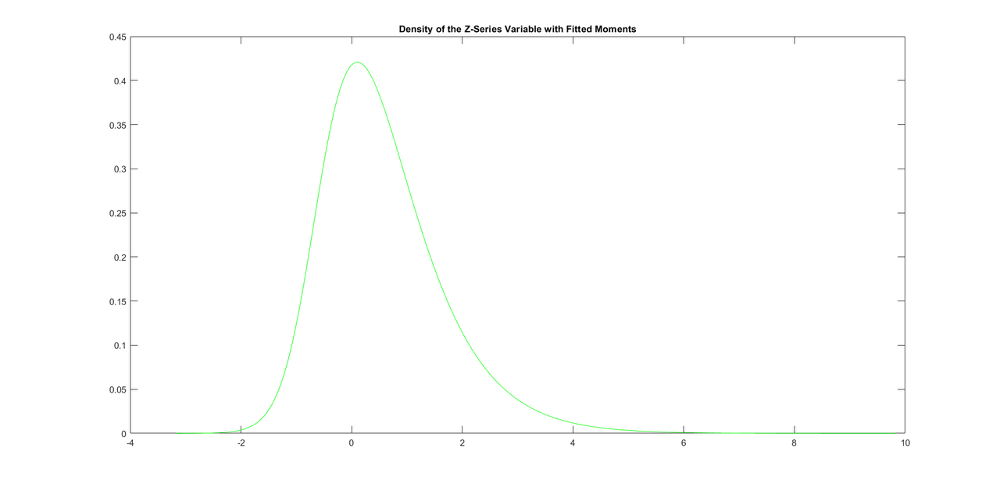](https://postimg.cc/tZ9dTKvX)

Graph of Density of second random variable in the attached matlab code.

[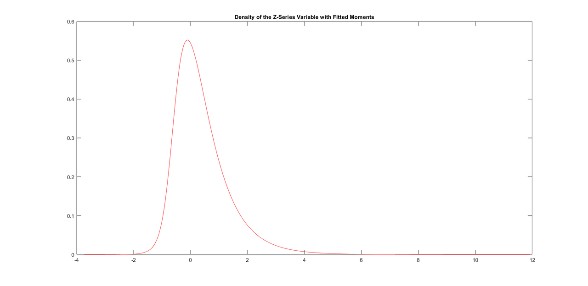](https://postimg.cc/p9fYPWZG)

Comparison of sum random variable density by moment matching in green(true density) and density of sum variable with
method described in previous post(shown in red). I have used summations instead of proper integration algorithm.

[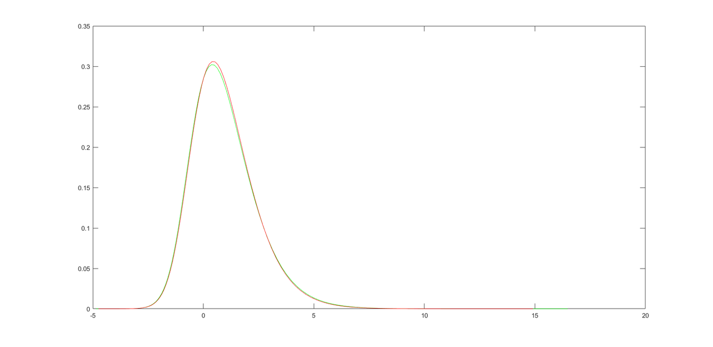](https://postimg.cc/PpKW8S01)

.

.

.

.

```
function [] = AddRVsByZSummation02()

c0=.4;
c(1)=1.0
c(2)=.17;
c(3)=.03;
c(4)=-.0015;
c(5)=-.00035;
c(6)=.000015;
c(7)=-.000001;
PlotZSeriesDensity(c0,c,'g');

[Moment1] = CalculateMomentsOfZSeries(c0,c,7,8)

str=input("Look at density --1");

b0=.2;
b(1)=.8;
b(2)=.19;
b(3)=.04;
b(4)=.0005;
b(5)=.00035;
b(6)=-.000015;
b(7)=.000001;
PlotZSeriesDensity(b0,b,'r');

[Moment2] = CalculateMomentsOfZSeries(b0,b,7,8)

str=input("Look at density --2");

Moment(1)= Moment1(1) + Moment2(1);

Moment(2)=Moment1(2) + 2*Moment1(1).*Moment2(1) + Moment2(2);

Moment(3)=Moment1(3) + 3 *Moment1(2).*Moment2(1) + 3*Moment1(1).*Moment2(2) + Moment2(3);

Moment(4)=Moment1(4) + 4* Moment1(3).*Moment2(1) + 6*Moment1(2).*Moment2(2) + 4*Moment1(1).* Moment2(3) + Moment2(4);

Moment(5)=Moment1(5) + 5* Moment1(4).*Moment2(1) + 10*Moment1(3).*Moment2(2) + 10*Moment1(2).*Moment2(3) + 5*Moment1(1)*
Moment2(4) + Moment2(5);

Moment(6)=Moment1(6) + 6* Moment1(5).* Moment2(1) + 15*Moment1(4).*Moment2(2)+ 20*Moment1(3).*Moment2(3)
+15*Moment1(2).*Moment2(4)+6*Moment1(1).*Moment2(5)+Moment2(6);

Moment(7)=Moment1(7)+ 7* Moment1(6).*Moment2(1) + 21* Moment1(5).*Moment2(2) + 35*Moment1(4).*Moment2(3)+
35*Moment1(3).*Moment2(4)+ 21*Moment1(2).*Moment2(5) + 7*Moment1(1).*Moment2(6) + Moment2(7);

Moment(8)=Moment1(8)+ 8*Moment1(7).* Moment2(1) + 28*Moment1(6).*Moment2(2) + 56*Moment1(5).*Moment2(3) +
70*Moment1(4).*Moment2(4)+56*Moment1(3).*Moment2(5) + ...
 28.*Moment1(2).*Moment2(6) + 8*Moment1(1).*Moment2(7) +Moment2(8);

[a0,a] = CalculateZSeriesDensityFromRawMoments(Moment);
PlotZSeriesDensity(a0,a,'r');

str=input("Look at plot of the sum density")

dNn=.1;   % Normal density subdivisions width. would change with number of subdivisions
Nn=101;  % No of normal density subdivisions
NnMid=((1+Nn)/2)*dNn;
Z(1:Nn)=(((1:Nn)*dNn)-NnMid);
X1(1:Nn)=c0;
for nn=1:7
    X1(1:Nn)=X1(1:Nn)+c(nn)*Z(1:Nn).^nn;
end

X2(1:Nn)=b0;
for nn=1:7
    X2(1:Nn)=X2(1:Nn)+b(nn)*Z(1:Nn).^nn;
end
Y(1:Nn)=a0;
for nn=1:7
    Y(1:Nn)=Y(1:Nn)+a(nn)*Z(1:Nn).^nn;
end

Y2(1:Nn)=0;
pp(1:Nn)=0;

for mm=1:Nn

    Z0(mm)=sqrt(2)*Z(mm);
    Qq=201;
    dQq=.05;
    for qq=1:Qq
    Z1(qq)=-5+(qq-1)*dQq;
    Z1(qq+1)=-5+(qq)*dQq;
    %Z2=sign(Z0(mm)-Z1).*sqrt(abs(sign(Z0(mm)).*Z0(mm).^2-sign(Z1).*Z1.^2));
    Z2(qq)=Z0(mm)-Z1(qq);
    Z2(qq+1)=Z0(mm)-Z1(qq+1);

    %str=input("Look at Z2")

    X1=c0+c(1).*Z1(qq)+c(2).*Z1(qq).^2+c(3).*Z1(qq).^3+c(4).*Z1(qq).^4+c(5).*Z1(qq).^5+c(6).*Z1(qq).^6+c(7).*Z1(qq).^7;
    X2=b0+b(1).*Z2(qq)+b(2).*Z2(qq).^2+b(3).*Z2(qq).^3+b(4).*Z2(qq).^4+b(5).*Z2(qq).^5+b(6).*Z2(qq).^6+b(7).*Z2(qq).^7;

    if((qq>1)&&(qq<Qq))
    Y1(qq)=(X1+X2);
    Y2(mm)=Y2(mm)+Y1(qq).*normpdf(Z1(qq)).*normpdf(Z2(qq)).*abs(Z1(qq+1)-Z1(qq-1)).*abs(Z2(qq+1)-Z2(qq-1))/4;
    pp(mm)=pp(mm)+normpdf(Z1(qq)).*normpdf(Z2(qq)).*abs(Z1(qq+1)-Z1(qq-1)).*abs(Z2(qq+1)-Z2(qq-1))/4;

    end
    end
    Y2(mm)=Y2(mm)/pp(mm);

    %pp(mm)/dNn
    %normpdf(Z0(mm)/sqrt(2))

    %str=input("look at probability values");

end

plot(Z(1:Nn),Y2(1:Nn),'r',Z(1:Nn),Y(1:Nn),'g');

str=input("Look at stochastic variables");

Y(1:Nn)=a0;
for nn=1:7
    Y(1:Nn)=Y(1:Nn)+a(nn)*Z(1:Nn).^nn;
end

%Now take change of densities derivative of Y with respect to normal
DfY(1:Nn)=0;
for nn=2:Nn-1
    DfY(nn) = (Y(nn + 1) - Y(nn - 1))/(Z(nn + 1) - Z(nn - 1));
    %Change of variable derivative for densities
end
DfY(Nn)=DfY(Nn-1);
DfY(1)=DfY(2);

%Now calculate the density of Y from density of normal random variable
%using change of probability derivative.
pY(1:Nn)=0;
for nn = 1:Nn
    pY(nn) = (normpdf(Z(nn),0, 1))/abs(DfY(nn));
end

DfY2(1:Nn)=0;
for nn=2:Nn-1
    DfY2(nn) = (Y2(nn + 1) - Y2(nn - 1))/(Z(nn + 1) - Z(nn - 1));
    %Change of variable derivative for densities
end
DfY2(Nn)=DfY2(Nn-1);
DfY2(1)=DfY2(2);

%Now calculate the density of Y from density of normal random variable
%using change of probability derivative.
pY2(1:Nn)=0;
for nn = 1:Nn
    pY2(nn) = (normpdf(Z(nn),0, 1))/abs(DfY2(nn));
end

plot(Y(1:Nn),pY(1:Nn),'g',Y2(1:Nn),pY2(1:Nn),'r');
str=input("Look at comparison of density by addition over Z's(red) and moment matched sum density(green)")

end

```

.

.

.

---

### #2078 — Amin (Topic Author)
*November 24, 2023, 6:04 PM*

Friends, I am writing this post to complain about mind control agents causing pain in my heart. They have a light gas in
my room and in the car garage in the semi-open where I have been working this winters. This gas continues to make me
uncomfortable and my breathing is painful. But with this gas, they also cause pain in my heart and they have been doing
it repeatedly again and again at will during past week and I become very uncomfortable. If I am wearing a shirt with a
front pocket, I try to put some aluminium wrappers in my pocket since it is in front of the heart but this is also not
very helpful and they continue to cause pain in my heart. Sometimes, this pain is very strong and I have to press my
chest for getting some comfort. They continue to use this gas both in my room and the car garage and cause sometimes
very strong pain in my heart repeatedly.

---

### #2079 — Amin (Topic Author)
*November 25, 2023, 1:21 PM*

Friends, we can easily find Z-series of sum random variables by using monte carlo simulation. We can generate large
instances of a Z-series density by generating standard normal random variates. I turned them into hermite polynomials.
Then generate simulations of random variables and produce the sum variable. The sum random variable is then converted
into a Z-series by polynomial regression on ideal standard normal density as we have been doing earlier. All the graphs
of sum variable below are generated from underlying Z-series coefficients.

I want to use cholesky matrix operators on hermite polynomials matrix to fix any mismatched variances and to remove any
small spurious covariances  between hermite polynomials of one variable and across other variable. Later we can
introduce any correlations between similar order hermites across both variables. I have not been able to do this today
and will complete it in another day.

However even without any matched covariances, summation from momte carlo simulations results in an indistinguishable
density from true density derived from addition of moments.

There is however small mismatch between monte carlo derived Z-series coefficients and coefficients derived from addition
of moments even though two densities are extremely close since coefficients change to compensate for differences in each
other. I think when we will fix variances and covariances of all hermite polynomials and remove any spurious
correlations/covariances using matrix manipulations on generated hermites matrix, this problem will also remarkably
decrease.

Here are some graphs from a test run.

Density of first Z-series RV.

[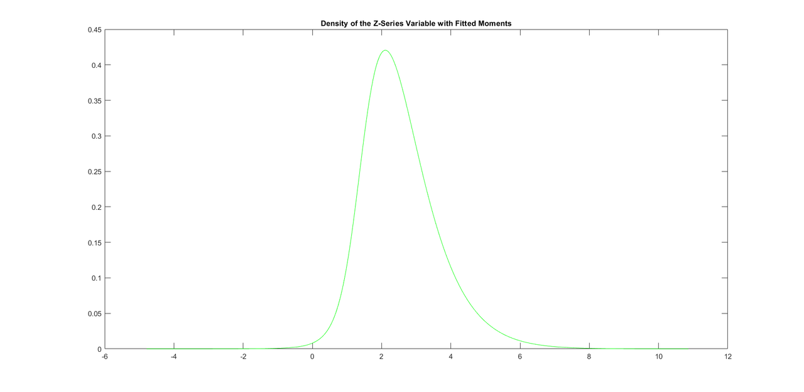](https://postimg.cc/WtCSb9Zx)

Density of second RV.

[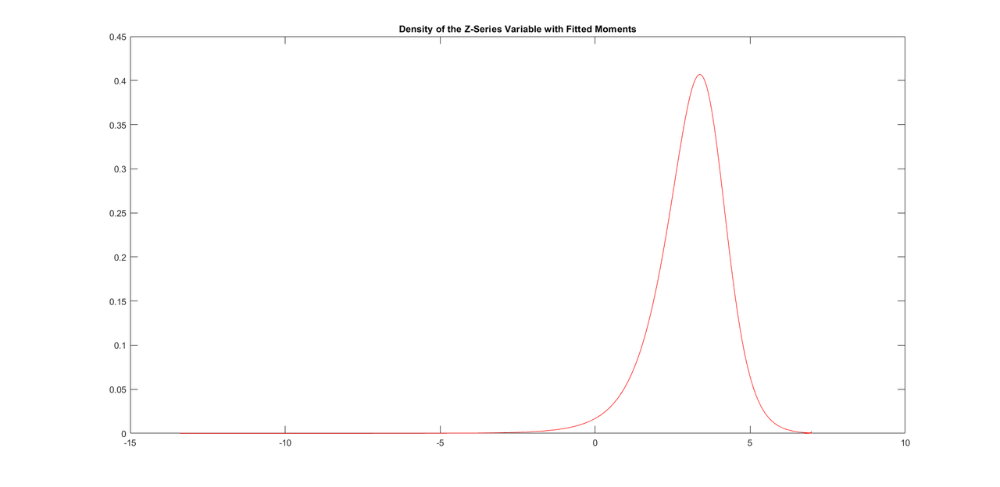](https://postimg.cc/GT8QxDWM)

Comparison of sum density from monte carlo that has been generated from Z-series of the sum density(red) and addition of
moments(green)

[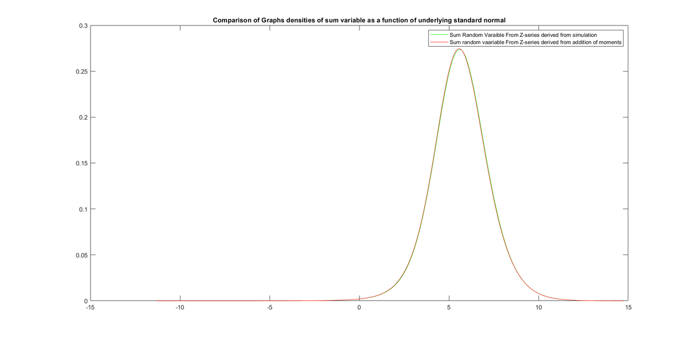](https://postimg.cc/zVh7LnSv)

Comparison of sum random variable as a function of underlying standard normal. red is from Z-series generated by
simulation. green is from Z-series generated from addition of moments.

[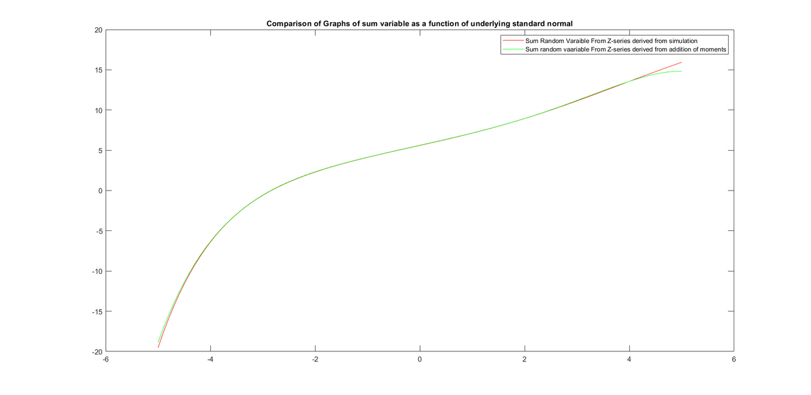](https://postimg.cc/kDBfCr2x)

Here is the program for above.

```
function [] = AddZSeriesRVsByMonteCarlo()

c0=2.4;
c(1)=1.0
c(2)=.17;
c(3)=.03;
c(4)=-.005;
c(5)=.00035;
c(6)=-.000095;
c(7)=.000001;
PlotZSeriesDensity(c0,c,'g');

[Moment1] = CalculateMomentsOfZSeries(c0,c,7,8)

str=input("Look at density --1");

b0=3.2;
b(1)=1;
b(2)=-.11;
b(3)=.045;
b(4)=-.0005;
b(5)=.00085;
b(6)=-.000515;
b(7)=.000001;
PlotZSeriesDensity(b0,b,'r');

[Moment2] = CalculateMomentsOfZSeries(b0,b,7,8)

str=input("Look at density --2");

Moment(1)= Moment1(1) + Moment2(1);

Moment(2)=Moment1(2) + 2*Moment1(1).*Moment2(1) + Moment2(2);

Moment(3)=Moment1(3) + 3 *Moment1(2).*Moment2(1) + 3*Moment1(1).*Moment2(2) + Moment2(3);

Moment(4)=Moment1(4) + 4* Moment1(3).*Moment2(1) + 6*Moment1(2).*Moment2(2) + 4*Moment1(1).* Moment2(3) + Moment2(4);

Moment(5)=Moment1(5) + 5* Moment1(4).*Moment2(1) + 10*Moment1(3).*Moment2(2) + 10*Moment1(2).*Moment2(3) + 5*Moment1(1)*
Moment2(4) + Moment2(5);

Moment(6)=Moment1(6) + 6* Moment1(5).* Moment2(1) + 15*Moment1(4).*Moment2(2)+ 20*Moment1(3).*Moment2(3)
+15*Moment1(2).*Moment2(4)+6*Moment1(1).*Moment2(5)+Moment2(6);

Moment(7)=Moment1(7)+ 7* Moment1(6).*Moment2(1) + 21* Moment1(5).*Moment2(2) + 35*Moment1(4).*Moment2(3)+
35*Moment1(3).*Moment2(4)+ 21*Moment1(2).*Moment2(5) + 7*Moment1(1).*Moment2(6) + Moment2(7);

Moment(8)=Moment1(8)+ 8*Moment1(7).* Moment2(1) + 28*Moment1(6).*Moment2(2) + 56*Moment1(5).*Moment2(3) +
70*Moment1(4).*Moment2(4)+56*Moment1(3).*Moment2(5) + ...
 28.*Moment1(2).*Moment2(6) + 8*Moment1(1).*Moment2(7) +Moment2(8);

[a0,a] = CalculateZSeriesDensityFromRawMoments(Moment);
PlotZSeriesDensity(a0,a,'r');

str=input("Look at plot of the sum density")

dNn=.1;   % Normal density subdivisions width. would change with number of subdivisions
Nn=101;  % No of normal density subdivisions
NnMid=((1+Nn)/2)*dNn;
Z(1:Nn)=(((1:Nn)*dNn)-NnMid);
X1(1:Nn)=c0;
for nn=1:7
    X1(1:Nn)=X1(1:Nn)+c(nn)*Z(1:Nn).^nn;
end

X2(1:Nn)=b0;
for nn=1:7
    X2(1:Nn)=X2(1:Nn)+b(nn)*Z(1:Nn).^nn;
end
Y(1:Nn)=a0;
for nn=1:7
    Y(1:Nn)=Y(1:Nn)+a(nn)*Z(1:Nn).^nn;
end

[ch0,ch]=ConvertZCoeffsToHCoeffs(c0,c,7);
[bh0,bh]=ConvertZCoeffsToHCoeffs(b0,b,7);

%rng(82136475, 'twister')
rng(48814264, 'twister')
paths=1000000;
Random1(1:paths)=0;
Random2(1:paths)=0;
Random2=randn(size(Random2));
Random1=randn(size(Random1));

H(1,1,:)=Random1;
H(2,1,:)=Random1.^2-1;
H(3,1,:)=Random1.^3-3*Random1;
H(4,1,:)=Random1.^4-6*Random1.^2+3;
H(5,1,:)=Random1.^5-10*Random1.^3+15*Random1;
H(6,1,:)=Random1.^6-15*Random1.^4+45*Random1.^2+15;
H(7,1,:)=Random1.^7-21*Random1.^5+105*Random1.^3+105.*Random1;

H(1,2,:)=Random2;
H(2,2,:)=Random2.^2-1;
H(3,2,:)=Random2.^3-3*Random2;
H(4,2,:)=Random2.^4-6*Random2.^2+3;
H(5,2,:)=Random2.^5-10*Random2.^3+15*Random2;
H(6,2,:)=Random2.^6-15*Random2.^4+45*Random2.^2+15;
H(7,2,:)=Random2.^7-21*Random2.^5+105*Random2.^3+105.*Random2;

%Following block will be used in next version of program to eliminate any
%small spurious covariances between hermites and introduce covariances
%between hermites of same order across two variables when needed. It will
%also fix variances of hermite polynomials.
% COV1(1:7,1:7)=0;
% COV2(1:7,1:7)=0;
% COV12(1:7,1:7)=0
% for nn=1:7
%     COV1(nn,nn)=factorial(nn);
%     COV2(nn,nn)=factorial(nn);
% end
%
%
%
% [H1]=FixCovariancesOfHermites(H,COV1,COV2,COV12,paths);

XX1=ch0+ch(1).*H(1,1,:)+ch(2).*H(2,1,:)+ch(3).*H(3,1,:)+ch(4).*H(4,1,:)+ch(5).*H(5,1,:)+ch(6).*H(6,1,:)+ch(7).*H(7,1,:);
XX2=bh0+bh(1).*H(1,2,:)+bh(2).*H(2,2,:)+bh(3).*H(3,2,:)+bh(4).*H(4,2,:)+bh(5).*H(5,2,:)+bh(6).*H(6,2,:)+bh(7).*H(7,2,:);

YY=XX1+XX2;

Mtable=readtable('C:\Users\Lenovo\Documents\MATLAB\MATLAB1\MomentMatchParams08.txt');
%Mtable=readtable('C:\Users\Lenovo\Documents\MATLAB\MATLAB1\MomentMatchParams08.txt');

%Above file contains a table of 1250  X 4 Values. These values are moment matching parameters for
% equi-probable (monte carlo like) data and depend upon Number of data
% elements. These moment matching parameters were obtained by running
% moment matching optimizations on different carefully chosen total number
%of data elements. These parameters are saved in a file and then
%interpolated for number of data elements in between that are not directly
%in the file. Then we can calculate moment matching parameters of monte carlo
%like equiprobable data size anywhere between 26 to one million total data
%elements count or paths using interpolation.

%[Zy,alpha,beta,gamma] = MatchMomentParametersOfIdealZ02New(Zy,VProbMass);

Ndata=paths;
[ZI] = MatchMomentParametersOfIdealZhalf04(Ndata,Mtable);

[d0,d] = CalculateZSeriesDensityByIdealMeasureMedian07A1(YY,ZI);

clf;
PlotZSeriesDensity(a0,a,'g');
hold on
PlotZSeriesDensity(d0,d,'r');
hold off

a0
a
d0
d
title("Comparison of Graphs densities of sum variable as a function of underlying standard normal")
legend({'Sum Random Varaible From Z-series derived from simulation','Sum random vaariable From Z-series derived from
addition of moments'},'Location','northeast')

str=input("Look at final graphs")

Y2(1:Nn)=d0;
for nn=1:7
    Y2(1:Nn)=Y2(1:Nn)+d(nn)*Z(1:Nn).^nn;
end

plot(Z(1:Nn),Y2(1:Nn),'r',Z(1:Nn),Y(1:Nn),'g');
title("Comparison of Graphs of sum variable as a function of underlying standard normal")
legend({'Sum Random Varaible From Z-series derived from simulation','Sum random vaariable From Z-series derived from
addition of moments'},'Location','northeast')

disp("Red is generated from Z-series of summed variable solved by monte carlo. Red is from addition of moments")
str=input("Look at stochastic variables");

end

```

.

.

.

```
function [ZnNew] = MatchMomentParametersOfIdealZhalf04(Ndata,Mtable)
[Zn] = StandardNormalIdealDesity02(Ndata,1);

[alpha0,beta0,gamma0] = ReadParamsFile(Ndata,Mtable)

ZnNew(1:Ndata)=Zn(1:Ndata).*(alpha0+beta0*(Zn(1:Ndata).^2-1)+gamma0*(Zn(1:Ndata).^4-6*Zn(1:Ndata).^2+3));

Moment2=sum(ZnNew(1:Ndata).^2)*1/Ndata;
Moment4=sum(ZnNew(1:Ndata).^4)*1/Ndata;
Moment6=sum(ZnNew(1:Ndata).^6)*1/Ndata;

Moment2
Moment4
Moment6
display("fitted Moments");
%str=input("Look at moment values")

end

```

.

.

.

```
function [a0,a] = CalculateZSeriesDensityByIdealMeasureMedian07A1(data,ZI)
 Ndata=length(data);
Sdata=sort(data);
Ymu(1:Ndata,1)=Sdata(1:Ndata);

 x0=0;
 x1=ZI(floor(Ndata/2+.5)-2);
 x2=ZI(floor(Ndata/2+.5)-1);
 x3=ZI(floor(Ndata/2+.5));
 x4=ZI(floor(Ndata/2+.5)+1);
 x5=ZI(floor(Ndata/2+.5)+2);
 x6=ZI(floor(Ndata/2+.5)+3);

y1=Ymu(floor(Ndata/2+.5)-2);
y2=Ymu(floor(Ndata/2+.5)-1);
y3=Ymu(floor(Ndata/2+.5));
y4=Ymu(floor(Ndata/2+.5)+1);
y5=Ymu(floor(Ndata/2+.5)+2);
y6=Ymu(floor(Ndata/2+.5)+3);
N=6;
 [Median] = InterpolateOrderN6(N,x0,x1,x2,x3,x4,x5,x6,y1,y2,y3,y4,y5,y6);

Ymu(1:Ndata,1)=Ymu(1:Ndata,1)-Median;

    X(1:Ndata,1)=1;
    X(1:Ndata,2)=ZI(1:Ndata);
    X(1:Ndata,3)=ZI(1:Ndata).^2;
    X(1:Ndata,4)=ZI(1:Ndata).^3;
    X(1:Ndata,5)=ZI(1:Ndata).^4;
    X(1:Ndata,6)=ZI(1:Ndata).^5;
    X(1:Ndata,7)=ZI(1:Ndata).^6;
    X(1:Ndata,8)=ZI(1:Ndata).^7;

    coeff=inv(X'*X)*(X'*Ymu);

    c0=coeff(1,1);
    c(1:7)=coeff(2:8,1);

    a0=c0+Median;
    a=c;
end
```

.

.

.

```
function [alpha0,beta0,gamma0] = ReadParamsFile(Ndata,Mtable)

A=Mtable;
NSubDivs=A.(1);
alpha=A.(2);
beta=A.(3);
gamma=A.(4);
% NSubDivs
% alpha
% beta
% gamma
%
% A.(1)(1)

%Ndata;

nn=1;
if(NdataNdata))
            alpha1=alpha(nn-1);
            alpha2=alpha(nn);
            alpha3=alpha(nn+1)
            alpha4=alpha(nn+2);

            beta1=beta(nn-1);
            beta2=beta(nn);
            beta3=beta(nn+1)
            beta4=beta(nn+2);

            gamma1=gamma(nn-1);
            gamma2=gamma(nn);
            gamma3=gamma(nn+1)
            gamma4=gamma(nn+2);

            x1=NSubDivs(nn-1);
            x2=NSubDivs(nn);
            x3=NSubDivs(nn+1);
            x4=NSubDivs(nn+2);

            x0=Ndata;
            N=4;

            [alpha0] = InterpolateOrderN6(N,x0,x1,x2,x3,x4,0,0,alpha1,alpha2,alpha3,alpha4,0,0);
            [beta0] = InterpolateOrderN6(N,x0,x1,x2,x3,x4,0,0,beta1,beta2,beta3,beta4,0,0);
            [gamma0] = InterpolateOrderN6(N,x0,x1,x2,x3,x4,0,0,gamma1,gamma2,gamma3,gamma4,0,0);
           
%alpha0=alpha(nn)*(Ndata-NSubDivs(nn))/(NSubDivs(nn+1)-NSubDivs(nn))+alpha(nn+1)*(NSubDivs(nn+1)-Ndata)/(NSubDivs(nn+1)-NSubDivs(nn));
           
%beta0=beta(nn)*(Ndata-NSubDivs(nn))/(NSubDivs(nn+1)-NSubDivs(nn))+beta(nn+1)*(NSubDivs(nn+1)-Ndata)/(NSubDivs(nn+1)-NSubDivs(nn));
           
%gamma0=gamma(nn)*(Ndata-NSubDivs(nn))/(NSubDivs(nn+1)-NSubDivs(nn))+gamma(nn+1)*(NSubDivs(nn+1)-Ndata)/(NSubDivs(nn+1)-NSubDivs(nn));
            display("I am in part--2");
        end
        nn=nn+1;
    end
else
    display("data out of range")
end

end

```

.

.

.

```
function [y0] = InterpolateOrderN6(N,x0,x1,x2,x3,x4,x5,x6,y1,y2,y3,y4,y5,y6)

if(N==6)
y0=(x0-x2).*(x0-x3).*(x0-x4).*(x0-x5).*(x0-x6)./((x1-x2).*(x1-x3).*(x1-x4).*(x1-x5).*(x1-x6)).*y1+ ...
   (x0-x1).*(x0-x3).*(x0-x4).*(x0-x5).*(x0-x6)./((x2-x1).*(x2-x3).*(x2-x4).*(x2-x5).*(x2-x6)).*y2+ ...
   (x0-x1).*(x0-x2).*(x0-x4).*(x0-x5).*(x0-x6)./((x3-x1).*(x3-x2).*(x3-x4).*(x3-x5).*(x3-x6)).*y3+ ...
   (x0-x1).*(x0-x2).*(x0-x3).*(x0-x5).*(x0-x6)./((x4-x1).*(x4-x2).*(x4-x3).*(x4-x5).*(x4-x6)).*y4+ ...
   (x0-x1).*(x0-x2).*(x0-x3).*(x0-x4).*(x0-x6)./((x5-x1).*(x5-x2).*(x5-x3).*(x5-x4).*(x5-x6)).*y5+ ...
   (x0-x1).*(x0-x2).*(x0-x3).*(x0-x4).*(x0-x5)./((x6-x1).*(x6-x2).*(x6-x3).*(x6-x4).*(x6-x5)).*y6;
end

if(N==5)
y0=(x0-x2).*(x0-x3).*(x0-x4).*(x0-x5)./((x1-x2).*(x1-x3).*(x1-x4).*(x1-x5)).*y1+ ...
   (x0-x1).*(x0-x3).*(x0-x4).*(x0-x5)./((x2-x1).*(x2-x3).*(x2-x4).*(x2-x5)).*y2+ ...
   (x0-x1).*(x0-x2).*(x0-x4).*(x0-x5)./((x3-x1).*(x3-x2).*(x3-x4).*(x3-x5)).*y3+ ...
   (x0-x1).*(x0-x2).*(x0-x3).*(x0-x5)./((x4-x1).*(x4-x2).*(x4-x3).*(x4-x5)).*y4+ ...
   (x0-x1).*(x0-x2).*(x0-x3).*(x0-x4)./((x5-x1).*(x5-x2).*(x5-x3).*(x5-x4)).*y5;
end
if(N==4)
y0=(x0-x2).*(x0-x3).*(x0-x4)./((x1-x2).*(x1-x3).*(x1-x4)).*y1+ ...
   (x0-x1).*(x0-x3).*(x0-x4)./((x2-x1).*(x2-x3).*(x2-x4)).*y2+ ...
   (x0-x1).*(x0-x2).*(x0-x4)./((x3-x1).*(x3-x2).*(x3-x4)).*y3+ ...
   (x0-x1).*(x0-x2).*(x0-x3)./((x4-x1).*(x4-x2).*(x4-x3)).*y4;
end
if(N==3)
y0=(x0-x2).*(x0-x3)./((x1-x2).*(x1-x3)).*y1+ ...
   (x0-x1).*(x0-x3)./((x2-x1).*(x2-x3)).*y2+ ...
   (x0-x1).*(x0-x2)./((x3-x1).*(x3-x2)).*y3;
end
if(N==2)
y0=(x0-x2)./((x1-x2)).*y1+ ...
   (x0-x1)./((x2-x1)).*y2;
end

%y0=(x0-x3)/(x2-x3)*y2+(x0-x2)/(x3-x2)*y3;

end
```

.

.

.

You will also need this text file for parameters that I have previous given in post 2054 here: https://forum.wilmott.com/viewtopic.php?f=4&t=99702&start=2040#p877863

---

### #2080 — Amin (Topic Author)
*November 26, 2023, 10:52 AM*

Friends, I have been thinking how we can get the same coefficients in our manipulation of densities with monte carlo as
we get from addition of moments and converting them to Z-series.

If we are finding a Z-series to 7th Hermite polynomial, in our analytical moment conversion to Z-series, we keep the
moments exact to 56th moment (Max 7th Hermite X its Eighth moment) of the standard normal density. Ideally, If we can
match similar moments of normal variates, they should also give the same result as analytic manipulation of Z-series
random variables. Matching 56 moments of half a million standard normal variates with a given seed seems impossible. But
I think it is very possible.

The iterative program I distributed to match six moments of data was very simple and can easily be applied without any
change to alter and fix six moments of standard normal variates. That program took less than a minute to match first six
or eight(in a version I had) moments of the data array of half a million elements. I think if we have to match all 28
even moments of the data, an appropriately altered version of my program could do it in an hour or a few hours at
maximum on an average laptop. So we could possibly do that for 28 even moments.

For odd moments, we want to use antithetic variates scheme which is very valid since a perfect normal has a similar
natural symmetry. So we will not have to fix the odd moments due to perfect symmetry of normal random variates.

Our iterative program only generates hermite parameters that have to be multiplied to data to fix its moments to desired
moments and we do not need to store the random numbers since they can be replicated by the appropriate seed. We only
need to associate hermite parameters(that will be an array of 28 parameters of size double in our case) with the
appropriate seed and store the parameters array and the seed on disk file. Once parameter array is known for normal
random variates generated with a seed, we will not need to run the optimization program again and we will only need a
multiplication of normal variates with hermite series whose coefficients will consist of parameter array. This is
instantaneous.

If the method works well to fix the moments, we can apply the optimization program once on some carefully chosen
variates with known seed and continue to use it again and again freely.

Even if we fix all 56 moments of some samples of standard normal variates, some very small correlations might possibly
remain between different samples and we might need to think of that issue later. But let us see if we can match the
Z-series Coefficietns from monte carlo addition of Z-series with coefficients from analytic addition.

I want to try the idea in next one day and then share the results and programs with friends possibly tomorrow.

I go out to get food every other day and I have to go out again today. I hope that friends wish that I avoid being hit
with bad food. Day before yesterday, I had small quantity of bad food and I had some minor issues. I remained reasonable
since I ate very small quantity of food and then avoided eating more. I also had difficulty with good water. I hope that
I will remain fine today.

---

### #2081 — Amin (Topic Author)
*November 26, 2023, 5:30 PM*

>
> Friends, I want to share the details of my small algorithm to correct the moments of arrays of standard normals
associated with equiprobable normal grid subdivisions. These arrays of standard normals would later be used for
polynomial regression on the data to find parameters of Z-series from the data.
>
>
>
> Suppose there are N data members and we want to do a hermite polynomial regression on this data to find Z-series
parameters of data random variable. We will divide the standard normal density into N subdivisions with each subdivision
sharing an equal probability mass of 1/N.
>
> However discrete values of Zn when integrated on probability mass 1/N, can have moments different from moments of
standard normal density which will create inaccuracies in our polynomial regression to find Z-series parameters of the
data random variable.
>
>
>
> I thought of multiplying the data array with an expression comprising sum of hermite polynomials with unspecified
coefficients. We would write equations of moments and then find coefficients of hermite polynomials that pin down the 
moments of new data precisely equal to target moments.
>
>
>
> One consideration is that our Zn array is perfectly symmetric around zero so all odd moments are zero. We want to add
only even hermite polynomials in the expression of hermite polynomials with unspecified coefficients(that is multiplied
to original Zn array to make its moments equal to target moments). We do not want odd hermite polynomials in this
expression with unspecified coefficients as they would introduce skew in our array of equi-probable standard normal
values(and then we would have to do unnecessary work to cancel the skew). In order to have zero odd moments(as in case
of standard normals), we only multiply with a series in even hermite polynomials with unspecified coefficients that
preserves perfect symmetry around zero so we would not have to bother with any odd moments and all odd moments will be
zero by construction due to symmetry of our Zn array around zero.
>
>
>
> Our original standard normal Zn array associated with equiprobable grid is multiplied with a series in hermite
polynomials as
>
>
>
>
$Z_{n,Corrected} \, = \, Z_n \, (\alpha \, +  \beta \, (Z_n^2-1) \, + \, \gamma \, ({Z_n}^4 \, + \, 6 \, {Z_n}^2 \, + \, 3 \,))\,$
>
>
>
> We find coefficients$\alpha$ ,$\beta$ , and$\gamma$ so that our objective function matching moments of
$Z_{n,Corrected} \, $ with target moments is maximized.
>
>
>
> $Moment2\, = \sum\limits_{n=1}^{n=N} \, {Z_{n,Corrected}}^2 \, \frac{1}{N} $
>
>
$= \, \sum\limits_{n=1}^{n=N} \,  {Z_n}^2 \, {(\alpha \, +  \beta \, (Z_n^2-1) \, + \, \gamma \, ({Z_n}^4 \, + \, 6 \, {Z_n}^2 \, + \, 3 \,))}^2\, \frac{1}{N} $
>
> $Moment4\, = \sum\limits_{n=1}^{n=N} \, {Z_{n,Corrected}}^4 \, \frac{1}{N} $
>
>
$= \,  \sum\limits_{n=1}^{n=N} \, {Z_n}^4 \, {(\alpha \, +  \beta \, (Z_n^2-1) \, + \, \gamma \, ({Z_n}^4 \, + \, 6 \, {Z_n}^2 \, + \, 3 \,))}^4\, \frac{1}{N} $
>
> $Moment6\, = \sum\limits_{n=1}^{n=N} \, {Z_{n,Corrected}}^6 \, \frac{1}{N} $
>
>
$= \, \sum\limits_{n=1}^{n=N} \,  {Z_n}^6 \, {(\alpha \, +  \beta \, (Z_n^2-1) \, + \, \gamma \, ({Z_n}^4 \, + \, 6 \, {Z_n}^2 \, + \, 3 \,))}^6\, \frac{1}{N} $
>
>
>
> Here is an iterative optimization matlab program that finds$Z_{n,Corrected}$ whose moments match the standard normal
moments with great precision. I improved this program and now it takes only 3-7 seconds as opposed to 30-40 secs it was
taking yesterday. So if great speed is not the concern, you can easily embed it in your programs.
>
>
>
> .
>
> .
>
> .
>
> ```
> function [ZnNew] = MatchMomentsOfIdealZ(Zn)
>
> Ndata=length(Zn);
> if(Ndata100)&&(Ndata500)&&(Ndata1000)&&(Ndata3000)&&(Ndata6000)&&(Ndata10000)
>     Iterations=50;
> end
> alpha=1;
> beta=0;
> gamma=0;
>
> ZnNew(1:Ndata)=Zn(1:Ndata).*(alpha+beta*(Zn(1:Ndata).^2-1)+gamma*(Zn(1:Ndata).^4-6*Zn(1:Ndata).^2+3));
>
> Moment2=sum(ZnNew(1:Ndata).^2)*1/Ndata
> Moment4=sum(ZnNew(1:Ndata).^4)*1/Ndata
> Moment6=sum(ZnNew(1:Ndata).^6)*1/Ndata
>
> w1=5000;
> w2=200;
>
> ObjFuncBest=(Moment2-1).^2*w1+(Moment4-3).^2*w2+(Moment6-15).^2;
>
>
> delta_alpha=.00025;
> delta_beta=.0002;
> delta_gamma=.0002;
> alphaSuccessCount=0;
> betaSuccessCount=0;
> gammaSuccessCount=0;
> SuccessPrevalpha=0;
> SuccessPrevbeta=0;
> SuccessPrevgamma=0;
>
> mul1=.9;
> mul2=1.1;
>
> for iter=1:Iterations
>     alphaNew=alpha+delta_alpha;
>     betaNew=beta;
>     gammaNew=gamma;
>     ZnNew(1:Ndata)=Zn(1:Ndata).*(alphaNew+betaNew*(Zn(1:Ndata).^2-1)+gammaNew*(Zn(1:Ndata).^4-6*Zn(1:Ndata).^2+3));
>     Moment2=sum(ZnNew(1:Ndata).^2)*1/Ndata;
>     Moment4=sum(ZnNew(1:Ndata).^4)*1/Ndata;
>     Moment6=sum(ZnNew(1:Ndata).^6)*1/Ndata;
>
>     ObjFuncNew=(Moment2-1).^2*w1+(Moment4-3).^2*w2+(Moment6-15).^2;
>
>
>     if(ObjFuncNew4)
>         delta_alpha=delta_alpha*mul2;
>     end
>     if(betaSuccessCount>4)
>         delta_beta=delta_beta*mul2;
>     end
>     if(gammaSuccessCount>4)
>         delta_gamma=delta_gamma*mul2;
>     end
> end
> ZnNew(1:Ndata)=Zn(1:Ndata).*(alpha+beta*(Zn(1:Ndata).^2-1)+gamma*(Zn(1:Ndata).^4-6*Zn(1:Ndata).^2+3));
>
> Moment2=sum(ZnNew(1:Ndata).^2)*1/Ndata;
> Moment4=sum(ZnNew(1:Ndata).^4)*1/Ndata;
> Moment6=sum(ZnNew(1:Ndata).^6)*1/Ndata;
>
>
> Moment2
> Moment4
> Moment6
>
> %str=input("Look at moment values")
>
> end
>
>
> ```
>
>
.

.

.

I have discussed moment matching of equiprobable standard normal random  array in the copied post 2024 above.

We can use the same idea of multiplication by hermite series with undetermined coefficients(and altering coefficients by
iterative algorithm so that moments of the product random variable equate to target moments) for  altering the  moments
of random variables other than standard normal.

We can also use the iterative method to find a Z-series RV representation whose moments match with target moments. We
will have to start with a "nearby Z-series distribution" and multiply it with hermite series with undetermined
coefficients and alter its coefficients so that moments of the product match with the target moments.

I think there can possibly be an analytic solution to above problem stated in copied post in which we could analytically
solve for solution of undermined coefficents of hermite series  applied(multiplied) to fix moments to a set of target
moments and the analytic Z-series random variable in its Z-series representation form.

---

### #2082 — Amin (Topic Author)
*November 28, 2023, 9:23 AM*

Friends, I had earlier written a simple iterative optimization program that can match second, fourth and sixth moments
of standard normal variates. I had to work yesterday to convert the iterative optimization program into a more general
program that can optimize the coefficients of multiplying hermites in order to match any specified number of even
moments with true moments.

I completed the program late last night.

I first tried the program on even moments upto sixteenth moment. The program can take more than one and a half hour to
complete 2000 iterations of optimization algorithm. In the program, we have to define optimization weights of various
moments so that all moments are properly optimized. Specifying optimum weights to various moments requires experience
with the program and running it multiple times. When I specified current optimization weights on moments, I was not very
well oriented with the program so my first weights give too much weight to smaller moments and too little weight to most
higher moments. This reflects in the performance of the program and smaller moments are accurate to large number of
decimal digits while large moments are off by reasonable numbers. This is not a problem with the logic or algorithm and
higher moments can be easily matched but weights have to re-defined with some experience.

I would do it tonight but I am going out in the city to get food and will take several (3-5) hours so I decided to post
the program with suboptimal weights. I will post a new version tonight  (after coming back from getting food) for
matching up to sixteenth moments of random variates which will fix the suboptimal weights but I am still posting the
program.

Another word of caution, trying to optimize small data sets of normal random numbers with very large hermites will never
work since many of the large hermites can have their most effective range between 4-5 SD of normal and if there are not
enough normal random variates in this range, large hermite polynomials cannot work properly to match the highe rmoments
since there are very few or no data points in their effective range. We will need a very good random number generator
that produces enough random numbers between 4-5 SD range(when total number of variates is large) as dictated by the
normal PDF (i.e. product of standard normal probability mass between 4-5 SD and total variates drawn would imply that
enough normal variates would fall in 4-5 SD range legally). So we need large enough normal variate samples and a good
RNG to make sure that we validly have enough normal variates in 4-5 SD range.

In fact, if simulation draws are large enough, even miniscule mass of standard normal density between 5 and 6 SD could
dictate that a few simulation draws lie between 5 and 6 SD  of standard normal and a good RNG should be able to produce
that if simulation draws are large enough. I think knowing this could be helpful when we want to match very large
moments.

Here is a sample of matlab output after 2000 iterations of optimization algorithm. Please note that smaller moments have
been fixed to large decimal accuracy due to more heavy weights in the objective function.

Moment =

   1.0e+06 *

  Columns 1 through 3

                   0   0.000000999999539                   0

  Columns 4 through 6

   0.000003000001139                   0   0.000015000055514

  Columns 7 through 9

                   0   0.000105000207579                   0

  Columns 10 through 12

   0.000944934809221                   0   0.010396874778184

  Columns 13 through 15

                   0   0.135113797854280                   0

  Column 16

   2.015871800105093

  ------------------------------------------------------------------

True 14th moment is 135135 and we have 135113, True 16th moment is 2027025 and we have 2015871, these differences are
due to relatively low weights assigned to these moments in optimization. The optimization program continues to optimize
smaller moments to large number of decimal places while neglects the large differences in higher moments.

Here is the matlab program.

```
function [] = MomentMatchingProgramSetUp()

%rng(82136475, 'twister')

%Below Generate half the random numbers with a seed and use antithetic
%variates to get the other half.
rng(48814264, 'twister')
paths=1000000;
Random1(1:paths/2)=0;
Random1=randn(size(Random1));
Random1(paths/2+1:paths)=-Random1(1:paths/2);

%Below the optimization routine that matches the moments,

[Random1,alpha1,Moment1] = MatchMomentParametersOfIdealZhalfNew01(Random1);

Moment1
str=input("Look at Matched Moments");

end

```

.

.

.

.

```
function [ZnNew,alpha,Moment] = MatchMomentParametersOfIdealZhalfNew01(Zn)

%Zn=Zn*1.00005;

Ndata=length(Zn);
if(rem(Ndata,2)==0)
    Nh=Ndata/2;
else
    Nh=(Ndata+1)/2;
end

MOrder=16;
HOrder=16-2;
% Ndata
% Nh
% str=input("Look at number of data points");

if(Ndata30)&&(Ndata100)&&(Ndata500)&&(Ndata1000)&&(Ndata3000)&&(Ndata6000)&&(Ndata10000)&&(Ndata100000)&&(Ndata500000)

    Iterations=2000;
end

EZ(1)=0;
EZ(2)=1;
for nn=3:MOrder
    if rem(nn,2)==1
        EZ(nn)=0;
    else
        EZ(nn)=EZ(nn-2)*(nn-1);
        %EZ(nn)
    end
end

Moment0(1:MOrder)=EZ(1:MOrder);

%Iterations=10;
alpha(1)=1;
alpha(2:HOrder+1)=0;

for mm=2:2:MOrder
    Moment(mm)=sum(Zn(1:Ndata).^mm);
end

Moment
display("Initial Moments");

[Hz] = HermitePoly(HOrder);

for nn=1:2:HOrder+1
    ZZ(nn,1:Nh)=Zn(1:Nh).^(nn-1);
end

HermiteSeries(1:Nh)=alpha(1);
HermiteZ(1:Nh)=0;
for nn=2:2:HOrder
    HermiteZ(1:Nh)=0;
    for mm=1:2:(nn+1)
        %HermiteZ(nn,:)=HermiteZ(nn,:)+Hz(nn+1,mm).*ZZ(mm,:);
        HermiteZ(1:Nh)=HermiteZ(1:Nh)+Hz(nn+1,mm).*ZZ(mm,1:Nh);
    end
    HermiteSeries(1:Nh)=HermiteSeries(1:Nh)+ alpha(nn+1).*HermiteZ(1:Nh);
end

ZnNew(1:Nh)=Zn(1:Nh).*HermiteSeries(1:Nh);

for mm=2:2:MOrder
    Moment(mm)=sum(ZnNew(1:Nh).^mm)/Nh;
end

%ZnNew(1:Nh)=Zn(1:Nh).*(alpha+beta*(Zn(1:Nh).^2-1)+gamma*(Zn(1:Nh).^4-6*Zn(1:Nh).^2+3));

%w1=5000;
%w2=200;

%ObjFuncBest=(Moment2-1).^2*w1+(Moment4-3).^2*w2+(Moment6-15).^2;
w(HOrder)=1;
for nn=HOrder-2:-2:2
w(nn)=w(nn+2).*(nn+2)*(nn+1)*3;
end

ObjFuncBest=CalculateObjMoment(EZ,Moment,w,HOrder);

%delta_alpha(1:HOrder+1)=.00025./(1:HOrder+1);
%delta_alpha(1:HOrder+1)=.0005./(1:(HOrder+1)/2).^2;
delta_alpha(1)=.0000005;%./(1:(HOrder+1)/2).^2;
delta_alpha(3)=.0000005;
delta_alpha(5)=.0000005;
delta_alpha(7)=.00000025;
delta_alpha(9)=.000000025;
delta_alpha(11)=.000000025;
delta_alpha(13)=.0000000005;
delta_alpha(15)=.00000000005;
%for mm=2:HOrder+1
%    delta_alpha(mm)=.0005./(mm*.5).^.5;
%end
alphaSuccessCount(1:HOrder+1)=0;
SuccessPrevalpha(1:HOrder+1)=0;

mul1=.9;
mul2=1.2;

for iter=1:Iterations
iter
alpha
ObjFuncBest
    for kk=1:2:HOrder+1
        alphaNew(1:2:HOrder+1)=alpha(1:2:HOrder+1);
        alphaNew(kk)=alpha(kk)+delta_alpha(kk);

        HermiteSeries(1:Nh)=alphaNew(1);
        HermiteZ(1:Nh)=0;
        for nn=2:2:HOrder
            HermiteZ(1:Nh)=0;
            for mm=1:2:(nn+1)
                %HermiteZ(nn,:)=HermiteZ(nn,:)+Hz(nn+1,mm).*ZZ(mm,:);
                HermiteZ(1:Nh)=HermiteZ(1:Nh)+Hz(nn+1,mm).*ZZ(mm,1:Nh);
            end
            HermiteSeries(1:Nh)=HermiteSeries(1:Nh)+ alphaNew(nn+1).*HermiteZ(1:Nh);
        end

        ZnNew(1:Nh)=Zn(1:Nh).*HermiteSeries(1:Nh);

        for mm=2:2:MOrder
            Moment(mm)=sum(ZnNew(1:Nh).^mm)/Nh;
        end

%        ObjFuncNew=CalculateObjMoment(Moment);
        ObjFuncNew=CalculateObjMoment(EZ,Moment,w,HOrder);

        %ObjFuncBest
        %ObjFuncNew
        %alpha(kk)
        %delta_alpha(kk)
        %kk
        %disp("Plus")
        %str=input("Look at obj func---1")
        if(ObjFuncNew2)
            delta_alpha(kk)=delta_alpha(kk).*mul2;
        end
    end

%     Moment(2)-Moment0(2)
%     Moment(4)-Moment0(4)
%     Moment(6)-Moment0(6)
%     Moment(8)-Moment0(8)
%     Moment(10)-Moment0(10)
%     Moment(12)-Moment0(12)
%     Moment(14)-Moment0(14)
%     Moment(16)-Moment0(16)

 %   Moment0
    Moment

   % str=input("Look at difference of Moments");
end

ZZ(1:HOrder+1,Nh+1:Ndata)=ZZ(1:HOrder+1,1:Nh);
HermiteSeries(1:Ndata)=alpha(1);
HermiteZ(1:Ndata)=0;
for nn=2:2:HOrder
    HermiteZ(1:Ndata)=0;
    for mm=1:2:(nn+1)
        %HermiteZ(nn,:)=HermiteZ(nn,:)+Hz(nn+1,mm).*ZZ(mm,:);
        HermiteZ(1:Ndata)=HermiteZ(1:Ndata)+Hz(nn+1,mm).*ZZ(mm,1:Ndata);
    end
    HermiteSeries(1:Ndata)=HermiteSeries(1:Ndata)+ alpha(nn+1).*HermiteZ(1:Ndata);
end

ZnNew(1:Ndata)=Zn(1:Ndata).*HermiteSeries(1:Ndata);

for mm=2:2:MOrder
    Moment(mm)=sum(ZnNew(1:Ndata).^mm)/Ndata;
end

alpha
Moment

display("fitted Moments");
str=input("Look at moment values")

end

```

.

.

.

.

```
function [Hz] = HermitePoly(Order)
Hz(1:Order+1,1:Order+1)=0.0;
Hz(1,1)=1.0;
for k=1:Order
    for m=1:k
       Hz(k+1,m+1)=Hz(k,m);
       if (m>1)
            Hz(k+1,m-1)=Hz(k+1,m-1)-(m-1)*Hz(k,m);
       end
    end
end

end

```

.

.

.

.

```
function [ObjMomentOut] = CalculateObjMoment(Moment0,Moment,w,HOrder)

ObjMomentOut=0;
for nn=2:2:HOrder
    ObjMomentOut=ObjMomentOut+(Moment(nn)-Moment0(nn)).^2.*w(nn);
end

end

```

.

.

.

.

---

### #2083 — Amin (Topic Author)
*November 29, 2023, 10:21 AM*

Friends, I hope to post a working program for optimization of moment matching for monte carlo simulations by tomorrow.
However, in the meantime, I am posting the corrected version of moment matching program (previous version) . Earlier
arguments input to objective function calculation in the moment-matching function (in the main body of the program) were
not right and I have fixed that. Please use this new program for your experiments.

For friends who would want to use this program, optimization results are sensitive to both input weights specified for
moments and also to relative magnitude of change (specified in the program at the start) in the iterative value of
coefficients of hermite polynomials.

Here is the program you may want to experiment with.

.

.

.

```
function [ZnNew,alpha,Moment] = MatchMomentParametersOfIdealZhalfNew01(Zn)

%Zn=Zn*1.00005;

Ndata=length(Zn);
if(rem(Ndata,2)==0)
    Nh=Ndata/2;
else
    Nh=(Ndata+1)/2;
end

MOrder=14;
HOrder=14-2;
% Ndata
% Nh
% str=input("Look at number of data points");

if(Ndata30)&&(Ndata100)&&(Ndata500)&&(Ndata1000)&&(Ndata3000)&&(Ndata6000)&&(Ndata10000)&&(Ndata100000)&&(Ndata500000)

    Iterations=2000;
end

EZ(1)=0;
EZ(2)=1;
for nn=3:MOrder
    if rem(nn,2)==1
        EZ(nn)=0;
    else
        EZ(nn)=EZ(nn-2)*(nn-1);
        %EZ(nn)
    end
end

Moment0(1:MOrder)=EZ(1:MOrder);

%Iterations=10;
alpha(1)=1;
alpha(2:HOrder+1)=0;

for mm=2:2:MOrder
    Moment(mm)=sum(Zn(1:Ndata).^mm)/Ndata;
end

Moment
display("Initial Moments");

[Hz] = HermitePoly(HOrder);

for nn=1:2:HOrder+1
    ZZ(nn,1:Nh)=Zn(1:Nh).^(nn-1);
end

HermiteSeries(1:Nh)=alpha(1);
HermiteZ(1:Nh)=0;
for nn=2:2:HOrder
    HermiteZ(1:Nh)=0;
    for mm=1:2:(nn+1)
        %HermiteZ(nn,:)=HermiteZ(nn,:)+Hz(nn+1,mm).*ZZ(mm,:);
        HermiteZ(1:Nh)=HermiteZ(1:Nh)+Hz(nn+1,mm).*ZZ(mm,1:Nh);
    end
    HermiteSeries(1:Nh)=HermiteSeries(1:Nh)+ alpha(nn+1).*HermiteZ(1:Nh);
end

ZnNew(1:Nh)=Zn(1:Nh).*HermiteSeries(1:Nh);

for mm=2:2:MOrder
    Moment(mm)=sum(ZnNew(1:Nh).^mm)/Nh;
end

%ZnNew(1:Nh)=Zn(1:Nh).*(alpha+beta*(Zn(1:Nh).^2-1)+gamma*(Zn(1:Nh).^4-6*Zn(1:Nh).^2+3));

%w1=5000;
%w2=200;

%ObjFuncBest=(Moment2-1).^2*w1+(Moment4-3).^2*w2+(Moment6-15).^2;
w(MOrder)=1;
for nn=MOrder-2:-2:2
w(nn)=w(nn+2).*(nn+2)*(nn+1)*.5;
end
w(2)=w(2)*4096*64;%256;
w(MOrder-2)=w(MOrder-2)*256;
w(MOrder)=w(MOrder)*128;
w(MOrder-4)=w(MOrder-4)*128*8;
w(8)=w(8)*4;
w(4)=w(4)/16;
w(6)=w(6)*4*16;
w
str=input("Look at weights")

ObjFuncBest=CalculateObjMoment(EZ,Moment,w,MOrder);

%delta_alpha(1:HOrder+1)=.00025./(1:HOrder+1);
% %delta_alpha(1:HOrder+1)=.0005./(1:(HOrder+1)/2).^2;
% delta_alpha(1)=.0000005;%./(1:(HOrder+1)/2).^2;
% delta_alpha(3)=.0000005;
% delta_alpha(5)=.0000005;
% delta_alpha(7)=.00000025;
% delta_alpha(9)=.000000025;
% delta_alpha(11)=.000000025;
% delta_alpha(13)=.0000000005;
% delta_alpha(15)=.00000000005;
delta_alpha(1)=.0000025;%./(1:(HOrder+1)/2).^2;
delta_alpha(3)=.000000125/4;
delta_alpha(5)=.0000000125/4;
delta_alpha(7)=.0000000025/2/8;
delta_alpha(9)=.00000000025/2/4;
delta_alpha(11)=.000000000125/4096/4;
delta_alpha(13)=.000000000025/4096/4;
%delta_alpha(15)=.0000000025;
%for mm=2:HOrder+1
%    delta_alpha(mm)=.0005./(mm*.5).^.5;
%end
alphaSuccessCount(1:HOrder+1)=0;
SuccessPrevalpha(1:HOrder+1)=0;

mul1=.9;
mul2=1.2;

for iter=1:Iterations
iter
alpha
ObjFuncBest
    for kk=1:2:HOrder+1
        alphaNew(1:2:HOrder+1)=alpha(1:2:HOrder+1);
        alphaNew(kk)=alpha(kk)+delta_alpha(kk);

        HermiteSeries(1:Nh)=alphaNew(1);
        HermiteZ(1:Nh)=0;
        for nn=2:2:HOrder
            HermiteZ(1:Nh)=0;
            for mm=1:2:(nn+1)
                %HermiteZ(nn,:)=HermiteZ(nn,:)+Hz(nn+1,mm).*ZZ(mm,:);
                HermiteZ(1:Nh)=HermiteZ(1:Nh)+Hz(nn+1,mm).*ZZ(mm,1:Nh);
            end
            HermiteSeries(1:Nh)=HermiteSeries(1:Nh)+ alphaNew(nn+1).*HermiteZ(1:Nh);
        end

        ZnNew(1:Nh)=Zn(1:Nh).*HermiteSeries(1:Nh);

        for mm=2:2:MOrder
            Moment(mm)=sum(ZnNew(1:Nh).^mm)/Nh;
        end

%        ObjFuncNew=CalculateObjMoment(Moment);
        ObjFuncNew=CalculateObjMoment(EZ,Moment,w,MOrder);

        %ObjFuncBest
        %ObjFuncNew
        %alpha(kk)
        %delta_alpha(kk)
        %kk
        %disp("Plus")
        %str=input("Look at obj func---1")
        if(ObjFuncNew3)
            delta_alpha(kk)=delta_alpha(kk).*mul2;
        end
    end

%     Moment(2)-Moment0(2)
%     Moment(4)-Moment0(4)
%     Moment(6)-Moment0(6)
%     Moment(8)-Moment0(8)
%     Moment(10)-Moment0(10)
%     Moment(12)-Moment0(12)
%     Moment(14)-Moment0(14)
%     Moment(16)-Moment0(16)

 %   Moment0
    Moment

   % str=input("Look at difference of Moments");
end

ZZ(1:HOrder+1,Nh+1:Ndata)=ZZ(1:HOrder+1,1:Nh);
HermiteSeries(1:Ndata)=alpha(1);
HermiteZ(1:Ndata)=0;
for nn=2:2:HOrder
    HermiteZ(1:Ndata)=0;
    for mm=1:2:(nn+1)
        %HermiteZ(nn,:)=HermiteZ(nn,:)+Hz(nn+1,mm).*ZZ(mm,:);
        HermiteZ(1:Ndata)=HermiteZ(1:Ndata)+Hz(nn+1,mm).*ZZ(mm,1:Ndata);
    end
    HermiteSeries(1:Ndata)=HermiteSeries(1:Ndata)+ alpha(nn+1).*HermiteZ(1:Ndata);
end

ZnNew(1:Ndata)=Zn(1:Ndata).*HermiteSeries(1:Ndata);

for mm=2:2:MOrder
    Moment(mm)=sum(ZnNew(1:Ndata).^mm)/Ndata;
end

alpha
Moment

display("fitted Moments");
str=input("Look at moment values")

end

```

.

.

.

---

### #2084 — Amin (Topic Author)
*November 29, 2023, 10:52 AM*

Friends, you can use the previous program posted an hour ago with the seed given in the present file and run
optimization. This program needed to run for more than 2000 iterations. When I ran it for 2000 iterations, it gave me
results that I have copied below the program.

The main program is

.

.

```
function [] = MomentMatchingProgramSetUp()

%rng(82136475, 'twister')

%Below Generate half the random numbers with a seed and use antithetic
%variates to get the other half.
    %seed0=21872418;
    seed0=98230977;
    rng(seed0, 'twister')
    %rng(38537894, 'twister')
    paths=1000000;
    Random1(1:paths/2)=0;
    Random1=randn(size(Random1));
    Random1(paths/2+1:paths)=-Random1(1:paths/2);

%    sRandom1=sort(Random1);

%Below the optimization routine that matches the moments,

[Random1,alpha1,Moment1] = MatchMomentParametersOfIdealZhalfNew01(Random1);

alpha1
seed0
Moment1

str=input("Look at Matched Moments");

end

```

.

.

.

Here is the output

alpha =

  Columns 1 through 3

   1.000964007646294                   0   0.000071702980256

  Columns 4 through 6

                   0  -0.000008588960824                   0

  Columns 7 through 9

  -0.000000225419320                   0   0.000000014648957

  Columns 10 through 12

                   0   0.000000033060896                   0

  Column 13

  -0.000000002081174

Moment =

   1.0e+05 *

  Columns 1 through 3

                   0   0.000009999994251                   0

  Columns 4 through 6

   0.000030044109091                   0   0.000150269208004

  Columns 7 through 9

                   0   0.001050897137278                   0

  Columns 10 through 12

   0.009449466768214                   0   0.103960419714639

  Columns 13 through 14

                   0   1.351311011172466

    "fitted Moments"

Look at moment values

---

### #2085 — Amin (Topic Author)
*November 29, 2023, 11:18 PM*

Friends, matching first twelve moments of  monte carlo numbers works rather straightforward with quite good results. I
am sure matching higher moments is also possible but it requires more insight about weights in the objective function,
and relative magnitudes of changes in coefficients of hermite polynomials. I will continue to play around with these
optimization affecting parameters and try to come up with a better program for matching higher moments but I will have
to be more familiar and oriented with the effects of these parameters on iterative optimization. It takes quite some
time to run the program for 1000 iterations so my learning process is rather slow but I hope that I will have better
programs ready for matching higher moments of guassian random numbers.

Here are results of a calibration to twelve moments after 1250 iterations.

-------------------------------------------

Moment =

   1.0e+04 *

  Columns 1 through 3

                   0   0.000099999079093                   0

  Columns 4 through 6

   0.000300222971867                   0   0.001500525295351

  Columns 7 through 9

                   0   0.010497069978309                   0

  Columns 10 through 12

   0.094507289752085                   0   1.039490702383920

    "fitted Moments"

Look at moment values

alpha =

  Columns 1 through 3

   1.001216729515509                   0  -0.000057066583001

  Columns 4 through 6

                   0   0.000000482384178                   0

  Columns 7 through 9

  -0.000000123961105                   0  -0.000000208265163

  Columns 10 through 11

                   0  -0.000000033829054

-------------------------------------------------------

Here is the program used for above optimization.

```
function [ZnNew,alpha,Moment] = MatchMomentParametersOfIdealZhalfNew01(Zn)

%Zn=Zn*1.00005;

Ndata=length(Zn);
if(rem(Ndata,2)==0)
    Nh=Ndata/2;
else
    Nh=(Ndata+1)/2;
end

MOrder=12;
HOrder=12-2;
% Ndata
% Nh
% str=input("Look at number of data points");

if(Ndata30)&&(Ndata100)&&(Ndata500)&&(Ndata1000)&&(Ndata3000)&&(Ndata6000)&&(Ndata10000)&&(Ndata100000)&&(Ndata500000)

    Iterations=1250;
end

EZ(1)=0;
EZ(2)=1;
for nn=3:MOrder
    if rem(nn,2)==1
        EZ(nn)=0;
    else
        EZ(nn)=EZ(nn-2)*(nn-1);
        %EZ(nn)
    end
end

Moment0(1:MOrder)=EZ(1:MOrder);

%Iterations=10;
alpha(1)=1;
alpha(2:HOrder+1)=0;

for mm=2:2:MOrder
    Moment(mm)=sum(Zn(1:Ndata).^mm)/Ndata;
end

Moment
display("Initial Moments");

[Hz] = HermitePoly(HOrder);

for nn=1:2:HOrder+1
    ZZ(nn,1:Nh)=Zn(1:Nh).^(nn-1);
end

HermiteSeries(1:Nh)=alpha(1);
HermiteZ(1:Nh)=0;
for nn=2:2:HOrder
    HermiteZ(1:Nh)=0;
    for mm=1:2:(nn+1)
        %HermiteZ(nn,:)=HermiteZ(nn,:)+Hz(nn+1,mm).*ZZ(mm,:);
        HermiteZ(1:Nh)=HermiteZ(1:Nh)+Hz(nn+1,mm).*ZZ(mm,1:Nh);
    end
    HermiteSeries(1:Nh)=HermiteSeries(1:Nh)+ alpha(nn+1).*HermiteZ(1:Nh);
end

ZnNew(1:Nh)=Zn(1:Nh).*HermiteSeries(1:Nh);

for mm=2:2:MOrder
    Moment(mm)=sum(ZnNew(1:Nh).^mm)/Nh;
end

%ZnNew(1:Nh)=Zn(1:Nh).*(alpha+beta*(Zn(1:Nh).^2-1)+gamma*(Zn(1:Nh).^4-6*Zn(1:Nh).^2+3));

%w1=5000;
%w2=200;

%ObjFuncBest=(Moment2-1).^2*w1+(Moment4-3).^2*w2+(Moment6-15).^2;
% w(MOrder)=1;
% for nn=MOrder-2:-2:2
% w(nn)=w(nn+2).*(nn+2)*(nn+1)*.5;
% end
% w(2)=w(2)*4096*64;%256;
% w(MOrder-2)=w(MOrder-2)*256;
% w(MOrder)=w(MOrder)*128;
% w(MOrder-4)=w(MOrder-4)*128*8;
% w(8)=w(8)*4*4*4;
% w(4)=w(4)/4;
% w(6)=w(6)*4*16*4*4;
% w
% str=input("Look at weights--14")

w(MOrder)=1;
for nn=MOrder-2:-2:2
w(nn)=w(nn+2).*(nn+2)*(nn+1)*.5;
end
w(2)=w(2)*256;%256;
w
str=input("Look at weights--12")

ObjFuncBest=CalculateObjMoment(EZ,Moment,w,MOrder);

%delta_alpha(1:HOrder+1)=.00025./(1:HOrder+1);
% %delta_alpha(1:HOrder+1)=.0005./(1:(HOrder+1)/2).^2;
% delta_alpha(1)=.0000005;%./(1:(HOrder+1)/2).^2;
% delta_alpha(3)=.0000005;
% delta_alpha(5)=.0000005;
% delta_alpha(7)=.00000025;
% delta_alpha(9)=.000000025;
% delta_alpha(11)=.000000025;
% delta_alpha(13)=.0000000005;
% delta_alpha(15)=.00000000005;
delta_alpha(1)=.0000025;%./(1:(HOrder+1)/2).^2;
delta_alpha(3)=.000000025;
delta_alpha(5)=.0000000125/2;
delta_alpha(7)=.0000000025/2/2;
delta_alpha(9)=.00000000025/2;
delta_alpha(11)=.000000000125/4096;
%delta_alpha(13)=.000000000025/4096/4;
%delta_alpha(15)=.0000000025;
%for mm=2:HOrder+1
%    delta_alpha(mm)=.0005./(mm*.5).^.5;
%end
alphaSuccessCount(1:HOrder+1)=0;
SuccessPrevalpha(1:HOrder+1)=0;

mul1=.9;
mul2=1.2;

for iter=1:Iterations
iter
alpha
ObjFuncBest
    for kk=1:2:HOrder+1
        alphaNew(1:2:HOrder+1)=alpha(1:2:HOrder+1);
        alphaNew(kk)=alpha(kk)+delta_alpha(kk);

        HermiteSeries(1:Nh)=alphaNew(1);
        HermiteZ(1:Nh)=0;
        for nn=2:2:HOrder
            HermiteZ(1:Nh)=0;
            for mm=1:2:(nn+1)
                %HermiteZ(nn,:)=HermiteZ(nn,:)+Hz(nn+1,mm).*ZZ(mm,:);
                HermiteZ(1:Nh)=HermiteZ(1:Nh)+Hz(nn+1,mm).*ZZ(mm,1:Nh);
            end
            HermiteSeries(1:Nh)=HermiteSeries(1:Nh)+ alphaNew(nn+1).*HermiteZ(1:Nh);
        end

        ZnNew(1:Nh)=Zn(1:Nh).*HermiteSeries(1:Nh);

        for mm=2:2:MOrder
            Moment(mm)=sum(ZnNew(1:Nh).^mm)/Nh;
        end

%        ObjFuncNew=CalculateObjMoment(Moment);
        ObjFuncNew=CalculateObjMoment(EZ,Moment,w,MOrder);

        %ObjFuncBest
        %ObjFuncNew
        %alpha(kk)
        %delta_alpha(kk)
        %kk
        %disp("Plus")
        %str=input("Look at obj func---1")
        if(ObjFuncNew3)
            delta_alpha(kk)=delta_alpha(kk).*mul2;
        end
    end

%     Moment(2)-Moment0(2)
%     Moment(4)-Moment0(4)
%     Moment(6)-Moment0(6)
%     Moment(8)-Moment0(8)
%     Moment(10)-Moment0(10)
%     Moment(12)-Moment0(12)
%     Moment(14)-Moment0(14)
%     Moment(16)-Moment0(16)

 %   Moment0
    Moment

   % str=input("Look at difference of Moments");
end

ZZ(1:HOrder+1,Nh+1:Ndata)=ZZ(1:HOrder+1,1:Nh);
HermiteSeries(1:Ndata)=alpha(1);
HermiteZ(1:Ndata)=0;
for nn=2:2:HOrder
    HermiteZ(1:Ndata)=0;
    for mm=1:2:(nn+1)
        %HermiteZ(nn,:)=HermiteZ(nn,:)+Hz(nn+1,mm).*ZZ(mm,:);
        HermiteZ(1:Ndata)=HermiteZ(1:Ndata)+Hz(nn+1,mm).*ZZ(mm,1:Ndata);
    end
    HermiteSeries(1:Ndata)=HermiteSeries(1:Ndata)+ alpha(nn+1).*HermiteZ(1:Ndata);
end

ZnNew(1:Ndata)=Zn(1:Ndata).*HermiteSeries(1:Ndata);

for mm=2:2:MOrder
    Moment(mm)=sum(ZnNew(1:Ndata).^mm)/Ndata;
end

alpha
Moment

display("fitted Moments");
str=input("Look at moment values")

end

```

.

.

.

.

```
function [] = MomentMatchingProgramSetUp()

%rng(82136475, 'twister')

%Below Generate half the random numbers with a seed and use antithetic
%variates to get the other half.
    %seed0=21872418;
    seed0=98230977;
    rng(seed0, 'twister')
    %rng(38537894, 'twister')
    paths=1000000;
    Random1(1:paths/2)=0;
    Random1=randn(size(Random1));
    Random1(paths/2+1:paths)=-Random1(1:paths/2);

%    sRandom1=sort(Random1);

%Below the optimization routine that matches the moments,

[Random1,alpha1,Moment1] = MatchMomentParametersOfIdealZhalfNew01(Random1);

alpha1
seed0
Moment1

str=input("Look at Matched Moments");

end

```

.

.

.

.

---

### #2086 — Amin (Topic Author)
*November 30, 2023, 7:37 AM*

Friends, I slightly modified the program for matching twelve moments of gaussian random numbers. I have also written a
program that throws random number seeds(generated from uniform RNG)  on a gaussian random number generator to generate a
sample of gaussian random numbers. The program accepts the sample if its tail matches the analytic number of random
numbers in the tail but otherwise keeps throwing more seeds until a sample is generated with the right properties. This
was done to avoid manually keep trying seeds to find a good seed.

Here is the output properties of moments of normal gaussian random numbers after optimization when seed was found from
above algorithm.

Output after 750 iterations.

ObjFuncBest =

14.630763221468047

Moment =

   1.0e+04 *

  Columns 1 through 3

                   0   0.000099999651737                   0

  Columns 4 through 6

   0.000300250107542                   0   0.001500799523167

  Columns 7 through 9

                   0   0.010498505036775                   0

  Columns 10 through 12

   0.094503037884882                   0   1.039499088523415

    "fitted Moments"

Look at moment values

Here are the output properties of moments of normal gaussian random numbers after optimization when seed was not found
from above algorithm and did not match the tail criteria set for choice of seed.

Output after 750 iterations.

ObjFuncBest =

42.523373695447852

Moment =

   1.0e+04 *

  Columns 1 through 3

                   0   0.000099999272886                   0

  Columns 4 through 6

   0.000300382646080                   0   0.001501577500363

  Columns 7 through 9

                   0   0.010500465793396                   0

  Columns 10 through 12

   0.094482713736415                   0   1.039546833326122

    "fitted Moments"

Look at moment values

.

.

.

.

Here is the program used to generate above results.

```
function [] = MomentMatchingProgramSetUp()

%rng(82136475, 'twister')

%Below Generate half the random numbers with a seed and use antithetic
%variates to get the other half.
    %seed0=21872418;
    seed0=98230977;
    rng(seed0, 'twister')
    %rng(38537894, 'twister')
    paths=1000000;
    Random1(1:paths/2)=0;
    Random1=randn(size(Random1));
    Random1(paths/2+1:paths)=-Random1(1:paths/2);

%    sRandom1=sort(Random1);

%Below the optimization routine that matches the moments,

[Random1,alpha1,Moment1] = MatchMomentParametersOfIdealZhalfNew01(Random1);

alpha1
seed0
Moment1

str=input("Look at Matched Moments");

end

```

.

.

.

.

```
function [ZnNew,alpha,Moment] = MatchMomentParametersOfIdealZhalfNew01(Zn)

%Zn=Zn*1.00005;

Ndata=length(Zn);
if(rem(Ndata,2)==0)
    Nh=Ndata/2;
else
    Nh=(Ndata+1)/2;
end

MOrder=12;
HOrder=12-2;
% Ndata
% Nh
% str=input("Look at number of data points");

if(Ndata30)&&(Ndata100)&&(Ndata500)&&(Ndata1000)&&(Ndata3000)&&(Ndata6000)&&(Ndata10000)&&(Ndata100000)&&(Ndata500000)

    Iterations=750;
end

EZ(1)=0;
EZ(2)=1;
for nn=3:MOrder
    if rem(nn,2)==1
        EZ(nn)=0;
    else
        EZ(nn)=EZ(nn-2)*(nn-1);
        %EZ(nn)
    end
end

Moment0(1:MOrder)=EZ(1:MOrder);

%Iterations=10;
alpha(1)=1;
alpha(2:HOrder+1)=0;

for mm=2:2:MOrder
    Moment(mm)=sum(Zn(1:Ndata).^mm)/Ndata;
end

Moment
display("Initial Moments");

[Hz] = HermitePoly(HOrder);

for nn=1:2:HOrder+1
    ZZ(nn,1:Nh)=Zn(1:Nh).^(nn-1);
end

HermiteSeries(1:Nh)=alpha(1);
HermiteZ(1:Nh)=0;
for nn=2:2:HOrder
    HermiteZ(1:Nh)=0;
    for mm=1:2:(nn+1)
        %HermiteZ(nn,:)=HermiteZ(nn,:)+Hz(nn+1,mm).*ZZ(mm,:);
        HermiteZ(1:Nh)=HermiteZ(1:Nh)+Hz(nn+1,mm).*ZZ(mm,1:Nh);
    end
    HermiteSeries(1:Nh)=HermiteSeries(1:Nh)+ alpha(nn+1).*HermiteZ(1:Nh);
end

ZnNew(1:Nh)=Zn(1:Nh).*HermiteSeries(1:Nh);

for mm=2:2:MOrder
    Moment(mm)=sum(ZnNew(1:Nh).^mm)/Nh;
end

%ZnNew(1:Nh)=Zn(1:Nh).*(alpha+beta*(Zn(1:Nh).^2-1)+gamma*(Zn(1:Nh).^4-6*Zn(1:Nh).^2+3));

%w1=5000;
%w2=200;

%ObjFuncBest=(Moment2-1).^2*w1+(Moment4-3).^2*w2+(Moment6-15).^2;
% w(MOrder)=1;
% for nn=MOrder-2:-2:2
% w(nn)=w(nn+2).*(nn+2)*(nn+1)*.5;
% end
% w(2)=w(2)*4096*64;%256;
% w(MOrder-2)=w(MOrder-2)*256;
% w(MOrder)=w(MOrder)*128;
% w(MOrder-4)=w(MOrder-4)*128*8;
% w(8)=w(8)*4*4*4;
% w(4)=w(4)/4;
% w(6)=w(6)*4*16*4*4;
% w
% str=input("Look at weights--14")

w(MOrder)=1;
for nn=MOrder-2:-2:2
w(nn)=w(nn+2).*(nn+2)*(nn+1)*.5;
end
w(2)=w(2)*1024;
w(8)=w(8)*2;
w(10)=w(10)*sqrt(2);
w
str=input("Look at weights--12")

ObjFuncBest=CalculateObjMoment(EZ,Moment,w,MOrder);

%delta_alpha(1:HOrder+1)=.00025./(1:HOrder+1);
% %delta_alpha(1:HOrder+1)=.0005./(1:(HOrder+1)/2).^2;
% delta_alpha(1)=.0000005;%./(1:(HOrder+1)/2).^2;
% delta_alpha(3)=.0000005;
% delta_alpha(5)=.0000005;
% delta_alpha(7)=.00000025;
% delta_alpha(9)=.000000025;
% delta_alpha(11)=.000000025;
% delta_alpha(13)=.0000000005;
% delta_alpha(15)=.00000000005;
delta_alpha(1)=.0000025;%./(1:(HOrder+1)/2).^2;
delta_alpha(3)=.000000025;
delta_alpha(5)=.0000000125/2;
delta_alpha(7)=.0000000025/2/2;
delta_alpha(9)=.00000000025/2;
delta_alpha(11)=.000000000125/4096;
%delta_alpha(13)=.000000000025/4096/4;
%delta_alpha(15)=.0000000025;
%for mm=2:HOrder+1
%    delta_alpha(mm)=.0005./(mm*.5).^.5;
%end
alphaSuccessCount(1:HOrder+1)=0;
SuccessPrevalpha(1:HOrder+1)=0;

mul1=.9;
mul2=1.2;

for iter=1:Iterations
iter
alpha
ObjFuncBest
    for kk=1:2:HOrder+1
        alphaNew(1:2:HOrder+1)=alpha(1:2:HOrder+1);
        alphaNew(kk)=alpha(kk)+delta_alpha(kk);

        HermiteSeries(1:Nh)=alphaNew(1);
        HermiteZ(1:Nh)=0;
        for nn=2:2:HOrder
            HermiteZ(1:Nh)=0;
            for mm=1:2:(nn+1)
                %HermiteZ(nn,:)=HermiteZ(nn,:)+Hz(nn+1,mm).*ZZ(mm,:);
                HermiteZ(1:Nh)=HermiteZ(1:Nh)+Hz(nn+1,mm).*ZZ(mm,1:Nh);
            end
            HermiteSeries(1:Nh)=HermiteSeries(1:Nh)+ alphaNew(nn+1).*HermiteZ(1:Nh);
        end

        ZnNew(1:Nh)=Zn(1:Nh).*HermiteSeries(1:Nh);

        for mm=2:2:MOrder
            Moment(mm)=sum(ZnNew(1:Nh).^mm)/Nh;
        end

%        ObjFuncNew=CalculateObjMoment(Moment);
        ObjFuncNew=CalculateObjMoment(EZ,Moment,w,MOrder);

        %ObjFuncBest
        %ObjFuncNew
        %alpha(kk)
        %delta_alpha(kk)
        %kk
        %disp("Plus")
        %str=input("Look at obj func---1")
        if(ObjFuncNew3)
            delta_alpha(kk)=delta_alpha(kk).*mul2;
        end
    end

%     Moment(2)-Moment0(2)
%     Moment(4)-Moment0(4)
%     Moment(6)-Moment0(6)
%     Moment(8)-Moment0(8)
%     Moment(10)-Moment0(10)
%     Moment(12)-Moment0(12)
%     Moment(14)-Moment0(14)
%     Moment(16)-Moment0(16)

 %   Moment0
    Moment

   % str=input("Look at difference of Moments");
end

ZZ(1:HOrder+1,Nh+1:Ndata)=ZZ(1:HOrder+1,1:Nh);
HermiteSeries(1:Ndata)=alpha(1);
HermiteZ(1:Ndata)=0;
for nn=2:2:HOrder
    HermiteZ(1:Ndata)=0;
    for mm=1:2:(nn+1)
        %HermiteZ(nn,:)=HermiteZ(nn,:)+Hz(nn+1,mm).*ZZ(mm,:);
        HermiteZ(1:Ndata)=HermiteZ(1:Ndata)+Hz(nn+1,mm).*ZZ(mm,1:Ndata);
    end
    HermiteSeries(1:Ndata)=HermiteSeries(1:Ndata)+ alpha(nn+1).*HermiteZ(1:Ndata);
end

ZnNew(1:Ndata)=Zn(1:Ndata).*HermiteSeries(1:Ndata);

for mm=2:2:MOrder
    Moment(mm)=sum(ZnNew(1:Ndata).^mm)/Ndata;
end

alpha
Moment

display("fitted Moments");
str=input("Look at moment values")

end

```

.

.

.

---

### #2087 — Amin (Topic Author)
*November 30, 2023, 7:41 AM*

Here is the program I mentioned in previous post for choosing a good initial seed for gaussian random number generator. 
Please feel free to specify your own properties to define a good gaussian rng sample. The program will keep trying until
it finds a seed so that the generated gausssian random numbers sample  matches with the properties you specify.

.

.

.

```
function [] = ChooseGoodSeed()

%This is a basic program to choose good seed. You can add all sort of
%properties you like in it that should exist in its choice of good seed.

CFlag=0;  %CFlag becomes true and breaks the while loop when specified properties exist
%in a random monte carlo sample.
while (CFlag==0)
    seed0=ceil(unifrnd(0,1)*100000000)
    %Above: Use uniform random number
    %generator to generate 8 digit integer random number
    rng(seed0, 'twister')
    %Use the gnerated 8 digit integer random number to set the seed in your
    %favorite normal random number generator.
    paths=1000000;
    Random1(1:paths/2)=0;
    Random1=randn(size(Random1));
    Random1(paths/2+1:paths)=-Random1(1:paths/2);

    PathsAbove4=0;
    for nn=1:paths
        if(Random1(nn)>4.0)
            PathsAbove4=PathsAbove4+1;
        end
    end
    PathsAbove4

    PathsAbove45=0;
    for nn=1:paths
        if(Random1(nn)>4.5)
            PathsAbove45=PathsAbove45+1;
        end
    end
    PathsAbove45

    %(1-normcdf(4.0))*paths=paths above 4.0
    %(1-normcdf(4.5))*paths=paths above 4.5

    if((PathsAbove45>=4)&&(PathsAbove4>=32))
        CFlag=1;
        PathsAbove45
        PathsAbove4
        seed0
        str=input("Note down the seed");
    end
end

end

```

---

### #2088 — Amin (Topic Author)
*November 30, 2023, 5:40 PM*

Friends can use the above program after modifying it to find a good seed that works in multidimensions or multistep
monte carlo. For example if you have a T time step monte carlo simulation where you want to use N simulation paths per
time step. With a bit of prgramming effort, you can generate T X N monte carlo random numbers from a single seed and
then try your goodness of density/tail criteria on all T batches of N random numbers generated by the seed.

Current program in one dimension might find a decent seed after every 3rd or 4th try but if for example 40
dimensions/batches from same random number seed  are tested for goodness of tail/density, you may only  get a good seed
after several thousand attempts(that passes goodness of density/tail criteria simultaneously for every batch/dimension)
by the program that finds a good seed.

---

### #2089 — Amin (Topic Author)
*December 1, 2023, 9:23 AM*

Friends, I want to try to explain how we can convert random variables with one density into random variables with a
different density by multiplication of a Z-series/Hermite Series.

If we know moments of a random variable, we can easily find its Z-series representation by several of the methods we
have used earlier particularly we can use a multidimensional Newton root-search method to find coefficients of a
Z-series so that its moments exactly match the specified moments. This method works very well for a large class of
random variables of the kind that interest us.

Suppose we have two random variables and their Z-series representation are known and they share the same underlying Z
(i.e are perfectly correlated), we can use a simple series multiplication (by a yet unknown Z-series) to convert from
one random variable to another random variable.

if we know the Z-series representation of two random variables X and Y to nth order (would require knowledge of n+1
moments in general to be used with Newton root search to find the Z-series representation) and these Z-series
representations are given as

$ \, X(Z)\, = \, \sum\limits_{n=0}^{N} \,a_n \, {Z}^n\,$

$ \, Y(Z)\, = \, \sum\limits_{n=0}^{N} \,b_n \, {Z}^n\,$

Z-series is a power series in Z.

Suppose we have found out all the coefficients in power series of X and Y above with multi-dimensional root-search
method.

suppose there is a third random variable that we want to multiply to X(Z) in order to convert it into Y(Z), and it is
given as W(Z) defined as following but its coefficients are still to be found.

$ \, W(Z)\, = \, \sum\limits_{n=0}^{N} \,c_n \, {Z}^n\,$

We know from our previous work that if three variables share the same underlying Z, the following must hold that random
variable in LHS is a product of W(Z) and X(Z)

$ \, Y(Z) \, =\, W(Z)\, X(Z)$

which can be written in power series form as

$ \, \sum\limits_{n=0}^{N} \,b_n \, {Z}^n\, = \,  \Big[\, \sum\limits_{n=0}^{N} \,c_n \, {Z}^n\, \Big] \, \Big[\, \sum\limits_{n=0}^{N} \,a_n \, {Z}^n\, \Big] $

You can find the coefficients of W(Z) required to convert X(Z) into Y(Z) using power series manipulation but in extreme
cases when coefficients of given Z-series are very small, you might have to use high-precision mathematics to correctly
find the coefficients of W(Z).

In the context of matching moments of our normal random number generator, our generated density is not a true normal and
has very small amount of higher cumulants after second cumulant (since deviation from normality is very small). We might
need high-precision mathematics since coefficients on the Z-series that represents the generated density would be
extremely small especially as we go to higher order. We have already done matching moments of random variables only to
eighth moment but the method can be used to quite higher order and there is a possibility that we will need high
precision mathematics for that.

If precision could be maintained by using high precision mathematics, we can simply use power series inversion to find
the Z-series that needs to multiplied with our defective generated normal to convert it into a perfect normal. However,
some other advanced method could possibly be used that matches coefficients without power series inversion.

Again in case of normal random generation, our target density Y(Z) is represented by Z which means that
$b_0=0, \, b_1=1, \, b_n=0  \, , {n>1}$

Our given density of generated normal random variables X(Z) would have all even coefficients as zero (if we use
antithetic variates method) and all odd coefficients as non-zero but all odd coefficients greater than one would be very
small as generate density is not very far from normal density. This can also be helpful in root-search since
coefficients of generated density would be very small and very close to given guess from coefficients of true density.

We have to find W(Z) so that after multiplication with W(Z), our generated normal density X(Z) goes to true density
Y(Z). This can be done with power series manipulation.

In the above explanation, I have done all the mathematics in the form of Z-series but you can later convert them to
hermite series if you like since both are perfectly interchangable.

This is an easily do-able problem but might require special high-precision mathematics especially if we want to match
higher order moments. In principle, the mathematics required to do this is very straightforward but I can possibly see
that there might be difficulties in maintaining precision.

I have outlined all the details to solve the problem however If you want to solve this problem for general Z, and need
further help and if you like you can approach me at anan2999(at)yahoo(dot)com

---

### #2090 — Amin (Topic Author)
*December 1, 2023, 10:45 AM*

Friends, I have been trying to think of other simpler analytic methods to somehow convert a slightly deviated from
normal density random numbers into a perfectly normal density random numbers.

If we could find a perfect hermite representation of generated normal density random variables, we could possibly simply
subtract hermites multiplied with their true coefficients from the generated density random numbers to remove the effect
from non-zero hermites. But the problem is that it is not simple or automatic to find a hermite series representation of
the generated density since if we try to find inner product method using variates of the generated gaussian random
numbers, the coefficients would be off since we would not be using true gaussians(but rather gaussians from generated
density instead that are off true gausssians) to generate the coefficients of  hermite series of generated density. I
suspect when we use the hermite polynomials from generated gaussian density to find the coefficients of the hermite
series, these coefficients would not match with true coefficients  that have to be found from hermite polynomials of
true gaussian density.

One way could be to find regression on appropriately moment matched ideal gaussian density (with same elements as paths
in monte carlo and also moment matched to appropriate order) to find almost true hermite coefficients of  the generated
gaussian density and then see if we could just subtract those hermite coefficients (multipled by their respective
hermites)  from the generated normal density to find the gaussain random numbers that satisfy the criteria and moments
of true standard normal density.

I could not be perfectly sure if the above procedure would result in a perfect match of generated normal variates with
moments of true normal variates but I am very optimistic and would give it a try in next day or two. If it works, it
will be an extremely simple and straightforward way to convert normal random numbers into normal random numbers whose
moments are in perfect match with the true normal density.

Please give me a day or two to work on the problem and I hope to share the results with friends very soon.

By subtracting non-zero hermites, I mean that if we have a hermite series representation of the generated normal
density, it is in the form

$X(Z) \, = \, a_0 \, + a_1 \, H_1(Z) \, + \, a_2 \, H_2(Z)\, + \, a_3 \, H_3(Z)\, + \ldots \, + a_n\, H_n(Z) \,$

if we know all coefficients in above hermite series of generated gaussian random numbers we can subtract hermites with
coefficients other than coefficient of first hermite and then scale the coefficient of first hermite to make it unity so
that hermite series of subtracted hermite gaussians matches with a hermite series of a perfect normal.

---

### #2091 — Amin (Topic Author)
*December 1, 2023, 9:14 PM*

Friends, I think I have been able to find a way to generate gaussian variates without optimization. There is one
optimization for moment matching of underlying Ideal normal density(on which regression is done to find coefficients of
generated normal density) but that needs to be done just once for a given number of paths(and parameters can be saved)
and can be used for any nice monte carlo seed again and again. The random variates generated are roughly correct for
12th moment (as twelfth moment is very slightly off)  and would work for reasonably nice seeds. Here is an output of
moments that I found from 1000000 gaussian random numbers generated with antithetic sampling. I have to check more
carefully on more samples but it is a bit late. I hope to post the matlab program tomorrow.

For the generation of normal variates that give the moment results below, I have used the same seed that I have
previously used in optimization(in the last matlab program I posted for that) but this time did not do any optimization
directly on random numbers.

Moment =

   1.0e+04 *

  Columns 1 through 3

  -0.000000000000000   0.000100000029737  -0.000000000000000

  Columns 4 through 6

   0.000300033996431  -0.000000000000000   0.001500191166790

  Columns 7 through 9

  -0.000000000000000   0.010500663173163  -0.000000000000000

  Columns 10 through 12

   0.094524582248814  -0.000000000000000   1.039775725087950

---

### #2092 — Amin (Topic Author)
*December 2, 2023, 6:36 AM*

Friends, I was quickly able to write a new program for moment matching of normal random numbers that does not require
optimization for every seed and for every step as I had mentioned last night. It is still a prototype and I want to
further improve it in speed and accuracy but I am posting it for friends who would be interested in the algorithm. I
have posted comments on the main program.

I have still not posted the program for moment matching of 12 moments of ideal normal density. I basically used the same
optimization program that I had earlier used for matching 12 moments of gaussian random numbers. But the program had
some calculations for antithetic variates that might be confusing for friends so I want to alter it a bit and post it
later. Basically it is the same program I posted earlier. For ideal normal density grid with one million data
elements/grid size, the same optimization algorithm worked extremely well. I recall that best I could get from
optimization of random numbers from a good seed  was an objective function value of around 24.0 while when I tried it on
ideal normal density, the  optimization objective function decreased to 0.48 which was remarkable. I think the result
could further be improved by changing optimization weights but I did not  try that.

Here are moment values of gaussian random variates from various seeds used in the program. You can try these seeds in
the program to get the same exact values of final moments of normal random numbers as I have posted here below. I chose
these seeds based on the criteria that there are precisely 32 random numbers that lie above 4.0 and precisely 4 random
numbers that lie above 4.5 in a sample of 1000000 (one million) random numbers. This criteria seemed to work reasonably
well but friends might want to try other ideas. In samples below, 12th moment is not precise but still a huge
improvement over its original value in original untreated normal variates. I think if I try to fit 14 moments, there
will still be quite some volatility in value of fitted 14th moment but 12th moment might become quite more precise.

1.

seed0=21872418;

Moment =

   1.0e+04 *

  Columns 1 through 3

  -0.000000000000000   0.000100000029737  -0.000000000000000

  Columns 4 through 6

   0.000300033996431  -0.000000000000000   0.001500191166790

  Columns 7 through 9

  -0.000000000000000   0.010500663173163  -0.000000000000000

  Columns 10 through 12

   0.094524582248814  -0.000000000000000   1.039775725087950

Look at moments

2.

seed0=20906384;

Moment =

   1.0e+04 *

  Columns 1 through 3

  -0.000000000000000   0.000100000040466  -0.000000000000000

  Columns 4 through 6

   0.000300033984504  -0.000000000000000   0.001500194354521

  Columns 7 through 9

  -0.000000000000000   0.010500848441456  -0.000000000000000

  Columns 10 through 12

   0.094536751351501  -0.000000000000000   1.040407561628889

Look at moments

3.

seed0=25268943;

Moment =

   1.0e+04 *

  Columns 1 through 3

  -0.000000000000000   0.000100000111512  -0.000000000000000

  Columns 4 through 6

   0.000300034970975  -0.000000000000000   0.001500160718302

  Columns 7 through 9

  -0.000000000000000   0.010498817205773  -0.000000000000000

  Columns 10 through 12

   0.094460315007849  -0.000000000000000   1.037937002305154

Look at moments

4.

seed0=32018971;

Moment =

   1.0e+04 *

  Columns 1 through 3

  -0.000000000000000   0.000100000012850  -0.000000000000000

  Columns 4 through 6

   0.000300034823783  -0.000000000000000   0.001500208790867

  Columns 7 through 9

  -0.000000000000000   0.010501136394210  -0.000000000000000

  Columns 10 through 12

   0.094543881869253  -0.000000000000000   1.040599051989775

Look at moments

5.

seed0=91665611;

Moment =

   1.0e+04 *

  Columns 1 through 3

  -0.000000000000000   0.000100000030780  -0.000000000000000

  Columns 4 through 6

   0.000300036385650  -0.000000000000000   0.001500244209828

  Columns 7 through 9

  -0.000000000000000   0.010501603925460  -0.000000000000000

  Columns 10 through 12

   0.094541203258724  -0.000000000000000   1.040151712692922

Look at moments

Here is the main program.

.

.

```
function [] = MatchMomentsOfGaussianVariates()

Ndata=1000000;

[Zn] = StandardNormalIdealDesity02(Ndata,1);
%Above we generate ideal standard normal grid that is still not moment
%matched.

 alpha(1)=0.999982350562529;
 alpha(3)=0.000010883347493;
 alpha(5)=0.000004911676821;
 alpha(7)=0.000001194818161;
 alpha(9)=0.000000725877596;
 alpha(11)=0.000000034349467;

 %Above coefficients are obtained from optimiztion for moment matching of
 %ideal nromal density. They will work only for a random number sample
 %size of 1000000.
 %For other sample sizes. you will have to generate ideal normal density
 %and run moment matching optimization on it. This would have to be done
 %once for every sample size of interest. These coefficients are universal
 %values and depend only on sample size and remain constant for a given
 %sample size.
 %I am also attching the program used for above optimization.

%Below calculate the values of hermites used for moment matching of ideal normal density.
H0=1;
H2(1:Ndata)=(Zn(1:Ndata).^2-1);
H4(1:Ndata)=(Zn(1:Ndata).^4-6*Zn(1:Ndata).^2+3);
H6(1:Ndata)=(Zn(1:Ndata).^6-15*Zn(1:Ndata).^4+45*Zn(1:Ndata).^2-15);
H8(1:Ndata)=(Zn(1:Ndata).^8-28*Zn(1:Ndata).^6+210*Zn(1:Ndata).^4-420*Zn(1:Ndata).^2+105);
H10(1:Ndata)=(Zn(1:Ndata).^10-45*Zn(1:Ndata).^8+630*Zn(1:Ndata).^6-3150*Zn(1:Ndata).^4+4725*Zn(1:Ndata).^2-945);

%Below the result, ZI is true moment matched ideal normal density grid with
%weights 1/paths as in monte carlo. It has elements equal to paths/Ndata
%and its elements are equal to monte carlo paths.
%In fact, you can possibly scramble this grid in all sort of ways and it can also
%be used for gaussian random variates in different dimensions. If
%scrambling algorithm is good and does not introduce correlations across
%dimensions, it can result in wonderful gaussian random numbers in multiple
%dimensions, all perfectly moment matched.
ZI(1:Ndata)=Zn(1:Ndata).*(alpha(1).*H0+alpha(3).*H2(1:Ndata)+alpha(5).*H4(1:Ndata)+alpha(7).*H6(1:Ndata)+alpha(9).*H8(1:Ndata)+alpha(11).*H10(1:Ndata));

%Uncomment to see moments of moment matched ideal normal density.
% Moment(1)=sum(ZnNew(1:Ndata))/Ndata;
% Moment(2)=sum(ZnNew(1:Ndata).^2)/Ndata;
% Moment(3)=sum(ZnNew(1:Ndata).^3)/Ndata;
% Moment(4)=sum(ZnNew(1:Ndata).^4)/Ndata;
% Moment(5)=sum(ZnNew(1:Ndata).^5)/Ndata;
% Moment(6)=sum(ZnNew(1:Ndata).^6)/Ndata;
% Moment(7)=sum(ZnNew(1:Ndata).^7)/Ndata;
% Moment(8)=sum(ZnNew(1:Ndata).^8)/Ndata;
% Moment(9)=sum(ZnNew(1:Ndata).^9)/Ndata;
% Moment(10)=sum(ZnNew(1:Ndata).^10)/Ndata;
% Moment(11)=sum(ZnNew(1:Ndata).^11)/Ndata;
% Moment(12)=sum(ZnNew(1:Ndata).^12)/Ndata;
%
%
%
% Moment

%Below set the seed. A good seed results in better performance and a bad
%seed results in worse performance when measured in terms of accuracy of
%moments.

%seed0=98230977;%bad seed

seed0=91665611;
seed0=32018971;
seed0=25268943;
seed0=20906384;
seed0=21872418;
rng(seed0, 'twister')

%Generate random nubers below with antithetic sampling.
paths=Ndata;
ZRandom(1:paths/2)=0;
ZRandom=randn(size(ZRandom));
ZRandom(paths/2+1:paths)=-ZRandom(1:paths/2);

%Below, Regress generated normal variates on moment matched ideal normal
%density. Due to antithetic sampling, Only odd powers are used in
%regression. You can try adding even coefficients and they will all go to
%zero.
%This regression will give us a Z-series relationship between true gaussian
%random variable and generated gaussian random variable.
Sdata=sort(ZRandom);
Ymu(1:Ndata,1)=Sdata(1:Ndata);
X(1:Ndata,1)=ZI(1:Ndata);
X(1:Ndata,2)=ZI(1:Ndata).^3;
X(1:Ndata,3)=ZI(1:Ndata).^5;
X(1:Ndata,4)=ZI(1:Ndata).^7;
X(1:Ndata,5)=ZI(1:Ndata).^9;
X(1:Ndata,6)=ZI(1:Ndata).^11;

coeff=inv(X'*X)*(X'*Ymu); %coeffs of relation between true normal and generated normal RV.

coeff
str=input("Look at Coeffs")
c0=0;
c(1:11)=0;
c(1)=coeff(1,1);
c(3)=coeff(2,1);
c(5)=coeff(3,1);
c(7)=coeff(4,1);
c(9)=coeff(5,1);
c(11)=coeff(6,1);

%  uncomment if necessary
% Zh=-5.03;
%
% if(c(1)+3*c(3)*Zh.^2+5*c(5)*Zh^4+7*c(7)*Zh^6+9*c(9)*Zh^8+11*c(11)*Zh^10<0)
%     str=input("The seed is not appropriate--density folds back on itself--program might work reasonably well")
% end

%Below, we invert the generated normal random variates from their relationship with
%true normal variates(that was found with regression) to find true normal
%random variates
%ZRandom(nn) was a sample of generated nromal variates and respective
%value of Z(nn) is corresponding value of true normal random variate.
for nn=1:paths
    [Z(nn)]=CalculateZgivenXAndZSeriesBisection2C11Improved(ZRandom(nn),c0,c);
end

%Above Z(nn) are our true normal random variates whose moments match with
%moments of true normal density. Match to highest 12th moment is only
%approximate but huge improvement over orignal untreated values in
%generated normal random variates.

Moment(1)=sum(Z(1:Ndata))/Ndata;
Moment(2)=sum(Z(1:Ndata).^2)/Ndata;
Moment(3)=sum(Z(1:Ndata).^3)/Ndata;
Moment(4)=sum(Z(1:Ndata).^4)/Ndata;
Moment(5)=sum(Z(1:Ndata).^5)/Ndata;
Moment(6)=sum(Z(1:Ndata).^6)/Ndata;
Moment(7)=sum(Z(1:Ndata).^7)/Ndata;
Moment(8)=sum(Z(1:Ndata).^8)/Ndata;
Moment(9)=sum(Z(1:Ndata).^9)/Ndata;
Moment(10)=sum(Z(1:Ndata).^10)/Ndata;
Moment(11)=sum(Z(1:Ndata).^11)/Ndata;
Moment(12)=sum(Z(1:Ndata).^12)/Ndata;

Moment

str=input("Look at moments")

end

```

.

.

.

.

```
function [ZZ] = StandardNormalIdealDesity02(Ndata,Sigma)
%Ndata is number of data points in sample, for which we want to find the
%coefficients of the Z-series.
%Sigma=1+.06;
%Sigma=1;
if (rem(Ndata,2)==0)
    NnMid=Ndata/2;
    NnMid
    ZZ(NnMid+1)=norminv(.5+1/Ndata*.5,0,Sigma);
    ZZ(NnMid)=norminv(.5-1/Ndata*.5,0,Sigma);
    for nn=2:NnMid-1
        ZZ(nn+NnMid)=norminv(.5+(nn-.5)*1/Ndata,0,Sigma);
        ZZ(-nn+1+NnMid)=norminv(.5-(nn-.5)*1/Ndata,0,Sigma);
    end
    %A=normcdf((Ndata-1)/Ndata);
    %ZZ(Ndata)=exp(-5*A^2)/(1/Ndata);
    A=norminv((Ndata-1)/Ndata);
    ZZ(Ndata)=A +0.398942 *exp(-.5*A^2)/sqrt(1/Ndata)/sqrt(.5);
    ZZ(1)=-A-0.398942 *exp(-.5*A^2)/sqrt(1/Ndata)/sqrt(.5);
end

if (rem(Ndata,2)==1)
    NnMid=(Ndata+1)/2;
    ZZ(NnMid)=0;
    for nn=1:NnMid-2
        ZZ(nn+NnMid)=norminv(.5+(nn)*1/Ndata,0,Sigma);
        ZZ(-nn+NnMid)=norminv(.5-(nn)*1/Ndata,0,Sigma);
    end
   A=norminv((Ndata-1)/Ndata);
    ZZ(Ndata)=A +0.398942 *exp(-.5*A^2)/sqrt(1/Ndata)/sqrt(.5);
    ZZ(1)=-A-0.398942 *exp(-.5*A^2)/sqrt(1/Ndata)/sqrt(.5);
end

%ZZ
%A
%plot(ZZ)
%str=input("Look at density plot standard")

end

```

.

.

.

.

```
function [Z]=CalculateZgivenXAndZSeriesBisection2C11Improved(Y,c0,c)

%This program takes a value of Y as input and returns the corresponding
%value of Z given the parameters of the Z-series.
%It first see if the value of Y is greater than median or smaller than
%median. If the value of Y is greater than median Z has to be greater than
%zero and if the value of Y is smaller than median Z has to be negative.
% Once we know whether Z is greater than Z or smaller than Zero, we divide
% the program into two repeated if loops, one for Z greater than zero and
%one for Z smaller than zero.
%If Z is positive, we have to assign it a valid band of upper and
%lower values between which it can be found.
%This is done sequentially by calculating Y(.5) at Z=.5, if Y is smaller
%than Y(.5), we know that true value of Y will lie between 0 and .5
%so we assign a lower band value Za=0 and upper band value Zb=.5
%If however Y is greater than Y(.5), we know that true Z should be larger
%than .5 and we again evaluate Y(1) at Z=1, If Y is smaller than Y(1),
%we know that true value of Z should be between .5 and 1, and we assign a
%lower band value Za=.5 and upper band value of Zb=1. Through repeated
%elseif we continue until we find an appropriate band value of Z.

%Once we have determined the upper band value of Zb and lower band value of
%Za, We find Zmid=(Za+Zb)/2. We then evaluate Y(Zmid) and if Y  Y(Zmid), we assign the lower band value equal to Zmid as
Za=Zmid. In a
% few iterations, this bisection procedure gets extremely close to true
% value of Z for which Y(Z)=Y

if(Y>=c0)
    %Z=.5;
    if((Y  EvaluateZSeriesC11(c0,c,Zmid))
            Za=Zmid;
        end
    Z=.5*Za+.5*Zb; %This can be taken out of the loop and does not
    %necessarily have to be calculated again and again. Has to be
    %calculated at least once after the loop to determine the true value of
    %Z.

    end

end

if(Y=  EvaluateZSeriesC11(c0,c,-.5))|| (EvaluateZSeriesdXdZC11(c0,c,-.5)=  EvaluateZSeriesC11(c0,c,-1))||
(EvaluateZSeriesdXdZC11(c0,c,-1)=  EvaluateZSeriesC11(c0,c,-1.5))|| (EvaluateZSeriesdXdZC11(c0,c,-1.5)= 
EvaluateZSeriesC11(c0,c,-2))|| (EvaluateZSeriesdXdZC11(c0,c,-2)=  EvaluateZSeriesC11(c0,c,-2.5))||
(EvaluateZSeriesdXdZC11(c0,c,-2.5)=  EvaluateZSeriesC11(c0,c,-3))|| (EvaluateZSeriesdXdZC11(c0,c,-3)= 
EvaluateZSeriesC11(c0,c,-3.5))|| (EvaluateZSeriesdXdZC11(c0,c,-3.5)=  EvaluateZSeriesC11(c0,c,-4))||
(EvaluateZSeriesdXdZC11(c0,c,-4)=  EvaluateZSeriesC11(c0,c,-4.5))|| (EvaluateZSeriesdXdZC11(c0,c,-4.5)= 
EvaluateZSeriesC11(c0,c,-5))|| (EvaluateZSeriesdXdZC11(c0,c,-5)=  EvaluateZSeriesC11(c0,c,-5.1))||
(EvaluateZSeriesdXdZC11(c0,c,-5.1)=  EvaluateZSeriesC11(c0,c,-5.5))|| (EvaluateZSeriesdXdZC11(c0,c,-5.5)= 
EvaluateZSeriesC11(c0,c,-6.0))|| (EvaluateZSeriesdXdZC11(c0,c,-6) EvaluateZSeriesC11(c0,c,Zmid))
            Za=Zmid;
        end
    Z=.5*Za+.5*Zb; %This can be taken out of the loop and does not
    %necessarily have to be calculated again and again. Has to be
    %calculated at least once after the loop to determine the true value of
    %Z
    end

end

end

```

.

.

.

.

```
function [X] = EvaluateZSeriesC11(c0,c,Z)

X=c(1)*Z+c(3)*Z.^3+c(5)*Z.^5+c(7)*Z.^7+c(9)*Z.^9+c(11)*Z.^11;

end
```

.

.

.

```
function [X] = EvaluateZSeriesdXdZC11(c0,c,Z)

X=c(1)+3*c(3)*Z.^2+5*c(5)*Z.^4+7*c(7)*Z.^6+9*c(9)*Z.^8+11*c(11)*Z.^10;

end
```

---

### #2093 — Amin (Topic Author)
*December 2, 2023, 7:10 AM*

Friends, I am not an expert in random number generation and do not about all the caveats but I was thinking and also
mentioned it in the comments on the program that we can possibly scramble the ideal moment matched density grid in all
sort of ways and it can also possibly be used for gaussian random variates in different dimensions. If scrambling
algorithm is good and removes all correlations across dimensions, it can result in wonderful gaussian random numbers in
multiple dimensions, all perfectly moment matched.

Again our ideal true moment matched ideal normal density grid has probability  weights equal to 1/paths as in monte
carlo and its elements are equal to monte carlo paths.

This is basically one sample of moment matched ideal normal density analytically calculated with probability weights
equal to 1/paths as in monte carlo. The problem could be that it would be the same sample of seeds in all dimensions.
But I think if there could be a very good scrambling algorithm that removes all correlations across dimensions, it could
possibly work as  good random numbers. May not be useful in all applications but might potentially be useful somewhere.

---

### #2094 — Amin (Topic Author)
*December 3, 2023, 5:54 AM*

Friends, I will try to give a detailed explanation (with latex equations)of simple analytics behind the moment matching
of gaussian random numbers possibly later today or tomorrow.

Here is the program needed for optimization of "analytic ideal normal density" that I did not include yesterday. Every
time you need to moment match gaussian random numbers with a different number of simulation paths in the sample, you
will have to once run optimization on analytic ideal normal density and note down the optimization parameters given by
alpha in the program. For a given number of simulation paths, you do not need to repeat the optimization on analytic
ideal normal density since it will always give the same results(with given number of simulation paths) as there is
nothing random about it. Analytic ideal normal density is a grid on normal density so that every point on grid has a
probability weight equal to 1/paths or 1/N if there are N simulation paths(probability weight on gaussian random numbers
in monte carlo is also 1/paths or 1/N). However this analytic density grid still has to be moment matched and you need
to do it once for every number of simulation paths of gaussian random numbers you need to moment match. You will only
need to store the parameters alpha that moment match the ideal normal density for every number of simulation paths in
which you are interested. Once this moment match analytic ideal normal density is available, you can repeatedly use it
again and again to moment match gaussian random numbers with any seed as long as simulation paths in the gaussian random
numbers generated are the same as in the underlying moment matched ideal normal density.

.

.

.

Here are the matlab functions you need to find the parameters alpha that moment match the underlying analytic normal
density. The optimization function can be further improved by suggesting better weights. For one million paths of
underlying analytic normal density, I recall that I got an objective function value close to .45 after 5000 iterations
(with given weights). I think weights need to be improved but still fit was quite good. I urge friends to play with
weights in the optimization program. Hardcoded weights in yesterday's program given below came from this optimization
program that I am posting now. For moment matching of any gaussian random number sample coming from any seed, you do not
need to run the optimization again and you can just freely use the hardcoded parameters below but when simulation paths
change, you will have to run the optimization once again for every different number of simulation paths you are
interested in.

alpha(1)=0.999982350562529;

alpha(3)=0.000010883347493;

alpha(5)=0.000004911676821;

alpha(7)=0.000001194818161;

alpha(9)=0.000000725877596;

alpha(11)=0.000000034349467;

Today, I ran this program with only 100 iterations(5000 iterations take a long time) and got the following results

alpha =

  Columns 1 through 3

   1.000072074372172                   0  -0.000033255084879

  Columns 4 through 6

                   0   0.000006884819577                   0

  Columns 7 through 9

   0.000001317632799                   0   0.000000470073519

  Columns 10 through 11

                   0   0.000000011237954

Moment =

   1.0e+04 *

  Columns 1 through 3

                   0   0.000100000445229                   0

  Columns 4 through 6

   0.000299958048380                   0   0.001499515635586

  Columns 7 through 9

                   0   0.010497515326272                   0

  Columns 10 through 12

   0.094524794593659                   0   1.039431658275537

ObjFuncFinal =

  12.194808599894071

    "fitted Moments"

Look at moment values

Here are the matlab programs.

```
function [ZnNew,alpha,Moment] = MomentMatchIdealNormalDensityM12()

Ndata=1000000;
[Zn] = StandardNormalIdealDesity02(Ndata,1);

[ZnNew,alpha,Moment] = MatchMomentParametersOfIdealZhalfNew02(Zn);

end

```

.

.

.

```
function [ZnNew,alpha,Moment] = MatchMomentParametersOfIdealZhalfNew02(Zn)

%Zn=Zn*1.00005;

Ndata=length(Zn);
if(rem(Ndata,2)==0)
    Nh=Ndata/2;
else
    Nh=(Ndata+1)/2;
end

MOrder=12;
HOrder=12-2;
% Ndata
% Nh
% str=input("Look at number of data points");

if(Ndata30)&&(Ndata100)&&(Ndata500)&&(Ndata1000)&&(Ndata3000)&&(Ndata6000)&&(Ndata10000)&&(Ndata100000)&&(Ndata500000)

    Iterations=100;
end

EZ(1)=0;
EZ(2)=1;
for nn=3:MOrder
    if rem(nn,2)==1
        EZ(nn)=0;
    else
        EZ(nn)=EZ(nn-2)*(nn-1);
        %EZ(nn)
    end
end

Moment0(1:MOrder)=EZ(1:MOrder);

%Iterations=10;
alpha(1)=1;
alpha(2:HOrder+1)=0;

for mm=2:2:MOrder
    Moment(mm)=sum(Zn(1:Ndata).^mm)/Ndata;
end

Moment
display("Initial Moments");

[Hz] = HermitePoly(HOrder);

for nn=1:2:HOrder+1
    ZZ(nn,1:Nh)=Zn(1:Nh).^(nn-1);
end

HermiteSeries(1:Nh)=alpha(1);
HermiteZ(1:Nh)=0;
for nn=2:2:HOrder
    HermiteZ(1:Nh)=0;
    for mm=1:2:(nn+1)
        %HermiteZ(nn,:)=HermiteZ(nn,:)+Hz(nn+1,mm).*ZZ(mm,:);
        HermiteZ(1:Nh)=HermiteZ(1:Nh)+Hz(nn+1,mm).*ZZ(mm,1:Nh);
    end
    HermiteSeries(1:Nh)=HermiteSeries(1:Nh)+ alpha(nn+1).*HermiteZ(1:Nh);
end

ZnNew(1:Nh)=Zn(1:Nh).*HermiteSeries(1:Nh);

for mm=2:2:MOrder
    Moment(mm)=sum(ZnNew(1:Nh).^mm)/Nh;
end

%ZnNew(1:Nh)=Zn(1:Nh).*(alpha+beta*(Zn(1:Nh).^2-1)+gamma*(Zn(1:Nh).^4-6*Zn(1:Nh).^2+3));

%w1=5000;
%w2=200;

%ObjFuncBest=(Moment2-1).^2*w1+(Moment4-3).^2*w2+(Moment6-15).^2;
% w(MOrder)=1;
% for nn=MOrder-2:-2:2
% w(nn)=w(nn+2).*(nn+2)*(nn+1)*.5;
% end
% w(2)=w(2)*4096*64;%256;
% w(MOrder-2)=w(MOrder-2)*256;
% w(MOrder)=w(MOrder)*128;
% w(MOrder-4)=w(MOrder-4)*128*8;
% w(8)=w(8)*4*4*4;
% w(4)=w(4)/4;
% w(6)=w(6)*4*16*4*4;
% w
% str=input("Look at weights--14")

w(MOrder)=1;
for nn=MOrder-2:-2:2
w(nn)=w(nn+2).*(nn+2)*(nn+1)*.5;
end
w(2)=w(2)*1024;
w(8)=w(8)*2;
w(10)=w(10)*sqrt(2);
w
str=input("Look at weights--12")

ObjFuncBest=CalculateObjMoment(EZ,Moment,w,MOrder);

%delta_alpha(1:HOrder+1)=.00025./(1:HOrder+1);
% %delta_alpha(1:HOrder+1)=.0005./(1:(HOrder+1)/2).^2;
% delta_alpha(1)=.0000005;%./(1:(HOrder+1)/2).^2;
% delta_alpha(3)=.0000005;
% delta_alpha(5)=.0000005;
% delta_alpha(7)=.00000025;
% delta_alpha(9)=.000000025;
% delta_alpha(11)=.000000025;
% delta_alpha(13)=.0000000005;
% delta_alpha(15)=.00000000005;
delta_alpha(1)=.0000025;%./(1:(HOrder+1)/2).^2;
delta_alpha(3)=.000000025;
delta_alpha(5)=.0000000125/2;
delta_alpha(7)=.0000000025/2/2;
delta_alpha(9)=.00000000025/2;
delta_alpha(11)=.000000000125/4096;
%delta_alpha(13)=.000000000025/4096/4;
%delta_alpha(15)=.0000000025;
%for mm=2:HOrder+1
%    delta_alpha(mm)=.0005./(mm*.5).^.5;
%end
alphaSuccessCount(1:HOrder+1)=0;
SuccessPrevalpha(1:HOrder+1)=0;

mul1=.9;
mul2=1.2;

for iter=1:Iterations
iter
alpha
ObjFuncBest
    for kk=1:2:HOrder+1
        alphaNew(1:2:HOrder+1)=alpha(1:2:HOrder+1);
        alphaNew(kk)=alpha(kk)+delta_alpha(kk);

        HermiteSeries(1:Nh)=alphaNew(1);
        HermiteZ(1:Nh)=0;
        for nn=2:2:HOrder
            HermiteZ(1:Nh)=0;
            for mm=1:2:(nn+1)
                %HermiteZ(nn,:)=HermiteZ(nn,:)+Hz(nn+1,mm).*ZZ(mm,:);
                HermiteZ(1:Nh)=HermiteZ(1:Nh)+Hz(nn+1,mm).*ZZ(mm,1:Nh);
            end
            HermiteSeries(1:Nh)=HermiteSeries(1:Nh)+ alphaNew(nn+1).*HermiteZ(1:Nh);
        end

        ZnNew(1:Nh)=Zn(1:Nh).*HermiteSeries(1:Nh);

        for mm=2:2:MOrder
            Moment(mm)=sum(ZnNew(1:Nh).^mm)/Nh;
        end

%        ObjFuncNew=CalculateObjMoment(Moment);
        ObjFuncNew=CalculateObjMoment(EZ,Moment,w,MOrder);

        %ObjFuncBest
        %ObjFuncNew
        %alpha(kk)
        %delta_alpha(kk)
        %kk
        %disp("Plus")
        %str=input("Look at obj func---1")
        if(ObjFuncNew3)
            delta_alpha(kk)=delta_alpha(kk).*mul2;
        end
    end

%     Moment(2)-Moment0(2)
%     Moment(4)-Moment0(4)
%     Moment(6)-Moment0(6)
%     Moment(8)-Moment0(8)
%     Moment(10)-Moment0(10)
%     Moment(12)-Moment0(12)
%     Moment(14)-Moment0(14)
%     Moment(16)-Moment0(16)

 %   Moment0
    Moment

   % str=input("Look at difference of Moments");
end

%ZZ(1:HOrder+1,Nh+1:Ndata)=ZZ(1:HOrder+1,1:Nh);
%ZZ(1:HOrder+1,1:Ndata)=Zn(1:HOrder+1,1:Ndata);
for nn=1:2:HOrder+1
    ZZ(nn,1:Ndata)=Zn(1:Ndata).^(nn-1);
end

HermiteSeries(1:Ndata)=alpha(1);
HermiteZ(1:Ndata)=0;
for nn=2:2:HOrder
    HermiteZ(1:Ndata)=0;
    for mm=1:2:(nn+1)
        %HermiteZ(nn,:)=HermiteZ(nn,:)+Hz(nn+1,mm).*ZZ(mm,:);
        HermiteZ(1:Ndata)=HermiteZ(1:Ndata)+Hz(nn+1,mm).*ZZ(mm,1:Ndata);
    end
    HermiteSeries(1:Ndata)=HermiteSeries(1:Ndata)+ alpha(nn+1).*HermiteZ(1:Ndata);
end

ZnNew(1:Ndata)=Zn(1:Ndata).*HermiteSeries(1:Ndata);

for mm=2:2:MOrder
    Moment(mm)=sum(ZnNew(1:Ndata).^mm)/Ndata;
end

alpha
Moment
ObjFuncFinal=CalculateObjMoment(EZ,Moment,w,MOrder);
ObjFuncFinal

display("fitted Moments");
str=input("Look at moment values")

end

```

.

.

.

---

### #2095 — tags
*December 3, 2023, 12:05 PM*

>
> Here is the program I mentioned in previous post for choosing a good initial seed for gaussian random number
generator.  Please feel free to specify your own properties to define a good gaussian rng sample. The program will keep
trying until it finds a seed so that the generated gausssian random numbers sample  matches with the properties you
specify.
>
>
>
> .
>
> .
>
> .
>
>
> ```
> function [] = ChooseGoodSeed()
>
> %This is a basic program to choose good seed. You can add all sort of
> %properties you like in it that should exist in its choice of good seed.
>
> CFlag=0;  %CFlag becomes true and breaks the while loop when specified properties exist
> %in a random monte carlo sample.
> while (CFlag==0)
>     seed0=ceil(unifrnd(0,1)*100000000)
>     %Above: Use uniform random number
>     %generator to generate 8 digit integer random number
>     rng(seed0, 'twister')
>     %Use the gnerated 8 digit integer random number to set the seed in your
>     %favorite normal random number generator.
>     paths=1000000;
>     Random1(1:paths/2)=0;
>     Random1=randn(size(Random1));
>     Random1(paths/2+1:paths)=-Random1(1:paths/2);
>
>
>     PathsAbove4=0;
>     for nn=1:paths
>         if(Random1(nn)>4.0)
>             PathsAbove4=PathsAbove4+1;
>         end
>     end
>     PathsAbove4
>
>
>     PathsAbove45=0;
>     for nn=1:paths
>         if(Random1(nn)>4.5)
>             PathsAbove45=PathsAbove45+1;
>         end
>     end
>     PathsAbove45
>
>
>     %(1-normcdf(4.0))*paths=paths above 4.0
>     %(1-normcdf(4.5))*paths=paths above 4.5
>
>     if((PathsAbove45>=4)&&(PathsAbove4>=32))
>         CFlag=1;
>         PathsAbove45
>         PathsAbove4
>         seed0
>         str=input("Note down the seed");
>     end
> end
>
> end
>
>
> ```
>
>
>

Amin, what is a "good" seed for PRNGs?

---

### #2096 — Amin (Topic Author)
*December 3, 2023, 3:41 PM*

>
>
> Here is the program I mentioned in previous post for choosing a good initial seed for gaussian random number
generator.  Please feel free to specify your own properties to define a good gaussian rng sample. The program will keep
trying until it finds a seed so that the generated gausssian random numbers sample  matches with the properties you
specify.
>
>
>
> .
>
> .
>
> .
>
>
> ```
> function [] = ChooseGoodSeed()
>
> %This is a basic program to choose good seed. You can add all sort of
> %properties you like in it that should exist in its choice of good seed.
>
> CFlag=0;  %CFlag becomes true and breaks the while loop when specified properties exist
> %in a random monte carlo sample.
> while (CFlag==0)
>     seed0=ceil(unifrnd(0,1)*100000000)
>     %Above: Use uniform random number
>     %generator to generate 8 digit integer random number
>     rng(seed0, 'twister')
>     %Use the gnerated 8 digit integer random number to set the seed in your
>     %favorite normal random number generator.
>     paths=1000000;
>     Random1(1:paths/2)=0;
>     Random1=randn(size(Random1));
>     Random1(paths/2+1:paths)=-Random1(1:paths/2);
>
>
>     PathsAbove4=0;
>     for nn=1:paths
>         if(Random1(nn)>4.0)
>             PathsAbove4=PathsAbove4+1;
>         end
>     end
>     PathsAbove4
>
>
>     PathsAbove45=0;
>     for nn=1:paths
>         if(Random1(nn)>4.5)
>             PathsAbove45=PathsAbove45+1;
>         end
>     end
>     PathsAbove45
>
>
>     %(1-normcdf(4.0))*paths=paths above 4.0
>     %(1-normcdf(4.5))*paths=paths above 4.5
>
>     if((PathsAbove45>=4)&&(PathsAbove4>=32))
>         CFlag=1;
>         PathsAbove45
>         PathsAbove4
>         seed0
>         str=input("Note down the seed");
>     end
> end
>
> end
>
>
> ```
>
>
>

Amin, what is a "good" seed for PRNGs?

.

.

.

Tagoma, thanks for the question but frankly I am not an expert at generation of pseudo random numbers at all. However,
my research in probability theory and stochastic processes can easily be applied towards improving a gaussian or uniform
random number sample that has already been generated using some good random number generation algorithm. Using ideas
from my research, we can extremely slightly alter the generated random numbers so that first few desired moments of the
generated random number sample perfectly match with the exact moments of standard normal or standard uniform.

I am sure choice of a good seed is a very broad topic and better known to experts in that domain but in context of my
research I meant that a good seed should capture the tail of density as close to tail of exact density as possible.

The program I posted was just meant to stimulate other friends who want a good seed that generates the density with a
better tail and other good properties so that they can easily automate the process in which seeds are produced by a
random number generator and the automated program picks seeds that match the properties of a good seed specified by the
user.  You still have to specify properties of a good seed in the program I posted. It is too impossible to try seeds
with hand to find a good seed.

---

### #2097 — Amin (Topic Author)
*December 3, 2023, 4:42 PM*

For friends who have not been following my thread from past and just joined recently to look at it, I want to ask them
to read my post #1761 where I first proposed the idea of an ideal standard normal density grid and later continued to
develop it over time. In the next post, I will explain the idea again in the context of our current problem of matching
moments of a sample of generated random numbers.

Here is the link to the post #1761 : https://forum.wilmott.com/viewtopic.php?f=4&t=99702&p=874918l#p874918

Later, I developed the idea of finding coefficients of Z-series of random variables using regression on ideal normal
density grid in posts 1817-1823 where I also posted the programs to generate ideal normal density grid and the
associated regression algorithm to find coefficients of the Z-series of random variables.

The results of the method were encouraging as given in above posts but they were not precise since I was not using any moment matching of the ideal normal density grid that was required for better precision. I proposed the idea of moment matching of first six moments of ideal normal density grid in post#2024 and posted an iterative algorithm to do that. Here is the link to the post# 2024: https://forum.wilmott.com/viewtopic.php?f=4&t=99702&start=2010#p877250

Matching first six moments of ideal normal density grid improved the accuracy of regression algorithm to find the
coefficients of the Z-series of random variables calculated from regression on random variable data.

In the recent context of improving the sample of gaussian random numbers, I proposed and distributed a program for the
moment matching of first twelve moments of the ideal normal density grid. If the sample is big enough, ideal normal
density grid can also be moment matched to some further higher moments with the given program.

In the next post, I will try to explain this in more detail and put it in context of matching the moments of samples of
gaussian random numbers with some RNG algorithm so that first few moments of random numbers sample match with the true
moments of the gaussian density.

I am copying relevant portion of first post #1761 written in March earlier this year where I first discussed the idea of
ideal normal density grid. I have an edited version of the post 1761 below removing equations.

"Friends, I was thinking about the problem of finding the coefficients of Legendre polynomials that can well describe
the data. And I had some very interesting ideas that I decided to share with friends. I will write a program based on
these ideas but that might still be a week away but I am sharing ideas with friends. Some ideas might possibly have
errors so please pardon if there are any errors.

These ideas can easily be applied to Legendre polynomials in Uniform measure and Hermite polynomials in gaussian
measure. I believe these ideas can also be used in a reasonable way to find a very good guess that can be used with
moment matching optimizations to fit the coefficients of orthogonal polynomials on normal or uniform distribution.

We start with the basic premises that whatever the distribution of data is, the variable in Legendre polynomial used to
fit the data should (ideally) be a perfect uniform density after we invert the Legendre polynomial representation (or
alternatively the U-series representation) of data. Similarly when a well-fitted Hermite polynomial representation (or
its associated Z-series) is inverted, it should ideally give us a perfect normal distribution. Alternatively it means
that Legendre polynomials and Hermite polynomials used to fit the data (and find their coefficients representing the
data) are from true uniform and true normal distribution respectively.

 We first create the perfect uniform measure for Legendre polynomials and a perfect gaussian measure in case of hermite
polynomials. If there are twenty points in the data and  we are assuming a perfect uniform distribution, each point
should have probability equal to 1/20 and the grid should be equidistant as well. Similarly in case of a perfect
gaussian distribution we will need a twenty points grid so that probability mass in each grid point is 1/20 but these
grid centre points would be very close to each other around the median and very far from each other in the tails since
they are dictated by a discretized gaussian density. These are both discretized version of perfect uniform and perfect
gaussian density. We use these discretized versions of Gaussian density and uniform density to form discretized versions
of Hermite polynomials and Legendre polynomial in data.

In reality the data is random and never equidistant or equiprobable ever but we use this idea of discretized version of
the uniform and normal distributions as an ideal situation from which we find coefficients of respective polynomials by
minimizing least squares.

Again if we have twenty data points, we sort them in increasing order and associate a uniform on discretized uniform
density with each of the data points.

Suppose we have twenty data points and we want to fit coefficients of Legendre polynomials to describe the data. The
data is sorted in increasing order by

$X_n$ where n ranges from one to twenty. We have our ideally discretized uniform density with equidistant grid of twenty
points and 1/20 probability mass in each grid cell.

Similar process can easily be used with normal distribution and hermite polynomials. In which we can arrange data in
increasing order by sorting and then associate a discretized normal (on our perfect normal density with equal
probability mass in each grid  cell.)."

---

### #2098 — tags
*December 3, 2023, 7:52 PM*

>
>
>
> Here is the program I mentioned in previous post for choosing a good initial seed for gaussian random number
generator.  Please feel free to specify your own properties to define a good gaussian rng sample. The program will keep
trying until it finds a seed so that the generated gausssian random numbers sample  matches with the properties you
specify.
>
>
>
> .
>
> .
>
> .
>
>
> ```
> function [] = ChooseGoodSeed()
>
> %This is a basic program to choose good seed. You can add all sort of
> %properties you like in it that should exist in its choice of good seed.
>
> CFlag=0;  %CFlag becomes true and breaks the while loop when specified properties exist
> %in a random monte carlo sample.
> while (CFlag==0)
>     seed0=ceil(unifrnd(0,1)*100000000)
>     %Above: Use uniform random number
>     %generator to generate 8 digit integer random number
>     rng(seed0, 'twister')
>     %Use the gnerated 8 digit integer random number to set the seed in your
>     %favorite normal random number generator.
>     paths=1000000;
>     Random1(1:paths/2)=0;
>     Random1=randn(size(Random1));
>     Random1(paths/2+1:paths)=-Random1(1:paths/2);
>
>
>     PathsAbove4=0;
>     for nn=1:paths
>         if(Random1(nn)>4.0)
>             PathsAbove4=PathsAbove4+1;
>         end
>     end
>     PathsAbove4
>
>
>     PathsAbove45=0;
>     for nn=1:paths
>         if(Random1(nn)>4.5)
>             PathsAbove45=PathsAbove45+1;
>         end
>     end
>     PathsAbove45
>
>
>     %(1-normcdf(4.0))*paths=paths above 4.0
>     %(1-normcdf(4.5))*paths=paths above 4.5
>
>     if((PathsAbove45>=4)&&(PathsAbove4>=32))
>         CFlag=1;
>         PathsAbove45
>         PathsAbove4
>         seed0
>         str=input("Note down the seed");
>     end
> end
>
> end
>
>
> ```
>
>
>

Amin, what is a "good" seed for PRNGs?

.

.

.

Tagoma, thanks for the question but frankly I am not an expert at generation of pseudo random numbers at all. However,
my research in probability theory and stochastic processes can easily be applied towards improving a gaussian or uniform
random number sample that has already been generated using some good random number generation algorithm. Using ideas
from my research, we can extremely slightly alter the generated random numbers so that first few desired moments of the
generated random number sample perfectly match with the exact moments of standard normal or standard uniform.

I am sure choice of a good seed is a very broad topic and better known to experts in that domain but in context of my
research I meant that a good seed should capture the tail of density as close to tail of exact density as possible.

The program I posted was just meant to stimulate other friends who want a good seed that generates the density with a
better tail and other good properties so that they can easily automate the process in which seeds are produced by a
random number generator and the automated program picks seeds that match the properties of a good seed specified by the
user.  You still have to specify properties of a good seed in the program I posted. It is too impossible to try seeds
with hand to find a good seed.

Thanks for your reply Amin although I don't really get what you mean.

You seem to be saying that the seed influences the distributions of pseudo-random data generated? Is it what you are
saying? And the code snippet you shared computes the best seed based on desired properties of pseudo-random data?

This wouldn't really make sense to me, hence I guess I don't understand what you are saying.

Thank you.

---

### #2099 — Amin (Topic Author)
*December 4, 2023, 7:42 AM*

Friends, I have been thinking of using multidimensional Newton root search for finding the coefficients of hermite
polynomial series that would be multiplied to our ideal normal density grid for moment matching. My previous experience
with multidimensional Newton is that when our guess for coefficients is very close to true optimal values,
multidimensional Newton search works very well but diverges otherwise. I have previously used multidimensional Newton
method in context of fitting coefficients of a Z-series so that moments of the Z-series representation match with the
moments of the data but I it never worked properly until I wrote another program that analytically found approximate
values of Z-series coefficients that were very close to true coefficients and then multidimensional  Newton worked very
well.

So we may have to run like hundred iterations of our optimization program on ideal normal density grid to find
coefficients of hermites that approximately match its moments with true moments of standard normal density and then feed
it to multidimensional Newton root search which could find precise values of coefficients so that moments are perfectly
matched.

I want to give it a try and would attempt to complete it within next two or three days. I really cannot be sure
beforehand whether it will work or not but I really think it is worth trying to test the idea. If it works, I will post
the program on Wilmott for friends who might have an interest in it.

I want to mention here that most of the ideas we have been trying on hermite polynomials + gaussians can also be used on
Legendre polynomials + uniforms. We used a Z-series to represent normal-like, generalized-gamma-like and
non-central-chi-squared-like and many other similar distributions but obviously there are many distributions that
gaussian density and hermite polynomials cannot capture. For example for beta-like distributions, we would prefer a
series in uniform density(U-series) and Legendre polynomials. Similarly many other polynomials can be used with their
associated distributions to form a polynomial-series that could describe wider classes of distributions.

We could use the ideas in past few posts to fix the moments of a sample of uniform variates by multiplying the sample
with a Legendre-series whose coefficients are determined so first few desired moments of the sample of uniform matches
the true moments of uniform density. It might possibly be easier to match moments of a uniform sample (than matching
moments of a gaussian sample) since higher Legendre polynomials are smaller in variance and moments as opposed to higher
hermite polynomials that are larger in variance and moments.

Anyway, I will try to write a multidimensional root search program for fitting moments of ideal normal density grid in
next few days and let us see how it goes.

Tagoma, sorry I failed to explain well. I will try writing a post in the evening to explain in more detail.

---

### #2100 — Amin (Topic Author)
*December 5, 2023, 8:39 AM*

Friends, I wrote a simple prototype program to check whether multidimensional Newton method would work to match the
moments of ideal normal density grid(This is in context of yesterday's post and before). I have tried to match first
twelve moments of ideal normal density grid of one million grid size (that would be used to match moments of a gaussian
random number sample of one million paths) and the program works extremely well for the problem. In just a few
iterations of multidimensional Newton, it matched the moments to precision that matlab shows the numbers 14-15 digits. I
had a perfect match to first twelve moments of ideal normal density grid with one million grid size. I had used the
initial alphas from my previous optimization of 5000 iterations and these alphas were input to the multidimensional
Newton.

I just checked that the multidimensional Newton root search program also works very well after 100 iterations of the
optimization program and gives the perfect moments after just a few iterations.

I will play more with the program, generalize the hardcoded things and write comments and post it possibly tonight or
tomorrow.

---

[← Previous](page_041.md) | [Index](index.md) | [Next →](page_043.md)
