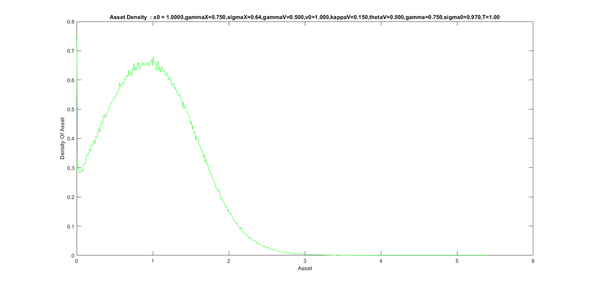
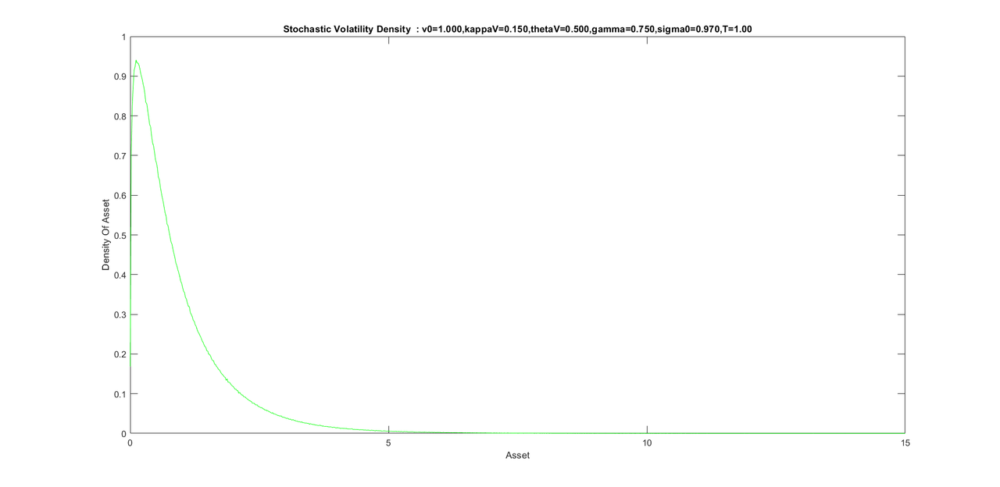

# Breakthrough in the theory of stochastic differential equations and their simulation

**Page 43 of 65** — Posts #2101–#2150

[← Previous](page_042.md) | [Index](index.md) | [Next →](page_044.md)

---

### #2101 — Amin (Topic Author)
*December 6, 2023, 3:58 AM*

Friends, I am posting the program that matches first few desired moments of ideal normal density grid to match its
moments with those of standard gaussian density. I tried this program for sixteen moments and one million grid size and
it worked perfectly. I had used optimization program with 100 iterations and used that as a guess to Newton root search.
However when I tried 20 moments with a guess using 100 iterations that did not work but I might need to improve the
initial guess. You can try fitting any number of moments using this program.

This program does not work on improving gaussian random numbers and I will complete that part in a day or two. This
program only fits moments to ideal normal density that can later be used in so many ways.

Here are the final values of matched moments up to sixteen moments (one million grid size) after ten iterations of
Newton method.

Moment =

   1.0e+06 *

  Columns 1 through 3

  -0.000000000000000   0.000001000000000   0.000000000000000

  Columns 4 through 6

   0.000003000000000   0.000000000000000   0.000015000000000

  Columns 7 through 9

  -0.000000000000000   0.000105000000000   0.000000000000000

  Columns 10 through 12

   0.000945000000000  -0.000000000000000   0.010395000000000

  Columns 13 through 15

  -0.000000000000000   0.135135000000000  -0.000000000000008

  Column 16

   2.027024999999992

Look at New moments>>

.

.

.

.

```
function [] = MatchMomentsOfIdealNormalDensity04()

Ndata=1000000;

[Zn] = StandardNormalIdealDesity02(Ndata,1);
%Above we generate ideal standard normal grid that is still not moment
%matched.

MOrder=16;                                                                                                             
                                                                                                                       
                                                        ;
Iterations=100;

[ZnNew,alpha,Moment] = MatchMomentParametersOfIdealZhalfNew02(Zn,MOrder,Iterations);

%The above optimization when run on ideal normal density grid of size one
%million and MOrder=16 (i.e. sixteen moments are matched)would give the
%alpha below after 100 iterations. I hardcoded it to avoid running the
%optimization algorithm again and again when analyuzing the program.

% alpha(1)=1.000116755466944;
% alpha(3)=-0.000049879463018;
% alpha(5)=0.000001329336531;
% alpha(7)=0.000000674119750;
% alpha(9)=0.000000218794322;
% alpha(11)=0.000000009746988;
% alpha(13)=-0.000000004686595;
% alpha(15)=0.000000000351937;

 %Below is the newton multidimensional root search program that finds
 %precise alphas so that moments of ideal normal density grid perfectly
 %match with first sixteen moments of the normal density. You can run the
 %program to fit higher number of moments but you will need a good guess.
 [alpha] = NewtonRootSearchForMatchingMomentsOfGaussianVariates(Zn,alpha,MOrder);

 %Finally multiply hermite series with coefficients alphas to get the new
 %ideal normal density grid that is moment matched.
 [ZnNew] = CalculateZnAfterHermiteSeriesMultiplication(Zn,alpha,MOrder);

for mm=1:MOrder
    Moment(mm)=sum(ZnNew(1:Ndata).^mm)/Ndata;
end

Moment

str=input("Look at New moments");

end

```

.

.

.

```
function [alpha] = NewtonRootSearchForMatchingMomentsOfGaussianVariates(Zn,alpha,MOrder)

Ndata=length(Zn);

 %MOrder=12;
 HOrder=MOrder-2;

 EZ(1)=0;
EZ(2)=1;
for nn=3:MOrder
    if rem(nn,2)==1
        EZ(nn)=0;
    else
        EZ(nn)=EZ(nn-2)*(nn-1);
        %EZ(nn)
    end
end

TMoment(1:MOrder)=EZ(1:MOrder);
 %CalculateMomentsAndDerivativesOfIdealNormalGrid(Zn,alpha,MOrder,HOrder);
 [F,dF] = CalculateMomentsAndDerivativesOfIdealNormalGrid(Zn,alpha,MOrder,HOrder,TMoment);

 F
 dF
% str=input("Look at results");

w(MOrder)=1;
for nn=MOrder-2:-2:2
w(nn)=w(nn+2).*(nn+2)*(nn+1)*.5;
end
w(2)=w(2)*1024;
w(8)=w(8)*2;
w(10)=w(10)*sqrt(2);
%w
%str=input("Look at weights--12")

[ZnNew] = CalculateZnAfterHermiteSeriesMultiplication(Zn,alpha,MOrder);

for mm=1:MOrder
    Moment(mm)=sum(ZnNew(1:Ndata).^mm)/Ndata;
end

ObjFuncBest=CalculateObjMoment(EZ,Moment,w,MOrder);

ObjFuncBest
str=input("Look at ObjFuncBest");
%b0Best=c0;
alphaBest(1:HOrder+1)=alpha(1:HOrder+1);

    qq=0;
    for mm=2:2:MOrder
        qq=qq+1;
        da(qq,1)=alpha(mm-1);
    end

nn=0;
while((nn.000000000001) || (abs(F(2,1))>.000000000001) || (abs(F(3,1))>.000000000001) || (abs(F(4,1))>.00000000001)||
(abs(F(5,1))>.00000000001)|| (abs(F(6,1))>.00000000001)))%|| (abs(F(7,1))>.00000000001)|| (abs(F(8,1))>.00000000001)  ))

    nn=nn+1;
    %Below Newton matrix equation to improve the Z-series coefficients guess at previous step.
    da=da-dF\F;

    qq=0;
    for mm=2:2:MOrder
        qq=qq+1;
        alpha(mm-1)=da(qq,1);
    end
    %b(1:SeriesOrder)=da(2:SeriesOrder+1,1);

    [ZnNew] = CalculateZnAfterHermiteSeriesMultiplication(Zn,alpha,MOrder);

    for mm=1:MOrder
        Moment(mm)=sum(ZnNew(1:Ndata).^mm)/Ndata;
    end

    ObjFuncNew=CalculateObjMoment(EZ,Moment,w,MOrder);

ObjFuncBest
ObjFuncNew
str=input("Look at objfunction--11--");

alpha

%str=input("Look at alpha");

    if(ObjFuncBest>ObjFuncNew)

       ObjFuncBest=ObjFuncNew;
       alphaBest=alpha;
       %bBest(1:SeriesOrder)=b(1:SeriesOrder);
    end

    [F,dF] = CalculateMomentsAndDerivativesOfIdealNormalGrid(Zn,alpha,MOrder,HOrder,TMoment);

    qq=0;
    for mm=2:2:MOrder
        qq=qq+1;
        da(qq,1)=alpha(mm-1);
    end

end
alpha=alphaBest;%Best;

end
```

.

.

.

.

```
function [F,dF] = CalculateMomentsAndDerivativesOfIdealNormalGrid(Zn,alpha,MOrder,HOrder,TMoment)

Ndata=length(Zn);

[Hz] = HermitePoly(HOrder);

for nn=1:2:HOrder+1
    ZZ(nn,1:Ndata)=Zn(1:Ndata).^(nn-1);
end

HermiteSeries(1:Ndata)=alpha(1);
HermiteZ(1:Ndata,1:HOrder)=0;
for nn=2:2:HOrder
    %Ndata
    %nn
    HermiteZ(1:Ndata)=0;
    for mm=1:2:(nn+1)
        %HermiteZ(nn,:)=HermiteZ(nn,:)+Hz(nn+1,mm).*ZZ(mm,:);
        HermiteZ(1:Ndata)=HermiteZ(1:Ndata)+Hz(nn+1,mm).*ZZ(mm,1:Ndata);
    end
    HermiteSeries(1:Ndata)=HermiteSeries(1:Ndata)+ alpha(nn+1).*HermiteZ(1:Ndata);
end

ZnNew(1:Ndata)=Zn(1:Ndata).*HermiteSeries(1:Ndata);

for mm=1:MOrder
    Moment(mm)=sum(ZnNew(1:Ndata).^mm)/Ndata;
    for nn=2:2:HOrder
        HermiteZ(1:Ndata)=0;
        for kk=1:2:(nn+1)
            HermiteZ(1:Ndata)=HermiteZ(1:Ndata)+Hz(nn+1,kk).*ZZ(kk,1:Ndata);
        end
        dG(mm,nn)=sum(Zn(1:Ndata).^(mm).*mm.*HermiteSeries(1:Ndata).^(mm-1).*HermiteZ(1:Ndata))/Ndata;

    end

    dG0(mm)=sum(Zn(1:Ndata).^(mm).*mm.*HermiteSeries(1:Ndata).^(mm-1))/Ndata;

    G(mm,1)=Moment(mm)-TMoment(mm);
end

dG0

%str=input("Look at dG0");
QQ=round(MOrder/2);
qq=0;
for nn=2:2:MOrder
qq=qq+1;
F(qq,1)=G(nn,1);
dF(qq,1)=dG0(nn);
dF(qq,2:QQ)=dG(nn,2:2:(2+(QQ-2)*2));
end

% F(1,1)=G(2,1);
% F(2,1)=G(4,1);
% F(3,1)=G(6,1);
% F(4,1)=G(8,1);
% F(5,1)=G(10,1);
% F(6,1)=G(12,1);
%
% dF(1,1)=dG0(2);
% dF(2,1)=dG0(4);
% dF(3,1)=dG0(6);
% dF(4,1)=dG0(8);
% dF(5,1)=dG0(10);
% dF(6,1)=dG0(12);
%
% dF(1,2)=dG(2,2);
% dF(2,2)=dG(4,2);
% dF(3,2)=dG(6,2);
% dF(4,2)=dG(8,2);
% dF(5,2)=dG(10,2);
% dF(6,2)=dG(12,2);
%
% dF(1,3)=dG(2,4);
% dF(2,3)=dG(4,4);
% dF(3,3)=dG(6,4);
% dF(4,3)=dG(8,4);
% dF(5,3)=dG(10,4);
% dF(6,3)=dG(12,4);
%
% dF(1,4)=dG(2,6);
% dF(2,4)=dG(4,6);
% dF(3,4)=dG(6,6);
% dF(4,4)=dG(8,6);
% dF(5,4)=dG(10,6);
% dF(6,4)=dG(12,6);
%
% dF(1,5)=dG(2,8);
% dF(2,5)=dG(4,8);
% dF(3,5)=dG(6,8);
% dF(4,5)=dG(8,8);
% dF(5,5)=dG(10,8);
% dF(6,5)=dG(12,8);
%
% dF(1,6)=dG(2,10);
% dF(2,6)=dG(4,10);
% dF(3,6)=dG(6,10);
% dF(4,6)=dG(8,10);
% dF(5,6)=dG(10,10);
% dF(6,6)=dG(12,10);
%Moment

%dMoment

F
dF
dG
Moment

str=input("Look at moments and F");

end

```

.

.

.

.

```
function [ZnNew] = CalculateZnAfterHermiteSeriesMultiplication(Zn,alpha,MOrder)

HOrder=MOrder-2;

Ndata=length(Zn);

[Hz] = HermitePoly(HOrder);

for nn=1:2:HOrder+1
    ZZ(nn,1:Ndata)=Zn(1:Ndata).^(nn-1);
end

HermiteSeries(1:Ndata)=alpha(1);
HermiteZ(1:Ndata,1:HOrder)=0;
for nn=2:2:HOrder
    Ndata
    nn
    HermiteZ(1:Ndata)=0;
    for mm=1:2:(nn+1)
        %HermiteZ(nn,:)=HermiteZ(nn,:)+Hz(nn+1,mm).*ZZ(mm,:);
        HermiteZ(1:Ndata)=HermiteZ(1:Ndata)+Hz(nn+1,mm).*ZZ(mm,1:Ndata);
    end
    HermiteSeries(1:Ndata)=HermiteSeries(1:Ndata)+ alpha(nn+1).*HermiteZ(1:Ndata);
end

ZnNew(1:Ndata)=Zn(1:Ndata).*HermiteSeries(1:Ndata);

end

```

.

.

.

```
function [Hz] = HermitePoly(Order)
Hz(1:Order+1,1:Order+1)=0.0;
Hz(1,1)=1.0;
for k=1:Order
    for m=1:k
       Hz(k+1,m+1)=Hz(k,m);
       if (m>1)
            Hz(k+1,m-1)=Hz(k+1,m-1)-(m-1)*Hz(k,m);
       end
    end
end

end

```

.

.

.

.

```
function [ObjMomentOut] = CalculateObjMoment(Moment0,Moment,w,MOrder)

ObjMomentOut=0;
for nn=2:2:MOrder
    ObjMomentOut=ObjMomentOut+(Moment(nn)-Moment0(nn)).^2.*w(nn);
end

end

```

.

.

.

```
function [ZnNew,alpha,Moment] = MatchMomentParametersOfIdealZhalfNew02(Zn,MOrder,Iterations)

%Zn=Zn*1.00005;

Ndata=length(Zn);
if(rem(Ndata,2)==0)
    Nh=Ndata/2;
else
    Nh=(Ndata+1)/2;
end

%MOrder=12;
HOrder=MOrder-2;
% Ndata
% Nh
% str=input("Look at number of data points");
%
% if(Ndata30)&&(Ndata100)&&(Ndata500)&&(Ndata1000)&&(Ndata3000)&&(Ndata6000)&&(Ndata10000)&&(Ndata100000)&&(Ndata500000)
%
%     Iterations=100;
% end

EZ(1)=0;
EZ(2)=1;
for nn=3:MOrder
    if rem(nn,2)==1
        EZ(nn)=0;
    else
        EZ(nn)=EZ(nn-2)*(nn-1);
        %EZ(nn)
    end
end

Moment0(1:MOrder)=EZ(1:MOrder);

%Iterations=10;
alpha(1)=1;
alpha(2:HOrder+1)=0;

for mm=2:2:MOrder
    Moment(mm)=sum(Zn(1:Ndata).^mm)/Ndata;
end

Moment
display("Initial Moments");

[Hz] = HermitePoly(HOrder);

for nn=1:2:HOrder+1
    ZZ(nn,1:Nh)=Zn(1:Nh).^(nn-1);
end

HermiteSeries(1:Nh)=alpha(1);
HermiteZ(1:Nh)=0;
for nn=2:2:HOrder
    HermiteZ(1:Nh)=0;
    for mm=1:2:(nn+1)
        %HermiteZ(nn,:)=HermiteZ(nn,:)+Hz(nn+1,mm).*ZZ(mm,:);
        HermiteZ(1:Nh)=HermiteZ(1:Nh)+Hz(nn+1,mm).*ZZ(mm,1:Nh);
    end
    HermiteSeries(1:Nh)=HermiteSeries(1:Nh)+ alpha(nn+1).*HermiteZ(1:Nh);
end

ZnNew(1:Nh)=Zn(1:Nh).*HermiteSeries(1:Nh);

for mm=2:2:MOrder
    Moment(mm)=sum(ZnNew(1:Nh).^mm)/Nh;
end

%ZnNew(1:Nh)=Zn(1:Nh).*(alpha+beta*(Zn(1:Nh).^2-1)+gamma*(Zn(1:Nh).^4-6*Zn(1:Nh).^2+3));

%w1=5000;
%w2=200;

%ObjFuncBest=(Moment2-1).^2*w1+(Moment4-3).^2*w2+(Moment6-15).^2;
% w(MOrder)=1;
% for nn=MOrder-2:-2:2
% w(nn)=w(nn+2).*(nn+2)*(nn+1)*.5;
% end
% w(2)=w(2)*4096*64;%256;
% w(MOrder-2)=w(MOrder-2)*256;
% w(MOrder)=w(MOrder)*128;
% w(MOrder-4)=w(MOrder-4)*128*8;
% w(8)=w(8)*4*4*4;
% w(4)=w(4)/4;
% w(6)=w(6)*4*16*4*4;
% w
% str=input("Look at weights--14")

w(MOrder)=1;
for nn=MOrder-2:-2:2
w(nn)=w(nn+2).*(nn+2)*(nn+1)*.5;
end
w(2)=w(2)*1024;
w(8)=w(8)*2;
w(10)=w(10)*sqrt(2);
w
str=input("Look at weights--12")

ObjFuncBest=CalculateObjMoment(EZ,Moment,w,MOrder);

%delta_alpha(1:HOrder+1)=.00025./(1:HOrder+1);
% %delta_alpha(1:HOrder+1)=.0005./(1:(HOrder+1)/2).^2;
% delta_alpha(1)=.0000005;%./(1:(HOrder+1)/2).^2;
% delta_alpha(3)=.0000005;
% delta_alpha(5)=.0000005;
% delta_alpha(7)=.00000025;
% delta_alpha(9)=.000000025;
% delta_alpha(11)=.000000025;
% delta_alpha(13)=.0000000005;
% % delta_alpha(15)=.00000000005;
% delta_alpha(1)=.0000025;%./(1:(HOrder+1)/2).^2;
% delta_alpha(3)=.000000025;
% delta_alpha(5)=.0000000125/2;
% delta_alpha(7)=.0000000025/2/2;
% delta_alpha(9)=.00000000025/2;
% delta_alpha(11)=.000000000125/4096;

delta_alpha(1)=.0000025;
delta_alpha(3)=delta_alpha(1)/50;
for mm=6:2:MOrder
    delta_alpha(mm-1)=delta_alpha(mm-3)/5;
end

%delta_alpha(13)=.000000000025/4096/4;
%delta_alpha(15)=.0000000025;
%for mm=2:HOrder+1
%    delta_alpha(mm)=.0005./(mm*.5).^.5;
%end
alphaSuccessCount(1:HOrder+1)=0;
SuccessPrevalpha(1:HOrder+1)=0;

mul1=.9;
mul2=1.2;

for iter=1:Iterations
iter
alpha
ObjFuncBest
    for kk=1:2:HOrder+1
        alphaNew(1:2:HOrder+1)=alpha(1:2:HOrder+1);
        alphaNew(kk)=alpha(kk)+delta_alpha(kk);

        HermiteSeries(1:Nh)=alphaNew(1);
        HermiteZ(1:Nh)=0;
        for nn=2:2:HOrder
            HermiteZ(1:Nh)=0;
            for mm=1:2:(nn+1)
                %HermiteZ(nn,:)=HermiteZ(nn,:)+Hz(nn+1,mm).*ZZ(mm,:);
                HermiteZ(1:Nh)=HermiteZ(1:Nh)+Hz(nn+1,mm).*ZZ(mm,1:Nh);
            end
            HermiteSeries(1:Nh)=HermiteSeries(1:Nh)+ alphaNew(nn+1).*HermiteZ(1:Nh);
        end

        ZnNew(1:Nh)=Zn(1:Nh).*HermiteSeries(1:Nh);

        for mm=2:2:MOrder
            Moment(mm)=sum(ZnNew(1:Nh).^mm)/Nh;
        end

%        ObjFuncNew=CalculateObjMoment(Moment);
        ObjFuncNew=CalculateObjMoment(EZ,Moment,w,MOrder);

        %ObjFuncBest
        %ObjFuncNew
        %alpha(kk)
        %delta_alpha(kk)
        %kk
        %disp("Plus")
        %str=input("Look at obj func---1")
        if(ObjFuncNew3)
            delta_alpha(kk)=delta_alpha(kk).*mul2;
        end
    end

%     Moment(2)-Moment0(2)
%     Moment(4)-Moment0(4)
%     Moment(6)-Moment0(6)
%     Moment(8)-Moment0(8)
%     Moment(10)-Moment0(10)
%     Moment(12)-Moment0(12)
%     Moment(14)-Moment0(14)
%     Moment(16)-Moment0(16)

 %   Moment0
    Moment

   % str=input("Look at difference of Moments");
end

%ZZ(1:HOrder+1,Nh+1:Ndata)=ZZ(1:HOrder+1,1:Nh);
%ZZ(1:HOrder+1,1:Ndata)=Zn(1:HOrder+1,1:Ndata);
for nn=1:2:HOrder+1
    ZZ(nn,1:Ndata)=Zn(1:Ndata).^(nn-1);
end

HermiteSeries(1:Ndata)=alpha(1);
HermiteZ(1:Ndata)=0;
for nn=2:2:HOrder
    HermiteZ(1:Ndata)=0;
    for mm=1:2:(nn+1)
        %HermiteZ(nn,:)=HermiteZ(nn,:)+Hz(nn+1,mm).*ZZ(mm,:);
        HermiteZ(1:Ndata)=HermiteZ(1:Ndata)+Hz(nn+1,mm).*ZZ(mm,1:Ndata);
    end
    HermiteSeries(1:Ndata)=HermiteSeries(1:Ndata)+ alpha(nn+1).*HermiteZ(1:Ndata);
end

ZnNew(1:Ndata)=Zn(1:Ndata).*HermiteSeries(1:Ndata);

for mm=2:2:MOrder
    Moment(mm)=sum(ZnNew(1:Ndata).^mm)/Ndata;
end

alpha
Moment
ObjFuncFinal=CalculateObjMoment(EZ,Moment,w,MOrder);
ObjFuncFinal

display("fitted Moments");
str=input("Look at moment values")

end
```

.

.

.

```
function [ZZ] = StandardNormalIdealDesity02(Ndata,Sigma)
%Ndata is number of data points in sample, for which we want to find the
%coefficients of the Z-series.
%Sigma=1+.06;
%Sigma=1;
if (rem(Ndata,2)==0)
    NnMid=Ndata/2;
    NnMid
    ZZ(NnMid+1)=norminv(.5+1/Ndata*.5,0,Sigma);
    ZZ(NnMid)=norminv(.5-1/Ndata*.5,0,Sigma);
    for nn=2:NnMid-1
        ZZ(nn+NnMid)=norminv(.5+(nn-.5)*1/Ndata,0,Sigma);
        ZZ(-nn+1+NnMid)=norminv(.5-(nn-.5)*1/Ndata,0,Sigma);
    end
    %A=normcdf((Ndata-1)/Ndata);
    %ZZ(Ndata)=exp(-5*A^2)/(1/Ndata);
    A=norminv((Ndata-1)/Ndata);
    ZZ(Ndata)=A +0.398942 *exp(-.5*A^2)/sqrt(1/Ndata)/sqrt(.5);
    ZZ(1)=-A-0.398942 *exp(-.5*A^2)/sqrt(1/Ndata)/sqrt(.5);
end

if (rem(Ndata,2)==1)
    NnMid=(Ndata+1)/2;
    ZZ(NnMid)=0;
    for nn=1:NnMid-2
        ZZ(nn+NnMid)=norminv(.5+(nn)*1/Ndata,0,Sigma);
        ZZ(-nn+NnMid)=norminv(.5-(nn)*1/Ndata,0,Sigma);
    end
   A=norminv((Ndata-1)/Ndata);
    ZZ(Ndata)=A +0.398942 *exp(-.5*A^2)/sqrt(1/Ndata)/sqrt(.5);
    ZZ(1)=-A-0.398942 *exp(-.5*A^2)/sqrt(1/Ndata)/sqrt(.5);
end

%ZZ
%A
%plot(ZZ)
%str=input("Look at density plot standard")

end

```

.

.

.

---

### #2102 — Amin (Topic Author)
*December 7, 2023, 11:28 AM*

Friends, I am posting a standard normal random number generator that uses scrambling by generating another sample of
Gaussian RNG's (you can also replace by sample of uniforms random numbers) but it will only work with one million
paths. For any other number of paths, you will have to do moment matching on ideal standard normal density grid and
replace the optimization parameters alpha hardcoded in this program and then use scrambling as given in the program.

It uses matlab internal function "sort" to scramble the ideal normal grid elements and you will have to understand and
replace the internal matlab function with appropriate code if you are not using matlab.

.

.

.

.

```
function [] = GaussRNGbyScrambleIdealNormalGrid()

%This function to generate moment matched normal random numbers will only
%work with one million paths. For any other number of paths, you will have
%to do moment matching on ideal standard normal density grid and replace
%the optimization parameters alpha hardcoded in this program.

Ndata=1000000;

[Zn] = StandardNormalIdealDesity02(Ndata,1);
%Above we generate ideal standard normal grid that is still not moment
%matched.

MOrder=16;                                                                                                             
                                                                                                                       
                                                        ;

%These alpha parameters came out of moment matching of one million sized
%standard normal density grid and are hardcoded here.

alpha(1)=0.999294359267928;
alpha(3)=0.000408669303921;
alpha(5)=0.000027555461306;
alpha(7)=0.000101886611757;
alpha(9)=0.000027612959772;
alpha(11)=0.000005154923524;
alpha(13)=0.000000404080224;
alpha(15)=0.000000016381977;

[ZnNew] = CalculateZnAfterHermiteSeriesMultiplication(Zn,alpha,MOrder);

seed0=21872418;
rng(seed0, 'twister')

Tt=40;
paths=Ndata;

for tt=1:Tt
%Generate random nubers below with antithetic sampling.
ZRandom(1:paths/2)=0;
ZRandom=randn(size(ZRandom));
ZRandom(paths/2+1:paths)=-ZRandom(1:paths/2);

[Zs,I]=sort(ZRandom);

ZOut(I(1:Ndata))=ZnNew(1:Ndata);

%ZOut
%Use the above ZOut scrambled array of first 16 moment matched normals
%for calculations at every time step in the loop.

% plot((1:Ndata),ZOut(1:Ndata),'g');
 tt
%
 str=input("Look at plot of ZOut at associated time step");
%
% for mm=1:MOrder
%     Moment(mm)=sum(ZOut(1:Ndata).^mm)/Ndata;
% end
%
% Moment
% tt
% str=input("Look at moments at corresponding time step");

end

end

```

.

.

.

```
function [ZnNew] = CalculateZnAfterHermiteSeriesMultiplication(Zn,alpha,MOrder)

HOrder=MOrder-2;

Ndata=length(Zn);

[Hz] = HermitePoly(HOrder);

for nn=1:2:HOrder+1
    ZZ(nn,1:Ndata)=Zn(1:Ndata).^(nn-1);
end

HermiteSeries(1:Ndata)=alpha(1);
HermiteZ(1:Ndata,1:HOrder)=0;
for nn=2:2:HOrder
    Ndata;
    nn;
    HermiteZ(1:Ndata)=0;
    for mm=1:2:(nn+1)
        %HermiteZ(nn,:)=HermiteZ(nn,:)+Hz(nn+1,mm).*ZZ(mm,:);
        HermiteZ(1:Ndata)=HermiteZ(1:Ndata)+Hz(nn+1,mm).*ZZ(mm,1:Ndata);
    end
    HermiteSeries(1:Ndata)=HermiteSeries(1:Ndata)+ alpha(nn+1).*HermiteZ(1:Ndata);
end

ZnNew(1:Ndata)=Zn(1:Ndata).*HermiteSeries(1:Ndata);

end

```

---

### #2103 — Amin (Topic Author)
*December 7, 2023, 1:12 PM*

Friends, if you run the matlab program in previous post, you will notice that distribution of sum of normal random
numbers along the monte carlo paths is again slightly different from normal and even average variance of sum of random
numbers across the paths is a few basis points away from one. This is probably due to small correlations caused by the
random number generator.

I am trying to think of an algorithm that could possibly keep variance and moments at true value of normal when the
distribution of sum of random numbers along the paths is averaged. I am not sure if the idea works but I will try to
post the results tomorrow if it works.

Since there are very small correlations between random numbers generated by a PRNG, we can either choose to keep the
moments of random variates at each step along a monte carlo simulation equal to true moments but then average moments of
the sum of random numbers along the simulation paths would be slightly different from true moments. Alternatively, we
can choose to have moments of normal random variates at each step very slightly different from true moments but we can
then keep the moments and distribution of sum of gaussian random numbers along the simulation paths equal to true
moments and true distribution.

This issue would not arise if there are perfectly zero correlations across random numbers samples across each time
step(if PRNG is perfect) and we could choose to keep both the moments of random number variates at each step and moments
of sum of random numbers along simulation paths equal to true gaussian moments without any extra effort.

---

### #2104 — Amin (Topic Author)
*December 7, 2023, 4:57 PM*

Friends, here is the matlab program with simple algorithm that keeps moments of gaussian sum at each step equal to
moments of true gaussian sum while moments of gaussian being added at each step are slightly approximate. This will work
for one million paths only but you can follow the same logic for any number of paths.

Here is the program.

.

.

.

```
function [] = GaussRNGbyScrambleIdealNormalGrid02New()

%This function to generate moment matched normal random numbers will only
%work with one million paths. For any other number of paths, you will have
%to do moment matching on ideal standard normal density grid and replace
%the optimization parameters alpha hardcoded in this program.

Ndata=1000000;

[Zn] = StandardNormalIdealDesity02(Ndata,1);
%Above we generate ideal standard normal grid that is still not moment
%matched.

MOrder=16;                                                                                                             
                                                                                                                       
                                                        ;

%These alpha parameters came out of moment matching of one million sized
%standard normal density grid and are hardcoded here.

alpha(1)=0.999294359267928;
alpha(3)=0.000408669303921;
alpha(5)=0.000027555461306;
alpha(7)=0.000101886611757;
alpha(9)=0.000027612959772;
alpha(11)=0.000005154923524;
alpha(13)=0.000000404080224;
alpha(15)=0.000000016381977;

[ZnNew] = CalculateZnAfterHermiteSeriesMultiplication(Zn,alpha,MOrder);

seed0=21872418;
%rng(seed0, 'twister')
%rng(seed0, 'combRecursive')
%rng(seed0, 'philox')
%rng(seed0, 'multFibonacci')
%rng(seed0, 'simdTwister')
rng(seed0, 'threefry')
%combRecursive

Tt=10;
paths=Ndata;
ZSumPrev(1:paths)=0;
for tt=1:Tt
%Generate random nubers below with antithetic sampling.
ZRandom(1:paths/2)=0;
ZRandom=randn(size(ZRandom));
ZRandom(paths/2+1:paths)=-ZRandom(1:paths/2);

ZSum(1:paths)=ZSumPrev(1:paths)+ZRandom(1:paths);

[ZSumS,I]=sort(ZSum); %Sorted Sum

ZSumP(1:paths)=ZnNew(1:paths)*sqrt(tt);%Perfect Sum

Ze(I(1:paths))=ZSumP(1:paths)-ZSumS(1:paths); %error in each path from perfect sum

ZSum(1:paths)=ZSumPrev(1:paths)+(ZRandom(1:paths)+Ze(1:paths));%Recalculation of sum after adding error

ZAdded(1:paths)=(ZRandom(1:paths)+Ze(1:paths));%Actual added normal dist.

ZSumPrev(1:paths)=ZSum(1:paths);%Previous value for next time step.

 plot((1:Ndata),ZSum(1:Ndata),'g');
 tt

 str=input("Look at plot of ZOut at associated time step");

 for mm=1:MOrder
     Moment(mm)=sum((ZSum(1:Ndata)/sqrt(tt)).^mm)/Ndata; % Moments of Sum normalized to unit gaussian by division with
time sqrt.
     Moment0(mm)=sum((ZAdded(1:Ndata)).^mm)/Ndata;%Moments of Gaussain increment.
 end
%
 Moment

 tt
 str=input("Look at moments of Sum at this time step. This has been normalized by time to match with moments of standard
normal");

  Moment0
  tt

 str=input("Look at moments of gaussian actually added at this time step");
end

ZLast=ZSum;

for mm=1:MOrder
    %Moment(mm)=sum(ZOut(1:Ndata).^mm)/Ndata;
    Moment(mm)=sum((ZLast(1:Ndata)/sqrt(Tt)).^mm)/Ndata;
end

Moment
tt
str=input("Look at Final moments at last time step");

end

```

.

.

.

Here is the output after ten time steps at final time as Tt=10.

.

.

.

Moment =

   1.0e+06 *

  Columns 1 through 3

  -0.000000000000000   0.000001000000000  -0.000000000000000

  Columns 4 through 6

   0.000003000000000  -0.000000000000000   0.000015000000001

  Columns 7 through 9

  -0.000000000000000   0.000105000000049  -0.000000000000000

  Columns 10 through 12

   0.000945000001549  -0.000000000000000   0.010395000044091

  Columns 13 through 15

  -0.000000000000000   0.135135001169425  -0.000000000000008

  Column 16

   2.027025029946465

tt =

    10

Look at moments of Sum at this time step. This has been normalized by time to match with moments of standard normal

Moment0 =

   1.0e+06 *

  Columns 1 through 3

   0.000000000000000   0.000000999356601   0.000000000000000

  Columns 4 through 6

   0.000003001685332   0.000000000000000   0.000015039066042

  Columns 7 through 9

   0.000000000000000   0.000105153809351   0.000000000000000

  Columns 10 through 12

   0.000935979990795   0.000000000000000   0.009999442920463

  Columns 13 through 15

   0.000000000000000   0.123032395607580   0.000000000000001

  Column 16

   1.691683735394070

tt =

    10

Look at moments of gaussian actually added at this time step

Moment =

   1.0e+06 *

  Columns 1 through 3

  -0.000000000000000   0.000001000000000  -0.000000000000000

  Columns 4 through 6

   0.000003000000000  -0.000000000000000   0.000015000000001

  Columns 7 through 9

  -0.000000000000000   0.000105000000049  -0.000000000000000

  Columns 10 through 12

   0.000945000001549  -0.000000000000000   0.010395000044091

  Columns 13 through 15

  -0.000000000000000   0.135135001169425  -0.000000000000008

  Column 16

   2.027025029946465

tt =

    10

Look at Final moments at last time step "----Normalized by time sqrt".

---

### #2105 — Amin (Topic Author)
*December 8, 2023, 1:49 AM*

Friends, I embedded the monte carlo scheme presented in previous post in a Stochastic volatility monte carlo program.

For the univariate SV SDE, I am consistently getting a basis point accuracy in mean of SV. The error in mean is
consistently a fraction of the basis point for univariate SDEs with different scenarios. However when large mass goes to
zero in a univariate SDE, this accuracy decreases.

For asset SDE, I am getting an error of 1-3 basis points between true mean and simulation mean.

This program will work only with one million simulation paths.

Here is the matlab program for SV monte carlo with new method.

.

.

.

```
function [] = SVMonteCarloWithNewGaussianVariates()

Ndata=1000000;

[Zn] = StandardNormalIdealDesity02(Ndata,1);
%Above we generate ideal standard normal grid that is still not moment
%matched.

MOrder=16;                                                                                                             
                                                                                                                       
                                                        ;

%These alpha parameters came out of moment matching of one million sized
%standard normal density grid and are hardcoded here.

alpha(1)=0.999294359267928;
alpha(3)=0.000408669303921;
alpha(5)=0.000027555461306;
alpha(7)=0.000101886611757;
alpha(9)=0.000027612959772;
alpha(11)=0.000005154923524;
alpha(13)=0.000000404080224;
alpha(15)=0.000000016381977;

[ZnNew] = CalculateZnAfterHermiteSeriesMultiplication(Zn,alpha,MOrder);

X0=1.0;
alpha1=0;
alpha2=1;
kappaX=0;
thetaX=1;
a=kappaX*thetaX;
b=-kappaX;

rho=-.75;
sigma1=.641;
gammaV=.5;
gammaX=.75;
%%%%%%%%`%%%%%
V0=1.0;%.35;
thetaV=.50;%.04;
kappaV=.150;
mu1=kappaV*thetaV;
mu2=-kappaV;
beta1=0;
beta2=1;
gamma=.75;
sigma0=.97;

dt=.03125/2;
Tt=64*1;

T=Tt*dt;

%%%%%%%%%%%%%%%%%%%%%%%%5
seed0=21872418;
%rng(seed0, 'twister')
rng(seed0, 'combRecursive')
%rng(seed0, 'philox')
%rng(seed0, 'multFibonacci')
%rng(seed0, 'simdTwister')
%rng(seed0, 'threefry')
%combRecursive

%Tt=10;
paths=Ndata;
ZSumPrev(1:paths)=0;
ZSumPrev2(1:paths)=0;

V(1:paths)=V0;  %Original process monte carlo.
X(1:paths)=X0;

for tt=1:Tt
tt
% Random2=randn(size(Random2));
% Random1=randn(size(Random1));
% Random1(paths00+1:2*paths00)=-1*Random1(1:paths00);
% Random2(paths0+1:2*paths0)=-1*Random2(1:paths0);
% Random1(paths0+1:2*paths0)=Random1(1:paths0);
% %antithetic variates above

%---------------------------------------------------------------------------

ZRandom(1:paths/2)=0;
ZRandom=randn(size(ZRandom));
ZRandom(paths/2+1:paths)=-ZRandom(1:paths/2);

ZSum(1:paths)=ZSumPrev(1:paths)+ZRandom(1:paths);

[ZSumS,I]=sort(ZSum); %Sorted Sum

ZSumP(1:paths)=ZnNew(1:paths)*sqrt(tt);%Perfect Sum

Ze(I(1:paths))=ZSumP(1:paths)-ZSumS(1:paths); %error in each path from perfect sum

ZSum(1:paths)=ZSumPrev(1:paths)+(ZRandom(1:paths)+Ze(1:paths));%Recalculation of sum after adding error

Random1(1:paths)=(ZRandom(1:paths)+Ze(1:paths));%Actual added normal dist.

ZSumPrev(1:paths)=ZSum(1:paths);%Previous value for next time step.

%--------------------------------------------------------------

%---------------------------------------------------------------------------

ZRandom2(1:paths/2)=0;
ZRandom2=randn(size(ZRandom2));
ZRandom2(paths/2+1:paths)=-ZRandom2(1:paths/2);

ZSum2(1:paths)=ZSumPrev2(1:paths)+ZRandom2(1:paths);

[ZSumS2,I2]=sort(ZSum2); %Sorted Sum

ZSumP(1:paths)=ZnNew(1:paths)*sqrt(tt);%Perfect Sum

Ze2(I2(1:paths))=ZSumP(1:paths)-ZSumS2(1:paths); %error in each path from perfect sum

ZSum2(1:paths)=ZSumPrev2(1:paths)+(ZRandom2(1:paths)+Ze2(1:paths));%Recalculation of sum after adding error

Random2(1:paths)=(ZRandom2(1:paths)+Ze2(1:paths));%Actual added normal dist.

ZSumPrev2(1:paths)=ZSum2(1:paths);%Previous value for next time step.

%--------------------------------------------------------------

X(1:paths)=X(1:paths)+ ...
    (a* X(1:paths).^alpha1 + b* X(1:paths).^alpha2)* dt + ...
    sqrt(1-rho^2)* sigma1* V(1:paths).^gammaV.* X(1:paths).^gammaX .*Random1(1:paths) * sqrt(dt) + ...
    rho* sigma1* V(1:paths).^gammaV .*X(1:paths).^gammaX .*Random2(1:paths)*sqrt(dt) + ...
    (a*alpha1* X(1:paths).^(alpha1-1)+b*alpha2* X(1:paths).^(alpha2-1)).* ...
    (((a* X(1:paths).^alpha1 + b* X(1:paths).^alpha2)* dt^2/2)+ ...
    (sqrt(1-rho^2)* sigma1* V(1:paths).^gammaV.* X(1:paths).^gammaX .*Random1(1:paths) *(1-1/sqrt(3)).*dt^1.5+ ...
    rho* sigma1* V(1:paths).^gammaV .*X(1:paths).^gammaX .*Random2(1:paths)*(1-1/sqrt(3)).*dt^1.5))+ ...
    .5*(a*alpha1*(alpha1-1)* X(1:paths).^(alpha1-2)+b*alpha2*(alpha2-1).* X(1:paths).^(alpha2-2)).* ...
    ( sigma1^2* V(1:paths).^(2*gammaV).* X(1:paths).^(2*gammaX)) *dt^2/2 + ...
    sqrt(1-rho^2)* sigma1* V(1:paths).^gammaV.*gammaX.* X(1:paths).^(gammaX-1).* ...
    ((a* X(1:paths).^alpha1 + b* X(1:paths).^alpha2).*Random1(1:paths) * 1/sqrt(3).* dt^1.5 + ...
    sqrt(1-rho^2)* sigma1* V(1:paths).^gammaV.* X(1:paths).^gammaX .*(Random1(1:paths).^2-1) * dt/2 + ...
    rho* sigma1* V(1:paths).^gammaV .*X(1:paths).^gammaX .*Random1(1:paths).*Random2(1:paths)*dt/2)+ ...
    .5*sqrt(1-rho^2)* sigma1* V(1:paths).^gammaV.*gammaX.*(gammaX-1).* X(1:paths).^(gammaX-2).* ...
    (sigma1^2* V(1:paths).^(2*gammaV).* X(1:paths).^(2*gammaX) .*Random1(1:paths).*1/sqrt(3).*dt^1.5)+ ...
    sqrt(1-rho^2)* sigma1*gammaV.* V(1:paths).^(gammaV-1).* X(1:paths).^(gammaX).* ...
    ((mu1.*V(1:paths).^beta1 + mu2.*V(1:paths).^beta2).*Random1(1:paths) * 1/sqrt(3).* dt^1.5 + ...
    sigma0*V(1:paths).^gamma.*Random1(1:paths).*Random2(1:paths)*dt/2)+ ...
    .5*sqrt(1-rho^2)* sigma1*gammaV.*(gammaV-1).* V(1:paths).^(gammaV-2).* X(1:paths).^(gammaX).* ...
    (sigma0^2*V(1:paths).^(2*gamma).*Random1(1:paths)*1/sqrt(3)*dt^1.5)+ ...
    sqrt(1-rho^2)* sigma1*gammaV.* V(1:paths).^(gammaV-1).*gammaX.* X(1:paths).^(gammaX-1).* ...
    rho.* sigma1.* V(1:paths).^gammaV .*X(1:paths).^gammaX
.*sigma0.*V(1:paths).^gamma.*Random1(1:paths)*1/sqrt(3)*dt^1.5+ ...
    rho* sigma1* V(1:paths).^gammaV.*gammaX.* X(1:paths).^(gammaX-1).* ...
    ((a* X(1:paths).^alpha1 + b* X(1:paths).^alpha2).*Random2(1:paths) * 1/sqrt(3).* dt^1.5 + ...
    sqrt(1-rho^2)* sigma1* V(1:paths).^gammaV.* X(1:paths).^gammaX .*Random1(1:paths).*Random2(1:paths) * dt/2 + ...
    rho* sigma1* V(1:paths).^gammaV .*X(1:paths).^gammaX .*(Random2(1:paths).^2-1)*dt/2)+ ...
    0.5*rho* sigma1* V(1:paths).^gammaV.*gammaX.*(gammaX-1).* X(1:paths).^(gammaX-2).* ...
    (sigma1^2* V(1:paths).^(2*gammaV).* X(1:paths).^(2*gammaX) .*Random2(1:paths).*1/sqrt(3).*dt^1.5)+ ...
    rho* sigma1*gammaV.* V(1:paths).^(gammaV-1).* X(1:paths).^(gammaX).* ...
    ((mu1.*V(1:paths).^beta1 + mu2.*V(1:paths).^beta2).*Random2(1:paths) * 1/sqrt(3).* dt^1.5 + ...
    sigma0*V(1:paths).^gamma.*(Random2(1:paths).^2-1)*dt/2)+ ...
    .5*rho* sigma1*gammaV.*(gammaV-1).* V(1:paths).^(gammaV-2).* X(1:paths).^(gammaX).* ...
    sigma0^2.*V(1:paths).^(2*gamma).*Random2(1:paths) * 1/sqrt(3).* dt^1.5+ ...
    rho* sigma1*gammaV.* V(1:paths).^(gammaV-1).*gammaX.* X(1:paths).^(gammaX-1).* ...
    rho.* sigma1.* V(1:paths).^gammaV .*X(1:paths).^gammaX
.*sigma0.*V(1:paths).^gamma.*Random2(1:paths)*1/sqrt(3)*dt^1.5;

    V(1:paths)=V(1:paths)+ ...
        (mu1.*V(1:paths).^beta1 + mu2.*V(1:paths).^beta2)*dt + ...
        sigma0*V(1:paths).^gamma .*Random2(1:paths)*sqrt(dt) + ...
        (mu1.*beta1*V(1:paths).^(beta1-1) + mu2.*beta2.*V(1:paths).^(beta2-1)).* ...
        ((mu1.*V(1:paths).^beta1 + mu2.*V(1:paths).^beta2)*dt^2/2 + ...
        sigma0*V(1:paths).^gamma .*Random2(1:paths)*(1-1/sqrt(3))*dt^1.5) + ...
        .5*(mu1.*beta1.*(beta1-1).*V(1:paths).^(beta1-2) + mu2.*beta2.*(beta2-1).*V(1:paths).^(beta2-2)).* ...
        sigma0^2.*V(1:paths).^(2*gamma).*dt^2/2 + ...
        sigma0*gamma*V(1:paths).^(gamma-1) .* ...
        ((mu1.*V(1:paths).^beta1 + mu2.*V(1:paths).^beta2).*Random2(1:paths).*1/sqrt(3)*dt^1.5 + ...
        sigma0.*V(1:paths).^gamma .*(Random2(1:paths).^2-1)*dt/2) + ...
        .5*sigma0*gamma*(gamma-1).*V(1:paths).^(gamma-2) .* ...
        sigma0^2.*V(1:paths).^(2*gamma) .*Random2(1:paths).*1/sqrt(3)*dt^1.5;

end

X(XCallStrikes(nn))
            CallPricesMC(nn)=CallPricesMC(nn)+(X(pp)-CallStrikes(nn))/paths;
        end
    end
end

CallPricesMC

SVolMeanAnalytic=thetaV+exp(-kappaV*T)*(V0-thetaV)
SVolMean=sum(V(1:paths))/paths
AssetMeanAnalytic=thetaX+exp(-kappaX*T)*(X0-thetaX)
AssetMean=sum(X(1:paths))/paths

str=input("Look at Numbers");

 MaxCutOff=15;
 NoOfBins=800;%round(1*500*gamma^2*4*sigma0/sqrt(MCMean)/(1+kappa))*1;%Decrease the number of bins if the graph is too
 [YDensity,IndexOutY,IndexMaxY] = MakeDensityFromSimulation_Infiniti_NEW(V,paths,NoOfBins,MaxCutOff );
 plot(IndexOutY(1:IndexMaxY),YDensity(1:IndexMaxY),'g');
 title(sprintf('Stochastic Volatility Density  :
v0=%.3f,kappaV=%.3f,thetaV=%.3f,gamma=%.3f,sigma0=%.3f,T=%.2f',V0,kappaV,thetaV,gamma,sigma0,T));%,sprintf('theta= %f',
theta), sprintf('kappa = %f', kappa),sprintf('sigma = %f', sigma0),sprintf('T = %f', T));
 xlabel('Asset'), ylabel('Density Of Asset')

 str=input("Look at VOLATILITY density graphs");

 MaxCutOff=15;
 NoOfBins=600;%round(1*500*gamma^2*4*sigma0/sqrt(MCMean)/(1+kappa))*1;%Decrease the number of bins if the graph is too
 [XDensity,IndexOutX,IndexMaxX] = MakeDensityFromSimulation_Infiniti_NEW(X,paths,NoOfBins,MaxCutOff );
 plot(IndexOutX(1:IndexMaxX),XDensity(1:IndexMaxX),'g');
 title(sprintf('Asset Density  : x0 =
%.4f,gammaX=%.3f,sigmaX=%.2f,gammaV=%.3f,v0=%.3f,kappaV=%.3f,thetaV=%.3f,gamma=%.3f,sigma0=%.3f,T=%.2f',
X0,gammaX,sigma1,gammaV,V0,kappaV,thetaV,gamma,sigma0,T));%,sprintf('theta= %f', theta), sprintf('kappa = %f',
kappa),sprintf('sigma = %f', sigma0),sprintf('T = %f', T));
 xlabel('Asset'), ylabel('Density Of Asset')
 str=input("Look at Asset density graphs");

end

```

.

.

.

Here is the last output with the program.

SVolMeanAnalytic =

   0.930353988212529

SVolMean =

   0.930352500614483

AssetMeanAnalytic =

     1

AssetMean =

   0.999811155550446

Look at Numbers

IndexMax =

   801

Look at VOLATILITY density graphs

IndexMax =

   601

Look at Asset density graphs

.

.

corr=-.75;

.

[](https://postimg.cc/pmyBQFbw)

[](https://postimg.cc/0bVfJC3G)

---

### #2106 — Amin (Topic Author)
*December 10, 2023, 6:35 AM*

Friends, I fear that matching higher moments of random number samples that are relatively smaller in size might not work
properly in simulation. I noticed that when I match sixteen moments of a gaussian sample of one million random numbers,
I get good results but when I would match sixteen moments of a guassian sample that is only 200,000 in size(the root
search program works well on them as well), it would give bad results in some of my simulations. However results are
better when only 12 moments of smaller samples of 200,000 are matched. So we would have to be careful about matching
large higher moments when random number sample is smaller in size.

---

### #2107 — Amin (Topic Author)
*December 10, 2023, 2:56 PM*

>
> Friends, I fear that matching higher moments of random number samples that are relatively smaller in size might not
work properly in simulation. I noticed that when I match sixteen moments of a gaussian sample of one million random
numbers, I get good results but when I would match sixteen moments of a guassian sample that is only 200,000 in size(the
root search program works well on them as well), it would give bad results in some of my simulations. However results
are better when only 12 moments of smaller samples of 200,000 are matched. So we would have to be careful about matching
large higher moments when random number sample is smaller in size.
>
.

.

I would request friends to investigate further on their own. I came across this problem when I was doing simulation that
keeps simulated density equal to normal at every simulation step. I am not sure whether this is a universal problem but
would request friends to investigate it further on their own.

If I have more information regarding it as I play more with problems, I will post it here.

---

### #2108 — Amin (Topic Author)
*December 13, 2023, 3:03 PM*

Friends, I am turning the focus of my research back to  calculations of conditional probability and related concepts. I
have been thinking about the ideas and I think I have gained some more insights about the concepts involved. Though my
earlier work on calculations of conditional probabilities was reasonable, I have been able to gain many insights due to
that work and I hope that we can mature the ideas so that they can be applied to practical problems and applications.

Previously we have used a grid for the calculations of conditional distributions depending upon some variable but these
grids required very large amount of data elements. I am trying to think of some other ways which could work when we have
smaller number of data points and we do not have to make a grid for calcualtions of conditional/conditional transition
probabilities. As we learnt in the past if we make a grid to calculate conditional/transition probabilities, the number
of data points have to be huge (hundreds of thousands) but we want our method to work well even when we have a few
hundred or even smaller data points.

Finally, I want to associate all the calculations of conditional densities with Bayes rule and Bayesian methods. I will
explain with numerical examples how we can find the posterior distribution of data after making an observation from the
conditional distribution (I have worked this out).

But first I want to do some work to find out conditional densities when we are given a pair of data points for example
possibly from a density a time t and another density at time t+1, and we want to find out the conditional transition
density from initial density at time t to final density at time t+1 without making a grid(as we did in the past few
weeks). And then we will make Bayes type calculations of posterior density at time t from the information we get after
observing the value of stochastic variable at time t+1.

This is all very simple conceptually but we will have to make heavy use of numerical methods. We will be using similar
concepts that we used earlier in past few weeks plus the ideas we used when we were doing SDE research but I expect that
numerical methods will be slightly more involved. We will strictly remain in the Z-series/Hermite Series mathematical
framework.

I want to complete this work over the december vacations and possibly in early january.

---

### #2109 — Amin (Topic Author)
*December 14, 2023, 6:55 AM*

Friends, I am writing this post to complain about continuing persecution by American defense. I mentioned how food in
entire city was drugged by mind control chemicals about two or more weeks ago but there has not been any decrease in
drugging of food in the city. I tried to concentrate on my research and made conscious effort to not write about the
persecution and just focus on mathematics hoping that persecution activity would finally decrease.

About two weeks ago mind control guys had mentioned to me that good people in US have asked the government to end the
drugging of food in Lahore but reality on ground is that drugging of food never decreased.

Water by all the three largest manufacturers that are Nestle, coca-cola and pepsi-cola is all drugged with mind control
chemicals. Nestle is lightly drugged but still has some mind control chemicals in it. If I have to take a small amount
of water and good water is not available, I can drink Nestle but it still does affect the brain in negative way. For
past two months, I have survived by drinking bottled water from very small companies and there are probably 100 of them
in the city but they also distribute mostly drugged water. Only one out of ten water bottling companies have good water
and I have to continue to try until I get good water. Water from any of these small companies is not universally
available and different brands are found in small areas and in small quantities and even if I know the good brands,
there is no guaranatee that I would be able to get good water again. Ground water and water supply all over the city has
completely drugged water. Pakistan army scientifically drugs underground water and they have been taught by CIA which
places to drug so that underground water reservoirs in all over the city would remain drugged.

I have been holding up since I could buy good water from some very small but rare companies but it continues to become
difficult. I have also been able to get ground water from peripheries of the city from areas which are outside the
boundary of the city but I am sure that Pakistan army continues to plug this gap.

Day before yesterday, I ate some cooked food from a small random shop in a smaller nearby city (Raiwind which is 35 kms
from Lahore) and I was surprised to know that food that was already cooked was all drugged. However I was able to get
good water from a filter plant outside a house and the water was luckily good and I was happy.

I also believe that there is a strong plan to ask police to stop me somewhere especially when I have had some drugged
food and then police would declare me mentally sick and force me into some mental hospital. And this time Pakistan army
is not ready to let go of me easily and they want to ask the psychiatrist to tell me that my disease is very old and
only way to cure is that I stop doing all mathematics research completely. They simply do not want to let me continue
any research and want to force me to stop it.

I am extremely grateful to good people in US who tried to help me in the past. I would never have been able to do
anything meaningful in mathematics if they had not helped me and it is only the result of their efforts that I am able
to do some decent research. But at the same time, American defense and their backers

are, at the same time, determined to do everything in their power to stop me from doing anything meaningful. I really
want to request good people to help me again and try to make sure that persecution activity in Lahore city ends.

Winter vacations are starting everywhere and I am afraid that while everybody would be gone, American defense would find
it a great opportunity to detain me during this time because most of the good people would be off vacationing. American
defense already exploited sentiment from Palestinian-Israeli conflict to increase my persecution and drugged the city
while all eyes were on the Palestinian-Israeli conflict. I am sure they want to use these vacations to somehow detain me
or retard me when nobody could come to my rescue.

Please protest to American government and ask them to force American defense to end my persecution forever.

---

### #2110 — Amin (Topic Author)
*December 16, 2023, 3:56 PM*

Friends, I have been thinking about ways to solve for the problem of transition densities/conditional densities
(transition and conditional densities need exactly the same treatment) and I have realized that there can be several
ways to solve the problem even if we do not want to make a grid.

One very simple way is that we are given two variables V and X and their data is in the form of pairs [V(n),X(n)], and
we want to find  the conditional/transition density of X given V. One simple way is to regress the moments(powers) of X
on powers of Zv (Zv is Z-series variable underlying V). We can regress first six moments of X on powers of Zv. From
these moments, we can construct the Z-series density of X at discrete points as a function of Zv. We can later represent
the parameters of Z-series densities of X as a function of Zv to get a two dimensional Z-series. This is a very
straightforward method and I hope that friends would become very easily familiar with it once I post a program and
explain the idea with simple equations.

There can also be other ways to construct two dimensional Z-series for conditional/transition probabilities but they can
be a bit more complex and more numerically intensive.

I hope to post a matlab program based on this idea in next two to three days. I am quite confident that it would work
well and friends would like this new program. I will apply this idea to the same 2D conditional density of X given Z
(that we were working with earlier) and later to find the joint density of X and V.

Here I want to mention again that finding conditional density and transition density are mathematically equivalent. Only
one is across two variables while the transition probabilities are across time.

The good thing I see is that we would be able to apply this program to data as small as a few hundred joint data points.

Again, I hope that I will post a matlab program based on this idea in next 2-3 days.

---

### #2111 — Amin (Topic Author)
*December 18, 2023, 9:16 PM*

Friends, Sorry for this but I got bogged down by some technical difficulties and have to re-do some of the components in
my research I mentioned in previous post. I assure friends that we are soon going to settle the problem in a very good
way but it can take anywhere between 7-10 days. Earlier I mentioned that I would post a new matlab program in a few days
but that is not a possibility at the moment.

Again, I assure friends that we are on track to solve the problem(as mentioned in previous few posts) in a very good way
but some of the things need a bit more time to complete.

---

### #2112 — Amin (Topic Author)
*December 19, 2023, 1:54 PM*

Edit: I have changed the single indexing on coefficients b below to double indexing in the appropriate equation below..

>
>
> $X_2|X_1 \, = X2(Z_1 \, , \, Z_2)\,| Z_1=\, \sum\limits_{n=0,m=0}^{N,M} b_{n} \, {Z_1}^n \, {Z_2}^m | \, \, Z_1$
>
> to
>
> $X_2|X_1 \, = X2(Z_1 \, , \, Z_2)\,| Z_1=\, \sum\limits_{n=0,m=0}^{N,M} b_{n,m} \, {Z_1}^n \, {Z_2}^m | \, \, Z_1$

Following is the original post with above correction and minor improvements.

Friends, I want to write about the theoretical framework about the calculation of transition/conditional probabilities
something that I have been working on for past sometime now.

First I will define the basic ideas and then lead to the main equations.

We have two stochastic variables. The first variable$X_1$ is an independent probability density and second stochastic
variable$X_2$ is dependent on the first stochastic variable. In the context of evolution of stochastic processes, the
first stochastic variable can be$X(t)$ and the second stochastic variable can be$X(t+1)$ and we would try to determine
transition probabilities in this case. But$X_1$ and$X_2$ can be altogether different variables and we would be trying to
determine conditional probabilities$ P(X_2|X_1)$ for all states of$X_1$ in that case.

We suppose we have K joint observations of the processes$X_1$ and$X_2$ . This is all we need for our algorithm to
calculate the transition/conditional probabilities.

We first calculate the Z-series representation of the independent process $X_1$. This is represented as

$X_1(Z_1)\, = \, a_0 \, + \, a_1 \, Z_1\,+ \, a_2 \, {Z_1}^2\, + \ldots \, + \, a_n \, {Z_1}^n\,$

This Z-series will by definition approximate the first few relevant moments of stochastic process $X_1$.

Now we define the two dimensional Z-series of the dependent conditional/transition process $X_2$ as

$X_2|X_1 \, = X2(Z_1 \, , \, Z_2)\,| Z_1=\, \sum\limits_{n=0,m=0}^{N,M} b_{n,m} \, {Z_1}^n \, {Z_2}^m | \, \, Z_1$

Please note when we are given an instance of$X_2$ , the value of$Z_1$ in the above equation would be the one that comes
exogenously from inversion of associated value of$X_1$ in the joint observation of two stochastic variables since$X_2$
is conditional on$X_1$ while$Z_2$ will be calculated by inversion of the above equation given exogenous$Z_1$ .

We make the observation that in expansion of$X2(Z_1 \, , \, Z_2)$ , there are N X M coefficients that we need to find
out to properly pin down the conditional density of$\, (X_2|X_1)\,$ . We will specify N X M conditions in the form of
moments and cross moments. This seemingly seems very difficult to solve but we can easily find out ways to do this based
on previous experience with calibration of univariate densities of stochastic variables. However like in univariate
case, some difficult problems might not be solved easily but I think this research would be a good first step towards a
proper solution of the problem and we will find more interesting ways of doing this later.

We want to find N X M coefficients in the conditional density of$X_2$ and we specify the following N X M equations to be
satisfied for that as

$ \, E[{X_1}^p \, {X_2}^q]\, = \int\limits_{-\infty}^{\infty} \, {X_2(Z_1,Z_2)}^q \, {X_1(Z_1)}^p \, P(Z_1|Z_2) \, P(Z_2)  \, d(Z_2|Z_1) \, dZ_1 = \mu(p,q)$

We will need to satisfy first N X M joint moments ( p will range from 1 to N and q will range from 1 to M) to be able to
find all the N X M coefficients in the conditional expression of$X_2(Z_1,Z_2)$ while$Z_1$ would be found from inversion
of the expression of$X_2(Z_1,Z_2)$ . please note that X_1(Z_1) and p(Z_1) is known to us from the Z-series of
independent$X_1$ . It can be formed as an optimization or root-search problem. It can also be possible to find an
initial guess based on values of joint moments just like we found an initial guess for univariate problem from
univariate moments(that I called smoothing guess).

In optimization, we will have to replace the above integrals with appropriate summations if data is given to us.

It's all a bit of work but I hope that I will be able to post a working program in 7-10 days.

---

### #2113 — Amin (Topic Author)
*December 21, 2023, 7:00 AM*

Friends, I could not do any work yesterday. I went out to get food and water and somebody stole my wallet and took it
out of my pocket. I suspect that army thugs did that but, of course, I do not have any proof of that. My National ID
card, my driving license and my debit card were all in my wallet. And police these days is extremely strict about
driving license after a few accidents by younger boys who did not have a driving license. I had to go to police station
for a police report, and then I applied for a new copy of the license and then I also applied for a new National ID card
and I had to spend all my time running around for these things.

I have started coding for the transition/conditional probabilities problem and hope to have a program ready soon. I
realize that I was not very careful in explaining the relevant cross moments equation in the previous post. Here it is
in complete detail

$ \, E[{X_1}^p \, {X_2}^q]\, = \mu(p,q)\,= \, \int\limits_{-\infty}^{\infty} \, \int\limits_{-\infty}^{\infty} \,{X_2(Z_1,Z_2)}^q \, {X_1(Z_1)}^p \, P(Z_1) \, P(Z_2)  \, dZ_2 \, dZ_1 $

$=\, \int\limits_{-\infty}^{\infty} \, \, \int\limits_{-\infty}^{\infty} \, {\Big[\sum\limits_{n=0,m=0}^{N,M} b_{n,m} \, {Z_1}^n \, {Z_2}^m \Big]}^q  {\Big[\sum\limits_{l=0}^{N} a_{l} \, {Z_1}^l \ \Big]}^p \, p(Z_1) \, p(Z_2) dZ_1 dZ_2 $

We know the Z-series of first density on which we are conditioning so all coefficients in Z-series of X_1 in the series
$\sum\limits_{l=0}^{N} a_{l} \, {Z_1}^l$ have already been calculated from one dimensional Z-series calculation process.

We can use the values of Z_1 from inverting the data and integrate over inverted values of Z_1 or we can just use the
coefficients$a_l$ in Z-series of X_1 and use analytic moments of Z_1 and it will not make a difference since inverted
Z_1 comes from a Z-series that is already moment matched so using inverted Z's or analytic Z's would not make any
difference. However one of these two methods might be slightly faster. All coefficients yet to be found are in the
conditional Z-series representation of X_2 and we can easily find them by writing equations of cross moments.

I hope my this post makes the ideas more clear.

---

### #2114 — Amin (Topic Author)
*December 21, 2023, 5:07 PM*

Friends, I went out to take food again today in the afternoon. I had worked out structure of the program earlier in the
day and I was feeling comfortable that it was easily doable. I was not taking it extremely seriously that army and mind
control agents would be trying to retard me too bad today. It had taken me very long the earlier day to find good water
so today I decided to buy Nestle water. It has very slight amount of mind control chemicals but I had noticed during
earlier days that I would remain almost fine and would remain able to work alright  when I drink Nestle water. I did not
want to drive in random streets looking for good bottled water for very long time. So I just bought Nestle water which
is available almost everywhere but I was still careful to buy it from a totally random shop. After buying water I drove
my motorbike into a street in the old walled city of Lahore. I had never been there before and I was able to get some
good food there. There are large number of entry/exit points in the walled city and many of them are called gates (with
various associated names) They had probably mapped my exit point from the end of street and knew which gate I would use
to get out of the walled city. When I came out of the walled city, I saw a small cart where a guy was selling fried
peanuts. I was not expecting that army was trying hard to drug my food. So I just walked to the fried peanuts cart and
asked the owner that I would try a few peanuts first and then buy more if I like the peanuts. I just took 5-6 peanuts
and when I ate them, I immediately knew they were drugged. They were very highly drugged and I was feeling very off
after eating peanuts. For a few minutes, I thought they were giving me the same pain in the temple they used to give me
a few months earlier. I really had extreme pain in the temple and (I do not know how stroke is like but I was feeling
afraid that my vein next to temple would burst or something). I really drove away but was able to have good food
elsewhere and felt somewhat better. But I remained under some hangover for a long time.

After coming back I have put together some parts of the program to find derivatives for the root search. I would have
completed the program but I am still under effect of bad food I had and I want to sleep now and will get up early in the
morning to complete the program. If everything goes well, I am sure I will complete the root-search part tomorrow.  And
hope to work out the smoothing part that finds an initial guess and other parts in a few more days.

When the program completes, it will be a bit more complex and there will be much more detail and it will be difficult
for friends to give attention to and be able to understand simple structural details about multinomial expansion. But I
wrote a small program to test my algorithm for powers of multinomial expansion functions. I am sharing it for friends
and this simple program is very easy to understand(But may not be so easy to understand when all other complex details
of the complete program have been added). I am sure once friends are familiar with this basic multinomial expansion
program, they will very easily grasp the logic of larger program(for multidimensional Newton root-search) that I will
post in a few days.

I want friends who are interested in understanding the final program easily to have a brief look at the logic of
multinomial expansion program.

.

.

.

```
function [] = CheckMultinomial06B()
%This program expands powers of a multinomial with six terms.
%We will compare staight power of sum with value from multinomial theorem.

OrderA=8; %highest power of multinomial expansion.
sum(1:OrderA)=0;
x(1)=randn(1);
x(2)=randn(1);
x(3)=randn(1);
x(4)=randn(1);
x(5)=randn(1);
x(6)=randn(1);
NTerms=0;
for k = 1 : OrderA
    sum(k)=0;
    for m = 0:k
        l6 = k - m ;
        for n = 0 : m
            l5 = m - n;
            for j = 0:n
                l4 = n - j;
                for h = 0:j
                    l3 = j - h ;
                    for f = 0:h
                        l2 = h - f;
                        l1= f;
                        NTerms=NTerms+1;
                        sum(k)=sum(k)+factorial(k)./factorial(l1)./factorial(l2)./factorial(l3)./factorial(l4) ...
                           
./factorial(l5)./factorial(l6).*x(1).^(l1).*x(2).^(l2).*x(3).^(l3).*x(4).^(l4).*x(5).^(l5).*x(6).^(l6);
                    end
                end
            end
        end
    end
    PowerOfSum=k
    TotalNoOfTerms=NTerms
    MultinomialTheoremValue=sum(k)
    TrueValue=(x(1)+x(2)+x(3)+x(4)+x(5)+x(6)).^k

    str=input("Look at comparison of numbers");
end

end

```

---

### #2115 — Amin (Topic Author)
*December 22, 2023, 1:35 PM*

Friends, here is the progress on the work. I have written simple functions for multiplication of 2D series of arbitrary
different sizes and with 1D series. You can use these functions to repeatedly multiply a 2D series with itself to find
its moments. There are other functions to multiply a 2D series with 1D series of both 1st and 2nd variable. All these
series can be of arbitrary sizes.

I am using these simple functions to find the expectation of all cross moments given the coefficients of the conditional
2D series and the derivatives of cross-moments with respect to coefficients of the conditional 2D series in the context
I have mentioned in earlier post.

I am working tonight and hope to post all these simple functions with the program that calculates all the
moments/cross-moments  and their derivatives with respect to coefficients.

It may take some time but I will post all this work tonight.

---

### #2116 — Amin (Topic Author)
*December 22, 2023, 5:39 PM*

**(broken latex: Unbalanced $$: 3)**

```latex
Friends, this is a simple program that multiplies a bivariate 2D Density with another Bivariate 2D Density.

You can multiply a variable repeatedly with itself to get its powers and also find expectations of those powers.

There is no bound on size of the series and their results per se but of course extremely high values of expectations of
large powers of normal density may create problems in calculation of their expectations.

I have given the variables below to represent as they appear in program. Variables(X1,X2,X3) do not appear in program
input rather coefficients(aa,bb,cc) are input to program.

The program also calculates the expectation of the product X3(Zy,Zx)

$X1(Z_y,Z_x)\, = \, aa_{1,1} \, + \, aa_{2,1} \, Z_y \,+ \, aa_{3,1} \, {Z_y}^2 \,+ \, \ldots \,+ \, aa_{N1,1} \,
{Z_y}^{(N1-1)} \, \\

\,+\, \Big[ \, aa_{1,2} \, + \, aa_{2,2} \, Z_y \,+ \, aa_{3,2} \, {Z_y}^2 \,+ \, \ldots \,+ \, aa_{N1,2} \,
{Z_y}^{(N1-1)} \,\Big] \, Z_x \\

\,+\, \Big[ \, aa_{1,3} \, + \, aa_{2,3} \, Z_y \,+ \, aa_{3,3} \, {Z_y}^2 \,+ \, \ldots \,+ \, aa_{N1,3} \,
{Z_y}^{(N1-1)} \,\Big] \, {Z_x}^2 \\

\,+\, \cdots \, \\

\,+\, \cdots \, \\

\,+\, \Big[ \, aa_{1,M1} \, + \, aa_{2,M1} \, Z_y \,+ \, aa_{3,M1} \, {Z_y}^2 \,+ \, \ldots \,+ \, aa_{N1,M1} \,
{Z_y}^{(N1-1)} \,\Big] \, {Z_x}^{M1-1} \$$$]

In the above

SeriesOrder10=N1;

SeriesOrder01=M1;

$X2(Z_y,Z_x)\, = \, bb_{1,1} \, + \, bb_{2,1} \, Z_y \,+ \, bb_{3,1} \, {Z_y}^2 \,+ \, \ldots \,+ \, bb_{N2,1} \,
{Z_y}^{(N2-1)} \, \\

\,+\, \Big[ \, bb_{1,2} \, + \, bb_{2,2} \, Z_y \,+ \, bb_{3,2} \, {Z_y}^2 \,+ \, \ldots \,+ \, bb_{N2,2} \,
{Z_y}^{(N2-1)} \,\Big] \, Z_x \\

\,+\, \Big[ \, bb_{1,3} \, + \, bb_{2,3} \, Z_y \,+ \, bb_{3,3} \, {Z_y}^2 \,+ \, \ldots \,+ \, bb_{N2,3} \,
{Z_y}^{(N2-1)} \,\Big] \, {Z_x}^2 \\

\,+\, \cdots \, \\

\,+\, \cdots \, \\

\,+\, \Big[ \, bb_{1,M2} \, + \, bb_{2,M2} \, Z_y \,+ \, bb_{3,M2} \, {Z_y}^2 \,+ \, \ldots \,+ \, bb_{N2,M2} \,
{Z_y}^{(N2-1)} \,\Big] \, {Z_x}^{M2-1} \$$$]

In the above

SeriesOrder20=N2;

SeriesOrder02=M2;

Above is the form of 2D Density in the matlab program below.

Here is the header of the program

[cc,EX] =SeriesProduct2DAlgorithmicNew(aa,bb,SeriesOrder10,SeriesOrder01,SeriesOrder20,SeriesOrder02)

or

[cc,EX] =SeriesProduct2DAlgorithmicNew(aa,bb,N1,M1,N2,M2)

We are multiplying

X1(Zy,Zx) with X2(Zy,Zx)

to get

X3(Zy,Zx)

X3(Zy,Zx) has dimensions

SeriesOrder30=N1+N2-1;

SeriesOrder03=M1+M2-1;

and result is represented as a 2D Z-series as

$X3(Z_y,Z_x)\, = \, cc_{1,1} \, + \, cc_{2,1} \, Z_y \,+ \, cc_{3,1} \, {Z_y}^2 \,+ \, \ldots \,+ \, cc_{N1+N2-1,1} \,
{Z_y}^{(N1+N2-2)} \, \\

\,+\, \Big[ \, cc_{1,2} \, + \, cc_{2,2} \, Z_y \,+ \, cc_{3,2} \, {Z_y}^2 \,+ \, \ldots \,+ \, cc_{N1+N2-1,2} \,
{Z_y}^{(N1+N2-2)} \,\Big] \, Z_x \\

\,+\, \Big[ \, cc_{1,3} \, + \, cc_{2,3} \, Z_y \,+ \, cc_{3,3} \, {Z_y}^2 \,+ \, \ldots \,+ \, cc_{N1+N2-1,3} \,
{Z_y}^{(N1+N2-2)} \,\Big] \, {Z_x}^2 \\

\,+\, \cdots \, \\

\,+\, \cdots \, \\

\,+\, \Big[ \, cc_{1,M1+M2-1} \, + \, cc_{2,M1+M2-1} \, Z_y \,+ \, cc_{3,M1+M2-1} \, {Z_y}^2 \,+ \, \ldots \,+ \,
cc_{N1+N2-1,M1+M2-1} \, {Z_y}^{(N1+N2-2)} \,\Big] \, {Z_x}^{M1+M2-2} \$$$]

.

.

.

```
function [cc,EX] =SeriesProduct2DAlgorithmicNew(aa,bb,SeriesOrder10,SeriesOrder01,SeriesOrder20,SeriesOrder02)

SeriesOrder30=SeriesOrder10+SeriesOrder20-1; %Size of the first index of the product. applies to Coeffs cc
SeriesOrder03=SeriesOrder01+SeriesOrder02-1; %Size of the second index of the product. applies to Coeffs cc

cc(1:SeriesOrder30,1:SeriesOrder03)=0;

for nn1=1:SeriesOrder30
    if(nn1<=SeriesOrder10) %%%Check to make sure that first index of X1, given by Coeffs aa does not exceed valid range.
        nn3=nn1;
    else
        nn3=SeriesOrder10;
    end
    for nn2=1:SeriesOrder03 [size=85][font=monospace]%%%Check to make sure that second index of X1, given by Coeffs aa
does not exceed valid range.[/font][/size]
        if(nn2<=SeriesOrder01)
            nn4=nn2;
        else
            nn4=SeriesOrder01;
        end
        for jj1=1:nn3
            if(nn1-jj1+1 <=SeriesOrder20)[size=85][font=monospace]%%%Check to make sure that first index of X2, given by
Coeffs bb does not exceed valid range.[/font][/size]
                for jj2=1:nn4
                    if(nn2-jj2+1 <=SeriesOrder02)[size=85][font=monospace]%%%Check to make sure that second index of X2,
given by Coeffs bb does not exceed valid range.[/font][/size]
                        cc(nn1,nn2)=cc(nn1,nn2)+aa(jj1,jj2).*bb(nn1-jj1+1,nn2-jj2+1);
                    end
                end
            end
        end
    end
end

[EZ] = EZZ2();

EX=0;
for nn1=1:SeriesOrder30
    for nn2=1:SeriesOrder03
        EX=EX+cc(nn1,nn2).*EZ(nn1).*EZ(nn2);
    end
end

end
```

.

.

.

```
function [EZ] = EZZ2()

EZ(1)=1;
EZ(2)=0;
EZ(3)=1;
for nn=4:64 %Increase for larger products.
    if rem(nn,2)==0
        EZ(nn)=0;
    else
        EZ(nn)=EZ(nn-2)*(nn-2);
        EZ(nn);
    end
end
% EZ(64)
% EZ(64).*EZ(64)

end

```

```

---

### #2117 — Amin (Topic Author)
*December 22, 2023, 6:13 PM*

These are two small programs that multiply a bivariate Series with a univariate series.

First is

$X1(Z_y,Z_x)\, = \, aa_{1,1} \, + \, aa_{2,1} \, Z_y \,+ \, aa_{3,1} \, {Z_y}^2 \,+ \, \ldots \,+ \, aa_{N1,1} \,
{Z_y}^{(N1-1)} \, \\

\,+\, \Big[ \, aa_{1,2} \, + \, aa_{2,2} \, Z_y \,+ \, aa_{3,2} \, {Z_y}^2 \,+ \, \ldots \,+ \, aa_{N1,2} \,
{Z_y}^{(N1-1)} \,\Big] \, Z_x \\

\,+\, \Big[ \, aa_{1,3} \, + \, aa_{2,3} \, Z_y \,+ \, aa_{3,3} \, {Z_y}^2 \,+ \, \ldots \,+ \, aa_{N1,3} \,
{Z_y}^{(N1-1)} \,\Big] \, {Z_x}^2 \\

\,+\, \cdots \, \\

\,+\, \cdots \, \\

\,+\, \Big[ \, aa_{1,M1} \, + \, aa_{2,M1} \, Z_y \,+ \, aa_{3,M1} \, {Z_y}^2 \,+ \, \ldots \,+ \, aa_{N1,M1} \,
{Z_y}^{(N1-1)} \,\Big] \, {Z_x}^{M1-1} \$$$]

In the above

SeriesOrder10=N1;

SeriesOrder01=M1;

$X2(Z_y)\, = \, bb_{1} \, + \, bb_{2} \, Z_y \,+ \, bb_{3} \, {Z_y}^2 \,+ \, \ldots \,+ \, bb_{N2} \, {Z_y}^{(N2-1)} \, $

In the above

SeriesOrder20=N2;

Above is the form of 2D Density in the matlab program below.

$X3(Z_y,Z_x)\, = \, cc_{1,1} \, + \, cc_{2,1} \, Z_y \,+ \, cc_{3,1} \, {Z_y}^2 \,+ \, \ldots \,+ \, cc_{N1+N2-1,1} \,
{Z_y}^{(N1+N2-2)} \, \\

\,+\, \Big[ \, cc_{1,2} \, + \, cc_{2,2} \, Z_y \,+ \, cc_{3,2} \, {Z_y}^2 \,+ \, \ldots \,+ \, cc_{N1+N2-1,2} \,
{Z_y}^{(N1+N2-2)} \,\Big] \, Z_x \\

\,+\, \Big[ \, cc_{1,3} \, + \, cc_{2,3} \, Z_y \,+ \, cc_{3,3} \, {Z_y}^2 \,+ \, \ldots \,+ \, cc_{N1+N2-1,3} \,
{Z_y}^{(N1+N2-2)} \,\Big] \, {Z_x}^2 \\

\,+\, \cdots \, \\

\,+\, \cdots \, \\

\,+\, \Big[ \, cc_{1,M1} \, + \, cc_{2,M1} \, Z_y \,+ \, cc_{3,M1} \, {Z_y}^2 \,+ \, \ldots \,+ \, cc_{N1+N2-1,M1} \,
{Z_y}^{(N1+N2-2)} \,\Big] \, {Z_x}^{M1-1} \$$$]

SeriesOrder30=N1+N2-1;

SeriesOrder03=M1;

.

.

.

```
function [cc] =SeriesProduct2D1DXmnYm(aa,bb,SeriesOrder10,SeriesOrder01,SeriesOrder20)

SeriesOrder30=SeriesOrder10+SeriesOrder20-1;
SeriesOrder03=SeriesOrder01;

cc(1:SeriesOrder30,1:SeriesOrder03)=0;

for nn1=1:SeriesOrder30
    if(nn1<=SeriesOrder10)
        nn3=nn1;
    else
        nn3=SeriesOrder10;
    end
    for nn2=1:SeriesOrder01
        for jj1=1:nn3
            if(nn1-jj1+1 <=SeriesOrder20)
                cc(nn1,nn2)=cc(nn1,nn2)+aa(jj1,nn2).*bb(nn1-jj1+1);
            end
        end
    end
end

end
```

.

.

.

And another small program

$X1(Z_y,Z_x)\, = \, aa_{1,1} \, + \, aa_{2,1} \, Z_y \,+ \, aa_{3,1} \, {Z_y}^2 \,+ \, \ldots \,+ \, aa_{N1,1} \,
{Z_y}^{(N1-1)} \, \\

\,+\, \Big[ \, aa_{1,2} \, + \, aa_{2,2} \, Z_y \,+ \, aa_{3,2} \, {Z_y}^2 \,+ \, \ldots \,+ \, aa_{N1,2} \,
{Z_y}^{(N1-1)} \,\Big] \, Z_x \\

\,+\, \Big[ \, aa_{1,3} \, + \, aa_{2,3} \, Z_y \,+ \, aa_{3,3} \, {Z_y}^2 \,+ \, \ldots \,+ \, aa_{N1,3} \,
{Z_y}^{(N1-1)} \,\Big] \, {Z_x}^2 \\

\,+\, \cdots \, \\

\,+\, \cdots \, \\

\,+\, \Big[ \, aa_{1,M1} \, + \, aa_{2,M1} \, Z_y \,+ \, aa_{3,M1} \, {Z_y}^2 \,+ \, \ldots \,+ \, aa_{N1,M1} \,
{Z_y}^{(N1-1)} \,\Big] \, {Z_x}^{M1-1} \$$$]

In the above

SeriesOrder10=N1;

SeriesOrder01=M1;

$X2(Z_x)\, = \, bb_{1} \, + \, bb_{2} \, Z_x \,+ \, bb_{3} \, {Z_x}^2 \,+ \, \ldots \,+ \, bb_{M2} \, {Z_x}^{(M2-1)} \, $

In the above

SeriesOrder20=N2;

Above is the form of 2D Density in the matlab program below.

$X3(Z_y,Z_x)\, = \, cc_{1,1} \, + \, cc_{2,1} \, Z_y \,+ \, cc_{3,1} \, {Z_y}^2 \,+ \, \ldots \,+ \, cc_{N1,1} \,
{Z_y}^{(N1-1)} \, \\

\,+\, \Big[ \, cc_{1,2} \, + \, cc_{2,2} \, Z_y \,+ \, cc_{3,2} \, {Z_y}^2 \,+ \, \ldots \,+ \, cc_{N1,2} \,
{Z_y}^{(N1-1)} \,\Big] \, Z_x \\

\,+\, \Big[ \, cc_{1,3} \, + \, cc_{2,3} \, Z_y \,+ \, cc_{3,3} \, {Z_y}^2 \,+ \, \ldots \,+ \, cc_{N1,3} \,
{Z_y}^{(N1-1)} \,\Big] \, {Z_x}^2 \\

\,+\, \cdots \, \\

\,+\, \cdots \, \\

\,+\, \Big[ \, cc_{1,M1+M2-1} \, + \, cc_{2,M1+M2-1} \, Z_y \,+ \, cc_{3,M1+M2-1} \, {Z_y}^2 \,+ \, \ldots \,+ \,
cc_{N1,M1+M2-1} \, {Z_y}^{(N1-1)} \,\Big] \, {Z_x}^{M1+M2-2} \$$$]

SeriesOrder30=N1;

SeriesOrder03=M1+M2-1;

.

.

.

```
function [cc] =SeriesProduct2D1DXmnXn(aa,bb,SeriesOrder10,SeriesOrder01,SeriesOrder02)

SeriesOrder30=SeriesOrder10;
SeriesOrder03=SeriesOrder01+SeriesOrder02-1;

cc(1:SeriesOrder30,1:SeriesOrder03)=0;

for nn1=1:SeriesOrder10
    for nn2=1:SeriesOrder03
        if(nn2<=SeriesOrder01)
            nn4=nn2;
        else
            nn4=SeriesOrder01;
        end
        for jj2=1:nn4
            if(nn2-jj2+1 <=SeriesOrder02)
                cc(nn1,nn2)=cc(nn1,nn2)+aa(nn1,jj2).*bb(nn2-jj2+1);
            end
        end
    end
end

end
```

.

.

.

---

### #2118 — Amin (Topic Author)
*December 23, 2023, 5:46 PM*

Friends, I have written the code for calculation of moments and their derivatives with respect to coefficients for root
search and I had been thinking about generating the initial value for multidimensional Newton Method.

And I think I have a very good analytical strategy to get the initial transition/conditional probabilities that might
possibly work very well in its own right even when used only alone.

Here I will summarize my strategy for friends.

We have two distributions Y and X and we want to calculate conditional/transition probabilities from each point of Y to
various points of X(So that we attain the marginal probability of X when we sum over transition probabilities).

First I want to run a hermite polynomials regression from the Z-series density of Y to Z-series density of X. This will
give us the correlated part of X in terms of coefficients in Y(Zy). We call this part of density of X as XCorr and it
will be a function of Zy.

We can represent X as a sum of first part that is correlated with Y and a second part that is uncorrelated with Y.

$X(Z_{x1})\, = \, XCorr(Z_y) \, + \, XUncorr(Z_{x2}) \,$

The univariate Z-series of X on LHS is already calculated from data. On RHS, in first term the Zy based Z-series of
XCorr(Zy) would come from the hermite polynomial regression expression and will be known from there. And then We will
use moment subtraction(just like moment addition we have used so many times) to subtract the density of XCorr(Zy) from
complete X(Zx1) to get the Z-series density of uncorrelated part XUncorr(Zx2).

We define another variable XX as

$\, XX \, = \, \frac{XUncorr}{Y} \, $

and find its nth raw moment as  (due to no correlation, raw moments on LHS would be found from division of raw moments
of XUncorr and Y)

$\, \mu_n(XX)\, = \, \frac{\mu_n(XUncorr)}{\mu_n(Y)}\,$

From these moments we will get the Z-series density of XX(Zx). We will do this Z-series construction from the earlier
method that constructs the Z-series density once raw  moments are known.

Now the expression for transition/conditional probabilities of X from Y would be given as

$X(Z_y,Z_x)=\, XCorr(Z_y) \, +\, XX(Z_x) \,* \,Y(Z_y) \,$

I am quite sure that above 2D Z-series would be extremely close to true 2D conditional Z-series.

I am sure that we will be able to have a perfectly working program for transition/conditional probabilities in next few
days.

---

### #2119 — Amin (Topic Author)
*December 25, 2023, 7:26 AM*

Happy Christmas to friends all over the world.

My work and research is going well and I am very sure that we will have some very good programs after the end of winter
vacations when people return to their universities. I will try to post intermediate programs in the meantime once or
twice.

However I am very worried that my persecution on hands of my country's army continues to increase. They really continue
to try their best to somehow make me get bad food so I cannot work properly. In efforts to deter me, mind control guy
tell me many many times a day that if I stopped working, they would stop their immediate persecution activity. Their
persecution activity really has to do with the fact that I have been trying to work hard and trying to make something
out of my research and they really do not like it especially because they think that due to hard work, I will take more
neurotransmitters from other parts of the brain in the catchment of central brain.

Since they are so determined to retard me, I am seriously worried that they might detain me sometime even though my
family continues to live normally and has not given me any such indication but I am still worried. Therefore I am
copying some posts from the past so that friends know the context of all of this very well.

Friends, mind control agencies and CIA continue to increase and perfect drugging of food in Lahore city. Almost all
available food in About 70% of the city is thoroughly drugged with mind control chemicals. Pakistan army has distributed
mind control chemicals in almost the entire city and everybody/every shop  who prepares food or snacks is adding mind
control chemicals to their prepared food. Small street Food restaurants, small stalls for snacks, shops of sweets, juice
shops all are adding mind control chemicals in their food in almost 70-80% of the city (This is among 25 largest cities
in the world). I have been holding on because I am aware of their tactics and have been extremely careful about what to
eat. I hope that I will continue to protect myself as far as getting good food is concerned.

But after spending several hundred million dollars in drugging Lahore city, mind control agencies are becoming nervous
since all their money spent might be a waste. And I really think their next move is to declare me mentally ill on some
flimsy premises and forcefully detain me at a psychiatric facility of their choice. I am very worried that forcefully
detaining me on flimsy psychiatric grounds is the next thing mind control agencies want to do next.

I have been saved several times from being forcefully detained due to protests of good American people in the past few
years. They used to detain me every year and sometimes even multiple times in a year before good people protested about
it. Due to efforts of good American people to protect me, it is my third year now that I have not been detained. I was
detained last time in early 2021.

When they detain me, they have fixed all mind control gadgets and lasers in the psychiatric facility and they add all
mind control chemicals openly in food and psychiatric drugs. It is a very controlled environment in captivity and within
a month or so, they are able to remove all neurotransmitters from the brain of the victim. Every time I was detained,
they kept me in the psychiatric facility for 30-50 days. One psychiatric even detained me for ten months after I
returned from Britain. There are also instances of being detained for six months once and three months twice.

I really want to request American people again to please protest to their government and try to make sure that I am not
being detained again on totally flimsy psychiatric grounds.

Due to their relevance, I am copying some posts from before.

.

.

.

Friends, in a previous post I told friends how staff at a lady psychiatrist's hospital started beating me and abused me.
During past twenty three years, there have been many many instances of my obvious abuse by different psychiatrists. I
will describe some of those instances in this post.

When I came from United States and till fifteen years after that, my father would proudly ask me that I could see any
psychiatrist I wish. This was because Pakistan army was managing my persecution and they would force psychiatrists to
declare me schizophrenic and my father was told that every psychiatrist would be forced to cooperate. However, by chance
in 2016, I came  across a psychiatrist who was far better. I never told him that I was under mind control but whenever
he interviewed me, he always said after the interview that I was perfectly sane and mentally healthy. When my family
would force him to increase the dosage of antipsychotics, the doctor first told me that I should not live with my family
and make a comprehensive plan to support myself and become independent (such a plan could never work since Pakistan army
was threatening people in Pakistan to not give me any business and CIA was making sure that every contact I would reach
for work in Europe (and Singapore/ Japan /Australia) would be approached by CIA telling them that I was a very bad guy
and they must not do business with me. I had not told the doctor any such thing that intelligence agencies were after
me.)  When I told the good doctor how previous psychiatrists had abused me, he would tell me that this used to be a very
widespread practice in America hundred years ago to wrong mentally healthy humans by using corrupt psychiatrists as
instruments to detain them and strip them of their sanity. The good doctor I am talking about was American national with
Pakistan background who had practiced psychiatry in America for over twenty years and had returned to Pakistan. That
good doctor kept me on very low antipsychotics (1 mg resperidone per day) and that too on extreme insistence of my
family. It was only during that time of treatment by that doctor that I got my first break in research and I solved the
problem of high order monte carlo simulations (and analytic series solution of ODEs)  and posted that solution on this
thread. Ok, when my family was fed with the doctor, they detained me with another doctor. They detained me again two
years ago when I requested my family that I wanted to see the same doctor of my choice again( I have been detained every
year for past six or seven years by different doctors), they detained me through a different doctor. So my family now
stubbornly refuses to allow me to see a professional qualified American psychiatrist of my own choice and detains me
every time I try to approach him.

Now back to my obvious abuse by two other psychiatrists. I was detained by this doctor who was running a mental health
facility and was not a psychiatrist himself. At that time I did not use to walk very much and my blood pressure used to
be somewhat high. Since other antipsychotics had failed to retard me, doctor suggested I take aripperizole injections.
These injections affect the heart and also elevate blood pressure but doctor who wanted to retard me had no regard for
my health while pretending to cure me. In initial days of my detention, staff at the hospital when checked my blood
pressure told me high enough blood pressure in line with what I used to have but after I complained about aripperizole
and its effect on blood pressure the staff started doctoring blood pressure and started telling me that my blood
pressure was very good or even low. This is a post I wrote on another thread in this forum about it. How to safeguard my
research - Page 32 - wilmott.com

.

> Amin:
>
>
>
> Since I wrote about high blood pressure and mentioned high blood pressure before the hospital staff, they have started
to doctor blood pressure. Now, everyday they tell me that my blood pressure is 120/80 or 110/70. While they always told
me that my blood pressure was 130/90 or 140/100 prior to injections. I have never had so good blood pressure for years
that they have started to tell me now. Friends would recall a previous post when I could not sleep at night and had to
take a sleeping pill. When the dispenser came to me at night(The hospital has no MBBS who stays here at night in
Ramadan. Dr. AS used to stay here on some nights earlier but has been totally absent in Ramadan). When the dispenser
checked my blood pressure, he told me that it upper blood pressure is 110. I did not believe him at all. He asked me to
check on my own and put the stethoscope head assembly in my ears. I could easily tell that upper blood pressure was more
than 140 and lower was more than 100. The staff has already started to doctor blood pressure. My parents are going to
Saudi Arabia for two weeks in a few days. Now Dr. AS has the plan to hold me in detention while my parents are abroad. I
had a complete settlement with Dr. N and we(I and the doctor N) both agreed that I would be visiting him every fifteen
days and all modalities were agreed. I do think as a patient it is my right to choose the psychiatrist and Dr. AS( who
is incharge of facility Pav.) has no right to change the doctor after I have selected a psychiatrist and we both agree
on terms of any treatment. Dr. AS has imposed another psychiatrist Dr. M who has not even seen me and has already
started giving me injections and increased medicine without looking at my present condition. Dr. N had explicitly stated
that I would be free to leave if it were his facility. Most major reason for detaining me now is that Dr.AS wants to
continue to detain me while my parents are leaving for abroad for more than two weeks
>
>
.

Later after a few days, I was given a second aripperizole injection and released from detention. An injection was due
every fifteen days. My parents were in Saudi Arabia and I was living with my sister. She insisted after fifteen days
that I get a new aripperizole injection. I complained about too much side effects and other serious problems but my
sister insisted that I must get the injection. She talked to another doctor and the doctor told her that if his blood
pressure and pulse are fine, just give him the injection. I asked my sister that my blood pressure must be checked
before I get the new injection. We went to a small hospital close to her house and when my blood pressure was checked my
lower blood pressure was 110. The hospital staff recommended that I stay at the hospital in their care until my blood
pressure decreases. It was a totally random blood perssure check. When hospital staff came to know that I had been given
aripperizole injections, they told my sister to not give me those injections any more. My sister asked the staff to
relieve me and we came home but I was not given aripperizole injections after that.

But this is interesting that the psychiatrist was initially desperate to prescribe aripperizole despite that I had told
him about my heart and blood pressure problems and his staff was asked to doctor blood pressure so that I would accept
the injections.

Good thing is that only after stopping aripperizole, I started my treatment with good psychiatrist  doctor Naeem Aftab
(who is an American national) and he gave me enough relief that I was able to get a break in my research and solve the
problem of high order monte carlo simulations. I would always be thankful to Dr. Naeem Aftab for giving me relief at
such a crucial point in my life.

Yet another experience for abuse was with a seasoned psychiatrist who is known for his connections with Pakistan army.
When army dictator Pervaiz Musharraf ruled the country, he made this doctor the dean(president) of the university of
health sciences which regulates most medical universities in Pakistan. He had treated me for three years in year 2001.
He started my treatment without interviewing me and gave me electric shocks at the start to jumpstart the therapy. I was
given electric shocks for fifteen days in early 2001. I still recall that doctor would place a wooden wedge between my
teeth and then give me an injection and I still recall how numbness would move in my body from feet to the upper body
after the injection.

When going to that doctor's psychiatrist facility in 2001 I had to travel from Kot Addu to Rawalpindi. My family had
given me some drug in my food and I became unconscious after an hour or so. I still recall how I was begging my younger
brother to help me that I do not want to go anywhere and if he could help me but he like everybody else in the family
refused. Slowly drug in food showed its effect and I have absolutely no memory of being taken in my father's car despite
that it would have taken him at least eight hours to take me to Rawalpindi. Psychiatrist did not interview me and
detained me and started giving me electric shocks. I still recall how I defecated in my bed there and they had to wash
it.

Anyway, I was taken to this psychiatrist in 2017 again. He was very clearly told that I had been given antipsychotic
drug larjactil by another doctor and it backfired and I had extremely severe drug-induced jaundice. But the doctor was
so haughty and cavalier and so desperate to retard me that he still insisted that I must get the same drug larjactil and
said that it was not necessary that it would cause jaundice every time. Problem for the doctor was that most
antipsychotics had failed to retard me and he wanted to give me some potent antipsychotic that had not been well-tried
on me. Though the drug was given to me earlier and later discontinued, the doctor wanted to take his chances to retard
me and he had no regard for my health. This doctor is a big crony of Pakistan army and really wanted to please the
generals and therefore he decided to give me larjactil again. And as would already be obvious to most friends, after two
weeks, I started to show all signs of drug-induced jaundice again and my body and eyes were all yellow. My Biluribin
shot like anything. And it took more than two months to control jaundice after that. Though my biluribin came back to
normal after two months, several less known enzymes in my liver remained disturbed for several years after that and
continued to show as abnormal in my liver function test reports.

I have been detained more than 30 times by various psychiatrists during past twenty-five years on orders of Pakistan
Army. This is despite that I have never been violent all my life. I have never hit anyone in my adult life and I rarely
speak with anyone in a loud voice. I have never done anything like breaking a glass or any utensils that is associated
with sick people.

Here, I will recall an incident eight years ago when I myself approached a lady psychiatrist for help and how she abused
me, and her staff beat me for twenty minutes and then tied me and started my treatment with antipsychotics again.

I am recalling this from early 2015. They had previously put me on extremely high antipsychotics and my creativity was
all gone. I could barely do any intellectual work. At that time, I was able to convince my family to decrease the
injections and they had agreed since I had already lost most of my creativity and intellectual capability. I think mind
control agencies were also thinking that I had lost my creativity forever and they wanted to see if it was right time to
decrease my drugs and still make sure that I would remain intellectually dull after injections had ended.

But I slowly started to work on my research and started to regain my brain. When mind control agencies realized that I
had started to do better research, they asked my family to do something again to retard me. My father asked a
self-stylized religious saint to come to our house and take care of me. He came to our house with one of his followers
and told me that he wanted to give me injections and I would go to sleep for 24 hours, and they would take scans of my
brain to treat me, but I continued to beg and plead him, and I was able to convince him to allow me to leave the home in
my car. The supposed saint allowed me to leave since he was probably sure that he would get me later as I had no other
place to go other than my home and, therefore, I was able to convince him to let me go outside. When I left the house, I
made posts about the saint on at least two different forums from outside my house and pleaded for help. Enough people
were following my story even at that time and the saint had to leave. I also called my father when I was outside and
protested against this.

My family still remained very tense with me, and I was very afraid that they would force antipsychotics injections and
mind control drugs on me therefore I stayed one night out of the home. Here is the post I made when I was away on April
14th, 2015, 2:09 pm

[viewtopic.php?f=15&t=94796&start=315#p748191](https://forum.wilmott.com/viewtopic.php?f=15&t=94796&start=315#p748191)

"I am staying out of my home for the night since I had realized that my father will try to force me into detention again
and I would request a court tomorrow for stay order to stop my father from hospitalizing me forcefully again and I would
request the court that if there has to be a check on my mental health, it has to be done and investigated properly by a
psychiatrist of my choice and I should remain free at the same time. I do not want to be at the mercy of my father's
chosen psychiatrist as we saw in the past year that they continued to quote mental health laws and forcefully manipulate
me into taking injections. If my father forcefully hospitalized me, I would be cutoff from the outer world and they
would do whatever they like. My father's self-stylized saint(peer) had already hinted that he wanted to give me
injections that would put me to sleep for 24 hours and he had no argument for my mental sickness at all.”

Next day, on April 15, 2015, I went to Lahore High Court to find some help but I was told that I had to submit an
application that would be considered several weeks later when its turn would arrive. When I realized that there was no
possibility of help from the court, I decided to see a psychiatrist on my own. I was driving in Garden town Lahore where
I came across B**** psychiatric clinic and decided to see the psychiatrist Dr. N*** there. It was evening but the
psychiatrist still not had arrived there. I waited for an hour in the reception and then had a consultation with her. I
asked her to listen to my case carefully and then decide if I was sane enough and tell my parents about it. She said
that I seemed perfectly fine and asked me that she wanted to hear what my family had to say. I agreed and took an
appointment to visit her again at April 20, 2015. I took my mother on the planned day and my mother did not have
anything decisive to say about any disease other than that I did not eat at home. The psychiatrist asked me to visit her
after one week on 27 April 2015. The next week when I went again to visit the psychiatrist, on April 27, and was sitting
in the waiting room so that I could visit the psychiatrist on my turn. Another lady who was a psychologist came to me
and asked me to go with her in a different room to have a session with psychologist but I declined and said that I was
only interested in seeing the psychiatrist who had promised to see me again the earlier week. After five minutes, at
least four men came to the room and started besting me. They gave me slaps on my face with full force and gave me blows
and they continued to do it for more than fifteen minutes. I had never been beaten like that ever before in my life. All
this time, I was simply trying to raise my hand to somehow protect me. Since I was sitting on the sofa, only my face and
head were the target of slaps and blows. They were very violent with all sort of slaps and blows on my face as I earlier
mentioned that I was sitting and they were standing. . They literally continued to beat me and I continued to beg them
to stop. After fifteen minutes of beating me, they tied my legs and lifted me and put me on a bed in a room in the
psychiatrist facility and told me that doctor had gone to America and she could not see me. It was a complete lie and
the psychiatrist was in her office and was interviewing other patients when I arrived. I continued to ask them to loosen
the knots but they continued to make fun of me. I was totally surprised since Dr. N had behaved very nicely in the
previous meeting held at 20th with my mother and myself and I was sure she would declare me mentally sane on this
meeting. After I was kept tied for about half an hour, a new guard came and opened my hands and legs and said that they
would keep me at the facility for three days. The next day my medication in the form of pills started and I was also
given two more injections. I was given about nine pills at night and about eight pills in the morning. I was still not
given the opportunity to meet the psychiatrist N, and I was told several different things by different people including
that psychiatrist N had gone to America, and she had gone to Islamabad. About three days into my treatment, I saw
through the glass walls that psychiatrist N was interviewing her clients in her office. After seven days, I was asked to
meet psychiatrist N, and she said that she was unaware of the beating as she was in a meeting. Psychiatrist N also
assured me that I had no schizophrenia and previous doctors had very wrongly diagnosed me but it was a case of some
mania that she would properly treat this time.  Her staff continued to say that they were giving me drugs so that the
effect of other drugs given to me by previous psychiatrists would decrease.

Before my computer was taken away from me, I was able to take notes for two days in the hospital on my computer that I
write here. After first two days of medication, I was so extremely weak that I could barely walk and I had extreme
difficulty speaking.

“My Diary for past two days.

4/27/2015

I had two sessions with the doctor N previously on the 20th of April and once before at 13 or 14th of April. I remained
away from home during this time and second meeting on 20th of April, evening after the night when I remained away from
home. I had told the doctor about my circumstances in the first meeting with her. She had said that I looked perfectly
fine mentally but she needed to talk to my family. On 20th of April, I took my mother for a second joint session of
myself and my and the psychiatrist said, after the meeting, that said she really could not call me schizophrenic but she
needed one more sessions and asked me to come to her facility on 27th of April.

When I arrived at the psychiatric facility, a psychologist had asked me to accompany her which I did and on the way to
the her room, I asked for the reason, after which she replied that she wanted to take a session of mine. I told her that
I already had a session with another psyc hologist and also with a psychiatrist so I would prefer to have a new session
with the psychiatrist now. She agreed and I returned to the waiting room. I was sitting on a sofa in the waiting room on
27th at 8:00 PM (PST) in the line to see the psychiatrist when about five guards took control of me, while I was sitting
on a sofa in the waiting room to see the doctor, and gave me an injection. I was beaten and my legs and hands were very
strictly tied for more than hour. Though the doctor was in her consultation room and a lot of people were waiting to see
her, I was told again and again that doctor was not present at the facility.

In the previous two sessions, she had given the impression I was healthy mentally but she used force without
interviewing for the third time or seeing me and without requests to comply. If she was given any special information,
she should have talked to me about it and she should have verified with me any change in circumstances.

One injection was given around 8 PM when I arrived for third session with the doctor N. I really think that the doctor
was there since there was a large rush of visitors and her SUV was parked in the hospital but everybody among the staff
continued to say that doctor did not come to the facility this evening.

I was kept tied for more than one hour. I was taken tied from the waiting room to my room. All these rooms have video
cameras so you can ask Dr. N for a video of the events though she might make the excuse that cameras were not working.
One of the staff had mentioned when they brought me into a patient room in the facility, that everything was watched by
cameras.I would request people familiar with the matter to request her to show them footage of the cameras. Of course,
there could be many excuses that cameras were not working but I insist that cameras were working.

Good Mental health facilities try to avoid treating humans like this.

Another injection was given at night before I slept.

and my internet USB device was also taken. They simply took possession of everything out of my pockets and also took my
laptop.

When I asked why they gave me injections, one of the staff told me you were ?hyper? and I was totally surprised since I
was quietly sitting on the sofa in the waiting lounge for the doctor. I was told that I would stay in the hospital for
three days. I am sure this matter can be resolved who is lying and who is truthful once you look apt video footage of
cameras in most rooms.

4/28/2015

One injection was given in the morning. One injection was given around noon. All injections were IM (given in the
muscle.)

Unknown pills(some pills in the morning +5 pills around noon + 3 pills at night) were given and I was told,? We will
tell you know the names of these pills only when you leave.?

Computer was returned today but I was told that we did not take your mobile and they continued to say we never took my
mobile. My mobile was never returned( despite I always keep my mobile on me.)

I was also not given my EVO USB device and I was told you cannot write anything on internet. However the USB device was
returned to my mother at night.

I was told today by the psychologist that doctor N had gone to America and will come back after seven days and only then
she would be able to see you. I was told we are adjusting your medicine and see what was a good medicine. I was told
they were discussing the drugs with her on phone and skype There were several conflicting statements about where Dr. N
was. Somebody said she was just out of city and had gone to Islamabad.

When I asked my mother who is living with me at the hospital, I wanted a second opinion, because of beating and other
irresponsible behavior of the psychiatrist, my mother would make all sort of excuses while the staff would say that you
cannot leave the hospital until Dr. N arrives who is currently out of country.

Earlier today, I was told that I would live at the hospital for fifteen days and later I was told that I would live at
the facility for seven days. When I was tied, somebody had told me that I would live in the hospital for three days
only.

My mother told me please do not write anything wrong on internet otherwise, they would take your USB forcefully like Dr.
A had done more than one year ago. The purpose was to threaten me to not write about any maltreatment so that the doctor
would continue to freely manipulate me.

7-8 pills were given in the afternoon and similar number of pills were given at night. At many times during the day, I
could barely walk and had extreme difficulty speaking.”

Friends, I have previously described several horror experiences with psychiatrists but there are many more such
experiences that I have not posted on this thread. Today I am going to describe a continuing experience in which the
psychiatrist did everything in his power to retard me.

This is from year 2004/2005. I had a sound logic at that time and I was working from Lahore at a job with a foreign
Japanese company that was paying me \$4000 per month. I was still on high antipsychotics and when high dosage of normal
antipsychotics did not work, in order to retard me, the psychiatrist employed a procedure that is not known in
psychiatric practice in any country. The psychiatrist would give me some drugs in a glucose drip every two/three days in
the operation theater. When I would be given the glucose drip, I would gradually start to lose consciousness and when
half of the drip bottle would have gone into my blood, I would literally be unconscious, and I would later be taken
unconscious to my hospital bed by the hospital staff and I would wake up several hours later on the bed in my hospital
room and I would be extremely weak.

It was such a frightening experience that I would shudder from horror as the day of this treatment would come closer and
continued to beg the psychiatrist to stop this treatment. The psychiatrist would say that he was giving me vitamins and
vitamins were always harmless. He insisted that vitamins had to be given to me. He never told me what drugs he gave me
that made me unconscious and never discussed it with me other than mentioning vitamins. The psychiatrist continued to
perform this procedure for several weeks after sometimes second or usually third day. Most people cannot imagine how it
would feel when the drug in glucose drip would go into my body and I would lose my senses. To this day I shudder from
complete horror and recall the extremely sick feeling when I would slowly lose consciousness.

Now when I look back, I realize that they were giving me mind control drugs in the drip to take the intelligent
neurotransmitters out of my body. They continued to try to take intelligent neurotransmitters out of my body again and
again through this procedure for several weeks. I was completely helpless before my family and the psychiatrist and had
to go through such unlawful medical procedures.

As friends would have realized that purpose of mind control agencies was always to retard me since neocon scumbags of
pentagon and their backers were not capable of appreciating my humanity and did everything in their power to retard me
with an iron fist.

I have seen continuing pain, trauma and torture in my life only because I had some special neurotransmitters that people
with hatred and venom were not ready to let me have since they considered it a threat to let a Muslim have those
neurotransmitters.

After starting mind control in Lahore in early 2000's, bad jews (again apologies to good jews) were very emboldened how
easy it was to manipulate army and government in Pakistan to start mind control of intelligent people in Pakistan. It
was a time when Pervaiz Musharraf who was an army dictator ruled the country. He was very ready to please the CIA in
order to get help from American army to prolong his illegal dictatorship in Pakistan. He fixed in place all the required
mind control infrastructure in all large cities of Pakistan to please American army who was playing in hand of bad jews
to damage the Muslim majority country.

When Americans rightly blame our country for terrorism, they must not forget that many neocon generals in American army
have played in the hand of bad jews and have made every effort to systematically destroy talent in Pakistan on a very
large scale using mind control technologies to keep it backward forever.

Mind control in Pakistan is ensured by top Pakistani army generals since they are given several hundred million dollars
by US army every year and the top brass of Pakistan army divides this money among themselves with bigger fish getting
larger share and smaller fish getting a smaller share. Therefore, mind control infrastructure in Pakistan is very
detailed and thorough.

From my own experience, there is very large mind control activity in Lahore and Islamabad, the two cities where I have
lived during the past twenty years. There are at least more than 500 mind control targets in Pakistan most of whom are
computer science majors.

Mind control in Pakistan and many other places increased dramatically like never before. We have in Lahore a huge
building called Arfa Towers where all the facilities for technology and IT companies were provided to attract new firms
and entrepreneurs and later Arfa Towers became a scene of mind control carnage since tens of aspiring computer
scientists and entrepreneurs were retarded and it became very easy for mind control agencies to find the talent since
the facility attracted talent and retard it. Time between 2008 and 2016 was like black death for talent in technology in
our country (I am not talking about pseudo-talent that American embassy continued to support and showcase heroically in
the meantime.)  I still recoil with horror when I look back and recall how difficult it was to get good drinking water
in Lahore during that time for more than six months in 2013-2014. I would have to go to remote parts of the city, go to
villages around the city and sometimes even go to other cities and only then I would be able to get some good water
after repeated attempts and my only worry during the day would be to somehow get good food and water.

At this point I like to tell friends that a lot of food and beverages that are drugged with mind control chemicals would
be eaten or taken by most of the population that is not on mind control and they would never notice any anomaly in taste
or any other effect since these mind control chemicals are inactive and inert and become chemically active only when
targeted remotely with precise electromagnetic wave frequencies so only target victims are affected and this is a very
cruel method to target intelligent people by drugging the entire supply of food and beverages and then focusing waves on
the targeted individuals to activate the mind control chemicals. Pakistan army and mind control agencies would drug the
entire public water supply and beverages knowing that the victim would have to drink something somewhere. Ground water
is also so thoroughly drugged with mind control chemicals that entire public water supply of the city and several
kilometers out of the city would be completely drugged with mind control chemicals. Pakistan army routinely does this in
Lahore city on behest of American mind control agencies.

Ten years ago, army soldiers and agents would go to markets to drug the targeted food and beverages with mind control
chemicals which they still. Large scale movements of soldiers and agents raise suspicions in general public and
therefore mind control chemicals are supplied to beverage and food manufacturing companies in Pakistan, and they simply
add the chemicals in food and beverages during the manufacturing process.

In Lahore city, there are more drugged beverages at any time than good beverages in small stores or large supermarkets
alike since most of the beverages are drugged at manufacturing source by coca-cola, pepsi-cola and Nestle.

Coffee stimulates the brain and the brain connects in new ways after taking coffee and good coffee creates problems with
keeping victims on mind control since their brain starts connecting in many new ways after taking good coffee. All
coffee and I repeat that entire coffee in the country present in the stores is drugged with mind control chemicals. Most
of the coffee on good stores is imported from foreign countries. I do not know how it works but importer is probably
told by army to drug the imported coffee before distributing it in the market. It is even very difficult or rather
impossible to get good coffee beans. Two or three years ago it was possible to find some brand of coffee that was good
by trying all new brands but it has not worked for past two years now for me despite that I keep trying. I even know of
instances that when I was able to buy good coffee of a certain brand from very large and posh stores, they took entire
coffee brand off the shelf from all their branches within two to three days. People know that Corrupt Army in Pakistan
that ensures mind control is more powerful than any political government here.

Tea used to be good but for past one year most mainstream Pakistani brands of black tea are drugged with mind control
drugs. This has still not caught up thoroughly like coffee is thoroughly drugged and it is still possible to find some
good foreign brands tea that is good.

All stimulant/energy drinks including red bull are well drugged at manufacturing source. Red bull was better till last
year but then it became drugged everywhere. I even tried it at remote places in several cities other than Lahore and it
has always been drugged lately.

Most of the soaps, shampoos, creams, toothpastes are drugged with mind control chemicals. I do not use shampoos or
creams but whatever rare I tried them once in a while they were drugged and they charged my skin. All of these have mind
control chemicals that charge the skin and make mind control extremely effective. Many people would be amazed when I
tell them that even though I would be in my full senses before washing my head and face with a soap but after washing my
head and face with a drugged soap, my eyesight would deteriorate and my conception of reality would completely change
and sometimes I would face extreme anxiety. It is hard to emphasize that even a small thing like this can completely
change the victim's state of mind and consciousness. Getting a good soap was very difficult for me till last year and I
would drive for several hours in different parts of the city especially looking at all the pharmacies on the way to find
some unknown brand or some soap that would have been manufactured several years ago when soaps were not getting
completely drugged. I tried all the soaps including beauty soaps that are specially made for women, even many unknown
brands, and specially imported soaps(which were all universally drugged thoroughly) and it was very very difficult to
find a good soap. After finding a good soap, I would keep it in my pocket all the time. This is a small thing but you
cannot live without it. Since our mouth is kept charged and some charges continue to go into victim's body from one's
mouth. Therefore toothpastes are also added with mind control chemicals to charge inside of our mouth. You can imagine
that after buying five or six tooth pastes of different remote brands, I would get a good tooth paste. I have recently
been using toothpaste that is imported from abroad and is good. Toothpastes manufactured in Pakistan are all drugged
with mind control chemicals.

Another big problem is that pharmaceutical companies add mind control chemicals to their drugs(pills etc). Most of the
mind control victims are targeted due to their talent and intelligence in mind many times might require special minerals
that are rare in our food.  Most of the mineral and vitamin formulas are also drugged with mind control chemicals. Most
mainstream mineral and vitamin pills in the market are thoroughly drugged with mind control chemicals. I never like to
take names but I would like to tell friends that greatest crook of all times is Glaxosmithkline( I would invite them to
sue me for writing this on Wilmott). GSK's mineral and vitamin formulas, effervescent calcium tablets, and toothpastes
are all drugged with mind control chemicals. There is a tablet by the name Kemadrin that has to be taken with
antipsychotics and GSK manufactures it and it is also drugged with mind control chemicals. My experience with GSK is so
bad that If I have to buy any medicine and if it is made by GSK, I would try my utmost to avoid taking it for the fear
of its being drugged with mind control chemicals and look for alternatives.

Injection fluanxol and clopixol are also drugged with mind control chemicals.

Again all this thorough infrastructure took more than fifteen years to develop in Pakistan and Pakistan army continued
to work hard to develop it over the years. There are at least five hundred brilliant Pakistanis most of whom are
computer scientists who are on active mind control to thwart them to contribute to society in any good way.

All this infrastructure exists in Pakistan and was developed because neocon generals wanted to please bad but rich jews
and American mind control agencies continue to perfect it over last twenty years. Again, mind control in Pakistan is
ensured by top Pakistani army generals since they are given several hundred million dollars by US army

I have not talked about special infrastructure that is used to project EM waves on the target and this infrastructure is
present on all major roads and public places in big cities and major highways and motorways in the country.

[My Letter To HRW About My Human Rights Abuse](https://forum.wilmott.com/viewtopic.php?f=15&t=102298)

Above is a very incomplete account of how various psychiatrists continued to play in hands of Pakistan army to retard
me. It also does not cover all the time till year 2022 and the account stops several years earlier.

---

### #2120 — Amin (Topic Author)
*December 25, 2023, 7:28 AM*

Before writing this post, I want to apologize to good jews but want to tell them there are enough evil jews who are
doing everything to tarnish the great goodwill jews have so rightly earned through generations of hard work and being
nice and kind to other people in the society. I want to request good jews to Please force these evil(jewish) people to
end the bad practices that are starting to take root in American and other societies on their behest and before it is
too late. I also really hope that my mind control would finally end(as I have been begging for past twenty years) and I
would never have to write a post like this again.

In the past, I continued to mention about my mind control persecution from time to time but only started writing regularly about it when I arrived in UK on a Highly Skilled Migrant work visa. Mind control agencies did everything in their power to fail me in UK. People were asked to not give me a job. People I contacted were routinely told brazen lies about me totally shamelessly. When I realized that I had no future in UK, I returned to Pakistan after a six month stint in UK. Since my hard earned money had thoroughly insulted mind control infrastructure in UK as they had to drug entire cities with mind control chemicals in UK (read briefly about it in my application to HRW in a previous thread) for a nobody like me and American government had to move all their grand and influential puppets in UK (again for a nobody like me) to force people to drug the manufactured food. British Banks went to the extent to steal my money to bleed me. Read here: https://forum.wilmott.com/viewtopic.php?f=15&t=102298#p857494. British police forcefully stopped me from seeing law firms(Brief details are given in my application to HRW attached as a link below).  Since my money had given mind control agencies a very tough time, mind control agencies decided to never let me make significant money after that. My old Japanese employer was told to not hire me after I returned to Pakistan. Whoever I would contact someone in Europe for job or consulting, mind control agencies would move American embassy infrastructure in that country and somebody highly influential (or army or secret services of that particular country)  in that particular country would approach my target employer and again brazen lies and fabricated stories would be told about me shamelessly. I am a fighter in life and I continued my research despite all economic, coercive and other hardships. All odds were against me but I tried my best to continue.  I have been presenting my research to friends on this forum for past five or six years. At this point, I want to request good American and friends from other countries who have come to know me through my research to please use their influence to end my mind control forever.

Since things might heat up after my writing this and my persecution might increase, I want to ask European embassies in
Pakistan to keep a vigil. I want to tell Europeans that my writing about mind control is in their great interest since
the very same people who instigate retarding of intelligent muslims are behind retarding of dozens of intelligent
europeans and once these people are exposed I am sure they will be far more careful in openly retarding European
talent(that they do not like).

I had told friends earlier that a jewish billionaire is Godfather of mind control. When my persecution started (in late
1997) at the university in New York which is a big time player in mind control of Muslims, blacks and foreigners, many
university officials were very pleased that they were getting written in good books of the billionaire jewish Godfather.
Though there are far richer billionaires in US who are staunchly opposed to mind control, they are not ready to shell
out hundreds of millions of dollars to bribe anyone to end mind control while mind control Godfather continues to give
large bribes to people to continue mind control. Many of the people related to defense in mind control are given
extremely high paying jobs in Godfather and his other jewish friends' companies after they retire from mind control and
Godfather is extremely generous towards them and it is well established and well known to scum in mind control that
after retarding muslims, blacks and others in their career, they will move to paradise(tens of people from army/Pentagon
who follow whims of Billionaire Godfather are given jobs paying milllons of dollars by Godfather and his jewish cohort
in several companies) after they retire. No wonder there is no let up in mind control whatever good people try.

We know in almost all classic folk lore stories evil is too strong and too sure of itself while good is mostly weak and
just trying to protect itself from evil who is bent on damaging and eradicating the weak and the poor good but it is the
weak and poor good that finally prevails. I want to tell good American friends that evil at this stage has become too
bold and thousands of talented people are retarded every year. And it is just not muslims and blacks that are on the
line, several hundreds of brilliant whites are retarded across United States by mind control agency every year that has
become too emboldened due to lack of any accountability. Thousands of foreigners are also kept retarded in dozens of
countries including many European countries.

My only intention behind this post is that I want mind control to end from our societies. I do not have any joy in
mentioning that there are some bad jewish actors behind it. In American society there are a large number of jews who
have excelled in the professions of science, education, medicine and have made great contributions to our societies.
There are a very large number of jewish professors each of whom would have taught tens of thousands of students on top
of making extraordinary contributions to body of human knowledge through their great research. Then there are
accomplished jewish scientists whose work, research and inventions make our everyday life better. There are great jewish
doctors and surgeons who would treat countless sick people and make them recover from disease. The list of contributions
of jewish people to humanity is very long and it continues. Then there are a large number of ordinary jewish folks who
are known for their goodness and civility to other people in the society. When we know all of this, we do not want to
say anything anti-jewish to hurt the feelings of so many good jewish people. But I still have to say there are really
some bad people who are unconnected with most of the nice and accomplished jews and they instigate and continue cruel
mind control torture on talented people of other ethnicities, religions and countries based on their personal dislike
and hatred. My purpose is only to end the mind control victimization and torture on otherwise nice and talented people
and I do not have any hidden intentions beyond that. And I am sure American society knows very well about the
contributions of good Jews to both their country and broader humanity and my exposing some bad actors would never have
any bad effect of any kind on these good and nice jews who we all respect and who are our role models.I want to tell
friends something I have said before here that I am sure American society would eventually end the menace of mind
control from their and other countries. I want to request all good Americans and Europeans to come forward and invite
any investigative journalist you know to read my threads and ask them to help end the menace of mind control in our
societies through their investigative journalism. Without any accountability evil will continue to grow stronger and
then mind control would start to threaten even those people who consider themselves safe due to affiliations, status or
wealth.

I want to request CNN, New York Times, Washington Post, Al-Jazeera and large reputed European media outlets to run a
comprehensive story on mind control torture, retarding and victimization of intelligent people of US and other nations
by scum in US army on behest of some powerful people in United States and due to rightwing extremist biases of these
scumloads. If you would like to do investigative research about animal practices of US army, one great resource would be
mainland European embassies in Muslim countries who keep a detailed account of mind control persecution of intelligent
muslims in these countries by scum in US army. Many of the staff in mainland European embassies are very good human
beings who abhor such practices and would love to cooperate with good journalists in exposing the evil animal practices
of US army scum. Only the accounts of people at mainland European embassies in muslim countries thorough animal
practices of American army's mind control wing would be enough to drop a great bombshell in the media and general public
all across the world. I want to warn all the good people who try to have a civilized dialogue with scum in American army
to end their evil practices that their being nice with US army scumloads is a very misguided approach. Since good people
do not have the power to forcefully end the evil practices of US army scum, only way to end the evil practices of US
army crooks is by exposing them openly in US public and all across the world.

It seems that scum in American army and mind control are unable to pay a heed to civilized calls by good American people
and others to end their animal cruel practices and remain bent on mischief. If crooks in American army and mind
control remain adamant on continuing evil practices, the only solution seems that some brave investigative journalists
expose them by running a comprehensive story on mind control practices by American army. It seems that doing a civilized
dialogue with hardened crooks in mind control gives them a strong sense of weakness of good people and makes the crooks
even more adamant to continue their evil practices.  Reminds me of Abu-Gharib. Very similarly, scum in defense had no
conception that they were doing any wrong thing when there was a culture of openly urinating on human captives. It was
an open thing in army and most scumloads thought it was indeed a very right thing to do( and I am sure some of those
crooks still believe that it was a right thing they did even after being reprimanded by the broader American society).
It was not until brave people at CNN did a daring story against animal practices by crooks that evil practices stopped.
Though American army scumloads retard intelligent people of all color and creed, these ultra right wing army scumloads
love to retard blacks and muslims with great relish. Blacks are only 8-10% of US population but make a very large
proportion of victims in united states since many ultra right wing scum in US army would rather die than let those
intelligent blacks succeed in American society in a big way.

---

### #2121 — Amin (Topic Author)
*December 27, 2023, 8:20 AM*

Friends, I deleted last night's post. I had made some errors but here is the corrected and better version.

This is in context of my previous posts and I am not repeating all context here.

Two dimensional density of X is given as

$X2(Z_1 \, , \, Z_2)\,=\, \sum\limits_{n=0,m=0}^{N,M} b_{n} \, {Z_1}^n \, {Z_2}^m  \, $    Eq(1)

Here $Z_1$ and $Z_2$ are by definition uncorrelated.

We can write it in an equivalent 2D hermite form that I expand for friends as

$X2(Z_1 \, , \, Z_2)\,=\, bh_{0,0} \, + \, bh_{1,0} \,H_1(Z_1) \,+\, bh_{2,0} \, H_2(Z_1) \,+\, \ldots \, + \, bh_{N,0}
\,H_N(Z_1)\, \\

+\, \Big[ \, bh_{0,1} \, + \, bh_{1,1} \,H_1(Z_1) \,+\, bh_{2,1} \, H_2(Z_1) \,+\, \ldots \, + \, bh_{N,1} \,H_N(Z_1)\,
\Big] \, H_1(Z_2) \, \\

+\, \Big[ \, bh_{0,2} \, + \, bh_{1,2} \,H_1(Z_1) \,+\, bh_{2,2} \, H_2(Z_1) \,+\, \ldots \, + \, bh_{N,2} \,H_N(Z_1)\,
\Big] \, H_2(Z_2) \, \\

+\, \ldots \, \\

+\, \ldots \, \\

+\, \Big[ \, bh_{0,M} \, + \, bh_{1,M} \,H_1(Z_1) \,+\, bh_{2,M} \, H_2(Z_1) \,+\, \ldots \, + \, bh_{N,M} \,H_N(Z_1)\,
\Big] \, H_M(Z_2) \, $ Eq(2)

I want to stress again that the above 2D hermite form in Eq(2) is perfectly equivalent to the 2D Z-series in Eq(1) and
coefficients can be easily converted to change from one form to other equivalent form.

Again $Z_1$ and $Z_2$ are by definition uncorrelated.

When we integrate the above 2D hermite form in Eq(2) over the density of (first independent variable)$Z_1$ to get
marginal density of X2, we get

$\, X2(Z_2)\,=\, bh_{0,0} \, + \, bh_{0,1} \, \, H_1(Z_2) \, + \, bh_{0,2} \, \, H_2(Z_2) \,+\, \ldots \, + \, bh_{0,M} \, H_M(Z_2) \, $
Eq(3)

However we can easily calculate marginal density of X2 from data in hermite form and that is given in hermite form as

$\, X2(Z)\,=\, ah_{0} \, + \, ah_{1} \, \, H_1(Z) \, + \, ah_{2} \, \, H_2(Z) \,+\, \ldots \, + \, ah_{M} \, H_M(Z) \, $
Eq(4)

which tells us that constant coefficients that appear on hermites in 2D form are the ones that come from univariate
hermite series expansion

because matching Eq(3) and Eq(4), we know that

$\, bh_{0,0} \,=\, ah_{0} \,$

$\, bh_{0,1} \,=\, ah_{1} \,$

$\, bh_{0,2} \,=\, ah_{2} \,$

and so on

$\, bh_{0,M} \,=\, ah_{M} \,$

So we have our two dimensional hermite form can be rewritten as

$X2(Z_1 \, , \, Z_2)\,=\, ah_{0} \, + \, bh_{1,0} \,H_1(Z_1) \,+\, bh_{2,0} \, H_2(Z_1) \,+\, \ldots \, + \, bh_{N,0}
\,H_N(Z_1)\, \\

+\, \Big[ \, ah_{1} \, + \, bh_{1,1} \,H_1(Z_1) \,+\, bh_{2,1} \, H_2(Z_1) \,+\, \ldots \, + \, bh_{N,1} \,H_N(Z_1)\,
\Big] \, H_1(Z_2) \, \\

+\, \Big[ \, ah_{2} \, + \, bh_{1,2} \,H_1(Z_1) \,+\, bh_{2,2} \, H_2(Z_1) \,+\, \ldots \, + \, bh_{N,2} \,H_N(Z_1)\,
\Big] \, H_2(Z_2) \, \\

+\, \ldots \, \\

+\, \ldots \, \\

+\, \Big[ \, ah_{M} \, + \, bh_{1,M} \,H_1(Z_1) \,+\, bh_{2,M} \, H_2(Z_1) \,+\, \ldots \, + \, bh_{N,M} \,H_N(Z_1)\,
\Big] \, H_M(Z_2) \, $ Eq(2)

Where coefficients $ah_m$ come from univariate Hermite series.

These coefficients that we take from univariate Hermite series to bivariate hermite conditional from ensure that all
moments of the marginal density are simultaneously retrieved after integration over the independent density.

I was goofing yesterday when I wrote that marginal moments should also be retrieved from 2D conditional density which
was obviously wrong therefore I deleted that post and made a corrected post. However marginal moments have to appear in
optimization or root search in one way or other.

Now we will have to do optimization or root search with these constant terms already given and fixed in the optimization
or root search and these terms do not change during root search. We have to find the remaining coefficients by
optimization or root-search over cross-moments as I have mentioned in previous posts. However adding constant
coefficients would also improve the stability of optimization or root-search.

---

### #2122 — Amin (Topic Author)
*December 27, 2023, 4:19 PM*

Friends, we can easily do the analysis in previous post that we did using 2D Hermite form also by using 2D Z-series
form.

We can write 2D conditional Z-series in expanded form as

$X2(Z_1 \, , \, Z_2)\,=\, b_{0,0} \, + \, b_{1,0} \,Z_1 \,+\, b_{2,0} \, {Z_1}^2 \,+\, \ldots \, + \, b_{N,0}
\,{Z_1}^N\, \\

+\, \Big[ \, b_{0,1} \, + \, b_{1,1} \, Z_1 \,+\, b_{2,1} \, {Z_1}^2 \,+\, \ldots \, + \, b_{N,1} \,{Z_1}^N\, \Big] \,
Z_2 \, \\

+\, \Big[ \, b_{0,2} \, + \, b_{1,2} \,Z_1 \,+\, b_{2,2} \, {Z_1}^2 \,+\, \ldots \, + \, b_{N,2} \, {Z_1}^N\, \Big] \,
{Z_2}^2 \, \\

+\, \ldots \, \\

+\, \ldots \, \\

+\, \Big[ \, b_{0,M} \, + \, b_{1,M} \, Z_1 \,+\, b_{2,M} \, {Z_1}^2 \,+\, \ldots \, + \, b_{N,M} \,{Z_1}^N\, \Big] \,
{Z_2}^M \, $ Eq(2)

Taking expectation with respect to$X_1$ or alternatively with respect to$Z_1$ to convert 2D form to 1D marginal Z-series
form, we have

$X2(Z_1 \, , \, Z_2)\,=\, b_{0,0} \, \,+\, b_{2,0} \,\, + 3 \, b_{4,0} \,+\, \ldots \, \\

+\, \Big[ \, b_{0,1} \, +\, b_{2,1} \,+ \, 3\, b_{4,1} \,\,+\, \ldots \,  \Big] \, Z_2 \, \\

+\, \Big[ \, b_{0,2} \, \,+\, b_{2,2} \,+ \, 3\, b_{4,2} \,\,+\, \ldots \,  \Big] \, {Z_2}^2 \, \\

+\, \ldots \, \\

+\, \ldots \, \\

+\, \Big[ \, b_{0,M} \,+\, b_{2,M} \, \,+ \,3\, b_{4,M} \,\,+\, \ldots \,  \Big] \, {Z_2}^M \, $  Eq(3)

However we can easily calculate marginal density of X2 from data in Z-Series form and that is given as

$\, X2(Z)\,=\, a_{0} \, + \, a_{1} \, \, Z \, + \, a_{2} \, \, Z^2 \,+\, \ldots \, + \, a_{M} \, Z^M \, $  Eq(4)

because matching Eq(3) and Eq(4), we know that

$\, a_{0} \,=\, b_{0,0} \,+\, b_{2,0} \,+\, 3\, b_{4,0} \,+\,15, b_{6,0} \, +\ldots$

$\, a_{1} \,=\, b_{0,1} \,+\, b_{2,1} \,+\, 3\, b_{4,1} \,+\,15, b_{6,1} \, +\ldots$

$\, a_{2} \,=\, b_{0,2} \,+\, b_{2,2} \,+\, 3\, b_{4,2} \,+\,15, b_{6,2} \, +\ldots$

and so on

$\,a_{M} \,=\, b_{0,M} \,+\, b_{2,M} \,+\, 3\, b_{4,M} \,+\,15, b_{6,M} \, +\ldots \,$

So we have our two dimensional hermite form can be rewritten as

$X2(Z_1 \, , \, Z_2)\,=\, \big[a_0 \,- \, b_{2,0} \,-\, 3\, b_{4,0} \, +\ldots \, \big] + \, b_{1,0} \,Z_1 \,+\, b_{2,0}
\, {Z_1}^2 \,+\, \ldots \, + \, b_{N,0} \,{Z_1}^N\, \\

+\, \Big[ \, \big[a_1 \,- \, b_{2,1} \,-\, 3\, b_{4,1} \, +\ldots \, \big]\, + \, b_{1,1} \, Z_1 \,+\, b_{2,1} \,
{Z_1}^2 \,+\, \ldots \, + \, b_{N,1} \,{Z_1}^N\, \Big] \, Z_2 \, \\

+\, \Big[ \, \big[a_2 \,- \, b_{2,2} \,-\, 3\, b_{4,2} \, +\ldots \, \big] \, + \, b_{1,2} \,Z_1 \,+\, b_{2,2} \,
{Z_1}^2 \,+\, \ldots \, + \, b_{N,2} \, {Z_1}^N\, \Big] \, {Z_2}^2 \, \\

+\, \ldots \, \\

+\, \ldots \, \\

+\, \Big[ \,\big[a_M \,- \, b_{2,M} \,-\, 3\, b_{4,M} \, +\ldots \, \big] \, + \, b_{1,M} \, Z_1 \,+\, b_{2,M} \,
{Z_1}^2 \,+\, \ldots \, + \, b_{N,M} \,{Z_1}^N\, \Big] \, {Z_2}^M \, $ Eq(2)

Where coefficients$a_m$ come from univariate Z-series. The smaller square brackets in above Z-series show the first
column of coefficients in the 2D Z-series.

We make the observation that unlike the case in 2D Hermite series, in 2D Z-series, the coefficients in the first column
in above do not directly come from univariate Z-series and have to be altered according to values of Coefficients of
even powers of Z_1. However in case of 2D Hermite series, on the first column (as shown in previous post) they come
directly unaltered from univariate hermite series.

These coefficients that we take from univariate Hermite series to bivariate hermite conditional from ensure that all
moments of the marginal density are simultaneously retrieved after integration over the independent density.

---

### #2123 — tags
*December 29, 2023, 2:36 PM*

Hey Amin. Can you please tell briefly and in non mathematical terms what you are trying to achieve? I'm a litte lost.
Thank you!

---

### #2124 — Amin (Topic Author)
*December 30, 2023, 6:49 PM*

>
> Hey Amin. Can you please tell briefly and in non mathematical terms what you are trying to achieve? I'm a litte lost.
Thank you!
>
.

Thank you Tagoma for your post. Sorry but I will reply in thorough detail tomorrow when I am more relaxed and when I
have more free time to cover the details.

Friends, I am writing this post to protest about very extreme mind control. There is an extreme urgency among mind
control agents to not let me work on my research about transition probabilities. I have been working with enthusiasm for
past few weeks but past three days were extremely tough. Whenever I start working, they target lasers on my head or
neck. Lasers that are targeted on neck cause pain but when EM waves are targeted on head, they cause me to become
completely disoriented and I become completely demotivated and feel like as if I do not want to do anything and rather
just sleep. I become extremely lethargic.  When they target EM waves on my head, I do not have any pain in my head but I
have a feeling as if I got up after a very bad sleep and I lose all freshness in my head. Again there is no pain in my
head but rather my head feels very heavy.  Then they release this sickening gas in air and I become very very sick when
I inhale even a small amount of it. They are using all sort of tactics to thwart me and it is very difficult to work.

My research has been going well but became rather slow in past few days even though I was thinking that it will become
faster. I checked today and found that derivatives in my root search program are correct and when I apply them on a
particular cross moment, the single moment root search works very well but complete multidimensional root searh program
still does not work well. Today and yesterday I lost all freshness in my mind and I worked with brute force but it is
very difficult to be creative when they are using all sorts of EM waves and lasers targeted on my head in a very
unprecedented way.

Still I was able to discover that there is a very similar relationship about hermite coefficients in the other direction
that depends upon first six cross-moments of Y (independent variable) with first power of X(bivariate dependent
variable) just like a relationship we found about univariate and multivariate hermite polynomials for coefficients of 
X. If we consider earlier relationship as between row-coefficients on a 2D Z-series, the new relqtionship is similarly
between column-coefficients on a 2D Z-series. I am too tired and I am writing this post with very difficulty but I will
post all details of this new relationship tomorrow with latex equations when I will be hopefully more fresh.

I will also post some more programs tomorrow. I have written a program that takes in a Z-series of arbitrary order and
converts it into a hermite series. And I will post a two dimensional series conversion program that converts any
vanilla  2D Z-series of arbitrary order into a 2D hermite series.

I also want to post some other programs tomorrow.

I assure friends that my research is going well despite difficulties and hopefully soon we will be able to solve the
problem.

---

### #2125 — Amin (Topic Author)
*January 1, 2024, 9:03 AM*

I wish a very happy new year to friends. Last year, it was my new year resolution that I would try to do good research.
I really wish that I will try to do better research this year especially since the whole research is quite more
developed now and I hope that it will have many interesting applications. So the new year resolution is to try to do
better research again this year and make something out of this starting of new circle around the sun.

I especially want to thank so many good people who made my research possible by protesting to American government and
American defense and making sure that I get a better and more decent treatment from mind control agencies and can work
for my research in better circumstances. If it were not for good people, I was getting detained every year but now I
have not been detained for more than two and a half years, therefore I was able to do some better work.

.

.

.

.

We are in context of finding coefficients of 2D conditional/transition hermite series of X2 (that is simultaneously
dependent on X1(Z1))from the knowledge of cross moments and univariate moments of X1 and X2.

Two dimensional density of X is given as

$X2(Z_1 \, , \, Z_2)\,=\, \sum\limits_{n=0,m=0}^{N,M} b_{n} \, {Z_1}^n \, {Z_2}^m  \, $    Eq(1)

Here $Z_1$ and $Z_2$ are by definition uncorrelated.

We can write it in an equivalent 2D hermite form that I expand for friends as

$X2(Z_1 \, , \, Z_2)\,=\, bh_{0,0} \, + \, bh_{1,0} \,H_1(Z_1) \,+\, bh_{2,0} \, H_2(Z_1) \,+\, \ldots \, + \, bh_{N,0}
\,H_N(Z_1)\, \\

+\, \Big[ \, bh_{0,1} \, + \, bh_{1,1} \,H_1(Z_1) \,+\, bh_{2,1} \, H_2(Z_1) \,+\, \ldots \, + \, bh_{N,1} \,H_N(Z_1)\,
\Big] \, H_1(Z_2) \, \\

+\, \Big[ \, bh_{0,2} \, + \, bh_{1,2} \,H_1(Z_1) \,+\, bh_{2,2} \, H_2(Z_1) \,+\, \ldots \, + \, bh_{N,2} \,H_N(Z_1)\,
\Big] \, H_2(Z_2) \, \\

+\, \ldots \, \\

+\, \ldots \, \\

+\, \Big[ \, bh_{0,M} \, + \, bh_{1,M} \,H_1(Z_1) \,+\, bh_{2,M} \, H_2(Z_1) \,+\, \ldots \, + \, bh_{N,M} \,H_N(Z_1)\,
\Big] \, H_M(Z_2) \, $ Eq(2)

I want to stress again that the above 2D hermite form in Eq(2) is perfectly equivalent to the 2D Z-series in Eq(1) and
coefficients can be easily converted to change from one form to other equivalent form.

Again $Z_1$ and $Z_2$ are by definition uncorrelated.

One dimensional Z-series of powers of X1 (that we will turn into moments after expectation) can be written as

 $\, X_1\, = a_0 \, + \, a_1 \, Z_1 \, + \, a_2 \, {Z_1}^2\,+ \, \ldots \, +\, a_N \, {Z_1}^N \,$

We can also write the above as a Hermite series as

$\, X_1\, = ah_0 \, + \, ah_1 \, H_1(Z_1) \, + \, ah_22 \, H_2(Z_1)\,+ \, \ldots \, +\, ah_{N} \, H_{N}(Z_1) \,$

The Z-series of second power of X1 would be square of above Z-series of X1 and coefficients of this new larger Z-series
would be functions of Z-series of first power of X but we can easily numerically calculate them. I write this new
Z-series of 2nd power of X1 as

$\, {X_1}^2\, = a_{02} \, + \, a_{12} \, Z_1 \, + \, a_{22} \, {Z_1}^2\,+ \, \ldots \, +\, a_{2N} \, {Z_1}^{(2N)} \,$

We can turn the above Z-series after some mathematical manipulations of coefficients as

$\, {X_1}^2\, = ah_{02} \, + \, ah_{12} \, H_1(Z_1) \, + \, ah_{22} \, H_2(Z_1)\,+ \, \ldots \, +\, ah_{2N} \, H_{2N}(Z_1) \,$

similarly for${X_1}^3$ , a hermite form can be written to 3N Coefficients as (We can easily calculate it as a Z-series
of 3N coefficients and later convert it into a hermite series)

$\, {X_1}^3\, = ah_{03} \, + \, ah_{13} \, H_1(Z_1) \, + \, ah_{23} \, H_2(Z_1)\,+ \, \ldots \, +\, ah_{3N} \, H_{3N}(Z_1) \,$

and similarly for higher powers.

When we multiply nth powers of X1 in univariate hermite form with first power of X2 in bivariate hermite form, to get
cross moments of order (n,1) , we notice that only first line in Eq(2) with Zero order hermite of Z_2 is relevant. We
also notice that when we multiply for example Z-series of second power of X_2 with Z-series on 1st line in Eq(2), only
first N hermites are relevant when we get expectation. This is because one Z-series has N hermites and when a
multiplying Z-series has higher than N hermites, all hermites greater than N would give a zero expectation due to
orthogonality.

So we can find Expression of  first cross moment  E[X2X1]

$E \big[X_2 \, X_1 \big]\, = \, bh_{0,0} \,ah_0 + \, bh_{1,0} \, ah_1  \,+\, 2! \, bh_{2,0} \,bh_2  \,+\, \ldots \, + \, N! \, bh_{N,0} \,bh_N$

We notice that in above equation, all coefficients with ah are known from hermite Series of X_1.

So we can find Expression of  second cross moment  E[X2 X1^2]

$E \big[X_2 \, {X_1}^2 \big]\, = \, bh_{0,0} \,ah_{02} + \, bh_{1,0} \, ah_{12}  \,+\, 2! \, bh_{2,0} \,ah_{22}  \,+\, \ldots \, + \, N! \, bh_{N,0} ah_{N2}\,$

We notice that in above equation, all coefficients with ah are known from hermite Series of square of X_1.

So we can find Expression of  third cross moment  E[X2 X1^3]

$E \big[X_2 \, {X_1}^3 \big]\, = \, bh_{0,0} \,ah_{03} + \, bh_{1,0} \, ah_{13}  \,+\, 2! \, bh_{2,0} \,ah_{23}  \,+\, \ldots \, + \, N! \, bh_{N,0} ah_{N3}\,$

We notice that in above equation, all coefficients with ah are known from hermite Series of square of X_1.

We again emphasize that in all of the above equations of expectation of cross moments, only unknowns are first line of
coefficients of 2D bivariate hermite form in Eq(2). So from N cross moments with nth power of X_1 and first power of
X_1, we can get N linear equations in coefficients of first line of 2D bivariate conditional density of X_1. We can
solve these N linear equations by gaussian elimination or any other method to solve the linear equations and we will get
the coefficients on first/row of eq(2). So we can calculate the coefficients of first line of 2D conditional density in
hermite series form as given in eq (2). When we convert from 2D hermite series to 2D Z-series, coefficients of even
powers of Z_1 (in columns) would be subtracted from these hermite coefficients in first line analogously to subtraction
along rows we had when we matched marginal moments of X_1.

I am working on finessing the 1D hermite series and 2D hermite-series of arbitrary order conversion both ways and really
hope to post them later today.

EDIT: I had been thinking that if what we have done for 1st order cross moments of X_2 to find first line/row of
coefficients in 2D Z-series/Hermite Series of X_2 could be extended to higher order cross moments of X_2 and it is
certainly possible but it is a bit more algebra that might possibly get complicated with increasing moments.

I had tried to take a different route and spent a lot of my time on finding coefficients with root search and
optimization but I think this new idea can be more helpful in getting good results. I will try if I can solve the whole
problem with this in next few days.

---

### #2126 — Amin (Topic Author)
*January 1, 2024, 6:38 PM*

**(broken latex: Unbalanced $$: 1)**

```latex
Friends, what I tried to show in previous post in 2D conditional Hermite-series framework can also be calculated
directly within 2D conditional Z-series framework. Here I describe how to do that.

First we want to take a look at cross moments with first order in X2(Z1,Z2) and order one to N in random variable
X1(Z1). We know that by construction in our framework$Z_1$ and$Z_2$ and all their hermites are uncorrelated. So we see
that

$ \, E \big[{X_1(Z_1)}^n \, X_2(Z_1,Z_2) \, \big]\,=\,E^{Z_1} \Big[{X_1(Z_1)}^n \, E^{Z_2}\big[X_2(Z_1,Z_2)\big] \, \Big]\,$
Eq(1)

So in order to calculate above cross moments, we can first find expectation of$X2(Z_1,Z_2)$ with respect to$Z_2$ , and
then later multiply with powers of X1 and then find expectation with respect to$Z_1$ . We will use this observation in
what follows.

We can write 2D conditional Z-series in expanded form as

$X2(Z_1 \, , \, Z_2)\,=\, b_{0,0} \, + \, b_{1,0} \,Z_1 \,+\, b_{2,0} \, {Z_1}^2 \,+\, \ldots \, + \, b_{N,0}
\,{Z_1}^N\, \\

+\, \Big[ \, b_{0,1} \, + \, b_{1,1} \, Z_1 \,+\, b_{2,1} \, {Z_1}^2 \,+\, \ldots \, + \, b_{N,1} \,{Z_1}^N\, \Big] \,
Z_2 \, \\

+\, \Big[ \, b_{0,2} \, + \, b_{1,2} \,Z_1 \,+\, b_{2,2} \, {Z_1}^2 \,+\, \ldots \, + \, b_{N,2} \, {Z_1}^N\, \Big] \,
{Z_2}^2 \, \\

+\, \ldots \, \\

+\, \ldots \, \\

+\, \Big[ \, b_{0,M} \, + \, b_{1,M} \, Z_1 \,+\, b_{2,M} \, {Z_1}^2 \,+\, \ldots \, + \, b_{N,M} \,{Z_1}^N\, \Big] \,
{Z_2}^M \, $ Eq(2)

Taking expectation of above $X2(Z_1,Z_2)$ with respect to  $Z_2$  we get 1D  Z-series form, we have

$E^{Z_2}\big[X2(Z_1,Z_2)\, \big]=\, b_{0,0} \, + \, b_{1,0} \,Z_1 \,+\, b_{2,0} \, {Z_1}^2 \,+\, \ldots \, + \, b_{N,0}
\,{Z_1}^N\, \\

+\, \Big[ \, b_{0,2} \, + \, b_{1,2} \,Z_1 \,+\, b_{2,2} \, {Z_1}^2 \,+\, \ldots \, + \, b_{N,2} \, {Z_1}^N\, \Big] \,
\, \\

+\,3\, \Big[ \, b_{0,4} \, + \, b_{1,4} \,Z_1 \,+\, b_{2,4} \, {Z_1}^2 \,+\, \ldots \, + \, b_{N,4} \, {Z_1}^N\, \Big]
\, \, \\

+\, \ldots \, \\

+\, \ldots \, \\

+\,E[{Z_2}^M] \, \Big[ \, b_{0,M} \,+\, b_{2,M} \, \,+ \,3\, b_{4,M} \,\,+\, \ldots \,  \Big] \,  $  Eq(3)

To simplify we introduce new coefficient variables each for different powers of$Z_1$ that sums along the coefficients of
even powers of$X_2$ as

$\, c_0 \, = \,\, b_{0,0} \,+ \, b_{0,2} \,+ 3 \, b_{0,4} \, + 15 \, b_{0,6} + \ldots $

$\, c_1 \, = \,\, b_{1,0} \,+ \, b_{1,2} \,+ 3 \, b_{1,4} \, + 15 \, b_{1,6} + \ldots $

$\, c_2 \, = \,\, b_{2,0} \,+ \, b_{2,2} \,+ 3 \, b_{2,4} \, + 15 \, b_{2,6} + \ldots $

and so on till

$\, c_N \, = \,\, b_{N,0} \,+ \, b_{N,2} \,+ 3 \, b_{N,4} \, + 15 \, b_{N,6} + \ldots $  Eqs(4)

and then we substitute these coefficients from Eqs(4) into Eq(3) to get a simpler equation as

$E^{Z_2}\big[X2(Z_1,Z_2)\, \big]=\, c_{0} \, + \, c_{1} \,Z_1 \,+\, c_{2} \, {Z_1}^2 \,+\, \ldots \, + \, c_{N} \,{Z_1}^N\, \$
$$] Eq(5)

We want to use the above equation(5) by substituting it in the Eq(1) to get cross moments. We will have to multiply the
univariate Z-series in Eq(5) with univariate Z-series of moments of$X_1(Z_1)$ . I write Eq(1) here again

$ \, E \big[{X_1(Z_1)}^n \, X_2(Z_1,Z_2) \, \big]\,=\,E^{Z_1} \Big[{X_1(Z_1)}^n \, E^{Z_2}\big[X_2(Z_1,Z_2)\big] \, \Big]\,$
Eq(1)

After multiplication with univariate Z-series of powers of$X_1(Z_1)$ whose all coefficients are already numerically
known, each of the equation of product of$E^{Z_2}\big[X2(Z_1,Z_2)\, \big]$ with Z-series of powers of$X_1(Z_1)$ will
result, after taking expectations with respect to$Z_1$ , in a linear equation whose unknowns are$c_n$ that were result
of a simplification as in Eq(4).

So with N cross moments of X1 with first moment of X2 would result in N linear equations that can be solved with
gaussian elimination or any other method to give us numerical values of coefficients in Eq(4).

After solving these equations, we can fix the coefficients in first row of Eq(2) as

$\, b_{0,0} \, = \,c_0\,  \,-\big[ \, b_{0,2} \,+ 3 \, b_{0,4} \, + 15 \, b_{0,6} + \ldots \big] $

$\, b_{1,0} \, = \,\, c_{1} \,- \big[ \, b_{1,2} \,+ 3 \, b_{1,4} \, + 15 \, b_{1,6} + \ldots \big]$

$\, b_{2,0} \, = \,\, c_{2} \,-\big[ \, b_{2,2} \,+ 3 \, b_{2,4} \, + 15 \, b_{2,6} + \ldots \big] $

and so on till

$\, b_{N,0} \, = \,\, c_{N} \,-\big[ \, b_{N,2} \,+ 3 \, b_{N,4} \, + 15 \, b_{N,6} + \ldots \big] $  Eqs(6)

I think the technique could be applied to higher cross moments but that will take more effort.
```

---

### #2127 — Amin (Topic Author)
*January 1, 2024, 9:12 PM*

Friends, this program converts arbitrary order Z-series to Hermite Series. This is written with older programming style
where I was passing the first constant coefficients of a Z-series called c0 separately to programs. I wanted to change
it to newer format of only one single array of coefficients. There are other 2D programs that I still have to post but
they all require small changes. I am posting this older correct program for friends who might be waiting to download the
programs since I have mentioned about it 2-3 times in past few days. But I have not been able to make all corrections
and changes to programs due to tough mind control in past few days. I am sorry for this delay but will post all the new
programs within a day.

Here is a good program I have that converts arbitrary order one dimensional Z-series to hermite series.

.

```
function [bH0,bH] = ConvertZSeriesToHermiteSeries(c0,c,Order)

b(1)=c0;
b(2:Order+1)=c(1:Order);
[Hz] = HermitePoly(Order);
if(b(Order+1)~= 0)
    for nn=Order+1:-1:1
        cH(nn)=b(nn);
        if((nn-1)>0)
            b(1:nn-1)=b(1:nn-1)-cH(nn).*Hz(nn,1:nn-1);
        end
    end
    bH0=cH(1);
    bH(1:Order)=cH(2:Order+1);
end

end
```

.

.

.

---

### #2128 — Amin (Topic Author)
*January 3, 2024, 7:12 PM*

Friends, my persecution with mind control continues to increase. Whenever I am trying to work, mind control agents
boldly release gases in the air inside our house almost in every room where I am trying to work. This is almost
unprecedented and they continue to do it again and again tens of time everyday. Whenever gas is released it causes
extreme sickness in my stomach and I start to lose all stimulation of thought. They also release another gas that
settles on the exposed parts of the body and charges them. Past one week has been extremely difficult and it is very
difficult to survive the constant torture. Mind control agents openly tell me that they will end all torture if I stop
working on my research. I have tried to continue my research but everyday is very difficult due to persistent and
extreme torture.

My research even though slower is still gong well. We can easily analytically calculate the first column and first row
of conditional 2D density. And I want to try iterative smoothing like procedure to find the rest of the coefficients
once first column and first row have been analytically determined. I hope to see the results of this new effort in a day
or two if things go well.

---

### #2129 — Amin (Topic Author)
*January 6, 2024, 6:02 AM*

Friends, I am continuing my research work. I feel bad that it is taking longer but I am determined to take it to
conclusion in a short time. There are always many unforeseeable things and I should have realized that and should have
set the appropriate time line earlier.

Here is the current state of work. I have written the small function that makes sure that first order cross moments of
2d conditional density with higher order of independent density are retrieved so we can fix first column and first row
of coefficients. So coefficients are set up in first column and row so that we retrieve mean, marginal density and first
order cross moments all the time. I am currently working on smoothing like function in the sense of what I did for 1D
densities to calibrate all coefficients so that all cross moments are retrieved. It can work in 2-3 days if things go
well and it can possibly take 7-10 days in worst case.

Regarding mind control, torture decreased in past two days but my creativity declined remarkably. Mind control guy told
me that they have hired several good mathematicians to think in my brain and remove any neurotransmitters related to
mathematics and mathematical thinking. According to my past experience, it works for them in short time but I always
regained myself quickly in a few days or a week or so. But past three days were very bad in that regard and sometimes I
even had difficulty in understanding some of the code I had written myself a few days ago and many times I was feeling
blank and unable to properly think of mathematics. I would not have cared if it were not for the urgency of research at
hand that I want to do.

I also had an antipsychotic injection on monday and I think it is also affecting my creativity and making their mind
control easier. It will continue to have an effect for another seven to ten days.

Though they decreased some torture but they still continued to use gases but at a lower scale and frequency. I hope that
they do not start greater torture and gases again today or later.

---

### #2130 — Amin (Topic Author)
*January 7, 2024, 10:57 AM*

Friends, here is the progress for today. I wanted an iterative method that could find an initial guess for single
dimensional or high dimensional Newton method. I had been trying to do this but had no luck. Today I found that we can
find an initial value in the iterative method by multiplying one dimensional independent density after making the  mean
of independent density one and otherwise coefficients normalized by second moment/variance so that we have scaled the
independent density to have mean one and unity variance. I multiplied this normalized Z-series of independent variable
with univariate Z-series of dependent variable to find a 2D density that can be used as initial guess in iterative
method.

This initial guess works fantastically with iterative optimization and the objective function decreases from 10^13 to 1
just in one hundred iterations (blind guesses only could decrease to 10^3). I think the reason behind this is that order
of coefficients in the new guess found by multiplication is almost the same as the order of true coefficients of the 2D
dependent density.

I noticed that I get a reasonably good shape of density after 100/200 iterations but as iterations increase further, the
density shape starts to deteriorate. I attribute this deterioration to an objective function that has to be refined
perfectly and is rather suboptimal. I am working on improving 2D objective function and other aspects of the program
today and if the program goes well, I will post it tomorrow or the next day.

Once an initial intelligent guess has been found, we can use Newton based methods to find the perfect results. I have
done a lot of programming for root search methods so I will possibly be able to  refine them quickly.

---

### #2131 — Amin (Topic Author)
*January 8, 2024, 2:00 PM*

Friends, while I continue my work and research, I am posting this program that calculates the difference from target
cross moments and derivatives of cross moments with respect to coefficients of dependent variable that are required for
Newton root search. These are unconstrained derivatives and you will have to slightly alter them according to
constraints you apply on first column or first row.

Here is the simple program.

```
function [F,dF] =
CalculateMomentsAndDerivativesConditional2DNew00(Ms,aa,bnm,SeriesOrder1,SeriesOrder10,SeriesOrder01,NMomentsX,NMomentsY)

%Ms are target values of cross moments
%aa are coefficents of Z-series of independent variable
%Y=Sigma_{nn=1}^{n=SeriesOrder1} aa_n Z1^(nn-1);
%aa are coefficents of Z-series of 2D conditional dependent variable
%X=Sigma_{nn1=1,mm1=1}^{nn1=SeriesOrder10,mm1=SeriesOrder01} bnm(nn1,mm1)*Z1^(nn1-1)*Z2(mm1-1)
%NMomentsX is number of highest power of X in cross moments
%NMomentsY is number of highest power of Y in cross moments

 %Please note that
%dEXY(NthYmoment,MthXMoment)/d(bnm(nn1,mm1)=M*E[X^(M-1) * Y^N *Z^(mm1-1)*Z(nn1-1)]
%While EXY(NthYmoment,MthXMoment)=E[X^M * Y^N]
%Above is the simple formula for derivatives of cross moments
%with respect to n1th Z1 and m1th Z2 coefficient
%X=Sigma_{nn1=1,mm1=1}^{nn1=SeriesOrder10,mm1=SeriesOrder01} bnm(nn1,mm1)*Z1^(nn1-1)*Z2(mm1-1)

%%%%%%%%%%%%%%%%%%%%%%%%%%%%%%%%%%%%%%%%%%%%%%%%%%%%%%%%
%In this block, we calculate the powers of independent random variable as
%its Z-series

Y(1:SeriesOrder1*NMomentsY-NMomentsY+1,1:NMomentsY)=0;
Y(1:SeriesOrder1,1)=aa(1:SeriesOrder1);
bb=aa;
SeriesOrder2=SeriesOrder1;
for nn=1:NMomentsY-1

[cc,EY0] =SeriesProduct1D(aa,bb,SeriesOrder1,SeriesOrder2)

SeriesOrder2=SeriesOrder2+SeriesOrder1-1;
Y(1:SeriesOrder2,nn+1)=cc(1:SeriesOrder2);
bb=cc;

EY(nn+1)=EY0;

end

%Above, we calculated powers of univariate independent variabel
%%%%%%%%%%%%%%%%%%%%%%%%%%%%%%%%%%%%%%%%%
%%%%%%%%%%%%%%%%%%%%%%%%%%%%%%%%%%%%%%%%%
%In this block we calculate the powers of conditional 2D dependent variable

X(1:SeriesOrder10*NMomentsX-NMomentsX+1,1:SeriesOrder01*NMomentsX-NMomentsX+1,1:NMomentsX)=0;
X(1:SeriesOrder10,1:SeriesOrder01,1)=bnm(1:SeriesOrder10,1:SeriesOrder01);
anm=bnm;
SeriesOrder20=SeriesOrder10;
SeriesOrder02=SeriesOrder01;

for nn=1:NMomentsX-1

[cnm,EX0] =SeriesProduct2DAlgorithmicNew(bnm,anm,SeriesOrder10,SeriesOrder01,SeriesOrder20,SeriesOrder02)

SeriesOrder20=SeriesOrder20+SeriesOrder10-1;
SeriesOrder02=SeriesOrder02+SeriesOrder01-1;

%size(cnm)
%SeriesOrder20
%SeriesOrder02
%nn+1
%str=input("Look at sizes of result of moments");

X(1:SeriesOrder20,1:SeriesOrder02,nn+1)=cnm(1:SeriesOrder20,1:SeriesOrder02);
anm=cnm;
EX(nn+1)=EX0;
end

%%%%%%%%%%%%%%%%%%%%%%%%%%%%%%%%%%%%%%%%%%%%%%%%%%%%%%%%%%%%55555

[EZ] = EZZ2();  %This function EZZ2 churns out an array with expected values
%of powers of gaussian. This is different from an earlier program
%and EZ(n)=E[Z^(n-1)]

%%%%%%%%%%%%%%%%%%%%%%%%%%%%%%%%%%%%%%%%%%%%%%%%%%%%%%%%%%%%%%%%%%%%\\\
%Below we calcualte the products of powers of independent random variables
%and also their derivatives with respect to coefficients of 2D Z-series

XY(1:SeriesOrder2+SeriesOrder20-1,1:SeriesOrder02,NMomentsY,NMomentsX)=0;

for mm=1:NMomentsX
    for nn=1:NMomentsY
        anm(1:SeriesOrder10*mm-mm+1,1:SeriesOrder01*mm-mm+1)=X(1:SeriesOrder10*mm-mm+1,1:SeriesOrder01*mm-mm+1,mm)
        bb(1:SeriesOrder1*nn-nn+1)=Y(1:SeriesOrder1*nn-nn+1,nn);
        SeriesOrderA10=SeriesOrder10*mm-mm+1;
        SeriesOrderA01=SeriesOrder01*mm-mm+1;
        SeriesOrderB20=SeriesOrder1*nn-nn+1;
        [dnm,EXY0] =SeriesProduct2D1DXmnYm(anm,bb,SeriesOrderA10,SeriesOrderA01,SeriesOrderB20)

        EXY(nn,mm)=EXY0;

        SeriesOrderC10=SeriesOrderA10+SeriesOrderB20-1;
        SeriesOrderC01=SeriesOrderA01;
        XY(1:SeriesOrderC10,1:SeriesOrderC01,nn,mm)=dnm(1:SeriesOrderC10,1:SeriesOrderC01);

        if(mm>1)
            SeriesOrderD10=(SeriesOrder10*(mm-1)-(mm-1)+1)+(SeriesOrder1*nn-nn+1)-1;
            SeriesOrderD01=SeriesOrder01*(mm-1)-(mm-1)+1;

             %Please note that
            %dEXY(NthYmoment,MthXMoment)/d(bnm(nn1,mm1)=M*E[X^(M-1) * Y^N *Z^(mm1-1)*Z(nn1-1)]
            %While EXY(NthYmoment,MthXMoment)=E[X^M * Y^N]
            %Above is the simple formula for derivatives of cross moments
            %with respect to n1th Z1 and m1th Z2 coefficient
            %where X is  X=Sigma_{nn1=1,mm1=1}^{nn1=N,mm1=M} bnm(nn1,mm1)*Z1^(nn1-1)*Z2(mm1-1)
            gnm(1:SeriesOrderD10,1:SeriesOrderD01)=mm*XY(1:SeriesOrderD10,1:SeriesOrderD01,nn,mm-1);

           for nn1=1:SeriesOrder10
               for mm1=1:SeriesOrder01
                   EDXY(nn,mm,nn1,mm1)=0;
                   for nn2=1:SeriesOrderD10
                       for mm2=1:SeriesOrderD01
                           EDXY(nn,mm,nn1,mm1)=EDXY(nn,mm,nn1,mm1)+gnm(nn2,mm2).*EZ(nn2+nn1-1).*EZ(mm2+mm1-1);
                       end
                   end
               end
           end
        else
            %if we are calculating derivatives of first moment, X^M-1 goes
            %to one and the equation for derivative is
            %dEXY(NthYmoment,MthXMoment)/d(bnm(nn1,mm1)=E[Y^N *Z^(mm1-1)*Z(nn1-1)]
            %While EXY(NthYmoment,1st XMoment)=E[X * Y^N]
            bb(1:SeriesOrder1*nn-nn+1)=Y(1:SeriesOrder1*nn-nn+1,nn);
            for nn1=1:SeriesOrder10
                for mm1=1:SeriesOrder01
                    EDXY(nn,1,nn1,mm1)=0;
                       for nn2=1:SeriesOrder1*nn-nn+1
                           EDXY(nn,1,nn1,mm1)=EDXY(nn,1,nn1,mm1)+bb(nn2).*EZ(nn2+nn1-1).*EZ(mm1);
                       end
                end
            end
        end

        %EDXY(nn,mm,:,:)
        %nn
        %mm
        %str=input("Look at EDXY--herehh");
    end

end

%Below the difference from target values of cross moments for root search

for nn=1:NMomentsY
    for mm=1:NMomentsX
        F(NMomentsX*(nn-1)+mm,1)=EXY(nn,mm)-Ms(nn,mm);
    end
end

%Below the derivatives needed for multidimensional Newton root search
for nn=1:NMomentsY
    for mm=1:NMomentsX
        for nn1=2:SeriesOrder10
            for mm1=1:SeriesOrder01
                dF(NMomentsX*(nn-1)+mm,NMomentsX*(nn1-2)+mm1)=EDXYh(nn,mm,nn1,mm1);
            end
        end

    end
end

end

```

.

.

.

```
function [EZ] = EZZ2()

EZ(1)=1;
EZ(2)=0;
EZ(3)=1;
for nn=4:96 %Increase for larger products.
    if rem(nn,2)==0
        EZ(nn)=0;
    else
        EZ(nn)=EZ(nn-2)*(nn-2);
        EZ(nn);
    end
end
% EZ(64)
% EZ(64).*EZ(64)

end
```

.

.

.

---

### #2132 — Amin (Topic Author)
*January 8, 2024, 2:19 PM*

I want to emphasize here that we are taking derivatives of cross moments with respect to coefficients of powers of Z1
and Z2. These are not derivatives with respect to directly those powers of Z1 and Z2. These are derivatives of cross
moments/moments with respect to coefficients of powers of Z1 and Z2 (or Z1 alone in univariate Z-series).

---

### #2133 — Amin (Topic Author)
*January 8, 2024, 2:48 PM*

I am writing a slightly modified program that converts the derivatives of cross moments with respect to coefficients bnm
in Z-series framework (as in the program I posted above) into derivatives of cross moments with respect to bhnm that are
derivatives of 2D hermite series. I think that an optimization/root search written purely in coefficients of hermite
series will be more robust as opposed to the one calculated in terms of coefficients of Z-series. I will hopefully post
the modified program tomorrow and also post the initial iterative optimization program after modifying the objective
function a bit.

---

### #2134 — Amin (Topic Author)
*January 8, 2024, 6:38 PM*

Friends, I want to describe how to convert 2D Z-series Coefficients to 2D Hermite coefficients and relationship between
derivatives of cross moments with respect to coefficients of Z-series and derivatives of cross moments with respect to
coefficients of hermite series.

For a univariate Z-series up to 5th power of Z, we have

$\, X(Z) \, = \, a_1 \, + \, a_2 \, Z \, + \, a_3 \, Z^2 \, + \, a_4 \, Z^3 \, + \, a_5 \, Z^4 \,+ \, a_6 \, Z^5 \,$
Eq(1)

while its equivalent Hermite-series can be written as

$\,  X(Z) \, = \, ah_1 \,H_0(Z) + \, ah_2 \, H_1(Z) \, + \, ah_3 \, H_2(Z) \, + \, ah_4 \, H_3(Z) \, + \, ah_5 \, H_4(Z) \,+ \, ah_6 \, H_5(Z) \,$
Eq(2)

We know the relationship between coefficients is given as

$ah_1\,=\, a_1 \, + \, a_3 \, + 3\, a_5$

$ah_2\,=\, a_2 \, + 3\, a_4 \, + 15\, a_6$

$ah_3\,=\, a_3 \, +\, 6\, a_5 \, $

$ah_4\,=\, a_4\, +\, 10\, a_6 \, $

$ah_5\,=\, a_5 \, $

$ah_6\,=\, a_6 \,$  Eq(3)

While converting from 2D Z-series to 2D Hermite series, we have to apply the above procedure, for powers of Z1 first and
then on powers of Z2 second.

If a 2D Z-series from 5 X 5 is given below

$X2(Z_1 \, , \, Z_2)\,=\, b_{1,1} \, + \, b_{2,1} \,Z_1 \,+\, b_{3,1} \, {Z_1}^2 \,+\, \ldots \, + \, b_{6,1}
\,{Z_1}^5\, \\

+\, \Big[ \, b_{1,2} \, + \, b_{2,2} \, Z_1 \,+\, b_{3,2} \, {Z_1}^2 \,+\, \ldots \, + \, b_{6,2} \,{Z_1}^5\, \Big] \,
Z_2 \, \\

+\, \Big[ \, b_{1,3} \, + \, b_{2,3} \,Z_1 \,+\, b_{3,3} \, {Z_1}^2 \,+\, \ldots \, + \, b_{6,3} \, {Z_1}^5\, \Big] \,
{Z_2}^2 \, \\

+\, \ldots \, \\

+\, \ldots \, \\

+\, \Big[ \, b_{1,6} \, + \, b_{2,6} \, {Z_1} \,+\, b_{4,6} \, {Z_1}^2 \,+\, \ldots \, + \, b_{6,6} \,{Z_1}^5\, \Big] \,
{Z_2}^5 \, $

Eq(4)

while its equivalent 2D hermite series can be given as

$X2(Z_1 \, , \, Z_2)\,=\, bh_{1,1} \, + \, bh_{2,1} \,H_1(Z_1) \,+\, bh_{3,1} \, H_2(Z_1) \,+\, \ldots \, + \, bh_{6,1}
\,H_5(Z_1)\, \\

+\, \Big[ \, bh_{1,2} \, + \, bh_{2,2} \,H_1(Z_1) \,+\, bh_{3,2} \, H_2(Z_1) \,+\, \ldots \, + \, bh_{6,2} \,H_5(Z_1)\,
\Big] \, H_1(Z_2) \, \\

+\, \Big[ \, bh_{1,3} \, + \, bh_{2,3} \,H_1(Z_1) \,+\, bh_{3,3} \, `H_2(Z_1) \,+\, \ldots \, + \, bh_{6,3} \,H_5(Z_1)\,
\Big] \, H_2(Z_2) \, \\

+\, \ldots \, \\

+\, \ldots \, \\

+\, \Big[ \, bh_{1,6} \, + \, bh_{2,6} \,H_1(Z_1) \,+\, bh_{3,6} \, H_2(Z_1) \,+\, \ldots \, + \, bh_{6,6} \,H_5(Z_1)\,
\Big] \, H_5(Z_2) \, $ Eq(5)

If we apply Eqs(3) on Eq(4), first in Z1 direction and then in Z2 direction, we find out the relationships to convert 
between 2D Z-series to 2D hermite coefficients as

$bh(1,1)= \big[b(1,1)+b(3,1)+3\,b(5,1)\big]+\big[b(1,3)+b(3,3)+3\,b(5,3)\big]+\, 3\, \big[b(1,5)+b(3,5)+3\,b(5,5)\big] $

$bh(1,2)= \big[b(2,1) \,+ 3\, b(4,1) \, +\, 15\,b(6,1)\big]\,+\, \big[b(2,3)\,+3\,b(4,3)\,+\,15\,b(6,3)\big]\,+\, 3\, \big[b(2,5)\,+3\,b(4,5)\,+\,15\,b(6,5) \, \big] $

$bh(1,3)= \big[b(3,1) \,+ 6\, b(5,1) \, \big]\,+\, \big[b(3,3)\,+6\,b(5,3)\,\big]\,+\, 3\, \big[b(3,5)\,+6\,b(5,5)\,\, \big] $

$bh(1,4)= \big[b(4,1) \,+ 10\, b(6,1) \, \big]\,+\, \big[b(4,3)\,+10\,b(6,3)\,\big]\,+\, 3\, \big[b(4,5)\,+10\,b(6,5)\,\, \big] $

$bh(1,5)= \big[b(5,1)  \, \big]\,+\, \big[b(5,3)\,\,\big]\,+\, 3\, \big[b(5,5)\,\, \big] $

$bh(1,6)= \big[b(6,1)  \, \big]\,+\, \big[b(6,3)\,\,\big]\,+\, 3\, \big[b(6,5)\,\, \big] $

$bh(1,2)= \big[b(1,2)+b(3,2)+3\,b(5,2)\big]+\,3\,\big[b(1,4)+b(3,4)+3\,b(5,4)\big]+\, 15\, \big[b(1,6)+b(3,6)+3\,b(5,6)\big] $

$bh(2,2)= \big[b(2,2) \,+ 3\, b(4,2) \, +\, 15\,b(6,2)\big]\,+\,3\, \big[b(2,4)\,+3\,b(4,4)\,+\,15\,b(6,4)\big]\,+\, 15\, \big[b(2,6)\,+3\,b(4,6)\,+\,15\,b(6,6) \, \big] $

$bh(3,2)= \big[b(3,2) \,+ 6\, b(5,2) \, \big]\,+\,3\, \big[b(3,4)\,+6\,b(5,4)\,\big]\,+\, 15\, \big[b(3,6)\,+6\,b(5,6)\,\, \big] $

$bh(4,2)= \big[b(4,2) \,+ 10\, b(6,2) \, \big]\,+\,3\, \big[b(4,4)\,+10\,b(6,4)\,\big]\,+\, 15\, \big[b(4,6)\,+10\,b(6,6)\,\, \big] $

$bh(5,2)= \big[b(5,2)  \, \big]\,+\,3\, \big[b(5,4)\,\,\big]\,+\, 15\, \big[b(5,6)\,\, \big] $

$bh(6,2)= \big[b(6,2)  \, \big]\,+\,3\, \big[b(6,4)\,\,\big]\,+\, 15\, \big[b(6,6)\,\, \big] $

$bh(1,3)= \big[b(1,3)+b(3,3)+3\,b(5,3)\big]+\,6\,\big[b(1,5)+b(3,5)+3\,b(5,5)\,\big] $

$bh(2,3)= \big[b(2,3) \,+ 3\, b(4,3) \, +\, 15\,b(6,3)\big]\,+\,6\, \big[b(2,5)\,+3\,b(4,5)\,+\,15\,b(6,5)\big]\, $

$bh(3,3)= \big[b(3,3) \,+ 6\, b(5,3) \, \big]\,+\,6\, \big[b(3,5)\,+6\,b(5,5)\,\big]\,$

$bh(4,3)= \big[b(4,3) \,+ 10\, b(6,3) \, \big]\,+\,6\, \big[b(4,5)\,+10\,b(6,4)\,\big]\, $

$bh(5,3)= \big[b(5,3)  \, \big]\,+\,6\, \big[b(5,5)\,\,\big]\, $

$bh(6,3)= \big[b(6,3)  \, \big]\,+\,6\, \big[b(6,6)\,\,\big]\, $

$bh(1,4)= \big[b(1,4)+b(3,4)+3\,b(5,4)\big]+\,10\,\big[b(1,6)+b(3,6)+3\,b(5,6)\,\big] $

$bh(2,4)= \big[b(2,4) \,+ 3\, b(4,4) \, +\, 15\,b(6,4)\big]\,+\,10\, \big[b(2,6)\,+3\,b(4,6)\,+\,15\,b(6,6)\big]\, $

$bh(3,4)= \big[b(3,4) \,+ 6\, b(5,4) \, \big]\,+\,10\, \big[b(3,6)\,+6\,b(5,6)\,\big]\,$

$bh(4,4)= \big[b(4,4) \,+ 10\, b(6,4) \, \big]\,+\,10\, \big[b(4,6)\,+10\,b(6,6)\,\big]\, $

$bh(5,4)= \big[b(5,4)  \, \big]\,+\,10\, \big[b(5,6)\,\,\big]\, $

$bh(6,4)= \big[b(6,4)  \, \big]\,+\,10\, \big[b(6,6)\,\,\big]\, $

$bh(1,5)= \big[b(1,5)+b(3,5)+3\,b(5,5)\big]\, $

$bh(2,5)= \big[b(2,5) \,+ 3\, b(4,5) \, +\, 15\,b(6,5)\big]\,\, $

$bh(3,5)= \big[b(3,5) \,+ 6\, b(5,5) \, \big]\,\,$

$bh(4,5)= \big[b(4,5) \,+ 10\, b(6,5) \, \big]\,\, $

$bh(5,5)= \big[b(5,5)  \, \big]\, $

$bh(6,5)= \big[b(6,5)  \, \big]\, $

$bh(1,6)= \big[b(1,6)+b(3,6)+3\,b(5,6)\big]\, $

$bh(2,6)= \big[b(2,6) \,+ 3\, b(4,6) \, +\, 15\,b(6,6)\big]\,\, $

$bh(3,6)= \big[b(3,6) \,+ 6\, b(5,6) \, \big]\,\,$

$bh(4,6)= \big[b(4,6) \,+ 10\, b(6,6) \, \big]\,\, $

$bh(5,6)= \big[b(5,6)  \, \big]\, $

$bh(6,6)= \big[b(6,6)  \, \big]\, $

you can notice that coefficients of bh(n,m) and bh(m,n) are symmetric in b(n,m) and b(m,n) which means that you can
first apply hermite conversion in either order (either in Z1 first or Z2 first) and end result will have the same
coefficients.

In order to convert derivatives of cross moments with respect to coefficients of Z-series into derivatives of cross
moments with respect to coefficients of hermite series, we use the formula

if $bh_1 \,= \,b_1\,+ \, b_3 \, + \,3\, b_5\,$ Eq(7)

We have that we know (if we denote the particular cross product by X) that

$\frac{\partial X}{\partial b_1}$ and$\frac{\partial X}{\partial b_3}$ and$\frac{\partial X}{\partial b_5}$ are given
and in that case we have by

differentiating Eq(7) with respect to X, we get

${\Large \frac{\partial bh_1}{\partial X}\,= \,\frac{\partial b_1}{\partial X}\,+ \, \frac{\partial b_3}{\partial X} \, + \,3\, \frac{\partial b_5}{\partial X}}\,$

which means that

${\LARGE \frac{\partial X}{\partial bh_1}\,=\, \frac{1}{ \,\frac{\partial b_1}{\partial X}\,+ \, \frac{\partial b_3}{\partial X} \, + \,3\, \frac{\partial b_5}{\partial X}}}\,$

where we know that

${\Large \,\frac{\partial b_n}{\partial X}\,= \, \frac{1}{\frac{\partial X}{\partial b_n}} }\,$

Also please note that the derivatives of cross moments with respect to 2D Z-series coefficients are given as

${\Large \frac{\partial E\big [ X(Z1,Z2)^M \, Y(Z_1)^N \big]}{\partial b(n,m)}\, }$

$=\,M \,E\big [ X(Z1,Z2)^{(M-1)} \, Y(Z_1)^N  {Z}^{(n-1)} {Z}^{(m-1)}\big] $

---

### #2135 — Amin (Topic Author)
*January 9, 2024, 12:19 PM*

Friends, I am writing this post to complain about my constantly increasing mind control. They have been using many
tactics they have almost never used before.

I have told friends about one such incidents several years ago. I was lying on the floor on the carpet in the drawing
room with my back towards the ceiling and I was working on my laptop. There are several large wooden sofas in the
drawing room and they had hidden microwave devices in the sofas. I remained working in the same position for more than
twenty minutes and when I tried to stand up and move myself out of the position, my muscles in the legs and torso would
not work at all. They had kicked all neurotransmitters out of the legs and torso that were required for me to get out of
my lying position. However, their work was not perfect and with great difficulty and great effort, I somehow was manage
to stand up and escaped out of the main gate of the house with a great limp. Mind control was smaller there and I
continued to try to walk around there with a limp to work my muscles again. I remained there for more than half an hour
trying to make myself feel better and trying to make myself relaxed. That day I realized that they had devices using
which they can pull all important neurotransmitters out of the muscles in a particular part of the body and make those
part motionless.

Now they are trying to do something of the sort again as they tried to do something like that several times yesterday.
My room has a large wooden bed and I never sleep on that. Rather I sleep on a smaller cot that I can continue to move
around in my room. There is also a large wooden dressing table with a mirror. All these wooden furniture are sources of
problem. Yesterday, I was sitting on the wooden bed for a very little bit in front of the dressing table and I noticed
strange feelings and pain in my belly and I realized that they were targeting my belly with huge EM waves. I quickly
moved out of that place and walked into other sides of the room.

Later when I was writing yesterday's post on Wilmott last night, it took me a long time and I was sitting on a plastic
chair and a plastic table. After about half an hour into writing that post, I noticed that my one leg would not move and
its muscles have huge pain. I knew about it only when I tried to change the position of my leg and I was not feeling any
pain earlier. When I realized that there was a huge pain in muscles of my right leg and it would not work properly, I
left my room and walked into my mother's room and continued to jump around to exercise my leg to make its muscles work
again.

Later when I tried to sleep at night next to wooden bed on the other side of the dressing table, I noticed some pain
again in my lower torso as waves were hitting it again. I placed my folding plastic table between the wooden bed and my
cot and I was able to sleep better.

So all through yesterday, they continued to try to somehow kick neurotransmitters out of my muscles so that I would not
be able to move around and then medical help would be called that my body would not be working properly and then I would
be given all sort of medication and possibly detained with some psychiatrist claiming that my mental disease was in a
very advanced stage.

Also city continues to remain drugged and Pakistan army continues to increase the drugging activity to food articles
that were earlier good. This is totally unprecedented now. Please let me describe some of the details. We have western
style bread that we buy from bakeries. Then we have Pak/indian style bread that is called roti or naan which is a large
round sheet of cooked flour. They had totally drugged the western style bread bought from bakeries and I had started to
avoid buying it at all. But I was buying this round roti or naans from a huge number of small shops where they bake them
all the time. A few days ago, I started to notice that these rotis and naans were getting drugged regardless of where I
bought them. I would be thoroughly confident that they would be good and later suffer for the whole days with lethargy
and no work. Yesterday, I bought simple naans and beef naans from a very random shop in the city and I was sure they
could never have approached that place before I would go there. However naan was drugged. I also noticed that beef naan
was much better because large amount of beef is placed inside the flour and then it is baked. They know that I like beef
naans. I realized that if they had approached every small roti/naan baking shop with mind control chemicals, they would
surely have told them to add those chemicals in their beef for beef naans. But beef naans were quite better because good
beef had decreased the effect of mind control chemicals in the flour(this is how good food works). Then I realized that
Pakistan army had approached the flour mills that are supplying flour to these huge number of small naan/roti baking
shops in the city and flour mills were adding mind control chemicals to the flour they are supplying to the city. This
is unprecedented and has never happened before but they are trying their best to corner me somehow.

They have also approached many jams and tomato ketchup manufacturing factories to add mind control chemicals in their
manufactured food. Many large brands are manufacturing biscuits that have mind control drugs in them.

Many soaps that had turned good have become bad again.

I want to say that I am very grateful to good people in United States who tried to help me many times in the past with
quite some success. I they had not helped me no truth would have been known to many people about nature of mind control.
I feel bad asking for help again and again but I still want to ask good people to do something to help me out of this
problem.

Yesterday was a special day, as I was able to work better. I sat inside my room on plastic table and chair which I
usually do not do. Once they predict my sitting position and where I would sit, they fix devices there and I can no
longer work there. Today, I had to go out on the car to drop my mother and later bring her back and they fitted devices
in my room in the meantime and I have not been able to work there or anywhere else today.

Another interesting thing. Pakistan army crooks who come inside my room in my absence put chemicals on my underwear and
my half sleeve vests for mind control to work. I realized that I should wash only those clothes that I need to wear next
before leaving my house. A few days ago, I bought three boxer shorts and two half sleeve vests and I thought I would
wear them all when I would go home. Multiple under-clothes help decrease mind control if they are good. Since I am on
motorcycle and I have to buy at least twelve 1.5 liter bottles of water and a lot of other material and I have to hang
large bags from the handle of the motorcycle. I just stuffed the boxer shorts and vests on top of one of the bags. Later
when I came home, I could not find any of the boxer shorts or the vests. It seemed that when I was inside some other
shop buying something, and my motorcycle was parked outside, some Pakistan army crook simply passed there and quickly
removed the boxer shorts and vests from top of one of the bags. Since they would have to alter many of their frequencies
again to my different under-garments and it could take more than 24 hours to recalibrate everything and many
neurotransmitters would become free in the meantime. I did not buy anything after that since I do not have money to buy
these undergarments again and again.

---

### #2136 — Amin (Topic Author)
*January 9, 2024, 4:03 PM*

Two small but helpful functions to convert 2D Z-series into 2D hermite series and to convert from 2D Hermite series to
2D Z-series for 6 X 6 series till 5 X 5 powers of Z1 and Z2;.

.

.

.

```
function [g] = Convert2DHermitesInto2DSeries(gHH)

gH(:,1)=gHH(:,1)-gHH(:,3)+3*gHH(:,5);
gH(:,2)=gHH(:,2)-3*gHH(:,4)+15*gHH(:,6);
gH(:,3)=gHH(:,3)-6*gHH(:,5);
gH(:,4)=gHH(:,4)-10*gHH(:,6);
gH(:,5)=gHH(:,5);
gH(:,6)=gHH(:,6);

g(1,:)=gH(1,:)-gH(3,:)+3*gH(5,:);
g(2,:)=gH(2,:)-3*gH(4,:)+15*gH(6,:);
g(3,:)=gH(3,:)-6*gH(5,:);
g(4,:)=gH(4,:)-10*gH(6,:);
g(5,:)=gH(5,:);
g(6,:)=gH(6,:);

end

```

.

.

.

```
function [gHH] = Convert2dSeriesInto2DHermites(g)

gH(1,:)=g(1,:)+g(3,:)+3*g(5,:);
gH(2,:)=g(2,:)+3*g(4,:)+15*g(6,:);
gH(3,:)=g(3,:)+6*g(5,:);
gH(4,:)=g(4,:)+10*g(6,:);
gH(5,:)=g(5,:);
gH(6,:)=g(6,:);

gHH(:,1)=gH(:,1)+gH(:,3)+3*gH(:,5);
gHH(:,2)=gH(:,2)+3*gH(:,4)+15*gH(:,6);
gHH(:,3)=gH(:,3)+6*gH(:,5);
gHH(:,4)=gH(:,4)+10*gH(:,6);
gHH(:,5)=gH(:,5);
gHH(:,6)=gH(:,6);

end

```

---

### #2137 — Amin (Topic Author)
*January 11, 2024, 11:34 AM*

Friends, I have been trying to work but only a bit slowly. For the time being, I am concentrating on "smoothing type"
function analogous to what I had done for 1D Z-series. Core of my my program is ready and I am trying to see how to make
all sort of changes to make it work well. I really hope that finally something positive will come out of the program in
a decisive way within a few days.

I feel bad that the time frame of the project has increased so much as compared to initial estimates I presented but I
want to request people to understand that many of the reasons behind the delay were totally beyond my control. I
continued to get disoriented almost everyday for past two (and a half)  weeks and things are barely better at all.

But I want to assure friends that this is the only thing I am concentrating on at the moment and I am determined to
complete the work as soon as possible.

I do hope that next few days, I will be able to present the good work for friends.

---

### #2138 — Amin (Topic Author)
*January 12, 2024, 9:07 AM*

Friends, I have decided to first try to calibrate transition probabilities/conditional probabilities to cross moments
till fourth order only. This is only an interim step and once we achieve this, we will have a better understanding of
the whole thing and we will move to full scale calibration of six moments in both sides. Once we get this done, there
will be a boost to our morale and we will have something initially working.

I will come back with progress soon.

Again this is only a milestone towards our final goal and I will try my best to work towards calibration of sixth order
cross moments in both directions.

---

### #2139 — Amin (Topic Author)
*January 12, 2024, 10:30 PM*

Friends, I continued to fail with numerical methods and therefore tried to do more analytics. I have been able to do
some analytics with second order in (conditional density)X cross moments with Y.

First we would have to change the conditional 2D Z-series to 2D hermite form such that ( I am doing analysis for 4 X 4
2D Z-series/Hermite Series)

$X2(Z_y \, , \, Z_x)\,=\, bh_{0,0} \, + \, bh_{0,1} \,H_1(Z_x) \,+\, bh_{0,2} \, H_2(Z_x) \,\, + \, bh_{0,3}
\,H_3(Z_x)\, \\

+\, \Big[ \, bh_{1,0} \, + \, bh_{1,1} \,H_1(Z_x) \,+\, bh_{1,2} \, H_2(Z_x) \, + \, bh_{1,3} \,H_3(Z_x)\, \Big] \,
H_1(Z_y) \, \\

+\, \Big[ \, bh_{2,0} \, + \, bh_{2,1} \,H_1(Z_x) \,+\, bh_{2,2} \, H_2(Z_x) \, \, + \, bh_{2,3} \,H_3(Z_x)\, \Big] \,
H_2(Z_y) \, \\

+\, \Big[ \, bh_{3,0} \, + \, bh_{3,1} \,H_1(Z_x) \,+\, bh_{3,2} \, H_2(Z_x) \, + \, bh_{3,3} \,H_3(Z_x)\, \Big] \,
H_3(Z_y) \, $ Eq(2)

In shorthand Notation, we write the above equation.

Friends, I continued to fail with numerical methods and therefore tried to do more analytics. I have been able to do
some analytics with second order in (conditional density)X cross moments with Y.

First we would have to change the conditional 2D Z-series to 2D hermite form such that ( I am doing analysis for 4 X 4
2D Z-series/Hermite Series)

$X2(Z_y \, , \, Z_x)\,=\, bh_{0,0} \, + \, bh_{0,1} \,H_1(Z_x) \,+\, bh_{0,2} \, H_2(Z_x) \,\, + \, bh_{0,3}
\,H_3(Z_x)\, \\

+\, \Big[ \, bh_{1,0} \, + \, bh_{1,1} \,H_1(Z_x) \,+\, bh_{1,2} \, H_2(Z_x) \, + \, bh_{1,3} \,H_3(Z_x)\, \Big] \,
H_1(Z_y) \, \\

+\, \Big[ \, bh_{2,0} \, + \, bh_{2,1} \,H_1(Z_x) \,+\, bh_{2,2} \, H_2(Z_x) \, \, + \, bh_{2,3} \,H_3(Z_x)\, \Big] \,
H_2(Z_y) \, \\

+\, \Big[ \, bh_{3,0} \, + \, bh_{3,1} \,H_1(Z_x) \,+\, bh_{3,2} \, H_2(Z_x) \, + \, bh_{3,3} \,H_3(Z_x)\, \Big] \,
H_3(Z_y) \, $ Eq(2)

In shorthand Notation, we write the above equation.

$X2(Z_y \, , \, Z_x)\,=\, Bh_{0}(Z_x) \,+\, Bh_{1}(Z_x) \, H_1(Z_y) + \, Bh_{2}(Z_x) \,H_2(Z_y) \,+\, Bh_{3}(Z_x) \, H_3(Z_y) \,$
Eq(3)

We want to emphasize that

$\, Bh_{0}(Z_x) \,=\, bh_{0,0} \, + \, bh_{0,1} \,H_1(Z_x) \,+\, bh_{0,2} \, H_2(Z_x) \,\, + \, bh_{0,3} \,H_3(Z_x)\,$

$\, Bh_{1}(Z_x) \,=\, \Big[ \, bh_{1,0} \, + \, bh_{1,1} \,H_1(Z_x) \,+\, bh_{1,2} \, H_2(Z_x) \, + \, bh_{1,3} \,H_3(Z_x)\, \Big] \,$

$\, Bh_{2}(Z_x) \,=\, \Big[ \, bh_{2,0} \, + \, bh_{2,1} \,H_1(Z_x) \,+\, bh_{2,2} \, H_2(Z_x) \, + \, bh_{2,3} \,H_3(Z_x)\, \Big] \,$

$\, Bh_{3}(Z_x) \,=\, \Big[ \, bh_{3,0} \, + \, bh_{3,1} \,H_1(Z_x) \,+\, bh_{3,2} \, H_2(Z_x) \, + \, bh_{3,3} \,H_3(Z_x)\, \Big] \,$

We want to calculate$X(Z_y,Z_x)^2$ and then multiply it with powers of$Y(Z_y)$ to calculate cross moments of second
power of X with various powers of Y.

After a bit of algebra and re-arranging terms, we get

$X2(Z_y \, , \, Z_x)^2\,= \Big[{Bh_0}^2(Z_x) \, +\, {Bh_1}^2(Z_x) \,+ 2 \, {Bh_2}^2(Z_x) \,+\, 6 \, {Bh_3}^2(Z_x)
\,\Big] \, \\

\,+\, \Big[2\, {Bh_0}(Z_x) \,\, {Bh_1}(Z_x) \, +\,4\, {Bh_1}(Z_x) \,\, {Bh_2}(Z_x) \,+ 12 \, {Bh_2}(Z_x) \,\,
{Bh_3}(Z_x) \,\Big] \, \, H_1(Z_y) \, \\

\,+\, \Big[ {Bh_1}^2(Z_x) \, +\,2\, {Bh_0}(Z_x) \,\, {Bh_2}(Z_x) \,+\, 4 \,{Bh_2}^2(Z_x) \, +  6 \, {Bh_1}(Z_x) \,\,
{Bh_3}(Z_x) \,\,+\, 18 \,{Bh_3}^2(Z_x) \,\Big] \, \, H_2(Z_y) \, \\

\,+\, \Big[ \,2\, {Bh_1}(Z_x) \,\, {Bh_2}(Z_x) \,+ \, {Bh_0}(Z_x) \,\, {Bh_3}(Z_x) \,\,+\, 6 \,{Bh_2}(Z_x)
\,\,{Bh_3}(Z_x) \,\Big] \, \, H_3(Z_y) \, \\

\,+\, \Big[ \, {Bh_2}^2(Z_x)  \,+ \,2\, {Bh_1}(Z_x) \,\, {Bh_3}(Z_x) \,\,+\, 9 \,{Bh_3}^2(Z_x) \,\Big] \, \, H_4(Z_y) \,
\\

\,+\, \Big[ \,2\, {Bh_2}(Z_x) \, {Bh_3}(Z_x) \,\Big] \, \, H_5(Z_y) \, \\

\,+\, \Big[  {Bh_2}^2(Z_x) \,\,\Big] \, \, H_6(Z_y) \,$

We notice that when we multiply the above form of$X^2(Z_y,Z_x)$ , with powers of$Y(Z_y)$ also in hermite form, we notice
that coefficients inside the square brackets remain unchanged and get multiplied with a multiple of appropriate hermite
of the same order.

So if we are multiplying with four powers of $Y(Z_y)$, we get four linear equations of the form

$a_1 \,A \, +\, a_2\, B\,+\, a_3\, C\, + \, a_4\,D \, + \,a_5\, E\,+ \,a_6\, F\,=a_7$

$b_1 \,A \, +\, b_2\, B\,+\, b_3\, C\, + \, b_4\,D \, + \,b_5\, E\,+ \,b_6\, F\,=b_7$

$c_1 \,A \, +\, c_2\, B\,+\, c_3\, C\, + \, c_4\,D \, + \,c_5\, E\,+ \,c_6\, F\, = c_7$

$d_1 \,A \, +\, d_2\, B\,+\, d_3\, C\, + \, d_4\,D \, + \,d_5\, E\,+ \,d_6\, F\, =\,d_7$

Problem is that each linear equation has six unknowns while we have only four equations. One possibility is to multiply
with six powers of$Y(Z_y)$ to be able to get six linear equations that can be solved for all of the variables.

Please note that in above equations,

$A\,=\, \Big[2\, {Bh_0}(Z_x) \,\, {Bh_1}(Z_x) \, +\,4\, {Bh_1}(Z_x) \,\, {Bh_2}(Z_x) \,+ 12 \, {Bh_2}(Z_x) \,\, {Bh_3}(Z_x) \,\Big] \,$

$B\,=\, \Big[ {Bh_1}^2(Z_x) \, +\,2\, {Bh_0}(Z_x) \,\, {Bh_2}(Z_x) \,+\, 4 \,{Bh_2}^2(Z_x) \, +  6 \, {Bh_1}(Z_x) \,\, {Bh_3}(Z_x) \,\,+\, 18 \,{Bh_3}^2(Z_x) \,\Big] \, \,$

$C\,=\, \Big[ \,2\, {Bh_1}(Z_x) \,\, {Bh_2}(Z_x) \,+ \, {Bh_0}(Z_x) \,\, {Bh_3}(Z_x) \,\,+\, 6 \,{Bh_2}(Z_x) \,\,{Bh_3}(Z_x) \,\Big] \,$

$D\,=\, \Big[ \, {Bh_2}^2(Z_x)  \,+ \,2\, {Bh_1}(Z_x) \,\, {Bh_3}(Z_x) \,\,+\, 9 \,{Bh_3}^2(Z_x) \,\Big] \, \,$

$E\,=\, \Big[ \,2\, {Bh_2}(Z_x) \, {Bh_3}(Z_x) \,\Big] \,$

$F\,=\,\Big[  {Bh_2}^2(Z_x) \,\,\Big] \,$

and small case letters$a_n$ ,$b_n$ ,$c_n$ and$d_n$ are numerical values i.e numbers to solve the linear equations in$A$
,$B$ ,$C$ ,$D$ ,$E$ and$F$

Once we have solved the linear equations, and calculated$A$ ,$B$ ,$C$ ,$D$ ,$E$ and$F$ , we would have to solve
correlated equations like sums of terms like${Bh_2}(Z_x) \, {Bh_3}(Z_x) $ . Each of the${Bh_2}(Z_x) \,$ and
$\, {Bh_3}(Z_x)\,$ is a fourth order hermite series in itself and both terms have correlations in their products. This
can possibly be tackled by keeping${Bh_2}(Z_x) \,$ and$\, {Bh_3}(Z_x)\,$ as two univariate variables but introducing a
linear correlation between them. So we will have linear correlations between each of${Bh_0}(Z_x) \,$ and
$\, {Bh_1}(Z_x)\,$ and${Bh_2}(Z_x) \,$ and$\, {Bh_3}(Z_x)\,$ .

I am sure we can solve this system with a bit of effort.

It's late but I will try to do the same analytics with third power of X using hermites tomorrow. I have to go to get
food tomorrow as I have been staying at home for two days.

---

### #2140 — Amin (Topic Author)
*January 14, 2024, 1:25 PM*

Friends, I am working on third and 4th cross moments of conditional density X with independent density Y. I had earlier
written the X density in Mathematica as a 2D Hermite series, squared it and got a Z-series again and then matched the
terms to convert it into Hermite series again. This is doable for higher powers as well but for many cases, we have to
convert coefficients of higher order Z series to coefficients of similar order hermit series and it is very tedious. I
wrote a small program that converts the coefficients of arbitrary order Z-series and gives a mathematical relationship
with coefficients of same order Hermite series, to convert from Z-series Coefficients to Hermite series Coefficients.
Here we are not converting numbers from Z-series coefficients to Hermite coefficients, we are finding equations that
relate Z-series coefficients to Hermite series coefficients. This program returns a matrix that relates Z-series
coefficients to Hermite Series Coefficients.

I hope many friends would like the program and find it useful.

Here is explanation of the program:

Order is order of highest hermite (polynomial order) when you want to convert Coefficients of Z-Series to Hermite Series

Suppose we have

X=c_1 + c_2 Z + c_3 Z^2 +c_4 Z^3 + c_5 Z^4 + c_6 Z^5 + c_7 Z^6 + c_8 Z^7.

Since order of highest power is seven, you run the command with

 ConvertZCoeffsToHermiteCoeffsUniversal(7)

You get output as

 ch =

      1     0     1     0     3     0    15     0

      0     1     0     3     0    15     0   105

      0     0     1     0     6     0    45     0

      0     0     0     1     0    10     0   105

      0     0     0     0     1     0    15     0

      0     0     0     0     0     1     0    21

      0     0     0     0     0     0     1     0

      0     0     0     0     0     0     0     1

Now

X=ch_1 + ch_2 H_1(Z) + ch_3 H_2(Z) +ch_4 H_3(Z) + ch_5 H_4(Z) + ch_6 H_5(Z) + ch_7 H_6(Z) + ch_8 H_7(Z)

where

ch_1=c_1 +1* c_3+ 3* c_5 +15* c_7

ch_2=c_2 +3* c_4+ 15*c_6 +105*c_8

ch_3=        c_3 + 6* c_5+ 45*c_7

ch_4=        c_4 +10* c_6+ 105*c_8

ch_5=                     c_5 +15* c_7

ch_6=                     c_6 +21* c_8

ch_7= c_7

ch_8= c_8

Here is the small program that finds hermite series coefficients in terms of Z-series coefficients.

```
function [ch] = ConvertZCoeffsToHermiteCoeffsUniversal(Order)

%Order is order of highest hermite.

%When you want to convert Coefficients of Z-Series to Hermite Series
%Suppose we have
%X=c_1 + c_2 Z + c_3 Z^2 +c_4 Z^3 + c_5 Z^4 + c_6 Z^5 + c_7 Z^6 + c_8 Z^7.
%Since order of highest power is seven, you run the command with
% ConvertZCoeffsToHermiteCoeffsUniversal(7)
%You get output as
%
% ch =
%      1     0     1     0     3     0    15     0
%      0     1     0     3     0    15     0   105
%      0     0     1     0     6     0    45     0
%      0     0     0     1     0    10     0   105
%      0     0     0     0     1     0    15     0
%      0     0     0     0     0     1     0    21
%      0     0     0     0     0     0     1     0
%      0     0     0     0     0     0     0     1
%
%Now
%X=ch_1 + ch_2 H_1(Z) + ch_3 H_2(Z) +ch_4 H_3(Z) + ch_5 H_4(Z) + ch_6 H_5(Z) + ch_7 H_6(Z) + ch_8 H_7(Z)
%where
%
%ch_1=c_1 +1* c_3+ 3* c_5 +15* c_7
%ch_2=c_2 +3* c_4+ 15*c_6 +105*c_8
%ch_3=        c_3 + 6* c_5+ 45*c_7
%ch_4=        c_4 +10* c_6+ 105*c_8
%ch_5=                c_5 +15* c_7
%ch_6=                c_6 +21* c_8
%ch_7= c_7
%ch_8= c_8

cH(1:Order+1,1:Order+1)=0;
for nn=1:Order+1
cH(nn,nn)=1;
end
[Hz] = HermitePoly(Order);

for nn=Order+1:-1:1
    if((nn-1)>0)
        for mm=1:nn-1
            cH(mm,nn:Order+1)=cH(mm,nn:Order+1)-cH(nn,nn:Order+1).*Hz(nn,mm);
        end
    end
end
ch=cH;
end

```

.

.

.

.

```
function [Hz] = HermitePoly(Order)
Hz(1:Order+1,1:Order+1)=0.0;
Hz(1,1)=1.0;
for k=1:Order
    for m=1:k
       Hz(k+1,m+1)=Hz(k,m);
       if (m>1)
            Hz(k+1,m-1)=Hz(k+1,m-1)-(m-1)*Hz(k,m);
       end
    end
end

end

```

---

### #2141 — Amin (Topic Author)
*January 14, 2024, 7:34 PM*

We want to calculate$X(Z_y,Z_x)^2$ and then multiply it with powers of$Y(Z_y)$ to calculate cross moments of second
power of X with various powers of Y.

After a bit of algebra and re-arranging terms, we get

$X2(Z_y \, , \, Z_x)^3\,= \Big[{Bh_0}(Z_x)^3 + 3 \, {Bh_0}(Z_x) \, \big[{Bh_1}(Z_x)^2 + 2 \,{Bh_2}(Z_x)^2 + 6\,
{Bh_3}(Z_x)^2 \big] + \, \\

 2 \,{Bh_2}(Z_x)  \big[3\, {Bh_1}(Z_x)^2 + 4\, {Bh_2}(Z_x)^2 + 18\, {Bh_1}(Z_x) {Bh_3}(Z_x) + 54\, {Bh_3}(Z_x)^2
\big]\,\Big] \, \\

\,+\, \Big[\, 3\, \big[\, {Bh_0}(Z_x)^2 \,{Bh_1}(Z_x) + {Bh_1}(Z_x)^3 + 10 \,{Bh_1}(Z_x) \,{Bh_2}(Z_x)^2 \,+\, 6\,
{Bh_1}(Z_x)^2 \,{Bh_3}(Z_x) \,+ \,48\, {Bh_2}(Z_x)^2\, {Bh_3}(Z_x)\, +\, \\

  42 \,{Bh_1}(Z_x)\, {Bh_3}(Z_x)^2 \,+ \,108 \,{Bh_3}(Z_x)^3\, +\, 4\, {Bh_0}(Z_x) \,{Bh_2}(Z_x) \,\big[{Bh_1}(Z_x) \,+
3\, {Bh_3}(Z_x)\big] \,\big]\,\Big] \, \, H_1(Z_y)\, \\

\,+\, \Big[\,3\,\big[\, {Bh_0}(Z_x)^2 \,{Bh_2}(Z_x) \,+\, {Bh_0}(Z_x)\, \big[\,{Bh_1}(Z_x)^2 +\, 4\, {Bh_2}(Z_x)^2 \,+
6\, {Bh_1}(Z_x)\, {Bh_3}(Z_x)\, + \,18 \,{Bh_3}(Z_x)^2 \, \big]\, +\, \\

   {Bh_2}(Z_x)\, \big[\,5 \,{Bh_1}(Z_x)^2 \,+\, 10\, {Bh_2}(Z_x)^2 \,+ \,48 \,{Bh_1}(Z_x)\, {Bh_3}(Z_x) \,+ \,186\,
{Bh_3}(Z_x)^2\,\big]\,\big] \,\Big] \, \, H_2(Z_y) \, \\

\,+\, \Big[ \,{Bh_1}(Z_x)^3 \,+\, 21 \,{Bh_1}(Z_x)^2\, {Bh_3}(Z_x)\, + \,6 \,{Bh_1}(Z_x) \, \big[\,{Bh_0}(Z_x)\,
{Bh_2}(Z_x) \,+ \,4\, {Bh_2}(Z_x)^2 \,+\, 27\, {Bh_3}(Z_x)^2 \,\big] \\+\, 3\, {Bh_3}(Z_x) \big[{Bh_0}(Z_x)^2 \,+ 12
\,{Bh_0}(Z_x)\, {Bh_2}(Z_x) \,+\, 62 \,\big[{Bh_2}(Z_x)^2 \,+ \,3\, {Bh_3}(Z_x)^2\,\big]\,\big] \,\Big] \, \, H_3(Z_y)
\,\\

\,+\, \Big[ \, 3 \,\big[ \,{Bh_1}(Z_x)^2 \,{Bh_2}(Z_x) \,+ \,2 \,{Bh_1}(Z_x)\, \big[\,{Bh_0}(Z_x) + \,11\,
{Bh_2}(Z_x)\,\big]\, {Bh_3}(Z_x)\, +\, {Bh_0}(Z_x) \,\big[{Bh_2}(Z_x)^2 \,+\, 9\, {Bh_3}(Z_x)^2\, \big] +  \\

   4 \,\big[{Bh_2}(Z_x)^3 \,+ \,30\, {Bh_2}(Z_x)\, {Bh_3}(Z_x)^2\,\big]\,\big] \,\Big] \, \, H_4(Z_y) \, \\

\,+\, \Big[ \,3\, \big[\,{Bh_1}(Zx)^2 \,{Bh_3}(Zx) \,+\, {Bh_1}(Zx) \,\big[{Bh_2}(Zx)^2 \,+ \,15\, {Bh_3}(Zx)^2
\,\big]\, + \\

   2 \,{Bh_3}(Zx)\, \big[\,{Bh_0}(Zx) {Bh_2}(Zx)\, +\, 8\, {Bh_2}(Zx)^2 \,+\, 36 \,{Bh_3}(Zx)^2 \,\big]\,\big] \,\Big]
\, \, H_5(Z_y) \, \\

\,+\, \Big[ \, {Bh_2}(Zx)^3 \,+\, 3\, {Bh_0}(Zx)\, {Bh_3}(Zx)^2 \,+\, 3\, {Bh_2}(Zx)\, {Bh_3}(Zx) \,\big[\, 2
\,{Bh_1}(Zx) \,+\, 21 \,{Bh_3}(Zx)\, \big]\,\,\Big] \, \, H_6(Z_y) \, \\

\,+\, \Big[ \,3 \,{Bh_3}(Zx) \,\big[\, {Bh_2}(Zx)^2 \,+\, {Bh_3}(Zx) \,\big[\,{Bh_1}(Zx) \,+\, 9\,
{Bh_3}(Zx)\,\big]\,\big]\,\,\Big] \, \, H_7(Z_y) \,\\

\,+\, \Big[\, 3\, {Bh_2}(Zx)\, {Bh_3}(Zx)^2\,\,\Big] \, \, H_8(Z_y) \,\\

 \,+\, \Big[\, {Bh_3}(Zx)^3\,\,\Big] \, \, H_9(Z_y) \,$

Again, when we calculate various cross-moments of third order in X, the terms inside large brackets would remain
constant and will get multiplied by some different numbers depending upon order of multiplication(moment) of Y. We will
get ten constants one for each Zy hermite and all cross moments(with third order in X) could be written in terms of ten
constants (for ten including zeroth hermite)

Tomorrow, I will do the analysis for fourth order cross moments in X and also write down all the equations for cross
moments together in a single post after double checking that all values and coefficients are right. I will also try to
see what are the possibilities to solve those equations and try to discuss that.

---

### #2142 — Amin (Topic Author)
*January 16, 2024, 1:57 AM*

**(broken latex: Unbalanced $$: 1)**

```latex
Friends, I am tentatively giving the expression for fourth power of dependent variable X. Now I will carefully check all
coefficients and give all equations on the same page. And then hopefully think of some way to solve these equations.

We want to calculate$X(Z_y,Z_x)^4$ and then multiply it with powers of$Y(Z_y)$ to calculate cross moments of second
power of X with various powers of Y.

After a bit of algebra and re-arranging terms, we get

$X2(Z_y \, , \, Z_x)^4\,= \Big[ {Bh_0}(Z_x)^4 + 6 {Bh_0}(Z_x)^2 {Bh_1}(Z_x)^2 + 3 {Bh_1}(Z_x)^4 + 24
{Bh_0}(Z_x)\,{Bh_1}(Z_x)^2 {Bh_2}(Z_x)\,+ 12 {Bh_0}(Z_x)^2 {Bh_2}(Z_x)^2 +\, \\

 60 {Bh_1}(Z_x)^2 {Bh_2}(Z_x)^2 + 32 {Bh_0}(Z_x)\,{Bh_2}(Z_x)^3 + 60 {Bh_2}(Z_x)^4 +\,

 24 {Bh_1}(Z_x)\,\,\big[{Bh_1}(Z_x)^2 + 6 {Bh_2}(Z_x)\,\,\big[{Bh_0}(Z_x)\,+ 4 {Bh_2}(Z_x))\,\,\big]{Bh_3}(Z_x)\,+\, \\

 36 ({Bh_0}(Z_x)^2 + 7 {Bh_1}(Z_x)^2 + 12 {Bh_0}(Z_x)\,{Bh_2}(Z_x)\,+ 62 {Bh_2}(Z_x)^2)\,{Bh_3}(Z_x)^2 +\, \\

 1296 {Bh_1}(Z_x)\,{Bh_3}(Z_x)^3 + 3348 {Bh_3}(Z_x)^4 \, \Big] \\

+\Big[ \, 4 {Bh_1}(Z_x)\,\,\big[{Bh_0}(Z_x)^3 + 6 {Bh_0}(Z_x)^2 {Bh_2}(Z_x)\,+ 12 {Bh_1}(Z_x)^2 {Bh_2}(Z_x)\,+ 68
{Bh_2}(Z_x)^3 +\, \\

\,\,\, 3 {Bh_0}(Z_x)\,\,\big[{Bh_1}(Z_x)^2 + 10 {Bh_2}(Z_x)^2)\,\,\big]+\, \\

 72 ({Bh_0}(Z_x)^2 {Bh_2}(Z_x)\,+ 9 {Bh_1}(Z_x)^2 {Bh_2}(Z_x)\,+ 26 {Bh_2}(Z_x)^3 +\, \\

\,\,\,\,{Bh_0}(Z_x)\,\,\big[{Bh_1}(Z_x)^2 + 8 {Bh_2}(Z_x)^2)\,\,\big]{Bh_3}(Z_x)\,+ 72 {Bh_1}(Z_x)\,(7 {Bh_0}(Z_x)\,+ 68
{Bh_2}(Z_x)\,\,\big]{Bh_3}(Z_x)^2 +\, \\

 432 (3 {Bh_0}(Z_x)\,+ 37 {Bh_2}(Z_x)\,\,\big]{Bh_3}(Z_x)^3 \, \Big] \, H_1(Z_y)  \\

+\Big[ \,2 (3 {Bh_1}(Z_x)^4 + 2 {Bh_0}(Z_x)^3 {Bh_2}(Z_x)\,+ 54 {Bh_1}(Z_x)^3 {Bh_3}(Z_x)\,+\, \\

\,\, 102 {Bh_1}(Z_x)^2 ({Bh_2}(Z_x)^2 + 6 {Bh_3}(Z_x)^2)\,+\, 3 {Bh_0}(Z_x)^2 ({Bh_1}(Z_x)^2 + 4 {Bh_2}(Z_x)^2 \, \\

\, + 6 {Bh_1}(Z_x)\,{Bh_3}(Z_x)\,+ 18 {Bh_3}(Z_x)^2)\,+\, 6 {Bh_0}(Z_x)\,{Bh_2}(Z_x)\,(5 {Bh_1}(Z_x)^2 + 10
{Bh_2}(Z_x)^2 \, \\

\, + 48 {Bh_1}(Z_x)\,{Bh_3}(Z_x)\,+ 186 {Bh_3}(Z_x)^2)\,+\, 108 {Bh_1}(Z_x)\,(13 {Bh_2}(Z_x)^2 {Bh_3}(Z_x)\, \\

+ 37 {Bh_3}(Z_x)^3)\,+\,\, 4 (34 {Bh_2}(Z_x)^4 + 1665 {Bh_2}(Z_x)^2 {Bh_3}(Z_x)^2 + 2997 {Bh_3}(Z_x)^4)) \, \Big] \,
H_2(Z_y)  \\

+\Big[ \, \,\, 4 ({Bh_0}(Z_x)^3 {Bh_3}(Z_x)\,+ 3 {Bh_0}(Z_x)^2 {Bh_2}(Z_x)\,\,\big[{Bh_1}(Z_x)\,+ 6
{Bh_3}(Z_x)\,\,\big]+\,

\,\,\,{Bh_2}(Z_x)\,(9 {Bh_1}(Z_x)^3 + 78 {Bh_1}(Z_x)\,{Bh_2}(Z_x)^2 + 204 {Bh_1}(Z_x)^2 {Bh_3}(Z_x)\, \\

+ 740 {Bh_2}(Z_x)^2 {Bh_3}(Z_x)\,+\,\,\, 1998 {Bh_1}(Z_x)\,{Bh_3}(Z_x)^2 + 7992 {Bh_3}(Z_x)^3)\,+\, \\

\,\,\,{Bh_0}(Z_x)\,\,\big[{Bh_1}(Z_x)^3 + 21 {Bh_1}(Z_x)^2 {Bh_3}(Z_x)\,+ 186 {Bh_3}(Z_x)\,\,\big[{Bh_2}(Z_x)^2 + 3
{Bh_3}(Z_x)^2)\,+\, \\

\,\,\,\,\, 6 {Bh_1}(Z_x)\,(4 {Bh_2}(Z_x)^2 + 27 {Bh_3}(Z_x)^2)))\, \Big] \, H_3(Z_y)  \\

+\Big[ \,\,\,{Bh_1}(Z_x)^4 + 48 {Bh_1}(Z_x)^3 {Bh_3}(Z_x)\,+ 6 {Bh_1}(Z_x)^2 (2 {Bh_0}(Z_x)\,{Bh_2}(Z_x)\,+ 13
{Bh_2}(Z_x)^2 + 129 {Bh_3}(Z_x)^2)\,+\, \\

 12 {Bh_1}(Z_x)\,{Bh_3}(Z_x)\,\,\big[{Bh_0}(Z_x)^2 + 22 {Bh_0}(Z_x)\,{Bh_2}(Z_x)\,+ 142 {Bh_2}(Z_x)^2 + 546
{Bh_3}(Z_x)^2)\,+\, \\

 6 ({Bh_2}(Z_x)^2 ({Bh_0}(Z_x)^2 + 8 {Bh_0}(Z_x)\,{Bh_2}(Z_x)\,+ 26 {Bh_2}(Z_x)^2)\,+\, \\

\,\,\, 3 (3 {Bh_0}(Z_x)^2 + 80 {Bh_0}(Z_x)\,{Bh_2}(Z_x)\,+ 592 {Bh_2}(Z_x)^2)\,{Bh_3}(Z_x)^2 + 3996 {Bh_3}(Z_x)^4) \,
\Big] \, H_4(Z_y)  \\

+\Big[ \,\,\,\, 4 ({Bh_1}(Z_x)^3 {Bh_2}(Z_x)\,+ 3 {Bh_1}(Z_x)\,{Bh_2}(Z_x)^2 ({Bh_0}(Z_x)\,+ 6 {Bh_2}(Z_x)\,\,\big]+\,

\,\, 3 {Bh_1}(Z_x)^2 ({Bh_0}(Z_x)\,+ 17 {Bh_2}(Z_x)\,\,\big]{Bh_3}(Z_x)\,+\, \\

\,\, 3 {Bh_2}(Z_x)\,\,\big[{Bh_0}(Z_x)^2 + 16 {Bh_0}(Z_x)\,{Bh_2}(Z_x)\,+ 88 {Bh_2}(Z_x)^2)\,{Bh_3}(Z_x)\,+\, \\

\,\, 9 {Bh_1}(Z_x)\,(5 {Bh_0}(Z_x)\,+ 82 {Bh_2}(Z_x)\,\,\big]{Bh_3}(Z_x)^2 + 36 (6 {Bh_0}(Z_x)\,+ 107
{Bh_2}(Z_x)\,\,\big]{Bh_3}(Z_x)^3) \, \Big] \, H_5(Z_y)  \\

+\Big[ \, \,\, 6 {Bh_1}(Z_x)^2 {Bh_2}(Z_x)^2 + 4 {Bh_2}(Z_x)^3 ({Bh_0}(Z_x)\,+ 6 {Bh_2}(Z_x)\,\,\big]+\, \\

 4 {Bh_1}(Z_x)\,\,\big[{Bh_1}(Z_x)^2 + 6 {Bh_0}(Z_x)\,{Bh_2}(Z_x)\,+ 69 {Bh_2}(Z_x)^2)\,{Bh_3}(Z_x)\,+\, \\

 6 ({Bh_0}(Z_x)^2 + 22 {Bh_1}(Z_x)^2 + 42 {Bh_0}(Z_x)\,{Bh_2}(Z_x)\,+ 428 {Bh_2}(Z_x)^2)\,{Bh_3}(Z_x)^2 +\,

 1620 {Bh_1}(Z_x)\,{Bh_3}(Z_x)^3 + 7704 {Bh_3}(Z_x)^4\, \Big] \, H_6(Z_y)  \\

+\Big[ \,  4 ({Bh_1}(Z_x)\,{Bh_2}(Z_x)^3 + 3 {Bh_2}(Z_x)\,\,\big[{Bh_1}(Z_x)^2 +\,{Bh_2}(Z_x)\,\,\big[{Bh_0}(Z_x)\,+ 10
{Bh_2}(Z_x))\,\,\big]{Bh_3}(Z_x)\,+\, \\

\,\, 3 {Bh_1}(Z_x)\,\,\big[{Bh_0}(Z_x)\,+ 29 {Bh_2}(Z_x)\,\,\big]{Bh_3}(Z_x)^2 + 9 (3 {Bh_0}(Z_x)\,+ 74
{Bh_2}(Z_x)\,\,\big]{Bh_3}(Z_x)^3)

\, \Big] \, H_7(Z_y)  \\

+\Big[ \,\,{Bh_2}(Z_x)^4 + 12 {Bh_0}(Z_x)\,{Bh_2}(Z_x)\,{Bh_3}(Z_x)^2 + 6 {Bh_2}(Z_x)^2 {Bh_3}(Z_x)\,(2 {Bh_1}(Z_x)\,+
37 {Bh_3}(Z_x)\,\,\big]+\, \\

 3 {Bh_3}(Z_x)^2 (2 {Bh_1}(Z_x)^2 + 48 {Bh_1}(Z_x)\,{Bh_3}(Z_x)\,+ 333 {Bh_3}(Z_x)^2)\, \Big] \, H_8(Z_y)  \\

+\Big[ \, 4 {Bh_3}(Z_x)\,\,\big[{Bh_2}(Z_x)^3 +\,{Bh_0}(Z_x)\,{Bh_3}(Z_x)^2 + 3
{Bh_2}(Z_x)\,{Bh_3}(Z_x)\,\,\big[{Bh_1}(Z_x)\,+ 15 {Bh_3}(Z_x)))

\, \Big] \, H_9(Z_y)  \\

+\Big[ \,2 {Bh_3}(Z_x)^2 \, \big[\,3\, {Bh_2}(Z_x)^2 \,+\, {Bh_3}(Z_x) \, \big[ \,2\, {Bh_1}(Z_x)\, + \, 27\,
{Bh_3}(Z_x)\, \big] \, \big]

\, \Big] \, H_{10}(Z_y)  \\

+\Big[ \, 4 {Bh_2}(Z_x)\,{Bh_3}(Z_x)^3 \, \Big] \, H_{11}(Z_y)  \\

+\Big[ \, {Bh_3}(Z_x)^4\, \Big] \, H_{12}(Z_y)  \$$$]
```

---

### #2143 — Amin (Topic Author)
*January 17, 2024, 8:53 AM*

**(broken latex: Unbalanced $$: 1)**

```latex
Friends, I could not work properly yesterday and the day before yesterday. I had to spend a lot of time in the bank to
activate my dormant foreign currency account where I had some money deposited that I now need. Bank systems were not
working properly and I continued to wait the day before yesterday for the system to get online but it did not work. Only
yesterday, I was able to withdraw the money.

I hope I will be able to work on full speed now to end the research project.

I have carefully checked the previous equations and checked each coefficient very carefully. Earlier there were minor
errors in some coefficients and I have fixed that by redoing all the calculations carefully. Here are the four powers of
dependent variable X described in terms of the hermites.

Each hermite polynomial in Z_y (including zeroth hermite) would give one equation for all of the following powers of X
after solution of linear equations. And then we will get a lot of non-linear equations to solve but it seems that all
the equations can be solved systematically. Later today, I will try to outline strategy to solve for the equations.

$X2(Z_y \, , \, Z_x)\,=\, {Bh_0}(Z_x)\,+\,{Bh_1}(Z_x)\, H_1(Z_y) \,+\,{Bh_2}(Z_x)\, H_2(Z_y) \,+\,{Bh_3}(Z_x)\, H_3(Z_y) \,$

$X2(Z_y \, , \, Z_x)^2\,= \Big[{Bh_0}^2(Z_x) \, +\, {Bh_1}^2(Z_x) \,+ 2 \, {Bh_2}^2(Z_x) \,+\, 6 \, {Bh_3}^2(Z_x)
\,\Big] \, \\

\,+\, \Big[2\, {Bh_0}(Z_x) \,\, {Bh_1}(Z_x) \, +\,4\, {Bh_1}(Z_x) \,\, {Bh_2}(Z_x) \,+ 12 \, {Bh_2}(Z_x) \,\,
{Bh_3}(Z_x) \,\Big] \, \, H_1(Z_y) \, \\

\,+\, \Big[ {Bh_1}^2(Z_x) \, +\,2\, {Bh_0}(Z_x) \,\, {Bh_2}(Z_x) \,+\, 4 \,{Bh_2}^2(Z_x) \, +  6 \, {Bh_1}(Z_x) \,\,
{Bh_3}(Z_x) \,\,+\, 18 \,{Bh_3}^2(Z_x) \,\Big] \, \, H_2(Z_y) \, \\

\,+\, \Big[ \,2\, {Bh_1}(Z_x) \,\, {Bh_2}(Z_x) \,+ \, 2\, {Bh_0}(Z_x) \,\, {Bh_3}(Z_x) \,\,+\, 12 \,{Bh_2}(Z_x)
\,\,{Bh_3}(Z_x) \,\Big] \, \, H_3(Z_y) \, \\

\,+\, \Big[ \, {Bh_2}^2(Z_x)  \,+ \,2\, {Bh_1}(Z_x) \,\, {Bh_3}(Z_x) \,\,+\, 9 \,{Bh_3}^2(Z_x) \,\Big] \, \, H_4(Z_y) \,
\\

\,+\, \Big[ \,2\, {Bh_2}(Z_x) \, {Bh_3}(Z_x) \,\Big] \, \, H_5(Z_y) \, \\

\,+\, \Big[  {Bh_3}^2(Z_x) \,\,\Big] \, \, H_6(Z_y) \,$

$X2(Z_y \, , \, Z_x)^3\,= \Big[{Bh_0}(Z_x)^3 + 3 \, {Bh_0}(Z_x) \, \big[{Bh_1}(Z_x)^2 + 2 \,{Bh_2}(Z_x)^2 + 6\,
{Bh_3}(Z_x)^2 \big] + \, \\

 2 \,{Bh_2}(Z_x)  \big[3\, {Bh_1}(Z_x)^2 + 4\, {Bh_2}(Z_x)^2 + 18\, {Bh_1}(Z_x) {Bh_3}(Z_x) + 54\, {Bh_3}(Z_x)^2
\big]\,\Big] \, \\

\,+\, \Big[\, 3\, \big[\, {Bh_0}(Z_x)^2 \,{Bh_1}(Z_x) + {Bh_1}(Z_x)^3 + 10 \,{Bh_1}(Z_x) \,{Bh_2}(Z_x)^2 \,+\, 6\,
{Bh_1}(Z_x)^2 \,{Bh_3}(Z_x) \,+ \,48\, {Bh_2}(Z_x)^2\, {Bh_3}(Z_x)\, +\, \\

  42 \,{Bh_1}(Z_x)\, {Bh_3}(Z_x)^2 \,+ \,108 \,{Bh_3}(Z_x)^3\, +\, 4\, {Bh_0}(Z_x) \,{Bh_2}(Z_x) \,\big[{Bh_1}(Z_x) \,+
3\, {Bh_3}(Z_x)\big] \,\big]\,\Big] \, \, H_1(Z_y)\, \\

\,+\, \Big[\,3\,\big[\, {Bh_0}(Z_x)^2 \,{Bh_2}(Z_x) \,+\, {Bh_0}(Z_x)\, \big[\,{Bh_1}(Z_x)^2 +\, 4\, {Bh_2}(Z_x)^2 \,+
6\, {Bh_1}(Z_x)\, {Bh_3}(Z_x)\, + \,18 \,{Bh_3}(Z_x)^2 \, \big]\, +\, \\

   {Bh_2}(Z_x)\, \big[\,5 \,{Bh_1}(Z_x)^2 \,+\, 10\, {Bh_2}(Z_x)^2 \,+ \,48 \,{Bh_1}(Z_x)\, {Bh_3}(Z_x) \,+ \,186\,
{Bh_3}(Z_x)^2\,\big]\,\big] \,\Big] \, \, H_2(Z_y) \, \\

\,+\, \Big[ \,{Bh_1}(Z_x)^3 \,+\, 21 \,{Bh_1}(Z_x)^2\, {Bh_3}(Z_x)\, + \,6 \,{Bh_1}(Z_x) \, \big[\,{Bh_0}(Z_x)\,
{Bh_2}(Z_x) \,+ \,4\, {Bh_2}(Z_x)^2 \,+\, 27\, {Bh_3}(Z_x)^2 \,\big] \\+\, 3\, {Bh_3}(Z_x) \big[{Bh_0}(Z_x)^2 \,+ 12
\,{Bh_0}(Z_x)\, {Bh_2}(Z_x) \,+\, 62 \,\big[{Bh_2}(Z_x)^2 \,+ \,3\, {Bh_3}(Z_x)^2\,\big]\,\big] \,\Big] \, \, H_3(Z_y)
\,\\

\,+\, \Big[ \, 3 \,\big[ \,{Bh_1}(Z_x)^2 \,{Bh_2}(Z_x) \,+ \,2 \,{Bh_1}(Z_x)\, \, {Bh_3}(Z_x)\, \big[\,{Bh_0}(Z_x) +
\,11\, {Bh_2}(Z_x)\,\big] \,+\, {Bh_0}(Z_x) \,\big[{Bh_2}(Z_x)^2 \,+\, 9\, {Bh_3}(Z_x)^2\, \big] +  \\

   4 \,\big[{Bh_2}(Z_x)^3 \,+ \,30\, {Bh_2}(Z_x)\, {Bh_3}(Z_x)^2\,\big]\,\big] \,\Big] \, \, H_4(Z_y) \, \\

\,+\, \Big[ \,3\, \big[\,{Bh_1}(Zx)^2 \,{Bh_3}(Zx) \,+\, {Bh_1}(Zx) \,\big[{Bh_2}(Zx)^2 \,+ \,15\, {Bh_3}(Zx)^2
\,\big]\, + \\

   2 \,{Bh_3}(Zx)\, \big[\,{Bh_0}(Zx) {Bh_2}(Zx)\, +\, 8\, {Bh_2}(Zx)^2 \,+\, 36 \,{Bh_3}(Zx)^2 \,\big]\,\big] \,\Big]
\, \, H_5(Z_y) \, \\

\,+\, \Big[ \, {Bh_2}(Zx)^3 \,+\, 3\, {Bh_0}(Zx)\, {Bh_3}(Zx)^2 \,+\, 3\, {Bh_2}(Zx)\, {Bh_3}(Zx) \,\big[\, 2
\,{Bh_1}(Zx) \,+\, 21 \,{Bh_3}(Zx)\, \big]\,\,\Big] \, \, H_6(Z_y) \, \\

\,+\, \Big[ \,3 \,{Bh_3}(Zx) \,\big[\, {Bh_2}(Zx)^2 \,+\, {Bh_3}(Zx) \,\big[\,{Bh_1}(Zx) \,+\, 9\,
{Bh_3}(Zx)\,\big]\,\big]\,\,\Big] \, \, H_7(Z_y) \,\\

\,+\, \Big[\, 3\, {Bh_2}(Zx)\, {Bh_3}(Zx)^2\,\,\Big] \, \, H_8(Z_y) \,\\

 \,+\, \Big[\, {Bh_3}(Zx)^3\,\,\Big] \, \, H_9(Z_y) \,$

$X2(Z_y \, , \, Z_x)^4\,= \Big[ {Bh_0}(Z_x)^4 + 6 {Bh_0}(Z_x)^2 {Bh_1}(Z_x)^2 + 3 {Bh_1}(Z_x)^4 + 24
{Bh_0}(Z_x)\,{Bh_1}(Z_x)^2 {Bh_2}(Z_x)\,+ 12 {Bh_0}(Z_x)^2 {Bh_2}(Z_x)^2 +\, \\

 60 {Bh_1}(Z_x)^2 {Bh_2}(Z_x)^2 + 32 {Bh_0}(Z_x)\,{Bh_2}(Z_x)^3 + 60 {Bh_2}(Z_x)^4 +\,

 24 {Bh_1}(Z_x)\,{Bh_3}(Z_x)\,\,\big[{Bh_1}(Z_x)^2 + 6 {Bh_2}(Z_x)\,\big[{Bh_0}(Z_x)\,+ 4 {Bh_2}(Z_x)\,\big]\,\big]\,+\,
\\

 \, 36\,{Bh_3}(Z_x)^2\, \big[\,{Bh_0}(Z_x)^2 + 7 {Bh_1}(Z_x)^2 + 12 {Bh_0}(Z_x)\,{Bh_2}(Z_x)\,+ 62 {Bh_2}(Z_x)^2 \,
\big] +\,1296\,  {Bh_1}(Z_x)\,{Bh_3}(Z_x)^3 \, +\,  3348 \, {Bh_3}(Z_x)^4 \, \Big] \\

+\Big[ \, 4 {Bh_1}(Z_x)\,\,\big[{Bh_0}(Z_x)^3 + 6 {Bh_0}(Z_x)^2 {Bh_2}(Z_x)\,+ 12 {Bh_1}(Z_x)^2 {Bh_2}(Z_x)\,+ 68
{Bh_2}(Z_x)^3 +\,

\,\,\, 3 {Bh_0}(Z_x)\,\,\big[{Bh_1}(Z_x)^2 + 10 {Bh_2}(Z_x)^2)\,\big]\,\big]+\, \\

 72\,{Bh_3}(Z_x)\, \big[\,{Bh_0}(Z_x)^2 \,{Bh_2}(Z_x)\,+ 9 {Bh_1}(Z_x)^2 \,{Bh_2}(Z_x)\,+ 26 \,{Bh_2}(Z_x)^3 +\,

\,\,\,\,{Bh_0}(Z_x)\,\,\big[{Bh_1}(Z_x)^2 + 8 {Bh_2}(Z_x)^2\, \big]\,\big] \\

+ 72 {Bh_1}(Z_x)\,{Bh_3}(Z_x)^2 \,\big[ \,7 \,{Bh_0}(Z_x)\,+ 68 {Bh_2}(Z_x)\,\,\big]+\,

 432 {Bh_3}(Z_x)^3 \, \big[\,3 \,{Bh_0}(Z_x)\,+ 37 \, {Bh_2}(Z_x)\,\,\big] \Big] \, H_1(Z_y)  \\

+\Big[ \,2 \big[\,3 \,{Bh_1}(Z_x)^4 \, +\,  2 \, {Bh_0}(Z_x)^3 \,  {Bh_2}(Z_x)\,+\, 54 \,{Bh_1}(Z_x)^3 {Bh_3}(Z_x)\,+\,

\,\, 102 \, {Bh_1}(Z_x)^2 \, \big[\, {Bh_2}(Z_x)^2 \, +\,  6 \,{Bh_3}(Z_x)^2\,\big]\,+\, \\

 3 {Bh_0}(Z_x)^2 \, \big[\,{Bh_1}(Z_x)^2 + 4 {Bh_2}(Z_x)^2 \,\, + 6\,  {Bh_1}(Z_x)\,{Bh_3}(Z_x)\,+ 18 {Bh_3}(Z_x)^2 \,
\big]\,+\,\\

 6 {Bh_0}(Z_x)\,{Bh_2}(Z_x)\,\big[\,5\, {Bh_1}(Z_x)^2 + 10 {Bh_2}(Z_x)^2 \, +\, 48 \, {Bh_1}(Z_x)\,{Bh_3}(Z_x)\,+ \,
186\,  {Bh_3}(Z_x)^2\, \big]\, +\, \\

108 {Bh_1}(Z_x)\,\big[\,13 \,{Bh_2}(Z_x)^2 {Bh_3}(Z_x)\,+\, 37\,  {Bh_3}(Z_x)^3\,\big]\,+\,\, 4 \, \big[\,34\, 
{Bh_2}(Z_x)^4 \,+ \,1665 \, {Bh_2}(Z_x)^2 \, {Bh_3}(Z_x)^2 + \,2997\, {Bh_3}(Z_x)^4\, \big]\, \big]\, \Big] \, H_2(Z_y) 
\\

+\Big[ \, \,\, 4 \, \big[\,{Bh_0}(Z_x)^3 \, {Bh_3}(Z_x)\,+\, 3 \,{Bh_0}(Z_x)^2\, {Bh_2}(Z_x)\,\,\big[{Bh_1}(Z_x)\,+ 6
{Bh_3}(Z_x)\,\,\big]+\,

\,\,\,{Bh_2}(Z_x)\,\big[\,9\, {Bh_1}(Z_x)^3 +\, \\ 78\, {Bh_1}(Z_x)\,{Bh_2}(Z_x)^2 \,+\, 204\, {Bh_1}(Z_x)^2 \,
{Bh_3}(Z_x)\,

+ \,740\, {Bh_2}(Z_x)^2 \,{Bh_3}(Z_x)\,+\, 1998 \,{Bh_1}(Z_x)\,{Bh_3}(Z_x)^2 \,+ \,7992 \,{Bh_3}(Z_x)^3\,\big]\,+\, \\

\,{Bh_0}(Z_x)\,\big[\,{Bh_1}(Z_x)^3 \,+ \, 21\,  {Bh_1}(Z_x)^2 \, {Bh_3}(Z_x)\,+ \, 186\,
{Bh_3}(Z_x)\,\big[{Bh_2}(Z_x)^2 \,+\, 3\, {Bh_3}(Z_x)^2\,\big]\,+\,

\, 6 \,{Bh_1}(Z_x)\,\big[\,4\, {Bh_2}(Z_x)^2 \,+\, 27\, {Bh_3}(Z_x)^2\,\big]\,\big]\,\big]\, \Big] \, H_3(Z_y)  \\

+\Big[ \,{Bh_1}(Z_x)^4 \,+\, 48 \,{Bh_1}(Z_x)^3 \,{Bh_3}(Z_x)\,+\, 6\, {Bh_1}(Z_x)^2 \,\big[2
{Bh_0}(Z_x)\,{Bh_2}(Z_x)\,+\, 13\, {Bh_2}(Z_x)^2 \,+\, 129\, {Bh_3}(Z_x)^2\,\big]\,+\, \\

 12 {Bh_1}(Z_x)\,{Bh_3}(Z_x)\,\,\big[{Bh_0}(Z_x)^2 + \,22\, {Bh_0}(Z_x)\,{Bh_2}(Z_x)\,+\, 142\, {Bh_2}(Z_x)^2 \, +\,
546\, {Bh_3}(Z_x)^2\,\big]\,+\, \\

 \,6\,\big[\, {Bh_2}(Z_x)^2 \,\big[\,{Bh_0}(Z_x)^2 \,+\, 8 \,{Bh_0}(Z_x)\,{Bh_2}(Z_x)\,+ 26\, {Bh_2}(Z_x)^2)\,+\,

\, 3\, \big[\,3\,\,{Bh_3}(Z_x)^2 \, {Bh_0}(Z_x)^2 + \,80\, {Bh_0}(Z_x)\,{Bh_2}(Z_x)\,+\, \\

 \,592 \,{Bh_2}(Z_x)^2\,\big] \,+\, 3996\, {Bh_3}(Z_x)^4\,\big] \, \Big] \, H_4(Z_y)  \\

+\Big[ \, 4 \, \big[\,{Bh_1}(Z_x)^3 {Bh_2}(Z_x)\,+ 3 {Bh_1}(Z_x)\,{Bh_2}(Z_x)^2 \,\big[\,{Bh_0}(Z_x)\,+\, 6\,
{Bh_2}(Z_x)\,\,\big]+\,

\,\, 3 {Bh_1}(Z_x)^2 \,{Bh_3}(Z_x)\, \big[{Bh_0}(Z_x)\,+ 17 {Bh_2}(Z_x)\,\,\big]\,+\, \\

\,\, 3 {Bh_2}(Z_x)\,{Bh_3}(Z_x)\,\big[{Bh_0}(Z_x)^2 + 16 {Bh_0}(Z_x)\,{Bh_2}(Z_x)\,+ 88 {Bh_2}(Z_x)^2\,\big]\,+\, \\

\,\, 9 {Bh_1}(Z_x)\,{Bh_3}(Z_x)^2 \,\big[\,5\, {Bh_0}(Z_x)\,+ 82 {Bh_2}(Z_x)\,\big]+\, 36\,{Bh_3}(Z_x)^3 \,\big[\,6\,
{Bh_0}(Z_x)\,+\, 107\, {Bh_2}(Z_x)\,\big] \,\big]\, \Big] \, H_5(Z_y)  \\

+\Big[ \, \,\, 6 {Bh_1}(Z_x)^2 {Bh_2}(Z_x)^2 + 4 {Bh_2}(Z_x)^3 \,\big[\,{Bh_0}(Z_x)\,+ 6 {Bh_2}(Z_x)\,\,\big]+\,

 4 \,{Bh_1}(Z_x)\,{Bh_3}(Z_x)\,\big[{Bh_1}(Z_x)^2 + 6 {Bh_0}(Z_x)\,{Bh_2}(Z_x)\,+ 69 {Bh_2}(Z_x)^2\, \big]\,+\, \\

 6\,{Bh_3}(Z_x)^2 \, \big[\,{Bh_0}(Z_x)^2 + \,22\, {Bh_1}(Z_x)^2 +\, 42\, {Bh_0}(Z_x)\,{Bh_2}(Z_x)\,+ \,428
\,{Bh_2}(Z_x)^2\,\big]\,+\,

 1620 {Bh_1}(Z_x)\,{Bh_3}(Z_x)^3 + 7704 {Bh_3}(Z_x)^4\, \Big] \, H_6(Z_y)  \\

+\Big[ \,  4 \big[\,{Bh_1}(Z_x)\,{Bh_2}(Z_x)^3 + 3 {Bh_2}(Z_x)\,{Bh_3}(Z_x)\,\big[{Bh_1}(Z_x)^2
+\,{Bh_2}(Z_x)\,\big[{Bh_0}(Z_x)\,+ 10 {Bh_2}(Z_x)\,\big]\,\big]\,+\, \\

\, 3\, {Bh_1}(Z_x)\,{Bh_3}(Z_x)^2\,\big[{Bh_0}(Z_x)\,+ 29 {Bh_2}(Z_x)\,\,\big] + 9 \,{Bh_3}(Z_x)^3\,\big[\,3\,
{Bh_0}(Z_x)\,+ 74 {Bh_2}(Z_x)\,\,\big] \, \big]

\, \Big] \, H_7(Z_y)  \\

+\Big[ \,\,{Bh_2}(Z_x)^4 + 12 {Bh_0}(Z_x)\,{Bh_2}(Z_x)\,{Bh_3}(Z_x)^2 + 6 {Bh_2}(Z_x)^2 {Bh_3}(Z_x)\,\big[\,2\,
{Bh_1}(Z_x)\,+ \,37\, {Bh_3}(Z_x)\,\big]+\, \\

 3 {Bh_3}(Z_x)^2\, \big[\,2\, {Bh_1}(Z_x)^2 \,+\, 48 {Bh_1}(Z_x)\,{Bh_3}(Z_x)\,+\, 333\, {Bh_3}(Z_x)^2\,\big]\, \Big] \,
H_8(Z_y)  \\

+\Big[ \, 4 {Bh_3}(Z_x)\,\,\big[{Bh_2}(Z_x)^3 +\,{Bh_0}(Z_x)\,{Bh_3}(Z_x)^2 + 3
{Bh_2}(Z_x)\,{Bh_3}(Z_x)\,\,\big[{Bh_1}(Z_x)\,+ 15 {Bh_3}(Z_x)\,\big]\,\big]

\, \Big] \, H_9(Z_y)  \\

+\Big[ \,2 {Bh_3}(Z_x)^2 \, \big[\,3\, {Bh_2}(Z_x)^2 \,+\, {Bh_3}(Z_x) \, \big[ \,2\, {Bh_1}(Z_x)\, + \, 27\,
{Bh_3}(Z_x)\, \big] \, \big]

\, \Big] \, H_{10}(Z_y)  \\

+\Big[ \, 4 {Bh_2}(Z_x)\,{Bh_3}(Z_x)^3 \, \Big] \, H_{11}(Z_y)  \\

+\Big[ \, {Bh_3}(Z_x)^4\, \Big] \, H_{12}(Z_y)  \$$$]
```

---

### #2144 — Amin (Topic Author)
*January 17, 2024, 2:44 PM*

Since many friends would like to continue to experiment further on their own, I am attaching my mathamtica notebook that
I used to convert third power of dependent density X into separate hermites with respect to Zy.


[HermitesThirdPower.zip](./download/file.php?id=10313&sid=5b5a700c14d17aa8629fd465bab05254)
(4.35 KiB) Downloaded 32 times

I am currently looking at the equations to try to find out the best way to solve them and if analytical solution could
be possible. I am sure we are reaching closer to completion of the research work and we will have a good working program
in 7-10 days or possibly earlier.

---

### #2145 — Amin (Topic Author)
*January 18, 2024, 5:40 PM*

Friends, I have almost solved the second equation of X to get the second moments of hermite series of coefficients. I
will try to do the analysis for third power tomorrrow and try to see if I can explicitly solve for the equations of
third moment. I went out to get food today and a bit tired but will share the details tomorrow after doing more work.

I am very confident that we are out of the problems and can easily solve for the 2D conditional probability/transition
probability problem in a few days.

I will share details of solution I have been able to work tomorrow.

---

### #2146 — Amin (Topic Author)
*January 19, 2024, 8:26 AM*

Friends, I am writing this post to complain about continuing abuse by mind control agencies and american defense. When I
went out to get food on Tuesday, I was returning and I decided to drop at Levis shop. I had received text messages on my
phone that there was 70% off on a lot of Levis clothes. Since I have a lot of stuff on my motorcycle, I do not shop from
places where I cannot keep an eye on my motorcycle parked outside the shop while I am shopping inside. The store had a
glass wall in front and I thought that  my motorcycle, with all the food on it, would be safe there. Unfortunately there
was a small aisle of clothes facing the glass wall that was impairing my visibility of motorcycle from some places
inside the store. I had not realized it earlier and once I was inside, I thought I would continue to come back and have
a look at my bike. But I was not properly careful and this gave mind control agents opportunity to quickly mess with my
food. When I reached home, I noticed that all my more than 15 liters of bottled water had been drugged. I thought they 
probably did not have time to drug other things and they were good. Anyway, on Tuesday night, I went out on car at night
when everybody had slept and bought some good water. Water these days is not a big problem since both brands of Nestle
and Coca-cola have become good.

Later when I had tea, I noticed that tea was slightly putting me off but I did not make a big deal. However this morning
I had tea again and I noticed that I was pulling inappropriate words in my mind about people around and I became
suspicious that I have had some food that has bad mind control neurotransmitters in it. I also realized that I had some
bad thoughts about good people yesterday after taking tea but I had shrugged those bad thoughts but I had been wondering
later why I was thinking like that. Then I thought I should carefully notice how I was feeling after taking tea since
they might have drugged my tea. I also had a small 250 gms bag of tea from before that I knew was perfectly good. When I
looked for that 250 gms bag of tea, I noticed that it was not in my food bag and it was gone. Then I realized while I
was trying to see some clothes at Levis, they not only drugged my water, they also drugged my tea and stole another
small bag of tea that I had in reserve. And my thinking was becoming slightly ugly after I would take tea that they had
drugged.

Now I do not have any good tea, and I would have to try to buy some good tea in next few days and it is very difficult
since wherever(on whichever food store) I notice some good tea by chance(as all of the four largest tea manufacturers in
Pakistan are drugging their tea at manufacturing source while a large number of small local distributors of Kenyan tea
are also drugging their tea), pakistan army is asked by CIA to drug the tea on aisles at that store.

Now I am sure that people at American defense would ask their pak army puppets to make sure that I would not be able to
buy any good tea to let me do any good research.

I have also decided to not take any vitamin pills from the leftover vitamin pills bottle and will take vitamins only
once I buy some good new ones.

---

### #2147 — Amin (Topic Author)
*January 20, 2024, 9:38 AM*

We are in the context of past few posts on this topic and this is a continuation of those posts.

Friends, we have to find 2D conditional/transition probabilities in the from of dependent variable X(Z_x,Z_y) below
where the independent variable is given as

$Y(Z_y)\,=\, ah_{0} \, + \, ah_{1} \,H_1(Z_y) \,+\, ah_{2} \, H_2(Z_y) \,\, + \, bh_{3} \,H_3(Z_y)$

while the dependent variable is given as

$X(Z_y \, , \, Z_x)\,=\, bh_{0,0} \, + \, bh_{0,1} \,H_1(Z_x) \,+\, bh_{0,2} \, H_2(Z_x) \,\, + \, bh_{0,3} \,H_3(Z_x)\,
\\

+\, \Big[ \, bh_{1,0} \, + \, bh_{1,1} \,H_1(Z_x) \,+\, bh_{1,2} \, H_2(Z_x) \, + \, bh_{1,3} \,H_3(Z_x)\, \Big] \,
H_1(Z_y) \, \\

+\, \Big[ \, bh_{2,0} \, + \, bh_{2,1} \,H_1(Z_x) \,+\, bh_{2,2} \, H_2(Z_x) \, \, + \, bh_{2,3} \,H_3(Z_x)\, \Big] \,
H_2(Z_y) \, \\

+\, \Big[ \, bh_{3,0} \, + \, bh_{3,1} \,H_1(Z_x) \,+\, bh_{3,2} \, H_2(Z_x) \, + \, bh_{3,3} \,H_3(Z_x)\, \Big] \,
H_3(Z_y) \, $ Eq(1)

For brevity in analysis, we have further used the notation

$Bh_0(Z_x)\,=\, bh_{0,0} \, + \, bh_{0,1} \,H_1(Z_x) \,+\, bh_{0,2} \, H_2(Z_x) \,\, + \, bh_{0,3} \,H_3(Z_x)\,$

$Bh_1(Z_x)\,=\, bh_{1,0} \, + \, bh_{1,1} \,H_1(Z_x) \,+\, bh_{1,2} \, H_2(Z_x) \, + \, bh_{1,3} \,H_3(Z_x)\,$

$Bh_2(Z_x)\,=\, bh_{2,0} \, + \, bh_{2,1} \,H_1(Z_x) \,+\, bh_{2,2} \, H_2(Z_x) \, \, + \, bh_{2,3} \,H_3(Z_x)\,$

$Bh_3(Z_x)\,=\, bh_{3,0} \, + \, bh_{3,1} \,H_1(Z_x) \,+\, bh_{3,2} \, H_2(Z_x) \, + \, bh_{3,3} \,H_3(Z_x)\,$   Eq(2)

From the condition that we must be able to retrieve the marginal density from the 2D Density, we have complete knowledge
of coefficients in

$Bh_0(Z_x)\,=\, bh_{0,0} \, + \, bh_{0,1} \,H_1(Z_x) \,+\, bh_{0,2} \, H_2(Z_x) \,\, + \, bh_{0,3} \,H_3(Z_x)\,$

Now from the first order cross products of X with various orders of cross products of the independent density Y(Z_y), we
have to multiply X in Eq(1) with various powers of Y to find out the first order cross products in X.

From these first order cross products, we find the values of$\, bh_{1,0}\,$ in$\,Bh_1(Z_x)\, $ and$\, bh_{2,0}\,$ in
$\,Bh_2(Z_x)\, $ and$\, bh_{3,0}\,$ in$\,Bh_3(Z_x)\, $ .

We also have four cross product equations given in https://forum.wilmott.com/viewtopic.php?t=99702&start=2130#p879356 on previous page where we are able to solve for the equation of each hermite polynomials separtely.

We notice that from the last equations of${X(Z_x,Z_y)}$ ,${X(Z_x,Z_y)}^2$ ,${X(Z_x,Z_y)}^3$ ,and${X(Z_x,Z_y)}^4$ ,we can
easily get the values of$E[Bh_3(Z_x)]$ ,$E[{Bh_3(Z_x)}^2]$ ,$E[{Bh_3(Z_x)}^3]$ , and$E[{Bh_3(Z_x)}^4]$ . Once we have
found those expectations, we can easily find all the coefficients of following using our univariate Z-series calculation
methods.

 $Bh_3(Z_x)\,=\, bh_{3,0} \, + \, bh_{3,1} \,H_1(Z_x) \,+\, bh_{3,2} \, H_2(Z_x) \, + \, bh_{3,3} \,H_3(Z_x)\,$   Eq(3)

Now we have to find the six unknown coefficients of$Bh_1(Z_x)$ and$Bh_2(Z_x)$ (their zeroth hermite coefficients are
already known). What we have to do is to substitute the values of$Bh_1(Z_x)$ and$Bh_3(Z_x)$ which are already known in
detail in the equations of second moment (of dependent variable X -- Eq 4 below) or higher equations(of higher moments
of X) if needed.

Looking at second power of dependent variable X(which is copied below) , we notice that we have seven equations here but
last equation has already been used in finding coefficients of$Bh_3(Z_x)$ , so we are left with six equations are six
unknowns (six unknown coefficients of$Bh_1(Z_x)$ and$Bh_2(Z_x)$ ). We can easily do that with algebra after substituting
the values of$Bh_1(Z_x)$ and$Bh_3(Z_x)$ in below

$X(Z_y \, , \, Z_x)^2\,= \Big[{Bh_0}^2(Z_x) \, +\, {Bh_1}^2(Z_x) \,+ 2 \, {Bh_2}^2(Z_x) \,+\, 6 \, {Bh_3}^2(Z_x) \,\Big]
\, \\

\,+\, \Big[2\, {Bh_0}(Z_x) \,\, {Bh_1}(Z_x) \, +\,4\, {Bh_1}(Z_x) \,\, {Bh_2}(Z_x) \,+ 12 \, {Bh_2}(Z_x) \,\,
{Bh_3}(Z_x) \,\Big] \, \, H_1(Z_y) \, \\

\,+\, \Big[ {Bh_1}^2(Z_x) \, +\,2\, {Bh_0}(Z_x) \,\, {Bh_2}(Z_x) \,+\, 4 \,{Bh_2}^2(Z_x) \, +  6 \, {Bh_1}(Z_x) \,\,
{Bh_3}(Z_x) \,\,+\, 18 \,{Bh_3}^2(Z_x) \,\Big] \, \, H_2(Z_y) \, \\

\,+\, \Big[ \,2\, {Bh_1}(Z_x) \,\, {Bh_2}(Z_x) \,+ \, 2\, {Bh_0}(Z_x) \,\, {Bh_3}(Z_x) \,\,+\, 12 \,{Bh_2}(Z_x)
\,\,{Bh_3}(Z_x) \,\Big] \, \, H_3(Z_y) \, \\

\,+\, \Big[ \, {Bh_2}^2(Z_x)  \,+ \,2\, {Bh_1}(Z_x) \,\, {Bh_3}(Z_x) \,\,+\, 9 \,{Bh_3}^2(Z_x) \,\Big] \, \, H_4(Z_y) \,
\\

\,+\, \Big[ \,2\, {Bh_2}(Z_x) \, {Bh_3}(Z_x) \,\Big] \, \, H_5(Z_y) \, \\

\,+\, \Big[  {Bh_3}^2(Z_x) \,\,\Big] \, \, H_6(Z_y) \,$ Eq(4)

I am not doing all the algebra in latex but I did the analysis on paper and found that we can easily solve for the six
unknown coefficients of$Bh_1(Z_x)$ and$Bh_2(Z_x)$ from first six equations in the above Eq(4) after substituting the
values of$Bh_0(Z_x)$ and$Bh_3(Z_x)$ in the first six equations of Eq(4). The seventh equation has already been used up
for finding coefficients of$Bh_3(Z_x)$ earlier.

I was unable to do this analysis for past many days in my home since I was under effect of mind control drugs and all my
enthusiasm was gone. This morning, I went to a nearby park where it was relatively free from mind control and was able
to do the analysis.

Obviously if we have more than four coefficients in each of the hermite polynomial components of dependent variable X,
the analysis will be different and we might also have to utilize some equations from the third power of dependent
variable X(we are just using one last equation of Bh_3 for the current analysis).

Now, I will try to write a program that does above analysis numerically to see what results we get but it will likely be
tomorrow night or early monday when I would be able to post the results.

---

### #2148 — Amin (Topic Author)
*January 20, 2024, 10:30 AM*

In the analysis in previous post, we got the values of$E[Bh_3(Z_x)]$ ,$E[{Bh_3(Z_x)}^2]$ ,$E[{Bh_3(Z_x)}^3]$ , and
$E[{Bh_3(Z_x)}^4]$ from the last equations of${X(Z_x,Z_y)}$ ,${X(Z_x,Z_y)}^2$ ,${X(Z_x,Z_y)}^3$ ,and${X(Z_x,Z_y)}^4$
after doing univariate analysis to find the coefficients$bh_{3,1}$ ,$bh_{3,2}$ and$bh_{3,3}$ . This is all we needed to
fix the coefficients of other hermite series ( Bh_1(Z_x) and Bh_2(Z_x) ) inside the dependent variable X(Z_y,Z_x).

However, we can take$bh_{3,2}$ and$bh_{3,3}$ ($bh_{3,1}$ will automatically be set by algebra once these higher
coefficients are set) as free parameters and iterate over these two parameters in optimization to find best fit to a
suggested objective function. Once these two parameters are fixed exogeneously, rest of the coefficients are only set by
algebra that will be done on equation of second power of dependent variable X. Low dimensional Iterative optimization
over only two variables would usually be very robust and a good fit to a judicious objective function can be found
instead of taking last equations of higher powers of dependent variable X.

Obviously there could also be some other way intelligent to fix the parameters$bh_{3,2}$ and$bh_{3,3}$ and find the rest
of the coefficients by algebra.

---

### #2149 — Amin (Topic Author)
*January 20, 2024, 5:22 PM*

>
> In the analysis in previous post, we got the values of$E[Bh_3(Z_x)]$ ,$E[{Bh_3(Z_x)}^2]$ ,$E[{Bh_3(Z_x)}^3]$ , and
$E[{Bh_3(Z_x)}^4]$ from the last equations of${X(Z_x,Z_y)}$ ,${X(Z_x,Z_y)}^2$ ,${X(Z_x,Z_y)}^3$ ,and${X(Z_x,Z_y)}^4$
after doing univariate analysis to find the coefficients$bh_{3,1}$ ,$bh_{3,2}$ and$bh_{3,3}$ . This is all we needed to
fix the coefficients of other hermite series ( Bh_1(Z_x) and Bh_2(Z_x) ) inside the dependent variable X(Z_y,Z_x).
>
> However, we can take$bh_{3,2}$ and$bh_{3,3}$ ($bh_{3,1}$ will automatically be set by algebra once these higher
coefficients are set) as free parameters and iterate over these two parameters in optimization to find best fit to a
suggested objective function. Once these two parameters are fixed exogeneously, rest of the coefficients are only set by
algebra that will be done on equation of second power of dependent variable X. Low dimensional Iterative optimization
over only two variables would usually be very robust and a good fit to a judicious objective function can be found
instead of taking last equations of higher powers of dependent variable X.
>
> Obviously there could also be some other way intelligent to fix the parameters$bh_{3,2}$ and$bh_{3,3}$ and find the
rest of the coefficients by algebra.
>
.

.

Friends, I wanted to stress that whichever way you take to fix the coefficients$bh_{3,2}$ and$bh_{3,3}$ , all the seven
equations of 2nd moment of the dependent variable X are satisfied which alternatively means that all equations of
variance related to conditionality/transition are satisfied. However all equations of higher moments for
conditional/transition probability might not be satisfied in our current initial limited framework of 4 X 4 coefficients
in 2D representation of dependent variable X and we might need more coefficients in 2d representation of dependent
variable X to properly capture higher transition/conditional moments. However in current form of 2d hermite
series/Z-series of X, all conditional/transition variances should be satisfied.

---

### #2150 — Amin (Topic Author)
*January 20, 2024, 11:16 PM*

Friends, mind control continues unabated in Lahore city. Yesterday, I had to drop my sister, who had come to our home,
at Orange train station and then later I had to pick my niece who is studying at LUMS and bring her home. It took a lot
of time and it was already dark when I returned from LUMS. (My father is here for a few days and ) I decided to take my
father's car and do some shopping for food around. I bought two major things. At a large Euro store that probably
revamps a lot of its inventory every two weeks, I bought one liter Dalda Canola + kalonji cooking oil. For normal
cooking oils (barring special oils like olive oil or coconut oil etc), Dalda is the most premier brand of oil. However
when I came home and added three spoons of oil to my pasta, all my pasta was spoiled since the oil had been drugged at
manufacturing source. This was unprecedented and I was not expecting it at all but I realized that Pakistan Army had
recently asked large oil mills that manufacture cooking oil to add mind control drugs to their bottled/packed cooking
oils. This is similar in spirit to drugging of flour by most large flour mills around the city who supply flour to
Lahore city.

I want to say that nasty crooks of American defense can go to any limit to please their rich jewish patrons and these
scumbags of American defense give huge bribes to generals in Pakistan army and make the whole society corrupt. Now these
scumbags of American defense do not want to roll back drugging of flour and oils at all even after the truth has become
known to people all over the world and want to continue to force mind control drugs on me and many other mind control
victims like me in Lahore city. I really want to request good people in America and all over the world to force the
scumbags of American defense to roll back the drugging of flour and cooking oils in Lahore.

I also noticed an unknown brand of tea at a store and bought a large 900 gms pack but when I checked it at home, it
seemed to be drugged as well.

---

[← Previous](page_042.md) | [Index](index.md) | [Next →](page_044.md)
