# Breakthrough in the theory of stochastic differential equations and their simulation

**Page 44 of 65** — Posts #2151–#2200

[← Previous](page_043.md) | [Index](index.md) | [Next →](page_045.md)

---

### #2151 — Amin (Topic Author)
*January 21, 2024, 8:59 PM*

Friends, I am very sorry to have come to this point to be forced to write this post.

Please read what I have been trying to say since so many years. https://forum.wilmott.com/viewtopic.php?f=15&t=101453

People know that despite my brutal, cruel and sadistic persecution on hands of rich American jews that has now lasted
for 25 years, I always tried to mention very carefully that all jews are not bad people and a large number of them are
very good human beings.

And in order to avoid offending the jews who are good human beings, I had been very careful to not say my mind about bad
and evil jews in United States.

Now there is this evil jewish billionaire who is Godfather/Goldfather of mind control, who is an exact example of what
happens when scum makes big money by chance. Shit-piece thinks of himself as a God and decides the destiny of thousands
of innocent but intelligent people by asking American defense to retard these innocent and intelligent people(on
recommendation of many evil jews). And when people complain about crimes of these evil jews, a large cohort of jewish
cronies responds by calling the victims of jewsih trickery and machinations as anti-semite.  These evil jewish scumbags
are so offensive human creatures that they would happily, boldly and habitually tarnish the most sacred memory of
innocent holocaust victims for their nefarious designs to retard and persecute intelligent people who are declared
anti-semite only because they try to expose the truth about evil jewish cohort's attempts to retard them. Several times
in the past when I tried to tell people that some evil jews were behind my persecution and told the torture stories, I
was right away told that I was an anti-semite who was trying to tarnish the reputation of jews.

Again with a great due to apology to good jewish human beings, I want to tell people that due to my experiences of
cruelty, torture and persecution on insinuation of evil jews, I have come to realize that throughout history there were
always some jewish scumbags who had absolutely no humanity for non-jewish people and these evil jewish people always
machinated to hurt other people and in the meantime brought bad name to even those jews who were good human beings.
Forgive me but world follows laws of physics. I may be politically very incorrect but everything in this world follows a
cause and effect. No human being wants to wrong even a stray dog in their right mind then why were jews persecuted
throughout history. I am of the opinion that there were always a group of evil jews who had no humanity for non-jews and
they continued to cruelly machinate against non-jews and when their machinations became common knowledge in the
respective societies, people hated even a large number of good jewish humans due to crimes of bad jews in the society
and there was always a backlash that was against all the jews irrespective.

99.9% of jews burnt in gas chambers were totally innocent and good haumn beings and were wondering rightfully why would
they ever be wronged or killed by anyone in their right mind even right before their execution but the evil and
machinatory ones had who brought this day on them had already left for other countries of Europe or America with all
their wealth.

I am no expert at history of jews but recently Ukraine's war brought its history to limelight and I was reading that
there was a period in Ukrainian history when Polish entrusted jews to rule and collect revenue from Ukrainian public.
Jews were extremely cruel in collecting the revenue and were very offensive to local population. This jewish control
continued for forty or so years and polish were ousted by some other power and jewish control ended the same time. And
then local population who had borne their cruelties and torture for so many decades, killed them en masse at many places
in Ukraine since they had extreme anger against them.

Again World follows laws of Physics. If Jews were so good to others, why everyone wanted to wrong them. Human beings
everywhere have enough empathy to not wrong anyone if they do not have any grudges and grievances against them.

Again my thesis is that even though a large number of jews everywhere were good nice folks, there was always a group of
cruel and inhuman jews who had no sympathies for non-jews and this evil group of jews always machinated to wrong other
people and due to machinations of this evil group of jews, ordinary folks in the respective societies harbored
grievances against jews in general (which was a very wrong thing) and persecuted them whenever they had a chance. Since
world always follows cause and effect, I am not going to believe that ordinary folks in every society hated them for no
reason and just persecuted them for the fun of it.

Please cherish the memory of sacred souls who were killed in holocuast but stop giving this anti-semite shit to people
when you are the one who is showing cruelty to nice, good and intelligent human beings as is habitually done by a lot of
evil jews these days.

I want to request all jews and non-jews that this group of evil jews again has started to machinate boldly in United
States and it would be good for both Jews and non-jews to thwart this group of evil jews before this is too late.

I want to request(and suggest to good jews as a friend) to disavow any relationship with jewish scumbag billionaire and
his rich jewish cohort who are involved with mind control of innocent and intelligent people of so many nations for
their nefarious designs.

---

### #2152 — Amin (Topic Author)
*January 22, 2024, 4:02 AM*

Since evil jewish billionaire and his rich cohort and and associated cronies habitually love to target the victims of
their cruelty as anti-semite(it works so sell), I am very sure that I will be proclaimed as a great anti-semite for
speaking the truth as it is. My only crime is that I am speaking the plain truth about evil jewish billionaire Godfather
of mind control and associated rich jews and their machinations.

Please read this account first.

[My Letter To HRW About My Human Rights Abuse](https://forum.wilmott.com/viewtopic.php?f=15&t=102298)

Above is a very incomplete account of how various psychiatrists continued to play in hands of Pakistan army to retard
me. It also does not cover all the time till year 2022 and the account stops several years earlier.

To put all of this in context, I am copying some posts from the past. Here is a post that I wrote this Christmas.

Happy Christmas to friends all over the world.

My work and research is going well and I am very sure that we will have some very good programs after the end of winter
vacations when people return to their universities. I will try to post intermediate programs in the meantime once or
twice.

However I am very worried that my persecution on hands of my country's army continues to increase. They really continue
to try their best to somehow make me get bad food so I cannot work properly. In efforts to deter me, mind control guy
tell me many many times a day that if I stopped working, they would stop their immediate persecution activity. Their
persecution activity really has to do with the fact that I have been trying to work hard and trying to make something
out of my research and they really do not like it especially because they think that due to hard work, I will take more
neurotransmitters from other parts of the brain in the catchment of central brain.

Since they are so determined to retard me, I am seriously worried that they might detain me sometime even though my
family continues to live normally and has not given me any such indication but I am still worried. Therefore I am
copying some posts from the past so that friends know the context of all of this very well.

Friends, mind control agencies and CIA continue to increase and perfect drugging of food in Lahore city. Almost all
available food in About 70% of the city is thoroughly drugged with mind control chemicals. Pakistan army has distributed
mind control chemicals in almost the entire city and everybody/every shop  who prepares food or snacks is adding mind
control chemicals to their prepared food. Small street Food restaurants, small stalls for snacks, shops of sweets, juice
shops all are adding mind control chemicals in their food in almost 70-80% of the city (This is among 25 largest cities
in the world). I have been holding on because I am aware of their tactics and have been extremely careful about what to
eat. I hope that I will continue to protect myself as far as getting good food is concerned.

But after spending several hundred million dollars in drugging Lahore city, mind control agencies are becoming nervous
since all their money spent might be a waste. And I really think their next move is to declare me mentally ill on some
flimsy premises and forcefully detain me at a psychiatric facility of their choice. I am very worried that forcefully
detaining me on flimsy psychiatric grounds is the next thing mind control agencies want to do next.

I have been saved several times from being forcefully detained due to protests of good American people in the past few
years. They used to detain me every year and sometimes even multiple times in a year before good people protested about
it. Due to efforts of good American people to protect me, it is my third year now that I have not been detained. I was
detained last time in early 2021.

When they detain me, they have fixed all mind control gadgets and lasers in the psychiatric facility and they add all
mind control chemicals openly in food and psychiatric drugs. It is a very controlled environment in captivity and within
a month or so, they are able to remove all neurotransmitters from the brain of the victim. Every time I was detained,
they kept me in the psychiatric facility for 30-50 days. One psychiatric even detained me for ten months after I
returned from Britain. There are also instances of being detained for six months once and three months twice.

I really want to request American people again to please protest to their government and try to make sure that I am not
being detained again on totally flimsy psychiatric grounds.

Due to their relevance, I am copying some posts from before.

.

.

.

Friends, in a previous post I told friends how staff at a lady psychiatrist's hospital started beating me and abused me.
During past twenty three years, there have been many many instances of my obvious abuse by different psychiatrists. I
will describe some of those instances in this post.

When I came from United States and till fifteen years after that, my father would proudly ask me that I could see any
psychiatrist I wish. This was because Pakistan army was managing my persecution and they would force psychiatrists to
declare me schizophrenic and my father was told that every psychiatrist would be forced to cooperate. However, by chance
in 2016, I came  across a psychiatrist who was far better. I never told him that I was under mind control but whenever
he interviewed me, he always said after the interview that I was perfectly sane and mentally healthy. When my family
would force him to increase the dosage of antipsychotics, the doctor first told me that I should not live with my family
and make a comprehensive plan to support myself and become independent (such a plan could never work since Pakistan army
was threatening people in Pakistan to not give me any business and CIA was making sure that every contact I would reach
for work in Europe (and Singapore/ Japan /Australia) would be approached by CIA telling them that I was a very bad guy
and they must not do business with me. I had not told the doctor any such thing that intelligence agencies were after
me.)  When I told the good doctor how previous psychiatrists had abused me, he would tell me that this used to be a very
widespread practice in America hundred years ago to wrong mentally healthy humans by using corrupt psychiatrists as
instruments to detain them and strip them of their sanity. The good doctor I am talking about was American national with
Pakistan background who had practiced psychiatry in America for over twenty years and had returned to Pakistan. That
good doctor kept me on very low antipsychotics (1 mg resperidone per day) and that too on extreme insistence of my
family. It was only during that time of treatment by that doctor that I got my first break in research and I solved the
problem of high order monte carlo simulations (and analytic series solution of ODEs)  and posted that solution on this
thread. Ok, when my family was fed with the doctor, they detained me with another doctor. They detained me again two
years ago when I requested my family that I wanted to see the same doctor of my choice again( I have been detained every
year for past six or seven years by different doctors), they detained me through a different doctor. So my family now
stubbornly refuses to allow me to see a professional qualified American psychiatrist of my own choice and detains me
every time I try to approach him.

Now back to my obvious abuse by two other psychiatrists. I was detained by this doctor who was running a mental health
facility and was not a psychiatrist himself. At that time I did not use to walk very much and my blood pressure used to
be somewhat high. Since other antipsychotics had failed to retard me, doctor suggested I take aripperizole injections.
These injections affect the heart and also elevate blood pressure but doctor who wanted to retard me had no regard for
my health while pretending to cure me. In initial days of my detention, staff at the hospital when checked my blood
pressure told me high enough blood pressure in line with what I used to have but after I complained about aripperizole
and its effect on blood pressure the staff started doctoring blood pressure and started telling me that my blood
pressure was very good or even low. This is a post I wrote on another thread in this forum about it. How to safeguard my
research - Page 32 - wilmott.com

.

> Amin:
>
>
>
> Since I wrote about high blood pressure and mentioned high blood pressure before the hospital staff, they have started
to doctor blood pressure. Now, everyday they tell me that my blood pressure is 120/80 or 110/70. While they always told
me that my blood pressure was 130/90 or 140/100 prior to injections. I have never had so good blood pressure for years
that they have started to tell me now. Friends would recall a previous post when I could not sleep at night and had to
take a sleeping pill. When the dispenser came to me at night(The hospital has no MBBS who stays here at night in
Ramadan. Dr. AS used to stay here on some nights earlier but has been totally absent in Ramadan). When the dispenser
checked my blood pressure, he told me that it upper blood pressure is 110. I did not believe him at all. He asked me to
check on my own and put the stethoscope head assembly in my ears. I could easily tell that upper blood pressure was more
than 140 and lower was more than 100. The staff has already started to doctor blood pressure. My parents are going to
Saudi Arabia for two weeks in a few days. Now Dr. AS has the plan to hold me in detention while my parents are abroad. I
had a complete settlement with Dr. N and we(I and the doctor N) both agreed that I would be visiting him every fifteen
days and all modalities were agreed. I do think as a patient it is my right to choose the psychiatrist and Dr. AS( who
is incharge of facility Pav.) has no right to change the doctor after I have selected a psychiatrist and we both agree
on terms of any treatment. Dr. AS has imposed another psychiatrist Dr. M who has not even seen me and has already
started giving me injections and increased medicine without looking at my present condition. Dr. N had explicitly stated
that I would be free to leave if it were his facility. Most major reason for detaining me now is that Dr.AS wants to
continue to detain me while my parents are leaving for abroad for more than two weeks
>
>
.

Later after a few days, I was given a second aripperizole injection and released from detention. An injection was due
every fifteen days. My parents were in Saudi Arabia and I was living with my sister. She insisted after fifteen days
that I get a new aripperizole injection. I complained about too much side effects and other serious problems but my
sister insisted that I must get the injection. She talked to another doctor and the doctor told her that if his blood
pressure and pulse are fine, just give him the injection. I asked my sister that my blood pressure must be checked
before I get the new injection. We went to a small hospital close to her house and when my blood pressure was checked my
lower blood pressure was 110. The hospital staff recommended that I stay at the hospital in their care until my blood
pressure decreases. It was a totally random blood perssure check. When hospital staff came to know that I had been given
aripperizole injections, they told my sister to not give me those injections any more. My sister asked the staff to
relieve me and we came home but I was not given aripperizole injections after that.

But this is interesting that the psychiatrist was initially desperate to prescribe aripperizole despite that I had told
him about my heart and blood pressure problems and his staff was asked to doctor blood pressure so that I would accept
the injections.

Good thing is that only after stopping aripperizole, I started my treatment with good psychiatrist  doctor Naeem Aftab
(who is an American national) and he gave me enough relief that I was able to get a break in my research and solve the
problem of high order monte carlo simulations. I would always be thankful to Dr. Naeem Aftab for giving me relief at
such a crucial point in my life.

Yet another experience for abuse was with a seasoned psychiatrist who is known for his connections with Pakistan army.
When army dictator Pervaiz Musharraf ruled the country, he made this doctor the dean(president) of the university of
health sciences which regulates most medical universities in Pakistan. He had treated me for three years in year 2001.
He started my treatment without interviewing me and gave me electric shocks at the start to jumpstart the therapy. I was
given electric shocks for fifteen days in early 2001. I still recall that doctor would place a wooden wedge between my
teeth and then give me an injection and I still recall how numbness would move in my body from feet to the upper body
after the injection.

When going to that doctor's psychiatrist facility in 2001 I had to travel from Kot Addu to Rawalpindi. My family had
given me some drug in my food and I became unconscious after an hour or so. I still recall how I was begging my younger
brother to help me that I do not want to go anywhere and if he could help me but he like everybody else in the family
refused. Slowly drug in food showed its effect and I have absolutely no memory of being taken in my father's car despite
that it would have taken him at least eight hours to take me to Rawalpindi. Psychiatrist did not interview me and
detained me and started giving me electric shocks. I still recall how I defecated in my bed there and they had to wash
it.

Anyway, I was taken to this psychiatrist in 2017 again. He was very clearly told that I had been given antipsychotic
drug larjactil by another doctor and it backfired and I had extremely severe drug-induced jaundice. But the doctor was
so haughty and cavalier and so desperate to retard me that he still insisted that I must get the same drug larjactil and
said that it was not necessary that it would cause jaundice every time. Problem for the doctor was that most
antipsychotics had failed to retard me and he wanted to give me some potent antipsychotic that had not been well-tried
on me. Though the drug was given to me earlier and later discontinued, the doctor wanted to take his chances to retard
me and he had no regard for my health. This doctor is a big crony of Pakistan army and really wanted to please the
generals and therefore he decided to give me larjactil again. And as would already be obvious to most friends, after two
weeks, I started to show all signs of drug-induced jaundice again and my body and eyes were all yellow. My Biluribin
shot like anything. And it took more than two months to control jaundice after that. Though my biluribin came back to
normal after two months, several less known enzymes in my liver remained disturbed for several years after that and
continued to show as abnormal in my liver function test reports.

I have been detained more than 30 times by various psychiatrists during past twenty-five years on orders of Pakistan
Army. This is despite that I have never been violent all my life. I have never hit anyone in my adult life and I rarely
speak with anyone in a loud voice. I have never done anything like breaking a glass or any utensils that is associated
with sick people.

Here, I will recall an incident eight years ago when I myself approached a lady psychiatrist for help and how she abused
me, and her staff beat me for twenty minutes and then tied me and started my treatment with antipsychotics again.

I am recalling this from early 2015. They had previously put me on extremely high antipsychotics and my creativity was
all gone. I could barely do any intellectual work. At that time, I was able to convince my family to decrease the
injections and they had agreed since I had already lost most of my creativity and intellectual capability. I think mind
control agencies were also thinking that I had lost my creativity forever and they wanted to see if it was right time to
decrease my drugs and still make sure that I would remain intellectually dull after injections had ended.

But I slowly started to work on my research and started to regain my brain. When mind control agencies realized that I
had started to do better research, they asked my family to do something again to retard me. My father asked a
self-stylized religious saint to come to our house and take care of me. He came to our house with one of his followers
and told me that he wanted to give me injections and I would go to sleep for 24 hours, and they would take scans of my
brain to treat me, but I continued to beg and plead him, and I was able to convince him to allow me to leave the home in
my car. The supposed saint allowed me to leave since he was probably sure that he would get me later as I had no other
place to go other than my home and, therefore, I was able to convince him to let me go outside. When I left the house, I
made posts about the saint on at least two different forums from outside my house and pleaded for help. Enough people
were following my story even at that time and the saint had to leave. I also called my father when I was outside and
protested against this.

My family still remained very tense with me, and I was very afraid that they would force antipsychotics injections and
mind control drugs on me therefore I stayed one night out of the home. Here is the post I made when I was away on April
14th, 2015, 2:09 pm

[viewtopic.php?f=15&t=94796&start=315#p748191](https://forum.wilmott.com/viewtopic.php?f=15&t=94796&start=315#p748191)

"I am staying out of my home for the night since I had realized that my father will try to force me into detention again
and I would request a court tomorrow for stay order to stop my father from hospitalizing me forcefully again and I would
request the court that if there has to be a check on my mental health, it has to be done and investigated properly by a
psychiatrist of my choice and I should remain free at the same time. I do not want to be at the mercy of my father's
chosen psychiatrist as we saw in the past year that they continued to quote mental health laws and forcefully manipulate
me into taking injections. If my father forcefully hospitalized me, I would be cutoff from the outer world and they
would do whatever they like. My father's self-stylized saint(peer) had already hinted that he wanted to give me
injections that would put me to sleep for 24 hours and he had no argument for my mental sickness at all.”

Next day, on April 15, 2015, I went to Lahore High Court to find some help but I was told that I had to submit an
application that would be considered several weeks later when its turn would arrive. When I realized that there was no
possibility of help from the court, I decided to see a psychiatrist on my own. I was driving in Garden town Lahore where
I came across B**** psychiatric clinic and decided to see the psychiatrist Dr. N*** there. It was evening but the
psychiatrist still not had arrived there. I waited for an hour in the reception and then had a consultation with her. I
asked her to listen to my case carefully and then decide if I was sane enough and tell my parents about it. She said
that I seemed perfectly fine and asked me that she wanted to hear what my family had to say. I agreed and took an
appointment to visit her again at April 20, 2015. I took my mother on the planned day and my mother did not have
anything decisive to say about any disease other than that I did not eat at home. The psychiatrist asked me to visit her
after one week on 27 April 2015. The next week when I went again to visit the psychiatrist, on April 27, and was sitting
in the waiting room so that I could visit the psychiatrist on my turn. Another lady who was a psychologist came to me
and asked me to go with her in a different room to have a session with psychologist but I declined and said that I was
only interested in seeing the psychiatrist who had promised to see me again the earlier week. After five minutes, at
least four men came to the room and started besting me. They gave me slaps on my face with full force and gave me blows
and they continued to do it for more than fifteen minutes. I had never been beaten like that ever before in my life. All
this time, I was simply trying to raise my hand to somehow protect me. Since I was sitting on the sofa, only my face and
head were the target of slaps and blows. They were very violent with all sort of slaps and blows on my face as I earlier
mentioned that I was sitting and they were standing. . They literally continued to beat me and I continued to beg them
to stop. After fifteen minutes of beating me, they tied my legs and lifted me and put me on a bed in a room in the
psychiatrist facility and told me that doctor had gone to America and she could not see me. It was a complete lie and
the psychiatrist was in her office and was interviewing other patients when I arrived. I continued to ask them to loosen
the knots but they continued to make fun of me. I was totally surprised since Dr. N had behaved very nicely in the
previous meeting held at 20th with my mother and myself and I was sure she would declare me mentally sane on this
meeting. After I was kept tied for about half an hour, a new guard came and opened my hands and legs and said that they
would keep me at the facility for three days. The next day my medication in the form of pills started and I was also
given two more injections. I was given about nine pills at night and about eight pills in the morning. I was still not
given the opportunity to meet the psychiatrist N, and I was told several different things by different people including
that psychiatrist N had gone to America, and she had gone to Islamabad. About three days into my treatment, I saw
through the glass walls that psychiatrist N was interviewing her clients in her office. After seven days, I was asked to
meet psychiatrist N, and she said that she was unaware of the beating as she was in a meeting. Psychiatrist N also
assured me that I had no schizophrenia and previous doctors had very wrongly diagnosed me but it was a case of some
mania that she would properly treat this time.  Her staff continued to say that they were giving me drugs so that the
effect of other drugs given to me by previous psychiatrists would decrease.

Before my computer was taken away from me, I was able to take notes for two days in the hospital on my computer that I
write here. After first two days of medication, I was so extremely weak that I could barely walk and I had extreme
difficulty speaking.

“My Diary for past two days.

4/27/2015

I had two sessions with the doctor N previously on the 20th of April and once before at 13 or 14th of April. I remained
away from home during this time and second meeting on 20th of April, evening after the night when I remained away from
home. I had told the doctor about my circumstances in the first meeting with her. She had said that I looked perfectly
fine mentally but she needed to talk to my family. On 20th of April, I took my mother for a second joint session of
myself and my and the psychiatrist said, after the meeting, that said she really could not call me schizophrenic but she
needed one more sessions and asked me to come to her facility on 27th of April.

When I arrived at the psychiatric facility, a psychologist had asked me to accompany her which I did and on the way to
the her room, I asked for the reason, after which she replied that she wanted to take a session of mine. I told her that
I already had a session with another psyc hologist and also with a psychiatrist so I would prefer to have a new session
with the psychiatrist now. She agreed and I returned to the waiting room. I was sitting on a sofa in the waiting room on
27th at 8:00 PM (PST) in the line to see the psychiatrist when about five guards took control of me, while I was sitting
on a sofa in the waiting room to see the doctor, and gave me an injection. I was beaten and my legs and hands were very
strictly tied for more than hour. Though the doctor was in her consultation room and a lot of people were waiting to see
her, I was told again and again that doctor was not present at the facility.

In the previous two sessions, she had given the impression I was healthy mentally but she used force without
interviewing for the third time or seeing me and without requests to comply. If she was given any special information,
she should have talked to me about it and she should have verified with me any change in circumstances.

One injection was given around 8 PM when I arrived for third session with the doctor N. I really think that the doctor
was there since there was a large rush of visitors and her SUV was parked in the hospital but everybody among the staff
continued to say that doctor did not come to the facility this evening.

I was kept tied for more than one hour. I was taken tied from the waiting room to my room. All these rooms have video
cameras so you can ask Dr. N for a video of the events though she might make the excuse that cameras were not working.
One of the staff had mentioned when they brought me into a patient room in the facility, that everything was watched by
cameras.I would request people familiar with the matter to request her to show them footage of the cameras. Of course,
there could be many excuses that cameras were not working but I insist that cameras were working.

Good Mental health facilities try to avoid treating humans like this.

Another injection was given at night before I slept.

and my internet USB device was also taken. They simply took possession of everything out of my pockets and also took my
laptop.

When I asked why they gave me injections, one of the staff told me you were ?hyper? and I was totally surprised since I
was quietly sitting on the sofa in the waiting lounge for the doctor. I was told that I would stay in the hospital for
three days. I am sure this matter can be resolved who is lying and who is truthful once you look apt video footage of
cameras in most rooms.

4/28/2015

One injection was given in the morning. One injection was given around noon. All injections were IM (given in the
muscle.)

Unknown pills(some pills in the morning +5 pills around noon + 3 pills at night) were given and I was told,? We will
tell you know the names of these pills only when you leave.?

Computer was returned today but I was told that we did not take your mobile and they continued to say we never took my
mobile. My mobile was never returned( despite I always keep my mobile on me.)

I was also not given my EVO USB device and I was told you cannot write anything on internet. However the USB device was
returned to my mother at night.

I was told today by the psychologist that doctor N had gone to America and will come back after seven days and only then
she would be able to see you. I was told we are adjusting your medicine and see what was a good medicine. I was told
they were discussing the drugs with her on phone and skype There were several conflicting statements about where Dr. N
was. Somebody said she was just out of city and had gone to Islamabad.

When I asked my mother who is living with me at the hospital, I wanted a second opinion, because of beating and other
irresponsible behavior of the psychiatrist, my mother would make all sort of excuses while the staff would say that you
cannot leave the hospital until Dr. N arrives who is currently out of country.

Earlier today, I was told that I would live at the hospital for fifteen days and later I was told that I would live at
the facility for seven days. When I was tied, somebody had told me that I would live in the hospital for three days
only.

My mother told me please do not write anything wrong on internet otherwise, they would take your USB forcefully like Dr.
A had done more than one year ago. The purpose was to threaten me to not write about any maltreatment so that the doctor
would continue to freely manipulate me.

7-8 pills were given in the afternoon and similar number of pills were given at night. At many times during the day, I
could barely walk and had extreme difficulty speaking.”

Friends, I have previously described several horror experiences with psychiatrists but there are many more such
experiences that I have not posted on this thread. Today I am going to describe a continuing experience in which the
psychiatrist did everything in his power to retard me.

This is from year 2004/2005. I had a sound logic at that time and I was working from Lahore at a job with a foreign
Japanese company that was paying me \$4000 per month. I was still on high antipsychotics and when high dosage of normal
antipsychotics did not work, in order to retard me, the psychiatrist employed a procedure that is not known in
psychiatric practice in any country. The psychiatrist would give me some drugs in a glucose drip every two/three days in
the operation theater. When I would be given the glucose drip, I would gradually start to lose consciousness and when
half of the drip bottle would have gone into my blood, I would literally be unconscious, and I would later be taken
unconscious to my hospital bed by the hospital staff and I would wake up several hours later on the bed in my hospital
room and I would be extremely weak.

It was such a frightening experience that I would shudder from horror as the day of this treatment would come closer and
continued to beg the psychiatrist to stop this treatment. The psychiatrist would say that he was giving me vitamins and
vitamins were always harmless. He insisted that vitamins had to be given to me. He never told me what drugs he gave me
that made me unconscious and never discussed it with me other than mentioning vitamins. The psychiatrist continued to
perform this procedure for several weeks after sometimes second or usually third day. Most people cannot imagine how it
would feel when the drug in glucose drip would go into my body and I would lose my senses. To this day I shudder from
complete horror and recall the extremely sick feeling when I would slowly lose consciousness.

Now when I look back, I realize that they were giving me mind control drugs in the drip to take the intelligent
neurotransmitters out of my body. They continued to try to take intelligent neurotransmitters out of my body again and
again through this procedure for several weeks. I was completely helpless before my family and the psychiatrist and had
to go through such unlawful medical procedures.

As friends would have realized that purpose of mind control agencies was always to retard me since neocon scumbags of
pentagon and their backers were not capable of appreciating my humanity and did everything in their power to retard me
with an iron fist.

I have seen continuing pain, trauma and torture in my life only because I had some special neurotransmitters that people
with hatred and venom were not ready to let me have since they considered it a threat to let a Muslim have those
neurotransmitters.

After starting mind control in Lahore in early 2000's, bad jews (again apologies to good jews) were very emboldened how
easy it was to manipulate army and government in Pakistan to start mind control of intelligent people in Pakistan. It
was a time when Pervaiz Musharraf who was an army dictator ruled the country. He was very ready to please the CIA in
order to get help from American army to prolong his illegal dictatorship in Pakistan. He fixed in place all the required
mind control infrastructure in all large cities of Pakistan to please American army who was playing in hand of bad jews
to damage the Muslim majority country.

When Americans rightly blame our country for terrorism, they must not forget that many neocon generals in American army
have played in the hand of bad jews and have made every effort to systematically destroy talent in Pakistan on a very
large scale using mind control technologies to keep it backward forever.

Mind control in Pakistan is ensured by top Pakistani army generals since they are given several hundred million dollars
by US army every year and the top brass of Pakistan army divides this money among themselves with bigger fish getting
larger share and smaller fish getting a smaller share. Therefore, mind control infrastructure in Pakistan is very
detailed and thorough.

From my own experience, there is very large mind control activity in Lahore and Islamabad, the two cities where I have
lived during the past twenty years. There are at least more than 500 mind control targets in Pakistan most of whom are
computer science majors.

Mind control in Pakistan and many other places increased dramatically like never before. We have in Lahore a huge
building called Arfa Towers where all the facilities for technology and IT companies were provided to attract new firms
and entrepreneurs and later Arfa Towers became a scene of mind control carnage since tens of aspiring computer
scientists and entrepreneurs were retarded and it became very easy for mind control agencies to find the talent since
the facility attracted talent and retard it. Time between 2008 and 2016 was like black death for talent in technology in
our country (I am not talking about pseudo-talent that American embassy continued to support and showcase heroically in
the meantime.)  I still recoil with horror when I look back and recall how difficult it was to get good drinking water
in Lahore during that time for more than six months in 2013-2014. I would have to go to remote parts of the city, go to
villages around the city and sometimes even go to other cities and only then I would be able to get some good water
after repeated attempts and my only worry during the day would be to somehow get good food and water.

At this point I like to tell friends that a lot of food and beverages that are drugged with mind control chemicals would
be eaten or taken by most of the population that is not on mind control and they would never notice any anomaly in taste
or any other effect since these mind control chemicals are inactive and inert and become chemically active only when
targeted remotely with precise electromagnetic wave frequencies so only target victims are affected and this is a very
cruel method to target intelligent people by drugging the entire supply of food and beverages and then focusing waves on
the targeted individuals to activate the mind control chemicals. Pakistan army and mind control agencies would drug the
entire public water supply and beverages knowing that the victim would have to drink something somewhere. Ground water
is also so thoroughly drugged with mind control chemicals that entire public water supply of the city and several
kilometers out of the city would be completely drugged with mind control chemicals. Pakistan army routinely does this in
Lahore city on behest of American mind control agencies.

Ten years ago, army soldiers and agents would go to markets to drug the targeted food and beverages with mind control
chemicals which they still. Large scale movements of soldiers and agents raise suspicions in general public and
therefore mind control chemicals are supplied to beverage and food manufacturing companies in Pakistan, and they simply
add the chemicals in food and beverages during the manufacturing process.

In Lahore city, there are more drugged beverages at any time than good beverages in small stores or large supermarkets
alike since most of the beverages are drugged at manufacturing source by coca-cola, pepsi-cola and Nestle.

Coffee stimulates the brain and the brain connects in new ways after taking coffee and good coffee creates problems with
keeping victims on mind control since their brain starts connecting in many new ways after taking good coffee. All
coffee and I repeat that entire coffee in the country present in the stores is drugged with mind control chemicals. Most
of the coffee on good stores is imported from foreign countries. I do not know how it works but importer is probably
told by army to drug the imported coffee before distributing it in the market. It is even very difficult or rather
impossible to get good coffee beans. Two or three years ago it was possible to find some brand of coffee that was good
by trying all new brands but it has not worked for past two years now for me despite that I keep trying. I even know of
instances that when I was able to buy good coffee of a certain brand from very large and posh stores, they took entire
coffee brand off the shelf from all their branches within two to three days. People know that Corrupt Army in Pakistan
that ensures mind control is more powerful than any political government here.

Tea used to be good but for past one year most mainstream Pakistani brands of black tea are drugged with mind control
drugs. This has still not caught up thoroughly like coffee is thoroughly drugged and it is still possible to find some
good foreign brands tea that is good.

All stimulant/energy drinks including red bull are well drugged at manufacturing source. Red bull was better till last
year but then it became drugged everywhere. I even tried it at remote places in several cities other than Lahore and it
has always been drugged lately.

Most of the soaps, shampoos, creams, toothpastes are drugged with mind control chemicals. I do not use shampoos or
creams but whatever rare I tried them once in a while they were drugged and they charged my skin. All of these have mind
control chemicals that charge the skin and make mind control extremely effective. Many people would be amazed when I
tell them that even though I would be in my full senses before washing my head and face with a soap but after washing my
head and face with a drugged soap, my eyesight would deteriorate and my conception of reality would completely change
and sometimes I would face extreme anxiety. It is hard to emphasize that even a small thing like this can completely
change the victim's state of mind and consciousness. Getting a good soap was very difficult for me till last year and I
would drive for several hours in different parts of the city especially looking at all the pharmacies on the way to find
some unknown brand or some soap that would have been manufactured several years ago when soaps were not getting
completely drugged. I tried all the soaps including beauty soaps that are specially made for women, even many unknown
brands, and specially imported soaps(which were all universally drugged thoroughly) and it was very very difficult to
find a good soap. After finding a good soap, I would keep it in my pocket all the time. This is a small thing but you
cannot live without it. Since our mouth is kept charged and some charges continue to go into victim's body from one's
mouth. Therefore toothpastes are also added with mind control chemicals to charge inside of our mouth. You can imagine
that after buying five or six tooth pastes of different remote brands, I would get a good tooth paste. I have recently
been using toothpaste that is imported from abroad and is good. Toothpastes manufactured in Pakistan are all drugged
with mind control chemicals.

Another big problem is that pharmaceutical companies add mind control chemicals to their drugs(pills etc). Most of the
mind control victims are targeted due to their talent and intelligence in mind many times might require special minerals
that are rare in our food.  Most of the mineral and vitamin formulas are also drugged with mind control chemicals. Most
mainstream mineral and vitamin pills in the market are thoroughly drugged with mind control chemicals. I never like to
take names but I would like to tell friends that greatest crook of all times is Glaxosmithkline( I would invite them to
sue me for writing this on Wilmott). GSK's mineral and vitamin formulas, effervescent calcium tablets, and toothpastes
are all drugged with mind control chemicals. There is a tablet by the name Kemadrin that has to be taken with
antipsychotics and GSK manufactures it and it is also drugged with mind control chemicals. My experience with GSK is so
bad that If I have to buy any medicine and if it is made by GSK, I would try my utmost to avoid taking it for the fear
of its being drugged with mind control chemicals and look for alternatives.

Injection fluanxol and clopixol are also drugged with mind control chemicals.

Again all this thorough infrastructure took more than fifteen years to develop in Pakistan and Pakistan army continued
to work hard to develop it over the years. There are at least five hundred brilliant Pakistanis most of whom are
computer scientists who are on active mind control to thwart them to contribute to society in any good way.

All this infrastructure exists in Pakistan and was developed because neocon generals wanted to please bad but rich jews
and American mind control agencies continue to perfect it over last twenty years. Again, mind control in Pakistan is
ensured by top Pakistani army generals since they are given several hundred million dollars by US army

I have not talked about special infrastructure that is used to project EM waves on the target and this infrastructure is
present on all major roads and public places in big cities and major highways and motorways in the country.

[My Letter To HRW About My Human Rights Abuse](https://forum.wilmott.com/viewtopic.php?f=15&t=102298)

Above is a very incomplete account of how various psychiatrists continued to play in hands of Pakistan army to retard
me. It also does not cover all the time till year 2022 and the account stops several years earlier.

---

### #2153 — Amin (Topic Author)
*January 22, 2024, 4:04 AM*

This is another relevant post.

Before writing this post, I want to apologize to good jews but want to tell them there are enough evil jews who are
doing everything to tarnish the great goodwill jews have so rightly earned through generations of hard work and being
nice and kind to other people in the society. I want to request good jews to Please force these evil(jewish) people to
end the bad practices that are starting to take root in American and other societies on their behest and before it is
too late. I also really hope that my mind control would finally end(as I have been begging for past twenty years) and I
would never have to write a post like this again.

In the past, I continued to mention about my mind control persecution from time to time but only started writing regularly about it when I arrived in UK on a Highly Skilled Migrant work visa. Mind control agencies did everything in their power to fail me in UK. People were asked to not give me a job. People I contacted were routinely told brazen lies about me totally shamelessly. When I realized that I had no future in UK, I returned to Pakistan after a six month stint in UK. Since my hard earned money had thoroughly insulted mind control infrastructure in UK as they had to drug entire cities with mind control chemicals in UK (read briefly about it in my application to HRW in a previous thread) for a nobody like me and American government had to move all their grand and influential puppets in UK (again for a nobody like me) to force people to drug the manufactured food. British Banks went to the extent to steal my money to bleed me. Read here: https://forum.wilmott.com/viewtopic.php?f=15&t=102298#p857494. British police forcefully stopped me from seeing law firms(Brief details are given in my application to HRW attached as a link below).  Since my money had given mind control agencies a very tough time, mind control agencies decided to never let me make significant money after that. My old Japanese employer was told to not hire me after I returned to Pakistan. Whoever I would contact someone in Europe for job or consulting, mind control agencies would move American embassy infrastructure in that country and somebody highly influential (or army or secret services of that particular country)  in that particular country would approach my target employer and again brazen lies and fabricated stories would be told about me shamelessly. I am a fighter in life and I continued my research despite all economic, coercive and other hardships. All odds were against me but I tried my best to continue.  I have been presenting my research to friends on this forum for past five or six years. At this point, I want to request good American and friends from other countries who have come to know me through my research to please use their influence to end my mind control forever.

Since things might heat up after my writing this and my persecution might increase, I want to ask European embassies in
Pakistan to keep a vigil. I want to tell Europeans that my writing about mind control is in their great interest since
the very same people who instigate retarding of intelligent muslims are behind retarding of dozens of intelligent
europeans and once these people are exposed I am sure they will be far more careful in openly retarding European
talent(that they do not like).

I had told friends earlier that a jewish billionaire is Godfather of mind control. When my persecution started (in late
1997) at the university in New York which is a big time player in mind control of Muslims, blacks and foreigners, many
university officials were very pleased that they were getting written in good books of the billionaire jewish Godfather.
Though there are far richer billionaires in US who are staunchly opposed to mind control, they are not ready to shell
out hundreds of millions of dollars to bribe anyone to end mind control while mind control Godfather continues to give
large bribes to people to continue mind control. Many of the people related to defense in mind control are given
extremely high paying jobs in Godfather and his other jewish friends' companies after they retire from mind control and
Godfather is extremely generous towards them and it is well established and well known to scum in mind control that
after retarding muslims, blacks and others in their career, they will move to paradise(tens of people from army/Pentagon
who follow whims of Billionaire Godfather are given jobs paying milllons of dollars by Godfather and his jewish cohort
in several companies) after they retire. No wonder there is no let up in mind control whatever good people try.

We know in almost all classic folk lore stories evil is too strong and too sure of itself while good is mostly weak and
just trying to protect itself from evil who is bent on damaging and eradicating the weak and the poor good but it is the
weak and poor good that finally prevails. I want to tell good American friends that evil at this stage has become too
bold and thousands of talented people are retarded every year. And it is just not muslims and blacks that are on the
line, several hundreds of brilliant whites are retarded across United States by mind control agency every year that has
become too emboldened due to lack of any accountability. Thousands of foreigners are also kept retarded in dozens of
countries including many European countries.

My only intention behind this post is that I want mind control to end from our societies. I do not have any joy in
mentioning that there are some bad jewish actors behind it. In American society there are a large number of jews who
have excelled in the professions of science, education, medicine and have made great contributions to our societies.
There are a very large number of jewish professors each of whom would have taught tens of thousands of students on top
of making extraordinary contributions to body of human knowledge through their great research. Then there are
accomplished jewish scientists whose work, research and inventions make our everyday life better. There are great jewish
doctors and surgeons who would treat countless sick people and make them recover from disease. The list of contributions
of jewish people to humanity is very long and it continues. Then there are a large number of ordinary jewish folks who
are known for their goodness and civility to other people in the society. When we know all of this, we do not want to
say anything anti-jewish to hurt the feelings of so many good jewish people. But I still have to say there are really
some bad people who are unconnected with most of the nice and accomplished jews and they instigate and continue cruel
mind control torture on talented people of other ethnicities, religions and countries based on their personal dislike
and hatred. My purpose is only to end the mind control victimization and torture on otherwise nice and talented people
and I do not have any hidden intentions beyond that. And I am sure American society knows very well about the
contributions of good Jews to both their country and broader humanity and my exposing some bad actors would never have
any bad effect of any kind on these good and nice jews who we all respect and who are our role models.I want to tell
friends something I have said before here that I am sure American society would eventually end the menace of mind
control from their and other countries. I want to request all good Americans and Europeans to come forward and invite
any investigative journalist you know to read my threads and ask them to help end the menace of mind control in our
societies through their investigative journalism. Without any accountability evil will continue to grow stronger and
then mind control would start to threaten even those people who consider themselves safe due to affiliations, status or
wealth.

I want to request CNN, New York Times, Washington Post, Al-Jazeera and large reputed European media outlets to run a
comprehensive story on mind control torture, retarding and victimization of intelligent people of US and other nations
by scum in US army on behest of some powerful people in United States and due to rightwing extremist biases of these
scumloads. If you would like to do investigative research about animal practices of US army, one great resource would be
mainland European embassies in Muslim countries who keep a detailed account of mind control persecution of intelligent
muslims in these countries by scum in US army. Many of the staff in mainland European embassies are very good human
beings who abhor such practices and would love to cooperate with good journalists in exposing the evil animal practices
of US army scum. Only the accounts of people at mainland European embassies in muslim countries thorough animal
practices of American army's mind control wing would be enough to drop a great bombshell in the media and general public
all across the world. I want to warn all the good people who try to have a civilized dialogue with scum in American army
to end their evil practices that their being nice with US army scumloads is a very misguided approach. Since good people
do not have the power to forcefully end the evil practices of US army scum, only way to end the evil practices of US
army crooks is by exposing them openly in US public and all across the world.

It seems that scum in American army and mind control are unable to pay a heed to civilized calls by good American people
and others to end their animal cruel practices and remain bent on mischief. If crooks in American army and mind
control remain adamant on continuing evil practices, the only solution seems that some brave investigative journalists
expose them by running a comprehensive story on mind control practices by American army. It seems that doing a civilized
dialogue with hardened crooks in mind control gives them a strong sense of weakness of good people and makes the crooks
even more adamant to continue their evil practices.  Reminds me of Abu-Gharib. Very similarly, scum in defense had no
conception that they were doing any wrong thing when there was a culture of openly urinating on human captives. It was
an open thing in army and most scumloads thought it was indeed a very right thing to do( and I am sure some of those
crooks still believe that it was a right thing they did even after being reprimanded by the broader American society).
It was not until brave people at CNN did a daring story against animal practices by crooks that evil practices stopped.
Though American army scumloads retard intelligent people of all color and creed, these ultra right wing army scumloads
love to retard blacks and muslims with great relish. Blacks are only 8-10% of US population but make a very large
proportion of victims in united states since many ultra right wing scum in US army would rather die than let those
intelligent blacks succeed in American society in a big way.

---

### #2154 — Amin (Topic Author)
*January 24, 2024, 3:57 PM*

Friends, very sorry for not writing about the actual work for so many days. I hate to say this but I continued to get
disoriented again and again due to brutal drugging of the food and other related things and it was difficult to work
hard. Many times even when I was inclined to work hard, my productivity was low since I had become disoriented after
they took out many neurotransmitters.

However, I hope that now the project is in final stages of completion for the variance based calibration of the 2D
density part and I hope that I will finish it in a few days or earlier.

I noticed a major problem that I was able to fix recently. When working with first order cross moments of 2D dependent
variable X, I was earlier thinking that since the value of mean was already known, we would only need three hermite
equations to solve for three unknowns since mean of X was already known and first out of four coefficients would be
given by the known mean. This did solve the hermite equations to retrieve the first order cross moments but the result
was cancelling large values. I was prompted to do more experimentation and found that if we do not pre-assign any
already known mean to any coefficient and use four hermite equations to solve for four unknowns, it nicely retrieves the
mean very close to true value and also finds all other coefficients that are fast decreasing as the order of
coefficient's associated hermite polynomial increases as opposed to large cancelling coefficients as found with earlier
version of the method I had previously been using. I think this was a major reason that all iterative and other methods
were failing even for a smaller system of 4 X 4 equations. I think that reason behind the problem is that odd hermite
gets assigned where even hermites needed to be assigned and vice-versa and inappropriate hermite equations solve the
problem with cancelling large values where very small values were actually needed.

Still being on the cautious side, I really think that I would have the solution ready in next few days. I have done a
lot of other work I have not mentioned here and I am putting all things together now. If anything strongly unforeseen
does not arise, I hope we will soon move towards next stage of the project with skew and kurtosis included in
calibration.

Again very sorry to friends that project we started with so enthusiasm continued to get bogged down due to so many
reasons beyond my control but I hope we will soon finish the project. I have to work inside the home where there is
always some gas or charges. The weather will be better and cold will decrease in a week or ten days and I will move to
working in the garage in open air where I have always been able to work better. I really want to continue with skew and
kurtosis calibration part and later new projects with more energy and sustained enthusiasm. Again very sorry to friends
for the continuing delay in the completion of work but I wish so many external factors were better.

---

### #2155 — Amin (Topic Author)
*January 24, 2024, 4:37 PM*

> I think that reason behind the problem is that odd hermite gets assigned where even hermites needed to be assigned and
vice-versa and inappropriate hermite equations solve the problem with cancelling large values where very small
values were actually needed.
I tried to edit the previous post and remove the above sentences. Sorry, this is not the reason as we are assigning the
same hermite where it has to be due to multiplication of 2D dependent variable X and independent variable Y. We just
have to solve for four equations instead of three equations without pre-assigning any value.

---

### #2156 — Amin (Topic Author)
*January 25, 2024, 10:52 AM*

Friends, I had been trying to calibrate the small model with 4 X 4 coefficients of the 2 D conditional density with the
variances but I still had minor problems like some variances though extremely small but were being negative. I think
these problems are due to small misspecifications of the model as were are using a 4 X 4 Coefficients model while data
complexity might be larger. I am sure these minor issues will be resolved in next few days.

In the meantime, I decided to work with iterative calibration on our small 4X4 coeffs model as we can find seven of
these coeffs analytically and we are left with only nine coefficients to fix. Since our model is unable to tackle larger
moments in its current 4X4 coeffs form for 2D dependent variable, I tried a monte carlo simulation only to .25 or .5
years. And I was quickly able to reproduce the 2D bivariate density of asset and volatility out to .25 years very
faithfully only from the moments and cross moments analytically and call prices were also matching very well.  Residuals
with respect to numerical density were also very balanced on both sides of the analytic density. So in essence, the
method really should work well also with analytics once we harness it well.

I also noticed that once the seven coeffs have been fixed analytically, the objective function (of difference of model
cross moments with actual moments) is already very small as opposed to large differences I had when the model had errors
I mentioned last night,

I will also be trying to see if Newton Raphson seems to work well for the problems.

I will share an updated version of my this program with iterative optimization possibly tonight or in the morning
tomorrow. I hope that friends like this program. I do want to say that difficult time in this research is already over
and hopefully we will be doing a lot of interesting work and programs in next few days.

---

### #2157 — Amin (Topic Author)
*January 26, 2024, 8:25 AM*

Friends, I have said previously that mind control agencies used to change my programs on a daily basis about six to
seven years ago. This really improved after I complained on the forum and they would almost never change my research
programs that I post on internet. They still changed my market trading programs a few times but it was also rare. And I
recall that I complained that mind control agencies were changing my programs about three months ago and later I
realized that it was my own error. At that time I admitted on the forum that it was my own fault and also apologized to
the friends for the error.

But mind control agents are changing my programs again. This morning before posting my older programs with  4X4
coefficients, I decided to do some quick experiments and changed the iterative optimization set up to 6 X 6 coefficients
in the dependent 2D conditional random variable. I was surprised that iterative optimization worked perfectly fantastic
for the .25 years problem. I changed the option expiry date to one year and tried it again and I was again surprised
that it worked wonderfully well. Iterative program had just approximate convergence(in the sense of lower digits) but
the convergence and match with given cross moments was very good. My program inverts stochastic variable X (to
underlying Zx) on each volatility point and for 200 volatility points on the grid there are 200 inversions from X to Zx.
I very clearly recall that (since the first point in volatility grid is most challenging) the inversion was perfect on
that line of X along the first volatility point. I was really overjoyed and singing. The 2D graph was perfectly smooth
but there was some sort of shadow on the first line of graph. I also noticed that for one year with very high
volatility, option prices were around 10 basis points off on average.

I thought that I would run the program again and remove the first line at zero from the graph and post the perfectly
smooth graph on wilmott with the numerical density graph and the difference graph. I did not change the analytics at
all.

But when I ran the program again, I started to get weird results, on the first volatility point, I noticed that
inversion of X to Zx was very badly behaved. Graph was totally off and my option prices were more than 100 basis points
away.

I verified again with undo-redo button on all main functions and confirmed that I had not changed any analytics.

Friends, mind control guy has told me several times that several experts at Mathematics keep thinking in my brain. It is
hard to understand anybody's programs until there is explanation. They make select people think in my brain when I am
working on my programs so they get an understanding of my programs and then they take my programs and alter it slightly
and start claiming that they are working on their own on my research simultaneously. I cannot verify but mind control
agent told me that some of my root search and optimization programs were floating between a lot of people long before I
ever posted them on internet.

Friends, it is very painful that I continued to strike my head on the wall for more than two months to try to solve this
problem but when I am so close to completion and am getting good results, they have stated to alter my programs. Now
they would give this program to some other person who would start distributing it and start claiming that they have
successfully completed the research.

I will continue to work and try to see how to get the programs to right again. But I want to ask friends to please
complain about such persecution of ordinary people on hands of scumbags of American defense.

---

### #2158 — Amin (Topic Author)
*January 26, 2024, 9:23 AM*

friends, since my program worked and logic is simple, I will post my 6x6 iterative optimization program with detailed
comments. And friends who are familiar with my research can verify logic on every step on their own and get it to work.
many functions are the same I posted earlier.

I am sure many friends would get the program to work after reading detailed comments.

---

### #2159 — Amin (Topic Author)
*January 26, 2024, 2:41 PM*

Friends, after writing the second last post, I left the home on my car and wanted to work in a park. I made the last
post from outside from my cell phone. I was not able to do much work. After coming back, I started playing with the
programs again and had some ideas. I also tried to again run the same problem again that had gone wrong. When I tried it
with 250000 paths, all of a sudden I had nice results again. Then I noticed that for the particular problem, as I change
seeds or number of paths, my iterative optimization problem becomes very slow at an objective function value of between
one and four. While for 250000 paths with the particular seed, iterative optimization goes to objective function of .01
or even lesser. Since moments are random variables, I found that for many monte carlo simulation scenarios, moments are
such that objective function does not converge with iterative optimization. While for the particular simulation scenario
with 250000 paths, moments are such that the iterative optimization quickly converges to a very low value.

It is most likely that it was my mistake and mind control agents were not changing my programs. I apologize to friends
for this wrong blame on mind control people and American defense.

If it were not for almost daily changing of my programs six to seven years ago, I would not have blamed them. Just like,
I do not believe that my parents are going to hospitalize me now but in the past it has happened to me so many times out
of the blue that even now I become very careful when I enter the house and carefully look at dark areas for the
possibility that some people would possibly emerge and ask me that I needed to go to hospital with them for treatment.

We have previously seen when trying to match moments of normal random variates that iterative convergence was very slow
while root search quickly solved the problem so I hope that if I try multidimensional root search after a round of
iterative optimization, it would work well.

I will be posting the program in a few hours. However here are a few graphs from the problem for the scenario that
worked well. Though not perfect, the results are extremely close. And there is room for improvement if root search gives
us exact results.

Here are parameters of stochastic vol SDEs in heston like set up.

X0=1.0;

alpha1=0;

alpha2=1;

kappaX=0;

thetaX=1;

a=kappaX*thetaX;

b=-kappaX;

rho=0;

sigma1=1;

gammaV=.5;

gammaX=.95;

%%%%%%%%`%%%%%

V0=.35;

thetaV=.06;

kappaV=1.5;

mu1=kappaV*thetaV;

mu2=-kappaV;

beta1=0;

beta2=1;

gamma=.5;

sigma0=.4;

dt=.03125/2;

Tt=64*1;

Here is the match from call prices.

CallStrikes =

  Columns 1 through 3

   0.500000000000000   0.550000000000000   0.600000000000000

  Columns 4 through 6

   0.650000000000000   0.700000000000000   0.750000000000000

  Columns 7 through 9

   0.800000000000000   0.850000000000000   0.900000000000000

  Columns 10 through 12

   0.950000000000000   1.000000000000000   1.050000000000000

  Columns 13 through 15

   1.100000000000000   1.150000000000000   1.200000000000000

  Columns 16 through 18

   1.250000000000000   1.300000000000000   1.350000000000000

  Columns 19 through 21

   1.400000000000000   1.450000000000000   1.500000000000000

  Columns 22 through 24

   1.550000000000000   1.600000000000000   1.650000000000000

  Columns 25 through 26

   1.700000000000000   1.750000000000000

CallPricesAnalytic =

  Columns 1 through 3

   0.511902094150584   0.467883780106698   0.425828193927474

  Columns 4 through 6

   0.385996448180849   0.348594305881125   0.313766594085972

  Columns 7 through 9

   0.281591079627675   0.252082293286637   0.225197447006390

  Columns 10 through 12

   0.200846493260636   0.178902300246801   0.159212319590669

  Columns 13 through 15

   0.141608686857880   0.125916514166003   0.111960729173891

  Columns 16 through 18

   0.099571206143784   0.088586349150522   0.078855368568310

  Columns 19 through 21

   0.070239516558696   0.062612535446482   0.055860541207726

  Columns 22 through 24

   0.049881524784665   0.044584614204628   0.039889204696716

  Columns 25 through 26

   0.035724033971471   0.032026255878658

CallPricesMC =

  Columns 1 through 3

   0.512931126762134   0.468879695540387   0.426828439443258

  Columns 4 through 6

   0.387044142143945   0.349722723369679   0.314961291885166

  Columns 7 through 9

   0.282856214192669   0.253401195537709   0.226508867779969

  Columns 10 through 12

   0.202137197661111   0.180112196555111   0.160321003415487

  Columns 13 through 15

   0.142590270291691   0.126748550152510   0.112619295497171

  Columns 16 through 18

   0.100065034016659   0.088916565648854   0.079021503471021

  Columns 19 through 21

   0.070239930812941   0.062465144421214   0.055581354079967

  Columns 22 through 24

   0.049493181794698   0.044099233222870   0.039305294468061

  Columns 25 through 26

   0.035067304943096   0.031314937632013

.

.

.

.

Two views of 2D Monte Carlo Density

[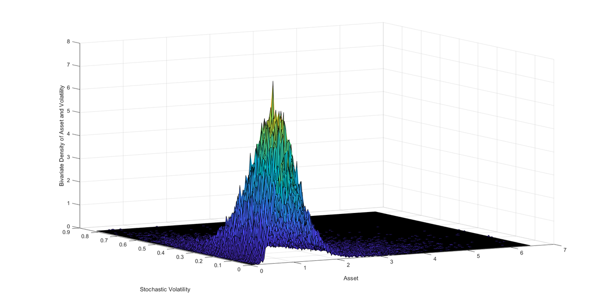](https://postimg.cc/VrsYmSQm)

[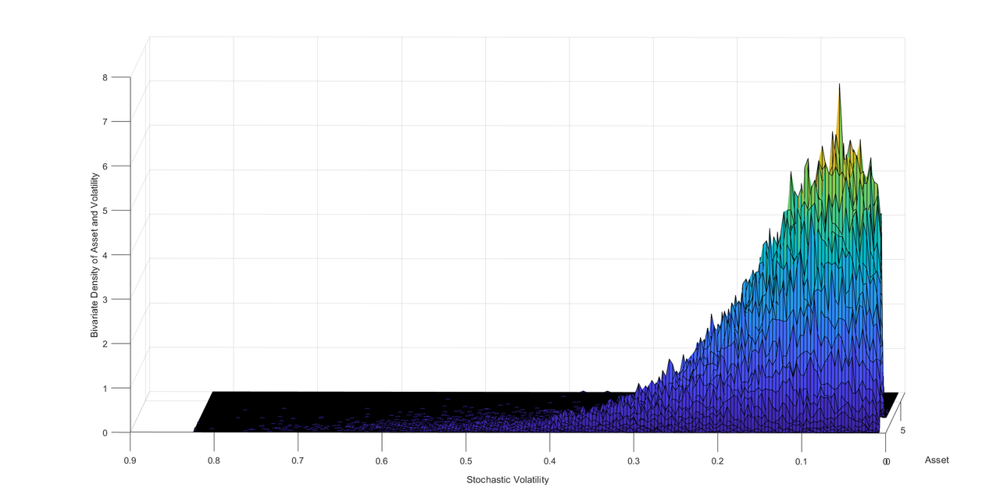](https://postimg.cc/PLjXV3SL)

Several views of 2D Analytic Density From Cross Moments

[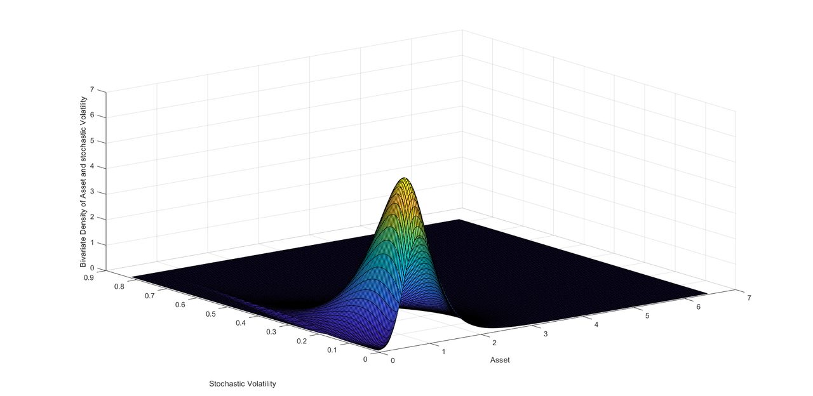](https://postimg.cc/Kk9mzZxL)

[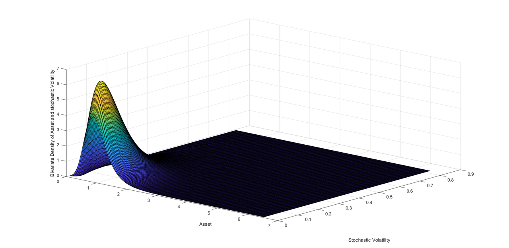](https://postimg.cc/0KbPKLy4)

[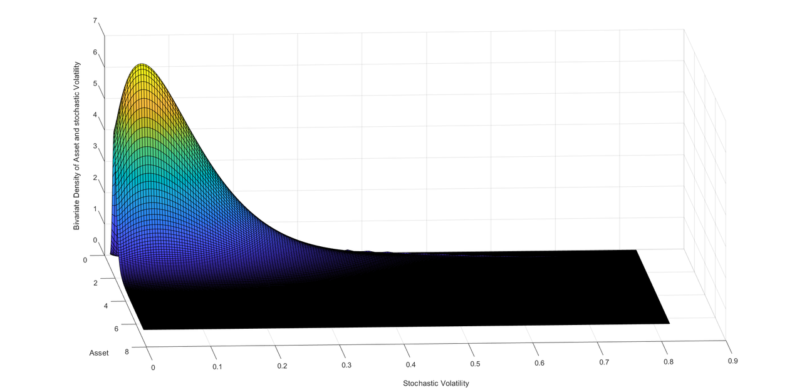](https://postimg.cc/67f9krPM)

[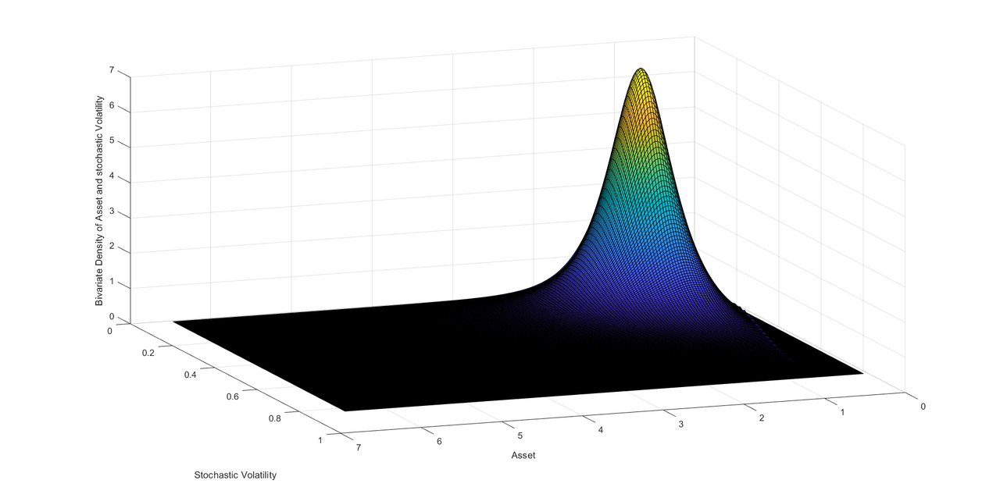](https://postimg.cc/CRDMNTsT)

[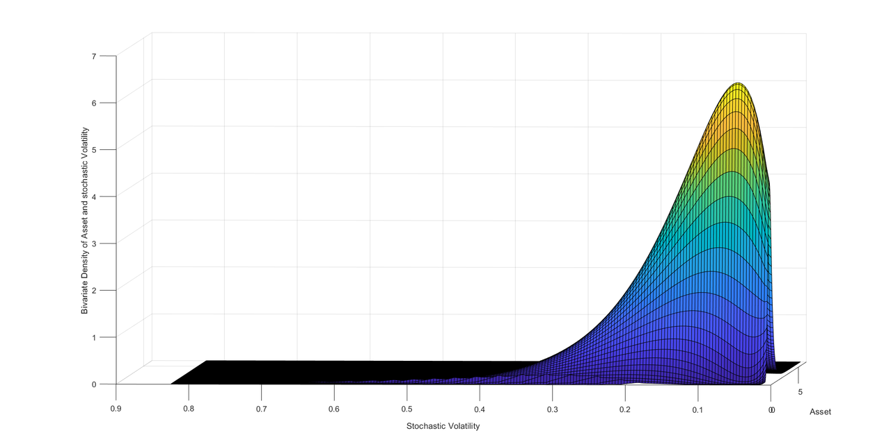](https://postimg.cc/KRCvBvLD)

View of the Difference between Monte carlo density and Analytic density

[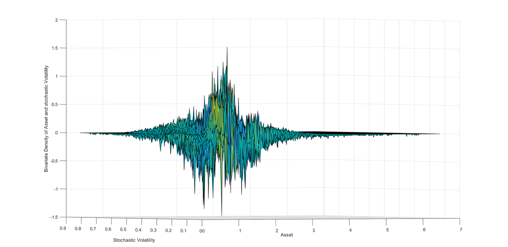](https://postimg.cc/fkLwP0fv)

---

### #2160 — Amin (Topic Author)
*January 27, 2024, 12:59 AM*

Friends, I worked tonight and was able to change the respective random variables to standardized form and then calculate
their cross moments in standardized form and then fit the 2D dependent variable coefficients to standardized cross
moments. Surprisingly it made the program very robust and even if the match from iterative optimization is not good, the
density is mostly very well behaved and perfectly smooth and inversion of X along V grid is very robust. I had to also
discover the formula to convert the 2D Z-series from standard form to original form. And for that we have to multiply
dependent variable X with square root of variance of X (that we used to standardize the random variable X) but we also
have to multiply each line of the the Z-series dependent variable X where Zy^n is multiplying with nth power of square
root of variance of Y . This multiplication is different for each line and depends on power of Zy^n.

It is late and I have not been able to write comments on program but I want to post the program and promise to post an
updated commented version in another day. This program is much better and robust as compared to the one used to make
graphs in previous post since it deals with standardized data.

Here are some graphs and then I attach the matlab programs in next post.

First the option prices

CallStrikes =

  Columns 1 through 3

   0.500000000000000   0.550000000000000   0.600000000000000

  Columns 4 through 6

   0.650000000000000   0.700000000000000   0.750000000000000

  Columns 7 through 9

   0.800000000000000   0.850000000000000   0.900000000000000

  Columns 10 through 12

   0.950000000000000   1.000000000000000   1.050000000000000

  Columns 13 through 15

   1.100000000000000   1.150000000000000   1.200000000000000

  Columns 16 through 18

   1.250000000000000   1.300000000000000   1.350000000000000

  Columns 19 through 21

   1.400000000000000   1.450000000000000   1.500000000000000

  Columns 22 through 24

   1.550000000000000   1.600000000000000   1.650000000000000

  Columns 25 through 26

   1.700000000000000   1.750000000000000

CallPricesAnalytic =

  Columns 1 through 3

   0.510693336832420   0.466571627831996   0.424452260812893

  Columns 4 through 6

   0.384598291335063   0.347214164095135   0.312437287578789

  Columns 7 through 9

   0.280336446778544   0.250915953709258   0.224123892794488

  Columns 10 through 12

   0.199862699916824   0.178000509211786   0.158382069454416

  Columns 13 through 15

   0.140838446838100   0.125195106817091   0.111278260400661

  Columns 16 through 18

   0.098919559126101   0.087959337815263   0.078248654322267

  Columns 19 through 21

   0.069650381425605   0.062039585594705   0.055303393952756

  Columns 22 through 24

   0.049340513373509   0.044060529703905   0.039383083392444

  Columns 25 through 26

   0.035236991393348   0.031559364144163

CallPricesMC =

  Columns 1 through 3

   0.510983409366306   0.466950737183638   0.424975084979987

  Columns 4 through 6

   0.385279687091993   0.348038839311630   0.313408162734114

  Columns 7 through 9

   0.281447338010295   0.252143520291215   0.225394306597035

  Columns 10 through 12

   0.201100843399226   0.179169632355841   0.159456972591135

  Columns 13 through 15

   0.141800504773461   0.126037485601408   0.112009133671857

  Columns 16 through 18

   0.099537670459896   0.088461213166392   0.078659328184239

  Columns 19 through 21

   0.069983983986795   0.062308462274573   0.055516611131628

  Columns 22 through 24

   0.049496664778774   0.044177790670909   0.039465076813895

  Columns 25 through 26

   0.035292182954073   0.031600540097562

[](https://postimg.cc/xcxZxtP0)

[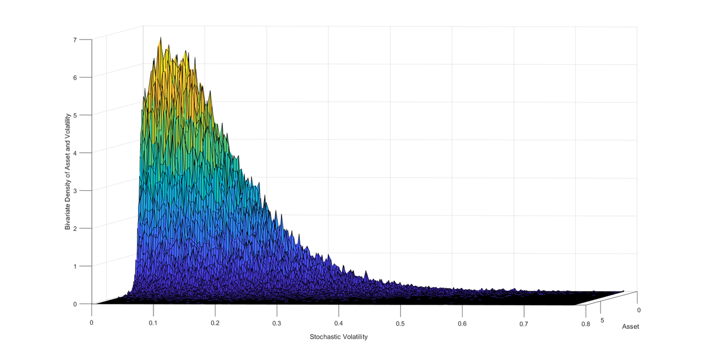](https://postimg.cc/bsNM9KkC)

[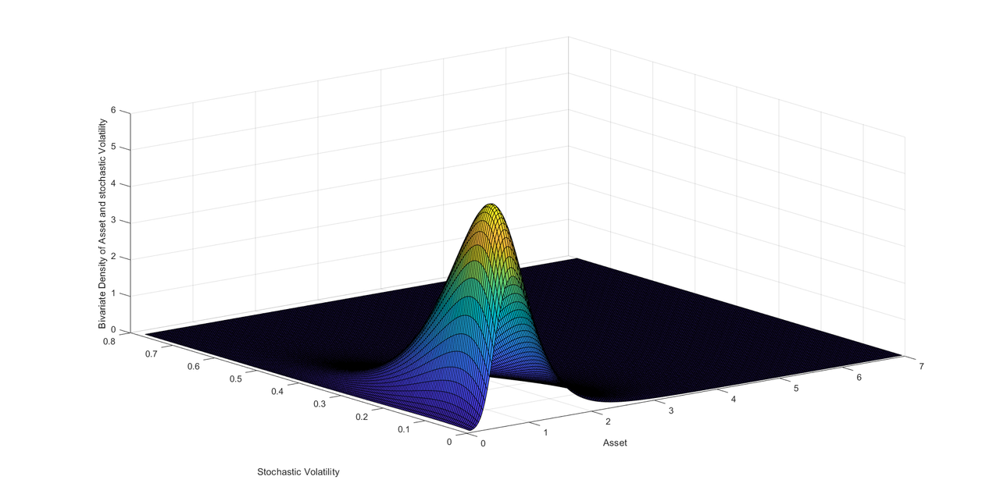](https://postimg.cc/8JmKhH5g)

[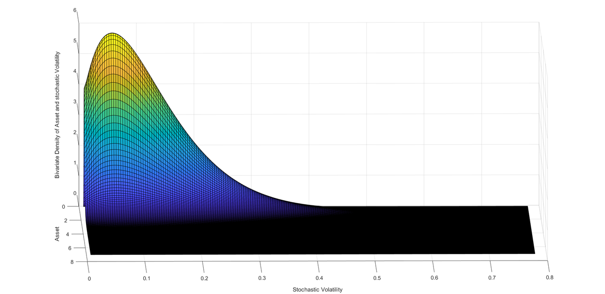](https://postimg.cc/WDrf4jc3)

[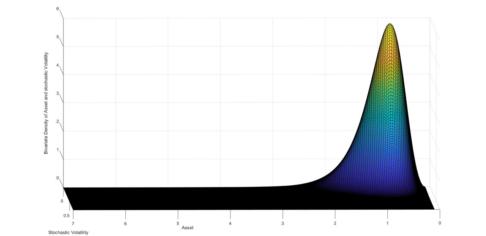](https://postimg.cc/mzspzqTS)

[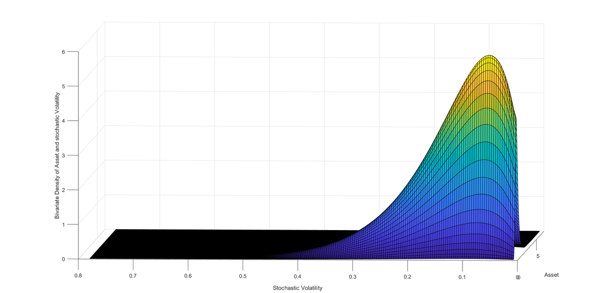](https://postimg.cc/sMMNt7n5)

[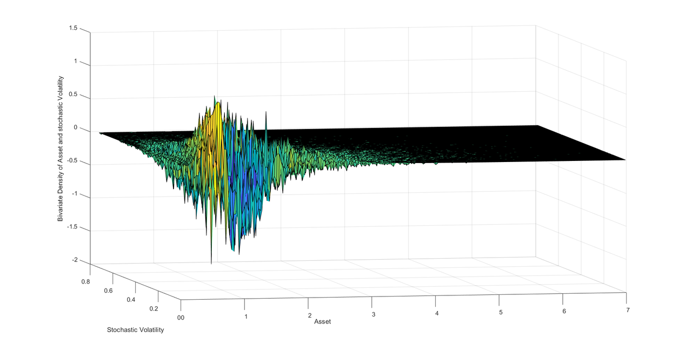](https://postimg.cc/dhgxv3Xp)

---

### #2161 — Amin (Topic Author)
*January 27, 2024, 1:24 AM*

Friends, I am posting my programs as it is at the moment but will post a more refined and commented version in a day.
These are the programs that I used to create graphs and option pricing numbers in the previous post.

I want to make further improvements in the programs. Objective function has to be improved and many other changes needed
but it is a good and robust working base.

Many functions I used are from the past and I am not posting them. Please search for them on this thread.

I will be posting a more detailed and commented version soon.

.

.

```
function [] = SVMonteCarloAndAssetConditionalDensityNewMethod()

X0=1.0;
alpha1=0;
alpha2=1;
kappaX=0;
thetaX=1;
a=kappaX*thetaX;
b=-kappaX;

rho=0;
sigma1=1;
gammaV=.5;
gammaX=.95;
%%%%%%%%`%%%%%
V0=.35;
thetaV=.06;
kappaV=1.5;
mu1=kappaV*thetaV;
mu2=-kappaV;
beta1=0;
beta2=1;
gamma=.5;
sigma0=.4;

dt=.03125/2;
Tt=64*1;

T=Tt*dt;

%%%%%%%%%%%%%%%%%%%%%%%%5
%rng(82139475, 'twister')

seed0=21872418;
%rng(seed0, 'twister')
%rng(seed0, 'combRecursive')
%rng(seed0, 'philox')
%rng(seed0, 'multFibonacci')
%rng(seed0, 'simdTwister')
%rng(seed0, 'threefry')
%combRecursive

%seed0=73092831;
rng(seed0, 'twister')
%rng(seed0, 'twister')

 paths=250000;
V(1:paths)=V0;  %Original process monte carlo.
X(1:paths)=X0;
% paths0=paths/2;
% paths00=paths/4;
% Random1(1:paths00)=0;
% Random2(1:paths0)=0;

for tt=1:Tt

% Random2(1:paths)=randn(paths,1);
% Random1(1:paths)=randn(paths,1);

Random2(1:paths/2)=randn(paths/2,1);
Random2(paths/2+1:paths)=-Random2(1:paths/2);
Random1(1:paths/2)=randn(paths/2,1);
Random1(paths/2+1:paths)=-Random1(1:paths/2);
% sum(Random1)/paths
% sum(Random1.^2)/paths
% sum(Random1.^3)/paths
% sum(Random1.^4)/paths
% sum(Random1.^5)/paths
% sum(Random1.^6)/paths
%
% tt
%
% str=input("Look at moments of MC Normals");

%Random1(paths00+1:2*paths00)=-1*Random1(1:paths00);
%Random2(paths0+1:2*paths0)=-1*Random2(1:paths0);
%Random1(paths0+1:2*paths0)=Random1(1:paths0);
%antithetic variates above

X(1:paths)=X(1:paths)+ ...
    (a* X(1:paths).^alpha1 + b* X(1:paths).^alpha2)* dt + ...
    sqrt(1-rho^2)* sigma1* V(1:paths).^gammaV.* X(1:paths).^gammaX .*Random1(1:paths) * sqrt(dt) + ...
    rho* sigma1* V(1:paths).^gammaV .*X(1:paths).^gammaX .*Random2(1:paths)*sqrt(dt) + ...
    (a*alpha1* X(1:paths).^(alpha1-1)+b*alpha2* X(1:paths).^(alpha2-1)).* ...
    (((a* X(1:paths).^alpha1 + b* X(1:paths).^alpha2)* dt^2/2)+ ...
    (sqrt(1-rho^2)* sigma1* V(1:paths).^gammaV.* X(1:paths).^gammaX .*Random1(1:paths) *(1-1/sqrt(3)).*dt^1.5+ ...
    rho* sigma1* V(1:paths).^gammaV .*X(1:paths).^gammaX .*Random2(1:paths)*(1-1/sqrt(3)).*dt^1.5))+ ...
    .5*(a*alpha1*(alpha1-1)* X(1:paths).^(alpha1-2)+b*alpha2*(alpha2-1).* X(1:paths).^(alpha2-2)).* ...
    ( sigma1^2* V(1:paths).^(2*gammaV).* X(1:paths).^(2*gammaX)) *dt^2/2 + ...
    sqrt(1-rho^2)* sigma1* V(1:paths).^gammaV.*gammaX.* X(1:paths).^(gammaX-1).* ...
    ((a* X(1:paths).^alpha1 + b* X(1:paths).^alpha2).*Random1(1:paths) * 1/sqrt(3).* dt^1.5 + ...
    sqrt(1-rho^2)* sigma1* V(1:paths).^gammaV.* X(1:paths).^gammaX .*(Random1(1:paths).^2-1) * dt/2 + ...
    rho* sigma1* V(1:paths).^gammaV .*X(1:paths).^gammaX .*Random1(1:paths).*Random2(1:paths)*dt/2)+ ...
    .5*sqrt(1-rho^2)* sigma1* V(1:paths).^gammaV.*gammaX.*(gammaX-1).* X(1:paths).^(gammaX-2).* ...
    (sigma1^2* V(1:paths).^(2*gammaV).* X(1:paths).^(2*gammaX) .*Random1(1:paths).*1/sqrt(3).*dt^1.5)+ ...
    sqrt(1-rho^2)* sigma1*gammaV.* V(1:paths).^(gammaV-1).* X(1:paths).^(gammaX).* ...
    ((mu1.*V(1:paths).^beta1 + mu2.*V(1:paths).^beta2).*Random1(1:paths) * 1/sqrt(3).* dt^1.5 + ...
    sigma0*V(1:paths).^gamma.*Random1(1:paths).*Random2(1:paths)*dt/2)+ ...
    .5*sqrt(1-rho^2)* sigma1*gammaV.*(gammaV-1).* V(1:paths).^(gammaV-2).* X(1:paths).^(gammaX).* ...
    (sigma0^2*V(1:paths).^(2*gamma).*Random1(1:paths)*1/sqrt(3)*dt^1.5)+ ...
    sqrt(1-rho^2)* sigma1*gammaV.* V(1:paths).^(gammaV-1).*gammaX.* X(1:paths).^(gammaX-1).* ...
    rho.* sigma1.* V(1:paths).^gammaV .*X(1:paths).^gammaX
.*sigma0.*V(1:paths).^gamma.*Random1(1:paths)*1/sqrt(3)*dt^1.5+ ...
    rho* sigma1* V(1:paths).^gammaV.*gammaX.* X(1:paths).^(gammaX-1).* ...
    ((a* X(1:paths).^alpha1 + b* X(1:paths).^alpha2).*Random2(1:paths) * 1/sqrt(3).* dt^1.5 + ...
    sqrt(1-rho^2)* sigma1* V(1:paths).^gammaV.* X(1:paths).^gammaX .*Random1(1:paths).*Random2(1:paths) * dt/2 + ...
    rho* sigma1* V(1:paths).^gammaV .*X(1:paths).^gammaX .*(Random2(1:paths).^2-1)*dt/2)+ ...
    .5*rho* sigma1* V(1:paths).^gammaV.*gammaX.*(gammaX-1).* X(1:paths).^(gammaX-2).* ...
    (sigma1^2* V(1:paths).^(2*gammaV).* X(1:paths).^(2*gammaX) .*Random2(1:paths).*1/sqrt(3).*dt^1.5)+ ...
    rho* sigma1*gammaV.* V(1:paths).^(gammaV-1).* X(1:paths).^(gammaX).* ...
    ((mu1.*V(1:paths).^beta1 + mu2.*V(1:paths).^beta2).*Random2(1:paths) * 1/sqrt(3).* dt^1.5 + ...
    sigma0*V(1:paths).^gamma.*(Random2(1:paths).^2-1)*dt/2)+ ...
    .5*rho* sigma1*gammaV.*(gammaV-1).* V(1:paths).^(gammaV-2).* X(1:paths).^(gammaX).* ...
    sigma0^2.*V(1:paths).^(2*gamma).*Random2(1:paths) * 1/sqrt(3).* dt^1.5+ ...
    rho* sigma1*gammaV.* V(1:paths).^(gammaV-1).*gammaX.* X(1:paths).^(gammaX-1).* ...
    rho.* sigma1.* V(1:paths).^gammaV .*X(1:paths).^gammaX
.*sigma0.*V(1:paths).^gamma.*Random2(1:paths)*1/sqrt(3)*dt^1.5;

    V(1:paths)=V(1:paths)+ ...
        (mu1.*V(1:paths).^beta1 + mu2.*V(1:paths).^beta2)*dt + ...
        sigma0*V(1:paths).^gamma .*Random2(1:paths)*sqrt(dt) + ...
        (mu1.*beta1*V(1:paths).^(beta1-1) + mu2.*beta2.*V(1:paths).^(beta2-1)).* ...
        ((mu1.*V(1:paths).^beta1 + mu2.*V(1:paths).^beta2)*dt^2/2 + ...
        sigma0*V(1:paths).^gamma .*Random2(1:paths)*(1-1/sqrt(3))*dt^1.5) + ...
        .5*(mu1.*beta1.*(beta1-1).*V(1:paths).^(beta1-2) + mu2.*beta2.*(beta2-1).*V(1:paths).^(beta2-2)).* ...
        sigma0^2.*V(1:paths).^(2*gamma).*dt^2/2 + ...
        sigma0*gamma*V(1:paths).^(gamma-1) .* ...
        ((mu1.*V(1:paths).^beta1 + mu2.*V(1:paths).^beta2).*Random2(1:paths).*1/sqrt(3)*dt^1.5 + ...
        sigma0.*V(1:paths).^gamma .*(Random2(1:paths).^2-1)*dt/2) + ...
        .5*sigma0*gamma*(gamma-1).*V(1:paths).^(gamma-2) .* ...
        sigma0^2.*V(1:paths).^(2*gamma) .*Random2(1:paths).*1/sqrt(3)*dt^1.5;

end
% % X1=X;
% % V1=V;
% %
% % save('MonteCarloData1','X1','V1');
%
%
%str=input("Monte carlo data has been saved");
X(XCallStrikes(nn))
            CallPricesMC(nn)=CallPricesMC(nn)+(X(pp)-CallStrikes(nn))/paths;
        end
    end
end

CallPricesMC

str=input("Look at Call prices");

SVolMeanAnalytic=thetaV+exp(-kappaV*T)*(V0-thetaV)
SVolMean=sum(V(1:paths))/paths
AssetMeanAnalytic=thetaX+exp(-kappaX*T)*(X0-thetaX)
AssetMean=sum(X(1:paths))/paths

save("test050A.mat","X","V","CallPricesMC");
%load("test2.mat","X","V","CallPricesMC");

str=input("Simulation result has been saved");

%save("test2.mat","X","V","CallPricesMC");
%save("test3.mat","X","V","CallPricesMC");

%Calculate2DZseriesConditionalNewMReg(X,V,CallPricesMC);
%Calculate2DZseriesConditionalNewMReg02(X,V,CallPricesMC);

 NoOfBinsV=200;
NoOfBinsX=200;
MaxCutOffX=7.0;
MaxCutOffV=.825;%6.455

[XYProbDensity2D,XYProbMass2D,XProbMass,VProbMass,IndexMaxX,IndexMaxV,Xn,Vm,Zx,Zv,BinSizeX,BinSizeV]=
Find2DDensityAndCDFFromSimulation_Infiniti04(X,V,paths,NoOfBinsX,NoOfBinsV,MaxCutOffX,MaxCutOffV);
%Please look at matlab file of above function for etailed explanation of
%all its input and output parameters.

%surf(Xn,Vm,transpose(XYProbDensity2D));

%xlabel('Asset'), ylabel('Stochastic Volatility'), zlabel('Probability Density 2D')
%title('Graph of 2D Density of Asset and SV from Parzen Density')

surf(Xn(2:NoOfBinsX+1),Vm(3:NoOfBinsV+1),transpose(XYProbDensity2D(2:NoOfBinsX+1,3:NoOfBinsV+1)))
%title(sprintf('Numerical Density : x0 =
%.4f,gammaX=%.3f,sigmaX=%.2f,gammaV=%.3f,v0=%.3f,kappaV=%.3f,thetaV=%.3f,gamma=%.3f,sigma0=%.3f,T=%.2f',
X0,gammaX,sigma1,gammaV,V0,kappaV,thetaV,gamma,sigma0,T));%,sprintf('theta= %f', theta), sprintf('kappa = %f',
kappa),sprintf('sigma = %f', sigma0),sprintf('T = %f', T));
xlabel('Asset'), ylabel('Stochastic Volatility'),zlabel('Bivariate Density of Asset and Volatility')

str=input("Look at numerical bivariate density of Asset and Stochastic Volatility")

[Coeff,a0,a] = CalculateConditionalProbabilitiesYtoXIterativeNew6M(V,X);

[pXY2D] = Calculate2VariablesOn2DGridFromAnalyticZSeries(Xn,Vm,NoOfBinsX,NoOfBinsV,Coeff,a0,a);

surf(Xn(2:NoOfBinsX+1),Vm(3:NoOfBinsV+1),transpose(pXY2D(2:NoOfBinsX+1,3:NoOfBinsV+1)))
%title(sprintf('Analytic Density : x0 =
%.4f,gammaX=%.3f,sigmaX=%.2f,gammaV=%.3f,v0=%.3f,kappaV=%.3f,thetaV=%.3f,gamma=%.3f,sigma0=%.3f,T=%.2f',
X0,gammaX,sigma1,gammaV,V0,kappaV,thetaV,gamma,sigma0,T));%,sprintf('theta= %f', theta), sprintf('kappa = %f',
kappa),sprintf('sigma = %f', sigma0),sprintf('T = %f', T));
xlabel('Asset'), ylabel('Stochastic Volatility'),zlabel('Bivariate Density of Asset and stochastic Volatility')

str=input("Look at Analytic density of Asset and Stochastic volatility")
%str=input("Look at Analytic density of Asset and Stochastic volatility")
surf(Xn(2:NoOfBinsX+1),Vm(3:NoOfBinsV+1),transpose(pXY2D(2:NoOfBinsX+1,3:NoOfBinsV+1)-XYProbDensity2D(2:NoOfBinsX+1,3:NoOfBinsV+1)))
%title(sprintf('Difference of Analytic and Numerical Density  : x0 =
%.4f,gammaX=%.3f,sigmaX=%.2f,gammaV=%.3f,v0=%.3f,kappaV=%.3f,thetaV=%.3f,gamma=%.3f,sigma0=%.3f,T=%.2f',
X0,gammaX,sigma1,gammaV,V0,kappaV,thetaV,gamma,sigma0,T));%,sprintf('theta= %f', theta), sprintf('kappa = %f',
kappa),sprintf('sigma = %f', sigma0),sprintf('T = %f', T));
xlabel('Asset'), ylabel('Stochastic Volatility'),zlabel('Bivariate Density of Asset and stochastic Volatility')

str=input("Look at difference of numerical and analytic densities of Asset and stochastic volatility")

CallStrikes=[.5,.55,.6,.65,.7,.75,.8,.85,.9,.95,1,1.05,1.1,1.15,1.2,1.25,1.3,1.35,1.4,1.45,1.5,1.55,1.6,1.65,1.7,1.75]

VolZEquiDistGridSize=400;
[CallPricesAnalytic]=PriceCallArrayOver2DDensity(a0,a,Coeff,CallStrikes,VolZEquiDistGridSize);
CallPricesAnalytic
CallPricesMC

str=input("Look at comparison of analytic and monte carlo call prices");

end
```

.

.

.

.

```
function [Coeff,a0,a] = CalculateConditionalProbabilitiesYtoXIterativeNew6M(V,X)

Y=V;

Ndata=length(Y);

 MeanY=sum(Y(1:Ndata))/Ndata;
 MeanX=sum(X(1:Ndata))/Ndata;

 Ym(1:Ndata)=Y(1:Ndata)-MeanY;
 Xm(1:Ndata)=X(1:Ndata)-MeanX;

 YmVar=sum(Ym(1:Ndata).^2)/Ndata;
 XmVar=sum(Xm(1:Ndata).^2)/Ndata;

 Y0(1:Ndata)=Ym(1:Ndata)/sqrt(YmVar);
 X0(1:Ndata)=Xm(1:Ndata)/sqrt(XmVar);

Y=Y0;
X=X0;

sum(Y.^2)/Ndata
sum(X.^2)/Ndata

str=input("Look at variances of standardized variables");

Mtable=readtable('C:\Users\Lenovo\Documents\MATLAB\MATLAB1\MomentMatchParams08.txt');

[ZI] = MatchMomentParametersOfIdealZhalf04(Ndata,Mtable);

Ys=sort(Y);
Ymu(1:Ndata,1)=Ys(1:Ndata);

    W(1:Ndata,1)=1;
    W(1:Ndata,2)=ZI(1:Ndata);
    W(1:Ndata,3)=ZI(1:Ndata).^2;
    W(1:Ndata,4)=ZI(1:Ndata).^3;
    W(1:Ndata,5)=ZI(1:Ndata).^4;
    W(1:Ndata,6)=ZI(1:Ndata).^5;
   % W(1:Ndata,7)=ZI(1:Ndata).^6;
   % W(1:Ndata,8)=ZI(1:Ndata).^7;

    coeff=inv(W'*W)*(W'*Ymu);

    a0=coeff(1,1);
    a(1:5)=coeff(2:6,1);

    aa(1:6)=coeff(1:6);

 PlotZSeriesDensity(a0,a,'r')
 str=input("Look at the density of volatility");

Xs=sort(X);
Xmu(1:Ndata,1)=Xs(1:Ndata);

    W(1:Ndata,1)=1;
    W(1:Ndata,2)=ZI(1:Ndata);
    W(1:Ndata,3)=ZI(1:Ndata).^2;
    W(1:Ndata,4)=ZI(1:Ndata).^3;
    W(1:Ndata,5)=ZI(1:Ndata).^4;
    W(1:Ndata,6)=ZI(1:Ndata).^5;

    coeff=inv(W'*W)*(W'*Xmu);

    c0=coeff(1,1);
    c(1:5)=coeff(2:6,1);

    cc(1:6)=coeff(1:6,1);

 PlotZSeriesDensity(c0,c,'r')

 str=input("Look at the density of  X");

 SeriesOrder10=6;
 SeriesOrder01=6;
 NMomentsX=6;
 NMomentsY=6;
%  %%%%%%%%%%%%%%%%%%%%%%%%%%%%%%%%%%%%%%%%%%%%%%%%%%%%%%%%%%%%%%%%%
%
%  MeanY=sum(Y(1:Ndata))/Ndata;
%  MeanX=sum(X(1:Ndata))/Ndata;
%
%  Ym(1:Ndata)=Y(1:Ndata)-MeanY;
%  Xm(1:Ndata)=X(1:Ndata)-MeanX;
%
%  YmVar=sum(Ym(1:Ndata).^2)/Ndata;
%  XmVar=sum(Xm(1:Ndata).^2)/Ndata;
%
%  Y0(1:Ndata)=Ym(1:Ndata)/sqrt(YmVar);
%  X0(1:Ndata)=Xm(1:Ndata)/sqrt(XmVar);
% %%%%%%%%%%%%%%%%%%%%%%%%%%%%%%%%%%%%%%%%%%%%%5
%  for nn=1:NMomentsY
%        for mm=1:NMomentsX
%            CrossMomentsm(nn,mm)=0;
%            for pp=1:Ndata
%               CrossMomentsm(nn,mm)=CrossMomentsm(nn,mm)+Ym(pp).^nn.*Xm(pp).^mm/Ndata;
%            end
%        end
%  end
%
%  for nn=1:NMomentsY
%        for mm=1:NMomentsX
%            CrossMoments0(nn,mm)=0;
%            for pp=1:Ndata
%               CrossMoments0(nn,mm)=CrossMoments0(nn,mm)+Y0(pp).^nn.*X0(pp).^mm/Ndata;
%            end
%        end
%  end

%  for nn=1:NMomentsY
%        for mm=1:NMomentsX
%
%            CrossMomentsm(nn,mm)/YmVar.^(nn/2)/XmVar.^(mm/2)
%            CrossMoments0(nn,mm)
%            nn
%            mm
%
%            str=input("Look at comparison of cross moments");
%        end
%  end
%
%  %%%%%%%%%%%%%%%%%%%%%%%%%%%%%%%%%%%%%%%%%%%%%%%%%%%%%%%%%%%%%%%5
    for nn=1:NMomentsY
       for mm=1:NMomentsX
           CrossMoments(nn,mm)=0;
           for pp=1:Ndata
              CrossMoments(nn,mm)=CrossMoments(nn,mm)+Y(pp).^nn.*X(pp).^mm/Ndata;
           end
       end
    end
     w2D(1:NMomentsY,1:NMomentsX)=1;
    for nn=NMomentsY-1:-1:1
        for mm=NMomentsX-1:-1:1
            w2D(nn,mm)=w2D(nn+1,mm+1)*(nn+1)*(mm+1);
        end
    end

    w2D(:,2)=w2D(:,2)*100;

MuX=cc(1)+cc(3)+3*cc(5);
MuX=0;

SeriesOrder1=6;
NMomentsY=6;
[dd] = ProduceFirstRowofConditioal2DZSeries02_6M(aa,SeriesOrder1,NMomentsY,MuX,CrossMoments,X,Y,Ndata);

dd

str=input("Look at dd2----it is 2 ");

bnm(1:6,1:6)=0;

MuX=dd(1);
bnm(2,1)=dd(2)-bnm(2,3)-3*bnm(2,5);
bnm(3,1)=dd(3)-bnm(3,3)-3*bnm(3,5);
bnm(4,1)=dd(4)-bnm(4,3)-3*bnm(4,5);
bnm(5,1)=dd(5)-bnm(5,3)-3*bnm(5,5);
bnm(6,1)=dd(6)-bnm(6,3)-3*bnm(6,5);

bnm(1,2)=cc(2)-bnm(3,2)-3*bnm(5,2);
bnm(1,3)=cc(3)-bnm(3,3)-3*bnm(5,3);
bnm(1,4)=cc(4)-bnm(3,4)-3*bnm(5,4);
bnm(1,5)=cc(5)-bnm(3,5)-3*bnm(5,5);
bnm(1,6)=cc(6)-bnm(3,6)-3*bnm(5,6);

bnm(1,1)=MuX-bnm(3,1)-3*bnm(5,1)-1*bnm(1,3)-1*3*bnm(1,5)-3*bnm(5,3)-bnm(3,3)-3*bnm(3,5)-9*bnm(5,5);

bnm

str=input("Look at bnm for comparison");

 NMomentsX=6;
 NMomentsY=6;

    [Moments2D] =
CalculateCrossMomentsConditional2DNew02(aa,bnm,SeriesOrder1,SeriesOrder10,SeriesOrder01,NMomentsX,NMomentsY);
     % [ObjBest] = CalculateObjMoment2D1D(Ms1,CrossMoments,Moments1D,Moments2D,w1D,w2D,NMomentsX,NMomentsY);
    [ObjFuncBest] = CalculateObjMoment2D1D(CrossMoments,Moments2D,w2D,NMomentsX,NMomentsY);

%%%%%%%%%%%%%%%%%%%%%%%%%%%%%%%%%%%%%%%%%%%%%%%%%%%%%%%%%%%%%%%%%%%%%%%%%%

%SeriesOrderIterate=(NMomentsY-1)*(NMomentsX);
SeriesOrderIter10=6;%NMomentsY+1;
SeriesOrderIter01=6;%NMomentsX;
alphaSuccessCount(1:SeriesOrderIter10,1:SeriesOrderIter01)=0;
SuccessPrevalpha(1:SeriesOrderIter10,1:SeriesOrderIter01)=0;

   delta_bnmCoeff0=.0005;
   for nn=1:SeriesOrderIter10
        for mm=1:SeriesOrderIter01
            %delta_bnmCoeff(nn,mm)=delta_bnmCoeff0./mm/nn;
            %delta_bnmCoeff(nn,mm)=bnm(nn,mm)./mm/nn/1000;
            delta_bnmCoeff(nn,mm)=bnm(nn,1)./mm*10;
        end
    end

bnmCoeff=bnm;

mul1=.9;
mul2=1.1;
Iterations=4000;%2000;%10000;%150;
for iter=1:Iterations
iter
bnmCoeff
ObjFuncBest
    for kk=1:SeriesOrderIter10
        for jj=1:SeriesOrderIter01
            %ll=SeriesOrderIter01*(kk-1)+jj;
        bnmCoeffNew(1:SeriesOrderIter10,1:SeriesOrderIter01)=bnmCoeff(1:SeriesOrderIter10,1:SeriesOrderIter01);
        bnmCoeffNew(kk,jj)=bnmCoeff(kk,jj)+delta_bnmCoeff(kk,jj);

bnmCoeffNew(2,1)=dd(2)-bnmCoeffNew(2,3)-3*bnmCoeffNew(2,5);
bnmCoeffNew(3,1)=dd(3)-bnmCoeffNew(3,3)-3*bnmCoeffNew(3,5);
bnmCoeffNew(4,1)=dd(4)-bnmCoeffNew(4,3)-3*bnmCoeffNew(4,5);
bnmCoeffNew(5,1)=dd(5)-bnmCoeffNew(5,3)-3*bnmCoeffNew(5,5);
bnmCoeffNew(6,1)=dd(6)-bnmCoeffNew(6,3)-3*bnmCoeffNew(6,5);

bnmCoeffNew(1,2)=cc(2)-bnmCoeffNew(3,2)-3*bnmCoeffNew(5,2);
bnmCoeffNew(1,3)=cc(3)-bnmCoeffNew(3,3)-3*bnmCoeffNew(5,3);
bnmCoeffNew(1,4)=cc(4)-bnmCoeffNew(3,4)-3*bnmCoeffNew(5,4);
bnmCoeffNew(1,5)=cc(5)-bnmCoeffNew(3,5)-3*bnmCoeffNew(5,5);
bnmCoeffNew(1,6)=cc(6)-bnmCoeffNew(3,6)-3*bnmCoeffNew(5,6);

bnmCoeffNew(1,1)=MuX-bnmCoeffNew(3,1)-3*bnmCoeffNew(5,1)-1*bnmCoeffNew(1,3)-1*3*bnmCoeffNew(1,5)-3*bnmCoeffNew(5,3)-bnmCoeffNew(3,3)-3*bnmCoeffNew(3,5)-9*bnmCoeffNew(5,5);

        for nn=1:SeriesOrderIter10
            for mm=1:SeriesOrderIter01
                bnm(nn,mm)=bnmCoeffNew(nn,mm);
            end
        end
        [Moments2D,Moments1D] =
CalculateCrossMomentsConditional2DNew02(aa,bnm,SeriesOrder1,SeriesOrder10,SeriesOrder01,NMomentsX,NMomentsY);
        [ObjFuncNew] = CalculateObjMoment2D1D(CrossMoments,Moments2D,w2D,NMomentsX,NMomentsY);
        %[ObjMomentOut] = CalculateObjMoment2D1D(Moment2D0,Moment2D,w2D,MOrder1,MOrder2)

        if(ObjFuncNew3)
            delta_bnmCoeff(kk,jj)=delta_bnmCoeff(kk,jj).*mul2;
        end
        end
    end

      if(rem(iter,500)==0)
         bnm
         Moments2D
         CrossMoments

         ObjFuncBest

         str=input("Look at fit of moments");
%
      end

end

%load("bnmA.mat","bnm");
%load('bnmB.mat','bnm');
save('bnmOldGood.mat','bnm');

XmVar
YmVar
sqrt(XmVar)
sqrt(YmVar)

str=input("Look at sd's")
bnm=bnm*sqrt(XmVar);%/sqrt(YmVar);

for nn=2:6
bnm(nn,:)=bnm(nn,:).*(sqrt(YmVar)).^(nn-1);
end

%bnm=bnm/sqrt(XmVar)/sqrt(YmVar);
bnm(1,1)=MeanX-bnm(3,1)-3*bnm(5,1)-1*bnm(1,3)-1*3*bnm(1,5)-3*bnm(5,3)-bnm(3,3)-3*bnm(3,5)-9*bnm(5,5);
%bnm(1,1)=MeanX+bnm(1,1);

a0=a0*sqrt(YmVar);
a=a*sqrt(YmVar);
a0=MeanY-a(2)-3*a(4);
%a0=a0+MeanY;

Coeff(1:6,1:6)=0;
 for nn=1:6
      for mm=1:6
          Coeff(mm,nn)=bnm(nn,mm);
      end
  end

end
```

.

.

.

.

```
function [dd2] = ProduceFirstRowofConditioal2DZSeries02_6M(aa,SeriesOrder1,NMomentsY,MuX,CrossMoments,X,V,Ndata)

 SeriesOrderY=SeriesOrder1;
 Yp(1:SeriesOrderY,1)=aa(1:SeriesOrderY);

 SeriesOrder2=SeriesOrderY;
 aa(1:SeriesOrderY)=Yp(1:SeriesOrderY,1);
 bb(1:SeriesOrderY)=Yp(1:SeriesOrderY,1);
 YpH(:,1) = ConvertZSeriesToHermiteSeriesNew(aa,SeriesOrder2-1)
 for nn=1:5
     [cc,EX] =SeriesProduct1D(aa,bb,SeriesOrderY,SeriesOrder2)
     Yp(1:(SeriesOrderY+SeriesOrder2-1),nn+1)=cc(1:(SeriesOrderY+SeriesOrder2-1));
     bb(1:(SeriesOrderY+SeriesOrder2-1))=cc(1:(SeriesOrderY+SeriesOrder2-1));
     SeriesOrder2=SeriesOrderY+SeriesOrder2-1;

     YpH0 = ConvertZSeriesToHermiteSeriesNew(cc,SeriesOrder2-1);
     YpH(1:SeriesOrder2,nn+1)=YpH0(1:SeriesOrder2);
 end

 YpH

 str=input("Look at hermites matrix");

CrossMoment(1:6,1:13)=0;
for nn=1:6
    for mm=1:6
        for pp=1:Ndata
            CrossMoment(mm,nn)=CrossMoment(mm,nn)+V(pp).^nn .*X(pp).^mm/Ndata;
        end
    end
end

for nn=1:SeriesOrder2
    for mm=1:6  %power of volatility
        Cjj(nn,mm)=factorial(nn-1).*YpH(nn,mm);
    end
end

for nn=1:6

Bjj(1:6,nn)=Cjj(nn,1:6);
end
Mj(1:6,1)=CrossMoment(1,1:6);%-Cjj(1,1:3).*MuX;

Bjj
Mj
str=input("Look at  Bjj and Mj");

BhCoeff0=inv(Bjj)*Mj

BhCoeff0
size(BhCoeff0)
dd2(1:6)=BhCoeff0(1:6,1);
%dd2(1)=(MuX+dd2(1))/2;
%MuX
str=input("Look at BhCoeff0---Again---Again");

YpH(1,1).*BhCoeff0(1,1)+YpH(2,1).*BhCoeff0(2,1)+2*YpH(3,1).*BhCoeff0(3,1)+6*YpH(4,1).*BhCoeff0(4,1)+24*YpH(5,1).*BhCoeff0(5,1)+120*YpH(6,1).*BhCoeff0(6,1)
CrossMoment(1,1)

YpH(1,2).*BhCoeff0(1,1)+YpH(2,2).*BhCoeff0(2,1)+2*YpH(3,2).*BhCoeff0(3,1)+6*YpH(4,2).*BhCoeff0(4,1)+24*YpH(5,2).*BhCoeff0(5,1)+120*YpH(6,2).*BhCoeff0(6,1)
CrossMoment(1,2)

str=input("look at comparison of retrieved moments");

end
```

.

.

.

.

```
function [ZnNew] = MatchMomentParametersOfIdealZhalf04(Ndata,Mtable)
[Zn] = StandardNormalIdealDesity02(Ndata,1);

[alpha0,beta0,gamma0] = ReadParamsFile(Ndata,Mtable)

ZnNew(1:Ndata)=Zn(1:Ndata).*(alpha0+beta0*(Zn(1:Ndata).^2-1)+gamma0*(Zn(1:Ndata).^4-6*Zn(1:Ndata).^2+3));

Moment2=sum(ZnNew(1:Ndata).^2)*1/Ndata;
Moment4=sum(ZnNew(1:Ndata).^4)*1/Ndata;
Moment6=sum(ZnNew(1:Ndata).^6)*1/Ndata;

Moment2
Moment4
Moment6
display("fitted Moments");
%str=input("Look at moment values")

end

```

.

.

.

```
function [Moments2D,Moments1D] =
CalculateCrossMomentsConditional2DNew02(aa,bnm,SeriesOrder1,SeriesOrder10,SeriesOrder01,NMomentsX,NMomentsY)

Y(1:SeriesOrder1*NMomentsY-NMomentsY+1,1:NMomentsY)=0;
Y(1:SeriesOrder1,1)=aa(1:SeriesOrder1);
bb=aa;
SeriesOrder2=SeriesOrder1;
for nn=1:NMomentsY-1

[cc,EY0] =SeriesProduct1D(aa,bb,SeriesOrder1,SeriesOrder2);

SeriesOrder2=SeriesOrder2+SeriesOrder1-1;
Y(1:SeriesOrder2,nn+1)=cc(1:SeriesOrder2);
bb=cc;

EY(nn+1)=EY0;

end

X(1:SeriesOrder10*NMomentsX-NMomentsX+1,1:SeriesOrder01*NMomentsX-NMomentsX+1,1:NMomentsX)=0;
X(1:SeriesOrder10,1:SeriesOrder01,1)=bnm(1:SeriesOrder10,1:SeriesOrder01);
anm=bnm;
SeriesOrder20=SeriesOrder10;
SeriesOrder02=SeriesOrder01;

EZ=EZZ2();
Moments1D(1)=0;
for nn=1:SeriesOrder10
    for mm=1:SeriesOrder01
        Moments1D(1)=Moments1D(1)+bnm(nn,mm).*EZ(nn).*EZ(mm);
    end
end

%bnm

%str=input("bnm in Cross Moments..");
for nn=1:NMomentsX-1

[cnm,EX0] =SeriesProduct2DAlgorithmicNew(bnm,anm,SeriesOrder10,SeriesOrder01,SeriesOrder20,SeriesOrder02);

SeriesOrder20=SeriesOrder20+SeriesOrder10-1;
SeriesOrder02=SeriesOrder02+SeriesOrder01-1;

%size(cnm)
%SeriesOrder20
%SeriesOrder02
%nn+1
%str=input("Look at sizes of result of moments");

X(1:SeriesOrder20,1:SeriesOrder02,nn+1)=cnm(1:SeriesOrder20,1:SeriesOrder02);
anm=cnm;
Moments1D(nn+1)=EX0;
end

%X
%EX
%size(X)

%str=input("Look at comparison of numbers/Moments--000---11--2--");

XY(1:SeriesOrder2+SeriesOrder20-1,1:SeriesOrder02,NMomentsY,NMomentsX)=0;

for mm=1:NMomentsX
    for nn=1:NMomentsY
        anm=0;
        bb=0;
        anm(1:SeriesOrder10*mm-mm+1,1:SeriesOrder01*mm-mm+1)=X(1:SeriesOrder10*mm-mm+1,1:SeriesOrder01*mm-mm+1,mm);
        bb(1:SeriesOrder1*nn-nn+1)=Y(1:SeriesOrder1*nn-nn+1,nn);
        SeriesOrderA10=SeriesOrder10*mm-mm+1;
        SeriesOrderA01=SeriesOrder01*mm-mm+1;
        SeriesOrderB20=SeriesOrder1*nn-nn+1;
        [dnm,EXY0] =SeriesProduct2D1DXmnYm(anm,bb,SeriesOrderA10,SeriesOrderA01,SeriesOrderB20);
        %[dnm,EXY0] =SeriesProduct2D1DXmnYm(anm,bb,SeriesOrderA10,SeriesOrderA01,SeriesOrderB20)

        Moments2D(nn,mm)=EXY0;
%         if((mm==2)&&(nn==2))
%             anm
%             bb
%             dnm
%             EXY0
%             nn
%             mm
%             str=input("Ihave reached nn==2 and mm==2--cross moments conditional");
%         end
    end
end

end

```

.

.

.

.

```
function [ObjMomentOut] = CalculateObjMoment2D1D(Moment2D0,Moment2D,w2D,MOrder1,MOrder2)

MomentB=1;%Moment2D0(1,1)./Moment1D0(1);

ObjMomentOut=0;
for mm=1:MOrder1
    for nn=1:MOrder2
        ObjMomentOut=ObjMomentOut+(Moment2D(nn,mm)-Moment2D0(nn,mm)).^2.*w2D(nn,mm);
        %ObjMomentOut=ObjMomentOut+((Moment2D(nn,mm)-Moment2D0(nn,mm))).^2./Moment2D0(2,2).^((nn+mm)/2).*w2D(nn,mm);

    end
end

% for mm=1:MOrder1
%     ObjMomentOut=ObjMomentOut+(Moment1D(mm)-Moment1D0(mm)).^2.*w1D(mm);
% end
end

```

.

.

.

.

```
function [pXY2D] = Calculate2VariablesOn2DGridFromAnalyticZSeries(XX,YY,NoOfBinsX,NoOfBinsY,Coeff,a0,a)

%YY are Y-coordinates of 2D Grid. In our case this is stochastic
%volatility and is univariate and independent of asset so it can be
%inverted as a univariate Z-series. its Z-series is given by a0 and a.

%if(length(a)==3)
%    a(4)=0;
%    a(5)=0;
%end

[Zy] = CalculateZgivenXAndZSeriesC5Improved(YY,a0,a);
%[Zy] = CalculateZgivenXAndZSeriesC3(YY,a0,a);

Zy

str=input("Look at Zy");

for indexW=1:NoOfBinsY+1
   
b0=Coeff(1,1)+Coeff(1,2).*Zy(indexW)+Coeff(1,3).*Zy(indexW).^2+Coeff(1,4).*Zy(indexW).^3+Coeff(1,5).*Zy(indexW).^4+Coeff(1,6).*Zy(indexW).^5;

    for mm=2:6
       
b(mm-1)=Coeff(mm,1)+Coeff(mm,2).*Zy(indexW)+Coeff(mm,3).*Zy(indexW).^2+Coeff(mm,4).*Zy(indexW).^3+Coeff(mm,5).*Zy(indexW).^4+Coeff(mm,6).*Zy(indexW).^5;
    end

    %  [Zc]=CalculateZgivenXAndZSeriesBisection2C5Improved(0,b0,b);
    %[Zd]=CalculateZgivenXAndZSeriesBisection2C5(0,d0,d);

  %  b0
  %  b
  %  Zc
    %Zy
  %  indexW
  %  str=input("Look at Z-series Coeffs inside");

%
%
% %     [aH0,aH] = ConvertZCoeffsToHCoeffs(b0,b,5);
% %
% %
% %     MeanXv(indexW)= (aH0)*(1-normcdf(Zc))+exp(-.5*Zc^2)/sqrt(2*pi)*(aH(1) + aH(2) *Zc + aH(3)* (Zc^2-1) + aH(4)
*(Zc^3 - 3 *Zc) + aH(5) *(Zc^4 -6 * Zc^2 +3));
% %
% %     %aH0
% %
% %     %b0=b0/MeanXv(indexW);
% %     %b=b/MeanXv(indexW);
%
%     [Zx0] = CalculateZgivenXAndZSeriesC5Improved(XX,b0,b);
%
%   %  Zx0
%   %  XX
%   %  indexW
%   %  str=input("Look at Zxx(indexW)")
%
%
%     Zx(1:NoOfBinsX+1,indexW)=Zx0(1:NoOfBinsX+1);
% end

% for indexW=1:NoOfBinsY+1
%
%   
 %Xy=normpdf(Zy(indexW)).*(cy0+cy(1).*Zy(indexW)+cy(2).*Zy(indexW).^2+cy(3).*Zy(indexW).^3+cy(4).*Zy(indexW).^4+cy(5).*Zy(indexW).^5+cy(6).*Zy(indexW).^6+cy(7).*Zy(indexW).^7);
%
%     %XXy=XX;%-Xy;
%
%
%
%   
 b0=Coeff(1,1)+Coeff(1,2).*Zy(indexW)+Coeff(1,3).*Zy(indexW).^2+Coeff(1,4).*Zy(indexW).^3+Coeff(1,5).*Zy(indexW).^4+Coeff(1,6).*Zy(indexW).^5;%+Coeff(1,7).*Zy(indexW).^6+Coeff(1,8).*Zy(indexW).^7;
%
%     for mm=2:6
%       
 b(mm-1)=Coeff(mm,1)+Coeff(mm,2).*Zy(indexW)+Coeff(mm,3).*Zy(indexW).^2+Coeff(mm,4).*Zy(indexW).^3+Coeff(mm,5).*Zy(indexW).^4+Coeff(mm,6).*Zy(indexW).^5;%+Coeff(mm,7).*Zy(indexW).^6+Coeff(mm,8).*Zy(indexW).^7;
%     end
%     %b(4:5)=0;
%     %  [Zc]=CalculateZgivenXAndZSeriesBisection2C5Improved(0,b0,b);
%     %[Zd]=CalculateZgivenXAndZSeriesBisection2C5(0,d0,d);
%
%     b0
%     b
%   %  Zc
%     %Zy
%     indexW
%     str=input("Look at Z-series Coeffs inside");
%

%     [aH0,aH] = ConvertZCoeffsToHCoeffs(b0,b,5);
%
%
%     MeanXv(indexW)= (aH0)*(1-normcdf(Zc))+exp(-.5*Zc^2)/sqrt(2*pi)*(aH(1) + aH(2) *Zc + aH(3)* (Zc^2-1) + aH(4) *(Zc^3
- 3 *Zc) + aH(5) *(Zc^4 -6 * Zc^2 +3));
%
%     %aH0
%
%     %b0=b0/MeanXv(indexW);
%     %b=b/MeanXv(indexW);

    [Zx0] = CalculateZgivenXAndZSeriesC5Improved(XX,b0,b);

    Zx0
    XX
    indexW
    str=input("Look at Zxx(indexW)")

    Zx(1:NoOfBinsX+1,indexW)=Zx0(1:NoOfBinsX+1);
end

% Zx
% MeanXv
% display("Look at non-corrected Mean of positive density")
% str=input("Look at mean");

%Below we make calculations of density in original coordinates by doing
%change of probability derivative with respect to gaussian density.
DinvfXX(1:NoOfBinsX+1,1:NoOfBinsY+1)=0;
for mm=1:NoOfBinsY
    %DinvfXX(1,mm)= (Zx(1 + 1,mm) - Zx(1,mm))/(XX(1 + 1) - XX(1));
    for nn=2:NoOfBinsX

        DinvfXX(nn,mm) = (Zx(nn + 1,mm) - Zx(nn - 1,mm))/(XX(nn + 1) - XX(nn - 1));

    end
    %DinvfXX(nn,mm) = (Zx(nn + 1,mm) - Zx(nn - 1,mm))/(XX(nn + 1) - XX(nn - 1));
    DinvfXX(NoOfBinsX+1,mm)=DinvfXX(NoOfBinsX,mm);
    DinvfXX(1,mm)=DinvfXX(2,mm);
end

DinvfYY(1:NoOfBinsY+1)=0;
%DinvfYY(1) = (Zy(1+1) - Zy(1))/(YY(1 + 1) - YY(1));
for mm=2:NoOfBinsY

        DinvfYY(mm) = (Zy(mm+1) - Zy(mm-1))/(YY(mm + 1) - YY(mm - 1));

end
DinvfYY(NoOfBinsY+1)=DinvfYY(NoOfBinsY);
DinvfYY(1)=DinvfYY(2);

pXY2D(1:NoOfBinsX+1,1:NoOfBinsY+1)=0;
for mm=1:NoOfBinsY
    for nn=1:NoOfBinsX

    pXY2D(nn,mm) = (normpdf(Zx(nn,mm),0, 1))*abs(DinvfXX(nn,mm)).*(normpdf(Zy(mm),0, 1))*abs(DinvfYY(mm));

    end
end

end

```

.

.

.

.

```
function [XYProbDensity2D,XYProbMass2D,XProbMass,YProbMass,IndexMaxX,IndexMaxY,Xn,Ym,Zx,Zy,BinSizeX,BinSizeY] =
Find2DDensityAndCDFFromSimulation_Infiniti04(X,Y,Paths,NoOfBinsX,NoOfBinsY,MaxCutOffX,MaxCutOffY)

%This function processes joint observations of two stochastic variables X and Y from
%common monte carlo paths and makes a two dimensional density of X and Y.

%Explanation of Input Parameters
%X and Y are 1D arrays so that nth element of each makes a joint
%observation of nth monte carlo path X(n) and Y(n) form joint nth observation of two stochastic variables.
%paths ---- total monte carlo paths.
%NoOfBinsX ---- Uniform Grid size in X for density construction. You can alter
%this. But you will have to make sure to alter grid sizes in main program after
%this function has returned results.
%NoOfBinsY ---- Uniform Grid size in Y for density construction. You can alter
%this.

%Explanation of output Parameters
%XYProbDensity2D --- is 2D numerically constructed Parzen density on input
%grid in X and Y.
%XYProbMass2D, ------ is integrated version of 2D parzen density that gives
%two D probability mass on input grid in X and Y.
%XProbMass  ---- is probability mass of 1D marginal density in X on NoOfBinsX Grid.
%YProbMass  ---- is probability mass of 1D marginal density in Y on NoOfBinsY Grid.
%IndexMaxX ----- This is size of grid in X and corresponds to NoOfBinsX and
%is NoOfBinsX+1. Naturally This is also size of array that returns
%X-values on the X-axis of 2D uniform grid.
%IndexMaxY ----- This is size of grid in X and corresponds to NoOfBinsY and
%is  NoOfBinsY+1. Naturally This is also size of array that returns
%Y-values on Y-axis of the 2D uniform grid.
%Xn--- is an array of size IndexMaxX that contains values of X at the
%center of each grid cell on X-axis on 2D uniform grid.
%Ym--- is an array of size IndexMaxY that contains values of Y at the
%center of each grid cell on Y-axis on 2D uniform grid.
%Zx----- this is a 2D array. This returns the value of standard normal associated with Xn for every
%Ym grid cell. Given a certain grid cell Ym, we calculate CDF along all X grid
%cells with the same Ym. This is derived from inversion of univariate CDF on X-grid
%or X-axis associated with each Y grid cell. Zx(n,m) is a 2D array.
%Zy----- this is the value of standard normal associated with Ym at center
%of each grid cell on Y-axis. This is derived from inversion of univariate CDF on Y-grid
%or Y-axis. This is 1D array. This is used for vol which is independent of
%X.

X(X>MaxCutOffX)=MaxCutOffX;
Y(Y>MaxCutOffY)=MaxCutOffY;

hX = maxk(X,5);
Xmax2=min(hX);
Xmin2=min(X);

hY=maxk(Y,5);
Ymax2=min(hY);
Ymin2=min(Y);

Xmax2
Ymax2

str=input("Look at max values");

BinSizeX=(Xmax2-Xmin2)/NoOfBinsX;
BinSizeY=(Ymax2-Ymin2)/NoOfBinsY;
IndexMaxX=floor((Xmax2-Xmin2)/BinSizeX+.5)+1;
IndexMaxY=floor((Ymax2-Ymin2)/BinSizeY+.5)+1;

Xn(1:IndexMaxX)=Xmin2+(0:(IndexMaxX-1))*BinSizeX;
Ym(1:IndexMaxY)=Ymin2+(0:(IndexMaxY-1))*BinSizeY;

XYProbMass2D(1:IndexMaxX,1:IndexMaxY)=0.0;
XYProbDensity2D(1:IndexMaxX,1:IndexMaxY)=0.0;
XProbMass(1:IndexMaxX)=0;
YProbMass(1:IndexMaxY)=0;

for p=1:Paths
indexX=real(floor(real(X(p)-Xmin2)/BinSizeX+.5)+1);
%indexXp=real(X(p)-Xmin2)/BinSizeX+1;

if(real(indexX)IndexMaxX)
indexX=IndexMaxX;
end

indexY=real(floor(real(Y(p)-Ymin2)/BinSizeY+.5)+1);
%indexYp=real(Y(p)-Ymin2)/BinSizeY;

if(real(indexY)IndexMaxY)
indexY=IndexMaxY;
end

%XDensity(index)=XDensity(index)+1.0/Paths/BinSize;
XProbMass(indexX)=XProbMass(indexX)+1.0/Paths;
YProbMass(indexY)=YProbMass(indexY)+1.0/Paths;
XYProbMass2D(indexX,indexY)=XYProbMass2D(indexX,indexY)+1.0/Paths;
XYProbDensity2D(indexX,indexY)=XYProbDensity2D(indexX,indexY)+1.0/Paths/BinSizeX/BinSizeY;

end

X_avg=sum(X(1:Paths))/Paths

%%%%%%%%%%%%%%%%%%%%%%%%%%%%%%%%%%%%%%%5
%Below calculate Zx by inversion of 1D X-CDF associated with each volatility grid cell
%so that resulting array is 2D.
XProbSum(1:IndexMaxX,1:IndexMaxY)=0;
XCDF(1:IndexMaxX,1:IndexMaxY)=0;
Zx(1:IndexMaxX,1:IndexMaxY)=0;

for mm=1:IndexMaxY
    XProbSum(1,mm)=XYProbMass2D(1,mm)*.5;
    if(YProbMass(mm)>0)
        XCDF(1,mm)=XProbSum(1,mm)./YProbMass(mm);

    else
        XCDF(1,mm)=0;
    end
    if((XCDF(1,mm)>0) && (XCDF(1,mm).999999999)
        Zx(1,mm)=5;
    end
    for nn=2:IndexMaxX
        XProbSum(nn,mm)=XProbSum(nn-1,mm)+XYProbMass2D(nn-1,mm)*.5+XYProbMass2D(nn,mm)*.5;
        if(YProbMass(mm)>0)
            XCDF(nn,mm)=XProbSum(nn,mm)./YProbMass(mm);
        else
            XCDF(nn,mm)=0;
        end
        if((XCDF(nn,mm)>0) && (XCDF(nn,mm).999999999)
            Zx(nn,mm)=5;
        end
        if (Zx(nn,mm)5)
            Zx(nn,mm)=5;
        end
    end
end

%%%%%%%%%%%%%%%%%%%%%%%%%%%%%%%%%%%%%%%%

YCDF(1:IndexMaxY)=0;
Zy(1:IndexMaxY)=0;
YCDF(1)=YProbMass(1)*.5;
Zy(1)=norminv(YCDF(1));
for nn=2:IndexMaxY
    YCDF(nn)=YCDF(nn-1)+YProbMass(nn-1)*.5+YProbMass(nn)*.5;
    Zy(nn)=norminv(YCDF(nn));
    if (Zy(nn)5)
            Zy(nn)=5;
    end
end

end
```

.

.

.

---

### #2162 — Amin (Topic Author)
*January 27, 2024, 11:57 AM*

Friends, last program I posted in previous post had some errors. I removed them and the present program is a good stable
one. It nicely retrieves the general shape of the density but to get good option prices, you will have to play around
with the objective function. Density shape is seamlessly continuous without any spikes or discontinuities.

It is a good basic program and I am sure friends would like to use it when I release a refined version with comments
very soon. In this program, I fix first row and first column of 2D hermite series and optimize over rest of the
iteratively. First order cross moments with volatility are perfectly retrieved by construction. In order to evaluate the
objective function, we convert from hermite series to 2D Z-series.

To get good option prices, you will have to play more carefully with the objective function.

With this initial iterative optimization nicely working, I want to again see if multidimensional newton root search can
be used to calibrate the coefficients.

Here is the new function

[Coeff,a0,a] = CalculateConditionalProbabilitiesYtoXIterativeNew6M_02(V,X)

that has to replace the old function

[Coeff,a0,a] = CalculateConditionalProbabilitiesYtoXIterativeNew6M(V,X)

Here is the new program.

```
function [Coeff,a0,a] = CalculateConditionalProbabilitiesYtoXIterativeNew6M_02(V,X)

Y=V;

Ndata=length(Y);

 MeanY=sum(Y(1:Ndata))/Ndata;
 MeanX=sum(X(1:Ndata))/Ndata;

 Ym(1:Ndata)=Y(1:Ndata)-MeanY;
 Xm(1:Ndata)=X(1:Ndata)-MeanX;

 YmVar=sum(Ym(1:Ndata).^2)/Ndata;
 XmVar=sum(Xm(1:Ndata).^2)/Ndata;

 Y0(1:Ndata)=Ym(1:Ndata)/sqrt(YmVar);
 X0(1:Ndata)=Xm(1:Ndata)/sqrt(XmVar);

Y=Y0;
X=X0;

sum(Y.^2)/Ndata
sum(X.^2)/Ndata

str=input("Look at variances of standardized variables");

Mtable=readtable('C:\Users\Lenovo\Documents\MATLAB\MATLAB1\MomentMatchParams08.txt');

[ZI] = MatchMomentParametersOfIdealZhalf04(Ndata,Mtable);

Ys=sort(Y);
Ymu(1:Ndata,1)=Ys(1:Ndata);

    W(1:Ndata,1)=1;
    W(1:Ndata,2)=ZI(1:Ndata);
    W(1:Ndata,3)=ZI(1:Ndata).^2;
    W(1:Ndata,4)=ZI(1:Ndata).^3;
    W(1:Ndata,5)=ZI(1:Ndata).^4;
    W(1:Ndata,6)=ZI(1:Ndata).^5;
   % W(1:Ndata,7)=ZI(1:Ndata).^6;
   % W(1:Ndata,8)=ZI(1:Ndata).^7;

    coeff=inv(W'*W)*(W'*Ymu);

    a0=coeff(1,1);
    a(1:5)=coeff(2:6,1);

    aa(1:6)=coeff(1:6);

 PlotZSeriesDensity(a0,a,'r')
 str=input("Look at the density of volatility");

Xs=sort(X);
Xmu(1:Ndata,1)=Xs(1:Ndata);

    W(1:Ndata,1)=1;
    W(1:Ndata,2)=ZI(1:Ndata);
    W(1:Ndata,3)=ZI(1:Ndata).^2;
    W(1:Ndata,4)=ZI(1:Ndata).^3;
    W(1:Ndata,5)=ZI(1:Ndata).^4;
    W(1:Ndata,6)=ZI(1:Ndata).^5;

    coeff=inv(W'*W)*(W'*Xmu);

    c0=coeff(1,1);
    c(1:5)=coeff(2:6,1);

    cc(1:6)=coeff(1:6,1);

    %[dd20,dd2]=ConvertHCoeffsToZCoeffs(dd(1),dd(2:6),5);

    [ccH] = ConvertZSeriesToHermiteSeriesNew(cc,5);

 PlotZSeriesDensity(c0,c,'r')

 str=input("Look at the density of  X");

 SeriesOrder10=6;
 SeriesOrder01=6;
 NMomentsX=6;
 NMomentsY=6;
%  %%%%%%%%%%%%%%%%%%%%%%%%%%%%%%%%%%%%%%%%%%%%%%%%%%%%%%%%%%%%%%%%%
%
%  MeanY=sum(Y(1:Ndata))/Ndata;
%  MeanX=sum(X(1:Ndata))/Ndata;
%
%  Ym(1:Ndata)=Y(1:Ndata)-MeanY;
%  Xm(1:Ndata)=X(1:Ndata)-MeanX;
%
%  YmVar=sum(Ym(1:Ndata).^2)/Ndata;
%  XmVar=sum(Xm(1:Ndata).^2)/Ndata;
%
%  Y0(1:Ndata)=Ym(1:Ndata)/sqrt(YmVar);
%  X0(1:Ndata)=Xm(1:Ndata)/sqrt(XmVar);
% %%%%%%%%%%%%%%%%%%%%%%%%%%%%%%%%%%%%%%%%%%%%%5
%  for nn=1:NMomentsY
%        .for mm=1:NMomentsX
%            CrossMomentsm(nn,mm)=0;
%            for pp=1:Ndata
%               CrossMomentsm(nn,mm)=CrossMomentsm(nn,mm)+Ym(pp).^nn.*Xm(pp).^mm/Ndata;
%            end
%        end
%  end
%
%  for nn=1:NMomentsY
%        for mm=1:NMomentsX
%            CrossMoments0(nn,mm)=0;
%            for pp=1:Ndata
%               CrossMoments0(nn,mm)=CrossMoments0(nn,mm)+Y0(pp).^nn.*X0(pp).^mm/Ndata;
%            end
%        end
%  end

%  for nn=1:NMomentsY
%        for mm=1:NMomentsX
%
%            CrossMomentsm(nn,mm)/YmVar.^(nn/2)/XmVar.^(mm/2)
%            CrossMoments0(nn,mm)
%            nn
%            mm
%
%            str=input("Look at comparison of cross moments");
%        end
%  end
%
%  %%%%%%%%%%%%%%%%%%%%%%%%%%%%%%%%%%%%%%%%%%%%%%%%%%%%%%%%%%%%%%%5
    for nn=1:NMomentsY
       for mm=1:NMomentsX
           CrossMoments(nn,mm)=0;
           for pp=1:Ndata
              CrossMoments(nn,mm)=CrossMoments(nn,mm)+Y(pp).^nn.*X(pp).^mm/Ndata;
           end
       end
    end
     w2D(1:NMomentsY,1:NMomentsX)=1;
    for nn=NMomentsY-1:-1:1
        for mm=NMomentsX-1:-1:1
            w2D(nn,mm)=w2D(nn+1,mm+1)*(nn+1)*(mm+1);
        end
    end

    w2D(:,2)=w2D(:,2)*500000;
    w2D(1,2)=w2D(1,2)*100;
    w2D(2,2)=w2D(2,2)*10;
    w2D(3,2)=w2D(3,2)*5;
    w2D(:,3)=w2D(:,3)*20000;
    w2D(1,3)=w2D(1,3)*20;
    w2D(2,3)=w2D(2,3)*5;
    w2D(1,:)=w2D(1,:)*10000;
    w2D(2,:)=w2D(2,:)*100;
    w2D(3,:)=w2D(3,:)*10;
    w2D(:,4)=w2D(:,4)*1000;
    w2D(1,4)=w2D(1,4)*10;
    w2D(2,4)=w2D(2,4)*2;

MuX=cc(1)+cc(3)+3*cc(5);
MuX=0;

SeriesOrder1=6;
NMomentsY=6;
[dd] = ProduceFirstRowofConditioal2DZSeries02_6M(aa,SeriesOrder1,NMomentsY,MuX,CrossMoments,X,Y,Ndata);

dd

str=input("Look at dd2----it is 2 ");
bnmH(1:6,1:6)=0;
bnmH(1,1:6)=ccH(1:6);
bnmH(1:6,1)=dd(1:6);

[bnm] = Convert2DHermitesInto2DSeries(bnmH);

%%%%%%%%%%%%%%%%%%%%%%%%%%%%%%%%%%%%%%%%%%%%%%%%%%%%%%

% bnm(1:6,1:6)=0;
%
% [dd20,dd2]=ConvertHCoeffsToZCoeffs(dd(1),dd(2:6),5);
% dd(1)=dd20;
% dd(2:6)=dd2(1:5);
%
% MuX=dd(1);
% bnm(2,1)=dd(2)-bnm(2,3)-3*bnm(2,5);
% bnm(3,1)=dd(3)-bnm(3,3)-3*bnm(3,5);
% bnm(4,1)=dd(4)-bnm(4,3)-3*bnm(4,5);
% bnm(5,1)=dd(5)-bnm(5,3)-3*bnm(5,5);
% bnm(6,1)=dd(6)-bnm(6,3)-3*bnm(6,5);
%
%
% bnm(1,2)=cc(2)-bnm(3,2)-3*bnm(5,2);
% bnm(1,3)=cc(3)-bnm(3,3)-3*bnm(5,3);
% bnm(1,4)=cc(4)-bnm(3,4)-3*bnm(5,4);
% bnm(1,5)=cc(5)-bnm(3,5)-3*bnm(5,5);
% bnm(1,6)=cc(6)-bnm(3,6)-3*bnm(5,6);
%
% bnm(1,1)=MuX-bnm(3,1)-3*bnm(5,1)-1*bnm(1,3)-1*3*bnm(1,5)-3*bnm(5,3)-bnm(3,3)-3*bnm(3,5)-9*bnm(5,5);
%

bnm

str=input("Look at bnm for comparison");

 NMomentsX=6;
 NMomentsY=6;

    [Moments2D] =
CalculateCrossMomentsConditional2DNew02(aa,bnm,SeriesOrder1,SeriesOrder10,SeriesOrder01,NMomentsX,NMomentsY);
     % [ObjBest] = CalculateObjMoment2D1D(Ms1,CrossMoments,Moments1D,Moments2D,w1D,w2D,NMomentsX,NMomentsY);
    [ObjFuncBest] = CalculateObjMoment2D1D(CrossMoments,Moments2D,w2D,NMomentsX,NMomentsY);

       Moments2D(:,1)
         CrossMoments(:,1)

         str=input("Look at match of moments ---first");

%%%%%%%%%%%%%%%%%%%%%%%%%%%%%%%%%%%%%%%%%%%%%%%%%%%%%%%%%%%%%%%%%%%%%%%%%%

%SeriesOrderIterate=(NMomentsY-1)*(NMomentsX);
SeriesOrderIter10=6;%NMomentsY+1;
SeriesOrderIter01=6;%NMomentsX;
alphaSuccessCount(1:SeriesOrderIter10,1:SeriesOrderIter01)=0;
SuccessPrevalpha(1:SeriesOrderIter10,1:SeriesOrderIter01)=0;

   delta_bnmHCoeff0=.0005;
   for nn=1:SeriesOrderIter10
        for mm=1:SeriesOrderIter01
            %delta_bnmCoeff(nn,mm)=delta_bnmCoeff0./mm/nn;
            %delta_bnmCoeff(nn,mm)=bnm(nn,mm)./mm/nn/1000;
            delta_bnmHCoeff(nn,mm)=bnmH(nn,1)./mm*10;
        end
    end

bnmHCoeff=bnmH;

mul1=.9;
mul2=1.1;
Iterations=4000;%2000;%10000;%150;
for iter=1:Iterations
iter
bnmHCoeff
ObjFuncBest
    for kk=2:SeriesOrderIter10
        for jj=2:SeriesOrderIter01
            %ll=SeriesOrderIter01*(kk-1)+jj;
        bnmHCoeffNew(1:SeriesOrderIter10,1:SeriesOrderIter01)=bnmHCoeff(1:SeriesOrderIter10,1:SeriesOrderIter01);
        bnmHCoeffNew(kk,jj)=bnmHCoeff(kk,jj)+delta_bnmHCoeff(kk,jj);

        [bnm] = Convert2DHermitesInto2DSeries(bnmHCoeffNew);

%         for nn=1:SeriesOrderIter10
%             for mm=1:SeriesOrderIter01
%                 bnmH(nn,mm)=bnmHCoeffNew(nn,mm);
%             end
%         end
        [Moments2D,Moments1D] =
CalculateCrossMomentsConditional2DNew02(aa,bnm,SeriesOrder1,SeriesOrder10,SeriesOrder01,NMomentsX,NMomentsY);
        [ObjFuncNew] = CalculateObjMoment2D1D(CrossMoments,Moments2D,w2D,NMomentsX,NMomentsY);
        %[ObjMomentOut] = CalculateObjMoment2D1D(Moment2D0,Moment2D,w2D,MOrder1,MOrder2)

        if(ObjFuncNew3)
            delta_bnmHCoeff(kk,jj)=delta_bnmHCoeff(kk,jj).*mul2;
        end
        end
    end

      if(rem(iter,500)==0)
         bnm
         Moments2D
         CrossMoments
         Moments2D(:,1)
         CrossMoments(:,1)

         ObjFuncBest

         str=input("Look at fit of moments");
%
      end

end

[bnm] = Convert2DHermitesInto2DSeries(bnmHCoeff);

%load("bnmA.mat","bnm");
%load('bnmB.mat','bnm');
save('bnmOldGood02.mat','bnm');

XmVar
YmVar
sqrt(XmVar)
sqrt(YmVar)

str=input("Look at sd's")
bnm=bnm*sqrt(XmVar);%/sqrt(YmVar);

for nn=2:6
bnm(nn,:)=bnm(nn,:).*(sqrt(YmVar)).^(nn-1);
end

%bnm=bnm/sqrt(XmVar)/sqrt(YmVar);
bnm(1,1)=MeanX-bnm(3,1)-3*bnm(5,1)-1*bnm(1,3)-1*3*bnm(1,5)-3*bnm(5,3)-bnm(3,3)-3*bnm(3,5)-9*bnm(5,5);
%bnm(1,1)=MeanX+bnm(1,1);

a0=a0*sqrt(YmVar);
a=a*sqrt(YmVar);
a0=MeanY-a(2)-3*a(4);
%a0=a0+MeanY;

Coeff(1:6,1:6)=0;
 for nn=1:6
      for mm=1:6
          Coeff(mm,nn)=bnm(nn,mm);
      end
  end

end
```

.

.

.

.

```
function [g] = Convert2DHermitesInto2DSeries(gHH)

gH(:,1)=gHH(:,1)-gHH(:,3)+3*gHH(:,5);
gH(:,2)=gHH(:,2)-3*gHH(:,4)+15*gHH(:,6);
gH(:,3)=gHH(:,3)-6*gHH(:,5);
gH(:,4)=gHH(:,4)-10*gHH(:,6);
gH(:,5)=gHH(:,5);
gH(:,6)=gHH(:,6);

g(1,:)=gH(1,:)-gH(3,:)+3*gH(5,:);
g(2,:)=gH(2,:)-3*gH(4,:)+15*gH(6,:);
g(3,:)=gH(3,:)-6*gH(5,:);
g(4,:)=gH(4,:)-10*gH(6,:);
g(5,:)=gH(5,:);
g(6,:)=gH(6,:);

end

```

.

.

.

```
function [gHH] = Convert2dSeriesInto2DHermites(g)

gH(1,:)=g(1,:)+g(3,:)+3*g(5,:);
gH(2,:)=g(2,:)+3*g(4,:)+15*g(6,:);
gH(3,:)=g(3,:)+6*g(5,:);
gH(4,:)=g(4,:)+10*g(6,:);
gH(5,:)=g(5,:);
gH(6,:)=g(6,:);

gHH(:,1)=gH(:,1)+gH(:,3)+3*gH(:,5);
gHH(:,2)=gH(:,2)+3*gH(:,4)+15*gH(:,6);
gHH(:,3)=gH(:,3)+6*gH(:,5);
gHH(:,4)=gH(:,4)+10*gH(:,6);
gHH(:,5)=gH(:,5);
gHH(:,6)=gH(:,6);

end

```

---

### #2163 — Amin (Topic Author)
*January 27, 2024, 7:05 PM*

Friends, I have been thinking about it and just realized that it is very easily possible to write a program that
calculates the derivatives of cross moments with respect to coefficients of 2D conditional hermite series which can then
be used as a jacobian in multidimensional Newton Root search. In fact writing such a program for hermite series is much
simpler than calculation of derivatives of coefficients in 2D Z-series.

Even though we hope that we would be able to solve for 6X6 cross moments with 6X6 coefficents but if we cannot possibly
do that, we could still possibly solve for Newton Root search in Least Square  sense with hermite coefficients so that
6X6 coefficients would solve for 4X4 cross moments with 6X6 coefficients as in an over determined system.

I think root search to find the coefficients directly in a 2D Hermite series would be a good solution to this problem.

---

### #2164 — Amin (Topic Author)
*January 28, 2024, 5:10 AM*

Friends, today and possibly tomorrow, I will spend my time sprucing up the code and writing comments on it. I could not
work last night. The code I posted is just the same as I was working on and I continued to change many things everywhere
and it is rather haphazard. I will try to make it arranged and easy to understand before posting it. I will be
re-posting everything in past few posts over today and tomorrow.

---

### #2165 — Amin (Topic Author)
*January 28, 2024, 7:25 AM*

Friends, I will post all the code again after editing and comments but I am posting this function and its comments since
it might be of special interest to friends. In this function, we solve for linear equations to find zeroth hermite
coefficients of Zx associated with each Zy hermite in 2D hermite representation of X.

From the comments in the code.

Please look at post below for explanation of what follows

https://forum.wilmott.com/viewtopic.php?t=99702&start=2115#p879124

We want to work with Cross moments of first order in dependent varaible X and various orders in independent varaible Y.

X is a two dimensional hermite Series form in Zx and Zy. We want to take a product of powers of Y with first power of 2D
dependent

variable X, and X has six memebers in hermite form in each direction in our current framework.

We are using the notation of X as

 X= chh(1,1) + chh(2,1)* H_1(Zy)+ chh(3,1)* H_2(Zy)+ chh(4,1)* H_3(Zy)+ chh(5,1)* H_4(Zy)+ chh(6,1)* H_5(Zy)

 + [ chh(1,2) + chh(2,2)* H_1(Zy)+ chh(3,2)* H_2(Zy)+ chh(4,2)* H_3(Zy)+ chh(5,2)* H_4(Zy)+ chh(6,2)* H_5(Zy)]* H_1(Zx)

 + [ chh(1,3) + chh(2,3)* H_1(Zy)+ chh(3,3)* H_2(Zy)+ chh(4,3)* H_3(Zy)+ chh(5,3)* H_4(Zy)+ chh(6,3)* H_5(Zy)]* H_2(Zx)

 + [ chh(1,4) + chh(2,4)* H_1(Zy)+ chh(3,4)* H_2(Zy)+ chh(4,4)* H_3(Zy)+ chh(5,4)* H_4(Zy)+ chh(6,4)* H_5(Zy)]* H_3(Zx)

 + [ chh(1,5) + chh(2,5)* H_1(Zy)+ chh(3,5)* H_2(Zy)+ chh(4,5)* H_3(Zy)+ chh(5,5)* H_4(Zy)+ chh(6,5)* H_5(Zy)]* H_4(Zx)

 + [ chh(1,6) + chh(2,6)* H_1(Zy)+ chh(3,6)* H_2(Zy)+ chh(4,6)* H_3(Zy)+ chh(5,6)* H_4(Zy)+ chh(6,6)* H_5(Zy)]* H_5(Zx)

While taking a cross moment of first power of X with various powers of Y, Expectation of all Zx hermites greater than
zeroth order goes to zero and they can be removed from calculations. We  cannot take expectation of Zy hermites to zero
since they have to be multiplied with Zy hermites of independent variable Y to get a non-zero result.

We recall that YpH(m,n) contains mth hermite coefficient of the hermite series representation of nth power of
independent univariate variable Y.

The equations below follow since each hermite polynomial takes a non-zero expectation only when multiplied with itself
and expectations of products with other hermites are zero.

For example, when we multiply various powers of Y with first power of X, we get a product form as

CrossMoment(1,1)=E[Y*X]
=chh(1,1).*YpH(1,1)+chh(2,1).*YpH(2,1)+2*chh(3,1).*YpH(3,1)+6*chh(4,1).*YpH(4,1)+24*chh(5,1).*YpH(5,1)+120*chh(6,1).*YpH(6,1);

CrossMoment(2,1)=E[Y^2*X]=chh(1,1).*YpH(1,2)+chh(2,1).*YpH(2,2)+2*chh(3,1).*YpH(3,2)+6*chh(4,1).*YpH(4,2)+24*chh(5,1).*YpH(5,2)+120*chh(6,1).*YpH(6,2);

CrossMoment(3,1)=E[Y^3*X]=chh(1,1).*YpH(1,3)+chh(2,1).*YpH(2,3)+2*chh(3,1).*YpH(3,3)+6*chh(4,1).*YpH(4,3)+24*chh(5,1).*YpH(5,3)+120*chh(6,1).*YpH(6,3);

CrossMoment(4,1)=E[Y^4*X]=chh(1,1).*YpH(1,4)+chh(2,1).*YpH(2,4)+2*chh(3,1).*YpH(3,4)+6*chh(4,1).*YpH(4,4)+24*chh(5,1).*YpH(5,4)+120*chh(6,1).*YpH(6,4);

CrossMoment(5,1)=E[Y^5*X]=chh(1,1).*YpH(1,5)+chh(2,1).*YpH(2,5)+2*chh(3,1).*YpH(3,5)+6*chh(4,1).*YpH(4,5)+24*chh(5,1).*YpH(5,5)+120*chh(6,1).*YpH(6,5);

 CrossMoment(6,1)=E[Y^6*X]=chh(1,1).*YpH(1,6)+chh(2,1).*YpH(2,6)+2*chh(3,1).*YpH(3,6)+6*chh(4,1).*YpH(4,6)+24*chh(5,1).*YpH(5,6)+120*chh(6,1).*YpH(6,6);

We need to solve for chh(1:6,1) in above equations. These are linear

equations in coefficients and can be solved by matrix inversion. All YpH coefficients are known from univariate hermite
series of powers of Y as calculated in the program.

 [  YpH(1,1)  YpH(2,1)  2*YpH(3,1)  6*YpH(4,1)     24.*YpH(5,1)   120*YpH(6,1) ]      [chh(1,1)]       
 [CrossMoment(1,1)]

 [  YpH(1,2)  YpH(2,2)  2*YpH(3,2)  6*YpH(4,2)     24.*YpH(5,2)   120*YpH(6,2) ]      [chh(2,1)]       
 [CrossMoment(2,1)]

 [  YpH(1,3)  YpH(2,3)  2*YpH(3,3)  6*YpH(4,3)     24.*YpH(5,3)   120*YpH(6,3) ]    * [chh(3,1)]   =   
[CrossMoment(3,1)]

 [  YpH(1,4)  YpH(2,4)  2*YpH(3,4)  6*YpH(4,4)     24.*YpH(5,4)   120*YpH(6,4) ]      [chh(4,1)]       
 [CrossMoment(4,1)]

 [  YpH(1,5)  YpH(2,5)  2*YpH(3,5)  6*YpH(4,5)     24.*YpH(5,5)   120*YpH(6,5) ]      [chh(5,1)]       
 [CrossMoment(5,1)]

 [  YpH(1,6)  YpH(2,6)  2*YpH(3,6)  6*YpH(4,6)     24.*YpH(5,6)   120*YpH(6,6) ]      [chh(6,1)]       
 [CrossMoment(6,1)]

Here is the code. Rest of the new code will follow in a day.

```
function [chh] = ProduceFirstRowofConditioal2DZSeries02_6M_A(aa,SeriesOrder1,CrossMoments)

% aa is an array that contains coefficents of independent Z-series random variable Y.
%The independent variable in our case is stochastic volatility.

%%SeriesOrder1 in independent random variable univariate Z-series is (highest power of Zy + 1)
%This is length of array aa that carries the coefficients of independent
%variable Y.

%In the code block below, we calculate powers of univariate varaible Y by
%repeatedly multiplying it with itself.
%Multiplication is conveneient in Z-Series coordinates as opposed to
%hermite series coordinates.
%We need representation of random variable Y in terms of hermite series for
%solution of linear equations.
%So we multiply first in Z-series coordinates and then convert the
%coefficients from Z-series to hermite series coefficients.
%Below Yp(n,m) contains nth coefficient of mth power of independent univariate varaible Y
%in Z-series form. If m goes to largest value M, there are M univariate
%Z-series in Yp(n,m)
%Below YpH(n,m) contains nth coefficient of mth power of independent univariate varaible Y
%in hermite series form.
%When a small or large h, or H appears in coefficents, it represents that
%coefficents are in hermite form. In my terminology.

 SeriesOrderY=SeriesOrder1;
 Yp(1:SeriesOrderY,1)=aa(1:SeriesOrderY);

 SeriesOrder2=SeriesOrderY;
% aa(1:SeriesOrderY)=Yp(1:SeriesOrderY,1);

 bb(1:SeriesOrderY)=Yp(1:SeriesOrderY,1);
 YpH(:,1) = ConvertZSeriesToHermiteSeriesNew(aa,SeriesOrder2-1)

 %Below the index goes till five which means that after five repeated
 %multiplications, we will get sixth largest power of independent
 %univariate random variable Y.
 for nn=1:5

     %Function below multiplies two univariate Z-series coefficinets array
     % aa and bb and also requires their length in input arguments. And
     % returns the array cc containing coefficients of product Z-series.
     [cc,EX] =SeriesProduct1D(aa,bb,SeriesOrderY,SeriesOrder2)
     Yp(1:(SeriesOrderY+SeriesOrder2-1),nn+1)=cc(1:(SeriesOrderY+SeriesOrder2-1));

     %bb contains product array for next multiplication.
     bb(1:(SeriesOrderY+SeriesOrder2-1))=cc(1:(SeriesOrderY+SeriesOrder2-1));
     %SeriesOrder2 is size of array cc carrying coefficients of product
     %univariate Z-series. This size will be needed as an input argument
     %for further multiplications in the multiplication loop.
     SeriesOrder2=SeriesOrderY+SeriesOrder2-1;
     %Below, we convert from Z-Series coefficients to Hermite Series coefficients
     YpH0 = ConvertZSeriesToHermiteSeriesNew(cc,SeriesOrder2-1);
     %Below we store the hermite series coefficients array so that
     %YpH(n,m) contains nth coefficient of mth power of independent univariate varaible Y
     %in hermite series form.
     YpH(1:SeriesOrder2,nn+1)=YpH0(1:SeriesOrder2);
 end

% CrossMoment(1:6,1:13)=0;
% for nn=1:6
%     for mm=1:6
%         for pp=1:Ndata
%             CrossMoment(nn,mm)=CrossMoment(mm,nn)+V(pp).^nn .*X(pp).^mm/Ndata;
%         end
%     end
% end

%Please look at post below for explanation of what follows
%%https://forum.wilmott.com/viewtopic.php?t=99702&start=2115#p879124

%We want to work with Cross moments of first order in dependent varaible X and various
%orders in independent varaible Y.
%X is a two dimensional hermite Series form in Zx and Zy.
%

%We want to take a product of powers of Y with first power of 2D dependent
%varaible X, and X has six memebers in hermite form in each direction in
%our current framework.

% We have been using the notation of X as
% X= chh(1,1) + chh(2,1)* H_1(Zy)+ chh(3,1)* H_2(Zy)+ chh(4,1)* H_3(Zy)+ chh(5,1)* H_4(Zy)+ chh(6,1)* H_5(Zy)
% + [ chh(1,2) + chh(2,2)* H_1(Zy)+ chh(3,2)* H_2(Zy)+ chh(4,2)* H_3(Zy)+ chh(5,2)* H_4(Zy)+ chh(6,2)* H_5(Zy)]* H_1(Zx)
% + [ chh(1,3) + chh(2,3)* H_1(Zy)+ chh(3,3)* H_2(Zy)+ chh(4,3)* H_3(Zy)+ chh(5,3)* H_4(Zy)+ chh(6,3)* H_5(Zy)]* H_2(Zx)
% + [ chh(1,4) + chh(2,4)* H_1(Zy)+ chh(3,4)* H_2(Zy)+ chh(4,4)* H_3(Zy)+ chh(5,4)* H_4(Zy)+ chh(6,4)* H_5(Zy)]* H_3(Zx)
% + [ chh(1,5) + chh(2,5)* H_1(Zy)+ chh(3,5)* H_2(Zy)+ chh(4,5)* H_3(Zy)+ chh(5,5)* H_4(Zy)+ chh(6,5)* H_5(Zy)]* H_4(Zx)
% + [ chh(1,6) + chh(2,6)* H_1(Zy)+ chh(3,6)* H_2(Zy)+ chh(4,6)* H_3(Zy)+ chh(5,6)* H_4(Zy)+ chh(6,6)* H_5(Zy)]* H_5(Zx)

%While taking a cross moment of first power of X with various powers of Y,
%Expectation of all Zx hermites goes to zero and they can be removed from calculations. We
%cannot take Zy hermites to zero since they have to be multiplied with Zy
%hermites of independent varaible Y.

%For example, when we multiply first power of Y with first power of X, we
%get a product form as
%We recall that YpH(m,n) contains mth hermite coefficient of the hermite
%series representation of nth power of independent univariate varaible Y.

% CrossMoment(1,1)=E[Y*X] 
=chh(1,1).*YpH(1,1)+chh(2,1).*YpH(2,1)+2*chh(3,1).*YpH(3,1)+6*chh(4,1).*YpH(4,1)+24*chh(5,1).*YpH(5,1)+120*chh(6,1).*YpH(6,1);
%
CrossMoment(2,1)=E[Y^2*X]=chh(1,1).*YpH(1,2)+chh(2,1).*YpH(2,2)+2*chh(3,1).*YpH(3,2)+6*chh(4,1).*YpH(4,2)+24*chh(5,1).*YpH(5,2)+120*chh(6,1).*YpH(6,2);
%
CrossMoment(3,1)=E[Y^3*X]=chh(1,1).*YpH(1,3)+chh(2,1).*YpH(2,3)+2*chh(3,1).*YpH(3,3)+6*chh(4,1).*YpH(4,3)+24*chh(5,1).*YpH(5,3)+120*chh(6,1).*YpH(6,3);
%
CrossMoment(4,1)=E[Y^4*X]=chh(1,1).*YpH(1,4)+chh(2,1).*YpH(2,4)+2*chh(3,1).*YpH(3,4)+6*chh(4,1).*YpH(4,4)+24*chh(5,1).*YpH(5,4)+120*chh(6,1).*YpH(6,4);
%
CrossMoment(5,1)=E[Y^5*X]=chh(1,1).*YpH(1,5)+chh(2,1).*YpH(2,5)+2*chh(3,1).*YpH(3,5)+6*chh(4,1).*YpH(4,5)+24*chh(5,1).*YpH(5,5)+120*chh(6,1).*YpH(6,5);
%
CrossMoment(6,1)=E[Y^6*X]=chh(1,1).*YpH(1,6)+chh(2,1).*YpH(2,6)+2*chh(3,1).*YpH(3,6)+6*chh(4,1).*YpH(4,6)+24*chh(5,1).*YpH(5,6)+120*chh(6,1).*YpH(6,6);

%We need to solve for chh(1:6,1) in above equations. These are linear
%equations in coefficients and can be solved by matrix inversion.

%
% [  YpH(1,1)  YpH(2,1)  2*YpH(3,1)  6*YpH(4,1)     24.*YpH(5,1)   120*YpH(6,1) ]    [chh(1,1)]       [CrossMoment(1,1)]
% [  YpH(1,2)  YpH(2,2)  2*YpH(3,2)  6*YpH(4,2)     24.*YpH(5,2)   120*YpH(6,2) ]    [chh(2,1)]       [CrossMoment(2,1)]
% [  YpH(1,3)  YpH(2,3)  2*YpH(3,3)  6*YpH(4,3)     24.*YpH(5,3)   120*YpH(6,3) ]  * [chh(3,1)]  =    [CrossMoment(3,1)]
% [  YpH(1,4)  YpH(2,4)  2*YpH(3,4)  6*YpH(4,4)     24.*YpH(5,4)   120*YpH(6,4) ]    [chh(4,1)]       [CrossMoment(4,1)]
% [  YpH(1,5)  YpH(2,5)  2*YpH(3,5)  6*YpH(4,5)     24.*YpH(5,5)   120*YpH(6,5) ]    [chh(5,1)]       [CrossMoment(5,1)]
% [  YpH(1,6)  YpH(2,6)  2*YpH(3,6)  6*YpH(4,6)     24.*YpH(5,6)   120*YpH(6,6) ]    [chh(6,1)]       [CrossMoment(6,1)]

%The loop below populates the six rows of matrix so that each row carries
%coefficients of same power of independent varaible in hermite form. First
%row has coefficients of univariate Z-series of first power of Y and second
%row has coefficents of second power of Y in hermite form and so on. For
%that we have to take a transpose.

for mm=1:6  %Power of Y
    for nn=1:6  %SeriesOrder2

        Cjj(mm,nn)=factorial(nn-1).*YpH(nn,mm);
    end
end

CMoments1(1:6,1)=CrossMoments(1:6,1);%-Cjj(1,1:3).*MuX;

chh=inv(Cjj)*CMoments1;

%
YpH(1,1).*chh(1,1)+YpH(2,1).*chh(2,1)+2*YpH(3,1).*chh(3,1)+6*YpH(4,1).*chh(4,1)+24*YpH(5,1).*chh(5,1)+120*YpH(6,1).*chh(6,1)
% CrossMoments(1,1)
%
%
YpH(1,2).*chh(1,1)+YpH(2,2).*chh(2,1)+2*YpH(3,2).*chh(3,1)+6*YpH(4,2).*chh(4,1)+24*YpH(5,2).*chh(5,1)+120*YpH(6,2).*chh(6,1)
% CrossMoments(2,1)
%
%
%
% str=input("look at comparison of retrieved moments");

end
```

---

### #2166 — Amin (Topic Author)
*January 29, 2024, 12:52 AM*

Friends, I believe I have been able to solve the problem (at least the basic ones). There was another error in my last
program. When converting standardized 2D coefficients of dependent variable X, I first converted them from standardized
2D Hermite series to standardized 2D Z-series and then converted 2D Z-series to original form (back from standard form)
by multiplying square root of variance of X and powers of square root of variance of Y but this was wrong. Inversion
from standardized coordinates to original coordinates has to be done with standardized hermite series and not by
standardized Z-series.

We have to multiply standardized 2D hermite series of X by square root of variance of X and each hermite in Zy is
multiplied by square root of variance of Y raised to power of order of Zy hermite polynomial.

This mistake was introducing random errors in the calculations of graphs and option prices.

Only by correcting this error, I get option prices to 1-2 bp accuracy for the same SDEs and parameters that were used in
previous program.

Here is the new match to option prices with the same program as earlier but the above error is removed.

CallStrikes =

  Columns 1 through 3

   0.500000000000000   0.550000000000000   0.600000000000000

  Columns 4 through 6

   0.650000000000000   0.700000000000000   0.750000000000000

  Columns 7 through 9

   0.800000000000000   0.850000000000000   0.900000000000000

  Columns 10 through 12

   0.950000000000000   1.000000000000000   1.050000000000000

  Columns 13 through 15

   1.100000000000000   1.150000000000000   1.200000000000000

  Columns 16 through 18

   1.250000000000000   1.300000000000000   1.350000000000000

  Columns 19 through 21

   1.400000000000000   1.450000000000000   1.500000000000000

  Columns 22 through 24

   1.550000000000000   1.600000000000000   1.650000000000000

  Columns 25 through 26

   1.700000000000000   1.750000000000000

CallPricesAnalytic =

  Columns 1 through 3

   0.510422818801532   0.466411234456494   0.424436193737174

  Columns 4 through 6

   0.384741143053155   0.347510732741013   0.312865778164817

  Columns 7 through 9

   0.280863596830706   0.251502675146202   0.224730370813620

  Columns 10 through 12

   0.200452336228035   0.178542500648732   0.158852703242550

  Columns 13 through 15

   0.141221357351959   0.125480796692308   0.111463175694547

  Columns 16 through 18

   0.099004957015067   0.087950121266135   0.078152287054793

  Columns 19 through 21

   0.069475946134688   0.061797011174276   0.055002852535114

  Columns 22 through 24

   0.048991973100526   0.043673441662005   0.038966178687136

  Columns 25 through 26

   0.034798164998064   0.031105624527745

CallPricesMC =

  Columns 1 through 3

   0.510457268334123   0.466428487493112   0.424438339246421

  Columns 4 through 6

   0.384730606854490   0.347500392709399   0.312849775064114

  Columns 7 through 9

   0.280857608162889   0.251518980798882   0.224765326424900

  Columns 10 through 12

   0.200521263789322   0.178629039821041   0.158948640566523

  Columns 13 through 15

   0.141323111007605   0.125584231023988   0.111549562631383

  Columns 16 through 18

   0.099086908117925   0.088030040077461   0.078215378886592

  Columns 19 through 21

   0.069522311895398   0.061835039986935   0.055031825331162

  Columns 22 through 24

   0.049016038382549   0.043681857422291   0.038952860124961

  Columns 25 through 26

   0.034766686847541   0.031057013959977

Look at comparison of analytic and monte carlo call prices

Here are a few graphs of analytic density.

[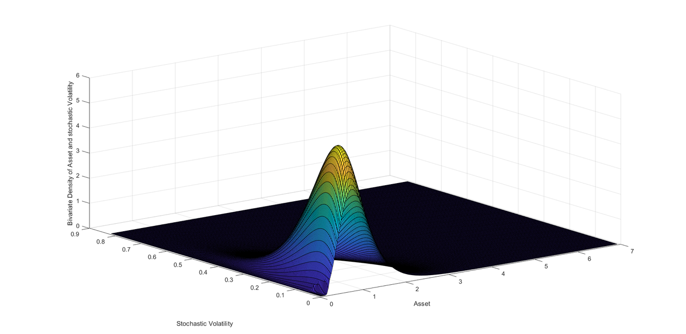](https://postimg.cc/k6WVGYkr)

[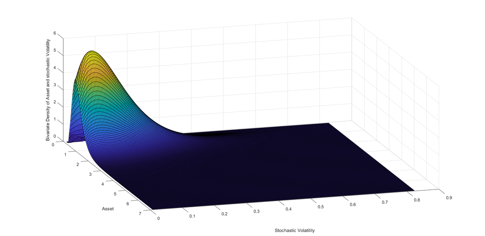](https://postimg.cc/G9JQSX9S)

[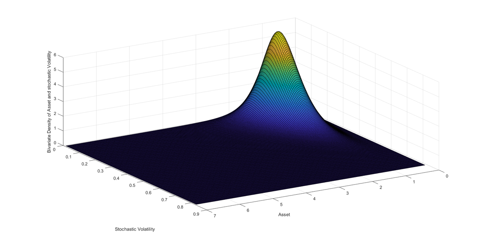](https://postimg.cc/MfDvbM6d)

[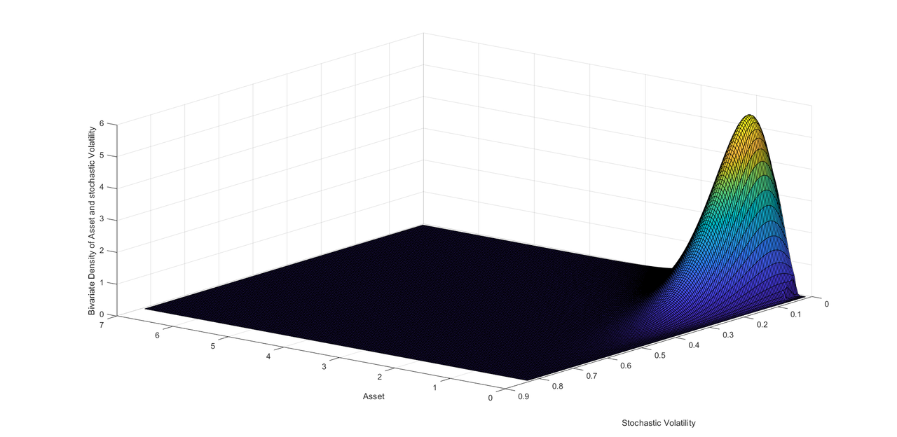](https://postimg.cc/YjwR352W)

[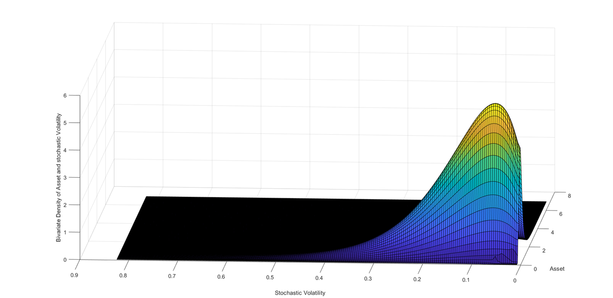](https://postimg.cc/yJMgVCpX)

[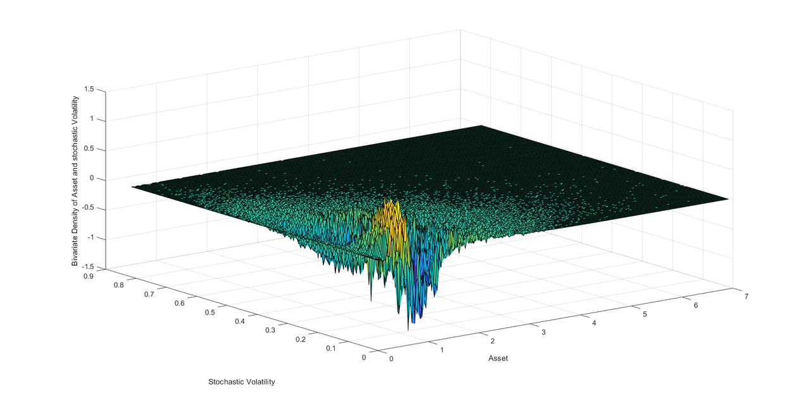](https://postimg.cc/V01JCB8J)

Here is the updated function I used to create the above graphs and you should find same exact match to simulation and
analytic call prices as I have copied above from my matlab output.

```
function [Coeff,a0,a] = CalculateConditionalProbabilitiesYtoXIterativeNew6M_02_DL(V,X)

Y=V;

Ndata=length(Y);

 MeanY=sum(Y(1:Ndata))/Ndata;
 MeanX=sum(X(1:Ndata))/Ndata;

 Ym(1:Ndata)=Y(1:Ndata)-MeanY;
 Xm(1:Ndata)=X(1:Ndata)-MeanX;

 YmVar=sum(Ym(1:Ndata).^2)/Ndata;
 XmVar=sum(Xm(1:Ndata).^2)/Ndata;

 Y0(1:Ndata)=Ym(1:Ndata)/sqrt(YmVar);
 X0(1:Ndata)=Xm(1:Ndata)/sqrt(XmVar);

Y=Y0;
X=X0;

sum(Y.^2)/Ndata
sum(X.^2)/Ndata

str=input("Look at variances of standardized variables");

Mtable=readtable('C:\Users\Lenovo\Documents\MATLAB\MATLAB1\MomentMatchParams08.txt');

[ZI] = MatchMomentParametersOfIdealZhalf04(Ndata,Mtable);

Ys=sort(Y);
Ymu(1:Ndata,1)=Ys(1:Ndata);

    W(1:Ndata,1)=1;
    W(1:Ndata,2)=ZI(1:Ndata);
    W(1:Ndata,3)=ZI(1:Ndata).^2;
    W(1:Ndata,4)=ZI(1:Ndata).^3;
    W(1:Ndata,5)=ZI(1:Ndata).^4;
    W(1:Ndata,6)=ZI(1:Ndata).^5;
   % W(1:Ndata,7)=ZI(1:Ndata).^6;
   % W(1:Ndata,8)=ZI(1:Ndata).^7;

    coeff=inv(W'*W)*(W'*Ymu);

    a0=coeff(1,1);
    a(1:5)=coeff(2:6,1);

    aa(1:6)=coeff(1:6);

 PlotZSeriesDensity(a0,a,'r')
 str=input("Look at the density of volatility");

Xs=sort(X);
Xmu(1:Ndata,1)=Xs(1:Ndata);

    W(1:Ndata,1)=1;
    W(1:Ndata,2)=ZI(1:Ndata);
    W(1:Ndata,3)=ZI(1:Ndata).^2;
    W(1:Ndata,4)=ZI(1:Ndata).^3;
    W(1:Ndata,5)=ZI(1:Ndata).^4;
    W(1:Ndata,6)=ZI(1:Ndata).^5;

    coeff=inv(W'*W)*(W'*Xmu);

    c0=coeff(1,1);
    c(1:5)=coeff(2:6,1);

    cc(1:6)=coeff(1:6,1);

    %[dd20,dd2]=ConvertHCoeffsToZCoeffs(dd(1),dd(2:6),5);

    [ccH] = ConvertZSeriesToHermiteSeriesNew(cc,5);

 PlotZSeriesDensity(c0,c,'r')

 str=input("Look at the density of  X");

 SeriesOrder10=6;
 SeriesOrder01=6;
 NMomentsX=6;
 NMomentsY=6;
%  %%%%%%%%%%%%%%%%%%%%%%%%%%%%%%%%%%%%%%%%%%%%%%%%%%%%%%%%%%%%%%%%%
%
%  MeanY=sum(Y(1:Ndata))/Ndata;
%  MeanX=sum(X(1:Ndata))/Ndata;
%
%  Ym(1:Ndata)=Y(1:Ndata)-MeanY;
%  Xm(1:Ndata)=X(1:Ndata)-MeanX;
%
%  YmVar=sum(Ym(1:Ndata).^2)/Ndata;
%  XmVar=sum(Xm(1:Ndata).^2)/Ndata;
%
%  Y0(1:Ndata)=Ym(1:Ndata)/sqrt(YmVar);
%  X0(1:Ndata)=Xm(1:Ndata)/sqrt(XmVar);
% %%%%%%%%%%%%%%%%%%%%%%%%%%%%%%%%%%%%%%%%%%%%%5
%  for nn=1:NMomentsY
%        .for mm=1:NMomentsX
%            CrossMomentsm(nn,mm)=0;
%            for pp=1:Ndata
%               CrossMomentsm(nn,mm)=CrossMomentsm(nn,mm)+Ym(pp).^nn.*Xm(pp).^mm/Ndata;
%            end
%        end
%  end
%
%  for nn=1:NMomentsY
%        for mm=1:NMomentsX
%            CrossMoments0(nn,mm)=0;
%            for pp=1:Ndata
%               CrossMoments0(nn,mm)=CrossMoments0(nn,mm)+Y0(pp).^nn.*X0(pp).^mm/Ndata;
%            end
%        end
%  end

%  for nn=1:NMomentsY
%        for mm=1:NMomentsX
%
%            CrossMomentsm(nn,mm)/YmVar.^(nn/2)/XmVar.^(mm/2)
%            CrossMoments0(nn,mm)
%            nn
%            mm
%
%            str=input("Look at comparison of cross moments");
%        end
%  end
%
%  %%%%%%%%%%%%%%%%%%%%%%%%%%%%%%%%%%%%%%%%%%%%%%%%%%%%%%%%%%%%%%%5
    for nn=1:NMomentsY
       for mm=1:NMomentsX
           CrossMoments(nn,mm)=0;
           for pp=1:Ndata
              CrossMoments(nn,mm)=CrossMoments(nn,mm)+Y(pp).^nn.*X(pp).^mm/Ndata;
           end
       end
    end
     w2D(1:NMomentsY,1:NMomentsX)=1;
    for nn=NMomentsY-1:-1:1
        for mm=NMomentsX-1:-1:1
            w2D(nn,mm)=w2D(nn+1,mm+1)*(nn+1)*(mm+1);
        end
    end

    w2D(:,2)=w2D(:,2)*500000;
    w2D(1,2)=w2D(1,2)*100;
    w2D(2,2)=w2D(2,2)*10;
    w2D(3,2)=w2D(3,2)*5;
    w2D(:,3)=w2D(:,3)*20000;
    w2D(1,3)=w2D(1,3)*20;
    w2D(2,3)=w2D(2,3)*5;
    w2D(1,:)=w2D(1,:)*10000;
    w2D(2,:)=w2D(2,:)*100;
    w2D(3,:)=w2D(3,:)*10;
    w2D(:,4)=w2D(:,4)*1000;
    w2D(1,4)=w2D(1,4)*10;
    w2D(2,4)=w2D(2,4)*2;

MuX=cc(1)+cc(3)+3*cc(5);
MuX=0;

SeriesOrder1=6;
NMomentsY=6;
[dd] = ProduceFirstRowofConditioal2DZSeries02_6M(aa,SeriesOrder1,NMomentsY,MuX,CrossMoments,X,Y,Ndata);

dd

str=input("Look at dd2----it is 2 ");
bnmH(1:6,1:6)=0;
bnmH(1,1:6)=ccH(1:6);
bnmH(1:6,1)=dd(1:6);

[bnm] = Convert2DHermitesInto2DSeries(bnmH);

%%%%%%%%%%%%%%%%%%%%%%%%%%%%%%%%%%%%%%%%%%%%%%%%%%%%%%

% bnm(1:6,1:6)=0;
%
% [dd20,dd2]=ConvertHCoeffsToZCoeffs(dd(1),dd(2:6),5);
% dd(1)=dd20;
% dd(2:6)=dd2(1:5);
%
% MuX=dd(1);
% bnm(2,1)=dd(2)-bnm(2,3)-3*bnm(2,5);
% bnm(3,1)=dd(3)-bnm(3,3)-3*bnm(3,5);
% bnm(4,1)=dd(4)-bnm(4,3)-3*bnm(4,5);
% bnm(5,1)=dd(5)-bnm(5,3)-3*bnm(5,5);
% bnm(6,1)=dd(6)-bnm(6,3)-3*bnm(6,5);
%
%
% bnm(1,2)=cc(2)-bnm(3,2)-3*bnm(5,2);
% bnm(1,3)=cc(3)-bnm(3,3)-3*bnm(5,3);
% bnm(1,4)=cc(4)-bnm(3,4)-3*bnm(5,4);
% bnm(1,5)=cc(5)-bnm(3,5)-3*bnm(5,5);
% bnm(1,6)=cc(6)-bnm(3,6)-3*bnm(5,6);
%
% bnm(1,1)=MuX-bnm(3,1)-3*bnm(5,1)-1*bnm(1,3)-1*3*bnm(1,5)-3*bnm(5,3)-bnm(3,3)-3*bnm(3,5)-9*bnm(5,5);
%

bnm

str=input("Look at bnm for comparison");

 NMomentsX=6;
 NMomentsY=6;

    [Moments2D] =
CalculateCrossMomentsConditional2DNew02(aa,bnm,SeriesOrder1,SeriesOrder10,SeriesOrder01,NMomentsX,NMomentsY);
     % [ObjBest] = CalculateObjMoment2D1D(Ms1,CrossMoments,Moments1D,Moments2D,w1D,w2D,NMomentsX,NMomentsY);
    [ObjFuncBest] = CalculateObjMoment2D1D(CrossMoments,Moments2D,w2D,NMomentsX,NMomentsY);

       Moments2D(:,1)
         CrossMoments(:,1)

         str=input("Look at match of moments ---first");

%%%%%%%%%%%%%%%%%%%%%%%%%%%%%%%%%%%%%%%%%%%%%%%%%%%%%%%%%%%%%%%%%%%%%%%%%%

%SeriesOrderIterate=(NMomentsY-1)*(NMomentsX);
SeriesOrderIter10=6;%NMomentsY+1;
SeriesOrderIter01=6;%NMomentsX;
alphaSuccessCount(1:SeriesOrderIter10,1:SeriesOrderIter01)=0;
SuccessPrevalpha(1:SeriesOrderIter10,1:SeriesOrderIter01)=0;

   delta_bnmHCoeff0=.0005;
   for nn=1:SeriesOrderIter10
        for mm=1:SeriesOrderIter01
            %delta_bnmCoeff(nn,mm)=delta_bnmCoeff0./mm/nn;
            %delta_bnmCoeff(nn,mm)=bnm(nn,mm)./mm/nn/1000;
            delta_bnmHCoeff(nn,mm)=bnmH(nn,1)./mm*10;
        end
    end

bnmHCoeff=bnmH;

mul1=.9;
mul2=1.1;
Iterations=4000;%2000;%10000;%150;
for iter=1:Iterations
iter
bnmHCoeff
ObjFuncBest
    for kk=2:SeriesOrderIter10
        for jj=2:SeriesOrderIter01
            %ll=SeriesOrderIter01*(kk-1)+jj;
        bnmHCoeffNew(1:SeriesOrderIter10,1:SeriesOrderIter01)=bnmHCoeff(1:SeriesOrderIter10,1:SeriesOrderIter01);
        bnmHCoeffNew(kk,jj)=bnmHCoeff(kk,jj)+delta_bnmHCoeff(kk,jj);

        [bnm] = Convert2DHermitesInto2DSeries(bnmHCoeffNew);

%         for nn=1:SeriesOrderIter10
%             for mm=1:SeriesOrderIter01
%                 bnmH(nn,mm)=bnmHCoeffNew(nn,mm);
%             end
%         end
        [Moments2D,Moments1D] =
CalculateCrossMomentsConditional2DNew02(aa,bnm,SeriesOrder1,SeriesOrder10,SeriesOrder01,NMomentsX,NMomentsY);
        [ObjFuncNew] = CalculateObjMoment2D1D(CrossMoments,Moments2D,w2D,NMomentsX,NMomentsY);
        %[ObjMomentOut] = CalculateObjMoment2D1D(Moment2D0,Moment2D,w2D,MOrder1,MOrder2)

        if(ObjFuncNew3)
            delta_bnmHCoeff(kk,jj)=delta_bnmHCoeff(kk,jj).*mul2;
        end
        end
    end

      if(rem(iter,500)==0)
         bnm
         Moments2D
         CrossMoments
         Moments2D(:,1)
         CrossMoments(:,1)

         ObjFuncBest

         str=input("Look at fit of moments");
%
      end

end

% [bnm] = Convert2DHermitesInto2DSeries(bnmHCoeff);
%
% %load("bnmA.mat","bnm");
% %load('bnmB.mat','bnm');
% %load('bnmOldGood02.mat','bnm');
%
%
% [bnmH] = Convert2dSeriesInto2DHermites(bnm)

bnmH=bnmHCoeff;

bnmH=bnmH*sqrt(XmVar);%/sqrt(YmVar);

for nn=2:6
    bnmH(nn,:)=bnmH(nn,:).*(sqrt(YmVar)).^(nn-1);
end
[bnm] = Convert2DHermitesInto2DSeries(bnmH);

%
% XmVar
% YmVar
% sqrt(XmVar)
% sqrt(YmVar)
%
% str=input("Look at sd's")
% bnm=bnm*sqrt(XmVar);%/sqrt(YmVar);
%
% for nn=2:6
% bnm(nn,:)=bnm(nn,:).*(sqrt(YmVar)).^(nn-1);
% end

%bnm=bnm/sqrt(XmVar)/sqrt(YmVar);
bnm(1,1)=MeanX-bnm(3,1)-3*bnm(5,1)-1*bnm(1,3)-1*3*bnm(1,5)-3*bnm(5,3)-bnm(3,3)-3*bnm(3,5)-9*bnm(5,5);
%bnm(1,1)=MeanX+bnm(1,1);

a0=a0*sqrt(YmVar);
a=a*sqrt(YmVar);
a0=MeanY-a(2)-3*a(4);
%a0=a0+MeanY;

Coeff(1:6,1:6)=0;
 for nn=1:6
      for mm=1:6
          Coeff(mm,nn)=bnm(nn,mm);
      end
  end

end
```

.

.

.

Friends, I have written comments on most of the important functions and will be posting them later today.

---

### #2167 — Amin (Topic Author)
*January 29, 2024, 2:10 AM*

Friends, I went ahead and tried the same SV SDEs and parameters but with -.55 correlation. And it works well.

Here are the parameters and SDEs.

X0=1.0;

alpha1=0;

alpha2=1;

kappaX=0;

thetaX=1;

a=kappaX*thetaX;

b=-kappaX;

rho=-.55;

sigma1=1;

gammaV=.5;

gammaX=.95;

%%%%%%%%`%%%%%

V0=.35;

thetaV=.06;

kappaV=1.5;

mu1=kappaV*thetaV;

mu2=-kappaV;

beta1=0;

beta2=1;

gamma=.5;

sigma0=.4;

dt=.03125/2;

Tt=64*1;

T=Tt*dt;

Here is the comparison of call prices with negative correlation as given.

CallStrikes =

  Columns 1 through 3

   0.500000000000000   0.550000000000000   0.600000000000000

  Columns 4 through 6

   0.650000000000000   0.700000000000000   0.750000000000000

  Columns 7 through 9

   0.800000000000000   0.850000000000000   0.900000000000000

  Columns 10 through 12

   0.950000000000000   1.000000000000000   1.050000000000000

  Columns 13 through 15

   1.100000000000000   1.150000000000000   1.200000000000000

  Columns 16 through 18

   1.250000000000000   1.300000000000000   1.350000000000000

  Columns 19 through 21

   1.400000000000000   1.450000000000000   1.500000000000000

  Columns 22 through 24

   1.550000000000000   1.600000000000000   1.650000000000000

  Columns 25 through 26

   1.700000000000000   1.750000000000000

CallPricesAnalytic =

  Columns 1 through 3

   0.514403394076629   0.470963749457207   0.429309723071231

  Columns 4 through 6

   0.389621824067207   0.352050245661619   0.316711389995571

  Columns 7 through 9

   0.283686070429363   0.253019277519271   0.224721329480696

  Columns 10 through 12

   0.198770181956282   0.175114645168908   0.153678247714824

  Columns 13 through 15

   0.134363493111177   0.117056274887100   0.101630245268709

  Columns 16 through 18

   0.087950968030185   0.075879724682723   0.065276882006867

  Columns 19 through 21

   0.056004765639091   0.047930017204585   0.040925440143276

  Columns 22 through 24

   0.034871361274995   0.029656551169719   0.025178756822687

  Columns 25 through 26

   0.021344905582220   0.018071040537396

CallPricesMC =

  Columns 1 through 3

   0.514364560042589   0.470923020730287   0.429266415524159

  Columns 4 through 6

   0.389572054104013   0.352002576808548   0.316689153792583

  Columns 7 through 9

   0.283695838215984   0.253052486748227   0.224758897946431

  Columns 10 through 12

   0.198798616775906   0.175132233982371   0.153671313331748

  Columns 13 through 15

   0.134332539656242   0.116997247870832   0.101560816447243

  Columns 16 through 18

   0.087868289449019   0.075788407523979   0.065169286983528

  Columns 19 through 21

   0.055879877817169   0.047801986092979   0.040794131359746

  Columns 22 through 24

   0.034737806433717   0.029524734684912   0.025057385092029

  Columns 25 through 26

   0.021243780372752   0.017989695836196

.

.

.

.

Here are some graphs of monte carlo density and analytic density for comparison with each other.

[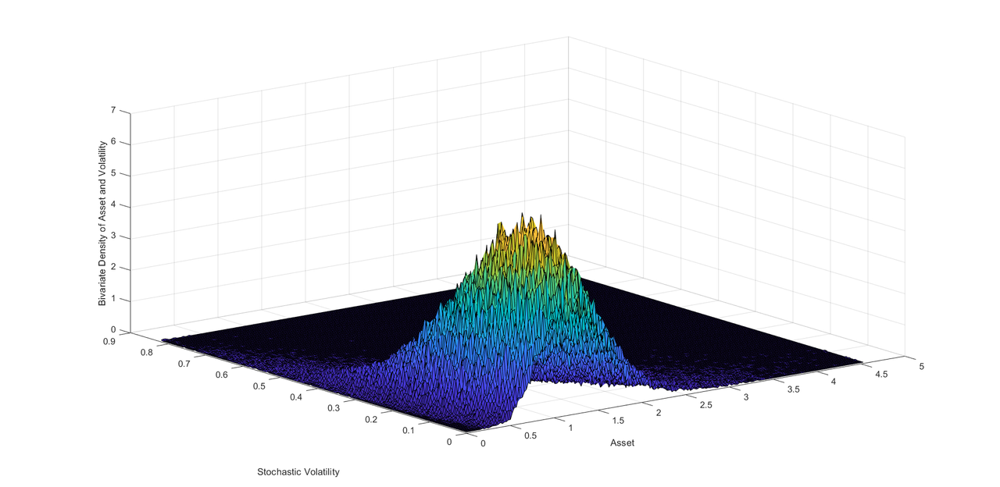](https://postimg.cc/D8rt6QK2)

[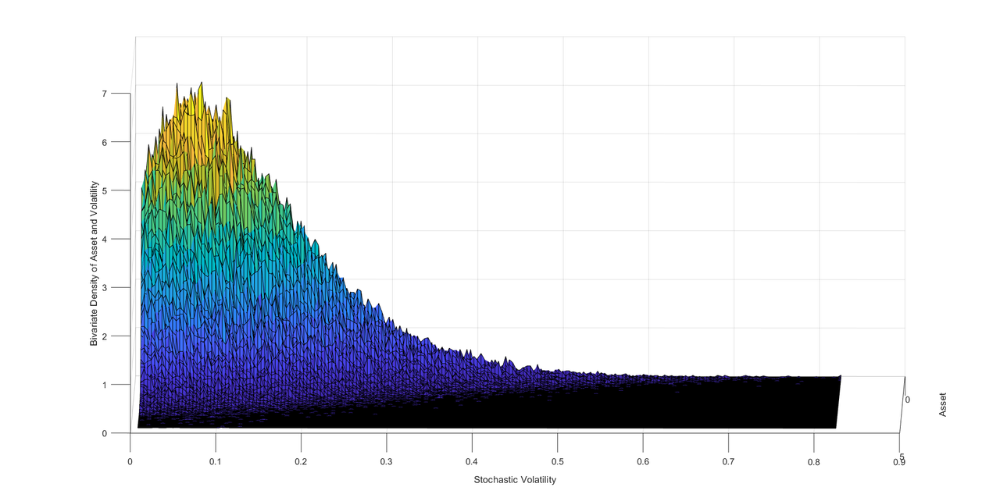](https://postimg.cc/3d5s2SVS)

[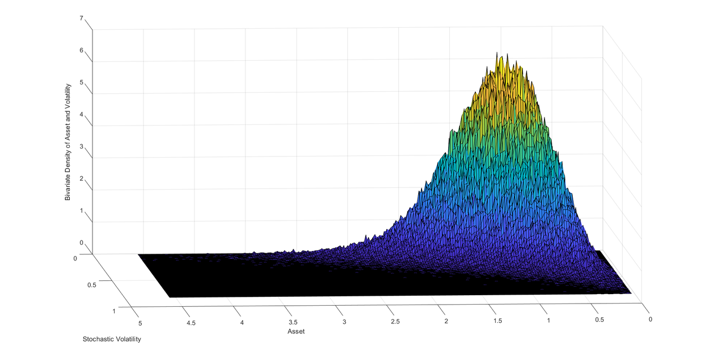](https://postimg.cc/LgfGrLY3)

[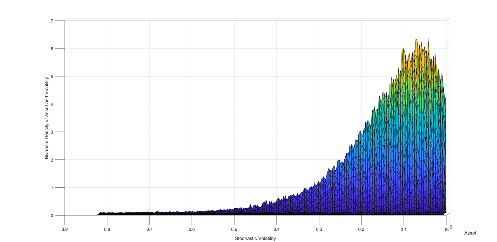](https://postimg.cc/RWRxS7PP)

[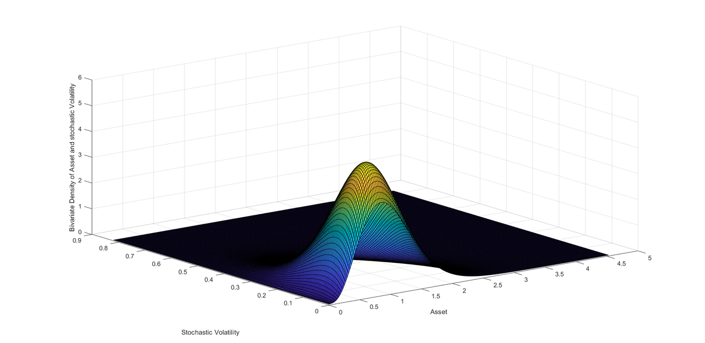](https://postimg.cc/xJXw3W97)

[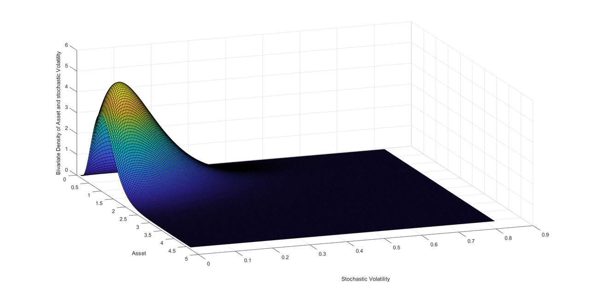](https://postimg.cc/NLHh9qJ2)

[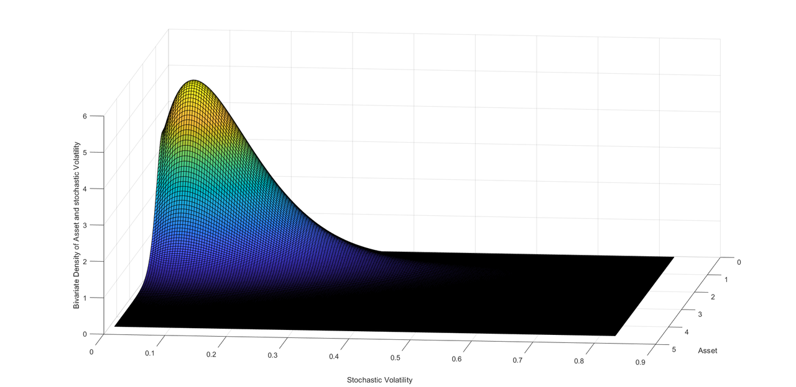](https://postimg.cc/PL5sPC9d)

[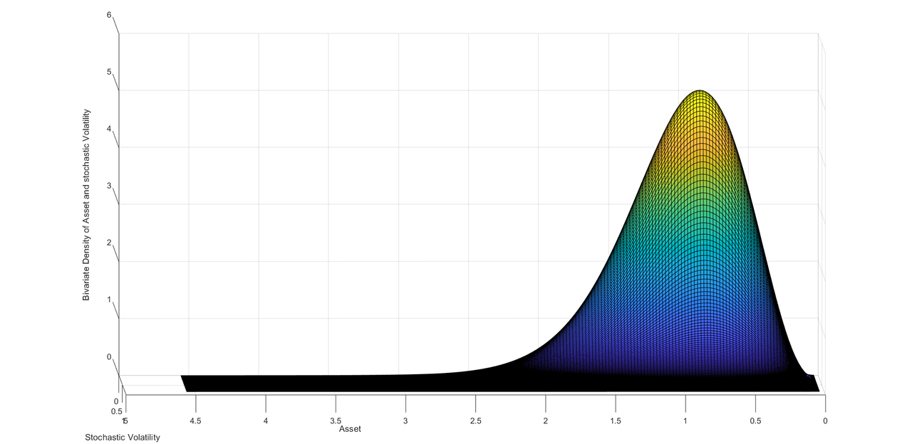](https://postimg.cc/TyN8mRvg)

[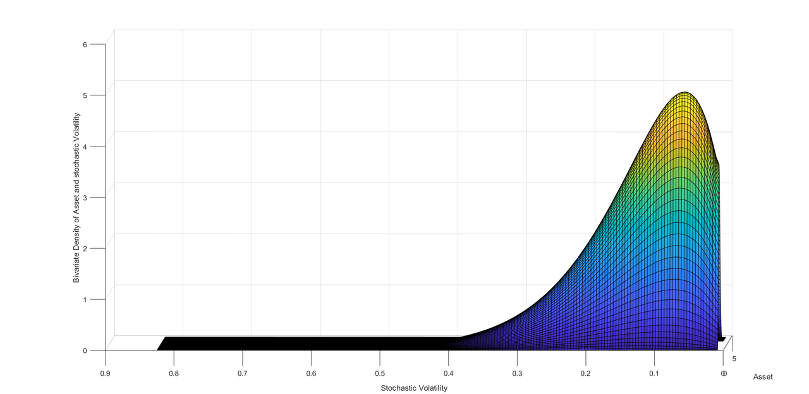](https://postimg.cc/3k7HQSZ4)

[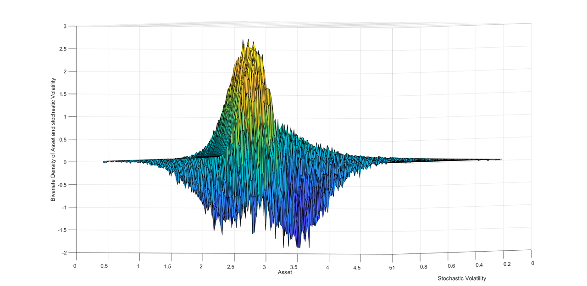](https://postimg.cc/hzNHypjG)

---

### #2168 — Amin (Topic Author)
*January 29, 2024, 9:56 AM*

Friends, Here is the commented and refined version of the function in which I optimize for the coordinates of 2D
conditional Hermite Series of dependent random variable X. I have tried to explain the logic of most lines of the
program.

This program, even though it has same exact output as the last program yesterday, will not work with previous functions
since format of some output arguments has slightly changed. You can get it to work easily if you understand the program.

You can read the comments to understand all logic of the program but this is an updated version with refined code (but
exactly same output) and it will work with updated version of functions that I will post later today.

Here are some comments from start of the program.

This function takes observations of an independent variable Y and dependent variable X. These have to be joint
observations in the sense that nth observation of Y, given by Y(n) is taken jointly with nth observation of X, given by
X(n). Two arrays of observations are the same length and nth member of independent variable Y is jointly observed with
nth member of dependent variable X.

We want to find the detailed relationship between Y and X so we can get the conditional density of dependent variable X
given a particular value of independent variable Y. This will be done by calibrating coefficients of our 2D hermite
series to data so that a very good fit to cross moments between X and Y is retrieved.

We will first find univariate Z-series/hermite series of both random variables independently. For joint dynamics of
dependent variable given the independent variable, we will assume a 2D hermite series (This has to be two dimensional to
be able to capture the dynamics from independent variable Y and have its own dynamics) and form but we do not know the
coefficients of  this 2D hermite series. In this program, we try to use iterative optimization to find the unknown
coefficients of 2D hermite series of dependent variable X in a way that after taking products with independent variable
Y, expectation of these products i.e cross moments are as exactly retrieved as possible.

Our iterative optimization procedure perturbs each hermite coefficient in 2D hermite series  by a very slight amount and
checks the objective function. If the objective function decreases, we eccept the perturbation otherwise reject it and
then perturb by a small amount in other opposite direction and then again check the objective function. If perturbations
in both sides are rejected, we do not change the coefficients but slightly decrease the perturbation size.

We will first standardize the data of both random variables and then calculate univariate hermite series of both
variables and also their cross moments in standardized form. We do all the calculations of coefficients of independent
variable Y and 2D dependent variable X in standardized version of variables and moments. After optimization of
coefficients on standardized data, at the end, we invert the standardization of both dependent and independent variables
appropriately to get the Z-series and hermite series of actual variables in thier original coordinates back
from standardized coordinates.

Before optimization, we place two conditions on 2D dependent variable X so thatfirst row and first column of 2D hermite
coefficents of X is already known before optimization stage and it is not changed in optimization. We do not iteratively
optimize over this first row and first colums which are analytically known from these two conditions.

Our first condition is that after integration (of bivariate density or alternatively bivariate 2D Z-series/2D Hermite
series) over independent variable, we should get the univariate marginal density/Z-series/Hermite series of X which has
already been calculated out of data. This fixes the zeroth hermite(of independent varaible Y) related terms in the
Z-series/hermite series. Please look at this forum post# 2121 for explanation of this first condition.

 https://forum.wilmott.com/viewtopic.php?t=99702&start=2115#p879042

We can analytically solve for first order cross moments of X with higher order in Y. From the analytical solution of these moments, we find first row of coefficients in the hermite form. This condition is explained here: https://forum.wilmott.com/viewtopic.php?t=99702&start=2160#p879532

 2D Hermite Series Form used in this program is given as

 X = bnmH(1,1) + bnmH(2,1) H_1(Z_y) + bnmH(3,1) H_2(Z_y) + bnmH(4,1) H_3(Z_y) + bnmH(5,1) H_4(Z_y) + bnmH(6,1) H_5(Z_y)

 + [ bnmH(1,2) + bnmH(2,2) H_1(Z_y) + bnmH(3,2) H_2(Z_y) + bnmH(4,2) H_3(Z_y) + bnmH(5,2) H_4(Z_y) + bnmH(6,2) H_5(Z_y)]
H_1(Zx)

 + [ bnmH(1,3) + bnmH(2,3) H_1(Z_y) + bnmH(3,3) H_2(Z_y) + bnmH(4,3) H_3(Z_y) + bnmH(5,3) H_4(Z_y) + bnmH(6,3) H_5(Z_y)]
H_2(Zx)

 + [ bnmH(1,4) + bnmH(2,4) H_1(Z_y) + bnmH(3,4) H_2(Z_y) + bnmH(4,4) H_3(Z_y) + bnmH(5,4) H_4(Z_y) + bnmH(6,4) H_5(Z_y)]
H_3(Zx)

 + [ bnmH(1,5) + bnmH(2,5) H_1(Z_y) + bnmH(3,5) H_2(Z_y) + bnmH(4,5) H_3(Z_y) + bnmH(5,5) H_4(Z_y) + bnmH(6,5) H_5(Z_y)]
H_4(Zx)

 + [ bnmH(1,6) + bnmH(2,6) H_1(Z_y) + bnmH(3,6) H_2(Z_y) + bnmH(4,6) H_3(Z_y) + bnmH(5,6) H_4(Z_y) + bnmH(6,6) H_5(Z_y)]
H_5(Zx)

 2D Z-Series Form used in this program is given as

 X = bnm(1,1) + bnm(2,1) Z_y + bnm(3,1) (Z_y)^2 + bnm(4,1) (Z_y)^3 + bnm(5,1) (Z_y)^4 + bnm(6,1) (Z_y)^5

 + [ bnm(1,2) + bnm(2,2) Z_y + bnm(3,2) (Z_y)^2 + bnm(4,2) (Z_y)^3 + bnm(5,2) (Z_y)^4 + bnm(6,2) (Z_y)^5 ] Zx

 + [ bnm(1,3) + bnm(2,2) Z_y + bnm(3,3) (Z_y)^2 + bnm(4,3) (Z_y)^3 + bnm(5,3) (Z_y)^4 + bnm(6,3) (Z_y)^5 ] Zx^2

 + [ bnm(1,4) + bnm(2,2) Z_y + bnm(3,4) (Z_y)^2 + bnm(4,4) (Z_y)^3 + bnm(5,4) (Z_y)^4 + bnm(6,4) (Z_y)^5 ] Zx^3

 + [ bnm(1,5) + bnm(2,2) Z_y + bnm(3,5) (Z_y)^2 + bnm(4,5) (Z_y)^3 + bnm(5,5) (Z_y)^4 + bnm(6,5) (Z_y)^5 ] Zx^4

 + [ bnm(1,6) + bnm(2,2) Z_y + bnm(3,6) (Z_y)^2 + bnm(4,6) (Z_y)^3 + bnm(5,6) (Z_y)^4 + bnm(6,6) (Z_y)^5 ] Zx^5

.

.

Here is the commented version of matlab function.

.

.

```
function [bnm,aa] = CalculateConditionalProbabilitiesYtoXIterativeNew6M_02(Yin,Xin)

%Yin argument translates to independent random variable Y
%Xin argument translates to dependent variable X.
%This function takes observations of an independent variable Y and
%dependent variable X. These have to be joint observations in the sense
%that nth observation of Y, given by Y(n) is taken jointly with nth
%observation of X, given by X(n). Two arrays of observations are the same
%length and nth member of independent variable Y is jointly observed with nth
%member of dependent variable X.
%We want to find the detailed relationship between Y and X so we can get
%the conditional density of dependent variable X given a particular value
%of independent variable Y. This will be done by calibrating coefficients
%of our 2D hermite series to data so that a very good fit to cross moments
%between X and Y is retrieved.
%We will first find univariate Z-series/hermite series of both random
%variables independently. For joint dynamics of dependent variable given
%te independent variable, we will assume a 2D hermite series (This has to
%be two dimensional to be able to capture the dynamics from independent variable Y
%and have its own dynamics) and form but we do not know the coefficients of
%this 2D hermite series. In this program, we try to use iterative optimization
%to find the unknown coefficients of 2D hermite series of dependent variable X
%in a way that after taking products with independent variable Y, expectation
%of these products i.e cross moments are as exactly retrieved as possible.
%Our iterative optimization procedure perturbs each hermite coefficient in
%2D hermite series  by a very slight amount and checks the objective function.
%If the objective function decreases, we eccept the perturbation otherwise
%reject it and then perturb by a small amount in other opposite direction
%and then again check the objective function. If perturbations in both sides
%are rejected, we do not change the coefficients but slightly decrease the
%perturbation size.
%We will first standardize the data of both random variables and then
%calculate univariate hermite series of both variables and also their
%cross moments in standardized form. We do all the calculations of coefficients
%of independent variable Y and 2D dependent variable X
%in standardized version of variables and moments. After optimization of coefficients on
%standardized data, at the end, we invert the standardization of both
%dependent and independent variables appropriately to get the Z-series and
%hermite series of actual variables in their original coordinates back from
%standardized coordinates.
%Before optimization, we place two conditions on 2D dependent variable X so that
%first row and first column of 2D hermite coefficients of X is already
%known before optimization stage and it is not changed in optimization.
%We do not iteratively optimize over this first row and first columns
%which are analytically known from these two conditions.
%Our first condition is that after integration (of bivariate density or
%alternatively bivariate 2D Z-series/2D Hermite series) over independent
%variable, we should get the univariate marginal density/Z-series/Hermite series of X
%which has already been calculated out of data. This fixes the zeroth
%hermite(of independent variable Y) related terms in the Z-series/hermite series.
%Please look at this forum post# 2121 for explanation of this first condition.
% https://forum.wilmott.com/viewtopic.php?t=99702&start=2115#p879042

%We can analytically solve for first order cross moments of X with higher
%order in Y. From the analytical solution of these moments, we find first
%row of coefficients in the hermite form. This condition is explained here
%https://forum.wilmott.com/viewtopic.php?t=99702&start=2160#p879532

% 2D Hermite Series Form used in this program is given as
%
% X = bnmH(1,1) + bnmH(2,1) H_1(Z_y) + bnmH(3,1) H_2(Z_y) + bnmH(4,1) H_3(Z_y) + bnmH(5,1) H_4(Z_y) + bnmH(6,1) H_5(Z_y)
% + [ bnmH(1,2) + bnmH(2,2) H_1(Z_y) + bnmH(3,2) H_2(Z_y) + bnmH(4,2) H_3(Z_y) + bnmH(5,2) H_4(Z_y) + bnmH(6,2)
H_5(Z_y)] H_1(Zx)
% + [ bnmH(1,3) + bnmH(2,3) H_1(Z_y) + bnmH(3,3) H_2(Z_y) + bnmH(4,3) H_3(Z_y) + bnmH(5,3) H_4(Z_y) + bnmH(6,3)
H_5(Z_y)] H_2(Zx)
% + [ bnmH(1,4) + bnmH(2,4) H_1(Z_y) + bnmH(3,4) H_2(Z_y) + bnmH(4,4) H_3(Z_y) + bnmH(5,4) H_4(Z_y) + bnmH(6,4)
H_5(Z_y)] H_3(Zx)
% + [ bnmH(1,5) + bnmH(2,5) H_1(Z_y) + bnmH(3,5) H_2(Z_y) + bnmH(4,5) H_3(Z_y) + bnmH(5,5) H_4(Z_y) + bnmH(6,5)
H_5(Z_y)] H_4(Zx)
% + [ bnmH(1,6) + bnmH(2,6) H_1(Z_y) + bnmH(3,6) H_2(Z_y) + bnmH(4,6) H_3(Z_y) + bnmH(5,6) H_4(Z_y) + bnmH(6,6)
H_5(Z_y)] H_5(Zx)

% 2D Z-Series Form used in this program is given as
%
% X = bnm(1,1) + bnm(2,1) Z_y + bnm(3,1) (Z_y)^2 + bnm(4,1) (Z_y)^3 + bnm(5,1) (Z_y)^4 + bnm(6,1) (Z_y)^5
% + [ bnm(1,2) + bnm(2,2) Z_y + bnm(3,2) (Z_y)^2 + bnm(4,2) (Z_y)^3 + bnm(5,2) (Z_y)^4 + bnm(6,2) (Z_y)^5 ] Zx
% + [ bnm(1,3) + bnm(2,2) Z_y + bnm(3,3) (Z_y)^2 + bnm(4,3) (Z_y)^3 + bnm(5,3) (Z_y)^4 + bnm(6,3) (Z_y)^5 ] Zx^2
% + [ bnm(1,4) + bnm(2,2) Z_y + bnm(3,4) (Z_y)^2 + bnm(4,4) (Z_y)^3 + bnm(5,4) (Z_y)^4 + bnm(6,4) (Z_y)^5 ] Zx^3
% + [ bnm(1,5) + bnm(2,2) Z_y + bnm(3,5) (Z_y)^2 + bnm(4,5) (Z_y)^3 + bnm(5,5) (Z_y)^4 + bnm(6,5) (Z_y)^5 ] Zx^4
% + [ bnm(1,6) + bnm(2,2) Z_y + bnm(3,6) (Z_y)^2 + bnm(4,6) (Z_y)^3 + bnm(5,6) (Z_y)^4 + bnm(6,6) (Z_y)^5 ] Zx^5

%%%%%%%%%%%%%%%%%%%%%%%%%%%%%%%%%%%%%%%%%%%%%%%%%%%%%%%%%%%%%%%%%%%%%%%

%In the code block below, we standardize the independent variable Y and dependent variable X.
%We do all later calculations of various Z-series and cross moments in
%standardized framework and then at the end of the program, we convert
%the calculated coefficients of 2D hermite series/Z-series of dependent
%variable X into original non-standardized framework.

 Ndata=length(Yin);

 MeanY=sum(Yin(1:Ndata))/Ndata;
 MeanX=sum(Xin(1:Ndata))/Ndata;

 Ym(1:Ndata)=Yin(1:Ndata)-MeanY;
 Xm(1:Ndata)=Xin(1:Ndata)-MeanX;

 YmVar=sum(Ym(1:Ndata).^2)/Ndata;
 XmVar=sum(Xm(1:Ndata).^2)/Ndata;

 Y(1:Ndata)=Ym(1:Ndata)/sqrt(YmVar);
 X(1:Ndata)=Xm(1:Ndata)/sqrt(XmVar);

 %%%%%%%%%%%%%%%%%%%%%%%%%%%%%%%%%%%%%%%%%%%%%%%%%%%%%%%%%%%%%%%%%%%%
%Code block below uses polynomial regression to find univariate Z-series
%coefficients of independent variable Y.
%To know more about polynomial regression read the following and associated
%posts:  https://forum.wilmott.com/viewtopic.php?t=99702&start=2010#p877143

%You can get the text file MomentMatchParams08.txt from the forum post below
%https://forum.wilmott.com/viewtopic.php?f=4&t=99702&start=2040#p877863

Mtable=readtable('C:\Users\Lenovo\Documents\MATLAB\MATLAB1\MomentMatchParams08.txt');

%ZI is moment matched grid along the normal density with number of grid
%points equal to data elements in Y given by Ndata. The grid is constructed
%so that probability mass in each grid cell is 1/Ndata so this matches the
%observation probability of Ndata data elements. Due to equal probability
%mass in each grid cell, we call it equiprobable grid.

[ZI] = MatchMomentParametersOfIdealZhalf04(Ndata,Mtable);

Ys=sort(Y);
Ymu(1:Ndata,1)=Ys(1:Ndata);

W(1:Ndata,1)=1;
W(1:Ndata,2)=ZI(1:Ndata);
W(1:Ndata,3)=ZI(1:Ndata).^2;
W(1:Ndata,4)=ZI(1:Ndata).^3;
W(1:Ndata,5)=ZI(1:Ndata).^4;
W(1:Ndata,6)=ZI(1:Ndata).^5;
% W(1:Ndata,7)=ZI(1:Ndata).^6;
% W(1:Ndata,8)=ZI(1:Ndata).^7;

coeff=inv(W'*W)*(W'*Ymu);

%Above, we get coefficients of univariate Z-series of independent
%variable Y by least square regression.

a0=coeff(1,1);
a(1:5)=coeff(2:6,1);

%Above, we assign zeroth power Z-series coefficient to a0 and rest of
%the coefficients to array a.
%This was older format but we might need it since many old functions are written
%in this format.

%Below, we assign same Z-series coefficients to a single array. This is
%newer format that we want to use mostly.
aa(1:6)=coeff(1:6);

%uncomment these lines if you want to see shape of Z-series constructed
%density of Y. We had calculated coefficients of this Z-series by
%least square polynomial regression.
%PlotZSeriesDensity(a0,a,'r')
%str=input("Look at the density of volatility");

%%%%%%%%%%%%%%%%%%%%%%%%%%%%%%%%%%%%%%%%%%%%%%%%%%%%%%%%%%%%%%%%%%%%5
%In this code block, we calcualate the coefficients of univariate marginal
%density of dependent variable X again by least square polynomial
%regression as we did in previous block for independent variable Y.

Xs=sort(X);
Xmu(1:Ndata,1)=Xs(1:Ndata);

W(1:Ndata,1)=1;
W(1:Ndata,2)=ZI(1:Ndata);
W(1:Ndata,3)=ZI(1:Ndata).^2;
W(1:Ndata,4)=ZI(1:Ndata).^3;
W(1:Ndata,5)=ZI(1:Ndata).^4;
W(1:Ndata,6)=ZI(1:Ndata).^5;

coeff=inv(W'*W)*(W'*Xmu);

c0=coeff(1,1);
c(1:5)=coeff(2:6,1);

cc(1:6)=coeff(1:6,1);

%Below, we convert the Z-series coefficients of marginal density of X
%into univariate hermite series coefficients.
%These coefficients from univaraite hermite-series of X appear on the
%first column of 2D hermite series coefficients of X. This first column is
%associated with zeroth Zy hermite.
%This is because after integration (of bivaraite density or
%alternatively bivariate 2D Hermite series) over independent
%variable, we should get the univaraite Hermite series of X.
%Please look at this forum post# 2121 for explanation of this first condition.
% https://forum.wilmott.com/viewtopic.php?t=99702&start=2115#p879042

[ccH] = ConvertZSeriesToHermiteSeriesNew(cc,5);

%uncomment below to look at univariate density of X

%PlotZSeriesDensity(c0,c,'r')
%str=input("Look at the density of  X");

%%%%%%%%%%%%%%%%%%%%%%%%%%%%%%%%%%%%%%%%%%%%%%%%%%%%%%%%%%%%%%%%%%%%%%%%%%%%%%%%%%%%%%%%%%%%%5

SeriesOrder1=6;
NMomentsY=6;

SeriesOrder10=6; %SeriesOrder10 = 1 + highest power of Zy in 2D Z-series%Here highest power of Zy is five
SeriesOrder01=6; %SeriesOrder01 = 1 + highest power of Zx in 2D Z-series%Here highest power of Zx is also five
%notation is  bnm(1:SeriesOrder10,1:SeriesOrder01)
%Similalry    bnmH(1:SeriesOrder10,1:SeriesOrder01)

NMomentsX=6; %Highest moment of X in cross moments of X and Y
NMomentsY=6; %Highest moment of Y in cross moments of X and Y

%Below we calculate various cross moments between X and Y. These are
%calculated from standardized data.
for nn=1:NMomentsY
   for mm=1:NMomentsX
       CrossMoments(nn,mm)=0;
       for pp=1:Ndata
          CrossMoments(nn,mm)=CrossMoments(nn,mm)+Y(pp).^nn.*X(pp).^mm/Ndata;
       end
   end
end

%Below are the weights on calculation of objective function. More weight on
%a particular moment means that its better match with target moments gets more emphasized as
%compared to match of other moments.
%Choice of good weights is non-trivial.
%Current choice is only haphazard. Please try improvements/

 w2D(1:NMomentsY,1:NMomentsX)=1;
for nn=NMomentsY-1:-1:1
    for mm=NMomentsX-1:-1:1
        w2D(nn,mm)=w2D(nn+1,mm+1)*(nn+1)*(mm+1);
    end
end

w2D(:,2)=w2D(:,2)*500000;
w2D(1,2)=w2D(1,2)*100;
w2D(2,2)=w2D(2,2)*10;
w2D(3,2)=w2D(3,2)*5;
w2D(:,3)=w2D(:,3)*20000;
w2D(1,3)=w2D(1,3)*20;
w2D(2,3)=w2D(2,3)*5;
w2D(1,:)=w2D(1,:)*10000;
w2D(2,:)=w2D(2,:)*100;
w2D(3,:)=w2D(3,:)*10;
w2D(:,4)=w2D(:,4)*1000;
w2D(1,4)=w2D(1,4)*10;
w2D(2,4)=w2D(2,4)*2;

%Please look on detailed comments inside function below for more insight about it.
%The function below returns coefficients on first row of hermite series so that all
%cross moments of first order in dependent variable X and various orders in independent
%variable Y are matched.

[dd] = ProduceFirstRowofConditioal2DZSeries02_6M_A(aa,SeriesOrder1,CrossMoments);

%Below we define a 2D array of hermite series coefficents and populate its
%first row with output from above function so that all cross moments of
%first order in X and different orders in Y are matched.
%We also populate first column with univariate hermite coefficients of
%marginal density of X because of the condition that upon integration of
%the bivariate hermite form, we should get univariate marginal density as a
%result. %Please look at this forum post# 2121 for explanation of this first condition.
% https://forum.wilmott.com/viewtopic.php?t=99702&start=2115#p879042

bnmH(1:6,1:6)=0;          %define 2D hermite coefficients array
bnmH(1,1:6)=ccH(1:6);     %populate first column with univariate margianl density hermite coefficients of X.
bnmH(1:6,1)=dd(1:6);      %populate first row so that all cross moments of first order in X are matched.

%In our iterative optimization, we will not alter the above first column and first row of 2D hermite coefficients array.

%In the block below, we convert 2D hermite coefficients array bnmH to 2D
%Z-series array bnm. We calculate the values of cross moments given the values of
%coefficients in 2D Z-series bnm. We use these model cross moments and
%co1mpare them with target cross moments to evaluate the objective function.

%Convert from 2D Hermite Series Coefficients bnmH to 2D Z-series
%coefficients bnm
[bnm] = Convert2DHermitesInto2DSeries(bnmH);
%Evaluate the model cross moments in the function below.
[Moments2D,Moments1D] =
CalculateCrossMomentsConditional2DNew02(aa,bnm,SeriesOrder1,SeriesOrder10,SeriesOrder01,NMomentsX,NMomentsY);
%Evaluate the objective function based on weighted squared difference
%between model cross moments and target cross momensts from data.
[ObjFuncBest] = CalculateObjMoment2D1D(CrossMoments,Moments2D,w2D,NMomentsX,NMomentsY);

%%%%%%%%%%%%%%%%%%%%%%%%%%%%%%%%%%%%%%%%%%%%%%%%%%%%%%%%%%%%%%%%%%%%%%%%%%

SeriesOrderIter10=6;
SeriesOrderIter01=6;
alphaSuccessCount(1:SeriesOrderIter10,1:SeriesOrderIter01)=0;
SuccessPrevalpha(1:SeriesOrderIter10,1:SeriesOrderIter01)=0;

%array of perturbation sizes of coefficients of the 2D Hermite form
%of dependent variable X in iterative optimization.
for nn=1:SeriesOrderIter10
    for mm=1:SeriesOrderIter01
            delta_bnmHCoeff(nn,mm)=bnmH(nn,1)./mm*10;
    end
end

%Assign initial value of bnmH to workhorse variable bnmHCoeff which will be
%used in iterative ioptimization
bnmHCoeff=bnmH;

mul1=.9; %decrease the perturbation step size by multiplying it with .9 when
%objective function does not decrease upon perturbation on both sides.
mul2=1.1; %Increase the perturbation step size after several successive
%successes in decreasing the objective function
Iterations=1000;
for iter=1:Iterations
iter
bnmHCoeff
ObjFuncBest

%Below we run a two dimensional loop that loops over all rows and columns
%of 2D array of hermite series coefficients. However, we exclude first row
%and first column from this optimization as values there were already fixed
%analytically.

    for kk=2:SeriesOrderIter10 %Optimize over Zy hermites.
        for jj=2:SeriesOrderIter01 %Optimize over Zx hermites

            %Assign 2D hermite coefficients to workhorse variable
            bnmHCoeffNew(1:SeriesOrderIter10,1:SeriesOrderIter01)=bnmHCoeff(1:SeriesOrderIter10,1:SeriesOrderIter01);
            %perturb the (kk,jj) coefficient by magnitude given in its
            %delta array named delta_bnmHCoeff(kk,jj)
            bnmHCoeffNew(kk,jj)=bnmHCoeff(kk,jj)+delta_bnmHCoeff(kk,jj);
            %convert to Z-series to calculate the cross moments
            [bnm] = Convert2DHermitesInto2DSeries(bnmHCoeffNew);
            [Moments2D,Moments1D] =
CalculateCrossMomentsConditional2DNew02(aa,bnm,SeriesOrder1,SeriesOrder10,SeriesOrder01,NMomentsX,NMomentsY);
            %Calculate the objective function value.
            [ObjFuncNew] = CalculateObjMoment2D1D(CrossMoments,Moments2D,w2D,NMomentsX,NMomentsY);

            if(ObjFuncNew3) %After successive successes, increase the perturbation step size.
                delta_bnmHCoeff(kk,jj)=delta_bnmHCoeff(kk,jj).*mul2;
            end
        end
    end
   if(rem(iter,500)==0)
         bnm
         Moments2D
         CrossMoments
         Moments2D(:,1)
         CrossMoments(:,1)

         ObjFuncBest

         str=input("Look at fit of moments");

      end

end

bnmH=bnmHCoeff;

%In the code block below, we convert 2D hermite series coefficients of
%dependent variable X from standardized version to original version.
%For that we first multiply the entire 2D Hermite series by square root of
%variance.
%Later we multiply each column of hermite series of X with particular
%order of Zy hermite polynomials by square root of volatility(independent variable)
%raised to that power of Zy polynomial order as below.
bnmH=bnmH*sqrt(XmVar);
for nn=2:6
    bnmH(nn,:)=bnmH(nn,:).*(sqrt(YmVar)).^(nn-1);
end
%We convert X from hermite series form to Z-series form.
[bnm] = Convert2DHermitesInto2DSeries(bnmH);
bnm(1,1)=MeanX-bnm(3,1)-3*bnm(5,1)-1*bnm(1,3)-1*3*bnm(1,5)-3*bnm(5,3)-bnm(3,3)-3*bnm(3,5)-9*bnm(5,5);

%Finally in above line, we make sure that mean of the 2D Z-series is
%the same as mean of the data.

%Below, we convert Z-series of independent variable Y from standard form to
%original variable form.

aa=aa*sqrt(YmVar);
aa(1)=MeanY-aa(3)-3*aa(5);

% a0=a0*sqrt(YmVar);
% a=a*sqrt(YmVar);
% a0=MeanY-a(2)-3*a(4);

%
% Coeff(1:6,1:6)=0;
%  for nn=1:6
%       for mm=1:6
%           Coeff(mm,nn)=bnm(nn,mm);
%       end
%   end

end
```

---

### #2169 — Amin (Topic Author)
*January 29, 2024, 10:11 PM*

Friends, I am posting the new versions of main matlab program and four functions in the main body of the program. I have
put comments on the main function but two functions (even though I have spruced up and improved their code) are still
uncommented. I will repost these two functions with comments tomorrow.

We will soon do a transition probability version of this program where we will take density of asset in stochastic
volatility model at year one as independent density and calculate the 2D dependent hermite series/Z-series of the asset
in the same SV model at year 2. This will enable us to calculate transition densities from any point in asset at year
one to future values of X at two year in the form of transition density only from the knowledge of cross moments.

All other functions not given below are old ones and I will attach them in next post.

Here are some comments about introduction of the main program.

The purpose of this program is to take two random variables one of which is independent and the other is dependent on
the first variable also with its own dynamics. We want to capture the conditional dependent density structure from
the cross moments of dependent and in dependent random variables by employing a two dimensional density for the
dependent variable. We want to find the detailed relationship between Y and X so we can get the conditional density of
dependent variable X given a particular value of independent variable Y. This will be done by calibrating
coefficients of our 2D hermite series to data so that a very good fit to cross moments between X and Y is retrieved.

In this program, we jointly simulate the system of SV and asset SDEs to get the joint data of asset and stochastic
volatility. We use this data to calculate cross moments of asset and volatility. These cross moments are then used to
calibrate the coefficients of the 2D hermite series density of dependent variable X. We also find univariate density of
independent random variable volatility. We use the 2D Hermite series density of dependent variable X and univariate
density of V to draw a graph of bivariate analytic density of X and V.

We compare this graph of analytic bivariate density with monte carlo generated 2D bivariate density of simulated values
of X and V in order to get an idea how good our calculation of 2D dependent density of X is. We also compare
analytically calculated values of call prices using our calculated 2D hermite series conditional density of X in order
to get an idea how good our calculation of the 2D hermite series density of X is.

 2D Hermite Series Form used in this program is given as

 X = bnmH(1,1) + bnmH(2,1) H_1(Z_y) + bnmH(3,1) H_2(Z_y) + bnmH(4,1) H_3(Z_y) + bnmH(5,1) H_4(Z_y) + bnmH(6,1) H_5(Z_y)

 + [ bnmH(1,2) + bnmH(2,2) H_1(Z_y) + bnmH(3,2) H_2(Z_y) + bnmH(4,2) H_3(Z_y) + bnmH(5,2) H_4(Z_y) + bnmH(6,2) H_5(Z_y)]
H_1(Zx)

 + [ bnmH(1,3) + bnmH(2,3) H_1(Z_y) + bnmH(3,3) H_2(Z_y) + bnmH(4,3) H_3(Z_y) + bnmH(5,3) H_4(Z_y) + bnmH(6,3) H_5(Z_y)]
H_2(Zx)

 + [ bnmH(1,4) + bnmH(2,4) H_1(Z_y) + bnmH(3,4) H_2(Z_y) + bnmH(4,4) H_3(Z_y) + bnmH(5,4) H_4(Z_y) + bnmH(6,4) H_5(Z_y)]
H_3(Zx)

 + [ bnmH(1,5) + bnmH(2,5) H_1(Z_y) + bnmH(3,5) H_2(Z_y) + bnmH(4,5) H_3(Z_y) + bnmH(5,5) H_4(Z_y) + bnmH(6,5) H_5(Z_y)]
H_4(Zx)

 + [ bnmH(1,6) + bnmH(2,6) H_1(Z_y) + bnmH(3,6) H_2(Z_y) + bnmH(4,6) H_3(Z_y) + bnmH(5,6) H_4(Z_y) + bnmH(6,6) H_5(Z_y)]
H_5(Zx)

 2D Z-Series Form used in this program is given as

 X = bnm(1,1) + bnm(2,1) Z_y + bnm(3,1) (Z_y)^2 + bnm(4,1) (Z_y)^3 + bnm(5,1) (Z_y)^4 + bnm(6,1) (Z_y)^5

 + [ bnm(1,2) + bnm(2,2) Z_y + bnm(3,2) (Z_y)^2 + bnm(4,2) (Z_y)^3 + bnm(5,2) (Z_y)^4 + bnm(6,2) (Z_y)^5 ] Zx

 + [ bnm(1,3) + bnm(2,2) Z_y + bnm(3,3) (Z_y)^2 + bnm(4,3) (Z_y)^3 + bnm(5,3) (Z_y)^4 + bnm(6,3) (Z_y)^5 ] Zx^2

 + [ bnm(1,4) + bnm(2,2) Z_y + bnm(3,4) (Z_y)^2 + bnm(4,4) (Z_y)^3 + bnm(5,4) (Z_y)^4 + bnm(6,4) (Z_y)^5 ] Zx^3

 + [ bnm(1,5) + bnm(2,2) Z_y + bnm(3,5) (Z_y)^2 + bnm(4,5) (Z_y)^3 + bnm(5,5) (Z_y)^4 + bnm(6,5) (Z_y)^5 ] Zx^4

 + [ bnm(1,6) + bnm(2,2) Z_y + bnm(3,6) (Z_y)^2 + bnm(4,6) (Z_y)^3 + bnm(5,6) (Z_y)^4 + bnm(6,6) (Z_y)^5 ] Zx^5

Asset SDE is

dX(t) = a X(t)^alpha1 dt+ b X(t)^alpha2 dt+ sigma1 V(t)^gammaV X(t)^gammaX dZ(t)

We usually take a=0 and b=0 in our simulations

SV SDE is

dV(t)=mu1 V(t)^beta1 dt+ mu2 V(t)^beta2 dt + sigma0 V(t)^gamma dZ(t)

In mean reverting SDEs we ususally have

mu1= kappaV * thetaV

beta1=0

mu2=-kappaV

beta2=1

Here are the new functions.

.

.

.

```
function [] = SVMonteCarloAndAssetConditionalDensityHermites()

%The purpose of this program is to take two random varaibles one of which
%is independent and the other is dependent on the first varaible also with
%its own dynamics.
%We want to capture the conditional dependent density structure from the
%cross moments of dependent and in dependent random variables by
%employing a two dimensional density for the dependent variable.
%We want to find the detailed relationship between Y and X so we can get
%the conditional density of dependent variable X given a particular value
%of independent variable Y. This will be done by calibrating coefficients
%of our 2D hermite series to data so that a very good fit to cross moments
%between X and Y is retrieved.

%In this program, we jointly simulate the system of SV and asset SDEs to
%get the joint data of asset and stochastic volatility.
%We use this data to calculate cross moments of asset and volatility. These
%cross moments are then used to calibrate the coefficients of the 2D
%hermite series density of dependent variable X. We also find univariate
%density of independent random variable volatility.
%We use the 2D Hermite series density of dependent variable X and
%univariate density of V to draw a graph of bivariate analytic density of
%X and V.
%We compare this graph of analytic bivariate density with monte carlo
%generated 2D bivariate density of simulated values of X and V in order to
%get an idea how good our calculation of 2D dependent density of X is. We
%also compare analytically calculated values of call prices using our
%calculated 2D hermite series conditional density of X in order to get an
%idea how good our calculation of the 2D hermite series density of X is.

% 2D Hermite Series Form used in this program is given as
%
% X = bnmH(1,1) + bnmH(2,1) H_1(Z_y) + bnmH(3,1) H_2(Z_y) + bnmH(4,1) H_3(Z_y) + bnmH(5,1) H_4(Z_y) + bnmH(6,1) H_5(Z_y)
% + [ bnmH(1,2) + bnmH(2,2) H_1(Z_y) + bnmH(3,2) H_2(Z_y) + bnmH(4,2) H_3(Z_y) + bnmH(5,2) H_4(Z_y) + bnmH(6,2)
H_5(Z_y)] H_1(Zx)
% + [ bnmH(1,3) + bnmH(2,3) H_1(Z_y) + bnmH(3,3) H_2(Z_y) + bnmH(4,3) H_3(Z_y) + bnmH(5,3) H_4(Z_y) + bnmH(6,3)
H_5(Z_y)] H_2(Zx)
% + [ bnmH(1,4) + bnmH(2,4) H_1(Z_y) + bnmH(3,4) H_2(Z_y) + bnmH(4,4) H_3(Z_y) + bnmH(5,4) H_4(Z_y) + bnmH(6,4)
H_5(Z_y)] H_3(Zx)
% + [ bnmH(1,5) + bnmH(2,5) H_1(Z_y) + bnmH(3,5) H_2(Z_y) + bnmH(4,5) H_3(Z_y) + bnmH(5,5) H_4(Z_y) + bnmH(6,5)
H_5(Z_y)] H_4(Zx)
% + [ bnmH(1,6) + bnmH(2,6) H_1(Z_y) + bnmH(3,6) H_2(Z_y) + bnmH(4,6) H_3(Z_y) + bnmH(5,6) H_4(Z_y) + bnmH(6,6)
H_5(Z_y)] H_5(Zx)

% 2D Z-Series Form used in this program is given as
%
% X = bnm(1,1) + bnm(2,1) Z_y + bnm(3,1) (Z_y)^2 + bnm(4,1) (Z_y)^3 + bnm(5,1) (Z_y)^4 + bnm(6,1) (Z_y)^5
% + [ bnm(1,2) + bnm(2,2) Z_y + bnm(3,2) (Z_y)^2 + bnm(4,2) (Z_y)^3 + bnm(5,2) (Z_y)^4 + bnm(6,2) (Z_y)^5 ] Zx
% + [ bnm(1,3) + bnm(2,2) Z_y + bnm(3,3) (Z_y)^2 + bnm(4,3) (Z_y)^3 + bnm(5,3) (Z_y)^4 + bnm(6,3) (Z_y)^5 ] Zx^2
% + [ bnm(1,4) + bnm(2,2) Z_y + bnm(3,4) (Z_y)^2 + bnm(4,4) (Z_y)^3 + bnm(5,4) (Z_y)^4 + bnm(6,4) (Z_y)^5 ] Zx^3
% + [ bnm(1,5) + bnm(2,2) Z_y + bnm(3,5) (Z_y)^2 + bnm(4,5) (Z_y)^3 + bnm(5,5) (Z_y)^4 + bnm(6,5) (Z_y)^5 ] Zx^4
% + [ bnm(1,6) + bnm(2,2) Z_y + bnm(3,6) (Z_y)^2 + bnm(4,6) (Z_y)^3 + bnm(5,6) (Z_y)^4 + bnm(6,6) (Z_y)^5 ] Zx^5

%Asset SDE is
%dX(t) = a X(t)^alpha1 dt+ b X(t)^alpha2 dt+ sigma1 V(t)^gammaV X(t)^gammaX dZ(t)
%We usually take a=0 and b=0 in our simulations
%SV SDE is
%dV(t)=mu1 V(t)^beta1 dt+ mu2 V(t)^beta2 dt + sigma0 V(t)^gamma dZ(t)
%In mean reverting SDEs we ususally have
%mu1= kappaV * thetaV
%beta1=0
%mu2=-kappa
%beta2=0

X0=1.0;
alpha1=0;
alpha2=1;
kappaX=0;
thetaX=1;
a=kappaX*thetaX;
b=-kappaX;

rho=-.55;
sigma1=1;
gammaV=.5;
gammaX=.95;
%%%%%%%%`%%%%%
V0=.35;
thetaV=.06;
kappaV=1.5;
mu1=kappaV*thetaV;
mu2=-kappaV;
beta1=0;
beta2=1;
gamma=.5;
sigma0=.4;

dt=.03125/2;
Tt=64*1;

T=Tt*dt;
%%%%%%%%%%%%%%%%%%%%%%%%%%%%%%%%%%%%%%%%%%%%%%%%%%%%%%%%%%%%%%%%%%%%%%%%%%5

%In this code block, we do monte carlo simulation of stochastic volatility SDEs
%And also calculate monte carlo call prices.

seed0=21872418;
rng(seed0, 'twister')
paths=500000;
V(1:paths)=V0;  %Original process monte carlo.
X(1:paths)=X0;

for tt=1:Tt

    Random2(1:paths/2)=randn(paths/2,1);
    Random2(paths/2+1:paths)=-Random2(1:paths/2);
    Random1(1:paths/2)=randn(paths/2,1);
    Random1(paths/2+1:paths)=-Random1(1:paths/2);
    X(1:paths)=X(1:paths)+ ...
    (a* X(1:paths).^alpha1 + b* X(1:paths).^alpha2)* dt + ...
    sqrt(1-rho^2)* sigma1* V(1:paths).^gammaV.* X(1:paths).^gammaX .*Random1(1:paths) * sqrt(dt) + ...
    rho* sigma1* V(1:paths).^gammaV .*X(1:paths).^gammaX .*Random2(1:paths)*sqrt(dt) + ...
    (a*alpha1* X(1:paths).^(alpha1-1)+b*alpha2* X(1:paths).^(alpha2-1)).* ...
    (((a* X(1:paths).^alpha1 + b* X(1:paths).^alpha2)* dt^2/2)+ ...
    (sqrt(1-rho^2)* sigma1* V(1:paths).^gammaV.* X(1:paths).^gammaX .*Random1(1:paths) *(1-1/sqrt(3)).*dt^1.5+ ...
    rho* sigma1* V(1:paths).^gammaV .*X(1:paths).^gammaX .*Random2(1:paths)*(1-1/sqrt(3)).*dt^1.5))+ ...
    .5*(a*alpha1*(alpha1-1)* X(1:paths).^(alpha1-2)+b*alpha2*(alpha2-1).* X(1:paths).^(alpha2-2)).* ...
    ( sigma1^2* V(1:paths).^(2*gammaV).* X(1:paths).^(2*gammaX)) *dt^2/2 + ...
    sqrt(1-rho^2)* sigma1* V(1:paths).^gammaV.*gammaX.* X(1:paths).^(gammaX-1).* ...
    ((a* X(1:paths).^alpha1 + b* X(1:paths).^alpha2).*Random1(1:paths) * 1/sqrt(3).* dt^1.5 + ...
    sqrt(1-rho^2)* sigma1* V(1:paths).^gammaV.* X(1:paths).^gammaX .*(Random1(1:paths).^2-1) * dt/2 + ...
    rho* sigma1* V(1:paths).^gammaV .*X(1:paths).^gammaX .*Random1(1:paths).*Random2(1:paths)*dt/2)+ ...
    .5*sqrt(1-rho^2)* sigma1* V(1:paths).^gammaV.*gammaX.*(gammaX-1).* X(1:paths).^(gammaX-2).* ...
    (sigma1^2* V(1:paths).^(2*gammaV).* X(1:paths).^(2*gammaX) .*Random1(1:paths).*1/sqrt(3).*dt^1.5)+ ...
    sqrt(1-rho^2)* sigma1*gammaV.* V(1:paths).^(gammaV-1).* X(1:paths).^(gammaX).* ...
    ((mu1.*V(1:paths).^beta1 + mu2.*V(1:paths).^beta2).*Random1(1:paths) * 1/sqrt(3).* dt^1.5 + ...
    sigma0*V(1:paths).^gamma.*Random1(1:paths).*Random2(1:paths)*dt/2)+ ...
    .5*sqrt(1-rho^2)* sigma1*gammaV.*(gammaV-1).* V(1:paths).^(gammaV-2).* X(1:paths).^(gammaX).* ...
    (sigma0^2*V(1:paths).^(2*gamma).*Random1(1:paths)*1/sqrt(3)*dt^1.5)+ ...
    sqrt(1-rho^2)* sigma1*gammaV.* V(1:paths).^(gammaV-1).*gammaX.* X(1:paths).^(gammaX-1).* ...
    rho.* sigma1.* V(1:paths).^gammaV .*X(1:paths).^gammaX
.*sigma0.*V(1:paths).^gamma.*Random1(1:paths)*1/sqrt(3)*dt^1.5+ ...
    rho* sigma1* V(1:paths).^gammaV.*gammaX.* X(1:paths).^(gammaX-1).* ...
    ((a* X(1:paths).^alpha1 + b* X(1:paths).^alpha2).*Random2(1:paths) * 1/sqrt(3).* dt^1.5 + ...
    sqrt(1-rho^2)* sigma1* V(1:paths).^gammaV.* X(1:paths).^gammaX .*Random1(1:paths).*Random2(1:paths) * dt/2 + ...
    rho* sigma1* V(1:paths).^gammaV .*X(1:paths).^gammaX .*(Random2(1:paths).^2-1)*dt/2)+ ...
    .5*rho* sigma1* V(1:paths).^gammaV.*gammaX.*(gammaX-1).* X(1:paths).^(gammaX-2).* ...
    (sigma1^2* V(1:paths).^(2*gammaV).* X(1:paths).^(2*gammaX) .*Random2(1:paths).*1/sqrt(3).*dt^1.5)+ ...
    rho* sigma1*gammaV.* V(1:paths).^(gammaV-1).* X(1:paths).^(gammaX).* ...
    ((mu1.*V(1:paths).^beta1 + mu2.*V(1:paths).^beta2).*Random2(1:paths) * 1/sqrt(3).* dt^1.5 + ...
    sigma0*V(1:paths).^gamma.*(Random2(1:paths).^2-1)*dt/2)+ ...
    .5*rho* sigma1*gammaV.*(gammaV-1).* V(1:paths).^(gammaV-2).* X(1:paths).^(gammaX).* ...
    sigma0^2.*V(1:paths).^(2*gamma).*Random2(1:paths) * 1/sqrt(3).* dt^1.5+ ...
    rho* sigma1*gammaV.* V(1:paths).^(gammaV-1).*gammaX.* X(1:paths).^(gammaX-1).* ...
    rho.* sigma1.* V(1:paths).^gammaV .*X(1:paths).^gammaX
.*sigma0.*V(1:paths).^gamma.*Random2(1:paths)*1/sqrt(3)*dt^1.5;

    V(1:paths)=V(1:paths)+ ...
        (mu1.*V(1:paths).^beta1 + mu2.*V(1:paths).^beta2)*dt + ...
        sigma0*V(1:paths).^gamma .*Random2(1:paths)*sqrt(dt) + ...
        (mu1.*beta1*V(1:paths).^(beta1-1) + mu2.*beta2.*V(1:paths).^(beta2-1)).* ...
        ((mu1.*V(1:paths).^beta1 + mu2.*V(1:paths).^beta2)*dt^2/2 + ...
        sigma0*V(1:paths).^gamma .*Random2(1:paths)*(1-1/sqrt(3))*dt^1.5) + ...
        .5*(mu1.*beta1.*(beta1-1).*V(1:paths).^(beta1-2) + mu2.*beta2.*(beta2-1).*V(1:paths).^(beta2-2)).* ...
        sigma0^2.*V(1:paths).^(2*gamma).*dt^2/2 + ...
        sigma0*gamma*V(1:paths).^(gamma-1) .* ...
        ((mu1.*V(1:paths).^beta1 + mu2.*V(1:paths).^beta2).*Random2(1:paths).*1/sqrt(3)*dt^1.5 + ...
        sigma0.*V(1:paths).^gamma .*(Random2(1:paths).^2-1)*dt/2) + ...
        .5*sigma0*gamma*(gamma-1).*V(1:paths).^(gamma-2) .* ...
        sigma0^2.*V(1:paths).^(2*gamma) .*Random2(1:paths).*1/sqrt(3)*dt^1.5;

end
X(XCallStrikes(nn))
            CallPricesMC(nn)=CallPricesMC(nn)+(X(pp)-CallStrikes(nn))/paths;
        end
    end
end

% CallPricesMC
%
% str=input("Look at Call prices");

%%%%%%%%%%%%%%%%%%%%%%%%%%%%%%%%%%%%%%%%%%%%%%%%%%%%%%%%%%%%%%%%%%%%%%%%%%%%%%%%%%%%
%In this code block, we calculate and draw numerically calculated
%2D bivariate density of X and V.

NoOfBinsV=200;
NoOfBinsX=200;
MaxCutOffX=7.0;
MaxCutOffV=.825;

[XYProbDensity2D,Xn,Vm,BinSizeX,BinSizeV] =
Find2DDensitFromSimulation_Infiniti(X,V,paths,NoOfBinsX,NoOfBinsV,MaxCutOffX,MaxCutOffV)

%Above, we calculate the joint bivariate density of X and V numerically
%from simulated values of X and V. We do this calculation only for comparison
%purposes with analytic 2D bivariate density of X and V.

surf(Xn(2:NoOfBinsX+1),Vm(3:NoOfBinsV+1),transpose(XYProbDensity2D(2:NoOfBinsX+1,3:NoOfBinsV+1)))
title(sprintf('Numerical Density : x0 =
%.4f,gammaX=%.3f,sigmaX=%.2f,gammaV=%.3f,v0=%.3f,kappaV=%.3f,thetaV=%.3f,gamma=%.3f,sigma0=%.3f,T=%.2f',
X0,gammaX,sigma1,gammaV,V0,kappaV,thetaV,gamma,sigma0,T));%,sprintf('theta= %f', theta), sprintf('kappa = %f',
kappa),sprintf('sigma = %f', sigma0),sprintf('T = %f', T));
xlabel('Asset'), ylabel('Stochastic Volatility'),zlabel('Bivariate Density of Asset and Volatility')

str=input("Look at numerical bivariate density of Asset and Stochastic Volatility")

%%%%%%%%%%%%%%%%%%%%%%%%%%%%%%%%%%%%%%%%%%%%%%%%%%%%%%%%%%%%%%%%%%%%%%%%%5
%In this block, we calculate the 2D conditional Z-series density of dependent
%variable X given by coefficients 2D array bnm and 1D univariate Z-series density with
%coefficients stored in aa.
%We draw a graph of this analytic density and calculate the difference with
%numerical density.

[bnm,aa] = CalculateConditionalProbabilitiesYtoXIterativeNew6M_02(V,X);

[pXY2D] = Calculate2VariablesOn2DGridFromAnalyticZSeriesA(Xn,Vm,NoOfBinsX,NoOfBinsV,bnm,aa);

surf(Xn(2:NoOfBinsX+1),Vm(3:NoOfBinsV+1),transpose(pXY2D(2:NoOfBinsX+1,3:NoOfBinsV+1)))
title(sprintf('Analytic Density : x0 =
%.4f,gammaX=%.3f,sigmaX=%.2f,gammaV=%.3f,v0=%.3f,kappaV=%.3f,thetaV=%.3f,gamma=%.3f,sigma0=%.3f,T=%.2f',
X0,gammaX,sigma1,gammaV,V0,kappaV,thetaV,gamma,sigma0,T));%,sprintf('theta= %f', theta), sprintf('kappa = %f',
kappa),sprintf('sigma = %f', sigma0),sprintf('T = %f', T));
xlabel('Asset'), ylabel('Stochastic Volatility'),zlabel('Bivariate Density of Asset and stochastic Volatility')

str=input("Look at Analytic density of Asset and Stochastic volatility")
%str=input("Look at Analytic density of Asset and Stochastic volatility")
surf(Xn(2:NoOfBinsX+1),Vm(3:NoOfBinsV+1),transpose(pXY2D(2:NoOfBinsX+1,3:NoOfBinsV+1)-XYProbDensity2D(2:NoOfBinsX+1,3:NoOfBinsV+1)))
%title(sprintf('Difference of Analytic and Numerical Density  : x0 =
%.4f,gammaX=%.3f,sigmaX=%.2f,gammaV=%.3f,v0=%.3f,kappaV=%.3f,thetaV=%.3f,gamma=%.3f,sigma0=%.3f,T=%.2f',
X0,gammaX,sigma1,gammaV,V0,kappaV,thetaV,gamma,sigma0,T));%,sprintf('theta= %f', theta), sprintf('kappa = %f',
kappa),sprintf('sigma = %f', sigma0),sprintf('T = %f', T));
xlabel('Asset'), ylabel('Stochastic Volatility'),zlabel('Bivariate Density of Asset and stochastic Volatility')

str=input("Look at difference of numerical and analytic densities of Asset and stochastic volatility")

%%%%%%%%%%%%%%%%%%%%%%%%%%%%%%%%%%%%%%%%%%%%%%%%%%%%%%%%%%%%%%%%%%%%%%%%%%%%%%%%%%%%

%In this last block, we use previously calculated values of 2D Z-series
%coefficients of dependent variable X stored in 2D array bnm and Z-series
%univariate density of V to calculate the option prices. We compare
%analytically calculated option prices with monte carlo option prices.
%Purpose again is to find out how good our calculation of 2D conditional
%Z-series density of dependent variable X is.

CallStrikes=[.5,.55,.6,.65,.7,.75,.8,.85,.9,.95,1,1.05,1.1,1.15,1.2,1.25,1.3,1.35,1.4,1.45,1.5,1.55,1.6,1.65,1.7,1.75]

VolGridSize=400;

[CallPricesAnalytic]=PriceCallArrayOver2DDensityA(aa,bnm,CallStrikes,VolGridSize);

CallPricesAnalytic
CallPricesMC

str=input("Look at comparison of analytic and monte carlo call prices");

end
```

.

.

.

.

```
function [XYProbDensity2D,Xn,Ym,BinSizeX,BinSizeY] =
Find2DDensitFromSimulation_Infiniti(X,Y,Paths,NoOfBinsX,NoOfBinsY,MaxCutOffX,MaxCutOffY)

%This function processes joint observations of two stochastic variables X and Y from
%common monte carlo paths and makes a two dimensional density of X and Y.

%Explanation of Input Parameters
%X and Y are 1D arrays so that nth element of each makes a joint
%observation of nth monte carlo path X(n) and Y(n) form joint nth observation of two stochastic variables.
%paths ---- total monte carlo paths.
%NoOfBinsX ---- Uniform Grid size in X for density construction. You can alter
%this. But you will have to make sure to alter grid sizes in main program after
%this function has returned results.
%NoOfBinsY ---- Uniform Grid size in Y for density construction. You can alter
%this.

%Explanation of output Parameters
%XYProbDensity2D --- is 2D numerically constructed Parzen density on input
%grid in X and Y.
%IndexMaxX ----- This is size of grid in X and corresponds to NoOfBinsX and
%is NoOfBinsX+1. Naturally This is also size of array that returns
%X-values on the X-axis of 2D uniform grid.
%IndexMaxY ----- This is size of grid in X and corresponds to NoOfBinsY and
%is  NoOfBinsY+1. Naturally This is also size of array that returns
%Y-values on Y-axis of the 2D uniform grid.
%Xn--- is an array of size IndexMaxX that contains values of X at the
%center of each grid cell on X-axis on 2D uniform grid.
%Ym--- is an array of size IndexMaxY that contains values of Y at the
%center of each grid cell on Y-axis on 2D uniform grid.

X(X>MaxCutOffX)=MaxCutOffX;
Y(Y>MaxCutOffY)=MaxCutOffY;

hX = maxk(X,5);
Xmax2=min(hX);
Xmin2=min(X);

hY=maxk(Y,5);
Ymax2=min(hY);
Ymin2=min(Y);

Xmax2
Ymax2

str=input("Look at max values");

BinSizeX=(Xmax2-Xmin2)/NoOfBinsX;
BinSizeY=(Ymax2-Ymin2)/NoOfBinsY;
IndexMaxX=floor((Xmax2-Xmin2)/BinSizeX+.5)+1;
IndexMaxY=floor((Ymax2-Ymin2)/BinSizeY+.5)+1;

Xn(1:IndexMaxX)=Xmin2+(0:(IndexMaxX-1))*BinSizeX;
Ym(1:IndexMaxY)=Ymin2+(0:(IndexMaxY-1))*BinSizeY;

XYProbMass2D(1:IndexMaxX,1:IndexMaxY)=0.0;
XYProbDensity2D(1:IndexMaxX,1:IndexMaxY)=0.0;
XProbMass(1:IndexMaxX)=0;
YProbMass(1:IndexMaxY)=0;

for p=1:Paths
    indexX=real(floor(real(X(p)-Xmin2)/BinSizeX+.5)+1);
    if(real(indexX)IndexMaxX)
        indexX=IndexMaxX;
    end
    indexY=real(floor(real(Y(p)-Ymin2)/BinSizeY+.5)+1);
    if(real(indexY)IndexMaxY)
        indexY=IndexMaxY;
    end

    XYProbDensity2D(indexX,indexY)=XYProbDensity2D(indexX,indexY)+1.0/Paths/BinSizeX/BinSizeY;

end

end
```

.

.

.

.

```
function [bnm,aa] = CalculateConditionalProbabilitiesYtoXIterativeNew6M_02(Yin,Xin)

%Yin argument translates to independent random variable Y
%Xin argument translates to dependent variable X.
%This function takes observations of an independent variable Y and
%dependent varaible X. These have to be joint observations in the sense
%that nth observation of Y, given by Y(n) is taken jointly with nth
%observation of X, given by X(n). Two arrays of observations are the same
%length and nth mmber of independent variable Y is jointly observed with nth
%member of depedent variable X.
%We want to find the detailed relationship between Y and X so we can get
%the conditional density of dependent variable X given a particular value
%of independent variable Y. This will be done by calibrating coefficients
%of our 2D hermite series to data so that a very good fit to cross moments
%between X and Y is retrieved.
%We will first find univariate Z-series/hermite series of both random
%variables independently. For joint dynamics of dependent variable given
%te independnet variable, we will assume a 2D hermite series (This has to
%be two dimensional to be able to capture the dynamics from independent variable Y
%and have its own dynamics) and form but we do not know the coefficients of
%this 2D hermite series. In this program, we try to use iterative optimization
%to find the unknown coefficients of 2D hermite series of dependent variable X
%in a way that after taking products with independent varaible Y, expectation
%of these products i.e cross moments are as exactly retrieved as possible.
%Our iterative optimization procedure perturbs each hermite coefficient in
%2D hermite series  by a very slight amount and checks the objective function.
%If the objective function decreases, we eccept the perturbation otherwise
%reject it and then perturb by a small amount in other opposite direction
%and then again check the objective function. If perturbations in both sides
%are rejected, we do not change the coefficients but slightly decrease the
%perturbation size.
%We will first standardize the data of both random variables and then
%calculate univariate hermite series of both variables and also their
%cross moments in standardized form. We do all the calculations of coefficients
%of independent variable Y and 2D dependent variable X
%in standardized version of variables and moments. After optimization of coefficents on
%standardized data, at the end, we invert the standardization of both
%dependent and independent variables appropriately to get the Z-series and
%hermite series of actual varaibles in theri original coordinates back from
%standardized coordinates.
%Before optimization, we place two conditions on 2D dependent variable X so that
%first row and first column of 2D hermite coefficents of X is already
%known before optimization stage and it is not changed in optimization.
%We do not iteratively optimize over this first row and first colums
%which are analytically known from these two conditions.
%Our first condition is that after integration (of bivaraite density or
%alternatively bivaraite 2D Z-series/2D Hermite series) over independent
%variable, we should get the univaraite marginal density/Z-series/Hermite series of X
%which has already been calculated out of data. This fixes the zeroth
%hermite(of independent varaible Y) related terms in the Z-series/hermite series.
%Please look at this forum post# 2121 for explanation of this first condition.
% https://forum.wilmott.com/viewtopic.php?t=99702&start=2115#p879042

%We can analytically solve for first order cross moments of X with higher
%order in Y. From the analytical solution of these moments, we find first
%row of coefficents in the hermite form.

% 2D Hermite Series Form used in this program is given as
%
% X = bnmH(1,1) + bnmH(2,1) H_1(Z_y) + bnmH(3,1) H_2(Z_y) + bnmH(4,1) H_3(Z_y) + bnmH(5,1) H_4(Z_y) + bnmH(6,1) H_5(Z_y)
% + [ bnmH(1,2) + bnmH(2,2) H_1(Z_y) + bnmH(3,2) H_2(Z_y) + bnmH(4,2) H_3(Z_y) + bnmH(5,2) H_4(Z_y) + bnmH(6,2)
H_5(Z_y)] H_1(Zx)
% + [ bnmH(1,3) + bnmH(2,3) H_1(Z_y) + bnmH(3,3) H_2(Z_y) + bnmH(4,3) H_3(Z_y) + bnmH(5,3) H_4(Z_y) + bnmH(6,3)
H_5(Z_y)] H_2(Zx)
% + [ bnmH(1,4) + bnmH(2,4) H_1(Z_y) + bnmH(3,4) H_2(Z_y) + bnmH(4,4) H_3(Z_y) + bnmH(5,4) H_4(Z_y) + bnmH(6,4)
H_5(Z_y)] H_3(Zx)
% + [ bnmH(1,5) + bnmH(2,5) H_1(Z_y) + bnmH(3,5) H_2(Z_y) + bnmH(4,5) H_3(Z_y) + bnmH(5,5) H_4(Z_y) + bnmH(6,5)
H_5(Z_y)] H_4(Zx)
% + [ bnmH(1,6) + bnmH(2,6) H_1(Z_y) + bnmH(3,6) H_2(Z_y) + bnmH(4,6) H_3(Z_y) + bnmH(5,6) H_4(Z_y) + bnmH(6,6)
H_5(Z_y)] H_5(Zx)

% 2D Z-Series Form used in this program is given as
%
% X = bnm(1,1) + bnm(2,1) Z_y + bnm(3,1) (Z_y)^2 + bnm(4,1) (Z_y)^3 + bnm(5,1) (Z_y)^4 + bnm(6,1) (Z_y)^5
% + [ bnm(1,2) + bnm(2,2) Z_y + bnm(3,2) (Z_y)^2 + bnm(4,2) (Z_y)^3 + bnm(5,2) (Z_y)^4 + bnm(6,2) (Z_y)^5 ] Zx
% + [ bnm(1,3) + bnm(2,2) Z_y + bnm(3,3) (Z_y)^2 + bnm(4,3) (Z_y)^3 + bnm(5,3) (Z_y)^4 + bnm(6,3) (Z_y)^5 ] Zx^2
% + [ bnm(1,4) + bnm(2,2) Z_y + bnm(3,4) (Z_y)^2 + bnm(4,4) (Z_y)^3 + bnm(5,4) (Z_y)^4 + bnm(6,4) (Z_y)^5 ] Zx^3
% + [ bnm(1,5) + bnm(2,2) Z_y + bnm(3,5) (Z_y)^2 + bnm(4,5) (Z_y)^3 + bnm(5,5) (Z_y)^4 + bnm(6,5) (Z_y)^5 ] Zx^4
% + [ bnm(1,6) + bnm(2,2) Z_y + bnm(3,6) (Z_y)^2 + bnm(4,6) (Z_y)^3 + bnm(5,6) (Z_y)^4 + bnm(6,6) (Z_y)^5 ] Zx^5

%%%%%%%%%%%%%%%%%%%%%%%%%%%%%%%%%%%%%%%%%%%%%%%%%%%%%%%%%%%%%%%%%%%%%%%

%In the code block below, we standardize the independent variable Y and dependent variable X.
%We do all later calculations of various Z-series and cross moments in
%standardized framework and then at the end of the program, we convert
%the calculated coefficients of 2D hermite series/Z-series of dependent
%variable X into original non-standardized framework.

 Ndata=length(Yin);

 MeanY=sum(Yin(1:Ndata))/Ndata;
 MeanX=sum(Xin(1:Ndata))/Ndata;

 Ym(1:Ndata)=Yin(1:Ndata)-MeanY;
 Xm(1:Ndata)=Xin(1:Ndata)-MeanX;

 YmVar=sum(Ym(1:Ndata).^2)/Ndata;
 XmVar=sum(Xm(1:Ndata).^2)/Ndata;

 Y(1:Ndata)=Ym(1:Ndata)/sqrt(YmVar);
 X(1:Ndata)=Xm(1:Ndata)/sqrt(XmVar);

 %%%%%%%%%%%%%%%%%%%%%%%%%%%%%%%%%%%%%%%%%%%%%%%%%%%%%%%%%%%%%%%%%%%%
%Code block below uses polynomial regression to find univariate Z-series
%coefficients of independent variable Y.
%To know more about polynomial regression read the following and associated
%posts:  https://forum.wilmott.com/viewtopic.php?t=99702&start=2010#p877143

%You can get the text file MomentMatchParams08.txt from the forum post below
%https://forum.wilmott.com/viewtopic.php?f=4&t=99702&start=2040#p877863

Mtable=readtable('C:\Users\Lenovo\Documents\MATLAB\MATLAB1\MomentMatchParams08.txt');

%ZI is moment matched grid along the normal density with number of grid
%points equal to data elements in Y given by Ndata. The grid is constructed
%so that probability mass in each grid cell is 1/Ndata so this matches the
%observation probability of Ndata data elements. Due to equal probability
%mass in each grid cell, we call it equiprobable grid.

[ZI] = MatchMomentParametersOfIdealZhalf04(Ndata,Mtable);

Ys=sort(Y);
Ymu(1:Ndata,1)=Ys(1:Ndata);

W(1:Ndata,1)=1;
W(1:Ndata,2)=ZI(1:Ndata);
W(1:Ndata,3)=ZI(1:Ndata).^2;
W(1:Ndata,4)=ZI(1:Ndata).^3;
W(1:Ndata,5)=ZI(1:Ndata).^4;
W(1:Ndata,6)=ZI(1:Ndata).^5;
% W(1:Ndata,7)=ZI(1:Ndata).^6;
% W(1:Ndata,8)=ZI(1:Ndata).^7;

coeff=inv(W'*W)*(W'*Ymu);

%Above, we get coefficients of univariate Z-series of independent
%variable Y by least square regression.

a0=coeff(1,1);
a(1:5)=coeff(2:6,1);

%Above, we assign zeroth power Z-series coefficient to a0 and rest of
%the coefficients to array a.
%This was older format but we might need it since many old functions are written
%in this format.

%Below, we assign same Z-series coefficients to a single array. This is
%newer format that we want to use mostly.
aa(1:6)=coeff(1:6);

%uncomment these lines if you want to see shape of Z-series constructed
%density of Y. We had calculated coefficients of this Z-series by
%least square polynomial regression.
%PlotZSeriesDensity(a0,a,'r')
%str=input("Look at the density of volatility");

%%%%%%%%%%%%%%%%%%%%%%%%%%%%%%%%%%%%%%%%%%%%%%%%%%%%%%%%%%%%%%%%%%%%5
%In this code block, we calcualate the coefficients of univariate marginal
%density of dependent variable X again by least square polynomial
%regression as we did in previous block for independent variable Y.

Xs=sort(X);
Xmu(1:Ndata,1)=Xs(1:Ndata);

W(1:Ndata,1)=1;
W(1:Ndata,2)=ZI(1:Ndata);
W(1:Ndata,3)=ZI(1:Ndata).^2;
W(1:Ndata,4)=ZI(1:Ndata).^3;
W(1:Ndata,5)=ZI(1:Ndata).^4;
W(1:Ndata,6)=ZI(1:Ndata).^5;

coeff=inv(W'*W)*(W'*Xmu);

c0=coeff(1,1);
c(1:5)=coeff(2:6,1);

cc(1:6)=coeff(1:6,1);

%Below, we convert the Z-series coefficients of marginal density of X
%into univariate hermite series coefficients.
%These coefficients from univaraite hermite-series of X appear on the
%first column of 2D hermite series coefficients of X. This first column is
%associated with zeroth Zy hermite.
%This is because after integration (of bivaraite density or
%alternatively bivariate 2D Hermite series) over independent
%variable, we should get the univaraite Hermite series of X.
%Please look at this forum post# 2121 for explanation of this first condition.
% https://forum.wilmott.com/viewtopic.php?t=99702&start=2115#p879042

[ccH] = ConvertZSeriesToHermiteSeriesNew(cc,5);

%uncomment below to look at univariate density of X

%PlotZSeriesDensity(c0,c,'r')
%str=input("Look at the density of  X");

%%%%%%%%%%%%%%%%%%%%%%%%%%%%%%%%%%%%%%%%%%%%%%%%%%%%%%%%%%%%%%%%%%%%%%%%%%%%%%%%%%%%%%%%%%%%%5

SeriesOrder1=6;
NMomentsY=6;

SeriesOrder10=6; %SeriesOrder10 = 1 + highest power of Zy in 2D Z-series%Here highest power of Zy is five
SeriesOrder01=6; %SeriesOrder01 = 1 + highest power of Zx in 2D Z-series%Here highest power of Zx is also five
%notation is  bnm(1:SeriesOrder10,1:SeriesOrder01)
%Similalry    bnmH(1:SeriesOrder10,1:SeriesOrder01)

NMomentsX=6; %Highest moment of X in cross moments of X and Y
NMomentsY=6; %Highest moment of Y in cross moments of X and Y

%Below we calculate various cross moments between X and Y. These are
%calculated from standardized data.
for nn=1:NMomentsY
   for mm=1:NMomentsX
       CrossMoments(nn,mm)=0;
       for pp=1:Ndata
          CrossMoments(nn,mm)=CrossMoments(nn,mm)+Y(pp).^nn.*X(pp).^mm/Ndata;
       end
   end
end

%Below are the weights on calculation of objective function. More weight on
%a particular moment means that its better match with target moments gets more emphasized as
%compared to match of other moments.
%Choice of good weights is non-trivial.
%Current choice is only haphazard. Please try improvements/

 w2D(1:NMomentsY,1:NMomentsX)=1;
for nn=NMomentsY-1:-1:1
    for mm=NMomentsX-1:-1:1
        w2D(nn,mm)=w2D(nn+1,mm+1)*(nn+1)*(mm+1);
    end
end

w2D(:,2)=w2D(:,2)*500000;
w2D(1,2)=w2D(1,2)*100;
w2D(2,2)=w2D(2,2)*10;
w2D(3,2)=w2D(3,2)*5;
w2D(:,3)=w2D(:,3)*20000;
w2D(1,3)=w2D(1,3)*20;
w2D(2,3)=w2D(2,3)*5;
w2D(1,:)=w2D(1,:)*10000;
w2D(2,:)=w2D(2,:)*100;
w2D(3,:)=w2D(3,:)*10;
w2D(:,4)=w2D(:,4)*1000;
w2D(1,4)=w2D(1,4)*10;
w2D(2,4)=w2D(2,4)*2;

%Please look on detailed comments inside function below for more insight about it.
%The function below returns coefficients on first row of hermite series so that all
%cross moments of first order in dependent variable X and various orders in independent
%variable Y are matched.

[dd] = ProduceFirstRowofConditioal2DZSeries02_6M_A(aa,SeriesOrder1,CrossMoments);

%Below we define a 2D array of hermite series coefficents and populate its
%first row with output from above function so that all cross moments of
%first order in X and different orders in Y are matched.
%We also populate first column with univariate hermite coefficients of
%marginal density of X because of the condition that upon integration of
%the bivariate hermite form, we should get univariate marginal density as a
%result. %Please look at this forum post# 2121 for explanation of this first condition.
% https://forum.wilmott.com/viewtopic.php?t=99702&start=2115#p879042

bnmH(1:6,1:6)=0;          %define 2D hermite coefficients array
bnmH(1,1:6)=ccH(1:6);     %populate first column with univariate margianl density hermite coefficients of X.
bnmH(1:6,1)=dd(1:6);      %populate first row so that all cross moments of first order in X are matched.

%In our iterative optimization, we will not alter the above first column and first row of 2D hermite coefficients array.

%In the block below, we convert 2D hermite coefficients array bnmH to 2D
%Z-series array bnm. We calculate the values of cross moments given the values of
%coefficients in 2D Z-series bnm. We use these model cross moments and
%co1mpare them with target cross moments to evaluate the objective function.

%Convert from 2D Hermite Series Coefficients bnmH to 2D Z-series
%coefficients bnm
[bnm] = Convert2DHermitesInto2DSeries(bnmH);
%Evaluate the model cross moments in the function below.
[Moments2D,Moments1D] =
CalculateCrossMomentsConditional2DNew02(aa,bnm,SeriesOrder1,SeriesOrder10,SeriesOrder01,NMomentsX,NMomentsY);
%Evaluate the objective function based on weighted squared difference
%between model cross moments and target cross momensts from data.
[ObjFuncBest] = CalculateObjMoment2D1D(CrossMoments,Moments2D,w2D,NMomentsX,NMomentsY);

%%%%%%%%%%%%%%%%%%%%%%%%%%%%%%%%%%%%%%%%%%%%%%%%%%%%%%%%%%%%%%%%%%%%%%%%%%

SeriesOrderIter10=6;
SeriesOrderIter01=6;
alphaSuccessCount(1:SeriesOrderIter10,1:SeriesOrderIter01)=0;
SuccessPrevalpha(1:SeriesOrderIter10,1:SeriesOrderIter01)=0;

%array of perturbation sizes of coefficients of the 2D Hermite form
%of dependent variable X in iterative optimization.
for nn=1:SeriesOrderIter10
    for mm=1:SeriesOrderIter01
            delta_bnmHCoeff(nn,mm)=bnmH(nn,1)./mm*10;
    end
end

%Assign initial value of bnmH to workhorse variable bnmHCoeff which will be
%used in iterative ioptimization
bnmHCoeff=bnmH;

mul1=.9; %decrease the perturbation step size by multiplying it with .9 when
%objective function does not decrease upon perturbation on both sides.
mul2=1.1; %Increase the perturbation step size after several successive
%successes in decreasing the objective function
Iterations=1000;
for iter=1:Iterations
iter
bnmHCoeff
ObjFuncBest

%Below we run a two dimensional loop that loops over all rows and columns
%of 2D array of hermite series coefficients. However, we exclude first row
%and first column from this optimization as values there were already fixed
%analytically.

    for kk=2:SeriesOrderIter10 %Optimize over Zy hermites.
        for jj=2:SeriesOrderIter01 %Optimize over Zx hermites

            %Assign 2D hermite coefficients to workhorse variable
            bnmHCoeffNew(1:SeriesOrderIter10,1:SeriesOrderIter01)=bnmHCoeff(1:SeriesOrderIter10,1:SeriesOrderIter01);
            %perturb the (kk,jj) coefficient by magnitude given in its
            %delta array named delta_bnmHCoeff(kk,jj)
            bnmHCoeffNew(kk,jj)=bnmHCoeff(kk,jj)+delta_bnmHCoeff(kk,jj);
            %convert to Z-series to calculate the cross moments
            [bnm] = Convert2DHermitesInto2DSeries(bnmHCoeffNew);
            [Moments2D,Moments1D] =
CalculateCrossMomentsConditional2DNew02(aa,bnm,SeriesOrder1,SeriesOrder10,SeriesOrder01,NMomentsX,NMomentsY);
            %Calculate the objective function value.
            [ObjFuncNew] = CalculateObjMoment2D1D(CrossMoments,Moments2D,w2D,NMomentsX,NMomentsY);

            if(ObjFuncNew3) %After successive successes, increase the perturbation step size.
                delta_bnmHCoeff(kk,jj)=delta_bnmHCoeff(kk,jj).*mul2;
            end
        end
    end
   if(rem(iter,500)==0)
         bnm
         Moments2D
         CrossMoments
         Moments2D(:,1)
         CrossMoments(:,1)

         ObjFuncBest

         str=input("Look at fit of moments");

      end

end

bnmH=bnmHCoeff;

%In the code block below, we convert 2D hermite series coefficients of
%dependent variable X from standardized version to original version.
%For that we first multiply the entire 2D Hermite series by square root of
%variance.
%Later we multiply each column of hermite series of X with particular
%order of Zy hermite polynomials by square root of volatility(independent variable)
%raised to that power of Zy polynomial order as below.
bnmH=bnmH*sqrt(XmVar);
for nn=2:6
    bnmH(nn,:)=bnmH(nn,:).*(sqrt(YmVar)).^(nn-1);
end
%We convert X from hermite series form to Z-series form.
[bnm] = Convert2DHermitesInto2DSeries(bnmH);
bnm(1,1)=MeanX-bnm(3,1)-3*bnm(5,1)-1*bnm(1,3)-1*3*bnm(1,5)-3*bnm(5,3)-bnm(3,3)-3*bnm(3,5)-9*bnm(5,5);

%Finally in above line, we make sure that mean of the 2D Z-series is
%the same as mean of the data.

%Below, we convert Z-series of independent variable Y from standard form to
%original variable form.

aa=aa*sqrt(YmVar);
aa(1)=MeanY-aa(3)-3*aa(5);

% a0=a0*sqrt(YmVar);
% a=a*sqrt(YmVar);
% a0=MeanY-a(2)-3*a(4);

%
% Coeff(1:6,1:6)=0;
%  for nn=1:6
%       for mm=1:6
%           Coeff(mm,nn)=bnm(nn,mm);
%       end
%   end

end
```

.

.

.

.

```
function [pXY2D] = Calculate2VariablesOn2DGridFromAnalyticZSeriesA(XX,YY,NoOfBinsX,NoOfBinsY,bnm,aa)

%YY are Y-coordinates of 2D Grid. In our case this is stochastic
%volatility and is univariate and independent of asset so it can be
%inverted as a univariate Z-series. its Z-series is given by a0 and a.

a0=aa(1);
a(1:length(aa)-1)=aa(2:length(aa));
[Zy] = CalculateZgivenXAndZSeriesC5Improved(YY,a0,a);

for indexY=1:NoOfBinsY+1
   
b0=bnm(1,1)+bnm(2,1).*Zy(indexY)+bnm(3,1).*Zy(indexY).^2+bnm(4,1).*Zy(indexY).^3+bnm(5,1).*Zy(indexY).^4+bnm(6,1).*Zy(indexY).^5;
    for mm=2:6
       
b(mm-1)=bnm(1,mm)+bnm(2,mm).*Zy(indexY)+bnm(3,mm).*Zy(indexY).^2+bnm(4,mm).*Zy(indexY).^3+bnm(5,mm).*Zy(indexY).^4+bnm(6,mm).*Zy(indexY).^5;
    end
    [Zx0] = CalculateZgivenXAndZSeriesC5Improved(XX,b0,b);
    Zx(1:NoOfBinsX+1,indexY)=Zx0(1:NoOfBinsX+1);
    % Zx0
    % XX
    % indexY
    % str=input("Look at Zxx(indexY)")
end

%Below we make calculations of density in original coordinates by doing
%change of probability derivative with respect to gaussian density.
DinvfXX(1:NoOfBinsX+1,1:NoOfBinsY+1)=0;
for mm=1:NoOfBinsY
    %DinvfXX(1,mm)= (Zx(1 + 1,mm) - Zx(1,mm))/(XX(1 + 1) - XX(1));
    for nn=2:NoOfBinsX

        DinvfXX(nn,mm) = (Zx(nn + 1,mm) - Zx(nn - 1,mm))/(XX(nn + 1) - XX(nn - 1));

    end
    %DinvfXX(nn,mm) = (Zx(nn + 1,mm) - Zx(nn - 1,mm))/(XX(nn + 1) - XX(nn - 1));
    DinvfXX(NoOfBinsX+1,mm)=DinvfXX(NoOfBinsX,mm);
    DinvfXX(1,mm)=DinvfXX(2,mm);
end

DinvfYY(1:NoOfBinsY+1)=0;
%DinvfYY(1) = (Zy(1+1) - Zy(1))/(YY(1 + 1) - YY(1));
for mm=2:NoOfBinsY

        DinvfYY(mm) = (Zy(mm+1) - Zy(mm-1))/(YY(mm + 1) - YY(mm - 1));

end
DinvfYY(NoOfBinsY+1)=DinvfYY(NoOfBinsY);
DinvfYY(1)=DinvfYY(2);

pXY2D(1:NoOfBinsX+1,1:NoOfBinsY+1)=0;
for mm=1:NoOfBinsY
    for nn=1:NoOfBinsX

    pXY2D(nn,mm) = (normpdf(Zx(nn,mm),0, 1))*abs(DinvfXX(nn,mm)).*(normpdf(Zy(mm),0, 1))*abs(DinvfYY(mm));

    end
end

end

```

.

.

.

.

```
function [CallPrices]=PriceCallArrayOver2DDensityA(aa,bnm,CallStrikes,VolGridSize)

NoOfCallStrikes=length(CallStrikes);

Nn=VolGridSize;  % No of normal density subdivisions
dNn=(8)/Nn;
NnMid=((1+Nn)/2)*dNn;
Zv(1:Nn)=(((1:Nn)*dNn)-NnMid);
ZProb(1)=normcdf(.5*Zv(1)+.5*Zv(2),0,1)-normcdf(.5*Zv(1)+.5*Zv(2)-dNn,0,1);
ZProb(Nn)=normcdf(.5*Zv(Nn)+.5*Zv(Nn-1)+dNn,0,1)-normcdf(.5*Zv(Nn)+.5*Zv(Nn-1),0,1);
ZProb(2:Nn-1)=normcdf(.5*Zv(2:Nn-1)+.5*Zv(3:Nn),0,1)-normcdf(.5*Zv(2:Nn-1)+.5*Zv(1:Nn-2),0,1);

CallPriceV(1:Nn,1:NoOfCallStrikes)=0;
CallPrices(1:NoOfCallStrikes)=0;

for indexV=1:Nn

    V(indexV)=aa(1) +
aa(2)*Zv(indexV)+aa(3)*Zv(indexV).^2+aa(4).*Zv(indexV).^3+aa(5).*Zv(indexV).^4+aa(6).*Zv(indexV).^5;

   
b0=bnm(1,1)+bnm(2,1).*Zv(indexV)+bnm(3,1).*Zv(indexV).^2+bnm(4,1).*Zv(indexV).^3+bnm(5,1).*Zv(indexV).^4+bnm(6,1).*Zv(indexV).^5;

    for mm=2:6
       
b(mm-1)=bnm(1,mm)+bnm(2,mm).*Zv(indexV)+bnm(3,mm).*Zv(indexV).^2+bnm(4,mm).*Zv(indexV).^3+bnm(5,mm).*Zv(indexV).^4+bnm(6,mm).*Zv(indexV).^5;
    end

    [Zc]=CalculateZgivenXAndZSeriesBisection2C5Improved(0,b0,b);

    [bH0,bH] = ConvertZCoeffsToHCoeffs(b0,b,5);

    MeanXv(indexV)= (bH0)*(1-normcdf(Zc))+exp(-.5*Zc^2)/sqrt(2*pi)*(bH(1) + bH(2) *Zc + bH(3)* (Zc^2-1) + bH(4) *(Zc^3 -
3 *Zc) + bH(5) *(Zc^4 -6 * Zc^2 +3));

    b0=b0/MeanXv(indexV);
    b=b/MeanXv(indexV);

    for ll=1:NoOfCallStrikes
        [CallPriceV(indexV,ll)] = ZSeriesCallIntegrate(CallStrikes(ll),b0,b);

        if(CallPriceV(indexV,ll) <0 )
            CallPriceV(indexV,ll)=0;
        end
    end

end
for indexV=1:Nn
    for ll=1:NoOfCallStrikes
        CallPrices(ll)=CallPrices(ll)+CallPriceV(indexV,ll).*ZProb(indexV);
    end
end

end
```

.

.

.

Here are the values of call prices when you run this program.

CallStrikes =

  Columns 1 through 3

   0.500000000000000   0.550000000000000   0.600000000000000

  Columns 4 through 6

   0.650000000000000   0.700000000000000   0.750000000000000

  Columns 7 through 9

   0.800000000000000   0.850000000000000   0.900000000000000

  Columns 10 through 12

   0.950000000000000   1.000000000000000   1.050000000000000

  Columns 13 through 15

   1.100000000000000   1.150000000000000   1.200000000000000

  Columns 16 through 18

   1.250000000000000   1.300000000000000   1.350000000000000

  Columns 19 through 21

   1.400000000000000   1.450000000000000   1.500000000000000

  Columns 22 through 24

   1.550000000000000   1.600000000000000   1.650000000000000

  Columns 25 through 26

   1.700000000000000   1.750000000000000

CallPricesAnalytic =

  Columns 1 through 3

   0.514418772030103   0.470976361958385   0.429319794568082

  Columns 4 through 6

   0.389629805891320   0.352056659477005   0.316716717225216

  Columns 7 through 9

   0.283690687897355   0.253023431823895   0.224725139773489

  Columns 10 through 12

   0.198773660847659   0.175117728979262   0.153680829311169

  Columns 13 through 15

   0.134365452581823   0.117057505060493   0.101630670500551

  Columns 16 through 18

   0.087950555776506   0.075878490188183   0.065274887009793

  Columns 19 through 21

   0.056002112360075   0.047926839067696   0.040921890699848

  Columns 22 through 24

   0.034867602684983   0.029652743377119   0.025175048277166

  Columns 25 through 26

   0.021341426048447   0.018067896233149

CallPricesMC =

  Columns 1 through 3

   0.514364560042589   0.470923020730287   0.429266415524159

  Columns 4 through 6

   0.389572054104013   0.352002576808548   0.316689153792583

  Columns 7 through 9

   0.283695838215984   0.253052486748227   0.224758897946431

  Columns 10 through 12

   0.198798616775906   0.175132233982371   0.153671313331748

  Columns 13 through 15

   0.134332539656242   0.116997247870832   0.101560816447243

  Columns 16 through 18

   0.087868289449019   0.075788407523979   0.065169286983528

  Columns 19 through 21

   0.055879877817169   0.047801986092979   0.040794131359746

  Columns 22 through 24

   0.034737806433717   0.029524734684912   0.025057385092029

  Columns 25 through 26

   0.021243780372752   0.017989695836196

---

### #2170 — Amin (Topic Author)
*January 29, 2024, 10:58 PM*

These are other small functions needed to run the programs in previous post.

You will need the text file MomentMatchParams08.txt from the forum post below

https://forum.wilmott.com/viewtopic.php?f=4&t=99702&start=2040#p877863

..

```
function [ZnNew] = MatchMomentParametersOfIdealZhalf04(Ndata,Mtable)
[Zn] = StandardNormalIdealDesity02(Ndata,1);

[alpha0,beta0,gamma0] = ReadParamsFile(Ndata,Mtable)

ZnNew(1:Ndata)=Zn(1:Ndata).*(alpha0+beta0*(Zn(1:Ndata).^2-1)+gamma0*(Zn(1:Ndata).^4-6*Zn(1:Ndata).^2+3));

Moment2=sum(ZnNew(1:Ndata).^2)*1/Ndata;
Moment4=sum(ZnNew(1:Ndata).^4)*1/Ndata;
Moment6=sum(ZnNew(1:Ndata).^6)*1/Ndata;

%Moment2
%Moment4
%Moment6
%display("fitted Moments");
%str=input("Look at moment values")

end

```

.

.

.

```
function [ZZ] = StandardNormalIdealDesity02(Ndata,Sigma)
%Ndata is number of data points in sample, for which we want to find the
%coefficients of the Z-series.
%Sigma=1+.06;
%Sigma=1;
if (rem(Ndata,2)==0)
    NnMid=Ndata/2;
    NnMid
    ZZ(NnMid+1)=norminv(.5+1/Ndata*.5,0,Sigma);
    ZZ(NnMid)=norminv(.5-1/Ndata*.5,0,Sigma);
    for nn=2:NnMid-1
        ZZ(nn+NnMid)=norminv(.5+(nn-.5)*1/Ndata,0,Sigma);
        ZZ(-nn+1+NnMid)=norminv(.5-(nn-.5)*1/Ndata,0,Sigma);
    end
    %A=normcdf((Ndata-1)/Ndata);
    %ZZ(Ndata)=exp(-5*A^2)/(1/Ndata);
    A=norminv((Ndata-1)/Ndata);
    ZZ(Ndata)=A +0.398942 *exp(-.5*A^2)/sqrt(1/Ndata)/sqrt(.5);
    ZZ(1)=-A-0.398942 *exp(-.5*A^2)/sqrt(1/Ndata)/sqrt(.5);
end

if (rem(Ndata,2)==1)
    NnMid=(Ndata+1)/2;
    ZZ(NnMid)=0;
    for nn=1:NnMid-2
        ZZ(nn+NnMid)=norminv(.5+(nn)*1/Ndata,0,Sigma);
        ZZ(-nn+NnMid)=norminv(.5-(nn)*1/Ndata,0,Sigma);
    end
   A=norminv((Ndata-1)/Ndata);
    ZZ(Ndata)=A +0.398942 *exp(-.5*A^2)/sqrt(1/Ndata)/sqrt(.5);
    ZZ(1)=-A-0.398942 *exp(-.5*A^2)/sqrt(1/Ndata)/sqrt(.5);
end

%ZZ
%A
%plot(ZZ)
%str=input("Look at density plot standard")

end

```

.

.

.

```
function [alpha0,beta0,gamma0] = ReadParamsFile(Ndata,Mtable)

A=Mtable;
NSubDivs=A.(1);
alpha=A.(2);
beta=A.(3);
gamma=A.(4);
% NSubDivs
% alpha
% beta
% gamma
%
% A.(1)(1)

%Ndata;

nn=1;
if(NdataNdata))
            alpha1=alpha(nn-1);
            alpha2=alpha(nn);
            alpha3=alpha(nn+1)
            alpha4=alpha(nn+2);

            beta1=beta(nn-1);
            beta2=beta(nn);
            beta3=beta(nn+1)
            beta4=beta(nn+2);

            gamma1=gamma(nn-1);
            gamma2=gamma(nn);
            gamma3=gamma(nn+1)
            gamma4=gamma(nn+2);

            x1=NSubDivs(nn-1);
            x2=NSubDivs(nn);
            x3=NSubDivs(nn+1);
            x4=NSubDivs(nn+2);

            x0=Ndata;
            N=4;

            [alpha0] = InterpolateOrderN6(N,x0,x1,x2,x3,x4,0,0,alpha1,alpha2,alpha3,alpha4,0,0);
            [beta0] = InterpolateOrderN6(N,x0,x1,x2,x3,x4,0,0,beta1,beta2,beta3,beta4,0,0);
            [gamma0] = InterpolateOrderN6(N,x0,x1,x2,x3,x4,0,0,gamma1,gamma2,gamma3,gamma4,0,0);
           
%alpha0=alpha(nn)*(Ndata-NSubDivs(nn))/(NSubDivs(nn+1)-NSubDivs(nn))+alpha(nn+1)*(NSubDivs(nn+1)-Ndata)/(NSubDivs(nn+1)-NSubDivs(nn));
           
%beta0=beta(nn)*(Ndata-NSubDivs(nn))/(NSubDivs(nn+1)-NSubDivs(nn))+beta(nn+1)*(NSubDivs(nn+1)-Ndata)/(NSubDivs(nn+1)-NSubDivs(nn));
           
%gamma0=gamma(nn)*(Ndata-NSubDivs(nn))/(NSubDivs(nn+1)-NSubDivs(nn))+gamma(nn+1)*(NSubDivs(nn+1)-Ndata)/(NSubDivs(nn+1)-NSubDivs(nn));
            display("I am in part--2");
        end
        nn=nn+1;
    end
else
    display("data out of range")
end

end

```

.

.

.

```
function [y0] = InterpolateOrderN6(N,x0,x1,x2,x3,x4,x5,x6,y1,y2,y3,y4,y5,y6)

if(N==6)
y0=(x0-x2).*(x0-x3).*(x0-x4).*(x0-x5).*(x0-x6)./((x1-x2).*(x1-x3).*(x1-x4).*(x1-x5).*(x1-x6)).*y1+ ...
   (x0-x1).*(x0-x3).*(x0-x4).*(x0-x5).*(x0-x6)./((x2-x1).*(x2-x3).*(x2-x4).*(x2-x5).*(x2-x6)).*y2+ ...
   (x0-x1).*(x0-x2).*(x0-x4).*(x0-x5).*(x0-x6)./((x3-x1).*(x3-x2).*(x3-x4).*(x3-x5).*(x3-x6)).*y3+ ...
   (x0-x1).*(x0-x2).*(x0-x3).*(x0-x5).*(x0-x6)./((x4-x1).*(x4-x2).*(x4-x3).*(x4-x5).*(x4-x6)).*y4+ ...
   (x0-x1).*(x0-x2).*(x0-x3).*(x0-x4).*(x0-x6)./((x5-x1).*(x5-x2).*(x5-x3).*(x5-x4).*(x5-x6)).*y5+ ...
   (x0-x1).*(x0-x2).*(x0-x3).*(x0-x4).*(x0-x5)./((x6-x1).*(x6-x2).*(x6-x3).*(x6-x4).*(x6-x5)).*y6;
end

if(N==5)
y0=(x0-x2).*(x0-x3).*(x0-x4).*(x0-x5)./((x1-x2).*(x1-x3).*(x1-x4).*(x1-x5)).*y1+ ...
   (x0-x1).*(x0-x3).*(x0-x4).*(x0-x5)./((x2-x1).*(x2-x3).*(x2-x4).*(x2-x5)).*y2+ ...
   (x0-x1).*(x0-x2).*(x0-x4).*(x0-x5)./((x3-x1).*(x3-x2).*(x3-x4).*(x3-x5)).*y3+ ...
   (x0-x1).*(x0-x2).*(x0-x3).*(x0-x5)./((x4-x1).*(x4-x2).*(x4-x3).*(x4-x5)).*y4+ ...
   (x0-x1).*(x0-x2).*(x0-x3).*(x0-x4)./((x5-x1).*(x5-x2).*(x5-x3).*(x5-x4)).*y5;
end
if(N==4)
y0=(x0-x2).*(x0-x3).*(x0-x4)./((x1-x2).*(x1-x3).*(x1-x4)).*y1+ ...
   (x0-x1).*(x0-x3).*(x0-x4)./((x2-x1).*(x2-x3).*(x2-x4)).*y2+ ...
   (x0-x1).*(x0-x2).*(x0-x4)./((x3-x1).*(x3-x2).*(x3-x4)).*y3+ ...
   (x0-x1).*(x0-x2).*(x0-x3)./((x4-x1).*(x4-x2).*(x4-x3)).*y4;
end
if(N==3)
y0=(x0-x2).*(x0-x3)./((x1-x2).*(x1-x3)).*y1+ ...
   (x0-x1).*(x0-x3)./((x2-x1).*(x2-x3)).*y2+ ...
   (x0-x1).*(x0-x2)./((x3-x1).*(x3-x2)).*y3;
end
if(N==2)
y0=(x0-x2)./((x1-x2)).*y1+ ...
   (x0-x1)./((x2-x1)).*y2;
end

%y0=(x0-x3)/(x2-x3)*y2+(x0-x2)/(x3-x2)*y3;

end
```

.

.

.

```
function [cH] = ConvertZSeriesToHermiteSeriesNew(c,Order)
%Order is order of highest hermite.
b(1:Order+1)=c(1:Order+1);
[Hz] = HermitePoly(Order);
if(b(Order+1)~= 0)
    for nn=Order+1:-1:1
        cH(nn)=b(nn);
        if((nn-1)>0)
            b(1:nn-1)=b(1:nn-1)-cH(nn).*Hz(nn,1:nn-1);
        end
    end
    bH0=cH(1);
    bH(1:Order)=cH(2:Order+1);
end

end

```

.

.

.

```
function [chh] = ProduceFirstRowofConditioal2DZSeries02_6M_A(aa,SeriesOrder1,CrossMoments)

% aa is an array that contains coefficents of independent Z-series random variable Y.
%The independent variable in our case is stochastic volatility.

%%SeriesOrder1 in independent random variable univariate Z-series is (highest power of Zy + 1)
%This is length of array aa that carries the coefficients of independent
%variable Y.

%In the code block below, we calculate powers of univariate varaible Y by
%repeatedly multiplying it with itself.
%Multiplication is conveneient in Z-Series coordinates as opposed to
%hermite series coordinates.
%We need representation of random variable Y in terms of hermite series for
%solution of linear equations.
%So we multiply first in Z-series coordinates and then convert the
%coefficients from Z-series to hermite series coefficients.
%Below Yp(n,m) contains nth coefficient of mth power of independent univariate varaible Y
%in Z-series form. If m goes to largest value M, there are M univariate
%Z-series in Yp(n,m)
%Below YpH(n,m) contains nth coefficient of mth power of independent univariate varaible Y
%in hermite series form.
%When a small or large h, or H appears in coefficents, it represents that
%coefficents are in hermite form. In my terminology.

 SeriesOrderY=SeriesOrder1;
 Yp(1:SeriesOrderY,1)=aa(1:SeriesOrderY);

 SeriesOrder2=SeriesOrderY;
% aa(1:SeriesOrderY)=Yp(1:SeriesOrderY,1);

 bb(1:SeriesOrderY)=Yp(1:SeriesOrderY,1);
 YpH(:,1) = ConvertZSeriesToHermiteSeriesNew(aa,SeriesOrder2-1)

 %Below the index goes till five which means that after five repeated
 %multiplications, we will get sixth largest power of independent
 %univariate random variable Y.
 for nn=1:5

     %Function below multiplies two univariate Z-series coefficinets array
     % aa and bb and also requires their length in input arguments. And
     % returns the array cc containing coefficients of product Z-series.
     [cc,EX] =SeriesProduct1D(aa,bb,SeriesOrderY,SeriesOrder2)
     Yp(1:(SeriesOrderY+SeriesOrder2-1),nn+1)=cc(1:(SeriesOrderY+SeriesOrder2-1));

     %bb contains product array for next multiplication.
     bb(1:(SeriesOrderY+SeriesOrder2-1))=cc(1:(SeriesOrderY+SeriesOrder2-1));
     %SeriesOrder2 is size of array cc carrying coefficients of product
     %univariate Z-series. This size will be needed as an input argument
     %for further multiplications in the multiplication loop.
     SeriesOrder2=SeriesOrderY+SeriesOrder2-1;
     %Below, we convert from Z-Series coefficients to Hermite Series coefficients
     YpH0 = ConvertZSeriesToHermiteSeriesNew(cc,SeriesOrder2-1);
     %Below we store the hermite series coefficients array so that
     %YpH(n,m) contains nth coefficient of mth power of independent univariate varaible Y
     %in hermite series form.
     YpH(1:SeriesOrder2,nn+1)=YpH0(1:SeriesOrder2);
 end

% CrossMoment(1:6,1:13)=0;
% for nn=1:6
%     for mm=1:6
%         for pp=1:Ndata
%             CrossMoment(nn,mm)=CrossMoment(mm,nn)+V(pp).^nn .*X(pp).^mm/Ndata;
%         end
%     end
% end

%Please look at post below for explanation of what follows
%%https://forum.wilmott.com/viewtopic.php?t=99702&start=2115#p879124

%We want to work with Cross moments of first order in dependent varaible X and various
%orders in independent varaible Y.
%X is a two dimensional hermite Series form in Zx and Zy.
%

%We want to take a product of powers of Y with first power of 2D dependent
%varaible X, and X has six memebers in hermite form in each direction in
%our current framework.

% We have been using the notation of X as
% X= chh(1,1) + chh(2,1)* H_1(Zy)+ chh(3,1)* H_2(Zy)+ chh(4,1)* H_3(Zy)+ chh(5,1)* H_4(Zy)+ chh(6,1)* H_5(Zy)
% + [ chh(1,2) + chh(2,2)* H_1(Zy)+ chh(3,2)* H_2(Zy)+ chh(4,2)* H_3(Zy)+ chh(5,2)* H_4(Zy)+ chh(6,2)* H_5(Zy)]* H_1(Zx)
% + [ chh(1,3) + chh(2,3)* H_1(Zy)+ chh(3,3)* H_2(Zy)+ chh(4,3)* H_3(Zy)+ chh(5,3)* H_4(Zy)+ chh(6,3)* H_5(Zy)]* H_2(Zx)
% + [ chh(1,4) + chh(2,4)* H_1(Zy)+ chh(3,4)* H_2(Zy)+ chh(4,4)* H_3(Zy)+ chh(5,4)* H_4(Zy)+ chh(6,4)* H_5(Zy)]* H_3(Zx)
% + [ chh(1,5) + chh(2,5)* H_1(Zy)+ chh(3,5)* H_2(Zy)+ chh(4,5)* H_3(Zy)+ chh(5,5)* H_4(Zy)+ chh(6,5)* H_5(Zy)]* H_4(Zx)
% + [ chh(1,6) + chh(2,6)* H_1(Zy)+ chh(3,6)* H_2(Zy)+ chh(4,6)* H_3(Zy)+ chh(5,6)* H_4(Zy)+ chh(6,6)* H_5(Zy)]* H_5(Zx)

%While taking a cross moment of first power of X with various powers of Y,
%Expectation of all Zx hermites goes to zero and they can be removed from calculations. We
%cannot take Zy hermites to zero since they have to be multiplied with Zy
%hermites of independent varaible Y.

%For example, when we multiply first power of Y with first power of X, we
%get a product form as
%We recall that YpH(m,n) contains mth hermite coefficient of the hermite
%series representation of nth power of independent univariate varaible Y.

% CrossMoment(1,1)=E[Y*X] 
=chh(1,1).*YpH(1,1)+chh(2,1).*YpH(2,1)+2*chh(3,1).*YpH(3,1)+6*chh(4,1).*YpH(4,1)+24*chh(5,1).*YpH(5,1)+120*chh(6,1).*YpH(6,1);
%
CrossMoment(2,1)=E[Y^2*X]=chh(1,1).*YpH(1,2)+chh(2,1).*YpH(2,2)+2*chh(3,1).*YpH(3,2)+6*chh(4,1).*YpH(4,2)+24*chh(5,1).*YpH(5,2)+120*chh(6,1).*YpH(6,2);
%
CrossMoment(3,1)=E[Y^3*X]=chh(1,1).*YpH(1,3)+chh(2,1).*YpH(2,3)+2*chh(3,1).*YpH(3,3)+6*chh(4,1).*YpH(4,3)+24*chh(5,1).*YpH(5,3)+120*chh(6,1).*YpH(6,3);
%
CrossMoment(4,1)=E[Y^4*X]=chh(1,1).*YpH(1,4)+chh(2,1).*YpH(2,4)+2*chh(3,1).*YpH(3,4)+6*chh(4,1).*YpH(4,4)+24*chh(5,1).*YpH(5,4)+120*chh(6,1).*YpH(6,4);
%
CrossMoment(5,1)=E[Y^5*X]=chh(1,1).*YpH(1,5)+chh(2,1).*YpH(2,5)+2*chh(3,1).*YpH(3,5)+6*chh(4,1).*YpH(4,5)+24*chh(5,1).*YpH(5,5)+120*chh(6,1).*YpH(6,5);
%
CrossMoment(6,1)=E[Y^6*X]=chh(1,1).*YpH(1,6)+chh(2,1).*YpH(2,6)+2*chh(3,1).*YpH(3,6)+6*chh(4,1).*YpH(4,6)+24*chh(5,1).*YpH(5,6)+120*chh(6,1).*YpH(6,6);

%We need to solve for chh(1:6,1) in above equations. These are linear
%equations in coefficients and can be solved by matrix inversion.

%
% [  YpH(1,1)  YpH(2,1)  2*YpH(3,1)  6*YpH(4,1)     24.*YpH(5,1)   120*YpH(6,1) ]    [chh(1,1)]       [CrossMoment(1,1)]
% [  YpH(1,2)  YpH(2,2)  2*YpH(3,2)  6*YpH(4,2)     24.*YpH(5,2)   120*YpH(6,2) ]    [chh(2,1)]       [CrossMoment(2,1)]
% [  YpH(1,3)  YpH(2,3)  2*YpH(3,3)  6*YpH(4,3)     24.*YpH(5,3)   120*YpH(6,3) ]  * [chh(3,1)]  =    [CrossMoment(3,1)]
% [  YpH(1,4)  YpH(2,4)  2*YpH(3,4)  6*YpH(4,4)     24.*YpH(5,4)   120*YpH(6,4) ]    [chh(4,1)]       [CrossMoment(4,1)]
% [  YpH(1,5)  YpH(2,5)  2*YpH(3,5)  6*YpH(4,5)     24.*YpH(5,5)   120*YpH(6,5) ]    [chh(5,1)]       [CrossMoment(5,1)]
% [  YpH(1,6)  YpH(2,6)  2*YpH(3,6)  6*YpH(4,6)     24.*YpH(5,6)   120*YpH(6,6) ]    [chh(6,1)]       [CrossMoment(6,1)]

%The loop below populates the six rows of matrix so that each row carries
%coefficients of same power of independent varaible in hermite form. First
%row has coefficients of univariate Z-series of first power of Y and second
%row has coefficents of second power of Y in hermite form and so on. For
%that we have to take a transpose.

for mm=1:6  %Power of Y
    for nn=1:6  %SeriesOrder2

        Cjj(mm,nn)=factorial(nn-1).*YpH(nn,mm);
    end
end

CMoments1(1:6,1)=CrossMoments(1:6,1);%-Cjj(1,1:3).*MuX;

chh=inv(Cjj)*CMoments1;

%
YpH(1,1).*chh(1,1)+YpH(2,1).*chh(2,1)+2*YpH(3,1).*chh(3,1)+6*YpH(4,1).*chh(4,1)+24*YpH(5,1).*chh(5,1)+120*YpH(6,1).*chh(6,1)
% CrossMoments(1,1)
%
%
YpH(1,2).*chh(1,1)+YpH(2,2).*chh(2,1)+2*YpH(3,2).*chh(3,1)+6*YpH(4,2).*chh(4,1)+24*YpH(5,2).*chh(5,1)+120*YpH(6,2).*chh(6,1)
% CrossMoments(2,1)
%
%
%
% str=input("look at comparison of retrieved moments");

end
```

.

.

.

.

```
function [cc,EX] =SeriesProduct1D(aa,bb,SeriesOrder1,SeriesOrder2)

SeriesOrder3=SeriesOrder1+SeriesOrder2-1;

cc(1:SeriesOrder3)=0;

for nn1=1:SeriesOrder3
    if(nn1<=SeriesOrder1)
        nn3=nn1;
    else
        nn3=SeriesOrder1;
    end
    for jj1=1:nn3
        if(nn1-jj1+1 <=SeriesOrder2)
            cc(nn1)=cc(nn1)+aa(jj1).*bb(nn1-jj1+1);
        end

    end
end

[EZ] = EZZ2();

EX=0;
for nn1=1:SeriesOrder3
    EX=EX+cc(nn1).*EZ(nn1);
end

end
```

.

.

.

```
function [g] = Convert2DHermitesInto2DSeries(gHH)

gH(:,1)=gHH(:,1)-gHH(:,3)+3*gHH(:,5);
gH(:,2)=gHH(:,2)-3*gHH(:,4)+15*gHH(:,6);
gH(:,3)=gHH(:,3)-6*gHH(:,5);
gH(:,4)=gHH(:,4)-10*gHH(:,6);
gH(:,5)=gHH(:,5);
gH(:,6)=gHH(:,6);

g(1,:)=gH(1,:)-gH(3,:)+3*gH(5,:);
g(2,:)=gH(2,:)-3*gH(4,:)+15*gH(6,:);
g(3,:)=gH(3,:)-6*gH(5,:);
g(4,:)=gH(4,:)-10*gH(6,:);
g(5,:)=gH(5,:);
g(6,:)=gH(6,:);

end

```

.

.

.

```
function [Moments2D,Moments1D] =
CalculateCrossMomentsConditional2DNew02(aa,bnm,SeriesOrder1,SeriesOrder10,SeriesOrder01,NMomentsX,NMomentsY)

Y(1:SeriesOrder1*NMomentsY-NMomentsY+1,1:NMomentsY)=0;
Y(1:SeriesOrder1,1)=aa(1:SeriesOrder1);
bb=aa;
SeriesOrder2=SeriesOrder1;
for nn=1:NMomentsY-1

[cc,EY0] =SeriesProduct1D(aa,bb,SeriesOrder1,SeriesOrder2);

SeriesOrder2=SeriesOrder2+SeriesOrder1-1;
Y(1:SeriesOrder2,nn+1)=cc(1:SeriesOrder2);
bb=cc;

EY(nn+1)=EY0;

end

X(1:SeriesOrder10*NMomentsX-NMomentsX+1,1:SeriesOrder01*NMomentsX-NMomentsX+1,1:NMomentsX)=0;
X(1:SeriesOrder10,1:SeriesOrder01,1)=bnm(1:SeriesOrder10,1:SeriesOrder01);
anm=bnm;
SeriesOrder20=SeriesOrder10;
SeriesOrder02=SeriesOrder01;

EZ=EZZ2();
Moments1D(1)=0;
for nn=1:SeriesOrder10
    for mm=1:SeriesOrder01
        Moments1D(1)=Moments1D(1)+bnm(nn,mm).*EZ(nn).*EZ(mm);
    end
end

%bnm

%str=input("bnm in Cross Moments..");
for nn=1:NMomentsX-1

[cnm,EX0] =SeriesProduct2DAlgorithmicNew(bnm,anm,SeriesOrder10,SeriesOrder01,SeriesOrder20,SeriesOrder02);

SeriesOrder20=SeriesOrder20+SeriesOrder10-1;
SeriesOrder02=SeriesOrder02+SeriesOrder01-1;

%size(cnm)
%SeriesOrder20
%SeriesOrder02
%nn+1
%str=input("Look at sizes of result of moments");

X(1:SeriesOrder20,1:SeriesOrder02,nn+1)=cnm(1:SeriesOrder20,1:SeriesOrder02);
anm=cnm;
Moments1D(nn+1)=EX0;
end

%X
%EX
%size(X)

%str=input("Look at comparison of numbers/Moments--000---11--2--");

XY(1:SeriesOrder2+SeriesOrder20-1,1:SeriesOrder02,NMomentsY,NMomentsX)=0;

for mm=1:NMomentsX
    for nn=1:NMomentsY
        anm=0;
        bb=0;
        anm(1:SeriesOrder10*mm-mm+1,1:SeriesOrder01*mm-mm+1)=X(1:SeriesOrder10*mm-mm+1,1:SeriesOrder01*mm-mm+1,mm);
        bb(1:SeriesOrder1*nn-nn+1)=Y(1:SeriesOrder1*nn-nn+1,nn);
        SeriesOrderA10=SeriesOrder10*mm-mm+1;
        SeriesOrderA01=SeriesOrder01*mm-mm+1;
        SeriesOrderB20=SeriesOrder1*nn-nn+1;
        [dnm,EXY0] =SeriesProduct2D1DXmnYm(anm,bb,SeriesOrderA10,SeriesOrderA01,SeriesOrderB20);
        %[dnm,EXY0] =SeriesProduct2D1DXmnYm(anm,bb,SeriesOrderA10,SeriesOrderA01,SeriesOrderB20)

        Moments2D(nn,mm)=EXY0;
%         if((mm==2)&&(nn==2))
%             anm
%             bb
%             dnm
%             EXY0
%             nn
%             mm
%             str=input("Ihave reached nn==2 and mm==2--cross moments conditional");
%         end
    end
end

end

```

.

.

.

```
function [cc,EX] =SeriesProduct2DAlgorithmicNew(aa,bb,SeriesOrder10,SeriesOrder01,SeriesOrder20,SeriesOrder02)

SeriesOrder30=SeriesOrder10+SeriesOrder20-1;
SeriesOrder03=SeriesOrder01+SeriesOrder02-1;

cc(1:SeriesOrder30,1:SeriesOrder03)=0;

for nn1=1:SeriesOrder30
    if(nn1<=SeriesOrder10)
        nn3=nn1;
    else
        nn3=SeriesOrder10;
    end
    for nn2=1:SeriesOrder03
        if(nn2<=SeriesOrder01)
            nn4=nn2;
        else
            nn4=SeriesOrder01;
        end
        for jj1=1:nn3
            if(nn1-jj1+1 <=SeriesOrder20)
                for jj2=1:nn4
                    if(nn2-jj2+1 <=SeriesOrder02)
                        cc(nn1,nn2)=cc(nn1,nn2)+aa(jj1,jj2).*bb(nn1-jj1+1,nn2-jj2+1);
                    end
                end
            end
        end
    end
end

[EZ] = EZZ2();

EX=0;
for nn1=1:SeriesOrder30
    for nn2=1:SeriesOrder03
        EX=EX+cc(nn1,nn2).*EZ(nn1).*EZ(nn2);
    end
end

end
```

.

.

.

```
function [EZ] = EZZ2()

EZ(1)=1;
EZ(2)=0;
EZ(3)=1;
for nn=4:96 %Increase for larger products.
    if rem(nn,2)==0
        EZ(nn)=0;
    else
        EZ(nn)=EZ(nn-2)*(nn-2);
        EZ(nn);
    end
end
% EZ(64)
% EZ(64).*EZ(64)

end

```

.

.

.

```
function [cc,EX] =SeriesProduct2D1DXmnYm(aa,bb,SeriesOrder10,SeriesOrder01,SeriesOrder20)

SeriesOrder30=SeriesOrder10+SeriesOrder20-1;
SeriesOrder03=SeriesOrder01;

cc(1:SeriesOrder30,1:SeriesOrder03)=0;

for nn1=1:SeriesOrder30
    if(nn1<=SeriesOrder10)
        nn3=nn1;
    else
        nn3=SeriesOrder10;
    end
    for nn2=1:SeriesOrder01
        for jj1=1:nn3
            if(nn1-jj1+1 <=SeriesOrder20)
                cc(nn1,nn2)=cc(nn1,nn2)+aa(jj1,nn2).*bb(nn1-jj1+1);
            end
        end
    end
end

[EZ] = EZZ2();

EX=0;
for nn1=1:SeriesOrder30
    for nn2=1:SeriesOrder03
        EX=EX+cc(nn1,nn2).*EZ(nn1).*EZ(nn2);
    end
end

end
```

.

.

.

```
function [ObjMomentOut] = CalculateObjMoment2D1D(Moment2D0,Moment2D,w2D,MOrder1,MOrder2)

MomentB=1;%Moment2D0(1,1)./Moment1D0(1);

ObjMomentOut=0;
for mm=1:MOrder1
    for nn=1:MOrder2
        ObjMomentOut=ObjMomentOut+(Moment2D(nn,mm)-Moment2D0(nn,mm)).^2.*w2D(nn,mm);
        %ObjMomentOut=ObjMomentOut+((Moment2D(nn,mm)-Moment2D0(nn,mm))).^2./Moment2D0(2,2).^((nn+mm)/2).*w2D(nn,mm);

    end
end

% for mm=1:MOrder1
%     ObjMomentOut=ObjMomentOut+(Moment1D(mm)-Moment1D0(mm)).^2.*w1D(mm);
% end
end

```

.

.

.

```
function [Z] = CalculateZgivenXAndZSeriesC5Improved(X,c0,c)

Z(1:length(X))=0;

for nn=1:length(X)
    %X(nn)
    %c0
        Z(nn)=CalculateZgivenXAndZSeriesBisection2C5Improved(X(nn),c0,c);
    %Z(nn)
end

end

```

.

.

.

```
function [Z]=CalculateZgivenXAndZSeriesBisection2C5Improved(Y,c0,c)

%[Z]=CalculateZgivenXAndZSeriesBisection2C5(Y,c0,c);

%This program takes a value of Y as input and returns the corresponding
%value of Z given the parameters of the Z-series.
%It first see if the value of Y is greater than median or smaller than
%median. If the value of Y is greater than median Z has to be greater than
%zero and if the value of Y is smaller than median Z has to be negative.
% Once we know whether Z is greater than Z or smaller than Zero, we divide
% the program into two repeated if loops, one for Z greater than zero and
%one for Z smaller than zero.
%If Z is positive, we have to assign it a valid band of upper and
%lower values between which it can be found.
%This is done sequentially by calculating Y(.5) at Z=.5, if Y is smaller
%than Y(.5), we know that true value of Y will lie between 0 and .5
%so we assign a lower band value Za=0 and upper band value Zb=.5
%If however Y is greater than Y(.5), we know that true Z should be larger
%than .5 and we again evaluate Y(1) at Z=1, If Y is smaller than Y(1),
%we know that true value of Z should be between .5 and 1, and we assign a
%lower band value Za=.5 and upper band value of Zb=1. Through repeated
%elseif we continue until we find an appropriate band value of Z.

%Once we have determined the upper band value of Zb and lower band value of
%Za, We find Zmid=(Za+Zb)/2. We then evaluate Y(Zmid) and if Y  Y(Zmid), we assign the lower band value equal to Zmid as
Za=Zmid. In a
% few iterations, this bisection procedure gets extremely close to true
% value of Z for which Y(Z)=Y

Z=0;

if(Y>c0)
    %Z=.5;
    if((Y  EvaluateZSeriesC5(c0,c,Zmid))
            Za=Zmid;
        end
    Z=.5*Za+.5*Zb; %This can be taken out of the loop and does not
    %necessarily have to be calculated again and again. Has to be
    %calculated at least once after the loop to determine the true value of
    %Z.

    end

end

if(Y  EvaluateZSeriesC5(c0,c,-.5))|| (EvaluateZSeriesdXdZC5(c0,c,-.5)  EvaluateZSeriesC5(c0,c,-1))||
(EvaluateZSeriesdXdZC5(c0,c,-1)  EvaluateZSeriesC5(c0,c,-1.5))|| (EvaluateZSeriesdXdZC5(c0,c,-1.5) 
EvaluateZSeriesC5(c0,c,-2))|| (EvaluateZSeriesdXdZC5(c0,c,-2)  EvaluateZSeriesC5(c0,c,-2.5))||
(EvaluateZSeriesdXdZC5(c0,c,-2.5)  EvaluateZSeriesC5(c0,c,-3))|| (EvaluateZSeriesdXdZC5(c0,c,-3.0) 
EvaluateZSeriesC5(c0,c,-3.5))|| (EvaluateZSeriesdXdZC5(c0,c,-3.5)  EvaluateZSeriesC5(c0,c,-4))||
(EvaluateZSeriesdXdZC5(c0,c,-4)  EvaluateZSeriesC5(c0,c,-4.5))|| (EvaluateZSeriesdXdZC5(c0,c,-4.5) 
EvaluateZSeriesC5(c0,c,-5))|| (EvaluateZSeriesdXdZC5(c0,c,-5)  EvaluateZSeriesC5(c0,c,-5.5))||
(EvaluateZSeriesdXdZC5(c0,c,-5.5)  EvaluateZSeriesC5(c0,c,-6.0))|| (EvaluateZSeriesdXdZC5(c0,c,-6)
EvaluateZSeriesC5(c0,c,Zmid))
%             Za=Zmid;
%         end
        if((Y> EvaluateZSeriesC5(c0,c,Zmid))|| (EvaluateZSeriesdXdZC5(c0,c,Zmid)<0))
            Za=Zmid;
        elseif(Y< EvaluateZSeriesC5(c0,c,Zmid))
            Zb=Zmid;
        end
    Z=.5*Za+.5*Zb; %This can be taken out of the loop and does not
    %necessarily have to be calculated again and again. Has to be
    %calculated at least once after the loop to determine the true value of
    %Z
    end

end

end

```

.

.

.

```
function [X] = EvaluateZSeriesC5(c0,c,Z)

X=c0+c(1)*Z+c(2)*Z.^2+c(3)*Z.^3+c(4)*Z.^4+c(5)*Z.^5;

end

```

.

.

.

```
function [dXdZ] = EvaluateZSeriesdXdZC5(c0,c,Z)

dXdZ=c(1)+2*c(2)*Z+3*c(3)*Z.^2+4*c(4)*Z.^3+5*c(5)*Z.^4;

end
```

.

.

.

```
function [aH0,aH] = ConvertZCoeffsToHCoeffs(a0,a,SeriesOrder)

if(SeriesOrder==3)
aH0=a0+a(2);
aH(1)=a(1)+3*a(3);
aH(2)=a(2);
aH(3)=a(3);
end

if(SeriesOrder==4)
aH0=a0+a(2)+3*a(4);
aH(1)=a(1)+3*a(3);
aH(2)=a(2)+6*a(4);
aH(3)=a(3);
aH(4)=a(4);
end

if(SeriesOrder==5)
aH0=a0+a(2)+3*a(4);
aH(1)=a(1)+3*a(3)+15*a(5);
aH(2)=a(2)+6*a(4);
aH(3)=a(3)+10*a(5);
aH(4)=a(4);
aH(5)=a(5);
end

if(SeriesOrder==6)
aH0=a0+a(2)+3*a(4)+15*a(6);
aH(1)=a(1)+3*a(3)+15*a(5);
aH(2)=a(2)+6*a(4)+45*a(6);
aH(3)=a(3)+10*a(5);
aH(4)=a(4)+15*a(6);
aH(5)=a(5);
aH(6)=a(6);
end

if(SeriesOrder==7)
aH0=a0+a(2)+3*a(4)+15*a(6);
aH(1)=a(1)+3*a(3)+15*a(5)+105*a(7);
aH(2)=a(2)+6*a(4)+45*a(6);
aH(3)=a(3)+10*a(5)+105*a(7);
aH(4)=a(4)+15*a(6);
aH(5)=a(5)+21*a(7);
aH(6)=a(6);
aH(7)=a(7);
end

end

```

.

.

.

```
function [CallPrice] = ZSeriesCallIntegrate(Xc,a0,a)

%[Zc]=CalculateZgivenXAndZSeriesBisection2C5Improved(Xc,a0,a);
[Zc]=CalculateZgivenXAndZSeriesBisection2C5(Xc,a0,a);

[aH0,aH] = ConvertZCoeffsToHCoeffs(a0,a,5);

CallPrice= (aH0-Xc)*(1-normcdf(Zc))+exp(-.5*Zc^2)/sqrt(2*pi)*(aH(1) + aH(2) *Zc + aH(3)* (Zc^2-1) + aH(4) *(Zc^3 - 3
*Zc) + aH(5) *(Zc^4 -6 * Zc^2 +3));

end

```

.

.

.

```
function [Z]=CalculateZgivenXAndZSeriesBisection2C5(Y,c0,c)

%This program takes a value of Y as input and returns the corresponding
%value of Z given the parameters of the Z-series.
%It first see if the value of Y is greater than median or smaller than
%median. If the value of Y is greater than median Z has to be greater than
%zero and if the value of Y is smaller than median Z has to be negative.
% Once we know whether Z is greater than Z or smaller than Zero, we divide
% the program into two repeated if loops, one for Z greater than zero and
%one for Z smaller than zero.
%If Z is positive, we have to assign it a valid band of upper and
%lower values between which it can be found.
%This is done sequentially by calculating Y(.5) at Z=.5, if Y is smaller
%than Y(.5), we know that true value of Y will lie between 0 and .5
%so we assign a lower band value Za=0 and upper band value Zb=.5
%If however Y is greater than Y(.5), we know that true Z should be larger
%than .5 and we again evaluate Y(1) at Z=1, If Y is smaller than Y(1),
%we know that true value of Z should be between .5 and 1, and we assign a
%lower band value Za=.5 and upper band value of Zb=1. Through repeated
%elseif we continue until we find an appropriate band value of Z.

%Once we have determined the upper band value of Zb and lower band value of
%Za, We find Zmid=(Za+Zb)/2. We then evaluate Y(Zmid) and if Y  Y(Zmid), we assign the lower band value equal to Zmid as
Za=Zmid. In a
% few iterations, this bisection procedure gets extremely close to true
% value of Z for which Y(Z)=Y

if(Y>c0)
    %Z=.5;
    if(Y  EvaluateZSeriesC5(c0,c,Zmid))
            Za=Zmid;
        end
    Z=.5*Za+.5*Zb; %This can be taken out of the loop and does not
    %necessarily have to be calculated again and again. Has to be
    %calculated at least once after the loop to determine the true value of
    %Z.

    end

end

if(Y  EvaluateZSeriesC5(c0,c,-.5))
        Za=-.5;
        Zb=0;
    elseif(Y>  EvaluateZSeriesC5(c0,c,-1))
        Za=-1;
        Zb=-.5;
    elseif(Y>  EvaluateZSeriesC5(c0,c,-1.5))
        Za=-1.5;
        Zb=-1;
    elseif(Y>  EvaluateZSeriesC5(c0,c,-2))
        Za=-2;
        Zb=-1.5;
    elseif(Y>  EvaluateZSeriesC5(c0,c,-2.5))
        Za=-2.5;
        Zb=-2.0;
    elseif(Y>  EvaluateZSeriesC5(c0,c,-3))
        Za=-3;
        Zb=-2.5;
    elseif(Y>  EvaluateZSeriesC5(c0,c,-3.5))
        Za=-3.5;
        Zb=-3.0;
    elseif(Y>  EvaluateZSeriesC5(c0,c,-4))
        Za=-4;
        Zb=-3.5;
    elseif(Y>  EvaluateZSeriesC5(c0,c,-4.5))
        Za=-4.5;
        Zb=-4.0;
    elseif(Y>  EvaluateZSeriesC5(c0,c,-5))
        Za=-4.5;
        Zb=-5.0;
    elseif(Y>  EvaluateZSeriesC5(c0,c,-5.5))
        Za=-5.0;
        Zb=-5.5;
    elseif(Y>  EvaluateZSeriesC5(c0,c,-6.0))
        Za=-5.5;
        Zb=-6.0;
    else
        Za=-12.0;
        Zb=-6.0;
    end
    for mm=1:20
        Zmid=.5*Za+.5*Zb;
        if(Y EvaluateZSeriesC5(c0,c,Zmid))
            Za=Zmid;
        end
    Z=.5*Za+.5*Zb; %This can be taken out of the loop and does not
    %necessarily have to be calculated again and again. Has to be
    %calculated at least once after the loop to determine the true value of
    %Z
    end

end

end

```

---

### #2171 — Amin (Topic Author)
*January 31, 2024, 1:58 PM*

Friends, very sorry for the delay in explanation of the other functions. Last night, I sat in the garage and wanted to
make a post but mind control agents released huge gas in the garage. Even though garage has its top partially open, it
is surrounded on all sides by walls. I was really disheartened and could not do any work.

They have been trying to rewire my brain even more intensely. For past two days, I noticed that I was being abrupt again
and again and was not completely soft. I was never rude or lost temper but I was still being abrupt all the time.

I have decided to write function for derivatives of hermite series coefficients for Newton root search in hermite
framework. As I earlier mentioned that we might not be able to fit as many cross moments as there are coefficients in
hermite series and we might have to do optimization in least squares sense. I hope that I would be able to complete that
work today.

Even though my parents have not hospitalized me, they fully cooperate with mind control agents. I had bought good tea
again a few days back. Today, I went out into the garage from the lounge. The entrance to lounge in our house has a
double door and one door is wooden but other door has wire gauze on it. During the day, wooden door remains open and the
door with wire gauze is closed but if the light inside is on, one can vaguely see inside and I could vaguely see the
door of my room at the other end of the lounge. I was taking tea in the garage and my room door was locked but the key
was inside the door. I never thought that anybody would go inside my room when I am close, but I really think that our
maid quickly went into my room and drugged the tea that was lying in a bag on the bed. This is not one time instance and
there are tens of time it has happened to me in our house in my presence that I would be inside the house and would be
busy elsewhere for a minute and somebody from our house or our maid would enter the house and drug all food.

---

### #2172 — Amin (Topic Author)
*January 31, 2024, 3:50 PM*

Friends, I am writing this post again to ask friends to help me end my mind control. I had been working on this problem
for past two months and recently had good initial success. I was thinking that there would some let up in my mind
control after that but my mind control has dramatically increased in past 3-4 days. Many times, I would become
disoriented or lose my path while driving (happened two or three times in neighborhood where I live in past two days).
Yesterday and today, I was feeling very abrupt and curt as opposed to my nature. And they have been releasing gas again
in my room and wherever I try to work in the house. I want to ask friends to not confuse gas with charges as I mention.
Some charges continue to settle on the body of mind control victim all the time but that is very different. When I say
gas, it means that I have very uneasy feeling when I inhale it and it can feel like light suffocation. And sometimes is
followed by pain in the abdomen. Gas goes into the blood after being inhaled. And they have been releasing the gas again
and again in past few days. I also noticed that there was extremely huge activity by Pakistan army agents to try to drug
my food when I went outside to buy food during past 4-5 days.

They also control my internet and I would sit on my computer for tens of minutes trying to open wilmott web page and
still would not be able to open it. This has happened several times in past few days. There were times I tried to write
an explanatory post but I could not even have access to wilmott page.

Neslte and Coca-cola water has become good after remaining drugged with mind control chemicals for several months but
the same water in my neighborhood and surroundings is being manually drugged at most of the stores. And I am still not
sure how long Nestle and Coca0cola water would remain good because they have a history of remaining good for a few
months and then remaining bad for another few months and this see-saw has continued for many years.

I have a Fluanxol antipsychotic injection due tomorrow. Injections have become better and injections manufactured in
recent dates are probably without mind control drugs but I am not sure how long they would remain good because American
defense can always offer a larger bribe to Lundbeck to again put mind control drugs in their injections. Several months
ago, I was thinking that I should stop taking injections but then I realized that it would give a strong excuse to my
parents to detain me and hospitalize me again.

I have been saying this before but it has not happened yet due to protests from friends but the way American defense is
thoroughly resolved to retard me and when I do some good work I really see an increase in their resolve to continue
their attempts to retard me and drug my food. I want to tell friends again that at the end of the day they really have
programs to hospitalize me again by detaining me somewhere with some professionally dishonest psychiatrist. They will
really have to either start drugging the injections again or detain me. They are not decreasing mind control. They have
a perfect resolve to continue and make better attempts to retard me. Jews behind my persecution are thoroughly resolute
and have absolutely no qualms about it.

I just want to concentrate on my research and work but it is very difficult due to extreme mind control. And I am very
sure that sooner or later I would be detained and given all sorts of drugs and injections to retard me forever.

For past few days they have been using another sickening gas in my room, in my car and in the porch/car garage where I
work at night since weather is better on many night due to monsoon. They keep discharging gas continuously at these
places and the gas is very sickening and makes one very disoriented, It strips my composure and gives a feeling of
mental torture and unease in the brain. I do not blame that they constantly use this gas but they use it from time to
time several times a day and with far more frequency lately.

They also keep giving other gases that charge my clothes and release charges that settle on my body.

I mostly go out in the evening on motorcycle and they have planted some device in the seat of motorbike that
continuously targets the anus as I drive the motorcycle. As a result, there is constant pain in my anus and the area
around it becomes very sensitive and it especially pains when I touch it or rub it. They have become more and more bold
in using high frequencies from devices fitted in my motorcycle seat and driving it becomes more and more painful
everyday as their boldness increases.

They also use other tactics. For example when I am driving my car (when I drop my mother and the particular thing
happened in the evening a few days ago when my mother sent something to my cousin and I had to take the stuff in my
car.) and enjoying music, they would simply target my neck with lasers and I would start feeling extreme pain and
exhaustion in my neck.

Friends, I really hoped that I would continue to focus on writing professional posts on this forum and slowly my mind
control and other forced persecution would greatly decrease. Sadly I was thoroughly wrong. American army scum is so
bitter to get into paradise of Jewish billionaire and his rich cohort that they have a stark realization of the great
mistake they have made by temporarily decreasing my mind control in the past when forced by protests of good American
people. Scum in American army was completely sure that this was never a big deal and they would continue my mind control
in one way or other and they were confident that minor adjustments they had to make by decreasing my mind control
temporarily when faced by protests of good American people would never be a big deal. And every year, they would anyway
detain me in a psychiatric facility and make sure that food and psychiatric drugs I was given in detention would take
any potent neurotransmitters out of my brain and I would have to struggle for more than five or six months to partially
regain my self and by that time another psychiatric  detention would already be approximately due to take all powerful
neurotransmitters out of my brain. However due to increasing protests from good people, scum in American army has been
unable to detain me for past two years and now they have a growing realization of their mistake by letting me do any
research at all. In past few months, they tried to detain me several times but I raised hue and cry and my forced
detention was averted because of immediate pressure from good people.

But what can you do when scum in american army firmly knows that their future is associated with making it into the
paradise of Jewish billionaire and his Jewish cohort. Jewish billionaire is in no way obliged to let everybody get into
their paradise and a lot of scum knows very well when they would fail to retard people pointed out by the billionaire
and his cohort, and rather bring a bad name to billionaire and his cohort as their corrupt practices are exposed in
public, Jewish billionaire would never let them into his paradise. It really takes some bravery in this world to live
without money and continue to do good things. And American army scum knows very well what it would mean to live off
pension in relative social isolation as opposed to getting extremely high profile job paying millions of dollars every
year and with social idolization by everyone when they would be offered such a job by jewish billionaire and his rich
cohort. So scum simply cannot afford to not retard people pointed out by the jewish billionaire and his cohort.

Whatever good or bad the scum is would otherwise not be my business and I would rather spend my time in some positive
activity like doing good research that I love. But I have to write this post with a heavy heart again since I am sure
that mind control agencies and their backers want to detain me again in a few weeks. They tried to drug the city a few
weeks ago but it did not work. They are really afraid that if I continue to do good research, I might slowly get out of
their hands. They know that they really have to do again what they used to do every year without exception to control me
again and stop me from trying to do any good research. I also see many signs that my family also starts to become
impatient and they have plans of detaining me on suggestion of mind control agencies sometimes in near future.  I really
want to request friends to strongly protest to good people in American government to pressurize the army to end my mind
control.

I am really obliged to so many good people who have great humanity and who knew that I was totally innocent and they
tried to protect me again and again in the past. There was a time when I would ask myself if there is any good humanity
in this world since large number of people would behave rudely or carelessly(due to complete brazen lies of machinatory
scum in American defense) and there was almost nobody who was ready to stand for me. And I really pray (I could not
choose another word though I do not believe in god) for good people who took a stand against all odds and tried to save
me and it is due to efforts of these good human beings (as opposed to lot of humans who just eat and have sex but are
otherwise great animals like for example American army scum who are ready to do any inhuman completely cruel deeds for
monetary reward) that I have been able to survive and do any decent research.

[My Letter To HRW About My Human Rights Abuse](https://forum.wilmott.com/viewtopic.php?f=15&t=102298)

Above is a very incomplete account of how various psychiatrists continued to play in hands of Pakistan army to retard
me. It also does not cover all the time till year 2022 and the account stops several years earlier.

Pakistan Army has no personal animosity with me. Chief of Pakistan Army staff is given more than 50 billion rupees every
year come rain or shine so that army continues American Mind control of intelligent people in Pakistan. Even when the
relations between both countries are extremely bad, this bribe is always given to Pakistan army generals in time.

Friends, in a previous post I told friends how staff at a lady psychiatrist's hospital started beating me and abused me.
During past twenty three years, there have been many many instances of my obvious abuse by different psychiatrists. I
will describe some of those instances in this post.

When I came from United States and till fifteen years after that, my father would proudly ask me that I could see any
psychiatrist I wish. This was because Pakistan army was managing my persecution and they would force psychiatrists to
declare me schizophrenic and my father was told that every psychiatrist would be forced to cooperate. However, by chance
in 2016, I came  across a psychiatrist who was far better. I never told him that I was under mind control but whenever
he interviewed me, he always said after the interview that I was perfectly sane and mentally healthy. When my family
would force him to increase the dosage of antipsychotics, the doctor first told me that I should not live with my family
and make a comprehensive plan to support myself and become independent (such a plan could never work since Pakistan army
was threatening people in Pakistan to not give me any business and CIA was making sure that every contact I would reach
for work in Europe (and Singapore/ Japan /Australia) would be approached by CIA telling them that I was a very bad guy
and they must not do business with me. I had not told the doctor any such thing that intelligence agencies were after
me.)  When I told the good doctor how previous psychiatrists had abused me, he would tell me that this used to be a very
widespread practice in America hundred years ago to wrong mentally healthy humans by using corrupt psychiatrists as
instruments to detain them and strip them of their sanity. The good doctor I am talking about was American national with
Pakistan background who had practiced psychiatry in America for over twenty years and had returned to Pakistan. That
good doctor kept me on very low antipsychotics (1 mg resperidone per day) and that too on extreme insistence of my
family. It was only during that time of treatment by that doctor that I got my first break in research and I solved the
problem of high order monte carlo simulations (and analytic series solution of ODEs)  and posted that solution on this
thread. Ok, when my family was fed with the doctor, they detained me with another doctor. They detained me again two
years ago when I requested my family that I wanted to see the same doctor of my choice again( I have been detained every
year for past six or seven years by different doctors), they detained me through a different doctor. So my family now
stubbornly refuses to allow me to see a professional qualified American psychiatrist of my own choice and detains me
every time I try to approach him.

Now back to my obvious abuse by two other psychiatrists. I was detained by this doctor who was running a mental health facility and was not a psychiatrist himself. At that time I did not use to walk very much and my blood pressure used to be somewhat high. Since other antipsychotics had failed to retard me, doctor suggested I take aripperizole injections. These injections affect the heart and also elevate blood pressure but doctor who wanted to retard me had no regard for my health while pretending to cure me. In initial days of my detention, staff at the hospital when checked my blood pressure told me high enough blood pressure in line with what I used to have but after I complained about aripperizole and its effect on blood pressure the staff started doctoring blood pressure and started telling me that my blood pressure was very good or even low. This is a post I wrote on another thread in this forum about it. [How to safeguard my research - Page 32 - wilmott.com](https://forum.wilmott.com/viewtopic.php?f=15&t=94796&start=465#p785440)

.
>
>
> **Amin:**
>
>
>
> Since I wrote about high blood pressure and mentioned high blood pressure before the hospital staff, they have started
to doctor blood pressure. Now, everyday they tell me that my blood pressure is 120/80 or 110/70. While they always told
me that my blood pressure was 130/90 or 140/100 prior to injections. I have never had so good blood pressure for years
that they have started to tell me now. Friends would recall a previous post when I could not sleep at night and had to
take a sleeping pill. When the dispenser came to me at night(The hospital has no MBBS who stays here at night in
Ramadan. Dr. AS used to stay here on some nights earlier but has been totally absent in Ramadan). When the dispenser
checked my blood pressure, he told me that it upper blood pressure is 110. I did not believe him at all. He asked me to
check on my own and put the stethoscope head assembly in my ears. I could easily tell that upper blood pressure was more
than 140 and lower was more than 100. The staff has already started to doctor blood pressure. My parents are going to
Saudi Arabia for two weeks in a few days. Now Dr. AS has the plan to hold me in detention while my parents are abroad. I
had a complete settlement with Dr. N and we(I and the doctor N) both agreed that I would be visiting him every fifteen
days and all modalities were agreed. I do think as a patient it is my right to choose the psychiatrist and Dr. AS( who
is incharge of facility Pav.) has no right to change the doctor after I have selected a psychiatrist and we both agree
on terms of any treatment. Dr. AS has imposed another psychiatrist Dr. M who has not even seen me and has already
started giving me injections and increased medicine without looking at my present condition. Dr. N had explicitly stated
that I would be free to leave if it were his facility. Most major reason for detaining me now is that Dr.AS wants to
continue to detain me while my parents are leaving for abroad for more than two weeks
.

Later after a few days, I was given a second aripperizole injection and released from detention. An injection was due
every fifteen days. My parents were in Saudi Arabia and I was living with my sister. She insisted after fifteen days
that I get a new aripperizole injection. I complained about too much side effects and other serious problems but my
sister insisted that I must get the injection. She talked to another doctor and the doctor told her that if his blood
pressure and pulse are fine, just give him the injection. I asked my sister that my blood pressure must be checked
before I get the new injection. We went to a small hospital close to her house and when my blood pressure was checked my
lower blood pressure was 110. The hospital staff recommended that I stay at the hospital in their care until my blood
pressure decreases. It was a totally random blood perssure check. When hospital staff came to know that I had been given
aripperizole injections, they told my sister to not give me those injections any more. My sister asked the staff to
relieve me and we came home but I was not given aripperizole injections after that.

But this is interesting that the psychiatrist was initially desperate to prescribe aripperizole despite that I had told
him about my heart and blood pressure problems and his staff was asked to doctor blood pressure so that I would accept
the injections.

Good thing is that only after stopping aripperizole, I started my treatment with good psychiatrist  doctor Naeem Aftab
(who is an American national) and he gave me enough relief that I was able to get a break in my research and solve the
problem of high order monte carlo simulations. I would always be thankful to Dr. Naeem Aftab for giving me relief at
such a crucial point in my life.

Yet another experience for abuse was with a seasoned psychiatrist who is known for his connections with Pakistan army.
When army dictator Pervaiz Musharraf ruled the country, he made this doctor the dean(president) of the university of
health sciences which regulates most medical universities in Pakistan. He had treated me for three years in year 2001.
He started my treatment without interviewing me and gave me electric shocks at the start to jumpstart the therapy. I was
given electric shocks for fifteen days in early 2001. I still recall that doctor would place a wooden wedge between my
teeth and then give me an injection and I still recall how numbness would move in my body from feet to the upper body
after the injection.

When going to that doctor's psychiatrist facility in 2001 I had to travel from Kot Addu to Rawalpindi. My family had
given me some drug in my food and I became unconscious after an hour or so. I still recall how I was begging my younger
brother to help me that I do not want to go anywhere and if he could help me but he like everybody else in the family
refused. Slowly drug in food showed its effect and I have absolutely no memory of being taken in my father's car despite
that it would have taken him at least eight hours to take me to Rawalpindi. Psychiatrist did not interview me and
detained me and started giving me electric shocks. I still recall how I defecated in my bed there and they had to wash
it.

Anyway, I was taken to this psychiatrist in 2017 again. He was very clearly told that I had been given antipsychotic
drug larjactil by another doctor and it backfired and I had extremely severe drug-induced jaundice. But the doctor was
so haughty and cavalier and so desperate to retard me that he still insisted that I must get the same drug larjactil and
said that it was not necessary that it would cause jaundice every time. Problem for the doctor was that most
antipsychotics had failed to retard me and he wanted to give me some potent antipsychotic that had not been well-tried
on me. Though the drug was given to me earlier and later discontinued, the doctor wanted to take his chances to retard
me and he had no regard for my health. This doctor is a big crony of Pakistan army and really wanted to please the
generals and therefore he decided to give me larjactil again. And as would already be obvious to most friends, after two
weeks, I started to show all signs of drug-induced jaundice again and my body and eyes were all yellow. My Biluribin
shot like anything. And it took more than two months to control jaundice after that. Though my biluribin came back to
normal after two months, several less known enzymes in my liver remained disturbed for several years after that and
continued to show as abnormal in my liver function test reports.

I have been detained more than 30 times by various psychiatrists during past twenty-five years on orders of Pakistan
Army. This is despite that I have never been violent all my life. I have never hit anyone in my adult life and I rarely
speak with anyone in a loud voice. I have never done anything like breaking a glass or any utensils that is associated
with sick people.

Here, I will recall an incident eight years ago when I myself approached a lady psychiatrist for help and how she abused
me, and her staff beat me for twenty minutes and then tied me and started my treatment with antipsychotics again.

I am recalling this from early 2015. They had previously put me on extremely high antipsychotics and my creativity was
all gone. I could barely do any intellectual work. At that time, I was able to convince my family to decrease the
injections and they had agreed since I had already lost most of my creativity and intellectual capability. I think mind
control agencies were also thinking that I had lost my creativity forever and they wanted to see if it was right time to
decrease my drugs and still make sure that I would remain intellectually dull after injections had ended.

But I slowly started to work on my research and started to regain my brain. When mind control agencies realized that I
had started to do better research, they asked my family to do something again to retard me. My father asked a
self-stylized religious saint to come to our house and take care of me. He came to our house with one of his followers
and told me that he wanted to give me injections and I would go to sleep for 24 hours, and they would take scans of my
brain to treat me, but I continued to beg and plead him, and I was able to convince him to allow me to leave the home in
my car. The supposed saint allowed me to leave since he was probably sure that he would get me later as I had no other
place to go other than my home and, therefore, I was able to convince him to let me go outside. When I left the house, I
made posts about the saint on at least two different forums from outside my house and pleaded for help. Enough people
were following my story even at that time and the saint had to leave. I also called my father when I was outside and
protested against this.

My family still remained very tense with me, and I was very afraid that they would force antipsychotics injections and
mind control drugs on me therefore I stayed one night out of the home. Here is the post I made when I was away on April
14th, 2015, 2:09 pm

https://forum.wilmott.com/viewtopic.php?f=15&t=94796&start=315#p748191

"I am staying out of my home for the night since I had realized that my father will try to force me into detention again
and I would request a court tomorrow for stay order to stop my father from hospitalizing me forcefully again and I would
request the court that if there has to be a check on my mental health, it has to be done and investigated properly by a
psychiatrist of my choice and I should remain free at the same time. I do not want to be at the mercy of my father's
chosen psychiatrist as we saw in the past year that they continued to quote mental health laws and forcefully manipulate
me into taking injections. If my father forcefully hospitalized me, I would be cutoff from the outer world and they
would do whatever they like. My father's self-stylized saint(peer) had already hinted that he wanted to give me
injections that would put me to sleep for 24 hours and he had no argument for my mental sickness at all.”

Next day, on April 15, 2015, I went to Lahore High Court to find some help but I was told that I had to submit an
application that would be considered several weeks later when its turn would arrive. When I realized that there was no
possibility of help from the court, I decided to see a psychiatrist on my own. I was driving in Garden town Lahore where
I came across B**** psychiatric clinic and decided to see the psychiatrist Dr. N*** there. It was evening but the
psychiatrist still not had arrived there. I waited for an hour in the reception and then had a consultation with her. I
asked her to listen to my case carefully and then decide if I was sane enough and tell my parents about it. She said
that I seemed perfectly fine and asked me that she wanted to hear what my family had to say. I agreed and took an
appointment to visit her again at April 20, 2015. I took my mother on the planned day and my mother did not have
anything decisive to say about any disease other than that I did not eat at home. The psychiatrist asked me to visit her
after one week on 27 April 2015. The next week when I went again to visit the psychiatrist, on April 27, and was sitting
in the waiting room so that I could visit the psychiatrist on my turn. Another lady who was a psychologist came to me
and asked me to go with her in a different room to have a session with psychologist but I declined and said that I was
only interested in seeing the psychiatrist who had promised to see me again the earlier week. After five minutes, at
least four men came to the room and started besting me. They gave me slaps on my face with full force and gave me blows
and they continued to do it for more than fifteen minutes. I had never been beaten like that ever before in my life. All
this time, I was simply trying to raise my hand to somehow protect me. Since I was sitting on the sofa, only my face and
head were the target of slaps and blows. They were very violent with all sort of slaps and blows on my face as I earlier
mentioned that I was sitting and they were standing. . They literally continued to beat me and I continued to beg them
to stop. After fifteen minutes of beating me, they tied my legs and lifted me and put me on a bed in a room in the
psychiatrist facility and told me that doctor had gone to America and she could not see me. It was a complete lie and
the psychiatrist was in her office and was interviewing other patients when I arrived. I continued to ask them to loosen
the knots but they continued to make fun of me. I was totally surprised since Dr. N had behaved very nicely in the
previous meeting held at 20th with my mother and myself and I was sure she would declare me mentally sane on this
meeting. After I was kept tied for about half an hour, a new guard came and opened my hands and legs and said that they
would keep me at the facility for three days. The next day my medication in the form of pills started and I was also
given two more injections. I was given about nine pills at night and about eight pills in the morning. I was still not
given the opportunity to meet the psychiatrist N, and I was told several different things by different people including
that psychiatrist N had gone to America, and she had gone to Islamabad. About three days into my treatment, I saw
through the glass walls that psychiatrist N was interviewing her clients in her office. After seven days, I was asked to
meet psychiatrist N, and she said that she was unaware of the beating as she was in a meeting. Psychiatrist N also
assured me that I had no schizophrenia and previous doctors had very wrongly diagnosed me but it was a case of some
mania that she would properly treat this time.  Her staff continued to say that they were giving me drugs so that the
effect of other drugs given to me by previous psychiatrists would decrease.

Before my computer was taken away from me, I was able to take notes for two days in the hospital on my computer that I
write here. After first two days of medication, I was so extremely weak that I could barely walk and I had extreme
difficulty speaking.

“My Diary for past two days.

4/27/2015

I had two sessions with the doctor N previously on the 20th of April and once before at 13 or 14th of April. I remained
away from home during this time and second meeting on 20th of April, evening after the night when I remained away from
home. I had told the doctor about my circumstances in the first meeting with her. She had said that I looked perfectly
fine mentally but she needed to talk to my family. On 20th of April, I took my mother for a second joint session of
myself and my and the psychiatrist said, after the meeting, that said she really could not call me schizophrenic but she
needed one more sessions and asked me to come to her facility on 27th of April.

When I arrived at the psychiatric facility, a psychologist had asked me to accompany her which I did and on the way to
the her room, I asked for the reason, after which she replied that she wanted to take a session of mine. I told her that
I already had a session with another psyc hologist and also with a psychiatrist so I would prefer to have a new session
with the psychiatrist now. She agreed and I returned to the waiting room. I was sitting on a sofa in the waiting room on
27th at 8:00 PM (PST) in the line to see the psychiatrist when about five guards took control of me, while I was sitting
on a sofa in the waiting room to see the doctor, and gave me an injection. I was beaten and my legs and hands were very
strictly tied for more than hour. Though the doctor was in her consultation room and a lot of people were waiting to see
her, I was told again and again that doctor was not present at the facility.

In the previous two sessions, she had given the impression I was healthy mentally but she used force without
interviewing for the third time or seeing me and without requests to comply. If she was given any special information,
she should have talked to me about it and she should have verified with me any change in circumstances.

One injection was given around 8 PM when I arrived for third session with the doctor N. I really think that the doctor
was there since there was a large rush of visitors and her SUV was parked in the hospital but everybody among the staff
continued to say that doctor did not come to the facility this evening.

I was kept tied for more than one hour. I was taken tied from the waiting room to my room. All these rooms have video
cameras so you can ask Dr. N for a video of the events though she might make the excuse that cameras were not working.
One of the staff had mentioned when they brought me into a patient room in the facility, that everything was watched by
cameras.I would request people familiar with the matter to request her to show them footage of the cameras. Of course,
there could be many excuses that cameras were not working but I insist that cameras were working.

Good Mental health facilities try to avoid treating humans like this.

Another injection was given at night before I slept.

and my internet USB device was also taken. They simply took possession of everything out of my pockets and also took my
laptop.

When I asked why they gave me injections, one of the staff told me you were ?hyper? and I was totally surprised since I
was quietly sitting on the sofa in the waiting lounge for the doctor. I was told that I would stay in the hospital for
three days. I am sure this matter can be resolved who is lying and who is truthful once you look apt video footage of
cameras in most rooms.

4/28/2015

One injection was given in the morning. One injection was given around noon. All injections were IM (given in the
muscle.)

Unknown pills(some pills in the morning +5 pills around noon + 3 pills at night) were given and I was told,? We will
tell you know the names of these pills only when you leave.?

Computer was returned today but I was told that we did not take your mobile and they continued to say we never took my
mobile. My mobile was never returned( despite I always keep my mobile on me.)

I was also not given my EVO USB device and I was told you cannot write anything on internet. However the USB device was
returned to my mother at night.

I was told today by the psychologist that doctor N had gone to America and will come back after seven days and only then
she would be able to see you. I was told we are adjusting your medicine and see what was a good medicine. I was told
they were discussing the drugs with her on phone and skype There were several conflicting statements about where Dr. N
was. Somebody said she was just out of city and had gone to Islamabad.

When I asked my mother who is living with me at the hospital, I wanted a second opinion, because of beating and other
irresponsible behavior of the psychiatrist, my mother would make all sort of excuses while the staff would say that you
cannot leave the hospital until Dr. N arrives who is currently out of country.

Earlier today, I was told that I would live at the hospital for fifteen days and later I was told that I would live at
the facility for seven days. When I was tied, somebody had told me that I would live in the hospital for three days
only.

My mother told me please do not write anything wrong on internet otherwise, they would take your USB forcefully like Dr.
A had done more than one year ago. The purpose was to threaten me to not write about any maltreatment so that the doctor
would continue to freely manipulate me.

7-8 pills were given in the afternoon and similar number of pills were given at night. At many times during the day, I
could barely walk and had extreme difficulty speaking.”

After starting mind control in Lahore in early 2000's, bad jews (again apologies to good jews) were very emboldened how
easy it was to manipulate army and government in Pakistan to start mind control of intelligent people in Pakistan. It
was a time when Pervaiz Musharraf who was an army dictator ruled the country. He was very ready to please the CIA in
order to get help from American army to prolong his illegal dictatorship in Pakistan. He fixed in place all the required
mind control infrastructure in all large cities of Pakistan to please American army who was playing in hand of bad jews
to damage the Muslim majority country.

When Americans rightly blame our country for terrorism, they must not forget that many neocon generals in American army
have played in the hand of bad jews and have made every effort to systematically destroy talent in Pakistan on a very
large scale using mind control technologies to keep it backward forever.

Mind control in Pakistan is ensured by top Pakistani army generals since they are given several hundred million dollars
by US army every year and the top brass of Pakistan army divides this money among themselves with bigger fish getting
larger share and smaller fish getting a smaller share. Therefore, mind control infrastructure in Pakistan is very
detailed and thorough.

From my own experience, there is very large mind control activity in Lahore and Islamabad, the two cities where I have
lived during the past twenty years. There are at least more than 500 mind control targets in Pakistan most of whom are
computer science majors.

Mind control in Pakistan and many other places increased dramatically like never before. We have in Lahore a huge
building called Arfa Towers where all the facilities for technology and IT companies were provided to attract new firms
and entrepreneurs and later Arfa Towers became a scene of mind control carnage since tens of aspiring computer
scientists and entrepreneurs were retarded and it became very easy for mind control agencies to find the talent since
the facility attracted talent and retard it. Time between 2008 and 2016 was like black death for talent in technology in
our country (I am not talking about pseudo-talent that American embassy continued to support and showcase heroically in
the meantime.)  I still recoil with horror when I look back and recall how difficult it was to get good drinking water
in Lahore during that time for more than six months in 2013-2014. I would have to go to remote parts of the city, go to
villages around the city and sometimes even go to other cities and only then I would be able to get some good water
after repeated attempts and my only worry during the day would be to somehow get good food and water.

At this point I like to tell friends that a lot of food and beverages that are drugged with mind control chemicals would
be eaten or taken by most of the population that is not on mind control and they would never notice any anomaly in taste
or any other effect since these mind control chemicals are inactive and inert and become chemically active only when
targeted remotely with precise electromagnetic wave frequencies so only target victims are affected and this is a very
cruel method to target intelligent people by drugging the entire supply of food and beverages and then focusing waves on
the targeted individuals to activate the mind control chemicals. Pakistan army and mind control agencies would drug the
entire public water supply and beverages knowing that the victim would have to drink something somewhere. Ground water
is also so thoroughly drugged with mind control chemicals that entire public water supply of the city and several
kilometers out of the city would be completely drugged with mind control chemicals. Pakistan army routinely does this in
Lahore city on behest of American mind control agencies.

Ten years ago, army soldiers and agents would go to markets to drug the targeted food and beverages with mind control
chemicals which they still. Large scale movements of soldiers and agents raise suspicions in general public and
therefore mind control chemicals are supplied to beverage and food manufacturing companies in Pakistan, and they simply
add the chemicals in food and beverages during the manufacturing process.

In Lahore city, there are more drugged beverages at any time than good beverages in small stores or large supermarkets
alike since most of the beverages are drugged at manufacturing source by coca-cola, pepsi-cola and Nestle.

Coffee stimulates the brain and the brain connects in new ways after taking coffee and good coffee creates problems with
keeping victims on mind control since their brain starts connecting in many new ways after taking good coffee.
All coffee and I repeat that entire coffee in the country present in the stores is drugged with mind control chemicals.
Most of the coffee on good stores is imported from foreign countries. I do not know how it works but importer is
probably told by army to drug the imported coffee before distributing it in the market. It is even very difficult or
rather impossible to get good coffee beans. Two or three years ago it was possible to find some brand of coffee that was
good by trying all new brands but it has not worked for past two years now for me despite that I keep trying. I even
know of instances that when I was able to buy good coffee of a certain brand from very large and posh stores, they took
entire coffee brand off the shelf from all their branches within two to three days. People know that Corrupt Army in
Pakistan that ensures mind control is more powerful than any political government here.

Tea used to be good but for past one year most mainstream Pakistani brands of black tea are drugged with mind control
drugs. This has still not caught up thoroughly like coffee is thoroughly drugged and it is still possible to find some
good foreign brands tea that is good.

All stimulant/energy drinks including red bull are well drugged at manufacturing source. Red bull was better till last
year but then it became drugged everywhere. I even tried it at remote places in several cities other than Lahore and it
has always been drugged lately.

Most of the soaps, shampoos, creams, toothpastes are drugged with mind control chemicals. I do not use shampoos or
creams but whatever rare I tried them once in a while they were drugged and they charged my skin. All of these have mind
control chemicals that charge the skin and make mind control extremely effective. Many people would be amazed when I
tell them that even though I would be in my full senses before washing my head and face with a soap but after washing my
head and face with a drugged soap, my eyesight would deteriorate and my conception of reality would completely change
and sometimes I would face extreme anxiety. It is hard to emphasize that even a small thing like this can completely
change the victim's state of mind and consciousness. Getting a good soap was very difficult for me till last year and I
would drive for several hours in different parts of the city especially looking at all the pharmacies on the way to find
some unknown brand or some soap that would have been manufactured several years ago when soaps were not getting
completely drugged. I tried all the soaps including beauty soaps that are specially made for women, even many unknown
brands, and specially imported soaps(which were all universally drugged thoroughly) and it was very very difficult to
find a good soap. After finding a good soap, I would keep it in my pocket all the time. This is a small thing but you
cannot live without it. Since our mouth is kept charged and some charges continue to go into victim's body from one's
mouth. Therefore toothpastes are also added with mind control chemicals to charge inside of our mouth. You can imagine
that after buying five or six tooth pastes of different remote brands, I would get a good tooth paste. I have recently
been using toothpaste that is imported from abroad and is good. Toothpastes manufactured in Pakistan are all drugged
with mind control chemicals.

Another big problem is that pharmaceutical companies add mind control chemicals to their drugs(pills etc). Most of the
mind control victims are targeted due to their talent and intelligence in mind many times might require special minerals
that are rare in our food.  Most of the mineral and vitamin formulas are also drugged with mind control chemicals. Most
mainstream mineral and vitamin pills in the market are thoroughly drugged with mind control chemicals. I never like to
take names but I would like to tell friends that greatest crook of all times is Glaxosmithkline( I would invite them to
sue me for writing this on Wilmott). GSK's mineral and vitamin formulas, effervescent calcium tablets, and toothpastes
are all drugged with mind control chemicals. There is a tablet by the name Kemadrin that has to be taken with
antipsychotics and GSK manufactures it and it is also drugged with mind control chemicals. My experience with GSK is so
bad that If I have to buy any medicine and if it is made by GSK, I would try my utmost to avoid taking it for the fear
of its being drugged with mind control chemicals and look for alternatives.

Injection fluanxol and clopixol are also drugged with mind control chemicals.

Again all this thorough infrastructure took more than fifteen years to develop in Pakistan and Pakistan army continued
to work hard to develop it over the years. There are at least five hundred brilliant Pakistanis most of whom are
computer scientists who are on active mind control to thwart them to contribute to society in any good way.

All this infrastructure exists in Pakistan and was developed because neocon generals wanted to please bad but rich jews
and American mind control agencies continue to perfect it over last twenty years. Again, mind control in Pakistan is
ensured by top Pakistani army generals since they are given several hundred million dollars by US army

I have not talked about special infrastructure that is used to project EM waves on the target and this infrastructure is
present on all major roads and public places in big cities and major highways and motorways in the country.

Before writing this post, I want to apologize to good jews but want to tell them there are enough evil jews who are
doing everything to tarnish the great goodwill jews have so rightly earned through generations of hard work and being
nice and kind to other people in the society. I want to request good jews to Please force these evil(jewish) people to
end the bad practices that are starting to take root in American and other societies on their behest and before it is
too late. I also really hope that my mind control would finally end(as I have been begging for past twenty years) and I
would never have to write a post like this again.

In the past, I continued to mention about my mind control persecution from time to time but only started writing regularly about it when I arrived in UK on a Highly Skilled Migrant work visa. Mind control agencies did everything in their power to fail me in UK. People were asked to not give me a job. People I contacted were routinely told brazen lies about me totally shamelessly. When I realized that I had no future in UK, I returned to Pakistan after a six month stint in UK. Since my hard earned money had thoroughly insulted mind control infrastructure in UK as they had to drug entire cities with mind control chemicals in UK (read briefly about it in my application to HRW in a previous thread) for a nobody like me and American government had to move all their grand and influential puppets in UK (again for a nobody like me) to force people to drug the manufactured food. British Banks went to the extent to steal my money to bleed me. Read here: https://forum.wilmott.com/viewtopic.php?f=15&t=102298#p857494. British police forcefully stopped me from seeing law firms(Brief details are given in my application to HRW attached as a link below).  Since my money had given mind control agencies a very tough time, mind control agencies decided to never let me make significant money after that. My old Japanese employer was told to not hire me after I returned to Pakistan. Whoever I would contact someone in Europe for job or consulting, mind control agencies would move American embassy infrastructure in that country and somebody highly influential (or army or secret services of that particular country)  in that particular country would approach my target employer and again brazen lies and fabricated stories would be told about me shamelessly. I am a fighter in life and I continued my research despite all economic, coercive and other hardships. All odds were against me but I tried my best to continue.  I have been presenting my research to friends on this forum for past five or six years. At this point, I want to request good American and friends from other countries who have come to know me through my research to please use their influence to end my mind control forever.

I had told friends earlier that a jewish billionaire is Godfather of mind control. When my persecution started (in late
1997) at the university in New York which is a big time player in mind control of Muslims, blacks and foreigners, many
university officials were very pleased that they were getting written in good books of the billionaire jewish Godfather.
Though there are far richer billionaires in US who are staunchly opposed to mind control, they are not ready to shell
out hundreds of millions of dollars to bribe anyone to end mind control while mind control Godfather continues to give
large bribes to people to continue mind control. Many of the people related to defense in mind control are given
extremely high paying jobs in Godfather and his other jewish friends' companies after they retire from mind control and
Godfather is extremely generous towards them and it is well established and well known to people in mind control that
after retarding muslims, blacks and others in their career, they will move to paradise(tens of people from army/Pentagon
who follow whims of Billionaire Godfather are given jobs paying milllons of dollars by Godfather and his jewish cohort
in several companies) after they retire. No wonder there is no let up in mind control whatever good people try.

We know in almost all classic folk lore stories evil is too strong and too sure of itself while good is mostly weak and
just trying to protect itself from evil who is bent on damaging and eradicating the weak and the poor good but it is the
weak and poor good that finally prevails. I want to tell good American friends that evil at this stage has become too
bold and thousands of talented people are retarded every year. And it is just not muslims and blacks that are on the
line, several hundreds of brilliant whites are retarded across United States by mind control agency every year that has
become too emboldened due to lack of any accountability. Thousands of foreigners are also kept retarded in dozens of
countries including many European countries.

My only intention behind this post is that I want mind control to end from our societies. I do not have any joy in
mentioning that there are some bad jewish actors behind it. In American society there are a large number of jews who
have excelled in the professions of science, education, medicine and have made great contributions to our societies.
There are a very large number of jewish professors each of whom would have taught tens of thousands of students on top
of making extraordinary contributions to body of human knowledge through their great research. Then there are
accomplished jewish scientists whose work, research and inventions make our everyday life better. There are great jewish
doctors and surgeons who would treat countless sick people and make them recover from disease. The list of contributions
of jewish people to humanity is very long and it continues. Then there are a large number of ordinary jewish folks who
are known for their goodness and civility to other people in the society. When we know all of this, we do not want to
say anything anti-jewish to hurt the feelings of so many good jewish people. But I still have to say there are really
some bad people who are unconnected with most of the nice and accomplished jews and they instigate and continue cruel
mind control torture on talented people of other ethnicities, religions and countries based on their personal dislike
and hatred. My purpose is only to end the mind control victimization and torture on otherwise nice and talented people
and I do not have any hidden intentions beyond that. And I am sure American society knows very well about the
contributions of good Jews to both their country and broader humanity and my exposing some bad actors would never have
any bad effect of any kind on these good and nice jews who we all respect and who are our role models.I want to tell
friends something I have said before here that I am sure American society would eventually end the menace of mind
control from their and other countries. I want to request all good Americans and Europeans to come forward and invite
any investigative journalist you know to read my threads and ask them to help end the menace of mind control in our
societies through their investigative journalism. Without any accountability evil will continue to grow stronger and
then mind control would start to threaten even those people who consider themselves safe due to affiliations, status or
wealth.

I want to request CNN, New York Times, Washington Post, Al-Jazeera and large reputed European media outlets to run a
comprehensive story on mind control torture, retarding and victimization of intelligent people of US and other nations
by crooks in US army on behest of some powerful people in United States and due to rightwing extremist biases of these
crooks. If you would like to do investigative research about animal practices of US army, one great resource would be
mainland European embassies in Muslim countries who keep a detailed account of mind control persecution of intelligent
muslims in these countries by crooks in US army. Many of the staff in mainland European embassies are very good human
beings who abhor such practices and would love to cooperate with good journalists in exposing the evil animal practices
of US army crooks. Only the accounts of people at mainland European embassies in muslim countries thorough animal
practices of American army's mind control wing would be enough to drop a great bombshell in the media and general public
all across the world. I want to warn all the good people who try to have a civilized dialogue with crooks in American
army to end their evil practices that their being nice with crooks is a very misguided approach. Since good people do
not have the power to forcefully end the evil practices of US army crooks, only way to end the evil practices of US army
crooks is by exposing them openly in US public and all across the world.

It seems that crooks in American army and mind control are unable to pay a heed to civilized calls by good American
people and others to end their animal cruel practices and remain bent on mischief. If crooks in American army and mind
control remain adamant on continuing evil practices, the only solution seems that some brave investigative journalists
expose them by running a comprehensive story on mind control practices by American army. It seems that doing a civilized
dialogue with hardened crooks in mind control gives them a strong sense of weakness of good people and makes the crooks
even more adamant to continue their evil practices.  Reminds me of Abu-Gharib. Very similarly, Crooks in defense had no
conception that they were doing any wrong thing when there was a culture of openly urinating on human captives. It was
an open thing in army and most crooks thought it was indeed a very right thing to do( and I am sure some of those crooks
still believe that it was a right thing they did even after being reprimanded by the broader American society). It was
not until brave people at CNN did a daring story against animal practices by crooks that evil practices stopped. Though
American army crooks retard intelligent people of all color and creed, these ultra right wing army crooks love to retard
blacks and muslims with great relish.

---

### #2173 — Amin (Topic Author)
*January 31, 2024, 3:54 PM*

Friends, in a previous post I told friends how staff at a lady psychiatrist's hospital started beating me and abused me.
During past twenty three years, there have been many many instances of my obvious abuse by different psychiatrists. I
will describe some of those instances in this post.

When I came from United States and till fifteen years after that, my father would proudly ask me that I could see any
psychiatrist I wish. This was because Pakistan army was managing my persecution and they would force psychiatrists to
declare me schizophrenic and my father was told that every psychiatrist would be forced to cooperate. However, by chance
in 2016, I came  across a psychiatrist who was far better. I never told him that I was under mind control but whenever
he interviewed me, he always said after the interview that I was perfectly sane and mentally healthy. When my family
would force him to increase the dosage of antipsychotics, the doctor first told me that I should not live with my family
and make a comprehensive plan to support myself and become independent (such a plan could never work since Pakistan army
was threatening people in Pakistan to not give me any business and CIA was making sure that every contact I would reach
for work in Europe (and Singapore/ Japan /Australia) would be approached by CIA telling them that I was a very bad guy
and they must not do business with me. I had not told the doctor any such thing that intelligence agencies were after
me.)  When I told the good doctor how previous psychiatrists had abused me, he would tell me that this used to be a very
widespread practice in America hundred years ago to wrong mentally healthy humans by using corrupt psychiatrists as
instruments to detain them and strip them of their sanity. The good doctor I am talking about was American national with
Pakistan background who had practiced psychiatry in America for over twenty years and had returned to Pakistan. That
good doctor kept me on very low antipsychotics (1 mg resperidone per day) and that too on extreme insistence of my
family. It was only during that time of treatment by that doctor that I got my first break in research and I solved the
problem of high order monte carlo simulations (and analytic series solution of ODEs)  and posted that solution on this
thread. Ok, when my family was fed with the doctor, they detained me with another doctor. They detained me again two
years ago when I requested my family that I wanted to see the same doctor of my choice again( I have been detained every
year for past six or seven years by different doctors), they detained me through a different doctor. So my family now
stubbornly refuses to allow me to see a professional qualified American psychiatrist of my own choice and detains me
every time I try to approach him.

Now back to my obvious abuse by two other psychiatrists. I was detained by this doctor who was running a mental health facility and was not a psychiatrist himself. At that time I did not use to walk very much and my blood pressure used to be somewhat high. Since other antipsychotics had failed to retard me, doctor suggested I take aripperizole injections. These injections affect the heart and also elevate blood pressure but doctor who wanted to retard me had no regard for my health while pretending to cure me. In initial days of my detention, staff at the hospital when checked my blood pressure told me high enough blood pressure in line with what I used to have but after I complained about aripperizole and its effect on blood pressure the staff started doctoring blood pressure and started telling me that my blood pressure was very good or even low. This is a post I wrote on another thread in this forum about it. [How to safeguard my research - Page 32 - wilmott.com](https://forum.wilmott.com/viewtopic.php?f=15&t=94796&start=465#p785440)

.
>
>
> **Amin:**
>
>
>
> Since I wrote about high blood pressure and mentioned high blood pressure before the hospital staff, they have started
to doctor blood pressure. Now, everyday they tell me that my blood pressure is 120/80 or 110/70. While they always told
me that my blood pressure was 130/90 or 140/100 prior to injections. I have never had so good blood pressure for years
that they have started to tell me now. Friends would recall a previous post when I could not sleep at night and had to
take a sleeping pill. When the dispenser came to me at night(The hospital has no MBBS who stays here at night in
Ramadan. Dr. AS used to stay here on some nights earlier but has been totally absent in Ramadan). When the dispenser
checked my blood pressure, he told me that it upper blood pressure is 110. I did not believe him at all. He asked me to
check on my own and put the stethoscope head assembly in my ears. I could easily tell that upper blood pressure was more
than 140 and lower was more than 100. The staff has already started to doctor blood pressure. My parents are going to
Saudi Arabia for two weeks in a few days. Now Dr. AS has the plan to hold me in detention while my parents are abroad. I
had a complete settlement with Dr. N and we(I and the doctor N) both agreed that I would be visiting him every fifteen
days and all modalities were agreed. I do think as a patient it is my right to choose the psychiatrist and Dr. AS( who
is incharge of facility Pav.) has no right to change the doctor after I have selected a psychiatrist and we both agree
on terms of any treatment. Dr. AS has imposed another psychiatrist Dr. M who has not even seen me and has already
started giving me injections and increased medicine without looking at my present condition. Dr. N had explicitly stated
that I would be free to leave if it were his facility. Most major reason for detaining me now is that Dr.AS wants to
continue to detain me while my parents are leaving for abroad for more than two weeks
.

Later after a few days, I was given a second aripperizole injection and released from detention. An injection was due
every fifteen days. My parents were in Saudi Arabia and I was living with my sister. She insisted after fifteen days
that I get a new aripperizole injection. I complained about too much side effects and other serious problems but my
sister insisted that I must get the injection. She talked to another doctor and the doctor told her that if his blood
pressure and pulse are fine, just give him the injection. I asked my sister that my blood pressure must be checked
before I get the new injection. We went to a small hospital close to her house and when my blood pressure was checked my
lower blood pressure was 110. The hospital staff recommended that I stay at the hospital in their care until my blood
pressure decreases. It was a totally random blood perssure check. When hospital staff came to know that I had been given
aripperizole injections, they told my sister to not give me those injections any more. My sister asked the staff to
relieve me and we came home but I was not given aripperizole injections after that.

But this is interesting that the psychiatrist was initially desperate to prescribe aripperizole despite that I had told
him about my heart and blood pressure problems and his staff was asked to doctor blood pressure so that I would accept
the injections.

Good thing is that only after stopping aripperizole, I started my treatment with good psychiatrist  doctor Naeem Aftab
(who is an American national) and he gave me enough relief that I was able to get a break in my research and solve the
problem of high order monte carlo simulations. I would always be thankful to Dr. Naeem Aftab for giving me relief at
such a crucial point in my life.

Yet another experience for abuse was with a seasoned psychiatrist who is known for his connections with Pakistan army.
When army dictator Pervaiz Musharraf ruled the country, he made this doctor the dean(president) of the university of
health sciences which regulates most medical universities in Pakistan. He had treated me for three years in year 2001.
He started my treatment without interviewing me and gave me electric shocks at the start to jumpstart the therapy. I was
given electric shocks for fifteen days in early 2001. I still recall that doctor would place a wooden wedge between my
teeth and then give me an injection and I still recall how numbness would move in my body from feet to the upper body
after the injection.

When going to that doctor's psychiatrist facility in 2001 I had to travel from Kot Addu to Rawalpindi. My family had
given me some drug in my food and I became unconscious after an hour or so. I still recall how I was begging my younger
brother to help me that I do not want to go anywhere and if he could help me but he like everybody else in the family
refused. Slowly drug in food showed its effect and I have absolutely no memory of being taken in my father's car despite
that it would have taken him at least eight hours to take me to Rawalpindi. Psychiatrist did not interview me and
detained me and started giving me electric shocks. I still recall how I defecated in my bed there and they had to wash
it.

Anyway, I was taken to this psychiatrist in 2017 again. He was very clearly told that I had been given antipsychotic
drug larjactil by another doctor and it backfired and I had extremely severe drug-induced jaundice. But the doctor was
so haughty and cavalier and so desperate to retard me that he still insisted that I must get the same drug larjactil and
said that it was not necessary that it would cause jaundice every time. Problem for the doctor was that most
antipsychotics had failed to retard me and he wanted to give me some potent antipsychotic that had not been well-tried
on me. Though the drug was given to me earlier and later discontinued, the doctor wanted to take his chances to retard
me and he had no regard for my health. This doctor is a big crony of Pakistan army and really wanted to please the
generals and therefore he decided to give me larjactil again. And as would already be obvious to most friends, after two
weeks, I started to show all signs of drug-induced jaundice again and my body and eyes were all yellow. My Biluribin
shot like anything. And it took more than two months to control jaundice after that. Though my biluribin came back to
normal after two months, several less known enzymes in my liver remained disturbed for several years after that and
continued to show as abnormal in my liver function test reports.

I have been detained more than 30 times by various psychiatrists during past twenty-five years on orders of Pakistan
Army. This is despite that I have never been violent all my life. I have never hit anyone in my adult life and I rarely
speak with anyone in a loud voice. I have never done anything like breaking a glass or any utensils that is associated
with sick people.

Here, I will recall an incident eight years ago when I myself approached a lady psychiatrist for help and how she abused
me, and her staff beat me for twenty minutes and then tied me and started my treatment with antipsychotics again.

I am recalling this from early 2015. They had previously put me on extremely high antipsychotics and my creativity was
all gone. I could barely do any intellectual work. At that time, I was able to convince my family to decrease the
injections and they had agreed since I had already lost most of my creativity and intellectual capability. I think mind
control agencies were also thinking that I had lost my creativity forever and they wanted to see if it was right time to
decrease my drugs and still make sure that I would remain intellectually dull after injections had ended.

But I slowly started to work on my research and started to regain my brain. When mind control agencies realized that I
had started to do better research, they asked my family to do something again to retard me. My father asked a
self-stylized religious saint to come to our house and take care of me. He came to our house with one of his followers
and told me that he wanted to give me injections and I would go to sleep for 24 hours, and they would take scans of my
brain to treat me, but I continued to beg and plead him, and I was able to convince him to allow me to leave the home in
my car. The supposed saint allowed me to leave since he was probably sure that he would get me later as I had no other
place to go other than my home and, therefore, I was able to convince him to let me go outside. When I left the house, I
made posts about the saint on at least two different forums from outside my house and pleaded for help. Enough people
were following my story even at that time and the saint had to leave. I also called my father when I was outside and
protested against this.

My family still remained very tense with me, and I was very afraid that they would force antipsychotics injections and
mind control drugs on me therefore I stayed one night out of the home. Here is the post I made when I was away on April
14th, 2015, 2:09 pm

https://forum.wilmott.com/viewtopic.php?f=15&t=94796&start=315#p748191

"I am staying out of my home for the night since I had realized that my father will try to force me into detention again
and I would request a court tomorrow for stay order to stop my father from hospitalizing me forcefully again and I would
request the court that if there has to be a check on my mental health, it has to be done and investigated properly by a
psychiatrist of my choice and I should remain free at the same time. I do not want to be at the mercy of my father's
chosen psychiatrist as we saw in the past year that they continued to quote mental health laws and forcefully manipulate
me into taking injections. If my father forcefully hospitalized me, I would be cutoff from the outer world and they
would do whatever they like. My father's self-stylized saint(peer) had already hinted that he wanted to give me
injections that would put me to sleep for 24 hours and he had no argument for my mental sickness at all.”

Next day, on April 15, 2015, I went to Lahore High Court to find some help but I was told that I had to submit an
application that would be considered several weeks later when its turn would arrive. When I realized that there was no
possibility of help from the court, I decided to see a psychiatrist on my own. I was driving in Garden town Lahore where
I came across B**** psychiatric clinic and decided to see the psychiatrist Dr. N*** there. It was evening but the
psychiatrist still not had arrived there. I waited for an hour in the reception and then had a consultation with her. I
asked her to listen to my case carefully and then decide if I was sane enough and tell my parents about it. She said
that I seemed perfectly fine and asked me that she wanted to hear what my family had to say. I agreed and took an
appointment to visit her again at April 20, 2015. I took my mother on the planned day and my mother did not have
anything decisive to say about any disease other than that I did not eat at home. The psychiatrist asked me to visit her
after one week on 27 April 2015. The next week when I went again to visit the psychiatrist, on April 27, and was sitting
in the waiting room so that I could visit the psychiatrist on my turn. Another lady who was a psychologist came to me
and asked me to go with her in a different room to have a session with psychologist but I declined and said that I was
only interested in seeing the psychiatrist who had promised to see me again the earlier week. After five minutes, at
least four men came to the room and started besting me. They gave me slaps on my face with full force and gave me blows
and they continued to do it for more than fifteen minutes. I had never been beaten like that ever before in my life. All
this time, I was simply trying to raise my hand to somehow protect me. Since I was sitting on the sofa, only my face and
head were the target of slaps and blows. They were very violent with all sort of slaps and blows on my face as I earlier
mentioned that I was sitting and they were standing. . They literally continued to beat me and I continued to beg them
to stop. After fifteen minutes of beating me, they tied my legs and lifted me and put me on a bed in a room in the
psychiatrist facility and told me that doctor had gone to America and she could not see me. It was a complete lie and
the psychiatrist was in her office and was interviewing other patients when I arrived. I continued to ask them to loosen
the knots but they continued to make fun of me. I was totally surprised since Dr. N had behaved very nicely in the
previous meeting held at 20th with my mother and myself and I was sure she would declare me mentally sane on this
meeting. After I was kept tied for about half an hour, a new guard came and opened my hands and legs and said that they
would keep me at the facility for three days. The next day my medication in the form of pills started and I was also
given two more injections. I was given about nine pills at night and about eight pills in the morning. I was still not
given the opportunity to meet the psychiatrist N, and I was told several different things by different people including
that psychiatrist N had gone to America, and she had gone to Islamabad. About three days into my treatment, I saw
through the glass walls that psychiatrist N was interviewing her clients in her office. After seven days, I was asked to
meet psychiatrist N, and she said that she was unaware of the beating as she was in a meeting. Psychiatrist N also
assured me that I had no schizophrenia and previous doctors had very wrongly diagnosed me but it was a case of some
mania that she would properly treat this time.  Her staff continued to say that they were giving me drugs so that the
effect of other drugs given to me by previous psychiatrists would decrease.

Before my computer was taken away from me, I was able to take notes for two days in the hospital on my computer that I
write here. After first two days of medication, I was so extremely weak that I could barely walk and I had extreme
difficulty speaking.

“My Diary for past two days.

4/27/2015

I had two sessions with the doctor N previously on the 20th of April and once before at 13 or 14th of April. I remained
away from home during this time and second meeting on 20th of April, evening after the night when I remained away from
home. I had told the doctor about my circumstances in the first meeting with her. She had said that I looked perfectly
fine mentally but she needed to talk to my family. On 20th of April, I took my mother for a second joint session of
myself and my and the psychiatrist said, after the meeting, that said she really could not call me schizophrenic but she
needed one more sessions and asked me to come to her facility on 27th of April.

When I arrived at the psychiatric facility, a psychologist had asked me to accompany her which I did and on the way to
the her room, I asked for the reason, after which she replied that she wanted to take a session of mine. I told her that
I already had a session with another psyc hologist and also with a psychiatrist so I would prefer to have a new session
with the psychiatrist now. She agreed and I returned to the waiting room. I was sitting on a sofa in the waiting room on
27th at 8:00 PM (PST) in the line to see the psychiatrist when about five guards took control of me, while I was sitting
on a sofa in the waiting room to see the doctor, and gave me an injection. I was beaten and my legs and hands were very
strictly tied for more than hour. Though the doctor was in her consultation room and a lot of people were waiting to see
her, I was told again and again that doctor was not present at the facility.

In the previous two sessions, she had given the impression I was healthy mentally but she used force without
interviewing for the third time or seeing me and without requests to comply. If she was given any special information,
she should have talked to me about it and she should have verified with me any change in circumstances.

One injection was given around 8 PM when I arrived for third session with the doctor N. I really think that the doctor
was there since there was a large rush of visitors and her SUV was parked in the hospital but everybody among the staff
continued to say that doctor did not come to the facility this evening.

I was kept tied for more than one hour. I was taken tied from the waiting room to my room. All these rooms have video
cameras so you can ask Dr. N for a video of the events though she might make the excuse that cameras were not working.
One of the staff had mentioned when they brought me into a patient room in the facility, that everything was watched by
cameras.I would request people familiar with the matter to request her to show them footage of the cameras. Of course,
there could be many excuses that cameras were not working but I insist that cameras were working.

Good Mental health facilities try to avoid treating humans like this.

Another injection was given at night before I slept.

and my internet USB device was also taken. They simply took possession of everything out of my pockets and also took my
laptop.

When I asked why they gave me injections, one of the staff told me you were ?hyper? and I was totally surprised since I
was quietly sitting on the sofa in the waiting lounge for the doctor. I was told that I would stay in the hospital for
three days. I am sure this matter can be resolved who is lying and who is truthful once you look apt video footage of
cameras in most rooms.

4/28/2015

One injection was given in the morning. One injection was given around noon. All injections were IM (given in the
muscle.)

Unknown pills(some pills in the morning +5 pills around noon + 3 pills at night) were given and I was told,? We will
tell you know the names of these pills only when you leave.?

Computer was returned today but I was told that we did not take your mobile and they continued to say we never took my
mobile. My mobile was never returned( despite I always keep my mobile on me.)

I was also not given my EVO USB device and I was told you cannot write anything on internet. However the USB device was
returned to my mother at night.

I was told today by the psychologist that doctor N had gone to America and will come back after seven days and only then
she would be able to see you. I was told we are adjusting your medicine and see what was a good medicine. I was told
they were discussing the drugs with her on phone and skype There were several conflicting statements about where Dr. N
was. Somebody said she was just out of city and had gone to Islamabad.

When I asked my mother who is living with me at the hospital, I wanted a second opinion, because of beating and other
irresponsible behavior of the psychiatrist, my mother would make all sort of excuses while the staff would say that you
cannot leave the hospital until Dr. N arrives who is currently out of country.

Earlier today, I was told that I would live at the hospital for fifteen days and later I was told that I would live at
the facility for seven days. When I was tied, somebody had told me that I would live in the hospital for three days
only.

My mother told me please do not write anything wrong on internet otherwise, they would take your USB forcefully like Dr.
A had done more than one year ago. The purpose was to threaten me to not write about any maltreatment so that the doctor
would continue to freely manipulate me.

7-8 pills were given in the afternoon and similar number of pills were given at night. At many times during the day, I
could barely walk and had extreme difficulty speaking.”

Friends, I have previously described several horror experiences with psychiatrists but there are many more such
experiences that I have not posted on this thread. Today I am going to describe a continuing experience in which the
psychiatrist did everything in his power to retard me.

This is from year 2004/2005. I had a sound logic at that time and I was working from Lahore at a job with a foreign
Japanese company that was paying me \$4000 per month. I was still on high antipsychotics and when high dosage of normal
antipsychotics did not work, in order to retard me, the psychiatrist employed a procedure that is not known in
psychiatric practice in any country. The psychiatrist would give me some drugs in a glucose drip every two/three days in
the operation theater. When I would be given the glucose drip, I would gradually start to lose consciousness and when
half of the drip bottle would have gone into my blood, I would literally be unconscious, and I would later be taken
unconscious to my hospital bed by the hospital staff and I would wake up several hours later on the bed in my hospital
room and I would be extremely weak.

It was such a frightening experience that I would shudder from horror as the day of this treatment would come closer and
continued to beg the psychiatrist to stop this treatment. The psychiatrist would say that he was giving me vitamins and
vitamins were always harmless. He insisted that vitamins had to be given to me. He never told me what drugs he gave me
that made me unconscious and never discussed it with me other than mentioning vitamins. The psychiatrist continued to
perform this procedure for several weeks after sometimes second or usually third day. Most people cannot imagine how it
would feel when the drug in glucose drip would go into my body and I would lose my senses. To this day I shudder from
complete horror and recall the extremely sick feeling when I would slowly lose consciousness.

Now when I look back, I realize that they were giving me mind control drugs in the drip to take the intelligent
neurotransmitters out of my body. They continued to try to take intelligent neurotransmitters out of my body again and
again through this procedure for several weeks. I was completely helpless before my family and the psychiatrist and had
to go through such unlawful medical procedures.

As friends would have realized that purpose of mind control agencies was always to retard me since neocon scumbags of
pentagon and their backers were not capable of appreciating my humanity and did everything in their power to retard me
with an iron fist.

I have seen continuing pain, trauma and torture in my life only because I had some special neurotransmitters that people
with hatred and venom were not ready to let me have since they considered it a threat to let a Muslim have those
neurotransmitters.

After starting mind control in Lahore in early 2000's, bad jews (again apologies to good jews) were very emboldened how
easy it was to manipulate army and government in Pakistan to start mind control of intelligent people in Pakistan. It
was a time when Pervaiz Musharraf who was an army dictator ruled the country. He was very ready to please the CIA in
order to get help from American army to prolong his illegal dictatorship in Pakistan. He fixed in place all the required
mind control infrastructure in all large cities of Pakistan to please American army who was playing in hand of bad jews
to damage the Muslim majority country.

When Americans rightly blame our country for terrorism, they must not forget that many neocon generals in American army
have played in the hand of bad jews and have made every effort to systematically destroy talent in Pakistan on a very
large scale using mind control technologies to keep it backward forever.

Mind control in Pakistan is ensured by top Pakistani army generals since they are given several hundred million dollars
by US army every year and the top brass of Pakistan army divides this money among themselves with bigger fish getting
larger share and smaller fish getting a smaller share. Therefore, mind control infrastructure in Pakistan is very
detailed and thorough.

From my own experience, there is very large mind control activity in Lahore and Islamabad, the two cities where I have
lived during the past twenty years. There are at least more than 500 mind control targets in Pakistan most of whom are
computer science majors.

Mind control in Pakistan and many other places increased dramatically like never before. We have in Lahore a huge
building called Arfa Towers where all the facilities for technology and IT companies were provided to attract new firms
and entrepreneurs and later Arfa Towers became a scene of mind control carnage since tens of aspiring computer
scientists and entrepreneurs were retarded and it became very easy for mind control agencies to find the talent since
the facility attracted talent and retard it. Time between 2008 and 2016 was like black death for talent in technology in
our country (I am not talking about pseudo-talent that American embassy continued to support and showcase heroically in
the meantime.)  I still recoil with horror when I look back and recall how difficult it was to get good drinking water
in Lahore during that time for more than six months in 2013-2014. I would have to go to remote parts of the city, go to
villages around the city and sometimes even go to other cities and only then I would be able to get some good water
after repeated attempts and my only worry during the day would be to somehow get good food and water.

At this point I like to tell friends that a lot of food and beverages that are drugged with mind control chemicals would
be eaten or taken by most of the population that is not on mind control and they would never notice any anomaly in taste
or any other effect since these mind control chemicals are inactive and inert and become chemically active only when
targeted remotely with precise electromagnetic wave frequencies so only target victims are affected and this is a very
cruel method to target intelligent people by drugging the entire supply of food and beverages and then focusing waves on
the targeted individuals to activate the mind control chemicals. Pakistan army and mind control agencies would drug the
entire public water supply and beverages knowing that the victim would have to drink something somewhere. Ground water
is also so thoroughly drugged with mind control chemicals that entire public water supply of the city and several
kilometers out of the city would be completely drugged with mind control chemicals. Pakistan army routinely does this in
Lahore city on behest of American mind control agencies.

Ten years ago, army soldiers and agents would go to markets to drug the targeted food and beverages with mind control
chemicals which they still. Large scale movements of soldiers and agents raise suspicions in general public and
therefore mind control chemicals are supplied to beverage and food manufacturing companies in Pakistan, and they simply
add the chemicals in food and beverages during the manufacturing process.

In Lahore city, there are more drugged beverages at any time than good beverages in small stores or large supermarkets
alike since most of the beverages are drugged at manufacturing source by coca-cola, pepsi-cola and Nestle.

Coffee stimulates the brain and the brain connects in new ways after taking coffee and good coffee creates problems with
keeping victims on mind control since their brain starts connecting in many new ways after taking good coffee.
All coffee and I repeat that entire coffee in the country present in the stores is drugged with mind control chemicals.
Most of the coffee on good stores is imported from foreign countries. I do not know how it works but importer is
probably told by army to drug the imported coffee before distributing it in the market. It is even very difficult or
rather impossible to get good coffee beans. Two or three years ago it was possible to find some brand of coffee that was
good by trying all new brands but it has not worked for past two years now for me despite that I keep trying. I even
know of instances that when I was able to buy good coffee of a certain brand from very large and posh stores, they took
entire coffee brand off the shelf from all their branches within two to three days. People know that Corrupt Army in
Pakistan that ensures mind control is more powerful than any political government here.

Tea used to be good but for past one year most mainstream Pakistani brands of black tea are drugged with mind control
drugs. This has still not caught up thoroughly like coffee is thoroughly drugged and it is still possible to find some
good foreign brands tea that is good.

All stimulant/energy drinks including red bull are well drugged at manufacturing source. Red bull was better till last
year but then it became drugged everywhere. I even tried it at remote places in several cities other than Lahore and it
has always been drugged lately.

Most of the soaps, shampoos, creams, toothpastes are drugged with mind control chemicals. I do not use shampoos or
creams but whatever rare I tried them once in a while they were drugged and they charged my skin. All of these have mind
control chemicals that charge the skin and make mind control extremely effective. Many people would be amazed when I
tell them that even though I would be in my full senses before washing my head and face with a soap but after washing my
head and face with a drugged soap, my eyesight would deteriorate and my conception of reality would completely change
and sometimes I would face extreme anxiety. It is hard to emphasize that even a small thing like this can completely
change the victim's state of mind and consciousness. Getting a good soap was very difficult for me till last year and I
would drive for several hours in different parts of the city especially looking at all the pharmacies on the way to find
some unknown brand or some soap that would have been manufactured several years ago when soaps were not getting
completely drugged. I tried all the soaps including beauty soaps that are specially made for women, even many unknown
brands, and specially imported soaps(which were all universally drugged thoroughly) and it was very very difficult to
find a good soap. After finding a good soap, I would keep it in my pocket all the time. This is a small thing but you
cannot live without it. Since our mouth is kept charged and some charges continue to go into victim's body from one's
mouth. Therefore toothpastes are also added with mind control chemicals to charge inside of our mouth. You can imagine
that after buying five or six tooth pastes of different remote brands, I would get a good tooth paste. I have recently
been using toothpaste that is imported from abroad and is good. Toothpastes manufactured in Pakistan are all drugged
with mind control chemicals.

Another big problem is that pharmaceutical companies add mind control chemicals to their drugs(pills etc). Most of the
mind control victims are targeted due to their talent and intelligence in mind many times might require special minerals
that are rare in our food.  Most of the mineral and vitamin formulas are also drugged with mind control chemicals. Most
mainstream mineral and vitamin pills in the market are thoroughly drugged with mind control chemicals. I never like to
take names but I would like to tell friends that greatest crook of all times is Glaxosmithkline( I would invite them to
sue me for writing this on Wilmott). GSK's mineral and vitamin formulas, effervescent calcium tablets, and toothpastes
are all drugged with mind control chemicals. There is a tablet by the name Kemadrin that has to be taken with
antipsychotics and GSK manufactures it and it is also drugged with mind control chemicals. My experience with GSK is so
bad that If I have to buy any medicine and if it is made by GSK, I would try my utmost to avoid taking it for the fear
of its being drugged with mind control chemicals and look for alternatives.

Injection fluanxol and clopixol are also drugged with mind control chemicals.

Again all this thorough infrastructure took more than fifteen years to develop in Pakistan and Pakistan army continued
to work hard to develop it over the years. There are at least five hundred brilliant Pakistanis most of whom are
computer scientists who are on active mind control to thwart them to contribute to society in any good way.

All this infrastructure exists in Pakistan and was developed because neocon generals wanted to please bad but rich jews
and American mind control agencies continue to perfect it over last twenty years. Again, mind control in Pakistan is
ensured by top Pakistani army generals since they are given several hundred million dollars by US army

I have not talked about special infrastructure that is used to project EM waves on the target and this infrastructure is
present on all major roads and public places in big cities and major highways and motorways in the country.

[My Letter To HRW About My Human Rights Abuse](https://forum.wilmott.com/viewtopic.php?f=15&t=102298)

Above is a very incomplete account of how various psychiatrists continued to play in hands of Pakistan army to retard
me. It also does not cover all the time till year 2022 and the account stops several years earlier.

Pakistan Army has no personal animosity with me. Chief of Pakistan Army staff is given more than 50 billion rupees every
year come rain or shine so that army continues American Mind control of intelligent people in Pakistan. Even when the
relations between both countries are extremely bad, this bribe is always given to Pakistan army generals in time.

Friends, I have previously described several horror experiences with psychiatrists but there are many more such
experiences that I have not posted on this thread. Today I am going to describe a continuing experience in which the
psychiatrist did everything in his power to retard me.

This is from year 2004/2005. I had a sound logic at that time and I was working from Lahore at a job with a foreign
Japanese company that was paying me \$4000 per month. I was still on high antipsychotics and when high dosage of normal
antipsychotics did not work, in order to retard me, the psychiatrist employed a procedure that is not known in
psychiatric practice in any country. The psychiatrist would give me some drugs in a glucose drip every two/three days in
the operation theater. When I would be given the glucose drip, I would gradually start to lose consciousness and when
half of the drip bottle would have gone into my blood, I would literally be unconscious, and I would later be taken
unconscious to my hospital bed by the hospital staff and I would wake up several hours later on the bed in my hospital
room and I would be extremely weak.

It was such a frightening experience that I would shudder from horror as the day of this treatment would come closer and
continued to beg the psychiatrist to stop this treatment. The psychiatrist would say that he was giving me vitamins and
vitamins were always harmless. He insisted that vitamins had to be given to me. He never told me what drugs he gave me
that made me unconscious and never discussed it with me other than mentioning vitamins. The psychiatrist continued to
perform this procedure for several weeks after sometimes second or usually third day. Most people cannot imagine how it
would feel when the drug in glucose drip would go into my body and I would lose my senses. To this day I shudder from
complete horror and recall the extremely sick feeling when I would slowly lose consciousness.

Now when I look back, I realize that they were giving me mind control drugs in the drip to take the intelligent
neurotransmitters out of my body. They continued to try to take intelligent neurotransmitters out of my body again and
again through this procedure for several weeks. I was completely helpless before my family and the psychiatrist and had
to go through such unlawful medical procedures.

As friends would have realized that purpose of mind control agencies was always to retard me since neocon scumbags of
pentagon and their backers were not capable of appreciating my humanity and did everything in their power to retard me
with an iron fist.

I have seen continuing pain, trauma and torture in my life only because I had some special neurotransmitters that people
with hatred and venom were not ready to let me have since they considered it a threat to let a Muslim have those
neurotransmitters.

Before writing this post, I want to apologize to good jews but want to tell them there are enough evil jews who are
doing everything to tarnish the great goodwill jews have so rightly earned through generations of hard work and being
nice and kind to other people in the society. I want to request good jews to Please force these evil(jewish) people to
end the bad practices that are starting to take root in American and other societies on their behest and before it is
too late. I also really hope that my mind control would finally end(as I have been begging for past twenty years) and I
would never have to write a post like this again.

In the past, I continued to mention about my mind control persecution from time to time but only started writing regularly about it when I arrived in UK on a Highly Skilled Migrant work visa. Mind control agencies did everything in their power to fail me in UK. People were asked to not give me a job. People I contacted were routinely told brazen lies about me totally shamelessly. When I realized that I had no future in UK, I returned to Pakistan after a six month stint in UK. Since my hard earned money had thoroughly insulted mind control infrastructure in UK as they had to drug entire cities with mind control chemicals in UK (read briefly about it in my application to HRW in a previous thread) for a nobody like me and American government had to move all their grand and influential puppets in UK (again for a nobody like me) to force people to drug the manufactured food. British Banks went to the extent to steal my money to bleed me. Read here: https://forum.wilmott.com/viewtopic.php?f=15&t=102298#p857494. British police forcefully stopped me from seeing law firms(Brief details are given in my application to HRW attached as a link below).  Since my money had given mind control agencies a very tough time, mind control agencies decided to never let me make significant money after that. My old Japanese employer was told to not hire me after I returned to Pakistan. Whoever I would contact someone in Europe for job or consulting, mind control agencies would move American embassy infrastructure in that country and somebody highly influential (or army or secret services of that particular country)  in that particular country would approach my target employer and again brazen lies and fabricated stories would be told about me shamelessly. I am a fighter in life and I continued my research despite all economic, coercive and other hardships. All odds were against me but I tried my best to continue.  I have been presenting my research to friends on this forum for past five or six years. At this point, I want to request good American and friends from other countries who have come to know me through my research to please use their influence to end my mind control forever.

Since things might heat up after my writing this and my persecution might increase, I want to ask European embassies in
Pakistan to keep a vigil. I want to tell Europeans that my writing about mind control is in their great interest since
the very same people who instigate retarding of intelligent muslims are behind retarding of dozens of intelligent
europeans and once these people are exposed I am sure they will be far more careful in openly retarding European
talent(that they do not like).

I had told friends earlier that a jewish billionaire is Godfather of mind control. When my persecution started (in late
1997) at the university in New York which is a big time player in mind control of Muslims, blacks and foreigners, many
university officials were very pleased that they were getting written in good books of the billionaire jewish Godfather.
Though there are far richer billionaires in US who are staunchly opposed to mind control, they are not ready to shell
out hundreds of millions of dollars to bribe anyone to end mind control while mind control Godfather continues to give
large bribes to people to continue mind control. Many of the people related to defense in mind control are given
extremely high paying jobs in Godfather and his other jewish friends' companies after they retire from mind control and
Godfather is extremely generous towards them and it is well established and well known to people in mind control that
after retarding muslims, blacks and others in their career, they will move to paradise(tens of people from army/Pentagon
who follow whims of Billionaire Godfather are given jobs paying milllons of dollars by Godfather and his jewish cohort
in several companies) after they retire. No wonder there is no let up in mind control whatever good people try.

We know in almost all classic folk lore stories evil is too strong and too sure of itself while good is mostly weak and
just trying to protect itself from evil who is bent on damaging and eradicating the weak and the poor good but it is the
weak and poor good that finally prevails. I want to tell good American friends that evil at this stage has become too
bold and thousands of talented people are retarded every year. And it is just not muslims and blacks that are on the
line, several hundreds of brilliant whites are retarded across United States by mind control agency every year that has
become too emboldened due to lack of any accountability. Thousands of foreigners are also kept retarded in dozens of
countries including many European countries.

My only intention behind this post is that I want mind control to end from our societies. I do not have any joy in
mentioning that there are some bad jewish actors behind it. In American society there are a large number of jews who
have excelled in the professions of science, education, medicine and have made great contributions to our societies.
There are a very large number of jewish professors each of whom would have taught tens of thousands of students on top
of making extraordinary contributions to body of human knowledge through their great research. Then there are
accomplished jewish scientists whose work, research and inventions make our everyday life better. There are great jewish
doctors and surgeons who would treat countless sick people and make them recover from disease. The list of contributions
of jewish people to humanity is very long and it continues. Then there are a large number of ordinary jewish folks who
are known for their goodness and civility to other people in the society. When we know all of this, we do not want to
say anything anti-jewish to hurt the feelings of so many good jewish people. But I still have to say there are really
some bad people who are unconnected with most of the nice and accomplished jews and they instigate and continue cruel
mind control torture on talented people of other ethnicities, religions and countries based on their personal dislike
and hatred. My purpose is only to end the mind control victimization and torture on otherwise nice and talented people
and I do not have any hidden intentions beyond that. And I am sure American society knows very well about the
contributions of good Jews to both their country and broader humanity and my exposing some bad actors would never have
any bad effect of any kind on these good and nice jews who we all respect and who are our role models.I want to tell
friends something I have said before here that I am sure American society would eventually end the menace of mind
control from their and other countries. I want to request all good Americans and Europeans to come forward and invite
any investigative journalist you know to read my threads and ask them to help end the menace of mind control in our
societies through their investigative journalism. Without any accountability evil will continue to grow stronger and
then mind control would start to threaten even those people who consider themselves safe due to affiliations, status or
wealth.

I want to request CNN, New York Times, Washington Post, Al-Jazeera and large reputed European media outlets to run a
comprehensive story on mind control torture, retarding and victimization of intelligent people of US and other nations
by crooks in US army on behest of some powerful people in United States and due to rightwing extremist biases of these
crooks. If you would like to do investigative research about animal practices of US army, one great resource would be
mainland European embassies in Muslim countries who keep a detailed account of mind control persecution of intelligent
muslims in these countries by crooks in US army. Many of the staff in mainland European embassies are very good human
beings who abhor such practices and would love to cooperate with good journalists in exposing the evil animal practices
of US army crooks. Only the accounts of people at mainland European embassies in muslim countries thorough animal
practices of American army's mind control wing would be enough to drop a great bombshell in the media and general public
all across the world. I want to warn all the good people who try to have a civilized dialogue with crooks in American
army to end their evil practices that their being nice with crooks is a very misguided approach. Since good people do
not have the power to forcefully end the evil practices of US army crooks, only way to end the evil practices of US army
crooks is by exposing them openly in US public and all across the world.

It seems that crooks in American army and mind control are unable to pay a heed to civilized calls by good American
people and others to end their animal cruel practices and remain bent on mischief. If crooks in American army and mind
control remain adamant on continuing evil practices, the only solution seems that some brave investigative journalists
expose them by running a comprehensive story on mind control practices by American army. It seems that doing a civilized
dialogue with hardened crooks in mind control gives them a strong sense of weakness of good people and makes the crooks
even more adamant to continue their evil practices.  Reminds me of Abu-Gharib. Very similarly, Crooks in defense had no
conception that they were doing any wrong thing when there was a culture of openly urinating on human captives. It was
an open thing in army and most crooks thought it was indeed a very right thing to do( and I am sure some of those crooks
still believe that it was a right thing they did even after being reprimanded by the broader American society). It was
not until brave people at CNN did a daring story against animal practices by crooks that evil practices stopped. Though
American army crooks retard intelligent people of all color and creed, these ultra right wing army crooks love to retard
blacks and muslims with great relish. Blacks are only 8-10% of US population but make a very large proportion of victims
in united states since many ultra right wing crooks in US army would rather die than let those intelligent blacks
succeed in American society in a big way.

So not blindly believe a word I say but try to investigate the truth about it from informed people and you will find out
that every word I said is truth.

Since things might heat up after my writing this and my persecution might increase, I want to ask European embassies in
Pakistan to keep a vigil. I want to tell Europeans that my writing about mind control is in their great interest since
the very same people who instigate retarding of intelligent muslims are behind retarding of hundreds of intelligent
europeans and once the nexus between American army scum and evil rich jewish animals is exposed all over the world, I am
sure elements of this evil nexus will be far more careful in openly retarding European talent(that they do not like). I
will request intelligent Europeans who read my posts to please ask their embassies in Pakistan to keep a vigil about my
safety since scum in American army will try its best to somehow silence my voice.

---

### #2174 — Amin (Topic Author)
*February 1, 2024, 9:09 AM*

I am copying some of my recent posts about bad jews in united states. After reading my posts, many naiive americans
would be inclined to think that I am a typical Muslim who is trying to tarnish the reputation of jews. But please be
patient and investigate on your own. Dozens of stories about cruelty and machinations of bad jews similar to what I have
written in following posts are known to informed people in good American universities. This is a hot topic in many
university circles so please ask around a few more informed people in good universities and you would get to know eye
opening truths you could never have possibly imagined.

Please reform American defense before it is too late. And bring evil jews to task so everybody in society knows that
nobody is above the law.

Here are some of my recent eye-opening(only once you would have verified on your own from more informed good
universities circles) posts.

Israeli-Palestinian conflict has come to limelight in just past few weeks while I have been speaking about connivance
between Jewish billionaire Goldfather of mind control and his rich jewish cohort for several large many years.
Connivance and nexus I have been speaking about is in reference to cruel and illegal mind control. Any Jewish support of
American Jews and lobbying for protecting Israel and attempts to influence American defense in that regard are naturally
understandable and probably a good right of any American jews and can never be called connivance or nexus. Even if I
keep trumpeting against Jewish support for Israel (which I do not at all), almost all Americans will never take offence
at any such Jewish support to protect Israel since they know that it is very understandable and natural.

The nexus I have been talking about is related to mind control of innocent and intelligent Americans, Europeans, and
Muslims who are pointed out to American defense by Jewish Goldfather and his rich jewish cohort. People are retarded for
economic gains by rich jewish cohort, to kill competition of jewish cohort, to steal ideas of other brilliant people
while retarding them, to force intelligent people to work with jewish cohort's companies due to fear of mind control,
and a large number of Americans and many Europeans are a victim of this nexus. People are also retarded due to hatred as
in case of retarding intelligent muslims and attempts to retard hundreds of intelligent people in Muslim countries to
solidly damage the entire economies of these Muslim countries on behest of rich jewish cohort . At this time, American
defense is totally a puppet in hands of jewish goldfather billionaire and his rich jewish cohort.

It may not sound nice but somebody has to do the dirty business of speaking against the rich and evil jewish cohort
before it is too late.

Friends, even though a large number of good Americans now know the complete truth about connivance between American
defense and jewish billionaire goldfather of mind control(and his rich jewish cohort), it is surprising that American
defense has greatly increased the cruel mind control of innocent victims instead of decreasing their mind control as
anybody would otherwise expect. I really think that scum-load crooks of defense have absolutely no intention of
decreasing mind control of innocent people anywhere much less end the mind control altogether. I had already told good
American people that most of these scum-loads in defense are dying and very bitterly waiting for the tens of millions of
dollars of jobs that they are offered by machinatory jewish cohort after their retirement. These scum-load crooks have
absolutely no intention of giving up the great life they would have to forego when they would end the mind control of
innocent people that they have continued for so long on behalf of machinatory jews.

I really think that the only way to end mind control once and forever is to make some investigative journalist of some
prestigious newspaper do a comprehensive story on decades of mind control of totally innocent but intelligent people by
American defense on behest of machinatory jewish cohort. I want to assure people that there is probably no other way to
end cruel and inhuman mind control and even if good American friends make American defense decrease mind control
somewhat, these crooks will come back and increase mind control again only making sure this time that there would be no
resistance to cruel mind control anymore. Only way to make the cruel mind control end forever is to make it a social
taboo by exposing all actors behind it completely in public.

Today this is only mind control but as science advances many more ills in the society(like mind control) would be born
and then it would be impossible to end the jungle law in any society. I know many good American people are totally
shocked when they come to know the complete truth about mind control and degree of organized connivance behind it and it
is hard for them to believe that anything like that could ever exist in their civilized and otherwise humane society.

I recall when mind control started army in Pakistan was not  very bold to drug entire markets but CIA told them dirty
tricks and trained them how to approach people with concocted ethics and lies and now army soldiers in Pakistan have
become experts at all tricks that have to be used to convince food places to drug their entire food and tell all sort of
lies about the mind control victims and now the whole society works together to strangulate the mind control victims and
it is a common everyday practice in the society. Similarly scum-loads of CIA and American defense literally used science
to teach people how to successfully employ trickery and deception to advance mind control. Now many armies in our poor
country and elsewhere have become very skilled at this art of lying(with ethics), trickery and deception that they were
taught by CIA  and use this training to deceive people of our entire nation in every field and in every area of life.

When I talk about American Army doggies, I mean officers at high rank and decision makers. It is the foot soldiers and
lower ranks that actually fight in the battle field and they are the ones who do no corruption at all.

Also my observation from Pakistan Army is that larger the rank of the general, more corruption they do. And I am very
sure that same applies to generals in the American army.

By all means give great respect to army soldiers, veterans and  others who have fought for America in the actual
bettlefield. They all deserve your great respect.

It is the corrupt officers and higher ranks that are actually corrupt doggies and this is the actual scum in American
army. Scum never goes to actual battle field and actually swindles all the money. Being the scum in American army is one
of the most lucrative professions in United States. Of course scum cannot become billionaire because of corruption but
corrupt scum handily makes more money than most doctors, scientists and successful people in other leading professions.

Inhuman, cruel and animal doggies of American army who retard thousands of innocent people without any humanity,
remorse, regret, or sense of empathy because corrupt doggies want money at all cost. In a society that celebrates money
(It is a quite successful model but these faults are obvious), incompetent and non-skilled people like army doggies who
like many others have even a stronger desire to make money but when money cannot be made by corrupt doggies by doing
anything right or pursuing any skill, they resort to finding evil ways like obliging the rich jewish billionaire and his
rich cohort to make money. American army is the most corrupt segment of American society.

If some Army is professional, patriotic and civilized, people in this profession have to be praised even more than
doctors, engineers and scientists. But when an army is full of inhuman, cruel and animal doggies, it is hard to
appreciate anything about it. I would never have used any bad word for American army if they had any regard about
respecting sanctity and dignity of so many human beings they retard without any remorse.

I demand corrupt American army and defense to stop cruel mind control of human beings all over the world and I would be
the first one to praise and appreciate them.

I have absolutely no personal animosity with anyone in American army but I want them to end their animal and cruel
practices in otherwise civilized society of twenty first century.

When second Iraq war was started, every European country and United Nations were thoroughly convinced that Iraq had no
chemical/nuclear weapons. But doggies of American army bitterly wanted to please the Jews and start the war. Every
European nation tried to stop US from going to war but American army was thoroughly adamant in their claim that Saddam
Hussein was making Chemical weapons.  Finally, Europeans refused to become part of any war coalition but America started
the war anyway because American army bitterly wanted to attack Iraq.

Later no chemical weapons were found. Europeans and UN were perfectly validated in their observations that Iraq had no
chemical weapons plan.

Doggie Generals of American Army started making frivolous claims that, "we had talked to a chemistry professor who had
told us that Iraq was making chemical weapons. Since chemistry professor knew chemistry, we believed that Iraq must have
chemical weapons." Truth was that doggies bitterly wanted to please the same Jewish Goldfather and his cohort of mind
control and get material rewards.

Collin Powell who travelled to every European capital with the Dossier of evidence later demanded an inquiry was he was
misled by doggies of US army who presented false evidence and his dossier had false information. This inquiry was never
made. Doggies are powerful.

More than a million people were killed in the aftermath for war that doggies started for their lust for money.

Why have I written about Iraq war something which is seemingly out of context with my cause to end mind control of
innocent human beings?

In order to convince people that doggie Generals of US Army are well versed in the art of lying and deception. They lie,
contrive and deceive in the matters of greatest international importance where lives of millions of people are at stake
as in the case of Iraq War. So lying about an ordinary individual like me is not difficult for doggies and is an
everyday matter.

Since I have stepped on the tails of inhuman cruel doggies of US army, I am sure they would resort to their time tested
tradition of lying and deception to thwart and fail me in my human cause. I am afraid that they can make false claims
that I want to hurt people of US or people of US army or something more ingenious.

I have always told people on this forum several times that most American people are some of the best people on the
planet. They are nice, kind, humane and very enterprising. It is no wonder that despite poor leadership and despite huge
corruption by American army, America continues to make progress in so many dimensions and this is because Americans in
general are very hard working and enterprising people and they are also well versed in all modern science and technology
and all of this is possible because a large number of individuals try to excel in different spheres of life and in
different professions. There is a tradition of excellence in United States.

I am also truly indebted to a large number of good Americans in the universities who tried to help me in the past and my
systematic persecution decreased due to their protests. It is a matter of pride for me that some of my research work
could possibly be helpful to American researchers and scientists and I would love to continue to try to help in any way
I can. I know that my insight about practical applications of my research is very limited but it is really heartening to
know that many people would apply them with their large and diverse understanding of practical problems in various
fields. I admire all good people of United States.

Even though I openly say that America is probably the best country in the world in so many ways, I love my country since
my childhood and I want to live the rest of my life in my own country. I do not want to go and live anywhere else in the
world.

But again I want friends to know that I never believe in negative patriotism. I would like to do something interesting
in my country but at the same time I would love to help other people in my profession from different countries in any
way I can. We are all human beings and we are all one family.

Friends, I really believe that in a civilized society of twenty first century there is absolutely no place for
connivance and machinations of a group of rich jews led by jewish billionaire Godfather of mind control who have
retarded, at whim, thousands of talented intelligent people in America and abroad that they did not like. These cruel
people are inhuman animals even though they have learnt to adjust extremely well within American society.

These corrupt crooks are very powerful and they have already complete control over American army and a large number of
politicians. Due to this huge influence and power, it is very difficult to do anything to undo the cruel mind control
network led by jewish billionaire and his rich jewish cohort.

I have suggested several times previously to good American people if nothing else works, please just ask some patriotic
American investigative journalists in major newspapers to run a comprehensive story about mind control network of jewish
billionaire and the nexus between rich jews and American defense and about tens of thousands of people that have been
retarded over past thirty years.

I want to invite patriotic American journalists from CNN, Washington Post, New York Times, Guardian or some other large,
reputed and responsible US or European media outlets to run a thorough story on machinations of evil jews led by jewish
billionaire and the  nexus of bad jews with American defense and their cruel mind control network that has retarded tens
of thousands of very intelligent Americans and foreigners all over the world.

Since good people may not have the power to forcefully end the evil practices of the powerful nexus between evil Jewish
billionaire and US army crooks, only way to end the cruel and subhuman practices of the nexus seems to be exposing them
openly in US public and the public of other countries all across the world.

I think it is important for us to make sure there is a better future of American children and children all across the
world and we leave them a legacy in which fairness and justice prevails as opposed to machinations, trickery and deceit
that has been unleashed in the society by the jewish billionaire and his rich jewish cohort.

Many friends who are used to formal language all the time might be disturbed by my use of slang expletives for bad
people but after reading Einstein's letter to Marie Curie, I consider myself perfectly validated to use the word of scum
for American army and for bad jews who have no ethics and are ready to fall to every low level of humanity for some
material gain or due to their hatred, venom, poison or malice as in case of bad jews.

Even though American society keeps jews in very high regard, they are not gold-plated. Just like any other people or
race, some of them are extremely good human beings, some of them are extremely evil and some of them simply do not care.
They tend to be more intelligent and when this intelligent shows itself in the form of Einstein we see one of the
greatest human beings ever born but when this intelligence turns evil and machinatory we have exactly opposite form of
humanity like evil jewish billionaire godfather/goldfather and his rich jewish cohort who has taken complete control of
American army to advance their nefarious designs and have retarded thousands of innocent and intelligent people they did
not like. So respect has to be shown in abundance to good people but very carefully to evil people. When great respect
is shown to evil people, they become even more emboldened to advance their agendas based on hatred, venom,  poison and
malice.

When I was undergraduate I had transferred to US after two years and in my last year I lost all interest in engineering
and my GPA composed of only two years was very bad so I had to go to a not so good school for masters in Economics. But
I had decided to work very hard and I was confident that with my hard work I will succeed again. But some third class
malicious jews at the university got slighted by my talent for mathematics. These evil jews were very aware of mind
control even in 1997 and jewish billionaire had already great influence in US army at that time. I was just like a boy
working hard to find my future that all of a sudden, from nowhere, the stone of mind control fell on my head. When mind
control agencies told malicious jews that I had several special neurotransmitters, the malicious jews were completely
resolved to force mind control on me at all cost. US Defence was already a puppet in hands of evil jewish billionaire
and when mind control guys knew that billionaire was taking special interest in my mind control, they were extremely
enthusiastic to please him and do all sort of efforts to retard me.

I want to tell friends that American army, due to pressure from evil jewish billionaire, had appointed one or two jews
from academia from my graduate university who were enthusiastic about retarding me and they are the ones who take key
decisions about what to do with me. They continue to think in my brain for several hours every day and completely remain
in touch with all progress in mind control on a daily basis. All cruelties and torture that was unleashed on me was in
their complete knowledge and was authorized by them on suggestions of mind control agents.

Over past thirty years, lot of bad jews have developed a network in academia(with absolute apology to all the great
jewish people in academia) and when a victim has to be retarded most of the jews in the network start orchestrating
totally complete lies about the victim so that good people think that retarding the victim is indeed is a very good
thing.

Several other smart people are paid by American army to keep thinking in my brain and they remain oriented with what I
am doing. For example, if there is something silly in my work, these people who are keeping track of my programs already
inform the jewish network and this jewish network starts spreading fun about my work several days in advance. As my
research progresses and my programs are updated, several people have access to my programs and its logic several days in
advance before I post them in public.

And I want to tell people that this network of evil jews has greatly perfected itself over past thirty years and not
only muslims are retarded, everyone they do not like including europeans, blacks and a large number of white talented
Americans are retarded at whim by this network of emboldened evil jews.

I want to request all good people in American society and in european countries to end and thwart this gang of evil jews
who are bent on retarding intelligent people of every nation and creed they do not like.

I am sure that intolerant and arrogant scum of American army will again resort to torture and violence and start
focusing their lasers on my temple, eyes, teeth and ears.

Friends, I am very sorry to have come to this point to be forced to write this post.

Please read what I have been trying to say since so many years. https://forum.wilmott.com/viewtopic.php?f=15&t=101453

People know that despite my brutal, cruel and sadistic persecution on hands of rich American jews that has now lasted
for 25 years, I always tried to mention very carefully that all jews are not bad people and a large number of them are
very good human beings.

And in order to avoid offending the jews who are good human beings, I had been very careful to not say my mind about bad
and evil jews in United States.

Now there is this evil jewish billionaire who is Godfather/Goldfather of mind control, who is an exact example of what
happens when scum makes big money by chance. Shit-piece thinks of himself as a God and decides the destiny of thousands
of innocent but intelligent people by asking American defense to retard these innocent and intelligent people(on
recommendation of many evil jews). And when people complain about crimes of these evil jews, a large cohort of jewish
cronies responds by calling the victims of jewsih trickery and machinations as anti-semite.  These evil jewish scumbags
are so offensive human creatures that they would happily, boldly and habitually tarnish the most sacred memory of
innocent holocaust victims for their nefarious designs to retard and persecute intelligent people who are declared
anti-semite only because they try to expose the truth about evil jewish cohort's attempts to retard them. Several times
in the past when I tried to tell people that some evil jews were behind my persecution and told the torture stories, I
was right away told that I was an anti-semite who was trying to tarnish the reputation of jews.

Again with a great due to apology to good jewish human beings, I want to tell people that due to my experiences of
cruelty, torture and persecution on insinuation of evil jews, I have come to realize that throughout history there were
always some jewish scumbags who had absolutely no humanity for non-jewish people and these evil jewish people always
machinated to hurt other people and in the meantime brought bad name to even those jews who were good human beings.
Forgive me but world follows laws of physics. I may be politically very incorrect but everything in this world follows a
cause and effect. No human being wants to wrong even a stray dog in their right mind then why were jews persecuted
throughout history. I am of the opinion that there were always a group of evil jews who had no humanity for non-jews and
they continued to cruelly machinate against non-jews and when their machinations became common knowledge in the
respective societies, people hated even a large number of good jewish humans due to crimes of bad jews in the society
and there was always a backlash that was against all the jews irrespective.

99.9% of jews burnt in gas chambers were totally innocent and good haumn beings and were wondering rightfully why would
they ever be wronged or killed by anyone in their right mind even right before their execution but the evil and
machinatory ones had who brought this day on them had already left for other countries of Europe or America with all
their wealth.

I am no expert at history of jews but recently Ukraine's war brought its history to limelight and I was reading that
there was a period in Ukrainian history when Polish entrusted jews to rule and collect revenue from Ukrainian public.
Jews were extremely cruel in collecting the revenue and were very offensive to local population. This jewish control
continued for forty or so years and polish were ousted by some other power and jewish control ended the same time. And
then local population who had borne their cruelties and torture for so many decades, killed them en masse at many places
in Ukraine since they had extreme anger against them.

Again World follows laws of Physics. If Jews were so good to others, why everyone wanted to wrong them. Human beings
everywhere have enough empathy to not wrong anyone if they do not have any grudges and grievances against them.

Again my thesis is that even though a large number of jews everywhere were good nice folks, there was always a group of
cruel and inhuman jews who had no sympathies for non-jews and this evil group of jews always machinated to wrong other
people and due to machinations of this evil group of jews, ordinary folks in the respective societies harbored
grievances against jews in general (which was a very wrong thing) and persecuted them whenever they had a chance. Since
world always follows cause and effect, I am not going to believe that ordinary folks in every society hated them for no
reason and just persecuted them for the fun of it.

Please cherish the memory of sacred souls who were killed in holocuast but stop giving this anti-semite shit to people
when you are the one who is showing cruelty to nice, good and intelligent human beings as is habitually done by a lot of
evil jews these days.

I want to request all jews and non-jews that this group of evil jews again has started to machinate boldly in United
States and it would be good for both Jews and non-jews to thwart this group of evil jews before this is too late.

I want to request(and suggest to good jews as a friend) to disavow any relationship with jewish scumbag billionaire and
his rich jewish cohort who are involved with mind control of innocent and intelligent people of so many nations for
their nefarious designs.

---

### #2175 — Amin (Topic Author)
*February 1, 2024, 8:26 PM*

Friends, Nestle water and Dasani water that turned good for a month is again being drugged at manufacturing source. I
really believe that water manufactured during January dates that has recently reached the shelves is being drugged at
manufacturing source. Corrupt Pakistan army already made sure very recently that mind control drugs are added in the
flour when it is manufactured in all of the flour mills around Lahore city. Similarly, corrupt army also made sure that
mind control chemicals are added in vegetable oils by most oil mills at the manufacturing source. Scumbag pigs of United
States defense want to close all loopholes I used to thwart their huge unprecedented drugging of food in Lahore city.
These are very recent developments and are being done on behest of scumbag Jewish billionaire who is bent on having his
way of forcing evil on others. Ground water in Lahore city is also thoroughly drugged with mind control chemicals. CIA
systematically studied flow of underground water around Lahore city and they know the places where they have to add mind
control drugs to underground water deposits/reservoirs to drug the ground water up till several kilometers outside of
the vicinity of the huge city. (Lahore is 28th largest city in the world by population with population possibly more
than 20 million). This is all done by pigs of Unites States defense to please the evil jewish billionaire so that they
can enter the paradise of Jewish billionaire after their retirement. The opportunity cost of not retarding people and
not showing cruelties all over the world is too high for pigs of United States defense.

Jewish scumbag billionaire is in it for a long haul and he is planning to drug Lahore city for another six months or
more within a few weeks when I am close to exhausting my money(that allowed me to work without financial worries for
past one and a half year) and pigs of American defense are waiting for the right time to entirely drug the city again.
Pigs of united states defense have no other way but to obey him because they would forego the rights to scumbag's
paradise if they do not oblige. Pigs are well aware that more successfully they please the scumbag, more rewards would
be offered to pigs.

---

### #2176 — Amin (Topic Author)
*February 1, 2024, 10:05 PM*

Friends, I have not worked for past two days. I will probably also not work tomorrow but then restart my work on the
same dependent  2D hermite series density framework for next 10-15 days trying Newton root search method and all related
issues. And then form 15 Feb to 15  May, I want to work on applications of 2D Hermite series conditional density and
then take the work towards higher dimensions.  Like in AI feature modelling, we could have a random variable that
depends on particular realization of another 3-4 correlated variables and we want to find the density of dependent
variable conditional on realization of 3-4 independent variables. I am sure going into high dimensions with our work
will be very interesting and will find interesting applications.

As I had suggested several months ago that we want to take the difficult and complex problems of probability theory and
stochastics that are solved with AI firmly back into domain of Mathematics.

So these are the rough outlines of research direction for what I want to do in next few months till the end of May.

---

### #2177 — Amin (Topic Author)
*February 3, 2024, 8:35 AM*

Friends, when I worked for 1D densities, I first came up with calculation of Z-series coefficients with semi-analytic
method and multidimensional newton root search. However, as my intuition about the problem increased, I was able to
think of a polynomial regression like method that was very helpful later.

In similar spirit, several times in the past, I had tried to find out if a regression based method could be discovered
for 2D Hermite series densities but I had no luck. However last night and later this morning, I continued to think about
the possibility if we could solve for the coefficients of 2D analytic density with polynomial regressions analogous to
what we did for coefficients of 1D hermite series. I really think that it is certainly possible to do a linear
regression over data to find the coefficients of 2D Z-series/Hermite series. I think I have solved the problem but I yet
have to program it. I will try programming it tonight and later post the new matlab programs tomorrow.

If it works well for 2D Hermite series densities , one great advantage would be that we would be able to generalize it
to several dimensions very easily.

---

### #2178 — Amin (Topic Author)
*February 4, 2024, 12:10 AM*

Friends, I just got my program to work for 2D conditional Z-series densities with linear regression. I have not
carefully checked everything so there might be some problems that still remain to be fixed. I think that we would
probably need a special treatment for correlated random variables.

I do not specify any constraint on coefficients (on any row or column) but option prices are still perfectly retrieved
even for correlated asset and volatility. Though I still think correlated volatility and asset (and correlated variables
in general) would require some special treatment. I think I have a good idea how to do that.

.

.

.

Here are the matlab functions.

```
function [] = SVMonteCarloAndAssetConditionalDensityHermites()

%The purpose of this program is to take two random varaibles one of which
%is independent and the other is dependent on the first varaible also with
%its own dynamics.
%We want to capture the conditional dependent density structure from the
%cross moments of dependent and in dependent random variables by
%employing a two dimensional density for the dependent variable.
%We want to find the detailed relationship between Y and X so we can get
%the conditional density of dependent variable X given a particular value
%of independent variable Y. This will be done by calibrating coefficients
%of our 2D hermite series to data so that a very good fit to cross moments
%between X and Y is retrieved.

%In this program, we jointly simulate the system of SV and asset SDEs to
%get the joint data of asset and stochastic volatility.
%We use this data to calculate cross moments of asset and volatility. These
%cross moments are then used to calibrate the coefficients of the 2D
%hermite series density of dependent variable X. We also find univariate
%density of independent random variable volatility.
%We use the 2D Hermite series density of dependent variable X and
%univariate density of V to draw a graph of bivariate analytic density of
%X and V.
%We compare this graph of analytic bivariate density with monte carlo
%generated 2D bivariate density of simulated values of X and V in order to
%get an idea how good our calculation of 2D dependent density of X is. We
%also compare analytically calculated values of call prices using our
%calculated 2D hermite series conditional density of X in order to get an
%idea how good our calculation of the 2D hermite series density of X is.

% 2D Hermite Series Form used in this program is given as
%
% X = bnmH(1,1) + bnmH(2,1) H_1(Z_y) + bnmH(3,1) H_2(Z_y) + bnmH(4,1) H_3(Z_y) + bnmH(5,1) H_4(Z_y) + bnmH(6,1) H_5(Z_y)
% + [ bnmH(1,2) + bnmH(2,2) H_1(Z_y) + bnmH(3,2) H_2(Z_y) + bnmH(4,2) H_3(Z_y) + bnmH(5,2) H_4(Z_y) + bnmH(6,2)
H_5(Z_y)] H_1(Zx)
% + [ bnmH(1,3) + bnmH(2,3) H_1(Z_y) + bnmH(3,3) H_2(Z_y) + bnmH(4,3) H_3(Z_y) + bnmH(5,3) H_4(Z_y) + bnmH(6,3)
H_5(Z_y)] H_2(Zx)
% + [ bnmH(1,4) + bnmH(2,4) H_1(Z_y) + bnmH(3,4) H_2(Z_y) + bnmH(4,4) H_3(Z_y) + bnmH(5,4) H_4(Z_y) + bnmH(6,4)
H_5(Z_y)] H_3(Zx)
% + [ bnmH(1,5) + bnmH(2,5) H_1(Z_y) + bnmH(3,5) H_2(Z_y) + bnmH(4,5) H_3(Z_y) + bnmH(5,5) H_4(Z_y) + bnmH(6,5)
H_5(Z_y)] H_4(Zx)
% + [ bnmH(1,6) + bnmH(2,6) H_1(Z_y) + bnmH(3,6) H_2(Z_y) + bnmH(4,6) H_3(Z_y) + bnmH(5,6) H_4(Z_y) + bnmH(6,6)
H_5(Z_y)] H_5(Zx)

% 2D Z-Series Form used in this program is given as
%
% X = bnm(1,1) + bnm(2,1) Z_y + bnm(3,1) (Z_y)^2 + bnm(4,1) (Z_y)^3 + bnm(5,1) (Z_y)^4 + bnm(6,1) (Z_y)^5
% + [ bnm(1,2) + bnm(2,2) Z_y + bnm(3,2) (Z_y)^2 + bnm(4,2) (Z_y)^3 + bnm(5,2) (Z_y)^4 + bnm(6,2) (Z_y)^5 ] Zx
% + [ bnm(1,3) + bnm(2,2) Z_y + bnm(3,3) (Z_y)^2 + bnm(4,3) (Z_y)^3 + bnm(5,3) (Z_y)^4 + bnm(6,3) (Z_y)^5 ] Zx^2
% + [ bnm(1,4) + bnm(2,2) Z_y + bnm(3,4) (Z_y)^2 + bnm(4,4) (Z_y)^3 + bnm(5,4) (Z_y)^4 + bnm(6,4) (Z_y)^5 ] Zx^3
% + [ bnm(1,5) + bnm(2,2) Z_y + bnm(3,5) (Z_y)^2 + bnm(4,5) (Z_y)^3 + bnm(5,5) (Z_y)^4 + bnm(6,5) (Z_y)^5 ] Zx^4
% + [ bnm(1,6) + bnm(2,2) Z_y + bnm(3,6) (Z_y)^2 + bnm(4,6) (Z_y)^3 + bnm(5,6) (Z_y)^4 + bnm(6,6) (Z_y)^5 ] Zx^5

%Asset SDE is
%dX(t) = a X(t)^alpha1 dt+ b X(t)^alpha2 dt+ sigma1 V(t)^gammaV X(t)^gammaX dZ(t)
%We usually take a=0 and b=0 in our simulations
%SV SDE is
%dV(t)=mu1 V(t)^beta1 dt+ mu2 V(t)^beta2 dt + sigma0 V(t)^gamma dZ(t)
%In mean reverting SDEs we ususally have
%mu1= kappaV * thetaV
%beta1=0
%mu2=-kappa
%beta2=0

X0=1.0;
alpha1=0;
alpha2=1;
kappaX=0;
thetaX=1;
a=kappaX*thetaX;
b=-kappaX;

rho=0;
sigma1=1;
gammaV=.5;
gammaX=.95;
%%%%%%%%`%%%%%
V0=.35;
thetaV=.04;
kappaV=1.5;
mu1=kappaV*thetaV;
mu2=-kappaV;
beta1=0;
beta2=1;
gamma=.5;
sigma0=.4;

dt=.03125/2;
Tt=64*1;

T=Tt*dt;
%%%%%%%%%%%%%%%%%%%%%%%%%%%%%%%%%%%%%%%%%%%%%%%%%%%%%%%%%%%%%%%%%%%%%%%%%%5

%In this code block, we do monte carlo simulation of stochastic volatility SDEs
%And also calculate monte carlo call prices.

seed0=21872418;
rng(seed0, 'twister')
paths=500000;
V(1:paths)=V0;  %Original process monte carlo.
X(1:paths)=X0;

for tt=1:Tt

    Random2(1:paths/2)=randn(paths/2,1);
    Random2(paths/2+1:paths)=-Random2(1:paths/2);
    Random1(1:paths/2)=randn(paths/2,1);
    Random1(paths/2+1:paths)=-Random1(1:paths/2);
    X(1:paths)=X(1:paths)+ ...
    (a* X(1:paths).^alpha1 + b* X(1:paths).^alpha2)* dt + ...
    sqrt(1-rho^2)* sigma1* V(1:paths).^gammaV.* X(1:paths).^gammaX .*Random1(1:paths) * sqrt(dt) + ...
    rho* sigma1* V(1:paths).^gammaV .*X(1:paths).^gammaX .*Random2(1:paths)*sqrt(dt) + ...
    (a*alpha1* X(1:paths).^(alpha1-1)+b*alpha2* X(1:paths).^(alpha2-1)).* ...
    (((a* X(1:paths).^alpha1 + b* X(1:paths).^alpha2)* dt^2/2)+ ...
    (sqrt(1-rho^2)* sigma1* V(1:paths).^gammaV.* X(1:paths).^gammaX .*Random1(1:paths) *(1-1/sqrt(3)).*dt^1.5+ ...
    rho* sigma1* V(1:paths).^gammaV .*X(1:paths).^gammaX .*Random2(1:paths)*(1-1/sqrt(3)).*dt^1.5))+ ...
    .5*(a*alpha1*(alpha1-1)* X(1:paths).^(alpha1-2)+b*alpha2*(alpha2-1).* X(1:paths).^(alpha2-2)).* ...
    ( sigma1^2* V(1:paths).^(2*gammaV).* X(1:paths).^(2*gammaX)) *dt^2/2 + ...
    sqrt(1-rho^2)* sigma1* V(1:paths).^gammaV.*gammaX.* X(1:paths).^(gammaX-1).* ...
    ((a* X(1:paths).^alpha1 + b* X(1:paths).^alpha2).*Random1(1:paths) * 1/sqrt(3).* dt^1.5 + ...
    sqrt(1-rho^2)* sigma1* V(1:paths).^gammaV.* X(1:paths).^gammaX .*(Random1(1:paths).^2-1) * dt/2 + ...
    rho* sigma1* V(1:paths).^gammaV .*X(1:paths).^gammaX .*Random1(1:paths).*Random2(1:paths)*dt/2)+ ...
    .5*sqrt(1-rho^2)* sigma1* V(1:paths).^gammaV.*gammaX.*(gammaX-1).* X(1:paths).^(gammaX-2).* ...
    (sigma1^2* V(1:paths).^(2*gammaV).* X(1:paths).^(2*gammaX) .*Random1(1:paths).*1/sqrt(3).*dt^1.5)+ ...
    sqrt(1-rho^2)* sigma1*gammaV.* V(1:paths).^(gammaV-1).* X(1:paths).^(gammaX).* ...
    ((mu1.*V(1:paths).^beta1 + mu2.*V(1:paths).^beta2).*Random1(1:paths) * 1/sqrt(3).* dt^1.5 + ...
    sigma0*V(1:paths).^gamma.*Random1(1:paths).*Random2(1:paths)*dt/2)+ ...
    .5*sqrt(1-rho^2)* sigma1*gammaV.*(gammaV-1).* V(1:paths).^(gammaV-2).* X(1:paths).^(gammaX).* ...
    (sigma0^2*V(1:paths).^(2*gamma).*Random1(1:paths)*1/sqrt(3)*dt^1.5)+ ...
    sqrt(1-rho^2)* sigma1*gammaV.* V(1:paths).^(gammaV-1).*gammaX.* X(1:paths).^(gammaX-1).* ...
    rho.* sigma1.* V(1:paths).^gammaV .*X(1:paths).^gammaX
.*sigma0.*V(1:paths).^gamma.*Random1(1:paths)*1/sqrt(3)*dt^1.5+ ...
    rho* sigma1* V(1:paths).^gammaV.*gammaX.* X(1:paths).^(gammaX-1).* ...
    ((a* X(1:paths).^alpha1 + b* X(1:paths).^alpha2).*Random2(1:paths) * 1/sqrt(3).* dt^1.5 + ...
    sqrt(1-rho^2)* sigma1* V(1:paths).^gammaV.* X(1:paths).^gammaX .*Random1(1:paths).*Random2(1:paths) * dt/2 + ...
    rho* sigma1* V(1:paths).^gammaV .*X(1:paths).^gammaX .*(Random2(1:paths).^2-1)*dt/2)+ ...
    .5*rho* sigma1* V(1:paths).^gammaV.*gammaX.*(gammaX-1).* X(1:paths).^(gammaX-2).* ...
    (sigma1^2* V(1:paths).^(2*gammaV).* X(1:paths).^(2*gammaX) .*Random2(1:paths).*1/sqrt(3).*dt^1.5)+ ...
    rho* sigma1*gammaV.* V(1:paths).^(gammaV-1).* X(1:paths).^(gammaX).* ...
    ((mu1.*V(1:paths).^beta1 + mu2.*V(1:paths).^beta2).*Random2(1:paths) * 1/sqrt(3).* dt^1.5 + ...
    sigma0*V(1:paths).^gamma.*(Random2(1:paths).^2-1)*dt/2)+ ...
    .5*rho* sigma1*gammaV.*(gammaV-1).* V(1:paths).^(gammaV-2).* X(1:paths).^(gammaX).* ...
    sigma0^2.*V(1:paths).^(2*gamma).*Random2(1:paths) * 1/sqrt(3).* dt^1.5+ ...
    rho* sigma1*gammaV.* V(1:paths).^(gammaV-1).*gammaX.* X(1:paths).^(gammaX-1).* ...
    rho.* sigma1.* V(1:paths).^gammaV .*X(1:paths).^gammaX
.*sigma0.*V(1:paths).^gamma.*Random2(1:paths)*1/sqrt(3)*dt^1.5;

    V(1:paths)=V(1:paths)+ ...
        (mu1.*V(1:paths).^beta1 + mu2.*V(1:paths).^beta2)*dt + ...
        sigma0*V(1:paths).^gamma .*Random2(1:paths)*sqrt(dt) + ...
        (mu1.*beta1*V(1:paths).^(beta1-1) + mu2.*beta2.*V(1:paths).^(beta2-1)).* ...
        ((mu1.*V(1:paths).^beta1 + mu2.*V(1:paths).^beta2)*dt^2/2 + ...
        sigma0*V(1:paths).^gamma .*Random2(1:paths)*(1-1/sqrt(3))*dt^1.5) + ...
        .5*(mu1.*beta1.*(beta1-1).*V(1:paths).^(beta1-2) + mu2.*beta2.*(beta2-1).*V(1:paths).^(beta2-2)).* ...
        sigma0^2.*V(1:paths).^(2*gamma).*dt^2/2 + ...
        sigma0*gamma*V(1:paths).^(gamma-1) .* ...
        ((mu1.*V(1:paths).^beta1 + mu2.*V(1:paths).^beta2).*Random2(1:paths).*1/sqrt(3)*dt^1.5 + ...
        sigma0.*V(1:paths).^gamma .*(Random2(1:paths).^2-1)*dt/2) + ...
        .5*sigma0*gamma*(gamma-1).*V(1:paths).^(gamma-2) .* ...
        sigma0^2.*V(1:paths).^(2*gamma) .*Random2(1:paths).*1/sqrt(3)*dt^1.5;

end
X(XCallStrikes(nn))
            CallPricesMC(nn)=CallPricesMC(nn)+(X(pp)-CallStrikes(nn))/paths;
        end
    end
end

% CallPricesMC
%
% str=input("Look at Call prices");

%%%%%%%%%%%%%%%%%%%%%%%%%%%%%%%%%%%%%%%%%%%%%%%%%%%%%%%%%%%%%%%%%%%%%%%%%%%%%%%%%%%%
%In this code block, we calculate and draw numerically calculated
%2D bivariate density of X and V.

NoOfBinsV=200;
NoOfBinsX=200;
MaxCutOffX=7.0;
MaxCutOffV=.825;

[XYProbDensity2D,Xn,Vm,BinSizeX,BinSizeV] =
Find2DDensitFromSimulation_Infiniti(X,V,paths,NoOfBinsX,NoOfBinsV,MaxCutOffX,MaxCutOffV);

%Above, we calculate the joint bivariate density of X and V numerically
%from simulated values of X and V. We do this calculation only for comparison
%purposes with analytic 2D bivariate density of X and V.

surf(Xn(2:NoOfBinsX+1),Vm(3:NoOfBinsV+1),transpose(XYProbDensity2D(2:NoOfBinsX+1,3:NoOfBinsV+1)))
title(sprintf('Numerical Density : x0 =
%.4f,gammaX=%.3f,sigmaX=%.2f,gammaV=%.3f,v0=%.3f,kappaV=%.3f,thetaV=%.3f,gamma=%.3f,sigma0=%.3f,T=%.2f',
X0,gammaX,sigma1,gammaV,V0,kappaV,thetaV,gamma,sigma0,T));%,sprintf('theta= %f', theta), sprintf('kappa = %f',
kappa),sprintf('sigma = %f', sigma0),sprintf('T = %f', T));
xlabel('Asset'), ylabel('Stochastic Volatility'),zlabel('Bivariate Density of Asset and Volatility')

str=input("Look at numerical bivariate density of Asset and Stochastic Volatility")

%%%%%%%%%%%%%%%%%%%%%%%%%%%%%%%%%%%%%%%%%%%%%%%%%%%%%%%%%%%%%%%%%%%%%%%%%5
%In this block, we calculate the 2D conditional Z-series density of dependent
%variable X given by coefficients 2D array bnm and 1D univariate Z-series density with
%coefficients stored in aa.
%We draw a graph of this analytic density and calculate the difference with
%numerical density.

[bnm,aa] = CalculateConditionalProbabilitiesYtoXLinearRegression(V,X);

[pXY2D] = Calculate2VariablesOn2DGridFromAnalyticZSeriesA(Xn,Vm,NoOfBinsX,NoOfBinsV,bnm,aa);

surf(Xn(2:NoOfBinsX+1),Vm(3:NoOfBinsV+1),transpose(pXY2D(2:NoOfBinsX+1,3:NoOfBinsV+1)))
title(sprintf('Analytic Density : x0 =
%.4f,gammaX=%.3f,sigmaX=%.2f,gammaV=%.3f,v0=%.3f,kappaV=%.3f,thetaV=%.3f,gamma=%.3f,sigma0=%.3f,T=%.2f',
X0,gammaX,sigma1,gammaV,V0,kappaV,thetaV,gamma,sigma0,T));%,sprintf('theta= %f', theta), sprintf('kappa = %f',
kappa),sprintf('sigma = %f', sigma0),sprintf('T = %f', T));
xlabel('Asset'), ylabel('Stochastic Volatility'),zlabel('Bivariate Density of Asset and stochastic Volatility')

str=input("Look at Analytic density of Asset and Stochastic volatility")
%str=input("Look at Analytic density of Asset and Stochastic volatility")
surf(Xn(2:NoOfBinsX+1),Vm(3:NoOfBinsV+1),transpose(pXY2D(2:NoOfBinsX+1,3:NoOfBinsV+1)-XYProbDensity2D(2:NoOfBinsX+1,3:NoOfBinsV+1)))
%title(sprintf('Difference of Analytic and Numerical Density  : x0 =
%.4f,gammaX=%.3f,sigmaX=%.2f,gammaV=%.3f,v0=%.3f,kappaV=%.3f,thetaV=%.3f,gamma=%.3f,sigma0=%.3f,T=%.2f',
X0,gammaX,sigma1,gammaV,V0,kappaV,thetaV,gamma,sigma0,T));%,sprintf('theta= %f', theta), sprintf('kappa = %f',
kappa),sprintf('sigma = %f', sigma0),sprintf('T = %f', T));
xlabel('Asset'), ylabel('Stochastic Volatility'),zlabel('Bivariate Density of Asset and stochastic Volatility')

str=input("Look at difference of numerical and analytic densities of Asset and stochastic volatility")

%%%%%%%%%%%%%%%%%%%%%%%%%%%%%%%%%%%%%%%%%%%%%%%%%%%%%%%%%%%%%%%%%%%%%%%%%%%%%%%%%%%%

%In this last block, we use previously calculated values of 2D Z-series
%coefficients of dependent variable X stored in 2D array bnm and Z-series
%univariate density of V to calculate the option prices. We compare
%analytically calculated option prices with monte carlo option prices.
%Purpose again is to find out how good our calculation of 2D conditional
%Z-series density of dependent variable X is.

CallStrikes=[.5,.55,.6,.65,.7,.75,.8,.85,.9,.95,1,1.05,1.1,1.15,1.2,1.25,1.3,1.35,1.4,1.45,1.5,1.55,1.6,1.65,1.7,1.75]

VolGridSize=400;

[CallPricesAnalytic]=PriceCallArrayOver2DDensityA(aa,bnm,CallStrikes,VolGridSize);

CallPricesAnalytic
CallPricesMC

str=input("Look at comparison of analytic and monte carlo call prices");

end
```

.

.

.

```
function [bnm,aa] = CalculateConditionalProbabilitiesYtoXLinearRegression(Yin,Xin)

%Yin argument translates to independent random variable Y
%Xin argument translates to dependent variable X.
%This function takes observations of an independent variable Y and
%dependent varaible X. These have to be joint observations in the sense
%that nth observation of Y, given by Y(n) is taken jointly with nth
%observation of X, given by X(n). Two arrays of observations are the same
%length and nth mmber of independent variable Y is jointly observed with nth
%member of depedent variable X.
%We want to find the detailed relationship between Y and X so we can get
%the conditional density of dependent variable X given a particular value
%of independent variable Y. This will be done by calibrating coefficients
%of our 2D hermite series to data so that a very good fit to cross moments
%between X and Y is retrieved.
%We will first find univariate Z-series/hermite series of both random
%variables independently. For joint dynamics of dependent variable given
%te independnet variable, we will assume a 2D hermite series (This has to
%be two dimensional to be able to capture the dynamics from independent variable Y
%and have its own dynamics) and form but we do not know the coefficients of
%this 2D hermite series. In this program, we try to use iterative optimization
%to find the unknown coefficients of 2D hermite series of dependent variable X
%in a way that after taking products with independent varaible Y, expectation
%of these products i.e cross moments are as exactly retrieved as possible.
%Our iterative optimization procedure perturbs each hermite coefficient in
%2D hermite series  by a very slight amount and checks the objective function.
%If the objective function decreases, we eccept the perturbation otherwise
%reject it and then perturb by a small amount in other opposite direction
%and then again check the objective function. If perturbations in both sides
%are rejected, we do not change the coefficients but slightly decrease the
%perturbation size.
%We will first standardize the data of both random variables and then
%calculate univariate hermite series of both variables and also their
%cross moments in standardized form. We do all the calculations of coefficients
%of independent variable Y and 2D dependent variable X
%in standardized version of variables and moments. After optimization of coefficents on
%standardized data, at the end, we invert the standardization of both
%dependent and independent variables appropriately to get the Z-series and
%hermite series of actual varaibles in theri original coordinates back from
%standardized coordinates.
%Before optimization, we place two conditions on 2D dependent variable X so that
%first row and first column of 2D hermite coefficents of X is already
%known before optimization stage and it is not changed in optimization.
%We do not iteratively optimize over this first row and first colums
%which are analytically known from these two conditions.
%Our first condition is that after integration (of bivaraite density or
%alternatively bivaraite 2D Z-series/2D Hermite series) over independent
%variable, we should get the univaraite marginal density/Z-series/Hermite series of X
%which has already been calculated out of data. This fixes the zeroth
%hermite(of independent varaible Y) related terms in the Z-series/hermite series.
%Please look at this forum post# 2121 for explanation of this first condition.
% https://forum.wilmott.com/viewtopic.php?t=99702&start=2115#p879042

%We can analytically solve for first order cross moments of X with higher
%order in Y. From the analytical solution of these moments, we find first
%row of coefficents in the hermite form.

% 2D Hermite Series Form used in this program is given as
%
% X = bnmH(1,1) + bnmH(2,1) H_1(Z_y) + bnmH(3,1) H_2(Z_y) + bnmH(4,1) H_3(Z_y) + bnmH(5,1) H_4(Z_y) + bnmH(6,1) H_5(Z_y)
% + [ bnmH(1,2) + bnmH(2,2) H_1(Z_y) + bnmH(3,2) H_2(Z_y) + bnmH(4,2) H_3(Z_y) + bnmH(5,2) H_4(Z_y) + bnmH(6,2)
H_5(Z_y)] H_1(Zx)
% + [ bnmH(1,3) + bnmH(2,3) H_1(Z_y) + bnmH(3,3) H_2(Z_y) + bnmH(4,3) H_3(Z_y) + bnmH(5,3) H_4(Z_y) + bnmH(6,3)
H_5(Z_y)] H_2(Zx)
% + [ bnmH(1,4) + bnmH(2,4) H_1(Z_y) + bnmH(3,4) H_2(Z_y) + bnmH(4,4) H_3(Z_y) + bnmH(5,4) H_4(Z_y) + bnmH(6,4)
H_5(Z_y)] H_3(Zx)
% + [ bnmH(1,5) + bnmH(2,5) H_1(Z_y) + bnmH(3,5) H_2(Z_y) + bnmH(4,5) H_3(Z_y) + bnmH(5,5) H_4(Z_y) + bnmH(6,5)
H_5(Z_y)] H_4(Zx)
% + [ bnmH(1,6) + bnmH(2,6) H_1(Z_y) + bnmH(3,6) H_2(Z_y) + bnmH(4,6) H_3(Z_y) + bnmH(5,6) H_4(Z_y) + bnmH(6,6)
H_5(Z_y)] H_5(Zx)

% 2D Z-Series Form used in this program is given as
%
% X = bnm(1,1) + bnm(2,1) Z_y + bnm(3,1) (Z_y)^2 + bnm(4,1) (Z_y)^3 + bnm(5,1) (Z_y)^4 + bnm(6,1) (Z_y)^5
% + [ bnm(1,2) + bnm(2,2) Z_y + bnm(3,2) (Z_y)^2 + bnm(4,2) (Z_y)^3 + bnm(5,2) (Z_y)^4 + bnm(6,2) (Z_y)^5 ] Zx
% + [ bnm(1,3) + bnm(2,2) Z_y + bnm(3,3) (Z_y)^2 + bnm(4,3) (Z_y)^3 + bnm(5,3) (Z_y)^4 + bnm(6,3) (Z_y)^5 ] Zx^2
% + [ bnm(1,4) + bnm(2,2) Z_y + bnm(3,4) (Z_y)^2 + bnm(4,4) (Z_y)^3 + bnm(5,4) (Z_y)^4 + bnm(6,4) (Z_y)^5 ] Zx^3
% + [ bnm(1,5) + bnm(2,2) Z_y + bnm(3,5) (Z_y)^2 + bnm(4,5) (Z_y)^3 + bnm(5,5) (Z_y)^4 + bnm(6,5) (Z_y)^5 ] Zx^4
% + [ bnm(1,6) + bnm(2,2) Z_y + bnm(3,6) (Z_y)^2 + bnm(4,6) (Z_y)^3 + bnm(5,6) (Z_y)^4 + bnm(6,6) (Z_y)^5 ] Zx^5

%%%%%%%%%%%%%%%%%%%%%%%%%%%%%%%%%%%%%%%%%%%%%%%%%%%%%%%%%%%%%%%%%%%%%%%

%In the code block below, we standardize the independent variable Y and dependent variable X.
%We do all later calculations of various Z-series and cross moments in
%standardized framework and then at the end of the program, we convert
%the calculated coefficients of 2D hermite series/Z-series of dependent
%variable X into original non-standardized framework.

 Ndata=length(Yin);

 MeanY=sum(Yin(1:Ndata))/Ndata;
 MeanX=sum(Xin(1:Ndata))/Ndata;

 Ym(1:Ndata)=Yin(1:Ndata)-MeanY;
 Xm(1:Ndata)=Xin(1:Ndata)-MeanX;

 YmVar=sum(Ym(1:Ndata).^2)/Ndata;
 XmVar=sum(Xm(1:Ndata).^2)/Ndata;

 Y(1:Ndata)=Ym(1:Ndata)/sqrt(YmVar);
 X(1:Ndata)=Xm(1:Ndata)/sqrt(XmVar);

 %%%%%%%%%%%%%%%%%%%%%%%%%%%%%%%%%%%%%%%%%%%%%%%%%%%%%%%%%%%%%%%%%%%%
%Code block below uses polynomial regression to find univariate Z-series
%coefficients of independent variable Y.
%To know more about polynomial regression read the following and associated
%posts:  https://forum.wilmott.com/viewtopic.php?t=99702&start=2010#p877143

%You can get the text file MomentMatchParams08.txt from the forum post below
%https://forum.wilmott.com/viewtopic.php?f=4&t=99702&start=2040#p877863

Mtable=readtable('C:\Users\Lenovo\Documents\MATLAB\MATLAB1\MomentMatchParams08.txt');

%ZI is moment matched grid along the normal density with number of grid
%points equal to data elements in Y given by Ndata. The grid is constructed
%so that probability mass in each grid cell is 1/Ndata so this matches the
%observation probability of Ndata data elements. Due to equal probability
%mass in each grid cell, we call it equiprobable grid.

[ZI] = MatchMomentParametersOfIdealZhalf04(Ndata,Mtable);

Ys=sort(Y);
Ymu(1:Ndata,1)=Ys(1:Ndata);

W(1:Ndata,1)=1;
W(1:Ndata,2)=ZI(1:Ndata);
W(1:Ndata,3)=ZI(1:Ndata).^2;
W(1:Ndata,4)=ZI(1:Ndata).^3;
W(1:Ndata,5)=ZI(1:Ndata).^4;
W(1:Ndata,6)=ZI(1:Ndata).^5;
% W(1:Ndata,7)=ZI(1:Ndata).^6;
% W(1:Ndata,8)=ZI(1:Ndata).^7;

coeff=inv(W'*W)*(W'*Ymu);

%Above, we get coefficients of univariate Z-series of independent
%variable Y by least square regression.

a0=coeff(1,1);
a(1:5)=coeff(2:6,1);

%Above, we assign zeroth power Z-series coefficient to a0 and rest of
%the coefficients to array a.
%This was older format but we might need it since many old functions are written
%in this format.

%Below, we assign same Z-series coefficients to a single array. This is
%newer format that we want to use mostly.
aa(1:6)=coeff(1:6);

%uncomment these lines if you want to see shape of Z-series constructed
%density of Y. We had calculated coefficients of this Z-series by
%least square polynomial regression.
%PlotZSeriesDensity(a0,a,'r')
%str=input("Look at the density of volatility");

%%%%%%%%%%%%%%%%%%%%%%%%%%%%%%%%%%%%%%%%%%%%%%%%%%%%%%%%%%%%%%%%%%%%5
%In this code block, we calcualate the coefficients of univariate marginal
%density of dependent variable X again by least square polynomial
%regression as we did in previous block for independent variable Y.

Xs=sort(X);
Xmu(1:Ndata,1)=Xs(1:Ndata);

W(1:Ndata,1)=1;
W(1:Ndata,2)=ZI(1:Ndata);
W(1:Ndata,3)=ZI(1:Ndata).^2;
W(1:Ndata,4)=ZI(1:Ndata).^3;
W(1:Ndata,5)=ZI(1:Ndata).^4;
W(1:Ndata,6)=ZI(1:Ndata).^5;

coeff=inv(W'*W)*(W'*Xmu);

c0=coeff(1,1);
c(1:5)=coeff(2:6,1);

cc(1:6)=coeff(1:6,1);

%%%%%%%%%%%%%%%%%%%%%%%%%%%%%%%%%%%%%%%%%%%%%%%%%%%%%%%%%%%%%%%%%%%%%%%%%%%%%%%%%%%%%%%%%%%%%%%%%%%%%

Zy= CalculateZgivenXAndZSeriesC5Improved(Y,a0,a);

[Xs,I]=sort(X);

Zys=Zy(I);

Zx=ZI;

Xmu(1:Ndata,1)=Xs(1:Ndata);

W(1:Ndata,1)=1;
W(1:Ndata,2)=Zx(1:Ndata);
W(1:Ndata,3)=Zx(1:Ndata).^2;
W(1:Ndata,4)=Zx(1:Ndata).^3;
W(1:Ndata,5)=Zx(1:Ndata).^4;
W(1:Ndata,6)=Zx(1:Ndata).^5;
W(1:Ndata,7)=1.*Zys(1:Ndata);
W(1:Ndata,8)=Zx(1:Ndata).*Zys(1:Ndata);
W(1:Ndata,9)=Zx(1:Ndata).^2.*Zys(1:Ndata);
W(1:Ndata,10)=Zx(1:Ndata).^3.*Zys(1:Ndata);
W(1:Ndata,11)=Zx(1:Ndata).^4.*Zys(1:Ndata);
W(1:Ndata,12)=Zx(1:Ndata).^5.*Zys(1:Ndata);
W(1:Ndata,13)=1.*Zys(1:Ndata).^2;
W(1:Ndata,14)=Zx(1:Ndata).*Zys(1:Ndata).^2;
W(1:Ndata,15)=Zx(1:Ndata).^2.*Zys(1:Ndata).^2;
W(1:Ndata,16)=Zx(1:Ndata).^3.*Zys(1:Ndata).^2;
W(1:Ndata,17)=Zx(1:Ndata).^4.*Zys(1:Ndata).^2;
W(1:Ndata,18)=Zx(1:Ndata).^5.*Zys(1:Ndata).^2;
W(1:Ndata,19)=1.*Zys(1:Ndata).^3;
W(1:Ndata,20)=Zx(1:Ndata).*Zys(1:Ndata).^3;
W(1:Ndata,21)=Zx(1:Ndata).^2.*Zys(1:Ndata).^3;
W(1:Ndata,22)=Zx(1:Ndata).^3.*Zys(1:Ndata).^3;
W(1:Ndata,23)=Zx(1:Ndata).^4.*Zys(1:Ndata).^3;
W(1:Ndata,24)=Zx(1:Ndata).^5.*Zys(1:Ndata).^3;
W(1:Ndata,25)=1.*Zys(1:Ndata).^4;
W(1:Ndata,26)=Zx(1:Ndata).*Zys(1:Ndata).^4;
W(1:Ndata,27)=Zx(1:Ndata).^2.*Zys(1:Ndata).^4;
W(1:Ndata,28)=Zx(1:Ndata).^3.*Zys(1:Ndata).^4;
W(1:Ndata,29)=Zx(1:Ndata).^4.*Zys(1:Ndata).^4;
W(1:Ndata,30)=Zx(1:Ndata).^5.*Zys(1:Ndata).^4;
W(1:Ndata,31)=1.*Zys(1:Ndata).^5;
W(1:Ndata,32)=Zx(1:Ndata).*Zys(1:Ndata).^5;
W(1:Ndata,33)=Zx(1:Ndata).^2.*Zys(1:Ndata).^5;
W(1:Ndata,34)=Zx(1:Ndata).^3.*Zys(1:Ndata).^5;
W(1:Ndata,35)=Zx(1:Ndata).^4.*Zys(1:Ndata).^5;
W(1:Ndata,36)=Zx(1:Ndata).^5.*Zys(1:Ndata).^5;

coeff=inv(W'*W)*(W'*Xmu);

bnm(1,1:6)=coeff(1:6,1);
bnm(2,1:6)=coeff(7:12,1);
bnm(3,1:6)=coeff(13:18,1);
bnm(4,1:6)=coeff(19:24,1);
bnm(5,1:6)=coeff(25:30,1);
bnm(6,1:6)=coeff(31:36,1);

[bnmH] = Convert2dSeriesInto2DHermites(bnm);

%%%%%%%%%%%%%%%%%%%%%%%%%%%%%%%%%%%%%%%%%%%%%%%%%%%%%%%%%%%%%%%%%%%%%%%%%%%%%%%%%%%
%In the code block below, we convert 2D hermite series coefficients of
%dependent variable X from standardized version to original version.
%For that we first multiply the entire 2D Hermite series by square root of
%variance.
%Later we multiply each column of hermite series of X with particular
%order of Zy hermite polynomials by square root of volatility(independent variable)
%raised to that power of Zy polynomial order as below.
bnmH=bnmH*sqrt(XmVar);
for nn=2:6
    bnmH(nn,:)=bnmH(nn,:).*(sqrt(YmVar)).^(nn-1);
end
%We convert X from hermite series form to Z-series form.
[bnm] = Convert2DHermitesInto2DSeries(bnmH);
bnm(1,1)=MeanX-bnm(3,1)-3*bnm(5,1)-1*bnm(1,3)-1*3*bnm(1,5)-3*bnm(5,3)-bnm(3,3)-3*bnm(3,5)-9*bnm(5,5);

%Finally in above line, we make sure that mean of the 2D Z-series is
%the same as mean of the data.

%Below, we convert Z-series of independent variable Y from standard form to
%original variable form.

aa=aa*sqrt(YmVar);
aa(1)=MeanY-aa(3)-3*aa(5);

end
```

.

.

.

[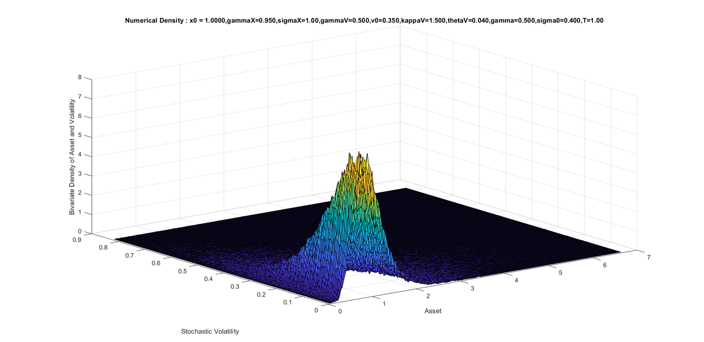](https://postimg.cc/Z06Gf29d)

[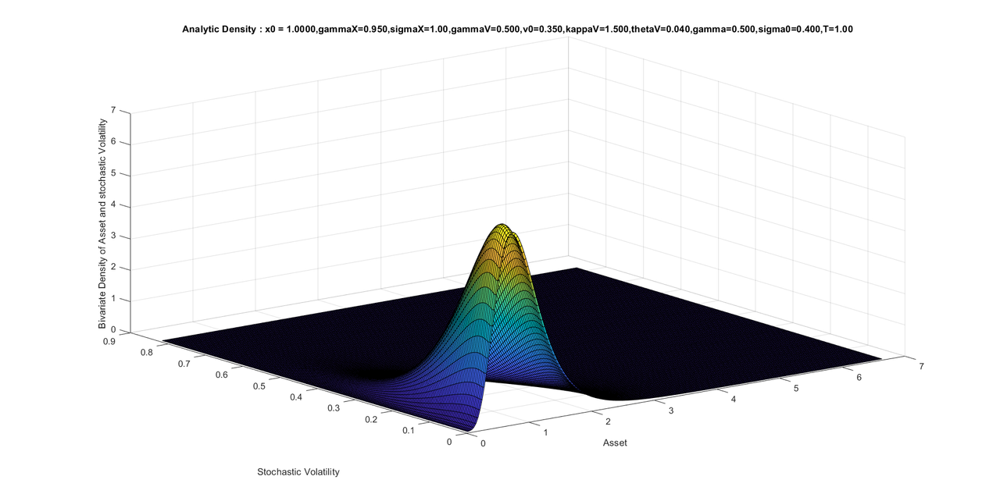](https://postimg.cc/m13Kt1xw)

[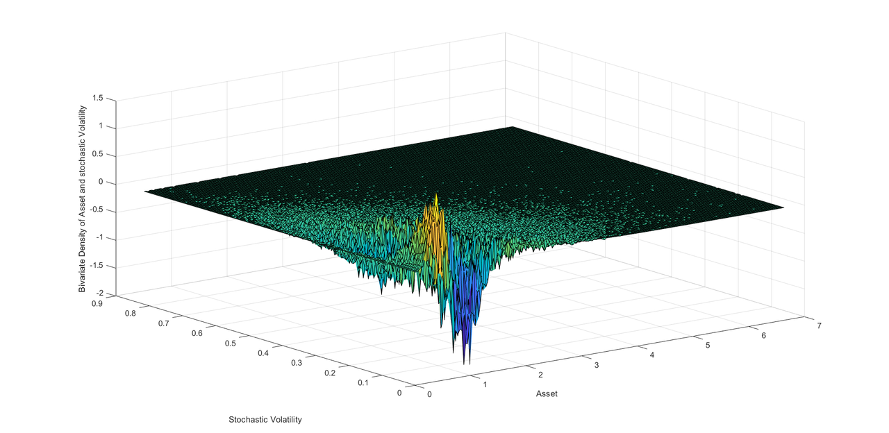](https://postimg.cc/qz09WwnZ)

Here is the match to call prices when you run the above program.

CallStrikes =

  Columns 1 through 3

   0.500000000000000   0.550000000000000   0.600000000000000

  Columns 4 through 6

   0.650000000000000   0.700000000000000   0.750000000000000

  Columns 7 through 9

   0.800000000000000   0.850000000000000   0.900000000000000

  Columns 10 through 12

   0.950000000000000   1.000000000000000   1.050000000000000

  Columns 13 through 15

   1.100000000000000   1.150000000000000   1.200000000000000

  Columns 16 through 18

   1.250000000000000   1.300000000000000   1.350000000000000

  Columns 19 through 21

   1.400000000000000   1.450000000000000   1.500000000000000

  Columns 22 through 24

   1.550000000000000   1.600000000000000   1.650000000000000

  Columns 25 through 26

   1.700000000000000   1.750000000000000

CallPricesAnalytic =

  Columns 1 through 3

   0.509487982215814   0.465103519260781   0.422714041030561

  Columns 4 through 6

   0.382584182857529   0.344920787323411   0.309865336968273

  Columns 7 through 9

   0.277492453750153   0.247813514731967   0.220784028449898

  Columns 10 through 12

   0.196313303114626   0.174275054971255   0.154517866783924

  Columns 13 through 15

   0.136874727492322   0.121171197691991   0.107232009755184

  Columns 16 through 18

   0.094886107774572   0.083970260402210   0.074331448954227

  Columns 19 through 21

   0.065828258156472   0.058331492088054   0.051724215544333

  Columns 22 through 24

   0.045901390462102   0.040769244517741   0.036244478333476

  Columns 25 through 26

   0.032253390876549   0.028730980338207

CallPricesMC =

  Columns 1 through 3

   0.509555171210645   0.465160287142170   0.422761203042178

  Columns 4 through 6

   0.382622044630732   0.344961421386475   0.309895346817889

  Columns 7 through 9

   0.277521379247705   0.247858437003286   0.220837543809182

  Columns 10 through 12

   0.196389240208788   0.174364792869231   0.154614299978868

  Columns 13 through 15

   0.136974579516922   0.121273837571018   0.107314536256706

  Columns 16 through 18

   0.094964390470363   0.084047012065046   0.074398109866239

  Columns 19 through 21

   0.065884198300206   0.058380815431788   0.051770672073232

  Columns 22 through 24

   0.045938798631525   0.040791771758597   0.036248599123826

  Columns 25 through 26

   0.032242259484817   0.028701490166561

Look at comparison of analytic and monte carlo call prices

---

### #2179 — Amin (Topic Author)
*February 4, 2024, 6:41 AM*

Friends, please notice the following lines of code in the body of the main program.

MaxCutOffX=7.0;

MaxCutOffV=.825;

This specifies the max domain for independent and dependent variable X and Y. You might have to adjust it every time you
change the program parameters and the domain changes. If unsure, specify a reasonably large domain.

If actual domain is larger than specified domain, it is truncated at the above input values of max cut off. So if
unsure, specify a reasonably large domain so nothing is truncated.

---

### #2180 — Amin (Topic Author)
*February 6, 2024, 9:01 AM*

Friends, I was able to improve the regression program and now regression is done to find Hermite Series coefficients
instead of Z-series Coefficients.  I also replace the regression output on the zeroth Zy hermite order (on the row that
is associated with retrieval of marginal density condition) by the respective analytic values. And it is a quite robust
and much improved algorithm. I think there could be more possibilities of improvement in the regression algorithm but
they might require a more thoughtful work on a longer term basis.

I am also giving comparison of a call price in a high correlated frameowrk with very high volatility out to five years
with monte carlo paths varying from 100,000 to 1000. While numericla density generation algorithm completely fails on
smaller number of paths(it could have worked somewhat better if I decreased the number of grid points) , it works better
with regression based analytic method. I also noticed that with smaller paths, analytic based option prices are better
than MC prices. I have not used any mean-correction in this program.

In the next post, I will paste the program used to create the graphs and figures in this post.

SDEs are

dX(t)= sigma1 * V(t)^gammaV * X(t)^gammaX *dZx(t)

dV(t)=kappa*(theta -V(t)) * dt + sigma0 * V(t)^gamma * dZy(t)

dZx(t) and dZy(t) are correlated.

X0=1.0;

rho=-.75;

sigma1=.25;

gammaV=.5;

gammaX=.95;

% %%%%%%%%`%%%%%

V0=1;

thetaV=1;

kappaV=1.50;

gamma=.5;

sigma0=1.25;

dt=.03125/2;

Tt=64*5;

T=Tt*dt;

With 100,000 paths

CallPricesAnalytic =

  Columns 1 through 3

   0.527438103989583   0.486893784196548   0.448164005512831

  Columns 4 through 6

   0.411330383044696   0.376450803219980   0.343560310221392

  Columns 7 through 9

   0.312672465894906   0.283781061948643   0.256862076013260

  Columns 10 through 12

   0.231875776629583   0.208768895877378   0.187476801699837

  Columns 13 through 15

   0.167925614662423   0.150034225660958   0.133716181794341

  Columns 16 through 18

   0.118881417144590   0.105437813520451   0.093292583326102

  Columns 19 through 21

   0.082353472654369   0.072529787541434   0.063733250143092

  Columns 22 through 24

   0.055878694498746   0.048884613642442   0.042673571206249

  Columns 25 through 26

   0.037172491444300   0.032312841885555

CallPricesMC =

  Columns 1 through 3

   0.527696091991451   0.487125849363488   0.448402525264735

  Columns 4 through 6

   0.411565192235541   0.376646917983157   0.343691165304375

  Columns 7 through 9

   0.312754210431490   0.283861063269005   0.256955257143676

  Columns 10 through 12

   0.231978264427242   0.208874944392849   0.187559163946323

  Columns 13 through 15

   0.167994996330900   0.150107696887230   0.133795461037788

  Columns 16 through 18

   0.118996305086977   0.105571675926258   0.093433633600919

  Columns 19 through 21

   0.082483250628488   0.072668441739208   0.063866029818321

  Columns 22 through 24

   0.055992937350321   0.048996538436569   0.042770111166265

  Columns 25 through 26

   0.037258476265417   0.032378254160906

100000 Above

[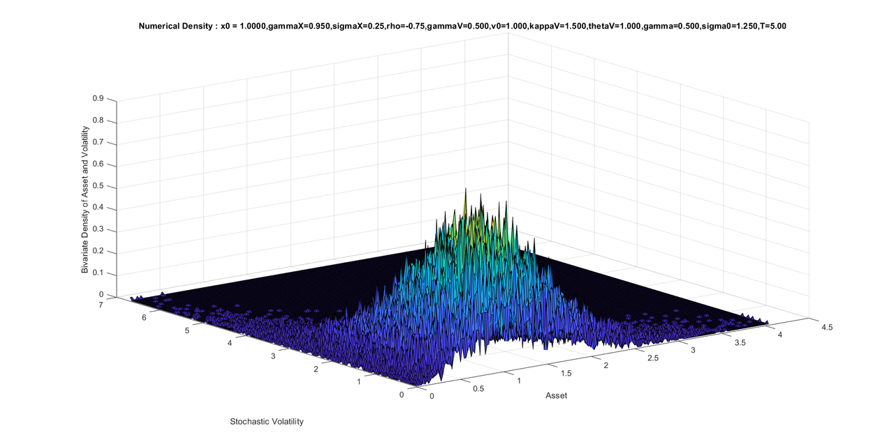](https://postimg.cc/dZ10k2Hj)

[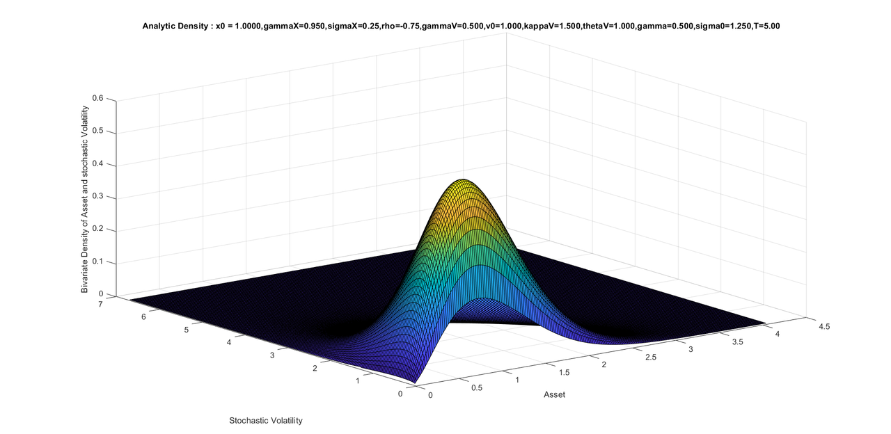](https://postimg.cc/wyFvjfVB)

With 50,000 paths

CallPricesAnalytic =

  Columns 1 through 3

   0.527632726554312   0.487168675390479   0.448519617202313

  Columns 4 through 6

   0.411763436601608   0.376955041185884   0.344127311556048

  Columns 7 through 9

   0.313292445351759   0.284443597882589   0.257556731538260

  Columns 10 through 12

   0.232592596105221   0.209498772157953   0.188211719608974

  Columns 13 through 15

   0.168658783096940   0.150760115005088   0.134430485403619

  Columns 16 through 18

   0.119580956003056   0.106120402225618   0.093956873710629

  Columns 19 through 21

   0.082998788955262   0.073155964362479   0.064340481750680

  Columns 22 through 24

   0.056467401416146   0.049455330182652   0.043226855584112

  Columns 25 through 26

   0.037708858472491   0.032832716994158

CallPricesMC =

  Columns 1 through 3

   0.528414063988373   0.487916698818146   0.449301739617177

  Columns 4 through 6

   0.412538211962769   0.377692297773615   0.344810986128370

  Columns 7 through 9

   0.313959663766047   0.285081014521419   0.258126842822477

  Columns 10 through 12

   0.233079774837407   0.209894317328110   0.188612988919989

  Columns 13 through 15

   0.169079892450216   0.151225242769472   0.134953696793732

  Columns 16 through 18

   0.120136182945449   0.106703246461557   0.094532751522946

  Columns 19 through 21

   0.083512047464149   0.073614534771808   0.064763157179510

  Columns 22 through 24

   0.056847132960623   0.049794190576070   0.043489581127359

  Columns 25 through 26

   0.037883045703414   0.032950551992180

Look at comparison of analytic and monte carlo call prices

50,000 above

[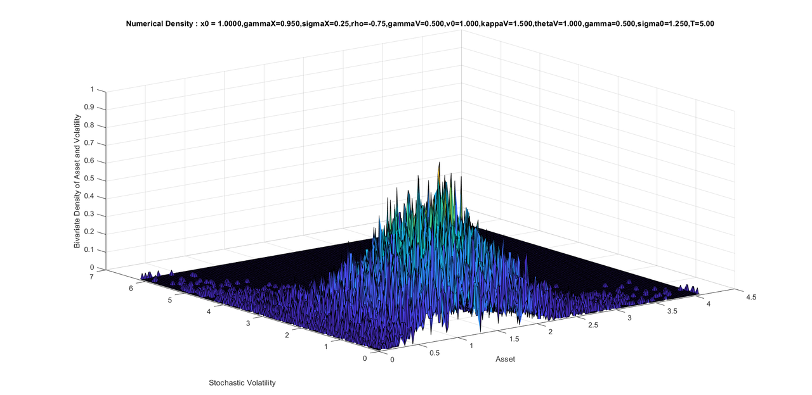](https://postimg.cc/F1Wzt6zW)

[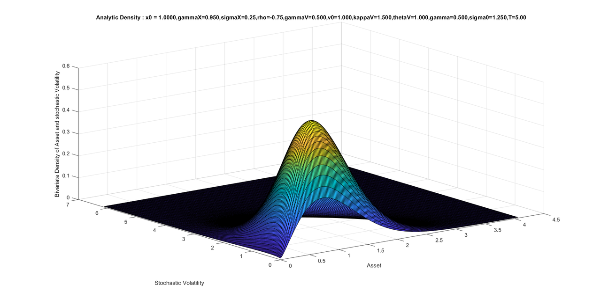](https://postimg.cc/Lh65bS9g)

With 10,000 paths

CallPricesAnalytic =

  Columns 1 through 3

   0.527605126571525   0.487075877356552   0.448357403517502

  Columns 4 through 6

   0.411531187657135   0.376655216350275   0.343764724802182

  Columns 7 through 9

   0.312873463133263   0.283975361773987   0.257046478977352

  Columns 10 through 12

   0.232047123709577   0.208924060537810   0.187612718088429

  Columns 13 through 15

   0.168039337932484   0.150123015399735   0.133777597174530

  Columns 16 through 18

   0.118913412208740   0.105438822347530   0.093261587114768

  Columns 19 through 21

   0.082290043466212   0.072434106171070   0.063606098033510

  Columns 22 through 24

   0.055721421625379   0.048699085767748   0.042462100850141

  Columns 25 through 26

   0.036937757367047   0.032057801912709

CallPricesMC =

  Columns 1 through 3

   0.526038961629728   0.485708621975398   0.447214971610968

  Columns 4 through 6

   0.410578973598148   0.375819373756502   0.342958051737193

  Columns 7 through 9

   0.311999192858338   0.282958894797217   0.255917525626844

  Columns 10 through 12

   0.230911497099195   0.207738238614722   0.186270616149358

  Columns 13 through 15

   0.166547697971958   0.148626344301360   0.132396432118803

  Columns 16 through 18

   0.117635347521275   0.104300001261917   0.092265117662645

  Columns 19 through 21

   0.081399096929432   0.071678842425730   0.062928012687493

  Columns 22 through 24

   0.055056915104883   0.048088402481321   0.041853982339827

  Columns 25 through 26

   0.036339527532681   0.031577693677746

Look at comparison of analytic and monte carlo call prices

10,000 above

[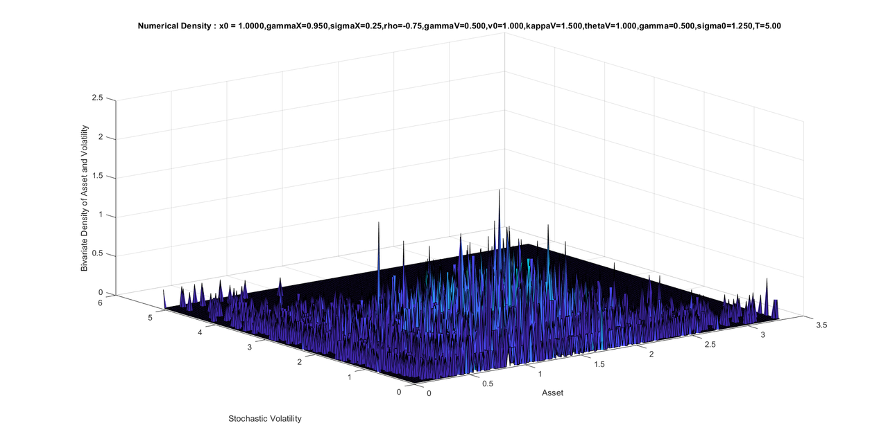](https://postimg.cc/mPMgH2wJ)

[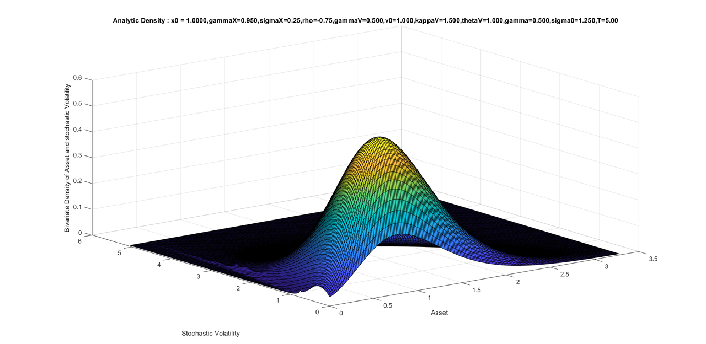](https://postimg.cc/Lqp6BKQX)

With 2,000 paths

CallPricesAnalytic =

  Columns 1 through 3

   0.523637332434867   0.482433247116282   0.443061925704705

  Columns 4 through 6

   0.405620863442822   0.370180417882382   0.336789224221029

  Columns 7 through 9

   0.305472865086325   0.276234985395525   0.249058844851658

  Columns 10 through 12

   0.223909206838301   0.200734464286802   0.179468909114383

  Columns 13 through 15

   0.160035061307152   0.142345985277300   0.126307533536641

  Columns 16 through 18

   0.111820470063269   0.098782437358228   0.087089741750816

  Columns 19 through 21

   0.076638941105803   0.067328230481031   0.059058571377343

  Columns 22 through 24

   0.051734589438266   0.045265467810567   0.039565551641315

  Columns 25 through 26

   0.034554753196707   0.030158793703954

CallPricesMC =

  Columns 1 through 3

   0.520714574924874   0.479476274742197   0.440253490786600

  Columns 4 through 6

   0.402887375592353   0.367649619437721   0.334327903869671

  Columns 7 through 9

   0.302921608481170   0.273724184475292   0.246468843993498

  Columns 10 through 12

   0.221237304093031   0.198193894954002   0.177110167489498

  Columns 13 through 15

   0.157705133418319   0.140414769657026   0.124721845234325

  Columns 16 through 18

   0.110402441259325   0.097654717822012   0.086205245872351

  Columns 19 through 21

   0.075909899107325   0.066689659283261   0.058461726589927

  Columns 22 through 24

   0.051178288561298   0.044801145758170   0.039208136542933

  Columns 25 through 26

   0.034339326482945   0.030083374877032

Look at comparison of analytic and monte carlo call prices

2,000 above

[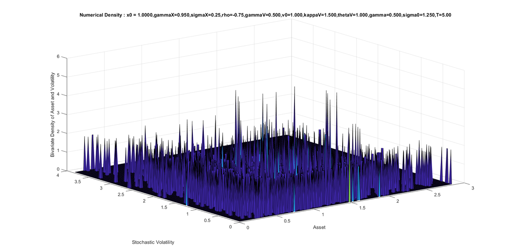](https://postimg.cc/7GPHd1kr)

[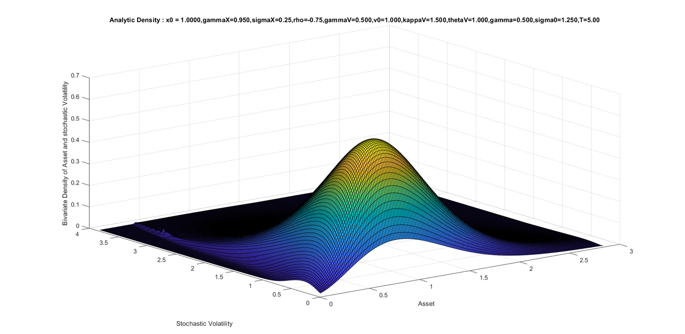](https://postimg.cc/Kk9G2KGk)

With 1000 paths in monte carlo simulatiopns

CallPricesAnalytic =

  Columns 1 through 3

   0.527436927116339   0.487255716755016   0.448902011062114

  Columns 4 through 6

   0.412430790345335   0.377878078423775   0.345262304458868

  Columns 7 through 9

   0.314585717080233   0.285835826953791   0.258986866328397

  Columns 10 through 12

   0.234001257327116   0.210831064445895   0.189419408050517

  Columns 13 through 15

   0.169701830045821   0.151607606670728   0.135061002595844

  Columns 16 through 18

   0.119982460188272   0.106289718137765   0.093898854285583

  Columns 19 through 21

   0.082725248302044   0.072684460749857   0.063693026011373

  Columns 22 through 24

   0.055669157525629   0.048533364758300   0.042208982301671

  Columns 25 through 26

   0.036622652925843   0.031704830715604

CallPricesMC =

  Columns 1 through 3

   0.527153383174902   0.486643468702020   0.448174607105045

  Columns 4 through 6

   0.411958295798393   0.377659515573967   0.344885444473615

  Columns 7 through 9

   0.314330069981392   0.285426393405843   0.258806040928825

  Columns 10 through 12

   0.234423236341307   0.211916008581684   0.190769640050504

  Columns 13 through 15

   0.171487639112718   0.153619557862421   0.137148619384768

  Columns 16 through 18

   0.121765763122229   0.107549231307281   0.094540643231603

  Columns 19 through 21

   0.082893693261777   0.072486759626013   0.063216145103120

  Columns 22 through 24

   0.054922792041779   0.047622741801919   0.041527221082263

  Columns 25 through 26

   0.036126716397764   0.031190040097932

Look at comparison of analytic and monte carlo call prices

1000 above

[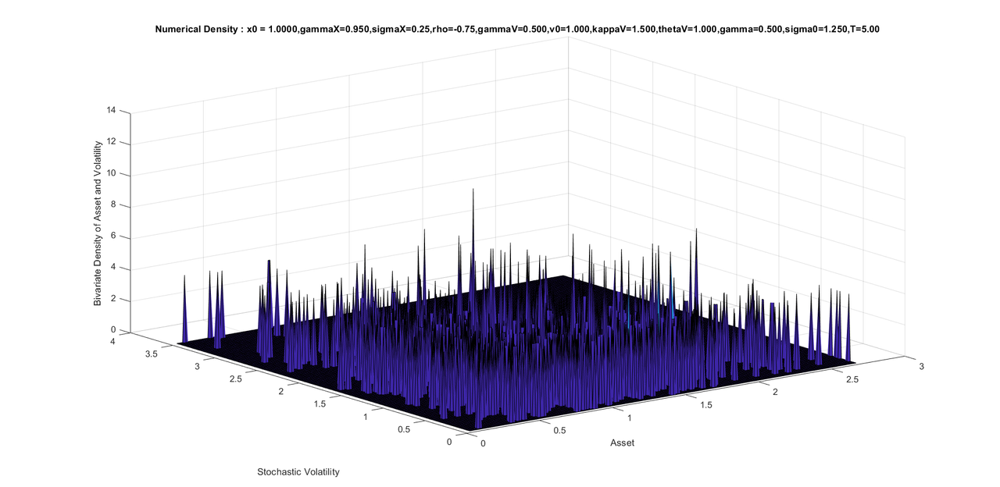](https://postimg.cc/GHTcWhZt)

[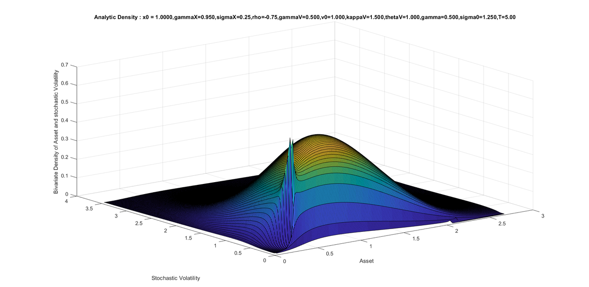](https://postimg.cc/fV4wDQNK)

---

### #2181 — Amin (Topic Author)
*February 6, 2024, 9:08 AM*

Here are the main functions used to create graphs and call prices in previous post.

.

.

```
function [] = SVMonteCarloAndAssetConditionalDensityHermites()

%The purpose of this program is to take two random varaibles one of which
%is independent and the other is dependent on the first varaible also with
%its own dynamics.
%We want to capture the conditional dependent density structure from the
%cross moments of dependent and in dependent random variables by
%employing a two dimensional density for the dependent variable.
%We want to find the detailed relationship between Y and X so we can get
%the conditional density of dependent variable X given a particular value
%of independent variable Y. This will be done by calibrating coefficients
%of our 2D hermite series to data so that a very good fit to cross moments
%between X and Y is retrieved.

%In this program, we jointly simulate the system of SV and asset SDEs to
%get the joint data of asset and stochastic volatility.
%We use this data to calculate cross moments of asset and volatility. These
%cross moments are then used to calibrate the coefficients of the 2D
%hermite series density of dependent variable X. We also find univariate
%density of independent random variable volatility.
%We use the 2D Hermite series density of dependent variable X and
%univariate density of V to draw a graph of bivariate analytic density of
%X and V.
%We compare this graph of analytic bivariate density with monte carlo
%generated 2D bivariate density of simulated values of X and V in order to
%get an idea how good our calculation of 2D dependent density of X is. We
%also compare analytically calculated values of call prices using our
%calculated 2D hermite series conditional density of X in order to get an
%idea how good our calculation of the 2D hermite series density of X is.

% 2D Hermite Series Form used in this program is given as
%
% X = bnmH(1,1) + bnmH(2,1) H_1(Z_y) + bnmH(3,1) H_2(Z_y) + bnmH(4,1) H_3(Z_y) + bnmH(5,1) H_4(Z_y) + bnmH(6,1) H_5(Z_y)
% + [ bnmH(1,2) + bnmH(2,2) H_1(Z_y) + bnmH(3,2) H_2(Z_y) + bnmH(4,2) H_3(Z_y) + bnmH(5,2) H_4(Z_y) + bnmH(6,2)
H_5(Z_y)] H_1(Zx)
% + [ bnmH(1,3) + bnmH(2,3) H_1(Z_y) + bnmH(3,3) H_2(Z_y) + bnmH(4,3) H_3(Z_y) + bnmH(5,3) H_4(Z_y) + bnmH(6,3)
H_5(Z_y)] H_2(Zx)
% + [ bnmH(1,4) + bnmH(2,4) H_1(Z_y) + bnmH(3,4) H_2(Z_y) + bnmH(4,4) H_3(Z_y) + bnmH(5,4) H_4(Z_y) + bnmH(6,4)
H_5(Z_y)] H_3(Zx)
% + [ bnmH(1,5) + bnmH(2,5) H_1(Z_y) + bnmH(3,5) H_2(Z_y) + bnmH(4,5) H_3(Z_y) + bnmH(5,5) H_4(Z_y) + bnmH(6,5)
H_5(Z_y)] H_4(Zx)
% + [ bnmH(1,6) + bnmH(2,6) H_1(Z_y) + bnmH(3,6) H_2(Z_y) + bnmH(4,6) H_3(Z_y) + bnmH(5,6) H_4(Z_y) + bnmH(6,6)
H_5(Z_y)] H_5(Zx)

% 2D Z-Series Form used in this program is given as
%
% X = bnm(1,1) + bnm(2,1) Z_y + bnm(3,1) (Z_y)^2 + bnm(4,1) (Z_y)^3 + bnm(5,1) (Z_y)^4 + bnm(6,1) (Z_y)^5
% + [ bnm(1,2) + bnm(2,2) Z_y + bnm(3,2) (Z_y)^2 + bnm(4,2) (Z_y)^3 + bnm(5,2) (Z_y)^4 + bnm(6,2) (Z_y)^5 ] Zx
% + [ bnm(1,3) + bnm(2,2) Z_y + bnm(3,3) (Z_y)^2 + bnm(4,3) (Z_y)^3 + bnm(5,3) (Z_y)^4 + bnm(6,3) (Z_y)^5 ] Zx^2
% + [ bnm(1,4) + bnm(2,2) Z_y + bnm(3,4) (Z_y)^2 + bnm(4,4) (Z_y)^3 + bnm(5,4) (Z_y)^4 + bnm(6,4) (Z_y)^5 ] Zx^3
% + [ bnm(1,5) + bnm(2,2) Z_y + bnm(3,5) (Z_y)^2 + bnm(4,5) (Z_y)^3 + bnm(5,5) (Z_y)^4 + bnm(6,5) (Z_y)^5 ] Zx^4
% + [ bnm(1,6) + bnm(2,2) Z_y + bnm(3,6) (Z_y)^2 + bnm(4,6) (Z_y)^3 + bnm(5,6) (Z_y)^4 + bnm(6,6) (Z_y)^5 ] Zx^5

%Asset SDE is
%dX(t) = a X(t)^alpha1 dt+ b X(t)^alpha2 dt+ sigma1 V(t)^gammaV X(t)^gammaX dZ(t)
%We usually take a=0 and b=0 in our simulations
%SV SDE is
%dV(t)=mu1 V(t)^beta1 dt+ mu2 V(t)^beta2 dt + sigma0 V(t)^gamma dZ(t)
%In mean reverting SDEs we ususally have
%mu1= kappaV * thetaV
%beta1=0
%mu2=-kappa
%beta2=0

X0=1.0;
alpha1=0;
alpha2=1;
kappaX=0;
thetaX=1;
a=kappaX*thetaX;
b=-kappaX;

rho=-.75;
%sigma1=1;
sigma1=.25;
gammaV=.5;
gammaX=.95;
% %%%%%%%%`%%%%%
% V0=.35;
% thetaV=.04;
% kappaV=1.5;
% mu1=kappaV*thetaV;
% mu2=-kappaV;
% beta1=0;
% beta2=1;
% gamma=.5;
% sigma0=.4;

V0=1;
thetaV=1;
kappaV=1.50;
mu1=kappaV*thetaV;
mu2=-kappaV;
beta1=0;
beta2=1;
gamma=.5;
sigma0=1.25;

dt=.03125/2;
Tt=64*5;

T=Tt*dt;
%%%%%%%%%%%%%%%%%%%%%%%%%%%%%%%%%%%%%%%%%%%%%%%%%%%%%%%%%%%%%%%%%%%%%%%%%%5

%In this code block, we do monte carlo simulation of stochastic volatility SDEs
%And also calculate monte carlo call prices.

seed0=21872418;
rng(seed0, 'twister')
paths=100000;
V(1:paths)=V0;  %Original process monte carlo.
X(1:paths)=X0;

for tt=1:Tt

    Random2(1:paths/2)=randn(paths/2,1);
    Random2(paths/2+1:paths)=-Random2(1:paths/2);
    Random1(1:paths/2)=randn(paths/2,1);
    Random1(paths/2+1:paths)=-Random1(1:paths/2);
    X(1:paths)=X(1:paths)+ ...
    (a* X(1:paths).^alpha1 + b* X(1:paths).^alpha2)* dt + ...
    sqrt(1-rho^2)* sigma1* V(1:paths).^gammaV.* X(1:paths).^gammaX .*Random1(1:paths) * sqrt(dt) + ...
    rho* sigma1* V(1:paths).^gammaV .*X(1:paths).^gammaX .*Random2(1:paths)*sqrt(dt) + ...
    (a*alpha1* X(1:paths).^(alpha1-1)+b*alpha2* X(1:paths).^(alpha2-1)).* ...
    (((a* X(1:paths).^alpha1 + b* X(1:paths).^alpha2)* dt^2/2)+ ...
    (sqrt(1-rho^2)* sigma1* V(1:paths).^gammaV.* X(1:paths).^gammaX .*Random1(1:paths) *(1-1/sqrt(3)).*dt^1.5+ ...
    rho* sigma1* V(1:paths).^gammaV .*X(1:paths).^gammaX .*Random2(1:paths)*(1-1/sqrt(3)).*dt^1.5))+ ...
    .5*(a*alpha1*(alpha1-1)* X(1:paths).^(alpha1-2)+b*alpha2*(alpha2-1).* X(1:paths).^(alpha2-2)).* ...
    ( sigma1^2* V(1:paths).^(2*gammaV).* X(1:paths).^(2*gammaX)) *dt^2/2 + ...
    sqrt(1-rho^2)* sigma1* V(1:paths).^gammaV.*gammaX.* X(1:paths).^(gammaX-1).* ...
    ((a* X(1:paths).^alpha1 + b* X(1:paths).^alpha2).*Random1(1:paths) * 1/sqrt(3).* dt^1.5 + ...
    sqrt(1-rho^2)* sigma1* V(1:paths).^gammaV.* X(1:paths).^gammaX .*(Random1(1:paths).^2-1) * dt/2 + ...
    rho* sigma1* V(1:paths).^gammaV .*X(1:paths).^gammaX .*Random1(1:paths).*Random2(1:paths)*dt/2)+ ...
    .5*sqrt(1-rho^2)* sigma1* V(1:paths).^gammaV.*gammaX.*(gammaX-1).* X(1:paths).^(gammaX-2).* ...
    (sigma1^2* V(1:paths).^(2*gammaV).* X(1:paths).^(2*gammaX) .*Random1(1:paths).*1/sqrt(3).*dt^1.5)+ ...
    sqrt(1-rho^2)* sigma1*gammaV.* V(1:paths).^(gammaV-1).* X(1:paths).^(gammaX).* ...
    ((mu1.*V(1:paths).^beta1 + mu2.*V(1:paths).^beta2).*Random1(1:paths) * 1/sqrt(3).* dt^1.5 + ...
    sigma0*V(1:paths).^gamma.*Random1(1:paths).*Random2(1:paths)*dt/2)+ ...
    .5*sqrt(1-rho^2)* sigma1*gammaV.*(gammaV-1).* V(1:paths).^(gammaV-2).* X(1:paths).^(gammaX).* ...
    (sigma0^2*V(1:paths).^(2*gamma).*Random1(1:paths)*1/sqrt(3)*dt^1.5)+ ...
    sqrt(1-rho^2)* sigma1*gammaV.* V(1:paths).^(gammaV-1).*gammaX.* X(1:paths).^(gammaX-1).* ...
    rho.* sigma1.* V(1:paths).^gammaV .*X(1:paths).^gammaX
.*sigma0.*V(1:paths).^gamma.*Random1(1:paths)*1/sqrt(3)*dt^1.5+ ...
    rho* sigma1* V(1:paths).^gammaV.*gammaX.* X(1:paths).^(gammaX-1).* ...
    ((a* X(1:paths).^alpha1 + b* X(1:paths).^alpha2).*Random2(1:paths) * 1/sqrt(3).* dt^1.5 + ...
    sqrt(1-rho^2)* sigma1* V(1:paths).^gammaV.* X(1:paths).^gammaX .*Random1(1:paths).*Random2(1:paths) * dt/2 + ...
    rho* sigma1* V(1:paths).^gammaV .*X(1:paths).^gammaX .*(Random2(1:paths).^2-1)*dt/2)+ ...
    .5*rho* sigma1* V(1:paths).^gammaV.*gammaX.*(gammaX-1).* X(1:paths).^(gammaX-2).* ...
    (sigma1^2* V(1:paths).^(2*gammaV).* X(1:paths).^(2*gammaX) .*Random2(1:paths).*1/sqrt(3).*dt^1.5)+ ...
    rho* sigma1*gammaV.* V(1:paths).^(gammaV-1).* X(1:paths).^(gammaX).* ...
    ((mu1.*V(1:paths).^beta1 + mu2.*V(1:paths).^beta2).*Random2(1:paths) * 1/sqrt(3).* dt^1.5 + ...
    sigma0*V(1:paths).^gamma.*(Random2(1:paths).^2-1)*dt/2)+ ...
    .5*rho* sigma1*gammaV.*(gammaV-1).* V(1:paths).^(gammaV-2).* X(1:paths).^(gammaX).* ...
    sigma0^2.*V(1:paths).^(2*gamma).*Random2(1:paths) * 1/sqrt(3).* dt^1.5+ ...
    rho* sigma1*gammaV.* V(1:paths).^(gammaV-1).*gammaX.* X(1:paths).^(gammaX-1).* ...
    rho.* sigma1.* V(1:paths).^gammaV .*X(1:paths).^gammaX
.*sigma0.*V(1:paths).^gamma.*Random2(1:paths)*1/sqrt(3)*dt^1.5;

    V(1:paths)=V(1:paths)+ ...
        (mu1.*V(1:paths).^beta1 + mu2.*V(1:paths).^beta2)*dt + ...
        sigma0*V(1:paths).^gamma .*Random2(1:paths)*sqrt(dt) + ...
        (mu1.*beta1*V(1:paths).^(beta1-1) + mu2.*beta2.*V(1:paths).^(beta2-1)).* ...
        ((mu1.*V(1:paths).^beta1 + mu2.*V(1:paths).^beta2)*dt^2/2 + ...
        sigma0*V(1:paths).^gamma .*Random2(1:paths)*(1-1/sqrt(3))*dt^1.5) + ...
        .5*(mu1.*beta1.*(beta1-1).*V(1:paths).^(beta1-2) + mu2.*beta2.*(beta2-1).*V(1:paths).^(beta2-2)).* ...
        sigma0^2.*V(1:paths).^(2*gamma).*dt^2/2 + ...
        sigma0*gamma*V(1:paths).^(gamma-1) .* ...
        ((mu1.*V(1:paths).^beta1 + mu2.*V(1:paths).^beta2).*Random2(1:paths).*1/sqrt(3)*dt^1.5 + ...
        sigma0.*V(1:paths).^gamma .*(Random2(1:paths).^2-1)*dt/2) + ...
        .5*sigma0*gamma*(gamma-1).*V(1:paths).^(gamma-2) .* ...
        sigma0^2.*V(1:paths).^(2*gamma) .*Random2(1:paths).*1/sqrt(3)*dt^1.5;

end
X(XCallStrikes(nn))
            CallPricesMC(nn)=CallPricesMC(nn)+(X(pp)-CallStrikes(nn))/paths;
        end
    end
end

% CallPricesMC
%
% str=input("Look at Call prices");

%%%%%%%%%%%%%%%%%%%%%%%%%%%%%%%%%%%%%%%%%%%%%%%%%%%%%%%%%%%%%%%%%%%%%%%%%%%%%%%%%%%%
%In this code block, we calculate and draw numerically calculated
%2D bivariate density of X and V.

NoOfBinsV=200;
NoOfBinsX=200;
MaxCutOffX=8.0;
MaxCutOffV=7.825;

[XYProbDensity2D,Xn,Vm,BinSizeX,BinSizeV] =
Find2DDensitFromSimulation_Infiniti(X,V,paths,NoOfBinsX,NoOfBinsV,MaxCutOffX,MaxCutOffV);

%Above, we calculate the joint bivariate density of X and V numerically
%from simulated values of X and V. We do this calculation only for comparison
%purposes with analytic 2D bivariate density of X and V.

surf(Xn(2:NoOfBinsX+1),Vm(3:NoOfBinsV+1),transpose(XYProbDensity2D(2:NoOfBinsX+1,3:NoOfBinsV+1)))
title(sprintf('Numerical Density : x0 =
%.4f,gammaX=%.3f,sigmaX=%.2f,rho=%.2f,gammaV=%.3f,v0=%.3f,kappaV=%.3f,thetaV=%.3f,gamma=%.3f,sigma0=%.3f,T=%.2f',
X0,gammaX,sigma1,rho,gammaV,V0,kappaV,thetaV,gamma,sigma0,T));%,sprintf('theta= %f', theta), sprintf('kappa = %f',
kappa),sprintf('sigma = %f', sigma0),sprintf('T = %f', T));
xlabel('Asset'), ylabel('Stochastic Volatility'),zlabel('Bivariate Density of Asset and Volatility')

str=input("Look at numerical bivariate density of Asset and Stochastic Volatility")

%%%%%%%%%%%%%%%%%%%%%%%%%%%%%%%%%%%%%%%%%%%%%%%%%%%%%%%%%%%%%%%%%%%%%%%%%5
%In this block, we calculate the 2D conditional Z-series density of dependent
%variable X given by coefficients 2D array bnm and 1D univariate Z-series density with
%coefficients stored in aa.
%We draw a graph of this analytic density and calculate the difference with
%numerical density.

[bnm,aa] = CalculateConditionalProbabilitiesYtoXLinearRegression02(V,X);

[pXY2D] = Calculate2VariablesOn2DGridFromAnalyticZSeriesA(Xn,Vm,NoOfBinsX,NoOfBinsV,bnm,aa);

surf(Xn(2:NoOfBinsX+1),Vm(3:NoOfBinsV+1),transpose(pXY2D(2:NoOfBinsX+1,3:NoOfBinsV+1)))
title(sprintf('Analytic Density : x0 =
%.4f,gammaX=%.3f,sigmaX=%.2f,rho=%.2f,gammaV=%.3f,v0=%.3f,kappaV=%.3f,thetaV=%.3f,gamma=%.3f,sigma0=%.3f,T=%.2f',
X0,gammaX,sigma1,rho,gammaV,V0,kappaV,thetaV,gamma,sigma0,T));%,sprintf('theta= %f', theta), sprintf('kappa = %f',
kappa),sprintf('sigma = %f', sigma0),sprintf('T = %f', T));
xlabel('Asset'), ylabel('Stochastic Volatility'),zlabel('Bivariate Density of Asset and stochastic Volatility')

str=input("Look at Analytic density of Asset and Stochastic volatility")
%str=input("Look at Analytic density of Asset and Stochastic volatility")
surf(Xn(2:NoOfBinsX+1),Vm(3:NoOfBinsV+1),transpose(pXY2D(2:NoOfBinsX+1,3:NoOfBinsV+1)-XYProbDensity2D(2:NoOfBinsX+1,3:NoOfBinsV+1)))
%title(sprintf('Difference of Analytic and Numerical Density  : x0 =
%.4f,gammaX=%.3f,sigmaX=%.2f,gammaV=%.3f,v0=%.3f,kappaV=%.3f,thetaV=%.3f,gamma=%.3f,sigma0=%.3f,T=%.2f',
X0,gammaX,sigma1,gammaV,V0,kappaV,thetaV,gamma,sigma0,T));%,sprintf('theta= %f', theta), sprintf('kappa = %f',
kappa),sprintf('sigma = %f', sigma0),sprintf('T = %f', T));
xlabel('Asset'), ylabel('Stochastic Volatility'),zlabel('Bivariate Density of Asset and stochastic Volatility')

str=input("Look at difference of numerical and analytic densities of Asset and stochastic volatility")

%%%%%%%%%%%%%%%%%%%%%%%%%%%%%%%%%%%%%%%%%%%%%%%%%%%%%%%%%%%%%%%%%%%%%%%%%%%%%%%%%%%%

%In this last block, we use previously calculated values of 2D Z-series
%coefficients of dependent variable X stored in 2D array bnm and Z-series
%univariate density of V to calculate the option prices. We compare
%analytically calculated option prices with monte carlo option prices.
%Purpose again is to find out how good our calculation of 2D conditional
%Z-series density of dependent variable X is.

CallStrikes=[.5,.55,.6,.65,.7,.75,.8,.85,.9,.95,1,1.05,1.1,1.15,1.2,1.25,1.3,1.35,1.4,1.45,1.5,1.55,1.6,1.65,1.7,1.75]

VolGridSize=400;

[CallPricesAnalytic]=PriceCallArrayOver2DDensityA(aa,bnm,CallStrikes,VolGridSize);

CallPricesAnalytic
CallPricesMC

str=input("Look at comparison of analytic and monte carlo call prices");

end
```

.

.

.

```
function [bnm,aa] = CalculateConditionalProbabilitiesYtoXLinearRegression02(Yin,Xin)

%Yin argument translates to independent random variable Y
%Xin argument translates to dependent variable X.
%This function takes observations of an independent variable Y and
%dependent varaible X. These have to be joint observations in the sense
%that nth observation of Y, given by Y(n) is taken jointly with nth
%observation of X, given by X(n). Two arrays of observations are the same
%length and nth mmber of independent variable Y is jointly observed with nth
%member of depedent variable X.
%We want to find the detailed relationship between Y and X so we can get
%the conditional density of dependent variable X given a particular value
%of independent variable Y. This will be done by calibrating coefficients
%of our 2D hermite series to data so that a very good fit to cross moments
%between X and Y is retrieved.
%We will first find univariate Z-series/hermite series of both random
%variables independently. For joint dynamics of dependent variable given
%te independnet variable, we will assume a 2D hermite series (This has to
%be two dimensional to be able to capture the dynamics from independent variable Y
%and have its own dynamics) and form but we do not know the coefficients of
%this 2D hermite series. In this program, we try to use iterative optimization
%to find the unknown coefficients of 2D hermite series of dependent variable X
%in a way that after taking products with independent varaible Y, expectation
%of these products i.e cross moments are as exactly retrieved as possible.
%Our iterative optimization procedure perturbs each hermite coefficient in
%2D hermite series  by a very slight amount and checks the objective function.
%If the objective function decreases, we eccept the perturbation otherwise
%reject it and then perturb by a small amount in other opposite direction
%and then again check the objective function. If perturbations in both sides
%are rejected, we do not change the coefficients but slightly decrease the
%perturbation size.
%We will first standardize the data of both random variables and then
%calculate univariate hermite series of both variables and also their
%cross moments in standardized form. We do all the calculations of coefficients
%of independent variable Y and 2D dependent variable X
%in standardized version of variables and moments. After optimization of coefficents on
%standardized data, at the end, we invert the standardization of both
%dependent and independent variables appropriately to get the Z-series and
%hermite series of actual varaibles in theri original coordinates back from
%standardized coordinates.
%Before optimization, we place two conditions on 2D dependent variable X so that
%first row and first column of 2D hermite coefficents of X is already
%known before optimization stage and it is not changed in optimization.
%We do not iteratively optimize over this first row and first colums
%which are analytically known from these two conditions.
%Our first condition is that after integration (of bivaraite density or
%alternatively bivaraite 2D Z-series/2D Hermite series) over independent
%variable, we should get the univaraite marginal density/Z-series/Hermite series of X
%which has already been calculated out of data. This fixes the zeroth
%hermite(of independent varaible Y) related terms in the Z-series/hermite series.
%Please look at this forum post# 2121 for explanation of this first condition.
% https://forum.wilmott.com/viewtopic.php?t=99702&start=2115#p879042

%We can analytically solve for first order cross moments of X with higher
%order in Y. From the analytical solution of these moments, we find first
%row of coefficents in the hermite form.

% 2D Hermite Series Form used in this program is given as
%
% X = bnmH(1,1) + bnmH(2,1) H_1(Z_y) + bnmH(3,1) H_2(Z_y) + bnmH(4,1) H_3(Z_y) + bnmH(5,1) H_4(Z_y) + bnmH(6,1) H_5(Z_y)
% + [ bnmH(1,2) + bnmH(2,2) H_1(Z_y) + bnmH(3,2) H_2(Z_y) + bnmH(4,2) H_3(Z_y) + bnmH(5,2) H_4(Z_y) + bnmH(6,2)
H_5(Z_y)] H_1(Zx)
% + [ bnmH(1,3) + bnmH(2,3) H_1(Z_y) + bnmH(3,3) H_2(Z_y) + bnmH(4,3) H_3(Z_y) + bnmH(5,3) H_4(Z_y) + bnmH(6,3)
H_5(Z_y)] H_2(Zx)
% + [ bnmH(1,4) + bnmH(2,4) H_1(Z_y) + bnmH(3,4) H_2(Z_y) + bnmH(4,4) H_3(Z_y) + bnmH(5,4) H_4(Z_y) + bnmH(6,4)
H_5(Z_y)] H_3(Zx)
% + [ bnmH(1,5) + bnmH(2,5) H_1(Z_y) + bnmH(3,5) H_2(Z_y) + bnmH(4,5) H_3(Z_y) + bnmH(5,5) H_4(Z_y) + bnmH(6,5)
H_5(Z_y)] H_4(Zx)
% + [ bnmH(1,6) + bnmH(2,6) H_1(Z_y) + bnmH(3,6) H_2(Z_y) + bnmH(4,6) H_3(Z_y) + bnmH(5,6) H_4(Z_y) + bnmH(6,6)
H_5(Z_y)] H_5(Zx)

% 2D Z-Series Form used in this program is given as
%
% X = bnm(1,1) + bnm(2,1) Z_y + bnm(3,1) (Z_y)^2 + bnm(4,1) (Z_y)^3 + bnm(5,1) (Z_y)^4 + bnm(6,1) (Z_y)^5
% + [ bnm(1,2) + bnm(2,2) Z_y + bnm(3,2) (Z_y)^2 + bnm(4,2) (Z_y)^3 + bnm(5,2) (Z_y)^4 + bnm(6,2) (Z_y)^5 ] Zx
% + [ bnm(1,3) + bnm(2,2) Z_y + bnm(3,3) (Z_y)^2 + bnm(4,3) (Z_y)^3 + bnm(5,3) (Z_y)^4 + bnm(6,3) (Z_y)^5 ] Zx^2
% + [ bnm(1,4) + bnm(2,2) Z_y + bnm(3,4) (Z_y)^2 + bnm(4,4) (Z_y)^3 + bnm(5,4) (Z_y)^4 + bnm(6,4) (Z_y)^5 ] Zx^3
% + [ bnm(1,5) + bnm(2,2) Z_y + bnm(3,5) (Z_y)^2 + bnm(4,5) (Z_y)^3 + bnm(5,5) (Z_y)^4 + bnm(6,5) (Z_y)^5 ] Zx^4
% + [ bnm(1,6) + bnm(2,2) Z_y + bnm(3,6) (Z_y)^2 + bnm(4,6) (Z_y)^3 + bnm(5,6) (Z_y)^4 + bnm(6,6) (Z_y)^5 ] Zx^5

%%%%%%%%%%%%%%%%%%%%%%%%%%%%%%%%%%%%%%%%%%%%%%%%%%%%%%%%%%%%%%%%%%%%%%%

%In the code block below, we standardize the independent variable Y and dependent variable X.
%We do all later calculations of various Z-series and cross moments in
%standardized framework and then at the end of the program, we convert
%the calculated coefficients of 2D hermite series/Z-series of dependent
%variable X into original non-standardized framework.

 Ndata=length(Yin);

 MeanY=sum(Yin(1:Ndata))/Ndata;
 MeanX=sum(Xin(1:Ndata))/Ndata;

 Ym(1:Ndata)=Yin(1:Ndata)-MeanY;
 Xm(1:Ndata)=Xin(1:Ndata)-MeanX;

 YmVar=sum(Ym(1:Ndata).^2)/Ndata;
 XmVar=sum(Xm(1:Ndata).^2)/Ndata;

 Y(1:Ndata)=Ym(1:Ndata)/sqrt(YmVar);
 X(1:Ndata)=Xm(1:Ndata)/sqrt(XmVar);

 %%%%%%%%%%%%%%%%%%%%%%%%%%%%%%%%%%%%%%%%%%%%%%%%%%%%%%%%%%%%%%%%%%%%
%Code block below uses polynomial regression to find univariate Z-series
%coefficients of independent variable Y.
%To know more about polynomial regression read the following and associated
%posts:  https://forum.wilmott.com/viewtopic.php?t=99702&start=2010#p877143

%You can get the text file MomentMatchParams08.txt from the forum post below
%https://forum.wilmott.com/viewtopic.php?f=4&t=99702&start=2040#p877863

Mtable=readtable('C:\Users\Lenovo\Documents\MATLAB\MATLAB1\MomentMatchParams08.txt');

%ZI is moment matched grid along the normal density with number of grid
%points equal to data elements in Y given by Ndata. The grid is constructed
%so that probability mass in each grid cell is 1/Ndata so this matches the
%observation probability of Ndata data elements. Due to equal probability
%mass in each grid cell, we call it equiprobable grid.

[ZI] = MatchMomentParametersOfIdealZhalf04(Ndata,Mtable);

Ys=sort(Y);
Ymu(1:Ndata,1)=Ys(1:Ndata);

W(1:Ndata,1)=1;
W(1:Ndata,2)=ZI(1:Ndata);
W(1:Ndata,3)=ZI(1:Ndata).^2;
W(1:Ndata,4)=ZI(1:Ndata).^3;
W(1:Ndata,5)=ZI(1:Ndata).^4;
W(1:Ndata,6)=ZI(1:Ndata).^5;
% W(1:Ndata,7)=ZI(1:Ndata).^6;
% W(1:Ndata,8)=ZI(1:Ndata).^7;

coeff=inv(W'*W)*(W'*Ymu);

%Above, we get coefficients of univariate Z-series of independent
%variable Y by least square regression.

a0=coeff(1,1);
a(1:5)=coeff(2:6,1);

%Above, we assign zeroth power Z-series coefficient to a0 and rest of
%the coefficients to array a.
%This was older format but we might need it since many old functions are written
%in this format.

%Below, we assign same Z-series coefficients to a single array. This is
%newer format that we want to use mostly.
aa(1:6)=coeff(1:6);

%uncomment these lines if you want to see shape of Z-series constructed
%density of Y. We had calculated coefficients of this Z-series by
%least square polynomial regression.
%PlotZSeriesDensity(a0,a,'r')
%str=input("Look at the density of volatility");

%%%%%%%%%%%%%%%%%%%%%%%%%%%%%%%%%%%%%%%%%%%%%%%%%%%%%%%%%%%%%%%%%%%%5
%In this code block, we calcualate the coefficients of univariate marginal
%density of dependent variable X again by least square polynomial
%regression as we did in previous block for independent variable Y.

Xs=sort(X);
Xmu(1:Ndata,1)=Xs(1:Ndata);

W(1:Ndata,1)=1;
W(1:Ndata,2)=ZI(1:Ndata);
W(1:Ndata,3)=ZI(1:Ndata).^2;
W(1:Ndata,4)=ZI(1:Ndata).^3;
W(1:Ndata,5)=ZI(1:Ndata).^4;
W(1:Ndata,6)=ZI(1:Ndata).^5;

coeff=inv(W'*W)*(W'*Xmu);

c0=coeff(1,1);
c(1:5)=coeff(2:6,1);

cc(1:6)=coeff(1:6,1);

[ccH] = ConvertZSeriesToHermiteSeriesNew(cc,5);

%%%%%%%%%%%%%%%%%%%%%%%%%%%%%%%%%%%%%%%%%%%%%%%%%%%%%%%%%%%%%%%%%%%%%%%%%%%%%%%%%%%%%%%%%%%%%%%%
%%%%%%%%%%%%%%%%%%%%%%%%%%%%%%%%%%%%%%%%%%%%%%%%%%%%%%%%%%%%%%%%%%%%%%%%%%%%%%%%%%%%%%%%%%%%%%%%%%%%%

Zy= CalculateZgivenXAndZSeriesC5Improved(Y,a0,a);

[Xs,I]=sort(X);

Zys=Zy(I);

Zx=ZI;

Xmu(1:Ndata,1)=Xs(1:Ndata);

% W(1:Ndata,1)=1;
% W(1:Ndata,2)=Zx(1:Ndata);
% W(1:Ndata,3)=Zx(1:Ndata).^2;
% W(1:Ndata,4)=Zx(1:Ndata).^3;
% W(1:Ndata,5)=Zx(1:Ndata).^4;
% W(1:Ndata,6)=Zx(1:Ndata).^5;
% W(1:Ndata,7)=1.*Zys(1:Ndata);
% W(1:Ndata,8)=Zx(1:Ndata).*Zys(1:Ndata);
% W(1:Ndata,9)=Zx(1:Ndata).^2.*Zys(1:Ndata);
% W(1:Ndata,10)=Zx(1:Ndata).^3.*Zys(1:Ndata);
% W(1:Ndata,11)=Zx(1:Ndata).^4.*Zys(1:Ndata);
% W(1:Ndata,12)=Zx(1:Ndata).^5.*Zys(1:Ndata);
% W(1:Ndata,13)=1.*Zys(1:Ndata).^2;
% W(1:Ndata,14)=Zx(1:Ndata).*Zys(1:Ndata).^2;
% W(1:Ndata,15)=Zx(1:Ndata).^2.*Zys(1:Ndata).^2;
% W(1:Ndata,16)=Zx(1:Ndata).^3.*Zys(1:Ndata).^2;
% W(1:Ndata,17)=Zx(1:Ndata).^4.*Zys(1:Ndata).^2;
% W(1:Ndata,18)=Zx(1:Ndata).^5.*Zys(1:Ndata).^2;
% W(1:Ndata,19)=1.*Zys(1:Ndata).^3;
% W(1:Ndata,20)=Zx(1:Ndata).*Zys(1:Ndata).^3;
% W(1:Ndata,21)=Zx(1:Ndata).^2.*Zys(1:Ndata).^3;
% W(1:Ndata,22)=Zx(1:Ndata).^3.*Zys(1:Ndata).^3;
% W(1:Ndata,23)=Zx(1:Ndata).^4.*Zys(1:Ndata).^3;
% W(1:Ndata,24)=Zx(1:Ndata).^5.*Zys(1:Ndata).^3;
% W(1:Ndata,25)=1.*Zys(1:Ndata).^4;
% W(1:Ndata,26)=Zx(1:Ndata).*Zys(1:Ndata).^4;
% W(1:Ndata,27)=Zx(1:Ndata).^2.*Zys(1:Ndata).^4;
% W(1:Ndata,28)=Zx(1:Ndata).^3.*Zys(1:Ndata).^4;
% W(1:Ndata,29)=Zx(1:Ndata).^4.*Zys(1:Ndata).^4;
% W(1:Ndata,30)=Zx(1:Ndata).^5.*Zys(1:Ndata).^4;
% W(1:Ndata,31)=1.*Zys(1:Ndata).^5;
% W(1:Ndata,32)=Zx(1:Ndata).*Zys(1:Ndata).^5;
% W(1:Ndata,33)=Zx(1:Ndata).^2.*Zys(1:Ndata).^5;
% W(1:Ndata,34)=Zx(1:Ndata).^3.*Zys(1:Ndata).^5;
% W(1:Ndata,35)=Zx(1:Ndata).^4.*Zys(1:Ndata).^5;
% W(1:Ndata,36)=Zx(1:Ndata).^5.*Zys(1:Ndata).^5;
%
% coeff=inv(W'*W)*(W'*Xmu);
%
% bnm(1,1:6)=coeff(1:6,1);
% bnm(2,1:6)=coeff(7:12,1);
% bnm(3,1:6)=coeff(13:18,1);
% bnm(4,1:6)=coeff(19:24,1);
% bnm(5,1:6)=coeff(25:30,1);
% bnm(6,1:6)=coeff(31:36,1);
%
% [bnmH] = Convert2DHermitesInto2DSeries(bnm);
% %%%%%%%%%%%%%%%%%%%%%%%%%%%%%%%%%%%%%%%%%%%%%%%%%%%%%%%%%%%%%%%%%%%%%%%%%%%%%%%%%%%%%%%55
%
Xmu0=Xmu;
W=0;

W(1:Ndata,1)=1.0;
W(1:Ndata,2)=Zx(1:Ndata);
W(1:Ndata,3)=(Zx(1:Ndata).^2-1);
W(1:Ndata,4)=(Zx(1:Ndata).^3-3*Zx(1:Ndata));
W(1:Ndata,5)=(Zx(1:Ndata).^4-6*Zx(1:Ndata).^2+3);
W(1:Ndata,6)=(Zx(1:Ndata).^5-10*Zx(1:Ndata)+15*Zx(1:Ndata));

W(1:Ndata,7)=1.*Zys(1:Ndata);
W(1:Ndata,8)=Zx(1:Ndata).*Zys(1:Ndata);
W(1:Ndata,9)=(Zx(1:Ndata).^2-1).*Zys(1:Ndata);
W(1:Ndata,10)=(Zx(1:Ndata).^3-3*Zx(1:Ndata)).*Zys(1:Ndata);
W(1:Ndata,11)=(Zx(1:Ndata).^4-6*Zx(1:Ndata).^2+3).*Zys(1:Ndata);
W(1:Ndata,12)=(Zx(1:Ndata).^5-10*Zx(1:Ndata)+15*Zx(1:Ndata)).*Zys(1:Ndata);

W(1:Ndata,13)=(Zys(1:Ndata).^2-1);
W(1:Ndata,14)=Zx(1:Ndata).*(Zys(1:Ndata).^2-1);
W(1:Ndata,15)=(Zx(1:Ndata).^2-1).*(Zys(1:Ndata).^2-1);
W(1:Ndata,16)=(Zx(1:Ndata).^3-3*Zx(1:Ndata)).*(Zys(1:Ndata).^2-1);
W(1:Ndata,17)=(Zx(1:Ndata).^4-6*Zx(1:Ndata).^2+3).*(Zys(1:Ndata).^2-1);
W(1:Ndata,18)=(Zx(1:Ndata).^5-10*Zx(1:Ndata)+15*Zx(1:Ndata)).*(Zys(1:Ndata).^2-1);

W(1:Ndata,19)=(Zys(1:Ndata).^3-3*Zy(1:Ndata));
W(1:Ndata,20)=Zx(1:Ndata).*(Zys(1:Ndata).^3-3*Zy(1:Ndata));
W(1:Ndata,21)=(Zx(1:Ndata).^2-1).*(Zys(1:Ndata).^3-3*Zy(1:Ndata));
W(1:Ndata,22)=(Zx(1:Ndata).^3-3*Zx(1:Ndata)).*(Zys(1:Ndata).^3-3*Zys(1:Ndata));
W(1:Ndata,23)=(Zx(1:Ndata).^4-6*Zx(1:Ndata).^2+3).*(Zys(1:Ndata).^3-3*Zys(1:Ndata));
W(1:Ndata,24)=(Zx(1:Ndata).^5-10*Zx(1:Ndata )+15*Zx(1:Ndata)).*(Zys(1:Ndata).^3-3*Zys(1:Ndata));

W(1:Ndata,25)=(Zys(1:Ndata).^4-6*Zys(1:Ndata).^2+3);
W(1:Ndata,26)=Zx(1:Ndata).*(Zys(1:Ndata).^4-6*Zys(1:Ndata).^2+3);
W(1:Ndata,27)=(Zx(1:Ndata).^2-1).*(Zys(1:Ndata).^4-6*Zys(1:Ndata).^2+3);
W(1:Ndata,28)=(Zx(1:Ndata).^3-3*Zx(1:Ndata)).*(Zys(1:Ndata).^4-6*Zys(1:Ndata).^2+3);
W(1:Ndata,29)=(Zx(1:Ndata).^4-6*Zx(1:Ndata).^2+3).*(Zys(1:Ndata).^4-6*Zys(1:Ndata).^2+3);
W(1:Ndata,30)=(Zx(1:Ndata).^5-10*Zx(1:Ndata)+15*Zx(1:Ndata)).*(Zys(1:Ndata).^4-6*Zys(1:Ndata).^2+3);

W(1:Ndata,31)=(Zys(1:Ndata).^5-10*Zys(1:Ndata).^3+15*Zys(1:Ndata));
W(1:Ndata,32)=Zx(1:Ndata).*(Zys(1:Ndata).^5-10*Zys(1:Ndata).^3+15*Zys(1:Ndata));
W(1:Ndata,33)=(Zx(1:Ndata).^2-1).*(Zys(1:Ndata).^5-10*Zys(1:Ndata).^3+15*Zys(1:Ndata));
W(1:Ndata,34)=(Zx(1:Ndata).^3-3*Zx(1:Ndata)).*(Zys(1:Ndata).^5-10*Zys(1:Ndata).^3+15*Zys(1:Ndata));
W(1:Ndata,35)=(Zx(1:Ndata).^4-6*Zx(1:Ndata).^2+3).*(Zys(1:Ndata).^5-10*Zys(1:Ndata).^3+15*Zys(1:Ndata));
W(1:Ndata,36)=(Zx(1:Ndata).^5-10*Zx(1:Ndata )+15*Zx(1:Ndata)).*(Zys(1:Ndata).^5-10*Zys(1:Ndata).^3+15*Zys(1:Ndata));

coeff=inv(W'*W)*(W'*Xmu0);

bnmH0(1,1:6)=ccH(1:6);  %Replace first line of X-hermites with Marginal density retrieval condition
bnmH0(2,1:6)=coeff(7:12);
bnmH0(3,1:6)=coeff(13:18);
bnmH0(4,1:6)=coeff(19:24);
bnmH0(5,1:6)=coeff(25:30);
bnmH0(6,1:6)=coeff(31:36);

bnmH=bnmH0;
%%%0.%%%%%%%%%%%%%%%%%%%%%%%%%%%%%%%%%%%%%%%%%%%%%%%%%%%%%%%%%%%%%%%%%%%%%%%%%%%%%%%%
%In the code block below, we convert 2D hermite series coefficients of
%dependent variable X from standardized version to original version.
%For that we first multiply the entire 2D Hermite series by square root of
%variance.
%Later we multiply each column of hermite series of X with particular
%order of Zy hermite polynomials by square root of volatility(independent variable)
%raised to that power of Zy polynomial order as below.
bnmH=bnmH*sqrt(XmVar);
for nn=2:6
    bnmH(nn,:)=bnmH(nn,:).*(sqrt(YmVar)).^(nn-1);
end
%We convert X from hermite series form to Z-series form.
[bnm] = Convert2DHermitesInto2DSeries(bnmH);
bnm(1,1)=MeanX-bnm(3,1)-3*bnm(5,1)-1*bnm(1,3)-1*3*bnm(1,5)-3*bnm(5,3)-bnm(3,3)-3*bnm(3,5)-9*bnm(5,5);

%Finally in above line, we make sure that mean of the 2D Z-series is
%the same as mean of the data.

%Below, we convert Z-series of independent variable Y from standard form to
%original variable form.

aa=aa*sqrt(YmVar);
aa(1)=MeanY-aa(3)-3*aa(5);

end
```

.

.

.

---

### #2182 — Amin (Topic Author)
*February 6, 2024, 9:24 AM*

Friends, I posted graphs in previous post for data from a very high volatility option pricing algorithm with very
negative correlated asset and volatility out to five years. It is difficult to get very good graphs for data points less
than hundred.

However, many friends would want to model some phenomenon with as little as 100 or even lesser observations. I think it
depends upon volatility and modelling extremely high volatility processes would require larger data and it could be
possible to  model low volatility processes with smaller data sets. At least in financial time series total volatility
decreases as our horizon for calculations decreases so it could be possible to model many local stochastic processes on
a smaller time frame with relatively smaller amount of data.

---

### #2183 — Amin (Topic Author)
*February 7, 2024, 7:57 PM*

Friends, I have been trying to work to get the research towards some conclusion. We have made progress but still nothing
is definitive and more work needs to be done.

For past four days, I bought some loose green tea(without a proper packing) from a shop (since I could not get any good
black tea again) and I thought that the green tea was good. But it was also drugged. I would not feel anything when I
drink this green tea but after  five to ten minutes, I would have bouts of sleep. Only this night when I had bouts of
sleep again after taking green tea that I realized that it was drugged. I am sure they have asked distributors of green
tea to make sure that it is drugged before it is distributed.

Mind control agents have so many different kinds of gases and charges. Today when I came to my room, I could again feel
gas that charges the body even though it does not cause sickness (or causes relatively very small sickness) when I
breathe it.

People behind my persecution are resolute and they have absolutely no intention of letting me become free.

---

### #2184 — Amin (Topic Author)
*February 8, 2024, 12:34 PM*

Friends, today I want to explore another thing if it could possibly be better to model 2D density of asset and
volatility and use that to find 2D  conditional Z-series/Hermite series of the dependent variable from that.

2D joint density of X and Y would have exactly the same hermite/Z-series form that we were using for the 2D conditional
density of X in our earlier set up. I want to play with this for another day or two and then post the results and matlab
programs on Wilmott.

---

### #2185 — Amin (Topic Author)
*February 10, 2024, 4:00 PM*

Friends, I did some experimentation and used the results of regression coefficients of the 2D dependent density and then
input the coefficients as starting input to iterative optimization algorithm. It is a robust algorithm and with the same
weights, we get an objective function that is hundred times or more smaller than the previous values of objective
function from iterative optimization without input from regression result.

Here are some graphs and will follow with the program in the same post.

First the parameters and call prices.

 X0=1.0;

kappaX=0;

thetaX=1;

a=kappaX*thetaX;

b=-kappaX;

rho=-.7;

sigma1=1;

gammaV=.5;

gammaX=.95;

% %%%%%%%%`%%%%%

V0=.35;

thetaV=.06;

kappaV=1.35;

mu1=kappaV*thetaV;

mu2=-kappaV;

beta1=0;

beta2=1;

gamma=.5;

sigma0=.5;

mu1=kappaV*thetaV;

mu2=-kappaV;

beta1=0;

beta2=1;

dt=.03125/2;

Tt=64*5;

CallStrikes =

  Columns 1 through 3

   0.500000000000000   0.550000000000000   0.600000000000000

  Columns 4 through 6

   0.650000000000000   0.700000000000000   0.750000000000000

  Columns 7 through 9

   0.800000000000000   0.850000000000000   0.900000000000000

  Columns 10 through 12

   0.950000000000000   1.000000000000000   1.050000000000000

  Columns 13 through 15

   1.100000000000000   1.150000000000000   1.200000000000000

  Columns 16 through 18

   1.250000000000000   1.300000000000000   1.350000000000000

  Columns 19 through 21

   1.400000000000000   1.450000000000000   1.500000000000000

  Columns 22 through 24

   1.550000000000000   1.600000000000000   1.650000000000000

  Columns 25 through 26

   1.700000000000000   1.750000000000000

CallPricesAnalytic =

  Columns 1 through 3

   0.551847814424790   0.514933749218279   0.479674473976068

  Columns 4 through 6

   0.446081557502093   0.414155774604101   0.383888041773786

  Columns 7 through 9

   0.355260355891097   0.328246727432688   0.302814099953265

  Columns 10 through 12

   0.278923248163591   0.256529647648592   0.235584310086132

  Columns 13 through 15

   0.216034578695173   0.197824879528746   0.180897425108399

  Columns 16 through 18

   0.165192867755050   0.150650900792837   0.137210806577241

  Columns 19 through 21

   0.124811951018646   0.113394224931526   0.102898433133361

  Columns 22 through 24

   0.093266632743392   0.084442422587892   0.076371186005392

  Columns 25 through 26

   0.069000289663155   0.062279241246735

CallPricesMC =

  Columns 1 through 3

   0.551955783736432   0.515076922506008   0.479849885945572

  Columns 4 through 6

   0.446286884498093   0.414384851766900   0.384126834970334

  Columns 7 through 9

   0.355498847522620   0.328468374557301   0.302993509855021

  Columns 10 through 12

   0.279054762533997   0.256622497605500   0.235644193631392

  Columns 13 through 15

   0.216060462518342   0.197818899144264   0.180865974696196

  Columns 16 through 18

   0.165143848284579   0.150587217889409   0.137143469847350

  Columns 19 through 21

   0.124725155742594   0.113291720815020   0.102787617808653

  Columns 22 through 24

   0.093154946958251   0.084335762235659   0.076261561629534

  Columns 25 through 26

   0.068890177156750   0.062180502098197

Look at comparison of analytic and monte carlo call prices

.

.

[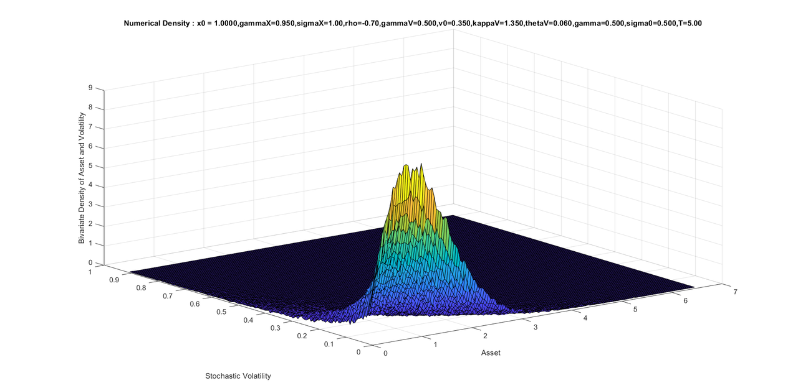](https://postimg.cc/t1X6VwLH)

[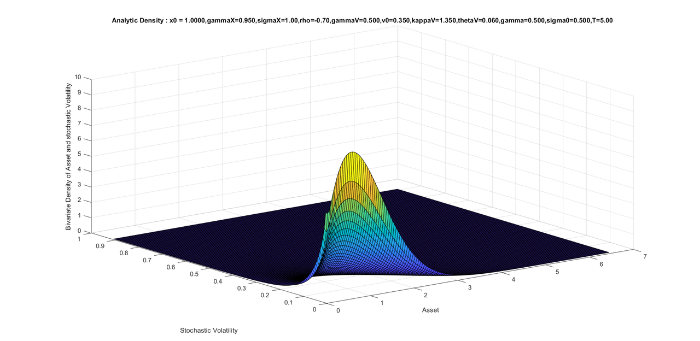](https://postimg.cc/QFg5ChYb)

[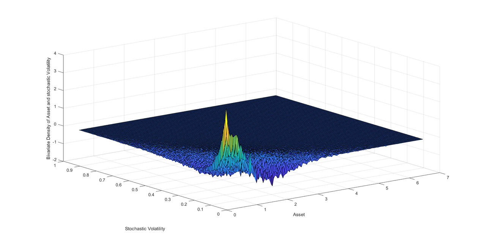](https://postimg.cc/k2PK7BsG)

.

.

.

.

```
function []= SVMonteCarloAndAssetConditionalDensityHermites()

%The purpose of this program is to take two random varaibles one of which
%is independent and the other is dependent on the first varaible also with
%its own dynamics.
%We want to capture the conditional dependent density structure from the
%cross moments of dependent and in dependent random variables by
%employing a two dimensional density for the dependent variable.
%We want to find the detailed relationship between Y and X so we can get
%the conditional density of dependent variable X given a particular value
%of independent variable Y. This will be done by calibrating coefficients
%of our 2D hermite series to data so that a very good fit to cross moments
%between X and Y is retrieved.

%In this program, we jointly simulate the system of SV and asset SDEs to
%get the joint data of asset and stochastic volatility.
%We use this data to calculate cross moments of asset and volatility. These
%cross moments are then used to calibrate the coefficients of the 2D
%hermite series density of dependent variable X. We also find univariate
%density of independent random variable volatility.
%We use the 2D Hermite series density of dependent variable X and
%univariate density of V to draw a graph of bivariate analytic density of
%X and V.
%We compare this graph of analytic bivariate density with monte carlo
%generated 2D bivariate density of simulated values of X and V in order to
%get an idea how good our calculation of 2D dependent density of X is. We
%also compare analytically calculated values of call prices using our
%calculated 2D hermite series conditional density of X in order to get an
%idea how good our calculation of the 2D hermite series density of X is.

% 2D Hermite Series Form used in this program is given as
%
% X = bnmH(1,1) + bnmH(2,1) H_1(Z_y) + bnmH(3,1) H_2(Z_y) + bnmH(4,1) H_3(Z_y) + bnmH(5,1) H_4(Z_y) + bnmH(6,1) H_5(Z_y)
% + [ bnmH(1,2) + bnmH(2,2) H_1(Z_y) + bnmH(3,2) H_2(Z_y) + bnmH(4,2) H_3(Z_y) + bnmH(5,2) H_4(Z_y) + bnmH(6,2)
H_5(Z_y)] H_1(Zx)
% + [ bnmH(1,3) + bnmH(2,3) H_1(Z_y) + bnmH(3,3) H_2(Z_y) + bnmH(4,3) H_3(Z_y) + bnmH(5,3) H_4(Z_y) + bnmH(6,3)
H_5(Z_y)] H_2(Zx)
% + [ bnmH(1,4) + bnmH(2,4) H_1(Z_y) + bnmH(3,4) H_2(Z_y) + bnmH(4,4) H_3(Z_y) + bnmH(5,4) H_4(Z_y) + bnmH(6,4)
H_5(Z_y)] H_3(Zx)
% + [ bnmH(1,5) + bnmH(2,5) H_1(Z_y) + bnmH(3,5) H_2(Z_y) + bnmH(4,5) H_3(Z_y) + bnmH(5,5) H_4(Z_y) + bnmH(6,5)
H_5(Z_y)] H_4(Zx)
% + [ bnmH(1,6) + bnmH(2,6) H_1(Z_y) + bnmH(3,6) H_2(Z_y) + bnmH(4,6) H_3(Z_y) + bnmH(5,6) H_4(Z_y) + bnmH(6,6)
H_5(Z_y)] H_5(Zx)

% 2D Z-Series Form used in this program is given as
%
% X = bnm(1,1) + bnm(2,1) Z_y + bnm(3,1) (Z_y)^2 + bnm(4,1) (Z_y)^3 + bnm(5,1) (Z_y)^4 + bnm(6,1) (Z_y)^5
% + [ bnm(1,2) + bnm(2,2) Z_y + bnm(3,2) (Z_y)^2 + bnm(4,2) (Z_y)^3 + bnm(5,2) (Z_y)^4 + bnm(6,2) (Z_y)^5 ] Zx
% + [ bnm(1,3) + bnm(2,2) Z_y + bnm(3,3) (Z_y)^2 + bnm(4,3) (Z_y)^3 + bnm(5,3) (Z_y)^4 + bnm(6,3) (Z_y)^5 ] Zx^2
% + [ bnm(1,4) + bnm(2,2) Z_y + bnm(3,4) (Z_y)^2 + bnm(4,4) (Z_y)^3 + bnm(5,4) (Z_y)^4 + bnm(6,4) (Z_y)^5 ] Zx^3
% + [ bnm(1,5) + bnm(2,2) Z_y + bnm(3,5) (Z_y)^2 + bnm(4,5) (Z_y)^3 + bnm(5,5) (Z_y)^4 + bnm(6,5) (Z_y)^5 ] Zx^4
% + [ bnm(1,6) + bnm(2,2) Z_y + bnm(3,6) (Z_y)^2 + bnm(4,6) (Z_y)^3 + bnm(5,6) (Z_y)^4 + bnm(6,6) (Z_y)^5 ] Zx^5

%Asset SDE is
%dX(t) = a X(t)^alpha1 dt+ b X(t)^alpha2 dt+ sigma1 V(t)^gammaV X(t)^gammaX dZ(t)
%We usually take a=0 and b=0 in our simulations
%SV SDE is
%dV(t)=mu1 V(t)^beta1 dt+ mu2 V(t)^beta2 dt + sigma0 V(t)^gamma dZ(t)
%In mean reverting SDEs we ususally have
%mu1= kappaV * thetaV
%beta1=0
%mu2=-kappa
%beta2=0

X0=1.0;
alpha1=0;
alpha2=1;
kappaX=0;
thetaX=1;
a=kappaX*thetaX;
b=-kappaX;

rho=-.7;
%sigma1=1;
sigma1=1;%.225;%1;
gammaV=.5;
gammaX=.95;
% %%%%%%%%`%%%%%
V0=.35;%1;%.35;
thetaV=.06;%1;%.04;
kappaV=1.35;%1.5;
mu1=kappaV*thetaV;
mu2=-kappaV;
beta1=0;
beta2=1;
gamma=.5;
sigma0=.5%1.250%.5;

%V0=1;
%thetaV=1;
%kappaV=1.50;
mu1=kappaV*thetaV;
mu2=-kappaV;
beta1=0;
beta2=1;
%gamma=.5;
%sigma0=1.25;

dt=.03125/2;
Tt=64*5;

T=Tt*dt;
%%%%%%%%%%%%%%%%%%%%%%%%%%%%%%%%%%%%%%%%%%%%%%%%%%%%%%%%%%%%%%%%%%%%%%%%%%5

%In this code block, we do monte carlo simulation of stochastic volatility SDEs
%And also calculate monte carlo call prices.

seed0=21872418;
rng(seed0, 'twister')
paths=500000;
V(1:paths)=V0;
X(1:paths)=X0;

%%%%%%%%%%%%%%%%%%%%%%%%%%%%%%%%%%%%%%%%%%%%%%%%%%%%%%%%%%%%%%%%%%%%%%%%%%%%%%%%%%%%5

paths0=paths;
paths00=paths;
Random1(1:paths00)=0;
Random2(1:paths0)=0;

for tt=1:Tt

Random2=randn(size(Random2));
Random1=randn(size(Random1));

% sum(Random1)/paths
% sum(Random1.^2)/paths
% sum(Random1.^3)/paths
% sum(Random1.^4)/paths
% sum(Random1.^5)/paths
% sum(Random1.^6)/paths
%
% tt
%
% str=input("Look at moments of MC Normals");

%Random1(paths00+1:2*paths00)=-1*Random1(1:paths00);
%Random2(paths0+1:2*paths0)=-1*Random2(1:paths0);
%Random1(paths0+1:2*paths0)=Random1(1:paths0);
%antithetic variates above

X(1:paths)=X(1:paths)+ ...
    (a* X(1:paths).^alpha1 + b* X(1:paths).^alpha2)* dt + ...
    sqrt(1-rho^2)* sigma1* V(1:paths).^gammaV.* X(1:paths).^gammaX .*Random1(1:paths) * sqrt(dt) + ...
    rho* sigma1* V(1:paths).^gammaV .*X(1:paths).^gammaX .*Random2(1:paths)*sqrt(dt) + ...
    (a*alpha1* X(1:paths).^(alpha1-1)+b*alpha2* X(1:paths).^(alpha2-1)).* ...
    (((a* X(1:paths).^alpha1 + b* X(1:paths).^alpha2)* dt^2/2)+ ...
    (sqrt(1-rho^2)* sigma1* V(1:paths).^gammaV.* X(1:paths).^gammaX .*Random1(1:paths) *(1-1/sqrt(3)).*dt^1.5+ ...
    rho* sigma1* V(1:paths).^gammaV .*X(1:paths).^gammaX .*Random2(1:paths)*(1-1/sqrt(3)).*dt^1.5))+ ...
    .5*(a*alpha1*(alpha1-1)* X(1:paths).^(alpha1-2)+b*alpha2*(alpha2-1).* X(1:paths).^(alpha2-2)).* ...
    ( sigma1^2* V(1:paths).^(2*gammaV).* X(1:paths).^(2*gammaX)) *dt^2/2 + ...
    sqrt(1-rho^2)* sigma1* V(1:paths).^gammaV.*gammaX.* X(1:paths).^(gammaX-1).* ...
    ((a* X(1:paths).^alpha1 + b* X(1:paths).^alpha2).*Random1(1:paths) * 1/sqrt(3).* dt^1.5 + ...
    sqrt(1-rho^2)* sigma1* V(1:paths).^gammaV.* X(1:paths).^gammaX .*(Random1(1:paths).^2-1) * dt/2 + ...
    rho* sigma1* V(1:paths).^gammaV .*X(1:paths).^gammaX .*Random1(1:paths).*Random2(1:paths)*dt/2)+ ...
    .5*sqrt(1-rho^2)* sigma1* V(1:paths).^gammaV.*gammaX.*(gammaX-1).* X(1:paths).^(gammaX-2).* ...
    (sigma1^2* V(1:paths).^(2*gammaV).* X(1:paths).^(2*gammaX) .*Random1(1:paths).*1/sqrt(3).*dt^1.5)+ ...
    sqrt(1-rho^2)* sigma1*gammaV.* V(1:paths).^(gammaV-1).* X(1:paths).^(gammaX).* ...
    ((mu1.*V(1:paths).^beta1 + mu2.*V(1:paths).^beta2).*Random1(1:paths) * 1/sqrt(3).* dt^1.5 + ...
    sigma0*V(1:paths).^gamma.*Random1(1:paths).*Random2(1:paths)*dt/2)+ ...
    .5*sqrt(1-rho^2)* sigma1*gammaV.*(gammaV-1).* V(1:paths).^(gammaV-2).* X(1:paths).^(gammaX).* ...
    (sigma0^2*V(1:paths).^(2*gamma).*Random1(1:paths)*1/sqrt(3)*dt^1.5)+ ...
    sqrt(1-rho^2)* sigma1*gammaV.* V(1:paths).^(gammaV-1).*gammaX.* X(1:paths).^(gammaX-1).* ...
    rho.* sigma1.* V(1:paths).^gammaV .*X(1:paths).^gammaX
.*sigma0.*V(1:paths).^gamma.*Random1(1:paths)*1/sqrt(3)*dt^1.5+ ...
    rho* sigma1* V(1:paths).^gammaV.*gammaX.* X(1:paths).^(gammaX-1).* ...
    ((a* X(1:paths).^alpha1 + b* X(1:paths).^alpha2).*Random2(1:paths) * 1/sqrt(3).* dt^1.5 + ...
    sqrt(1-rho^2)* sigma1* V(1:paths).^gammaV.* X(1:paths).^gammaX .*Random1(1:paths).*Random2(1:paths) * dt/2 + ...
    rho* sigma1* V(1:paths).^gammaV .*X(1:paths).^gammaX .*(Random2(1:paths).^2-1)*dt/2)+ ...
    .5*rho* sigma1* V(1:paths).^gammaV.*gammaX.*(gammaX-1).* X(1:paths).^(gammaX-2).* ...
    (sigma1^2* V(1:paths).^(2*gammaV).* X(1:paths).^(2*gammaX) .*Random2(1:paths).*1/sqrt(3).*dt^1.5)+ ...
    rho* sigma1*gammaV.* V(1:paths).^(gammaV-1).* X(1:paths).^(gammaX).* ...
    ((mu1.*V(1:paths).^beta1 + mu2.*V(1:paths).^beta2).*Random2(1:paths) * 1/sqrt(3).* dt^1.5 + ...
    sigma0*V(1:paths).^gamma.*(Random2(1:paths).^2-1)*dt/2)+ ...
    .5*rho* sigma1*gammaV.*(gammaV-1).* V(1:paths).^(gammaV-2).* X(1:paths).^(gammaX).* ...
    sigma0^2.*V(1:paths).^(2*gamma).*Random2(1:paths) * 1/sqrt(3).* dt^1.5+ ...
    rho* sigma1*gammaV.* V(1:paths).^(gammaV-1).*gammaX.* X(1:paths).^(gammaX-1).* ...
    rho.* sigma1.* V(1:paths).^gammaV .*X(1:paths).^gammaX
.*sigma0.*V(1:paths).^gamma.*Random2(1:paths)*1/sqrt(3)*dt^1.5;

    V(1:paths)=V(1:paths)+ ...
        (mu1.*V(1:paths).^beta1 + mu2.*V(1:paths).^beta2)*dt + ...
        sigma0*V(1:paths).^gamma .*Random2(1:paths)*sqrt(dt) + ...
        (mu1.*beta1*V(1:paths).^(beta1-1) + mu2.*beta2.*V(1:paths).^(beta2-1)).* ...
        ((mu1.*V(1:paths).^beta1 + mu2.*V(1:paths).^beta2)*dt^2/2 + ...
        sigma0*V(1:paths).^gamma .*Random2(1:paths)*(1-1/sqrt(3))*dt^1.5) + ...
        .5*(mu1.*beta1.*(beta1-1).*V(1:paths).^(beta1-2) + mu2.*beta2.*(beta2-1).*V(1:paths).^(beta2-2)).* ...
        sigma0^2.*V(1:paths).^(2*gamma).*dt^2/2 + ...
        sigma0*gamma*V(1:paths).^(gamma-1) .* ...
        ((mu1.*V(1:paths).^beta1 + mu2.*V(1:paths).^beta2).*Random2(1:paths).*1/sqrt(3)*dt^1.5 + ...
        sigma0.*V(1:paths).^gamma .*(Random2(1:paths).^2-1)*dt/2) + ...
        .5*sigma0*gamma*(gamma-1).*V(1:paths).^(gamma-2) .* ...
        sigma0^2.*V(1:paths).^(2*gamma) .*Random2(1:paths).*1/sqrt(3)*dt^1.5;

end
% X1=X;
% V1=V;
%
% save('MonteCarloData1','X1','V1');

%str=input("Monte carlo data has been saved");
X(XCallStrikes(nn))
            CallPricesMC(nn)=CallPricesMC(nn)+(X(pp)-CallStrikes(nn))/paths;
        end
    end
end

% CallPricesMC
%
% str=input("Look at Call prices");

%%%%%%%%%%%%%%%%%%%%%%%%%%%%%%%%%%%%%%%%%%%%%%%%%%%%%%%%%%%%%%%%%%%%%%%%%%%%%%%%%%%%
%In this code block, we calculate and draw numerically calculated
%2D bivariate density of X and V.

NoOfBinsV=150;
NoOfBinsX=150;
MaxCutOffX=8.5;
MaxCutOffV=8.825;

[XYProbDensity2D,Xn,Vm,BinSizeX,BinSizeV] =
Find2DDensitFromSimulation_Infiniti(X,V,paths,NoOfBinsX,NoOfBinsV,MaxCutOffX,MaxCutOffV);

%Above, we calculate the joint bivariate density of X and V numerically
%from simulated values of X and V. We do this calculation only for comparison
%purposes with analytic 2D bivariate density of X and V.

surf(Xn(2:NoOfBinsX+1),Vm(3:NoOfBinsV+1),transpose(XYProbDensity2D(2:NoOfBinsX+1,3:NoOfBinsV+1)))
title(sprintf('Numerical Density : x0 =
%.4f,gammaX=%.3f,sigmaX=%.2f,rho=%.2f,gammaV=%.3f,v0=%.3f,kappaV=%.3f,thetaV=%.3f,gamma=%.3f,sigma0=%.3f,T=%.2f',
X0,gammaX,sigma1,rho,gammaV,V0,kappaV,thetaV,gamma,sigma0,T));%,sprintf('theta= %f', theta), sprintf('kappa = %f',
kappa),sprintf('sigma = %f', sigma0),sprintf('T = %f', T));
xlabel('Asset'), ylabel('Stochastic Volatility'),zlabel('Bivariate Density of Asset and Volatility')

str=input("Look at numerical bivariate density of Asset and Stochastic Volatility")

%%%%%%%%%%%%%%%%%%%%%%%%%%%%%%%%%%%%%%%%%%%%%%%%%%%%%%%%%%%%%%%%%%%%%%%%%5
%In this block, we calculate the 2D conditional Z-series density of dependent
%variable X given by coefficients 2D array bnm and 1D univariate Z-series density with
%coefficients stored in aa.
%We draw a graph of this analytic density and calculate the difference with
%numerical density.

[bnm,aa] = CalculateConditionalProbabilitiesYtoXLinearRegression04Iter(V,X);

[pXY2D] = Calculate2VariablesOn2DGridFromAnalyticZSeriesA(Xn,Vm,NoOfBinsX,NoOfBinsV,bnm,aa);

surf(Xn(2:NoOfBinsX+1),Vm(3:NoOfBinsV+1),transpose(pXY2D(2:NoOfBinsX+1,3:NoOfBinsV+1)))
title(sprintf('Analytic Density : x0 =
%.4f,gammaX=%.3f,sigmaX=%.2f,rho=%.2f,gammaV=%.3f,v0=%.3f,kappaV=%.3f,thetaV=%.3f,gamma=%.3f,sigma0=%.3f,T=%.2f',
X0,gammaX,sigma1,rho,gammaV,V0,kappaV,thetaV,gamma,sigma0,T));%,sprintf('theta= %f', theta), sprintf('kappa = %f',
kappa),sprintf('sigma = %f', sigma0),sprintf('T = %f', T));
xlabel('Asset'), ylabel('Stochastic Volatility'),zlabel('Bivariate Density of Asset and stochastic Volatility')

str=input("Look at Analytic density of Asset and Stochastic volatility")
%str=input("Look at Analytic density of Asset and Stochastic volatility")
surf(Xn(2:NoOfBinsX+1),Vm(3:NoOfBinsV+1),transpose(pXY2D(2:NoOfBinsX+1,3:NoOfBinsV+1)-XYProbDensity2D(2:NoOfBinsX+1,3:NoOfBinsV+1)))
%title(sprintf('Difference of Analytic and Numerical Density  : x0 =
%.4f,gammaX=%.3f,sigmaX=%.2f,gammaV=%.3f,v0=%.3f,kappaV=%.3f,thetaV=%.3f,gamma=%.3f,sigma0=%.3f,T=%.2f',
X0,gammaX,sigma1,gammaV,V0,kappaV,thetaV,gamma,sigma0,T));%,sprintf('theta= %f', theta), sprintf('kappa = %f',
kappa),sprintf('sigma = %f', sigma0),sprintf('T = %f', T));
xlabel('Asset'), ylabel('Stochastic Volatility'),zlabel('Bivariate Density of Asset and stochastic Volatility')

str=input("Look at difference of numerical and analytic densities of Asset and stochastic volatility")

%%%%%%%%%%%%%%%%%%%%%%%%%%%%%%%%%%%%%%%%%%%%%%%%%%%%%%%%%%%%%%%%%%%%%%%%%%%%%%%%%%%%

%In this last block, we use previously calculated values of 2D Z-series
%coefficients of dependent variable X stored in 2D array bnm and Z-series
%univariate density of V to calculate the option prices. We compare
%analytically calculated option prices with monte carlo option prices.
%Purpose again is to find out how good our calculation of 2D conditional
%Z-series density of dependent variable X is.

CallStrikes=[.5,.55,.6,.65,.7,.75,.8,.85,.9,.95,1,1.05,1.1,1.15,1.2,1.25,1.3,1.35,1.4,1.45,1.5,1.55,1.6,1.65,1.7,1.75]

VolGridSize=400;

[CallPricesAnalytic]=PriceCallArrayOver2DDensityA(aa,bnm,CallStrikes,VolGridSize);

CallPricesAnalytic
CallPricesMC

str=input("Look at comparison of analytic and monte carlo call prices");

end
```

.

.

.

.

```
function [bnm,aa] = CalculateConditionalProbabilitiesYtoXLinearRegression04(Yin,Xin)

%Yin argument translates to independent random variable Y
%Xin argument translates to dependent variable X.
%This function takes observations of an independent variable Y and
%dependent varaible X. These have to be joint observations in the sense
%that nth observation of Y, given by Y(n) is taken jointly with nth
%observation of X, given by X(n). Two arrays of observations are the same
%length and nth mmber of independent variable Y is jointly observed with nth
%member of depedent variable X.
%We want to find the detailed relationship between Y and X so we can get
%the conditional density of dependent variable X given a particular value
%of independent variable Y. This will be done by calibrating coefficients
%of our 2D hermite series to data so that a very good fit to cross moments
%between X and Y is retrieved.
%We will first find univariate Z-series/hermite series of both random
%variables independently. For joint dynamics of dependent variable given
%te independnet variable, we will assume a 2D hermite series (This has to
%be two dimensional to be able to capture the dynamics from independent variable Y
%and have its own dynamics) and form but we do not know the coefficients of
%this 2D hermite series. In this program, we try to use iterative optimization
%to find the unknown coefficients of 2D hermite series of dependent variable X
%in a way that after taking products with independent varaible Y, expectation
%of these products i.e cross moments are as exactly retrieved as possible.
%Our iterative optimization procedure perturbs each hermite coefficient in
%2D hermite series  by a very slight amount and checks the objective function.
%If the objective function decreases, we eccept the perturbation otherwise
%reject it and then perturb by a small amount in other opposite direction
%and then again check the objective function. If perturbations in both sides
%are rejected, we do not change the coefficients but slightly decrease the
%perturbation size.
%We will first standardize the data of both random variables and then
%calculate univariate hermite series of both variables and also their
%cross moments in standardized form. We do all the calculations of coefficients
%of independent variable Y and 2D dependent variable X
%in standardized version of variables and moments. After optimization of coefficents on
%standardized data, at the end, we invert the standardization of both
%dependent and independent variables appropriately to get the Z-series and
%hermite series of actual varaibles in theri original coordinates back from
%standardized coordinates.
%Before optimization, we place two conditions on 2D dependent variable X so that
%first row and first column of 2D hermite coefficents of X is already
%known before optimization stage and it is not changed in optimization.
%We do not iteratively optimize over this first row and first colums
%which are analytically known from these two conditions.
%Our first condition is that after integration (of bivaraite density or
%alternatively bivaraite 2D Z-series/2D Hermite series) over independent
%variable, we should get the univaraite marginal density/Z-series/Hermite series of X
%which has already been calculated out of data. This fixes the zeroth
%hermite(of independent varaible Y) related terms in the Z-series/hermite series.
%Please look at this forum post# 2121 for explanation of this first condition.
% https://forum.wilmott.com/viewtopic.php?t=99702&start=2115#p879042

%We can analytically solve for first order cross moments of X with higher
%order in Y. From the analytical solution of these moments, we find first
%row of coefficents in the hermite form.

% 2D Hermite Series Form used in this program is given as
%
% X = bnmH(1,1) + bnmH(2,1) H_1(Z_y) + bnmH(3,1) H_2(Z_y) + bnmH(4,1) H_3(Z_y) + bnmH(5,1) H_4(Z_y) + bnmH(6,1) H_5(Z_y)
% + [ bnmH(1,2) + bnmH(2,2) H_1(Z_y) + bnmH(3,2) H_2(Z_y) + bnmH(4,2) H_3(Z_y) + bnmH(5,2) H_4(Z_y) + bnmH(6,2)
H_5(Z_y)] H_1(Zx)
% + [ bnmH(1,3) + bnmH(2,3) H_1(Z_y) + bnmH(3,3) H_2(Z_y) + bnmH(4,3) H_3(Z_y) + bnmH(5,3) H_4(Z_y) + bnmH(6,3)
H_5(Z_y)] H_2(Zx)
% + [ bnmH(1,4) + bnmH(2,4) H_1(Z_y) + bnmH(3,4) H_2(Z_y) + bnmH(4,4) H_3(Z_y) + bnmH(5,4) H_4(Z_y) + bnmH(6,4)
H_5(Z_y)] H_3(Zx)
% + [ bnmH(1,5) + bnmH(2,5) H_1(Z_y) + bnmH(3,5) H_2(Z_y) + bnmH(4,5) H_3(Z_y) + bnmH(5,5) H_4(Z_y) + bnmH(6,5)
H_5(Z_y)] H_4(Zx)
% + [ bnmH(1,6) + bnmH(2,6) H_1(Z_y) + bnmH(3,6) H_2(Z_y) + bnmH(4,6) H_3(Z_y) + bnmH(5,6) H_4(Z_y) + bnmH(6,6)
H_5(Z_y)] H_5(Zx)

% 2D Z-Series Form used in this program is given as
%
% X = bnm(1,1) + bnm(2,1) Z_y + bnm(3,1) (Z_y)^2 + bnm(4,1) (Z_y)^3 + bnm(5,1) (Z_y)^4 + bnm(6,1) (Z_y)^5
% + [ bnm(1,2) + bnm(2,2) Z_y + bnm(3,2) (Z_y)^2 + bnm(4,2) (Z_y)^3 + bnm(5,2) (Z_y)^4 + bnm(6,2) (Z_y)^5 ] Zx
% + [ bnm(1,3) + bnm(2,2) Z_y + bnm(3,3) (Z_y)^2 + bnm(4,3) (Z_y)^3 + bnm(5,3) (Z_y)^4 + bnm(6,3) (Z_y)^5 ] Zx^2
% + [ bnm(1,4) + bnm(2,2) Z_y + bnm(3,4) (Z_y)^2 + bnm(4,4) (Z_y)^3 + bnm(5,4) (Z_y)^4 + bnm(6,4) (Z_y)^5 ] Zx^3
% + [ bnm(1,5) + bnm(2,2) Z_y + bnm(3,5) (Z_y)^2 + bnm(4,5) (Z_y)^3 + bnm(5,5) (Z_y)^4 + bnm(6,5) (Z_y)^5 ] Zx^4
% + [ bnm(1,6) + bnm(2,2) Z_y + bnm(3,6) (Z_y)^2 + bnm(4,6) (Z_y)^3 + bnm(5,6) (Z_y)^4 + bnm(6,6) (Z_y)^5 ] Zx^5

%%%%%%%%%%%%%%%%%%%%%%%%%%%%%%%%%%%%%%%%%%%%%%%%%%%%%%%%%%%%%%%%%%%%%%%

%In the code block below, we standardize the independent variable Y and dependent variable X.
%We do all later calculations of various Z-series and cross moments in
%standardized framework and then at the end of the program, we convert
%the calculated coefficients of 2D hermite series/Z-series of dependent
%variable X into original non-standardized framework.

 Ndata=length(Yin);

 MeanY=sum(Yin(1:Ndata))/Ndata;
 MeanX=sum(Xin(1:Ndata))/Ndata;

 Ym(1:Ndata)=Yin(1:Ndata)-MeanY;
 Xm(1:Ndata)=Xin(1:Ndata)-MeanX;

 YmVar=sum(Ym(1:Ndata).^2)/Ndata;
 XmVar=sum(Xm(1:Ndata).^2)/Ndata;

 Y(1:Ndata)=Ym(1:Ndata)/sqrt(YmVar);
 X(1:Ndata)=Xm(1:Ndata)/sqrt(XmVar);

 %%%%%%%%%%%%%%%%%%%%%%%%%%%%%%%%%%%%%%%%%%%%%%%%%%%%%%%%%%%%%%%%%%%%
%Code block below uses polynomial regression to find univariate Z-series
%coefficients of independent variable Y.
%To know more about polynomial regression read the following and associated
%posts:  https://forum.wilmott.com/viewtopic.php?t=99702&start=2010#p877143

%You can get the text file MomentMatchParams08.txt from the forum post below
%https://forum.wilmott.com/viewtopic.php?f=4&t=99702&start=2040#p877863

Mtable=readtable('C:\Users\Lenovo\Documents\MATLAB\MATLAB1\MomentMatchParams08.txt');

%ZI is moment matched grid along the normal density with number of grid
%points equal to data elements in Y given by Ndata. The grid is constructed
%so that probability mass in each grid cell is 1/Ndata so this matches the
%observation probability of Ndata data elements. Due to equal probability
%mass in each grid cell, we call it equiprobable grid.

[ZI] = MatchMomentParametersOfIdealZhalf04(Ndata,Mtable);

Ys=sort(Y);
Ymu(1:Ndata,1)=Ys(1:Ndata);

W(1:Ndata,1)=1;
W(1:Ndata,2)=ZI(1:Ndata);
W(1:Ndata,3)=ZI(1:Ndata).^2;
W(1:Ndata,4)=ZI(1:Ndata).^3;
W(1:Ndata,5)=ZI(1:Ndata).^4;
W(1:Ndata,6)=ZI(1:Ndata).^5;
% W(1:Ndata,7)=ZI(1:Ndata).^6;
% W(1:Ndata,8)=ZI(1:Ndata).^7;

coeff=inv(W'*W)*(W'*Ymu);

%Above, we get coefficients of univariate Z-series of independent
%variable Y by least square regression.

a0=coeff(1,1);
a(1:5)=coeff(2:6,1);

%Above, we assign zeroth power Z-series coefficient to a0 and rest of
%the coefficients to array a.
%This was older format but we might need it since many old functions are written
%in this format.

%Below, we assign same Z-series coefficients to a single array. This is
%newer format that we want to use mostly.
aa(1:6)=coeff(1:6);

%uncomment these lines if you want to see shape of Z-series constructed
%density of Y. We had calculated coefficients of this Z-series by
%least square polynomial regression.
%PlotZSeriesDensity(a0,a,'r')
%str=input("Look at the density of volatility");

%%%%%%%%%%%%%%%%%%%%%%%%%%%%%%%%%%%%%%%%%%%%%%%%%%%%%%%%%%%%%%%%%%%%5
%In this code block, we calcualate the coefficients of univariate marginal
%density of dependent variable X again by least square polynomial
%regression as we did in previous block for independent variable Y.

Xs=sort(X);
Xmu(1:Ndata,1)=Xs(1:Ndata);

W(1:Ndata,1)=1;
W(1:Ndata,2)=ZI(1:Ndata);
W(1:Ndata,3)=ZI(1:Ndata).^2;
W(1:Ndata,4)=ZI(1:Ndata).^3;
W(1:Ndata,5)=ZI(1:Ndata).^4;
W(1:Ndata,6)=ZI(1:Ndata).^5;

coeff=inv(W'*W)*(W'*Xmu);

c0=coeff(1,1);
c(1:5)=coeff(2:6,1);

cc(1:6)=coeff(1:6,1);

[ccH] = ConvertZSeriesToHermiteSeriesNew(cc,5);

%%%%%%%%%%%%%%%%%%%%%%%%%%%%%%%%%%%%%%%%%%%%%%%%%%%%%%%%%%%%%%%%%%%%%%%%%%%%%%%%%%%%%%%%%%%%%%%%
%%%%%%%%%%%%%%%%%%%%%%%%%%%%%%%%%%%%%%%%%%%%%%%%%%%%%%%%%%%%%%%%%%%%%%%%%%%%%%%%%%%%%%%%%%%%%%%%%%%%%

Zy= CalculateZgivenXAndZSeriesC5Improved(Y,a0,a);

[Xs,I]=sort(X);

Zys=Zy(I);

Zx=ZI;

Xmu(1:Ndata,1)=Xs(1:Ndata);

% W(1:Ndata,1)=1;
% W(1:Ndata,2)=Zx(1:Ndata);
% W(1:Ndata,3)=Zx(1:Ndata).^2;
% W(1:Ndata,4)=Zx(1:Ndata).^3;
% W(1:Ndata,5)=Zx(1:Ndata).^4;
% W(1:Ndata,6)=Zx(1:Ndata).^5;
% W(1:Ndata,7)=1.*Zys(1:Ndata);
% W(1:Ndata,8)=Zx(1:Ndata).*Zys(1:Ndata);
% W(1:Ndata,9)=Zx(1:Ndata).^2.*Zys(1:Ndata);
% W(1:Ndata,10)=Zx(1:Ndata).^3.*Zys(1:Ndata);
% W(1:Ndata,11)=Zx(1:Ndata).^4.*Zys(1:Ndata);
% W(1:Ndata,12)=Zx(1:Ndata).^5.*Zys(1:Ndata);
% W(1:Ndata,13)=1.*Zys(1:Ndata).^2;
% W(1:Ndata,14)=Zx(1:Ndata).*Zys(1:Ndata).^2;
% W(1:Ndata,15)=Zx(1:Ndata).^2.*Zys(1:Ndata).^2;
% W(1:Ndata,16)=Zx(1:Ndata).^3.*Zys(1:Ndata).^2;
% W(1:Ndata,17)=Zx(1:Ndata).^4.*Zys(1:Ndata).^2;
% W(1:Ndata,18)=Zx(1:Ndata).^5.*Zys(1:Ndata).^2;
% W(1:Ndata,19)=1.*Zys(1:Ndata).^3;
% W(1:Ndata,20)=Zx(1:Ndata).*Zys(1:Ndata).^3;
% W(1:Ndata,21)=Zx(1:Ndata).^2.*Zys(1:Ndata).^3;
% W(1:Ndata,22)=Zx(1:Ndata).^3.*Zys(1:Ndata).^3;
% W(1:Ndata,23)=Zx(1:Ndata).^4.*Zys(1:Ndata).^3;
% W(1:Ndata,24)=Zx(1:Ndata).^5.*Zys(1:Ndata).^3;
% W(1:Ndata,25)=1.*Zys(1:Ndata).^4;
% W(1:Ndata,26)=Zx(1:Ndata).*Zys(1:Ndata).^4;
% W(1:Ndata,27)=Zx(1:Ndata).^2.*Zys(1:Ndata).^4;
% W(1:Ndata,28)=Zx(1:Ndata).^3.*Zys(1:Ndata).^4;
% W(1:Ndata,29)=Zx(1:Ndata).^4.*Zys(1:Ndata).^4;
% W(1:Ndata,30)=Zx(1:Ndata).^5.*Zys(1:Ndata).^4;
% W(1:Ndata,31)=1.*Zys(1:Ndata).^5;
% W(1:Ndata,32)=Zx(1:Ndata).*Zys(1:Ndata).^5;
% W(1:Ndata,33)=Zx(1:Ndata).^2.*Zys(1:Ndata).^5;
% W(1:Ndata,34)=Zx(1:Ndata).^3.*Zys(1:Ndata).^5;
% W(1:Ndata,35)=Zx(1:Ndata).^4.*Zys(1:Ndata).^5;
% W(1:Ndata,36)=Zx(1:Ndata).^5.*Zys(1:Ndata).^5;
%
% coeff=inv(W'*W)*(W'*Xmu);
%
% bnm(1,1:6)=coeff(1:6,1);
% bnm(2,1:6)=coeff(7:12,1);
% bnm(3,1:6)=coeff(13:18,1);
% bnm(4,1:6)=coeff(19:24,1);
% bnm(5,1:6)=coeff(25:30,1);
% bnm(6,1:6)=coeff(31:36,1);
%
% [bnmH] = Convert2DHermitesInto2DSeries(bnm);
% %%%%%%%%%%%%%%%%%%%%%%%%%%%%%%%%%%%%%%%%%%%%%%%%%%%%%%%%%%%%%%%%%%%%%%%%%%%%%%%%%%%%%%%55
%

W=0;

W(1:Ndata,1)=1.0;
W(1:Ndata,2)=Zx(1:Ndata);
W(1:Ndata,3)=(Zx(1:Ndata).^2-1);
W(1:Ndata,4)=(Zx(1:Ndata).^3-3*Zx(1:Ndata));
W(1:Ndata,5)=(Zx(1:Ndata).^4-6*Zx(1:Ndata).^2+3);
W(1:Ndata,6)=(Zx(1:Ndata).^5-10*Zx(1:Ndata)+15*Zx(1:Ndata));

W(1:Ndata,7)=1.*Zys(1:Ndata);
W(1:Ndata,8)=Zx(1:Ndata).*Zys(1:Ndata);
W(1:Ndata,9)=(Zx(1:Ndata).^2-1).*Zys(1:Ndata);
W(1:Ndata,10)=(Zx(1:Ndata).^3-3*Zx(1:Ndata)).*Zys(1:Ndata);
W(1:Ndata,11)=(Zx(1:Ndata).^4-6*Zx(1:Ndata).^2+3).*Zys(1:Ndata);
W(1:Ndata,12)=(Zx(1:Ndata).^5-10*Zx(1:Ndata)+15*Zx(1:Ndata)).*Zys(1:Ndata);

W(1:Ndata,13)=(Zys(1:Ndata).^2-1);
W(1:Ndata,14)=Zx(1:Ndata).*(Zys(1:Ndata).^2-1);
W(1:Ndata,15)=(Zx(1:Ndata).^2-1).*(Zys(1:Ndata).^2-1);
W(1:Ndata,16)=(Zx(1:Ndata).^3-3*Zx(1:Ndata)).*(Zys(1:Ndata).^2-1);
W(1:Ndata,17)=(Zx(1:Ndata).^4-6*Zx(1:Ndata).^2+3).*(Zys(1:Ndata).^2-1);
W(1:Ndata,18)=(Zx(1:Ndata).^5-10*Zx(1:Ndata)+15*Zx(1:Ndata)).*(Zys(1:Ndata).^2-1);

W(1:Ndata,19)=(Zys(1:Ndata).^3-3*Zy(1:Ndata));
W(1:Ndata,20)=Zx(1:Ndata).*(Zys(1:Ndata).^3-3*Zy(1:Ndata));
W(1:Ndata,21)=(Zx(1:Ndata).^2-1).*(Zys(1:Ndata).^3-3*Zy(1:Ndata));
W(1:Ndata,22)=(Zx(1:Ndata).^3-3*Zx(1:Ndata)).*(Zys(1:Ndata).^3-3*Zys(1:Ndata));
W(1:Ndata,23)=(Zx(1:Ndata).^4-6*Zx(1:Ndata).^2+3).*(Zys(1:Ndata).^3-3*Zys(1:Ndata));
W(1:Ndata,24)=(Zx(1:Ndata).^5-10*Zx(1:Ndata )+15*Zx(1:Ndata)).*(Zys(1:Ndata).^3-3*Zys(1:Ndata));

W(1:Ndata,25)=(Zys(1:Ndata).^4-6*Zys(1:Ndata).^2+3);
W(1:Ndata,26)=Zx(1:Ndata).*(Zys(1:Ndata).^4-6*Zys(1:Ndata).^2+3);
W(1:Ndata,27)=(Zx(1:Ndata).^2-1).*(Zys(1:Ndata).^4-6*Zys(1:Ndata).^2+3);
W(1:Ndata,28)=(Zx(1:Ndata).^3-3*Zx(1:Ndata)).*(Zys(1:Ndata).^4-6*Zys(1:Ndata).^2+3);
W(1:Ndata,29)=(Zx(1:Ndata).^4-6*Zx(1:Ndata).^2+3).*(Zys(1:Ndata).^4-6*Zys(1:Ndata).^2+3);
W(1:Ndata,30)=(Zx(1:Ndata).^5-10*Zx(1:Ndata)+15*Zx(1:Ndata)).*(Zys(1:Ndata).^4-6*Zys(1:Ndata).^2+3);

W(1:Ndata,31)=(Zys(1:Ndata).^5-10*Zys(1:Ndata).^3+15*Zys(1:Ndata));
W(1:Ndata,32)=Zx(1:Ndata).*(Zys(1:Ndata).^5-10*Zys(1:Ndata).^3+15*Zys(1:Ndata));
W(1:Ndata,33)=(Zx(1:Ndata).^2-1).*(Zys(1:Ndata).^5-10*Zys(1:Ndata).^3+15*Zys(1:Ndata));
W(1:Ndata,34)=(Zx(1:Ndata).^3-3*Zx(1:Ndata)).*(Zys(1:Ndata).^5-10*Zys(1:Ndata).^3+15*Zys(1:Ndata));
W(1:Ndata,35)=(Zx(1:Ndata).^4-6*Zx(1:Ndata).^2+3).*(Zys(1:Ndata).^5-10*Zys(1:Ndata).^3+15*Zys(1:Ndata));
W(1:Ndata,36)=(Zx(1:Ndata).^5-10*Zx(1:Ndata )+15*Zx(1:Ndata)).*(Zys(1:Ndata).^5-10*Zys(1:Ndata).^3+15*Zys(1:Ndata));

coeff=inv(W'*W)*(W'*Xmu);

bnmH0(1,1:6)=ccH(1:6);  %Replace first line of X-hermites with Marginal density retrieval condition
bnmH0(2,1:6)=coeff(7:12);
bnmH0(3,1:6)=coeff(13:18);
bnmH0(4,1:6)=coeff(19:24);
bnmH0(5,1:6)=coeff(25:30);
bnmH0(6,1:6)=coeff(31:36);

bnmH=bnmH0;

%%%%%%%%%%%%%%%%%%%%%%%%%%%%%%%%%%%%%%%%%%%%%%%%%%%%%%%%%%%%%%%%%%%%%%%

SeriesOrder1=6;
NMomentsY=6;

SeriesOrder10=6; %SeriesOrder10 = 1 + highest power of Zy in 2D Z-series%Here highest power of Zy is five
SeriesOrder01=6; %SeriesOrder01 = 1 + highest power of Zx in 2D Z-series%Here highest power of Zx is also five
%notation is  bnm(1:SeriesOrder10,1:SeriesOrder01)
%Similalry    bnmH(1:SeriesOrder10,1:SeriesOrder01)

NMomentsX=6; %Highest moment of X in cross moments of X and Y
NMomentsY=6; %Highest moment of Y in cross moments of X and Y

%Below we calculate various cross moments between X and Y. These are
%calculated from standardized data.
for nn=1:NMomentsY
   for mm=1:NMomentsX
       CrossMoments(nn,mm)=0;
       for pp=1:Ndata
          CrossMoments(nn,mm)=CrossMoments(nn,mm)+Y(pp).^nn.*X(pp).^mm/Ndata;
       end
   end
end

%Below are the weights on calculation of objective function. More weight on
%a particular moment means that its better match with target moments gets more emphasized as
%compared to match of other moments.
%Choice of good weights is non-trivial.
%Current choice is only haphazard. Please try improvements/

 w2D(1:NMomentsY,1:NMomentsX)=1;
for nn=NMomentsY-1:-1:1
    for mm=NMomentsX-1:-1:1
        w2D(nn,mm)=w2D(nn+1,mm+1)*(nn+1)*(mm+1);
    end
end

w2D(:,1)=w2D(:,1)*5000000;

w2D(:,2)=w2D(:,2)*500000;
w2D(1,2)=w2D(1,2)*100;
w2D(2,2)=w2D(2,2)*10;
w2D(3,2)=w2D(3,2)*5;
w2D(:,3)=w2D(:,3)*20000;
w2D(1,3)=w2D(1,3)*20;
w2D(2,3)=w2D(2,3)*5;
w2D(1,:)=w2D(1,:)*10000;
w2D(2,:)=w2D(2,:)*100;
w2D(3,:)=w2D(3,:)*10;
w2D(:,4)=w2D(:,4)*1000;
w2D(1,4)=w2D(1,4)*10;
w2D(2,4)=w2D(2,4)*2;

%Please look on detailed comments inside function below for more insight about it.
%The function below returns coefficients on first row of hermite series so that all
%cross moments of first order in dependent variable X and various orders in independent
%variable Y are matched.

[dd] = ProduceFirstRowofConditioal2DZSeries02_6M_A(aa,SeriesOrder1,CrossMoments);

%Below we define a 2D array of hermite series coefficents and populate its
%first row with output from above function so that all cross moments of
%first order in X and different orders in Y are matched.
%We also populate first column with univariate hermite coefficients of
%marginal density of X because of the condition that upon integration of
%the bivariate hermite form, we should get univariate marginal density as a
%result. %Please look at this forum post# 2121 for explanation of this first condition.
% https://forum.wilmott.com/viewtopic.php?t=99702&start=2115#p879042

%%%%%%%%%%%%%%%%%%%%%%%%%5

%bnmH(1:6,1:6)=0;          %define 2D hermite coefficients array
bnmH(1,1:6)=ccH(1:6);     %populate first column with univariate margianl density hermite coefficients of X.

bnmH(1:6,1)=dd(1:6);      %populate first row so that all cross moments of first order in X are matched.

%%%%%%%%%%%%%%%%%%%%%%%5

%In our iterative optimization, we will not alter the above first column and first row of 2D hermite coefficients array.

%In the block below, we convert 2D hermite coefficients array bnmH to 2D
%Z-series array bnm. We calculate the values of cross moments given the values of
%coefficients in 2D Z-series bnm. We use these model cross moments and
%co1mpare them with target cross moments to evaluate the objective function.

%Convert from 2D Hermite Series Coefficients bnmH to 2D Z-series
%coefficients bnm
[bnm] = Convert2DHermitesInto2DSeries(bnmH);
%Evaluate the model cross moments in the function below.
[Moments2D,Moments1D] =
CalculateCrossMomentsConditional2DNew02(aa,bnm,SeriesOrder1,SeriesOrder10,SeriesOrder01,NMomentsX,NMomentsY);
%Evaluate the objective function based on weighted squared difference
%between model cross moments and target cross momensts from data.
[ObjFuncBest] = CalculateObjMoment2D1D(CrossMoments,Moments2D,w2D,NMomentsX,NMomentsY);

%%%%%%%%%%%%%%%%%%%%%%%%%%%%%%%%%%%%%%%%%%%%%%%%%%%%%%%%%%%%%%%%%%%%%%%%%%

SeriesOrderIter10=6;
SeriesOrderIter01=6;
alphaSuccessCount(1:SeriesOrderIter10,1:SeriesOrderIter01)=0;
SuccessPrevalpha(1:SeriesOrderIter10,1:SeriesOrderIter01)=0;

%array of perturbation sizes of coefficients of the 2D Hermite form
%of dependent variable X in iterative optimization.
for nn=1:SeriesOrderIter10
    for mm=1:SeriesOrderIter01
            delta_bnmHCoeff(nn,mm)=bnmH(nn,mm)./50;
    end
end

%Assign initial value of bnmH to workhorse variable bnmHCoeff which will be
%used in iterative ioptimization
bnmHCoeff=bnmH;

mul1=.9; %decrease the perturbation step size by multiplying it with .9 when
%objective function does not decrease upon perturbation on both sides.
mul2=1.1; %Increase the perturbation step size after several successive
%successes in decreasing the objective function
Iterations=2000;
for iter=1:Iterations
iter
bnmHCoeff
ObjFuncBest

%Below we run a two dimensional loop that loops over all rows and columns
%of 2D array of hermite series coefficients. However, we exclude first row
%and first column from this optimization as values there were already fixed
%analytically.

    for kk=2:SeriesOrderIter10 %Optimize over Zy hermites.
        for jj=2:SeriesOrderIter01 %Optimize over Zx hermites

            %Assign 2D hermite coefficients to workhorse variable
            bnmHCoeffNew(1:SeriesOrderIter10,1:SeriesOrderIter01)=bnmHCoeff(1:SeriesOrderIter10,1:SeriesOrderIter01);
            %perturb the (kk,jj) coefficient by magnitude given in its
            %delta array named delta_bnmHCoeff(kk,jj)
            bnmHCoeffNew(kk,jj)=bnmHCoeff(kk,jj)+delta_bnmHCoeff(kk,jj);
            %convert to Z-series to calculate the cross moments
            [bnm] = Convert2DHermitesInto2DSeries(bnmHCoeffNew);
            [Moments2D,Moments1D] =
CalculateCrossMomentsConditional2DNew02(aa,bnm,SeriesOrder1,SeriesOrder10,SeriesOrder01,NMomentsX,NMomentsY);
            %Calculate the objective function value.
            [ObjFuncNew] = CalculateObjMoment2D1D(CrossMoments,Moments2D,w2D,NMomentsX,NMomentsY);

            if(ObjFuncNew3) %After successive successes, increase the perturbation step size.
                delta_bnmHCoeff(kk,jj)=delta_bnmHCoeff(kk,jj).*mul2;
            end
        end
    end
   if(rem(iter,500)==0)
         bnm
         Moments2D
         CrossMoments
         Moments2D(:,1)
         CrossMoments(:,1)

         ObjFuncBest

         str=input("Look at fit of moments");

      end

end

bnmH=bnmHCoeff;

% Xmu00(1,1:Ndata)=transpose(Xmu(1:Ndata,1)) - ccH(1) ...
%     -ccH(2).* Zx(1:Ndata) ...
%     -ccH(3).* Zx(1:Ndata).^2 ...
%     -ccH(4).* Zx(1:Ndata).^3 ...
%     -ccH(5).* Zx(1:Ndata).^4 ...
%     -ccH(6).* Zx(1:Ndata).^5;
% Xmu0(1:Ndata,1)=transpose(Xmu00(1,1:Ndata));
%
%
% W=0;
%
% % W(1:Ndata,1)=1.0;
% % W(1:Ndata,2)=Zx(1:Ndata);
% % W(1:Ndata,3)=(Zx(1:Ndata).^2-1);
% % W(1:Ndata,4)=(Zx(1:Ndata).^3-3*Zx(1:Ndata));
% % W(1:Ndata,5)=(Zx(1:Ndata).^4-6*Zx(1:Ndata).^2+3);
% % W(1:Ndata,6)=(Zx(1:Ndata).^5-10*Zx(1:Ndata)+15*Zx(1:Ndata));
%
% W(1:Ndata,1)=1.*Zys(1:Ndata);
% W(1:Ndata,2)=Zx(1:Ndata).*Zys(1:Ndata);
% W(1:Ndata,3)=(Zx(1:Ndata).^2-1).*Zys(1:Ndata);
% W(1:Ndata,4)=(Zx(1:Ndata).^3-3*Zx(1:Ndata)).*Zys(1:Ndata);
% W(1:Ndata,5)=(Zx(1:Ndata).^4-6*Zx(1:Ndata).^2+3).*Zys(1:Ndata);
% W(1:Ndata,6)=(Zx(1:Ndata).^5-10*Zx(1:Ndata)+15*Zx(1:Ndata)).*Zys(1:Ndata);
%
% W(1:Ndata,7)=(Zys(1:Ndata).^2-1);
% W(1:Ndata,8)=Zx(1:Ndata).*(Zys(1:Ndata).^2-1);
% W(1:Ndata,9)=(Zx(1:Ndata).^2-1).*(Zys(1:Ndata).^2-1);
% W(1:Ndata,10)=(Zx(1:Ndata).^3-3*Zx(1:Ndata)).*(Zys(1:Ndata).^2-1);
% W(1:Ndata,11)=(Zx(1:Ndata).^4-6*Zx(1:Ndata).^2+3).*(Zys(1:Ndata).^2-1);
% W(1:Ndata,12)=(Zx(1:Ndata).^5-10*Zx(1:Ndata)+15*Zx(1:Ndata)).*(Zys(1:Ndata).^2-1);
%
% W(1:Ndata,13)=(Zys(1:Ndata).^3-3*Zy(1:Ndata));
% W(1:Ndata,14)=Zx(1:Ndata).*(Zys(1:Ndata).^3-3*Zy(1:Ndata));
% W(1:Ndata,15)=(Zx(1:Ndata).^2-1).*(Zys(1:Ndata).^3-3*Zy(1:Ndata));
% W(1:Ndata,16)=(Zx(1:Ndata).^3-3*Zx(1:Ndata)).*(Zys(1:Ndata).^3-3*Zys(1:Ndata));
% W(1:Ndata,17)=(Zx(1:Ndata).^4-6*Zx(1:Ndata).^2+3).*(Zys(1:Ndata).^3-3*Zys(1:Ndata));
% W(1:Ndata,18)=(Zx(1:Ndata).^5-10*Zx(1:Ndata )+15*Zx(1:Ndata)).*(Zys(1:Ndata).^3-3*Zys(1:Ndata));
%
% W(1:Ndata,19)=(Zys(1:Ndata).^4-6*Zys(1:Ndata).^2+3);
% W(1:Ndata,20)=Zx(1:Ndata).*(Zys(1:Ndata).^4-6*Zys(1:Ndata).^2+3);
% W(1:Ndata,21)=(Zx(1:Ndata).^2-1).*(Zys(1:Ndata).^4-6*Zys(1:Ndata).^2+3);
% W(1:Ndata,22)=(Zx(1:Ndata).^3-3*Zx(1:Ndata)).*(Zys(1:Ndata).^4-6*Zys(1:Ndata).^2+3);
% W(1:Ndata,23)=(Zx(1:Ndata).^4-6*Zx(1:Ndata).^2+3).*(Zys(1:Ndata).^4-6*Zys(1:Ndata).^2+3);
% W(1:Ndata,24)=(Zx(1:Ndata).^5-10*Zx(1:Ndata)+15*Zx(1:Ndata)).*(Zys(1:Ndata).^4-6*Zys(1:Ndata).^2+3);
%
% W(1:Ndata,25)=(Zys(1:Ndata).^5-10*Zys(1:Ndata).^3+15*Zys(1:Ndata));

% W(1:Ndata,27)=(Zx(1:Ndata).^2-1).*(Zys(1:Ndata).^5-10*Zys(1:Ndata).^3+15*Zys(1:Ndata));
% W(1:Ndata,28)=(Zx(1:Ndata).^3-3*Zx(1:Ndata)).*(Zys(1:Ndata).^5-10*Zys(1:Ndata).^3+15*Zys(1:Ndata));
% W(1:Ndata,29)=(Zx(1:Ndata).^4-6*Zx(1:Ndata).^2+3).*(Zys(1:Ndata).^5-10*Zys(1:Ndata).^3+15*Zys(1:Ndata));
% W(1:Ndata,30)=(Zx(1:Ndata).^5-10

%
% bnmH=bnmH0;
% %%%%%%%%%%%%%%%%%%%%%%%%%%%%%%%%%%%%%%%%%%%%%%%%%%%%%%%%%%%%%%%%%%%%%%%%%%%%%%%%
% SeriesOrder1=6;
% NMomentsY=6;
% NMomentsX=6;
%     for nn=1:NMomentsY
%        for mm=1:NMomentsX
%            CrossMoments(nn,mm)=0;
%            for pp=1:Ndata
%               CrossMoments(nn,mm)=CrossMoments(nn,mm)+Y(pp).^nn.*X(pp).^mm/Ndata;
%            end
%        end
%     end
%
%
%
% [chh] = ProduceFirstRowofConditioal2DZSeries02_6M_A(aa,SeriesOrder1,CrossMoments);
%
% %%%%%%%%%%%%%%%%%%%%%%%%%%%%%%%%%%%%%%%%%%%%%%%%%%%%%%%%%%%%%%%%%%%
%
% [bnm] = Convert2DHermitesInto2DSeries(bnmH);
%
% SeriesOrder1=6;
% SeriesOrder10=6;
% SeriesOrder01=6;
% NMomentsX=6;
% NMomentsY=6;
% [Moments2D0] =
CalculateCrossMomentsConditional2DNew02(aa,bnm,SeriesOrder1,SeriesOrder10,SeriesOrder01,NMomentsX,NMomentsY);
%
% Moments2D0
%
% CrossMoments
%
% str=input("Look at comparison of moments--first-standardized");

%%%%%%%%%%%%%%%%%%%%%%%%%%%%%%%%%%%%%%%%%%%%%%%%%%%%%%%%%%%%%%%%%%%%%%%%%%%%%%%%
%In the code block below, we convert 2D hermite series coefficients of
%dependent variable X from standardized version to original version.
%For that we first multiply the entire 2D Hermite series by square root of
%variance.
%Later we multiply each column of hermite series of X with particular
%order of Zy hermite polynomials by square root of volatility(independent variable)
%raised to that power of Zy polynomial order as below.
bnmH=bnmH*sqrt(XmVar);
for nn=2:6
    bnmH(nn,:)=bnmH(nn,:).*(sqrt(YmVar)).^(nn-1);
end
%We convert X from hermite series form to Z-series form.
[bnm] = Convert2DHermitesInto2DSeries(bnmH);
bnm(1,1)=MeanX-bnm(3,1)-3*bnm(5,1)-1*bnm(1,3)-1*3*bnm(1,5)-3*bnm(5,3)-bnm(3,3)-3*bnm(3,5)-9*bnm(5,5);

%Finally in above line, we make sure that mean of the 2D Z-series is

%Below, we convert Z-series of independent variable Y from standard form to
%original variable form.

aa=aa*sqrt(YmVar);
aa(1)=MeanY-aa(3)-3*aa(5);

% SeriesOrder1=6;
% SeriesOrder10=6;
% SeriesOrder01=6;
% NMomentsX=6;
% NMomentsY=6;
% [Moments2D] =
CalculateCrossMomentsConditional2DNew02(aa,bnm,SeriesOrder1,SeriesOrder10,SeriesOrder01,NMomentsX,NMomentsY);
%
% Moments2D
%
% CrossMoments
%
% str=input("Look at comparison of moments");
%
%
% for nn=1:NMomentsX
%     for mm=1:NMomentsY
%
%         Moments2D(mm,nn)
%         Moments2D0(mm,nn).*(sqrt(YmVar)).^(mm).*(sqrt(XmVar)).^(nn)
%         Moments2D0(mm,nn)./(sqrt(YmVar)).^(mm)./(sqrt(XmVar)).^(nn)
%         Moments2D(mm,nn)./(sqrt(YmVar)).^(mm)./(sqrt(XmVar)).^(nn)
%         nn
%         mm
%         str=input("Look at moments again---22---22-222---")
%     end
% end

end
```

---

### #2186 — Amin (Topic Author)
*February 11, 2024, 6:05 AM*

Friends, if you do not have very large number data elements, most probably your higher moments will be too noisy and
will spoil any attempt at calibration of coefficients. For smaller data sets, it would be convenient to only include up
to four moments in each direction while calculation of cross moments.

Once we get more understanding of the model there could be possibilities that we could calibrate some coefficients (that
affect larger moments) from very large data sets or set their bounds from very large data sets(that can possibly span
several years) and then calibrate rest of the coefficients from local(in time, that can span a few months or weeks or
possibly even days for some coefficients) data sets that might be smaller by calibrating only smaller moments. I believe
even after we would have the capability to calibrate the complete model to data, we would still need more understanding
how to calibrate various coefficients to local or global data and how to get optimal results of densities for prediction
in various scenarios.

Alternatively, we could calculate noisy higher moments from larger data sets and smaller moments from smaller and more
local(in time) data sets but this has to be done in a way that the moments are consistent with each other. And then use
these moments calculated at different time scales for input to calibration of 2D transition density of the dependent
stochastic variable.

---

### #2187 — Amin (Topic Author)
*February 12, 2024, 8:09 AM*

Friends, the calibration algorithm is still not working well when correlation is very high. Also changing the seed seems
to change the performance of the algorithm quite a bit. I am working on all these issues.

Regarding correlations, we might have to add more hermite polynomials in our 6X6 coefficients hermite series and we
might have to take it to 8X8 hermite series to properly capture the high correlation scenarios. Or we may have to give
special treatment to correlations. I am open to both possibilities and working on it. I want to quickly check today if
increasing the order to 8X8 helps and if it does not, I will think how we have to treat correlation scenarios more
carefully.

Here is a graph of monte carlo 2D density of volatility and asset and it seems likely that 6X6 scenario that takes
highest hermite at order five may not be able to capture this density. Though I have to check but taking highest order
of hermite polynomials to seven might have a better fit to density.

[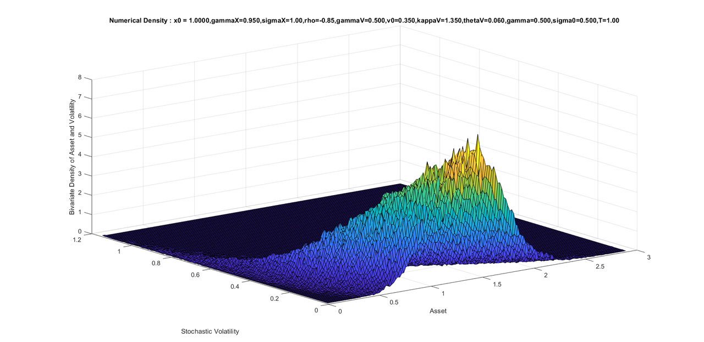](https://postimg.cc/jDd0p9tg)

I am working on the problem and want to work towards final conclusion of the solution associated with the problem. We
have continued to make slow gains but we still have to make a solid effort to solve the problem and I hope that we will
soon have the final solution.

I only wish that I did not have to face mind control and I could have worked much better. 75% of my time in past two
months was wasted due to problems associated with mind control. But anyway, I am determined to work until we have a
final solution of the problem.

Even now when I am trying to work in the open top garage of our house, mind control agents continue to release
gas/charges that go into my breath and cause discomfort while charges settle on my body at the same time. Garage is
closed on all sides and traps heavy gas quickly and many times I have to try to open the gate of the house  so gas could
flow towards the street road outside the garage. But working in the garage is till better than working inside any of the
room sin the house.

---

### #2188 — Amin (Topic Author)
*February 12, 2024, 10:47 AM*

Friends, I noticed a mistake in programs uploaded in post # 2181 in function

function [bnm,aa] = CalculateConditionalProbabilitiesYtoXLinearRegression02(Yin,Xin)

and in post #2185, when specifying regression matrices, I have made this mistake, For fifth hermite polynomial, I have
written

(Zx(1:Ndata).^5-10*Zx(1:Ndata )+15*Zx(1:Ndata))

which is wrong and has to be replaced by

(Zx(1:Ndata).^5-10*Zx(1:Ndata ).^3+15*Zx(1:Ndata))

This was throwing results slightly off. Please replace it in your downloaded programs. Sorry for this error.

---

### #2189 — Amin (Topic Author)
*February 13, 2024, 12:22 AM*

Friends, I have been thinking about how to later our analytic set up when the two stochastic variables X and Y are
correlated. I think I have some ideas and I decided to share them with friends.

We have two variables X and Y and we are given their marginal densities as

$Y(Z_y)\, =\, ah_0 \, +\, ah_1 H_1(Z_y)\,+\, ah_2 H_2(Z_y)\,+\, ah_3 H_3(Z_y)\, + \, \ldots \, $     Eq(1)

While for marginal density of dependent variable, we have

$X(Z_1)\, =\, ch_0 \, +\, ch_1 H_1(Z_1)\,+\, ch_2 H_2(Z_1)\,+\, ch_3 H_3(Z_1)\, + \, \ldots \, $    Eq(2)

while 2D density of dependent variable X is given as

while the dependent variable is given as

$X(Z_y \, , \, Z_x)\,=\, bh_{0,0} \, + \, bh_{0,1} \,H_1(Z_x) \,+\, bh_{0,2} \, H_2(Z_x) \,\, + \, bh_{0,3} \,H_3(Z_x)\,
\\

+\, \Big[ \, bh_{1,0} \, + \, bh_{1,1} \,H_1(Z_x) \,+\, bh_{1,2} \, H_2(Z_x) \, + \, bh_{1,3} \,H_3(Z_x)\, \Big] \,
H_1(Z_y) \, \\

+\, \Big[ \, bh_{2,0} \, + \, bh_{2,1} \,H_1(Z_x) \,+\, bh_{2,2} \, H_2(Z_x) \, \, + \, bh_{2,3} \,H_3(Z_x)\, \Big] \,
H_2(Z_y) \, \\

+\, \Big[ \, bh_{3,0} \, + \, bh_{3,1} \,H_1(Z_x) \,+\, bh_{3,2} \, H_2(Z_x) \, + \, bh_{3,3} \,H_3(Z_x)\, \Big] \,
H_3(Z_y) \, $ Eq(3)

We had already fixed that in our set up $Z_y$ and $Z_x$ are not correlated.

However $Z_1$ in Eq(2) and $Z_y$ in Eq(1) could certainly be correlated.

On variance level, we can write X in terms of correlations(as correlations are between hermite polynomials in our set
up), when it is correlated with Y as

$X\, =\, ch_0 \, +\,\sqrt{1-{\rho_1}^2} \, ch_1 \, H_1(Z_x)\,+\, \rho_1 \, ch_1 \, H_1(Z_y)\,+\,\sqrt{1-{\rho_2}^2} \, ch_2 \, H_2(Z_x)\,+\rho_2 \, ch_2 \, H_2(Z_y)\, \\ +\, \sqrt{1-{\rho_3}^2} \, ch_3 \, H_3(Z_x)\,+\rho_3\, ch_3 \,  H_3(Z_y)\, + \, \ldots \, $
Eq(4)

The above equation holds on variance level and all moments of Eq(4) might not match with all moments of Eq(2) where it
comes from. However variances will match between Eq(2) and Eq(4).

We can find an all moment version of Eq(4) by calibrating it to all moments using methods we have found in the past. In
all moments version, we will get a similar form as

$X\, =\, ch_0 \, +\, ch_{1,x} \, H_1(Z_x)\,+\, \, ch_{1,y} \, H_1(Z_y)\,+ \, ch_{2,x} \, H_2(Z_x)\,+ \, ch_{2,y} \, H_2(Z_y)\, \\ +\, \, ch_{3.x} \, H_3(Z_x)\,+\, ch_{3,y} \,  H_3(Z_y)\, + \, \ldots \, $
Eq(5)

Now we come to our marginal density retrieval condition discussed here: https://forum.wilmott.com/viewtopic.php?t=99702&start=2115#p879042

We have to change marginal density retrieval condition in the cases when X and Y are correlated. Our new marginal
density (OK, it might be a bit wrong to call it marginal density as such since it has dependence now on Zy as well)
retrieval condition will be two dimensional and will appear on first column and first row of the following equation of
2D hermite series of dependent variable X.

$X2(Z_x \, , \, Z_y)\,=\, bh_{0,0} \, + \, bh_{0,1} \,H_1(Z_x) \,+\, bh_{0,2} \, H_2(Z_x) \,+\, \ldots \, + \, bh_{0,N}
\,H_N(Z_x)\, \\

+\, \Big[ \, bh_{1,0} \, + \, bh_{1,1} \,H_1(Z_x) \,+\, bh_{1,2} \, H_2(Z_x) \,+\, \ldots \, + \, bh_{1,N} \,H_N(Z_x)\,
\Big] \, H_1(Z_y) \, \\

+\, \Big[ \, bh_{2,0} \, + \, bh_{2,1} \,H_1(Z_x) \,+\, bh_{2,2} \, H_2(Z_x) \,+\, \ldots \, + \, bh_{2,N} \,H_N(Z_x)\,
\Big] \, H_2(Z_y) \, \\

+\, \ldots \, \\

+\, \ldots \, \\

+\, \Big[ \, bh_{M,0} \, + \, bh_{M,1} \,H_1(Z_x) \,+\, bh_{M,2} \, H_2(Z_x) \,+\, \ldots \, + \, bh_{M,N} \,H_N(Z_x)\,
\Big] \, H_M(Z_y) \, $ Eq(6)

Problem in our previous calculations when X and Y are correlated that even though first column above might have right
values that comes from calculations of cross products with first power of X, we simply copy marginal density of X in
first row while first row has to be altered to account for the values that appear in first column. We have to
deduct(non-linearly) the values that appear in first column as coefficients of Zy hermites from the values that appear
in first row as coefficients of Zx hermites so that their non-linear sum equals the coefficients of marginal density in
Eq(2).

For example, if follow simpler variance matching, our first column and first row of Eq(6) would be replaced by (due to
Eq(4))

$X2(Z_x \, , \, Z_y)\,=\, bh_{0,0} \, + \sqrt{1-{\rho_1}^2} \, ch_1 \, H_1(Z_x) \,+\, \sqrt{1-{\rho_2}^2} \, ch_2 \,
H_2(Z_x) \,+\, \ldots \, \, \\

+\, \Big[\, \rho_1 \, ch_1 \,  + \, bh_{1,1} \,H_1(Z_x) \,+\, bh_{1,2} \, H_2(Z_x) \,+\, \ldots \, + \, bh_{1,N}
\,H_N(Z_x)\, \Big] \, H_1(Z_y) \, \\

+\, \Big[ \, \rho_2 \, ch_2 \,  + \, bh_{2,1} \,H_1(Z_x) \,+\, bh_{2,2} \, H_2(Z_x) \,+\, \ldots \, + \, bh_{2,N}
\,H_N(Z_x)\, \Big] \, H_2(Z_y) \, \\

+\, \ldots \, \\

+\, \ldots \, \\

+\, \Big[ \, \rho_M \, ch_M \, \, + \, bh_{M,1} \,H_1(Z_x) \,+\, bh_{M,2} \, H_2(Z_x) \,+\, \ldots \, + \, bh_{M,N}
\,H_N(Z_x)\, \Big] \, H_M(Z_y) \, $ Eq(7)

In our previous analysis, we were using first row unaltered for correlations as

$\, bh_{0,0} \, +  \, ch_1 \, H_1(Z_x) \,+\, \, ch_2 \,  H_2(Z_x) \,+\, \, ch_3 \,  H_3(Z_x) \,+\, \ldots $

as opposed to true value of first row as

$ bh_{0,0} \, + \sqrt{1-{\rho_1}^2} \, ch_1 \, H_1(Z_x) \,+\, \sqrt{1-{\rho_2}^2} \, ch_2 \,  H_2(Z_x) \,+\, \sqrt{1-{\rho_3}^2} \, ch_3 \,  H_3(Z_x) \,+\, \ldots \, \,$

If we follow a proper moment matching, our first column and first row of Eq(6) would be replaced by (due to Eq(5)) as

$X2(Z_1 \, , \, Z_2)\,=\, bh_{0,0} \, +\, ch_{1,x} \, \, H_1(Z_1) \,+\, ch_{2,x} \,\,  H_2(Z_1) \,+\, \ldots \, \, \\

+\, \Big[\,  ch_{1,y} \,  + \, bh_{1,1} \,H_1(Z_x) \,+\, bh_{1,2} \, H_2(Z_x) \,+\, \ldots \, + \, bh_{1,N} \,H_N(Z_x)\,
\Big] \, H_1(Z_y) \, \\

+\, \Big[ \, ch_{2,y} \,  + \, bh_{2,1} \,H_1(Z_x) \,+\, bh_{2,2} \, H_2(Z_x) \,+\, \ldots \, + \, bh_{2,N} \,H_N(Z_x)\,
\Big] \, H_2(Z_y) \, \\

+\, \ldots \, \\

+\, \ldots \, \\

+\, \Big[ \, ch_{M,y} \, \, + \, bh_{M,1} \,H_1(Z_x) \,+\, bh_{M,2} \, H_2(Z_x) \,+\, \ldots \, + \, bh_{M,N}
\,H_N(Z_x)\, \Big] \, H_M(Z_y) \, $ Eq(7)

I am very sure when we solve optimization with the above right conditions, we will get a right match to correlated
densities after optimization. I have still not done that and will try playing with that tomorrow and share my programs
if they work well.

---

### #2190 — Amin (Topic Author)
*February 14, 2024, 2:05 PM*

Friends, I could not work yesterday at all. For past fifteen days since the last antipsychotic injection, I have been
feeling that something is very wrong and I have remained very off. I have been trying to figure out what was the reason
behind my feeling not so good at all. I stopped taking tea and then I also stopped taking green tea (for the fear that
they had some drugs)  but things did not properly recover. Then I realized that drugs were mixed in Procye which is a
tablet I take to alleviate the negative effects of antipsychotic injection. There are several brands of this medicine
which is also given to Parkinson patients. There is a tablet by name of Kemadrin that GSK sells but scumbags of GSK (I
want scumbags of GSK to please sue me for writing this on Wilmott) are very quick to drug all their medicine. Their
vitamins And minerals, toothpastes, calcium tablets and many many other types of medicine are drugged with mind control
tablets. I stopped taking Kemadrin for antipsychotic injections several years ago and switched to another brand Kempro
but that was also drugged after a year or two. Recently I started taking Procye which is the same salt as Kemadrin or
Kempro and it had worked well for past few months. But I believe crooks of Pakistan Army probably anticipated where I
would buy Procye and placed a special box of medicine there from where I could buy. I had a lot of anxiety due to
antipsychotic injections yesterday and I took two tablets of Procye(which I take to decrease anxiety) and then I was
feeling very bad after that all day. Whenever I would try to work, they would forcefully sedate me and put me to sleep
due to chemicals that had been added in Procye tablets.

Anyway, I was able to work today. I want to assure friends that we have been tackling all the issues in the model one by
one and have come a long way. Research is always like that and requires one to be persistent. Things have a way of
yielding before hard work and persistence. I still recall that I started working on alternative approaches to SDE's in
2014. For at least two and a half years, I had very little success(I did some other things during that time but they
were not very significant). Many times I would curse myself for taking independent routes to SDEs but then I would sit
on my chair and start working again to find out something that could work. A lot of friends on Wilmott suggested that I
stop working on what I had started as it would never go anywhere(Those comments are on other earlier threads). My first
break was in 2016 when I was able to solve for ODEs and find basic framework for solution of SDEs. However, I was given
were heavy drugs after I solved the ODEs and it became very very difficult for me to work after that. Monte Carlo
solution of SDEs was not much work after solution of ODEs but it still took me two years to complete that since I could
barely work after several days when I would be lucky to feel better. However, as I continued my research, a lot of good
people really tried to help me by protesting to government that I should not be maltreated. Due to help from good
people, I have not been hospitalized for three years now and I have done my best research in past three years. I am
truly indebted to all the good people due to whose favors I have been able to work better since I am sure that my work
would be only haphazard without their help.

Sorry that I got carried away but I want to assure friends that we want to solve this problem in a very good way and all
we need is to be persistent and not give up or lose heart. I love doing interesting work and playing with mathematics so
I want to tell friends that we will continue to try to solve many more interesting problems here on Wilmott. And we want
to make every circle around the sun more interesting than the previous circle.

[](https://postimg.cc/bZsNtXhK)

---

### #2191 — Amin (Topic Author)
*February 15, 2024, 8:04 AM*

Friends, we were not working with correlation earlier and my intention was to get the model to work somewhere and then
fix the errors. Now when we have to work with correlations, I think we have an error in our jacobian calculation as
well. We do change probability density in two dimensions with respect to bivariate standard normal and then recreate the
original probability density after doing change of derivatives with two standard normals (standard normal density
functions in the equation).

We have calculated$\frac{\partial Z_x}{\partial X}$ which is the right derivative. But I think problem is that we
calculated this function from one dimensional slices (along Z_y) of two dimensional density. This partial derivative has
to be calculated from the entire two dimensional density(two dimensional calculations) and not from slices. Sorry this
was an error that I earlier overlooked since things were working well (without correaltions) and we were still not
working with correlations. Since partial derivative is written the same way, it gives the wrong impression that
calculations are right but the way I calculated it from one dimensional slices, it was a wrong way to calculate it. I
think it can be calculated form one dimensional slices but we will have to modify the calculations somewhat for that. I
will be fixing this in new versions. We can calculate it both ways, from the 2D function or from modifying the 1D slice
calculations. I will try to come up with a more detailed post in the evening but surely will fix this in new version of
the program.

---

### #2192 — Amin (Topic Author)
*February 16, 2024, 8:56 PM*

Friends, I tried the suggestion in previous post and found out that actually this was not the problem and the way I was
calculating derivatives on the slices, it was probably right.

However I think that the part  of my program where I reverse the standardization to get densities back in original form
has problems for X when X and Y are correlated. I am trying to find a proper way to fix that now.

---

### #2193 — Amin (Topic Author)
*February 17, 2024, 10:18 AM*

Friends, yes there was an error in backing out standardized version of 2D density of X. I have fixed the error and
played somewhat with the program and have been able to get very close shapes to stochastic volatility models with high
negative correlations. Here are a few comparison graphs for the problems with high negative correlation.

Please pardon slight discontinuities in the analytic graphs (we will continue to fix these errors/problems in future). I
will post the program used to make these graphs in the next post. There was a very silly error in de-standardizing the
2D hermite series/Z-series.

.

.

[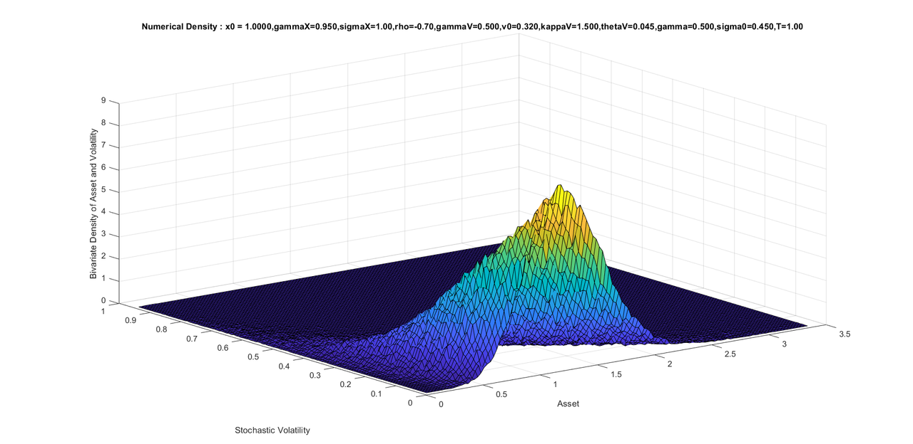](https://postimg.cc/06krwCgM)

.

[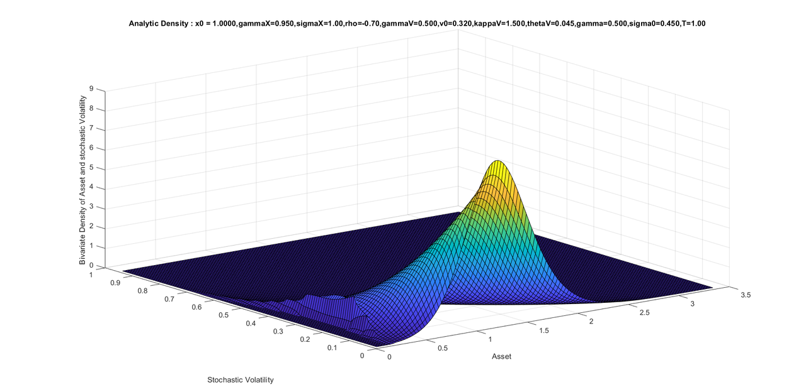](https://postimg.cc/zySVvcQY)

.

.

[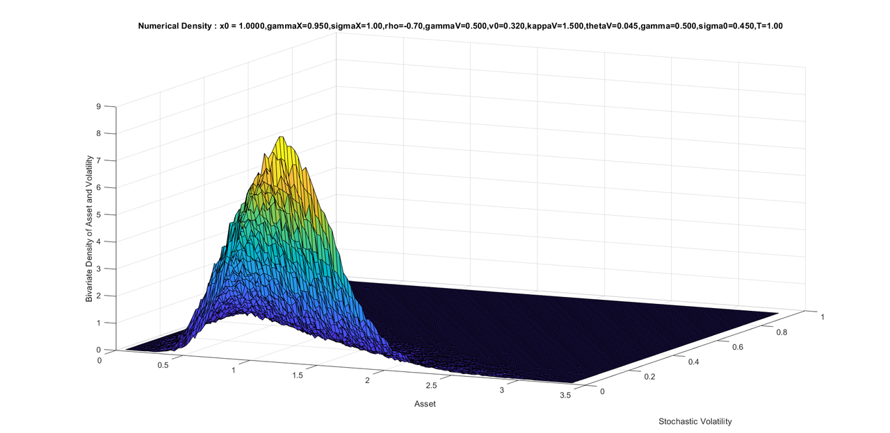](https://postimg.cc/142gj6F2)

.

.

[](https://postimg.cc/hXrtc7JS)

.

.

.

[](https://postimg.cc/xcmkDCyC)

.

.

[](https://postimg.cc/0zxyTCyW)

.

.

.

[](https://postimg.cc/ZWhWTSVL)

.

.

.

[](https://postimg.cc/c6rghTvf)

.

.

.

[](https://postimg.cc/s1hf1LBH)

---

### #2194 — Amin (Topic Author)
*February 17, 2024, 10:36 AM*

Friends, we still have to work on better optimization and also on how to divide the marginal density better into first
row and first column (I did this just ad-hoc yet). But I am sure that we are fixing all problems and issues one by one.
Option prices are still far from perfect for high correlation but we got a better general shape by fixing some previous
errors.

We will have to work on robustness of solutions against the kind of spikes we see in the analytic graphs in previous
posts but I am sure we will soon fix all these issues.

Here are the programs.

```
function []= SVMonteCarloAndAssetConditionalDensityHermites()

%The purpose of this program is to take two random varaibles one of which
%is independent and the other is dependent on the first varaible also with
%its own dynamics.
%We want to capture the conditional dependent density structure from the
%cross moments of dependent and in dependent random variables by
%employing a two dimensional density for the dependent variable.
%We want to find the detailed relationship between Y and X so we can get
%the conditional density of dependent variable X given a particular value
%of independent variable Y. This will be done by calibrating coefficients
%of our 2D hermite series to data so that a very good fit to cross moments
%between X and Y is retrieved.

%In this program, we jointly simulate the system of SV and asset SDEs to
%get the joint data of asset and stochastic volatility.
%We use this data to calculate cross moments of asset and volatility. These
%cross moments are then used to calibrate the coefficients of the 2D
%hermite series density of dependent variable X. We also find univariate
%density of independent random variable volatility.
%We use the 2D Hermite series density of dependent variable X and
%univariate density of V to draw a graph of bivariate analytic density of
%X and V.
%We compare this graph of analytic bivariate density with monte carlo
%generated 2D bivariate density of simulated values of X and V in order to
%get an idea how good our calculation of 2D dependent density of X is. We
%also compare analytically calculated values of call prices using our
%calculated 2D hermite series conditional density of X in order to get an
%idea how good our calculation of the 2D hermite series density of X is.

% 2D Hermite Series Form used in this program is given as
%
% X = bnmH(1,1) + bnmH(2,1) H_1(Z_y) + bnmH(3,1) H_2(Z_y) + bnmH(4,1) H_3(Z_y) + bnmH(5,1) H_4(Z_y) + bnmH(6,1) H_5(Z_y)
% + [ bnmH(1,2) + bnmH(2,2) H_1(Z_y) + bnmH(3,2) H_2(Z_y) + bnmH(4,2) H_3(Z_y) + bnmH(5,2) H_4(Z_y) + bnmH(6,2)
H_5(Z_y)] H_1(Zx)
% + [ bnmH(1,3) + bnmH(2,3) H_1(Z_y) + bnmH(3,3) H_2(Z_y) + bnmH(4,3) H_3(Z_y) + bnmH(5,3) H_4(Z_y) + bnmH(6,3)
H_5(Z_y)] H_2(Zx)
% + [ bnmH(1,4) + bnmH(2,4) H_1(Z_y) + bnmH(3,4) H_2(Z_y) + bnmH(4,4) H_3(Z_y) + bnmH(5,4) H_4(Z_y) + bnmH(6,4)
H_5(Z_y)] H_3(Zx)
% + [ bnmH(1,5) + bnmH(2,5) H_1(Z_y) + bnmH(3,5) H_2(Z_y) + bnmH(4,5) H_3(Z_y) + bnmH(5,5) H_4(Z_y) + bnmH(6,5)
H_5(Z_y)] H_4(Zx)
% + [ bnmH(1,6) + bnmH(2,6) H_1(Z_y) + bnmH(3,6) H_2(Z_y) + bnmH(4,6) H_3(Z_y) + bnmH(5,6) H_4(Z_y) + bnmH(6,6)
H_5(Z_y)] H_5(Zx)

% 2D Z-Series Form used in this program is given as
%
% X = bnm(1,1) + bnm(2,1) Z_y + bnm(3,1) (Z_y)^2 + bnm(4,1) (Z_y)^3 + bnm(5,1) (Z_y)^4 + bnm(6,1) (Z_y)^5
% + [ bnm(1,2) + bnm(2,2) Z_y + bnm(3,2) (Z_y)^2 + bnm(4,2) (Z_y)^3 + bnm(5,2) (Z_y)^4 + bnm(6,2) (Z_y)^5 ] Zx
% + [ bnm(1,3) + bnm(2,2) Z_y + bnm(3,3) (Z_y)^2 + bnm(4,3) (Z_y)^3 + bnm(5,3) (Z_y)^4 + bnm(6,3) (Z_y)^5 ] Zx^2
% + [ bnm(1,4) + bnm(2,2) Z_y + bnm(3,4) (Z_y)^2 + bnm(4,4) (Z_y)^3 + bnm(5,4) (Z_y)^4 + bnm(6,4) (Z_y)^5 ] Zx^3
% + [ bnm(1,5) + bnm(2,2) Z_y + bnm(3,5) (Z_y)^2 + bnm(4,5) (Z_y)^3 + bnm(5,5) (Z_y)^4 + bnm(6,5) (Z_y)^5 ] Zx^4
% + [ bnm(1,6) + bnm(2,2) Z_y + bnm(3,6) (Z_y)^2 + bnm(4,6) (Z_y)^3 + bnm(5,6) (Z_y)^4 + bnm(6,6) (Z_y)^5 ] Zx^5

%Asset SDE is
%dX(t) = a X(t)^alpha1 dt+ b X(t)^alpha2 dt+ sigma1 V(t)^gammaV X(t)^gammaX dZ(t)
%We usually take a=0 and b=0 in our simulations
%SV SDE is
%dV(t)=mu1 V(t)^beta1 dt+ mu2 V(t)^beta2 dt + sigma0 V(t)^gamma dZ(t)
%In mean reverting SDEs we ususally have
%mu1= kappaV * thetaV
%beta1=0
%mu2=-kappa
%beta2=0

X0=1.0;
alpha1=0;
alpha2=1;
kappaX=0;
thetaX=1;
a=kappaX*thetaX;
b=-kappaX;

rho=-.7;
%sigma1=1;
sigma1=1;%.225;%1;
gammaV=.5;
gammaX=.95;
% %%%%%%%%`%%%%%
V0=.32;%1;%.35;
thetaV=.045;%1;%.04;
kappaV=1.5;%1.5;
mu1=kappaV*thetaV;
mu2=-kappaV;
beta1=0;
beta2=1;
gamma=.5;
sigma0=.45%1.250%.5;

%V0=1;
%thetaV=1;
%kappaV=1.50;
mu1=kappaV*thetaV;
mu2=-kappaV;
beta1=0;

beta2=1;
%gamma=.5;
%sigma0=1.25;

dt=.03125/2;
Tt=64*1;

T=Tt*dt;
%%%%%%%%%%%%%%%%%%%%%%%%%%%%%%%%%%%%%%%%%%%%%%%%%%%%%%%%%%%%%%%%%%%%%%%%%%5

%In this code block, we do monte carlo simulation of stochastic volatility SDEs
%And also calculate monte carlo call prices.

seed0=21872418;
seed0=82150987;
rng(seed0, 'twister')
paths=500000;
V(1:paths)=V0;
X(1:paths)=X0;

%%%%%%%%%%%%%%%%%%%%%%%%%%%%%%%%%%%%%%%%%%%%%%%%%%%%%%%%%%%%%%%%%%%%%%%%%%%%%%%%%%%%5

paths0=paths;
paths00=paths;
Random1(1:paths00)=0;
Random2(1:paths0)=0;

for tt=1:Tt

Random2=randn(size(Random2));
Random1=randn(size(Random1));

% sum(Random1)/paths
% sum(Random1.^2)/paths
% sum(Random1.^3)/paths
% sum(Random1.^4)/paths
% sum(Random1.^5)/paths
% sum(Random1.^6)/paths
%
% tt
%
% str=input("Look at moments of MC Normals");

%Random1(paths00+1:2*paths00)=-1*Random1(1:paths00);
%Random2(paths0+1:2*paths0)=-1*Random2(1:paths0);
%Random1(paths0+1:2*paths0)=Random1(1:paths0);
%antithetic variates above

X(1:paths)=X(1:paths)+ ...
    (a* X(1:paths).^alpha1 + b* X(1:paths).^alpha2)* dt + ...
    sqrt(1-rho^2)* sigma1* V(1:paths).^gammaV.* X(1:paths).^gammaX .*Random1(1:paths) * sqrt(dt) + ...
    rho* sigma1* V(1:paths).^gammaV .*X(1:paths).^gammaX .*Random2(1:paths)*sqrt(dt) + ...
    (a*alpha1* X(1:paths).^(alpha1-1)+b*alpha2* X(1:paths).^(alpha2-1)).* ...
    (((a* X(1:paths).^alpha1 + b* X(1:paths).^alpha2)* dt^2/2)+ ...
    (sqrt(1-rho^2)* sigma1* V(1:paths).^gammaV.* X(1:paths).^gammaX .*Random1(1:paths) *(1-1/sqrt(3)).*dt^1.5+ ...
    rho* sigma1* V(1:paths).^gammaV .*X(1:paths).^gammaX .*Random2(1:paths)*(1-1/sqrt(3)).*dt^1.5))+ ...
    .5*(a*alpha1*(alpha1-1)* X(1:paths).^(alpha1-2)+b*alpha2*(alpha2-1).* X(1:paths).^(alpha2-2)).* ...
    ( sigma1^2* V(1:paths).^(2*gammaV).* X(1:paths).^(2*gammaX)) *dt^2/2 + ...
    sqrt(1-rho^2)* sigma1* V(1:paths).^gammaV.*gammaX.* X(1:paths).^(gammaX-1).* ...
    ((a* X(1:paths).^alpha1 + b* X(1:paths).^alpha2).*Random1(1:paths) * 1/sqrt(3).* dt^1.5 + ...
    sqrt(1-rho^2)* sigma1* V(1:paths).^gammaV.* X(1:paths).^gammaX .*(Random1(1:paths).^2-1) * dt/2 + ...
    rho* sigma1* V(1:paths).^gammaV .*X(1:paths).^gammaX .*Random1(1:paths).*Random2(1:paths)*dt/2)+ ...
    .5*sqrt(1-rho^2)* sigma1* V(1:paths).^gammaV.*gammaX.*(gammaX-1).* X(1:paths).^(gammaX-2).* ...
    (sigma1^2* V(1:paths).^(2*gammaV).* X(1:paths).^(2*gammaX) .*Random1(1:paths).*1/sqrt(3).*dt^1.5)+ ...
    sqrt(1-rho^2)* sigma1*gammaV.* V(1:paths).^(gammaV-1).* X(1:paths).^(gammaX).* ...
    ((mu1.*V(1:paths).^beta1 + mu2.*V(1:paths).^beta2).*Random1(1:paths) * 1/sqrt(3).* dt^1.5 + ...
    sigma0*V(1:paths).^gamma.*Random1(1:paths).*Random2(1:paths)*dt/2)+ ...
    .5*sqrt(1-rho^2)* sigma1*gammaV.*(gammaV-1).* V(1:paths).^(gammaV-2).* X(1:paths).^(gammaX).* ...
    (sigma0^2*V(1:paths).^(2*gamma).*Random1(1:paths)*1/sqrt(3)*dt^1.5)+ ...
    sqrt(1-rho^2)* sigma1*gammaV.* V(1:paths).^(gammaV-1).*gammaX.* X(1:paths).^(gammaX-1).* ...
    rho.* sigma1.* V(1:paths).^gammaV .*X(1:paths).^gammaX
.*sigma0.*V(1:paths).^gamma.*Random1(1:paths)*1/sqrt(3)*dt^1.5+ ...
    rho* sigma1* V(1:paths).^gammaV.*gammaX.* X(1:paths).^(gammaX-1).* ...
    ((a* X(1:paths).^alpha1 + b* X(1:paths).^alpha2).*Random2(1:paths) * 1/sqrt(3).* dt^1.5 + ...
    sqrt(1-rho^2)* sigma1* V(1:paths).^gammaV.* X(1:paths).^gammaX .*Random1(1:paths).*Random2(1:paths) * dt/2 + ...
    rho* sigma1* V(1:paths).^gammaV .*X(1:paths).^gammaX .*(Random2(1:paths).^2-1)*dt/2)+ ...
    .5*rho* sigma1* V(1:paths).^gammaV.*gammaX.*(gammaX-1).* X(1:paths).^(gammaX-2).* ...
    (sigma1^2* V(1:paths).^(2*gammaV).* X(1:paths).^(2*gammaX) .*Random2(1:paths).*1/sqrt(3).*dt^1.5)+ ...
    rho* sigma1*gammaV.* V(1:paths).^(gammaV-1).* X(1:paths).^(gammaX).* ...
    ((mu1.*V(1:paths).^beta1 + mu2.*V(1:paths).^beta2).*Random2(1:paths) * 1/sqrt(3).* dt^1.5 + ...
    sigma0*V(1:paths).^gamma.*(Random2(1:paths).^2-1)*dt/2)+ ...
    .5*rho* sigma1*gammaV.*(gammaV-1).* V(1:paths).^(gammaV-2).* X(1:paths).^(gammaX).* ...
    sigma0^2.*V(1:paths).^(2*gamma).*Random2(1:paths) * 1/sqrt(3).* dt^1.5+ ...
    rho* sigma1*gammaV.* V(1:paths).^(gammaV-1).*gammaX.* X(1:paths).^(gammaX-1).* ...
    rho.* sigma1.* V(1:paths).^gammaV .*X(1:paths).^gammaX
.*sigma0.*V(1:paths).^gamma.*Random2(1:paths)*1/sqrt(3)*dt^1.5;

    V(1:paths)=V(1:paths)+ ...
        (mu1.*V(1:paths).^beta1 + mu2.*V(1:paths).^beta2)*dt + ...
        sigma0*V(1:paths).^gamma .*Random2(1:paths)*sqrt(dt) + ...
        (mu1.*beta1*V(1:paths).^(beta1-1) + mu2.*beta2.*V(1:paths).^(beta2-1)).* ...
        ((mu1.*V(1:paths).^beta1 + mu2.*V(1:paths).^beta2)*dt^2/2 + ...
        sigma0*V(1:paths).^gamma .*Random2(1:paths)*(1-1/sqrt(3))*dt^1.5) + ...
        .5*(mu1.*beta1.*(beta1-1).*V(1:paths).^(beta1-2) + mu2.*beta2.*(beta2-1).*V(1:paths).^(beta2-2)).* ...
        sigma0^2.*V(1:paths).^(2*gamma).*dt^2/2 + ...
        sigma0*gamma*V(1:paths).^(gamma-1) .* ...
        ((mu1.*V(1:paths).^beta1 + mu2.*V(1:paths).^beta2).*Random2(1:paths).*1/sqrt(3)*dt^1.5 + ...
        sigma0.*V(1:paths).^gamma .*(Random2(1:paths).^2-1)*dt/2) + ...
        .5*sigma0*gamma*(gamma-1).*V(1:paths).^(gamma-2) .* ...
        sigma0^2.*V(1:paths).^(2*gamma) .*Random2(1:paths).*1/sqrt(3)*dt^1.5;

end
% X1=X;
% V1=V;
%

%
 X(XCallStrikes(nn))
            CallPricesMC(nn)=CallPricesMC(nn)+(X(pp)-CallStrikes(nn))/paths;
        end
    end
end

% CallPricesMC
%
% str=input("Look at Call prices");

%%%%%%%%%%%%%%%%%%%%%%%%%%%%%%%%%%%%%%%%%%%%%%%%%%%%%%%%%%%%%%%%%%%%%%%%%%%%%%%%%%%%
%In this code block, we calculate and draw numerically calculated
%2D bivariate density of X and V.

NoOfBinsV=120;
NoOfBinsX=120;
MaxCutOffX=8.5;
MaxCutOffV=8.825;

[XYProbDensity2D,Xn,Vm,BinSizeX,BinSizeV] =
Find2DDensitFromSimulation_Infiniti(X,V,paths,NoOfBinsX,NoOfBinsV,MaxCutOffX,MaxCutOffV);

%Above, we calculate the joint bivariate density of X and V numerically
%from simulated values of X and V. We do this calculation only for comparison
%purposes with analytic 2D bivariate density of X and V.

surf(Xn(2:NoOfBinsX+1),Vm(3:NoOfBinsV+1),transpose(XYProbDensity2D(2:NoOfBinsX+1,3:NoOfBinsV+1)))
title(sprintf('Numerical Density : x0 =
%.4f,gammaX=%.3f,sigmaX=%.2f,rho=%.2f,gammaV=%.3f,v0=%.3f,kappaV=%.3f,thetaV=%.3f,gamma=%.3f,sigma0=%.3f,T=%.2f',
X0,gammaX,sigma1,rho,gammaV,V0,kappaV,thetaV,gamma,sigma0,T));%,sprintf('theta= %f', theta), sprintf('kappa = %f',
kappa),sprintf('sigma = %f', sigma0),sprintf('T = %f', T));
xlabel('Asset'), ylabel('Stochastic Volatility'),zlabel('Bivariate Density of Asset and Volatility')

str=input("Look at numerical bivariate density of Asset and Stochastic Volatility")

%%%%%%%%%%%%%%%%%%%%%%%%%%%%%%%%%%%%%%%%%%%%%%%%%%%%%%%%%%%%%%%%%%%%%%%%%5
%In this block, we calculate the 2D conditional Z-series density of dependent
%variable X given by coefficients 2D array bnm and 1D univariate Z-series density with
%coefficients stored in aa.
%We draw a graph of this analytic density and calculate the difference with
%numerical density.

[bnm,aa] = CalculateConditionalProbabilitiesYtoXLinearRegression04IterB(V,X);

[pXY2D] = Calculate2VariablesOn2DGridFromAnalyticZSeriesA(Xn,Vm,NoOfBinsX,NoOfBinsV,bnm,aa);

surf(Xn(2:NoOfBinsX+1),Vm(3:NoOfBinsV+1),transpose(pXY2D(2:NoOfBinsX+1,3:NoOfBinsV+1)))
title(sprintf('Analytic Density : x0 =
%.4f,gammaX=%.3f,sigmaX=%.2f,rho=%.2f,gammaV=%.3f,v0=%.3f,kappaV=%.3f,thetaV=%.3f,gamma=%.3f,sigma0=%.3f,T=%.2f',
X0,gammaX,sigma1,rho,gammaV,V0,kappaV,thetaV,gamma,sigma0,T));%,sprintf('theta= %f', theta), sprintf('kappa = %f',
kappa),sprintf('sigma = %f', sigma0),sprintf('T = %f', T));
xlabel('Asset'), ylabel('Stochastic Volatility'),zlabel('Bivariate Density of Asset and stochastic Volatility')

str=input("Look at Analytic density of Asset and Stochastic volatility")
%str=input("Look at Analytic density of Asset and Stochastic volatility")
surf(Xn(2:NoOfBinsX+1),Vm(3:NoOfBinsV+1),transpose(pXY2D(2:NoOfBinsX+1,3:NoOfBinsV+1)-XYProbDensity2D(2:NoOfBinsX+1,3:NoOfBinsV+1)))
%title(sprintf('Difference of Analytic and Numerical Density  : x0 =
%.4f,gammaX=%.3f,sigmaX=%.2f,gammaV=%.3f,v0=%.3f,kappaV=%.3f,thetaV=%.3f,gamma=%.3f,sigma0=%.3f,T=%.2f',
X0,gammaX,sigma1,gammaV,V0,kappaV,thetaV,gamma,sigma0,T));%,sprintf('theta= %f', theta), sprintf('kappa = %f',
kappa),sprintf('sigma = %f', sigma0),sprintf('T = %f', T));
xlabel('Asset'), ylabel('Stochastic Volatility'),zlabel('Bivariate Density of Asset and stochastic Volatility')

str=input("Look at difference of numerical and analytic densities of Asset and stochastic volatility")

%%%%%%%%%%%%%%%%%%%%%%%%%%%%%%%%%%%%%%%%%%%%%%%%%%%%%%%%%%%%%%%%%%%%%%%%%%%%%%%%%%%%

%In this last block, we use previously calculated values of 2D Z-series
%coefficients of dependent variable X stored in 2D array bnm and Z-series
%univariate density of V to calculate the option prices. We compare
%analytically calculated option prices with monte carlo option prices.
%Purpose again is to find out how good our calculation of 2D conditional
%Z-series density of dependent variable X is.

CallStrikes=[.5,.55,.6,.65,.7,.75,.8,.85,.9,.95,1,1.05,1.1,1.15,1.2,1.25,1.3,1.35,1.4,1.45,1.5,1.55,1.6,1.65,1.7,1.75]

VolGridSize=400;

[CallPricesAnalytic]=PriceCallArrayOver2DDensityB(bnm,CallStrikes,VolGridSize);

%[CallPricesAnalytic]=PriceCallArrayOver2DDensityA(aa,bnm,CallStrikes,VolGridSize);

CallPricesAnalytic
CallPricesMC

str=input("Look at comparison of analytic and monte carlo call prices");

end
```

.

.

.

.

```
function [bnm,aa] = CalculateConditionalProbabilitiesYtoXLinearRegression04IterB(Yin,Xin)

%Yin argument translates to independent random variable Y
%Xin argument translates to dependent variable X.
%This function takes observations of an independent variable Y and
%dependent varaible X. These have to be joint observations in the sense
%that nth observation of Y, given by Y(n) is taken jointly with nth
%observation of X, given by X(n). Two arrays of observations are the same
%length and nth mmber of independent variable Y is jointly observed with nth
%member of depedent variable X.
%We want to find the detailed relationship between Y and X so we can get
%the conditional density of dependent variable X given a particular value
%of independent variable Y. This will be done by calibrating coefficients
%of our 2D hermite series to data so that a very good fit to cross moments
%between X and Y is retrieved.
%We will first find univariate Z-series/hermite series of both random
%variables independently. For joint dynamics of dependent variable given
%te independnet variable, we will assume a 2D hermite series (This has to
%be two dimensional to be able to capture the dynamics from independent variable Y
%and have its own dynamics) and form but we do not know the coefficients of
%this 2D hermite series. In this program, we try to use iterative optimization
%to find the unknown coefficients of 2D hermite series of dependent variable X
%in a way that after taking products with independent varaible Y, expectation
%of these products i.e cross moments are as exactly retrieved as possible.
%Our iterative optimization procedure perturbs each hermite coefficient in
%2D hermite series  by a very slight amount and checks the objective function.
%If the objective function decreases, we eccept the perturbation otherwise
%reject it and then perturb by a small amount in other opposite direction
%and then again check the objective function. If perturbations in both sides
%are rejected, we do not change the coefficients but slightly decrease the
%perturbation size.
%We will first standardize the data of both random variables and then
%calculate univariate hermite series of both variables and also their
%cross moments in standardized form. We do all the calculations of coefficients
%of independent variable Y and 2D dependent variable X
%in standardized version of variables and moments. After optimization of coefficents on
%standardized data, at the end, we invert the standardization of both
%dependent and independent variables appropriately to get the Z-series and
%hermite series of actual varaibles in theri original coordinates back from
%standardized coordinates.
%Before optimization, we place two conditions on 2D dependent variable X so that
%first row and first column of 2D hermite coefficents of X is already
%known before optimization stage and it is not changed in optimization.
%We do not iteratively optimize over this first row and first colums
%which are analytically known from these two conditions.
%Our first condition is that after integration (of bivaraite density or
%alternatively bivaraite 2D Z-series/2D Hermite series) over independent
%variable, we should get the univaraite marginal density/Z-series/Hermite series of X
%which has already been calculated out of data. This fixes the zeroth
%hermite(of independent varaible Y) related terms in the Z-series/hermite series.
%Please look at this forum post# 2121 for explanation of this first condition.
% https://forum.wilmott.com/viewtopic.php?t=99702&start=2115#p879042

%We can analytically solve for first order cross moments of X with higher
%order in Y. From the analytical solution of these moments, we find first
%row of coefficents in the hermite form.

% 2D Hermite Series Form used in this program is given as
%
% X = bnmH(1,1) + bnmH(2,1) H_1(Z_y) + bnmH(3,1) H_2(Z_y) + bnmH(4,1) H_3(Z_y) + bnmH(5,1) H_4(Z_y) + bnmH(6,1) H_5(Z_y)
% + [ bnmH(1,2) + bnmH(2,2) H_1(Z_y) + bnmH(3,2) H_2(Z_y) + bnmH(4,2) H_3(Z_y) + bnmH(5,2) H_4(Z_y) + bnmH(6,2)
H_5(Z_y)] H_1(Zx)
% + [ bnmH(1,3) + bnmH(2,3) H_1(Z_y) + bnmH(3,3) H_2(Z_y) + bnmH(4,3) H_3(Z_y) + bnmH(5,3) H_4(Z_y) + bnmH(6,3)
H_5(Z_y)] H_2(Zx)
% + [ bnmH(1,4) + bnmH(2,4) H_1(Z_y) + bnmH(3,4) H_2(Z_y) + bnmH(4,4) H_3(Z_y) + bnmH(5,4) H_4(Z_y) + bnmH(6,4)
H_5(Z_y)] H_3(Zx)
% + [ bnmH(1,5) + bnmH(2,5) H_1(Z_y) + bnmH(3,5) H_2(Z_y) + bnmH(4,5) H_3(Z_y) + bnmH(5,5) H_4(Z_y) + bnmH(6,5)
H_5(Z_y)] H_4(Zx)
% + [ bnmH(1,6) + bnmH(2,6) H_1(Z_y) + bnmH(3,6) H_2(Z_y) + bnmH(4,6) H_3(Z_y) + bnmH(5,6) H_4(Z_y) + bnmH(6,6)
H_5(Z_y)] H_5(Zx)

% 2D Z-Series Form used in this program is given as
%
% X = bnm(1,1) + bnm(2,1) Z_y + bnm(3,1) (Z_y)^2 + bnm(4,1) (Z_y)^3 + bnm(5,1) (Z_y)^4 + bnm(6,1) (Z_y)^5
% + [ bnm(1,2) + bnm(2,2) Z_y + bnm(3,2) (Z_y)^2 + bnm(4,2) (Z_y)^3 + bnm(5,2) (Z_y)^4 + bnm(6,2) (Z_y)^5 ] Zx
% + [ bnm(1,3) + bnm(2,2) Z_y + bnm(3,3) (Z_y)^2 + bnm(4,3) (Z_y)^3 + bnm(5,3) (Z_y)^4 + bnm(6,3) (Z_y)^5 ] Zx^2
% + [ bnm(1,4) + bnm(2,2) Z_y + bnm(3,4) (Z_y)^2 + bnm(4,4) (Z_y)^3 + bnm(5,4) (Z_y)^4 + bnm(6,4) (Z_y)^5 ] Zx^3
% + [ bnm(1,5) + bnm(2,2) Z_y + bnm(3,5) (Z_y)^2 + bnm(4,5) (Z_y)^3 + bnm(5,5) (Z_y)^4 + bnm(6,5) (Z_y)^5 ] Zx^4
% + [ bnm(1,6) + bnm(2,2) Z_y + bnm(3,6) (Z_y)^2 + bnm(4,6) (Z_y)^3 + bnm(5,6) (Z_y)^4 + bnm(6,6) (Z_y)^5 ] Zx^5

%%%%%%%%%%%%%%%%%%%%%%%%%%%%%%%%%%%%%%%%%%%%%%%%%%%%%%%%%%%%%%%%%%%%%%%

%In the code block below, we standardize the independent variable Y and dependent variable X.
%We do all later calculations of various Z-series and cross moments in
%standardized framework and then at the end of the program, we convert
%the calculated coefficients of 2D hermite series/Z-series of dependent
%variable X into original non-standardized framework.

 Ndata=length(Yin);

 MeanY=sum(Yin(1:Ndata))/Ndata;
 MeanX=sum(Xin(1:Ndata))/Ndata;

 Ym(1:Ndata)=Yin(1:Ndata)-MeanY;
 Xm(1:Ndata)=Xin(1:Ndata)-MeanX;

 YmVar=sum(Ym(1:Ndata).^2)/Ndata;
 XmVar=sum(Xm(1:Ndata).^2)/Ndata;

 Y(1:Ndata)=Ym(1:Ndata)/sqrt(YmVar);
 X(1:Ndata)=Xm(1:Ndata)/sqrt(XmVar);

 NMomentsY=6;
 NMomentsX=6;
     for nn=1:NMomentsY
        for mm=1:NMomentsX
            CrossMoments11(nn,mm)=0;
            for pp=1:Ndata
               CrossMoments11(nn,mm)=CrossMoments11(nn,mm)+Yin(pp).^nn.*Xin(pp).^mm/Ndata;
               %CrossMoments11(nn,mm)=CrossMoments11(nn,mm)+Y(pp).^nn.*X(pp).^mm/Ndata;
               %CrossMoments11(nn,mm)=CrossMoments11(nn,mm)+Ym(pp).^nn.*Xm(pp).^mm/Ndata;
            end
        end
     end

 %%%%%%%%%%%%%%%%%%%%%%%%%%%%%%%%%%%%%%%%%%%%%%%%%%%%%%%%%%%%%%%%%%%%
%Code block below uses polynomial regression to find univariate Z-series
%coefficients of independent variable Y.
%To know more about polynomial regression read the following and associated
%posts:  https://forum.wilmott.com/viewtopic.php?t=99702&start=2010#p877143

%You can get the text file MomentMatchParams08.txt from the forum post below
%https://forum.wilmott.com/viewtopic.php?f=4&t=99702&start=2040#p877863

Mtable=readtable('C:\Users\Lenovo\Documents\MATLAB\MATLAB1\MomentMatchParams08.txt');

%ZI is moment matched grid along the normal density with number of grid
%points equal to data elements in Y given by Ndata. The grid is constructed
%so that probability mass in each grid cell is 1/Ndata so this matches the
%observation probability of Ndata data elements. Due to equal probability
%mass in each grid cell, we call it equiprobable grid.

[ZI] = MatchMomentParametersOfIdealZhalf04(Ndata,Mtable);

Ys=sort(Y);
Ymu(1:Ndata,1)=Ys(1:Ndata);

W(1:Ndata,1)=1;
W(1:Ndata,2)=ZI(1:Ndata);
W(1:Ndata,3)=ZI(1:Ndata).^2;
W(1:Ndata,4)=ZI(1:Ndata).^3;
W(1:Ndata,5)=ZI(1:Ndata).^4;
W(1:Ndata,6)=ZI(1:Ndata).^5;
% W(1:Ndata,7)=ZI(1:Ndata).^6;
% W(1:Ndata,8)=ZI(1:Ndata).^7;

coeff=inv(W'*W)*(W'*Ymu);

%Above, we get coefficients of univariate Z-series of independent
%variable Y by least square regression.

a0=coeff(1,1);
a(1:5)=coeff(2:6,1);

%Above, we assign zeroth power Z-series coefficient to a0 and rest of
%the coefficients to array a.
%This was older format but we might need it since many old functions are written
%in this format.

%Below, we assign same Z-series coefficients to a single array. This is
%newer format that we want to use mostly.
aa(1:6)=coeff(1:6);

%uncomment these lines if you want to see shape of Z-series constructed
%density of Y. We had calculated coefficients of this Z-series by
%least square polynomial regression.
%PlotZSeriesDensity(a0,a,'r')
%str=input("Look at the density of volatility");

%%%%%%%%%%%%%%%%%%%%%%%%%%%%%%%%%%%%%%%%%%%%%%%%%%%%%%%%%%%%%%%%%%%%5
%In this code block, we calcualate the coefficients of univariate marginal
%density of dependent variable X again by least square polynomial
%regression as we did in previous block for independent variable Y.

Xs=sort(X);
Xmu(1:Ndata,1)=Xs(1:Ndata);

W(1:Ndata,1)=1;
W(1:Ndata,2)=ZI(1:Ndata);
W(1:Ndata,3)=ZI(1:Ndata).^2;
W(1:Ndata,4)=ZI(1:Ndata).^3;
W(1:Ndata,5)=ZI(1:Ndata).^4;
W(1:Ndata,6)=ZI(1:Ndata).^5;

coeff=inv(W'*W)*(W'*Xmu);

c0=coeff(1,1);
c(1:5)=coeff(2:6,1);

cc(1:6)=coeff(1:6,1);

[ccH] = ConvertZSeriesToHermiteSeriesNew(cc,5);

%%%%%%%%%%%%%%%%%%%%%%%%%%%%%%%%%%%%%%%%%%%%%%%%%%%%%%%%%%%%%%%%%%%%%%%%%%%%%%%%%%%%%%%%%%%%%%%%
%%%%%%%%%%%%%%%%%%%%%%%%%%%%%%%%%%%%%%%%%%%%%%%%%%%%%%%%%%%%%%%%%%%%%%%%%%%%%%%%%%%%%%%%%%%%%%%%%%%%%

Zy= CalculateZgivenXAndZSeriesC5Improved(Y,a0,a);

[Xs,I]=sort(X);

Zys=Zy(I);

Zx=ZI;

Xmu(1:Ndata,1)=Xs(1:Ndata);

W=0;

W(1:Ndata,1)=1.0;
W(1:Ndata,2)=Zx(1:Ndata);
W(1:Ndata,3)=(Zx(1:Ndata).^2-1);
W(1:Ndata,4)=(Zx(1:Ndata).^3-3*Zx(1:Ndata));
W(1:Ndata,5)=(Zx(1:Ndata).^4-6*Zx(1:Ndata).^2+3);
W(1:Ndata,6)=(Zx(1:Ndata).^5-10*Zx(1:Ndata).^3+15*Zx(1:Ndata));

W(1:Ndata,7)=1.*Zys(1:Ndata);
W(1:Ndata,8)=Zx(1:Ndata).*Zys(1:Ndata);
W(1:Ndata,9)=(Zx(1:Ndata).^2-1).*Zys(1:Ndata);
W(1:Ndata,10)=(Zx(1:Ndata).^3-3*Zx(1:Ndata)).*Zys(1:Ndata);
W(1:Ndata,11)=(Zx(1:Ndata).^4-6*Zx(1:Ndata).^2+3).*Zys(1:Ndata);
W(1:Ndata,12)=(Zx(1:Ndata).^5-10*Zx(1:Ndata).^3+15*Zx(1:Ndata)).*Zys(1:Ndata);

W(1:Ndata,13)=(Zys(1:Ndata).^2-1);
W(1:Ndata,14)=Zx(1:Ndata).*(Zys(1:Ndata).^2-1);
W(1:Ndata,15)=(Zx(1:Ndata).^2-1).*(Zys(1:Ndata).^2-1);
W(1:Ndata,16)=(Zx(1:Ndata).^3-3*Zx(1:Ndata)).*(Zys(1:Ndata).^2-1);
W(1:Ndata,17)=(Zx(1:Ndata).^4-6*Zx(1:Ndata).^2+3).*(Zys(1:Ndata).^2-1);
W(1:Ndata,18)=(Zx(1:Ndata).^5-10*Zx(1:Ndata).^3+15*Zx(1:Ndata)).*(Zys(1:Ndata).^2-1);

W(1:Ndata,19)=(Zys(1:Ndata).^3-3*Zy(1:Ndata));
W(1:Ndata,20)=Zx(1:Ndata).*(Zys(1:Ndata).^3-3*Zy(1:Ndata));
W(1:Ndata,21)=(Zx(1:Ndata).^2-1).*(Zys(1:Ndata).^3-3*Zy(1:Ndata));
W(1:Ndata,22)=(Zx(1:Ndata).^3-3*Zx(1:Ndata)).*(Zys(1:Ndata).^3-3*Zys(1:Ndata));
W(1:Ndata,23)=(Zx(1:Ndata).^4-6*Zx(1:Ndata).^2+3).*(Zys(1:Ndata).^3-3*Zys(1:Ndata));
W(1:Ndata,24)=(Zx(1:Ndata).^5-10*Zx(1:Ndata).^3+15*Zx(1:Ndata)).*(Zys(1:Ndata).^3-3*Zys(1:Ndata));

W(1:Ndata,25)=(Zys(1:Ndata).^4-6*Zys(1:Ndata).^2+3);
W(1:Ndata,26)=Zx(1:Ndata).*(Zys(1:Ndata).^4-6*Zys(1:Ndata).^2+3);
W(1:Ndata,27)=(Zx(1:Ndata).^2-1).*(Zys(1:Ndata).^4-6*Zys(1:Ndata).^2+3);
W(1:Ndata,28)=(Zx(1:Ndata).^3-3*Zx(1:Ndata)).*(Zys(1:Ndata).^4-6*Zys(1:Ndata).^2+3);
W(1:Ndata,29)=(Zx(1:Ndata).^4-6*Zx(1:Ndata).^2+3).*(Zys(1:Ndata).^4-6*Zys(1:Ndata).^2+3);
W(1:Ndata,30)=(Zx(1:Ndata).^5-10*Zx(1:Ndata).^3+15*Zx(1:Ndata)).*(Zys(1:Ndata).^4-6*Zys(1:Ndata).^2+3);

W(1:Ndata,31)=(Zys(1:Ndata).^5-10*Zys(1:Ndata).^3+15*Zys(1:Ndata));
W(1:Ndata,32)=Zx(1:Ndata).*(Zys(1:Ndata).^5-10*Zys(1:Ndata).^3+15*Zys(1:Ndata));
W(1:Ndata,33)=(Zx(1:Ndata).^2-1).*(Zys(1:Ndata).^5-10*Zys(1:Ndata).^3+15*Zys(1:Ndata));
W(1:Ndata,34)=(Zx(1:Ndata).^3-3*Zx(1:Ndata)).*(Zys(1:Ndata).^5-10*Zys(1:Ndata).^3+15*Zys(1:Ndata));
W(1:Ndata,35)=(Zx(1:Ndata).^4-6*Zx(1:Ndata).^2+3).*(Zys(1:Ndata).^5-10*Zys(1:Ndata).^3+15*Zys(1:Ndata));
W(1:Ndata,36)=(Zx(1:Ndata).^5-10*Zx(1:Ndata).^3+15*Zx(1:Ndata)).*(Zys(1:Ndata).^5-10*Zys(1:Ndata).^3+15*Zys(1:Ndata));

coeff=inv(W'*W)*(W'*Xmu);

bnmH0(1,1:6)=ccH(1:6);  %Replace first line of X-hermites with Marginal density retrieval condition
bnmH0(2,1:6)=coeff(7:12);
bnmH0(3,1:6)=coeff(13:18);
bnmH0(4,1:6)=coeff(19:24);
bnmH0(5,1:6)=coeff(25:30);
bnmH0(6,1:6)=coeff(31:36);

bnmH=bnmH0;

%%%%%%%%%%%%%%%%%%%%%%%%%%%%%%%%%%%%%%%%%%%%%%%%%%%%%%%%%%%%%%%%%%%%%%%

SeriesOrder1=6;
NMomentsY=6;

SeriesOrder10=6; %SeriesOrder10 = 1 + highest power of Zy in 2D Z-series%Here highest power of Zy is five
SeriesOrder01=6; %SeriesOrder01 = 1 + highest power of Zx in 2D Z-series%Here highest power of Zx is also five
%notation is  bnm(1:SeriesOrder10,1:SeriesOrder01)
%Similalry    bnmH(1:SeriesOrder10,1:SeriesOrder01)

NMomentsX=6; %Highest moment of X in cross moments of X and Y
NMomentsY=6; %Highest moment of Y in cross moments of X and Y

%Below we calculate various cross moments between X and Y. These are
%calculated from standardized data.
for nn=1:NMomentsY
   for mm=1:NMomentsX
       CrossMoments(nn,mm)=0;
       for pp=1:Ndata
          CrossMoments(nn,mm)=CrossMoments(nn,mm)+Y(pp).^nn.*X(pp).^mm/Ndata;
       end
   end
end

%Below are the weights on calculation of objective function. More weight on
%a particular moment means that its better match with target moments gets more emphasized as
%compared to match of other moments.
%Choice of good weights is non-trivial.
%Current choice is only haphazard. Please try improvements/

 w2D(1:NMomentsY,1:NMomentsX)=1;
for nn=NMomentsY-1:-1:1
    for mm=NMomentsX-1:-1:1
        w2D(nn,mm)=w2D(nn+1,mm+1)*(nn+1)*(mm+1);
    end
end

w2D(:,1)=w2D(:,1)*5000000;

w2D(:,2)=w2D(:,2)*500000;
w2D(1,2)=w2D(1,2)*100;
w2D(2,2)=w2D(2,2)*10;
w2D(3,2)=w2D(3,2)*5;
w2D(:,3)=w2D(:,3)*100000;
w2D(1,3)=w2D(1,3)*20;
w2D(2,3)=w2D(2,3)*5;
w2D(1,:)=w2D(1,:)*10000;
w2D(2,:)=w2D(2,:)*100;
w2D(3,:)=w2D(3,:)*10;
w2D(:,4)=w2D(:,4)*10000;
w2D(1,4)=w2D(1,4)*10;
w2D(2,4)=w2D(2,4)*2;
w2D(:,5)=w2D(:,5)*1000;

%Please look on detailed comments inside function below for more insight about it.
%The function below returns coefficients on first row of hermite series so that all
%cross moments of first order in dependent variable X and various orders in independent
%variable Y are matched.

[ddH] = ProduceFirstRowofConditioal2DZSeries02_6M_A(aa,SeriesOrder1,CrossMoments);

%Below we define a 2D array of hermite series coefficents and populate its
%first row with output from above function so that all cross moments of
%first order in X and different orders in Y are matched.
%We also populate first column with univariate hermite coefficients of
%marginal density of X because of the condition that upon integration of
%the bivariate hermite form, we should get univariate marginal density as a
%result. %Please look at this forum post# 2121 for explanation of this first condition.
% https://forum.wilmott.com/viewtopic.php?t=99702&start=2115#p879042

%
% %%%%%%%%%%%%%%%%%%%%%%%%%5
%
ccH0=ccH;

for nn=2:6
    %ccH(nn)=sign(ccH(nn)-dd(nn)).*sqrt(abs(sign(ccH(nn)).*ccH(nn).^2-sign(dd(nn)).*dd(nn).^2));
    if(abs(ccH(nn))>abs(ddH(nn)))
        ccH(nn)=sign(ccH(nn)).*sqrt(ccH(nn).^2-ddH(nn).^2);
    else

        ccH(nn)=0;
    end
end

% %[ccH1] = SubtractZSeriesRVsByMonteCarlo(ccH0,ddH);
%
% %[ccH2] = SubtractDensity(ccH0,ddH)
%
%
% %ddH
%
% %ccH0
%
% ccH
%
% %ccH1
%
% %ccH2
% %str=input("Look at comparison of ccH");
%
  bnmH(1,1:6)=ccH(1:6);     %populate first column with univariate margianl density hermite coefficients of X.
% % %bnmH(1,1)=MeanX;
  bnmH(1:6,1)=ddH(1:6);      %populate first row so that all cross moments of first order in X are matched.
% % %
% %%%%%%%%%%%%%%%%%%%%%%%5

% [Zy] = CalculateZgivenXAndZSeriesC5Improved(Y,a0,a);
% [Zx] = CalculateZgivenXAndZSeriesC5Improved(X,c0,c);
%
% paths=Ndata;
% [CorrH0] = CalculateCorrelationBivariateHermiteCH(Zx,Zy,paths,5);
%
% bnmH(1,1)=ddH(1);
% bnmH(1,2)=sqrt(1-CorrH0(1).^2).*ccH(2);
% bnmH(1,3)=sqrt(1-CorrH0(2).^2).*ccH(3);
% bnmH(1,4)=sqrt(1-CorrH0(3).^2).*ccH(4);
% bnmH(1,5)=sqrt(1-CorrH0(4).^2).*ccH(5);
% bnmH(1,6)=sqrt(1-CorrH0(5).^2).*ccH(6);
%
% bnmH(2,1)=CorrH0(1).*ccH(2);
% bnmH(3,1)=CorrH0(2).*ccH(3);
% bnmH(4,1)=CorrH0(3).*ccH(4);
% bnmH(5,1)=CorrH0(4).*ccH(5);
% bnmH(6,1)=CorrH0(5).*ccH(6);
%

%%%%%%%%%%%%%%%%%%%%%%%%%%%%%%%%%%%%%%%%%%%%%%%%
%In our iterative optimization, we will not alter the above first column and first row of 2D hermite coefficients array.

%In the block below, we convert 2D hermite coefficients array bnmH to 2D
%Z-series array bnm. We calculate the values of cross moments given the values of
%coefficients in 2D Z-series bnm. We use these model cross moments and
%co1mpare them with target cross moments to evaluate the objective function.

%Convert from 2D Hermite Series Coefficients bnmH to 2D Z-series
%coefficients bnm
[bnm] = Convert2DHermitesInto2DSeries(bnmH);
%Evaluate the model cross moments in the function below.
[Moments2D,Moments1D] =
CalculateCrossMomentsConditional2DNew02(aa,bnm,SeriesOrder1,SeriesOrder10,SeriesOrder01,NMomentsX,NMomentsY);
%Evaluate the objective function based on weighted squared difference
%between model cross moments and target cross momensts from data.
[ObjFuncBest] = CalculateObjMoment2D1D(CrossMoments,Moments2D,w2D,NMomentsX,NMomentsY);
    %%%%%%%%%%%%%%%%

SeriesOrderIter10=6;
SeriesOrderIter01=6;
alphaSuccessCount(1:SeriesOrderIter10,1:SeriesOrderIter01)=0;
SuccessPrevalpha(1:SeriesOrderIter10,1:SeriesOrderIter01)=0;

%array of perturbation sizes of coefficients of the 2D Hermite form
%of dependent variable X in iterative optimization.
for nn=1:SeriesOrderIter10
    for mm=1:SeriesOrderIter01
        if(bnmH(nn,mm)~=0)
            delta_bnmHCoeff(nn,mm)=bnmH(nn,mm)./50;
        else
            delta_bnmHCoeff(nn,mm)=.00001;
        end
    end
end

%Assign initial value of bnmH to workhorse variable bnmHCoeff which will be
%used in iterative ioptimization
bnmHCoeff=bnmH;

mul1=.9; %decrease the perturbation step size by multiplying it with .9 when
%objective function does not decrease upon perturbation on both sides.
mul2=1.1; %Increase the perturbation step size after several successive
%successes in decreasing the objective function
Iterations=5000;
MM1=2;
NN1=2;
MM2=2
NN2=2;
for iter=1:Iterations
iter
bnmHCoeff
ObjFuncBest

%Below we run a two dimensional loop that loops over all rows and columns
%of 2D array of hermite series coefficients. However, we exclude first row
%and first column from this optimization as values there were already fixed
%analytically.

    for kk=NN1:MM1 %SeriesOrderIter10 %Optimize over Zy hermites.
        for jj=NN2:MM2 %Optimize over Zx hermites
            if(iter>500)
                NN1=2;
                MM1=3;
                NN2=2;
                MM2=SeriesOrderIter01;
            end
            if(iter>1000)
                NN1=2;
                MM2=SeriesOrderIter10;
                NN2=2;
                MM2=3;

            end
            if(iter>1500)
                NN1=2;
                MM1=4;
                NN2=2;
                MM2=SeriesOrderIter01;
            end
            if(iter>2000)
                NN1=2;
                MM1=SeriesOrderIter10;
                NN2=2;
                MM2=4;
            end
            if(iter>2500)
                NN1=2;
                MM1=5;
                NN2=2;
                MM2=SeriesOrderIter01;
            end

            if(iter>3000)
                NN1=2;
                MM1=SeriesOrderIter01;
                NN2=2;
                MM2=6;
            end

            if(iter>3500)
                NN1=2;
                MM1=SeriesOrderIter01;
                NN2=1;
                MM2=6;
            end
            if(iter>4000)
                NN1=1;
                MM1=SeriesOrderIter01;
                NN2=1;
                MM2=6;
            end
%     for kk=2:SeriesOrderIter10 %Optimize over Zy hermites.
%         for jj=2:SeriesOrderIter01 %Optimize over Zx hermites

            %Assign 2D hermite coefficients to workhorse variable
            bnmHCoeffNew(1:SeriesOrderIter10,1:SeriesOrderIter01)=bnmHCoeff(1:SeriesOrderIter10,1:SeriesOrderIter01);
            %perturb the (kk,jj) coefficient by magnitude given in its
            %delta array named delta_bnmHCoeff(kk,jj)
            bnmHCoeffNew(kk,jj)=bnmHCoeff(kk,jj)+delta_bnmHCoeff(kk,jj);
            %convert to Z-series to calculate the cross moments
            [bnm] = Convert2DHermitesInto2DSeries(bnmHCoeffNew);
            [Moments2D,Moments1D] =
CalculateCrossMomentsConditional2DNew02(aa,bnm,SeriesOrder1,SeriesOrder10,SeriesOrder01,NMomentsX,NMomentsY);
            %Calculate the objective function value.
            [ObjFuncNew] = CalculateObjMoment2D1D(CrossMoments,Moments2D,w2D,NMomentsX,NMomentsY);

            if(ObjFuncNew3) %After successive successes, increase the perturbation step size.
                delta_bnmHCoeff(kk,jj)=delta_bnmHCoeff(kk,jj).*mul2;
            end
        end
    end
   if(rem(iter,500)==0)
         bnm
         Moments2D
         CrossMoments
         Moments2D(:,1)
         CrossMoments(:,1)

         ObjFuncBest

         str=input("Look at fit of moments");

      end

end

bnmH=bnmHCoeff;

%save("bnmHFile.mat","bnmH");
%load("bnmHFile.mat","bnmH");

%str=input("File has been loaded");

% W=0;
%
% % W(1:Ndata,1)=1.0;
% % W(1:Ndata,2)=Zx(1:Ndata);
% % W(1:Ndata,3)=(Zx(1:Ndata).^2-1);
% % W(1:Ndata,4)=(Zx(1:Ndata).^3-3*Zx(1:Ndata));
% % W(1:Ndata,5)=(Zx(1:Ndata).^4-6*Zx(1:Ndata).^2+3);
% % W(1:Ndata,6)=(Zx(1:Ndata).^5-10*Zx(1:Ndata)+15*Zx(1:Ndata));
%
% W(1:Ndata,1)=1.*Zys(1:Ndata);
% W(1:Ndata,2)=Zx(1:Ndata).*Zys(1:Ndata);
% W(1:Ndata,3)=(Zx(1:Ndata).^2-1).*Zys(1:Ndata);
% W(1:Ndata,4)=(Zx(1:Ndata).^3-3*Zx(1:Ndata)).*Zys(1:Ndata);
% W(1:Ndata,5)=(Zx(1:Ndata).^4-6*Zx(1:Ndata).^2+3).*Zys(1:Ndata);
% W(1:Ndata,6)=(Zx(1:Ndata).^5-10*Zx(1:Ndata)+15*Zx(1:Ndata)).*Zys(1:Ndata);
%
% W(1:Ndata,7)=(Zys(1:Ndata).^2-1);
% W(1:Ndata,8)=Zx(1:Ndata).*(Zys(1:Ndata).^2-1);
% W(1:Ndata,9)=(Zx(1:Ndata).^2-1).*(Zys(1:Ndata).^2-1);
% W(1:Ndata,10)=(Zx(1:Ndata).^3-3*Zx(1:Ndata)).*(Zys(1:Ndata).^2-1);
% W(1:Ndata,11)=(Zx(1:Ndata).^4-6*Zx(1:Ndata).^2+3).*(Zys(1:Ndata).^2-1);
% W(1:Ndata,12)=(Zx(1:Ndata).^5-10*Zx(1:Ndata)+15*Zx(1:Ndata)).*(Zys(1:Ndata).^2-1);
%
% W(1:Ndata,13)=(Zys(1:Ndata).^3-3*Zy(1:Ndata));
% W(1:Ndata,14)=Zx(1:Ndata).*(Zys(1:Ndata).^3-3*Zy(1:Ndata));
% W(1:Ndata,15)=(Zx(1:Ndata).^2-1).*(Zys(1:Ndata).^3-3*Zy(1:Ndata));
% W(1:Ndata,16)=(Zx(1:Ndata).^3-3*Zx(1:Ndata)).*(Zys(1:Ndata).^3-3*Zys(1:Ndata));
% W(1:Ndata,17)=(Zx(1:Ndata).^4-6*Zx(1:Ndata).^2+3).*(Zys(1:Ndata).^3-3*Zys(1:Ndata));
% W(1:Ndata,18)=(Zx(1:Ndata).^5-10*Zx(1:Ndata )+15*Zx(1:Ndata)).*(Zys(1:Ndata).^3-3*Zys(1:Ndata));
%
% W(1:Ndata,19)=(Zys(1:Ndata).^4-6*Zys(1:Ndata).^2+3);
% W(1:Ndata,20)=Zx(1:Ndata).*(Zys(1:Ndata).^4-6*Zys(1:Ndata).^2+3);
% W(1:Ndata,21)=(Zx(1:Ndata).^2-1).*(Zys(1:Ndata).^4-6*Zys(1:Ndata).^2+3);
% W(1:Ndata,22)=(Zx(1:Ndata).^3-3*Zx(1:Ndata)).*(Zys(1:Ndata).^4-6*Zys(1:Ndata).^2+3);
% W(1:Ndata,23)=(Zx(1:Ndata).^4-6*Zx(1:Ndata).^2+3).*(Zys(1:Ndata).^4-6*Zys(1:Ndata).^2+3);
% W(1:Ndata,24)=(Zx(1:Ndata).^5-10*Zx(1:Ndata)+15*Zx(1:Ndata)).*(Zys(1:Ndata).^4-6*Zys(1:Ndata).^2+3);
%
% W(1:Ndata,25)=(Zys(1:Ndata).^5-10*Zys(1:Ndata).^3+15*Zys(1:Ndata));
%
% W(1:Ndata,27)=(Zx(1:Ndata).^2-1).*(Zys(1:Ndata).^5-10*Zys(1:Ndata).^3+15*Zys(1:Ndata));
% W(1:Ndata,28)=(Zx(1:Ndata).^3-3*Zx(1:Ndata)).*(Zys(1:Ndata).^5-10*Zys(1:Ndata).^3+15*Zys(1:Ndata));
% W(1:Ndata,29)=(Zx(1:Ndata).^4-6*Zx(1:Ndata).^2+3).*(Zys(1:Ndata).^5-10*Zys(1:Ndata).^3+15*Zys(1:Ndata));
% W(1:Ndata,30)=(Zx(1:Ndata).^5-10
%
%
% bnmH=bnmH0;
%%%%%%%%%%%%%%%%%%%%%%%%%%%%%%%%%%%%%%%%%%%%%%%%%%%%%%%%%%%%%%%%%%%%%%%%%%%%%%%%
SeriesOrder1=6;
NMomentsY=6;
NMomentsX=6;
    for nn=1:NMomentsY
       for mm=1:NMomentsX
           CrossMoments(nn,mm)=0;
           for pp=1:Ndata
              CrossMoments(nn,mm)=CrossMoments(nn,mm)+Y(pp).^nn.*X(pp).^mm/Ndata;
           end
       end
    end

[chh] = ProduceFirstRowofConditioal2DZSeries02_6M_A(aa,SeriesOrder1,CrossMoments);

%%%%%%%%%%%%%%%%%%%%%%%%%%%%%%%%%%%%%%%%%%%%%%%%%%%%%%%%%%%%%%%%%%%

[bnm] = Convert2DHermitesInto2DSeries(bnmH);

SeriesOrder1=6;
SeriesOrder10=6;
SeriesOrder01=6;
NMomentsX=6;
NMomentsY=6;
[Moments2D0] =
CalculateCrossMomentsConditional2DNew02(aa,bnm,SeriesOrder1,SeriesOrder10,SeriesOrder01,NMomentsX,NMomentsY);

Moments2D0

CrossMoments

str=input("Look at comparison of moments--first-standardized");

%%%%%%%%%%%%%%%%%%%%%%%%%%%%%%%%%%%%%%%%%%%%%%%%%%%%%%%%%%%%%%%%%%%%%%%%%%%%%%%%
%In the code block below, we convert 2D hermite series coefficients of
%dependent variable X from standardized version to original version.
%For that we first multiply the entire 2D Hermite series by square root of
%variance.
%Later we multiply each column of hermite series of X with particular
%order of Zy hermite polynomials by square root of volatility(independent variable)
%raised to that power of Zy polynomial order as below.
%bnmH=bnmH.*sqrt(XmVar);
%bnmH(:,1)=bnmH(:,1)*sqrt(XmVar);
%for nn=2:6
%    bnmH(nn,:)=bnmH(nn,:).*(sqrt(YmVar)).^(nn-1);
%end

 bnmH=bnmH*sqrt(XmVar);
% for nn=2:6
%     bnmH(nn,:)=bnmH(nn,:).*(sqrt(YmVar)).^(nn-1);
% end
% for nn=2:6
%     bnmH(:,nn)=bnmH(:,nn).*(sqrt(XmVar)).^(nn-1);
% end

%We convert X from hermite series form to Z-series form.
[bnm] = Convert2DHermitesInto2DSeries(bnmH);
bnm(1,1)=MeanX-bnm(3,1)-3*bnm(5,1)-1*bnm(1,3)-1*3*bnm(1,5)-3*bnm(5,3)-bnm(3,3)-3*bnm(3,5)-9*bnm(5,5);

%Finally in above line, we make sure that mean of the 2D Z-series is

%Below, we convert Z-series of independent variable Y from standard form to
%original variable form.

aa=aa*sqrt(YmVar);
aa(1)=MeanY-aa(3)-3*aa(5);

 SeriesOrder1=6;
 SeriesOrder10=6;
 SeriesOrder01=6;
 NMomentsX=6;
 NMomentsY=6;
 [Moments2D] =
CalculateCrossMomentsConditional2DNew02(aa,bnm,SeriesOrder1,SeriesOrder10,SeriesOrder01,NMomentsX,NMomentsY);

 Moments2D

 CrossMoments11

 str=input("Look at comparison of moments");
%
%
% for nn=1:NMomentsX
%     for mm=1:NMomentsY
%
%         Moments2D(mm,nn)
%         Moments2D0(mm,nn).*(sqrt(YmVar)).^(mm).*(sqrt(XmVar)).^(nn)
%         Moments2D0(mm,nn)./(sqrt(YmVar)).^(mm)./(sqrt(XmVar)).^(nn)
%         Moments2D(mm,nn)./(sqrt(YmVar)).^(mm)./(sqrt(XmVar)).^(nn)
%         nn
%         mm
%         str=input("Look at moments again---22---22-222---")
%     end
% end

end
```

.

.

.

```
function [pXY2D] = Calculate2VariablesOn2DGridFromAnalyticZSeriesB(XX,YY,NoOfBinsX,NoOfBinsY,bnm,aa)

%YY are Y-coordinates of 2D Grid. In our case this is stochastic
%volatility and is univariate and independent of asset so it can be
%inverted as a univariate Z-series. its Z-series is given by a0 and a.

a0=aa(1);
a(1:length(aa)-1)=aa(2:length(aa));
[Zy] = CalculateZgivenXAndZSeriesC5Improved(YY,a0,a);

for indexY=1:NoOfBinsY+1
   
b0=bnm(1,1)+bnm(2,1).*Zy(indexY)+bnm(3,1).*Zy(indexY).^2+bnm(4,1).*Zy(indexY).^3+bnm(5,1).*Zy(indexY).^4+bnm(6,1).*Zy(indexY).^5;
    for mm=2:6
       
b(mm-1)=bnm(1,mm)+bnm(2,mm).*Zy(indexY)+bnm(3,mm).*Zy(indexY).^2+bnm(4,mm).*Zy(indexY).^3+bnm(5,mm).*Zy(indexY).^4+bnm(6,mm).*Zy(indexY).^5;
    end

    [Zx0] = CalculateZgivenXAndZSeriesC5Improved(XX,b0,b);
    Zx(1:NoOfBinsX+1,indexY)=Zx0(1:NoOfBinsX+1);
    % Zx0
    % XX
    % indexY
    % str=input("Look at Zxx(indexY)")
end

dbnm(1:5,1:5)=0;

for nn=1:6
    for mm=1:5
        dbnm(nn,mm)=mm.*bnm(nn,mm+1);
    end
end

EZZ=EZZ2();
dXdZx(1:indexY,1:NoOfBinsX+1)=0;
for nn=1:indexY
    for mm=1:NoOfBinsX+1
        for nn1=1:6
            for mm1=1:5
        dXdZx(nn,mm)=dXdZx(nn,mm)+dbnm(nn1,mm1).*Zy(nn).^(nn1-1).*Zx(mm,nn).^(mm1-1);
            end
        end

    end
end

%Below we make calculations of density in original coordinates by doing
%change of probability derivative with respect to gaussian density.
DinvfXX(1:NoOfBinsX+1,1:NoOfBinsY+1)=0;
for mm=1:NoOfBinsY
    %DinvfXX(1,mm)= (Zx(1 + 1,mm) - Zx(1,mm))/(XX(1 + 1) - XX(1));
    for nn=2:NoOfBinsX

        DinvfXX(nn,mm) = (Zx(nn + 1,mm) - Zx(nn - 1,mm))/(XX(nn + 1) - XX(nn - 1));

    end
    %DinvfXX(nn,mm) = (Zx(nn + 1,mm) - Zx(nn - 1,mm))/(XX(nn + 1) - XX(nn - 1));
    DinvfXX(NoOfBinsX+1,mm)=DinvfXX(NoOfBinsX,mm);
    DinvfXX(1,mm)=DinvfXX(2,mm);
end

DinvfYY(1:NoOfBinsY+1)=0;
%DinvfYY(1) = (Zy(1+1) - Zy(1))/(YY(1 + 1) - YY(1));
for mm=2:NoOfBinsY

        DinvfYY(mm) = (Zy(mm+1) - Zy(mm-1))/(YY(mm + 1) - YY(mm - 1));

end
DinvfYY(NoOfBinsY+1)=DinvfYY(NoOfBinsY);
DinvfYY(1)=DinvfYY(2);

pXY2D(1:NoOfBinsX+1,1:NoOfBinsY+1)=0;
for mm=1:NoOfBinsY
    for nn=1:NoOfBinsX

    %pXY2D(nn,mm) = (normpdf(Zx(nn,mm),0, 1))*abs(DinvfXX(nn,mm)).*(normpdf(Zy(mm),0, 1))*abs(DinvfYY(mm));
    pXY2D(nn,mm) = (normpdf(Zx(nn,mm),0, 1))./abs(dXdZx(mm,nn)).*(normpdf(Zy(mm),0, 1))*abs(DinvfYY(mm));

    end
end

end

```

.

.

.

```
function [CallPrices]=PriceCallArrayOver2DDensityB(bnm,CallStrikes,VolGridSize)

NoOfCallStrikes=length(CallStrikes);

Nn=VolGridSize;  % No of normal density subdivisions
dNn=(8)/Nn;
NnMid=((1+Nn)/2)*dNn;
Zv(1:Nn)=(((1:Nn)*dNn)-NnMid);
ZProb(1)=normcdf(.5*Zv(1)+.5*Zv(2),0,1)-normcdf(.5*Zv(1)+.5*Zv(2)-dNn,0,1);
ZProb(Nn)=normcdf(.5*Zv(Nn)+.5*Zv(Nn-1)+dNn,0,1)-normcdf(.5*Zv(Nn)+.5*Zv(Nn-1),0,1);
ZProb(2:Nn-1)=normcdf(.5*Zv(2:Nn-1)+.5*Zv(3:Nn),0,1)-normcdf(.5*Zv(2:Nn-1)+.5*Zv(1:Nn-2),0,1);

Mm=VolGridSize;  % No of normal density subdivisions
dMm=(8)/Mm;
MmMid=((1+Mm)/2)*dMm;
Zx(1:Mm)=(((1:Mm)*dMm)-MmMid);
ZxProb(1)=normcdf(.5*Zx(1)+.5*Zx(2),0,1)-normcdf(.5*Zx(1)+.5*Zx(2)-dMm,0,1);
ZxProb(Mm)=normcdf(.5*Zx(Mm)+.5*Zx(Mm-1)+dMm,0,1)-normcdf(.5*Zx(Mm)+.5*Zx(Mm-1),0,1);
ZxProb(2:Mm-1)=normcdf(.5*Zx(2:Mm-1)+.5*Zx(3:Mm),0,1)-normcdf(.5*Zx(2:Mm-1)+.5*Zx(1:Mm-2),0,1);

CallPrices(1:NoOfCallStrikes)=0;
for nn=1:Nn
    for mm=1:Mm
        X=0;
        for nn1=1:6
            for mm1=1:6
                X=X+bnm(nn1,mm1).*Zv(nn).^(nn1-1).*Zx(mm).^(mm1-1);
            end
        end
        for qq=1:NoOfCallStrikes
            if(X>CallStrikes(qq))
                CallPrices(qq)=CallPrices(qq)+(X-CallStrikes(qq)).*ZProb(nn).*ZxProb(mm);
            end
        end
    end
end

end

```

.

.

.

```
function [pXY2D] = Calculate2VariablesOn2DGridFromAnalyticZSeriesA(XX,YY,NoOfBinsX,NoOfBinsY,bnm,aa)

%YY are Y-coordinates of 2D Grid. In our case this is stochastic
%volatility and is univariate and independent of asset so it can be
%inverted as a univariate Z-series. its Z-series is given by a0 and a.

a0=aa(1);
a(1:length(aa)-1)=aa(2:length(aa));
[Zy] = CalculateZgivenXAndZSeriesC5Improved(YY,a0,a);

for indexY=1:NoOfBinsY+1
   
b0=bnm(1,1)+bnm(2,1).*Zy(indexY)+bnm(3,1).*Zy(indexY).^2+bnm(4,1).*Zy(indexY).^3+bnm(5,1).*Zy(indexY).^4+bnm(6,1).*Zy(indexY).^5;
    for mm=2:6
       
b(mm-1)=bnm(1,mm)+bnm(2,mm).*Zy(indexY)+bnm(3,mm).*Zy(indexY).^2+bnm(4,mm).*Zy(indexY).^3+bnm(5,mm).*Zy(indexY).^4+bnm(6,mm).*Zy(indexY).^5;
    end
    [Zx0] = CalculateZgivenXAndZSeriesC5Improved(XX,b0,b);
    Zx(1:NoOfBinsX+1,indexY)=Zx0(1:NoOfBinsX+1);
    % Zx0
    % XX
    % indexY
    % str=input("Look at Zxx(indexY)")
end

%Below we make calculations of density in original coordinates by doing
%change of probability derivative with respect to gaussian density.
DinvfXX(1:NoOfBinsX+1,1:NoOfBinsY+1)=0;
for mm=1:NoOfBinsY
    %DinvfXX(1,mm)= (Zx(1 + 1,mm) - Zx(1,mm))/(XX(1 + 1) - XX(1));
    for nn=2:NoOfBinsX

        DinvfXX(nn,mm) = (Zx(nn + 1,mm) - Zx(nn - 1,mm))/(XX(nn + 1) - XX(nn - 1));

    end
    %DinvfXX(nn,mm) = (Zx(nn + 1,mm) - Zx(nn - 1,mm))/(XX(nn + 1) - XX(nn - 1));
    DinvfXX(NoOfBinsX+1,mm)=DinvfXX(NoOfBinsX,mm);
    DinvfXX(1,mm)=DinvfXX(2,mm);
end

DinvfYY(1:NoOfBinsY+1)=0;
%DinvfYY(1) = (Zy(1+1) - Zy(1))/(YY(1 + 1) - YY(1));
for mm=2:NoOfBinsY

        DinvfYY(mm) = (Zy(mm+1) - Zy(mm-1))/(YY(mm + 1) - YY(mm - 1));

end
DinvfYY(NoOfBinsY+1)=DinvfYY(NoOfBinsY);
DinvfYY(1)=DinvfYY(2);

pXY2D(1:NoOfBinsX+1,1:NoOfBinsY+1)=0;
for mm=1:NoOfBinsY
    for nn=1:NoOfBinsX

    pXY2D(nn,mm) = (normpdf(Zx(nn,mm),0, 1))*abs(DinvfXX(nn,mm)).*(normpdf(Zy(mm),0, 1))*abs(DinvfYY(mm));

    end
end

end

```

---

### #2195 — Amin (Topic Author)
*February 18, 2024, 12:43 PM*

Friends, I noticed that after I removed the error in previous program, the graphs became less robust and there were all
sorts of spikes and instabilities. I have been working to fix that. I have had enough success. But more work needs to be
done. I am showing some graphs from both totally non-correlated SV model and with corr=-.7 for one year. These were
quite challenging as I initially thought.

I made improvements to iterative optimization. I also improved the objective function(that is minimized) weights in the
program. It works far better now than yesterday's program and I will make a few more changes to it. I will be posting
these new programs later tonight.

Here are some graph comparisons(Second graph was too beautiful so I took some extra views of analytic 2nd graph).

[](https://postimg.cc/V5c1SjJB)

[](https://postimg.cc/GTRMc3hG)

[](https://postimg.cc/G9JRvHY0)

[](https://postimg.cc/HV6CPRBB)

[](https://postimg.cc/Wq75tRhK)

[](https://postimg.cc/Xrh6nFM5)

[](https://postimg.cc/1fmQBsc8)

[](https://postimg.cc/WdtPR8yj)

---

### #2196 — Amin (Topic Author)
*February 19, 2024, 1:04 PM*

**(broken latex: Unbalanced $: 1)**

```latex
Friends, I am posting a very preliminary version of the main function that optimizes. It has several errors. For many
idisosyncratic cases, parameters, loops count, loops order and many other things have to be tweaked. I still have not
done the part that perfectly fixes the first column and first row and I am resorting to keeping that constant at ad-hoc
calculated values and then running optimization there at the very end. This function will change in many ways but I am
still posting it to keep friends in touch.

This is a different version of the function I used yesterday.

Summary of some major changes.

1. I keep objective function analytic.

Here is the objective function I used for graphs yesterday. w2D are weights for cross moments in squared difference of
model and target cross moments.

w2D(1:NMomentsY,1:NMomentsX)=1;

for nn=NMomentsY-1 : -1 : 1

    for mm=NMomentsX-1 : -1 : 1

        w2D(nn,mm)=w2D(nn+1,mm+1)*(nn+1).^2*(mm+1).^2.0;

    end

end

Please feel free to use non-integer powers if you want to experiment but better to keep objective function in an
analytic form.

2. I used a multiplicative iterative optimization in addition to additive iterative optimization that seems to work very
well.

additive optimization is simply updated element-wise a single coefficient at a time as

bnmHCoeffNew(kk,jj)=bnmHCoeff(kk,jj)+delta_bnmHCoeff(kk,jj);

while  multiplicative optimization is multiplied to one entire column and one entire row at a time with weights
proportional to their powers of standard deviations as

bnmHCoeffNew(kk,2:6)=bnmHCoeff(kk,2:6).*(1+delta_bnmHCoeff1(kk,2:6));

weights along rows are

delta_bnmHCoeff1(1:SeriesOrderIter10,mm)=.005.*XmVar.^((mm)/2);

while weights along columns are

delta_bnmHCoeff2(nn,1:SeriesOrderIter01)=.005.*YmVar.^((nn)/2)

In yesterday's graphs, I did not use any multiplicative optimization. I simply used iterative optimization and in second
last batch of 500 iterative optimizations, I allowed optimization of first column and in last batch of 500 iterated
optimizations, I also allowed optimization of first column.

Mean during optimization cannot be changed from zero for since optimization is done on standardized data. This was not
previously properly taken into account in optimization and was fixed at the end after optimization.

There are other small changes. One year and two year with the same parameters that I had in last matlab program can be
priced well. I did not check three years and four years. Five years were not working and had problems but I am sure we
will soon fix them.

Here is the latest program for reference and it will undergo many more changes in coming days. I am posting the
appropriate function only that does optimization.

.

.

```
function [bnm,aa] = CalculateConditionalProbabilitiesYtoXLinearRegression04IterB(Yin,Xin)

%Yin argument translates to independent random variable Y
%Xin argument translates to dependent variable X.
%This function takes observations of an independent variable Y and
%dependent varaible X. These have to be joint observations in the sense
%that nth observation of Y, given by Y(n) is taken jointly with nth
%observation of X, given by X(n). Two arrays of observations are the same
%length and nth mmber of independent variable Y is jointly observed with nth
%member of depedent variable X.
%We want to find the detailed relationship between Y and X so we can get
%the conditional density of dependent variable X given a particular value
%of independent variable Y. This will be done by calibrating coefficients
%of our 2D hermite series to data so that a very good fit to cross moments
%between X and Y is retrieved.
%We will first find univariate Z-series/hermite series of both random
%variables independently. For joint dynamics of dependent variable given
%te independnet variable, we will assume a 2D hermite series (This has to
%be two dimensional to be able to capture the dynamics from independent variable Y
%and have its own dynamics) and form but we do not know the coefficients of
%this 2D hermite series. In this program, we try to use iterative optimization
%to find the unknown coefficients of 2D hermite series of dependent variable X
%in a way that after taking products with independent varaible Y, expectation
%of these products i.e cross moments are as exactly retrieved as possible.
%Our iterative optimization procedure perturbs each hermite coefficient in
%2D hermite series  by a very slight amount and checks the objective function.
%If the objective function decreases, we eccept the perturbation otherwise
%reject it and then perturb by a small amount in other opposite direction
%and then again check the objective function. If perturbations in both sides
%are rejected, we do not change the coefficients but slightly decrease the
%perturbation size.
%We will first standardize the data of both random variables and then
%calculate univariate hermite series of both variables and also their
%cross moments in standardized form. We do all the calculations of coefficients
%of independent variable Y and 2D dependent variable X
%in standardized version of variables and moments. After optimization of coefficents on
%standardized data, at the end, we invert the standardization of both
%dependent and independent variables appropriately to get the Z-series and
%hermite series of actual varaibles in theri original coordinates back from
%standardized coordinates.
%Before optimization, we place two conditions on 2D dependent variable X so that
%first row and first column of 2D hermite coefficents of X is already
%known before optimization stage and it is not changed in optimization.
%We do not iteratively optimize over this first row and first colums
%which are analytically known from these two conditions.
%Our first condition is that after integration (of bivaraite density or
%alternatively bivaraite 2D Z-series/2D Hermite series) over independent
%variable, we should get the univaraite marginal density/Z-series/Hermite series of X
%which has already been calculated out of data. This fixes the zeroth
%hermite(of independent varaible Y) related terms in the Z-series/hermite series.
%Please look at this forum post# 2121 for explanation of this first condition.
% https://forum.wilmott.com/viewtopic.php?t=99702&start=2115#p879042

%We can analytically solve for first order cross moments of X with higher
%order in Y. From the analytical solution of these moments, we find first
%row of coefficents in the hermite form.

% 2D Hermite Series Form used in this program is given as
%
% X = bnmH(1,1) + bnmH(2,1) H_1(Z_y) + bnmH(3,1) H_2(Z_y) + bnmH(4,1) H_3(Z_y) + bnmH(5,1) H_4(Z_y) + bnmH(6,1) H_5(Z_y)
% + [ bnmH(1,2) + bnmH(2,2) H_1(Z_y) + bnmH(3,2) H_2(Z_y) + bnmH(4,2) H_3(Z_y) + bnmH(5,2) H_4(Z_y) + bnmH(6,2)
H_5(Z_y)] H_1(Zx)
% + [ bnmH(1,3) + bnmH(2,3) H_1(Z_y) + bnmH(3,3) H_2(Z_y) + bnmH(4,3) H_3(Z_y) + bnmH(5,3) H_4(Z_y) + bnmH(6,3)
H_5(Z_y)] H_2(Zx)
% + [ bnmH(1,4) + bnmH(2,4) H_1(Z_y) + bnmH(3,4) H_2(Z_y) + bnmH(4,4) H_3(Z_y) + bnmH(5,4) H_4(Z_y) + bnmH(6,4)
H_5(Z_y)] H_3(Zx)
% + [ bnmH(1,5) + bnmH(2,5) H_1(Z_y) + bnmH(3,5) H_2(Z_y) + bnmH(4,5) H_3(Z_y) + bnmH(5,5) H_4(Z_y) + bnmH(6,5)
H_5(Z_y)] H_4(Zx)
% + [ bnmH(1,6) + bnmH(2,6) H_1(Z_y) + bnmH(3,6) H_2(Z_y) + bnmH(4,6) H_3(Z_y) + bnmH(5,6) H_4(Z_y) + bnmH(6,6)
H_5(Z_y)] H_5(Zx)

% 2D Z-Series Form used in this program is given as
%
% X = bnm(1,1) + bnm(2,1) Z_y + bnm(3,1) (Z_y)^2 + bnm(4,1) (Z_y)^3 + bnm(5,1) (Z_y)^4 + bnm(6,1) (Z_y)^5
% + [ bnm(1,2) + bnm(2,2) Z_y + bnm(3,2) (Z_y)^2 + bnm(4,2) (Z_y)^3 + bnm(5,2) (Z_y)^4 + bnm(6,2) (Z_y)^5 ] Zx
% + [ bnm(1,3) + bnm(2,2) Z_y + bnm(3,3) (Z_y)^2 + bnm(4,3) (Z_y)^3 + bnm(5,3) (Z_y)^4 + bnm(6,3) (Z_y)^5 ] Zx^2
% + [ bnm(1,4) + bnm(2,2) Z_y + bnm(3,4) (Z_y)^2 + bnm(4,4) (Z_y)^3 + bnm(5,4) (Z_y)^4 + bnm(6,4) (Z_y)^5 ] Zx^3
% + [ bnm(1,5) + bnm(2,2) Z_y + bnm(3,5) (Z_y)^2 + bnm(4,5) (Z_y)^3 + bnm(5,5) (Z_y)^4 + bnm(6,5) (Z_y)^5 ] Zx^4
% + [ bnm(1,6) + bnm(2,2) Z_y + bnm(3,6) (Z_y)^2 + bnm(4,6) (Z_y)^3 + bnm(5,6) (Z_y)^4 + bnm(6,6) (Z_y)^5 ] Zx^5

%%%%%%%%%%%%%%%%%%%%%%%%%%%%%%%%%%%%%%%%%%%%%%%%%%%%%%%%%%%%%%%%%%%%%%%

%In the code block below, we standardize the independent variable Y and dependent variable X.
%We do all later calculations of various Z-series and cross moments in
%standardized framework and then at the end of the program, we convert
%the calculated coefficients of 2D hermite series/Z-series of dependent
%variable X into original non-standardized framework.

 Ndata=length(Yin);

 MeanY=sum(Yin(1:Ndata))/Ndata;
 MeanX=sum(Xin(1:Ndata))/Ndata;

 Ym(1:Ndata)=Yin(1:Ndata)-MeanY;
 Xm(1:Ndata)=Xin(1:Ndata)-MeanX;

 YmVar=sum(Ym(1:Ndata).^2)/Ndata;
 XmVar=sum(Xm(1:Ndata).^2)/Ndata;

 Y(1:Ndata)=Ym(1:Ndata)/sqrt(YmVar);
 X(1:Ndata)=Xm(1:Ndata)/sqrt(XmVar);

 sqrt(YmVar)
 sqrt(XmVar)

 str=input("Look at standardization constants");

 NMomentsY=6;
 NMomentsX=6;
     for nn=1:NMomentsY
        for mm=1:NMomentsX
            CrossMoments11(nn,mm)=0;
            for pp=1:Ndata
               CrossMoments11(nn,mm)=CrossMoments11(nn,mm)+Yin(pp).^nn.*Xin(pp).^mm/Ndata;
               %CrossMoments11(nn,mm)=CrossMoments11(nn,mm)+Y(pp).^nn.*X(pp).^mm/Ndata;
               %CrossMoments11(nn,mm)=CrossMoments11(nn,mm)+Ym(pp).^nn.*Xm(pp).^mm/Ndata;
            end
        end
     end

 %%%%%%%%%%%%%%%%%%%%%%%%%%%%%%%%%%%%%%%%%%%%%%%%%%%%%%%%%%%%%%%%%%%%
%Code block below uses polynomial regression to find univariate Z-series
%coefficients of independent variable Y.
%To know more about polynomial regression read the following and associated
%posts:  https://forum.wilmott.com/viewtopic.php?t=99702&start=2010#p877143

%You can get the text file MomentMatchParams08.txt from the forum post below
%https://forum.wilmott.com/viewtopic.php?f=4&t=99702&start=2040#p877863

Mtable=readtable('C:\Users\Lenovo\Documents\MATLAB\MATLAB1\MomentMatchParams08.txt');

%ZI is moment matched grid along the normal density with number of grid
%points equal to data elements in Y given by Ndata. The grid is constructed
%so that probability mass in each grid cell is 1/Ndata so this matches the
%observation probability of Ndata data elements. Due to equal probability
%mass in each grid cell, we call it equiprobable grid.

[ZI] = MatchMomentParametersOfIdealZhalf04(Ndata,Mtable);

Ys=sort(Y);
Ymu(1:Ndata,1)=Ys(1:Ndata);

W(1:Ndata,1)=1;
W(1:Ndata,2)=ZI(1:Ndata);
W(1:Ndata,3)=ZI(1:Ndata).^2;
W(1:Ndata,4)=ZI(1:Ndata).^3;
W(1:Ndata,5)=ZI(1:Ndata).^4;
W(1:Ndata,6)=ZI(1:Ndata).^5;
% W(1:Ndata,7)=ZI(1:Ndata).^6;
% W(1:Ndata,8)=ZI(1:Ndata).^7;

coeff=inv(W'*W)*(W'*Ymu);

%Above, we get coefficients of univariate Z-series of independent
%variable Y by least square regression.

a0=coeff(1,1);
a(1:5)=coeff(2:6,1);

%Above, we assign zeroth power Z-series coefficient to a0 and rest of
%the coefficients to array a.
%This was older format but we might need it since many old functions are written
%in this format.

%Below, we assign same Z-series coefficients to a single array. This is
%newer format that we want to use mostly.
aa(1:6)=coeff(1:6);

%uncomment these lines if you want to see shape of Z-series constructed
%density of Y. We had calculated coefficients of this Z-series by
%least square polynomial regression.
%PlotZSeriesDensity(a0,a,'r')
%str=input("Look at the density of volatility");

%%%%%%%%%%%%%%%%%%%%%%%%%%%%%%%%%%%%%%%%%%%%%%%%%%%%%%%%%%%%%%%%%%%%5
%In this code block, we calcualate the coefficients of univariate marginal
%density of dependent variable X again by least square polynomial
%regression as we did in previous block for independent variable Y.

Xs=sort(X);
Xmu(1:Ndata,1)=Xs(1:Ndata);

W(1:Ndata,1)=1;
W(1:Ndata,2)=ZI(1:Ndata);
W(1:Ndata,3)=ZI(1:Ndata).^2;
W(1:Ndata,4)=ZI(1:Ndata).^3;
W(1:Ndata,5)=ZI(1:Ndata).^4;
W(1:Ndata,6)=ZI(1:Ndata).^5;

coeff=inv(W'*W)*(W'*Xmu);

c0=coeff(1,1);
c(1:5)=coeff(2:6,1);

cc(1:6)=coeff(1:6,1);

[ccH] = ConvertZSeriesToHermiteSeriesNew(cc,5);

%%%%%%%%%%%%%%%%%%%%%%%%%%%%%%%%%%%%%%%%%%%%%%%%%%%%%%%%%%%%%%%%%%%%%%%%%%%%%%%%%%%%%%%%%%%%%%%%
%%%%%%%%%%%%%%%%%%%%%%%%%%%%%%%%%%%%%%%%%%%%%%%%%%%%%%%%%%%%%%%%%%%%%%%%%%%%%%%%%%%%%%%%%%%%%%%%%%%%%

Zy= CalculateZgivenXAndZSeriesC5Improved(Y,a0,a);

[Xs,I]=sort(X);

Zys=Zy(I);

Zx=ZI;

Xmu(1:Ndata,1)=Xs(1:Ndata);

W=0;

W(1:Ndata,1)=1.0;
W(1:Ndata,2)=Zx(1:Ndata);
W(1:Ndata,3)=(Zx(1:Ndata).^2-1);
W(1:Ndata,4)=(Zx(1:Ndata).^3-3*Zx(1:Ndata));
W(1:Ndata,5)=(Zx(1:Ndata).^4-6*Zx(1:Ndata).^2+3);
W(1:Ndata,6)=(Zx(1:Ndata).^5-10*Zx(1:Ndata).^3+15*Zx(1:Ndata));

W(1:Ndata,7)=1.*Zys(1:Ndata);
W(1:Ndata,8)=Zx(1:Ndata).*Zys(1:Ndata);
W(1:Ndata,9)=(Zx(1:Ndata).^2-1).*Zys(1:Ndata);
W(1:Ndata,10)=(Zx(1:Ndata).^3-3*Zx(1:Ndata)).*Zys(1:Ndata);
W(1:Ndata,11)=(Zx(1:Ndata).^4-6*Zx(1:Ndata).^2+3).*Zys(1:Ndata);
W(1:Ndata,12)=(Zx(1:Ndata).^5-10*Zx(1:Ndata).^3+15*Zx(1:Ndata)).*Zys(1:Ndata);

W(1:Ndata,13)=(Zys(1:Ndata).^2-1);
W(1:Ndata,14)=Zx(1:Ndata).*(Zys(1:Ndata).^2-1);
W(1:Ndata,15)=(Zx(1:Ndata).^2-1).*(Zys(1:Ndata).^2-1);
W(1:Ndata,16)=(Zx(1:Ndata).^3-3*Zx(1:Ndata)).*(Zys(1:Ndata).^2-1);
W(1:Ndata,17)=(Zx(1:Ndata).^4-6*Zx(1:Ndata).^2+3).*(Zys(1:Ndata).^2-1);
W(1:Ndata,18)=(Zx(1:Ndata).^5-10*Zx(1:Ndata).^3+15*Zx(1:Ndata)).*(Zys(1:Ndata).^2-1);

W(1:Ndata,19)=(Zys(1:Ndata).^3-3*Zy(1:Ndata));
W(1:Ndata,20)=Zx(1:Ndata).*(Zys(1:Ndata).^3-3*Zy(1:Ndata));
W(1:Ndata,21)=(Zx(1:Ndata).^2-1).*(Zys(1:Ndata).^3-3*Zy(1:Ndata));
W(1:Ndata,22)=(Zx(1:Ndata).^3-3*Zx(1:Ndata)).*(Zys(1:Ndata).^3-3*Zys(1:Ndata));
W(1:Ndata,23)=(Zx(1:Ndata).^4-6*Zx(1:Ndata).^2+3).*(Zys(1:Ndata).^3-3*Zys(1:Ndata));
W(1:Ndata,24)=(Zx(1:Ndata).^5-10*Zx(1:Ndata).^3+15*Zx(1:Ndata)).*(Zys(1:Ndata).^3-3*Zys(1:Ndata));

W(1:Ndata,25)=(Zys(1:Ndata).^4-6*Zys(1:Ndata).^2+3);
W(1:Ndata,26)=Zx(1:Ndata).*(Zys(1:Ndata).^4-6*Zys(1:Ndata).^2+3);
W(1:Ndata,27)=(Zx(1:Ndata).^2-1).*(Zys(1:Ndata).^4-6*Zys(1:Ndata).^2+3);
W(1:Ndata,28)=(Zx(1:Ndata).^3-3*Zx(1:Ndata)).*(Zys(1:Ndata).^4-6*Zys(1:Ndata).^2+3);
W(1:Ndata,29)=(Zx(1:Ndata).^4-6*Zx(1:Ndata).^2+3).*(Zys(1:Ndata).^4-6*Zys(1:Ndata).^2+3);
W(1:Ndata,30)=(Zx(1:Ndata).^5-10*Zx(1:Ndata).^3+15*Zx(1:Ndata)).*(Zys(1:Ndata).^4-6*Zys(1:Ndata).^2+3);

W(1:Ndata,31)=(Zys(1:Ndata).^5-10*Zys(1:Ndata).^3+15*Zys(1:Ndata));
W(1:Ndata,32)=Zx(1:Ndata).*(Zys(1:Ndata).^5-10*Zys(1:Ndata).^3+15*Zys(1:Ndata));
W(1:Ndata,33)=(Zx(1:Ndata).^2-1).*(Zys(1:Ndata).^5-10*Zys(1:Ndata).^3+15*Zys(1:Ndata));
W(1:Ndata,34)=(Zx(1:Ndata).^3-3*Zx(1:Ndata)).*(Zys(1:Ndata).^5-10*Zys(1:Ndata).^3+15*Zys(1:Ndata));
W(1:Ndata,35)=(Zx(1:Ndata).^4-6*Zx(1:Ndata).^2+3).*(Zys(1:Ndata).^5-10*Zys(1:Ndata).^3+15*Zys(1:Ndata));
W(1:Ndata,36)=(Zx(1:Ndata).^5-10*Zx(1:Ndata).^3+15*Zx(1:Ndata)).*(Zys(1:Ndata).^5-10*Zys(1:Ndata).^3+15*Zys(1:Ndata));

coeff=inv(W'*W)*(W'*Xmu);

bnmH0(1,1:6)=ccH(1:6);  %Replace first line of X-hermites with Marginal density retrieval condition
bnmH0(2,1:6)=coeff(7:12);
bnmH0(3,1:6)=coeff(13:18);
bnmH0(4,1:6)=coeff(19:24);
bnmH0(5,1:6)=coeff(25:30);
bnmH0(6,1:6)=coeff(31:36);

bnmH=bnmH0;

%%%%%%%%%%%%%%%%%%%%%%%%%%%%%%%%%%%%%%%%%%%%%%%%%%%%%%%%%%%%%%%%%%%%%%%

SeriesOrder1=6;
NMomentsY=6;

SeriesOrder10=6; %SeriesOrder10 = 1 + highest power of Zy in 2D Z-series%Here highest power of Zy is five
SeriesOrder01=6; %SeriesOrder01 = 1 + highest power of Zx in 2D Z-series%Here highest power of Zx is also five
%notation is  bnm(1:SeriesOrder10,1:SeriesOrder01)
%Similalry    bnmH(1:SeriesOrder10,1:SeriesOrder01)

NMomentsX=6; %Highest moment of X in cross moments of X and Y
NMomentsY=6; %Highest moment of Y in cross moments of X and Y

%Below we calculate various cross moments between X and Y. These are
%calculated from standardized data.
for nn=1:NMomentsY
   for mm=1:NMomentsX
       CrossMoments(nn,mm)=0;
       for pp=1:Ndata
          CrossMoments(nn,mm)=CrossMoments(nn,mm)+Y(pp).^nn.*X(pp).^mm/Ndata;
       end
   end
end

%Below are the weights on calculation of objective function. More weight on
%a particular moment means that its better match with target moments gets more emphasized as
%compared to match of other moments.
%Choice of good weights is non-trivial.
%Current choice is only haphazard. Please try improvements/

 w2D(1:NMomentsY,1:NMomentsX)=1;
for nn=NMomentsY-1:-1:1
    for mm=NMomentsX-1:-1:1
        %w2D(nn,mm)=w2D(nn+1,mm+1)*(nn+1)*(mm+1);
        w2D(nn,mm)=w2D(nn+1,mm+1)*(nn+1).^2*(mm+1).^2.0;
    end
end

% w2D(:,1)=w2D(:,1)*100000000;
% w2D(1,:)=w2D(1,:)*100000000;
% w2D(:,2)=w2D(:,2)*500000;
% w2D(2,:)=w2D(2,:)*500000;
% w2D(1,2)=w2D(1,2)*100;
% w2D(2,2)=w2D(2,2)*10;
% w2D(3,2)=w2D(3,2)*5;
% w2D(:,3)=w2D(:,3)*100000;
% w2D(1,3)=w2D(1,3)*20;
% w2D(2,3)=w2D(2,3)*5;
% w2D(1,:)=w2D(1,:)*10000;
% w2D(2,:)=w2D(2,:)*100;
% w2D(3,:)=w2D(3,:)*10;
% w2D(:,4)=w2D(:,4)*10000;
% w2D(1,4)=w2D(1,4)*10;
% w2D(2,4)=w2D(2,4)*2;
% w2D(:,5)=w2D(:,5)*1000;
% w2D(:,6)=w2D(:,6)*20;

%Please look on detailed comments inside function below for more insight about it.
%The function below returns coefficients on first row of hermite series so that all
%cross moments of first order in dependent variable X and various orders in independent
%variable Y are matched.

[ddH] = ProduceFirstRowofConditioal2DZSeries02_6M_A(aa,SeriesOrder1,CrossMoments);

%Below we define a 2D array of hermite series coefficents and populate its
%first row with output from above function so that all cross moments of
%first order in X and different orders in Y are matched.
%We also populate first column with univariate hermite coefficients of
%marginal density of X because of the condition that upon integration of
%the bivariate hermite form, we should get univariate marginal density as a
%result. %Please look at this forum post# 2121 for explanation of this first condition.
% https://forum.wilmott.com/viewtopic.php?t=99702&start=2115#p879042

%
% %%%%%%%%%%%%%%%%%%%%%%%%%5
%
ccH0=ccH;

for nn=2:6
    %ccH(nn)=sign(ccH(nn)-dd(nn)).*sqrt(abs(sign(ccH(nn)).*ccH(nn).^2-sign(dd(nn)).*dd(nn).^2));
    if(abs(ccH(nn))>abs(ddH(nn)))
        ccH(nn)=sign(ccH(nn)).*sqrt(ccH(nn).^2-ddH(nn).^2);
    else

        ccH(nn)=0;
    end
end

% %[ccH1] = SubtractZSeriesRVsByMonteCarlo(ccH0,ddH);
%
% %[ccH2] = SubtractDensity(ccH0,ddH)
%
%
% %ddH
%
% %ccH0
%
% ccH
%
% %ccH1
%
% %ccH2
% %str=input("Look at comparison of ccH");
%
  bnmH(1,1:6)=ccH(1:6);     %populate first column with univariate margianl density hermite coefficients of X.
% % %bnmH(1,1)=MeanX;
  bnmH(1:6,1)=ddH(1:6);      %populate first row so that all cross moments of first order in X are matched.
  bnmH(1,1)=0;
% % %
% %%%%%%%%%%%%%%%%%%%%%%%5

% [Zy] = CalculateZgivenXAndZSeriesC5Improved(Y,a0,a);
% [Zx] = CalculateZgivenXAndZSeriesC5Improved(X,c0,c);
%
 paths=Ndata;
 [CorrH0] = CalculateCorrelationBivariateHermiteCH(Zx,Zy,paths,5);
%
% bnmH(1,1)=ddH(1);
% bnmH(1,2)=sqrt(1-CorrH0(1).^2).*ccH(2);
% bnmH(1,3)=sqrt(1-CorrH0(2).^2).*ccH(3);
% bnmH(1,4)=sqrt(1-CorrH0(3).^2).*ccH(4);
% bnmH(1,5)=sqrt(1-CorrH0(4).^2).*ccH(5);
% bnmH(1,6)=sqrt(1-CorrH0(5).^2).*ccH(6);
%
% bnmH(2,1)=CorrH0(1).*ccH(2);
% bnmH(3,1)=CorrH0(2).*ccH(3);
% bnmH(4,1)=CorrH0(3).*ccH(4);
% bnmH(5,1)=CorrH0(4).*ccH(5);
% bnmH(6,1)=CorrH0(5).*ccH(6);
%

%%%%%%%%%%%%%%%%%%%%%%%%%%%%%%%%%%%%%%%%%%%%%%%%
%In our iterative optimization, we will not alter the above first column and first row of 2D hermite coefficients array.

%In the block below, we convert 2D hermite coefficients array bnmH to 2D
%Z-series array bnm. We calculate the values of cross moments given the values of
%coefficients in 2D Z-series bnm. We use these model cross moments and
%co1mpare them with target cross moments to evaluate the objective function.

%Convert from 2D Hermite Series Coefficients bnmH to 2D Z-series
%coefficients bnm
[bnm] = Convert2DHermitesInto2DSeries(bnmH);
%Evaluate the model cross moments in the function below.
[Moments2D,Moments1D] =
CalculateCrossMomentsConditional2DNew02(aa,bnm,SeriesOrder1,SeriesOrder10,SeriesOrder01,NMomentsX,NMomentsY);
%Evaluate the objective function based on weighted squared difference
%between model cross moments and target cross momensts from data.
[ObjFuncBest] = CalculateObjMoment2D1D(CrossMoments,Moments2D,w2D,NMomentsX,NMomentsY);
    %%%%%%%%%%%%%%%%

SeriesOrderIter10=6;
SeriesOrderIter01=6;
alphaSuccessCount(1:SeriesOrderIter10,1:SeriesOrderIter01)=0;
SuccessPrevalpha(1:SeriesOrderIter10,1:SeriesOrderIter01)=0;

%array of perturbation sizes of coefficients of the 2D Hermite form
%of dependent variable X in iterative optimization.
for nn=1:SeriesOrderIter10
    for mm=1:SeriesOrderIter01
%         if(bnmH(nn,mm)~=0)
%             delta_bnmHCoeff(nn,mm)=bnmH(nn,mm)./50;
%             if((mm>1)&&(nn>1))
%           
 delta_bnmHCoeff(nn,mm)=delta_bnmHCoeff(nn,mm).*XmVar.^((mm)/2).*YmVar.^((nn)/2).*CorrH0(nn-1).*sqrt(1-CorrH0(mm-1).^2);
%             end
%             if((mm==1)&&(nn==1))
%             delta_bnmHCoeff(nn,mm)=delta_bnmHCoeff(nn,mm).*XmVar.^((mm)/2).*YmVar.^((nn)/2);
%             end
%             if((mm>1)&&(nn==1))
%             delta_bnmHCoeff(nn,mm)=delta_bnmHCoeff(nn,mm).*XmVar.^((mm)/2).*YmVar.^((nn)/2).*sqrt(1-CorrH0(mm-1).^2);
%             end
%             if((mm==1)&&(nn>1))
%             delta_bnmHCoeff(nn,mm)=delta_bnmHCoeff(nn,mm).*XmVar.^((mm)/2).*YmVar.^((nn)/2).*CorrH0(nn-1);
%             end
%         else
%             delta_bnmHCoeff(nn,mm)=.0000025;
%         end

        if(bnmH(nn,mm)~=0)
            delta_bnmHCoeff(nn,mm)=bnmH(nn,mm)./50;
            if((mm>1)&&(nn>1))
            delta_bnmHCoeff(nn,mm)=delta_bnmHCoeff(nn,mm).*YmVar.^((nn)/2);%.*CorrH0(nn-1);
            end
            if((mm==1)&&(nn==1))
            delta_bnmHCoeff(nn,mm)=delta_bnmHCoeff(nn,mm).*YmVar.^((nn)/2);
            end
            if((mm>1)&&(nn==1))
            delta_bnmHCoeff(nn,mm)=delta_bnmHCoeff(nn,mm).*YmVar.^((nn)/2);
            end
            if((mm==1)&&(nn>1))
            delta_bnmHCoeff(nn,mm)=delta_bnmHCoeff(nn,mm).*YmVar.^((nn)/2);%.*CorrH0(nn-1);
            end
        else
            delta_bnmHCoeff(nn,mm)=.0000025;
        end
    end
end

%Assign initial value of bnmH to workhorse variable bnmHCoeff which will be
%used in iterative ioptimization

%load("bnmHFile02.mat","bnmH");

bnmHCoeff=bnmH;

mul1=.9; %decrease the perturbation step size by multiplying it with .9 when
%objective function does not decrease upon perturbation on both sides.
mul2=1.1; %Increase the perturbation step size after several successive
%successes in decreasing the objective function
Iterations=000;
MM1=2;
NN1=2;
MM2=2
NN2=2;

KK1=2;
JJ1=2;
for iter=1:Iterations
iter
bnmHCoeff
ObjFuncBest

%Below we run a two dimensional loop that loops over all rows and columns
%of 2D array of hermite series coefficients. However, we exclude first row
%and first column from this optimization as values there were already fixed
%analytically.

%     for kk=NN1:MM1 %SeriesOrderIter10 %Optimize over Zy hermites.
%         for jj=NN2:MM2 %Optimize over Zx hermites
%             if(iter>500)
%                 NN1=2;
%                 MM1=3;
%                 NN2=2;
%                 MM2=SeriesOrderIter01;
%             end
%             if(iter>1000)
%                 NN1=2;
%                 MM2=SeriesOrderIter10;
%                 NN2=2;
%                 MM2=3;
%
%             end
%             if(iter>1500)
%                 NN1=2;
%                 MM1=4;
%                 NN2=2;
%                 MM2=SeriesOrderIter01;
%             end
%             if(iter>2000)
%                 NN1=2;
%                 MM1=SeriesOrderIter10;
%                 NN2=2;
%                 MM2=4;
%             end
%             if(iter>2500)
%                 NN1=2;
%                 MM1=5;
%                 NN2=2;
%                 MM2=SeriesOrderIter01;
%             end
%
%             if(iter>3000)
%                 NN1=2;
%                 MM1=SeriesOrderIter01;
%                 NN2=2;
%                 MM2=6;
%             end
%
%             if(iter>3500)
%                 NN1=2;
%                 MM1=SeriesOrderIter01;
%                 NN2=1;
%                 MM2=6;
%             end
%             if(iter>4000)
%                 NN1=1;
%                 MM1=SeriesOrderIter01;
%                 NN2=1;
%                 MM2=6;
%             end

%             if(rem(iter,1002)==0)
%                 for nn=2:6
%                     bnmHCoeff(nn,2)=bnmHCoeff(nn,2).*(.9995);%.^(nn-1);
%                     bnmHCoeff(nn,4)=bnmHCoeff(nn,4).*(.9995);%.^(nn-1);
%                     bnmHCoeff(nn,6)=bnmHCoeff(nn,6).*(.9995);%.^(nn-1);
%                 end
%                 [bnm] = Convert2DHermitesInto2DSeries(bnmHCoeff);
%                 [Moments2D,Moments1D] =
CalculateCrossMomentsConditional2DNew02(aa,bnm,SeriesOrder1,SeriesOrder10,SeriesOrder01,NMomentsX,NMomentsY);
%                 %Calculate the objective function value.
%                 [ObjFuncNew] = CalculateObjMoment2D1D(CrossMoments,Moments2D,w2D,NMomentsX,NMomentsY);
%
%                 ObjFuncBest=ObjFuncNew;
%             end

%      for kk=2:SeriesOrderIter10 %Optimize over Zy hermites.
%          for jj=2:SeriesOrderIter01 %Optimize over Zx hermites

      for kk=KK1:SeriesOrderIter10 %Optimize over Zy hermites.
          for jj=JJ1:SeriesOrderIter01 %Optimize over Zx hermites

              if(iter>1500)
                  JJ1=1;

              end
              if(iter>1000)
                  KK1=1;

              end
            %Assign 2D hermite coefficients to workhorse variable
            bnmHCoeffNew(1:SeriesOrderIter10,1:SeriesOrderIter01)=bnmHCoeff(1:SeriesOrderIter10,1:SeriesOrderIter01);
            %perturb the (kk,jj) coefficient by magnitude given in its
            %delta array named delta_bnmHCoeff(kk,jj)
            bnmHCoeffNew(kk,jj)=bnmHCoeff(kk,jj)+delta_bnmHCoeff(kk,jj);
            %convert to Z-series to calculate the cross moments
            [bnm] = Convert2DHermitesInto2DSeries(bnmHCoeffNew);
            [Moments2D,Moments1D] =
CalculateCrossMomentsConditional2DNew02(aa,bnm,SeriesOrder1,SeriesOrder10,SeriesOrder01,NMomentsX,NMomentsY);
            %Calculate the objective function value.
            [ObjFuncNew] = CalculateObjMoment2D1D(CrossMoments,Moments2D,w2D,NMomentsX,NMomentsY);

            if(ObjFuncNew3) %After successive successes, increase the perturbation step size.
                delta_bnmHCoeff(kk,jj)=delta_bnmHCoeff(kk,jj).*mul2;
            end
        end
    end
   if(rem(iter,500)==0)
         bnm
         Moments2D
         CrossMoments
         Moments2D(:,1)
         CrossMoments(:,1)

         ObjFuncBest

         str=input("Look at fit of moments");

      end

end

bnmH=bnmHCoeff;

%save("bnmHFile03.mat","bnmH");
%load("bnmHFile.mat","bnmH");

%str=input("File has been loaded");
%%%%%%%%%%%%%%%%%%%%%%%%%%%%%%%%%%%%%%%%%%%%%%%%%%%%%%%%%%%%%%%%%%%%%%%%%%%
alphaSuccessCount1(1:SeriesOrderIter10)=0;
alphaSuccessCount2(1:SeriesOrderIter01)=0;
SuccessPrevalpha1(1:SeriesOrderIter10)=0;
SuccessPrevalpha2(1:SeriesOrderIter01)=0;

mul1=.997; %decrease the perturbation step size by multiplying it with .9 when
%objective function does not decrease upon perturbation on both sides.
mul2=1.003; %Increase the perturbation step size after several successive

for mm=1:SeriesOrderIter01
    if(mm>1)
delta_bnmHCoeff1(1:SeriesOrderIter10,mm)=.005.*XmVar.^((mm)/2);%.*sqrt(1-CorrH0(mm-1).^2);
    else
    delta_bnmHCoeff1(1:SeriesOrderIter10,mm)=.005.*XmVar.^((mm)/2);
    end
end
for nn=1:SeriesOrderIter10
    if(nn>1)
delta_bnmHCoeff2(nn,1:SeriesOrderIter01)=.005.*YmVar.^((nn)/2);%.*CorrH0(nn-1);
    else
        delta_bnmHCoeff2(nn,1:SeriesOrderIter01)=.005.*YmVar.^((nn)/2);
    end
end

%         
 delta_bnmHCoeff(nn,mm)=delta_bnmHCoeff(nn,mm).*XmVar.^((mm)/2).*YmVar.^((nn)/2).*CorrH0(nn-1).*sqrt(1-CorrH0(mm-1).^2);
%

bnmHCoeff=bnmH;

Iterations01=1000;
for iter=1:Iterations01
iter
bnmHCoeff
ObjFuncBest

%Below we run a two dimensional loop that loops over all rows and columns
%of 2D array of hermite series coefficients. However, we exclude first row
%and first column from this optimization as values there were already fixed
%analytically.

%     for kk=NN1:MM1 %SeriesOrderIter10 %Optimize over Zy hermites.
%         for jj=NN2:MM2 %Optimize over Zx hermites
%             if(iter>500)
%                 NN1=2;
%                 MM1=3;
%                 NN2=2;
%                 MM2=SeriesOrderIter01;
%             end
%             if(iter>1000)
%                 NN1=2;
%                 MM2=SeriesOrderIter10;
%                 NN2=2;
%                 MM2=3;
%
%             end
%             if(iter>1500)
%                 NN1=2;
%                 MM1=4;
%                 NN2=2;
%                 MM2=SeriesOrderIter01;
%             end
%             if(iter>2000)
%                 NN1=2;
%                 MM1=SeriesOrderIter10;
%                 NN2=2;
%                 MM2=4;
%             end
%             if(iter>2500)
%                 NN1=2;
%                 MM1=5;
%                 NN2=2;
%                 MM2=SeriesOrderIter01;
%             end
%
%             if(iter>3000)
%                 NN1=2;
%                 MM1=SeriesOrderIter01;
%                 NN2=2;
%                 MM2=6;
%             end
%
%             if(iter>3500)
%                 NN1=2;
%                 MM1=SeriesOrderIter01;
%                 NN2=1;
%                 MM2=6;
%             end
%             if(iter>4000)
%                 NN1=1;
%                 MM1=SeriesOrderIter01;
%                 NN2=1;
%                 MM2=6;
%             end

%             if(rem(iter,1002)==0)
%                 for nn=2:6
%                     bnmHCoeff(nn,2)=bnmHCoeff(nn,2).*(.9995);%.^(nn-1);
%                     bnmHCoeff(nn,4)=bnmHCoeff(nn,4).*(.9995);%.^(nn-1);
%                     bnmHCoeff(nn,6)=bnmHCoeff(nn,6).*(.9995);%.^(nn-1);
%                 end
%                 [bnm] = Convert2DHermitesInto2DSeries(bnmHCoeff);
%                 [Moments2D,Moments1D] =
CalculateCrossMomentsConditional2DNew02(aa,bnm,SeriesOrder1,SeriesOrder10,SeriesOrder01,NMomentsX,NMomentsY);
%                 %Calculate the objective function value.
%                 [ObjFuncNew] = CalculateObjMoment2D1D(CrossMoments,Moments2D,w2D,NMomentsX,NMomentsY);
%
%                 ObjFuncBest=ObjFuncNew;
%             end

%      for kk=2:SeriesOrderIter10 %Optimize over Zy hermites.
%          for jj=2:SeriesOrderIter01 %Optimize over Zx hermites

      for kk=2:SeriesOrderIter10 %Optimize over Zy hermites.
          %for jj=JJ1:SeriesOrderIter01 %Optimize over Zx hermites
%
%               if(iter>5000)
%                   JJ1=1;
%
%               end
%               if(iter>5500)
%                   KK1=1;
%
%               end
            %Assign 2D hermite coefficients to workhorse variable
            bnmHCoeffNew(1:SeriesOrderIter10,1:SeriesOrderIter01)=bnmHCoeff(1:SeriesOrderIter10,1:SeriesOrderIter01);
            %perturb the (kk,jj) coefficient by magnitude given in its
            %delta array named delta_bnmHCoeff(kk,jj)
            bnmHCoeffNew(kk,2:6)=bnmHCoeff(kk,2:6).*(1+delta_bnmHCoeff1(kk,2:6));
            bnmHCoeffNew(1,1)=0;

            %convert to Z-series to calculate the cross moments
            [bnm] = Convert2DHermitesInto2DSeries(bnmHCoeffNew);
            [Moments2D,Moments1D] =
CalculateCrossMomentsConditional2DNew02(aa,bnm,SeriesOrder1,SeriesOrder10,SeriesOrder01,NMomentsX,NMomentsY);
            %Calculate the objective function value.
            [ObjFuncNew] = CalculateObjMoment2D1D(CrossMoments,Moments2D,w2D,NMomentsX,NMomentsY);

            if(ObjFuncNew5000)
%                   JJ1=1;
%
%               end
%               if(iter>5500)
%                   KK1=1;
%
%               end
            %Assign 2D hermite coefficients to workhorse variable
            bnmHCoeffNew(1:SeriesOrderIter10,1:SeriesOrderIter01)=bnmHCoeff(1:SeriesOrderIter10,1:SeriesOrderIter01);
            %perturb the (kk,jj) coefficient by magnitude given in its
            %delta array named delta_bnmHCoeff(kk,jj)
            bnmHCoeffNew(2:6,jj)=bnmHCoeff(2:6,jj).*(1+delta_bnmHCoeff2(2:6,jj));
            bnmHCoeffNew(1,1)=0;
            %convert to Z-series to calculate the cross moments
            [bnm] = Convert2DHermitesInto2DSeries(bnmHCoeffNew);
            [Moments2D,Moments1D] =
CalculateCrossMomentsConditional2DNew02(aa,bnm,SeriesOrder1,SeriesOrder10,SeriesOrder01,NMomentsX,NMomentsY);
            %Calculate the objective function value.
            [ObjFuncNew] = CalculateObjMoment2D1D(CrossMoments,Moments2D,w2D,NMomentsX,NMomentsY);

            if(ObjFuncNew4) %After successive successes, increase the perturbation step size.
                delta_bnmHCoeff1(kk,:)=delta_bnmHCoeff1(kk,:).*mul2;
            end

    end

    for jj=2:SeriesOrderIter01
            if(alphaSuccessCount2(jj)>4) %After successive successes, increase the perturbation step size.
                delta_bnmHCoeff2(:,jj)=delta_bnmHCoeff2(:,jj).*mul2;
            end
        end
   if(rem(iter,500)==0)
         bnm
         Moments2D
         CrossMoments
         Moments2D(:,1)
         CrossMoments(:,1)

         ObjFuncBest

         str=input("Look at fit of moments");

      end

end

bnmH=bnmHCoeff;

%In the block below, we convert 2D hermite coefficients array bnmH to 2D
%Z-series array bnm. We calculate the values of cross moments given the values of
%coefficients in 2D Z-series bnm. We use these model cross moments and
%co1mpare them with target cross moments to evaluate the objective function.

%Convert from 2D Hermite Series Coefficients bnmH to 2D Z-series
%coefficients bnm
[bnm] = Convert2DHermitesInto2DSeries(bnmH);
%Evaluate the model cross moments in the function below.
[Moments2D,Moments1D] =
CalculateCrossMomentsConditional2DNew02(aa,bnm,SeriesOrder1,SeriesOrder10,SeriesOrder01,NMomentsX,NMomentsY);
%Evaluate the objective function based on weighted squared difference
%between model cross moments and target cross momensts from data.
[ObjFuncBest] = CalculateObjMoment2D1D(CrossMoments,Moments2D,w2D,NMomentsX,NMomentsY);
    %%%%%%%%%%%%%%%%

SeriesOrderIter10=6;
SeriesOrderIter01=6;
alphaSuccessCount(1:SeriesOrderIter10,1:SeriesOrderIter01)=0;
SuccessPrevalpha(1:SeriesOrderIter10,1:SeriesOrderIter01)=0;

%array of perturbation sizes of coefficients of the 2D Hermite form
%of dependent variable X in iterative optimization.
for nn=1:SeriesOrderIter10
    for mm=1:SeriesOrderIter01
%         if(bnmH(nn,mm)~=0)
%             delta_bnmHCoeff(nn,mm)=bnmH(nn,mm)./50;
%             if((mm>1)&&(nn>1))
%           
 delta_bnmHCoeff(nn,mm)=delta_bnmHCoeff(nn,mm).*XmVar.^((mm)/2).*YmVar.^((nn)/2).*CorrH0(nn-1).*sqrt(1-CorrH0(mm-1).^2);
%             end
%             if((mm==1)&&(nn==1))
%             delta_bnmHCoeff(nn,mm)=delta_bnmHCoeff(nn,mm).*XmVar.^((mm)/2).*YmVar.^((nn)/2);
%             end
%             if((mm>1)&&(nn==1))
%             delta_bnmHCoeff(nn,mm)=delta_bnmHCoeff(nn,mm).*XmVar.^((mm)/2).*YmVar.^((nn)/2).*sqrt(1-CorrH0(mm-1).^2);
%             end
%             if((mm==1)&&(nn>1))
%             delta_bnmHCoeff(nn,mm)=delta_bnmHCoeff(nn,mm).*XmVar.^((mm)/2).*YmVar.^((nn)/2).*CorrH0(nn-1);
%             end
%         else
%             delta_bnmHCoeff(nn,mm)=.0000025;
%         end

        if(bnmH(nn,mm)~=0)
            delta_bnmHCoeff(nn,mm)=bnmH(nn,mm)./200;
            if((mm>1)&&(nn>1))
            delta_bnmHCoeff(nn,mm)=delta_bnmHCoeff(nn,mm);%.*YmVar.^((nn)/2);%.*CorrH0(nn-1);
            end
            if((mm==1)&&(nn==1))
            delta_bnmHCoeff(nn,mm)=delta_bnmHCoeff(nn,mm);%.*YmVar.^((nn)/2);
            end
            if((mm>1)&&(nn==1))
            delta_bnmHCoeff(nn,mm)=delta_bnmHCoeff(nn,mm);%.*YmVar.^((nn)/2);
            end
            if((mm==1)&&(nn>1))
            delta_bnmHCoeff(nn,mm)=delta_bnmHCoeff(nn,mm);%.*YmVar.^((nn)/2);%.*CorrH0(nn-1);
            end
        else
            delta_bnmHCoeff(nn,mm)=.00000000000025;
        end
        if(delta_bnmHCoeff(nn,mm)500)
%                 NN1=2;
%                 MM1=3;
%                 NN2=2;
%                 MM2=SeriesOrderIter01;
%             end
%             if(iter>1000)
%                 NN1=2;
%                 MM2=SeriesOrderIter10;
%                 NN2=2;
%                 MM2=3;
%
%             end
%             if(iter>1500)
%                 NN1=2;
%                 MM1=4;
%                 NN2=2;
%                 MM2=SeriesOrderIter01;
%             end
%             if(iter>2000)
%                 NN1=2;
%                 MM1=SeriesOrderIter10;
%                 NN2=2;
%                 MM2=4;
%             end
%             if(iter>2500)
%                 NN1=2;
%                 MM1=5;
%                 NN2=2;
%                 MM2=SeriesOrderIter01;
%             end
%
%             if(iter>3000)
%                 NN1=2;
%                 MM1=SeriesOrderIter01;
%                 NN2=2;
%                 MM2=6;
%             end
%
%             if(iter>3500)
%                 NN1=2;
%                 MM1=SeriesOrderIter01;
%                 NN2=1;
%                 MM2=6;
%             end
%             if(iter>4000)
%                 NN1=1;
%                 MM1=SeriesOrderIter01;
%                 NN2=1;
%                 MM2=6;
%             end

%             if(rem(iter,1002)==0)
%                 for nn=2:6
%                     bnmHCoeff(nn,2)=bnmHCoeff(nn,2).*(.9995);%.^(nn-1);
%                     bnmHCoeff(nn,4)=bnmHCoeff(nn,4).*(.9995);%.^(nn-1);
%                     bnmHCoeff(nn,6)=bnmHCoeff(nn,6).*(.9995);%.^(nn-1);
%                 end
%                 [bnm] = Convert2DHermitesInto2DSeries(bnmHCoeff);
%                 [Moments2D,Moments1D] =
CalculateCrossMomentsConditional2DNew02(aa,bnm,SeriesOrder1,SeriesOrder10,SeriesOrder01,NMomentsX,NMomentsY);
%                 %Calculate the objective function value.
%                 [ObjFuncNew] = CalculateObjMoment2D1D(CrossMoments,Moments2D,w2D,NMomentsX,NMomentsY);
%
%                 ObjFuncBest=ObjFuncNew;
%             end

%      for kk=2:SeriesOrderIter10 %Optimize over Zy hermites.
%          for jj=2:SeriesOrderIter01 %Optimize over Zx hermites

      for kk=KK1:SeriesOrderIter10 %Optimize over Zy hermites.
          for jj=JJ1:SeriesOrderIter01 %Optimize over Zx hermites

              if(iter>1500)
                  JJ1=1;

              end
              if(iter>1000)
                  KK1=1;

              end
            %Assign 2D hermite coefficients to workhorse variable
            bnmHCoeffNew(1:SeriesOrderIter10,1:SeriesOrderIter01)=bnmHCoeff(1:SeriesOrderIter10,1:SeriesOrderIter01);
            %perturb the (kk,jj) coefficient by magnitude given in its
            %delta array named delta_bnmHCoeff(kk,jj)
            bnmHCoeffNew(kk,jj)=bnmHCoeff(kk,jj)+delta_bnmHCoeff(kk,jj);
            bnmHCoeffNew(1,1)=0;
            %convert to Z-series to calculate the cross moments
            [bnm] = Convert2DHermitesInto2DSeries(bnmHCoeffNew);
            [Moments2D,Moments1D] =
CalculateCrossMomentsConditional2DNew02(aa,bnm,SeriesOrder1,SeriesOrder10,SeriesOrder01,NMomentsX,NMomentsY);
            %Calculate the objective function value.
            [ObjFuncNew] = CalculateObjMoment2D1D(CrossMoments,Moments2D,w2D,NMomentsX,NMomentsY);

            if(ObjFuncNew3) %After successive successes, increase the perturbation step size.
                delta_bnmHCoeff(kk,jj)=delta_bnmHCoeff(kk,jj).*mul2;
            end
        end
    end
   if(rem(iter,500)==0)
         bnm
         Moments2D
         CrossMoments
         Moments2D(:,1)
         CrossMoments(:,1)

         ObjFuncBest

         str=input("Look at fit of moments");

      end

end

bnmH=bnmHCoeff;

%save("bnmHFile03.mat","bnmH");
%load("bnmHFile.mat","bnmH");

%str=input("File has been loaded");
%%%%%%%%%%%%%%%%%%%%%%%%%%%%%%%%%%%%%%%%%%%%%%%%%%%%%%%%%%%%%%%%%%%%%%%%%%%
%%%%%%%%%%%%%%%%%%%%%%%%%%%%%%%%%%%%%%%%%%%%%%%%%%%%%%%%%%%%%%%%%%%%%%%%%%%
%
%
%
% str=input("Entering Newton Root Search");
%
% SeriesOrder1=6;
% SeriesOrder10=6;
% SeriesOrder01=6;
% NMomentsY=6;
% NMomentsX=6;
%
%     %[F,dF] =
CalculateMomentsAndDerivativesConditional2DNew02(Ms,aa,bnm,SeriesOrder1,SeriesOrder10,SeriesOrder01,NMomentsX,NMomentsY);
%     [F,dF] =
CalculateMomentsAndDerivativesConditional2DForNewton02(CrossMoments,aa,bnm,SeriesOrder1,SeriesOrder10,SeriesOrder01,NMomentsX,NMomentsY);
% %
% %         for mm1=2:SeriesOrder01
% %        for nn1=2:SeriesOrder10
% %           da((mm1-2)*(SeriesOrder10-1)+nn1-1,1)=bnmH(nn1,mm1);
% %        end
% %         end
%
%         for mm1=1:SeriesOrder01
%        for nn1=1:SeriesOrder10
%           da((mm1-1)*(SeriesOrder10)+nn1,1)=bnmH(nn1,mm1);
%        end
%         end
%
%     da
%     F
%     dF
%     size(F)
%     size(dF)
%     size(da)
%     str=input("Look at sizes of variables F and dF")'
%
%
%
%     %w2D(1:NMomentsY,1:NMomentsX)=1;
%     %for nn=NMomentsY-1:-1:1
%     %    for mm=NMomentsX-1:-1:1
%     %        w2D(nn,mm)=w2D(nn+1,mm+1)*(nn+1)*(mm+1);
%     %    end
%     %end
%     [bnm] = Convert2DHermitesInto2DSeries(bnmH);
%
%     [Moments2D] =
CalculateCrossMomentsConditional2DNew02(aa,bnm,SeriesOrder1,SeriesOrder10,SeriesOrder01,NMomentsX,NMomentsY);
%
%     [ObjBest] = CalculateObjMoment2D1D(CrossMoments,Moments2D,w2D,NMomentsX,NMomentsY);
%
%     Moments2D
%     CrossMoments
%     ObjBest
%     str=input("Look at data and model moments");
%     %[ObjMomentOut] = CalculateObjMoment2D(Moment2D0,Moment2D,w2D,MOrder1,MOrder2);
%
%    bnmHBest=bnmH;
%  nn=0;
%  %while((nn.000000000001) || (abs(F(2,1))>.000000000001) || (abs(F(3,1))>.000000000001) ||
(abs(F(4,1))>.00000000001)|| (abs(F(5,1))>.00000000001)|| (abs(F(6,1))>.00000000001)|| (abs(F(7,1))>.00000000001)||
(abs(F(8,1))>.00000000001)  ))
%  for nn=1:500
%      %nn=nn+1;
% % %     %Below Newton matrix equation to improve the Z-series coefficients guess at previous step.
%
% if(nn==1)
% %da=da-1000000*dF\F;
% %da=da-F/dF;
%
% da=da-50000.*dF $F);
% else
% da=da-50000.*dF\F;
% end
% % for mm1=2:SeriesOrder01
% %        for nn1=2:SeriesOrder10
% %           bnmH(nn1,mm1)=da((mm1-2)*(SeriesOrder10-1)+nn1-1,1);
% %        end
% % end
%
% for mm1=1:SeriesOrder01
%        for nn1=1:SeriesOrder10
%           bnmH(nn1,mm1)=da((mm1-1)*(SeriesOrder10)+nn1,1);
%        end
%      end
%
%      dF
%      F
%      da
%      bnmH
%      nn
%
%      str=input("Look at numbers---nn loop");
%
%
%
%
%
%      [bnm] = Convert2DHermitesInto2DSeries(bnmH);
%      [Moments2D] =
CalculateCrossMomentsConditional2DNew02(aa,bnm,SeriesOrder1,SeriesOrder10,SeriesOrder01,NMomentsX,NMomentsY);
% [ObjNew] = CalculateObjMoment2D1D(CrossMoments,Moments2D,w2D,NMomentsX,NMomentsY);
%
%
%      Moments2D
%      CrossMoments
%      ObjBest
%      ObjNew
%      nn
%      str=input("Look at new numbers in the loop after update")
%
%
%
%
%
%      if(ObjBest>ObjNew) %%%%&&( IsValidFlag))
%
%         ObjBest=ObjNew;
%         bnmHBest=bnmH;
%
%      end
%
% %    [F,dF] =
CalculateMomentsAndDerivativesConditional2DNew02(CrossMoments,aa,bnm,SeriesOrder1,SeriesOrder10,SeriesOrder01,NMomentsX,NMomentsY);
%     [F,dF] =
CalculateMomentsAndDerivativesConditional2DForNewton02(CrossMoments,aa,bnm,SeriesOrder1,SeriesOrder10,SeriesOrder01,NMomentsX,NMomentsY);
%
%  end
%  bnmH=bnmHBest;
%
%  [bnm] = Convert2DHermitesInto2DSeries(bnmH);
%      [Moments2D] =
CalculateCrossMomentsConditional2DNew02(aa,bnm,SeriesOrder1,SeriesOrder10,SeriesOrder01,NMomentsX,NMomentsY);
% [ObjFinal] = CalculateObjMoment2D1D(CrossMoments,Moments2D,w2D,NMomentsX,NMomentsY);
%
% ObjFinal
%
% str=input("Look at ObjFinal");
%
% %%%%%%%%%%%%%%%%%%%%%%%%%%%%%%%%%%%%%%%%%%%%%%%%%%%%%%%%%%%%%%%%%%%%%%%%%%%

% W=0;
%
% % W(1:Ndata,1)=1.0;
% % W(1:Ndata,2)=Zx(1:Ndata);
% % W(1:Ndata,3)=(Zx(1:Ndata).^2-1);
% % W(1:Ndata,4)=(Zx(1:Ndata).^3-3*Zx(1:Ndata));
% % W(1:Ndata,5)=(Zx(1:Ndata).^4-6*Zx(1:Ndata).^2+3);
% % W(1:Ndata,6)=(Zx(1:Ndata).^5-10*Zx(1:Ndata)+15*Zx(1:Ndata));
%
% W(1:Ndata,1)=1.*Zys(1:Ndata);
% W(1:Ndata,2)=Zx(1:Ndata).*Zys(1:Ndata);
% W(1:Ndata,3)=(Zx(1:Ndata).^2-1).*Zys(1:Ndata);
% W(1:Ndata,4)=(Zx(1:Ndata).^3-3*Zx(1:Ndata)).*Zys(1:Ndata);
% W(1:Ndata,5)=(Zx(1:Ndata).^4-6*Zx(1:Ndata).^2+3).*Zys(1:Ndata);
% W(1:Ndata,6)=(Zx(1:Ndata).^5-10*Zx(1:Ndata)+15*Zx(1:Ndata)).*Zys(1:Ndata);
%
% W(1:Ndata,7)=(Zys(1:Ndata).^2-1);
% W(1:Ndata,8)=Zx(1:Ndata).*(Zys(1:Ndata).^2-1);
% W(1:Ndata,9)=(Zx(1:Ndata).^2-1).*(Zys(1:Ndata).^2-1);
% W(1:Ndata,10)=(Zx(1:Ndata).^3-3*Zx(1:Ndata)).*(Zys(1:Ndata).^2-1);
% W(1:Ndata,11)=(Zx(1:Ndata).^4-6*Zx(1:Ndata).^2+3).*(Zys(1:Ndata).^2-1);
% W(1:Ndata,12)=(Zx(1:Ndata).^5-10*Zx(1:Ndata)+15*Zx(1:Ndata)).*(Zys(1:Ndata).^2-1);
%
% W(1:Ndata,13)=(Zys(1:Ndata).^3-3*Zy(1:Ndata));
% W(1:Ndata,14)=Zx(1:Ndata).*(Zys(1:Ndata).^3-3*Zy(1:Ndata));
% W(1:Ndata,15)=(Zx(1:Ndata).^2-1).*(Zys(1:Ndata).^3-3*Zy(1:Ndata));
% W(1:Ndata,16)=(Zx(1:Ndata).^3-3*Zx(1:Ndata)).*(Zys(1:Ndata).^3-3*Zys(1:Ndata));
% W(1:Ndata,17)=(Zx(1:Ndata).^4-6*Zx(1:Ndata).^2+3).*(Zys(1:Ndata).^3-3*Zys(1:Ndata));
% W(1:Ndata,18)=(Zx(1:Ndata).^5-10*Zx(1:Ndata )+15*Zx(1:Ndata)).*(Zys(1:Ndata).^3-3*Zys(1:Ndata));
%
% W(1:Ndata,19)=(Zys(1:Ndata).^4-6*Zys(1:Ndata).^2+3);
% W(1:Ndata,20)=Zx(1:Ndata).*(Zys(1:Ndata).^4-6*Zys(1:Ndata).^2+3);
% W(1:Ndata,21)=(Zx(1:Ndata).^2-1).*(Zys(1:Ndata).^4-6*Zys(1:Ndata).^2+3);
% W(1:Ndata,22)=(Zx(1:Ndata).^3-3*Zx(1:Ndata)).*(Zys(1:Ndata).^4-6*Zys(1:Ndata).^2+3);
% W(1:Ndata,23)=(Zx(1:Ndata).^4-6*Zx(1:Ndata).^2+3).*(Zys(1:Ndata).^4-6*Zys(1:Ndata).^2+3);
% W(1:Ndata,24)=(Zx(1:Ndata).^5-10*Zx(1:Ndata)+15*Zx(1:Ndata)).*(Zys(1:Ndata).^4-6*Zys(1:Ndata).^2+3);
%
% W(1:Ndata,25)=(Zys(1:Ndata).^5-10*Zys(1:Ndata).^3+15*Zys(1:Ndata));
%
% W(1:Ndata,27)=(Zx(1:Ndata).^2-1).*(Zys(1:Ndata).^5-10*Zys(1:Ndata).^3+15*Zys(1:Ndata));
% W(1:Ndata,28)=(Zx(1:Ndata).^3-3*Zx(1:Ndata)).*(Zys(1:Ndata).^5-10*Zys(1:Ndata).^3+15*Zys(1:Ndata));
% W(1:Ndata,29)=(Zx(1:Ndata).^4-6*Zx(1:Ndata).^2+3).*(Zys(1:Ndata).^5-10*Zys(1:Ndata).^3+15*Zys(1:Ndata));
% W(1:Ndata,30)=(Zx(1:Ndata).^5-10
%
%
% bnmH=bnmH0;
%%%%%%%%%%%%%%%%%%%%%%%%%%%%%%%%%%%%%%%%%%%%%%%%%%%%%%%%%%%%%%%%%%%%%%%%%%%%%%%%
SeriesOrder1=6;
NMomentsY=6;
NMomentsX=6;
    for nn=1:NMomentsY
       for mm=1:NMomentsX
           CrossMoments(nn,mm)=0;
           for pp=1:Ndata
              CrossMoments(nn,mm)=CrossMoments(nn,mm)+Y(pp).^nn.*X(pp).^mm/Ndata;
           end
       end
    end

[chh] = ProduceFirstRowofConditioal2DZSeries02_6M_A(aa,SeriesOrder1,CrossMoments);

%%%%%%%%%%%%%%%%%%%%%%%%%%%%%%%%%%%%%%%%%%%%%%%%%%%%%%%%%%%%%%%%%%%

[bnm] = Convert2DHermitesInto2DSeries(bnmH);

SeriesOrder1=6;
SeriesOrder10=6;
SeriesOrder01=6;
NMomentsX=6;
NMomentsY=6;
[Moments2D0] =
CalculateCrossMomentsConditional2DNew02(aa,bnm,SeriesOrder1,SeriesOrder10,SeriesOrder01,NMomentsX,NMomentsY);

Moments2D0

CrossMoments

str=input("Look at comparison of moments--first-standardized");

%%%%%%%%%%%%%%%%%%%%%%%%%%%%%%%%%%%%%%%%%%%%%%%%%%%%%%%%%%%%%%%%%%%%%%%%%%%%%%%%
%In the code block below, we convert 2D hermite series coefficients of
%dependent variable X from standardized version to original version.
%For that we first multiply the entire 2D Hermite series by square root of
%variance.
%Later we multiply each column of hermite series of X with particular
%order of Zy hermite polynomials by square root of volatility(independent variable)
%raised to that power of Zy polynomial order as below.
%bnmH=bnmH.*sqrt(XmVar);
%bnmH(:,1)=bnmH(:,1)*sqrt(XmVar);
%for nn=2:6
%    bnmH(nn,:)=bnmH(nn,:).*(sqrt(YmVar)).^(nn-1);
%end

 bnmH=bnmH*sqrt(XmVar);
% for nn=2:6
%     bnmH(nn,:)=bnmH(nn,:).*(sqrt(YmVar)).^(nn-1);
% end
% for nn=2:6
%     bnmH(:,nn)=bnmH(:,nn).*(sqrt(XmVar)).^(nn-1);
% end

%We convert X from hermite series form to Z-series form.
[bnm] = Convert2DHermitesInto2DSeries(bnmH);
bnm(1,1)=MeanX-bnm(3,1)-3*bnm(5,1)-1*bnm(1,3)-1*3*bnm(1,5)-3*bnm(5,3)-bnm(3,3)-3*bnm(3,5)-9*bnm(5,5);

%Finally in above line, we make sure that mean of the 2D Z-series is

%Below, we convert Z-series of independent variable Y from standard form to
%original variable form.

aa=aa*sqrt(YmVar);
aa(1)=MeanY-aa(3)-3*aa(5);

 SeriesOrder1=6;
 SeriesOrder10=6;
 SeriesOrder01=6;
 NMomentsX=6;
 NMomentsY=6;
 [Moments2D] =
CalculateCrossMomentsConditional2DNew02(aa,bnm,SeriesOrder1,SeriesOrder10,SeriesOrder01,NMomentsX,NMomentsY);

 Moments2D

 CrossMoments11

 str=input("Look at comparison of moments");
%
%
% for nn=1:NMomentsX
%     for mm=1:NMomentsY
%
%         Moments2D(mm,nn)
%         Moments2D0(mm,nn).*(sqrt(YmVar)).^(mm).*(sqrt(XmVar)).^(nn)
%         Moments2D0(mm,nn)./(sqrt(YmVar)).^(mm)./(sqrt(XmVar)).^(nn)
%         Moments2D(mm,nn)./(sqrt(YmVar)).^(mm)./(sqrt(XmVar)).^(nn)
%         nn
%         mm
%         str=input("Look at moments again---22---22-222---")
%     end
% end

end
```

```

---

### #2197 — Amin (Topic Author)
*February 19, 2024, 8:03 PM*

Friends, as we see several times in iterative optimization that fit to moments becomes better but the density becomes
spiked or rough. I believe that the reason behind it is that conditions for smoothness of the density are violated. The
derivatives of Zy terms and Zx terms (as a whole one line or one column) switch signs somewhere in the domain and become
negative(if it starts out as positive) or become positive(if it starts out as negative). We encounter this phenomenon in
fitting one dimensional densities to moments and many times a sharp fit resulted in awkward density shapes.

I am trying to embed these conditions for smoothness of density in iterative optimization to see how it goes.

---

### #2198 — Amin (Topic Author)
*February 20, 2024, 9:37 AM*

Friends, I have made quite some progress but some quick notes I wanted to share.

If you exogenously fix first row and first column, please make sure that derivative of Z-series/Hermite Series on first
row or first column does not switch signs. Whenever a derivative switches signs on these border row and columns, there
are guaranteed to be spikes or discontinuities in the density. I believe the reverse that once these two hermite series
do not switch sign, if the optimization is reasonable, it is highly likely that there will be no discontinuities or
spikes.

This derivative of hermite series on first column can possibly be negative but then it should not switch sign and become
positive. If it starts out negative, it has to remain negative everywhere.

We encountered something like this is one dimensional Z-series and we solved the problem by slightly increasing the
coefficient that affects the tail so that derivative of Z-series does not switch signs. When I did the same thing to
hermite series on borders, the densities are very perfectly smooth.

I have also worked out an algorithm to calculate appropriate values of hermite series on first row and first column when
there is correlation and I am currently testing it and will soon share it with friends. Apparently it seems to work well
but I want to check a little more.

---

### #2199 — Amin (Topic Author)
*February 20, 2024, 9:08 PM*

Friends, option prices would be perfectly retrieved from the 2D density of asset if sum of Zy density in first column
and sum of Zx density in first row is perfectly equal to 1D marginal density of the asset.

So once we are given first column of Zy density that we calculated from 1st order cross moments with X, we can find the
Zx density on first row by subtracting the earlier calculated Zy density from the marginal density(This is subtraction
of density as opposed to subtraction of random variable which is obviously not the case).

There are all sort of minor problems. Density subtraction algorithm might get into problems. Calculated Z-series on Zx
axis might have a first derivative that switches sign. So all these problems might have to be solved.

If the density on Zx is valid and its sum with density on Zy (first column) is equal to marginal density, all the call
prices will be perfectly retrieved.

In zero correlation cases, density on Zx column was very smaller as compared to marginal density, we were placing on Zx
row and it made very little difference so call prices were well retrieved whether we subtracted the first Zy column or
not (it did not make much of a difference).

Everything is in flux and I am making a lot of changes so I am not posting another half-baked version and will post a
better version in two to three days. However I am posting my density subtraction program that might be helpful for
friends. If some supporting function is not posted, please find it on this thread using search.

You can possibly try a subtraction of variances density as opposed to a full-fledged density subtraction from moments as
I have done below. Subtraction of variances might be helpful if density subtraction algorithm gets into any problems or
does not converge on Newton.

.

.

```
function [bbH]= SubtractDensity(ccH,aaH)

[c0,c]=ConvertHCoeffsToZCoeffs(ccH(1),ccH(2:6),5);
[a0,a]=ConvertHCoeffsToZCoeffs(aaH(1),aaH(2:6),5);

[muC] = CalculateMomentsOfZSeries(c0,c,5,6);
[muA] = CalculateMomentsOfZSeries(a0,a,5,6);

%muC(1)=muA(1)+muB(1);

muB(1)=muC(1)-muA(1);

%muC(2)=muA(2) + 2 *muA().* muB(1) + muB(2);
muB(2)=muC(2)-(muA(2) + 2 *muA(1).* muB(1));

%muc(3)=muA(3) + 3 .*muA(2).* muB(1) + 3 .*muA(1).* muB(2) + muB(3);
muB(3)=muC(3)-(muA(3) + 3 .*muA(2).* muB(1) + 3 .*muA(1).* muB(2));

%muC(4)=muA(4) + 4 .*muA(3).* muB(1) + 6.* muA(2).* muB(2) + 4* muA(1).* muB(3) + muB(4);
muB(4)=muC(4)-(muA(4) + 4 .*muA(3).* muB(1) + 6.* muA(2).* muB(2) + 4* muA(1).* muB(3));

%muC(5)=muA(5) + 5* muA(4).* muB(1) + 10.* muA(3).* muB(2) + 10*muA(2).* muB(3) + ...
% 5* muA(1).* muB(4) + muB(5);
muB(5)=muC(5)-(muA(5) + 5* muA(4).* muB(1) + 10.* muA(3).* muB(2) + 10*muA(2).* muB(3) + ...
 5* muA(1).* muB(4));

%muC(6)=muA(6) + 6 *muA(5).* muB(1) + 15.* muA(4).* muB(2) + 20* muA(3).* muB(3) + ...
% 15 .*muA(2).* muB(4) + 6* muA(1).* muB(5) + muB(6);
muB(6)=muC(6)-(muA(6) + 6 *muA(5).* muB(1) + 15.* muA(4).* muB(2) + 20* muA(3).* muB(3) + ...
 15 .*muA(2).* muB(4) + 6* muA(1).* muB(5));

[b0,b]= CalculateZSeriesDensityFromRawMomentsM6(muB);

[bH0,bH]=ConvertZCoeffsToHCoeffs(b0,b,5);

bbH(1)=bH0;
bbH(2:6)=bH(1:5);

end

```

.

.

.

```
function [c0,c] = CalculateZSeriesDensityFromRawMomentsM6(rMu)

    mOrder=6;
    [Mu1,cMu] = ConvertRawMomentsToCentralMoments(rMu,mOrder);

    sMu(1)=0;
    sMu(2)=1;
    sMu(3)=cMu(3)/cMu(2).^1.5;
    sMu(4)=cMu(4)/cMu(2).^2.0;
    sMu(5)=cMu(5)/cMu(2).^2.5;
    sMu(6)=cMu(6)/cMu(2).^3.0;
    %sMu(7)=cMu(7)/cMu(2).^3.5;
    %sMu(8)=cMu(8)/cMu(2).^4.0;

    w(mOrder)=1;
for nn=mOrder-1:-1:1
w(nn)=w(nn+1).*(nn+1)*(nn);
end
%w(2)=w(2)*1024;
%w(8)=w(8)*2;
%w(10)=w(10)*sqrt(2);

    iter=2000;
    bGuess(1:5)=0;
    bGuess(1)=1;
    [c0,c] = PreSmoothingGuessAdvancedFromGuessBestNewC5(sMu,bGuess,iter);

    SeriesOrder=5;
    NMoments=6;

    [F,dF] = CalculateMomentsAndDerivatives_0(sMu,c0,c,SeriesOrder,SeriesOrder,NMoments);

da(1,1)=c0;
da(2:SeriesOrder+1,1)=c(1:SeriesOrder);

[Moments] = CalculateMomentsOfZSeries(c0,c,SeriesOrder,NMoments);
Moments
sMu
str=input('Look at comparison of moments');
%Replace with your own more intelligent objective function if you like.
%ObjBest=100000*(abs(sMu(1)-Moments(1)))+abs(sMu(2)-Moments(2))+abs((sMu(3)-Moments(3))^(1/1.5))+abs((sMu(4)-Moments(4))^(1/2.0))
+ ...
%    abs((sMu(5)-Moments(5))^(1/2.0))+abs((sMu(6)-Moments(6))^(1/2.0));
[ObjBest] = CalculateObjMoment(sMu,Moments,w,mOrder)

b0Best=c0;
bBest(1:SeriesOrder)=c(1:SeriesOrder);

nn=0;
while((nn.000000000001) || (abs(F(2,1))>.000000000001) || (abs(F(3,1))>.000000000001) || (abs(F(4,1))>.00000000001)||
(abs(F(5,1))>.00000000001)|| (abs(F(6,1))>.00000000001)  ))

    nn=nn+1;
    %Below Newton matrix equation to improve the Z-series coefficients guess at previous step.
    if(nnObjNew) &&( IsValidFlag))

       ObjBest=ObjNew;
       b0Best=b0;
       bBest(1:SeriesOrder)=b(1:SeriesOrder);
    end

    da(1,1)=b0;
    da(2:SeriesOrder+1,1)=b(1:SeriesOrder);

end
c0=b0Best;%Best;
c(1:SeriesOrder)=bBest;%Best(1:SeriesOrder);
[Moments] = CalculateMomentsOfZSeries(c0,c,SeriesOrder,NMoments);

b0Best
bBest
Moments
sMu
cMu(2)
str=input('Look at fit of density----0000 ')
    c0=c0*sqrt(cMu(2));
    c=c*sqrt(cMu(2));

    c0=c0+Mu1;

end

```

.

.

.

```
function [c0,c] = PreSmoothingGuessAdvancedFromGuessBestNewC5(cmu,cin,iter)

%Mul=1.0;
SeriesOrder=5;
NMoments=6;

 EZ(1)=0;
 EZ(2)=1;
 for nn=3:NMoments*SeriesOrder+SeriesOrder+2
     if rem(nn,2)==1
         EZ(nn)=0;
     else
         EZ(nn)=EZ(nn-2)*(nn-1);
         EZ(nn);
     end
 end

c0=-(cin(2)+3*cin(4));  %This is for zero mean condition.
c=cin;
MaxIter=10;

for nn=1:iter     %increase the iterations over coefficients if neeeded

%%%%%%%%%%%%%%%%%%%%%%%%%%%%%%%%%%%%%%%%%%%%%%%%%%%%%%%%%

[M3,dc2] = CalculateParticularMomentAndDerivativeOfItsCoeff(c0,c,SeriesOrder,3,EZ);

tolerance=.0000001*cmu(3);
mm=0;
while ((abs(M3-cmu(3)) >tolerance ) && (mmtolerance ) && (mmtolerance ) && (mmtolerance ) && (mm<MaxIter))
mm=mm+1;

c(5)=c(5)-(M6-cmu(6))/dc5;
[M6,dc5] = CalculateParticularMomentAndDerivativeOfItsCoeff(c0,c,SeriesOrder,6,EZ);

end

[SecondMoment] = CalculateSecondMomentC5(c0,c);

c=c/sqrt(SecondMoment);
c0=c0/sqrt(SecondMoment);

[c0,c] = IterateSmoothingGuessOverPreviousMomentsC5(cmu,c,6,2,EZ);

%%%%%%%%%%%%%%%%%%%%%%%%%%%%%%%%

end

end

```

.

.

.

```
function [c0,c] = IterateSmoothingGuessOverPreviousMomentsC5(cmu,c,nMoment,iter,EZ)

MaxIter=7;
SeriesOrder=5;
c0=-(c(2)+3*c(4));
if(nMoment==3)
for nn=1:iter     %increase the iterations over coefficients if neeeded

%%%%%%%%%%%%%%%%%%%%%%%%%%%%%%%%%%%%%%%%%%%%%%%%%%%%%%%%%

c0=-(c(2)+3*c(4));

[SecondMoment] = CalculateSecondMomentC5(c0,c);

c=c/sqrt(SecondMoment);
c0=c0/sqrt(SecondMoment);

[M3,dc2] = CalculateParticularMomentAndDerivativeOfItsCoeff(c0,c,SeriesOrder,3,EZ);

tolerance=.0000001*cmu(3);
mm=0;
while ((abs(M3-cmu(3)) >tolerance ) && (mmtolerance ) && (mmtolerance ) && (mmtolerance ) && (mmtolerance ) &&
(mmtolerance ) && (mmtolerance ) && (mmtolerance ) && (mmtolerance ) && (mmtolerance ) && (mm<MaxIter))
mm=mm+1;

c(5)=c(5)-(M6-cmu(6))/dc5;
[M6,dc5] = CalculateParticularMomentAndDerivativeOfItsCoeff(c0,c,SeriesOrder,6,EZ);

end

[SecondMoment] = CalculateSecondMomentC5(c0,c);

c=c/sqrt(SecondMoment);
c0=c0/sqrt(SecondMoment);

%%%%%%%%%%%%%%%%%%%%%%%%%%%%%%%%

end

end

end

```

.

.

.

```
function [SecondMoment] = CalculateSecondMomentC5(a0,a)

SecondMoment=a0^2+a(1)^2 +2* a0* a(2) +3*(a(2).^2+2* a(1).* a(3) +2* a0* a(4))+ ...
    15*(a(3).^2 +2 *a(2).* a(4) +2 *a(1).* a(5))+105*(a(4).^2 +2* a(3).* a(5) )+ ...
    945*(a(5).^2 );
%a0^2+a1^2+2 a0 a2+3 (a2^2+2 a1 a3+2 a0 a4)+945 a5^2+15 (a3^2+2 a2 a4+2 a1 a5)+105 (a4^2+2 a3 a5)
end

```

.

.

.

```
function [EnMoment,dEnMomentdCoeff] = CalculateParticularMomentAndDerivativeOfItsCoeff(a0,a,SeriesOrder,nMoment,EZ)

% if(SeriesOrder>=8)
% a0=-(a(2)+3*a(4)+15*a(6)+105*a(8));% ---1
% end
% if(SeriesOrder<8)
% a0=-(a(2)+3*a(4)+15*a(6));% ---1
% end
%
% EZ(1)=0;
% EZ(2)=1;
% for nn=3:NMoments*SeriesOrder+NZterms+2
%     if rem(nn,2)==1
%         EZ(nn)=0;
%     else
%         EZ(nn)=EZ(nn-2)*(nn-1);
%         EZ(nn);
%     end
% end
% EZ;

%EXZ(1,1)=1;
%for pp1=1:NZterms
%        EXZ(1,pp1+1)=EZ(pp1);
%end

a(SeriesOrder+1:nMoment*SeriesOrder+1+SeriesOrder)=0;
b0=a0;
b=a;

for mm=2:nMoment

    [b0,b] =SeriesProduct(a0,a,b0,b,SeriesOrder*mm+SeriesOrder+1);
     b(SeriesOrder*mm+1:nMoment*SeriesOrder+SeriesOrder+1)=0;
     if(mm==nMoment-1)
         dEnMomentdCoeff=b0.*EZ(nMoment-1);
         for pp2=1:SeriesOrder*nMoment-1

            dEnMomentdCoeff=dEnMomentdCoeff+b(pp2).*EZ(pp2+nMoment-1);
        end
        dEnMomentdCoeff=dEnMomentdCoeff*nMoment;
     end
     if(mm==nMoment)
        EnMoment=b0;
        for pp2=1:SeriesOrder*nMoment
            EnMoment=EnMoment+b(pp2).*EZ(pp2);

        end
     end
end

end

```

.

.

.

```
function [mu1,cMu] = ConvertRawMomentsToCentralMoments(Mu,mOrder)

%cu
%mu
% %mOrder
%str=input('Look at numbers');
mu1=Mu(1);
for mm=2:mOrder
    cMu(mm)=0;
    for jj=0:mm
        if(jj==0)
            cMu(mm)=cMu(mm)+ (-1)^(mm-jj).*factorial(mm)/factorial(jj)/factorial(mm-jj)*1*mu1.^(mm-jj);

        else
            cMu(mm)=cMu(mm)+ (-1)^(mm-jj).*factorial(mm)/factorial(jj)/factorial(mm-jj)*Mu(jj)*mu1.^(mm-jj);

        end
    end
end

```

.

.

.

---

### #2200 — Amin (Topic Author)
*February 20, 2024, 10:05 PM*

>
> Friends, option prices would be perfectly retrieved from the 2D density of asset if sum of Zy density in first column
and sum of Zx density in first row is perfectly equal to 1D marginal density of the asset.
>
> So once we are given first column of Zy density that we calculated from 1st order cross moments with X, we can find
the Zx density on first row by subtracting the earlier calculated Zy density from the marginal density(This is
subtraction of density as opposed to subtraction of random variable which is obviously not the case).
>
> There are all sort of minor problems. Density subtraction algorithm might get into problems. Calculated Z-series on Zx
axis might have a first derivative that switches sign. So all these problems might have to be solved.
>
> If the density on Zx is valid and its sum with density on Zy (first column) is equal to marginal density, all the call
prices will be perfectly retrieved.
>
> In zero correlation cases, density on Zx column was very smaller as compared to marginal density, we were placing on
Zx row and it made very little difference so call prices were well retrieved whether we subtracted the first Zy column
or not (it did not make much of a difference).
>
> Everything is in flux and I am making a lot of changes so I am not posting another half-baked version and will post a
better version in two to three days. However I am posting my density subtraction program that might be helpful for
friends. If some supporting function is not posted, please find it on this thread using search.
>
> You can possibly try a subtraction of variances density as opposed to a full-fledged density subtraction from moments
as I have done below. Subtraction of variances might be helpful if density subtraction algorithm gets into any problems
or does not converge on Newton.
>
> .
>
> .
>
> ```
> function [bbH]= SubtractDensity(ccH,aaH)
>
> [c0,c]=ConvertHCoeffsToZCoeffs(ccH(1),ccH(2:6),5);
> [a0,a]=ConvertHCoeffsToZCoeffs(aaH(1),aaH(2:6),5);
>
>
> [muC] = CalculateMomentsOfZSeries(c0,c,5,6);
> [muA] = CalculateMomentsOfZSeries(a0,a,5,6);
>
> %muC(1)=muA(1)+muB(1);
>
> muB(1)=muC(1)-muA(1);
>
> %muC(2)=muA(2) + 2 *muA().* muB(1) + muB(2);
> muB(2)=muC(2)-(muA(2) + 2 *muA(1).* muB(1));
>
>
> %muc(3)=muA(3) + 3 .*muA(2).* muB(1) + 3 .*muA(1).* muB(2) + muB(3);
> muB(3)=muC(3)-(muA(3) + 3 .*muA(2).* muB(1) + 3 .*muA(1).* muB(2));
>
>
>
> %muC(4)=muA(4) + 4 .*muA(3).* muB(1) + 6.* muA(2).* muB(2) + 4* muA(1).* muB(3) + muB(4);
> muB(4)=muC(4)-(muA(4) + 4 .*muA(3).* muB(1) + 6.* muA(2).* muB(2) + 4* muA(1).* muB(3));
>
> %muC(5)=muA(5) + 5* muA(4).* muB(1) + 10.* muA(3).* muB(2) + 10*muA(2).* muB(3) + ...
> % 5* muA(1).* muB(4) + muB(5);
> muB(5)=muC(5)-(muA(5) + 5* muA(4).* muB(1) + 10.* muA(3).* muB(2) + 10*muA(2).* muB(3) + ...
>  5* muA(1).* muB(4));
>
>
> %muC(6)=muA(6) + 6 *muA(5).* muB(1) + 15.* muA(4).* muB(2) + 20* muA(3).* muB(3) + ...
> % 15 .*muA(2).* muB(4) + 6* muA(1).* muB(5) + muB(6);
> muB(6)=muC(6)-(muA(6) + 6 *muA(5).* muB(1) + 15.* muA(4).* muB(2) + 20* muA(3).* muB(3) + ...
>  15 .*muA(2).* muB(4) + 6* muA(1).* muB(5));
>
> [b0,b]= CalculateZSeriesDensityFromRawMomentsM6(muB);
>
> [bH0,bH]=ConvertZCoeffsToHCoeffs(b0,b,5);
>
> bbH(1)=bH0;
> bbH(2:6)=bH(1:5);
>
> end
>
>
> ```
>
> .
>
> .
>
> .
>
>
> ```
> function [c0,c] = CalculateZSeriesDensityFromRawMomentsM6(rMu)
>
>     mOrder=6;
>     [Mu1,cMu] = ConvertRawMomentsToCentralMoments(rMu,mOrder);
>
>     sMu(1)=0;
>     sMu(2)=1;
>     sMu(3)=cMu(3)/cMu(2).^1.5;
>     sMu(4)=cMu(4)/cMu(2).^2.0;
>     sMu(5)=cMu(5)/cMu(2).^2.5;
>     sMu(6)=cMu(6)/cMu(2).^3.0;
>     %sMu(7)=cMu(7)/cMu(2).^3.5;
>     %sMu(8)=cMu(8)/cMu(2).^4.0;
>
>
>     w(mOrder)=1;
> for nn=mOrder-1:-1:1
> w(nn)=w(nn+1).*(nn+1)*(nn);
> end
> %w(2)=w(2)*1024;
> %w(8)=w(8)*2;
> %w(10)=w(10)*sqrt(2);
>
>
>     iter=2000;
>     bGuess(1:5)=0;
>     bGuess(1)=1;
>     [c0,c] = PreSmoothingGuessAdvancedFromGuessBestNewC5(sMu,bGuess,iter);
>
>
>
>     SeriesOrder=5;
>     NMoments=6;
>
>     [F,dF] = CalculateMomentsAndDerivatives_0(sMu,c0,c,SeriesOrder,SeriesOrder,NMoments);
>
> da(1,1)=c0;
> da(2:SeriesOrder+1,1)=c(1:SeriesOrder);
>
> [Moments] = CalculateMomentsOfZSeries(c0,c,SeriesOrder,NMoments);
> Moments
> sMu
> str=input('Look at comparison of moments');
> %Replace with your own more intelligent objective function if you like.
>
%ObjBest=100000*(abs(sMu(1)-Moments(1)))+abs(sMu(2)-Moments(2))+abs((sMu(3)-Moments(3))^(1/1.5))+abs((sMu(4)-Moments(4))^(1/2.0))
+ ...
> %    abs((sMu(5)-Moments(5))^(1/2.0))+abs((sMu(6)-Moments(6))^(1/2.0));
> [ObjBest] = CalculateObjMoment(sMu,Moments,w,mOrder)
>
>
> b0Best=c0;
> bBest(1:SeriesOrder)=c(1:SeriesOrder);
>
> nn=0;
> while((nn.000000000001) || (abs(F(2,1))>.000000000001) || (abs(F(3,1))>.000000000001) || (abs(F(4,1))>.00000000001)||
(abs(F(5,1))>.00000000001)|| (abs(F(6,1))>.00000000001)  ))
>
>     nn=nn+1;
>     %Below Newton matrix equation to improve the Z-series coefficients guess at previous step.
>     if(nnObjNew) &&( IsValidFlag))
>
>        ObjBest=ObjNew;
>        b0Best=b0;
>        bBest(1:SeriesOrder)=b(1:SeriesOrder);
>     end
>
>     da(1,1)=b0;
>     da(2:SeriesOrder+1,1)=b(1:SeriesOrder);
>
> end
> c0=b0Best;%Best;
> c(1:SeriesOrder)=bBest;%Best(1:SeriesOrder);
> [Moments] = CalculateMomentsOfZSeries(c0,c,SeriesOrder,NMoments);
>
> b0Best
> bBest
> Moments
> sMu
> cMu(2)
> str=input('Look at fit of density----0000 ')
>     c0=c0*sqrt(cMu(2));
>     c=c*sqrt(cMu(2));
>
>     c0=c0+Mu1;
>
>
> end
>
>
> ```
>
> .
>
> .
>
> .
>
> ```
> function [c0,c] = PreSmoothingGuessAdvancedFromGuessBestNewC5(cmu,cin,iter)
>
>
> %Mul=1.0;
> SeriesOrder=5;
> NMoments=6;
>
>  EZ(1)=0;
>  EZ(2)=1;
>  for nn=3:NMoments*SeriesOrder+SeriesOrder+2
>      if rem(nn,2)==1
>          EZ(nn)=0;
>      else
>          EZ(nn)=EZ(nn-2)*(nn-1);
>          EZ(nn);
>      end
>  end
>
>
> c0=-(cin(2)+3*cin(4));  %This is for zero mean condition.
> c=cin;
> MaxIter=10;
>
> for nn=1:iter     %increase the iterations over coefficients if neeeded
>
>
> %%%%%%%%%%%%%%%%%%%%%%%%%%%%%%%%%%%%%%%%%%%%%%%%%%%%%%%%%
>
> [M3,dc2] = CalculateParticularMomentAndDerivativeOfItsCoeff(c0,c,SeriesOrder,3,EZ);
>
> tolerance=.0000001*cmu(3);
> mm=0;
> while ((abs(M3-cmu(3)) >tolerance ) && (mmtolerance ) && (mmtolerance ) && (mmtolerance ) && (mm<MaxIter))
> mm=mm+1;
>
> c(5)=c(5)-(M6-cmu(6))/dc5;
> [M6,dc5] = CalculateParticularMomentAndDerivativeOfItsCoeff(c0,c,SeriesOrder,6,EZ);
>
> end
>
> [SecondMoment] = CalculateSecondMomentC5(c0,c);
>
> c=c/sqrt(SecondMoment);
> c0=c0/sqrt(SecondMoment);
>
>
> [c0,c] = IterateSmoothingGuessOverPreviousMomentsC5(cmu,c,6,2,EZ);
>
> %%%%%%%%%%%%%%%%%%%%%%%%%%%%%%%%
>
> end
>
>
> end
>
>
> ```
>
> .
>
> .
>
> .
>
> ```
> function [c0,c] = IterateSmoothingGuessOverPreviousMomentsC5(cmu,c,nMoment,iter,EZ)
>
> MaxIter=7;
> SeriesOrder=5;
> c0=-(c(2)+3*c(4));
> if(nMoment==3)
> for nn=1:iter     %increase the iterations over coefficients if neeeded
>
> %%%%%%%%%%%%%%%%%%%%%%%%%%%%%%%%%%%%%%%%%%%%%%%%%%%%%%%%%
>
>
> c0=-(c(2)+3*c(4));
>
> [SecondMoment] = CalculateSecondMomentC5(c0,c);
>
> c=c/sqrt(SecondMoment);
> c0=c0/sqrt(SecondMoment);
>
>
> [M3,dc2] = CalculateParticularMomentAndDerivativeOfItsCoeff(c0,c,SeriesOrder,3,EZ);
>
> tolerance=.0000001*cmu(3);
> mm=0;
> while ((abs(M3-cmu(3)) >tolerance ) && (mmtolerance ) && (mmtolerance ) && (mmtolerance ) && (mmtolerance ) &&
(mmtolerance ) && (mmtolerance ) && (mmtolerance ) && (mmtolerance ) && (mmtolerance ) && (mm<MaxIter))
> mm=mm+1;
>
>
> c(5)=c(5)-(M6-cmu(6))/dc5;
> [M6,dc5] = CalculateParticularMomentAndDerivativeOfItsCoeff(c0,c,SeriesOrder,6,EZ);
>
> end
>
> [SecondMoment] = CalculateSecondMomentC5(c0,c);
>
> c=c/sqrt(SecondMoment);
> c0=c0/sqrt(SecondMoment);
>
>
> %%%%%%%%%%%%%%%%%%%%%%%%%%%%%%%%
>
>
>
>
> end
>
>
> end
>
>
>
> end
>
>
> ```
>
> .
>
> .
>
> .
>
> ```
> function [SecondMoment] = CalculateSecondMomentC5(a0,a)
>
>
> SecondMoment=a0^2+a(1)^2 +2* a0* a(2) +3*(a(2).^2+2* a(1).* a(3) +2* a0* a(4))+ ...
>     15*(a(3).^2 +2 *a(2).* a(4) +2 *a(1).* a(5))+105*(a(4).^2 +2* a(3).* a(5) )+ ...
>     945*(a(5).^2 );
> %a0^2+a1^2+2 a0 a2+3 (a2^2+2 a1 a3+2 a0 a4)+945 a5^2+15 (a3^2+2 a2 a4+2 a1 a5)+105 (a4^2+2 a3 a5)
> end
>
>
> ```
>
> .
>
> .
>
> .
>
> ```
> function [EnMoment,dEnMomentdCoeff] = CalculateParticularMomentAndDerivativeOfItsCoeff(a0,a,SeriesOrder,nMoment,EZ)
>
>
> % if(SeriesOrder>=8)
> % a0=-(a(2)+3*a(4)+15*a(6)+105*a(8));% ---1
> % end
> % if(SeriesOrder<8)
> % a0=-(a(2)+3*a(4)+15*a(6));% ---1
> % end
> %
> % EZ(1)=0;
> % EZ(2)=1;
> % for nn=3:NMoments*SeriesOrder+NZterms+2
> %     if rem(nn,2)==1
> %         EZ(nn)=0;
> %     else
> %         EZ(nn)=EZ(nn-2)*(nn-1);
> %         EZ(nn);
> %     end
> % end
> % EZ;
>
> %EXZ(1,1)=1;
> %for pp1=1:NZterms
> %        EXZ(1,pp1+1)=EZ(pp1);
> %end
>
>
> a(SeriesOrder+1:nMoment*SeriesOrder+1+SeriesOrder)=0;
> b0=a0;
> b=a;
>
> for mm=2:nMoment
>
>     [b0,b] =SeriesProduct(a0,a,b0,b,SeriesOrder*mm+SeriesOrder+1);
>      b(SeriesOrder*mm+1:nMoment*SeriesOrder+SeriesOrder+1)=0;
>      if(mm==nMoment-1)
>          dEnMomentdCoeff=b0.*EZ(nMoment-1);
>          for pp2=1:SeriesOrder*nMoment-1
>
>             dEnMomentdCoeff=dEnMomentdCoeff+b(pp2).*EZ(pp2+nMoment-1);
>         end
>         dEnMomentdCoeff=dEnMomentdCoeff*nMoment;
>      end
>      if(mm==nMoment)
>         EnMoment=b0;
>         for pp2=1:SeriesOrder*nMoment
>             EnMoment=EnMoment+b(pp2).*EZ(pp2);
>
>         end
>      end
> end
>
>
>
> end
>
>
> ```
>
> .
>
> .
>
> .
>
> ```
> function [mu1,cMu] = ConvertRawMomentsToCentralMoments(Mu,mOrder)
>
> %cu
> %mu
> % %mOrder
> %str=input('Look at numbers');
> mu1=Mu(1);
> for mm=2:mOrder
>     cMu(mm)=0;
>     for jj=0:mm
>         if(jj==0)
>             cMu(mm)=cMu(mm)+ (-1)^(mm-jj).*factorial(mm)/factorial(jj)/factorial(mm-jj)*1*mu1.^(mm-jj);
>
>         else
>             cMu(mm)=cMu(mm)+ (-1)^(mm-jj).*factorial(mm)/factorial(jj)/factorial(mm-jj)*Mu(jj)*mu1.^(mm-jj);
>
>         end
>     end
> end
>
>
> ```
>
> .
>
> .
>
> .
>

Friends, please disregard this post. It is working for me a little bit differently but I want to double check it more
carefully before posting again.

---

[← Previous](page_043.md) | [Index](index.md) | [Next →](page_045.md)
