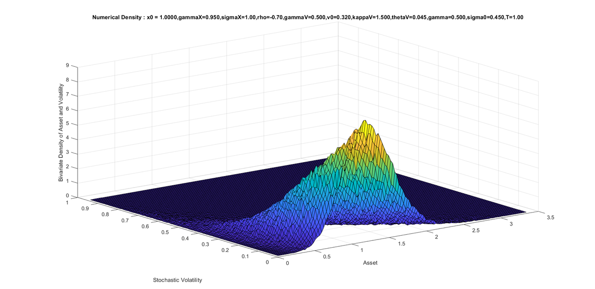
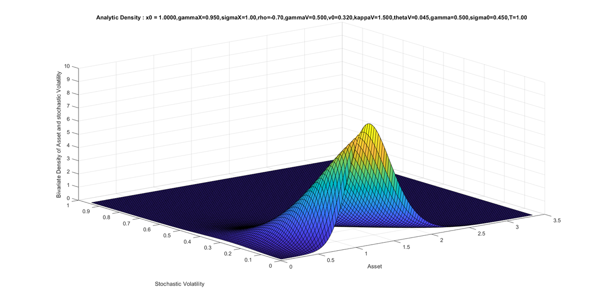
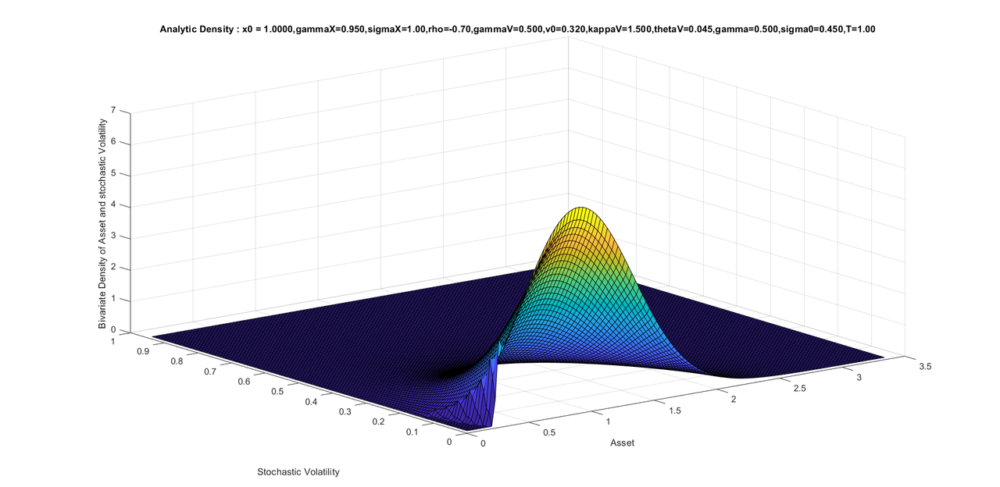
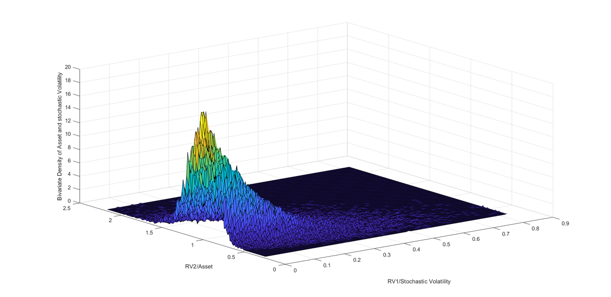
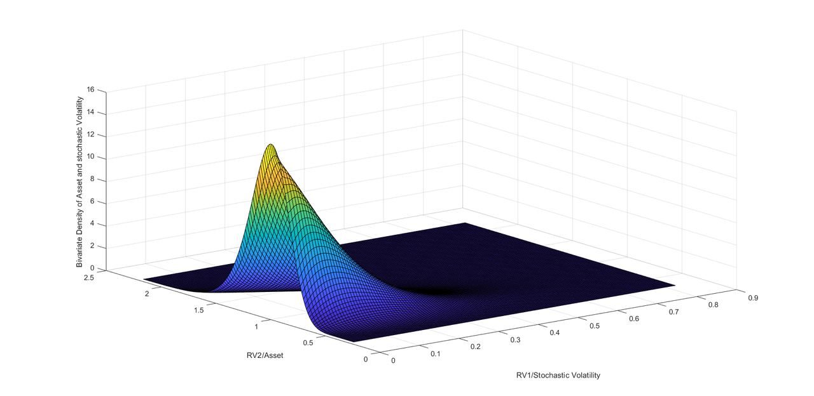
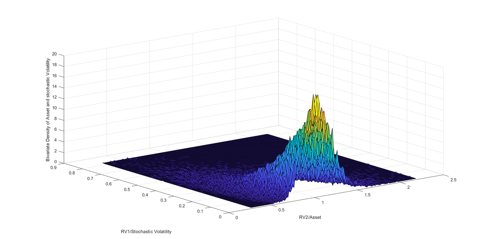
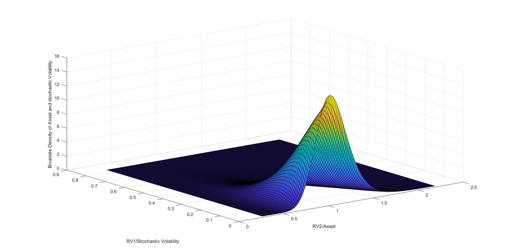

# Breakthrough in the theory of stochastic differential equations and their simulation

**Page 45 of 59** — Posts #2201–#2250

[← Previous](page_044.md) | [Index](index.md) | [Next →](page_046.md)

---

### #2201 — Amin (Topic Author)
*February 20, 2024, 10:26 PM*

**(broken latex: Unbalanced $: 1)**

```latex
I think it might be of some help so I just decided to post the working program as such.

.

.

```
function [bnm,aa] = CalculateConditionalProbabilitiesYtoXLinearRegression04IterB(Yin,Xin)

%Yin argument translates to independent random variable Y
%Xin argument translates to dependent variable X.
%This function takes observations of an independent variable Y and
%dependent varaible X. These have to be joint observations in the sense
%that nth observation of Y, given by Y(n) is taken jointly with nth
%observation of X, given by X(n). Two arrays of observations are the same
%length and nth mmber of independent variable Y is jointly observed with nth
%member of depedent variable X.
%We want to find the detailed relationship between Y and X so we can get
%the conditional density of dependent variable X given a particular value
%of independent variable Y. This will be done by calibrating coefficients
%of our 2D hermite series to data so that a very good fit to cross moments
%between X and Y is retrieved.
%We will first find univariate Z-series/hermite series of both random
%variables independently. For joint dynamics of dependent variable given
%te independnet variable, we will assume a 2D hermite series (This has to
%be two dimensional to be able to capture the dynamics from independent variable Y
%and have its own dynamics) and form but we do not know the coefficients of
%this 2D hermite series. In this program, we try to use iterative optimization
%to find the unknown coefficients of 2D hermite series of dependent variable X
%in a way that after taking products with independent varaible Y, expectation
%of these products i.e cross moments are as exactly retrieved as possible.
%Our iterative optimization procedure perturbs each hermite coefficient in
%2D hermite series  by a very slight amount and checks the objective function.
%If the objective function decreases, we eccept the perturbation otherwise
%reject it and then perturb by a small amount in other opposite direction
%and then again check the objective function. If perturbations in both sides
%are rejected, we do not change the coefficients but slightly decrease the
%perturbation size.
%We will first standardize the data of both random variables and then
%calculate univariate hermite series of both variables and also their
%cross moments in standardized form. We do all the calculations of coefficients
%of independent variable Y and 2D dependent variable X
%in standardized version of variables and moments. After optimization of coefficents on
%standardized data, at the end, we invert the standardization of both
%dependent and independent variables appropriately to get the Z-series and
%hermite series of actual varaibles in theri original coordinates back from
%standardized coordinates.
%Before optimization, we place two conditions on 2D dependent variable X so that
%first row and first column of 2D hermite coefficents of X is already
%known before optimization stage and it is not changed in optimization.
%We do not iteratively optimize over this first row and first colums
%which are analytically known from these two conditions.
%Our first condition is that after integration (of bivaraite density or
%alternatively bivaraite 2D Z-series/2D Hermite series) over independent
%variable, we should get the univaraite marginal density/Z-series/Hermite series of X
%which has already been calculated out of data. This fixes the zeroth
%hermite(of independent varaible Y) related terms in the Z-series/hermite series.
%Please look at this forum post# 2121 for explanation of this first condition.
% https://forum.wilmott.com/viewtopic.php?t=99702&start=2115#p879042

%We can analytically solve for first order cross moments of X with higher
%order in Y. From the analytical solution of these moments, we find first
%row of coefficents in the hermite form.

% 2D Hermite Series Form used in this program is given as
%
% X = bnmH(1,1) + bnmH(2,1) H_1(Z_y) + bnmH(3,1) H_2(Z_y) + bnmH(4,1) H_3(Z_y) + bnmH(5,1) H_4(Z_y) + bnmH(6,1) H_5(Z_y)
% + [ bnmH(1,2) + bnmH(2,2) H_1(Z_y) + bnmH(3,2) H_2(Z_y) + bnmH(4,2) H_3(Z_y) + bnmH(5,2) H_4(Z_y) + bnmH(6,2)
H_5(Z_y)] H_1(Zx)
% + [ bnmH(1,3) + bnmH(2,3) H_1(Z_y) + bnmH(3,3) H_2(Z_y) + bnmH(4,3) H_3(Z_y) + bnmH(5,3) H_4(Z_y) + bnmH(6,3)
H_5(Z_y)] H_2(Zx)
% + [ bnmH(1,4) + bnmH(2,4) H_1(Z_y) + bnmH(3,4) H_2(Z_y) + bnmH(4,4) H_3(Z_y) + bnmH(5,4) H_4(Z_y) + bnmH(6,4)
H_5(Z_y)] H_3(Zx)
% + [ bnmH(1,5) + bnmH(2,5) H_1(Z_y) + bnmH(3,5) H_2(Z_y) + bnmH(4,5) H_3(Z_y) + bnmH(5,5) H_4(Z_y) + bnmH(6,5)
H_5(Z_y)] H_4(Zx)
% + [ bnmH(1,6) + bnmH(2,6) H_1(Z_y) + bnmH(3,6) H_2(Z_y) + bnmH(4,6) H_3(Z_y) + bnmH(5,6) H_4(Z_y) + bnmH(6,6)
H_5(Z_y)] H_5(Zx)

% 2D Z-Series Form used in this program is given as
%
% X = bnm(1,1) + bnm(2,1) Z_y + bnm(3,1) (Z_y)^2 + bnm(4,1) (Z_y)^3 + bnm(5,1) (Z_y)^4 + bnm(6,1) (Z_y)^5
% + [ bnm(1,2) + bnm(2,2) Z_y + bnm(3,2) (Z_y)^2 + bnm(4,2) (Z_y)^3 + bnm(5,2) (Z_y)^4 + bnm(6,2) (Z_y)^5 ] Zx
% + [ bnm(1,3) + bnm(2,2) Z_y + bnm(3,3) (Z_y)^2 + bnm(4,3) (Z_y)^3 + bnm(5,3) (Z_y)^4 + bnm(6,3) (Z_y)^5 ] Zx^2
% + [ bnm(1,4) + bnm(2,2) Z_y + bnm(3,4) (Z_y)^2 + bnm(4,4) (Z_y)^3 + bnm(5,4) (Z_y)^4 + bnm(6,4) (Z_y)^5 ] Zx^3
% + [ bnm(1,5) + bnm(2,2) Z_y + bnm(3,5) (Z_y)^2 + bnm(4,5) (Z_y)^3 + bnm(5,5) (Z_y)^4 + bnm(6,5) (Z_y)^5 ] Zx^4
% + [ bnm(1,6) + bnm(2,2) Z_y + bnm(3,6) (Z_y)^2 + bnm(4,6) (Z_y)^3 + bnm(5,6) (Z_y)^4 + bnm(6,6) (Z_y)^5 ] Zx^5

%%%%%%%%%%%%%%%%%%%%%%%%%%%%%%%%%%%%%%%%%%%%%%%%%%%%%%%%%%%%%%%%%%%%%%%

%In the code block below, we standardize the independent variable Y and dependent variable X.
%We do all later calculations of various Z-series and cross moments in
%standardized framework and then at the end of the program, we convert
%the calculated coefficients of 2D hermite series/Z-series of dependent
%variable X into original non-standardized framework.

 Ndata=length(Yin);

 MeanY=sum(Yin(1:Ndata))/Ndata;
 MeanX=sum(Xin(1:Ndata))/Ndata;

 Ym(1:Ndata)=Yin(1:Ndata)-MeanY;
 Xm(1:Ndata)=Xin(1:Ndata)-MeanX;

 YmVar=sum(Ym(1:Ndata).^2)/Ndata;
 XmVar=sum(Xm(1:Ndata).^2)/Ndata;

 Y(1:Ndata)=Ym(1:Ndata)/sqrt(YmVar);
 X(1:Ndata)=Xm(1:Ndata)/sqrt(XmVar);

 sqrt(YmVar)
 sqrt(XmVar)

 str=input("Look at standardization constants");

 NMomentsY=6;
 NMomentsX=6;
     for nn=1:NMomentsY
        for mm=1:NMomentsX
            CrossMoments11(nn,mm)=0;
            for pp=1:Ndata
               CrossMoments11(nn,mm)=CrossMoments11(nn,mm)+Yin(pp).^nn.*Xin(pp).^mm/Ndata;
               %CrossMoments11(nn,mm)=CrossMoments11(nn,mm)+Y(pp).^nn.*X(pp).^mm/Ndata;
               %CrossMoments11(nn,mm)=CrossMoments11(nn,mm)+Ym(pp).^nn.*Xm(pp).^mm/Ndata;
            end
        end
     end

 %%%%%%%%%%%%%%%%%%%%%%%%%%%%%%%%%%%%%%%%%%%%%%%%%%%%%%%%%%%%%%%%%%%%
%Code block below uses polynomial regression to find univariate Z-series
%coefficients of independent variable Y.
%To know more about polynomial regression read the following and associated
%posts:  https://forum.wilmott.com/viewtopic.php?t=99702&start=2010#p877143

%You can get the text file MomentMatchParams08.txt from the forum post below
%https://forum.wilmott.com/viewtopic.php?f=4&t=99702&start=2040#p877863

Mtable=readtable('C:\Users\Lenovo\Documents\MATLAB\MATLAB1\MomentMatchParams08.txt');

%ZI is moment matched grid along the normal density with number of grid
%points equal to data elements in Y given by Ndata. The grid is constructed
%so that probability mass in each grid cell is 1/Ndata so this matches the
%observation probability of Ndata data elements. Due to equal probability
%mass in each grid cell, we call it equiprobable grid.

[ZI] = MatchMomentParametersOfIdealZhalf04(Ndata,Mtable);

Ys=sort(Y);
Ymu(1:Ndata,1)=Ys(1:Ndata);

W(1:Ndata,1)=1;
W(1:Ndata,2)=ZI(1:Ndata);
W(1:Ndata,3)=ZI(1:Ndata).^2;
W(1:Ndata,4)=ZI(1:Ndata).^3;
W(1:Ndata,5)=ZI(1:Ndata).^4;
W(1:Ndata,6)=ZI(1:Ndata).^5;
% W(1:Ndata,7)=ZI(1:Ndata).^6;
% W(1:Ndata,8)=ZI(1:Ndata).^7;

coeff=inv(W'*W)*(W'*Ymu);

%Above, we get coefficients of univariate Z-series of independent
%variable Y by least square regression.

a0=coeff(1,1);
a(1:5)=coeff(2:6,1);

%Above, we assign zeroth power Z-series coefficient to a0 and rest of
%the coefficients to array a.
%This was older format but we might need it since many old functions are written
%in this format.

%Below, we assign same Z-series coefficients to a single array. This is
%newer format that we want to use mostly.
aa(1:6)=coeff(1:6);

%uncomment these lines if you want to see shape of Z-series constructed
%density of Y. We had calculated coefficients of this Z-series by
%least square polynomial regression.
%PlotZSeriesDensity(a0,a,'r')
%str=input("Look at the density of volatility");

%%%%%%%%%%%%%%%%%%%%%%%%%%%%%%%%%%%%%%%%%%%%%%%%%%%%%%%%%%%%%%%%%%%%5
%In this code block, we calcualate the coefficients of univariate marginal
%density of dependent variable X again by least square polynomial
%regression as we did in previous block for independent variable Y.

Xs=sort(X);
Xmu(1:Ndata,1)=Xs(1:Ndata);

W(1:Ndata,1)=1;
W(1:Ndata,2)=ZI(1:Ndata);
W(1:Ndata,3)=ZI(1:Ndata).^2;
W(1:Ndata,4)=ZI(1:Ndata).^3;
W(1:Ndata,5)=ZI(1:Ndata).^4;
W(1:Ndata,6)=ZI(1:Ndata).^5;

coeff=inv(W'*W)*(W'*Xmu);

c0=coeff(1,1);
c(1:5)=coeff(2:6,1);

cc(1:6)=coeff(1:6,1);

[ccH] = ConvertZSeriesToHermiteSeriesNew(cc,5);

%%%%%%%%%%%%%%%%%%%%%%%%%%%%%%%%%%%%%%%%%%%%%%%%%%%%%%%%%%%%%%%%%%%%%%%%%%%%%%%%%%%%%%%%%%%%%%%%
%%%%%%%%%%%%%%%%%%%%%%%%%%%%%%%%%%%%%%%%%%%%%%%%%%%%%%%%%%%%%%%%%%%%%%%%%%%%%%%%%%%%%%%%%%%%%%%%%%%%%

Zy= CalculateZgivenXAndZSeriesC5Improved(Y,a0,a);

[Xs,I]=sort(X);

Zys=Zy(I);

Zx=ZI;

Xmu(1:Ndata,1)=Xs(1:Ndata);

W=0;

W(1:Ndata,1)=1.0;
W(1:Ndata,2)=Zx(1:Ndata);
W(1:Ndata,3)=(Zx(1:Ndata).^2-1);
W(1:Ndata,4)=(Zx(1:Ndata).^3-3*Zx(1:Ndata));
W(1:Ndata,5)=(Zx(1:Ndata).^4-6*Zx(1:Ndata).^2+3);
W(1:Ndata,6)=(Zx(1:Ndata).^5-10*Zx(1:Ndata).^3+15*Zx(1:Ndata));

W(1:Ndata,7)=1.*Zys(1:Ndata);
W(1:Ndata,8)=Zx(1:Ndata).*Zys(1:Ndata);
W(1:Ndata,9)=(Zx(1:Ndata).^2-1).*Zys(1:Ndata);
W(1:Ndata,10)=(Zx(1:Ndata).^3-3*Zx(1:Ndata)).*Zys(1:Ndata);
W(1:Ndata,11)=(Zx(1:Ndata).^4-6*Zx(1:Ndata).^2+3).*Zys(1:Ndata);
W(1:Ndata,12)=(Zx(1:Ndata).^5-10*Zx(1:Ndata).^3+15*Zx(1:Ndata)).*Zys(1:Ndata);

W(1:Ndata,13)=(Zys(1:Ndata).^2-1);
W(1:Ndata,14)=Zx(1:Ndata).*(Zys(1:Ndata).^2-1);
W(1:Ndata,15)=(Zx(1:Ndata).^2-1).*(Zys(1:Ndata).^2-1);
W(1:Ndata,16)=(Zx(1:Ndata).^3-3*Zx(1:Ndata)).*(Zys(1:Ndata).^2-1);
W(1:Ndata,17)=(Zx(1:Ndata).^4-6*Zx(1:Ndata).^2+3).*(Zys(1:Ndata).^2-1);
W(1:Ndata,18)=(Zx(1:Ndata).^5-10*Zx(1:Ndata).^3+15*Zx(1:Ndata)).*(Zys(1:Ndata).^2-1);

W(1:Ndata,19)=(Zys(1:Ndata).^3-3*Zy(1:Ndata));
W(1:Ndata,20)=Zx(1:Ndata).*(Zys(1:Ndata).^3-3*Zy(1:Ndata));
W(1:Ndata,21)=(Zx(1:Ndata).^2-1).*(Zys(1:Ndata).^3-3*Zy(1:Ndata));
W(1:Ndata,22)=(Zx(1:Ndata).^3-3*Zx(1:Ndata)).*(Zys(1:Ndata).^3-3*Zys(1:Ndata));
W(1:Ndata,23)=(Zx(1:Ndata).^4-6*Zx(1:Ndata).^2+3).*(Zys(1:Ndata).^3-3*Zys(1:Ndata));
W(1:Ndata,24)=(Zx(1:Ndata).^5-10*Zx(1:Ndata).^3+15*Zx(1:Ndata)).*(Zys(1:Ndata).^3-3*Zys(1:Ndata));

W(1:Ndata,25)=(Zys(1:Ndata).^4-6*Zys(1:Ndata).^2+3);
W(1:Ndata,26)=Zx(1:Ndata).*(Zys(1:Ndata).^4-6*Zys(1:Ndata).^2+3);
W(1:Ndata,27)=(Zx(1:Ndata).^2-1).*(Zys(1:Ndata).^4-6*Zys(1:Ndata).^2+3);
W(1:Ndata,28)=(Zx(1:Ndata).^3-3*Zx(1:Ndata)).*(Zys(1:Ndata).^4-6*Zys(1:Ndata).^2+3);
W(1:Ndata,29)=(Zx(1:Ndata).^4-6*Zx(1:Ndata).^2+3).*(Zys(1:Ndata).^4-6*Zys(1:Ndata).^2+3);
W(1:Ndata,30)=(Zx(1:Ndata).^5-10*Zx(1:Ndata).^3+15*Zx(1:Ndata)).*(Zys(1:Ndata).^4-6*Zys(1:Ndata).^2+3);

W(1:Ndata,31)=(Zys(1:Ndata).^5-10*Zys(1:Ndata).^3+15*Zys(1:Ndata));
W(1:Ndata,32)=Zx(1:Ndata).*(Zys(1:Ndata).^5-10*Zys(1:Ndata).^3+15*Zys(1:Ndata));
W(1:Ndata,33)=(Zx(1:Ndata).^2-1).*(Zys(1:Ndata).^5-10*Zys(1:Ndata).^3+15*Zys(1:Ndata));
W(1:Ndata,34)=(Zx(1:Ndata).^3-3*Zx(1:Ndata)).*(Zys(1:Ndata).^5-10*Zys(1:Ndata).^3+15*Zys(1:Ndata));
W(1:Ndata,35)=(Zx(1:Ndata).^4-6*Zx(1:Ndata).^2+3).*(Zys(1:Ndata).^5-10*Zys(1:Ndata).^3+15*Zys(1:Ndata));
W(1:Ndata,36)=(Zx(1:Ndata).^5-10*Zx(1:Ndata).^3+15*Zx(1:Ndata)).*(Zys(1:Ndata).^5-10*Zys(1:Ndata).^3+15*Zys(1:Ndata));

coeff=inv(W'*W)*(W'*Xmu);

bnmH0(1,1:6)=ccH(1:6);  %Replace first line of X-hermites with Marginal density retrieval condition
bnmH0(2,1:6)=coeff(7:12);
bnmH0(3,1:6)=coeff(13:18);
bnmH0(4,1:6)=coeff(19:24);
bnmH0(5,1:6)=coeff(25:30);
bnmH0(6,1:6)=coeff(31:36);

bnmH=bnmH0;

%%%%%%%%%%%%%%%%%%%%%%%%%%%%%%%%%%%%%%%%%%%%%%%%%%%%%%%%%%%%%%%%%%%%%%%

SeriesOrder1=6;
NMomentsY=6;

SeriesOrder10=6; %SeriesOrder10 = 1 + highest power of Zy in 2D Z-series%Here highest power of Zy is five
SeriesOrder01=6; %SeriesOrder01 = 1 + highest power of Zx in 2D Z-series%Here highest power of Zx is also five
%notation is  bnm(1:SeriesOrder10,1:SeriesOrder01)
%Similalry    bnmH(1:SeriesOrder10,1:SeriesOrder01)

NMomentsX=6; %Highest moment of X in cross moments of X and Y
NMomentsY=6; %Highest moment of Y in cross moments of X and Y

%Below we calculate various cross moments between X and Y. These are
%calculated from standardized data.
for nn=1:NMomentsY
   for mm=1:NMomentsX
       CrossMoments(nn,mm)=0;
       for pp=1:Ndata
          CrossMoments(nn,mm)=CrossMoments(nn,mm)+Y(pp).^nn.*X(pp).^mm/Ndata;
       end
   end
end

%Below are the weights on calculation of objective function. More weight on
%a particular moment means that its better match with target moments gets more emphasized as
%compared to match of other moments.
%Choice of good weights is non-trivial.
%Current choice is only haphazard. Please try improvements/

 w2D(1:NMomentsY,1:NMomentsX)=1;
for nn=NMomentsY-1:-1:1
    for mm=NMomentsX-1:-1:1
        %w2D(nn,mm)=w2D(nn+1,mm+1)*(nn+1)*(mm+1);
        w2D(nn,mm)=w2D(nn+1,mm+1)*(nn+1).^2*(mm+1).^2.0;
    end
end

% w2D(:,1)=w2D(:,1)*100000000;
% w2D(1,:)=w2D(1,:)*100000000;
% w2D(:,2)=w2D(:,2)*500000;
% w2D(2,:)=w2D(2,:)*500000;
% w2D(1,2)=w2D(1,2)*100;
% w2D(2,2)=w2D(2,2)*10;
% w2D(3,2)=w2D(3,2)*5;
% w2D(:,3)=w2D(:,3)*100000;
% w2D(1,3)=w2D(1,3)*20;
% w2D(2,3)=w2D(2,3)*5;
% w2D(1,:)=w2D(1,:)*10000;
% w2D(2,:)=w2D(2,:)*100;
% w2D(3,:)=w2D(3,:)*10;
% w2D(:,4)=w2D(:,4)*10000;
% w2D(1,4)=w2D(1,4)*10;
% w2D(2,4)=w2D(2,4)*2;
% w2D(:,5)=w2D(:,5)*1000;
% w2D(:,6)=w2D(:,6)*20;

%Please look on detailed comments inside function below for more insight about it.
%The function below returns coefficients on first row of hermite series so that all
%cross moments of first order in dependent variable X and various orders in independent
%variable Y are matched.

[ddH] = ProduceFirstRowofConditioal2DZSeries02_6M_A(aa,SeriesOrder1,CrossMoments);

%Below we define a 2D array of hermite series coefficents and populate its
%first row with output from above function so that all cross moments of
%first order in X and different orders in Y are matched.
%We also populate first column with univariate hermite coefficients of
%marginal density of X because of the condition that upon integration of
%the bivariate hermite form, we should get univariate marginal density as a
%result. %Please look at this forum post# 2121 for explanation of this first condition.
% https://forum.wilmott.com/viewtopic.php?t=99702&start=2115#p879042

%
% %%%%%%%%%%%%%%%%%%%%%%%%%5
%
ccH0=ccH;

% for nn=2:6
%     %ccH(nn)=sign(ccH(nn)-dd(nn)).*sqrt(abs(sign(ccH(nn)).*ccH(nn).^2-sign(dd(nn)).*dd(nn).^2));
%     if(abs(ccH(nn))>abs(ddH(nn)))
%         ccH(nn)=sign(ccH(nn)).*sqrt(ccH(nn).^2-ddH(nn).^2);
%     else
%
%         ccH(nn)=0;
%     end
% end

% %[ccH1] = SubtractZSeriesRVsByMonteCarlo(ccH0,ddH);
%
%
%
% %ddH
%
% %ccH0
%
% ccH
%
% %ccH1
%
% %ccH2
% %str=input("Look at comparison of ccH");
%
%  bnmH(1,1:6)=ccH(1:6);     %populate first column with univariate margianl density hermite coefficients of X.
% % %bnmH(1,1)=MeanX;
%  bnmH(1:6,1)=ddH(1:6);      %populate first row so that all cross moments of first order in X are matched.
%  bnmH(1,1)=0;
% % %
% %%%%%%%%%%%%%%%%%%%%%%%5

 [Zy] = CalculateZgivenXAndZSeriesC5Improved(Y,a0,a);
 [Zx] = CalculateZgivenXAndZSeriesC5Improved(X,c0,c);
%
 paths=Ndata;
 [CorrH0] = CalculateCorrelationBivariateHermiteCH(Zx,Zy,paths,5);

 CorrH0
 ccH
 ddH

 str=input("Look at correlation related variables");
 ccH0=ccH;
% ccH0(1)=0;
%ddH(1)=0;
 %ddH_Corr(2:6)=ddH(2:6).*CorrH0(1:5);
 for nn=2:6
     ddH_Corr(nn)=ddH(nn).*CorrH0(nn-1);
 end
 ddH_Corr(1)=ddH(1);%.*CorrH0(nn-1);

[ccH2] = SubtractDensity(ccH0,ddH_Corr);
%[ccH2] = SubtractDensity(ccH0,ddH);

%bnmH(1,2:6)=ccH2(2:6);

CorrH0
 ccH
 ddH
 ccH2
 str=input("Look at correlation related variables----2");

 %[ba01,ba1]=ConvertHCoeffsToZCoeffs(bnmH(1,1),bnmH(1,2:6),5);
 %[ba02,ba2]=ConvertHCoeffsToZCoeffs(bnmH(1,1),bnmH(2:6,1),5);

 [ba01,ba1]=ConvertHCoeffsToZCoeffs(ccH2(1),ccH2(2:6),5);
 %[ba02,ba2]=ConvertHCoeffsToZCoeffs(ddH(1),ddH(2:6),5);

 [ba02,ba2]=ConvertHCoeffsToZCoeffs(ddH_Corr(1),ddH_Corr(2:6),5);
 %[ba02,ba2]=ConvertHCoeffsToZCoeffs(ddH(1),ddH(2:6),5);

 [IsValidFlag1] = CheckIsValidDensity(ba01,ba1);
 [IsValidFlag2] = CheckIsValidDensityPN(ba02,ba2);

 IsValidFlag1
 IsValidFlag2

 str=input("Look at correlation related variables----3");
%  loopCount=0;
%  if(IsValidFlag1==0)
%      while((IsValidFlag1==0) && (loopCountabs(ddH(2)))
%  bnmH(1,2)=sign(ccH(2)-CorrH0(1).*ddH(2)).*sqrt(ccH(2).^2-CorrH0(1).^2.*ddH(2).^2);
%  bnmH(2,1)=ddH(2);
% else
%  bnmH(1,2)=ccH(2);
%  bnmH(2,1)=sign(ddH(2)-CorrH0(1).*ccH(2)).*sqrt(ddH(2).^2-CorrH0(1).^2.*ccH(2).^2);
% end
% if(abs(ccH(3))>abs(ddH(3)))
%  bnmH(1,3)=sign(ccH(3)-CorrH0(2).*ddH(3)).*sqrt(ccH(3).^2-CorrH0(2).^2.*ddH(3).^2);
%  bnmH(3,1)=ddH(3);
% else
%  bnmH(1,3)=ccH(3);
%  bnmH(3,1)=sign(ddH(3)-CorrH0(2).*ccH(3)).*sqrt(ddH(3).^2-CorrH0(2).^2.*ccH(3).^2);
%
% end
% if(abs(ccH(4))>abs(ddH(4)))
%  bnmH(1,4)=sign(ccH(4)-CorrH0(3).*ddH(4)).*sqrt(ccH(4).^2-CorrH0(3).^2.*ddH(4).^2);
%  bnmh(4,1)=ddH(4);
% else
% bnmH(4,1)=sign(ddH(4)-CorrH0(3).*ccH(4)).*sqrt(ddH(4).^2-CorrH0(3).^2.*ccH(4).^2);
%  bnmh(1,4)=ccH(4);
% end
% if(abs(ccH(5))>abs(ddH(5)))
%  bnmH(1,5)=sign(ccH(5)-CorrH0(4).*ddH(5)).*sqrt(ccH(5).^2-CorrH0(4).^2.*ddH(5).^2);
%  bnmh(5,1)=ddH(5);
% else
% bnmH(5,1)=sign(ddH(5)-CorrH0(4).*ccH(5)).*sqrt(ddH(5).^2-CorrH0(4).^2.*ccH(5).^2);
%  bnmh(1,5)=ccH(5);
% end
% if(abs(ccH(6))>abs(ddH(6)))
%  bnmH(1,6)=sign(ccH(6)-CorrH0(5).*ddH(6)).*sqrt(ccH(6).^2-CorrH0(5).^2.*ddH(6).^2);
%  bnmh(6,1)=ddH(6);
% else
% bnmH(6,1)=sign(ddH(6)-CorrH0(5).*ccH(6)).*sqrt(ddH(6).^2-CorrH0(5).^2.*ccH(6).^2);
%  bnmh(1,6)=ccH(6);
% end%
% % bnmH(2,1)=CorrH0(1).*ccH(2);
% % bnmH(3,1)=CorrH0(2).*ccH(3);
% % bnmH(4,1)=CorrH0(3).*ccH(4);
% % bnmH(5,1)=CorrH0(4).*ccH(5);
% % bnmH(6,1)=CorrH0(5).*ccH(6);
% %

%%%%%%%%%%%%%%%%%%%%%%%%%%%%%%%%%%%%%%%%%%%%%%%%
%In our iterative optimization, we will not alter the above first column and first row of 2D hermite coefficients array.

%In the block below, we convert 2D hermite coefficients array bnmH to 2D
%Z-series array bnm. We calculate the values of cross moments given the values of
%coefficients in 2D Z-series bnm. We use these model cross moments and
%co1mpare them with target cross moments to evaluate the objective function.

%Convert from 2D Hermite Series Coefficients bnmH to 2D Z-series
%coefficients bnm
[bnm] = Convert2DHermitesInto2DSeries(bnmH);
%Evaluate the model cross moments in the function below.
[Moments2D,Moments1D] =
CalculateCrossMomentsConditional2DNew02(aa,bnm,SeriesOrder1,SeriesOrder10,SeriesOrder01,NMomentsX,NMomentsY);
%Evaluate the objective function based on weighted squared difference
%between model cross moments and target cross momensts from data.
[ObjFuncBest] = CalculateObjMoment2D1D(CrossMoments,Moments2D,w2D,NMomentsX,NMomentsY);
    %%%%%%%%%%%%%%%%

SeriesOrderIter10=6;
SeriesOrderIter01=6;
alphaSuccessCount(1:SeriesOrderIter10,1:SeriesOrderIter01)=0;
SuccessPrevalpha(1:SeriesOrderIter10,1:SeriesOrderIter01)=0;

%array of perturbation sizes of coefficients of the 2D Hermite form
%of dependent variable X in iterative optimization.
for nn=1:SeriesOrderIter10
    for mm=1:SeriesOrderIter01
%         if(bnmH(nn,mm)~=0)
%             delta_bnmHCoeff(nn,mm)=bnmH(nn,mm)./50;
%             if((mm>1)&&(nn>1))
%           
 delta_bnmHCoeff(nn,mm)=delta_bnmHCoeff(nn,mm).*XmVar.^((mm)/2).*YmVar.^((nn)/2).*CorrH0(nn-1).*sqrt(1-CorrH0(mm-1).^2);
%             end
%             if((mm==1)&&(nn==1))
%             delta_bnmHCoeff(nn,mm)=delta_bnmHCoeff(nn,mm).*XmVar.^((mm)/2).*YmVar.^((nn)/2);
%             end
%             if((mm>1)&&(nn==1))
%             delta_bnmHCoeff(nn,mm)=delta_bnmHCoeff(nn,mm).*XmVar.^((mm)/2).*YmVar.^((nn)/2).*sqrt(1-CorrH0(mm-1).^2);
%             end
%             if((mm==1)&&(nn>1))
%             delta_bnmHCoeff(nn,mm)=delta_bnmHCoeff(nn,mm).*XmVar.^((mm)/2).*YmVar.^((nn)/2).*CorrH0(nn-1);
%             end
%         else
%             delta_bnmHCoeff(nn,mm)=.0000025;
%         end

        if(bnmH(nn,mm)~=0)
            delta_bnmHCoeff(nn,mm)=bnmH(nn,mm)./50;
            if((mm>1)&&(nn>1))
            delta_bnmHCoeff(nn,mm)=delta_bnmHCoeff(nn,mm).*YmVar.^((nn)/2);%.*CorrH0(nn-1);
            end
            if((mm==1)&&(nn==1))
            delta_bnmHCoeff(nn,mm)=delta_bnmHCoeff(nn,mm).*YmVar.^((nn)/2);
            end
            if((mm>1)&&(nn==1))
            delta_bnmHCoeff(nn,mm)=delta_bnmHCoeff(nn,mm).*YmVar.^((nn)/2);
            end
            if((mm==1)&&(nn>1))
            delta_bnmHCoeff(nn,mm)=delta_bnmHCoeff(nn,mm).*YmVar.^((nn)/2);%.*CorrH0(nn-1);
            end
        else
            delta_bnmHCoeff(nn,mm)=.0000025;
        end
    end
end

%Assign initial value of bnmH to workhorse variable bnmHCoeff which will be
%used in iterative ioptimization

%load("bnmHFile02.mat","bnmH");

bnmHCoeff=bnmH;

mul1=.9; %decrease the perturbation step size by multiplying it with .9 when
%objective function does not decrease upon perturbation on both sides.
mul2=1.1; %Increase the perturbation step size after several successive
%successes in decreasing the objective function
Iterations=00;
MM1=2;
NN1=2;
MM2=2
NN2=2;

KK1=2;
JJ1=2;
for iter=1:Iterations
iter
bnmHCoeff
ObjFuncBest

%Below we run a two dimensional loop that loops over all rows and columns
%of 2D array of hermite series coefficients. However, we exclude first row
%and first column from this optimization as values there were already fixed
%analytically.

    for kk=NN1:MM1 %SeriesOrderIter10 %Optimize over Zy hermites.
        for jj=NN2:MM2 %Optimize over Zx hermites
            if(iter=300))
                NN1=2;
                MM2=SeriesOrderIter10;
                NN2=SeriesOrderIter01-1;
                MM2=SeriesOrderIter01;

            end
            if((iter=600))
                NN1=2;
                MM2=SeriesOrderIter10;
                NN2=SeriesOrderIter01-2;
                MM2=SeriesOrderIter01;
            end
            if((iter=900))
                NN1=2;
                MM2=SeriesOrderIter10;
                NN2=SeriesOrderIter01-3;
                MM2=SeriesOrderIter01;
            end
            if((iter=1200))
                NN1=2;
                MM2=SeriesOrderIter10;
                NN2=SeriesOrderIter01-4;
                MM2=SeriesOrderIter01;
            end

            if(iter>3000)
                NN1=2;
                MM1=SeriesOrderIter01;
                NN2=2;
                MM2=6;
            end

            if(iter>3500)
                NN1=2;
                MM1=SeriesOrderIter01;
                NN2=1;
                MM2=6;
            end
            if(iter>4000)
                NN1=1;
                MM1=SeriesOrderIter01;
                NN2=1;
                MM2=6;
            end
            %Assign 2D hermite coefficients to workhorse variable
            bnmHCoeffNew(1:SeriesOrderIter10,1:SeriesOrderIter01)=bnmHCoeff(1:SeriesOrderIter10,1:SeriesOrderIter01);
            %perturb the (kk,jj) coefficient by magnitude given in its
            %delta array named delta_bnmHCoeff(kk,jj)
            bnmHCoeffNew(kk,jj)=bnmHCoeff(kk,jj)+delta_bnmHCoeff(kk,jj);
            %convert to Z-series to calculate the cross moments
            [bnm] = Convert2DHermitesInto2DSeries(bnmHCoeffNew);
            [Moments2D,Moments1D] =
CalculateCrossMomentsConditional2DNew02(aa,bnm,SeriesOrder1,SeriesOrder10,SeriesOrder01,NMomentsX,NMomentsY);
            %Calculate the objective function value.
            [ObjFuncNew] = CalculateObjMoment2D1D(CrossMoments,Moments2D,w2D,NMomentsX,NMomentsY);

            if(ObjFuncNew3) %After successive successes, increase the perturbation step size.
                delta_bnmHCoeff(kk,jj)=delta_bnmHCoeff(kk,jj).*mul2;
            end
        end
    end
   if(rem(iter,500)==0)
         bnm
         Moments2D
         CrossMoments
         Moments2D(:,1)
         CrossMoments(:,1)

         ObjFuncBest

         str=input("Look at fit of moments");

      end

end

bnmH=bnmHCoeff;

%save("bnmHFile03.mat","bnmH");
%load("bnmHFile.mat","bnmH");

%str=input("File has been loaded");
%%%%%%%%%%%%%%%%%%%%%%%%%%%%%%%%%%%%%%%%%%%%%%%%%%%%%%%%%%%%%%%%%%%%%%%%%%%
alphaSuccessCount1(1:SeriesOrderIter10)=0;
alphaSuccessCount2(1:SeriesOrderIter01)=0;
SuccessPrevalpha1(1:SeriesOrderIter10)=0;
SuccessPrevalpha2(1:SeriesOrderIter01)=0;

mul1=.996; %decrease the perturbation step size by multiplying it with .9 when
%objective function does not decrease upon perturbation on both sides.
mul2=1.004; %Increase the perturbation step size after several successive

for mm=1:SeriesOrderIter01
    if(mm>1)
delta_bnmHCoeff1(1:SeriesOrderIter10,mm)=.005.*XmVar.^((mm)/2);%.*sqrt(1-CorrH0(mm-1).^2);
    else
    delta_bnmHCoeff1(1:SeriesOrderIter10,mm)=.005.*XmVar.^((mm)/2);
    end
end
for nn=1:SeriesOrderIter10
    if(nn>1)
delta_bnmHCoeff2(nn,1:SeriesOrderIter01)=.005.*YmVar.^((nn)/2);%.*CorrH0(nn-1);
    else
        delta_bnmHCoeff2(nn,1:SeriesOrderIter01)=.005.*YmVar.^((nn)/2);
    end
end

%         
 delta_bnmHCoeff(nn,mm)=delta_bnmHCoeff(nn,mm).*XmVar.^((mm)/2).*YmVar.^((nn)/2).*CorrH0(nn-1).*sqrt(1-CorrH0(mm-1).^2);
%

bnmHCoeff=bnmH;

Iterations01=000;
for iter=1:Iterations01
iter
bnmHCoeff
ObjFuncBest

%Below we run a two dimensional loop that loops over all rows and columns
%of 2D array of hermite series coefficients. However, we exclude first row
%and first column from this optimization as values there were already fixed
%analytically.

%     for kk=NN1:MM1 %SeriesOrderIter10 %Optimize over Zy hermites.
%         for jj=NN2:MM2 %Optimize over Zx hermites
%             if(iter>500)
%                 NN1=2;
%                 MM1=3;
%                 NN2=2;
%                 MM2=SeriesOrderIter01;
%             end
%             if(iter>1000)
%                 NN1=2;
%                 MM2=SeriesOrderIter10;
%                 NN2=2;
%                 MM2=3;
%
%             end
%             if(iter>1500)
%                 NN1=2;
%                 MM1=4;
%                 NN2=2;
%                 MM2=SeriesOrderIter01;
%             end
%             if(iter>2000)
%                 NN1=2;
%                 MM1=SeriesOrderIter10;
%                 NN2=2;
%                 MM2=4;
%             end
%             if(iter>2500)
%                 NN1=2;
%                 MM1=5;
%                 NN2=2;
%                 MM2=SeriesOrderIter01;
%             end
%
%             if(iter>3000)
%                 NN1=2;
%                 MM1=SeriesOrderIter01;
%                 NN2=2;
%                 MM2=6;
%             end
%
%             if(iter>3500)
%                 NN1=2;
%                 MM1=SeriesOrderIter01;
%                 NN2=1;
%                 MM2=6;
%             end
%             if(iter>4000)
%                 NN1=1;
%                 MM1=SeriesOrderIter01;
%                 NN2=1;
%                 MM2=6;
%             end

%             if(rem(iter,1002)==0)
%                 for nn=2:6
%                     bnmHCoeff(nn,2)=bnmHCoeff(nn,2).*(.9995);%.^(nn-1);
%                     bnmHCoeff(nn,4)=bnmHCoeff(nn,4).*(.9995);%.^(nn-1);
%                     bnmHCoeff(nn,6)=bnmHCoeff(nn,6).*(.9995);%.^(nn-1);
%                 end
%                 [bnm] = Convert2DHermitesInto2DSeries(bnmHCoeff);
%                 [Moments2D,Moments1D] =
CalculateCrossMomentsConditional2DNew02(aa,bnm,SeriesOrder1,SeriesOrder10,SeriesOrder01,NMomentsX,NMomentsY);
%                 %Calculate the objective function value.
%                 [ObjFuncNew] = CalculateObjMoment2D1D(CrossMoments,Moments2D,w2D,NMomentsX,NMomentsY);
%
%                 ObjFuncBest=ObjFuncNew;
%             end

%      for kk=2:SeriesOrderIter10 %Optimize over Zy hermites.
%          for jj=2:SeriesOrderIter01 %Optimize over Zx hermites

      for kk=2:SeriesOrderIter10 %Optimize over Zy hermites.
          %for jj=JJ1:SeriesOrderIter01 %Optimize over Zx hermites
%
%               if(iter>5000)
%                   JJ1=1;
%
%               end
%               if(iter>5500)
%                   KK1=1;
%
%               end
            %Assign 2D hermite coefficients to workhorse variable
            bnmHCoeffNew(1:SeriesOrderIter10,1:SeriesOrderIter01)=bnmHCoeff(1:SeriesOrderIter10,1:SeriesOrderIter01);
            %perturb the (kk,jj) coefficient by magnitude given in its
            %delta array named delta_bnmHCoeff(kk,jj)
            bnmHCoeffNew(kk,2:6)=bnmHCoeff(kk,2:6).*(1+delta_bnmHCoeff1(kk,2:6));
            bnmHCoeffNew(1,1)=0;

            %convert to Z-series to calculate the cross moments
            [bnm] = Convert2DHermitesInto2DSeries(bnmHCoeffNew);
            [Moments2D,Moments1D] =
CalculateCrossMomentsConditional2DNew02(aa,bnm,SeriesOrder1,SeriesOrder10,SeriesOrder01,NMomentsX,NMomentsY);
            %Calculate the objective function value.
            [ObjFuncNew] = CalculateObjMoment2D1D(CrossMoments,Moments2D,w2D,NMomentsX,NMomentsY);

            if(ObjFuncNew5000)
%                   JJ1=1;
%
%               end
%               if(iter>5500)
%                   KK1=1;
%
%               end
            %Assign 2D hermite coefficients to workhorse variable
            bnmHCoeffNew(1:SeriesOrderIter10,1:SeriesOrderIter01)=bnmHCoeff(1:SeriesOrderIter10,1:SeriesOrderIter01);
            %perturb the (kk,jj) coefficient by magnitude given in its
            %delta array named delta_bnmHCoeff(kk,jj)
            bnmHCoeffNew(2:6,jj)=bnmHCoeff(2:6,jj).*(1+delta_bnmHCoeff2(2:6,jj));
            bnmHCoeffNew(1,1)=0;
            %convert to Z-series to calculate the cross moments
            [bnm] = Convert2DHermitesInto2DSeries(bnmHCoeffNew);
            [Moments2D,Moments1D] =
CalculateCrossMomentsConditional2DNew02(aa,bnm,SeriesOrder1,SeriesOrder10,SeriesOrder01,NMomentsX,NMomentsY);
            %Calculate the objective function value.
            [ObjFuncNew] = CalculateObjMoment2D1D(CrossMoments,Moments2D,w2D,NMomentsX,NMomentsY);

            if(ObjFuncNew4) %After successive successes, increase the perturbation step size.
                delta_bnmHCoeff1(kk,:)=delta_bnmHCoeff1(kk,:).*mul2;
            end

    end

    for jj=2:SeriesOrderIter01
            if(alphaSuccessCount2(jj)>4) %After successive successes, increase the perturbation step size.
                delta_bnmHCoeff2(:,jj)=delta_bnmHCoeff2(:,jj).*mul2;
            end
        end
   if(rem(iter,500)==0)
         bnm
         Moments2D
         CrossMoments
         Moments2D(:,1)
         CrossMoments(:,1)

         ObjFuncBest

         str=input("Look at fit of moments");

      end

end

bnmH=bnmHCoeff;

%In the block below, we convert 2D hermite coefficients array bnmH to 2D
%Z-series array bnm. We calculate the values of cross moments given the values of
%coefficients in 2D Z-series bnm. We use these model cross moments and
%co1mpare them with target cross moments to evaluate the objective function.

%Convert from 2D Hermite Series Coefficients bnmH to 2D Z-series
%coefficients bnm
[bnm] = Convert2DHermitesInto2DSeries(bnmH);
%Evaluate the model cross moments in the function below.
[Moments2D,Moments1D] =
CalculateCrossMomentsConditional2DNew02(aa,bnm,SeriesOrder1,SeriesOrder10,SeriesOrder01,NMomentsX,NMomentsY);
%Evaluate the objective function based on weighted squared difference
%between model cross moments and target cross momensts from data.
[ObjFuncBest] = CalculateObjMoment2D1D(CrossMoments,Moments2D,w2D,NMomentsX,NMomentsY);
    %%%%%%%%%%%%%%%%

SeriesOrderIter10=6;
SeriesOrderIter01=6;
alphaSuccessCount(1:SeriesOrderIter10,1:SeriesOrderIter01)=0;
SuccessPrevalpha(1:SeriesOrderIter10,1:SeriesOrderIter01)=0;

%array of perturbation sizes of coefficients of the 2D Hermite form
%of dependent variable X in iterative optimization.
for nn=1:SeriesOrderIter10
    for mm=1:SeriesOrderIter01
%         if(bnmH(nn,mm)~=0)
%             delta_bnmHCoeff(nn,mm)=bnmH(nn,mm)./50;
%             if((mm>1)&&(nn>1))
%           
 delta_bnmHCoeff(nn,mm)=delta_bnmHCoeff(nn,mm).*XmVar.^((mm)/2).*YmVar.^((nn)/2).*CorrH0(nn-1).*sqrt(1-CorrH0(mm-1).^2);
%             end
%             if((mm==1)&&(nn==1))
%             delta_bnmHCoeff(nn,mm)=delta_bnmHCoeff(nn,mm).*XmVar.^((mm)/2).*YmVar.^((nn)/2);
%             end
%             if((mm>1)&&(nn==1))
%             delta_bnmHCoeff(nn,mm)=delta_bnmHCoeff(nn,mm).*XmVar.^((mm)/2).*YmVar.^((nn)/2).*sqrt(1-CorrH0(mm-1).^2);
%             end
%             if((mm==1)&&(nn>1))
%             delta_bnmHCoeff(nn,mm)=delta_bnmHCoeff(nn,mm).*XmVar.^((mm)/2).*YmVar.^((nn)/2).*CorrH0(nn-1);
%             end
%         else
%             delta_bnmHCoeff(nn,mm)=.0000025;
%         end

        if(bnmH(nn,mm)~=0)
            delta_bnmHCoeff(nn,mm)=bnmH(nn,mm)./200;
            if((mm>1)&&(nn>1))
            delta_bnmHCoeff(nn,mm)=delta_bnmHCoeff(nn,mm);%.*YmVar.^((nn)/2);%.*CorrH0(nn-1);
            end
            if((mm==1)&&(nn==1))
            delta_bnmHCoeff(nn,mm)=delta_bnmHCoeff(nn,mm);%.*YmVar.^((nn)/2);
            end
            if((mm>1)&&(nn==1))
            delta_bnmHCoeff(nn,mm)=delta_bnmHCoeff(nn,mm);%.*YmVar.^((nn)/2);
            end
            if((mm==1)&&(nn>1))
            delta_bnmHCoeff(nn,mm)=delta_bnmHCoeff(nn,mm);%.*YmVar.^((nn)/2);%.*CorrH0(nn-1);
            end
        else
            delta_bnmHCoeff(nn,mm)=.00000000000025;
        end
        if(delta_bnmHCoeff(nn,mm)500)
%                 NN1=2;
%                 MM1=3;
%                 NN2=2;
%                 MM2=SeriesOrderIter01;
%             end
%             if(iter>1000)
%                 NN1=2;
%                 MM2=SeriesOrderIter10;
%                 NN2=2;
%                 MM2=3;
%
%             end
%             if(iter>1500)
%                 NN1=2;
%                 MM1=4;
%                 NN2=2;
%                 MM2=SeriesOrderIter01;
%             end
%             if(iter>2000)
%                 NN1=2;
%                 MM1=SeriesOrderIter10;
%                 NN2=2;
%                 MM2=4;
%             end
%             if(iter>2500)
%                 NN1=2;
%                 MM1=5;
%                 NN2=2;
%                 MM2=SeriesOrderIter01;
%             end
%
%             if(iter>3000)
%                 NN1=2;
%                 MM1=SeriesOrderIter01;
%                 NN2=2;
%                 MM2=6;
%             end
%
%             if(iter>3500)
%                 NN1=2;
%                 MM1=SeriesOrderIter01;
%                 NN2=1;
%                 MM2=6;
%             end
%             if(iter>4000)
%                 NN1=1;
%                 MM1=SeriesOrderIter01;
%                 NN2=1;
%                 MM2=6;
%             end

%             if(rem(iter,1002)==0)
%                 for nn=2:6
%                     bnmHCoeff(nn,2)=bnmHCoeff(nn,2).*(.9995);%.^(nn-1);
%                     bnmHCoeff(nn,4)=bnmHCoeff(nn,4).*(.9995);%.^(nn-1);
%                     bnmHCoeff(nn,6)=bnmHCoeff(nn,6).*(.9995);%.^(nn-1);
%                 end
%                 [bnm] = Convert2DHermitesInto2DSeries(bnmHCoeff);
%                 [Moments2D,Moments1D] =
CalculateCrossMomentsConditional2DNew02(aa,bnm,SeriesOrder1,SeriesOrder10,SeriesOrder01,NMomentsX,NMomentsY);
%                 %Calculate the objective function value.
%                 [ObjFuncNew] = CalculateObjMoment2D1D(CrossMoments,Moments2D,w2D,NMomentsX,NMomentsY);
%
%                 ObjFuncBest=ObjFuncNew;
%             end

%      for kk=2:SeriesOrderIter10 %Optimize over Zy hermites.
%          for jj=2:SeriesOrderIter01 %Optimize over Zx hermites

      for kk=KK1:SeriesOrderIter10 %Optimize over Zy hermites.
          for jj=JJ1:SeriesOrderIter01 %Optimize over Zx hermites

              if(iter>1500)
                  JJ1=1;

              end
              if(iter>1000)
                  KK1=1;

              end
            %Assign 2D hermite coefficients to workhorse variable
            bnmHCoeffNew(1:SeriesOrderIter10,1:SeriesOrderIter01)=bnmHCoeff(1:SeriesOrderIter10,1:SeriesOrderIter01);
            %perturb the (kk,jj) coefficient by magnitude given in its
            %delta array named delta_bnmHCoeff(kk,jj)
            bnmHCoeffNew(kk,jj)=bnmHCoeff(kk,jj)+delta_bnmHCoeff(kk,jj);
            bnmHCoeffNew(1,1)=0;
            %convert to Z-series to calculate the cross moments
            [bnm] = Convert2DHermitesInto2DSeries(bnmHCoeffNew);
            [Moments2D,Moments1D] =
CalculateCrossMomentsConditional2DNew02(aa,bnm,SeriesOrder1,SeriesOrder10,SeriesOrder01,NMomentsX,NMomentsY);
            %Calculate the objective function value.
            [ObjFuncNew] = CalculateObjMoment2D1D(CrossMoments,Moments2D,w2D,NMomentsX,NMomentsY);

            if(ObjFuncNew3) %After successive successes, increase the perturbation step size.
                delta_bnmHCoeff(kk,jj)=delta_bnmHCoeff(kk,jj).*mul2;
            end
        end
    end
   if(rem(iter,500)==0)
         bnm
         Moments2D
         CrossMoments
         Moments2D(:,1)
         CrossMoments(:,1)

         ObjFuncBest

         str=input("Look at fit of moments");

      end

end

bnmH=bnmHCoeff;

%save("bnmHFile03.mat","bnmH");
%load("bnmHFile.mat","bnmH");

%str=input("File has been loaded");
%%%%%%%%%%%%%%%%%%%%%%%%%%%%%%%%%%%%%%%%%%%%%%%%%%%%%%%%%%%%%%%%%%%%%%%%%%%
%%%%%%%%%%%%%%%%%%%%%%%%%%%%%%%%%%%%%%%%%%%%%%%%%%%%%%%%%%%%%%%%%%%%%%%%%%%
%
%
%
% str=input("Entering Newton Root Search");
%
% SeriesOrder1=6;
% SeriesOrder10=6;
% SeriesOrder01=6;
% NMomentsY=6;
% NMomentsX=6;
%
%     %[F,dF] =
CalculateMomentsAndDerivativesConditional2DNew02(Ms,aa,bnm,SeriesOrder1,SeriesOrder10,SeriesOrder01,NMomentsX,NMomentsY);
%     [F,dF] =
CalculateMomentsAndDerivativesConditional2DForNewton02(CrossMoments,aa,bnm,SeriesOrder1,SeriesOrder10,SeriesOrder01,NMomentsX,NMomentsY);
% %
% %         for mm1=2:SeriesOrder01
% %        for nn1=2:SeriesOrder10
% %           da((mm1-2)*(SeriesOrder10-1)+nn1-1,1)=bnmH(nn1,mm1);
% %        end
% %         end
%
%         for mm1=1:SeriesOrder01
%        for nn1=1:SeriesOrder10
%           da((mm1-1)*(SeriesOrder10)+nn1,1)=bnmH(nn1,mm1);
%        end
%         end
%
%     da
%     F
%     dF
%     size(F)
%     size(dF)
%     size(da)
%     str=input("Look at sizes of variables F and dF")'
%
%
%
%     %w2D(1:NMomentsY,1:NMomentsX)=1;
%     %for nn=NMomentsY-1:-1:1
%     %    for mm=NMomentsX-1:-1:1
%     %        w2D(nn,mm)=w2D(nn+1,mm+1)*(nn+1)*(mm+1);
%     %    end
%     %end
%     [bnm] = Convert2DHermitesInto2DSeries(bnmH);
%
%     [Moments2D] =
CalculateCrossMomentsConditional2DNew02(aa,bnm,SeriesOrder1,SeriesOrder10,SeriesOrder01,NMomentsX,NMomentsY);
%
%     [ObjBest] = CalculateObjMoment2D1D(CrossMoments,Moments2D,w2D,NMomentsX,NMomentsY);
%
%     Moments2D
%     CrossMoments
%     ObjBest
%     str=input("Look at data and model moments");
%     %[ObjMomentOut] = CalculateObjMoment2D(Moment2D0,Moment2D,w2D,MOrder1,MOrder2);
%
%    bnmHBest=bnmH;
%  nn=0;
%  %while((nn.000000000001) || (abs(F(2,1))>.000000000001) || (abs(F(3,1))>.000000000001) ||
(abs(F(4,1))>.00000000001)|| (abs(F(5,1))>.00000000001)|| (abs(F(6,1))>.00000000001)|| (abs(F(7,1))>.00000000001)||
(abs(F(8,1))>.00000000001)  ))
%  for nn=1:500
%      %nn=nn+1;
% % %     %Below Newton matrix equation to improve the Z-series coefficients guess at previous step.
%
% if(nn==1)
% %da=da-1000000*dF\F;
% %da=da-F/dF;
%
% da=da-50000.*dF $F);
% else
% da=da-50000.*dF\F;
% end
% % for mm1=2:SeriesOrder01
% %        for nn1=2:SeriesOrder10
% %           bnmH(nn1,mm1)=da((mm1-2)*(SeriesOrder10-1)+nn1-1,1);
% %        end
% % end
%
% for mm1=1:SeriesOrder01
%        for nn1=1:SeriesOrder10
%           bnmH(nn1,mm1)=da((mm1-1)*(SeriesOrder10)+nn1,1);
%        end
%      end
%
%      dF
%      F
%      da
%      bnmH
%      nn
%
%      str=input("Look at numbers---nn loop");
%
%
%
%
%
%      [bnm] = Convert2DHermitesInto2DSeries(bnmH);
%      [Moments2D] =
CalculateCrossMomentsConditional2DNew02(aa,bnm,SeriesOrder1,SeriesOrder10,SeriesOrder01,NMomentsX,NMomentsY);
% [ObjNew] = CalculateObjMoment2D1D(CrossMoments,Moments2D,w2D,NMomentsX,NMomentsY);
%
%
%      Moments2D
%      CrossMoments
%      ObjBest
%      ObjNew
%      nn
%      str=input("Look at new numbers in the loop after update")
%
%
%
%
%
%      if(ObjBest>ObjNew) %%%%&&( IsValidFlag))
%
%         ObjBest=ObjNew;
%         bnmHBest=bnmH;
%
%      end
%
% %    [F,dF] =
CalculateMomentsAndDerivativesConditional2DNew02(CrossMoments,aa,bnm,SeriesOrder1,SeriesOrder10,SeriesOrder01,NMomentsX,NMomentsY);
%     [F,dF] =
CalculateMomentsAndDerivativesConditional2DForNewton02(CrossMoments,aa,bnm,SeriesOrder1,SeriesOrder10,SeriesOrder01,NMomentsX,NMomentsY);
%
%  end
%  bnmH=bnmHBest;
%
%  [bnm] = Convert2DHermitesInto2DSeries(bnmH);
%      [Moments2D] =
CalculateCrossMomentsConditional2DNew02(aa,bnm,SeriesOrder1,SeriesOrder10,SeriesOrder01,NMomentsX,NMomentsY);
% [ObjFinal] = CalculateObjMoment2D1D(CrossMoments,Moments2D,w2D,NMomentsX,NMomentsY);
%
% ObjFinal
%
% str=input("Look at ObjFinal");
%
% %%%%%%%%%%%%%%%%%%%%%%%%%%%%%%%%%%%%%%%%%%%%%%%%%%%%%%%%%%%%%%%%%%%%%%%%%%%

% W=0;
%
% % W(1:Ndata,1)=1.0;
% % W(1:Ndata,2)=Zx(1:Ndata);
% % W(1:Ndata,3)=(Zx(1:Ndata).^2-1);
% % W(1:Ndata,4)=(Zx(1:Ndata).^3-3*Zx(1:Ndata));
% % W(1:Ndata,5)=(Zx(1:Ndata).^4-6*Zx(1:Ndata).^2+3);
% % W(1:Ndata,6)=(Zx(1:Ndata).^5-10*Zx(1:Ndata)+15*Zx(1:Ndata));
%
% W(1:Ndata,1)=1.*Zys(1:Ndata);
% W(1:Ndata,2)=Zx(1:Ndata).*Zys(1:Ndata);
% W(1:Ndata,3)=(Zx(1:Ndata).^2-1).*Zys(1:Ndata);
% W(1:Ndata,4)=(Zx(1:Ndata).^3-3*Zx(1:Ndata)).*Zys(1:Ndata);
% W(1:Ndata,5)=(Zx(1:Ndata).^4-6*Zx(1:Ndata).^2+3).*Zys(1:Ndata);
% W(1:Ndata,6)=(Zx(1:Ndata).^5-10*Zx(1:Ndata)+15*Zx(1:Ndata)).*Zys(1:Ndata);
%
% W(1:Ndata,7)=(Zys(1:Ndata).^2-1);
% W(1:Ndata,8)=Zx(1:Ndata).*(Zys(1:Ndata).^2-1);
% W(1:Ndata,9)=(Zx(1:Ndata).^2-1).*(Zys(1:Ndata).^2-1);
% W(1:Ndata,10)=(Zx(1:Ndata).^3-3*Zx(1:Ndata)).*(Zys(1:Ndata).^2-1);
% W(1:Ndata,11)=(Zx(1:Ndata).^4-6*Zx(1:Ndata).^2+3).*(Zys(1:Ndata).^2-1);
% W(1:Ndata,12)=(Zx(1:Ndata).^5-10*Zx(1:Ndata)+15*Zx(1:Ndata)).*(Zys(1:Ndata).^2-1);
%
% W(1:Ndata,13)=(Zys(1:Ndata).^3-3*Zy(1:Ndata));
% W(1:Ndata,14)=Zx(1:Ndata).*(Zys(1:Ndata).^3-3*Zy(1:Ndata));
% W(1:Ndata,15)=(Zx(1:Ndata).^2-1).*(Zys(1:Ndata).^3-3*Zy(1:Ndata));
% W(1:Ndata,16)=(Zx(1:Ndata).^3-3*Zx(1:Ndata)).*(Zys(1:Ndata).^3-3*Zys(1:Ndata));
% W(1:Ndata,17)=(Zx(1:Ndata).^4-6*Zx(1:Ndata).^2+3).*(Zys(1:Ndata).^3-3*Zys(1:Ndata));
% W(1:Ndata,18)=(Zx(1:Ndata).^5-10*Zx(1:Ndata )+15*Zx(1:Ndata)).*(Zys(1:Ndata).^3-3*Zys(1:Ndata));
%
% W(1:Ndata,19)=(Zys(1:Ndata).^4-6*Zys(1:Ndata).^2+3);
% W(1:Ndata,20)=Zx(1:Ndata).*(Zys(1:Ndata).^4-6*Zys(1:Ndata).^2+3);
% W(1:Ndata,21)=(Zx(1:Ndata).^2-1).*(Zys(1:Ndata).^4-6*Zys(1:Ndata).^2+3);
% W(1:Ndata,22)=(Zx(1:Ndata).^3-3*Zx(1:Ndata)).*(Zys(1:Ndata).^4-6*Zys(1:Ndata).^2+3);
% W(1:Ndata,23)=(Zx(1:Ndata).^4-6*Zx(1:Ndata).^2+3).*(Zys(1:Ndata).^4-6*Zys(1:Ndata).^2+3);
% W(1:Ndata,24)=(Zx(1:Ndata).^5-10*Zx(1:Ndata)+15*Zx(1:Ndata)).*(Zys(1:Ndata).^4-6*Zys(1:Ndata).^2+3);
%
% W(1:Ndata,25)=(Zys(1:Ndata).^5-10*Zys(1:Ndata).^3+15*Zys(1:Ndata));
%
% W(1:Ndata,27)=(Zx(1:Ndata).^2-1).*(Zys(1:Ndata).^5-10*Zys(1:Ndata).^3+15*Zys(1:Ndata));
% W(1:Ndata,28)=(Zx(1:Ndata).^3-3*Zx(1:Ndata)).*(Zys(1:Ndata).^5-10*Zys(1:Ndata).^3+15*Zys(1:Ndata));
% W(1:Ndata,29)=(Zx(1:Ndata).^4-6*Zx(1:Ndata).^2+3).*(Zys(1:Ndata).^5-10*Zys(1:Ndata).^3+15*Zys(1:Ndata));
% W(1:Ndata,30)=(Zx(1:Ndata).^5-10
%
%
% bnmH=bnmH0;
%%%%%%%%%%%%%%%%%%%%%%%%%%%%%%%%%%%%%%%%%%%%%%%%%%%%%%%%%%%%%%%%%%%%%%%%%%%%%%%%
SeriesOrder1=6;
NMomentsY=6;
NMomentsX=6;
    for nn=1:NMomentsY
       for mm=1:NMomentsX
           CrossMoments(nn,mm)=0;
           for pp=1:Ndata
              CrossMoments(nn,mm)=CrossMoments(nn,mm)+Y(pp).^nn.*X(pp).^mm/Ndata;
           end
       end
    end

[chh] = ProduceFirstRowofConditioal2DZSeries02_6M_A(aa,SeriesOrder1,CrossMoments);

%%%%%%%%%%%%%%%%%%%%%%%%%%%%%%%%%%%%%%%%%%%%%%%%%%%%%%%%%%%%%%%%%%%

[bnm] = Convert2DHermitesInto2DSeries(bnmH);

SeriesOrder1=6;
SeriesOrder10=6;
SeriesOrder01=6;
NMomentsX=6;
NMomentsY=6;
[Moments2D0] =
CalculateCrossMomentsConditional2DNew02(aa,bnm,SeriesOrder1,SeriesOrder10,SeriesOrder01,NMomentsX,NMomentsY);

Moments2D0

CrossMoments

str=input("Look at comparison of moments--first-standardized");

%%%%%%%%%%%%%%%%%%%%%%%%%%%%%%%%%%%%%%%%%%%%%%%%%%%%%%%%%%%%%%%%%%%%%%%%%%%%%%%%
%In the code block below, we convert 2D hermite series coefficients of
%dependent variable X from standardized version to original version.
%For that we first multiply the entire 2D Hermite series by square root of
%variance.
%Later we multiply each column of hermite series of X with particular
%order of Zy hermite polynomials by square root of volatility(independent variable)
%raised to that power of Zy polynomial order as below.
%bnmH=bnmH.*sqrt(XmVar);
%bnmH(:,1)=bnmH(:,1)*sqrt(XmVar);
%for nn=2:6
%    bnmH(nn,:)=bnmH(nn,:).*(sqrt(YmVar)).^(nn-1);
%end

 bnmH=bnmH*sqrt(XmVar);
% for nn=2:6
%     bnmH(nn,:)=bnmH(nn,:).*(sqrt(YmVar)).^(nn-1);
% end
% for nn=2:6
%     bnmH(:,nn)=bnmH(:,nn).*(sqrt(XmVar)).^(nn-1);
% end

%We convert X from hermite series form to Z-series form.
[bnm] = Convert2DHermitesInto2DSeries(bnmH);
bnm(1,1)=MeanX-bnm(3,1)-3*bnm(5,1)-1*bnm(1,3)-1*3*bnm(1,5)-3*bnm(5,3)-bnm(3,3)-3*bnm(3,5)-9*bnm(5,5);

%Finally in above line, we make sure that mean of the 2D Z-series is

%Below, we convert Z-series of independent variable Y from standard form to
%original variable form.

aa=aa*sqrt(YmVar);
aa(1)=MeanY-aa(3)-3*aa(5);

 SeriesOrder1=6;
 SeriesOrder10=6;
 SeriesOrder01=6;
 NMomentsX=6;
 NMomentsY=6;
 [Moments2D] =
CalculateCrossMomentsConditional2DNew02(aa,bnm,SeriesOrder1,SeriesOrder10,SeriesOrder01,NMomentsX,NMomentsY);

 Moments2D

 CrossMoments11

 str=input("Look at comparison of moments");
%
%
% for nn=1:NMomentsX
%     for mm=1:NMomentsY
%
%         Moments2D(mm,nn)
%         Moments2D0(mm,nn).*(sqrt(YmVar)).^(mm).*(sqrt(XmVar)).^(nn)
%         Moments2D0(mm,nn)./(sqrt(YmVar)).^(mm)./(sqrt(XmVar)).^(nn)
%         Moments2D(mm,nn)./(sqrt(YmVar)).^(mm)./(sqrt(XmVar)).^(nn)
%         nn
%         mm
%         str=input("Look at moments again---22---22-222---")
%     end
% end

end
```

```

---

### #2202 — Amin (Topic Author)
*February 21, 2024, 8:00 AM*

Friends, I went to drawing board again and tried to see if I can improve the basic regression algorithm. And it works
far better now after improvement of the algorithm. In the earlier algorithm Zx is sorted with respect to the asset but
in new algorithm Zx is sorted with respect to uncorrelated part of the asset (as it actually should be) and it seems to
work very well. Sorry that I did not have a very good understanding when I first wrote this regression algorithm.

Here I give the graph with numerical density followed by graph from new algorithm and followed again by graph from old
bad regression algorithm. I have not changed any coefficient after they were given out by the regression algorithm.

Graphs are here. I will upload the new program in next post. I hope that we will fix all errors and problems one by one.

.

.

.

NUMERICAL DENSITY

[](https://postimg.cc/G4dQkR7M)

DENSITY FROM NEW CORRECT REGRESSION ALGORITHM

[](https://postimg.cc/jLVvSPzY)

DENSITY FROM OLD REGRESSION ALGORITHM

[](https://postimg.cc/hf9szvrz)

---

### #2203 — Amin (Topic Author)
*February 21, 2024, 8:05 AM*

Here is the new regression algorithm function that I used to create the 2nd graph in previous post.

.

.

.

```
function [bnm,aa] = CalculateConditionalProbabilitiesYtoXLinearRegression04IterC(Yin,Xin)

%Yin argument translates to independent random variable Y
%Xin argument translates to dependent variable X.
%This function takes observations of an independent variable Y and
%dependent varaible X. These have to be joint observations in the sense
%that nth observation of Y, given by Y(n) is taken jointly with nth
%observation of X, given by X(n). Two arrays of observations are the same
%length and nth mmber of independent variable Y is jointly observed with nth
%member of depedent variable X.
%We want to find the detailed relationship between Y and X so we can get
%the conditional density of dependent variable X given a particular value
%of independent variable Y. This will be done by calibrating coefficients
%of our 2D hermite series to data so that a very good fit to cross moments
%between X and Y is retrieved.
%We will first find univariate Z-series/hermite series of both random
%variables independently. For joint dynamics of dependent variable given
%te independnet variable, we will assume a 2D hermite series (This has to
%be two dimensional to be able to capture the dynamics from independent variable Y
%and have its own dynamics) and form but we do not know the coefficients of
%this 2D hermite series. In this program, we try to use iterative optimization
%to find the unknown coefficients of 2D hermite series of dependent variable X
%in a way that after taking products with independent varaible Y, expectation
%of these products i.e cross moments are as exactly retrieved as possible.
%Our iterative optimization procedure perturbs each hermite coefficient in
%2D hermite series  by a very slight amount and checks the objective function.
%If the objective function decreases, we eccept the perturbation otherwise
%reject it and then perturb by a small amount in other opposite direction
%and then again check the objective function. If perturbations in both sides
%are rejected, we do not change the coefficients but slightly decrease the
%perturbation size.
%We will first standardize the data of both random variables and then
%calculate univariate hermite series of both variables and also their
%cross moments in standardized form. We do all the calculations of coefficients
%of independent variable Y and 2D dependent variable X
%in standardized version of variables and moments. After optimization of coefficents on
%standardized data, at the end, we invert the standardization of both
%dependent and independent variables appropriately to get the Z-series and
%hermite series of actual varaibles in theri original coordinates back from
%standardized coordinates.
%Before optimization, we place two conditions on 2D dependent variable X so that
%first row and first column of 2D hermite coefficents of X is already
%known before optimization stage and it is not changed in optimization.
%We do not iteratively optimize over this first row and first colums
%which are analytically known from these two conditions.
%Our first condition is that after integration (of bivaraite density or
%alternatively bivaraite 2D Z-series/2D Hermite series) over independent
%variable, we should get the univaraite marginal density/Z-series/Hermite series of X
%which has already been calculated out of data. This fixes the zeroth
%hermite(of independent varaible Y) related terms in the Z-series/hermite series.
%Please look at this forum post# 2121 for explanation of this first condition.
% https://forum.wilmott.com/viewtopic.php?t=99702&start=2115#p879042

%We can analytically solve for first order cross moments of X with higher
%order in Y. From the analytical solution of these moments, we find first
%row of coefficents in the hermite form.

% 2D Hermite Series Form used in this program is given as
%
% X = bnmH(1,1) + bnmH(2,1) H_1(Z_y) + bnmH(3,1) H_2(Z_y) + bnmH(4,1) H_3(Z_y) + bnmH(5,1) H_4(Z_y) + bnmH(6,1) H_5(Z_y)
% + [ bnmH(1,2) + bnmH(2,2) H_1(Z_y) + bnmH(3,2) H_2(Z_y) + bnmH(4,2) H_3(Z_y) + bnmH(5,2) H_4(Z_y) + bnmH(6,2)
H_5(Z_y)] H_1(Zx)
% + [ bnmH(1,3) + bnmH(2,3) H_1(Z_y) + bnmH(3,3) H_2(Z_y) + bnmH(4,3) H_3(Z_y) + bnmH(5,3) H_4(Z_y) + bnmH(6,3)
H_5(Z_y)] H_2(Zx)
% + [ bnmH(1,4) + bnmH(2,4) H_1(Z_y) + bnmH(3,4) H_2(Z_y) + bnmH(4,4) H_3(Z_y) + bnmH(5,4) H_4(Z_y) + bnmH(6,4)
H_5(Z_y)] H_3(Zx)
% + [ bnmH(1,5) + bnmH(2,5) H_1(Z_y) + bnmH(3,5) H_2(Z_y) + bnmH(4,5) H_3(Z_y) + bnmH(5,5) H_4(Z_y) + bnmH(6,5)
H_5(Z_y)] H_4(Zx)
% + [ bnmH(1,6) + bnmH(2,6) H_1(Z_y) + bnmH(3,6) H_2(Z_y) + bnmH(4,6) H_3(Z_y) + bnmH(5,6) H_4(Z_y) + bnmH(6,6)
H_5(Z_y)] H_5(Zx)

% 2D Z-Series Form used in this program is given as
%
% X = bnm(1,1) + bnm(2,1) Z_y + bnm(3,1) (Z_y)^2 + bnm(4,1) (Z_y)^3 + bnm(5,1) (Z_y)^4 + bnm(6,1) (Z_y)^5
% + [ bnm(1,2) + bnm(2,2) Z_y + bnm(3,2) (Z_y)^2 + bnm(4,2) (Z_y)^3 + bnm(5,2) (Z_y)^4 + bnm(6,2) (Z_y)^5 ] Zx
% + [ bnm(1,3) + bnm(2,2) Z_y + bnm(3,3) (Z_y)^2 + bnm(4,3) (Z_y)^3 + bnm(5,3) (Z_y)^4 + bnm(6,3) (Z_y)^5 ] Zx^2
% + [ bnm(1,4) + bnm(2,2) Z_y + bnm(3,4) (Z_y)^2 + bnm(4,4) (Z_y)^3 + bnm(5,4) (Z_y)^4 + bnm(6,4) (Z_y)^5 ] Zx^3
% + [ bnm(1,5) + bnm(2,2) Z_y + bnm(3,5) (Z_y)^2 + bnm(4,5) (Z_y)^3 + bnm(5,5) (Z_y)^4 + bnm(6,5) (Z_y)^5 ] Zx^4
% + [ bnm(1,6) + bnm(2,2) Z_y + bnm(3,6) (Z_y)^2 + bnm(4,6) (Z_y)^3 + bnm(5,6) (Z_y)^4 + bnm(6,6) (Z_y)^5 ] Zx^5

%%%%%%%%%%%%%%%%%%%%%%%%%%%%%%%%%%%%%%%%%%%%%%%%%%%%%%%%%%%%%%%%%%%%%%%

%In the code block below, we standardize the independent variable Y and dependent variable X.
%We do all later calculations of various Z-series and cross moments in
%standardized framework and then at the end of the program, we convert
%the calculated coefficients of 2D hermite series/Z-series of dependent
%variable X into original non-standardized framework.

 Ndata=length(Yin);

 MeanY=sum(Yin(1:Ndata))/Ndata;
 MeanX=sum(Xin(1:Ndata))/Ndata;

 Ym(1:Ndata)=Yin(1:Ndata)-MeanY;
 Xm(1:Ndata)=Xin(1:Ndata)-MeanX;

 YmVar=sum(Ym(1:Ndata).^2)/Ndata;
 XmVar=sum(Xm(1:Ndata).^2)/Ndata;

 Y(1:Ndata)=Ym(1:Ndata)/sqrt(YmVar);
 X(1:Ndata)=Xm(1:Ndata)/sqrt(XmVar);

 sqrt(YmVar)
 sqrt(XmVar)

 str=input("Look at standardization constants");

 NMomentsY=6;
 NMomentsX=6;
     for nn=1:NMomentsY
        for mm=1:NMomentsX
            CrossMoments11(nn,mm)=0;
            for pp=1:Ndata
               CrossMoments11(nn,mm)=CrossMoments11(nn,mm)+Yin(pp).^nn.*Xin(pp).^mm/Ndata;
               %CrossMoments11(nn,mm)=CrossMoments11(nn,mm)+Y(pp).^nn.*X(pp).^mm/Ndata;
               %CrossMoments11(nn,mm)=CrossMoments11(nn,mm)+Ym(pp).^nn.*Xm(pp).^mm/Ndata;
            end
        end
     end

 %%%%%%%%%%%%%%%%%%%%%%%%%%%%%%%%%%%%%%%%%%%%%%%%%%%%%%%%%%%%%%%%%%%%
%Code block below uses polynomial regression to find univariate Z-series
%coefficients of independent variable Y.
%To know more about polynomial regression read the following and associated
%posts:  https://forum.wilmott.com/viewtopic.php?t=99702&start=2010#p877143

%You can get the text file MomentMatchParams08.txt from the forum post below
%https://forum.wilmott.com/viewtopic.php?f=4&t=99702&start=2040#p877863

Mtable=readtable('C:\Users\Lenovo\Documents\MATLAB\MATLAB1\MomentMatchParams08.txt');

%ZI is moment matched grid along the normal density with number of grid
%points equal to data elements in Y given by Ndata. The grid is constructed
%so that probability mass in each grid cell is 1/Ndata so this matches the
%observation probability of Ndata data elements. Due to equal probability
%mass in each grid cell, we call it equiprobable grid.

[ZI] = MatchMomentParametersOfIdealZhalf04(Ndata,Mtable);

Ys=sort(Y);
Ymu(1:Ndata,1)=Ys(1:Ndata);

W(1:Ndata,1)=1;
W(1:Ndata,2)=ZI(1:Ndata);
W(1:Ndata,3)=ZI(1:Ndata).^2;
W(1:Ndata,4)=ZI(1:Ndata).^3;
W(1:Ndata,5)=ZI(1:Ndata).^4;
W(1:Ndata,6)=ZI(1:Ndata).^5;
% W(1:Ndata,7)=ZI(1:Ndata).^6;
% W(1:Ndata,8)=ZI(1:Ndata).^7;

coeff=inv(W'*W)*(W'*Ymu);

%Above, we get coefficients of univariate Z-series of independent
%variable Y by least square regression.

a0=coeff(1,1);
a(1:5)=coeff(2:6,1);

%Above, we assign zeroth power Z-series coefficient to a0 and rest of
%the coefficients to array a.
%This was older format but we might need it since many old functions are written
%in this format.

%Below, we assign same Z-series coefficients to a single array. This is
%newer format that we want to use mostly.
aa(1:6)=coeff(1:6);

%uncomment these lines if you want to see shape of Z-series constructed
%density of Y. We had calculated coefficients of this Z-series by
%least square polynomial regression.
%PlotZSeriesDensity(a0,a,'r')
%str=input("Look at the density of volatility");

%%%%%%%%%%%%%%%%%%%%%%%%%%%%%%%%%%%%%%%%%%%%%%%%%%%%%%%%%%%%%%%%%%%%5
%In this code block, we calcualate the coefficients of univariate marginal
%density of dependent variable X again by least square polynomial
%regression as we did in previous block for independent variable Y.

Xs=sort(X);
Xmu(1:Ndata,1)=Xs(1:Ndata);

W(1:Ndata,1)=1;
W(1:Ndata,2)=ZI(1:Ndata);
W(1:Ndata,3)=ZI(1:Ndata).^2;
W(1:Ndata,4)=ZI(1:Ndata).^3;
W(1:Ndata,5)=ZI(1:Ndata).^4;
W(1:Ndata,6)=ZI(1:Ndata).^5;

coeff=inv(W'*W)*(W'*Xmu);

c0=coeff(1,1);
c(1:5)=coeff(2:6,1);

cc(1:6)=coeff(1:6,1);

[ccH] = ConvertZSeriesToHermiteSeriesNew(cc,5);

%%%%%%%%%%%%%%%%%%%%%%%%%%%%%%%%%%%%%%%%%%%%%%%%%%%%%%%%%%%%%%%%%%%%%%%%%%%%%%%%%%%%%%%%%%%%%%%%

 [Zy] = CalculateZgivenXAndZSeriesC5Improved(Y,a0,a);
 [Zx] = CalculateZgivenXAndZSeriesC5Improved(X,c0,c);
%
 paths=Ndata;
 [CorrH0] = CalculateCorrelationBivariateHermiteCH(Zx,Zy,paths,5);

Xdcorr(1:Ndata)=X(1:Ndata) ...
    -c(1).*CorrH0(1).*Zy(1:Ndata) ...
    -c(2).*CorrH0(2).*(Zy(1:Ndata).^2-1) ...
    -c(3).*CorrH0(3).*(Zy(1:Ndata).^3-3*Zy(1:Ndata)) ...
    -c(4).*CorrH0(4).*(Zy(1:Ndata).^4-6*Zy(1:Ndata)+3) ...
    -c(5).*CorrH0(5).*(Zy(1:Ndata).^5-10*Zy(1:Ndata).^3+15*Zy(1:Ndata));

[Xdcorrs,I]=sort(Xdcorr);
Zys=Zy(I);
Zx=ZI;
Xs=X(I);

%%%%%%%%%%%%%%%%%%%%%%%%%%%%%%%%%%%%%%%%%%%%%%%%%%%%%%%%%%%%%%%%%%%%%%%%%%%%%%%%%%%%%%%%%%%%%%%%%%%%%

Xmu(1:Ndata,1)=Xs(1:Ndata);

W=0;

W(1:Ndata,1)=1.0;
W(1:Ndata,2)=Zx(1:Ndata);
W(1:Ndata,3)=(Zx(1:Ndata).^2-1);
W(1:Ndata,4)=(Zx(1:Ndata).^3-3*Zx(1:Ndata));
W(1:Ndata,5)=(Zx(1:Ndata).^4-6*Zx(1:Ndata).^2+3);
W(1:Ndata,6)=(Zx(1:Ndata).^5-10*Zx(1:Ndata).^3+15*Zx(1:Ndata));

W(1:Ndata,7)=1.*Zys(1:Ndata);
W(1:Ndata,8)=Zx(1:Ndata).*Zys(1:Ndata);
W(1:Ndata,9)=(Zx(1:Ndata).^2-1).*Zys(1:Ndata);
W(1:Ndata,10)=(Zx(1:Ndata).^3-3*Zx(1:Ndata)).*Zys(1:Ndata);
W(1:Ndata,11)=(Zx(1:Ndata).^4-6*Zx(1:Ndata).^2+3).*Zys(1:Ndata);
W(1:Ndata,12)=(Zx(1:Ndata).^5-10*Zx(1:Ndata).^3+15*Zx(1:Ndata)).*Zys(1:Ndata);

W(1:Ndata,13)=(Zys(1:Ndata).^2-1);
W(1:Ndata,14)=Zx(1:Ndata).*(Zys(1:Ndata).^2-1);
W(1:Ndata,15)=(Zx(1:Ndata).^2-1).*(Zys(1:Ndata).^2-1);
W(1:Ndata,16)=(Zx(1:Ndata).^3-3*Zx(1:Ndata)).*(Zys(1:Ndata).^2-1);
W(1:Ndata,17)=(Zx(1:Ndata).^4-6*Zx(1:Ndata).^2+3).*(Zys(1:Ndata).^2-1);
W(1:Ndata,18)=(Zx(1:Ndata).^5-10*Zx(1:Ndata).^3+15*Zx(1:Ndata)).*(Zys(1:Ndata).^2-1);

W(1:Ndata,19)=(Zys(1:Ndata).^3-3*Zy(1:Ndata));
W(1:Ndata,20)=Zx(1:Ndata).*(Zys(1:Ndata).^3-3*Zy(1:Ndata));
W(1:Ndata,21)=(Zx(1:Ndata).^2-1).*(Zys(1:Ndata).^3-3*Zy(1:Ndata));
W(1:Ndata,22)=(Zx(1:Ndata).^3-3*Zx(1:Ndata)).*(Zys(1:Ndata).^3-3*Zys(1:Ndata));
W(1:Ndata,23)=(Zx(1:Ndata).^4-6*Zx(1:Ndata).^2+3).*(Zys(1:Ndata).^3-3*Zys(1:Ndata));
W(1:Ndata,24)=(Zx(1:Ndata).^5-10*Zx(1:Ndata).^3+15*Zx(1:Ndata)).*(Zys(1:Ndata).^3-3*Zys(1:Ndata));

W(1:Ndata,25)=(Zys(1:Ndata).^4-6*Zys(1:Ndata).^2+3);
W(1:Ndata,26)=Zx(1:Ndata).*(Zys(1:Ndata).^4-6*Zys(1:Ndata).^2+3);
W(1:Ndata,27)=(Zx(1:Ndata).^2-1).*(Zys(1:Ndata).^4-6*Zys(1:Ndata).^2+3);
W(1:Ndata,28)=(Zx(1:Ndata).^3-3*Zx(1:Ndata)).*(Zys(1:Ndata).^4-6*Zys(1:Ndata).^2+3);
W(1:Ndata,29)=(Zx(1:Ndata).^4-6*Zx(1:Ndata).^2+3).*(Zys(1:Ndata).^4-6*Zys(1:Ndata).^2+3);
W(1:Ndata,30)=(Zx(1:Ndata).^5-10*Zx(1:Ndata).^3+15*Zx(1:Ndata)).*(Zys(1:Ndata).^4-6*Zys(1:Ndata).^2+3);

W(1:Ndata,31)=(Zys(1:Ndata).^5-10*Zys(1:Ndata).^3+15*Zys(1:Ndata));
W(1:Ndata,32)=Zx(1:Ndata).*(Zys(1:Ndata).^5-10*Zys(1:Ndata).^3+15*Zys(1:Ndata));
W(1:Ndata,33)=(Zx(1:Ndata).^2-1).*(Zys(1:Ndata).^5-10*Zys(1:Ndata).^3+15*Zys(1:Ndata));
W(1:Ndata,34)=(Zx(1:Ndata).^3-3*Zx(1:Ndata)).*(Zys(1:Ndata).^5-10*Zys(1:Ndata).^3+15*Zys(1:Ndata));
W(1:Ndata,35)=(Zx(1:Ndata).^4-6*Zx(1:Ndata).^2+3).*(Zys(1:Ndata).^5-10*Zys(1:Ndata).^3+15*Zys(1:Ndata));
W(1:Ndata,36)=(Zx(1:Ndata).^5-10*Zx(1:Ndata).^3+15*Zx(1:Ndata)).*(Zys(1:Ndata).^5-10*Zys(1:Ndata).^3+15*Zys(1:Ndata));

coeff=inv(W'*W)*(W'*Xmu);

%bnmH0(1,1:6)=ccH(1:6);  %Replace first line of X-hermites with Marginal density retrieval condition
bnmH0(1,1:6)=coeff(1:6);
bnmH0(2,1:6)=coeff(7:12);
bnmH0(3,1:6)=coeff(13:18);
bnmH0(4,1:6)=coeff(19:24);
bnmH0(5,1:6)=coeff(25:30);
bnmH0(6,1:6)=coeff(31:36);

bnmH=bnmH0;

%%%%%%%%%%%%%%%%%%%%%%%%%%%%%%%%%%%%%%%%%%%%%%%%%%%%%%%%%%%%%%%%%%%%%%%%%%%%%%%%
SeriesOrder1=6;
NMomentsY=6;
NMomentsX=6;
    for nn=1:NMomentsY
       for mm=1:NMomentsX
           CrossMoments(nn,mm)=0;
           for pp=1:Ndata
              CrossMoments(nn,mm)=CrossMoments(nn,mm)+Y(pp).^nn.*X(pp).^mm/Ndata;
           end
       end
    end

[chh] = ProduceFirstRowofConditioal2DZSeries02_6M_A(aa,SeriesOrder1,CrossMoments);

%%%%%%%%%%%%%%%%%%%%%%%%%%%%%%%%%%%%%%%%%%%%%%%%%%%%%%%%%%%%%%%%%%%

[bnm] = Convert2DHermitesInto2DSeries(bnmH);

SeriesOrder1=6;
SeriesOrder10=6;
SeriesOrder01=6;
NMomentsX=6;
NMomentsY=6;
[Moments2D0] =
CalculateCrossMomentsConditional2DNew02(aa,bnm,SeriesOrder1,SeriesOrder10,SeriesOrder01,NMomentsX,NMomentsY);

Moments2D0

CrossMoments

str=input("Look at comparison of moments--first-standardized");

%%%%%%%%%%%%%%%%%%%%%%%%%%%%%%%%%%%%%%%%%%%%%%%%%%%%%%%%%%%%%%%%%%%%%%%%%%%%%%%%
%In the code block below, we convert 2D hermite series coefficients of
%dependent variable X from standardized version to original version.
%For that we first multiply the entire 2D Hermite series by square root of
%variance.

 bnmH=bnmH*sqrt(XmVar);

%We convert X from hermite series form to Z-series form.
[bnm] = Convert2DHermitesInto2DSeries(bnmH);
bnm(1,1)=MeanX-bnm(3,1)-3*bnm(5,1)-1*bnm(1,3)-1*3*bnm(1,5)-3*bnm(5,3)-bnm(3,3)-3*bnm(3,5)-9*bnm(5,5);

%Finally in above line, we make sure that mean of the 2D Z-series is

%Below, we convert Z-series of independent variable Y from standard form to
%original variable form.

aa=aa*sqrt(YmVar);
aa(1)=MeanY-aa(3)-3*aa(5);

 SeriesOrder1=6;
 SeriesOrder10=6;
 SeriesOrder01=6;
 NMomentsX=6;
 NMomentsY=6;
 [Moments2D] =
CalculateCrossMomentsConditional2DNew02(aa,bnm,SeriesOrder1,SeriesOrder10,SeriesOrder01,NMomentsX,NMomentsY);

 Moments2D

 CrossMoments11

 str=input("Look at comparison of moments");

end
```

---

### #2204 — Amin (Topic Author)
*February 21, 2024, 7:14 PM*

Friends, very sorry, I still have another error in the new regression algorithm.

While calculating uncorrelated part of X, I was multiplying correlations with Z-series coefficients. I had to multiply
hermite series coefficients with correlations. This was an error and could be throwing results off in some cases.

Here is the corrected part

Xdcorr(1:Ndata)=X(1:Ndata) ...

    -ccH(2).*CorrH0(1).*Zy(1:Ndata) ...

    -ccH(3).*CorrH0(2).*(Zy(1:Ndata).^2-1) ...

    -ccH(4).*CorrH0(3).*(Zy(1:Ndata).^3-3*Zy(1:Ndata)) ...

    -ccH(5).*CorrH0(4).*(Zy(1:Ndata).^4-6*Zy(1:Ndata)+3) ...

    -ccH(6).*CorrH0(5).*(Zy(1:Ndata).^5-10*Zy(1:Ndata).^3+15*Zy(1:Ndata));

Here I am attaching the corrected function.

```
function [bnm,aa] = CalculateConditionalProbabilitiesYtoXLinearRegression04IterC(Yin,Xin)

%Yin argument translates to independent random variable Y
%Xin argument translates to dependent variable X.
%This function takes observations of an independent variable Y and
%dependent varaible X. These have to be joint observations in the sense
%that nth observation of Y, given by Y(n) is taken jointly with nth
%observation of X, given by X(n). Two arrays of observations are the same
%length and nth mmber of independent variable Y is jointly observed with nth
%member of depedent variable X.
%We want to find the detailed relationship between Y and X so we can get
%the conditional density of dependent variable X given a particular value
%of independent variable Y. This will be done by calibrating coefficients
%of our 2D hermite series to data so that a very good fit to cross moments
%between X and Y is retrieved.
%We will first find univariate Z-series/hermite series of both random
%variables independently. For joint dynamics of dependent variable given
%te independnet variable, we will assume a 2D hermite series (This has to
%be two dimensional to be able to capture the dynamics from independent variable Y
%and have its own dynamics) and form but we do not know the coefficients of
%this 2D hermite series. In this program, we try to use iterative optimization
%to find the unknown coefficients of 2D hermite series of dependent variable X
%in a way that after taking products with independent varaible Y, expectation
%of these products i.e cross moments are as exactly retrieved as possible.
%Our iterative optimization procedure perturbs each hermite coefficient in
%2D hermite series  by a very slight amount and checks the objective function.
%If the objective function decreases, we eccept the perturbation otherwise
%reject it and then perturb by a small amount in other opposite direction
%and then again check the objective function. If perturbations in both sides
%are rejected, we do not change the coefficients but slightly decrease the
%perturbation size.
%We will first standardize the data of both random variables and then
%calculate univariate hermite series of both variables and also their
%cross moments in standardized form. We do all the calculations of coefficients
%of independent variable Y and 2D dependent variable X
%in standardized version of variables and moments. After optimization of coefficents on
%standardized data, at the end, we invert the standardization of both
%dependent and independent variables appropriately to get the Z-series and
%hermite series of actual varaibles in theri original coordinates back from
%standardized coordinates.
%Before optimization, we place two conditions on 2D dependent variable X so that
%first row and first column of 2D hermite coefficents of X is already
%known before optimization stage and it is not changed in optimization.
%We do not iteratively optimize over this first row and first colums
%which are analytically known from these two conditions.
%Our first condition is that after integration (of bivaraite density or
%alternatively bivaraite 2D Z-series/2D Hermite series) over independent
%variable, we should get the univaraite marginal density/Z-series/Hermite series of X
%which has already been calculated out of data. This fixes the zeroth
%hermite(of independent varaible Y) related terms in the Z-series/hermite series.
%Please look at this forum post# 2121 for explanation of this first condition.
% https://forum.wilmott.com/viewtopic.php?t=99702&start=2115#p879042

%We can analytically solve for first order cross moments of X with higher
%order in Y. From the analytical solution of these moments, we find first
%row of coefficents in the hermite form.

% 2D Hermite Series Form used in this program is given as
%
% X = bnmH(1,1) + bnmH(2,1) H_1(Z_y) + bnmH(3,1) H_2(Z_y) + bnmH(4,1) H_3(Z_y) + bnmH(5,1) H_4(Z_y) + bnmH(6,1) H_5(Z_y)
% + [ bnmH(1,2) + bnmH(2,2) H_1(Z_y) + bnmH(3,2) H_2(Z_y) + bnmH(4,2) H_3(Z_y) + bnmH(5,2) H_4(Z_y) + bnmH(6,2)
H_5(Z_y)] H_1(Zx)
% + [ bnmH(1,3) + bnmH(2,3) H_1(Z_y) + bnmH(3,3) H_2(Z_y) + bnmH(4,3) H_3(Z_y) + bnmH(5,3) H_4(Z_y) + bnmH(6,3)
H_5(Z_y)] H_2(Zx)
% + [ bnmH(1,4) + bnmH(2,4) H_1(Z_y) + bnmH(3,4) H_2(Z_y) + bnmH(4,4) H_3(Z_y) + bnmH(5,4) H_4(Z_y) + bnmH(6,4)
H_5(Z_y)] H_3(Zx)
% + [ bnmH(1,5) + bnmH(2,5) H_1(Z_y) + bnmH(3,5) H_2(Z_y) + bnmH(4,5) H_3(Z_y) + bnmH(5,5) H_4(Z_y) + bnmH(6,5)
H_5(Z_y)] H_4(Zx)
% + [ bnmH(1,6) + bnmH(2,6) H_1(Z_y) + bnmH(3,6) H_2(Z_y) + bnmH(4,6) H_3(Z_y) + bnmH(5,6) H_4(Z_y) + bnmH(6,6)
H_5(Z_y)] H_5(Zx)

% 2D Z-Series Form used in this program is given as
%
% X = bnm(1,1) + bnm(2,1) Z_y + bnm(3,1) (Z_y)^2 + bnm(4,1) (Z_y)^3 + bnm(5,1) (Z_y)^4 + bnm(6,1) (Z_y)^5
% + [ bnm(1,2) + bnm(2,2) Z_y + bnm(3,2) (Z_y)^2 + bnm(4,2) (Z_y)^3 + bnm(5,2) (Z_y)^4 + bnm(6,2) (Z_y)^5 ] Zx
% + [ bnm(1,3) + bnm(2,2) Z_y + bnm(3,3) (Z_y)^2 + bnm(4,3) (Z_y)^3 + bnm(5,3) (Z_y)^4 + bnm(6,3) (Z_y)^5 ] Zx^2
% + [ bnm(1,4) + bnm(2,2) Z_y + bnm(3,4) (Z_y)^2 + bnm(4,4) (Z_y)^3 + bnm(5,4) (Z_y)^4 + bnm(6,4) (Z_y)^5 ] Zx^3
% + [ bnm(1,5) + bnm(2,2) Z_y + bnm(3,5) (Z_y)^2 + bnm(4,5) (Z_y)^3 + bnm(5,5) (Z_y)^4 + bnm(6,5) (Z_y)^5 ] Zx^4
% + [ bnm(1,6) + bnm(2,2) Z_y + bnm(3,6) (Z_y)^2 + bnm(4,6) (Z_y)^3 + bnm(5,6) (Z_y)^4 + bnm(6,6) (Z_y)^5 ] Zx^5

%%%%%%%%%%%%%%%%%%%%%%%%%%%%%%%%%%%%%%%%%%%%%%%%%%%%%%%%%%%%%%%%%%%%%%%

%In the code block below, we standardize the independent variable Y and dependent variable X.
%We do all later calculations of various Z-series and cross moments in
%standardized framework and then at the end of the program, we convert
%the calculated coefficients of 2D hermite series/Z-series of dependent
%variable X into original non-standardized framework.

 Ndata=length(Yin);

 MeanY=sum(Yin(1:Ndata))/Ndata;
 MeanX=sum(Xin(1:Ndata))/Ndata;

 Ym(1:Ndata)=Yin(1:Ndata)-MeanY;
 Xm(1:Ndata)=Xin(1:Ndata)-MeanX;

 YmVar=sum(Ym(1:Ndata).^2)/Ndata;
 XmVar=sum(Xm(1:Ndata).^2)/Ndata;

 Y(1:Ndata)=Ym(1:Ndata)/sqrt(YmVar);
 X(1:Ndata)=Xm(1:Ndata)/sqrt(XmVar);

 sqrt(YmVar)
 sqrt(XmVar)

 str=input("Look at standardization constants");

 NMomentsY=6;
 NMomentsX=6;
     for nn=1:NMomentsY
        for mm=1:NMomentsX
            CrossMoments11(nn,mm)=0;
            for pp=1:Ndata
               CrossMoments11(nn,mm)=CrossMoments11(nn,mm)+Yin(pp).^nn.*Xin(pp).^mm/Ndata;
               %CrossMoments11(nn,mm)=CrossMoments11(nn,mm)+Y(pp).^nn.*X(pp).^mm/Ndata;
               %CrossMoments11(nn,mm)=CrossMoments11(nn,mm)+Ym(pp).^nn.*Xm(pp).^mm/Ndata;
            end
        end
     end

 %%%%%%%%%%%%%%%%%%%%%%%%%%%%%%%%%%%%%%%%%%%%%%%%%%%%%%%%%%%%%%%%%%%%
%Code block below uses polynomial regression to find univariate Z-series
%coefficients of independent variable Y.
%To know more about polynomial regression read the following and associated
%posts:  https://forum.wilmott.com/viewtopic.php?t=99702&start=2010#p877143

%You can get the text file MomentMatchParams08.txt from the forum post below
%https://forum.wilmott.com/viewtopic.php?f=4&t=99702&start=2040#p877863

Mtable=readtable('C:\Users\Lenovo\Documents\MATLAB\MATLAB1\MomentMatchParams08.txt');

%ZI is moment matched grid along the normal density with number of grid
%points equal to data elements in Y given by Ndata. The grid is constructed
%so that probability mass in each grid cell is 1/Ndata so this matches the
%observation probability of Ndata data elements. Due to equal probability
%mass in each grid cell, we call it equiprobable grid.

[ZI] = MatchMomentParametersOfIdealZhalf04(Ndata,Mtable);

Ys=sort(Y);
Ymu(1:Ndata,1)=Ys(1:Ndata);

W(1:Ndata,1)=1;
W(1:Ndata,2)=ZI(1:Ndata);
W(1:Ndata,3)=ZI(1:Ndata).^2;
W(1:Ndata,4)=ZI(1:Ndata).^3;
W(1:Ndata,5)=ZI(1:Ndata).^4;
W(1:Ndata,6)=ZI(1:Ndata).^5;
% W(1:Ndata,7)=ZI(1:Ndata).^6;
% W(1:Ndata,8)=ZI(1:Ndata).^7;

coeff=inv(W'*W)*(W'*Ymu);

%Above, we get coefficients of univariate Z-series of independent
%variable Y by least square regression.

a0=coeff(1,1);
a(1:5)=coeff(2:6,1);

%Above, we assign zeroth power Z-series coefficient to a0 and rest of
%the coefficients to array a.
%This was older format but we might need it since many old functions are written
%in this format.

%Below, we assign same Z-series coefficients to a single array. This is
%newer format that we want to use mostly.
aa(1:6)=coeff(1:6);

%uncomment these lines if you want to see shape of Z-series constructed
%density of Y. We had calculated coefficients of this Z-series by
%least square polynomial regression.
%PlotZSeriesDensity(a0,a,'r')
%str=input("Look at the density of volatility");

%%%%%%%%%%%%%%%%%%%%%%%%%%%%%%%%%%%%%%%%%%%%%%%%%%%%%%%%%%%%%%%%%%%%5
%In this code block, we calcualate the coefficients of univariate marginal
%density of dependent variable X again by least square polynomial
%regression as we did in previous block for independent variable Y.

Xs=sort(X);
Xmu(1:Ndata,1)=Xs(1:Ndata);

W(1:Ndata,1)=1;
W(1:Ndata,2)=ZI(1:Ndata);
W(1:Ndata,3)=ZI(1:Ndata).^2;
W(1:Ndata,4)=ZI(1:Ndata).^3;
W(1:Ndata,5)=ZI(1:Ndata).^4;
W(1:Ndata,6)=ZI(1:Ndata).^5;

coeff=inv(W'*W)*(W'*Xmu);

c0=coeff(1,1);
c(1:5)=coeff(2:6,1);

cc(1:6)=coeff(1:6,1);

[ccH] = ConvertZSeriesToHermiteSeriesNew(cc,5);

%%%%%%%%%%%%%%%%%%%%%%%%%%%%%%%%%%%%%%%%%%%%%%%%%%%%%%%%%%%%%%%%%%%%%%%%%%%%%%%%%%%%%%%%%%%%%%%%

 [Zy] = CalculateZgivenXAndZSeriesC5Improved(Y,a0,a);
 [Zx] = CalculateZgivenXAndZSeriesC5Improved(X,c0,c);
%
 paths=Ndata;
 [CorrH0] = CalculateCorrelationBivariateHermiteCH(Zx,Zy,paths,5);

Xdcorr(1:Ndata)=X(1:Ndata) ...
    -ccH(2).*CorrH0(1).*Zy(1:Ndata) ...
    -ccH(3).*CorrH0(2).*(Zy(1:Ndata).^2-1) ...
    -ccH(4).*CorrH0(3).*(Zy(1:Ndata).^3-3*Zy(1:Ndata)) ...
    -ccH(5).*CorrH0(4).*(Zy(1:Ndata).^4-6*Zy(1:Ndata)+3) ...
    -ccH(6).*CorrH0(5).*(Zy(1:Ndata).^5-10*Zy(1:Ndata).^3+15*Zy(1:Ndata));

[Xdcorrs,I]=sort(Xdcorr);
Zys=Zy(I);
Zx=ZI;
Xs=X(I);

%%%%%%%%%%%%%%%%%%%%%%%%%%%%%%%%%%%%%%%%%%%%%%%%%%%%%%%%%%%%%%%%%%%%%%%%%%%%%%%%%%%%%%%%%%%%%%%%%%%%%

Xmu(1:Ndata,1)=Xs(1:Ndata);

W=0;

W(1:Ndata,1)=1.0;
W(1:Ndata,2)=Zx(1:Ndata);
W(1:Ndata,3)=(Zx(1:Ndata).^2-1);
W(1:Ndata,4)=(Zx(1:Ndata).^3-3*Zx(1:Ndata));
W(1:Ndata,5)=(Zx(1:Ndata).^4-6*Zx(1:Ndata).^2+3);
W(1:Ndata,6)=(Zx(1:Ndata).^5-10*Zx(1:Ndata).^3+15*Zx(1:Ndata));

W(1:Ndata,7)=1.*Zys(1:Ndata);
W(1:Ndata,8)=Zx(1:Ndata).*Zys(1:Ndata);
W(1:Ndata,9)=(Zx(1:Ndata).^2-1).*Zys(1:Ndata);
W(1:Ndata,10)=(Zx(1:Ndata).^3-3*Zx(1:Ndata)).*Zys(1:Ndata);
W(1:Ndata,11)=(Zx(1:Ndata).^4-6*Zx(1:Ndata).^2+3).*Zys(1:Ndata);
W(1:Ndata,12)=(Zx(1:Ndata).^5-10*Zx(1:Ndata).^3+15*Zx(1:Ndata)).*Zys(1:Ndata);

W(1:Ndata,13)=(Zys(1:Ndata).^2-1);
W(1:Ndata,14)=Zx(1:Ndata).*(Zys(1:Ndata).^2-1);
W(1:Ndata,15)=(Zx(1:Ndata).^2-1).*(Zys(1:Ndata).^2-1);
W(1:Ndata,16)=(Zx(1:Ndata).^3-3*Zx(1:Ndata)).*(Zys(1:Ndata).^2-1);
W(1:Ndata,17)=(Zx(1:Ndata).^4-6*Zx(1:Ndata).^2+3).*(Zys(1:Ndata).^2-1);
W(1:Ndata,18)=(Zx(1:Ndata).^5-10*Zx(1:Ndata).^3+15*Zx(1:Ndata)).*(Zys(1:Ndata).^2-1);

W(1:Ndata,19)=(Zys(1:Ndata).^3-3*Zy(1:Ndata));
W(1:Ndata,20)=Zx(1:Ndata).*(Zys(1:Ndata).^3-3*Zy(1:Ndata));
W(1:Ndata,21)=(Zx(1:Ndata).^2-1).*(Zys(1:Ndata).^3-3*Zy(1:Ndata));
W(1:Ndata,22)=(Zx(1:Ndata).^3-3*Zx(1:Ndata)).*(Zys(1:Ndata).^3-3*Zys(1:Ndata));
W(1:Ndata,23)=(Zx(1:Ndata).^4-6*Zx(1:Ndata).^2+3).*(Zys(1:Ndata).^3-3*Zys(1:Ndata));
W(1:Ndata,24)=(Zx(1:Ndata).^5-10*Zx(1:Ndata).^3+15*Zx(1:Ndata)).*(Zys(1:Ndata).^3-3*Zys(1:Ndata));

W(1:Ndata,25)=(Zys(1:Ndata).^4-6*Zys(1:Ndata).^2+3);
W(1:Ndata,26)=Zx(1:Ndata).*(Zys(1:Ndata).^4-6*Zys(1:Ndata).^2+3);
W(1:Ndata,27)=(Zx(1:Ndata).^2-1).*(Zys(1:Ndata).^4-6*Zys(1:Ndata).^2+3);
W(1:Ndata,28)=(Zx(1:Ndata).^3-3*Zx(1:Ndata)).*(Zys(1:Ndata).^4-6*Zys(1:Ndata).^2+3);
W(1:Ndata,29)=(Zx(1:Ndata).^4-6*Zx(1:Ndata).^2+3).*(Zys(1:Ndata).^4-6*Zys(1:Ndata).^2+3);
W(1:Ndata,30)=(Zx(1:Ndata).^5-10*Zx(1:Ndata).^3+15*Zx(1:Ndata)).*(Zys(1:Ndata).^4-6*Zys(1:Ndata).^2+3);

W(1:Ndata,31)=(Zys(1:Ndata).^5-10*Zys(1:Ndata).^3+15*Zys(1:Ndata));
W(1:Ndata,32)=Zx(1:Ndata).*(Zys(1:Ndata).^5-10*Zys(1:Ndata).^3+15*Zys(1:Ndata));
W(1:Ndata,33)=(Zx(1:Ndata).^2-1).*(Zys(1:Ndata).^5-10*Zys(1:Ndata).^3+15*Zys(1:Ndata));
W(1:Ndata,34)=(Zx(1:Ndata).^3-3*Zx(1:Ndata)).*(Zys(1:Ndata).^5-10*Zys(1:Ndata).^3+15*Zys(1:Ndata));
W(1:Ndata,35)=(Zx(1:Ndata).^4-6*Zx(1:Ndata).^2+3).*(Zys(1:Ndata).^5-10*Zys(1:Ndata).^3+15*Zys(1:Ndata));
W(1:Ndata,36)=(Zx(1:Ndata).^5-10*Zx(1:Ndata).^3+15*Zx(1:Ndata)).*(Zys(1:Ndata).^5-10*Zys(1:Ndata).^3+15*Zys(1:Ndata));

coeff=inv(W'*W)*(W'*Xmu);

%bnmH0(1,1:6)=ccH(1:6);  %Replace first line of X-hermites with Marginal density retrieval condition
bnmH0(1,1:6)=coeff(1:6);
bnmH0(2,1:6)=coeff(7:12);
bnmH0(3,1:6)=coeff(13:18);
bnmH0(4,1:6)=coeff(19:24);
bnmH0(5,1:6)=coeff(25:30);
bnmH0(6,1:6)=coeff(31:36);

bnmH=bnmH0;

%%%%%%%%%%%%%%%%%%%%%%%%%%%%%%%%%%%%%%%%%%%%%%%%%%%%%%%%%%%%%%%%%%%%%%%%%%%%%%%%
SeriesOrder1=6;
NMomentsY=6;
NMomentsX=6;
    for nn=1:NMomentsY
       for mm=1:NMomentsX
           CrossMoments(nn,mm)=0;
           for pp=1:Ndata
              CrossMoments(nn,mm)=CrossMoments(nn,mm)+Y(pp).^nn.*X(pp).^mm/Ndata;
           end
       end
    end

[chh] = ProduceFirstRowofConditioal2DZSeries02_6M_A(aa,SeriesOrder1,CrossMoments);

%%%%%%%%%%%%%%%%%%%%%%%%%%%%%%%%%%%%%%%%%%%%%%%%%%%%%%%%%%%%%%%%%%%

[bnm] = Convert2DHermitesInto2DSeries(bnmH);

SeriesOrder1=6;
SeriesOrder10=6;
SeriesOrder01=6;
NMomentsX=6;
NMomentsY=6;
[Moments2D0] =
CalculateCrossMomentsConditional2DNew02(aa,bnm,SeriesOrder1,SeriesOrder10,SeriesOrder01,NMomentsX,NMomentsY);

Moments2D0

CrossMoments

str=input("Look at comparison of moments--first-standardized");

%%%%%%%%%%%%%%%%%%%%%%%%%%%%%%%%%%%%%%%%%%%%%%%%%%%%%%%%%%%%%%%%%%%%%%%%%%%%%%%%
%In the code block below, we convert 2D hermite series coefficients of
%dependent variable X from standardized version to original version.
%For that we first multiply the entire 2D Hermite series by square root of
%variance.

 bnmH=bnmH*sqrt(XmVar);

%We convert X from hermite series form to Z-series form.
[bnm] = Convert2DHermitesInto2DSeries(bnmH);
bnm(1,1)=MeanX-bnm(3,1)-3*bnm(5,1)-1*bnm(1,3)-1*3*bnm(1,5)-3*bnm(5,3)-bnm(3,3)-3*bnm(3,5)-9*bnm(5,5);

%Finally in above line, we make sure that mean of the 2D Z-series is

%Below, we convert Z-series of independent variable Y from standard form to
%original variable form.

aa=aa*sqrt(YmVar);
aa(1)=MeanY-aa(3)-3*aa(5);

 SeriesOrder1=6;
 SeriesOrder10=6;
 SeriesOrder01=6;
 NMomentsX=6;
 NMomentsY=6;
 [Moments2D] =
CalculateCrossMomentsConditional2DNew02(aa,bnm,SeriesOrder1,SeriesOrder10,SeriesOrder01,NMomentsX,NMomentsY);

 Moments2D

 CrossMoments11

 str=input("Look at comparison of moments");

end
```

---

### #2205 — Amin (Topic Author)
*February 23, 2024, 10:37 AM*

Friends, I took some time off a day ago. I have been thinking hard about the problem. And I am inclined to think that
there could be an analytical solution to the problem. I have to take a few hours off since I have run out of my supply
of water and I have to go into the city to buy water and food. I want to do calculations on paper tonight and will let
friends how it goes after that. I hope that we may be able to find an analytical solution to the problem but let us see
how it goes.

---

### #2206 — Amin (Topic Author)
*February 23, 2024, 5:39 PM*

Friends, I have come up with my postulated theory (which can be wrong. Not tested yet) of hermite polynomials in
relation with normal dnesity, general hermite series densities and diffusions.

We know that a standard normal density can be expanded in terms of hermite series as derivatives of normal density can
be described in terms of (after multiplication with density) hermite polynomial terms.

A random process is basically a random particle that is moving randomly to and fro along standard normal axis. This
random particle is divided into several states and its properties have to be described as a sum/composition of
properties of its different states. These states of random particle are called hermite polynomial states and these
states vary in relative magnitude as the particle moves to and fro on standard normal axis. Towards the mid of the
density smaller hermite polynomial states are dominant and towards the extremes of the density, larger hermite
polynomial states are dominant. I suppose that each point on standard normal axis, the relative magnitude of the hermite
states can be determined by relative contribution to standardized density at that point by different hermite
polynomials.

The concept of hermite states is important since we can determine their relative magnitude in density at any point along
standard normal axis as the particle moves to and fro on the normal axis. We have not done this with hermite polynomials
earlier and this is where this goes beyond simple hermite polynomial analytics.

Each hermite state has its own variance and variance of the particle at a certain point on standard normal axis is
combined weighted sum of the variances in each of the hermite states.

We can define other processes from standard normal density simply by assigning different coefficients to hermite states
that magnify or diminish the variances of each hermite state.

Correlations are between hermite states of the same order between two stochastic processes.

When we develop the theory of transition probabilities of a stochastic process across time, these hermite states are
very helpful. Our marginal density in state two in future has coefficients that are expected values. However transition
density has higher variance than marginal density since there are many transitions that have zero expected value but
they have significant variances.

On top of expected values of coefficients of the hermite series of marginal density in future (these expected values are
associated with zeroth hermite transition. They are non-zero expectations of coefficients), there are transitions from
1st hermite state at time one to all the 1st, 2nd, 3rd up to fifth hermite(in our set up where fifth hermite is largest)
at 2nd time in future. Similalry there are transitions from 2nd hermite state at time one  to all the first to fifth
hermite states at time two. And so on from 3rd, fourth and fifth hermite at time one to 1st to fifth hermite states at
time two. All these hermite state(at time one) to hermite state(at time two) transitions are pure variances and have
zero expected values. These pure variances do not contribute to marginal density at time two which comes solely from
zeroth expectation hermite.

In our set up, all terms with single hermite polynomials contribute to marginal density coefficients. All terms with
products of hermite polynomials are pure variances with zero expected values and they do not contribute to marginal
density. They are purely related to transition portion of transition densities.

However, I believe that we can actually take all the realizations of stochastic process at time one and divide each
realization to hermite states from knowledge of associated value of standard normal (this is different from only knowing
polynomial value there and requires knowledge of relative magnitude of hermite state in density at that point).
Similalry we can take associated realization of stochastic process at time two and divide it into hermite states again
from knowledge of its associated standard normal. We can then study relative transitions from  various hermite states at
time one to various other hermite states at time two and calculate their transtioin coefficients numerically from pairs
of historical data.

I am trying to brainstorm and think of other ideas and hope to share them with friends as I get to know something.

Please know that I have not tested anything in above theory so I may be totally wrong.

---

### #2207 — Amin (Topic Author)
*February 23, 2024, 6:34 PM*

>
>
>
> When we develop the theory of transition probabilities of a stochastic process across time, these hermite states are
very helpful. Our marginal density in state two in future has coefficients that are expected values. However transition
density has higher variance than marginal density since there are many transitions that have zero expected value but
they have significant variances.
>
> On top of expected values of coefficients of the hermite series of marginal density in future (these expected values
are associated with zeroth hermite transition. They are non-zero expectations of coefficients), there are transitions
from 1st hermite state at time one to all the 1st, 2nd, 3rd up to fifth hermite(in our set up where fifth hermite is
largest) at 2nd time in future. Similalry there are transitions from 2nd hermite state at time one  to all the first to
fifth hermite states at time two. And so on from 3rd, fourth and fifth hermite at time one to 1st to fifth hermite
states at time two. All these hermite state(at time one) to hermite state(at time two) transitions are pure variances
and have zero expected values. These pure variances do not contribute to marginal density at time two which comes solely
from zeroth expectation hermite.
 Our marginal density in state two in future has coefficients that are expected values.

What I mean is that these are expected values of coefficients associated with the marginal density. These are associated
with expected values of variances of hermites related with the marginal density. This is on level one.

These coefficients are themselves systematically random and have their own variances on level two which are also related
with transition across hermites.

---

### #2208 — Amin (Topic Author)
*February 24, 2024, 6:59 AM*

Here are some more thoughts about yesterday's ideas.

1. We know hermite polynomials are associated with variances.

2. When we talk about transition from hermites in first random variable to other hermites in second random variable,
obviously something has to be conserved.

Here we come to our standardized densities framework. Where variance of every density is conserved to unity. And
relative weights on hermites that together squared sum to  one (after accounting for hermite weights/variances), define
the properties of the density and its moments and shape etc.

Transitions between hermites of one density into hermites of second density are so that total standardized variance is
conserved and sums to unity.

I am sure we can easily find transition between hermites by pairing the data and analyzing the flow of standardized
variances associated with each combination of 1st density's hermite to second density's hermites since the coefficients
of hermites are known from our marginal density analysis. We can easily have a regression algorithm that solves for
this.

When we did hermites regression, we had the idea of correlations between same order hermites across two densities. But
when we would work with transition densities, we will have to develop the idea of second order correlations of
transition densities between hermites of first set of densities to hermites of second sets of densities (these
correlations depend on product of appropriate hermites across first set of densities and second set of dnesities).  So
we will have these second order transition correlations corresponding to same sets of products of two hermites across
various sets of densities.

---

### #2209 — Amin (Topic Author)
*February 24, 2024, 7:49 AM*

Again, in relevance to previous post, once we have calculated transition probabilities across standardized densities, we
can easily convert to true transition probabilities by multiplying all columns with sqrt of variance of first density
and all rows with sqrt of variance of second density. Since we will likely multiply the transition probability matrix
(two dimensional hermite series) with true probabilities (1D hermite series) of first density (as opposed to
standardized version), we may not need this first de-standardization multiplication of columns with square root of
variance of first density.

---

### #2210 — Amin (Topic Author)
*February 24, 2024, 6:48 PM*

Friends, I will continue to brainstorm for another day and then move on to numerics. I will continue to share my
thoughts with friends.

However, I am writing this post to clear the confusion related to standardization of the density. I want believe that
our 2D hermite density Density of dependent variable X should always have variance unity despite that it does not
apparently seem true.

For clearer exposition, we first consider that we are in a non-correlated framework where correlation between X and Y is
zero.

1D hermite series of independent variable Y is given as

$Y(Z_y)\,=\, ah_{0} \, + \, ah_{1} \,H_1(Z_y) \,+\, ah_{2} \, H_2(Z_y) \,\, + \, bh_{3} \,H_3(Z_y)$    Eq(1)

while the dependent variable is given as

$X(Z_y \, , \, Z_x)\,=\, bh_{0,0} \, + \, bh_{1,0} \,H_1(Z_y) \,+\, bh_{2,0} \, H_2(Z_y) \,\, + \, bh_{3,0} \,H_3(Z_y)\,
\\

+\, \Big[ \, bh_{0,1} \, + \, bh_{1,1} \,H_1(Z_y) \,+\, bh_{2,1} \, H_2(Z_y) \, + \, bh_{3,1} \,H_3(Z_y)\, \Big] \,
H_1(Z_x) \, \\

+\, \Big[ \, bh_{0,2} \, + \, bh_{1,2} \,H_1(Z_y) \,+\, bh_{2,2} \, H_2(Z_y) \, \, + \, bh_{3,2} \,H_3(Z_y)\, \Big] \,
H_2(Z_x) \, \\

+\, \Big[ \, bh_{0,3} \, + \, bh_{1,3} \,H_1(Z_y) \,+\, bh_{2,3} \, H_2(Z_y) \, + \, bh_{3,3} \,H_3(Z_y)\, \Big] \,
H_3(Z_x) \, $ Eq(2)

For brevity in analysis, we have further used the notation

$Bh_0(Z_y)\,=\, bh_{0,0} \, + \, bh_{1,0} \,H_1(Z_y) \,+\, bh_{2,0} \, H_2(Z_y) \,\, + \, bh_{3,0} \,H_3(Z_y)\,$

$Bh_1(Z_y)\,=\, bh_{0,1} \, + \, bh_{1,1} \,H_1(Z_y) \,+\, bh_{2,1} \, H_2(Z_y) \, + \, bh_{3,1} \,H_3(Z_y)\,$

$Bh_2(Z_y)\,=\, bh_{0,2} \, + \, bh_{1,2} \,H_1(Z_y) \,+\, bh_{2,2} \, H_2(Z_y) \, \, + \, bh_{3,2} \,H_3(Z_y)\,$

$Bh_3(Z_y)\,=\, bh_{0,3} \, + \, bh_{1,3} \,H_1(Z_y) \,+\, bh_{2,3} \, H_2(Z_y) \, + \, bh_{3,3} \,H_3(Z_y)\,$   Eqs(3)

and we write X in a brief form as

$X(Z_y \, , \, Z_x)\,=\, Bh_0(Z_y)\, +Bh_1(Z_y)\, \,H_1(Z_x) \,+\,Bh_2(Z_y)\,\, H_2(Z_x) \,\, + \, Bh_3(Z_y)\,\,H_3(Z_x)\,$
Eq(4)

We want to emphasize that Eq(2) and Eq(4) are the same equations. We see that Zx hermite polynomials coefficients of the
above equation are dependent on Zy which means that equation describes the conditional/transition density of X given any
value that our independent variable Y(Zy) takes. This is why we call them transition density since it completely
describes how the density of X changes when Y changes along its domain.

Up till now this is simply rehash of old things we all know.

We want to explore hermite series in Eq(4) in greater detail now.

In order to know the marginal density that is integrated over all transition probabilities coming from all values of Zy,
we know that

$X(Z_y \, , \, Z_x)\,=\,  bh_{0,0}\, + bh_{0,1}\, \,H_1(Z_x) \,+\, bh_{0,2}\,\, H_2(Z_x) \,\, + \,  bh_{0,3}\,\,H_3(Z_x)\,$
Eq(4)

where  bh_{0,0}\, is zeroth hermite in hermite series of Bh_0(Z_y)\, and so on for bh_{0,1}\,,bh_{0,2}\,,
and bh_{0,3}\,.Since we are using zeroth hermites from the hermite series of coefficients, this is the expected value of
the density as expectation over all other hermites is zero.

Now, we come to major question that if above marginal density is standardized to unity, then variance must be larger
than unity when we would include all the rest of the hermites in the expression for Zy dependent coefficients.

We are prone to thinking that variance of the equation including proper transition probabilities depending on Zy
(equation given below)

$X(Z_y \, , \, Z_x)\,=\, Bh_0(Z_y)\, +Bh_1(Z_y)\, \,H_1(Z_x) \,+\,Bh_2(Z_y)\,\, H_2(Z_x) \,\, + \, Bh_3(Z_y)\,\,H_3(Z_x)\,$
Eq(4)

must be larger than variance of equation including only averages of zeroth hermites  (equation is given below)

$X(Z_y \, , \, Z_x)\,=\,  bh_{0,0}\, + bh_{0,1}\, \,H_1(Z_x) \,+\, bh_{0,2}\,\, H_2(Z_x) \,\, + \,  bh_{0,3}\,\,H_3(Z_x)\,$
Eq(4)

This however may not be true.

Because coefficients$Bh_0(Z_y)\,, Bh_1(Z_y)\, ,Bh_2(Z_y)\, , Bh_3(Z_y)\,$ are not independent of each other. We cannot
assume independence when calculating their variance. These coefficients are constrained since our density is
standardized. This is as if in some sense when we move over density Zy, the variance is symmetric(in the sense of
cancelling) around the average value.

I will try to come up with a new post tomorrow hoping I will have more clarity.

---

### #2211 — Amin (Topic Author)
*February 25, 2024, 7:04 AM*

Friends, OK I thought more last night and I have more clarity now about the problem.

First of all I want to correct that 2D hermite series density of X(Zx,Zv) should have unity variance. Obviously the two
dimensional density has more variance than one.

I thought of the concept of one dimensional variance and two dimensional variance. One dimensional marginal density
should indeed have variance unity after standardization. We standardized only in one dimension of marginal density and
this is the only dimension where we can keep the variance unity. We cannot retrieve unity variance in two dimensions
after standardization only in one dimension.

This led me to think about the two dimensional conditional standardization of the density.

We can first standardize the density by variance of marginal density (after subtracting the mean). This is what we had
done before.

Then we conditionally standardize in Zy direction. We first calculate conditional values  E(X|Zy) (we did this with
hermite regression and this was correlated part that was subtracted from density to get Xdecorr in 2D regression
program) and E(X^2|Zy) which is actually simplified version of ((X-E(X|Zy))^2|Zy). Both these quantities can be
calculated from hermite polynomials regression.

Then we take the data(that already had been standardized earlier by variance of marginal density) and subtract the
expression for E(X|Zy) to do the conditional de-mean part of standardization. (This part led to calculation of Xdecorr
in 2D regression program)

(Thinking of this in context of our 2D regression on Zx and Zy, I believe that 2D regression should have been done on
decorrelated part Xdecorr only and we needed to simply add the correlated part (Xcorr(Zy) that earlier came from hermite
regression) to it after doing regression on Xdecorr only. It will make our 2D regression far more stable and robust
especially for high correlation values. Xcorr has no dependence on Zx and dependence on Zy has already been captured by
first hermite regression used to calculate it. This simply needed to be added after 2D regression on Xdecorr only.)

Coming back to 2D standardization, we would have to divide the de-meaned data (after subtracting E(X|Zy)) by
sqrt(((X-E(X|Zy))^2|Zy)). This will give us a two dimensional standardization that will actually remain standardized in
two dimensions.

Again this is standardization in two dimensions only. It will not be simultaneously standardized in both one marginal
dimension and in two dimensions and in order to get first marginally standardized data ,we will have to add the
expression for E(X|Zy)) and then multiply with  sqrt(((X-E(X|Zy))^2|Zy)).

---

### #2212 — Amin (Topic Author)
*February 25, 2024, 7:52 AM*

Friends, I am quickly posting changed better version of the 2D regression algorithm in which 2D regression of X on Y is
done only on decorrelated part of X and correlated part of X is subtracted before regression and is simply added to
regression result of decorrelated part after the regression has been done. Not only should this be more robust, it
should be easier to generalize it to more dimensions.

Here is the new function.

.

.

.

```
function [bnm,aa] = CalculateConditionalProbabilitiesYtoXLinearRegression04IterC02(Yin,Xin)

%Yin argument translates to independent random variable Y
%Xin argument translates to dependent variable X.
%This function takes observations of an independent variable Y and
%dependent varaible X. These have to be joint observations in the sense
%that nth observation of Y, given by Y(n) is taken jointly with nth
%observation of X, given by X(n). Two arrays of observations are the same
%length and nth mmber of independent variable Y is jointly observed with nth
%member of depedent variable X.
%We want to find the detailed relationship between Y and X so we can get
%the conditional density of dependent variable X given a particular value
%of independent variable Y. This will be done by calibrating coefficients
%of our 2D hermite series to data so that a very good fit to cross moments
%between X and Y is retrieved.
%We will first find univariate Z-series/hermite series of both random
%variables independently. For joint dynamics of dependent variable given
%te independnet variable, we will assume a 2D hermite series (This has to
%be two dimensional to be able to capture the dynamics from independent variable Y
%and have its own dynamics) and form but we do not know the coefficients of
%this 2D hermite series. In this program, we try to use iterative optimization
%to find the unknown coefficients of 2D hermite series of dependent variable X
%in a way that after taking products with independent varaible Y, expectation
%of these products i.e cross moments are as exactly retrieved as possible.
%Our iterative optimization procedure perturbs each hermite coefficient in
%2D hermite series  by a very slight amount and checks the objective function.
%If the objective function decreases, we eccept the perturbation otherwise
%reject it and then perturb by a small amount in other opposite direction
%and then again check the objective function. If perturbations in both sides
%are rejected, we do not change the coefficients but slightly decrease the
%perturbation size.
%We will first standardize the data of both random variables and then
%calculate univariate hermite series of both variables and also their
%cross moments in standardized form. We do all the calculations of coefficients
%of independent variable Y and 2D dependent variable X
%in standardized version of variables and moments. After optimization of coefficents on
%standardized data, at the end, we invert the standardization of both
%dependent and independent variables appropriately to get the Z-series and
%hermite series of actual varaibles in theri original coordinates back from
%standardized coordinates.
%Before optimization, we place two conditions on 2D dependent variable X so that
%first row and first column of 2D hermite coefficents of X is already
%known before optimization stage and it is not changed in optimization.
%We do not iteratively optimize over this first row and first colums
%which are analytically known from these two conditions.
%Our first condition is that after integration (of bivaraite density or
%alternatively bivaraite 2D Z-series/2D Hermite series) over independent
%variable, we should get the univaraite marginal density/Z-series/Hermite series of X
%which has already been calculated out of data. This fixes the zeroth
%hermite(of independent varaible Y) related terms in the Z-series/hermite series.
%Please look at this forum post# 2121 for explanation of this first condition.
% https://forum.wilmott.com/viewtopic.php?t=99702&start=2115#p879042

%We can analytically solve for first order cross moments of X with higher
%order in Y. From the analytical solution of these moments, we find first
%row of coefficents in the hermite form.

% 2D Hermite Series Form used in this program is given as
%
% X = bnmH(1,1) + bnmH(2,1) H_1(Z_y) + bnmH(3,1) H_2(Z_y) + bnmH(4,1) H_3(Z_y) + bnmH(5,1) H_4(Z_y) + bnmH(6,1) H_5(Z_y)
% + [ bnmH(1,2) + bnmH(2,2) H_1(Z_y) + bnmH(3,2) H_2(Z_y) + bnmH(4,2) H_3(Z_y) + bnmH(5,2) H_4(Z_y) + bnmH(6,2)
H_5(Z_y)] H_1(Zx)
% + [ bnmH(1,3) + bnmH(2,3) H_1(Z_y) + bnmH(3,3) H_2(Z_y) + bnmH(4,3) H_3(Z_y) + bnmH(5,3) H_4(Z_y) + bnmH(6,3)
H_5(Z_y)] H_2(Zx)
% + [ bnmH(1,4) + bnmH(2,4) H_1(Z_y) + bnmH(3,4) H_2(Z_y) + bnmH(4,4) H_3(Z_y) + bnmH(5,4) H_4(Z_y) + bnmH(6,4)
H_5(Z_y)] H_3(Zx)
% + [ bnmH(1,5) + bnmH(2,5) H_1(Z_y) + bnmH(3,5) H_2(Z_y) + bnmH(4,5) H_3(Z_y) + bnmH(5,5) H_4(Z_y) + bnmH(6,5)
H_5(Z_y)] H_4(Zx)
% + [ bnmH(1,6) + bnmH(2,6) H_1(Z_y) + bnmH(3,6) H_2(Z_y) + bnmH(4,6) H_3(Z_y) + bnmH(5,6) H_4(Z_y) + bnmH(6,6)
H_5(Z_y)] H_5(Zx)

% 2D Z-Series Form used in this program is given as
%
% X = bnm(1,1) + bnm(2,1) Z_y + bnm(3,1) (Z_y)^2 + bnm(4,1) (Z_y)^3 + bnm(5,1) (Z_y)^4 + bnm(6,1) (Z_y)^5
% + [ bnm(1,2) + bnm(2,2) Z_y + bnm(3,2) (Z_y)^2 + bnm(4,2) (Z_y)^3 + bnm(5,2) (Z_y)^4 + bnm(6,2) (Z_y)^5 ] Zx
% + [ bnm(1,3) + bnm(2,2) Z_y + bnm(3,3) (Z_y)^2 + bnm(4,3) (Z_y)^3 + bnm(5,3) (Z_y)^4 + bnm(6,3) (Z_y)^5 ] Zx^2
% + [ bnm(1,4) + bnm(2,2) Z_y + bnm(3,4) (Z_y)^2 + bnm(4,4) (Z_y)^3 + bnm(5,4) (Z_y)^4 + bnm(6,4) (Z_y)^5 ] Zx^3
% + [ bnm(1,5) + bnm(2,2) Z_y + bnm(3,5) (Z_y)^2 + bnm(4,5) (Z_y)^3 + bnm(5,5) (Z_y)^4 + bnm(6,5) (Z_y)^5 ] Zx^4
% + [ bnm(1,6) + bnm(2,2) Z_y + bnm(3,6) (Z_y)^2 + bnm(4,6) (Z_y)^3 + bnm(5,6) (Z_y)^4 + bnm(6,6) (Z_y)^5 ] Zx^5

%%%%%%%%%%%%%%%%%%%%%%%%%%%%%%%%%%%%%%%%%%%%%%%%%%%%%%%%%%%%%%%%%%%%%%%

%In the code block below, we standardize the independent variable Y and dependent variable X.
%We do all later calculations of various Z-series and cross moments in
%standardized framework and then at the end of the program, we convert
%the calculated coefficients of 2D hermite series/Z-series of dependent
%variable X into original non-standardized framework.

 Ndata=length(Yin);

 MeanY=sum(Yin(1:Ndata))/Ndata;
 MeanX=sum(Xin(1:Ndata))/Ndata;

 Ym(1:Ndata)=Yin(1:Ndata)-MeanY;
 Xm(1:Ndata)=Xin(1:Ndata)-MeanX;

 YmVar=sum(Ym(1:Ndata).^2)/Ndata;
 XmVar=sum(Xm(1:Ndata).^2)/Ndata;

 Y(1:Ndata)=Ym(1:Ndata)/sqrt(YmVar);
 X(1:Ndata)=Xm(1:Ndata)/sqrt(XmVar);

 sqrt(YmVar)
 sqrt(XmVar)

 str=input("Look at standardization constants");

 NMomentsY=6;
 NMomentsX=6;
     for nn=1:NMomentsY
        for mm=1:NMomentsX
            CrossMoments11(nn,mm)=0;
            for pp=1:Ndata
               CrossMoments11(nn,mm)=CrossMoments11(nn,mm)+Yin(pp).^nn.*Xin(pp).^mm/Ndata;
               %CrossMoments11(nn,mm)=CrossMoments11(nn,mm)+Y(pp).^nn.*X(pp).^mm/Ndata;
               %CrossMoments11(nn,mm)=CrossMoments11(nn,mm)+Ym(pp).^nn.*Xm(pp).^mm/Ndata;
            end
        end
     end

 %%%%%%%%%%%%%%%%%%%%%%%%%%%%%%%%%%%%%%%%%%%%%%%%%%%%%%%%%%%%%%%%%%%%
%Code block below uses polynomial regression to find univariate Z-series
%coefficients of independent variable Y.
%To know more about polynomial regression read the following and associated
%posts:  https://forum.wilmott.com/viewtopic.php?t=99702&start=2010#p877143

%You can get the text file MomentMatchParams08.txt from the forum post below
%https://forum.wilmott.com/viewtopic.php?f=4&t=99702&start=2040#p877863

Mtable=readtable('C:\Users\Lenovo\Documents\MATLAB\MATLAB1\MomentMatchParams08.txt');

%ZI is moment matched grid along the normal density with number of grid
%points equal to data elements in Y given by Ndata. The grid is constructed
%so that probability mass in each grid cell is 1/Ndata so this matches the
%observation probability of Ndata data elements. Due to equal probability
%mass in each grid cell, we call it equiprobable grid.

[ZI] = MatchMomentParametersOfIdealZhalf04(Ndata,Mtable);

Ys=sort(Y);
Ymu(1:Ndata,1)=Ys(1:Ndata);

W(1:Ndata,1)=1;
W(1:Ndata,2)=ZI(1:Ndata);
W(1:Ndata,3)=ZI(1:Ndata).^2;
W(1:Ndata,4)=ZI(1:Ndata).^3;
W(1:Ndata,5)=ZI(1:Ndata).^4;
W(1:Ndata,6)=ZI(1:Ndata).^5;
% W(1:Ndata,7)=ZI(1:Ndata).^6;
% W(1:Ndata,8)=ZI(1:Ndata).^7;

coeff=inv(W'*W)*(W'*Ymu);

%Above, we get coefficients of univariate Z-series of independent
%variable Y by least square regression.

a0=coeff(1,1);
a(1:5)=coeff(2:6,1);

%Above, we assign zeroth power Z-series coefficient to a0 and rest of
%the coefficients to array a.
%This was older format but we might need it since many old functions are written
%in this format.

%Below, we assign same Z-series coefficients to a single array. This is
%newer format that we want to use mostly.
aa(1:6)=coeff(1:6);

%uncomment these lines if you want to see shape of Z-series constructed
%density of Y. We had calculated coefficients of this Z-series by
%least square polynomial regression.
%PlotZSeriesDensity(a0,a,'r')
%str=input("Look at the density of volatility");

%%%%%%%%%%%%%%%%%%%%%%%%%%%%%%%%%%%%%%%%%%%%%%%%%%%%%%%%%%%%%%%%%%%%5
%In this code block, we calcualate the coefficients of univariate marginal
%density of dependent variable X again by least square polynomial
%regression as we did in previous block for independent variable Y.

Xs=sort(X);
Xmu(1:Ndata,1)=Xs(1:Ndata);

W(1:Ndata,1)=1;
W(1:Ndata,2)=ZI(1:Ndata);
W(1:Ndata,3)=ZI(1:Ndata).^2;
W(1:Ndata,4)=ZI(1:Ndata).^3;
W(1:Ndata,5)=ZI(1:Ndata).^4;
W(1:Ndata,6)=ZI(1:Ndata).^5;

coeff=inv(W'*W)*(W'*Xmu);

c0=coeff(1,1);
c(1:5)=coeff(2:6,1);

cc(1:6)=coeff(1:6,1);

[ccH] = ConvertZSeriesToHermiteSeriesNew(cc,5);

%%%%%%%%%%%%%%%%%%%%%%%%%%%%%%%%%%%%%%%%%%%%%%%%%%%%%%%%%%%%%%%%%%%%%%%%%%%%%%%%%%%%%%%%%%%%%%%%

[Ys,Iy]=sort(Y);
%ZI=Zy(I);
Zy(Iy)=ZI;

% [Zy] = CalculateZgivenXAndZSeriesC5Improved(Y,a0,a);
 [Zx] = CalculateZgivenXAndZSeriesC5Improved(X,c0,c);
%
 paths=Ndata;
 [CorrH0] = CalculateCorrelationBivariateHermiteCH(Zx,Zy,paths,5);

Xcorr(1:Ndata)=ccH(2).*CorrH0(1).*Zy(1:Ndata) ...
    +ccH(3).*CorrH0(2).*(Zy(1:Ndata).^2-1) ...
    +ccH(4).*CorrH0(3).*(Zy(1:Ndata).^3-3*Zy(1:Ndata)) ...
    +ccH(5).*CorrH0(4).*(Zy(1:Ndata).^4-6*Zy(1:Ndata).^2+3) ...
    +ccH(6).*CorrH0(5).*(Zy(1:Ndata).^5-10*Zy(1:Ndata).^3+15*Zy(1:Ndata));
Xdcorr(1:Ndata)=X(1:Ndata)-Xcorr(1:Ndata);% ...
%     -ccH(2).*CorrH0(1).*Zy(1:Ndata) ...
%     -ccH(3).*CorrH0(2).*(Zy(1:Ndata).^2-1) ...
%     -ccH(4).*CorrH0(3).*(Zy(1:Ndata).^3-3*Zy(1:Ndata)) ...
%     -ccH(5).*CorrH0(4).*(Zy(1:Ndata).^4-6*Zy(1:Ndata).^2+3) ...
%     -ccH(6).*CorrH0(5).*(Zy(1:Ndata).^5-10*Zy(1:Ndata).^3+15*Zy(1:Ndata));

[Xdcorrs,I]=sort(Xdcorr);
%Zys=Zy(I);
Zx=ZI;
%Xs=X(I);

Zys=Zy(I);
%%%%%%%%%%%%%%%%%%%%%%%%%%%%%%%%%%%%%%%%%%%%%%%%%%%%%%%%%%%%%%%%%%%%%%%%%%%%%%%%%%%%%%%%%%%%%%%%%%%%%

Xmu(1:Ndata,1)=Xdcorrs(1:Ndata);

W=0;

W(1:Ndata,1)=1.0;
W(1:Ndata,2)=Zx(1:Ndata);
W(1:Ndata,3)=(Zx(1:Ndata).^2-1);
W(1:Ndata,4)=(Zx(1:Ndata).^3-3*Zx(1:Ndata));
W(1:Ndata,5)=(Zx(1:Ndata).^4-6*Zx(1:Ndata).^2+3);
W(1:Ndata,6)=(Zx(1:Ndata).^5-10*Zx(1:Ndata).^3+15*Zx(1:Ndata));

W(1:Ndata,7)=1.*Zys(1:Ndata);
W(1:Ndata,8)=Zx(1:Ndata).*Zys(1:Ndata);
W(1:Ndata,9)=(Zx(1:Ndata).^2-1).*Zys(1:Ndata);
W(1:Ndata,10)=(Zx(1:Ndata).^3-3*Zx(1:Ndata)).*Zys(1:Ndata);
W(1:Ndata,11)=(Zx(1:Ndata).^4-6*Zx(1:Ndata).^2+3).*Zys(1:Ndata);
W(1:Ndata,12)=(Zx(1:Ndata).^5-10*Zx(1:Ndata).^3+15*Zx(1:Ndata)).*Zys(1:Ndata);

W(1:Ndata,13)=(Zys(1:Ndata).^2-1);
W(1:Ndata,14)=Zx(1:Ndata).*(Zys(1:Ndata).^2-1);
W(1:Ndata,15)=(Zx(1:Ndata).^2-1).*(Zys(1:Ndata).^2-1);
W(1:Ndata,16)=(Zx(1:Ndata).^3-3*Zx(1:Ndata)).*(Zys(1:Ndata).^2-1);
W(1:Ndata,17)=(Zx(1:Ndata).^4-6*Zx(1:Ndata).^2+3).*(Zys(1:Ndata).^2-1);
W(1:Ndata,18)=(Zx(1:Ndata).^5-10*Zx(1:Ndata).^3+15*Zx(1:Ndata)).*(Zys(1:Ndata).^2-1);

W(1:Ndata,19)=(Zys(1:Ndata).^3-3*Zy(1:Ndata));
W(1:Ndata,20)=Zx(1:Ndata).*(Zys(1:Ndata).^3-3*Zy(1:Ndata));
W(1:Ndata,21)=(Zx(1:Ndata).^2-1).*(Zys(1:Ndata).^3-3*Zy(1:Ndata));
W(1:Ndata,22)=(Zx(1:Ndata).^3-3*Zx(1:Ndata)).*(Zys(1:Ndata).^3-3*Zys(1:Ndata));
W(1:Ndata,23)=(Zx(1:Ndata).^4-6*Zx(1:Ndata).^2+3).*(Zys(1:Ndata).^3-3*Zys(1:Ndata));
W(1:Ndata,24)=(Zx(1:Ndata).^5-10*Zx(1:Ndata).^3+15*Zx(1:Ndata)).*(Zys(1:Ndata).^3-3*Zys(1:Ndata));

W(1:Ndata,25)=(Zys(1:Ndata).^4-6*Zys(1:Ndata).^2+3);
W(1:Ndata,26)=Zx(1:Ndata).*(Zys(1:Ndata).^4-6*Zys(1:Ndata).^2+3);
W(1:Ndata,27)=(Zx(1:Ndata).^2-1).*(Zys(1:Ndata).^4-6*Zys(1:Ndata).^2+3);
W(1:Ndata,28)=(Zx(1:Ndata).^3-3*Zx(1:Ndata)).*(Zys(1:Ndata).^4-6*Zys(1:Ndata).^2+3);
W(1:Ndata,29)=(Zx(1:Ndata).^4-6*Zx(1:Ndata).^2+3).*(Zys(1:Ndata).^4-6*Zys(1:Ndata).^2+3);
W(1:Ndata,30)=(Zx(1:Ndata).^5-10*Zx(1:Ndata).^3+15*Zx(1:Ndata)).*(Zys(1:Ndata).^4-6*Zys(1:Ndata).^2+3);

W(1:Ndata,31)=(Zys(1:Ndata).^5-10*Zys(1:Ndata).^3+15*Zys(1:Ndata));
W(1:Ndata,32)=Zx(1:Ndata).*(Zys(1:Ndata).^5-10*Zys(1:Ndata).^3+15*Zys(1:Ndata));
W(1:Ndata,33)=(Zx(1:Ndata).^2-1).*(Zys(1:Ndata).^5-10*Zys(1:Ndata).^3+15*Zys(1:Ndata));
W(1:Ndata,34)=(Zx(1:Ndata).^3-3*Zx(1:Ndata)).*(Zys(1:Ndata).^5-10*Zys(1:Ndata).^3+15*Zys(1:Ndata));
W(1:Ndata,35)=(Zx(1:Ndata).^4-6*Zx(1:Ndata).^2+3).*(Zys(1:Ndata).^5-10*Zys(1:Ndata).^3+15*Zys(1:Ndata));
W(1:Ndata,36)=(Zx(1:Ndata).^5-10*Zx(1:Ndata).^3+15*Zx(1:Ndata)).*(Zys(1:Ndata).^5-10*Zys(1:Ndata).^3+15*Zys(1:Ndata));

coeff=inv(W'*W)*(W'*Xmu);

%bnmH0(1,1:6)=ccH(1:6);  %Replace first line of X-hermites with Marginal density retrieval condition
bnmH0(1,1:6)=coeff(1:6);
bnmH0(2,1:6)=coeff(7:12);
bnmH0(3,1:6)=coeff(13:18);
bnmH0(4,1:6)=coeff(19:24);
bnmH0(5,1:6)=coeff(25:30);
bnmH0(6,1:6)=coeff(31:36);

bnmH0

str=input("bnmH0 before addition of correlated part");

bnmH0(2,1)=bnmH0(2,1)+ccH(2).*CorrH0(1);
bnmH0(3,1)=bnmH0(3,1)+ccH(3).*CorrH0(2);
bnmH0(4,1)=bnmH0(4,1)+ccH(4).*CorrH0(3);
bnmH0(5,1)=bnmH0(5,1)+ccH(5).*CorrH0(4);
bnmH0(6,1)=bnmH0(6,1)+ccH(6).*CorrH0(5);

bnmH=bnmH0;

[bnmHVar] = CalculateVariance2D(bnmH,6,6);

bnmH
bnmHVar

%bnmH=bnmH/sqrt(bnmHVar);

str=input("Look at variacne 2D");
%%%%%%%%%%%%%%%%%%%%%%%%%%%%%%%%%%%%%%%%%%%%%%%%%%%%%%%%%%%%%%%%%%%%%%%%%%%%%%%%%

%
%
%
% Xmu(1:Ndata,1)=Xs(1:Ndata);
%
%
% W=0;
%
% %W(1:Ndata,1)=1.0;
% W(1:Ndata,1)=Zx(1:Ndata);
% W(1:Ndata,2)=(Zx(1:Ndata).^2-1);
% W(1:Ndata,3)=(Zx(1:Ndata).^3-3*Zx(1:Ndata));
% W(1:Ndata,4)=(Zx(1:Ndata).^4-6*Zx(1:Ndata).^2+3);
% W(1:Ndata,5)=(Zx(1:Ndata).^5-10*Zx(1:Ndata).^3+15*Zx(1:Ndata));
%
% W(1:Ndata,6)=1.*Zys(1:Ndata);
% W(1:Ndata,7)=Zx(1:Ndata).*Zys(1:Ndata);
% W(1:Ndata,8)=(Zx(1:Ndata).^2-1).*Zys(1:Ndata);
% W(1:Ndata,9)=(Zx(1:Ndata).^3-3*Zx(1:Ndata)).*Zys(1:Ndata);
% W(1:Ndata,10)=(Zx(1:Ndata).^4-6*Zx(1:Ndata).^2+3).*Zys(1:Ndata);
% W(1:Ndata,11)=(Zx(1:Ndata).^5-10*Zx(1:Ndata).^3+15*Zx(1:Ndata)).*Zys(1:Ndata);
%
% W(1:Ndata,12)=1.*(Zys(1:Ndata).^2-1);
% W(1:Ndata,13)=Zx(1:Ndata).*(Zys(1:Ndata).^2-1);
% W(1:Ndata,14)=(Zx(1:Ndata).^2-1).*(Zys(1:Ndata).^2-1);
% W(1:Ndata,15)=(Zx(1:Ndata).^3-3*Zx(1:Ndata)).*(Zys(1:Ndata).^2-1);
% W(1:Ndata,16)=(Zx(1:Ndata).^4-6*Zx(1:Ndata).^2+3).*(Zys(1:Ndata).^2-1);
% W(1:Ndata,17)=(Zx(1:Ndata).^5-10*Zx(1:Ndata).^3+15*Zx(1:Ndata)).*(Zys(1:Ndata).^2-1);
%
%
%
%
% %W(1:Ndata,17)=(Zx(1:Ndata).^5-10*Zx(1:Ndata).^3+15*Zx(1:Ndata)).*(Zys(1:Ndata).^2-1);
%
% W(1:Ndata,18)=(Zys(1:Ndata).^3-3*Zy(1:Ndata));
% W(1:Ndata,19)=Zx(1:Ndata).*(Zys(1:Ndata).^3-3*Zy(1:Ndata));
% W(1:Ndata,20)=(Zx(1:Ndata).^2-1).*(Zys(1:Ndata).^3-3*Zy(1:Ndata));
% W(1:Ndata,21)=(Zx(1:Ndata).^3-3*Zx(1:Ndata)).*(Zys(1:Ndata).^3-3*Zys(1:Ndata));
% W(1:Ndata,22)=(Zx(1:Ndata).^4-6*Zx(1:Ndata).^2+3).*(Zys(1:Ndata).^3-3*Zys(1:Ndata));
% W(1:Ndata,23)=(Zx(1:Ndata).^5-10*Zx(1:Ndata).^3+15*Zx(1:Ndata)).*(Zys(1:Ndata).^3-3*Zys(1:Ndata));
%
% W(1:Ndata,24)=(Zys(1:Ndata).^4-6*Zys(1:Ndata).^2+3);
% W(1:Ndata,25)=Zx(1:Ndata).*(Zys(1:Ndata).^4-6*Zys(1:Ndata).^2+3);
% W(1:Ndata,26)=(Zx(1:Ndata).^2-1).*(Zys(1:Ndata).^4-6*Zys(1:Ndata).^2+3);
% W(1:Ndata,27)=(Zx(1:Ndata).^3-3*Zx(1:Ndata)).*(Zys(1:Ndata).^4-6*Zys(1:Ndata).^2+3);
% W(1:Ndata,28)=(Zx(1:Ndata).^4-6*Zx(1:Ndata).^2+3).*(Zys(1:Ndata).^4-6*Zys(1:Ndata).^2+3);
% W(1:Ndata,29)=(Zx(1:Ndata).^5-10*Zx(1:Ndata).^3+15*Zx(1:Ndata)).*(Zys(1:Ndata).^4-6*Zys(1:Ndata).^2+3);
%
% W(1:Ndata,30)=(Zys(1:Ndata).^5-10*Zys(1:Ndata).^3+15*Zys(1:Ndata));
% W(1:Ndata,31)=Zx(1:Ndata).*(Zys(1:Ndata).^5-10*Zys(1:Ndata).^3+15*Zys(1:Ndata));
% W(1:Ndata,32)=(Zx(1:Ndata).^2-1).*(Zys(1:Ndata).^5-10*Zys(1:Ndata).^3+15*Zys(1:Ndata));
% W(1:Ndata,33)=(Zx(1:Ndata).^3-3*Zx(1:Ndata)).*(Zys(1:Ndata).^5-10*Zys(1:Ndata).^3+15*Zys(1:Ndata));
% W(1:Ndata,34)=(Zx(1:Ndata).^4-6*Zx(1:Ndata).^2+3).*(Zys(1:Ndata).^5-10*Zys(1:Ndata).^3+15*Zys(1:Ndata));
% W(1:Ndata,35)=(Zx(1:Ndata).^5-10*Zx(1:Ndata).^3+15*Zx(1:Ndata)).*(Zys(1:Ndata).^5-10*Zys(1:Ndata).^3+15*Zys(1:Ndata));
%
% coeff=inv(W'*W)*(W'*Xmu);
%
%
% %bnmH0(1,1:6)=ccH(1:6);  %Replace first line of X-hermites with Marginal density retrieval condition
% bnmH0(1,1)=0;%coeff(2:5);
% bnmH0(1,2:6)=coeff(1:5);
% bnmH0(2,1:6)=coeff(6:11);
% bnmH0(3,1:6)=coeff(12:17);
% bnmH0(4,1:6)=coeff(18:23);
% bnmH0(5,1:6)=coeff(24:29);
% bnmH0(6,1:6)=coeff(30:35);
%
% bnmH=bnmH0;
%

%%%%%%%%%%%%%%%%%%%%%%%%%%%%%%%%%%%%%%%%%%%%%%%%%%%%%%%%%%%%%%%%%%%%%%%%%%%%%%%%
SeriesOrder1=6;
NMomentsY=6;
NMomentsX=6;
    for nn=1:NMomentsY
       for mm=1:NMomentsX
           CrossMoments(nn,mm)=0;
           for pp=1:Ndata
              CrossMoments(nn,mm)=CrossMoments(nn,mm)+Y(pp).^nn.*X(pp).^mm/Ndata;
           end
       end
    end

[chh] = ProduceFirstRowofConditioal2DZSeries02_6M_A(aa,SeriesOrder1,CrossMoments);

%%%%%%%%%%%%%%%%%%%%%%%%%%%%%%%%%%%%%%%%%%%%%%%%%%%%%%%%%%%%%%%%%%%

[bnm] = Convert2DHermitesInto2DSeries(bnmH);

SeriesOrder1=6;
SeriesOrder10=6;
SeriesOrder01=6;
NMomentsX=6;
NMomentsY=6;
[Moments2D0] =
CalculateCrossMomentsConditional2DNew02(aa,bnm,SeriesOrder1,SeriesOrder10,SeriesOrder01,NMomentsX,NMomentsY);

Moments2D0

CrossMoments

str=input("Look at comparison of moments--first-standardized");

%%%%%%%%%%%%%%%%%%%%%%%%%%%%%%%%%%%%%%%%%%%%%%%%%%%%%%%%%%%%%%%%%%%%%%%%%%%%%%%%
%In the code block below, we convert 2D hermite series coefficients of
%dependent variable X from standardized version to original version.
%For that we first multiply the entire 2D Hermite series by square root of
%variance.

 bnmH=bnmH*sqrt(XmVar);

%We convert X from hermite series form to Z-series form.
[bnm] = Convert2DHermitesInto2DSeries(bnmH);
bnm(1,1)=MeanX-bnm(3,1)-3*bnm(5,1)-1*bnm(1,3)-1*3*bnm(1,5)-3*bnm(5,3)-bnm(3,3)-3*bnm(3,5)-9*bnm(5,5);

%Finally in above line, we make sure that mean of the 2D Z-series is

%Below, we convert Z-series of independent variable Y from standard form to
%original variable form.

aa=aa*sqrt(YmVar);
aa(1)=MeanY-aa(3)-3*aa(5);

 SeriesOrder1=6;
 SeriesOrder10=6;
 SeriesOrder01=6;
 NMomentsX=6;
 NMomentsY=6;
 [Moments2D] =
CalculateCrossMomentsConditional2DNew02(aa,bnm,SeriesOrder1,SeriesOrder10,SeriesOrder01,NMomentsX,NMomentsY);

 Moments2D

 CrossMoments11

 str=input("Look at comparison of moments");

end
```

.

.

.

```
function [bnmHVar,bnmHVar1D] = CalculateVariance2D(bnmH,SeriesOrder10,SeriesOrder01)

bnmHVar=0;
for nn=1:SeriesOrder10
    for mm=1:SeriesOrder01
        if(nn==1)&&(mm==1)
            ;
        else
            bnmHVar=bnmHVar+bnmH(nn,mm).^2.*factorial(nn-1).*factorial(mm-1);
        end
    end
end

bnmHVar1D=0;
for nn=2:SeriesOrder10
    bnmHVar1D=bnmHVar1D+bnmH(nn,1).^2.*factorial(nn-1);
end
for mm=2:SeriesOrder01
    bnmHVar1D=bnmHVar1D+bnmH(1,mm).^2.*factorial(mm-1);
end

end

```

---

### #2213 — Amin (Topic Author)
*February 25, 2024, 9:24 AM*

Friends, when you run the previous function, you will notice that after regression on decorrelated part, we get a result
that has miniscule values on correlated column part of the density so we get pure transition hermite series as a result.
The correlated part will go directly from the Zy cells to all the Zx cells. Since we had removed the correlated part
from regression, I expect that our results for transition hermite series will be more robust.

I want to check against actual transition hermite series calculated from monte carlo data and see how good the results
are.

If the results are not good enough, I want to go back to optimization but I do not want cross moments in objective
function. I want Zy dependent conditional moments of X in the objective function. But these moments might not be
calculable in an analytic form always though I think we could mostly do it with first four analytic conditional moments.
Another possibility is to keep the conditional powers of all the data directly in the objective function and compare it
with model conditional powers of data with a squared  difference objective function.

I also want to verify if two dimensional standardization I talked about in earlier post would be better for calculations
of transition hermite series.

Unlike before, I am also thinking of constraints on coefficients that have to be applied when doing optimization.

I will soon come with a program to calculate first few conditional moments/transition moments of X conditional on Y in
analytic from using hermite regression.

We will keep working until we fix everything in our research very well.

Also I noticed that new regression algorithm is very good and we get stable 2D densities starting mostly from 200 data
points. I notice that there could be some spikes in the density for very little data points but that can be improved by
systematically altering the coefficients very slightly so that we can get seamless densities.

---

### #2214 — Amin (Topic Author)
*February 25, 2024, 10:54 AM*

For those friends who have been following the logic of my research, I wanted to briefly explain how to take the 2D
density regression and graphing algorithm to higher dimensions. Suppose we have three variables, V, Y and X. And we want
to find the 3D density of X as a function of Zv, Zy and  Zx. First we have to take the first two variables V and Y and
find their 1D and 2D densities using the two dimensional algorithm, we already know so we have a complete knowledge of
joint density of V and Y. Then we find correlations between hermite polynomials of Zv and Zy and the marginal density of
X. We use these correlations find decorrelated version of  X that does not have any correlations with Y and V. We now
sort this decorrelated X and assign a value of Zx to each element of the data and then run a regression on Zx (alone for
decorrelated marginal density) and Zv and Zy where Zv and Zy are moved along with sorted X so that original data
triplets remain together. We will have to calculate jacobian with respect to three standard normals to calculate and
graph the density.

---

### #2215 — Amin (Topic Author)
*February 25, 2024, 11:26 AM*

Friends, I am going to go out in the city now to get good food and water. There was a relative inactivity of mind
control agents till 4-5 days ago and I had started to dare to take a lot of food more freely. But since past four days
or so, they have extremely increased their attempts to drug my food. I see agents approaching food shops and stalls
closely after I go there in areas randomly picked at the spot by me where I know food would be better. They are also
drugging water on the shelves again. Just two days ago, I bought good water from the largest bakery chain in Lahore and
I was very happy that they were selling good water(I had bought this water from another branch a few days ago and it was
also good at that time.) But mind control agencies noticed that I had taken note of water and within a day they drugged
water in close neighborhoods where I live and water I bought from another shop of the same bakery chain in a closeby
neighborhood was drugged. This shows the urgency they have to control me that they are drugging water at places (that
cooperate very well) within a single day after I bought good water. I have been able to survive without getting bad food
for these days but there is a sudden sharp increase in attempts by mind control agencies to drug my food and several
food places tried to play with me to keep me waiting to get food when I approached them so that they can have a chance
to drug my food ( I know these tactics very well over time and was able to avoid bad food).

When I started working on conditional Z-series in october, I had decided that I really want to minimize writing about
mind control and totally try to concentrate on my research. I was not writing anything but I had to protest when they
drugged the city to unprecedented levels as many friends would have known and still they were resolute to continue
drugging the city despite protests from good people. It was only a few weeks ago that there was some decrease in
drugging of food and I was slowly opening up to taking food more openly at many places but very recently they have
started drugging of food with great urgency and it is becoming more difficult to get good food again.

I just want to concentrate on my research and have not written about any persecution after drugging of food decreased
despite that I remain under mind control all the time that hurts in so many ways but still whenever I try to do some
serious research, mind control agencies lose their calm and temper and start drugging the city again like there is no
tomorrow.

---

### #2216 — Amin (Topic Author)
*February 25, 2024, 6:46 PM*

Friends, I have slightly changed the density calculation and graphing algorithm.

When we just want to calculate 2D density, we do not need products of hermites in our expression at all. Those products
of hermites are for transition purposes and 2D density can easily be calculated accurately without them.

So our new 2D algorithm to plot 2D density of Y and X is

1. Find 1D hermite series of independent density of first random variable Y.

2. Use hermite regression to find correlated part of X called Xcorr for each data value of X and subtract if from data
values to find uncorrelated part Xdcorr.

3. Sort Xdcorr and regress it on ideal normal density array. We do not include hermite products in this regression and
we do not include Zy in this regression since its correlated contribution has been already removed. We just regress on
Six values of first five hermites. This results in a very robust regression algorithm since regression matrix is very
small in size (we regress on only six variables. constant and first five hermites) and its inversion is perfectly
stable.

4. As dimensionality grows, our regression matrix size remains the same and this regression is done on six variables
only(for chosen size of hermite series) for each dimension recursively and I believe that we can tackle joint densities
of hundreds of variables (hundreds of dimensions) in a stable fashion only with a few hundred data points (pairlets in
high dimensions)

I did this for our 2D hermite series example and found that we could find a very recognizable density for only 50 data
points as opposed to 200 data points earlier since decreasing the size of design matrix and removing redundant varaibles
that are not needed for 2D density, made  inversion of design matrix very stable

Here is the new regression program with this. In this program, bnmH has only one column and one array populated and rest
of the matrix entries are zero. I let it stay in this form so we could run it with rest of the older program.

the size of hermite series required to find density of correlated variables with increase linearly with
dimensionality. If we are taking hermite series with five polynomials, first correlated variable will be represented by
six coefficients of hermite series. second correlated variable will require eleven coefficents of hermite series in two
dimensions. Nth correlated variable will  have a total of 6+ 5 *(N-1) total coefficients with five hermites in each
dimension.

Here is the program.

```
function [bnm,aa] = CalculateConditionalProbabilitiesYtoXLinearRegression04IterC04(Yin,Xin)

%Yin argument translates to independent random variable Y
%Xin argument translates to dependent variable X.
%This function takes observations of an independent variable Y and
%dependent varaible X. These have to be joint observations in the sense
%that nth observation of Y, given by Y(n) is taken jointly with nth
%observation of X, given by X(n). Two arrays of observations are the same
%length and nth mmber of independent variable Y is jointly observed with nth
%member of depedent variable X.
%We want to find the detailed relationship between Y and X so we can get
%the conditional density of dependent variable X given a particular value
%of independent variable Y. This will be done by calibrating coefficients
%of our 2D hermite series to data so that a very good fit to cross moments
%between X and Y is retrieved.
%We will first find univariate Z-series/hermite series of both random
%variables independently. For joint dynamics of dependent variable given
%te independnet variable, we will assume a 2D hermite series (This has to
%be two dimensional to be able to capture the dynamics from independent variable Y
%and have its own dynamics) and form but we do not know the coefficients of
%this 2D hermite series. In this program, we try to use iterative optimization
%to find the unknown coefficients of 2D hermite series of dependent variable X
%in a way that after taking products with independent varaible Y, expectation
%of these products i.e cross moments are as exactly retrieved as possible.
%Our iterative optimization procedure perturbs each hermite coefficient in
%2D hermite series  by a very slight amount and checks the objective function.
%If the objective function decreases, we eccept the perturbation otherwise
%reject it and then perturb by a small amount in other opposite direction
%and then again check the objective function. If perturbations in both sides
%are rejected, we do not change the coefficients but slightly decrease the
%perturbation size.
%We will first standardize the data of both random variables and then
%calculate univariate hermite series of both variables and also their
%cross moments in standardized form. We do all the calculations of coefficients
%of independent variable Y and 2D dependent variable X
%in standardized version of variables and moments. After optimization of coefficents on
%standardized data, at the end, we invert the standardization of both
%dependent and independent variables appropriately to get the Z-series and
%hermite series of actual varaibles in theri original coordinates back from
%standardized coordinates.
%Before optimization, we place two conditions on 2D dependent variable X so that
%first row and first column of 2D hermite coefficents of X is already
%known before optimization stage and it is not changed in optimization.
%We do not iteratively optimize over this first row and first colums
%which are analytically known from these two conditions.
%Our first condition is that after integration (of bivaraite density or
%alternatively bivaraite 2D Z-series/2D Hermite series) over independent
%variable, we should get the univaraite marginal density/Z-series/Hermite series of X
%which has already been calculated out of data. This fixes the zeroth
%hermite(of independent varaible Y) related terms in the Z-series/hermite series.
%Please look at this forum post# 2121 for explanation of this first condition.
% https://forum.wilmott.com/viewtopic.php?t=99702&start=2115#p879042

%We can analytically solve for first order cross moments of X with higher
%order in Y. From the analytical solution of these moments, we find first
%row of coefficents in the hermite form.

% 2D Hermite Series Form used in this program is given as
%
% X = bnmH(1,1) + bnmH(2,1) H_1(Z_y) + bnmH(3,1) H_2(Z_y) + bnmH(4,1) H_3(Z_y) + bnmH(5,1) H_4(Z_y) + bnmH(6,1) H_5(Z_y)
% + [ bnmH(1,2) + bnmH(2,2) H_1(Z_y) + bnmH(3,2) H_2(Z_y) + bnmH(4,2) H_3(Z_y) + bnmH(5,2) H_4(Z_y) + bnmH(6,2)
H_5(Z_y)] H_1(Zx)
% + [ bnmH(1,3) + bnmH(2,3) H_1(Z_y) + bnmH(3,3) H_2(Z_y) + bnmH(4,3) H_3(Z_y) + bnmH(5,3) H_4(Z_y) + bnmH(6,3)
H_5(Z_y)] H_2(Zx)
% + [ bnmH(1,4) + bnmH(2,4) H_1(Z_y) + bnmH(3,4) H_2(Z_y) + bnmH(4,4) H_3(Z_y) + bnmH(5,4) H_4(Z_y) + bnmH(6,4)
H_5(Z_y)] H_3(Zx)
% + [ bnmH(1,5) + bnmH(2,5) H_1(Z_y) + bnmH(3,5) H_2(Z_y) + bnmH(4,5) H_3(Z_y) + bnmH(5,5) H_4(Z_y) + bnmH(6,5)
H_5(Z_y)] H_4(Zx)
% + [ bnmH(1,6) + bnmH(2,6) H_1(Z_y) + bnmH(3,6) H_2(Z_y) + bnmH(4,6) H_3(Z_y) + bnmH(5,6) H_4(Z_y) + bnmH(6,6)
H_5(Z_y)] H_5(Zx)

% 2D Z-Series Form used in this program is given as
%
% X = bnm(1,1) + bnm(2,1) Z_y + bnm(3,1) (Z_y)^2 + bnm(4,1) (Z_y)^3 + bnm(5,1) (Z_y)^4 + bnm(6,1) (Z_y)^5
% + [ bnm(1,2) + bnm(2,2) Z_y + bnm(3,2) (Z_y)^2 + bnm(4,2) (Z_y)^3 + bnm(5,2) (Z_y)^4 + bnm(6,2) (Z_y)^5 ] Zx
% + [ bnm(1,3) + bnm(2,2) Z_y + bnm(3,3) (Z_y)^2 + bnm(4,3) (Z_y)^3 + bnm(5,3) (Z_y)^4 + bnm(6,3) (Z_y)^5 ] Zx^2
% + [ bnm(1,4) + bnm(2,2) Z_y + bnm(3,4) (Z_y)^2 + bnm(4,4) (Z_y)^3 + bnm(5,4) (Z_y)^4 + bnm(6,4) (Z_y)^5 ] Zx^3
% + [ bnm(1,5) + bnm(2,2) Z_y + bnm(3,5) (Z_y)^2 + bnm(4,5) (Z_y)^3 + bnm(5,5) (Z_y)^4 + bnm(6,5) (Z_y)^5 ] Zx^4
% + [ bnm(1,6) + bnm(2,2) Z_y + bnm(3,6) (Z_y)^2 + bnm(4,6) (Z_y)^3 + bnm(5,6) (Z_y)^4 + bnm(6,6) (Z_y)^5 ] Zx^5

%%%%%%%%%%%%%%%%%%%%%%%%%%%%%%%%%%%%%%%%%%%%%%%%%%%%%%%%%%%%%%%%%%%%%%%

%In the code block below, we standardize the independent variable Y and dependent variable X.
%We do all later calculations of various Z-series and cross moments in
%standardized framework and then at the end of the program, we convert
%the calculated coefficients of 2D hermite series/Z-series of dependent
%variable X into original non-standardized framework.

 Ndata=length(Yin);

 MeanY=sum(Yin(1:Ndata))/Ndata;
 MeanX=sum(Xin(1:Ndata))/Ndata;

 Ym(1:Ndata)=Yin(1:Ndata)-MeanY;
 Xm(1:Ndata)=Xin(1:Ndata)-MeanX;

 YmVar=sum(Ym(1:Ndata).^2)/Ndata;
 XmVar=sum(Xm(1:Ndata).^2)/Ndata;

 Y(1:Ndata)=Ym(1:Ndata)/sqrt(YmVar);
 X(1:Ndata)=Xm(1:Ndata)/sqrt(XmVar);

 sqrt(YmVar)
 sqrt(XmVar)

 str=input("Look at standardization constants");

 NMomentsY=6;
 NMomentsX=6;
     for nn=1:NMomentsY
        for mm=1:NMomentsX
            CrossMoments11(nn,mm)=0;
            for pp=1:Ndata
               CrossMoments11(nn,mm)=CrossMoments11(nn,mm)+Yin(pp).^nn.*Xin(pp).^mm/Ndata;
               %CrossMoments11(nn,mm)=CrossMoments11(nn,mm)+Y(pp).^nn.*X(pp).^mm/Ndata;
               %CrossMoments11(nn,mm)=CrossMoments11(nn,mm)+Ym(pp).^nn.*Xm(pp).^mm/Ndata;
            end
        end
     end

 %%%%%%%%%%%%%%%%%%%%%%%%%%%%%%%%%%%%%%%%%%%%%%%%%%%%%%%%%%%%%%%%%%%%
%Code block below uses polynomial regression to find univariate Z-series
%coefficients of independent variable Y.
%To know more about polynomial regression read the following and associated
%posts:  https://forum.wilmott.com/viewtopic.php?t=99702&start=2010#p877143

%You can get the text file MomentMatchParams08.txt from the forum post below
%https://forum.wilmott.com/viewtopic.php?f=4&t=99702&start=2040#p877863

Mtable=readtable('C:\Users\Lenovo\Documents\MATLAB\MATLAB1\MomentMatchParams08.txt');

%ZI is moment matched grid along the normal density with number of grid
%points equal to data elements in Y given by Ndata. The grid is constructed
%so that probability mass in each grid cell is 1/Ndata so this matches the
%observation probability of Ndata data elements. Due to equal probability
%mass in each grid cell, we call it equiprobable grid.

[ZI] = MatchMomentParametersOfIdealZhalf04(Ndata,Mtable);

Ys=sort(Y);
Ymu(1:Ndata,1)=Ys(1:Ndata);

W(1:Ndata,1)=1;
W(1:Ndata,2)=ZI(1:Ndata);
W(1:Ndata,3)=ZI(1:Ndata).^2;
W(1:Ndata,4)=ZI(1:Ndata).^3;
W(1:Ndata,5)=ZI(1:Ndata).^4;
W(1:Ndata,6)=ZI(1:Ndata).^5;
% W(1:Ndata,7)=ZI(1:Ndata).^6;
% W(1:Ndata,8)=ZI(1:Ndata).^7;

coeff=inv(W'*W)*(W'*Ymu);

%Above, we get coefficients of univariate Z-series of independent
%variable Y by least square regression.

a0=coeff(1,1);
a(1:5)=coeff(2:6,1);

%Above, we assign zeroth power Z-series coefficient to a0 and rest of
%the coefficients to array a.
%This was older format but we might need it since many old functions are written
%in this format.

%Below, we assign same Z-series coefficients to a single array. This is
%newer format that we want to use mostly.
aa(1:6)=coeff(1:6);

%uncomment these lines if you want to see shape of Z-series constructed
%density of Y. We had calculated coefficients of this Z-series by
%least square polynomial regression.
%PlotZSeriesDensity(a0,a,'r')
%str=input("Look at the density of volatility");

%%%%%%%%%%%%%%%%%%%%%%%%%%%%%%%%%%%%%%%%%%%%%%%%%%%%%%%%%%%%%%%%%%%%5
%In this code block, we calcualate the coefficients of univariate marginal
%density of dependent variable X again by least square polynomial
%regression as we did in previous block for independent variable Y.

Xs=sort(X);
Xmu(1:Ndata,1)=Xs(1:Ndata);

W(1:Ndata,1)=1;
W(1:Ndata,2)=ZI(1:Ndata);
W(1:Ndata,3)=ZI(1:Ndata).^2;
W(1:Ndata,4)=ZI(1:Ndata).^3;
W(1:Ndata,5)=ZI(1:Ndata).^4;
W(1:Ndata,6)=ZI(1:Ndata).^5;

coeff=inv(W'*W)*(W'*Xmu);

c0=coeff(1,1);
c(1:5)=coeff(2:6,1);

cc(1:6)=coeff(1:6,1);

[ccH] = ConvertZSeriesToHermiteSeriesNew(cc,5);

%%%%%%%%%%%%%%%%%%%%%%%%%%%%%%%%%%%%%%%%%%%%%%%%%%%%%%%%%%%%%%%%%%%%%%%%%%%%%%%%%%%%%%%%%%%%%%%%

[Ys,Iy]=sort(Y);
%ZI=Zy(I);
Zy(Iy)=ZI;

% [Zy] = CalculateZgivenXAndZSeriesC5Improved(Y,a0,a);
 [Zx] = CalculateZgivenXAndZSeriesC5Improved(X,c0,c);
%
 paths=Ndata;
 [CorrH0] = CalculateCorrelationBivariateHermiteCH(Zx,Zy,paths,5);

Xcorr(1:Ndata)=ccH(2).*CorrH0(1).*Zy(1:Ndata) ...
    +ccH(3).*CorrH0(2).*(Zy(1:Ndata).^2-1) ...
    +ccH(4).*CorrH0(3).*(Zy(1:Ndata).^3-3*Zy(1:Ndata)) ...
    +ccH(5).*CorrH0(4).*(Zy(1:Ndata).^4-6*Zy(1:Ndata).^2+3) ...
    +ccH(6).*CorrH0(5).*(Zy(1:Ndata).^5-10*Zy(1:Ndata).^3+15*Zy(1:Ndata));
Xdcorr(1:Ndata)=X(1:Ndata)-Xcorr(1:Ndata);% ...
%     -ccH(2).*CorrH0(1).*Zy(1:Ndata) ...
%     -ccH(3).*CorrH0(2).*(Zy(1:Ndata).^2-1) ...
%     -ccH(4).*CorrH0(3).*(Zy(1:Ndata).^3-3*Zy(1:Ndata)) ...
%     -ccH(5).*CorrH0(4).*(Zy(1:Ndata).^4-6*Zy(1:Ndata).^2+3) ...
%     -ccH(6).*CorrH0(5).*(Zy(1:Ndata).^5-10*Zy(1:Ndata).^3+15*Zy(1:Ndata));

[Xdcorrs,I]=sort(Xdcorr);
%Zys=Zy(I);
Zx=ZI;
%Xs=X(I);

Zys=Zy(I);
%%%%%%%%%%%%%%%%%%%%%%%%%%%%%%%%%%%%%%%%%%%%%%%%%%%%%%%%%%%%%%%%%%%%%%%%%%%%%%%%%%%%%%%%%%%%%%%%%%%%%

Xmu(1:Ndata,1)=Xdcorrs(1:Ndata);

W=0;

W(1:Ndata,1)=1.0;
W(1:Ndata,2)=Zx(1:Ndata);
W(1:Ndata,3)=(Zx(1:Ndata).^2-1);
W(1:Ndata,4)=(Zx(1:Ndata).^3-3*Zx(1:Ndata));
W(1:Ndata,5)=(Zx(1:Ndata).^4-6*Zx(1:Ndata).^2+3);
W(1:Ndata,6)=(Zx(1:Ndata).^5-10*Zx(1:Ndata).^3+15*Zx(1:Ndata));

coeff=inv(W'*W)*(W'*Xmu);

%bnmH0(1,1:6)=ccH(1:6);  %Replace first line of X-hermites with Marginal density retrieval condition
bnmH0(1,1:6)=coeff(1:6);

bnmH0(2,1)=ccH(2).*CorrH0(1);
bnmH0(3,1)=ccH(3).*CorrH0(2);
bnmH0(4,1)=ccH(4).*CorrH0(3);
bnmH0(5,1)=ccH(5).*CorrH0(4);
bnmH0(6,1)=ccH(6).*CorrH0(5);

bnmH0

%str=input("bnmH0 before addition of correlated part");
%
%
% bnmH0(2,1)=bnmH0(2,1)+ccH(2).*CorrH0(1);
% bnmH0(3,1)=bnmH0(3,1)+ccH(3).*CorrH0(2);
% bnmH0(4,1)=bnmH0(4,1)+ccH(4).*CorrH0(3);
% bnmH0(5,1)=bnmH0(5,1)+ccH(5).*CorrH0(4);
% bnmH0(6,1)=bnmH0(6,1)+ccH(6).*CorrH0(5);
%

bnmH=bnmH0;

[bnmHVar] = CalculateVariance2D(bnmH,6,6);

bnmH
bnmHVar

%bnmH=bnmH/sqrt(bnmHVar);

str=input("Look at variacne 2D");
%%%%%%%%%%%%%%%%%%%%%%%%%%%%%%%%%%%%%%%%%%%%%%%%%%%%%%%%%%%%%%%%%%%%%%%%%%%%%%%%%

%%%%%%%%%%%%%%%%%%%%%%%%%%%%%%%%%%%%%%%%%%%%%%%%%%%%%%%%%%%%%%%%%%%%%%%%%%%%%%%%
SeriesOrder1=6;
NMomentsY=6;
NMomentsX=6;
    for nn=1:NMomentsY
       for mm=1:NMomentsX
           CrossMoments(nn,mm)=0;
           for pp=1:Ndata
              CrossMoments(nn,mm)=CrossMoments(nn,mm)+Y(pp).^nn.*X(pp).^mm/Ndata;
           end
       end
    end

[chh] = ProduceFirstRowofConditioal2DZSeries02_6M_A(aa,SeriesOrder1,CrossMoments);

%%%%%%%%%%%%%%%%%%%%%%%%%%%%%%%%%%%%%%%%%%%%%%%%%%%%%%%%%%%%%%%%%%%

[bnm] = Convert2DHermitesInto2DSeries(bnmH);

SeriesOrder1=6;
SeriesOrder10=6;
SeriesOrder01=6;
NMomentsX=6;
NMomentsY=6;
[Moments2D0] =
CalculateCrossMomentsConditional2DNew02(aa,bnm,SeriesOrder1,SeriesOrder10,SeriesOrder01,NMomentsX,NMomentsY);

Moments2D0

CrossMoments

str=input("Look at comparison of moments--first-standardized");

%%%%%%%%%%%%%%%%%%%%%%%%%%%%%%%%%%%%%%%%%%%%%%%%%%%%%%%%%%%%%%%%%%%%%%%%%%%%%%%%
%In the code block below, we convert 2D hermite series coefficients of
%dependent variable X from standardized version to original version.
%For that we first multiply the entire 2D Hermite series by square root of
%variance.

 bnmH=bnmH*sqrt(XmVar);

%We convert X from hermite series form to Z-series form.
[bnm] = Convert2DHermitesInto2DSeries(bnmH);
bnm(1,1)=MeanX-bnm(3,1)-3*bnm(5,1)-1*bnm(1,3)-1*3*bnm(1,5)-3*bnm(5,3)-bnm(3,3)-3*bnm(3,5)-9*bnm(5,5);

%Finally in above line, we make sure that mean of the 2D Z-series is

%Below, we convert Z-series of independent variable Y from standard form to
%original variable form.

aa=aa*sqrt(YmVar);
aa(1)=MeanY-aa(3)-3*aa(5);

 SeriesOrder1=6;
 SeriesOrder10=6;
 SeriesOrder01=6;
 NMomentsX=6;
 NMomentsY=6;
 [Moments2D] =
CalculateCrossMomentsConditional2DNew02(aa,bnm,SeriesOrder1,SeriesOrder10,SeriesOrder01,NMomentsX,NMomentsY);

 Moments2D

 CrossMoments11

 str=input("Look at comparison of moments");

end
```

---

### #2217 — Amin (Topic Author)
*February 26, 2024, 6:44 PM*

Friends, I am very thankful to people who have been following my posts on this thread. And we have come a very long way
from when I started this thread for analytic solution of ODEs and SDEs. Little by little, year after year, we have been
able to make something out of it and the thread has started to become more meaningful now eight years after it was
started. I always believe that, for us humans, it takes hard work and persistent effort on order of decades to make
something reasonably significant (while it can take only minutes to destroy it).

I am extremely thankful to many good people whose support made it possible for me to continue my research. Even though
things were still challenging, many good people tried to provide me a better  environment with far decreased coercion in
which I was able to work reasonably well. My first four years during the life of this thread were very difficult but
later four years have been much better and it is during this time that I was able to do more creative work. I do not
have the words to tell all the good people how indebted I am for their support that helped me make something positive
out of my life. I still recall during earlier years before 2016, that I would be driving to my office(I had a small
office for a few years where I would work), and I would have tears in my eyes and I would think that I am not a bad
human being at all and I wanted to do something good in my life but I would be under so much medication that it was hard
to be creative and consistent on my research.

I really want to thank Paul Wilmott for allowing me to write on his forum despite that I could be extremely "rude and
annoying" to some people who cruelly and totally remorselessly force mind control on other good and intelligent human
beings to turn their life into stories of torture, coercion and tragedy. I may disagree with views of Paul on many
issues but I want to tell him that he is a man of his word to stand staunchly for his avowed support for freedom of
speech. On freedom of speech, I perfectly agree that even though freedom of speech can sometimes possibly have a
negative side, it is such a sacred concept that all of us should be ready to tolerate the negative side for its huge and
monumental positive benefits to the society.

Regarding the future plans, I am fully committed to continue my research in the field of probability theory and
stochastics and hope to continue in the same format of trying to find solutions to problems and sharing attempts at
solving all problems and issues one by one with friends as the research advances. However, I think I will have to find
some financial support to continue my research since I want to continue sharing everything freely with friends. I want
to try approaching some good foreign universities for accepting me as a paid adjunct researcher based in Pakistan.
Obviously getting associated with a good university will also give me opportunity to get to know good people in my field
at other universities as well and I believe that it will be very interesting to share ideas with other researchers in
the field of probability theory and stochastics.

Again, I am totally determined to continue my research and hope that little by little, over the decades, may be we can
say that we made a positive impact on our field of mathematics and science. I really believe that it is only discovery
of knowledge associated with science that human beings have been able to support and advance modern human civilization
and start to tame the nature in so may unprecedented ways.

---

### #2218 — Amin (Topic Author)
*February 27, 2024, 3:58 AM*

Friends, I remained away from work yesterday. In a day or two, I hope to post an automated program that finds hermite
series representation of joint densities in arbitrary dimensions using orthogonal coordinates and also 2D graphs the
desired dimensions together.

Going directly to high dimensional data will give friends in finance an opportunity to know how different financial
instruments move together and make trading strategies with a better understanding of co-movement dynamics. It will also
help research in areas of risk-reward frontier.

I want to go out to go out to buy food in around noon today and will start working after I come back. I hope they do not
try to drug my food like rabid animals today.

---

### #2219 — Amin (Topic Author)
*February 27, 2024, 7:46 PM*

Friends, I am working on new matlab program to find hermite series representation of multidimensional data in arbitrary
dimensions. You would be able to specify any arbitrary size of the hermite-series(since everything is calculated with
algorithmic generation of hermite polynomials and I have not hard-coded any hermite polynomial anywhere even in
sub-functions) though the size, once specified, would have to be the same for every dimension. Obviously right size of
hermite series would require user discretion. It will be a very small and concise program. May be half or one third of
the size of the program for 2D regression that I last posted. I am trying to make it a good program. And I hope to be
able to post it tomorrow night or day after tomorrow.

---

### #2220 — Amin (Topic Author)
*February 29, 2024, 4:48 PM*

Friends, I did most work for the calculation of high dimensional hermite series of correlated variables. And I am
working on a multidimensional jacobian that would give us the solution of density after doing multidimensional change of
variables with underlying orthogonal normal densities.

If we want to graph any two dimensions against each other, that may not be difficult and might require a two dimensional
algorithm.

But complexity of densities quickly increases since we have to calculate jacobian along grids in multidimensional
hyper-cubes. Though a better way to calculate jacobian might be possible and hopefully it will be an interesting
research topic among many of us, for this first program, I am currently sticking to hypercube version so I can complete
it in another day. So it will be difficult for friends to go beyond 7-8 dimensions with average computers.

I hope to complete the program in another day and look forward to posting it on the thread.

Again, with the new program, you will be able to find analytic hermite series of stochastic variables in arbitrary high
dimensions, but density graphing on a hyper-cube grid will be limited to a few dimensions. I want to release a good
working version first and then later try to improve the graphing capabilities in other ways. Also my experience with
multidimensional graphing is very little.

---

### #2221 — Amin (Topic Author)
*February 29, 2024, 10:54 PM*

Friends here is the progress. I have written a program with one SV process and arbitrary user specified number of
stochastic volatility dependent possibly mean reverting assets. I tried it with one SV and three assets and it seems
that multidimensional hermite series of all four variables is very right. I notice that there is a slight inaccuracy in
calculated variance and it can be up to half a percentage points off. I think we will have to match "data variance" of
every component/orthogonal basis with calculated variance of that component..

I will add graphing and option prices calculation for every asset tomorrow and post the program possibly tomorrow night.

---

### #2222 — Amin (Topic Author)
*March 1, 2024, 8:03 AM*

Friends, I have been briefly talking about drugging of food in Lahore city for past few days in a relatively subdued
tone. But the drugging of food has increased dramatically and they are going to cover the city one neighborhood after
other neighborhood just like they did in December last year. Only this time, they want to take care of all loopholes.

Incompetent, corrupt and racist pigs of US defense, who know that they have no future if they are barred from entering
the paradise of Jewish billionaire Godfather billionaire and his rich jewish cohort, are like dying and are absolutely
desperate to do something to retard me so that their entry into the paradise of jewish billionaire godfather can be
assured again (it is like they are trying to resuscitate themselves) .

Since drugging of food in some neighborhoods has already increased the December level, I invite all Americans, Europeans
and east/south Asians to please ask their respective embassies to get to know every detail of how Lahore city is being
drugged by Pakistan army. I go out to get food on every other day, and I will go out to take food tomorrow around noon,
so please make sure to contact your respective embassies today so they can catch the action by Pakistan army tomorrow.
Though many naiive people may not be ready to believe me, I believe that many large armies have become corrupt cartels
to make huge money by their top hierarchy of officers. Pakistan army is a great example of this and I am sure that
American army is no exception at all (Many Americans would want to dispute this but I want to tell them that people of
every country have a strong tendency to believe that our army is very good but army of many other countries are
certainly very corrupt. No, all large armies are very corrupt.) So please ask your respective embassies to catch the
action tomorrow how desperate Pakistan army agents would try to systematically drug the food and water in Lahore city
tomorrow. It is becoming even bigger than what people saw in December last year.

I want to ask all good jews to please come forward and bridle this rabid jewish Goldfather who wants to impose jewish
hegemoney over the world by riding on horses of American defense. Several countries have been completely stripped of
their talent through mind control on insistence of jewish billionaire (Now use the time-tested tradition of bad jews to
call me an anti-semite when I state the facts. When they call someone anti-semite, please be very careful to know what
victims are saying). My country had a lost decade like many other countries because it was on target countries list of
malicious jews who have only emotions of hatred and cruelty towards non-jews. I want all good jews to please come
forward and bridle this rabid dog and his cohort and strictly end and declare mind control illegal in United States and
all over the world. Otherwise it would tarnish reputation of a lot of good hard-working jewish people forever. Please
end this practice of good jews of condoning crimes against society done by bad jews.

---

### #2223 — Amin (Topic Author)
*March 1, 2024, 6:32 PM*

Friends, I am quickly uploading my programs for data generation by monte carlo and calculation of multidimensional
hermite series. These are basic programs and I have still not done graphing for which I will post programs tomorrow.

I have run this program on three mean reverting assets and one SV process.

Description of main function followed by programs

This functions takes as arguments joint observations of NDim correlated random variables. And returns a multidimensional
hermite series expanded to Order-th polynomial. Order in input arguments means order of highest hermite polynomials in
hermite series of each of the random variables.

1st variable has a one dimensional hermite series in one orthogonal normal random variable.

2nd variable has a two dimensional hermite series in first two orthogonal normal random variables.

While nth variable has an n dimensional hermite series in terms of n orthogonal standard normal random variables.

The program returns a three dimensional array of hermite series coeffs in variable bCoeffHH.

bCoeffHH is defined as  bCoeffHH(1:Order+1,1:NDim,1:NDium);

The first dimension in bCoeffHH is associated with hermite series expanded till  Order-th hermite polynomial;

The second dimension in bCoeffHH indicates mth orthogonal variable.

The third dimension is associated with the number of random variable.

so bCoeffHH(:,3,4) indicates hermite series associated with third orthogonal Z of the 4th random variable.

Hermite Series Form used in this program is given as

Order in hermite series below is five as it is expanded to fifth hermite polynomial.

n also varies from 1 to NDim. If NDim=4, there are four orthogonal Z_n as in notation example below.

Y(n) = bnm(1,1,n) + bCoeffHH(2,1,n) H_1(Z_1) + bCoeffHH(3,1,n) H_2(Z_1) + bCoeffHH(4,1,n) H_3(Z_1) + bCoeffHH(5,1,n)
H_4(Z_1) + bCoeffHH(6,1,n) H_5(Z_1)

+ bCoeffHH(1,2,n) + bCoeffHH(2,2,n) H_1(Z_2) + bCoeffHH(3,2,n) H_2(Z_2) + bCoeffHH(4,2,n) H_3(Z_2) + bCoeffHH(5,2,n)
H_4(Z_2) + bCoeffHH(6,2,n) H_5(Z_2)

+ bCoeffHH(1,3,n) + bCoeffHH(2,3,n) H_1(Z_3) + bCoeffHH(3,3,n) H_2(Z_3) + bCoeffHH(4,3,n) H_3(Z_3) + bCoeffHH(5,3,n)
H_4(Z_3) + bCoeffHH(6,3) H_5(Z_3)

+ bCoeffHH(1,4,n) + bCoeffHH(2,4,n) H_1(Z_4) + bCoeffHH(3,4,n) H_2(Z_4) + bCoeffHH(4,4,n) H_3(Z_4) + bCoeffHH(5,4,n)
H_4(Z_4) + bCoeffHH(6,4,n) H_5(Z_4)

So the above hermite series representation will be repeated for all of the NDim variables. But 1st variable will have
its representation in only one orthogonal hermoite and rest of the columns would be zero while 2nd variable will have
its representation in two orhtogonal variables and rest of the columns would be zero and so on.

...

.

.

.

```
function []= SVMonteCarloAndAssetConditionalDensityHermitesMultiDimensional()

%In this program, we jointly simulate the system of SV and asset SDEs to
%get the joint data of various mean reverting assets and stochastic volatility.

%Asset SDE is
%dX(t) = a X(t)^alpha1 dt+ b X(t)^alpha2 dt+ sigma1 V(t)^gammaV X(t)^gammaX dZ(t)
%We usually take a=0 and b=0 in our simulations
%SV SDE is
%dV(t)=mu1 V(t)^beta1 dt+ mu2 V(t)^beta2 dt + sigma0 V(t)^gamma dZ(t)
%In mean reverting SDEs we ususally have
%mu1= kappaV * thetaV
%beta1=0
%mu2=-kappa
%beta2=0

NDim=4;%Three assets and one SV.

X10=1.0;
alpha1(1)=0;
alpha2(1)=1;
kappaX(1)=.5;
thetaX(1)=1;
a(1)=kappaX(1)*thetaX(1);
b(1)=-kappaX(1);

rho(1)=-.8;
%sigma1(nn)=1;
sigma1(1)=.25;%.225;%1;
gammaV=.5;
gammaX(1)=.95;

% %%%%%%%%`%%%%%

X20=1.0;
alpha1(2)=0;
alpha2(2)=1;
kappaX(2)=1;
thetaX(2)=1;
a(2)=kappaX(2)*thetaX(2);
b(2)=-kappaX(2);

rho(2)=-.7;
%sigma1(2)=1;
sigma1(2)=.25;%.225;%1;
gammaV=.5;
gammaX(2)=.95;

%%%%%%%%%%%%%%%%%%%%%%5
X30=1.0;
alpha1(3)=0;
alpha2(3)=1;
kappaX(3)=1.5;
thetaX(3)=1;
a(3)=kappaX(3)*thetaX(3);
b(3)=-kappaX(3);

rho(3)=-.5;
%sigma1(3)=1;
sigma1(3)=.25;%.225;%1;
gammaV=.5;
gammaX(3)=.95;

%%%%%%%%%%%%%%%%%%%5
V0=1;%1;%.35;
thetaV=1;%1;%.04;
kappaV=1.5;%1.5;
mu1=kappaV*thetaV;
mu2=-kappaV;
beta1=0;
beta2=1;
gamma=.5;
sigma0=.95%1.250%.5;

%V0=1;
%thetaV=1;
%kappaV=1.50;
mu1=kappaV*thetaV;
mu2=-kappaV;
beta1=0;

beta2=1;
%gamma=.5;
%sigma0=1.25;

dt=.03125/2;
Tt=64*3;

T=Tt*dt;
% %%%%%%%%%%%%%%%%%%%%%%%%%%%%%%%%%%%%%%%%%%%%%%%%%%%%%%%%%%%%%%%%%%%%%%%%%%5

%In this code block, we do monte carlo simulation of stochastic volatility SDEs
%And also calculate monte carlo call prices.

seed0=21872418;
seed0=82150987;
rng(seed0, 'twister')
paths=1000;
V(1:paths,1)=V0;
X1(1:paths,1)=X10;
X1(1:paths,2)=X20;
X1(1:paths,3)=X30;

%%%%%%%%%%%%%%%%%%%%%%%%%%%%%%%%%%%%%%%%%%%%%%%%%%%%%%%%%%%%%%%%%%%%%%%%%%%%%%%%%%%%5

paths0=paths;
paths00=paths;
Random1(1:paths00,1:NDim-1)=0;
Random2(1:paths0,1)=0;

for tt=1:Tt

Random2=randn(size(Random2));
Random1=randn(size(Random1));

for nn=1:NDim-1

X1(1:paths,nn)=X1(1:paths,nn)+ ...
  (a(nn).* X1(1:paths,nn).^alpha1(nn) + b(nn).* X1(1:paths,nn).^alpha2(nn))* dt + ...
    sqrt(1-rho(nn)^2).* sigma1(nn).* V(1:paths,1).^gammaV.* X1(1:paths,nn).^gammaX(nn) .*Random1(1:paths,nn) * sqrt(dt)
+ ...
    rho(nn).* sigma1(nn).* V(1:paths,1).^gammaV .*X1(1:paths,nn).^gammaX(nn) .*Random2(1:paths,1)*sqrt(dt) + ...
    (a(nn).*alpha1(nn).* X1(1:paths,nn).^(alpha1(nn)-1)+b(nn).*alpha2(nn).* X1(1:paths,nn).^(alpha2(nn)-1)).* ...
    (((a(nn).* X1(1:paths,nn).^alpha1(nn) + b(nn).* X1(1:paths,nn).^alpha2(nn)).* dt^2/2)+ ...
    (sqrt(1-rho(nn)^2).* sigma1(nn)* V(1:paths,1).^gammaV.* X1(1:paths,nn).^gammaX(nn) .*Random1(1:paths,nn)
.*(1-1/sqrt(3)).*dt^1.5+ ...
    rho(nn).* sigma1(nn).* V(1:paths,1).^gammaV .*X1(1:paths,nn).^gammaX(nn)
.*Random2(1:paths,1).*(1-1/sqrt(3)).*dt^1.5))+ ...
    .5*(a(nn).*alpha1(nn).*(alpha1(nn)-1).* X1(1:paths,nn).^(alpha1(nn)-2)+b(nn).*alpha2(nn).*(alpha2(nn)-1).*
X1(1:paths,nn).^(alpha2(nn)-2)).* ...
    ( sigma1(nn)^2.* V(1:paths,1).^(2*gammaV).* X1(1:paths,nn).^(2*gammaX(nn))) .*dt^2/2 + ...
    sqrt(1-rho(nn)^2).* sigma1(nn).* V(1:paths,1).^gammaV.*gammaX(nn).* X1(1:paths,nn).^(gammaX(nn)-1).* ...
    ((a(nn).* X1(1:paths,nn).^alpha1(nn) + b(nn)* X1(1:paths,nn).^alpha2(nn)).*Random1(1:paths,nn) * 1/sqrt(3).* dt^1.5
+ ...
    sqrt(1-rho(nn)^2).* sigma1(nn).* V(1:paths,1).^gammaV.* X1(1:paths,nn).^gammaX(nn) .*(Random1(1:paths,nn).^2-1) *
dt/2 + ...
    rho(nn)* sigma1(nn)* V(1:paths,1).^gammaV .*X1(1:paths,nn).^gammaX(nn)
.*Random1(1:paths,nn).*Random2(1:paths,1)*dt/2)+ ...
    .5*sqrt(1-rho(nn)^2)* sigma1(nn)* V(1:paths,1).^gammaV.*gammaX(nn).*(gammaX(nn)-1).*
X1(1:paths,nn).^(gammaX(nn)-2).* ...
    (sigma1(nn)^2* V(1:paths,1).^(2*gammaV).* X1(1:paths,nn).^(2*gammaX(nn)) .*Random1(1:paths,nn).*1/sqrt(3).*dt^1.5)+
...
    sqrt(1-rho(nn)^2)* sigma1(nn)*gammaV.* V(1:paths,1).^(gammaV-1).* X1(1:paths,nn).^(gammaX(nn)).* ...
    ((mu1.*V(1:paths,1).^beta1 + mu2.*V(1:paths,1).^beta2).*Random1(1:paths,nn) * 1/sqrt(3).* dt^1.5 + ...
    sigma0*V(1:paths,1).^gamma.*Random1(1:paths,nn).*Random2(1:paths,1)*dt/2)+ ...
    .5*sqrt(1-rho(nn)^2)* sigma1(nn)*gammaV.*(gammaV-1).* V(1:paths,1).^(gammaV-2).* X1(1:paths,nn).^(gammaX(nn)).* ...
    (sigma0^2*V(1:paths,1).^(2*gamma).*Random1(1:paths,nn)*1/sqrt(3)*dt^1.5)+ ...
    sqrt(1-rho(nn)^2)* sigma1(nn)*gammaV.* V(1:paths,1).^(gammaV-1).*gammaX(nn).* X1(1:paths,nn).^(gammaX(nn)-1).* ...
    rho(nn).* sigma1(nn).* V(1:paths,1).^gammaV .*X1(1:paths,nn).^gammaX(nn)
.*sigma0.*V(1:paths,1).^gamma.*Random1(1:paths,nn)*1/sqrt(3)*dt^1.5+ ...
    rho(nn).* sigma1(nn).* V(1:paths,1).^gammaV.*gammaX(nn).* X1(1:paths,nn).^(gammaX(nn)-1).* ...
    ((a(nn).* X1(1:paths,nn).^alpha1(nn) + b(nn).* X1(1:paths,nn).^alpha2(nn)).*Random2(1:paths,1) * 1/sqrt(3).* dt^1.5
+ ...
    sqrt(1-rho(nn)^2).* sigma1(nn).* V(1:paths,1).^gammaV.* X1(1:paths,nn).^gammaX(nn)
.*Random1(1:paths,nn).*Random2(1:paths,1) * dt/2 + ...
    rho(nn).* sigma1(nn).* V(1:paths,1).^gammaV .*X1(1:paths,nn).^gammaX(nn) .*(Random2(1:paths,1).^2-1)*dt/2)+ ...
    .5*rho(nn).* sigma1(nn).* V(1:paths,1).^gammaV.*gammaX(nn).*(gammaX(nn)-1).* X1(1:paths,nn).^(gammaX(nn)-2).* ...
    (sigma1(nn).^2* V(1:paths,1).^(2*gammaV).* X1(1:paths,nn).^(2*gammaX(nn)) .*Random2(1:paths,1).*1/sqrt(3).*dt^1.5)+
....
    rho(nn).* sigma1(nn).*gammaV.* V(1:paths,1).^(gammaV-1).* X1(1:paths,nn).^(gammaX(nn)).* ...
    ((mu1.*V(1:paths,1).^beta1 + mu2.*V(1:paths,1).^beta2).*Random2(1:paths,1) * 1/sqrt(3).* dt^1.5 + ...
    sigma0*V(1:paths,1).^gamma.*(Random2(1:paths,1).^2-1)*dt/2)+ ...
    .5*rho(nn).* sigma1(nn).*gammaV.*(gammaV-1).* V(1:paths,1).^(gammaV-2).* X1(1:paths,nn).^(gammaX(nn)).* ...
    sigma0^2.*V(1:paths,1).^(2*gamma).*Random2(1:paths,1) * 1/sqrt(3).* dt^1.5+ ...
    rho(nn).* sigma1(nn).*gammaV.* V(1:paths,1).^(gammaV-1).*gammaX(nn).* X1(1:paths,nn).^(gammaX(nn)-1).* ...
    rho(nn).* sigma1(nn).* V(1:paths,1).^gammaV .*X1(1:paths,nn).^gammaX(nn)
.*sigma0.*V(1:paths,1).^gamma.*Random2(1:paths,1)*1/sqrt(3)*dt^1.5;

end

    V(1:paths,1)=V(1:paths,1)+ ...
        (mu1.*V(1:paths,1).^beta1 + mu2.*V(1:paths,1).^beta2)*dt + ...
        sigma0*V(1:paths,1).^gamma .*Random2(1:paths,1)*sqrt(dt) + ...
        (mu1.*beta1*V(1:paths,1).^(beta1-1) + mu2.*beta2.*V(1:paths,1).^(beta2-1)).* ...
        ((mu1.*V(1:paths,1).^beta1 + mu2.*V(1:paths,1).^beta2)*dt^2/2 + ...
        sigma0*V(1:paths,1).^gamma .*Random2(1:paths,1)*(1-1/sqrt(3))*dt^1.5) + ...
        .5*(mu1.*beta1.*(beta1-1).*V(1:paths,1).^(beta1-2) + mu2.*beta2.*(beta2-1).*V(1:paths,1).^(beta2-2)).* ...
        sigma0^2.*V(1:paths,1).^(2*gamma).*dt^2/2 + ...
        sigma0*gamma*V(1:paths,1).^(gamma-1) .* ...
        ((mu1.*V(1:paths,1).^beta1 + mu2.*V(1:paths,1).^beta2).*Random2(1:paths,1).*1/sqrt(3)*dt^1.5 + ...
        sigma0.*V(1:paths,1).^gamma .*(Random2(1:paths,1).^2-1)*dt/2) + ...
        .5*sigma0*gamma*(gamma-1).*V(1:paths,1).^(gamma-2) .* ...
        sigma0^2.*V(1:paths,1).^(2*gamma) .*Random2(1:paths,1).*1/sqrt(3)*dt^1.5;

end
% X1=X;
% V1=V;
%

%
 X1(X1<0)=0;
 V(V<0)=0;
 X1=real(X1);
 V=real(V);

Yin(1:paths,1)=V(1:paths,1);
Yin(1:paths,2:4)=X1(1:paths,1:3);

NDim=4;
Order=5;

[bCoeffHH] = CalculateMultivariateHermiteSeriesAndDensities01(Yin,NDim,Order)

end
```

.

.

.

```
function [bCoeffHH] = CalculateMultivariateHermiteSeriesAndDensities01(Yin,NDim,Order)

%This functions takes as arguments joint observations of NDim correlated
%random variables.
%And returns a multidimensional hermite series expanded to Order-th
%polynomial. Order in input arguments means order of highest hermite
%polynomials in hermite series of each of the random variables.
%1st variable has a one dimensional hermite series in one orthogonal normal
%random variable. 2nd variable has a two dimensional hermite series in
%first two orthogonal normal random variables. While nth variable has an n
%dimensional hermite series in terms of n orthogonal standard normal random
%variables.%
%The program returns a three dimensional array of hermite series coeffs in
%variable bCoeffHH.
%bCoeffHH is defined as
%bCoeffHH(1:Order+1,1:NDim,1:NDium);
%The first dimension in bCoeffHH is associated with hermite series expanded till
%Order-th hermite polynomial;
%The second dimension in bCoeffHH indicates mth orthogonal variable.
%The third dimension is associated with the number of random variable. so
%bCoeffHH(:,3,4) indicates hermite series associated with third orthogonal
%Z of the 4th random variable.
%We will first standardize the data of all random variables and then
%calculate univariate hermite series of all variables.

% Hermite Series Form used in this program is given as
% Order in hermite series below is five as it is expanded to sixth hermite
% polynomial.
% n also varies from 1 to NDim. If NDim=4, there are four orthogonal Z_n as
% in notation example below.
% Y(n) = bnm(1,1,n) + bCoeffHH(2,1,n) H_1(Z_1) + bCoeffHH(3,1,n) H_2(Z_1) + bCoeffHH(4,1,n) H_3(Z_1) + bCoeffHH(5,1,n)
H_4(Z_1) + bCoeffHH(6,1,n) H_5(Z_1)
%   + bCoeffHH(1,2,n) + bCoeffHH(2,2,n) H_1(Z_2) + bCoeffHH(3,2,n) H_2(Z_2) + bCoeffHH(4,2,n) H_3(Z_2) + bCoeffHH(5,2,n)
H_4(Z_2) + bCoeffHH(6,2,n) H_5(Z_2)
%   + bCoeffHH(1,3,n) + bCoeffHH(2,3,n) H_1(Z_3) + bCoeffHH(3,3,n) H_2(Z_3) + bCoeffHH(4,3,n) H_3(Z_3) + bCoeffHH(5,3,n)
H_4(Z_3) + bCoeffHH(6,3) H_5(Z_3)
%   + bCoeffHH(1,4,n) + bCoeffHH(2,4,n) H_1(Z_4) + bCoeffHH(3,4,n) H_2(Z_4) + bCoeffHH(4,4,n) H_3(Z_4) + bCoeffHH(5,4,n)
H_4(Z_4) + bCoeffHH(6,4) H_5(Z_4)

%%%%%%%%%%%%%%%%%%%%%%%%%%%%%%%%%%%%%%%%%%%%%%%%%%%%%%%%%%%%%%%%%%%%%%%

%In the code block below, we standardize the independent variable Y and dependent variable X.
%We do all later calculations of various Z-series and cross moments in
%standardized framework and then at the end of the program, we convert 00
%the calculated coefficients of 2D hermite series/Z-series of dependent
%variable X into original non-standardized framework.

Ndata=length(Yin);

Hz=HermitePoly(Order);

%%%%%%%%%%%%%%%%%%%%%%%%%%%%%%%%%%%%%%%%%%%%%%%%%%%%%%%

for nn=1:NDim
    MeanYin(nn)=sum(Yin(1:Ndata,nn))/Ndata;
    Ym(1:Ndata,nn)=Yin(1:Ndata,nn)-MeanYin(nn);
    YmVar(nn)=sum(Ym(1:Ndata,nn).^2)/Ndata;
    Y(1:Ndata,nn)=Ym(1:Ndata,nn)/sqrt(YmVar(nn));
end

 %%%%%%%%%%%%%%%%%%%%%%%%%%%%%%%%%%%%%%%%%%%%%%%%%%%%%%%%%%%%%%%%%%%%
%Code block below uses polynomial regression to find univariate Z-series
%coefficients of independent variable Y.
%To know more about polynomial regression read the following and associated
%posts:  https://forum.wilmott.com/viewtopic.php?t=99702&start=2010#p877143

%You can get the text file MomentMatchParams08.txt from the forum post below
%https://forum.wilmott.com/viewtopic.php?f=4&t=99702&start=2040#p877863

Mtable=readtable('C:\Users\Lenovo\Documents\MATLAB\MATLAB1\MomentMatchParams08.txt');

%ZI is moment matched grid along the normal density with number of grid
%points equal to data elements in Y given by Ndata. The grid is constructed
%so that probability mass in each grid cell is 1/Ndata so this matches the
%observation probability of Ndata data elements. Due to equal probability
%mass in each grid cell, we call it equiprobable grid.

[ZI] = MatchMomentParametersOfIdealZhalf04(Ndata,Mtable);

[W] = EvalHermiteArrayH0(ZI,Order); %We will continue to use the same
%design matrix W many times.

%Below, we calculate 1 Dim Hermite Series of each variable.
for nn=1:NDim
    Ys=sort(Y(1:Ndata,nn));
    Ymu(1:Ndata,1)=Ys(1:Ndata);
    coeff=inv(W'*W)*(W'*Ymu);
    Coeff(1:Order+1,nn)= coeff(1:Order+1,1);
    Z0= CalculateZgivenXAndHSeriesCoeffs(Y(1:Ndata,nn),Coeff(1:Order+1,nn),Order);
    Zy(1:Ndata,nn)=Z0(1:Ndata);
end

bCoeffHH(1:Order+1,1,1)=Coeff(1:Order+1,1);
bCoeffHH(1,1,1:NDim)=Coeff(1,1:NDim);
ZOrtho(1:Ndata,1)=Zy(1:Ndata,1);

%In the nth iteration of the loop below, we calculate hermite correlations
%of nth random varaible Y(n) with all of
%the previous n-1 orthogonal Z's, Z_1, Z_2, ..,Z_{n-1}. We use all these
%hermite correlations with previous orthogonal Z's called ZOrtho in the
%program and use them to find value of Y(n) that is correlated with
%previous n-1 orthogonal Z's. We remove this correlation to find
%decorrelated version of Y(n) and then regress this decorrelated
%version to find Coefficients of decorrelated Y(n).
for nn=2:NDim
    Ycorr(1:Ndata,nn)=0;
    for mm=1:nn-1
        Z1(:)=ZOrtho(:,mm);
        Z2(:)=Zy(:,nn);
        [Wh] = EvalHermiteArrayH0(Z1,Order);
        [CorrH] = CalculateCorrelationBivariateHermiteCH0(Z1,Z2,Ndata,Order);
        for hh=1:Order
            Ycorr(1:Ndata,nn)=Ycorr(1:Ndata,nn)+Coeff(hh+1,nn).*CorrH(hh).*Wh(1:Ndata,hh+1);
            bCoeffHH(hh+1,mm,nn)=Coeff(hh+1,nn).*CorrH(hh);
        end

    end
    Ydecorr(1:Ndata,nn)=Y(1:Ndata,nn)-Ycorr(1:Ndata,nn);
    Ys=sort(Ydecorr(1:Ndata,nn));
    Ymu(1:Ndata,1)=Ys(1:Ndata);
    coeff=inv(W'*W)*(W'*Ymu);
    Z0= CalculateZgivenXAndHSeriesCoeffs(Ydecorr(1:Ndata,nn),coeff(1:Order+1,1),Order);
    ZOrtho(1:Ndata,nn)=Z0(1:Ndata);
    bCoeffHH(1:Order+1,nn,nn)=coeff(1:Order+1,1);
end

bCoeffHH

str=input("Look at bCoeffHH")

for nn=1:NDim

[TVar(nn),Var1] = CalculateHermiteSeriesVar(bCoeffHH(:,:,nn),Order,NDim);

TVar(nn)
Var1
end

str=input("Look at variances opposed to normalized version")

%%%%%%%%%%%%%%%%%%%%%%%%%%%%%%%%%%%%%%%%%%%%%%%%%%%%%%%

%Reverse the standardization of each variable.
for nn=1:NDim
bCoeffHH(1:Order+1,:,nn)=bCoeffHH(1:Order+1,:,nn).*sqrt(YmVar(nn));
end

end
```

.

.

.

```
function [Hz] = HermitePoly(Order)
Hz(1:Order+1,1:Order+1)=0.0;
Hz(1,1)=1.0;
for k=1:Order
    for m=1:k
       Hz(k+1,m+1)=Hz(k,m);
       if (m>1)
            Hz(k+1,m-1)=Hz(k+1,m-1)-(m-1)*Hz(k,m);
       end
    end
end

end

```

.

.

.

```
function [ZnNew] = MatchMomentParametersOfIdealZhalf04(Ndata,Mtable)
[Zn] = StandardNormalIdealDesity02(Ndata,1);

[alpha0,beta0,gamma0] = ReadParamsFile(Ndata,Mtable);

ZnNew(1:Ndata)=Zn(1:Ndata).*(alpha0+beta0*(Zn(1:Ndata).^2-1)+gamma0*(Zn(1:Ndata).^4-6*Zn(1:Ndata).^2+3));

Moment2=sum(ZnNew(1:Ndata).^2)*1/Ndata;
Moment4=sum(ZnNew(1:Ndata).^4)*1/Ndata;
Moment6=sum(ZnNew(1:Ndata).^6)*1/Ndata;

%Moment2
%Moment4
%Moment6
%display("fitted Moments");
%str=input("Look at moment values")

end

```

.

.

.

```
function [alpha0,beta0,gamma0] = ReadParamsFile(Ndata,Mtable)

A=Mtable;
NSubDivs=A.(1);
alpha=A.(2);
beta=A.(3);
gamma=A.(4);
% NSubDivs
% alpha
% beta
% gamma
%
% A.(1)(1)

%Ndata;

nn=1;
if(NdataNdata))
            alpha1=alpha(nn-1);
            alpha2=alpha(nn);
            alpha3=alpha(nn+1)
            alpha4=alpha(nn+2);

            beta1=beta(nn-1);
            beta2=beta(nn);
            beta3=beta(nn+1)
            beta4=beta(nn+2);

            gamma1=gamma(nn-1);
            gamma2=gamma(nn);
            gamma3=gamma(nn+1)
            gamma4=gamma(nn+2);

            x1=NSubDivs(nn-1);
            x2=NSubDivs(nn);
            x3=NSubDivs(nn+1);
            x4=NSubDivs(nn+2);

            x0=Ndata;
            N=4;

            [alpha0] = InterpolateOrderN6(N,x0,x1,x2,x3,x4,0,0,alpha1,alpha2,alpha3,alpha4,0,0);
            [beta0] = InterpolateOrderN6(N,x0,x1,x2,x3,x4,0,0,beta1,beta2,beta3,beta4,0,0);
            [gamma0] = InterpolateOrderN6(N,x0,x1,x2,x3,x4,0,0,gamma1,gamma2,gamma3,gamma4,0,0);
           
%alpha0=alpha(nn)*(Ndata-NSubDivs(nn))/(NSubDivs(nn+1)-NSubDivs(nn))+alpha(nn+1)*(NSubDivs(nn+1)-Ndata)/(NSubDivs(nn+1)-NSubDivs(nn));
           
%beta0=beta(nn)*(Ndata-NSubDivs(nn))/(NSubDivs(nn+1)-NSubDivs(nn))+beta(nn+1)*(NSubDivs(nn+1)-Ndata)/(NSubDivs(nn+1)-NSubDivs(nn));
           
%gamma0=gamma(nn)*(Ndata-NSubDivs(nn))/(NSubDivs(nn+1)-NSubDivs(nn))+gamma(nn+1)*(NSubDivs(nn+1)-Ndata)/(NSubDivs(nn+1)-NSubDivs(nn));
            display("I am in part--2");
        end
        nn=nn+1;
    end
else
    display("data out of range")
end

end

```

.

.

.

```
function [y0] = InterpolateOrderN6(N,x0,x1,x2,x3,x4,x5,x6,y1,y2,y3,y4,y5,y6)

if(N==6)
y0=(x0-x2).*(x0-x3).*(x0-x4).*(x0-x5).*(x0-x6)./((x1-x2).*(x1-x3).*(x1-x4).*(x1-x5).*(x1-x6)).*y1+ ...
   (x0-x1).*(x0-x3).*(x0-x4).*(x0-x5).*(x0-x6)./((x2-x1).*(x2-x3).*(x2-x4).*(x2-x5).*(x2-x6)).*y2+ ...
   (x0-x1).*(x0-x2).*(x0-x4).*(x0-x5).*(x0-x6)./((x3-x1).*(x3-x2).*(x3-x4).*(x3-x5).*(x3-x6)).*y3+ ...
   (x0-x1).*(x0-x2).*(x0-x3).*(x0-x5).*(x0-x6)./((x4-x1).*(x4-x2).*(x4-x3).*(x4-x5).*(x4-x6)).*y4+ ...
   (x0-x1).*(x0-x2).*(x0-x3).*(x0-x4).*(x0-x6)./((x5-x1).*(x5-x2).*(x5-x3).*(x5-x4).*(x5-x6)).*y5+ ...
   (x0-x1).*(x0-x2).*(x0-x3).*(x0-x4).*(x0-x5)./((x6-x1).*(x6-x2).*(x6-x3).*(x6-x4).*(x6-x5)).*y6;
end

if(N==5)
y0=(x0-x2).*(x0-x3).*(x0-x4).*(x0-x5)./((x1-x2).*(x1-x3).*(x1-x4).*(x1-x5)).*y1+ ...
   (x0-x1).*(x0-x3).*(x0-x4).*(x0-x5)./((x2-x1).*(x2-x3).*(x2-x4).*(x2-x5)).*y2+ ...
   (x0-x1).*(x0-x2).*(x0-x4).*(x0-x5)./((x3-x1).*(x3-x2).*(x3-x4).*(x3-x5)).*y3+ ...
   (x0-x1).*(x0-x2).*(x0-x3).*(x0-x5)./((x4-x1).*(x4-x2).*(x4-x3).*(x4-x5)).*y4+ ...
   (x0-x1).*(x0-x2).*(x0-x3).*(x0-x4)./((x5-x1).*(x5-x2).*(x5-x3).*(x5-x4)).*y5;
end
if(N==4)
y0=(x0-x2).*(x0-x3).*(x0-x4)./((x1-x2).*(x1-x3).*(x1-x4)).*y1+ ...
   (x0-x1).*(x0-x3).*(x0-x4)./((x2-x1).*(x2-x3).*(x2-x4)).*y2+ ...
   (x0-x1).*(x0-x2).*(x0-x4)./((x3-x1).*(x3-x2).*(x3-x4)).*y3+ ...
   (x0-x1).*(x0-x2).*(x0-x3)./((x4-x1).*(x4-x2).*(x4-x3)).*y4;
end
if(N==3)
y0=(x0-x2).*(x0-x3)./((x1-x2).*(x1-x3)).*y1+ ...
   (x0-x1).*(x0-x3)./((x2-x1).*(x2-x3)).*y2+ ...
   (x0-x1).*(x0-x2)./((x3-x1).*(x3-x2)).*y3;
end
if(N==2)
y0=(x0-x2)./((x1-x2)).*y1+ ...
   (x0-x1)./((x2-x1)).*y2;
end

%y0=(x0-x3)/(x2-x3)*y2+(x0-x2)/(x3-x2)*y3;

end
```

.

.

.

```
function [Wh] = EvalHermiteArrayH0(Z,Order)

%Evaluates first Order-th hermites at the array of Z's. If input array of Z
%has a size of 100 and Order is 4, it will return a 100 X 5 array.

Hz=HermitePoly(Order);

Wh(1:length(Z),1:Order+1)=0;
for nn=1:Order+1
    Wh(:,nn)=0;
    for mm=1:nn
        Wh(:,nn)=Wh(:,nn)+Hz(nn,mm).*Z(:).^(mm-1);
    end
end

end

```

.

.

.

```
function [Z] = CalculateZgivenXAndHSeriesCoeffs(X,Coeff,Order)

%Finds Z given an array of X-values and Coeffs of hermite series.

Z(1:length(X))=0;
Hz=HermitePoly(Order);
median=0;
for nn=1:Order+1
    median=median+Coeff(nn).*Hz(nn,1);
end

for nn=1:length(X)
    Z(nn)=CalculateZgivenXAndHermiteSeriesBisection(X(nn),Coeff,median,Hz,Order);
end

end
```

.

.

.

```
function [Z]=CalculateZgivenXAndHermiteSeriesBisection(Y,coeff,median,Hz,Order)
%[Z]=CalculateZgivenXAndZSeriesBisection2C5(Y,c0,c);

%This program takes a value of Y as input and returns the corresponding
%value of Z given the parameters of the Z-series.
%It first see if the value of Y is greater than median or smaller than
%median. If the value of Y is greater than median Z has to be greater than
%zero and if the value of Y is smaller than median Z has to be negative.
% Once we know whether Z is greater than Z or smaller than Zero, we divide
% the program into two repeated if loops, one for Z greater than zero and
%one for Z smaller than zero.
%If Z is positive, we have to assign it a valid band of upper and
%lower values between which it can be found.
%This is done sequentially by calculating Y(.5) at Z=.5, if Y is smaller
%than Y(.5), we know that true value of Y will lie between 0 and .5
%so we assign a lower band value Za=0 and upper band value Zb=.5
%If however Y is greater than Y(.5), we know that true Z should be larger
%than .5 and we again evaluate Y(1) at Z=1, If Y is smaller than Y(1),
%we know that true value of Z should be between .5 and 1, and we assign a
%lower band value Za=.5 and upper band value of Zb=1. Through repeated
%elseif we continue until we find an appropriate band value of Z.

%Once we have determined the upper band value of Zb and lower band value of
%Za, We find Zmid=(Za+Zb)/2. We then evaluate Y(Zmid) and if Y  Y(Zmid), we assign the lower band value equal to Zmid as
Za=Zmid. In a
% few iterations, this bisection procedure gets extremely close to true
% value of Z for which Y(Z)=Y
%EvalHermiteSeriesH0(Coeff,Z,Order,Hz)

Z=(Y-coeff(1))/coeff(2);
BracketSize=.5;
if(Y>=median)
    Ztry=.5;
    ZtryBefore=0;
    NotBracketed=1;
    while((NotBracketed)&&(Ztry Ymid)
            Za=Zmid;
        end
    Z=.5*Za+.5*Zb; %This can be taken out of the loop and does not
    %necessarily have to be calculated again and again. Has to be
    %calculated at least once after the loop to determine the true value of
    %Z.

    end

end

if(Y=-8))
        [Ytry,dYtrydZ]= EvalHermiteSeriesH0(coeff,Ztry,Order,Hz);
        if((Y>= Ytry) || (dYtrydZ  Ymid)|| (dYmiddZ<0))
            Za=Zmid;
        elseif(Y<  Ymid)
            Zb=Zmid;
        end
    Z=.5*Za+.5*Zb; %This can be taken out of the loop and does not
    %necessarily have to be calculated again and again. Has to be
    %calculated at least once after the loop to determine the true value of
    %Z.

    end

end

end

```

.

.

.

```
function [CorrH] = CalculateCorrelationBivariateHermiteCH0(Z1,Z2,paths,HH)

CorrH(1:HH)=0;
CovH(1:HH)=0;
Var1H(1:HH)=0;
Var2H(1:HH)=0;

[X1h] = EvalHermiteArrayH0(Z1,HH);
[X2h] = EvalHermiteArrayH0(Z2,HH);

for hh=1:HH
    CovH(hh)=CovH(hh)+sum(X1h(:,hh+1).*X2h(:,hh+1))/paths;
    Var1H(hh)=Var1H(hh)+sum(X1h(:,hh+1).*X1h(:,hh+1))/paths;
    Var2H(hh)=Var2H(hh)+sum(X2h(:,hh+1).*X2h(:,hh+1))/paths;
    CorrH(hh)=CovH(hh)./sqrt(Var1H(hh))./sqrt(Var2H(hh));
end

end

```

.

.

.

```
function [Xh,dXh] = EvalHermiteSeriesH0(Coeff,Z,Order,Hz)

%Hz=HermitePoly(Order);

%Xh=Coeff(1);
Xh=0;
dXh=0;
for nn=1:Order+1
    for mm=1:nn
        Xh=Xh+Coeff(nn).*Hz(nn,mm).*Z(:).^(mm-1);
    end
    for mm=1:nn-1
        dXh=dXh+Coeff(nn).*(nn-1)*Hz(nn-1,mm).*Z(:).^(mm-1);
    end
end

end

```

.

.

.

```
function [TVar,Var] = CalculateHermiteSeriesVar(bcoeff,Order,NDim)

for nn=1:NDim
    Var(nn)=0;
    for mm=1:Order+1
        Var(nn)=Var(nn)+bcoeff(mm,nn).^2.*factorial(mm-1);
    end
end

TVar=sum(Var(:));

end

```

---

### #2224 — Amin (Topic Author)
*March 1, 2024, 6:57 PM*

Program in the previous post is not the final program. I still have to fix slight variance mismatch and will do that
tomorrow. But most other things will remain probably the same now.

---

### #2225 — Amin (Topic Author)
*March 2, 2024, 3:57 PM*

Friends, I have tried to play with the program and noticed that there are some spurious correlations between different
orthogonal Z's called Zortho in the program. These correlations can be up to several percentage points.

I am trying to see how to fix the problem. I think we will have to find sources of problems and fix them. I tried to
investigate further and noticed that only variances of first three hermite polynomials are matched in our program. This
was an earlier version in which I matched moments to sixth order. I will have to match moments to tenth order to get
variances of five hermite polynomials right and match to sixteenth order to match variances of eight hermites. This
inaccuracy is possibly one source of problem.

If the problem persists, I will try other ideas to see how orthogonal Z's actually remain orthogonal with zero
correlations. I am working on this now.

Here is the result I got after calculating variances of hermites in regression design matrix consisting of seven hermite
polynomials

Var1H =

   1.0e+03 *

  Columns 1 through 3

   0.000999997107611   0.002000020843211   0.005999755421071

  Columns 4 through 6

   0.023522546104047   0.107629147442113   0.525251941735638

  Column 7

   2.800626949361450

1st three hermite polynomials have good variances

4th  has   23.5  Vs  24

5th  has  107.6  Vs  120

6th  has   525    Vs  720

7th  has  2800   Vs  5040

---

### #2226 — Amin (Topic Author)
*March 3, 2024, 6:02 AM*

Friends, after coming back from getting food and water from the city yesterday evening, I did some work on my new laptop
computer and posted the results of hermite variances in previous post. My computer's battery was full when I started
work but I noticed that its battery was not getting charged even though I had plugged it into electricity. I thought
that electric socket might have become slightly loose and did not care about it and continued working. I prepared food
at night and became very sleepy after having food since I had no good tea on me. I decided to sleep for a few hours and
then restart working. I woke up at around 1:30 am at night and set my folding table in the garage to work there. When I
turned on my computer, I realized that only less than 10% of the battery was left so I needed to recharge the battery.
When I noticed that computer's battery was not charging in the electric socket in garage, I carefully tried charging it
at many other places in the house but it did not work. After one and a half hour, I went back to sleep since there was
no point in staying up if I could not work.

I had left the charger completely working and the computer's battery was full when I left to go out to take food
yesterday but when I returned the charger was not working properly. Even though I cannot be sure, I am seriously afraid
that mind control agents damaged the charger in my absence when I was away trying to get good food and water in the
city. I am also afraid that mind control agents and men from Pakistan army would go to many Lenovo dealers and try to
create any problems for me that they can as usual.

I will go to Hafeez center computer market to buy new charger in the afternoon today and then I will be able to
hopefully resume work in the evening.

---

### #2227 — Amin (Topic Author)
*March 3, 2024, 11:01 AM*

Friends, even though we might be able to match the moments of ZI used for regression and get perfectly good regression
coefficients of independent densities, Zortho we find from inversion of orthogonal part of each density might not have
perfectly matching moments. One way to get perfect moments of Zorthos is to use the inverse-sorted version of ZI so that
each ZI that was associated with sorted X-decorr for regression, now becomes ZOrtho on index of X-decorr. These Zortho
will be very very slightly different from Zortho we find by inversion of X-decorr. Their correlations will also be
different but this difference will be mainly slight noise. ZOrtho found by inverse-sorting ZI along X-decorr will follow
same exact patterns as followed by Zortho found by inversion of coefficients of X-decorr. The difference will be mostly
slight noise and correlations will differ only be miniscule values of order of few tenths (1/10) of a percentage points.
However these ZOrthos found from inverse-sorting of ZI will have exact moments and variances of higher hermites. that we
have assigned to first ZI by optimization.

I could not work on my other computer where all the project is set up and I wish I would have done all these analytics
with tenth or fourteenth order of moment matching and distributed a working program. However if I am able to buy a new
charger for my computer or get the old one fixed, I would do all these analytics in a new program. I will be going to
computer market in half an hour. It is Sunday today and most shops in Hafeez Centre computer market open very late in
the evening.

Again wherever we find Z by inversion of coefficients of hermite series, we could alternatively use the value of ZI used
for regression. And both values will mostly be very very close. I had actually done this at one place in last 2D
densities program. If there are some cases when above does not hold, we can investigate further and find some rules of
thumb when to be able to do that( replace inversion of X by values of inverse-sorted ZI that was associated with X in
regression).

However for very small data sets (few tens of points), this may not hold.

---

### #2228 — Amin (Topic Author)
*March 3, 2024, 5:20 PM*

Friends, I was able to buy a used charger for my Lenovo computer from Hall Road and my computer is working again.

I think I have good ideas about a model of explained variance (ESS) of the multidimensional random variables. I really
think that after proper moment matching, variances of all hermite polynomials of each of the Z's (including Zortho's)
involved will be perfectly retrieved. And variances of ESS part of each of the stochastic variable will be perfectly
retrieved (We could normalize ESS variance to perfectly retrieve the variance of each random variable). And I expect
that correlations between various ZOrthos's will be zero as well. So variances of all hermites of ZOrthos's will be
preserved and zero correlations between them will also be retrieved. I am working on this hopefully (very close to)
final model and I hope to post a program for friends in about two days.

Though all data are different and surely properties of different data can vary over a very extreme spectrum, I noticed
that for our stochastic volatility model ESS part of variance is consistently more than .995 i.e it explains more than
99.5% of the variance in terms of finding the density.

---

### #2229 — Amin (Topic Author)
*March 5, 2024, 1:02 PM*

Friends, I have been working with variance matching of higher hermites associated with our ideal normal density and I
noticed that in order to match variances up to tenth order hermite polynomial, we need at least more than 500-600 data
points. But in a very large number of times, our data set will have smaller number of observations. This prompted me to
think how to resolve this issue and I had a few ideas that I describe here. Some of these ideas might not be compatible
with accepted notions of statistics but they seemed common sense so I thought I would share them with friends.

1. First of all if we have a small number of observations of a process/population, it will most likely not cover the
tails of the true distribution and its variance might possibly be quite smaller than true variance. (Bessel's correction
to calculate population variance seems smaller to me than the actual correction needed many times. ).

2. Higher hermite polynomials require that a tail should be perfectly sampled to match their variance and if tail is not
perfectly sampled, the variance of higher hermites might be smaller than their true variance.

3. For smaller data sets, the tail is not properly sampled and it seems to me that if sample is so small that value of
higher hermites cannot be matched, we should probably fit the sample with unmatched lower variance higher hermites and
that will somewhat magnify the variance of the data(when we use higher true variance of hermites in later analytical
calculations) to reflect that true variance when density will fill the tails to extreme should possibly be higher than
sample variance. In such case our calculated variance of hermite series would be larger than the data variance
especially if data size is small.

So one possibility would be that for small samples, we use higher hermite polynomials with unmatched lower variance but
use the higher true variance in evaluating hermite series expression so that variance is appropriately magnified to
reflect the tails.

I tried to work yesterday but I was a bit tired and whenever I tried to work in the garage, mind control agents released
some special new gas that totally drained my energy. After sleeping, I tried to get up to work in the middle of the
night at 2:00 am but they released gas again and I was not able to work again.

Today again I was feeling very tired and very different. I really do not know what the reason is but I had antipsychotic
injection yesterday so something possibly might be in the injection that I have been feeling very off for past two days.

---

### #2230 — Amin (Topic Author)
*March 7, 2024, 1:23 PM*

Friends, past few days after the antipsychotic injection have been very difficult. I keep trying to work sitting on the
table and I keep dosing even during the day time. I continue to lose my orientation in my research programs every
minute. I mean when I am working on my program and I think that I have to check another function file, many times it
happens that I lose the thought streak and forget to look at the function file altogether and start dosing off.

But today was probably slightly better and I hope that it will get better.

This is for those friends who have been following my programs. I worked on the program and I replaced inversion of
hermite series to find Z with reverse sorted version of ZI. So all Z's in the model preserve moments.

However, I failed to find zero correlations between Zorthos, and there is always a small correlation between Zorthos.
But we have to realize that small correlations take miniscule portion of variance. For example a correlation of 2% means
that  99.96%  of variance  is explained by orthogonal part and .0004% by correlated part.

I also recall from monte carlo earlier that there were always very small correlations between two sets of gaussian
random variates even though we generated them independently and by keeping 16 moments calibrated.

And variances are also slightly off by usually less than a percentage points.

I will try posting this program tonight and move tonight to graphing of hermite series densities. I think we can develop
tools for up to five-six dimensional densities relatively easily but for higher dimensions, we might have to do more
research and develop tools.

---

### #2231 — Amin (Topic Author)
*March 8, 2024, 2:52 AM*

Friends, here is the new version of matlab program. But it will run properly for only 1000 paths, or 5000 paths, or
25,000 paths or 50000 paths or 100000 paths. For all of these number of paths, I have done moment matching to maximum
order of hermite polynomial  possible.

Variances of hermite polynomials are perfectly retrieved. There are very small correlations between hermite polynomials
of orthogonal ZOrthos. And variances are also slightly off unity.

I have good ideas about graphing and I hope that I would be able to complete a good graphing program over the weekend.

I have been seeing very slow wilmott speed and cloudflare messages that there is a problem with wilmott.com. I wanted to
post this message last night but could not and have to post it now in the morning.

Here is the program.

.

.

.

```
function [bCoeffHH] = CalculateMultivariateHermiteSeriesAndDensities02(Yin,NDim,Order)

%This functions takes as arguments joint observations of NDim correlated
%random variables.
%And returns a multidimensional hermite series expanded to Order-th
%polynomial. Order in input arguments means order of highest hermite
%polynomials in hermite series of each of the random variables.
%1st variable has a one dimensional hermite series in one orthogonal normal
%random variable. 2nd variable has a two dimensional hermite series in
%first two orthogonal normal random variables. While nth variable has an n
%dimensional hermite series in terms of n orthogonal standard normal random
%variables.%
%The program returns a three dimensional array of hermite series coeffs in
%variable bCoeffHH.
%bCoeffHH is defined as
%bCoeffHH(1:Order+1,1:NDim,1:NDium);
%The first dimension in bCoeffHH is associated with hermite series expanded till
%Order-th hermite polynomial;
%The second dimension in bCoeffHH indicates mth orthogonal variable.
%The third dimension is associated with the number of random variable. so
%bCoeffHH(:,3,4) indicates hermite series associated with third orthogonal
%Z of the 4th random variable.
%We will first standardize the data of all random variables and then
%calculate univariate hermite series of all variables.

% Hermite Series Form used in this program is given as
% Order in hermite series below is five as it is expanded to sixth hermite
% polynomial.
% n also varies from 1 to NDim. If NDim=4, there are four orthogonal Z_n as
% in notation example below.
% Y(n) = bnm(1,1,n) + bCoeffHH(2,1,n) H_1(Z_1) + bCoeffHH(3,1,n) H_2(Z_1) + bCoeffHH(4,1,n) H_3(Z_1) + bCoeffHH(5,1,n)
H_4(Z_1) + bCoeffHH(6,1,n) H_5(Z_1)
%   + bCoeffHH(1,2,n) + bCoeffHH(2,2,n) H_1(Z_2) + bCoeffHH(3,2,n) H_2(Z_2) + bCoeffHH(4,2,n) H_3(Z_2) + bCoeffHH(5,2,n)
H_4(Z_2) + bCoeffHH(6,2,n) H_5(Z_2)
%   + bCoeffHH(1,3,n) + bCoeffHH(2,3,n) H_1(Z_3) + bCoeffHH(3,3,n) H_2(Z_3) + bCoeffHH(4,3,n) H_3(Z_3) + bCoeffHH(5,3,n)
H_4(Z_3) + bCoeffHH(6,3) H_5(Z_3)
%   + bCoeffHH(1,4,n) + bCoeffHH(2,4,n) H_1(Z_4) + bCoeffHH(3,4,n) H_2(Z_4) + bCoeffHH(4,4,n) H_3(Z_4) + bCoeffHH(5,4,n)
H_4(Z_4) + bCoeffHH(6,4) H_5(Z_4)

%%%%%%%%%%%%%%%%%%%%%%%%%%%%%%%%%%%%%%%%%%%%%%%%%%%%%%%%%%%%%%%%%%%%%%%

%In the code block below, we standardize the independent variable Y and dependent variable X.
%We do all later calculations of various Z-series and cross moments in
%standardized framework and then at the end of the program, we convert 00
%the calculated coefficients of 2D hermite series/Z-series of dependent
%variable X into original non-standardized framework.

Ndata=length(Yin);

Hz=HermitePoly(Order);

%%%%%%%%%%%%%%%%%%%%%%%%%%%%%%%%%%%%%%%%%%%%%%%%%%%%%%%

for nn=1:NDim
    MeanYin(nn)=sum(Yin(1:Ndata,nn))/Ndata;
    Ym(1:Ndata,nn)=Yin(1:Ndata,nn)-MeanYin(nn);
    YmVar(nn)=sum(Ym(1:Ndata,nn).^2)/Ndata;
    Y(1:Ndata,nn)=Ym(1:Ndata,nn)/sqrt(YmVar(nn));
end

 %%%%%%%%%%%%%%%%%%%%%%%%%%%%%%%%%%%%%%%%%%%%%%%%%%%%%%%%%%%%%%%%%%%%
%Code block below uses polynomial regression to find univariate Z-series
%coefficients of independent variable Y.
%To know more about polynomial regression read the following and associated
%posts:  https://forum.wilmott.com/viewtopic.php?t=99702&start=2010#p877143

%You can get the text file MomentMatchParams08.txt from the forum post below
%https://forum.wilmott.com/viewtopic.php?f=4&t=99702&start=2040#p877863
%
% Mtable=readtable('C:\Users\Lenovo\Documents\MATLAB\MATLAB1\MomentMatchParams08.txt');
%
% %ZI is moment matched grid along the normal density with number of grid
% %points equal to data elements in Y given by Ndata. The grid is constructed
% %so that probability mass in each grid cell is 1/Ndata so this matches the
% %observation probability of Ndata data elements. Due to equal probability
% %mass in each grid cell, we call it equiprobable grid.
%
% [ZI] = MatchMomentParametersOfIdealZhalf04(Ndata,Mtable);

[Zn] = StandardNormalIdealDesity02(Ndata,1);
[ZI] = CalculateZI(Zn);

[W] = EvalHermiteArrayH0(ZI,Order);

for nn=1:NDim
    [Ys,I]=sort(Y(1:Ndata,nn));
    Zs1(I)=ZI(1:Ndata);
    Ymu(1:Ndata,1)=Ys(1:Ndata);
    coeff=inv(W'*W)*(W'*Ymu);
    Coeff(1:Order+1,nn)= coeff(1:Order+1,1);
    Zy(1:Ndata,nn)=Zs1(1:Ndata);

%     [Xh0(:),dXh] = EvalHermiteSeriesH0(coeff,ZI,Order,Hz);
%     Xh(:,nn)=Xh0(:);
%     RSS(nn)= sum((Xh0(:)-Ys(:)).^2);
%     ESS(nn)= sum(Xh0(:).^2);
%     TSS(nn)= sum(Ys(:).^2);
%     ESS(nn)
%     TSS(nn)
%     ESS(nn)./TSS(nn)
%     nn
%     str=input("Look at data");
end

bCoeffHH(1:Order+1,1,1)=Coeff(1:Order+1,1);
bCoeffHH(1,1,1:NDim)=Coeff(1,1:NDim);
ZOrtho(1:Ndata,1)=Zy(1:Ndata,1);
for nn=2:NDim
    Ycorr(1:Ndata,nn)=0;
    %Zcorr(1:Ndata,nn)=0;
    for mm=1:nn-1
        Z1(:)=ZOrtho(:,mm);
        Z2(:)=Zy(:,nn);
        [Wh] = EvalHermiteArrayH0(Z1,Order);
        %[Xh2(:,nn),dXh] = EvalHermiteSeriesH0(coeff,Z2,Order,Hz);
        [CorrH] = CalculateCorrelationBivariateHermiteCH0(Z1,Z2,Ndata,Order);
%
%
% CorrH
% str=input("Look at CorrH in new hermite program");
        for hh=1:Order
            Ycorr(1:Ndata,nn)=Ycorr(1:Ndata,nn)+Coeff(hh+1,nn).*CorrH(hh).*Wh(1:Ndata,hh+1);
            bCoeffHH(hh+1,mm,nn)=Coeff(hh+1,nn).*CorrH(hh);
        end
    end

    [Y1(:,nn),dXh] = EvalHermiteSeriesH0(Coeff(1:Order+1,nn),Z2,Order,Hz);
    Ydecorr(1:Ndata,nn)=Y1(1:Ndata,nn)-Ycorr(1:Ndata,nn);
    Ydecorr0(1:Ndata)=Ydecorr(1:Ndata,nn);
    [Ydecorrs,Iydecorrs]=sort(Ydecorr0(1:Ndata));

    ZOrtho(Iydecorrs,nn)=ZI(1:Ndata);
    Ymu(1:Ndata,1)=Ydecorrs(1:Ndata);
    coeff=inv(W'*W)*(W'*Ymu);
    bCoeffHH(1:Order+1,nn,nn)=coeff(1:Order+1,1);

%     [Yha,dYh] = EvalHermiteSeriesH0(coeff,ZOrtho(:,nn),Order,Hz);
%
%     RSS(nn)= sum((Yha(:)-Ydecorr(:,nn)).^2);
%     ESS(nn)= sum(Yha(:).^2);
%     TSS(nn)= sum(Ydecorr(:, nn).^2);
%     ESS(nn)
%     TSS(nn)
%     ESS(nn)./TSS(nn)
%     nn
%     str=input("Look at data---Orthogonal variables");

    for mm=1:nn-1
        Z1(:)=ZOrtho(:,mm);
        Z2(:)=ZOrtho(:,nn);

        [CorrH] = CalculateCorrelationBivariateHermiteCH0(Z1,Z2,Ndata,Order);

    CorrH
    nn
    mm
    str=input("Look at correltions between ZOrthos");
    end
end

bCoeffHH

[TVar1,Var1] = CalculateHermiteSeriesVar(bCoeffHH(:,:,1),Order,NDim)
[TVar2,Var2] = CalculateHermiteSeriesVar(bCoeffHH(:,:,2),Order,NDim)
[TVar3,Var3] = CalculateHermiteSeriesVar(bCoeffHH(:,:,3),Order,NDim)
[TVar4,Var4] = CalculateHermiteSeriesVar(bCoeffHH(:,:,4),Order,NDim)

% str=input("We have reached close to end");

%%%%%%%%%%%%%%%%%%%%%%%%%%%%%%%%%%%%%%%%%%%%%%%%%%%%%%%

bCoeffHH

str=input("Look at bCoeffHH")

for nn=1:NDim

[TVar(nn),Var1] = CalculateHermiteSeriesVar(bCoeffHH(:,:,nn),Order,NDim);

TVar(nn)
Var1
end
%%%%%%%%%%%%%%%%%%%%%%%%%%%%%%%%%%%%%%%%%%%%%%%%%%%%%%%

%Reverse the standardization of each variable.
for nn=1:NDim
bCoeffHH(1:Order+1,:,nn)=bCoeffHH(1:Order+1,:,nn).*sqrt(YmVar(nn));
end

%%%%%%%%%%%%%%%%%%%%%%%%%%%%%%%%%%%%%%%%%%%%%%%%%%%%%%%
%
%
%
%
%
% %Below code for two dimensional only. Will change it tonight to convert it to multivariate.
%
% bnmH(1,1:Order+1)=bCoeffHH(1:Order+1,1,2);
% bnmH(2:Order+1,1)=bCoeffHH(2:Order+1,2,2);
%
% XmVar=YmVar(2);
% MeanX=MeanYin(2);
%
%  bnmH=bnmH*sqrt(XmVar);
%
% bnmH=transpose(bnmH);
% %We convert X from hermite series form to Z-series form.
% [bnm] = Convert2DHermitesInto2DSeries(bnmH);
% bnm(1,1)=MeanX-bnm(3,1)-3*bnm(5,1)-1*bnm(1,3)-1*3*bnm(1,5)-3*bnm(5,3)-bnm(3,3)-3*bnm(3,5)-9*bnm(5,5);
%
%
% %bnm=transpose(bnm);
% %Finally in above line, we make sure that mean of the 2D Z-series is
%
%
% %Below, we convert Z-series of independent variable Y from standard form to
% %original variable form.
%
% aa(1:Order+1)=0;
% for nn=1:Order+1
%     for mm=1:nn
%         aa(mm)=aa(mm)+Coeff(nn).*Hz(nn,mm);
%     end
% end
%
%
% %aa=Coeff(1:Order+1,1);
% MeanY=MeanYin(1);
%
% aa=aa*sqrt(YmVar(1));
% aa(1)=MeanY-aa(3)-3*aa(5);
%
%
%
%
%
%
%
%
%
%
%
%
%
%  str=input("Look at comparison of moments");

end
```

.

.

.

```
function [ZI] = CalculateZI(Zn)
%UNTITLED2 Summary of this function goes here
%   Detailed explanation goes here
Ndata=length(Zn);

if (Ndata==100000)

    MOrder=14;
alpha(1) =1.002379147775583;
alpha(3)=-0.000740478718340;
alpha(5)=0.001052947275451;
alpha(7)=0.000402630517674;
alpha(9)=0.000121151611623;
alpha(11)=0.000012754129465;                  0
alpha(13)=0.000000680335020;

end

if (Ndata==50000)
%load('AlphaFiftyThousand','alpha');
    MOrder=12;
alpha(1)=0.996915526053653;
alpha(3)=0.002227301322939;
alpha(5)=0.000567619395516;
alpha(7)=0.000522063665866;
alpha(9)=0.000077971360235;
alpha(11)=0.000007017571916;

end

if (Ndata==25000)
    MOrder=12;
alpha(1) =0.998296831988470;
alpha(3)=0.001083395727549;
alpha(5)=0.000125516318941 ;
alpha(7)=0.000206428423433;
alpha(9)=0.000029747597934;
alpha(11)=0.000003126136023;

end

if (Ndata==5000)
% load('AlphaFiveThousand','alpha');
 MOrder=12;
alpha(1) =0.976915819141003;
alpha(3)=0.040693764124095;
alpha(5)=0.033178809105895 ;
alpha(7)=0.016264753867468;
alpha(9)=0.002503223324833;
alpha(11)=0.000151760931553;
end

if (Ndata==1000)
%load('AlphaThousand','alpha');

%alpha
MOrder=10;
alpha(1) =1.034644679794885;
alpha(3) =0.007650508747326;
alpha(5)= 0.028573125457792 ;
alpha(7) =0.006970166356567 ;
alpha(9)=0.000831636280764;
end
%size(alpha)
 %Finally multiply hermite series with coefficients alphas to get the new
 %ideal normal density grid that is moment matched.
 [ZI] = CalculateZnAfterHermiteSeriesMultiplication(Zn,alpha,MOrder);

end
```

.

.

.

```
function [ZnNew] = CalculateZnAfterHermiteSeriesMultiplication(Zn,alpha,MOrder)

HOrder=MOrder-2;

Ndata=length(Zn);

[Hz] = HermitePoly(HOrder);

for nn=1:2:HOrder+1
    ZZ(nn,1:Ndata)=Zn(1:Ndata).^(nn-1);
end

HermiteSeries(1:Ndata)=alpha(1);
HermiteZ(1:Ndata,1:HOrder)=0;
for nn=2:2:HOrder
    Ndata;
    nn;
    HermiteZ(1:Ndata)=0;
    for mm=1:2:(nn+1)
        %HermiteZ(nn,:)=HermiteZ(nn,:)+Hz(nn+1,mm).*ZZ(mm,:);
        HermiteZ(1:Ndata)=HermiteZ(1:Ndata)+Hz(nn+1,mm).*ZZ(mm,1:Ndata);
    end
    HermiteSeries(1:Ndata)=HermiteSeries(1:Ndata)+ alpha(nn+1).*HermiteZ(1:Ndata);
end

ZnNew(1:Ndata)=Zn(1:Ndata).*HermiteSeries(1:Ndata);

end

```

.

.

.

---

### #2232 — Amin (Topic Author)
*March 9, 2024, 11:09 AM*

Friends, here is the progress on the research. I have been working on graphing algorithm and I have been able to code
the algorithm. I have not tested it yet but I am sure it will work well. I will be removing any programming errors and
other problems now and hope to post the graphing algorithm by tomorrow. The algorithm is rather slow for very high
dimensions since it has to sample every point on the high dimensional grid but memory requirements are roughly the same
as for a two dimensional algorithm. I think there could be other ways to make a plot of two dimensional slices of a high
dimensional density but I will try working on it later.

Algorithm is currently only four dimensional but can easily be extended to more dimensions. I was not being able to
write code that has variable number of nested loops as matlab gave me errors when I tried for that. So the algorithm has
only four nested loops for taking a two dimensional slice of the four dimensional density. I will try to see later if I
could write variable number of nested loops possibly by recursion.

Another interesting feature of the new graph that I want to add is to give the user ability to draw any two dimensional
surface of the random variable (as opposed to density that we have previously worked on) as a function of bivariate
standard normal random variable. I hope this will help friends find and gain insight into joint dynamics of the random
variable in higher dimensions.

I really hope that the algorithm will be ready by tomorrow and I will post it here.

---

### #2233 — Amin (Topic Author)
*March 10, 2024, 8:01 AM*

Friends, I continue to have problems in graphing/plotting of two dimensional densities slices out of higher dimensional
hermite series densities. It would be simpler if we needed to plot parts of two dimensional densities based on two
Zorthos (two orthogonal underlying Z's). But that would be different from two dimensional densities in original
variables. Even though both types of densities could be very informative, my original intention first was to plot two
dimensional densities in original variables.

But when an original random variable depends on several orthogonal Z's, we cannot take its jacobian with only two
orthogonal Z's. But we could still do analytics to divide all the orthogonal Z's in two non-overlapping groups  and add
all orthogonal Z's in both groups to make two different and orthogonal Z's that would be underlying the two dimensional
jacobian of the bivariate density in original random variables. But we will have to do addition of orthogonal Z's in
each group to make a single orthogonal Z coming out of the density. Here emphasis would have to be on algorithm for
proper addition of orthogonal Z'series. I am working on this now.

Sorry that the whole thing continues to get delayed due to so many other problems but I hope we are very close to
completing work on the core of the research effort.

---

### #2234 — Amin (Topic Author)
*March 11, 2024, 12:42 PM*

Friends, I have been able to  make the plotting algorithm work that can take two arbitrary indices from high dimensions
and then use their multidimensional hermite series coefficients to draw a two dimensional plot of the joint density. I
verified, on the example I had posted earlier, that there is negative correlation between stocks and volatility as it
should be and there is positive correlation between stocks due to their negative correlations with the stochastic
volatility. I am checking it further and hope to post it sometimes later tonight.

---

### #2235 — Amin (Topic Author)
*March 11, 2024, 4:29 PM*

Friends, here is initial informal version of the new matlab program. I will release a re-worked, improved and commented
version in a day or two. It may have errors. I am a bit tired (due to reaction from the antipsychotic injection with
mind control drugs in it)  and could not check everything carefully  but will fix any errors in next version.

.

.

.

```
function []= SVMonteCarloAndAssetConditionalDensityHermitesMultiDimensional()

%In this program, we jointly simulate the system of SV and asset SDEs to
%get the joint data of various mean reverting assets and stochastic volatility.

%Asset SDE is
%dX(t) = a X(t)^alpha1 dt+ b X(t)^alpha2 dt+ sigma1 V(t)^gammaV X(t)^gammaX dZ(t)
%We usually take a=0 and b=0 in our simulations
%SV SDE is
%dV(t)=mu1 V(t)^beta1 dt+ mu2 V(t)^beta2 dt + sigma0 V(t)^gamma dZ(t)
%In mean reverting SDEs we ususally have
%mu1= kappaV * thetaV
%beta1=0
%mu2=-kappa
%beta2=0

NDim=4;%Three assets and one SV.

X10=1.0;
alpha1(1)=1;
alpha2(1)=1;
kappaX(1)=1.5;
thetaX(1)=1;
a(1)=kappaX(1)*thetaX(1);
b(1)=-kappaX(1);

rho(1)=-.8;
%sigma1(nn)=1;
sigma1(1)=.25;%.225;%1;
gammaV=.5;
gammaX(1)=.95;

% %%%%%%%%`%%%%%

X20=1.0;
alpha1(2)=0;
alpha2(2)=1;
kappaX(2)=1.0;
thetaX(2)=1;
a(2)=kappaX(2)*thetaX(2);
b(2)=-kappaX(2);

rho(2)=-.6;
%sigma1(2)=1;
sigma1(2)=.25;%.225;%1;
gammaV=.5;
gammaX(2)=.95;

%%%%%%%%%%%%%%%%%%%%%%5
X30=1.0;
alpha1(3)=0;
alpha2(3)=1;
kappaX(3)=.5;
thetaX(3)=1;
a(3)=kappaX(3)*thetaX(3);
b(3)=-kappaX(3);

rho(3)=-.4;
%sigma1(3)=1;
sigma1(3)=.25;%.225;%1;
gammaV=.5;
gammaX(3)=.95;

%%%%%%%%%%%%%%%%%%%5
V0=1;%1;%.35;
thetaV=1;%1;%.04;
kappaV=1.5;%1.5;
mu1=kappaV*thetaV;
mu2=-kappaV;
beta1=0;
beta2=1;
gamma=.5;
sigma0=.95%1.250%.5;

%V0=1;
%thetaV=1;
%kappaV=1.50;
mu1=kappaV*thetaV;
mu2=-kappaV;
beta1=0;

beta2=1;
%gamma=.5;
%sigma0=1.25;

dt=.03125/2;
Tt=64*1;

T=Tt*dt;
% %%%%%%%%%%%%%%%%%%%%%%%%%%%%%%%%%%%%%%%%%%%%%%%%%%%%%%%%%%%%%%%%%%%%%%%%%%5

%In this code block, we do monte carlo simulation of stochastic volatility SDEs
%And also calculate monte carlo call prices.

seed0=21872418;
seed0=82150987;
rng(seed0, 'twister')
paths=5000;
V(1:paths,1)=V0;
X1(1:paths,1)=X10;
X1(1:paths,2)=X20;
X1(1:paths,3)=X30;

%%%%%%%%%%%%%%%%%%%%%%%%%%%%%%%%%%%%%%%%%%%%%%%%%%%%%%%%%%%%%%%%%%%%%%%%%%%%%%%%%%%%5

paths0=paths;
paths00=paths;
Random1(1:paths00,1:NDim-1)=0;
Random2(1:paths0,1)=0;

for tt=1:Tt

Random2=randn(size(Random2));
Random1=randn(size(Random1));

for nn=1:NDim-1

X1(1:paths,nn)=X1(1:paths,nn)+ ...
  (a(nn).* X1(1:paths,nn).^alpha1(nn) + b(nn).* X1(1:paths,nn).^alpha2(nn))* dt + ...
    sqrt(1-rho(nn)^2).* sigma1(nn).* V(1:paths,1).^gammaV.* X1(1:paths,nn).^gammaX(nn) .*Random1(1:paths,nn) * sqrt(dt)
+ ...
    rho(nn).* sigma1(nn).* V(1:paths,1).^gammaV .*X1(1:paths,nn).^gammaX(nn) .*Random2(1:paths,1)*sqrt(dt) + ...
    (a(nn).*alpha1(nn).* X1(1:paths,nn).^(alpha1(nn)-1)+b(nn).*alpha2(nn).* X1(1:paths,nn).^(alpha2(nn)-1)).* ...
    (((a(nn).* X1(1:paths,nn).^alpha1(nn) + b(nn).* X1(1:paths,nn).^alpha2(nn)).* dt^2/2)+ ...
    (sqrt(1-rho(nn)^2).* sigma1(nn)* V(1:paths,1).^gammaV.* X1(1:paths,nn).^gammaX(nn) .*Random1(1:paths,nn)
.*(1-1/sqrt(3)).*dt^1.5+ ...
    rho(nn).* sigma1(nn).* V(1:paths,1).^gammaV .*X1(1:paths,nn).^gammaX(nn)
.*Random2(1:paths,1).*(1-1/sqrt(3)).*dt^1.5))+ ...
    .5*(a(nn).*alpha1(nn).*(alpha1(nn)-1).* X1(1:paths,nn).^(alpha1(nn)-2)+b(nn).*alpha2(nn).*(alpha2(nn)-1).*
X1(1:paths,nn).^(alpha2(nn)-2)).* ...
    ( sigma1(nn)^2.* V(1:paths,1).^(2*gammaV).* X1(1:paths,nn).^(2*gammaX(nn))) .*dt^2/2 + ...
    sqrt(1-rho(nn)^2).* sigma1(nn).* V(1:paths,1).^gammaV.*gammaX(nn).* X1(1:paths,nn).^(gammaX(nn)-1).* ...
    ((a(nn).* X1(1:paths,nn).^alpha1(nn) + b(nn)* X1(1:paths,nn).^alpha2(nn)).*Random1(1:paths,nn) * 1/sqrt(3).* dt^1.5
+ ...
    sqrt(1-rho(nn)^2).* sigma1(nn).* V(1:paths,1).^gammaV.* X1(1:paths,nn).^gammaX(nn) .*(Random1(1:paths,nn).^2-1) *
dt/2 + ...
    rho(nn)* sigma1(nn)* V(1:paths,1).^gammaV .*X1(1:paths,nn).^gammaX(nn)
.*Random1(1:paths,nn).*Random2(1:paths,1)*dt/2)+ ...
    .5*sqrt(1-rho(nn)^2)* sigma1(nn)* V(1:paths,1).^gammaV.*gammaX(nn).*(gammaX(nn)-1).*
X1(1:paths,nn).^(gammaX(nn)-2).* ...
    (sigma1(nn)^2* V(1:paths,1).^(2*gammaV).* X1(1:paths,nn).^(2*gammaX(nn)) .*Random1(1:paths,nn).*1/sqrt(3).*dt^1.5)+
...
    sqrt(1-rho(nn)^2)* sigma1(nn)*gammaV.* V(1:paths,1).^(gammaV-1).* X1(1:paths,nn).^(gammaX(nn)).* ...
    ((mu1.*V(1:paths,1).^beta1 + mu2.*V(1:paths,1).^beta2).*Random1(1:paths,nn) * 1/sqrt(3).* dt^1.5 + ...
    sigma0*V(1:paths,1).^gamma.*Random1(1:paths,nn).*Random2(1:paths,1)*dt/2)+ ...
    .5*sqrt(1-rho(nn)^2)* sigma1(nn)*gammaV.*(gammaV-1).* V(1:paths,1).^(gammaV-2).* X1(1:paths,nn).^(gammaX(nn)).* ...
    (sigma0^2*V(1:paths,1).^(2*gamma).*Random1(1:paths,nn)*1/sqrt(3)*dt^1.5)+ ...
    sqrt(1-rho(nn)^2)* sigma1(nn)*gammaV.* V(1:paths,1).^(gammaV-1).*gammaX(nn).* X1(1:paths,nn).^(gammaX(nn)-1).* ...
    rho(nn).* sigma1(nn).* V(1:paths,1).^gammaV .*X1(1:paths,nn).^gammaX(nn)
.*sigma0.*V(1:paths,1).^gamma.*Random1(1:paths,nn)*1/sqrt(3)*dt^1.5+ ...
    rho(nn).* sigma1(nn).* V(1:paths,1).^gammaV.*gammaX(nn).* X1(1:paths,nn).^(gammaX(nn)-1).* ...
    ((a(nn).* X1(1:paths,nn).^alpha1(nn) + b(nn).* X1(1:paths,nn).^alpha2(nn)).*Random2(1:paths,1) * 1/sqrt(3).* dt^1.5
+ ...
    sqrt(1-rho(nn)^2).* sigma1(nn).* V(1:paths,1).^gammaV.* X1(1:paths,nn).^gammaX(nn)
.*Random1(1:paths,nn).*Random2(1:paths,1) * dt/2 + ...
    rho(nn).* sigma1(nn).* V(1:paths,1).^gammaV .*X1(1:paths,nn).^gammaX(nn) .*(Random2(1:paths,1).^2-1)*dt/2)+ ...
    .5*rho(nn).* sigma1(nn).* V(1:paths,1).^gammaV.*gammaX(nn).*(gammaX(nn)-1).* X1(1:paths,nn).^(gammaX(nn)-2).* ...
    (sigma1(nn).^2* V(1:paths,1).^(2*gammaV).* X1(1:paths,nn).^(2*gammaX(nn)) .*Random2(1:paths,1).*1/sqrt(3).*dt^1.5)+
....
    rho(nn).* sigma1(nn).*gammaV.* V(1:paths,1).^(gammaV-1).* X1(1:paths,nn).^(gammaX(nn)).* ...
    ((mu1.*V(1:paths,1).^beta1 + mu2.*V(1:paths,1).^beta2).*Random2(1:paths,1) * 1/sqrt(3).* dt^1.5 + ...
    sigma0*V(1:paths,1).^gamma.*(Random2(1:paths,1).^2-1)*dt/2)+ ...
    .5*rho(nn).* sigma1(nn).*gammaV.*(gammaV-1).* V(1:paths,1).^(gammaV-2).* X1(1:paths,nn).^(gammaX(nn)).* ...
    sigma0^2.*V(1:paths,1).^(2*gamma).*Random2(1:paths,1) * 1/sqrt(3).* dt^1.5+ ...
    rho(nn).* sigma1(nn).*gammaV.* V(1:paths,1).^(gammaV-1).*gammaX(nn).* X1(1:paths,nn).^(gammaX(nn)-1).* ...
    rho(nn).* sigma1(nn).* V(1:paths,1).^gammaV .*X1(1:paths,nn).^gammaX(nn)
.*sigma0.*V(1:paths,1).^gamma.*Random2(1:paths,1)*1/sqrt(3)*dt^1.5;

end

    V(1:paths,1)=V(1:paths,1)+ ...
        (mu1.*V(1:paths,1).^beta1 + mu2.*V(1:paths,1).^beta2)*dt + ...
        sigma0*V(1:paths,1).^gamma .*Random2(1:paths,1)*sqrt(dt) + ...
        (mu1.*beta1*V(1:paths,1).^(beta1-1) + mu2.*beta2.*V(1:paths,1).^(beta2-1)).* ...
        ((mu1.*V(1:paths,1).^beta1 + mu2.*V(1:paths,1).^beta2)*dt^2/2 + ...
        sigma0*V(1:paths,1).^gamma .*Random2(1:paths,1)*(1-1/sqrt(3))*dt^1.5) + ...
        .5*(mu1.*beta1.*(beta1-1).*V(1:paths,1).^(beta1-2) + mu2.*beta2.*(beta2-1).*V(1:paths,1).^(beta2-2)).* ...
        sigma0^2.*V(1:paths,1).^(2*gamma).*dt^2/2 + ...
        sigma0*gamma*V(1:paths,1).^(gamma-1) .* ...
        ((mu1.*V(1:paths,1).^beta1 + mu2.*V(1:paths,1).^beta2).*Random2(1:paths,1).*1/sqrt(3)*dt^1.5 + ...
        sigma0.*V(1:paths,1).^gamma .*(Random2(1:paths,1).^2-1)*dt/2) + ...
        .5*sigma0*gamma*(gamma-1).*V(1:paths,1).^(gamma-2) .* ...
        sigma0^2.*V(1:paths,1).^(2*gamma) .*Random2(1:paths,1).*1/sqrt(3)*dt^1.5;

end
% X1=X;
% V1=V;
%

%
 X1(X1<0)=0;
 V(V<0)=0;
 X1=real(X1);
 V=real(V);

Yin(1:paths,1)=V(1:paths,1);
Yin(1:paths,2:4)=X1(1:paths,1:3);

NDim=4;
Order=5;

[bCoeffHH] = CalculateMultivariateHermiteSeriesAndDensities02(Yin,NDim,Order);

%Below are indices of random variables, RV1 and RV2 to plot.

RV1=1;
RV2=3;
%NOrthos=4;
[Y1,Y2,pXY2D,Nn1,Nn2] = PlotHermiteZSeriesDensityMultiDim04(bCoeffHH,Order,RV1,RV2);

surf(Y1(2:Nn1),Y2(2:Nn2),transpose(pXY2D(2:Nn1,2:Nn2)))
%title(sprintf('Analytic Density : x0 =
%.4f,gammaX=%.3f,sigmaX=%.2f,rho=%.2f,gammaV=%.3f,v0=%.3f,kappaV=%.3f,thetaV=%.3f,gamma=%.3f,sigma0=%.3f,T=%.2f',
X0,gammaX,sigma1,rho,gammaV,V0,kappaV,thetaV,gamma,sigma0,T));%,sprintf('theta= %f', theta), sprintf('kappa = %f',
kappa),sprintf('sigma = %f', sigma0),sprintf('T = %f', T));
%xlabel('Asset'), ylabel('Stochastic Volatility'),zlabel('Bivariate Density of Asset and stochastic Volatility')

end
```

.

.

.

```
function [bCoeffHH] = CalculateMultivariateHermiteSeriesAndDensities02(Yin,NDim,Order)

%This functions takes as arguments joint observations of NDim correlated
%random variables.
%And returns a multidimensional hermite series expanded to Order-th
%polynomial. Order in input arguments means order of highest hermite
%polynomials in hermite series of each of the random variables.
%1st variable has a one dimensional hermite series in one orthogonal normal
%random variable. 2nd variable has a two dimensional hermite series in
%first two orthogonal normal random variables. While nth variable has an n
%dimensional hermite series in terms of n orthogonal standard normal random
%variables.%
%The program returns a three dimensional array of hermite series coeffs in
%variable bCoeffHH.
%bCoeffHH is defined as
%bCoeffHH(1:Order+1,1:NDim,1:NDium);
%The first dimension in bCoeffHH is associated with hermite series expanded till
%Order-th hermite polynomial;
%The second dimension in bCoeffHH indicates mth orthogonal variable.
%The third dimension is associated with the number of random variable. so
%bCoeffHH(:,3,4) indicates hermite series associated with third orthogonal
%Z of the 4th random variable.
%We will first standardize the data of all random variables and then
%calculate univariate hermite series of all variables.

% Hermite Series Form used in this program is given as
% Order in hermite series below is five as it is expanded to sixth hermite
% polynomial.
% n also varies from 1 to NDim. If NDim=4, there are four orthogonal Z_n as
% in notation example below.
% Y(n) = bnm(1,1,n) + bCoeffHH(2,1,n) H_1(Z_1) + bCoeffHH(3,1,n) H_2(Z_1) + bCoeffHH(4,1,n) H_3(Z_1) + bCoeffHH(5,1,n)
H_4(Z_1) + bCoeffHH(6,1,n) H_5(Z_1)
%   + bCoeffHH(1,2,n) + bCoeffHH(2,2,n) H_1(Z_2) + bCoeffHH(3,2,n) H_2(Z_2) + bCoeffHH(4,2,n) H_3(Z_2) + bCoeffHH(5,2,n)
H_4(Z_2) + bCoeffHH(6,2,n) H_5(Z_2)
%   + bCoeffHH(1,3,n) + bCoeffHH(2,3,n) H_1(Z_3) + bCoeffHH(3,3,n) H_2(Z_3) + bCoeffHH(4,3,n) H_3(Z_3) + bCoeffHH(5,3,n)
H_4(Z_3) + bCoeffHH(6,3) H_5(Z_3)
%   + bCoeffHH(1,4,n) + bCoeffHH(2,4,n) H_1(Z_4) + bCoeffHH(3,4,n) H_2(Z_4) + bCoeffHH(4,4,n) H_3(Z_4) + bCoeffHH(5,4,n)
H_4(Z_4) + bCoeffHH(6,4) H_5(Z_4)

%%%%%%%%%%%%%%%%%%%%%%%%%%%%%%%%%%%%%%%%%%%%%%%%%%%%%%%%%%%%%%%%%%%%%%%

%In the code block below, we standardize the independent variable Y and dependent variable X.
%We do all later calculations of various Z-series and cross moments in
%standardized framework and then at the end of the program, we convert 00
%the calculated coefficients of 2D hermite series/Z-series of dependent
%variable X into original non-standardized framework.

Ndata=length(Yin);

Hz=HermitePoly(Order);

%%%%%%%%%%%%%%%%%%%%%%%%%%%%%%%%%%%%%%%%%%%%%%%%%%%%%%%

for nn=1:NDim
    MeanYin(nn)=sum(Yin(1:Ndata,nn))/Ndata;
    Ym(1:Ndata,nn)=Yin(1:Ndata,nn)-MeanYin(nn);
    YmVar(nn)=sum(Ym(1:Ndata,nn).^2)/Ndata;
    Y(1:Ndata,nn)=Ym(1:Ndata,nn)/sqrt(YmVar(nn));
end

 %%%%%%%%%%%%%%%%%%%%%%%%%%%%%%%%%%%%%%%%%%%%%%%%%%%%%%%%%%%%%%%%%%%%
%Code block below uses polynomial regression to find univariate Z-series
%coefficients of independent variable Y.
%To know more about polynomial regression read the following and associated
%posts:  https://forum.wilmott.com/viewtopic.php?t=99702&start=2010#p877143

%You can get the text file MomentMatchParams08.txt from the forum post below
%https://forum.wilmott.com/viewtopic.php?f=4&t=99702&start=2040#p877863
%
% Mtable=readtable('C:\Users\Lenovo\Documents\MATLAB\MATLAB1\MomentMatchParams08.txt');
%
% %ZI is moment matched grid along the normal density with number of grid
% %points equal to data elements in Y given by Ndata. The grid is constructed
% %so that probability mass in each grid cell is 1/Ndata so this matches the
% %observation probability of Ndata data elements. Due to equal probability
% %mass in each grid cell, we call it equiprobable grid.
%
% [ZI] = MatchMomentParametersOfIdealZhalf04(Ndata,Mtable);

[Zn] = StandardNormalIdealDesity02(Ndata,1);
[ZI] = CalculateZI(Zn);

[W] = EvalHermiteArrayH0(ZI,Order);

for nn=1:NDim
    [Ys,I]=sort(Y(1:Ndata,nn));
    Zs1(I(1:Ndata))=ZI(1:Ndata);
    %Zs1(1:Ndata)=ZI(I(1:Ndata));
    Ymu(1:Ndata,1)=Ys(1:Ndata);
    coeff=inv(W'*W)*(W'*Ymu);
    Coeff(1:Order+1,nn)= coeff(1:Order+1,1);
    Zy(1:Ndata,nn)=Zs1(1:Ndata);

%     [Xh0(:),dXh] = EvalHermiteSeriesH0(coeff,ZI,Order,Hz);
%     Xh(:,nn)=Xh0(:);
%     RSS(nn)= sum((Xh0(:)-Ys(:)).^2);
%     ESS(nn)= sum(Xh0(:).^2);
%     TSS(nn)= sum(Ys(:).^2);
%     ESS(nn)
%     TSS(nn)
%     ESS(nn)./TSS(nn)
%     nn
%     str=input("Look at data");
end

bCoeffHH(1:Order+1,1,1)=Coeff(1:Order+1,1);
bCoeffHH(1,1,1:NDim)=Coeff(1,1:NDim);
ZOrtho(1:Ndata,1)=Zy(1:Ndata,1);
for nn=2:NDim
    Ycorr(1:Ndata,nn)=0;
    %Zcorr(1:Ndata,nn)=0;
    for mm=1:nn-1
        Z1(:)=ZOrtho(:,mm);
        Z2(:)=Zy(:,nn);
        [Wh] = EvalHermiteArrayH0(Z1,Order);
        %[Xh2(:,nn),dXh] = EvalHermiteSeriesH0(coeff,Z2,Order,Hz);
        [CorrH] = CalculateCorrelationBivariateHermiteCH(Z1,Z2,Ndata,Order);
%
%
 CorrH
 str=input("Look at CorrH in new hermite program----stop here ---1--1-1--1");
        for hh=1:Order
            Ycorr(1:Ndata,nn)=Ycorr(1:Ndata,nn)+Coeff(hh+1,nn).*CorrH(hh).*Wh(1:Ndata,hh+1);
            bCoeffHH(hh+1,mm,nn)=Coeff(hh+1,nn).*CorrH(hh);
        end
    end

    [Y1(:,nn),dXh] = EvalHermiteSeriesH0(Coeff(1:Order+1,nn),Z2,Order,Hz);
    Ydecorr(1:Ndata,nn)=Y1(1:Ndata,nn)-Ycorr(1:Ndata,nn);
    Ydecorr0(1:Ndata)=Ydecorr(1:Ndata,nn);
    [Ydecorrs,Iydecorrs]=sort(Ydecorr0(1:Ndata));

    ZOrtho(Iydecorrs,nn)=ZI(1:Ndata);
    Ymu(1:Ndata,1)=Ydecorrs(1:Ndata);
    coeff=inv(W'*W)*(W'*Ymu);
    bCoeffHH(1:Order+1,nn,nn)=coeff(1:Order+1,1);

%     [Yha,dYh] = EvalHermiteSeriesH0(coeff,ZOrtho(:,nn),Order,Hz);
%
%     RSS(nn)= sum((Yha(:)-Ydecorr(:,nn)).^2);
%     ESS(nn)= sum(Yha(:).^2);
%     TSS(nn)= sum(Ydecorr(:, nn).^2);
%     ESS(nn)
%     TSS(nn)
%     ESS(nn)./TSS(nn)
%     nn
%     str=input("Look at data---Orthogonal variables");

    for mm=1:nn-1
        Z1(:)=ZOrtho(:,mm);
        Z2(:)=ZOrtho(:,nn);

        [CorrH] = CalculateCorrelationBivariateHermiteCH0(Z1,Z2,Ndata,Order);

    CorrH
    nn
    mm
    str=input("Look at correltions between ZOrthos");
    end
end

bCoeffHH

[TVar1,Var1] = CalculateHermiteSeriesVar(bCoeffHH(:,:,1),Order,NDim)
[TVar2,Var2] = CalculateHermiteSeriesVar(bCoeffHH(:,:,2),Order,NDim)
[TVar3,Var3] = CalculateHermiteSeriesVar(bCoeffHH(:,:,3),Order,NDim)
[TVar4,Var4] = CalculateHermiteSeriesVar(bCoeffHH(:,:,4),Order,NDim)

% str=input("We have reached close to end");

%%%%%%%%%%%%%%%%%%%%%%%%%%%%%%%%%%%%%%%%%%%%%%%%%%%%%%%

bCoeffHH

str=input("Look at bCoeffHH");

for nn=1:NDim

[TVar(nn),Var1] = CalculateHermiteSeriesVar(bCoeffHH(:,:,nn),Order,NDim);

TVar(nn)
Var1
end
%%%%%%%%%%%%%%%%%%%%%%%%%%%%%%%%%%%%%%%%%%%%%%%%%%%%%%%

%Reverse the standardization of each variable.
for nn=1:NDim
bCoeffHH(1:Order+1,:,nn)=bCoeffHH(1:Order+1,:,nn).*sqrt(YmVar(nn));
bCoeffHH(1,nn,nn)=MeanYin(nn);
end

%%%%%%%%%%%%%%%%%%%%%%%%%%%%%%%%%%%%%%%%%%%%%%%%%%%%%%%
%
%
%
%
%
% %Below code for two dimensional only. Will change it tonight to convert it to multivariate.
%
% bnmH(1,1:Order+1)=bCoeffHH(1:Order+1,1,2);
% bnmH(2:Order+1,1)=bCoeffHH(2:Order+1,2,2);
%
% XmVar=YmVar(2);
% MeanX=MeanYin(2);
%
%  bnmH=bnmH*sqrt(XmVar);
%
% bnmH=transpose(bnmH);
% %We convert X from hermite series form to Z-series form.
% [bnm] = Convert2DHermitesInto2DSeries(bnmH);
% bnm(1,1)=MeanX-bnm(3,1)-3*bnm(5,1)-1*bnm(1,3)-1*3*bnm(1,5)-3*bnm(5,3)-bnm(3,3)-3*bnm(3,5)-9*bnm(5,5);
%
%
% %bnm=transpose(bnm);
% %Finally in above line, we make sure that mean of the 2D Z-series is
%
%
% %Below, we convert Z-series of independent variable Y from standard form to
% %original variable form.
%
% aa(1:Order+1)=0;
% for nn=1:Order+1
%     for mm=1:nn
%         aa(mm)=aa(mm)+Coeff(nn).*Hz(nn,mm);
%     end
% end
%
%
% %aa=Coeff(1:Order+1,1);
% MeanY=MeanYin(1);
%
% aa=aa*sqrt(YmVar(1));
% aa(1)=MeanY-aa(3)-3*aa(5);
%
%
%
%
%
%
%
%
%
%
%
%
%
%  str=input("Look at comparison of moments");

end
```

.

.

.

```
function [Y1,Y2,pXY2D,Nn1,Y2SubDivs] = PlotHermiteZSeriesDensityMultiDim04(bCoeffHH,Order,RV1,RV2)

%RV1 and RV2 are indices of random variables to plot.

Hz=HermitePoly(Order);

HCoeff11(1:Order+1)=bCoeffHH(1:Order+1,1,RV1);
HCoeff21(1:Order+1)=bCoeffHH(1:Order+1,1,RV2);
for nn=2:RV1

    [HCoeff11] = AddHermiteSeriesRVsByMonteCarlo(HCoeff11,bCoeffHH(1:Order+1,nn,RV1),Order);
    [HCoeff21] = AddHermiteSeriesRVsByMonteCarlo(HCoeff21,bCoeffHH(1:Order+1,nn,RV2),Order);

end

HCoeff22(1:Order+1)=bCoeffHH(1:Order+1,RV1+1,RV2);

for nn=RV1+2:RV2
 
 000000000000000000000000000000000000000000000000000000000000000000000000000000000000000000000000000000000000000000000000000000000000000000000000000000000000000000000000000000000000000000000000000000
    [HCoeff22] = AddHermiteSeriesRVsByMonteCarlo(HCoeff22,bCoeffHH(1:Order+1,nn,RV2),Order);

end

%Index=length(ch);

dNn=.1;   % Normal density subdivisions width. would change with number of subdivisions
Nn=90;  % No of normal density subdivisions
NnMid=((1+Nn)/2)*dNn;
Z(1:Nn)=(((1:Nn)*dNn)-NnMid);
%Z
%str=input('Look at Z');
%Now calculate Y as a function of normal random variable.
Nn1=Nn;
Nn2=Nn;

Zy1(1:Nn1)=Z(1:Nn);
%Zy2(1:Nn1)=Z(1:Nn);

%Y1(1:Nn1)=0;
%Y2(1:Nn1,1:Nn2)=0;

[Y1,dYh1] = EvalHermiteSeriesH0(HCoeff11,Zy1,Order,Hz);

Y2max=EvalHermiteSeriesH0(HCoeff22,4.25,Order,Hz)+ ...
    max(EvalHermiteSeriesH0(HCoeff21,4.25,Order,Hz),EvalHermiteSeriesH0(HCoeff21,-4.25,Order,Hz));

Y2min=EvalHermiteSeriesH0(HCoeff22,-4.25,Order,Hz)- ...
    min(EvalHermiteSeriesH0(HCoeff21,-4.25,Order,Hz),EvalHermiteSeriesH0(HCoeff21,4.25,Order,Hz));

Y2SubDivs=100;
dY2=(Y2max-Y2min)/Y2SubDivs;
Y2(1)=Y2min;
Y2(1+(1:100))=Y2(1)+dY2*(1:100);

for nn1=1:Nn
    y20(nn1)=EvalHermiteSeriesH0(HCoeff21,Zy1(nn1),Order,Hz);
    y22(1:Y2SubDivs+1)=Y2(1:Y2SubDivs+1)-y20(nn1);
    Zy20(1:Y2SubDivs+1)= CalculateZgivenXAndHSeriesCoeffs(y22(1:Y2SubDivs+1),HCoeff22,Order);
    Zy2(nn1,1:Y2SubDivs+1)=Zy20(1:Y2SubDivs+1);
end

%
%
%     for
%
%
%
%
% [Y20,dYh1] = EvalHermiteSeriesH0(HCoeff21,Zy1,Order,Hz);
%
%
%
%
%
%
%
%
%
%
% %Y2(1:Nn,:)=Y20(1:Nn);
% %
% % for nn1=1:Nn1
% %
% %     Y2(nn1,1:Nn2)=Y20(nn1);
% %
% % end
% % for nn1=1:Nn1
% %    Y2(nn1,:)= Y2(nn1,:)+EvalHermiteSeriesH0(HCoeff22,Zy2(:),Order,Hz);
% % end

% Y2(1:Y2SubDivs)=0;
%
% for nn1=1:Nn1
%     for nn2=1:Nn2
%         Y2(nn1,nn2)=EvalHermiteSeriesH0(HCoeff21,Zy1(nn1),Order,Hz) + ...
%             EvalHermiteSeriesH0(HCoeff22,Zy2(nn2),Order,Hz);
%
%     end
% end

D1invfY1(1:Nn1)=0;
D2invfY2(1:Nn1,1:Y2SubDivs+1)=0;
for nn=2:Nn1-1
    D1invfY1(nn) = (Zy1(nn + 1) - Zy1(nn - 1))./(Y1(nn + 1) - Y1(nn - 1));
    for mm=2:Y2SubDivs+1-1
        D2invfY2(nn,mm) = (Zy2(nn,mm+1) - Zy2(nn,mm-1))./(Y2(mm+1) - Y2(mm - 1));

    end

end

pXY2D(1:Nn1,1:Nn2)=0;
for nn=1:Nn1
    for mm=1:Y2SubDivs+1-1

    %pXY2D(nn,mm) = (normpdf(Zx(nn,mm),0, 1))*(normpdf(Zy(mm),0,
1))*(abs(D1invfY1(nn,mm)).*abs(D2invfY2(nn,mm)-abs(D2invfY1(nn,mm)).*abs(D1invfY2(nn,mm))-);
    pXY2D(nn,mm) = normpdf(Zy1(nn),0, 1).*normpdf(Zy2(nn,mm),0,
1).*abs(D1invfY1(nn)).*abs(D2invfY2(nn,mm));%-D2invfY1(nn,mm).*D1invfY2(nn,mm));
    %pXY2D(nn,mm) = (normpdf(Zx(nn,mm),0, 1))*abs(DinvfXX(nn,mm)).*(normpdf(Zy(mm),0, 1))*abs(DinvfYY(mm));

    end
end

end
```

---

### #2236 — Amin (Topic Author)
*March 12, 2024, 6:26 AM*

Friends, this is an interim version fixing an error in yesterday's program. Plot in Yesterday's program did not cover
the entire domain of second variable and had a truncated domain. This is fixed in this interim version. Now I will just
follow with a final properly worked out version in a day or so that will also include comparisons of analytic density
with monte carlo densities.

.

.

```
function [Y1,Y2,pXY2D,Nn1,Y2SubDivs] = PlotHermiteZSeriesDensityMultiDim04(bCoeffHH,Order,RV1,RV2)

%RV1 and RV2 are indices of random variablesto plot.

Hz=HermitePoly(Order);

HCoeff11(1:Order+1)=bCoeffHH(1:Order+1,1,RV1);
HCoeff21(1:Order+1)=bCoeffHH(1:Order+1,1,RV2);
for nn=2:RV1

    [HCoeff11] = AddHermiteSeriesRVsByMonteCarlo(HCoeff11,bCoeffHH(1:Order+1,nn,RV1),Order);
    [HCoeff21] = AddHermiteSeriesRVsByMonteCarlo(HCoeff21,bCoeffHH(1:Order+1,nn,RV2),Order);

end

HCoeff22(1:Order+1)=bCoeffHH(1:Order+1,RV1+1,RV2);

for nn=RV1+2:RV2

    [HCoeff22] = AddHermiteSeriesRVsByMonteCarlo(HCoeff22,bCoeffHH(1:Order+1,nn,RV2),Order);

end

HCoeff11
HCoeff21
HCoeff22

str=input("Look at HCoeffs");

%Index=length(ch);

dNn=.1;   % Normal density subdivisions width. would change with number of subdivisions
Nn=90;  % No of normal density subdivisions
NnMid=((1+Nn)/2)*dNn;
Z(1:Nn)=(((1:Nn)*dNn)-NnMid);
%Z
%str=input('Look at Z');
%Now calculate Y as a function of normal random variable.
Nn1=Nn;
Nn2=Nn;

Zy1(1:Nn1)=Z(1:Nn);
%Zy2(1:Nn1)=Z(1:Nn);

%Y1(1:Nn1)=0;
%Y2(1:Nn1,1:Nn2)=0;

[Y1,dYh1] = EvalHermiteSeriesH0(HCoeff11,Zy1,Order,Hz);

Y2max=EvalHermiteSeriesH0(HCoeff22,4.25,Order,Hz)+ ...
    max(EvalHermiteSeriesH0(HCoeff21,4.25,Order,Hz),EvalHermiteSeriesH0(HCoeff21,-4.25,Order,Hz));

Y2min=EvalHermiteSeriesH0(HCoeff22,-4.25,Order,Hz)- ...
    max(EvalHermiteSeriesH0(HCoeff21,-4.25,Order,Hz),EvalHermiteSeriesH0(HCoeff21,4.25,Order,Hz));
EvalHermiteSeriesH0(HCoeff22,4.25,Order,Hz)
EvalHermiteSeriesH0(HCoeff21,4.25,Order,Hz)
EvalHermiteSeriesH0(HCoeff21,-4.25,Order,Hz)

EvalHermiteSeriesH0(HCoeff22,-4.25,Order,Hz)
Y2max
Y2min
str=input("Look at Y2max and Y2min");

Y2SubDivs=100;
dY2=(Y2max-Y2min)/Y2SubDivs;
Y2(1)=Y2min;
Y2(1+(1:100))=Y2(1)+dY2*(1:100);

for nn1=1:Nn
    y20(nn1)=EvalHermiteSeriesH0(HCoeff21,Zy1(nn1),Order,Hz);
    y22(1:Y2SubDivs+1)=Y2(1:Y2SubDivs+1)-y20(nn1);
    Zy20(1:Y2SubDivs+1)= CalculateZgivenXAndHSeriesCoeffs(y22(1:Y2SubDivs+1),HCoeff22,Order);
    Zy2(nn1,1:Y2SubDivs+1)=Zy20(1:Y2SubDivs+1);
end

%
%
%     for
%
%
%
%
% [Y20,dYh1] = EvalHermiteSeriesH0(HCoeff21,Zy1,Order,Hz);
%
%
%
%
%
%
%
%
%
%
% %Y2(1:Nn,:)=Y20(1:Nn);
% %
% % for nn1=1:Nn1
% %
% %     Y2(nn1,1:Nn2)=Y20(nn1);
% %
% % end
% % for nn1=1:Nn1
% %    Y2(nn1,:)= Y2(nn1,:)+EvalHermiteSeriesH0(HCoeff22,Zy2(:),Order,Hz);
% % end

% Y2(1:Y2SubDivs)=0;
%
% for nn1=1:Nn1
%     for nn2=1:Nn2
%         Y2(nn1,nn2)=EvalHermiteSeriesH0(HCoeff21,Zy1(nn1),Order,Hz) + ...
%             EvalHermiteSeriesH0(HCoeff22,Zy2(nn2),Order,Hz);
%
%     end
% end

D1invfY1(1:Nn1)=0;
D2invfY2(1:Nn1,1:Y2SubDivs+1)=0;
for nn=2:Nn1-1
    D1invfY1(nn) = (Zy1(nn + 1) - Zy1(nn - 1))./(Y1(nn + 1) - Y1(nn - 1));
    for mm=2:Y2SubDivs+1-1
        D2invfY2(nn,mm) = (Zy2(nn,mm+1) - Zy2(nn,mm-1))./(Y2(mm+1) - Y2(mm - 1));

    end

end

pXY2D(1:Nn1,1:Nn2)=0;
for nn=1:Nn1
    for mm=1:Y2SubDivs+1-1

    %pXY2D(nn,mm) = (normpdf(Zx(nn,mm),0, 1))*(normpdf(Zy(mm),0,
1))*(abs(D1invfY1(nn,mm)).*abs(D2invfY2(nn,mm)-abs(D2invfY1(nn,mm)).*abs(D1invfY2(nn,mm))-);
    pXY2D(nn,mm) = normpdf(Zy1(nn),0, 1).*normpdf(Zy2(nn,mm),0,
1).*abs(D1invfY1(nn)).*abs(D2invfY2(nn,mm));%-D2invfY1(nn,mm).*D1invfY2(nn,mm));
    %pXY2D(nn,mm) = (normpdf(Zx(nn,mm),0, 1))*abs(DinvfXX(nn,mm)).*(normpdf(Zy(mm),0, 1))*abs(DinvfYY(mm));

    end
end

end
```

---

### #2237 — Amin (Topic Author)
*March 12, 2024, 7:07 AM*

Very slightly modified version of first program to see both orientations of the graph. It is the second orientation in
the program below that matches with volatility asset graphs we had seen in the earlier work on 2D densities.

```
function []= SVMonteCarloAndAssetConditionalDensityHermitesMultiDimensional()

%In this program, we jointly simulate the system of SV and asset SDEs to
%get the joint data of various mean reverting assets and stochastic volatility.

%Asset SDE is
%dX(t) = a X(t)^alpha1 dt+ b X(t)^alpha2 dt+ sigma1 V(t)^gammaV X(t)^gammaX dZ(t)
%We usually take a=0 and b=0 in our simulations
%SV SDE is
%dV(t)=mu1 V(t)^beta1 dt+ mu2 V(t)^beta2 dt + sigma0 V(t)^gamma dZ(t)
%In mean reverting SDEs we ususally have
%mu1= kappaV * thetaV
%beta1=0
%mu2=-kappa
%beta2=0

NDim=4;%Three assets and one SV.

X10=1.0;
alpha1(1)=1;
alpha2(1)=1;
kappaX(1)=1.5;
thetaX(1)=1;
a(1)=kappaX(1)*thetaX(1);
b(1)=-kappaX(1);

rho(1)=-.8;
%sigma1(nn)=1;
sigma1(1)=.25;%.225;%1;
gammaV=.5;
gammaX(1)=.95;

% %%%%%%%%`%%%%%

X20=1.0;
alpha1(2)=0;
alpha2(2)=1;
kappaX(2)=1.0;
thetaX(2)=1;
a(2)=kappaX(2)*thetaX(2);
b(2)=-kappaX(2);

rho(2)=-.6;
%sigma1(2)=1;
sigma1(2)=.45;%.225;%1;
gammaV=.5;
gammaX(2)=.95;

%%%%%%%%%%%%%%%%%%%%%%5
X30=1.0;
alpha1(3)=0;
alpha2(3)=1;
kappaX(3)=.5;
thetaX(3)=1;
a(3)=kappaX(3)*thetaX(3);
b(3)=-kappaX(3);

rho(3)=-.4;
%sigma1(3)=1;
sigma1(3)=.65;%.225;%1;
gammaV=.5;
gammaX(3)=.95;

%%%%%%%%%%%%%%%%%%%5
V0=1;%1;%.35;
thetaV=1;%1;%.04;
kappaV=1.0;%1.5;
mu1=kappaV*thetaV;
mu2=-kappaV;
beta1=0;
beta2=1;
gamma=.5;
sigma0=.85%1.250%.5;

V0=1;
%thetaV=1;
%kappaV=1.50;
mu1=kappaV*thetaV;
mu2=-kappaV;
beta1=0;

beta2=1;
%gamma=.5;
%sigma0=1.25;

dt=.03125/2;
Tt=64*3;

T=Tt*dt;
% %%%%%%%%%%%%%%%%%%%%%%%%%%%%%%%%%%%%%%%%%%%%%%%%%%%%%%%%%%%%%%%%%%%%%%%%%%5

%In this code block, we do monte carlo simulation of stochastic volatility SDEs
%And also calculate monte carlo call prices.

seed0=21872418;
seed0=82150987;
rng(seed0, 'twister')
paths=5000;
V(1:paths,1)=V0;
X1(1:paths,1)=X10;
X1(1:paths,2)=X20;
X1(1:paths,3)=X30;

%%%%%%%%%%%%%%%%%%%%%%%%%%%%%%%%%%%%%%%%%%%%%%%%%%%%%%%%%%%%%%%%%%%%%%%%%%%%%%%%%%%%5

paths0=paths;
paths00=paths;
Random1(1:paths00,1:NDim-1)=0;
Random2(1:paths0,1)=0;

for tt=1:Tt

Random2=randn(size(Random2));
Random1=randn(size(Random1));

for nn=1:NDim-1

X1(1:paths,nn)=X1(1:paths,nn)+ ...
  (a(nn).* X1(1:paths,nn).^alpha1(nn) + b(nn).* X1(1:paths,nn).^alpha2(nn))* dt + ...
    sqrt(1-rho(nn)^2).* sigma1(nn).* V(1:paths,1).^gammaV.* X1(1:paths,nn).^gammaX(nn) .*Random1(1:paths,nn) * sqrt(dt)
+ ...
    rho(nn).* sigma1(nn).* V(1:paths,1).^gammaV .*X1(1:paths,nn).^gammaX(nn) .*Random2(1:paths,1)*sqrt(dt) + ...
    (a(nn).*alpha1(nn).* X1(1:paths,nn).^(alpha1(nn)-1)+b(nn).*alpha2(nn).* X1(1:paths,nn).^(alpha2(nn)-1)).* ...
    (((a(nn).* X1(1:paths,nn).^alpha1(nn) + b(nn).* X1(1:paths,nn).^alpha2(nn)).* dt^2/2)+ ...
    (sqrt(1-rho(nn)^2).* sigma1(nn)* V(1:paths,1).^gammaV.* X1(1:paths,nn).^gammaX(nn) .*Random1(1:paths,nn)
.*(1-1/sqrt(3)).*dt^1.5+ ...
    rho(nn).* sigma1(nn).* V(1:paths,1).^gammaV .*X1(1:paths,nn).^gammaX(nn)
.*Random2(1:paths,1).*(1-1/sqrt(3)).*dt^1.5))+ ...
    .5*(a(nn).*alpha1(nn).*(alpha1(nn)-1).* X1(1:paths,nn).^(alpha1(nn)-2)+b(nn).*alpha2(nn).*(alpha2(nn)-1).*
X1(1:paths,nn).^(alpha2(nn)-2)).* ...
    ( sigma1(nn)^2.* V(1:paths,1).^(2*gammaV).* X1(1:paths,nn).^(2*gammaX(nn))) .*dt^2/2 + ...
    sqrt(1-rho(nn)^2).* sigma1(nn).* V(1:paths,1).^gammaV.*gammaX(nn).* X1(1:paths,nn).^(gammaX(nn)-1).* ...
    ((a(nn).* X1(1:paths,nn).^alpha1(nn) + b(nn)* X1(1:paths,nn).^alpha2(nn)).*Random1(1:paths,nn) * 1/sqrt(3).* dt^1.5
+ ...
    sqrt(1-rho(nn)^2).* sigma1(nn).* V(1:paths,1).^gammaV.* X1(1:paths,nn).^gammaX(nn) .*(Random1(1:paths,nn).^2-1) *
dt/2 + ...
    rho(nn)* sigma1(nn)* V(1:paths,1).^gammaV .*X1(1:paths,nn).^gammaX(nn)
.*Random1(1:paths,nn).*Random2(1:paths,1)*dt/2)+ ...
    .5*sqrt(1-rho(nn)^2)* sigma1(nn)* V(1:paths,1).^gammaV.*gammaX(nn).*(gammaX(nn)-1).*
X1(1:paths,nn).^(gammaX(nn)-2).* ...
    (sigma1(nn)^2* V(1:paths,1).^(2*gammaV).* X1(1:paths,nn).^(2*gammaX(nn)) .*Random1(1:paths,nn).*1/sqrt(3).*dt^1.5)+
...
    sqrt(1-rho(nn)^2)* sigma1(nn)*gammaV.* V(1:paths,1).^(gammaV-1).* X1(1:paths,nn).^(gammaX(nn)).* ...
    ((mu1.*V(1:paths,1).^beta1 + mu2.*V(1:paths,1).^beta2).*Random1(1:paths,nn) * 1/sqrt(3).* dt^1.5 + ...
    sigma0*V(1:paths,1).^gamma.*Random1(1:paths,nn).*Random2(1:paths,1)*dt/2)+ ...
    .5*sqrt(1-rho(nn)^2)* sigma1(nn)*gammaV.*(gammaV-1).* V(1:paths,1).^(gammaV-2).* X1(1:paths,nn).^(gammaX(nn)).* ...
    (sigma0^2*V(1:paths,1).^(2*gamma).*Random1(1:paths,nn)*1/sqrt(3)*dt^1.5)+ ...
    sqrt(1-rho(nn)^2)* sigma1(nn)*gammaV.* V(1:paths,1).^(gammaV-1).*gammaX(nn).* X1(1:paths,nn).^(gammaX(nn)-1).* ...
    rho(nn).* sigma1(nn).* V(1:paths,1).^gammaV .*X1(1:paths,nn).^gammaX(nn)
.*sigma0.*V(1:paths,1).^gamma.*Random1(1:paths,nn)*1/sqrt(3)*dt^1.5+ ...
    rho(nn).* sigma1(nn).* V(1:paths,1).^gammaV.*gammaX(nn).* X1(1:paths,nn).^(gammaX(nn)-1).* ...
    ((a(nn).* X1(1:paths,nn).^alpha1(nn) + b(nn).* X1(1:paths,nn).^alpha2(nn)).*Random2(1:paths,1) * 1/sqrt(3).* dt^1.5
+ ...
    sqrt(1-rho(nn)^2).* sigma1(nn).* V(1:paths,1).^gammaV.* X1(1:paths,nn).^gammaX(nn)
.*Random1(1:paths,nn).*Random2(1:paths,1) * dt/2 + ...
    rho(nn).* sigma1(nn).* V(1:paths,1).^gammaV .*X1(1:paths,nn).^gammaX(nn) .*(Random2(1:paths,1).^2-1)*dt/2)+ ...
    .5*rho(nn).* sigma1(nn).* V(1:paths,1).^gammaV.*gammaX(nn).*(gammaX(nn)-1).* X1(1:paths,nn).^(gammaX(nn)-2).* ...
    (sigma1(nn).^2* V(1:paths,1).^(2*gammaV).* X1(1:paths,nn).^(2*gammaX(nn)) .*Random2(1:paths,1).*1/sqrt(3).*dt^1.5)+
....
    rho(nn).* sigma1(nn).*gammaV.* V(1:paths,1).^(gammaV-1).* X1(1:paths,nn).^(gammaX(nn)).* ...
    ((mu1.*V(1:paths,1).^beta1 + mu2.*V(1:paths,1).^beta2).*Random2(1:paths,1) * 1/sqrt(3).* dt^1.5 + ...
    sigma0*V(1:paths,1).^gamma.*(Random2(1:paths,1).^2-1)*dt/2)+ ...
    .5*rho(nn).* sigma1(nn).*gammaV.*(gammaV-1).* V(1:paths,1).^(gammaV-2).* X1(1:paths,nn).^(gammaX(nn)).* ...
    sigma0^2.*V(1:paths,1).^(2*gamma).*Random2(1:paths,1) * 1/sqrt(3).* dt^1.5+ ...
    rho(nn).* sigma1(nn).*gammaV.* V(1:paths,1).^(gammaV-1).*gammaX(nn).* X1(1:paths,nn).^(gammaX(nn)-1).* ...
    rho(nn).* sigma1(nn).* V(1:paths,1).^gammaV .*X1(1:paths,nn).^gammaX(nn)
.*sigma0.*V(1:paths,1).^gamma.*Random2(1:paths,1)*1/sqrt(3)*dt^1.5;

end

    V(1:paths,1)=V(1:paths,1)+ ...
        (mu1.*V(1:paths,1).^beta1 + mu2.*V(1:paths,1).^beta2)*dt + ...
        sigma0*V(1:paths,1).^gamma .*Random2(1:paths,1)*sqrt(dt) + ...
        (mu1.*beta1*V(1:paths,1).^(beta1-1) + mu2.*beta2.*V(1:paths,1).^(beta2-1)).* ...
        ((mu1.*V(1:paths,1).^beta1 + mu2.*V(1:paths,1).^beta2)*dt^2/2 + ...
        sigma0*V(1:paths,1).^gamma .*Random2(1:paths,1)*(1-1/sqrt(3))*dt^1.5) + ...
        .5*(mu1.*beta1.*(beta1-1).*V(1:paths,1).^(beta1-2) + mu2.*beta2.*(beta2-1).*V(1:paths,1).^(beta2-2)).* ...
        sigma0^2.*V(1:paths,1).^(2*gamma).*dt^2/2 + ...
        sigma0*gamma*V(1:paths,1).^(gamma-1) .* ...
        ((mu1.*V(1:paths,1).^beta1 + mu2.*V(1:paths,1).^beta2).*Random2(1:paths,1).*1/sqrt(3)*dt^1.5 + ...
        sigma0.*V(1:paths,1).^gamma .*(Random2(1:paths,1).^2-1)*dt/2) + ...
        .5*sigma0*gamma*(gamma-1).*V(1:paths,1).^(gamma-2) .* ...
        sigma0^2.*V(1:paths,1).^(2*gamma) .*Random2(1:paths,1).*1/sqrt(3)*dt^1.5;

end
% X1=X;
% V1=V;
%

%
 X1(X1<0)=0;
 V(V<0)=0;
 X1=real(X1);
 V=real(V);

Yin(1:paths,1)=V(1:paths,1);
Yin(1:paths,2:4)=X1(1:paths,1:3);

max(Yin(:,1))
min(Yin(:,1))

max(Yin(:,4))
min(Yin(:,4))
str=input("look at Ymin")

NDim=4;
Order=5;

[bCoeffHH] = CalculateMultivariateHermiteSeriesAndDensities02(Yin,NDim,Order);

bCoeffHH

str=input("Look at bCoeffHH output in the main program");
%Below are indices of random variables, RV1 and RV2 to plot.

RV1=1;
RV2=2;
%NOrthos=4;
[Y1,Y2,pXY2D,Nn1,Nn2] = PlotHermiteZSeriesDensityMultiDim04(bCoeffHH,Order,RV1,RV2);

surf(Y1(2:Nn1),Y2(2:Nn2),transpose(pXY2D(2:Nn1,2:Nn2)))
%title(sprintf('Analytic Density : x0 =
%.4f,gammaX=%.3f,sigmaX=%.2f,rho=%.2f,gammaV=%.3f,v0=%.3f,kappaV=%.3f,thetaV=%.3f,gamma=%.3f,sigma0=%.3f,T=%.2f',
X0,gammaX,sigma1,rho,gammaV,V0,kappaV,thetaV,gamma,sigma0,T));%,sprintf('theta= %f', theta), sprintf('kappa = %f',
kappa),sprintf('sigma = %f', sigma0),sprintf('T = %f', T));
%xlabel('Asset'), ylabel('Stochastic Volatility'),zlabel('Bivariate Density of Asset and stochastic Volatility')
str=input("Look at first orientation of graph")

%[Y1,Y2,pXY2D,Nn1,Nn2] = PlotHermiteZSeriesDensityMultiDim04(bCoeffHH,Order,RV1,RV2);

surf(Y2(2:Nn2),Y1(2:Nn1),(pXY2D(2:Nn1,2:Nn2)))

str=input("Look at second orientation of the graphs");
end
```

---

### #2238 — Amin (Topic Author)
*March 13, 2024, 9:31 AM*

Friends, I have been working on the program and after adding monte carlo numerical density plots, I can verify a good
match between monte carlo and analytic 2D  plots coming from multidimensional density. I will keep working for a day or
two and then post the new program after that. I may post another informal interim version today but will take a few days
for the final formal version with comments and explanation.

---

### #2239 — Amin (Topic Author)
*March 13, 2024, 10:22 PM*

Friends, here is the next interim version of new programs. I will post a final commented version in a day or two.

In order to see plots between different variables, you have to specify dimensions/(variable number) in RV1 and RV2 with
RV1 smaller than RV2.

.

.

.

```
function []= SVMonteCarloAndAssetConditionalDensityHermitesMultiDimensional()

%In this program, we jointly simulate the system of SV and asset SDEs to
%get the joint data of various mean reverting assets and stochastic volatility.

%Asset SDE is
%dX(t) = a X(t)^alpha1 dt+ b X(t)^alpha2 dt+ sigma1 V(t)^gammaV X(t)^gammaX dZ(t)
%We usually take a=0 and b=0 in our simulations
%SV SDE is
%dV(t)=mu1 V(t)^beta1 dt+ mu2 V(t)^beta2 dt + sigma0 V(t)^gamma dZ(t)
%In mean reverting SDEs we ususally have
%mu1= kappaV * thetaV
%beta1=0
%mu2=-kappa
%beta2=0

NDim=4;%Three assets and one SV.

X0(1)=1.0;
alpha1(1)=0;
alpha2(1)=1;
kappaX(1)=0;
thetaX(1)=1;
a(1)=kappaX(1)*thetaX(1);
b(1)=-kappaX(1);

rho(1)=-.85;
%sigma1(nn)=1;
sigma1(1)=1;%.225;%1;
gammaV=.5;
gammaX(1)=.95;

% %%%%%%%%`%%%%%

X0(2)=1.0;
alpha1(2)=0;
alpha2(2)=1;
kappaX(2)=1.0;
thetaX(2)=1;
a(2)=kappaX(2)*thetaX(2);
b(2)=-kappaX(2);

rho(2)=-.6;
%sigma1(2)=1;
sigma1(2)=.45;%.225;%1;
gammaV=.5;
gammaX(2)=.95;

%%%%%%%%%%%%%%%%%%%%%%5
X0(3)=1.0;
alpha1(3)=0;
alpha2(3)=1;
kappaX(3)=.5;
thetaX(3)=1;
a(3)=kappaX(3)*thetaX(3);
b(3)=-kappaX(3);

rho(3)=-.4;
%sigma1(3)=1;
sigma1(3)=.65;%.225;%1;
gammaV=.5;
gammaX(3)=.95;

%%%%%%%%%%%%%%%%%%%5

V0=.32;
thetaV=.045;%1;%.04;
kappaV=1.5;%1.5;
mu1=kappaV*thetaV;
mu2=-kappaV;
beta1=0;

beta2=1;
gamma=.5;
sigma0=.45;

dt=.03125/2;
Tt=64*1;

T=Tt*dt;
% %%%%%%%%%%%%%%%%%%%%%%%%%%%%%%%%%%%%%%%%%%%%%%%%%%%%%%%%%%%%%%%%%%%%%%%%%%5

%In this code block, we do monte carlo simulation of stochastic volatility SDEs
%And also calculate monte carlo call prices.

seed0=82150987;
rng(seed0, 'twister')
paths=100000;
V(1:paths,1)=V0;
X1(1:paths,1)=X0(1);
X1(1:paths,2)=X0(2);
X1(1:paths,3)=X0(3);

%%%%%%%%%%%%%%%%%%%%%%%%%%%%%%%%%%%%%%%%%%%%%%%%%%%%%%%%%%%%%%%%%%%%%%%%%%%%%%%%%%%%5

paths0=paths;
paths00=paths;
Random1(1:paths00,1:NDim-1)=0;
Random2(1:paths0,1)=0;

for tt=1:Tt

Random2=randn(size(Random2));
Random1=randn(size(Random1));

for nn=1:NDim-1

X1(1:paths,nn)=X1(1:paths,nn)+ ...
  (a(nn).* X1(1:paths,nn).^alpha1(nn) + b(nn).* X1(1:paths,nn).^alpha2(nn))* dt + ...
    sqrt(1-rho(nn)^2).* sigma1(nn).* V(1:paths,1).^gammaV.* X1(1:paths,nn).^gammaX(nn) .*Random1(1:paths,nn) * sqrt(dt)
+ ...
    rho(nn).* sigma1(nn).* V(1:paths,1).^gammaV .*X1(1:paths,nn).^gammaX(nn) .*Random2(1:paths,1)*sqrt(dt) + ...
    (a(nn).*alpha1(nn).* X1(1:paths,nn).^(alpha1(nn)-1)+b(nn).*alpha2(nn).* X1(1:paths,nn).^(alpha2(nn)-1)).* ...
    (((a(nn).* X1(1:paths,nn).^alpha1(nn) + b(nn).* X1(1:paths,nn).^alpha2(nn)).* dt^2/2)+ ...
    (sqrt(1-rho(nn)^2).* sigma1(nn)* V(1:paths,1).^gammaV.* X1(1:paths,nn).^gammaX(nn) .*Random1(1:paths,nn)
.*(1-1/sqrt(3)).*dt^1.5+ ...
    rho(nn).* sigma1(nn).* V(1:paths,1).^gammaV .*X1(1:paths,nn).^gammaX(nn)
.*Random2(1:paths,1).*(1-1/sqrt(3)).*dt^1.5))+ ...
    .5*(a(nn).*alpha1(nn).*(alpha1(nn)-1).* X1(1:paths,nn).^(alpha1(nn)-2)+b(nn).*alpha2(nn).*(alpha2(nn)-1).*
X1(1:paths,nn).^(alpha2(nn)-2)).* ...
    ( sigma1(nn)^2.* V(1:paths,1).^(2*gammaV).* X1(1:paths,nn).^(2*gammaX(nn))) .*dt^2/2 + ...
    sqrt(1-rho(nn)^2).* sigma1(nn).* V(1:paths,1).^gammaV.*gammaX(nn).* X1(1:paths,nn).^(gammaX(nn)-1).* ...
    ((a(nn).* X1(1:paths,nn).^alpha1(nn) + b(nn)* X1(1:paths,nn).^alpha2(nn)).*Random1(1:paths,nn) * 1/sqrt(3).* dt^1.5
+ ...
    sqrt(1-rho(nn)^2).* sigma1(nn).* V(1:paths,1).^gammaV.* X1(1:paths,nn).^gammaX(nn) .*(Random1(1:paths,nn).^2-1) *
dt/2 + ...
    rho(nn)* sigma1(nn)* V(1:paths,1).^gammaV .*X1(1:paths,nn).^gammaX(nn)
.*Random1(1:paths,nn).*Random2(1:paths,1)*dt/2)+ ...
    .5*sqrt(1-rho(nn)^2)* sigma1(nn)* V(1:paths,1).^gammaV.*gammaX(nn).*(gammaX(nn)-1).*
X1(1:paths,nn).^(gammaX(nn)-2).* ...
    (sigma1(nn)^2* V(1:paths,1).^(2*gammaV).* X1(1:paths,nn).^(2*gammaX(nn)) .*Random1(1:paths,nn).*1/sqrt(3).*dt^1.5)+
...
    sqrt(1-rho(nn)^2)* sigma1(nn)*gammaV.* V(1:paths,1).^(gammaV-1).* X1(1:paths,nn).^(gammaX(nn)).* ...
    ((mu1.*V(1:paths,1).^beta1 + mu2.*V(1:paths,1).^beta2).*Random1(1:paths,nn) * 1/sqrt(3).* dt^1.5 + ...
    sigma0*V(1:paths,1).^gamma.*Random1(1:paths,nn).*Random2(1:paths,1)*dt/2)+ ...
    .5*sqrt(1-rho(nn)^2)* sigma1(nn)*gammaV.*(gammaV-1).* V(1:paths,1).^(gammaV-2).* X1(1:paths,nn).^(gammaX(nn)).* ...
    (sigma0^2*V(1:paths,1).^(2*gamma).*Random1(1:paths,nn)*1/sqrt(3)*dt^1.5)+ ...
    sqrt(1-rho(nn)^2)* sigma1(nn)*gammaV.* V(1:paths,1).^(gammaV-1).*gammaX(nn).* X1(1:paths,nn).^(gammaX(nn)-1).* ...
    rho(nn).* sigma1(nn).* V(1:paths,1).^gammaV .*X1(1:paths,nn).^gammaX(nn)
.*sigma0.*V(1:paths,1).^gamma.*Random1(1:paths,nn)*1/sqrt(3)*dt^1.5+ ...
    rho(nn).* sigma1(nn).* V(1:paths,1).^gammaV.*gammaX(nn).* X1(1:paths,nn).^(gammaX(nn)-1).* ...
    ((a(nn).* X1(1:paths,nn).^alpha1(nn) + b(nn).* X1(1:paths,nn).^alpha2(nn)).*Random2(1:paths,1) * 1/sqrt(3).* dt^1.5
+ ...
    sqrt(1-rho(nn)^2).* sigma1(nn).* V(1:paths,1).^gammaV.* X1(1:paths,nn).^gammaX(nn)
.*Random1(1:paths,nn).*Random2(1:paths,1) * dt/2 + ...
    rho(nn).* sigma1(nn).* V(1:paths,1).^gammaV .*X1(1:paths,nn).^gammaX(nn) .*(Random2(1:paths,1).^2-1)*dt/2)+ ...
    .5*rho(nn).* sigma1(nn).* V(1:paths,1).^gammaV.*gammaX(nn).*(gammaX(nn)-1).* X1(1:paths,nn).^(gammaX(nn)-2).* ...
    (sigma1(nn).^2* V(1:paths,1).^(2*gammaV).* X1(1:paths,nn).^(2*gammaX(nn)) .*Random2(1:paths,1).*1/sqrt(3).*dt^1.5)+
....
    rho(nn).* sigma1(nn).*gammaV.* V(1:paths,1).^(gammaV-1).* X1(1:paths,nn).^(gammaX(nn)).* ...
    ((mu1.*V(1:paths,1).^beta1 + mu2.*V(1:paths,1).^beta2).*Random2(1:paths,1) * 1/sqrt(3).* dt^1.5 + ...
    sigma0*V(1:paths,1).^gamma.*(Random2(1:paths,1).^2-1)*dt/2)+ ...
    .5*rho(nn).* sigma1(nn).*gammaV.*(gammaV-1).* V(1:paths,1).^(gammaV-2).* X1(1:paths,nn).^(gammaX(nn)).* ...
    sigma0^2.*V(1:paths,1).^(2*gamma).*Random2(1:paths,1) * 1/sqrt(3).* dt^1.5+ ...
    rho(nn).* sigma1(nn).*gammaV.* V(1:paths,1).^(gammaV-1).*gammaX(nn).* X1(1:paths,nn).^(gammaX(nn)-1).* ...
    rho(nn).* sigma1(nn).* V(1:paths,1).^gammaV .*X1(1:paths,nn).^gammaX(nn)
.*sigma0.*V(1:paths,1).^gamma.*Random2(1:paths,1)*1/sqrt(3)*dt^1.5;

X1(X1(:,nn)<0,nn)=.000001;

end

    V(1:paths,1)=V(1:paths,1)+ ...
        (mu1.*V(1:paths,1).^beta1 + mu2.*V(1:paths,1).^beta2)*dt + ...
        sigma0*V(1:paths,1).^gamma .*Random2(1:paths,1)*sqrt(dt) + ...
        (mu1.*beta1*V(1:paths,1).^(beta1-1) + mu2.*beta2.*V(1:paths,1).^(beta2-1)).* ...
        ((mu1.*V(1:paths,1).^beta1 + mu2.*V(1:paths,1).^beta2)*dt^2/2 + ...
        sigma0*V(1:paths,1).^gamma .*Random2(1:paths,1)*(1-1/sqrt(3))*dt^1.5) + ...
        .5*(mu1.*beta1.*(beta1-1).*V(1:paths,1).^(beta1-2) + mu2.*beta2.*(beta2-1).*V(1:paths,1).^(beta2-2)).* ...
        sigma0^2.*V(1:paths,1).^(2*gamma).*dt^2/2 + ...
        sigma0*gamma*V(1:paths,1).^(gamma-1) .* ...
        ((mu1.*V(1:paths,1).^beta1 + mu2.*V(1:paths,1).^beta2).*Random2(1:paths,1).*1/sqrt(3)*dt^1.5 + ...
        sigma0.*V(1:paths,1).^gamma .*(Random2(1:paths,1).^2-1)*dt/2) + ...
        .5*sigma0*gamma*(gamma-1).*V(1:paths,1).^(gamma-2) .* ...
        sigma0^2.*V(1:paths,1).^(2*gamma) .*Random2(1:paths,1).*1/sqrt(3)*dt^1.5;

    V(V<0)=.00001;

end

Yin(1:paths,1)=V(1:paths,1);
Yin(1:paths,2:4)=X1(1:paths,1:3);

NDim=4;
Order=5;

NoOfBinsY1=120;
NoOfBinsY2=140;
MaxCutOffY1=8.5;
MaxCutOffY2=8.825;

RV1=2;
RV2=3;

[XYProbDensity2D,YY1n,YY2n,BinSizeX,BinSizeV] =
Find2DDensitFromSimulation_Infiniti(Yin(:,RV1),Yin(:,RV2),paths,NoOfBinsY1,NoOfBinsY2,MaxCutOffY1,MaxCutOffY2);

%surf(Xn(2:NoOfBinsX+1),Vm(3:NoOfBinsV+1),transpose(XYProbDensity2D(2:NoOfBinsX+1,3:NoOfBinsV+1)))
[bCoeffHH] = CalculateMultivariateHermiteSeriesAndDensities02(Yin,NDim,Order);

% bCoeffHH
%
% str=input("Look at bCoeffHH output in the main program");

[pXY2D] = PlotHermiteZSeriesDensityMultiDim04B(bCoeffHH,Order,RV1,RV2,YY1n,YY2n);

surf(YY1n(3:NoOfBinsY1+1),YY2n(3:NoOfBinsY2+1),transpose(XYProbDensity2D(3:NoOfBinsY1+1,3:NoOfBinsY2+1)))
xlabel('RV1/Stochastic Volatility'), ylabel('RV2/Asset'),zlabel('Bivariate Density of Asset and stochastic Volatility')

str=input("Look at numerical density: First Orientation");

surf(YY1n(3:NoOfBinsY1+1),YY2n(3:NoOfBinsY2+1),transpose(pXY2D(3:NoOfBinsY1+1,3:NoOfBinsY2+1)))

%title(sprintf('Analytic Density : x0 =
%.4f,gammaX=%.3f,sigmaX=%.2f,rho=%.2f,gammaV=%.3f,v0=%.3f,kappaV=%.3f,thetaV=%.3f,gamma=%.3f,sigma0=%.3f,T=%.2f',
X0(RV2),gammaX(RV2),sigma1(RV2),rho(RV2),gammaV,V0,kappaV,thetaV,gamma,sigma0,T));%,sprintf('theta= %f', theta),
sprintf('kappa = %f', kappa),sprintf('sigma = %f', sigma0),sprintf('T = %f', T));
xlabel('RV1/Stochastic Volatility'), ylabel('RV2/Asset'),zlabel('Bivariate Density of Asset and stochastic Volatility')
str=input("Look at first orientation of Analytic Density")

surf(YY2n(3:NoOfBinsY2+1),YY1n(3:NoOfBinsY1+1),(XYProbDensity2D(3:NoOfBinsY1+1,3:NoOfBinsY2+1)))
xlabel('RV2/Asset'), ylabel('RV1/Stochastic Volatility'),zlabel('Bivariate Density of Asset and stochastic Volatility')

str=input("Look at numerical density: Second Orientation");

surf(YY2n(3:NoOfBinsY2+1),YY1n(3:NoOfBinsY1+1),(pXY2D(3:NoOfBinsY1+1,3:NoOfBinsY2+1)))
xlabel('RV2/Asset'), ylabel('RV1/Stochastic Volatility'),zlabel('Bivariate Density of Asset and stochastic Volatility')

str=input("Look at second orientation of the Bivariate Density");
end
```

.

.

.

```
function [XYProbDensity2D,Xn,Ym,BinSizeX,BinSizeY] =
Find2DDensitFromSimulation_Infiniti(X,Y,Paths,NoOfBinsX,NoOfBinsY,MaxCutOffX,MaxCutOffY)

%This function processes joint observations of two stochastic variables X and Y from
%common monte carlo paths and makes a two dimensional density of X and Y.

%Explanation of Input Parameters
%X and Y are 1D arrays so that nth element of each makes a joint
%observation of nth monte carlo path X(n) and Y(n) form joint nth observation of two stochastic variables.
%paths ---- total monte carlo paths.
%NoOfBinsX ---- Uniform Grid size in X for density construction. You can alter
%this. But you will have to make sure to alter grid sizes in main program after
%this function has returned results.
%NoOfBinsY ---- Uniform Grid size in Y for density construction. You can alter
%this.

%Explanation of output Parameters
%XYProbDensity2D --- is 2D numerically constructed Parzen density on input
%grid in X and Y.
%IndexMaxX ----- This is size of grid in X and corresponds to NoOfBinsX and
%is NoOfBinsX+1. Naturally This is also size of array that returns
%X-values on the X-axis of 2D uniform grid.
%IndexMaxY ----- This is size of grid in X and corresponds to NoOfBinsY and
%is  NoOfBinsY+1. Naturally This is also size of array that returns
%Y-values on Y-axis of the 2D uniform grid.
%Xn--- is an array of size IndexMaxX that contains values of X at the
%center of each grid cell on X-axis on 2D uniform grid.
%Ym--- is an array of size IndexMaxY that contains values of Y at the
%center of each grid cell on Y-axis on 2D uniform grid.

X(X>MaxCutOffX)=MaxCutOffX;
Y(Y>MaxCutOffY)=MaxCutOffY;

kn=1+round(Paths/25000);

hX = maxk(X,kn);
Xmax2=min(hX);
Xmin2=min(X);

hY=maxk(Y,kn);
Ymax2=min(hY);
Ymin2=min(Y);

Xmax2
Ymax2
Xmin2
Ymin2

str=input("Look at min/max values");

BinSizeX=(Xmax2-Xmin2)/NoOfBinsX;
BinSizeY=(Ymax2-Ymin2)/NoOfBinsY;
IndexMaxX=floor((Xmax2-Xmin2)/BinSizeX+.5)+1;
IndexMaxY=floor((Ymax2-Ymin2)/BinSizeY+.5)+1;

Xn(1:IndexMaxX)=Xmin2+(0:(IndexMaxX-1))*BinSizeX;
Ym(1:IndexMaxY)=Ymin2+(0:(IndexMaxY-1))*BinSizeY;

%XYProbMass2D(1:IndexMaxX,1:IndexMaxY)=0.0;
XYProbDensity2D(1:IndexMaxX,1:IndexMaxY)=0.0;
%XProbMass(1:IndexMaxX)=0;
%YProbMass(1:IndexMaxY)=0;

for p=1:Paths
    indexX=real(floor(real(X(p)-Xmin2)/BinSizeX+.5)+1);
    if(real(indexX)IndexMaxX)
        indexX=IndexMaxX;
    end
    indexY=real(floor(real(Y(p)-Ymin2)/BinSizeY+.5)+1);
    if(real(indexY)IndexMaxY)
        indexY=IndexMaxY;
    end

    %indexX
    %X(p)
    XYProbDensity2D(indexX,indexY)=XYProbDensity2D(indexX,indexY)+1.0/Paths/BinSizeX/BinSizeY;

end

end
```

.

.

```
function [bCoeffHH] = CalculateMultivariateHermiteSeriesAndDensities02(Yin,NDim,Order)

%This functions takes as arguments joint observations of NDim correlated
%random variables.
%And returns a multidimensional hermite series expanded to Order-th
%polynomial. Order in input arguments means order of highest hermite
%polynomials in hermite series of each of the random variables.
%1st variable has a one dimensional hermite series in one orthogonal normal
%random variable. 2nd variable has a two dimensional hermite series in
%first two orthogonal normal random variables. While nth variable has an n
%dimensional hermite series in terms of n orthogonal standard normal random
%variables.%
%The program returns a three dimensional array of hermite series coeffs in
%variable bCoeffHH.
%bCoeffHH is defined as
%bCoeffHH(1:Order+1,1:NDim,1:NDium);
%The first dimension in bCoeffHH is associated with hermite series expanded till
%Order-th hermite polynomial;
%The second dimension in bCoeffHH indicates mth orthogonal variable.
%The third dimension is associated with the number of random variable. so
%bCoeffHH(:,3,4) indicates hermite series associated with third orthogonal
%Z of the 4th random variable.
%We will first standardize the data of all random variables and then
%calculate univariate hermite series of all variables.

% Hermite Series Form used in this program is given as
% Order in hermite series below is five as it is expanded to sixth hermite
% polynomial.
% n also varies from 1 to NDim. If NDim=4, there are four orthogonal Z_n as
% in notation example below.
% Y(n) = bnm(1,1,n) + bCoeffHH(2,1,n) H_1(Z_1) + bCoeffHH(3,1,n) H_2(Z_1) + bCoeffHH(4,1,n) H_3(Z_1) + bCoeffHH(5,1,n)
H_4(Z_1) + bCoeffHH(6,1,n) H_5(Z_1)
%   + bCoeffHH(1,2,n) + bCoeffHH(2,2,n) H_1(Z_2) + bCoeffHH(3,2,n) H_2(Z_2) + bCoeffHH(4,2,n) H_3(Z_2) + bCoeffHH(5,2,n)
H_4(Z_2) + bCoeffHH(6,2,n) H_5(Z_2)
%   + bCoeffHH(1,3,n) + bCoeffHH(2,3,n) H_1(Z_3) + bCoeffHH(3,3,n) H_2(Z_3) + bCoeffHH(4,3,n) H_3(Z_3) + bCoeffHH(5,3,n)
H_4(Z_3) + bCoeffHH(6,3) H_5(Z_3)
%   + bCoeffHH(1,4,n) + bCoeffHH(2,4,n) H_1(Z_4) + bCoeffHH(3,4,n) H_2(Z_4) + bCoeffHH(4,4,n) H_3(Z_4) + bCoeffHH(5,4,n)
H_4(Z_4) + bCoeffHH(6,4) H_5(Z_4)

%%%%%%%%%%%%%%%%%%%%%%%%%%%%%%%%%%%%%%%%%%%%%%%%%%%%%%%%%%%%%%%%%%%%%%%

%In the code block below, we standardize the independent variable Y and dependent variable X.
%We do all later calculations of various Z-series and cross moments in
%standardized framework and then at the end of the program, we convert 00
%the calculated coefficients of 2D hermite series/Z-series of dependent
%variable X into original non-standardized framework.

Ndata=length(Yin);

Hz=HermitePoly(Order);

%%%%%%%%%%%%%%%%%%%%%%%%%%%%%%%%%%%%%%%%%%%%%%%%%%%%%%%

for nn=1:NDim
    MeanYin(nn)=sum(Yin(1:Ndata,nn))/Ndata;
    Ym(1:Ndata,nn)=Yin(1:Ndata,nn)-MeanYin(nn);
    YmVar(nn)=sum(Ym(1:Ndata,nn).^2)/Ndata;
    Y(1:Ndata,nn)=Ym(1:Ndata,nn)/sqrt(YmVar(nn));
end

 %%%%%%%%%%%%%%%%%%%%%%%%%%%%%%%%%%%%%%%%%%%%%%%%%%%%%%%%%%%%%%%%%%%%
%Code block below uses polynomial regression to find univariate Z-series
%coefficients of independent variable Y.
%To know more about polynomial regression read the following and associated
%posts:  https://forum.wilmott.com/viewtopic.php?t=99702&start=2010#p877143

%You can get the text file MomentMatchParams08.txt from the forum post below
%https://forum.wilmott.com/viewtopic.php?f=4&t=99702&start=2040#p877863
%
% Mtable=readtable('C:\Users\Lenovo\Documents\MATLAB\MATLAB1\MomentMatchParams08.txt');
%
% %ZI is moment matched grid along the normal density with number of grid
% %points equal to data elements in Y given by Ndata. The grid is constructed
% %so that probability mass in each grid cell is 1/Ndata so this matches the
% %observation probability of Ndata data elements. Due to equal probability
% %mass in each grid cell, we call it equiprobable grid.
%
% [ZI] = MatchMomentParametersOfIdealZhalf04(Ndata,Mtable);

[Zn] = StandardNormalIdealDesity02(Ndata,1);
[ZI] = CalculateZI(Zn);

[W] = EvalHermiteArrayH0(ZI,Order);

for nn=1:NDim
    [Ys,I]=sort(Y(1:Ndata,nn));
    Zs1(I(1:Ndata))=ZI(1:Ndata);
    %Zs1(1:Ndata)=ZI(I(1:Ndata));
    Ymu(1:Ndata,1)=Ys(1:Ndata);
    coeff=inv(W'*W)*(W'*Ymu);
    Coeff(1:Order+1,nn)= coeff(1:Order+1,1);
    Zy(1:Ndata,nn)=Zs1(1:Ndata);

%     [Xh0(:),dXh] = EvalHermiteSeriesH0(coeff,ZI,Order,Hz);
%     Xh(:,nn)=Xh0(:);
%     RSS(nn)= sum((Xh0(:)-Ys(:)).^2);
%     ESS(nn)= sum(Xh0(:).^2);
%     TSS(nn)= sum(Ys(:).^2);
%     ESS(nn)
%     TSS(nn)
%     ESS(nn)./TSS(nn)
%     nn
%     str=input("Look at data");
end

bCoeffHH(1:Order+1,1,1)=Coeff(1:Order+1,1);
bCoeffHH(1,1,1:NDim)=Coeff(1,1:NDim);
ZOrtho(1:Ndata,1)=Zy(1:Ndata,1);
for nn=2:NDim
    Ycorr(1:Ndata,nn)=0;
    %Zcorr(1:Ndata,nn)=0;
    for mm=1:nn-1
        Z1(:)=ZOrtho(:,mm);
        Z2(:)=Zy(:,nn);
        [Wh] = EvalHermiteArrayH0(Z1,Order);
        %[Xh2(:,nn),dXh] = EvalHermiteSeriesH0(coeff,Z2,Order,Hz);
        [CorrH] = CalculateCorrelationBivariateHermiteCH(Z1,Z2,Ndata,Order);
%
%
 CorrH
 str=input("Look at CorrH in new hermite program----stop here ---1--1-1--1");
        for hh=1:Order
            Ycorr(1:Ndata,nn)=Ycorr(1:Ndata,nn)+Coeff(hh+1,nn).*CorrH(hh).*Wh(1:Ndata,hh+1);
            bCoeffHH(hh+1,mm,nn)=Coeff(hh+1,nn).*CorrH(hh);
        end
    end

    [Y1(:,nn),dXh] = EvalHermiteSeriesH0(Coeff(1:Order+1,nn),Z2,Order,Hz);
    Ydecorr(1:Ndata,nn)=Y1(1:Ndata,nn)-Ycorr(1:Ndata,nn);
    Ydecorr0(1:Ndata)=Ydecorr(1:Ndata,nn);
    [Ydecorrs,Iydecorrs]=sort(Ydecorr0(1:Ndata));

    ZOrtho(Iydecorrs,nn)=ZI(1:Ndata);
    Ymu(1:Ndata,1)=Ydecorrs(1:Ndata);
    coeff=inv(W'*W)*(W'*Ymu);
    bCoeffHH(1:Order+1,nn,nn)=coeff(1:Order+1,1);

%     [Yha,dYh] = EvalHermiteSeriesH0(coeff,ZOrtho(:,nn),Order,Hz);
%
%     RSS(nn)= sum((Yha(:)-Ydecorr(:,nn)).^2);
%     ESS(nn)= sum(Yha(:).^2);
%     TSS(nn)= sum(Ydecorr(:, nn).^2);
%     ESS(nn)
%     TSS(nn)
%     ESS(nn)./TSS(nn)
%     nn
%     str=input("Look at data---Orthogonal variables");

    for mm=1:nn-1
        Z1(:)=ZOrtho(:,mm);
        Z2(:)=ZOrtho(:,nn);

        [CorrH] = CalculateCorrelationBivariateHermiteCH0(Z1,Z2,Ndata,Order);

    CorrH
    nn
    mm
    str=input("Look at correltions between ZOrthos");
    end
end

bCoeffHH

[TVar1,Var1] = CalculateHermiteSeriesVar(bCoeffHH(:,:,1),Order,NDim)
[TVar2,Var2] = CalculateHermiteSeriesVar(bCoeffHH(:,:,2),Order,NDim)
[TVar3,Var3] = CalculateHermiteSeriesVar(bCoeffHH(:,:,3),Order,NDim)
[TVar4,Var4] = CalculateHermiteSeriesVar(bCoeffHH(:,:,4),Order,NDim)

% str=input("We have reached close to end");

%%%%%%%%%%%%%%%%%%%%%%%%%%%%%%%%%%%%%%%%%%%%%%%%%%%%%%%

bCoeffHH

str=input("Look at bCoeffHH");

for nn=1:NDim

[TVar(nn),Var1] = CalculateHermiteSeriesVar(bCoeffHH(:,:,nn),Order,NDim);

TVar(nn)
Var1
end
%%%%%%%%%%%%%%%%%%%%%%%%%%%%%%%%%%%%%%%%%%%%%%%%%%%%%%%

%Reverse the standardization of each variable.
for nn=1:NDim
bCoeffHH(1:Order+1,:,nn)=bCoeffHH(1:Order+1,:,nn).*sqrt(YmVar(nn));
bCoeffHH(1,nn,nn)=MeanYin(nn);

end

%%%%%%%%%%%%%%%%%%%%%%%%%%%%%%%%%%%%%%%%%%%%%%%%%%%%%%%

end
```

.

.

.

```
function [pXY2D] = PlotHermiteZSeriesDensityMultiDim04B(bCoeffHH,Order,RV1,RV2,YY1,YY2)

%RV1 and RV2 are indices of random variablesto plot.

Hz=HermitePoly(Order);

HCoeff11(1:Order+1)=bCoeffHH(1:Order+1,1,RV1);
HCoeff21(1:Order+1)=bCoeffHH(1:Order+1,1,RV2);
for nn=2:RV1

    [HCoeff11] = AddHermiteSeriesRVsByMonteCarlo(HCoeff11,bCoeffHH(1:Order+1,nn,RV1),Order);
    [HCoeff21] = AddHermiteSeriesRVsByMonteCarlo(HCoeff21,bCoeffHH(1:Order+1,nn,RV2),Order);

end

HCoeff22(1:Order+1)=bCoeffHH(1:Order+1,RV1+1,RV2);

for nn=RV1+2:RV2

    [HCoeff22] = AddHermiteSeriesRVsByMonteCarlo(HCoeff22,bCoeffHH(1:Order+1,nn,RV2),Order);

end

HCoeff11
HCoeff21
HCoeff22

str=input("Look at HCoeffs");

[Zy1] = CalculateZgivenXAndHSeriesCoeffs(YY1,HCoeff11,Order);

Y2SubDivs=length(YY2)-1;

for nn1=1:length(YY1)
    y20(nn1)=EvalHermiteSeriesH0(HCoeff21,Zy1(nn1),Order,Hz);
    y22(1:Y2SubDivs+1)=YY2(1:Y2SubDivs+1)-y20(nn1);
    Zy20(1:Y2SubDivs+1)= CalculateZgivenXAndHSeriesCoeffs(y22(1:Y2SubDivs+1),HCoeff22,Order);
    Zy2(nn1,1:Y2SubDivs+1)=Zy20(1:Y2SubDivs+1);
end

Nn1=length(YY1);
Nn2=Y2SubDivs+1;

D1invfY1(1:Nn1)=0;
D2invfY2(1:Nn1,1:Y2SubDivs+1)=0;
for nn=2:Nn1-1
    D1invfY1(nn) = (Zy1(nn + 1) - Zy1(nn - 1))./(YY1(nn + 1) - YY1(nn - 1));
    for mm=2:Y2SubDivs+1-1
        D2invfY2(nn,mm) = (Zy2(nn,mm+1) - Zy2(nn,mm-1))./(YY2(mm+1) - YY2(mm - 1));

    end

end

pXY2D(1:Nn1,1:Nn2)=0;
for nn=1:Nn1
    for mm=1:Y2SubDivs+1-1

    pXY2D(nn,mm) = normpdf(Zy1(nn),0, 1).*normpdf(Zy2(nn,mm),0,
1).*abs(D1invfY1(nn)).*abs(D2invfY2(nn,mm));%-D2invfY1(nn,mm).*D1invfY2(nn,mm));

    end
end

end
```

.

.

.

Here are the graphs you see when you run the program.

[](https://postimg.cc/fkc9zJbR)

[](https://postimg.cc/qhnCC7XQ)

[](https://postimg.cc/T5JLCHsD)

[](https://postimg.cc/hQBQ8q2n)

---

### #2240 — Amin (Topic Author)
*March 14, 2024, 5:35 AM*

Friends, as I had complained earlier, past ten days have been very difficult. I have not been able to work consistently
for a longer time. They had added some mind control drugs in the antipsychjotic injections and every time, I start work
in the morning, I start dozing off for a long time however fresh I am. Now they are also changing their tactics and try
to avoid many things that make it too obvious that they are trying to control me.

In the car garage/porch, where I like to work in the (relatively more) fresh air, they have installed some device in the
ceiling fan opening in the ceiling and it constantly releases gas in the garage. It has truly disturbed me for past
week. For past three days, I have been trying to sit in the garage in totally open place where there is no ceiling(but
walls are there) and effect of gas somewhat decreases. Many times at night when I am working in porch/garage, I open the
large metal outside gate so gas cannot accumulate inside the walls of the garage. It is still spring but it will be far
warmer in just a few weeks in Lahore and it would be impossible to sit away from the shade during the day.

For several years, I complained about this gas that they release in my room when I am sleeping and it settles on the
tongue and lower side of upper jaw. I continued to complain many many times about it but they never stopped so I just
quitted talking about it. But they are becoming far bolder in using this tactic very aggressively. Many nights, I wake
up four to six times at night and brush my teeth and mouth to remove the painful chemical that had settled inside my
mouth. For past few days, they have been too aggressive and they force mind control chemicals to settle on the palate
very close to the opening of food tube in the mouth or also on the hanging glands at the end of the mouth. And when I
wake up, they try to force me to swallow my saliva to take the mind control chemicals inside my stomach. First thing I
try to do when I wake up in the mid of the night is that I try to spit saliva out of my mouth that had become painful
due to mind control chemicals in it. For past few days, this has been very painful. Last night, to avoid this torture, I
put my sleeping cot very next to the open window and I had a lot better and good sleep. But I am seriously afraid that
in another day or two, they would install some device outside the window of my room so air that comes inside the room
would already have mind control chemicals in it. Most of the nights, I wake up several times at night and have to brush
my teeth because of sickness due to mind control chemicals that settle in my mouth. I really hope that they stop using
this torture on me.

I am very glad that I have been able to do some of the work before summers because summers are very very hot in Lahore
and without Air conditioning, it is impossible to work properly on a daily basis. Concrete in the roof and the walls of
the houses heats up in summers and continue to release heat even at night and it becomes very difficult when even lowest
temperature at night does not drop below 30 degree centigrade. And I am very afraid that they would not allow me to use
air-conditioning during summers as cold air that comes out of the air-conditioner has very very strong mind control
gases in it.

---

### #2241 — Amin (Topic Author)
*March 15, 2024, 8:00 AM*

Friends, it may be a few days before I release the final version. I really want to investigate the reasons about
volatility mismatches since I noticed that the problem can be quite severe at times. I am working on it and trying to
correct the problem now.

---

### #2242 — Amin (Topic Author)
*March 15, 2024, 11:35 AM*

Friends, I have been able to fix the variance problem and with 100000 paths, I get standardized variances accurate to
three or four digits after one. I also think that there has to be a constraint on order of dimensions and variables in
dimensions that explain most of the variance across other variables due to high correlations have to come first in
indexing and the variables in dimensions that explain little variance should occur towards the end in order of
decreasing variance explained. I will post the new corrected program in a few hours.

---

### #2243 — Amin (Topic Author)
*March 15, 2024, 12:05 PM*

Friends, here is the corrected version in the form of a new matlab program file. I have replaced correlated part Ycorr
that was earlier being calculated by correlations and previously calculated coefficients by a full fledged calculation
by an appropriate regression on previous Zorthos (Orthogonal Z's) and this time there is no loss or gain of variance and
standardized variance at the end remains unity.

Here is the corrected file.

```
function [bCoeffHH] = CalculateMultivariateHermiteSeriesAndDensities04(Yin,NDim,Order)

%This functions takes as arguments joint observations of NDim correlated
%random variables.
%And returns a multidimensional hermite series expanded to Order-th
%polynomial. Order in input arguments means order of highest hermite
%polynomials in hermite series of each of the random variables.
%1st variable has a one dimensional hermite series in one orthogonal normal
%random variable. 2nd variable has a two dimensional hermite series in
%first two orthogonal normal random variables. While nth variable has an n
%dimensional hermite series in terms of n orthogonal standard normal random
%variables.%
%The program returns a three dimensional array of hermite series coeffs in
%variable bCoeffHH.
%bCoeffHH is defined as
%bCoeffHH(1:Order+1,1:NDim,1:NDium);
%The first dimension in bCoeffHH is associated with hermite series expanded till
%Order-th hermite polynomial;
%The second dimension in bCoeffHH indicates mth orthogonal variable.
%The third dimension is associated with the number of random variable. so
%bCoeffHH(:,3,4) indicates hermite series associated with third orthogonal
%Z of the 4th random variable.
%We will first standardize the data of all random variables and then
%calculate univariate hermite series of all variables.

% Hermite Series Form used in this program is given as
% Order in hermite series below is five as it is expanded to sixth hermite
% polynomial.
% n also varies from 1 to NDim. If NDim=4, there are four orthogonal Z_n as
% in notation example below.
% Y(n) = bnm(1,1,n) + bCoeffHH(2,1,n) H_1(Z_1) + bCoeffHH(3,1,n) H_2(Z_1) + bCoeffHH(4,1,n) H_3(Z_1) + bCoeffHH(5,1,n)
H_4(Z_1) + bCoeffHH(6,1,n) H_5(Z_1)
%   + bCoeffHH(1,2,n) + bCoeffHH(2,2,n) H_1(Z_2) + bCoeffHH(3,2,n) H_2(Z_2) + bCoeffHH(4,2,n) H_3(Z_2) + bCoeffHH(5,2,n)
H_4(Z_2) + bCoeffHH(6,2,n) H_5(Z_2)
%   + bCoeffHH(1,3,n) + bCoeffHH(2,3,n) H_1(Z_3) + bCoeffHH(3,3,n) H_2(Z_3) + bCoeffHH(4,3,n) H_3(Z_3) + bCoeffHH(5,3,n)
H_4(Z_3) + bCoeffHH(6,3) H_5(Z_3)
%   + bCoeffHH(1,4,n) + bCoeffHH(2,4,n) H_1(Z_4) + bCoeffHH(3,4,n) H_2(Z_4) + bCoeffHH(4,4,n) H_3(Z_4) + bCoeffHH(5,4,n)
H_4(Z_4) + bCoeffHH(6,4) H_5(Z_4)

%%%%%%%%%%%%%%%%%%%%%%%%%%%%%%%%%%%%%%%%%%%%%%%%%%%%%%%%%%%%%%%%%%%%%%%

%In the code block below, we standardize the independent variable Y and dependent variable X.
%We do all later calculations of various Z-series and cross moments in
%standardized framework and then at the end of the program, we convert 00
%the calculated coefficients of 2D hermite series/Z-series of dependent
%variable X into original non-standardized framework.

Ndata=length(Yin);

Hz=HermitePoly(Order);

%%%%%%%%%%%%%%%%%%%%%%%%%%%%%%%%%%%%%%%%%%%%%%%%%%%%%%%

for nn=1:NDim
    MeanYin(nn)=sum(Yin(1:Ndata,nn))/Ndata;
    Ym(1:Ndata,nn)=Yin(1:Ndata,nn)-MeanYin(nn);
    YmVar(nn)=sum(Ym(1:Ndata,nn).^2)/Ndata;
    Y(1:Ndata,nn)=Ym(1:Ndata,nn)/sqrt(YmVar(nn));
end

%YmVar

%str=input("Look at YmVar");

 %%%%%%%%%%%%%%%%%%%%%%%%%%%%%%%%%%%%%%%%%%%%%%%%%%%%%%%%%%%%%%%%%%%%
%Code block below uses polynomial regression to find univariate Z-series
%coefficients of independent variable Y.
%To know more about polynomial regression read the following and associated
%posts:  https://forum.wilmott.com/viewtopic.php?t=99702&start=2010#p877143

%You can get the text file MomentMatchParams08.txt from the forum post below
%https://forum.wilmott.com/viewtopic.php?f=4&t=99702&start=2040#p877863
%
% Mtable=readtable('C:\Users\Lenovo\Documents\MATLAB\MATLAB1\MomentMatchParams08.txt');
%
% %ZI is moment matched grid along the normal density with number of grid
% %points equal to data elements in Y given by Ndata. The grid is constructed
% %so that probability mass in each grid cell is 1/Ndata so this matches the
% %observation probability of Ndata data elements. Due to equal probability
% %mass in each grid cell, we call it equiprobable grid.
%
% [ZI] = MatchMomentParametersOfIdealZhalf04(Ndata,Mtable);

[Zn] = StandardNormalIdealDesity02(Ndata,1);
[ZI] = CalculateZI(Zn);

[W] = EvalHermiteArrayH0(ZI,Order);

for nn=1:NDim
    [Ys,I]=sort(Y(1:Ndata,nn));
    Zs1(I(1:Ndata))=ZI(1:Ndata);
    %Zs1(1:Ndata)=ZI(I(1:Ndata));
    Ymu(1:Ndata,1)=Ys(1:Ndata);
    coeff=inv(W'*W)*(W'*Ymu);
    Coeff(1:Order+1,nn)= coeff(1:Order+1,1);
    Zy(1:Ndata,nn)=Zs1(1:Ndata);

end

bCoeffHH(1:Order+1,1,1)=Coeff(1:Order+1,1);
bCoeffHH(1,1,1:NDim)=Coeff(1,1:NDim);
ZOrtho(1:Ndata,1)=Zy(1:Ndata,1);
for nn=2:NDim
    Ycorr(1:Ndata,nn)=0;
    Ymu1(1:Ndata,1)=Y(1:Ndata,nn);
    %Zcorr(1:Ndata,nn)=0;
    for mm=1:nn-1
        Z1(:)=ZOrtho(:,mm);
        [W1] = EvalHermiteArrayH0(Z1,Order);
        coeff1=inv(W1'*W1)*(W1'*Ymu1);
        for hh=1:Order
            Ycorr(1:Ndata,nn)=Ycorr(1:Ndata,nn)+coeff1(hh+1,1).*W1(1:Ndata,hh+1);
            bCoeffHH(hh+1,mm,nn)=coeff1(hh+1);
        end
        Ymu1(1:Ndata,1)=Y(1:Ndata,nn)-Ycorr(1:Ndata,nn); %For next regression, remove the correlated part.
    end
    %[Y1(:,nn),dXh] = EvalHermiteSeriesH0(Coeff(1:Order+1,nn),Zy(1:Ndata,nn),Order,Hz);
    Ydecorr(1:Ndata,nn)=Y(1:Ndata,nn)-Ycorr(1:Ndata,nn);
    Ydecorr0(1:Ndata)=Ydecorr(1:Ndata,nn);
    [Ydecorrs,Iydecorrs]=sort(Ydecorr0(1:Ndata));
    ZOrtho(Iydecorrs,nn)=ZI(1:Ndata);
    Ymu(1:Ndata,1)=Ydecorrs(1:Ndata);
    coeff=inv(W'*W)*(W'*Ymu);
    bCoeffHH(1:Order+1,nn,nn)=coeff(1:Order+1,1);

    for mm=1:nn-1
        Z1(:)=ZOrtho(:,mm);
        Z2(:)=ZOrtho(:,nn);

        [CorrH] = CalculateCorrelationBivariateHermiteCH0(Z1,Z2,Ndata,Order);

    CorrH
    nn
    mm
    str=input("Look at correltions between ZOrthos");
    end
end

bCoeffHH

[TVar1,Var1] = CalculateHermiteSeriesVar(bCoeffHH(:,:,1),Order,NDim)
[TVar2,Var2] = CalculateHermiteSeriesVar(bCoeffHH(:,:,2),Order,NDim)
[TVar3,Var3] = CalculateHermiteSeriesVar(bCoeffHH(:,:,3),Order,NDim)
[TVar4,Var4] = CalculateHermiteSeriesVar(bCoeffHH(:,:,4),Order,NDim)

% str=input("We have reached close to end");

%%%%%%%%%%%%%%%%%%%%%%%%%%%%%%%%%%%%%%%%%%%%%%%%%%%%%%%

bCoeffHH

str=input("Look at bCoeffHH");

for nn=1:NDim

[TVar(nn),Var1] = CalculateHermiteSeriesVar(bCoeffHH(:,:,nn),Order,NDim);

TVar(nn)
Var1
end
%%%%%%%%%%%%%%%%%%%%%%%%%%%%%%%%%%%%%%%%%%%%%%%%%%%%%%%

%Reverse the standardization of each variable.
for nn=1:NDim
bCoeffHH(1:Order+1,:,nn)=bCoeffHH(1:Order+1,:,nn).*sqrt(YmVar(nn));
bCoeffHH(1,nn,nn)=MeanYin(nn);

end

%%%%%%%%%%%%%%%%%%%%%%%%%%%%%%%%%%%%%%%%%%%%%%%%%%%%%%%

end
```

 .

.

.

I am adding the main file as well.

.

.

.

```
function []= SVMonteCarloAndAssetConditionalDensityHermitesMultiDimensional()

%In this program, we jointly simulate the system of SV and asset SDEs to
%get the joint data of various mean reverting assets and stochastic volatility.

%Asset SDE is
%dX(t) = a X(t)^alpha1 dt+ b X(t)^alpha2 dt+ sigma1 V(t)^gammaV X(t)^gammaX dZ(t)
%We usually take a=0 and b=0 in our simulations
%SV SDE is
%dV(t)=mu1 V(t)^beta1 dt+ mu2 V(t)^beta2 dt + sigma0 V(t)^gamma dZ(t)
%In mean reverting SDEs we ususally have
%mu1= kappaV * thetaV
%beta1=0
%mu2=-kappa
%beta2=0

NDim=4;%Three assets and one SV.

X0(1)=1.0;
alpha1(1)=0;
alpha2(1)=1;
kappaX(1)=0;
thetaX(1)=1;
a(1)=kappaX(1)*thetaX(1);
b(1)=-kappaX(1);

rho(1)=-.85;
%sigma1(nn)=1;
sigma1(1)=1;%.225;%1;
gammaV=.5;
gammaX(1)=.95;

% %%%%%%%%`%%%%%

X0(2)=1.0;
alpha1(2)=0;
alpha2(2)=1;
kappaX(2)=1.0;
thetaX(2)=1;
a(2)=kappaX(2)*thetaX(2);
b(2)=-kappaX(2);

rho(2)=-.6;
%sigma1(2)=1;
sigma1(2)=1;%.225;%1;
gammaV=.5;
gammaX(2)=.65;

%%%%%%%%%%%%%%%%%%%%%%5
X0(3)=1.0;
alpha1(3)=0;
alpha2(3)=1;
kappaX(3)=.5;
thetaX(3)=1;
a(3)=kappaX(3)*thetaX(3);
b(3)=-kappaX(3);

rho(3)=-.4;
%sigma1(3)=1;
sigma1(3)=.5;%.225;%1;
gammaV=.55;
gammaX(3)=.8;

%%%%%%%%%%%%%%%%%%%5

V0=.32;
thetaV=.045;%1;%.04;
kappaV=1.5;%1.5;
mu1=kappaV*thetaV;
mu2=-kappaV;
beta1=0;

beta2=1;
gamma=.5;
sigma0=.45;

dt=.03125/2;
Tt=64*1;

T=Tt*dt;
% %%%%%%%%%%%%%%%%%%%%%%%%%%%%%%%%%%%%%%%%%%%%%%%%%%%%%%%%%%%%%%%%%%%%%%%%%%5

%In this code block, we do monte carlo simulation of stochastic volatility SDEs
%And also calculate monte carlo call prices.

seed0=82150987;
rng(seed0, 'twister')
paths=100000;
V(1:paths,1)=V0;
X1(1:paths,1)=X0(1);
X1(1:paths,2)=X0(2);
X1(1:paths,3)=X0(3);

%%%%%%%%%%%%%%%%%%%%%%%%%%%%%%%%%%%%%%%%%%%%%%%%%%%%%%%%%%%%%%%%%%%%%%%%%%%%%%%%%%%%5

paths0=paths;
paths00=paths;
Random1(1:paths00,1:NDim-1)=0;
Random2(1:paths0,1)=0;

for tt=1:Tt

Random2=randn(size(Random2));
Random1=randn(size(Random1));

for nn=1:NDim-1

X1(1:paths,nn)=X1(1:paths,nn)+ ...
  (a(nn).* X1(1:paths,nn).^alpha1(nn) + b(nn).* X1(1:paths,nn).^alpha2(nn))* dt + ...
    sqrt(1-rho(nn)^2).* sigma1(nn).* V(1:paths,1).^gammaV.* X1(1:paths,nn).^gammaX(nn) .*Random1(1:paths,nn) * sqrt(dt)
+ ...
    rho(nn).* sigma1(nn).* V(1:paths,1).^gammaV .*X1(1:paths,nn).^gammaX(nn) .*Random2(1:paths,1)*sqrt(dt) + ...
    (a(nn).*alpha1(nn).* X1(1:paths,nn).^(alpha1(nn)-1)+b(nn).*alpha2(nn).* X1(1:paths,nn).^(alpha2(nn)-1)).* ...
    (((a(nn).* X1(1:paths,nn).^alpha1(nn) + b(nn).* X1(1:paths,nn).^alpha2(nn)).* dt^2/2)+ ...
    (sqrt(1-rho(nn)^2).* sigma1(nn)* V(1:paths,1).^gammaV.* X1(1:paths,nn).^gammaX(nn) .*Random1(1:paths,nn)
.*(1-1/sqrt(3)).*dt^1.5+ ...
    rho(nn).* sigma1(nn).* V(1:paths,1).^gammaV .*X1(1:paths,nn).^gammaX(nn)
.*Random2(1:paths,1).*(1-1/sqrt(3)).*dt^1.5))+ ...
    .5*(a(nn).*alpha1(nn).*(alpha1(nn)-1).* X1(1:paths,nn).^(alpha1(nn)-2)+b(nn).*alpha2(nn).*(alpha2(nn)-1).*
X1(1:paths,nn).^(alpha2(nn)-2)).* ...
    ( sigma1(nn)^2.* V(1:paths,1).^(2*gammaV).* X1(1:paths,nn).^(2*gammaX(nn))) .*dt^2/2 + ...
    sqrt(1-rho(nn)^2).* sigma1(nn).* V(1:paths,1).^gammaV.*gammaX(nn).* X1(1:paths,nn).^(gammaX(nn)-1).* ...
    ((a(nn).* X1(1:paths,nn).^alpha1(nn) + b(nn)* X1(1:paths,nn).^alpha2(nn)).*Random1(1:paths,nn) * 1/sqrt(3).* dt^1.5
+ ...
    sqrt(1-rho(nn)^2).* sigma1(nn).* V(1:paths,1).^gammaV.* X1(1:paths,nn).^gammaX(nn) .*(Random1(1:paths,nn).^2-1) *
dt/2 + ...
    rho(nn)* sigma1(nn)* V(1:paths,1).^gammaV .*X1(1:paths,nn).^gammaX(nn)
.*Random1(1:paths,nn).*Random2(1:paths,1)*dt/2)+ ...
    .5*sqrt(1-rho(nn)^2)* sigma1(nn)* V(1:paths,1).^gammaV.*gammaX(nn).*(gammaX(nn)-1).*
X1(1:paths,nn).^(gammaX(nn)-2).* ...
    (sigma1(nn)^2* V(1:paths,1).^(2*gammaV).* X1(1:paths,nn).^(2*gammaX(nn)) .*Random1(1:paths,nn).*1/sqrt(3).*dt^1.5)+
...
    sqrt(1-rho(nn)^2)* sigma1(nn)*gammaV.* V(1:paths,1).^(gammaV-1).* X1(1:paths,nn).^(gammaX(nn)).* ...
    ((mu1.*V(1:paths,1).^beta1 + mu2.*V(1:paths,1).^beta2).*Random1(1:paths,nn) * 1/sqrt(3).* dt^1.5 + ...
    sigma0*V(1:paths,1).^gamma.*Random1(1:paths,nn).*Random2(1:paths,1)*dt/2)+ ...
    .5*sqrt(1-rho(nn)^2)* sigma1(nn)*gammaV.*(gammaV-1).* V(1:paths,1).^(gammaV-2).* X1(1:paths,nn).^(gammaX(nn)).* ...
    (sigma0^2*V(1:paths,1).^(2*gamma).*Random1(1:paths,nn)*1/sqrt(3)*dt^1.5)+ ...
    sqrt(1-rho(nn)^2)* sigma1(nn)*gammaV.* V(1:paths,1).^(gammaV-1).*gammaX(nn).* X1(1:paths,nn).^(gammaX(nn)-1).* ...
    rho(nn).* sigma1(nn).* V(1:paths,1).^gammaV .*X1(1:paths,nn).^gammaX(nn)
.*sigma0.*V(1:paths,1).^gamma.*Random1(1:paths,nn)*1/sqrt(3)*dt^1.5+ ...
    rho(nn).* sigma1(nn).* V(1:paths,1).^gammaV.*gammaX(nn).* X1(1:paths,nn).^(gammaX(nn)-1).* ...
    ((a(nn).* X1(1:paths,nn).^alpha1(nn) + b(nn).* X1(1:paths,nn).^alpha2(nn)).*Random2(1:paths,1) * 1/sqrt(3).* dt^1.5
+ ...
    sqrt(1-rho(nn)^2).* sigma1(nn).* V(1:paths,1).^gammaV.* X1(1:paths,nn).^gammaX(nn)
.*Random1(1:paths,nn).*Random2(1:paths,1) * dt/2 + ...
    rho(nn).* sigma1(nn).* V(1:paths,1).^gammaV .*X1(1:paths,nn).^gammaX(nn) .*(Random2(1:paths,1).^2-1)*dt/2)+ ...
    .5*rho(nn).* sigma1(nn).* V(1:paths,1).^gammaV.*gammaX(nn).*(gammaX(nn)-1).* X1(1:paths,nn).^(gammaX(nn)-2).* ...
    (sigma1(nn).^2* V(1:paths,1).^(2*gammaV).* X1(1:paths,nn).^(2*gammaX(nn)) .*Random2(1:paths,1).*1/sqrt(3).*dt^1.5)+
....
    rho(nn).* sigma1(nn).*gammaV.* V(1:paths,1).^(gammaV-1).* X1(1:paths,nn).^(gammaX(nn)).* ...
    ((mu1.*V(1:paths,1).^beta1 + mu2.*V(1:paths,1).^beta2).*Random2(1:paths,1) * 1/sqrt(3).* dt^1.5 + ...
    sigma0*V(1:paths,1).^gamma.*(Random2(1:paths,1).^2-1)*dt/2)+ ...
    .5*rho(nn).* sigma1(nn).*gammaV.*(gammaV-1).* V(1:paths,1).^(gammaV-2).* X1(1:paths,nn).^(gammaX(nn)).* ...
    sigma0^2.*V(1:paths,1).^(2*gamma).*Random2(1:paths,1) * 1/sqrt(3).* dt^1.5+ ...
    rho(nn).* sigma1(nn).*gammaV.* V(1:paths,1).^(gammaV-1).*gammaX(nn).* X1(1:paths,nn).^(gammaX(nn)-1).* ...
    rho(nn).* sigma1(nn).* V(1:paths,1).^gammaV .*X1(1:paths,nn).^gammaX(nn)
.*sigma0.*V(1:paths,1).^gamma.*Random2(1:paths,1)*1/sqrt(3)*dt^1.5;

X1(X1(:,nn)<0,nn)=.000001;

end

    V(1:paths,1)=V(1:paths,1)+ ...
        (mu1.*V(1:paths,1).^beta1 + mu2.*V(1:paths,1).^beta2)*dt + ...
        sigma0*V(1:paths,1).^gamma .*Random2(1:paths,1)*sqrt(dt) + ...
        (mu1.*beta1*V(1:paths,1).^(beta1-1) + mu2.*beta2.*V(1:paths,1).^(beta2-1)).* ...
        ((mu1.*V(1:paths,1).^beta1 + mu2.*V(1:paths,1).^beta2)*dt^2/2 + ...
        sigma0*V(1:paths,1).^gamma .*Random2(1:paths,1)*(1-1/sqrt(3))*dt^1.5) + ...
        .5*(mu1.*beta1.*(beta1-1).*V(1:paths,1).^(beta1-2) + mu2.*beta2.*(beta2-1).*V(1:paths,1).^(beta2-2)).* ...
        sigma0^2.*V(1:paths,1).^(2*gamma).*dt^2/2 + ...
        sigma0*gamma*V(1:paths,1).^(gamma-1) .* ...
        ((mu1.*V(1:paths,1).^beta1 + mu2.*V(1:paths,1).^beta2).*Random2(1:paths,1).*1/sqrt(3)*dt^1.5 + ...
        sigma0.*V(1:paths,1).^gamma .*(Random2(1:paths,1).^2-1)*dt/2) + ...
        .5*sigma0*gamma*(gamma-1).*V(1:paths,1).^(gamma-2) .* ...
        sigma0^2.*V(1:paths,1).^(2*gamma) .*Random2(1:paths,1).*1/sqrt(3)*dt^1.5;

    V(V<0)=.00001;

end

Yin(1:paths,1)=V(1:paths,1);
Yin(1:paths,2:4)=X1(1:paths,1:3);

NDim=4;
Order=5;

NoOfBinsY1=120;
NoOfBinsY2=140;
MaxCutOffY1=8.5;
MaxCutOffY2=8.825;

RV1=1;
RV2=2;

[XYProbDensity2D,YY1n,YY2n,BinSizeX,BinSizeV] =
Find2DDensitFromSimulation_Infiniti(Yin(:,RV1),Yin(:,RV2),paths,NoOfBinsY1,NoOfBinsY2,MaxCutOffY1,MaxCutOffY2);

%surf(Xn(2:NoOfBinsX+1),Vm(3:NoOfBinsV+1),transpose(XYProbDensity2D(2:NoOfBinsX+1,3:NoOfBinsV+1)))
[bCoeffHH] = CalculateMultivariateHermiteSeriesAndDensities04(Yin,NDim,Order);

% bCoeffHH
%
% str=input("Look at bCoeffHH output in the main program");

[pXY2D] = PlotHermiteZSeriesDensityMultiDim04B(bCoeffHH,Order,RV1,RV2,YY1n,YY2n);

surf(YY1n(3:NoOfBinsY1+1),YY2n(3:NoOfBinsY2+1),transpose(XYProbDensity2D(3:NoOfBinsY1+1,3:NoOfBinsY2+1)))
xlabel('RV1/Stochastic Volatility'), ylabel('RV2/Asset'),zlabel('Bivariate Density of Asset and stochastic Volatility')

str=input("Look at numerical density: First Orientation");

surf(YY1n(3:NoOfBinsY1+1),YY2n(3:NoOfBinsY2+1),transpose(pXY2D(3:NoOfBinsY1+1,3:NoOfBinsY2+1)))

%title(sprintf('Analytic Density : x0 =
%.4f,gammaX=%.3f,sigmaX=%.2f,rho=%.2f,gammaV=%.3f,v0=%.3f,kappaV=%.3f,thetaV=%.3f,gamma=%.3f,sigma0=%.3f,T=%.2f',
X0(RV2),gammaX(RV2),sigma1(RV2),rho(RV2),gammaV,V0,kappaV,thetaV,gamma,sigma0,T));%,sprintf('theta= %f', theta),
sprintf('kappa = %f', kappa),sprintf('sigma = %f', sigma0),sprintf('T = %f', T));
xlabel('RV1/Stochastic Volatility'), ylabel('RV2/Asset'),zlabel('Bivariate Density of Asset and stochastic Volatility')
str=input("Look at first orientation of Analytic Density")

surf(YY2n(3:NoOfBinsY2+1),YY1n(3:NoOfBinsY1+1),(XYProbDensity2D(3:NoOfBinsY1+1,3:NoOfBinsY2+1)))
xlabel('RV2/Asset'), ylabel('RV1/Stochastic Volatility'),zlabel('Bivariate Density of Asset and stochastic Volatility')

str=input("Look at numerical density: Second Orientation");

surf(YY2n(3:NoOfBinsY2+1),YY1n(3:NoOfBinsY1+1),(pXY2D(3:NoOfBinsY1+1,3:NoOfBinsY2+1)))
xlabel('RV2/Asset'), ylabel('RV1/Stochastic Volatility'),zlabel('Bivariate Density of Asset and stochastic Volatility')

str=input("Look at second orientation of the Bivariate Density");

surf(YY2n(3:NoOfBinsY2+1),YY1n(3:NoOfBinsY1+1),(pXY2D(3:NoOfBinsY1+1,3:NoOfBinsY2+1)-XYProbDensity2D(3:NoOfBinsY1+1,3:NoOfBinsY2+1)))

str=input("Look at second orientation of the Residuals of Bivariate Density");
end
```

.

.

.

Here is the last output you will see when you run the program .

.

.

.

ans =

   0.999926737528209

Var1 =

  Columns 1 through 3

   0.999926737528209                   0                   0

  Column 4

                   0

ans =

   0.999984969577930

Var1 =

  Columns 1 through 3

   0.551906145467609   0.448078824110321                   0

  Column 4

                   0

ans =

   0.999947926270482

Var1 =

  Columns 1 through 3

   0.342722694320901   0.003621802386443   0.653603429563139

  Column 4

                   0

ans =

   0.999947828500175

Var1 =

  Columns 1 through 3

   0.146399268395669   0.004604678830924   0.000534501763841

  Column 4

   0.848409379509742

HCoeff11 =

  Columns 1 through 3

   0.106374177664031   0.090250925361698   0.024597939191097

  Columns 4 through 6

   0.000935084923688  -0.000374953692439   0.000049386097679

HCoeff21 =

  Columns 1 through 3

   0.000000000000002  -0.267925812637726  -0.029294424865088

  Columns 4 through 6

   0.011628074731250   0.001150075329363  -0.000585965152595

HCoeff22 =

  Columns 1 through 3

   1.000570824229220   0.245453775869547   0.008241834122469

  Columns 4 through 6

   0.001078044474053  -0.000077234763063  -0.000072119733103

Look at HCoeffs

Look at numerical density: First Orientation

Look at first orientation of Analytic Density

str =

     []

Look at numerical density: Second Orientation

Look at second orientation of the Bivariate Density

---

### #2244 — Amin (Topic Author)
*March 15, 2024, 10:34 PM*

Friends, I have been complaining about gas in my room for many many years. Usually when I used to complain, the gas
would decrease but would increase again  after a  week or so. But now scumbags of American defense have stopped caring
about any ambience of goodness that they used to have. They constantly release slow gas in my room and sleeping in my
room becomes a great torture. For past two days, I slept directly under the window and had a better experience but then
they started torturing me with lasers(I want to tell friends that I used to sleep on one side all my life but it is a
torture to sleep on one side since they directly target my anus with lasers and it becomes too painful. Earlier there
lasers were not too powerful and putting a pillow in front of them would help but now they penetrate several
pillows) and today I decided to change my position and have extreme sickness due to gas in my breathing.

Now at 3:00 am in the morning, I put my cot in front of the window to get some fresh air and decided to write this post
again. With apology to all good jews, I want to tell friends that only one thing resonates in my brain when you mention
jews and that is extreme cruelty and torture. I know experiences of people are different and many people would object to
my statement based on their experiences but this is what I have been able to find out in fifty years of my life that
some of the jews can be very cruel, inhuman and anal creatures who love to torture non-jews they do not like without any
human feelings toward them.

Mind control is a big proof of it. A scumbag jewish billionaire is godfather of mind control and orchestrates most of
the mind control in United states by riding on horses of American defense, and a large number of jews know about it
extremely well but most of their response to this cruelty and torture is silent consent (Not including the most cruel of
the all jews who openly machinate and lie to increase mind control torture of poor victims).

I do not know about other jewish billionaires but I know that google censors my thread and many related things. I once
asked google about machinations of jews in Germany(it was related to an article I had seen on internet several years
ago) and it came up with large number of scholarly theses trying to prove that jews only worked hard and never
machinated. It seems to me that to all these people, jewishness takes far more precedence over humanity.

If humanity had taken precedence for these cruel jews, my mind control would have stopped several log years ago but
despite my writing about all the cruelty and torture for decades, the cruelty and torture goes on and on because for
most of the jews orchestrating mind control there is little humanity and cruelty is in abundance. And jews who are not
involved in all these crimes simply close their eyes towards crimes of bad jews and rarely have the courage to side with
humanity over jewishness.

I am so dumbed up by gas I have inhaled that I cannot properly put my thoughts into written words but if it were not for
difficulty breathing in the middle of the night, I would not have written these lines. I want to request evil scumbags
of American defense to please heed the voice of sanity and stop being cruel to intelligent and good civilians all over
the world to please the bad jews. I want to request horses of American defense to stop becoming obsequious to jewish
billionaire in order to get into his paradise and rather concentrate on serving American nation in true spirit.

---

### #2245 — Amin (Topic Author)
*March 17, 2024, 7:31 PM*

Friends, I have not done anything for past two days and I was rather trying to take a light break after the research
effort of so many months and staying up all night on many days trying to play with the models and making sense of
mathematics. Many times, it was just haphazard while at other times I was able to successfully find some good results.
Now that most of the work has been done, I was taking it easy for past two days. But I will again restart my work
tomorrow and come up with final commented version of the program in a few days.

I have also approached people at a university in Switzerland for a research position. I Want to request friends who
liked my research and found it interesting and want me to continue my research through the future years to please help
me and lobby for a possible researcher position at the university. I will be very thankful for your support.

In a few days, I will try to come up with the research roadmap for the future direction of this thread and I hope we
will approach many other interesting problems on this thread.

---

### #2246 — Amin (Topic Author)
*March 18, 2024, 8:21 AM*

Friends, I was taking it easy today and started to paly with some past problems again. I was thinking that finding a
hermite representation of a random variable from its moments when data is not given still remains rather elusive and
works sometimes while does not work at other times. And I was able to think of a better algorithm to do that and I hope
that algorithm might almost always work if the moments are from real data and make sense. Even if moments are slightly
noisy, the algorithm would come as closer as possible to solving the problem of fitting the moments as best as it can. I
will try programming it later today and then post it here. Even though I would know with certainty only after I have
programmed it, I really think that algorithm would almost always work. I will soon come back with results.

---

### #2247 — Amin (Topic Author)
*March 19, 2024, 1:42 PM*

Friends, with all of this high dimensional hermite series analysis of random variables, we can do a large number of very
interesting things that were previously done by people using AI in a half-baked way. For example if you want to predict
stocks the next day you can use data from past four days and make a joint density to predict the value of stocks the
next day. But real complexity of problem might not be merely four dimensional and might possibly be something like eight
dimensional. Four dimensions we previously included might be the same species of data from past four days but rest of
the four correlated dimensions might be market conditions like current market sentiment, prevailing volatility,
prevailing liquidity and current sentiment in correlated sister markets. We would have to quantify all these variables
and optimally make a joint eight dimensional density in our case to optimally predict tomorrow's market. You can for
example quantify market sentiment, and other environment variables on a scale of zero to one on a daily basis (with some
reasonable algorithm) and use them to construct an eight dimensional density for prediction.

So friends can put all their powerful supercomputers to some real use now.

I will not be posting a full-fledged program for stock prediction as all the required knowledge is already on the thread
in the form of worked out programs. I encourage friends to use all the ideas and logic in the programs for their own
applications. However if you need any help or have some technical difficulty, please feel free to let me know and I
would love to help.

Even if I write a great market trading program and make it public, all its effect will be lost in a matter of weeks
since market will alter its dynamics quickly so it would be of no public good.

In fact, I would prefer to spend time applying the ideas to other fields of computational probabilistic physics,
chemistry and biology like protein synthesis problems or many body problems of quantum molecular dynamics or something
more interesting. There is no Wall street without a developed Main street.

And yes, I still have to post a formal version of the explained program with comments and pointers to posts where I
explained those concepts. Sorry for the delay but I will complete it in next two or three days for sure now.

---

### #2248 — Amin (Topic Author)
*March 20, 2024, 9:35 PM*

Friends, I will post the final commented version of the multidimensional density matlab program on this weekend.

I have been thinking how to take the research forward and one possibility I have been able to think is that we would
start doing analytics with Jacobi polynomials. We will have to choose an appropriate problem to solve with jacobi
polynomials. We will have to write simple programs for calculation of Jacobi related density, coefficients of
polynomials, Moments of Jacobi variables and we may not have direct access to data and we might only have the knowledge
of moments and correlations and we might not have detailed data.

I am seriously thinking about starting work on Jacobi polynomials and their applications even though I might consider
working on some other interesting possibility if I could think of a better one.

---

### #2249 — Amin (Topic Author)
*March 21, 2024, 7:45 AM*

> Friends, with all of this high dimensional hermite series analysis of random variables, we can do a large number of
very interesting things that were previously done by people using AI in a half-baked way. For example if you want to
predict stocks the next day you can use data from past four days and make a joint density to predict the value of stocks
the next day. But real complexity of problem might not be merely four dimensional and might possibly be something like
eight dimensional. Four dimensions we previously included might be the same species of data from past four days but rest
of the four correlated dimensions might be market conditions like current market sentiment, prevailing volatility,
prevailing liquidity and current sentiment in correlated sister markets. We would have to quantify all these variables
and optimally make a joint eight dimensional density in our case to optimally predict tomorrow's market. You can for
example quantify market sentiment, and other environment variables on a scale of zero to one on a daily basis (with some
reasonable algorithm) and use them to construct an eight dimensional density for prediction.
>
.

.

Friends, I described the method to a friend in a somewhat better way and posting it here for other friends in order to
be more clear.

I have recently worked on a multidimensional joint density construction algorithm for correlated random variables with
Hermite polynomials. If implemented intelligently with enough dimensions, a multidimensional joint density contains all
the possible information to predict a random variable. For example if you want to predict the return of a stock the next
day, you can construct five dimensions of density for returns of five consecutive days and you can add, for example, 
four dimensions to density for market variables like market  sentiment, sector sentiment, prevailing volatility, and
market liquidity etc. For these market environment variables, you will have to assign a value between one and zero to
environment variables everyday in historical data while estimating the density. Then you have a nine dimensional density
and you can use the prevailing values of eight known variables to find the conditional value/density of next day's
return being predicted. If intelligently implemented, this method is sure to beat most of the Machine learning
prediction techniques very easily. For good density construction in high dimensions, you can go with, for example, only
hundred joint data points to get good results. The whole method is analytic and based on sound mathematics as opposed to
black box blind optimizations in ML. A special feature of the method is that every Hermite polynomial of different order
takes its own independent correlations with Hermite polynomial of same order across correlated random variables in
various dimensions.

---

### #2250 — Amin (Topic Author)
*March 21, 2024, 8:15 AM*

> I have been thinking how to take the research forward and one possibility I have been able to think is that we would
start doing analytics with Jacobi polynomials. We will have to choose an appropriate problem to solve with jacobi
polynomials. We will have to write simple programs for calculation of Jacobi related density, coefficients of
polynomials, Moments of Jacobi variables and we may not have direct access to data and we might only have the knowledge
of moments and correlations and we might not have detailed data.
>
>
>
> I am seriously thinking about starting work on Jacobi polynomials and their applications even though I might consider
working on some other interesting possibility if I could think of a better one.
.

Another possibility is to use Zonal polynomials for calculation of high dimensional joint non-central chi-square,
non-central F, non-central t distributions and Wishart distributions. Zonal polynomials are not orthogonal but can be
represented as a Hermite polynomial series, as I suppose. I also want to explore this idea further.

---

[← Previous](page_044.md) | [Index](index.md) | [Next →](page_046.md)
