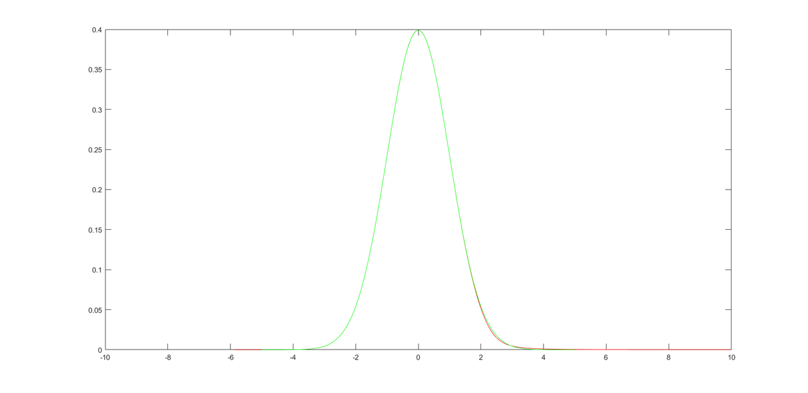
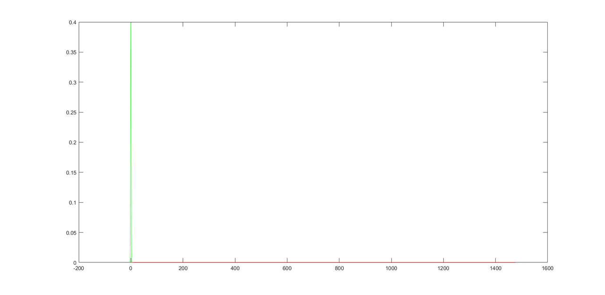
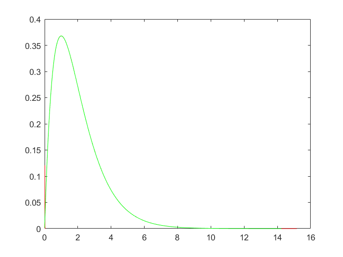

# Breakthrough in the theory of stochastic differential equations and their simulation

**Page 46 of 59** — Posts #2251–#2300

[← Previous](page_045.md) | [Index](index.md) | [Next →](page_047.md)

---

### #2251 — Amin (Topic Author)
*March 22, 2024, 9:21 AM*

Friends, I want to speak my mind more openly and candidly about evil of mind control and please forgive me if I lose
political correctness while trying to speak the truth.

First please let me give an idea about scope of mind control by corrupt American defense. In my country Pakistan,
anywhere between 500 to thousand intelligent people have been retarded by mind control and most of these were very
talented programmers or programmer entrepreneurs who wanted to do something extremely innovative. Therefore, I call the
previous decade, the lost decade of Pakistan. Talented People in many other countries like Malaysia were retarded with
even a greater zeal. It is not the Muslim countries only where large number of people are retarded, mind control is
actively done in a large number of European countries. Some countries like Switzerland proudly refused to allow mind
control on their soil, and their GDP has already greatly diverged from the GDP of a large number of other
technologically advanced European countries who allowed American defense to implement mind control on their soil. For
example, large number of French continue to wonder why despite all the good education, talent and great mathematics and
CS, their country is lagging far behind other countries with similar standards. America is no different and I strongly
believe that at least 50 non-Jewish Americans have been stopped in their tracks by American defense using mind control
who would have later gone on to become billionaires. Thousands of people, mostly in US, are retarded by American defense
every year.

Mind control is a very cruel practice (I will add another post after this post giving some sample of cruelties done to
me that are also freely done to most other mind control victims.) I have mentioned many times that a Jewish billionaire
and his cohort of some rich Jews is behind most of the mind control in United States. Please do not confuse my blaming
the jewish billionaire and his rich cohort for mind control with saying that all Jews are bad ( I have not made this
statement about all Jews) However I do honestly believe that a large number of jews are complicit in this crime because
they know the truth behind it and still remain silent about it and do not oppose it.

Going before the history of mind control, I believe that many rich jews had realized more than fifty years ago that they
need great relationship with American defense in order to protect the state of Israel and its interests in the region.
Over time, this relationship became a symbiotic relationship in which officials in American defense protected Jewish
interests and Jews gave them lavishly paid jobs after their retirement. This might still not be a very wrong thing but
after advances in science and advent of mind control, many bad jews realized its potential to advance their interests,
right or wrong, by using their already strong control over American defense. Since mind control is a very cruel thing
and most Americans when told about horrors, cruelty and torture associated with mind control, strongly want mind control
to end but you will notice that a large number of (evil) jews staunchly oppose any end to cruelty of mind control and
would vehemently lobby for mind control to continue at all cost.

Several Countries I mentioned earlier were made barren of their talent by American defense since evil Jews wanted to
undermine these countries without any human feelings for extreme poverty in countries like Pakistan. Scientific research
of a lot of European and non-Jewish talent retarded was handed to those people who back American defense and are
symbiotically related to it.

A democracy is defined by rule of law, and rights of individuals in a democracy are protected by constitution and upheld
by democratic institutions and Judiciary. No individual, however rich or powerful, can extrajudicially hurt anyone
innocent and law-abiding in a true democracy.  As opposed to democracy, a tyranny is where innocent individuals are
wronged above the law by powerful people employing cruel means. Therefore I have come to this judgment that America is
not a democracy, it is a democratic tyranny. Why? in a true democracy, nobody, not even American president, can decide
to wrong anyone who is an innocent and a law-abiding individual. This simply does not happen in true democracies. On the
other hand, American defense, as if America were a country like Burma, Pakistan or Cambodia, cruelly retards thousands
of Americans and extra-judicially seals their fate forever. Armies in a democracy are simply not supposed to meddle in
civilian affairs of a country. Would this not be a great hypocrisy that when Chinese Army meddles in the affairs of
Chinese civilians, we all recall that a true democracy is the solution to the problem of Chinese people, but when
American army goes on rampage to retard thousands of Americans every year and makes entire countries barren on whims of
powerful jewish billionaire and his cohort, no American newspaper cares to write about it. I want to tell all the great
writers and columnists in large newspapers of US that true patriotism does  not lie in whining about ills of Chinese
government, rather true patriotism is about writing strongly about ills of your own country and eradicating them from
the society and its future generations forever.

I want to say again that true democracies do not give  even to the most powerful and the richest people, the rights to
wrong any innocent and law-abiding citizen however weak or poor. And I am surprised, after all the cruelty of mind
control has been exposed and it is clear that most American public other than bad jews want to end mind control from
their country forever, why president Biden does not order American defense to end mind control cruel practice forever.
Most sensitive and kind-hearted American people and others shudder from the idea of mind control continuing in their
society. Most of them would have thought that President Biden would be one of the first people who would shudder from
cruelty of mind control when truth is told to him about it by a lot of good Americans and would order American defense
to end mind control of innocent human beings forever. But the fact that this is simply not happening sends wrong signals
about President Biden to good Americans. According to my understanding, any guy who has enough humanity and has a kind
heart would do everything in their power to end cruel practices like mind control and eradicate them from the society
forever. I want to request anybody around President Biden to convince him to end mind control in United States and
elsewhere forever. I want American president to make the right decision for American people whether he wants to make
America like a third world military tyranny or a truly advanced society that is epitome of human civilization and leads
the world in her democratic practices and ideals. We cannot judge him properly since we lack the complete foresight  but
history will truly judge him if he was one of the great American presidents or otherwise.

---

### #2252 — Amin (Topic Author)
*March 22, 2024, 9:43 AM*

As I wrote in previous post that I will copy some of my previous posts that give good American people and people from
all over the world an idea what happens to a mind control victim and how is the life of a mind control victim. Below is
a post when I wrote around Christmas when Lahore city was thoroughly drugged with mind control chemicals so I would not
be able to continue my research.

Happy Christmas to friends all over the world.

My work and research is going well and I am very sure that we will have some very good programs after the end of winter
vacations when people return to their universities. I will try to post intermediate programs in the meantime once or
twice.

However I am very worried that my persecution on hands of my country's army continues to increase. They really continue
to try their best to somehow make me get bad food so I cannot work properly. In efforts to deter me, mind control guy
tell me many many times a day that if I stopped working, they would stop their immediate persecution activity. Their
persecution activity really has to do with the fact that I have been trying to work hard and trying to make something
out of my research and they really do not like it especially because they think that due to hard work, I will take more
neurotransmitters from other parts of the brain in the catchment of central brain.

Since they are so determined to retard me, I am seriously worried that they might detain me sometime even though my
family continues to live normally and has not given me any such indication but I am still worried. Therefore I am
copying some posts from the past so that friends know the context of all of this very well.

Friends, mind control agencies and CIA continue to increase and perfect drugging of food in Lahore city. Almost all
available food in About 70% of the city is thoroughly drugged with mind control chemicals. Pakistan army has distributed
mind control chemicals in almost the entire city and everybody/every shop  who prepares food or snacks is adding mind
control chemicals to their prepared food. Small street Food restaurants, small stalls for snacks, shops of sweets, juice
shops all are adding mind control chemicals in their food in almost 70-80% of the city (This is among 25 largest cities
in the world). I have been holding on because I am aware of their tactics and have been extremely careful about what to
eat. I hope that I will continue to protect myself as far as getting good food is concerned.

But after spending several hundred million dollars in drugging Lahore city, mind control agencies are becoming nervous
since all their money spent might be a waste. And I really think their next move is to declare me mentally ill on some
flimsy premises and forcefully detain me at a psychiatric facility of their choice. I am very worried that forcefully
detaining me on flimsy psychiatric grounds is the next thing mind control agencies want to do next.

I have been saved several times from being forcefully detained due to protests of good American people in the past few
years. They used to detain me every year and sometimes even multiple times in a year before good people protested about
it. Due to efforts of good American people to protect me, it is my third year now that I have not been detained. I was
detained last time in early 2021.

When they detain me, they have fixed all mind control gadgets and lasers in the psychiatric facility and they add all
mind control chemicals openly in food and psychiatric drugs. It is a very controlled environment in captivity and within
a month or so, they are able to remove all neurotransmitters from the brain of the victim. Every time I was detained,
they kept me in the psychiatric facility for 30-50 days. One psychiatric even detained me for ten months after I
returned from Britain. There are also instances of being detained for six months once and three months twice.

I really want to request American people again to please protest to their government and try to make sure that I am not
being detained again on totally flimsy psychiatric grounds.

Due to their relevance, I am copying some posts from before.

.

.

.

[My Letter To HRW About My Human Rights Abuse](https://forum.wilmott.com/viewtopic.php?f=15&t=102298)

Above is a very incomplete account of how various psychiatrists continued to play in hands of Pakistan army to retard
me. It also does not cover all the time till year 2022 and the account stops several years earlier. I could not write
about last several years that were exceptionally brutal.

Friends, in a previous post I told friends how staff at a lady psychiatrist's hospital started beating me and abused me.
During past twenty three years, there have been many many instances of my obvious abuse by different psychiatrists. I
will describe some of those instances in this post.

When I came from United States and till fifteen years after that, my father would proudly ask me that I could see any
psychiatrist I wish. This was because Pakistan army was managing my persecution and they would force psychiatrists to
declare me schizophrenic and my father was told that every psychiatrist would be forced to cooperate. However, by chance
in 2016, I came  across a psychiatrist who was far better. I never told him that I was under mind control but whenever
he interviewed me, he always said after the interview that I was perfectly sane and mentally healthy. When my family
would force him to increase the dosage of antipsychotics, the doctor first told me that I should not live with my family
and make a comprehensive plan to support myself and become independent (such a plan could never work since Pakistan army
was threatening people in Pakistan to not give me any business and CIA was making sure that every contact I would reach
for work in Europe (and Singapore/ Japan /Australia) would be approached by CIA telling them that I was a very bad guy
and they must not do business with me. I had not told the doctor any such thing that intelligence agencies were after
me.)  When I told the good doctor how previous psychiatrists had abused me, he would tell me that this used to be a very
widespread practice in America hundred years ago to wrong mentally healthy humans by using corrupt psychiatrists as
instruments to detain them and strip them of their sanity. The good doctor I am talking about was American national with
Pakistan background who had practiced psychiatry in America for over twenty years and had returned to Pakistan. That
good doctor kept me on very low antipsychotics (1 mg resperidone per day) and that too on extreme insistence of my
family. It was only during that time of treatment by that doctor that I got my first break in research and I solved the
problem of high order monte carlo simulations (and analytic series solution of ODEs)  and posted that solution on this
thread. Ok, when my family was fed with the doctor, they detained me with another doctor. They detained me again two
years ago when I requested my family that I wanted to see the same doctor of my choice again( I have been detained every
year for past six or seven years by different doctors), they detained me through a different doctor. So my family now
stubbornly refuses to allow me to see a professional qualified American psychiatrist of my own choice and detains me
every time I try to approach him.

Now back to my obvious abuse by two other psychiatrists. I was detained by this doctor who was running a mental health
facility and was not a psychiatrist himself. At that time I did not use to walk very much and my blood pressure used to
be somewhat high. Since other antipsychotics had failed to retard me, doctor suggested I take aripperizole injections.
These injections affect the heart and also elevate blood pressure but doctor who wanted to retard me had no regard for
my health while pretending to cure me. In initial days of my detention, staff at the hospital when checked my blood
pressure told me high enough blood pressure in line with what I used to have but after I complained about aripperizole
and its effect on blood pressure the staff started doctoring blood pressure and started telling me that my blood
pressure was very good or even low. This is a post I wrote on another thread in this forum about it. How to safeguard my
research - Page 32 - wilmott.com

.

> Amin:
>
>
>
> Since I wrote about high blood pressure and mentioned high blood pressure before the hospital staff, they have started
to doctor blood pressure. Now, everyday they tell me that my blood pressure is 120/80 or 110/70. While they always told
me that my blood pressure was 130/90 or 140/100 prior to injections. I have never had so good blood pressure for years
that they have started to tell me now. Friends would recall a previous post when I could not sleep at night and had to
take a sleeping pill. When the dispenser came to me at night(The hospital has no MBBS who stays here at night in
Ramadan. Dr. AS used to stay here on some nights earlier but has been totally absent in Ramadan). When the dispenser
checked my blood pressure, he told me that it upper blood pressure is 110. I did not believe him at all. He asked me to
check on my own and put the stethoscope head assembly in my ears. I could easily tell that upper blood pressure was more
than 140 and lower was more than 100. The staff has already started to doctor blood pressure. My parents are going to
Saudi Arabia for two weeks in a few days. Now Dr. AS has the plan to hold me in detention while my parents are abroad. I
had a complete settlement with Dr. N and we(I and the doctor N) both agreed that I would be visiting him every fifteen
days and all modalities were agreed. I do think as a patient it is my right to choose the psychiatrist and Dr. AS( who
is incharge of facility Pav.) has no right to change the doctor after I have selected a psychiatrist and we both agree
on terms of any treatment. Dr. AS has imposed another psychiatrist Dr. M who has not even seen me and has already
started giving me injections and increased medicine without looking at my present condition. Dr. N had explicitly stated
that I would be free to leave if it were his facility. Most major reason for detaining me now is that Dr.AS wants to
continue to detain me while my parents are leaving for abroad for more than two weeks
>
>
.

Later after a few days, I was given a second aripperizole injection and released from detention. An injection was due
every fifteen days. My parents were in Saudi Arabia and I was living with my sister. She insisted after fifteen days
that I get a new aripperizole injection. I complained about too much side effects and other serious problems but my
sister insisted that I must get the injection. She talked to another doctor and the doctor told her that if his blood
pressure and pulse are fine, just give him the injection. I asked my sister that my blood pressure must be checked
before I get the new injection. We went to a small hospital close to her house and when my blood pressure was checked my
lower blood pressure was 110. The hospital staff recommended that I stay at the hospital in their care until my blood
pressure decreases. It was a totally random blood perssure check. When hospital staff came to know that I had been given
aripperizole injections, they told my sister to not give me those injections any more. My sister asked the staff to
relieve me and we came home but I was not given aripperizole injections after that.

But this is interesting that the psychiatrist was initially desperate to prescribe aripperizole despite that I had told
him about my heart and blood pressure problems and his staff was asked to doctor blood pressure so that I would accept
the injections.

Good thing is that only after stopping aripperizole, I started my treatment with good psychiatrist  doctor Naeem Aftab
(who is an American national) and he gave me enough relief that I was able to get a break in my research and solve the
problem of high order monte carlo simulations. I would always be thankful to Dr. Naeem Aftab for giving me relief at
such a crucial point in my life.

Yet another experience for abuse was with a seasoned psychiatrist who is known for his connections with Pakistan army.
When army dictator Pervaiz Musharraf ruled the country, he made this doctor the dean(president) of the university of
health sciences which regulates most medical universities in Pakistan. He had treated me for three years in year 2001.
He started my treatment without interviewing me and gave me electric shocks at the start to jumpstart the therapy. I was
given electric shocks for fifteen days in early 2001. I still recall that doctor would place a wooden wedge between my
teeth and then give me an injection and I still recall how numbness would move in my body from feet to the upper body
after the injection.

When going to that doctor's psychiatrist facility in 2001 I had to travel from Kot Addu to Rawalpindi. My family had
given me some drug in my food and I became unconscious after an hour or so. I still recall how I was begging my younger
brother to help me that I do not want to go anywhere and if he could help me but he like everybody else in the family
refused. Slowly drug in food showed its effect and I have absolutely no memory of being taken in my father's car despite
that it would have taken him at least eight hours to take me to Rawalpindi. Psychiatrist did not interview me and
detained me and started giving me electric shocks. I still recall how I defecated in my bed there and they had to wash
it.

Anyway, I was taken to this psychiatrist in 2017 again. He was very clearly told that I had been given antipsychotic
drug larjactil by another doctor and it backfired and I had extremely severe drug-induced jaundice. But the doctor was
so haughty and cavalier and so desperate to retard me that he still insisted that I must get the same drug larjactil and
said that it was not necessary that it would cause jaundice every time. Problem for the doctor was that most
antipsychotics had failed to retard me and he wanted to give me some potent antipsychotic that had not been well-tried
on me. Though the drug was given to me earlier and later discontinued, the doctor wanted to take his chances to retard
me and he had no regard for my health. This doctor is a big crony of Pakistan army and really wanted to please the
generals and therefore he decided to give me larjactil again. And as would already be obvious to most friends, after two
weeks, I started to show all signs of drug-induced jaundice again and my body and eyes were all yellow. My Biluribin
shot like anything. And it took more than two months to control jaundice after that. Though my biluribin came back to
normal after two months, several less known enzymes in my liver remained disturbed for several years after that and
continued to show as abnormal in my liver function test reports.

I have been detained more than 30 times by various psychiatrists during past twenty-five years on orders of Pakistan
Army. This is despite that I have never been violent all my life. I have never hit anyone in my adult life and I rarely
speak with anyone in a loud voice. I have never done anything like breaking a glass or any utensils that is associated
with sick people.

Here, I will recall an incident eight years ago when I myself approached a lady psychiatrist for help and how she abused
me, and her staff beat me for twenty minutes and then tied me and started my treatment with antipsychotics again.

I am recalling this from early 2015. They had previously put me on extremely high antipsychotics and my creativity was
all gone. I could barely do any intellectual work. At that time, I was able to convince my family to decrease the
injections and they had agreed since I had already lost most of my creativity and intellectual capability. I think mind
control agencies were also thinking that I had lost my creativity forever and they wanted to see if it was right time to
decrease my drugs and still make sure that I would remain intellectually dull after injections had ended.

But I slowly started to work on my research and started to regain my brain. When mind control agencies realized that I
had started to do better research, they asked my family to do something again to retard me. My father asked a
self-stylized religious saint to come to our house and take care of me. He came to our house with one of his followers
and told me that he wanted to give me injections and I would go to sleep for 24 hours, and they would take scans of my
brain to treat me, but I continued to beg and plead him, and I was able to convince him to allow me to leave the home in
my car. The supposed saint allowed me to leave since he was probably sure that he would get me later as I had no other
place to go other than my home and, therefore, I was able to convince him to let me go outside. When I left the house, I
made posts about the saint on at least two different forums from outside my house and pleaded for help. Enough people
were following my story even at that time and the saint had to leave. I also called my father when I was outside and
protested against this.

My family still remained very tense with me, and I was very afraid that they would force antipsychotics injections and
mind control drugs on me therefore I stayed one night out of the home. Here is the post I made when I was away on April
14th, 2015, 2:09 pm

[viewtopic.php?f=15&t=94796&start=315#p748191](https://forum.wilmott.com/viewtopic.php?f=15&t=94796&start=315#p748191)

"I am staying out of my home for the night since I had realized that my father will try to force me into detention again
and I would request a court tomorrow for stay order to stop my father from hospitalizing me forcefully again and I would
request the court that if there has to be a check on my mental health, it has to be done and investigated properly by a
psychiatrist of my choice and I should remain free at the same time. I do not want to be at the mercy of my father's
chosen psychiatrist as we saw in the past year that they continued to quote mental health laws and forcefully manipulate
me into taking injections. If my father forcefully hospitalized me, I would be cutoff from the outer world and they
would do whatever they like. My father's self-stylized saint(peer) had already hinted that he wanted to give me
injections that would put me to sleep for 24 hours and he had no argument for my mental sickness at all.”

Next day, on April 15, 2015, I went to Lahore High Court to find some help but I was told that I had to submit an
application that would be considered several weeks later when its turn would arrive. When I realized that there was no
possibility of help from the court, I decided to see a psychiatrist on my own. I was driving in Garden town Lahore where
I came across B**** psychiatric clinic and decided to see the psychiatrist Dr. N*** there. It was evening but the
psychiatrist still not had arrived there. I waited for an hour in the reception and then had a consultation with her. I
asked her to listen to my case carefully and then decide if I was sane enough and tell my parents about it. She said
that I seemed perfectly fine and asked me that she wanted to hear what my family had to say. I agreed and took an
appointment to visit her again at April 20, 2015. I took my mother on the planned day and my mother did not have
anything decisive to say about any disease other than that I did not eat at home. The psychiatrist asked me to visit her
after one week on 27 April 2015. The next week when I went again to visit the psychiatrist, on April 27, and was sitting
in the waiting room so that I could visit the psychiatrist on my turn. Another lady who was a psychologist came to me
and asked me to go with her in a different room to have a session with psychologist but I declined and said that I was
only interested in seeing the psychiatrist who had promised to see me again the earlier week. After five minutes, at
least four men came to the room and started besting me. They gave me slaps on my face with full force and gave me blows
and they continued to do it for more than fifteen minutes. I had never been beaten like that ever before in my life. All
this time, I was simply trying to raise my hand to somehow protect me. Since I was sitting on the sofa, only my face and
head were the target of slaps and blows. They were very violent with all sort of slaps and blows on my face as I earlier
mentioned that I was sitting and they were standing. . They literally continued to beat me and I continued to beg them
to stop. After fifteen minutes of beating me, they tied my legs and lifted me and put me on a bed in a room in the
psychiatrist facility and told me that doctor had gone to America and she could not see me. It was a complete lie and
the psychiatrist was in her office and was interviewing other patients when I arrived. I continued to ask them to loosen
the knots but they continued to make fun of me. I was totally surprised since Dr. N had behaved very nicely in the
previous meeting held at 20th with my mother and myself and I was sure she would declare me mentally sane on this
meeting. After I was kept tied for about half an hour, a new guard came and opened my hands and legs and said that they
would keep me at the facility for three days. The next day my medication in the form of pills started and I was also
given two more injections. I was given about nine pills at night and about eight pills in the morning. I was still not
given the opportunity to meet the psychiatrist N, and I was told several different things by different people including
that psychiatrist N had gone to America, and she had gone to Islamabad. About three days into my treatment, I saw
through the glass walls that psychiatrist N was interviewing her clients in her office. After seven days, I was asked to
meet psychiatrist N, and she said that she was unaware of the beating as she was in a meeting. Psychiatrist N also
assured me that I had no schizophrenia and previous doctors had very wrongly diagnosed me but it was a case of some
mania that she would properly treat this time.  Her staff continued to say that they were giving me drugs so that the
effect of other drugs given to me by previous psychiatrists would decrease.

Before my computer was taken away from me, I was able to take notes for two days in the hospital on my computer that I
write here. After first two days of medication, I was so extremely weak that I could barely walk and I had extreme
difficulty speaking.

“My Diary for past two days.

4/27/2015

I had two sessions with the doctor N previously on the 20th of April and once before at 13 or 14th of April. I remained
away from home during this time and second meeting on 20th of April, evening after the night when I remained away from
home. I had told the doctor about my circumstances in the first meeting with her. She had said that I looked perfectly
fine mentally but she needed to talk to my family. On 20th of April, I took my mother for a second joint session of
myself and my and the psychiatrist said, after the meeting, that said she really could not call me schizophrenic but she
needed one more sessions and asked me to come to her facility on 27th of April.

When I arrived at the psychiatric facility, a psychologist had asked me to accompany her which I did and on the way to
the her room, I asked for the reason, after which she replied that she wanted to take a session of mine. I told her that
I already had a session with another psyc hologist and also with a psychiatrist so I would prefer to have a new session
with the psychiatrist now. She agreed and I returned to the waiting room. I was sitting on a sofa in the waiting room on
27th at 8:00 PM (PST) in the line to see the psychiatrist when about five guards took control of me, while I was sitting
on a sofa in the waiting room to see the doctor, and gave me an injection. I was beaten and my legs and hands were very
strictly tied for more than hour. Though the doctor was in her consultation room and a lot of people were waiting to see
her, I was told again and again that doctor was not present at the facility.

In the previous two sessions, she had given the impression I was healthy mentally but she used force without
interviewing for the third time or seeing me and without requests to comply. If she was given any special information,
she should have talked to me about it and she should have verified with me any change in circumstances.

One injection was given around 8 PM when I arrived for third session with the doctor N. I really think that the doctor
was there since there was a large rush of visitors and her SUV was parked in the hospital but everybody among the staff
continued to say that doctor did not come to the facility this evening.

I was kept tied for more than one hour. I was taken tied from the waiting room to my room. All these rooms have video
cameras so you can ask Dr. N for a video of the events though she might make the excuse that cameras were not working.
One of the staff had mentioned when they brought me into a patient room in the facility, that everything was watched by
cameras.I would request people familiar with the matter to request her to show them footage of the cameras. Of course,
there could be many excuses that cameras were not working but I insist that cameras were working.

Good Mental health facilities try to avoid treating humans like this.

Another injection was given at night before I slept.

and my internet USB device was also taken. They simply took possession of everything out of my pockets and also took my
laptop.

When I asked why they gave me injections, one of the staff told me you were ?hyper? and I was totally surprised since I
was quietly sitting on the sofa in the waiting lounge for the doctor. I was told that I would stay in the hospital for
three days. I am sure this matter can be resolved who is lying and who is truthful once you look apt video footage of
cameras in most rooms.

4/28/2015

One injection was given in the morning. One injection was given around noon. All injections were IM (given in the
muscle.)

Unknown pills(some pills in the morning +5 pills around noon + 3 pills at night) were given and I was told,? We will
tell you know the names of these pills only when you leave.?

Computer was returned today but I was told that we did not take your mobile and they continued to say we never took my
mobile. My mobile was never returned( despite I always keep my mobile on me.)

I was also not given my EVO USB device and I was told you cannot write anything on internet. However the USB device was
returned to my mother at night.

I was told today by the psychologist that doctor N had gone to America and will come back after seven days and only then
she would be able to see you. I was told we are adjusting your medicine and see what was a good medicine. I was told
they were discussing the drugs with her on phone and skype There were several conflicting statements about where Dr. N
was. Somebody said she was just out of city and had gone to Islamabad.

When I asked my mother who is living with me at the hospital, I wanted a second opinion, because of beating and other
irresponsible behavior of the psychiatrist, my mother would make all sort of excuses while the staff would say that you
cannot leave the hospital until Dr. N arrives who is currently out of country.

Earlier today, I was told that I would live at the hospital for fifteen days and later I was told that I would live at
the facility for seven days. When I was tied, somebody had told me that I would live in the hospital for three days
only.

My mother told me please do not write anything wrong on internet otherwise, they would take your USB forcefully like Dr.
A had done more than one year ago. The purpose was to threaten me to not write about any maltreatment so that the doctor
would continue to freely manipulate me.

7-8 pills were given in the afternoon and similar number of pills were given at night. At many times during the day, I
could barely walk and had extreme difficulty speaking.”

Friends, I have previously described several horror experiences with psychiatrists but there are many more such
experiences that I have not posted on this thread. Today I am going to describe a continuing experience in which the
psychiatrist did everything in his power to retard me.

This is from year 2004/2005. I had a sound logic at that time and I was working from Lahore at a job with a foreign
Japanese company that was paying me \$4000 per month. I was still on high antipsychotics and when high dosage of normal
antipsychotics did not work, in order to retard me, the psychiatrist employed a procedure that is not known in
psychiatric practice in any country. The psychiatrist would give me some drugs in a glucose drip every two/three days in
the operation theater. When I would be given the glucose drip, I would gradually start to lose consciousness and when
half of the drip bottle would have gone into my blood, I would literally be unconscious, and I would later be taken
unconscious to my hospital bed by the hospital staff and I would wake up several hours later on the bed in my hospital
room and I would be extremely weak.

It was such a frightening experience that I would shudder from horror as the day of this treatment would come closer and
continued to beg the psychiatrist to stop this treatment. The psychiatrist would say that he was giving me vitamins and
vitamins were always harmless. He insisted that vitamins had to be given to me. He never told me what drugs he gave me
that made me unconscious and never discussed it with me other than mentioning vitamins. The psychiatrist continued to
perform this procedure for several weeks after sometimes second or usually third day. Most people cannot imagine how it
would feel when the drug in glucose drip would go into my body and I would lose my senses. To this day I shudder from
complete horror and recall the extremely sick feeling when I would slowly lose consciousness.

Now when I look back, I realize that they were giving me mind control drugs in the drip to take the intelligent
neurotransmitters out of my body. They continued to try to take intelligent neurotransmitters out of my body again and
again through this procedure for several weeks. I was completely helpless before my family and the psychiatrist and had
to go through such unlawful medical procedures.

As friends would have realized that purpose of mind control agencies was always to retard me since neocon scumbags of
pentagon and their backers were not capable of appreciating my humanity and did everything in their power to retard me
with an iron fist.

I have seen continuing pain, trauma and torture in my life only because I had some special neurotransmitters that people
with hatred and venom were not ready to let me have since they considered it a threat to let a Muslim have those
neurotransmitters.

After starting mind control in Lahore in early 2000's, bad jews (again apologies to good jews) were very emboldened how
easy it was to manipulate army and government in Pakistan to start mind control of intelligent people in Pakistan. It
was a time when Pervaiz Musharraf who was an army dictator ruled the country. He was very ready to please the CIA in
order to get help from American army to prolong his illegal dictatorship in Pakistan. He fixed in place all the required
mind control infrastructure in all large cities of Pakistan to please American army who was playing in hand of bad jews
to damage the Muslim majority country.

When Americans rightly blame our country for terrorism, they must not forget that many neocon generals in American army
have played in the hand of bad jews and have made every effort to systematically destroy talent in Pakistan on a very
large scale using mind control technologies to keep it backward forever.

Mind control in Pakistan is ensured by top Pakistani army generals since they are given several hundred million dollars
by US army every year and the top brass of Pakistan army divides this money among themselves with bigger fish getting
larger share and smaller fish getting a smaller share. Therefore, mind control infrastructure in Pakistan is very
detailed and thorough.

From my own experience, there is very large mind control activity in Lahore and Islamabad, the two cities where I have
lived during the past twenty years. There are at least more than 500 mind control targets in Pakistan most of whom are
computer science majors.

Mind control in Pakistan and many other places increased dramatically like never before. We have in Lahore a huge
building called Arfa Towers where all the facilities for technology and IT companies were provided to attract new firms
and entrepreneurs and later Arfa Towers became a scene of mind control carnage since tens of aspiring computer
scientists and entrepreneurs were retarded and it became very easy for mind control agencies to find the talent since
the facility attracted talent and retard it. Time between 2008 and 2016 was like black death for talent in technology in
our country (I am not talking about pseudo-talent that American embassy continued to support and showcase heroically in
the meantime.)  I still recoil with horror when I look back and recall how difficult it was to get good drinking water
in Lahore during that time for more than six months in 2013-2014. I would have to go to remote parts of the city, go to
villages around the city and sometimes even go to other cities and only then I would be able to get some good water
after repeated attempts and my only worry during the day would be to somehow get good food and water.

At this point I like to tell friends that a lot of food and beverages that are drugged with mind control chemicals would
be eaten or taken by most of the population that is not on mind control and they would never notice any anomaly in taste
or any other effect since these mind control chemicals are inactive and inert and become chemically active only when
targeted remotely with precise electromagnetic wave frequencies so only target victims are affected and this is a very
cruel method to target intelligent people by drugging the entire supply of food and beverages and then focusing waves on
the targeted individuals to activate the mind control chemicals. Pakistan army and mind control agencies would drug the
entire public water supply and beverages knowing that the victim would have to drink something somewhere. Ground water
is also so thoroughly drugged with mind control chemicals that entire public water supply of the city and several
kilometers out of the city would be completely drugged with mind control chemicals. Pakistan army routinely does this in
Lahore city on behest of American mind control agencies.

Ten years ago, army soldiers and agents would go to markets to drug the targeted food and beverages with mind control
chemicals which they still. Large scale movements of soldiers and agents raise suspicions in general public and
therefore mind control chemicals are supplied to beverage and food manufacturing companies in Pakistan, and they simply
add the chemicals in food and beverages during the manufacturing process.

In Lahore city, there are more drugged beverages at any time than good beverages in small stores or large supermarkets
alike since most of the beverages are drugged at manufacturing source by coca-cola, pepsi-cola and Nestle.

Coffee stimulates the brain and the brain connects in new ways after taking coffee and good coffee creates problems with
keeping victims on mind control since their brain starts connecting in many new ways after taking good coffee. All
coffee and I repeat that entire coffee in the country present in the stores is drugged with mind control chemicals. Most
of the coffee on good stores is imported from foreign countries. I do not know how it works but importer is probably
told by army to drug the imported coffee before distributing it in the market. It is even very difficult or rather
impossible to get good coffee beans. Two or three years ago it was possible to find some brand of coffee that was good
by trying all new brands but it has not worked for past two years now for me despite that I keep trying. I even know of
instances that when I was able to buy good coffee of a certain brand from very large and posh stores, they took entire
coffee brand off the shelf from all their branches within two to three days. People know that Corrupt Army in Pakistan
that ensures mind control is more powerful than any political government here.

Tea used to be good but for past one year most mainstream Pakistani brands of black tea are drugged with mind control
drugs. This has still not caught up thoroughly like coffee is thoroughly drugged and it is still possible to find some
good foreign brands tea that is good.

All stimulant/energy drinks including red bull are well drugged at manufacturing source. Red bull was better till last
year but then it became drugged everywhere. I even tried it at remote places in several cities other than Lahore and it
has always been drugged lately.

Most of the soaps, shampoos, creams, toothpastes are drugged with mind control chemicals. I do not use shampoos or
creams but whatever rare I tried them once in a while they were drugged and they charged my skin. All of these have mind
control chemicals that charge the skin and make mind control extremely effective. Many people would be amazed when I
tell them that even though I would be in my full senses before washing my head and face with a soap but after washing my
head and face with a drugged soap, my eyesight would deteriorate and my conception of reality would completely change
and sometimes I would face extreme anxiety. It is hard to emphasize that even a small thing like this can completely
change the victim's state of mind and consciousness. Getting a good soap was very difficult for me till last year and I
would drive for several hours in different parts of the city especially looking at all the pharmacies on the way to find
some unknown brand or some soap that would have been manufactured several years ago when soaps were not getting
completely drugged. I tried all the soaps including beauty soaps that are specially made for women, even many unknown
brands, and specially imported soaps(which were all universally drugged thoroughly) and it was very very difficult to
find a good soap. After finding a good soap, I would keep it in my pocket all the time. This is a small thing but you
cannot live without it. Since our mouth is kept charged and some charges continue to go into victim's body from one's
mouth. Therefore toothpastes are also added with mind control chemicals to charge inside of our mouth. You can imagine
that after buying five or six tooth pastes of different remote brands, I would get a good tooth paste. I have recently
been using toothpaste that is imported from abroad and is good. Toothpastes manufactured in Pakistan are all drugged
with mind control chemicals.

Another big problem is that pharmaceutical companies add mind control chemicals to their drugs(pills etc). Most of the
mind control victims are targeted due to their talent and intelligence in mind many times might require special minerals
that are rare in our food.  Most of the mineral and vitamin formulas are also drugged with mind control chemicals. Most
mainstream mineral and vitamin pills in the market are thoroughly drugged with mind control chemicals. I never like to
take names but I would like to tell friends that greatest crook of all times is Glaxosmithkline( I would invite them to
sue me for writing this on Wilmott). GSK's mineral and vitamin formulas, effervescent calcium tablets, and toothpastes
are all drugged with mind control chemicals. There is a tablet by the name Kemadrin that has to be taken with
antipsychotics and GSK manufactures it and it is also drugged with mind control chemicals. My experience with GSK is so
bad that If I have to buy any medicine and if it is made by GSK, I would try my utmost to avoid taking it for the fear
of its being drugged with mind control chemicals and look for alternatives.

Injection fluanxol and clopixol are also drugged with mind control chemicals.

Again all this thorough infrastructure took more than fifteen years to develop in Pakistan and Pakistan army continued
to work hard to develop it over the years. There are at least five hundred brilliant Pakistanis most of whom are
computer scientists who are on active mind control to thwart them to contribute to society in any good way.

All this infrastructure exists in Pakistan and was developed because neocon generals wanted to please bad but rich jews
and American mind control agencies continue to perfect it over last twenty years. Again, mind control in Pakistan is
ensured by top Pakistani army generals since they are given several hundred million dollars by US army

I have not talked about special infrastructure that is used to project EM waves on the target and this infrastructure is
present on all major roads and public places in big cities and major highways and motorways in the country.

[My Letter To HRW About My Human Rights Abuse](https://forum.wilmott.com/viewtopic.php?f=15&t=102298)

Above is a very incomplete account of how various psychiatrists continued to play in hands of Pakistan army to retard
me. It also does not cover all the time till year 2022 and the account stops several years earlier.

---

### #2253 — Amin (Topic Author)
*March 22, 2024, 9:45 AM*

Before writing this post, I want to apologize to good jews but want to tell them there are enough evil jews who are
doing everything to tarnish the great goodwill jews have so rightly earned through generations of hard work and being
nice and kind to other people in the society. I want to request good jews to Please force these evil(jewish) people to
end the bad practices that are starting to take root in American and other societies on their behest and before it is
too late. I also really hope that my mind control would finally end(as I have been begging for past twenty years) and I
would never have to write a post like this again.

In the past, I continued to mention about my mind control persecution from time to time but only started writing regularly about it when I arrived in UK on a Highly Skilled Migrant work visa. Mind control agencies did everything in their power to fail me in UK. People were asked to not give me a job. People I contacted were routinely told brazen lies about me totally shamelessly. When I realized that I had no future in UK, I returned to Pakistan after a six month stint in UK. Since my hard earned money had thoroughly insulted mind control infrastructure in UK as they had to drug entire cities with mind control chemicals in UK (read briefly about it in my application to HRW in a previous thread) for a nobody like me and American government had to move all their grand and influential puppets in UK (again for a nobody like me) to force people to drug the manufactured food. British Banks went to the extent to steal my money to bleed me. Read here: https://forum.wilmott.com/viewtopic.php?f=15&t=102298#p857494. British police forcefully stopped me from seeing law firms(Brief details are given in my application to HRW attached as a link below).  Since my money had given mind control agencies a very tough time, mind control agencies decided to never let me make significant money after that. My old Japanese employer was told to not hire me after I returned to Pakistan. Whoever I would contact someone in Europe for job or consulting, mind control agencies would move American embassy infrastructure in that country and somebody highly influential (or army or secret services of that particular country)  in that particular country would approach my target employer and again brazen lies and fabricated stories would be told about me shamelessly. I am a fighter in life and I continued my research despite all economic, coercive and other hardships. All odds were against me but I tried my best to continue.  I have been presenting my research to friends on this forum for past five or six years. At this point, I want to request good American and friends from other countries who have come to know me through my research to please use their influence to end my mind control forever.

Since things might heat up after my writing this and my persecution might increase, I want to ask European embassies in
Pakistan to keep a vigil. I want to tell Europeans that my writing about mind control is in their great interest since
the very same people who instigate retarding of intelligent muslims are behind retarding of dozens of intelligent
europeans and once these people are exposed I am sure they will be far more careful in openly retarding European
talent(that they do not like).

I had told friends earlier that a jewish billionaire is Godfather of mind control. When my persecution started (in late
1997) at the university in New York which is a big time player in mind control of Muslims, blacks and foreigners, many
university officials were very pleased that they were getting written in good books of the billionaire jewish Godfather.
Though there are far richer billionaires in US who are staunchly opposed to mind control, they are not ready to shell
out hundreds of millions of dollars to bribe anyone to end mind control while mind control Godfather continues to give
large bribes to people to continue mind control. Many of the people related to defense in mind control are given
extremely high paying jobs in Godfather and his other jewish friends' companies after they retire from mind control and
Godfather is extremely generous towards them and it is well established and well known to scum in mind control that
after retarding muslims, blacks and others in their career, they will move to paradise(tens of people from army/Pentagon
who follow whims of Billionaire Godfather are given jobs paying milllons of dollars by Godfather and his jewish cohort
in several companies) after they retire. No wonder there is no let up in mind control whatever good people try.

We know in almost all classic folk lore stories evil is too strong and too sure of itself while good is mostly weak and
just trying to protect itself from evil who is bent on damaging and eradicating the weak and the poor good but it is the
weak and poor good that finally prevails. I want to tell good American friends that evil at this stage has become too
bold and thousands of talented people are retarded every year. And it is just not muslims and blacks that are on the
line, several hundreds of brilliant whites are retarded across United States by mind control agency every year that has
become too emboldened due to lack of any accountability. Thousands of foreigners are also kept retarded in dozens of
countries including many European countries.

My only intention behind this post is that I want mind control to end from our societies. I do not have any joy in
mentioning that there are some bad jewish actors behind it. In American society there are a large number of jews who
have excelled in the professions of science, education, medicine and have made great contributions to our societies.
There are a very large number of jewish professors each of whom would have taught tens of thousands of students on top
of making extraordinary contributions to body of human knowledge through their great research. Then there are
accomplished jewish scientists whose work, research and inventions make our everyday life better. There are great jewish
doctors and surgeons who would treat countless sick people and make them recover from disease. The list of contributions
of jewish people to humanity is very long and it continues. Then there are a large number of ordinary jewish folks who
are known for their goodness and civility to other people in the society. When we know all of this, we do not want to
say anything anti-jewish to hurt the feelings of so many good jewish people. But I still have to say there are really
some bad people who are unconnected with most of the nice and accomplished jews and they instigate and continue cruel
mind control torture on talented people of other ethnicities, religions and countries based on their personal dislike
and hatred. My purpose is only to end the mind control victimization and torture on otherwise nice and talented people
and I do not have any hidden intentions beyond that. And I am sure American society knows very well about the
contributions of good Jews to both their country and broader humanity and my exposing some bad actors would never have
any bad effect of any kind on these good and nice jews who we all respect and who are our role models.I want to tell
friends something I have said before here that I am sure American society would eventually end the menace of mind
control from their and other countries. I want to request all good Americans and Europeans to come forward and invite
any investigative journalist you know to read my threads and ask them to help end the menace of mind control in our
societies through their investigative journalism. Without any accountability evil will continue to grow stronger and
then mind control would start to threaten even those people who consider themselves safe due to affiliations, status or
wealth.

I want to request CNN, New York Times, Washington Post, Al-Jazeera and large reputed European media outlets to run a
comprehensive story on mind control torture, retarding and victimization of intelligent people of US and other nations
by scum in US army on behest of some powerful people in United States and due to rightwing extremist biases of these
scumloads. If you would like to do investigative research about animal practices of US army, one great resource would be
mainland European embassies in Muslim countries who keep a detailed account of mind control persecution of intelligent
muslims in these countries by scum in US army. Many of the staff in mainland European embassies are very good human
beings who abhor such practices and would love to cooperate with good journalists in exposing the evil animal practices
of US army scum. Only the accounts of people at mainland European embassies in muslim countries thorough animal
practices of American army's mind control wing would be enough to drop a great bombshell in the media and general public
all across the world. I want to warn all the good people who try to have a civilized dialogue with scum in American army
to end their evil practices that their being nice with US army scumloads is a very misguided approach. Since good people
do not have the power to forcefully end the evil practices of US army scum, only way to end the evil practices of US
army crooks is by exposing them openly in US public and all across the world.

It seems that scum in American army and mind control are unable to pay a heed to civilized calls by good American people
and others to end their animal cruel practices and remain bent on mischief. If crooks in American army and mind
control remain adamant on continuing evil practices, the only solution seems that some brave investigative journalists
expose them by running a comprehensive story on mind control practices by American army. It seems that doing a civilized
dialogue with hardened crooks in mind control gives them a strong sense of weakness of good people and makes the crooks
even more adamant to continue their evil practices.  Reminds me of Abu-Gharib. Very similarly, scum in defense had no
conception that they were doing any wrong thing when there was a culture of openly urinating on human captives. It was
an open thing in army and most scumloads thought it was indeed a very right thing to do( and I am sure some of those
crooks still believe that it was a right thing they did even after being reprimanded by the broader American society).
It was not until brave people at CNN did a daring story against animal practices by crooks that evil practices stopped.
Though American army scumloads retard intelligent people of all color and creed, these ultra right wing army scumloads
love to retard blacks and muslims with great relish. Blacks are only 8-10% of US population but make a very large
proportion of victims in united states since many ultra right wing scum in US army would rather die than let those
intelligent blacks succeed in American society in a big way.

---

### #2254 — Amin (Topic Author)
*March 23, 2024, 6:16 AM*

Americans should ask their Supreme Court to make a judgement and clearly outline whether extra-judicial mind control and
forever retarding of innocent civilians by American defense can be authorized by American constitution. Can American
defense ever be allowed to retard even one innocent and law abiding human being (let alone thousands of them that are
retarded by American defense every year) by American Supreme Court.

American government very cleverly continued to officially (aka continued to brazenly lie about its existence) deny the
existence of any mind control program for decades. Only after mind control has taken root in the society and a practice
of bowing of ordinary civilians before the army and secret services has taken hold in the society that American defense
now accepts the existence of mind control behind doors.

Again what I mean to say is that mind control of innocent people by American defense is both extra-judicial and
extra-constitutional. Can a government person who has taken oath to serve American people ever allow something that is
both extra-judicial and extra-constitutional to exist in United States when it is exactly in his power and under his
discretion to end such extra-judicial, extra-constitutional, cruel and inhuman practices while still laying claim to
love for America and her people. According to my opinion, by allowing and perpetrating extra-judicial and
extra-constitutional mind control and retarding of innocent civilians, you are breaking the constitution of Unites
States or in other words, you are becoming a traitor to United States.

Let us ask a question. Can a high government official or American president decide to allow extra-judicial or
extra-constitutional practices in United States? Is such a government official not overstepping his authority when he
allows extra-judicial and extra-constitutional practices? Is there any check and balance on such acts and practices of
breaking the constitution of United States.

American constitution was very carefully designed by forefathers of United States and all civil and individual liberties
very clearly protected in it with their great wisdom. Consequences of implicitly breaking the constitution and letting
such practices take root in the society can be extremely high especially for new and later generations when such
extra-judicial and extra-constitutional practices would become an accepted norm in the society. Once you let the camel
in the tent, Camel kicks you out of the tent and takes control of the tent. The act of providing justice cannot be left
to armies in any reasonably civilized society. Please, stop the implicit breaking of the US constitution otherwise 
everyone in the society would probably become vassals to rich and powerful billionaires who would be orchestrating mind
control of all of those ordinary citizens who have the courage to disagree with rich and powerful as has already started
to brazenly happen in American society.

---

### #2255 — Amin (Topic Author)
*March 23, 2024, 12:10 PM*

Friends, I would most probably be posting the new commented program tomorrow. In the meantime, I want friends who had
been following the thread only recently to get familiar with polynomial regression as I have done in the context of
current program.

First we regress each random variable on "Ideal Normal Measure" which is composed of a grid with N grid cells spanning
over standard normal density so that each of the N cells in the grid have a probability mass equal to probability of 1/N
that is probability of one observation of data. Again the idea is that we divide the normal density into same number, N,
of grid cells as the number, N, of data observations and normal density grid is constructed so that each grid cell of it
shares the 1/N probability associated with each observation. The idea is that if data is a true polynomial function
of  standard normal density and its(of random variable to be regressed) first derivative with respect to standard normal
does not switch sign, We can sort the data observations in increasing(decreasing) order and regress them on standard
normal grid in same increasing(decreasing) order and we expect that regression would capture any systematic polynomial
function of data that lies in span of the hermite polynomials used in regression while any random deviations that
are orthogonal to the span of the hermite polynomials would remain in  unexplained variance. This sorting of data is
valid since first derivative of the random variable does not switch sign with respect to standard normal density or in
other words increasing values of random variable data should be associated with increasing values of standard normal
ideal density grid cells. Typically (Numbers would vary with variety of data)in random monte carlo SDE data, the
variance explained by hermite polynomials of ideal normal density was more than 99% when there were only 100
observations of data and 1% of the variance was orthogonal to hermite polynomials of "Ideal normal density". When
paths/N were equal to 100000, the variance explained in SDE data was more than 99.99%.

Here I am copying an old post on the topic: https://forum.wilmott.com/viewtopic.php?t=99702&start=2010#p877143 Please omit the first bit about conversion to CEV variables and rest of the post is relevant to polynomial regression in our setting. I have previously briefly described this procedure earlier in posts 1817, 1818, 1819, 1820 and 1822.

"Friends, I will post my matlab files sometime tonight. I am sure friends are already familiar with most of the ideas I
used since I have described them in the thread earlier. However there are some things that I want to describe again even
though I have previously mentioned them.

In the program, I first calculated coefficients of conditional asset Z-series associated with each volatility grid
subdivision separately. And I want to describe its details and other related ideas.

First I transformed the stochastic volatility variable to bessel-like coordinates by using the formula
$W\, = \, V^{(1-\gamma)}$ . I would like to mention that this transformation preserves the probability mass within each
grid cell and also CDF along the grid cells when compared with stochastic volatility variable in original coordinates.
This was done to find a more normal-like grid for our analytics of Z-series calculations. There was no issue since
underlying Z, ($Z_w(n)\, = \, Z_v(n)$ ) would be the same for all of the arbitrary nth grid cells as CDF remains the
same across respective grid cells even after transformation.

First I put together all of the asset paths from monte carlo that lied in a particular stochastic volatility grid
cell/subdivision.

My first approach was to find the moments of asset paths lying in a particular SV grid cell and convert them into
Z-series associated with our original algorithm of calculating Z-series from first seven moments. But it was working
very poorly due to large noise in moments.

I then tried polynomial regression on the values of asset paths lying in a particular grid subdivision. Here I will take
a minute to give friends idea about polynomial regression as I did it.

We know that in a particular monte carlo run, the probability weight associated with each monte carlo path is reciprocal
of total number of monte carlo paths. We could do a polynomial regression (of monte carlo data on first few hermite
polynomials) on a collection of monte carlo paths, if we could associate corresponding values of hermite polynomials to
each of the monte carlo paths. Then we would pair each monte carlo path with set of associated hermite polynomials and
run the regression to find common coefficients of hermite polynomials.

Problem is that hermite polynomials are derived from normal distribution and there is no obvious way to associate
hermite polynomials values with data values of monte carlo paths.

But we can relate them with each other through probability values. As I earlier mentioned that in a particular monte
carlo run, the probability weight associated with each monte carlo path is reciprocal of total number of monte carlo
paths$\frac{1}{N_p}$ . We can divide the normal density into equal probability weight subdivisions with total number of
subdivisions equal to monte carlo paths$ N_p $ and probability of each subdivision equal to probability of each monte
carlo path$\frac{1}{N_p}$ . Suppose the center of each equal probability normal density subdivision is$Z_n$ . Then we
sort all the monte carlo paths and assign each of the data values$X_n$ to hermite polynomials based on$Z_n$ as given by
$H_m(Z_n)$ . So now we are able to pair, for linear regression, the set of polynomial values$H_m(Z_n)$ with each of the
associated data value$X_n$ and run the regression.

Again probability subdivisions in normal density equal in number to monte carlo paths and the probability associated
with each normal density subdivision is equal to probability associated with each monte carlo path. We then relate the
Z_n associated with center of each normal density subdivision with sorted value X_n of the monte carlo data.

I have previously briefly described this procedure earlier in posts 1817, 1818, 1819, 1820 and 1822.

The polynomial regression method was very robust as compared to matching moments method for noisy data. Earlier I was
trying all of this with 7th order Z-series but for the kind of problems I was playing, I noticed that 7th order Z-series
was an overkill and I worked later with 5th order Z-series and robustness further increased with polynomial regression
method. However I never tried moment matching method with 5th order Z-series. And for friends who would want to try very
high volatility for longer periods of time, you may have to actually use a 7th order Z-series for accuracy. But using
7th order Z-series for problems that only require 5th order Z-series causes decrease in robustness of the method.

For polynomial regression, our matrix formulation is

$ X\,=\, H \, \beta \ + \epsilon$

Where X is a N X 1 vector of asset values associated with sorted monte carlo paths in increasing order. Here N is total
number of monte carlo paths that lie in a particular stochastic volatility grid subdivision.

H is a N X (M+1) matrix of hermite polynomials calculated from Z_n associated with nth equal probability subdivision of
normal density in increasing order. M is the order of highest hermite polynomial and 1 is added for a constant
associated with zeroth order hermite polynomial.

$\beta$ is a M+1 X 1  vector of ceoefficient of hermite polynomials in Z-series to be found from regression.

Our hermite Series for the data random variable X, now would be

$ \, X \, = \, \beta_0 \, + \beta_1 \, Z \, + \beta_2 \, H_2(Z)+ \beta_3 \, H_3(Z)+ \beta_4 \, H_4(Z)+ \beta_5 \, H_5(Z)$

Also for reference of friends, I tried to improve the value of Z_n so that moments of the equal probability subdivisions
density match with normal moments since I am trying to use discrete values of Z_n. For paths greater than 100, this is
not a problem at all but for very small number of paths i.e close to twenty paths, this might be a minor issue. Mostly
this is a very slight correction to Z_n values and this correction decreases fast as number of paths increase.

So this is how I was able to generate relatively robust values of numerically calculated Z-series coefficients
associated with each stochastic volatility grid.

I still want to play around with matching moments method since I want to see if in a decreased order Z-series (as I
decreased the Z-series order from seven to five), moment matching method might be competitive with above regression
method but I have to play  with program further to see this.

Again regression method works very well especially as number of monte carlo paths (or data values in a data set)
increase.

In the next post, I will describe how I converted the separate coefficients of above numerically calculated Z-series
into one single analytic universal Z-series for each of the coefficients. However, a robust calculation of individual
numerically calculated Z-series was a pre-requisite for the later method to work well and that is what I have described
in this post."

---

### #2256 — Amin (Topic Author)
*March 23, 2024, 12:33 PM*

After construction of Ideal Normal Density with N grid cells, we notice that discrete moments calculated from the
values, Zn, associated with the centers of each nth cell deviate slightly from the true moments of standard normal
density. We want to alter values of centers Zn of these grid cells very slightly so that discrete moments when
calculated over centers of the grid cells match the true moments.

Please read the post#2024 for explanation in this context : https://forum.wilmott.com/viewtopic.php?t=99702&start=2010#p877250

https://forum.wilmott.com/viewtopic.php?t=99702&start=2085#p878541

https://forum.wilmott.com/viewtopic.php?t=99702&start=2100#p878590

---

### #2257 — Amin (Topic Author)
*March 23, 2024, 12:43 PM*

Friends, I am copying this relevant post that shows how to calculate two dimensional jacobian that relates the true two dimensional desnity to two orthogonal standard normals density. Here: https://forum.wilmott.com/viewtopic.php?t=99702&start=1980#p876938

Since in our latest program, we have N orthogonal standard normals that underlie the density, it is a straightforward
extension from two standard normals to N standard normals.

"Friends, I want to very briefly explain the algorithm for inversion of 2D Hermite series to get the bivariate
probability density on the specified grid of asset$X_n$ and volatility$V_m$ on a uniform or non-uniform rectangular
grid. My notation might be different from matlab program.

We have an independent univariate Z-series/Hermite Series of volatility.

$V(Z_v)\, = \, c_0 \, + c_1 \, Z_v \,+ c_2 \, {Z_v}^2 \,+ c_3 \, {Z_v}^3 \,+ c_4 \, {Z_v}^4 \,+ c_5 \, {Z_v}^5 \,+ c_6 \, {Z_v}^6 \,+ c_7 \, {Z_v}^7 \,$

Equation(1)

Each point on stochastic volatility grid is represented as$V_m$ and this variable has a numerical value$v_m$ at that
point.

We first invert the above Z-series of volatility in Eq(1) to find the value of$Z_v(m)$ on each volatility grid point
$V_m$ . I have used the more stable bisection root finding procedure for that. So that$V_m(Z_v(m))\, =\, v_m$

Then we have equation for bivariate Hermite Series that is equal to bivariate product of stochastic volatility and asset
on each cell of the rectangular grid.

This equation is given as

$U(Z_x,Z_y) \, =\, \sum\limits_{k_1=0}^7 \, \sum\limits_{k_2=0}^7 \, C(k_1,k_2) \, H_{k_1}(Z_x) \, H_{k_2}(Z_y) $
Equation(2)

We can also write the above bivariate product U on the grid points  (X_n,V_m) as

$U(Z_x(X_n,V_m),Z_y(V_m)) \,=X_n\, V_m $

We already know the value of$Z_v(V_m)$ on all of the volatility grid points as we earlier did that. We substitute the
numerical value of$Z_v(V_m)$ in the two dimensional hermite series (sequentially for each grid point$V_m$ ) to get a
Z_series/Hermite Series only in$Z_x$ . This new series in only in$Z_x$ since numerical value of$Z_v(V_m)$ has been
substituted in the bivariate Hermite Series. This resulting Hermite Series in$Z_x$ is the product of univariate hermite
Series of$X_n$ , representing the X_axis associated with the particular value of stochastic volatility associated with
$Z_v$ that we had substituted in the 2D Hermite Series.

To get a pure Z-series of X-axis assiociated with the particular stochastic volatility point we divide the above
resulting Z-series with the value of$V_m=v_m$ on that volatility grid point. And after the division with volatility at
that grid point, it gives us a true Z-series of X-axis associated with the particular grid point$V_m$

Writing the above explanation in the form of Equations, we have if the numerical value of stochastic volatility at mth
grid point$V_m=v_m$ , and associated numerical value of underlying$Z_v=z_m$ , we substitute it in the 2D Hermite
Equation U and divide by$v_m$ . This division is done since U here is product of$X_n$ and$V_m$ and we want to divide by
$V_m=v_m$ to get the equation of only$X_n$ out of the equation of the product.

$X(Z_x(n,m)) \, =\Large \, \frac{\, U(Z_x(X_n,V_m),Z_v(V_m)) \, \LARGE {|}^{Z_v(V_m)=z_m}}{v_m}$  Equation(3)

The above formula gives us a univariate Hermite Series for that line of asset grid that is associated with mth
volatility grid point$V_m$ . This univariate Z-series can easily be inverted with our bisection algorithm to find$Z_x$
associated with$X_n$ line on mth volatility grid point.

The above formula is repeated for each of the points$V_m$ on the stochastic volatility grid and it gives us a Z-series
that is valid on the X points associated only for mth volatility grid cell.

if total number of volatility grid points is M, We can then invert each of the M dependent Z-series to get the value of
$Z_x(n,m)$ . Each of the Z-series is valid for X points associated with that particular volatility grid point that was
substituted in the Equation(3) to get the value of Z-series. All of these M Z-series are inverted with the bisection
root-finding algorithm that I have previously posted by using a loop that has M iterations.

So with above analytics, we calculate$Z_x(n,m)$ and$Z_v(m)$ associated with each grid point$X_n$ and$V_m$ on the
rectangular grid.

After this we calculate the derivatives$\frac{dZ_v(m)}{dV_m}$ and$\frac{dZ_x(n,m)}{dX_n}$ on all of the grid points
using simple finit differences. These derivatives are then used to calculate the Jacobian of the density of bivariate
variable$X_nV_m$ with respect to two standard normals.

Since stochastic volatility did not have any dependence on$Z_x$ , our jacobian is simply product of above two
derivatives.

We get the Equation of Bivariate Density as

$p(X_n,V_m)\, = \, p_N(Z_x(n,m)) \, \frac{dZ_x(n,m)}{dX_n} \,  \, p_N(Z_y(m)) \, \frac{dZ_y(m)}{dV_m} \,$

Here in the RHS of Equation $p_N$ denotes standard normal density.

---

### #2258 — Amin (Topic Author)
*March 23, 2024, 12:51 PM*

Friends, after posting the commented version of the new program tomorrow, in a few days, we will move on to playing with
the Jacobi polynomials in statistical setting as we have already done with hermite polynomials. If we could successfully
solve the associated problem related to jacobi polynomials, it will open doors to solution of many body problem of
quantum Physics and Quantum chemistry. This does seem difficult but let us try to solve the problem and see if we can
find some success.

---

### #2259 — Amin (Topic Author)
*March 24, 2024, 6:59 AM*

.
>
> Americans should ask their Supreme Court to make a judgement and clearly outline whether extra-judicial mind control
and forever retarding of innocent civilians by American defense can be authorized by American constitution. Can American
defense ever be allowed to retard even one innocent and law abiding human being (let alone thousands of them that are
retarded by American defense every year) by American Supreme Court.
>
> American government very cleverly continued to officially (aka continued to brazenly lie about its existence) deny the
existence of any mind control program for decades. Only after mind control has taken root in the society and a practice
of bowing of ordinary civilians before the army and secret services has taken hold in the society that American defense
now accepts the existence of mind control behind doors.
>
> Again what I mean to say is that mind control of innocent people by American defense is both extra-judicial and
extra-constitutional. Can a government person who has taken oath to serve American people ever allow something that is
both extra-judicial and extra-constitutional to exist in United States when it is exactly in his power and under his
discretion to end such extra-judicial, extra-constitutional, cruel and inhuman practices while still laying claim to
love for America and her people. According to my opinion, by allowing and perpetrating extra-judicial and
extra-constitutional mind control and retarding of innocent civilians, you are breaking the constitution of Unites
States or in other words, you are becoming a traitor to United States.
>
> Let us ask a question. Can a high government official or American president decide to allow extra-judicial or
extra-constitutional practices in United States? Is such a government official not overstepping his authority when he
allows extra-judicial and extra-constitutional practices? Is there any check and balance on such acts and practices of
breaking the constitution of United States.
>
> American constitution was very carefully designed by forefathers of United States and all civil and individual
liberties very clearly protected in it with their great wisdom. Consequences of implicitly breaking the constitution and
letting such practices take root in the society can be extremely high especially for new and later generations when such
extra-judicial and extra-constitutional practices would become an accepted norm in the society. Once you let the camel
in the tent, Camel kicks you out of the tent and takes control of the tent. The act of providing justice cannot be left
to armies in any reasonably civilized society. Please, stop the implicit breaking of the US constitution otherwise 
everyone in the society would probably become vassals to rich and powerful billionaires who would be orchestrating mind
control of all of those ordinary citizens who have the courage to disagree with rich and powerful as has already started
to brazenly happen in American society.
>
.

.

.

I will let it remain up to wisdom of Americans people to choose on their own whether they want a third world like
deomcratic tyranny (like Pakistan) or they want a true democracy in their country. In our country Pakistan, each
military officer when he is inducted in army after completing his training, takes a solemn oath that he would protect
the constitution of Pakistan at all cost and also not engage in any political activity. They all take this oath. But
these are the very people who trample the constitution of Pakistan again and again for their personal gains and have
damaged our country beyond all limits. So much so for the oath to protect the constitution. I am narrating this for
those people who think that breaking the constitution is not a bad thing at all.

All these oaths to Protect the constitution and other similar things are almost never enforced by law (because such
transgressions are done by very people who are in authority and who are supposed to enforce the laws and they are never
willing to enforce these laws on themselves until may be a court asks them to do that) and they are enforced by
society's strong reactions to prevent any extra-constitutional actions by armies or politicians. These are unwritten
lines in the society that armies or politicians are not ready to cross. That is probably one reason that American
defense kept mind control secret for a long time and slowly continued to advance it using their influential cronies
until it had taken enough root in the society. Where society shows courage to prevent extra-constitutional things by
armies or politicians, they almost never dare to break the constitutional line. However when society remains silent and
does not stop extra-constitutional actions by their strong reactions, armies become emboldened and do all sort of evils
in the society. Once a precedent has started to exist, it is very difficult to prevent such extra-constitutional things.
Again once you let the camel in the tent, it is very difficult to persuade it to go out of the tent. Please, by all
means, show all the great respect to good people in your armed forces but never allow them to break the constitution.

I am not saying America is a bad country. On the contrary, it is the most advanced country in the world leading the
human civilization as it exists today. But mind control is a relatively recent phenomenon and such a third world (full
of ignorant uneducated people) like cruel and inhuman practice of mind control might take another decade or so before it
shows its full effect on American society and before it is too late.

But I am more optimistic than anyone else, that just like it happened so many times in history of American people, that
they would again fully realize the problem and correct the coarse of their nation much before very significant damage is
done to their society (and other societies) and eliminate the ill of mind control completely from their country.

---

### #2260 — Amin (Topic Author)
*March 25, 2024, 3:51 AM*

Friends, I am posting the fully commented version of the main function. I am copying some of the main comments outside
of the program first.

This functions takes as arguments joint observations of NDim correlated random variables. And returns a multidimensional
hermite series in NDim dimensions expanded to Order-th Hermite polynomials of(Order is a parameter input argument to
this function) NDim orthogonal Z's.

Order parameter in input arguments means order of highest hermite polynomials in hermite series expansion. 1st variable
has a one dimensional hermite series in one orthogonal normal random variable. 2nd variable has a two dimensional
hermite series in first two orthogonal normal random variables. While nth variable has an n dimensional hermite series
in terms of n orthogonal standard normal random variables.%

Suppose there are Ndata number of joint observations of multidimensional random variables, then probability mass
associated with each of the observations is 1/Ndata.

First we regress each random variable on "Ideal Normal Measure" which is composed of a grid with Ndata grid cells
spanning over standard normal  density so that each of the Ndata cells in the grid have a probability mass equal to
probability of 1/Ndata that is probability of one observation of data. Again the idea is that we use the same number of
normal density grid cells, ZI, as the number of data observations and normal density grid is constructed so that it
shares the 1/Ndata probability associated with each observation. The idea is that if data is a true polynomial function
of  standard normal density and its(of random variable to be regressed) first derivative with respect to standard normal
does not switch sign, We can sort the data observations in increasing order and regress them on standard normal grid,
ZI, in same increasing order and we expect that regression would capture any systematic polynomial function of data that
lies in span of the hermite polynomials used in regression while any random deviations that are orthogonal to span of
the hermite polynomials would remain in unexplained variance. Typically (Numbers would vary with variety of data)in
random monte carlo SDE data, the variance explained by hermite polynomials of ideal normal density was more than 99%
when there were only 100 observations of data and 1% of the variance was orthogonal to hermite polynomials of "Ideal
normal density".

As we used sort to align our data observations of random variables with respect to standard normal density grid but
after the regression, we use reverse sort to associate those values of ZI with original joint observation index of
the data and now we call them Zy since they have been associated with data Y. Since now order of every Zy associated
with various random variables along the joint observation index would be very different from other Zy's, we would be
able to calculate correlations across Zy's (and their hermites) of various random variables using their values of the
same joint observations. Above, Please note that all these underlying Zy associated with various random
variables originate from a single ideal standard normal density grid but they were reverse-sorted to match with
observations of each random variable. Now they would all be in different( random as dictated by observations of
data) order as dictated by observations of each random variable as opposed to the same increasing order in original
ideal normal density grid before they were reverse-sorted along with the data. We will use them to get correlations
between hermite polynomials of random variables. For example correlation between second hermite polynomial of third
andfourth random variable of the data would be calculated as

% [Σ (Zy(mm,3).^2-1).*(Zy(mm,4).^2-1)]/[Σ(Zy(mm,3).^2-1).^2]/[Σ(Zy(mm,4).^2-1).^2]

summations in above equations to calculate correlations between second hermite of third and fourth random variable would
be on index mm that would range over all joint observations of third and fourth random variable starting from one to
Ndata.

With this first regression, we find an independent univariate hermite polynomial representation of each of the random
variables in multidimensional data. Now we start an orthogonalization procedure for calculation of the hermite series
representation of all random variables in common orthogonal coordinates. When we calculated hermite series
representations of individual univariate random variables in previous block, the Zy's underlying different  random
variables and their hermite polynomials have correlations across Zy's of various random varaibles. We want to convert
these correlated underlying standard normal Zy's into orthogonal ZOrtho's.

Just like a Gram-Schmidt calculation, We take the Zy associated with first random variable as such as the first
orthogonal ZOrtho. To find the second ZOrtho, we fist have to regress the second random variable on first ZOrtho and use
the coefficients from this regression to calculate the part of 2nd random variable that is correlated with first ZOrtho.
We subtract this correlated part with first ZOrtho from the 2nd variable to find the uncorrelated part of 2nd random
variable that is uncorrelated with first ZOrtho. Then we sort and regress this uncorrealted part on ideal
standard normal density grid to find second underlying Orthogonal stadard normal also called second ZOrtho. We repeat
this procedure for third random variable and regress it on first and second ZOrtho and remove all these correlations
from third random variable. Once these correlations with first two ZOrthos are removed, we sort and regress the
uncorrelated part on ideal standard normal density grid and find third ZOrtho and we continue so on.

The program returns a three dimensional array of hermite series coeffs in variable bCoeffHH. bCoeffHH is defined as

bCoeffHH(1:Order+1,1:NDim,1:NDium);

The first dimension in bCoeffHH is associated with hermite series expanded till Order-th hermite polynomial; The second
dimension in bCoeffHH indicates mth orthogonal variable. The third dimension is associated with the number of random
variable. so bCoeffHH(:,3,4) indicates hermite series associated with third orthogonal Z of the 4th random variable.

Hermite Series Form used in this program is given as Order in hermite series below is five as it is expanded to sixth
hermite polynomial. n also varies from 1 to NDim. If NDim=4, there are four orthogonal Z_n as in notation example below.

Y(n) = bnm(1,1,n) + bCoeffHH(2,1,n) H_1(Z_1) + bCoeffHH(3,1,n) H_2(Z_1) + bCoeffHH(4,1,n) H_3(Z_1) + bCoeffHH(5,1,n)
H_4(Z_1) + bCoeffHH(6,1,n) H_5(Z_1)

 + bCoeffHH(1,2,n) + bCoeffHH(2,2,n) H_1(Z_2) + bCoeffHH(3,2,n) H_2(Z_2) + bCoeffHH(4,2,n) H_3(Z_2) + bCoeffHH(5,2,n)
H_4(Z_2) + bCoeffHH(6,2,n) H_5(Z_2)

 + bCoeffHH(1,3,n) + bCoeffHH(2,3,n) H_1(Z_3) + bCoeffHH(3,3,n) H_2(Z_3) + bCoeffHH(4,3,n) H_3(Z_3) + bCoeffHH(5,3,n)
H_4(Z_3) + bCoeffHH(6,3,n) H_5(Z_3)

 + bCoeffHH(1,4,n) + bCoeffHH(2,4,n) H_1(Z_4) + bCoeffHH(3,4,n) H_2(Z_4) + bCoeffHH(4,4,n) H_3(Z_4) + bCoeffHH(5,4,n)
H_4(Z_4) + bCoeffHH(6,4,n) H_5(Z_4)

In the program, we standardize each of the random variables in joint obervations  separately and we do all analytics on
this standardized version of the data. Once we will have an analytic representation of standardized version of all the
random variables in joint data, we will convert to original variable representation by multiplying with square root of
each random variable's variance and additionof its mean. Even though standardization is applied independently on all
data

 random variables, it works well since all correlations between different random variables are preserved in
the independently standardized data.

.

.

.

```
function [bCoeffHH] = CalculateMultivariateHermiteSeriesAndDensities04(Yin,NDim,Order)

%This functions takes as arguments joint observations of NDim correlated
%random variables.
%And returns a multidimensional hermite series in NDim dimensions expanded
%to Order-th polynomials of(Order is a parameter input argument to this function)
%NDim orthogonal Z's.
%Order parameter in input arguments means order of highest hermite
%polynomials in hermite series expansion.
%1st variable has a one dimensional hermite series in one orthogonal normal
%random variable. 2nd variable has a two dimensional hermite series in
%first two orthogonal normal random variables. While nth variable has an n
%dimensional hermite series in terms of n orthogonal standard normal random
%variables.%
%Suppose there are Ndata number of joint observations of multidimensional
%random variables, then probability mass associated wtih each of the
%observations is 1/Ndata.
%First we regress each random variable on "Ideal Normal Measure" which is
%composed of a grid with Ndata grid cells spanning over standard normal
%density so that each of the Ndata cells in the grid have a probability
%mass equal to probability of 1/Ndata that is probability of one observation
%of data. Again the idea is that we use the same number of normal density
%grid cells, ZI, as the number of data observations and normal density grid is
%constructed so that it shares the 1/Ndata probability associated with each
%observation. The idea is that if data is a true polynomial function of
%standard normal density and its(of random variable to be regressed) first
%derivative with respect to standard normal does not switch sign, We can
%sort the data observations in increasing order and regress them on
%standard normal grid, ZI, in same increasing order and we expect that regression
%would capture any systematic polynomial function of data that lies in span of the hermite
%polynomials used in regression while any random deviations that are
%orthogonal to span of the hermite polynomials would remain in
%unexplained variance. Typically (Numbers would vary with variety of
%data)in random monte carlo SDE data, the variance explained by
%hermite polynomials of ideal normal density was more than
%  99% when there were only 100 observations of data and 1% of the variance
%  was orthogonal to hermite polynomials of "Ideal normal density".

%Also we used sort to align our data observations with respect to standard
%normal density grid but after the regression, we use reverse sort to
%associate those values of ZI with original joint observation index of the
%data and now we call them Zy since they have been associated with data Y.
%Since now order of every Zy associated with various random variables
%along the joint observation index would be very different from other Zy's,
%we would be able to calculate correlations across Zy's (and their hermites) of various
%random varaibles using their values of the same joint observations
%Above, Please note that all these underlying Zy associated with various random variables
%originate from a single ideal standard normal density grid but they were
%reverse-sorted to match with observations of each random variable. Now
%they would all be in different( random as dictated by observatiosnof data)
%order as dictated by observations of each random variable as opposed
%to the same increasing order in original ideal normal
%density grid before they were reverse-sorted along with the data.
%We will use them to get correlations between hermite polynomials of
%random variables.
%For example correlation between second hermite polynomial of third and
%fourth random variable of the data would be calculated as

% [Σ (Zy(mm,3).^2-1).*(Zy(mm,4).^2-1)]/[Σ(Zy(mm,3).^2-1).^2]/[Σ(Zy(mm,4).^2-1).^2]

%summations in above equations to calculate correlations between
%second hermite of third and fourth random variable would be on index
%mm that would range over all joint observations of third and fourth
%random variable starting from one to Ndata.

%With this first regression, we find an independent univariate
%hermite polynomial representation of each of the random variables in multidimensional data.
%Now we start an orthogonalization procedure for calculation of the
%hermite series representation of all random variables in common orthogonal
%coordinates. When we calculated hermite series representations of individual
%univariate random variables in previous block, the Zy's underlying different
%random variables and their hermite polynomials have correlations
%across Zy's of various random varaibles. We want to convert these
%correlated underlying standard normal Zy's into orthogonal ZOrtho's.
%Just like a Gram-Schmidt calculation, We take the Zy associated wtih
%first random variable as such as the first orthogonal ZOrtho. To find the
%second ZOrtho, we fist have to regress the second random variable on first
%ZOrtho and use the coefficients from this regression to calculate the part
%of 2nd random varaible that is correlated with first ZOrtho. We subtract
%this correlated part with first ZOrtho from the 2nd varaible to find the
%uncorrealted part of 2nd random variable that is uncorrelated with first
%ZOrtho. Then we sort and regress this uncorrealted part on ideal standard
%normal density grid to find second underlying Orthogonal stadard normal
%also called second ZOrtho.
%We repeat this procedure for third random varaible and regress it on first
%and second ZOrtho and remove all these correlations from third random
%variable. Once these correaltions with first two ZOrthos are removed, we
%sort and regress the uncorrelated part on ideal standrd normal density
%grid and find third ZOrtho and we continue so on.

%The program returns a three dimensional array of hermite series coeffs in
%variable bCoeffHH.
%bCoeffHH is defined as
%bCoeffHH(1:Order+1,1:NDim,1:NDium);
%The first dimension in bCoeffHH is associated with hermite series expanded till
%Order-th hermite polynomial;
%The second dimension in bCoeffHH indicates mth orthogonal variable.
%The third dimension is associated with the number of random variable. so
%bCoeffHH(:,3,4) indicates hermite series associated with third orthogonal
%Z of the 4th random variable.

% Hermite Series Form used in this program is given as
% Order in hermite series below is five as it is expanded to sixth hermite
% polynomial.
% n also varies from 1 to NDim. If NDim=4, there are four orthogonal Z_n as
% in notation example below.
% Y(n) = bnm(1,1,n) + bCoeffHH(2,1,n) H_1(Z_1) + bCoeffHH(3,1,n) H_2(Z_1) + bCoeffHH(4,1,n) H_3(Z_1) + bCoeffHH(5,1,n)
H_4(Z_1) + bCoeffHH(6,1,n) H_5(Z_1)
%   + bCoeffHH(1,2,n) + bCoeffHH(2,2,n) H_1(Z_2) + bCoeffHH(3,2,n) H_2(Z_2) + bCoeffHH(4,2,n) H_3(Z_2) + bCoeffHH(5,2,n)
H_4(Z_2) + bCoeffHH(6,2,n) H_5(Z_2)
%   + bCoeffHH(1,3,n) + bCoeffHH(2,3,n) H_1(Z_3) + bCoeffHH(3,3,n) H_2(Z_3) + bCoeffHH(4,3,n) H_3(Z_3) + bCoeffHH(5,3,n)
H_4(Z_3) + bCoeffHH(6,3,n) H_5(Z_3)
%   + bCoeffHH(1,4,n) + bCoeffHH(2,4,n) H_1(Z_4) + bCoeffHH(3,4,n) H_2(Z_4) + bCoeffHH(4,4,n) H_3(Z_4) + bCoeffHH(5,4,n)
H_4(Z_4) + bCoeffHH(6,4,n) H_5(Z_4)

%In the program, we standardize each of the random variables in joint obervations
%separately and we do all analytics on this standardized version of the
%data. Once we will have an analytic representation of standardized version
%of all the random variables in joint data, we will convert to original
%variable representation by multiplying with square root of each random
%variable's variance and additionof its mean.
%Even though standardization is applied independently on all data random
%variables, it works well since all correlations are preserved in the
%independently standardized data.

%%%%%%%%%%%%%%%%%%%%%%%%%%%%%%%%%%%%%%%%%%%%%%%%%%%%%%%%%%%%%%%%%%%%%%%

%In the code block below, we standardize the independent variable Y and dependent variable X.
%We do all later calculations of various Z-series and cross moments in
%standardized framework and then at the end of the program, we convert
%the calculated coefficients of 2D hermite series/Z-series of dependent
%variable X into original non-standardized framework.

Ndata=length(Yin);      %No of data elements in each of the random variables in joint observations.

Hz=HermitePoly(Order);  %Hz is a 2D array that stores the coefficients of
%all hermite polynomials up to input argument  Order;

%%%%%%%%%%%%%%%%%%%%%%%%%%%%%%%%%%%%%%%%%%%%%%%%%%%%%%%
%Below, we standardize each of the random variables in joint obervations
%separately and we will do all analytics on this standardized version of the
%data. Once we will have an analytic representation of standardized version
%of all the random variables in joint data, we will convert to original
%variable representation by multiplying with square root of each random
%variable's variance and additionof its mean.
%Even though standardization is applied independently on all data random
%variables, it works well since all correlations are preserved in the
%independently standardized data.
for nn=1:NDim
    MeanYin(nn)=sum(Yin(1:Ndata,nn))/Ndata;
    Ym(1:Ndata,nn)=Yin(1:Ndata,nn)-MeanYin(nn);
    YmVar(nn)=sum(Ym(1:Ndata,nn).^2)/Ndata;
    Y(1:Ndata,nn)=Ym(1:Ndata,nn)/sqrt(YmVar(nn));
end

 %%%%%%%%%%%%%%%%%%%%%%%%%%%%%%%%%%%%%%%%%%%%%%%%%%%%%%%%%%%%%%%%%%%%
%Code block below uses polynomial regression to find univariate Z-series
%coefficients of independent variable Y.
%To know more about polynomial regression read the following and associated
%posts:  https://forum.wilmott.com/viewtopic.php?t=99702&start=2010#p877143

%You can get the text file MomentMatchParams08.txt from the forum post below
%https://forum.wilmott.com/viewtopic.php?f=4&t=99702&start=2040#p877863
%
% Mtable=readtable('C:\Users\Lenovo\Documents\MATLAB\MATLAB1\MomentMatchParams08.txt');
%
% %ZI is moment matched grid along the normal density with number of grid
% %points equal to data elements in Y given by Ndata. The grid is constructed
% %so that probability mass in each grid cell is 1/Ndata so this matches the
% %observation probability of Ndata data elements. Due to equal probability
% %mass in each grid cell, we call it equiprobable grid.
%
% [ZI] = MatchMomentParametersOfIdealZhalf04(Ndata,Mtable);

[Zn] = StandardNormalIdealDesity02(Ndata,1);
[ZI] = CalculateZI(Zn);

%Below W is the design matrix for least squares regression i.e the matrix
%that contains all the hermite polynomials calculated at ideal normal
%density grid of size Ndata.
[W] = EvalHermiteArrayH0(ZI,Order);

for nn=1:NDim
    %We first sort the data so that we can assign one appropriate Z-grid
    %point(and associated hermite polynomials calculated at that grid point)
    %to each data element. This ideal normal density Z-grid is
    %constructed so that its size is equal to data observations count. We
    %suppose that first derivative of random variables with repsect to Z
    %does not switch sign meaning that increasing values of data
    %observations have to aligned with increasing values of ideal normal
    %density grid.
    [Ys,I]=sort(Y(1:Ndata,nn));
    %In the line below, the data sort is reversed so that now the ideal
    %normal density grid elements assigned to various observations of random
    %variable face it on data observations index. For details, Please look
    %on interent the definition of matlab sort command with role of "I"
    %in output and how it alters the index.
    Zs1(I(1:Ndata))=ZI(1:Ndata);
    %Below the values to be regressed facing the design matrix are assigned
    Ymu(1:Ndata,1)=Ys(1:Ndata);
    %Below, implement least squares regression.
    coeff=inv(W'*W)*(W'*Ymu);
    %Store in coefficietns array of all random varaibles
    Coeff(1:Order+1,nn)= coeff(1:Order+1,1);
    %Store the associated Z in Z-array of all coefficients.
    Zy(1:Ndata,nn)=Zs1(1:Ndata);

    %Above, Please note that all these underlying Zy associated with various random variables
    %originate from a single ideal standard normal density grid but they were
    %reverse-sorted to match with observations of each random variable. Now
    %they would all be in different( random as dictated by observatiosnof data)
    %order as dictated by observations of each random variable as opposed
    %to the same increasing order in original ideal normal
    %density grid before they were reverse-sorted along with the data.
    %We will use them to get correlations between hermite polynomials of
    %random variables.
    %For example correlation between second hermite polynomial of third and
    %fourth random variable of the data would be calculated as

    % [Σ (Zy(mm,3).^2-1).*(Zy(mm,4).^2-1)]/[Σ(Zy(mm,3).^2-1).^2]/[Σ(Zy(mm,4).^2-1).^2]

    %summations in above equations to calculate correlations between
    %second hermite of third and fourth random variable would be on index
    %mm that would range over all joint observations of third and fourth
    %random variable starting from one to Ndata.

%     %Below are sum squares values for individual univariate densities of
%     %various random variables showing how much variance is captured by
%     %our polynomial regression. Decomment to look at them
%     RSS(nn)= sum((Xh(:)-Ys(:)).^2);%Residual sum of squares
%     ESS(nn)= sum(Xh(:).^2);%Explained sum of squares
%     TSS(nn)= sum(Ys(:).^2);%Total sum of squares
%     ESS(nn)
%     TSS(nn)
%     ESS(nn)./TSS(nn)
%     nn
%     str=input("Look at data");

end

%Now we start an orthogonalization procedure for calculation of the
%hermite series representation of all random variables in common orthogonal
%coordinates. When we calculated hermite series representations of individual
%univariate random variables in previous block, the Zy's underlying different
%random variables and their hermite polynomials have correlations
%across Zy's of various random varaibles. We want to convert these
%correlated underlying standard normal Zy's into orthogonal Zy's.
%Just like a Gram-Schmidt calculation, We take the Zy associated wtih
%first random variable as such as the first orthogonal ZOrtho. To find the
%second ZOrtho, we fist have to regress the second random variable on first
%ZOrtho and use the coefficients from this regression to calculate the part
%of 2nd random varaible that is correlated with first ZOrtho. We subtract
%this correlated part with first ZOrtho from the 2nd varaible to find the
%uncorrealted part of 2nd random variable that is uncorrelated with first
%ZOrtho. Then we sort and regress this uncorrealted part on ideal standard
%normal density grid to find second underlying Orthogonal stadard normal
%also called second ZOrtho.
%We repeat this procedure for third random varaible and regress it on first
%and second ZOrtho and remove all these correlations from third random
%variable. Once these correaltions with first two ZOrthos are removed, we
%sort and regress the uncorrelated part on ideal standrd normal density
%grid and find third ZOrtho and we continue so on.

%As explained in start bCoeffHH gives solution coefficients in terms of
%Orthogonal Z's called ZOrthos.
%Since first Z is accepted as ZOrtho as such its coefficients are accepted
%as coefficietns of ZOrthos.
bCoeffHH(1:Order+1,1,1)=Coeff(1:Order+1,1);
ZOrtho(1:Ndata,1)=Zy(1:Ndata,1);

for nn=2:NDim
    Ycorr(1:Ndata,nn)=0;
    Ymu1(1:Ndata,1)=Y(1:Ndata,nn);
    %In the loop below, we calculate correlations of nnth random variable
    %with all earlier mm<nn ZOrthos
    %and remove the correlated part to find uncorrelated part of nth random
    %variable Ydecorr.
    for mm=1:nn-1
        Z1(:)=ZOrtho(:,mm);
        %Below find the least squares regression design matrix including
        %hermites of mmth ZOrtho.
        [W1] = EvalHermiteArrayH0(Z1,Order);
        %Below, do the regression to find the coefficients of part of nnth
        %random variable that is correalted with mmth ZOrtho.
        coeff1=inv(W1'*W1)*(W1'*Ymu1);
        %Below, we evaluate the correalted part of nnth random variable
        %with mmth ZOrtho by summing over all the hermite polynomials out
        %to Order.
        for hh=1:Order
            %Below Y corr continues to sum over all hermites of all mm
            %Zorthos that are less than nnth random variable.
            Ycorr(1:Ndata,nn)=Ycorr(1:Ndata,nn)+coeff1(hh+1,1).*W1(1:Ndata,hh+1);
            %Below, we assign the coefficients of nnth random variable
            %associated with hhth order hermite polynomial of mmth ZOrtho
            %in the final output analytic result 3D array.
            bCoeffHH(hh+1,mm,nn)=coeff1(hh+1);
        end
    end

    %Below, we find decorrealted part of nnth random variable after
    %subtracting sum of correlated components with all mm<nn ZOrthos.
    Ydecorr(1:Ndata,nn)=Y(1:Ndata,nn)-Ycorr(1:Ndata,nn);
    Ydecorr0(1:Ndata)=Ydecorr(1:Ndata,nn);
    %We sort Ydecorr in increasing order so that values of Ydecorr align
    %with ideal normal desnity grid for  polynomial regression.
    [Ydecorrs,Iydecorrs]=sort(Ydecorr0(1:Ndata));
    %We reverse-sort the ZI of ideal normal density grid so that now ZI
    %grid members face the associated data observations in the data observation order.
    %This is new ZOrtho since the efffect of correlations in nnth random varaible from
    %all previous ZOrthos had already been removed.
    ZOrtho(Iydecorrs,nn)=ZI(1:Ndata);
    Ymu(1:Ndata,1)=Ydecorrs(1:Ndata);
    %Below, do the least squares regression
    coeff=inv(W'*W)*(W'*Ymu);
    %Assign contrbution from ZOrtho coefficients to its appropriate place in the
    %analytic result array.
    bCoeffHH(1:Order+1,nn,nn)=coeff(1:Order+1,1);

%Below, uncomment to look at correaltions between ZOrthoss.
%     for mm=1:nn-1
%         Z1(:)=ZOrtho(:,mm);
%         Z2(:)=ZOrtho(:,nn);
%
%         [CorrH] = CalculateCorrelationBivariateHermiteCH0(Z1,Z2,Ndata,Order);
%
%     CorrH
%     nn
%     mm
%     str=input("Look at correltions between ZOrthos");
%     end
end

%Belwo bCoeffHH is the analytic result.
bCoeffHH

%Below, look at the variances of standardized random variables calculated from
%analytic results.
for nn=1:NDim

[TVar(nn),Var1] = CalculateHermiteSeriesVar(bCoeffHH(:,:,nn),Order,NDim);

TVar(nn)
Var1
nn
end
% [TVar1,Var1] = CalculateHermiteSeriesVar(bCoeffHH(:,:,1),Order,NDim)
% [TVar2,Var2] = CalculateHermiteSeriesVar(bCoeffHH(:,:,2),Order,NDim)
% [TVar3,Var3] = CalculateHermiteSeriesVar(bCoeffHH(:,:,3),Order,NDim)
% [TVar4,Var4] = CalculateHermiteSeriesVar(bCoeffHH(:,:,4),Order,NDim)

% str=input("We have reached close to end");

%%%%%%%%%%%%%%%%%%%%%%%%%%%%%%%%%%%%%%%%%%%%%%%%%%%%%%%

bCoeffHH

str=input("Look at bCoeffHH");

%%%%%%%%%%%%%%%%%%%%%%%%%%%%%%%%%%%%%%%%%%%%%%%%%%%%%%%

%Reverse the standardization of each variable.
for nn=1:NDim
bCoeffHH(1:Order+1,:,nn)=bCoeffHH(1:Order+1,:,nn).*sqrt(YmVar(nn));
bCoeffHH(1,nn,nn)=MeanYin(nn);

end

%%%%%%%%%%%%%%%%%%%%%%%%%%%%%%%%%%%%%%%%%%%%%%%%%%%%%%%

end
```

---

### #2261 — Amin (Topic Author)
*March 26, 2024, 12:09 PM*

Friends, I have been exploring the application of our orthogonal polynomials research to Quantum mechanics and Quantum
many body systems.

One of the most important reasons behind the success of my previous work with solution of stochastic processes with
Hermite polynomials was that I introduced separate correlations between hermite polynomials of the same order across
various stochastic processes. Without introducing these correlations, we would never have been able to capture all sort
of correlated stochastic processes.

I noticed that people in quantum mechanics have already been using orthogonal associated Legendre polynomials in Hartree-Fock method to solve many body systems : Read here about Hartree-Fock on Wikipedia:  https://en.wikipedia.org/wiki/Hartree%E2%80%93Fock_method

I noticed that Hartree-Fock method is a great method but it has one big weakness that it neglects electron-electron
correlations and it fails many times for neglecting correlations between electrons. So I am trying to explore further if
introducing correlations between different Orthogonal Associated Legendre polynomials of the same order just like we did
for Hermite polynomials might be able to capture electron-electron correlations in Hartree-Fock method with some
changes.

Another special thing we did in our research that I developed an infrastructure for calculation of all different
functions of the variables being represented by orthogonal polynomials and this would also be very helpful in analytics
related to Hartree-Fock algorithm.

Any input from experts would be welcome.

I am trying to explore this further in more detail.

---

### #2262 — Amin (Topic Author)
*March 28, 2024, 8:50 AM*

Friends, I really try to keep myself to my research and really do not want to write about other things. But I am really
forced again and again to speak about it. Now nexus (nexus is between evil people who can possibly be muslims,
chrisitians, jews or anyone else as long as they are evil) of evil jews and American defense is again increasing the
drugging of food and water in Lahore. Evil jews are thoroughly resolved to never let me do any more significant
research. Water in the city is again being drugged on a huge scale. Underground water had become better in a lot of
peripheral areas and surroundings of the city and I had started to take tap water from some surroundings of the city and
I had continued to live on tap water from random remote parts of the city for ten days or so but for past three or four
days, it has almost become impossible to get good water even from remote surroundings of the city. Nestle and Dasani
water never turned better after both companies started adding mind control chemicals to water again this January.
Luckily I found that water from a large Pakistani company Murree Brewery has  turned better and this good water is on
the shelves in many shops but Pak army personnel go to various shops and drug the water with hand and this bottled water
has been drugged in most markets close to neighborhood where I live and they also drug water on roads and streets that
are likely to fall on my way when I go out to take food and water. Earlier they used to add only chemicals in
underground water that would go inside the body and alter the brain when you drink that water and I could still use that
water to wash my face and my body but recently they are adding chemicals in underground water that also charge the body
when I wash my face or head with this water.

This whole mind control activity is still less visible since mind control agents are asked to not drug food in entire
markets across the city and they drug food only in the market where victim is likely to go and take food. This does not
become as visible as the earlier attempts at drugging food in entire markets of the huge city simultaneously.

I want to say again that I have nothing against jews and just like towards any other human being, I do not mean any harm
to them. But some of the jews are extremely evil and thoroughly cruel creatures and they have already amassed large
money in their pockets and some of them are just not ready to allow me to continue any further research work.

I Want to request the American president that eyes of the thousands of innocent victims of mind control are looking
towards you to end the cruel and inhuman practice of mind control. We all know that Jewish influence is a requirement
for any politician's success in United States but at the same time people all over the world do not want the evil and
cruelty of mind control to continue especially coming from most educated and civilized nation in the world.

Friends, even though mind control and drugging of food has steadily been increasing for past few days, I was not writing
about it but I was particularly upset today and was motivated to write this post because I brought good water from far
off areas of the city last night after great effort but the maid that works in our home entered my room when I was in my
mother's room for a few minutes and quickly drugged all the water this morning. I am just so tired when these
machinations could stop and I could concentrate on my research.

The nexus of evil jews and American defense used corrupt psychiatry to control me for twenty five years and continued to
give me all sorts of potent cocktails of large amounts of antipsychotics to damage my brain forever. For about half of
my life that I passed under huge antipsychotics, I was very rarely lively in my brain and I lived with a feeling as if I
am carrying a sack of 40 kg on my head and I continued to beg everyone to help me and not give me antipsychotic
medication but their was no sign of help anywhere. I t was only when some good Americans strongly protested to corrupt
American defense that my medication decreased somewhat. I am very sure that this evil nexus of evil Jews and American
defense wants to turn towards immoral and unethical psychiatry to control me again and possibly detain me again and take
away all good neurotransmitters that I use to do research in mathematics.

---

### #2263 — Amin (Topic Author)
*March 30, 2024, 1:21 PM*

Friends, I was not able to work for past few days due to so many problems. I resumed work again today and tried to get
myself oriented with quantum mechanics and schordinger equation setting. I did quite a bit of reading today and will try
to continue to do that in next few days as well.

While getting oriented with solution of  many body problem of quantum mechanics, I also continued to think if there
could be a statistical-like approach to the problem. I still have very half-baked ideas and I have to learn more but I
still thought that there could be a possibility that we could directly model the N-electron wave function  directly in
terms of spherical coordinates version of Legendre polynomials and try to play with dynamics  of the individual moments
of 1-electron  wavefunctions and joint  moments of the N-electron wave function directly and try to find the wave
function directly from these moments and also the coefficients of the solution in terms of the Legendre polynomials.
Like most of the previous work by experts, I do not want to try to directly model the density of electrons (that would
be found from squared version of wave function) but rather model the joint wave function directly.

We could possibly plug-in Legendre polynomial representation of each electron with known coefficients (or coefficients
of the known parts of the equation) in the joint schordinger equation or its stationary Hamiltonian and apply any known
conditions and then try to pin down the coefficients of the joint solution of the multidimensional Schordinger
equation. I will have to think more about how to perfectly fit the spin wave function part of the total wave function in
this setting. At the moment, this is just very hazy but I hope I will have more ideas in next few days.

I will try to familiarize myself with the problem further in next coming days and try to let friends know if I have any
ideas about solution of the N-body problem.

My idea is to play with the stationary version of the schordinger equation first and later try to introduce  time
dynamics.

---

### #2264 — Amin (Topic Author)
*April 1, 2024, 9:54 PM*

Friends, I have been trying to get oriented with quantum mechanics better. I have been reading the book  Computational
Quantum Chemistry by Ram Yatan Prasad and Pranita. It is a very good and very accessible book if you are familiar with
basics of orthogonal polynomials and other related mathematics. Today, I learnt the analytical solution of Schordinger
equation in terms of Hydrogen-like atoms without electron-electron interaction. Authors were able to convert the
Schordinger equation into three independent and separable ODEs that were each an eigenvalue problem that was solved with
exponentials or orthogonal polynomials like Laguerre and Legendre polynomials.

I also learnt about multi-electron problems with electron-electron interaction. I continued to think if there could be
some independent and different way to solve the N-electron problem. After including the electron-electron interaction
terms, there is no way to convert the PDE into separable ODEs since electron-electron interaction term contains all of
the three underlying variables. Hydrogen-atom solution gives us an initial starting wave function. I was thinking if we
could know how much each of the three parameters deviate in N-electron solution from  Hydrogen atom solution, we could
use this difference in a recursive way to update the wave function of each electron. But we usually do not find values
or density of r, phi or theta (in radial spherical coordinates) and we only update the wave function. I was thinking
that it might possibly work to actually get new electron density from squared Wave function and expand for correction
terms for wave function in terms of difference between density of electron in hydrogen atom solution and the density of
electron in updated solution with electron-electron interaction terms included.

This is still hazy but I am sure that I will be up to speed in next few days and will try to do some interesting work.

---

### #2265 — Amin (Topic Author)
*April 2, 2024, 11:35 AM*

Friends, I have started to think of the basics of my research in quantum mechanics. First, I want to give friends some
better ideas by writing the equation of solution of Radial part of wavefunction of electrons of hydrogen-like atoms.

$\Large {R_{n,l}(r)\,=\, -\, \sqrt{\frac{4 \,(-n-l-1)!}{n^4 \, {\big[ \,(n+l)! \big]}^3}} \, {\big[\frac{z}{a_0}\big]}^{3/2} \, {\rho}^l \, e^{- \frac{\rho}{2}} \, L_{n+l}^{(2l+1)}(\rho)}$

where$\large{\rho\,=\, \frac{2 \, z\, r}{n\, a_0}}$ and principal quantum number n=1,2,3,4: Azimuthal quantum number
l=0,1,2,3,(n-1)

We notice that unnormalized density here is a generalized gamma type density with weight given as
$\Large{ {\rho}^l \, e^{- \frac{\rho}{2}}}$ We also notice that density changes with principal quantum number and
azimuthal quantum number. I am not sure but I am slightly skeptic that orthogonality and correlations could hold
properly across associated Laguerre polynomials with different density weights.

For total consistency, I have decided to expand as a series in associated Laguerre polynomials with one common density
weight. Each of the polynomials in above equation with different quantum numbers would be represented with a series in
one base associated Laguerre polynomial in one density weight. This will have perfectly well-defined orthogonality and
we could also calculate consistent correlations.

We have done this so many times before as we have been representing CEV(which are associated truly with Laguerre
polynomials) and lognormal type density variables in terms of series in hermite polynomials of standard normal density.
Similarly we can have one base generalized gamma density and we would represent all Laguerre polynomials of different
density weights(as n and l changes) as a series in associated Laguerre polynomials with one common density.

This will make calculations very easy since we will eliminate the density exponentials and powers of r from our
calculations and just take the expectation of associated Laguerre polynomials with respect to the chosen generalized
gamma density.

In so many cases where they take Linear Combination of Atomic Orbitals(LCAO) or use STO(Slater type) and GTO(Gaussian
type) type function objects, we could easily replace them with our series in associated Laguerre polynomials of one
density. We would also be able to take correlations consistently. Since we would not have to deal with exponentials and
they would be absorbed by the density, we would simply do polynomial multiplications, integrations and differentiations
and calculate expected value of each associated Laguerre series by taking expectation of its variable raised to
different powers and their values evaluated with respect to one appropriate base generalized gamma density.

---

### #2266 — Amin (Topic Author)
*April 2, 2024, 9:52 PM*

Friends, I have decided that I will go ahead with this and first try to represent HO(Hydrogen Orbitals) and STO(Slater
Type Orbitals) in the form of one common set of orthogonal polynomials (with one underlying density) and try to
represent all of the different HO's and STO's in the form of a series in appropriate associated Laguerre or Laguerre
polynomials(all with one underlying density). If it works well, I will try to see if we can do all sort of analytics
with expectations of the appropriate generalized gamma random variables.

I will try to write matlab programs for this and also post my matlab programs on the forum when they start to work well.
I will start tomorrow but it can take several days before the first programs are ready.

For friends in mathematics who do not know quantum mechanics, linear combinations of HOs(Hydrogen Orbitals) and
STOs(Slater Type Orbitals) are used (as basis) to approximate the wave functions of atoms and molecules with larger
number of electrons with all sort of electron-electron interactions between them.

[Atomic Orbital](https://en.wikipedia.org/wiki/Atomic_orbital)

[Slater Type Orbitals](https://en.wikipedia.org/wiki/Slater-type_orbital)

[Linear Combination Of Atomic Orbitals](https://en.wikipedia.org/wiki/Linear_combination_of_atomic_orbitals)

[Hydrogen Like Atom](https://en.wikipedia.org/wiki/Hydrogen-like_atom)

---

### #2267 — Amin (Topic Author)
*April 3, 2024, 8:40 PM*

Friends, I could not do any work today. I also had fluanxol injection today. Fluanxol injections were cruelly and
mercilessly drugged by Lundbeck in Pakistan. Till four or five months ago, injections were so bad that it was very
difficult for me to even express myself properly to anyone for fifteen days after the injections because they would sap
all neurotransmitters from the brain. And I would have all sorts of pains and aches in the body. I think a lot of good
people protested and crooks at Lundbeck stopped drugging the injections. But recently crooks at Lundbeck started
drugging the injections again and injections with manufacturing date of 08/23 are again being drugged. I think
injections with many earlier dates are better but Lundbeck has very heavily distributed fluanxol injections with
manufacturing date of 08/23 and more than 95% of the pharmacies have injections with this most recent manufacturing
date. I tried to buy injection with an earlier date and it was extremely difficult but I was able to get one injection.
I hope that injection I had would be better.

Anyway, I hope to start experimenting tomorrow how we can faithfully represent functions/polynomials of one density in
terms of functions/polynomials of the other density. We will try to see for which densities we could do that and for
which densities we cannot do that. And then we would turn to one common basis for various Slater orbitals.

---

### #2268 — Amin (Topic Author)
*April 4, 2024, 8:21 AM*

Friends, I had already distributed a program in post 1837. This program constructs a series representation in terms of
Laguerre Polynomials with gamma density as the base density in Laguerre Polynomials. Construction of this Laguerre
density is done by moment matching with respect to input moments of the random variable. Then we convert this Laguerre
series representation(with underlying gamma density) into Hermite series representation where underlying density is
standard normal.

As I recall that part about construction of Laguerre series density from exogenously specified moments was rather
approximate but once the Laguerre Series density found and its coefficients determined, the part about converting the
Laguerre Series to Hermite series coefficients was quite faithful and worked very well.

There was another time when I tried to convert functions of Hermite polynomials into Functions of Legendre polynomial
(with underlying uniform density) but I had not thought clearly about the problem and I was being very goofy since
uniform density does not take any derivatives and first derivative is zero so it was impossible to match any derivatives
and I realized that conversion across Hermite and Legendre could not be done.

Matlab Program here about Conversion from Laguerre Series to Hermite Series in Post 1837: https://forum.wilmott.com/viewtopic.php?t=99702&start=1830#p875723

Please also read post 1838 and earlier posts (in conversion from Lognormal to Hermite Context) 1636, 1637, 1638. Every
(polynomial or closed form) function of a lognormal density that takes continuous derivatives can be represented by a
Hermite Series with underlying standard normal density but for functions that take large powers, hermite series
expansion might be needed to a sufficiently large order.

Now in terms of quantum mechanics context, I will try to see if we can shift a series in one generalized gamma density
into a different generalized gamma density(with completely general parameters). It will just find a plain polynomial
series but since span of all the different polynomials of same order is usually the complete span so we can easily
convert the plain polynomial series into an associated Laguerre Series (with respect to generalized gamma density which
is the right inner product weight for the orthogonal associated Laguerre density) . I am working on it today and hope
that my program will be ready in two days.

I am not sure how well it goes but just being curious I will also try to convert associated Laguerre series (generalized
gamma densities) into Hermite series with underlying standard normal.

---

### #2269 — Amin (Topic Author)
*April 4, 2024, 11:13 AM*

Friends, I have been thinking that there are so many densities that do not have any orthogonal polynomials and if there
could be some possible way to construct orthogonal polynomials easily. And I had some basic thoughts about it that I
want to share with friends.

It seems that we could possibly construct orthogonal polynomials for a large number of densities by solving a set of
many linear and one non-linear equations recursively for each increasing polynomial.

Zeroth polynomial is chosen as a constant.

P0(X)= 1

The first polynomial can be  P1(X)=a1 X + a0 where a0 and a1 have to be found from equations

For P0 and P1 to be orthogonal the product of P0(X) and P1(X) when evaluated with respect to specified density should be
zero.

E[P0(X) P1(X)]=a0 +  a1 E[X]=0;

and we can have one non-linear equation for normality that

E[P1(X) P1(X)]=a0^2 + 2 a0 a1 E[X] + a1^2 E[X^2] = 1;

Once first polynomial is fixed, the next polynomial is P2(X)=b0+ b1 X + b2 X^2

For orthogonality, the product of second polynomial with zeroth polynomial and first polynomial with respect to
underlying density should be zero. This product is

E[P0(X) P2(X)]= b0 + b1 E[X] + b2 E[X^2] =0

E[P1(X) P2(X)]= a0 b0 + a0 b1 E[X] + a0 b2 E[X^2] + a1 b0 E[X] + a1 b1 E[X^2] + a1 b2 E[X^3]=0

and one non-linear equation for normality given as

E[P2(X)^2] = b0^2 + 2 b0 b1 E[X] + 2 b0 b2 E[X^2]   + b1^2 E[X^2] +2 b1 b2 E[X^3] + b2^2 E[X^4] =0

This will give us three equations for three unknowns.

We repeat the procedure for third polynomial as

Now P3(X)= c0+ c1 X + c2 X^2 + c3 X^3

For orthogonality of this third polynomial to hold, expectation of its product with zeroth, first and second polynomials
should be zero.

E[P0(X) P3(X)]= c0 + c1 E[X] + c2 E[X^2] + c3 E[X]^3 =0

E[P1(X) P3(X)]= a0 c0 + a0 c1 E[X] + a0 c2 E[X^2] + a0 c3 E[X^3] + a1 c0 E[X] + a1 c1 E[X^2] + a1 c2 E[X^3]+ a1 c3
E[X^4]=0

E[P2(X) P3(X)]= b0 c0 + b0 c1 E[X] + b0 c2 E[X^2] + b0 c3 E[X^3] + b1 c0 E[X] + b1 c1 E[X^2] + b1 c2 E[X^3]+ b1 c3
E[X^4]+ b2 c0 E[X^2] + b2 c1 E[X^3] + b2 c2 E[X^4]+ b2 c3 E[X^5]=0

and we would have to solve one non-linear equation for the product of third polynomial with itself and equate it to one
for normality

E[P3(X) P3(X)]= c0^2 + 2 c0 c1 E[X] + 2 c0 c2 E[X^2] +2 c0 c3 E[X^3]  + c1^2 E[X^2] +2 c1 c2 E[X^3]+2 c1 c3 E[X^4] +
c2^2 E[X^4] + c2 c3 E[X^5]+ c3^2 E[X^6]=0

We can recursively continue this process to find higher order orthonormalized polynomials

I think most of the times the above equations should be solvable though I am sure for some densities they might not be
solvable. But this seems like a simple common sense method of constructing orthonormalized polynomials for a given
density.

Many times we would like to omit the normalizing step(with non-linear equation of coefficients) and try to impose the
condition that coefficient on highest order power on every polynomial is one. This way we could match coefficients found
from our method with coefficients of most of the known orthogonal polynomials.

---

### #2270 — Amin (Topic Author)
*April 4, 2024, 7:44 PM*

Friends, I am writing a small post trying to explain the basics of how to convert functions and polynomials of one
density with continuous derivatives into polynomials of another density with continuous derivatives. I will not go deep
into mathematical calculations but try to give idea about logic and methods involved in such change of probability
distributions.

Suppose we have one standard normal density and we write it as

$p_Z(z) \, = \, \frac{1}{\sqrt{2 \pi}} \, \exp(-\, \frac{z^2}{2}) $

and we have a gamma density and we write it as

$p_G(g) \, = \, \frac{1}{\Gamma(k)\, {\theta}^k}\, g^{(k-1)} \, \exp(-\frac{g}{\theta}) $

We know the change of variables equation for continuous univariate probability densities as

$\, p_G(g) \, |\frac{dg}{dz}|\, = \, p_Z(z) $  Eq(1)

We select a common CDF point for both densities where we find derivatives between gamma variable g and standard normal
variable z. In my experiments I found that median of both densities was a very good choice. Median of many densities is
not known analytically but can be calculated with very high precision using numerical methods if CDF is known. We
suppose that pdf of both densities involved is known in closed from and we can analytically take all order of
derivatives of each pdf.

From Eq(1) we can find first derivative between both densities at any common CDF point which is median in our special
case. For that we just input values of z and g at their respective medians in the respective probability distribution
functions in Eq(1) and back out the value of$|\frac{dg}{dz}|\,$ . We will have to be careful about absolute value but if
both densities are increasing at median,$\frac{dg}{dz}\,$ will always be positive and we would not need to worry about
absolute sign. It turns out that we can find all higher derivatives$\frac{d^{n} g}{dz^n}\,$ by differentiating the Eq(1)
n-1 times on both sides and doing some algebra. Please read posts 1637, 1638, 1639 for details.

[viewtopic.php?t=99702&start=1635#p873552](https://forum.wilmott.com/viewtopic.php?t=99702&start=1635#p873552)

[viewtopic.php?t=99702&start=1485#p871049](https://forum.wilmott.com/viewtopic.php?t=99702&start=1485#p871049)

Alternatively we could also have found$\frac{dz}{dg}\,$ and all of the nth derivatives$\frac{d^{n} z}{dz^n}\,$ by
writing Eq(1) differently as

$\, p_G(g) \,  = \, p_Z(z) |\frac{dz}{dg}|\,$  Eq(2)

It turns out that differentiating many densities becomes very tedious after 9th or tenth derivatives but an algorithm
can easily be written for respective densities that can differentiate them several tens of times for arbitrary
precision.

Once we have found derivatives between both densities to sufficient order, we can use them to represent for example
functions of standard normal as polynomials in gamma density variable or we could represent functions of gamma density
as polynomials in standard normal random variable. Of course, some restrictions would apply but the conversions can be
useful in a large number of settings.

Let us suppose we have a function or a polynomial in Gamma density variable written as$f(g)$ and we want to represent it
as polynomial function h(z) of standard normal variable z. Again we would do this polynomial expansion around common CDF
points which we prefer to choose as median of both densities. In order to do that , we would have to write

$h(z)=f(g(z))$ Eq(3)

We will expand the right hand side of Eq(3) in a taylor series and it is given to fourth order as (please note that
derivatives between gamma random variable g and normal random variable z of all orders$\frac{d^n g}{dz^n}$ have
previously been calculated at a common CDF point possibly median either from differentiating Eq(1) or Eq(2) on both
sides repeatedly and using some algebra) Here$z_0$ is median of standard normal density.

$h(z)\, = \, f(g(z)) \, = \, f(g(z_0))+(z-z_0) \, \frac{dg}{dz} \, f'(g(z_0)) \\

+\frac{1}{2} (z-z_0)^2 \big[ \, {(\frac{dg}{dz})}^2 f''(g(z_0))+ \, \frac{d^2g}{dz^2} \, f'(g(z_0))\big] \\

+\frac{1}{6} (z-z_0)^3 \big[f^{(3)}(g(z_0))  \, {( \frac{dg}{dz})}^3 \, +3  \, \frac{dg}{dz} \,  \, \frac{d^2g}{dz^2} \,
f''(g(z_0))+ \, \frac{d^3g}{dz^3} \, f'(g(z_0))\big]\\

+\frac{1}{24} (z-z_0)^4 \big[f^{(4)}(g(z_0))  \, {(\frac{dg}{dz})}^4 \,+6 f^{(3)}(g(z_0)) \, {(\frac{dg}{dz})}^2 \, \,
\frac{d^2g}{dz^2} \,+3 \, {(\frac{d^2g}{dz^2})}^2 \, f''(g(z_0))+4 \, \frac{d^3g}{dz^3} \, \, \frac{dg}{dz} \,
f''(g(z_0))+\, {(\frac{d^4g}{dz^4})} \, f'(g(z_0))\big]\\

+O\left((z-z_0)^5\right)$

We can write algorithm for an automated program that expands the above series to arbitrary order as opposed to fourth
order we have done in previous equation.

Similarly we could have just as easily converted many functions of standard normal into functions of gamma density using
the same logic.

Once we have found a polynomial representation in variable of a particular density, we could convert it easily into a
series in orthogonal polynomials of the same density. This is because span of all nth order polynomials is the same and
everything that can be represented by an nth order polynomial, can also be represnted as a series in first n orthogonal
polynomials and it just requires some algebra (we have always been converting all nth order polynomial functions of
standard normal in the form of hermite polynomials series with first n polynomials).

---

### #2271 — Amin (Topic Author)
*April 6, 2024, 10:41 AM*

Friends, I am writing a simple matlab program that will let friends expand normal, generalized gamma and lognormal type
densities from original variable density to expansion in other densities. I have worked out the normal and generalized
gamma part.

Out of curiosity, I tried to create a standard normal density from an expansion in gamma density with parameters k=9,
theta=.5 and did an expansion in first nine terms. The approximation of standard normal density was faithful but
gamma-approximated tail decreased very slightly in probability mass between 2 SD and 3 SD but then increased again and
then continued forever with the earlier mass defect with extremely small probability.

I will post these program later tonight or tomorrow and you could expand all sort of densities across each other with
original density overlaid in different color.

Here standard normal density approximation with expansion in terms of  Gamma density gamma(9,.5) in the body. Green line
in graph is true standard normal with analytical formula. Red line is from a series approximation of standard normal
density in terms of gamma(9,.5) density variable.

This first graph concentrates on body of standard normal density from -5 to +5 which was range of green analytical
density.

[](https://postimg.cc/3d1cZ6dX)

This second graph shows all the tail with miniscule probability without concentrating on the body of the graph.

[](https://postimg.cc/HVdNXHsW)

---

### #2272 — Amin (Topic Author)
*April 6, 2024, 11:43 AM*

Friends, I will post the new density programs tonight or later tomorrow. For a day or two, we will play with
representation of various densities in terms of other densities. We will also try to work on various Slater Type
orbitals as a series in a single type of orthogonal polynomials with a common base density and if that part works well,
we will move on to attempts at solution of Stationary N-electron Schordinger Equation with our common orthogonal
polynomials and try to find its solution.

---

### #2273 — Amin (Topic Author)
*April 7, 2024, 9:16 PM*

Friends, I have worked out the program and written explanatory comments on main function. You can expand three of the
standard normal, three parameter generalized gamma and two parameter lognormal density in terms of  either of the same
three densities (with different values of parameters).  I want to check the program a bit more tomorrow therefore not
posting it now. But will post it early tomorrow before friends start their new week in their offices.

---

### #2274 — Amin (Topic Author)
*April 8, 2024, 9:09 AM*

Friends, here is the new matlab program to convert random variables with one density in terms of an expansion in random
variable of another different density. There are three input choices of random variables to be expanded. 1. Standard
normal, 2. Generalized gamma(a2,d2,p2) and 3. Lognormal(mu2,sigma2).

One of these is also the choice of random variable in which expansion is done. 1. Standard normal, 2. Generalized
gamma(a,d,p) and 3. Lognormal(mu,sigma).

We naturally assume that  a2, d2 and p2 are not the same as a, d, and p.

Here is the matlab program.

```
function [] = ConvertGenGammaDensityToOtherDensities()

%This program allows you to represent one of the three standard normal density,
%generalized gamma density and lognormal density in terms of either of another
%standard normal, generalized gamma density or lognormal density. You can
%for example choose generalized gamma density with certain parameters as
%input density to be modelled and expand in another generalized gamma
%density with different parameters. You can also try to expand normal
%density in terms of either of the two densities and so on.
%In this program functions of the random variables associaated with
%densities are not expanded. This program only expands densities with
%respect to each other

%%%%%%%%%%%%%%%%%%%%%%%%%%%%%%%%%%%%%%%%%%%%%%%%%%%%%%%%%%%%%%%%%%%%%%%%%%%
%Input Densities Block. These are the densities that are to be modelled by
%expansions in another set of densities.There are three possibilities here
%1. Standard Normal density 2. Generalized gamma density
%3. Lognormal density
%Decomment appropriate density out of the three in this block

%Number 1. Uncomment next two lines in this block for Standard normal Density
%x2Median=0;
%[p2x2,dp2dx2] = CalculateStandardNormalDensityDerivatives(x2Median)
%VCase1=1;
% Nn2=201;
% dNn2=(Z2High-Z2low)/(Nn2-1);
% Z2(1:Nn2)=L2low+(0:Nn2-1)*dNn2;
% NormalPdf2(1:Nn2)=1/sqrt(2*pi).*exp(-.5*Z2(1:Nn2).^2);

%Number 2. Uncomment Below for generalized gamma density.
%Feel free to change generalized gamma parameters
d2=2;
p2=1; %Keep it 1 for gamma density
a2=1;
[x2Median] = CalculateMedianOfGenGammaBisection(d2,p2,a2)
[p2x2,dp2dx2] = CalculateGeneralizedGammaDensityDerivatives(x2Median,d2,p2,a2)
VCase1=2;
%Below we analytically calculate the above Generalized Gamma density and
%it would be overlaid on expanded density in green to represent the true density
[G2High] = InvertCDFOfGenGammaBisection(.99999,d2,p2,a2);
[G2low] = InvertCDFOfGenGammaBisection(.000001,d2,p2,a2);

Nn2=200001;%Sometimes due to huge tail, this number has to be very large.
dNn2=(G2High-G2low)/(Nn2-1);
G2(1:Nn2)=G2low+(0:Nn2-1)*dNn2;
GenGammaPdf2(1:Nn2)=(p2/a2^d2)*G2(1:Nn2).^(d2-1).*exp(-(G2(1:Nn2)/a2).^p2)/gamma(d2/p2);

%Number 3. Uncomment for lognormal denstiy.
% mu2=.5;
% sigma2=.4;
% x2Median=exp(mu2);
% [p2x2,dp2dx2] = CalculateLognormalDensityDerivatives(x2Median,mu2,sigma2)
%VCase1=3;
%Below we analytically calculate the above Lognormal density and
%it would be overlaid on expanded density in green to represent the true density
% [L2High] = InvertCDFOfLognormalBisection(.99999,mu2,sigma2);
% [L2low] =  InvertCDFOfLognormalBisection(.00001,mu2,sigma2);
%
% Nn2=201;
% dNn2=(L2High-L2low)/(Nn2-1);
% L2(1:Nn2)=L2low+(0:Nn2-1)*dNn2;
% LognormalPdf2(1:Nn2)=1/sqrt(2*pi)./sigma2./L2(1:Nn2).*exp(-.5*(log(L2(1:Nn2)-mu2)/sigma2).^2);

%%%%%%%%%%%%%%%%%%%%%%%%%%%%%%%%%%%%%%%%%%%%%%%%%%%%%%%%%%%%%%%%%%%%%%%%%%%

%Expansion Densities Block.These are base densities used for expansion of other
%variables.
%Uncomment appropriate density in this block.
%This is the density in whose varaible the expansion of the modelled
%density would be done.
%Uncomment Below to represent any density from previous code block in the
%form of variable of the esnity below.
%

%Number 1. Uncomment next two lines in this block for if the other
%density is being expanded in terms of standard normal random
%variable.
x1Median=0;
[p1x1,dp1dx1] = CalculateStandardNormalDensityDerivatives(x1Median)
VCase2=1;

% %Uncomment next few lines in this block for if the other
% %density is being expanded in terms of generalized gamma random
% %variable. Also specify the parameters of generalized gamma variable in
% %whose form the other density is being expanded
% d=2;
% p=1;
% a=4;
% [x1Median] = CalculateMedianOfGenGammaBisection(d,p,a)
% [p1x1,dp1dx1] = CalculateGeneralizedGammaDensityDerivatives(x1Median,d,p,a)
% VCase2=2;

% % %Uncomment next few lines if the other density is being expanded in
% %terms of lognormal random variable. You also have to specify
% %the parameters of lognormal random variable.
%  mu=0;
%  sigma=.3;
%  x1Median=exp(mu);
%  [p1x1,dp1dx1] = CalculateLognormalDensityDerivatives(x1Median,mu,sigma);
%  VCase2=3;
% %
%%%%%%%%%%%%%%%%%%%%%%%%%%%%%%%%%%%%%%%%%%%%%%%%%%%%%%%%%%%%%%%%%%%%%%%%%%%
%The function below takes the values of density (p2x2) to be modelled by expansion
% and the values of derivatives of the density (dp2dx2) calculated at
% median. This is density being expanded.
%The function als takes the values (p1x1) and derivatives (dp1dx1)of the
%density in whose variable the other density would be expanded. This is
%density in which expansion is done.

if(((VCase1==1)||(VCase1==2)) && ((VCase2==1) || (VCase2==2)))
    OrderOfExpansion=9;
else
    OrderOfExpansion=7;
end
[dX2dX1] = CalculateDerivsBetweenRVarsFromDensityDerivs02(p1x1,p2x2,dp1dx1,dp2dx2,OrderOfExpansion);
%[dX2dX1b] = CalculateDerivsBetweenRVarsFromDensityDerivs(p1x1,p2x2,dp1dx1,dp2dx2);

%Below are coefficients of the expansion polynomial so that density to be
%modelled could be approximately expanded.
c0=x2Median;
for nn=1:OrderOfExpansion
    c(nn)=dX2dX1(nn)/factorial(nn);
end

%%%%%%%%%%%%%%%%%%%%%%%%%%%%%%%%%%%%%%%%%%%%%%%%%%%%%%%%%%%%%%%%%%%%%%%%%%%

if(VCase2==2)

[GHigh] = InvertCDFOfGenGammaBisection(.99999,d,p,a);
[Glow] = InvertCDFOfGenGammaBisection(.000001,d,p,a);

Nn=200001;%Sometimes due to huge tail, this number has to be very large.
dNn=(GHigh-Glow)/(Nn-1);
G(1:Nn)=Glow+(0:Nn-1)*dNn;
GenGammaPdf(1:Nn)=(p/a^d)*G(1:Nn).^(d-1).*exp(-(G(1:Nn)/a).^p)/gamma(d/p);

%Now construct random variable from its Z-series coefficients
X(1:Nn)=c0;
for nn=1:OrderOfExpansion
    X(1:Nn)=X(1:Nn)+c(nn)*(G(1:Nn)-x1Median).^nn;
end

%Find change of density derivative with respect to normal for construction
%of density
DfX(1:Nn)=0;
for nn=2:Nn-1

    DfX(nn) = (X(nn + 1) - X(nn - 1))/(G(nn + 1) - G(nn - 1));

    %Change of variable derivative for densities
end
DfX(Nn)=DfX(Nn-1);
%Find lognormal density at the normal grid
pX(1:Nn)=0;
for nn = 1:Nn
    pX(nn) = (GenGammaPdf(nn))/abs(DfX(nn));
end

if(VCase1==1)
plot(X(1:Nn),pX(1:Nn),'r', Z2(1:Nn2),NormalPdf2(1:Nn2),'g');
end
%If Modelled density is Generalized gamma, uncomment the line below.
if(VCase1==2)
plot(X(1:Nn),pX(1:Nn),'r',G2(1:Nn2),GenGammaPdf2(1:Nn2),'g');
end
%If Modelled density is Lognormal, uncomment the line below.
if(VCase1==3)
plot(X(1:Nn),pX(1:Nn),'r',L2(1:Nn2),LognormalPdf2(1:Nn2),'g');

end

str=input("Look at the plot comparison of original density in green and its expansion in terms of Generalized Gamma
density in red")

end

% %%%%%%%%%%%%%%%%%%%%%%%%%%%%%%%%%%%%%%%%%%%%%%%%%%%%%%%%%%%%%%%%%%%%%%%%%%%

if(VCase2==3)

[LHigh] = InvertCDFOfLognormalBisection(.99999,mu,sigma);
[Llow] =  InvertCDFOfLognormalBisection(.00001,mu,sigma);

Nn=201;
dNn=(LHigh-Llow)/(Nn-1);
L(1:Nn)=Llow+(0:Nn-1)*dNn;
LognormalPdf(1:Nn)=1/sqrt(2*pi)./sigma./L(1:Nn).*exp(-.5*(log(L(1:Nn)-mu)/sigma).^2);
X(1:Nn)=c0;
for nn=1:OrderOfExpansion
    X(1:Nn)=X(1:Nn)+c(nn).*(L(1:Nn)-x1Median).^nn;
end

%Find change of density derivative with respect to lognormal for construction
%of density
DfX(1:Nn)=0;
for nn=2:Nn-1

    DfX(nn) = (X(nn + 1) - X(nn - 1))/(L(nn + 1) - L(nn - 1));

    %Change of variable derivative for densities
end
DfX(Nn)=DfX(Nn-1);
DfX(1)=DfX(2);
%Find lognormal density at the normal grid
pX(1:Nn)=0;
for nn = 1:Nn
    pX(nn) = (LognormalPdf(nn))/abs(DfX(nn));
end

%If Modelled density is standard normal, uncomment the line below.
if(VCase1==1)
plot(X(1:Nn),pX(1:Nn),'r', Z2(1:Nn2),NormalPdf2(1:Nn2),'g');
end
%If Modelled density is Generalized gamma, uncomment the line below.
if(VCase1==2)
plot(X(1:Nn),pX(1:Nn),'r',G2(1:Nn2),GenGammaPdf2(1:Nn2),'g');
end
%If Modelled density is Lognormal, uncomment the line below.
if(VCase1==3)
plot(X(1:Nn),pX(1:Nn),'r',L2(1:Nn2),LognormalPdf2(1:Nn2),'g');

end
str=input("Look at the plot comparison of original density in green and its expansion in terms of lognormal density in
red")

end
%%%%%%%%%%%%%%%%%%%%%%%%%%%%%%%%%%%%%%%%%%%%%%%%%%%%%%%%%%%%%%%%%%%%%%%%%%%

if(VCase2==1)
dNn=.1/2;   % Normal density subdivisions width. would change with number of subdivisions
Nn=45*4;  % No of normal density subdivisions
NnMid=((1+Nn)/2)*dNn;
Z(1:Nn)=(((1:Nn)*dNn)-NnMid);

%Now construct random variable from its Z-series coefficients
X(1:Nn)=c0;
for nn=1:7
    X(1:Nn)=X(1:Nn)+c(nn)*Z(1:Nn).^nn;
end

%Find change of density derivative with respect to normal for construction
%of density
DfX(1:Nn)=0;
for nn=2:Nn-1

    DfX(nn) = (X(nn + 1) - X(nn - 1))/(Z(nn + 1) - Z(nn - 1));

    %Change of variable derivative for densities
end
DfX(Nn)=DfX(Nn-1);
DfX(1)=DfX(2);

%Find lognormal density at the normal grid
pX(1:Nn)=0;
for nn = 1:Nn
    pX(nn) = (normpdf(Z(nn),0, 1))/abs(DfX(nn));
end

if(VCase1==1)
plot(X(1:Nn),pX(1:Nn),'r', Z2(1:Nn2),NormalPdf2(1:Nn2),'g');
end
%If Modelled density is Generalized gamma, uncomment the line below.
if(VCase1==2)
plot(X(1:Nn),pX(1:Nn),'r',G2(1:Nn2),GenGammaPdf2(1:Nn2),'g');
end
%If Modelled density is Lognormal, uncomment the line below.
if(VCase1==3)
plot(X(1:Nn),pX(1:Nn),'r',L2(1:Nn2),LognormalPdf2(1:Nn2),'g');

end
str=input("Look at the plot comparison of original density in green and its expansion in terms of normal density in
red")
end
end

```

.

.

.

```
function [Median] = CalculateMedianOfGenGammaBisection(d,p,a)

Mu=a*gamma((d+1)/p)/gamma(d/p)

Med=0.576809914575588
MedCdf=(gamma(d/p)-igamma(d/p,(Med/a)^p))/gamma(d/p)
MuCdf=(gamma(d/p)-igamma(d/p,(Mu/a)^p))/gamma(d/p)
if (MuCdf.5)
    BHigh=Mu;
    BLow=BHigh/1.1;
    LCdf=(gamma(d/p)-igamma(d/p,(BLow/a)^p))/gamma(d/p);
    while (LCdf>.5)
        BHigh=BLow;
        BLow=BHigh/1.1;
        LCdf=(gamma(d/p)-igamma(d/p,(BLow/a)^p))/gamma(d/p);
    end
end

for nn=1:35
    BMid=(BLow+BHigh)/2;
    MidCdf=(gamma(d/p)-igamma(d/p,(BMid/a)^p))/gamma(d/p);
    if(MidCdf>.5)
        BHigh=BMid;
    end
    if(MidCdf<.5)
        BLow=BMid;
    end
end

Median=(BHigh+BLow)/2;

end

```

,

,

,

```
function [pg,dpdg] = CalculateGeneralizedGammaDensityDerivatives(gMedian,d,p,a)

g=gMedian;

g1=g^(d-1);
g2=exp(-(g/a)^p);

pg=g1*g2*(p/a^d)/gamma(d/p);

dpdg1(1)=(d-1)*g^(d-2);
for nn=2:9
    dpdg1(nn)=dpdg1(nn-1)*(d-nn)/g;
end

dpdg2(1)=-((exp(-(g/a)^p)* (g/a)^p *p)/g);
dpdg2(2)=(exp(-(g/a)^p)* (g/a)^p* p *(1+(-1+(g/a)^p)* p))/g^2;
dpdg2(3)=-((exp(-(g/a)^p)* (g/a)^p* p* (2+3 *(-1+(g/a)^p)* p+ ...
    (1-3* (g/a)^p+(g/a)^(2* p)) *p^2))/g^3);
dpdg2(4)=(1/(g^4))*exp(-(g/a)^p) * (g/a)^p *p *(6+11* (-1+(g/a)^p)* p+ ...
    6 *(1-3 *(g/a)^p+(g/a)^(2* p))* p^2+ ...
    (-1+7 *(g/a)^p- 6 *(g/a)^(2* p)+(g/a)^(3* p))* p^3);
dpdg2(5)=-(1/(g^5))*exp(-(g/a)^p) *(g/a)^p* p *(24+50* (-1+(g/a)^p)* p+  ...
    35 *(1-3* (g/a)^p+(g/a)^(2* p))* p^2+ ...
    10* (-1+7 *(g/a)^p-6* (g/a)^(2* p)+(g/a)^(3* p))* p^3+ ...
    (1-15 *(g/a)^p+25 *(g/a)^(2* p)-10 *(g/a)^(3* p)+(g/a)^(4* p))* p^4);
dpdg2(6)=(1/(g^6))*exp(-(g/a)^p) *(g/a)^p* p *(120+274* (-1+(g/a)^p)* p+ ...
    225 *(1-3 *(g/a)^p+(g/a)^(2 *p))* p^2+ ...
    85 *(-1+7 *(g/a)^p-6 *(g/a)^(2* p)+(g/a)^(3* p))* p^3+ ...
    15 *(1-15 *(g/a)^p+25 *(g/a)^(2* p)-10* (g/a)^(3* p)+(g/a)^(4 *p))* p^4+ ...
    (-1+31* (g/a)^p-90* (g/a)^(2 *p)+65 *(g/a)^(3* p)-15* (g/a)^(4* p)+(g/a)^(5 *p))* p^5);
dpdg2(7)=-(1/(g^7))*exp(-(g/a)^p)* (g/a)^p* p* (720+1764* (-1+(g/a)^p) *p+1624 *(1-3 *(g/a)^p+(g/a)^(2 *p)) *p^2+ ...
    735* (-1+7* (g/a)^p-6* (g/a)^(2* p)+(g/a)^(3* p))* p^3+175* (1-15 *(g/a)^p+25* (g/a)^(2 *p)- ...
    10* (g/a)^(3 *p)+(g/a)^(4 *p))* p^4+21 *(-1+31* (g/a)^p-90* (g/a)^(2* p)+65 *(g/a)^(3* p)- ...
    15* (g/a)^(4* p)+(g/a)^(5* p))* p^5+(1-63* (g/a)^p+301* (g/a)^(2* p)-350* (g/a)^(3 *p)+140 *(g/a)^(4* p)- ...
    21 *(g/a)^(5* p)+(g/a)^(6* p))* p^6);

dpdg2(8)=(1/(g^8))*exp(-(g/a)^p)* (g/a)^p* p* (5040+13068* (-1+(g/a)^p)* p+13132 *(1-3* (g/a)^p+(g/a)^(2* p))* p^2+ ...
    6769* (-1+7* (g/a)^p-6* (g/a)^(2 *p)+(g/a)^(3* p))* p^3+1960 *(1-15 *(g/a)^p+25* (g/a)^(2* p)-10 *(g/a)^(3*
p)+(g/a)^(4* p))* p^4+322* (-1+31* (g/a)^p-90* (g/a)^(2* p)+ ...
    65* (g/a)^(3* p)-15 *(g/a)^(4* p)+(g/a)^(5* p))* p^5+28* (1-63* (g/a)^p+301* (g/a)^(2* p)-350* (g/a)^(3* p)+ ...
    140* (g/a)^(4* p)-21 *(g/a)^(5* p)+(g/a)^(6* p))* p^6+(-1+127* (g/a)^p-966* (g/a)^(2* p)+1701* (g/a)^(3 *p)- ...
    1050* (g/a)^(4* p)+266* (g/a)^(5* p)-28* (g/a)^(6* p)+(g/a)^(7* p))* p^7);

dpdg2(9)=-(1/(g^9)).*exp(-(g/a)^p)* (g/a)^p* p* (40320+109584* (-1+(g/a)^p)* p+118124 .*(1-3 *(g/a)^p+(g/a)^(2* p))*
p^2+67284* (-1+7 *(g/a)^p-6* (g/a)^(2* p)+(g/a)^(3* p))* p^3+ ...
    22449 *(1-15* (g/a)^p+25* (g/a)^(2* p)-10* (g/a)^(3 *p)+(g/a)^(4* p))* p^4+4536* (-1+31 *(g/a)^p-90* (g/a)^(2
*p)+65* (g/a)^(3* p)-15* (g/a)^(4* p)+(g/a)^(5 *p))* p^5+ ...
    546* (1-63* (g/a)^p+301* (g/a)^(2* p)-350* (g/a)^(3* p)+140* (g/a)^(4* p)-21* (g/a)^(5* p)+(g/a)^(6* p))* p^6+ ...
    36* (-1+127 *(g/a)^p-966 *(g/a)^(2* p)+1701* (g/a)^(3* p)-1050* (g/a)^(4* p)+266* (g/a)^(5* p)-28 *(g/a)^(6*
p)+(g/a)^(7 *p))* p^7+ ...
    (1-255* (g/a)^p+3025 *(g/a)^(2 *p)-7770 *(g/a)^(3 *p)+6951* (g/a)^(4* p)-2646 *(g/a)^(5* p)+462* (g/a)^(6 *p)-36
*(g/a)^(7* p)+(g/a)^(8* p))* p^8);

for nn=1:9
    dpdg(nn)=0;
    dpdg(nn)=dpdg(nn)+g1*dpdg2(nn)+dpdg1(nn).*g2;
    for mm=2:nn
        kk=mm-1;
        ll=nn-mm+1;
        dpdg(nn)=dpdg(nn)+factorial(nn)/factorial(nn-mm+1)/factorial(mm-1).*dpdg1(kk).*dpdg2(ll);
    end
end

dpdg=dpdg.*(p/a^d)/gamma(d/p);

end

```

.

.

.

```
function [XGamma] = InvertCDFOfGenGammaBisection(CDF,d,p,a)

Mu=a*gamma((d+1)/p)/gamma(d/p)

%Med=0.576809914575588
%MedCdf=(gamma(d/p)-igamma(d/p,(Med/a)^p))/gamma(d/p)
MuCdf=(gamma(d/p)-igamma(d/p,(Mu/a)^p))/gamma(d/p)
if (MuCdfCDF)
    BHigh=Mu;
    BLow=BHigh/1.1;
    LCdf=(gamma(d/p)-igamma(d/p,(BLow/a)^p))/gamma(d/p)
    while (LCdf>CDF)
        BHigh=BLow;
        BLow=BHigh/1.1;
        LCdf=(gamma(d/p)-igamma(d/p,(BLow/a)^p))/gamma(d/p)
    end
end

for nn=1:35
    BMid=(BLow+BHigh)/2;
    MidCdf=(gamma(d/p)-igamma(d/p,(BMid/a)^p))/gamma(d/p);
    if(MidCdf>CDF)
        BHigh=BMid;
    end
    if(MidCdf<CDF)
        BLow=BMid;
    end
end

XGamma=(BHigh+BLow)/2;

end

```

.

.

.

```
function [px,dpdx] = CalculateLognormalDensityDerivatives(Xmedian,mu,sigma)

px=1/(sqrt(2* pi)*sigma* Xmedian)* exp(-.5* (log(Xmedian)-mu)^2/sigma^2);
pexp=exp(-.5* (log(Xmedian)-mu)^2/sigma^2);
dpxdX=pexp *(0.398942* mu-0.398942* sigma^2-0.398942 *log(Xmedian))/(sigma^3* Xmedian^2);
d2pxdX2=(pexp* (0.398942* mu^2-0.398942* sigma^2-1.19683* mu *sigma^2+0.797885* sigma^4+(-0.797885* mu+1.19683 *sigma^2)
*log(Xmedian)+0.398942* log(Xmedian).^2))/(sigma^5 *Xmedian^3);
d3pxdX3=(1/(sigma^7* Xmedian^4))*pexp* (0.398942 *mu^3-1.19683* mu* sigma^2-2.39365* mu^2* sigma^2+2.39365*
sigma^4+4.38837* mu* sigma^4-2.39365* sigma^6+(-1.19683 *mu^2+1.19683 *sigma^2+4.78731* mu* sigma^2-4.38837* sigma^4)*
log(Xmedian)+(1.19683 *mu-2.39365* sigma^2)* (log(Xmedian)).^2-0.398942* (log(Xmedian)).^3)
d4pxdX4=(1/(sigma^9* Xmedian^5))*pexp* (0.398942* mu^4 - 3.98942* mu^3* sigma^2 + 1.19683* sigma^4 - 13.963* sigma^6 +
9.57461 *sigma^8 + mu^2* (-2.39365* sigma^2 + 13.963* sigma^4) + ...
   mu *(11.9683 *sigma^4 - 19.9471 *sigma^6) + (-1.59577* mu^3 + 4.78731 *mu *sigma^2 + 11.9683* mu^2* sigma^2 -
11.9683* sigma^4 - 27.926* mu* sigma^4 + 19.9471* sigma^6)* log(Xmedian) + (2.39365* mu^2 - 2.39365* sigma^2 - 11.9683*
mu* sigma^2 + 13.963* sigma^4)* (log(Xmedian)).^2 + ...
   (-1.59577* mu + 3.98942* sigma^2)* (log(Xmedian)).^3 + 0.398942* (log(Xmedian))^4);

d5pxdX5=(1/(sigma^11* Xmedian^6))*pexp* (0.398942* mu^5-5.98413 *mu^4* sigma^2+sigma^6* (-17.9524+89.762*
sigma^2-47.8731* sigma^4)+ ...
    mu^3* (-3.98942* sigma^2+33.9101* sigma^4)+mu^2 *(35.9048* sigma^4-89.762* sigma^6)+ mu* (5.98413* sigma^4-101.73
*sigma^6+109.31* sigma^8)+ ...
    (-1.99471* mu^4+23.9365* mu^3* sigma^2-5.98413* sigma^4+101.73* sigma^6-109.31* sigma^8+mu^2* (11.9683*
sigma^2-101.73* sigma^4)+ ...
    mu* (-71.8096* sigma^4+179.524* sigma^6))* log(Xmedian)+ ...
    (3.98942* mu^3-11.9683* mu* sigma^2-35.9048* mu^2* sigma^2+35.9048* sigma^4+101.73* mu* sigma^4-89.762* sigma^6)*
(log(Xmedian)).^2+ ...
    (-3.98942* mu^2+3.98942* sigma^2+23.9365* mu* sigma^2-33.9101* sigma^4)* (log(Xmedian)).^3+ ...
    (1.99471* mu-5.98413* sigma^2)* (log(Xmedian)).^4-0.398942* (log(Xmedian)).^5);

d6pxdX6=1/(sigma^13* Xmedian^7)*pexp* (0.398942* mu^6 - 8.37779 *mu^5* sigma^2 + mu* sigma^6* (-125.667 + 879.668
*sigma^2 - 703.734* sigma^4) + ...
   mu^4* (-5.98413* sigma^2 + 69.8149* sigma^4) + mu^3* (83.7779 *sigma^4 - 293.223* sigma^6) + sigma^6 *(-5.98413 +
209.445* sigma^2 - 647.882* sigma^4 + ...
      287.238 *sigma^6) + mu^2 *(17.9524 *sigma^4 - 418.889* sigma^6 + 647.882 *sigma^8) + (-2.39365* mu^5 + 41.8889
*mu^4* sigma^2 + ...
      mu^3 *(23.9365 *sigma^2 - 279.26 *sigma^4) + sigma^6* (125.667 - 879.668* sigma^2 + 703.734* sigma^4) + mu^2
*(-251.334 *sigma^4 + 879.668 *sigma^6) + ...
      mu *(-35.9048 *sigma^4 + 837.779 *sigma^6 - 1295.76 *sigma^8))* log(Xmedian) + ...
          (5.98413* mu^4 - 83.7779 *mu^3 *sigma^2 + 17.9524* sigma^4 - 418.889 *sigma^6 + 647.882* sigma^8 + mu^2*
(-35.9048 *sigma^2 + 418.889 *sigma^4) + ...
      mu *(251.334 *sigma^4 - 879.668* sigma^6))* (log(Xmedian)).^2 + ...
          (-7.97885* mu^3 + 23.9365* mu *sigma^2 + 83.7779* mu^2* sigma^2 - 83.7779 *sigma^4 - 279.26 *mu* sigma^4 +
293.223* sigma^6)* (log(Xmedian)).^3 + ...
          (5.98413* mu^2 - 5.98413* sigma^2 - 41.8889* mu* sigma^2 + 69.8149* sigma^4) *(log(Xmedian)).^4 + ...
          (-2.39365* mu + 8.37779* sigma^2) *(log(Xmedian)).^5 + 0.398942 *(log(Xmedian)).^6);

d7pxdX7=1/(sigma^15* Xmedian^8)*pexp* (0.398942* mu^7 - 11.1704 *mu^6* sigma^2 + mu^2* sigma^6 *(-502.667 + 4691.56*
sigma^2 - 5238.91* sigma^4) + ...
   mu^5 *(-8.37779 *sigma^2 + 128.459 *sigma^4) + sigma^8* (167.556 - 2345.78* sigma^2 + 5238.91* sigma^4 - 2010.67
*sigma^6) + mu^4* (167.556* sigma^4 - 781.927* sigma^6) + ...
   mu* sigma^6* (-41.8889 + 1926.89 *sigma^2 - 8101.32 *sigma^4 + 5213.38* sigma^6) + mu^3* (41.8889 *sigma^4 - 1284.59
*sigma^6 + ...
      2700.44 *sigma^8) + (-2.7926* mu^6 + 67.0223* mu^5* sigma^2 + mu^4 *(41.8889* sigma^2 - 642.297* sigma^4) + ...
      mu *sigma^6 *(1005.33 - 9383.12 *sigma^2 + 10477.8 *sigma^4) + sigma^6 *(41.8889 - 1926.89* sigma^2 + 8101.32*
sigma^4 - 5213.38* sigma^6) + ...
      mu^3 *(-670.223* sigma^4 + 3127.71 *sigma^6) + mu^2 *(-125.667* sigma^4 + 3853.78 *sigma^6 - 8101.32 *sigma^8))
*log(Xmedian) + ...
      (8.37779 *mu^5 - 167.556* mu^4 *sigma^2 + sigma^6* (-502.667 + 4691.56* sigma^2 - 5238.91* sigma^4) + mu^3*
(-83.7779 *sigma^2 + 1284.59 *sigma^4) + ...
      mu^2* (1005.33* sigma^4 - 4691.56* sigma^6) + mu *(125.667* sigma^4 - 3853.78* sigma^6 + 8101.32 *sigma^8))*
(log(Xmedian))^2 + ...
      (-13.963* mu^4 + 223.408* mu^3 *sigma^2 - 41.8889 *sigma^4 + 1284.59 *sigma^6 - 2700.44* sigma^8 + mu^2* (83.7779
*sigma^2 - 1284.59 *sigma^4) + ...
      mu* (-670.223* sigma^4 + 3127.71 *sigma^6))* (log(Xmedian)).^3 + ...
      (13.963 *mu^3 - 41.8889* mu *sigma^2 - 167.556* mu^2* sigma^2 + 167.556 *sigma^4 + 642.297 *mu *sigma^4 - 781.927
*sigma^6)* (log(Xmedian)).^4 + ...
      (-8.37779* mu^2 + 8.37779* sigma^2 + 67.0223* mu *sigma^2 - 128.459* sigma^4)* (log(Xmedian)).^5 +...
      (2.7926* mu - 11.1704 *sigma^2)* (log(Xmedian)).^6 - 0.398942* (log(Xmedian)).^7);

  dpdx(1)=dpxdX;
  dpdx(2)=d2pxdX2;
  dpdx(3)=d3pxdX3;
  dpdx(4)=d4pxdX4;
  dpdx(5)=d5pxdX5;
  dpdx(6)=d6pxdX6;
  dpdx(7)=d7pxdX7;

end

```

,

,

,

```
function [XLognormal] = InvertCDFOfLognormalBisection(CDF,mu,sigma)

Mu=exp(mu);

%Med=0.576809914575588
%MedCdf=(gamma(d/p)-igamma(d/p,(Med/a)^p))/gamma(d/p)
MuCdf=normcdf((log(Mu)-mu)/sigma);
if (MuCdfCDF)
    BHigh=Mu;
    BLow=BHigh/1.1;
    LCdf=normcdf((log(BLow)-mu)/sigma)
    while (LCdf>CDF)
        BHigh=BLow;
        BLow=BHigh/1.1;
        LCdf=normcdf((log(BLow)-mu)/sigma)
    end
end

for nn=1:35
    BMid=(BLow+BHigh)/2;
    MidCdf=normcdf((log(BMid)-mu)/sigma);
    if(MidCdf>CDF)
        BHigh=BMid;
    end
    if(MidCdf<CDF)
        BLow=BMid;
    end
end

XLognormal=(BHigh+BLow)/2;

end
```

.

.

.

```
function [pz,dpdz] = CalculateStandardNormalDensityDerivatives(Zm)

Hz=HermitePoly(10);
pz=exp(-0.5* (Zm.^2))/sqrt(2*pi);
% dpzdZ=-Zm*exp(-0.5* (Zm.^2))/sqrt(2*pi);
% d2pzdZ2=(Zm^2-1)*exp(-0.5* (Zm.^2))/sqrt(2*pi);
% d3pzdZ3=-(Zm^3-3*Zm)*exp(-0.5* (Zm.^2))/sqrt(2*pi);
% d4pzdZ4=(Zm^4-6*Zm^2+3)*exp(-0.5* (Zm.^2))/sqrt(2*pi);
% d5pzdZ5=-(Zm^5-10*Zm^3+15*Zm)*exp(-0.5* (Zm.^2))/sqrt(2*pi);
% d6pzdZ6=(Zm^6-15*Zm^4+45*Zm.^2-15)*exp(-0.5* (Zm.^2))/sqrt(2*pi);

for nn=1:10
    dpdz(nn)=Hz(nn+1,1);
    for mm=1:nn
        dpdz(nn)=dpdz(nn)+Hz(nn+1,mm+1).*Zm^(mm);
    end
    dpdz(nn)=(-1)^nn.*dpdz(nn).*exp(-0.5* (Zm.^2))/sqrt(2*pi);
end

end

```

.

.

.

```
function [dX2dX1] = CalculateDerivsBetweenRVarsFromDensityDerivs02(px1,px2,dp1dx1,dp2dx2,OrderOfExpansion)

% px1=px1;
% dp1dx1(1)=dp1dx1(1);
% dp1dx1(2)=dp1dx1(2);
% dp1dx1(3)=dp1dx1(3);
% dp1dx1(4)=dp1dx1(4);
% dp1dx1(5)=dp1dx1(5);
% dp1dx1(6)=dp1dx1(6);
% dp1dx1(7)=dp1dx1(7);
% dp1dx1(8)=dp1dx1(8);
% dp1dx1(9)=dp1dx1(9);
%
% px2=px2;
% dp2dx2(1)=dp2dx2(1);
% dp2dx2(2)=dp2dx2(2);
% dp2dx2(3)=dp2dx2(3);
% dp2dx2(4)=dp2dx2(4);
% dp2dx2(5)=dp2dx2(5);
% dp2dx2(6)=dp2dx2(6);
% dp2dx2(7)=dp2dx2(7);
% dp2dx2(8)=dp2dx2(8);
% dp2dx2(9)=dp2dx2(9);

if(OrderOfExpansion>=1)
dX2dX1(1)=px1/px2;
end
if(OrderOfExpansion>=2)
dX2dX1(2)=(dp1dx1(1)-(dp2dx2(1) *dX2dX1(1)^2))/px2;
end

if(OrderOfExpansion>=3)
dX2dX1(3)=(dp1dx1(2)- (2* dp2dx2(1)* dX2dX1(1) *dX2dX1(2)+dX2dX1(1) *(dX2dX1(1)^2* dp2dx2(2)+dp2dx2(1) *dX2dX1(2))))/px2
;
end

if(OrderOfExpansion>=4)
dX2dX1(4)=(dp1dx1(3)-(3* dX2dX1(2)* (dX2dX1(1)^2* dp2dx2(2)+dp2dx2(1) *dX2dX1(2))+3* dp2dx2(1) *dX2dX1(1)
*dX2dX1(3)+dX2dX1(1)* (3 *dX2dX1(1)* dp2dx2(2)* dX2dX1(2)+dX2dX1(1)^3* dp2dx2(3)+dp2dx2(1)* dX2dX1(3))))/px2 ;
end

if(OrderOfExpansion>=5)
dX2dX1(5)=(dp1dx1(4)- (6 *(dX2dX1(1)^2 *dp2dx2(2)+dp2dx2(1) *dX2dX1(2)) *dX2dX1(3)+4 *dX2dX1(2)* (3* dX2dX1(1)
*dp2dx2(2) *dX2dX1(2)+dX2dX1(1)^3* dp2dx2(3)+dp2dx2(1)* dX2dX1(3))+4* dp2dx2(1)* dX2dX1(1)* dX2dX1(4)+dX2dX1(1) *(3*
dp2dx2(2)* dX2dX1(2)^2+6* dX2dX1(1)^2* dX2dX1(2)* dp2dx2(3)+4 *dX2dX1(1)* dp2dx2(2)* dX2dX1(3)+dX2dX1(1)^4*
dp2dx2(4)+dp2dx2(1)* dX2dX1(4))))/px2 ;
end

if(OrderOfExpansion>=6)
dX2dX1(6)=(dp1dx1(5)- (10* dX2dX1(3) *(3 *dX2dX1(1)* dp2dx2(2)* dX2dX1(2)+dX2dX1(1)^3* dp2dx2(3)+dp2dx2(1)
*dX2dX1(3))+10* (dX2dX1(1)^2* dp2dx2(2)+dp2dx2(1) *dX2dX1(2))* dX2dX1(4)+5* dX2dX1(2)* (3* dp2dx2(2)* dX2dX1(2)^2+6*
dX2dX1(1)^2* dX2dX1(2)* dp2dx2(3)+4 *dX2dX1(1)* dp2dx2(2)* dX2dX1(3)+dX2dX1(1)^4* dp2dx2(4)+dp2dx2(1)* dX2dX1(4))+5
*dp2dx2(1)* dX2dX1(1)* dX2dX1(5)+dX2dX1(1) *(15* dX2dX1(1)* dX2dX1(2)^2* dp2dx2(3)+10* dp2dx2(2)* dX2dX1(2)*
dX2dX1(3)+10* dX2dX1(1)^2 *dp2dx2(3)* dX2dX1(3)+10* dX2dX1(1)^3* dX2dX1(2)* dp2dx2(4)+5* dX2dX1(1)* dp2dx2(2)*
dX2dX1(4)+dX2dX1(1)^5* dp2dx2(5)+dp2dx2(1)* dX2dX1(5))))/px2 ;
end

if(OrderOfExpansion>=7)
dX2dX1(7)=(dp1dx1(6)- (20 *(3* dX2dX1(1)* dp2dx2(2)* dX2dX1(2)+dX2dX1(1)^3 *dp2dx2(3)+dp2dx2(1) *dX2dX1(3))*
dX2dX1(4)+15* dX2dX1(3)* (3 *dp2dx2(2) *dX2dX1(2)^2+6* dX2dX1(1)^2* dX2dX1(2)* dp2dx2(3)+4 *dX2dX1(1)* dp2dx2(2)*
dX2dX1(3)+dX2dX1(1)^4* dp2dx2(4)+dp2dx2(1)* dX2dX1(4))+15* (dX2dX1(1)^2* dp2dx2(2)+dp2dx2(1)* dX2dX1(2))* dX2dX1(5)+6*
dX2dX1(2)* (15* dX2dX1(1)* dX2dX1(2)^2* dp2dx2(3)+10* dp2dx2(2)* dX2dX1(2) *dX2dX1(3)+10 *dX2dX1(1)^2 *dp2dx2(3)
*dX2dX1(3)+10 *dX2dX1(1)^3 *dX2dX1(2)* dp2dx2(4)+5 *dX2dX1(1) *dp2dx2(2) *dX2dX1(4)+dX2dX1(1)^5 *dp2dx2(5)+dp2dx2(1)*
dX2dX1(5))+6* dp2dx2(1)* dX2dX1(1) *dX2dX1(6)+dX2dX1(1)* (15 *dX2dX1(2)^3 *dp2dx2(3)+60 *dX2dX1(1) *dX2dX1(2)
*dp2dx2(3)* dX2dX1(3)+10 *dp2dx2(2) *dX2dX1(3)^2+45 *dX2dX1(1)^2* dX2dX1(2)^2 *dp2dx2(4)+20* dX2dX1(1)^3 *dX2dX1(3)*
dp2dx2(4)+15 *dp2dx2(2)* dX2dX1(2) *dX2dX1(4)+15 *dX2dX1(1)^2* dp2dx2(3) *dX2dX1(4)+15 *dX2dX1(1)^4* dX2dX1(2)*
dp2dx2(5)+6 *dX2dX1(1) *dp2dx2(2)* dX2dX1(5)+dX2dX1(1)^6* dp2dx2(6)+dp2dx2(1) *dX2dX1(6))))/px2 ;
end

if(OrderOfExpansion>=8)
dX2dX1(8)=(dp1dx1(7)- (35 *dX2dX1(4) *(3 *dp2dx2(2)* dX2dX1(2)^2+6* dX2dX1(1)^2 *dX2dX1(2) *dp2dx2(3)+4* dX2dX1(1)*
dp2dx2(2)* dX2dX1(3)+dX2dX1(1)^4 *dp2dx2(4)+dp2dx2(1) *dX2dX1(4))+35 *(3* dX2dX1(1) *dp2dx2(2) *dX2dX1(2)+dX2dX1(1)^3
*dp2dx2(3)+dp2dx2(1)* dX2dX1(3))* dX2dX1(5)+21* dX2dX1(3) *(15 *dX2dX1(1)* dX2dX1(2)^2 *dp2dx2(3)+10 *dp2dx2(2)
*dX2dX1(2) *dX2dX1(3)+10* dX2dX1(1)^2 *dp2dx2(3) *dX2dX1(3)+10 *dX2dX1(1)^3 *dX2dX1(2) *dp2dx2(4)+5* dX2dX1(1)
*dp2dx2(2)* dX2dX1(4)+dX2dX1(1)^5 *dp2dx2(5)+dp2dx2(1) *dX2dX1(5))+21 *(dX2dX1(1)^2 *dp2dx2(2)+dp2dx2(1)* dX2dX1(2))
*dX2dX1(6)+7 *dX2dX1(2)* (15 *dX2dX1(2)^3 *dp2dx2(3)+60 *dX2dX1(1) *dX2dX1(2) *dp2dx2(3) *dX2dX1(3)+10 *dp2dx2(2)*
dX2dX1(3)^2+45* dX2dX1(1)^2 *dX2dX1(2)^2 *dp2dx2(4)+20* dX2dX1(1)^3* dX2dX1(3) *dp2dx2(4)+15 *dp2dx2(2) *dX2dX1(2)
*dX2dX1(4)+15 *dX2dX1(1)^2 *dp2dx2(3) *dX2dX1(4)+15* dX2dX1(1)^4 *dX2dX1(2) *dp2dx2(5)+6 *dX2dX1(1)* dp2dx2(2)
*dX2dX1(5)+dX2dX1(1)^6 *dp2dx2(6)+dp2dx2(1) *dX2dX1(6))+7 *dp2dx2(1)* dX2dX1(1)* dX2dX1(7)+dX2dX1(1) *(105 *dX2dX1(2)^2
*dp2dx2(3) *dX2dX1(3)+70 *dX2dX1(1)* dp2dx2(3) *dX2dX1(3)^2+105 *dX2dX1(1) *dX2dX1(2)^3 *dp2dx2(4)+210* dX2dX1(1)^2
*dX2dX1(2) *dX2dX1(3) *dp2dx2(4)+105* dX2dX1(1) *dX2dX1(2) *dp2dx2(3) *dX2dX1(4)+35 *dp2dx2(2)* dX2dX1(3) *dX2dX1(4)+35
*dX2dX1(1)^3* dp2dx2(4) *dX2dX1(4)+105* dX2dX1(1)^3 *dX2dX1(2)^2* dp2dx2(5)+35* dX2dX1(1)^4* dX2dX1(3) *dp2dx2(5)+21
*dp2dx2(2) *dX2dX1(2) *dX2dX1(5)+21 *dX2dX1(1)^2 *dp2dx2(3) *dX2dX1(5)+21 *dX2dX1(1)^5 *dX2dX1(2) *dp2dx2(6)+7
*dX2dX1(1)* dp2dx2(2)* dX2dX1(6)+dX2dX1(1)^7* dp2dx2(7)+dp2dx2(1) *dX2dX1(7))))/px2 ;
end

if(OrderOfExpansion>=9)
dX2dX1(9)=(dp1dx1(8)- (70* (3 *dp2dx2(2)* dX2dX1(2)^2+6* dX2dX1(1)^2* dX2dX1(2)* dp2dx2(3)+4* dX2dX1(1)* dp2dx2(2)*
dX2dX1(3)+dX2dX1(1)^4 *dp2dx2(4)+dp2dx2(1)* dX2dX1(4)) *dX2dX1(5)+56* dX2dX1(4)* (15* dX2dX1(1)* dX2dX1(2)^2
*dp2dx2(3)+10 *dp2dx2(2) *dX2dX1(2) *dX2dX1(3)+10 *dX2dX1(1)^2 *dp2dx2(3) *dX2dX1(3)+10 *dX2dX1(1)^3 *dX2dX1(2)
*dp2dx2(4)+5 *dX2dX1(1) *dp2dx2(2)* dX2dX1(4)+dX2dX1(1)^5 *dp2dx2(5)+dp2dx2(1) *dX2dX1(5))+56 *(3 *dX2dX1(1) *dp2dx2(2)
*dX2dX1(2)+dX2dX1(1)^3* dp2dx2(3)+dp2dx2(1) *dX2dX1(3)) *dX2dX1(6)+28* dX2dX1(3) *(15 *dX2dX1(2)^3 *dp2dx2(3)+60
*dX2dX1(1) *dX2dX1(2) *dp2dx2(3) *dX2dX1(3)+10 *dp2dx2(2)* dX2dX1(3)^2+45 *dX2dX1(1)^2 *dX2dX1(2)^2 *dp2dx2(4)+20*
dX2dX1(1)^3 *dX2dX1(3) *dp2dx2(4)+15* dp2dx2(2) *dX2dX1(2) *dX2dX1(4)+15 *dX2dX1(1)^2 *dp2dx2(3) *dX2dX1(4)+15
*dX2dX1(1)^4 *dX2dX1(2) *dp2dx2(5)+6 *dX2dX1(1) *dp2dx2(2)* dX2dX1(5)+dX2dX1(1)^6 *dp2dx2(6)+dp2dx2(1) *dX2dX1(6))+28*
(dX2dX1(1)^2 *dp2dx2(2)+dp2dx2(1) *dX2dX1(2)) *dX2dX1(7)+8 *dX2dX1(2) *(105 *dX2dX1(2)^2 *dp2dx2(3) *dX2dX1(3)+70*
dX2dX1(1)* dp2dx2(3) *dX2dX1(3)^2+105 *dX2dX1(1)* dX2dX1(2)^3 *dp2dx2(4)+210 *dX2dX1(1)^2 *dX2dX1(2)* dX2dX1(3)*
dp2dx2(4)+105 *dX2dX1(1)* dX2dX1(2) *dp2dx2(3) *dX2dX1(4)+35 *dp2dx2(2) *dX2dX1(3) *dX2dX1(4)+35* dX2dX1(1)^3 *dp2dx2(4)
*dX2dX1(4)+105* dX2dX1(1)^3 *dX2dX1(2)^2 *dp2dx2(5)+35 *dX2dX1(1)^4 *dX2dX1(3) *dp2dx2(5)+21* dp2dx2(2)* dX2dX1(2)
*dX2dX1(5)+21 *dX2dX1(1)^2 *dp2dx2(3)* dX2dX1(5)+21* dX2dX1(1)^5* dX2dX1(2) *dp2dx2(6)+7 *dX2dX1(1)* dp2dx2(2)
*dX2dX1(6)+dX2dX1(1)^7 *dp2dx2(7)+dp2dx2(1) *dX2dX1(7))+8 *dp2dx2(1)* dX2dX1(1)* dX2dX1(8)+dX2dX1(1) *(280* dX2dX1(2)
*dp2dx2(3) *dX2dX1(3)^2+105 *dX2dX1(2)^4 *dp2dx2(4)+840 *dX2dX1(1)* dX2dX1(2)^2 *dX2dX1(3) *dp2dx2(4)+280 *dX2dX1(1)^2
*dX2dX1(3)^2 *dp2dx2(4)+210 *dX2dX1(2)^2 *dp2dx2(3) *dX2dX1(4)+280 *dX2dX1(1)* dp2dx2(3) *dX2dX1(3) *dX2dX1(4)+420
*dX2dX1(1)^2 *dX2dX1(2) *dp2dx2(4) *dX2dX1(4)+35* dp2dx2(2) *dX2dX1(4)^2+420 *dX2dX1(1)^2 *dX2dX1(2)^3* dp2dx2(5)+560*
dX2dX1(1)^3 *dX2dX1(2)* dX2dX1(3)* dp2dx2(5)+70* dX2dX1(1)^4 *dX2dX1(4) *dp2dx2(5)+168 *dX2dX1(1) *dX2dX1(2) *dp2dx2(3)
*dX2dX1(5)+56 *dp2dx2(2) *dX2dX1(3) *dX2dX1(5)+56* dX2dX1(1)^3 *dp2dx2(4) *dX2dX1(5)+210 *dX2dX1(1)^4 *dX2dX1(2)^2
*dp2dx2(6)+56 *dX2dX1(1)^5 *dX2dX1(3) *dp2dx2(6)+28 *dp2dx2(2) *dX2dX1(2) *dX2dX1(6)+28* dX2dX1(1)^2* dp2dx2(3)
*dX2dX1(6)+28 *dX2dX1(1)^6 *dX2dX1(2) *dp2dx2(7)+8 *dX2dX1(1) *dp2dx2(2) *dX2dX1(7)+dX2dX1(1)^8 *dp2dx2(8)+dp2dx2(1)
*dX2dX1(8))))/px2 ;
end

if(OrderOfExpansion>=10)
dX2dX1(10)=(dp1dx1(9)-
(126*dX2dX1(5)*(15*dX2dX1(1)*dX2dX1(2)^2*dp2dx2(3)+10*dp2dx2(2)*dX2dX1(2)*dX2dX1(3)+10*dX2dX1(1)^2*dp2dx2(3)*dX2dX1(3)+10*dX2dX1(1)^3*dX2dX1(2)*dp2dx2(4)+5*dX2dX1(1)*dp2dx2(2)*dX2dX1(4)+dX2dX1(1)^5*dp2dx2(5)+dp2dx2(1)*dX2dX1(5))+126*(3*dp2dx2(2)*dX2dX1(2)^2+6*dX2dX1(1)^2*dX2dX1(2)*dp2dx2(3)+4*dX2dX1(1)*dp2dx2(2)*dX2dX1(3)+dX2dX1(1)^4*dp2dx2(4)+dp2dx2(1)*dX2dX1(4))*dX2dX1(6)+84*dX2dX1(4)*(15*dX2dX1(2)^3*dp2dx2(3)+60*dX2dX1(1)*dX2dX1(2)*dp2dx2(3)*dX2dX1(3)+10*dp2dx2(2)*dX2dX1(3)^2+45*dX2dX1(1)^2*dX2dX1(2)^2*dp2dx2(4)+20*dX2dX1(1)^3*dX2dX1(3)*dp2dx2(4)+15*dp2dx2(2)*dX2dX1(2)*dX2dX1(4)+15*dX2dX1(1)^2*dp2dx2(3)*dX2dX1(4)+15*dX2dX1(1)^4*dX2dX1(2)*dp2dx2(5)+6*dX2dX1(1)*dp2dx2(2)*dX2dX1(5)+dX2dX1(1)^6*dp2dx2(6)+dp2dx2(1)*dX2dX1(6))+84*(3*dX2dX1(1)*dp2dx2(2)*dX2dX1(2)+dX2dX1(1)^3*dp2dx2(3)+dp2dx2(1)*dX2dX1(3))*dX2dX1(7)+36*dX2dX1(3)*(105*dX2dX1(2)^2*dp2dx2(3)*dX2dX1(3)+70*dX2dX1(1)*dp2dx2(3)*dX2dX1(3)^2+105*dX2dX1(1)*dX2dX1(2)^3*dp2dx2(4)+210*dX2dX1(1)^2*dX2dX1(2)*dX2dX1(3)*dp2dx2(4)+105*dX2dX1(1)*dX2dX1(2)*dp2dx2(3)*dX2dX1(4)+35*dp2dx2(2)*dX2dX1(3)*dX2dX1(4)+35*dX2dX1(1)^3*dp2dx2(4)*dX2dX1(4)+105*dX2dX1(1)^3*dX2dX1(2)^2*dp2dx2(5)+35*dX2dX1(1)^4*dX2dX1(3)*dp2dx2(5)+21*dp2dx2(2)*dX2dX1(2)*dX2dX1(5)+21*dX2dX1(1)^2*dp2dx2(3)*dX2dX1(5)+21*dX2dX1(1)^5*dX2dX1(2)*dp2dx2(6)+7*dX2dX1(1)*dp2dx2(2)*dX2dX1(6)+dX2dX1(1)^7*dp2dx2(7)+dp2dx2(1)*dX2dX1(7))+36*(dX2dX1(1)^2*dp2dx2(2)+dp2dx2(1)*dX2dX1(2))*dX2dX1(8)+9*dX2dX1(2)*(280*dX2dX1(2)*dp2dx2(3)*dX2dX1(3)^2+105*dX2dX1(2)^4*dp2dx2(4)+840*dX2dX1(1)*dX2dX1(2)^2*dX2dX1(3)*dp2dx2(4)+280*dX2dX1(1)^2*dX2dX1(3)^2*dp2dx2(4)+210*dX2dX1(2)^2*dp2dx2(3)*dX2dX1(4)+280*dX2dX1(1)*dp2dx2(3)*dX2dX1(3)*dX2dX1(4)+420*dX2dX1(1)^2*dX2dX1(2)*dp2dx2(4)*dX2dX1(4)+35*dp2dx2(2)*dX2dX1(4)^2+420*dX2dX1(1)^2*dX2dX1(2)^3*dp2dx2(5)+560*dX2dX1(1)^3*dX2dX1(2)*dX2dX1(3)*dp2dx2(5)+70*dX2dX1(1)^4*dX2dX1(4)*dp2dx2(5)+168*dX2dX1(1)*dX2dX1(2)*dp2dx2(3)*dX2dX1(5)+56*dp2dx2(2)*dX2dX1(3)*dX2dX1(5)+56*dX2dX1(1)^3*dp2dx2(4)*dX2dX1(5)+210*dX2dX1(1)^4*dX2dX1(2)^2*dp2dx2(6)+56*dX2dX1(1)^5*dX2dX1(3)*dp2dx2(6)+28*dp2dx2(2)*dX2dX1(2)*dX2dX1(6)+28*dX2dX1(1)^2*dp2dx2(3)*dX2dX1(6)+28*dX2dX1(1)^6*dX2dX1(2)*dp2dx2(7)+8*dX2dX1(1)*dp2dx2(2)*dX2dX1(7)+dX2dX1(1)^8*dp2dx2(8)+dp2dx2(1)*dX2dX1(8))+9*dp2dx2(1)*dX2dX1(1)*dX2dX1(9)+dX2dX1(1)*(280*dp2dx2(3)*dX2dX1(3)^3+1260*dX2dX1(2)^3*dX2dX1(3)*dp2dx2(4)+2520*dX2dX1(1)*dX2dX1(2)*dX2dX1(3)^2*dp2dx2(4)+1260*dX2dX1(2)*dp2dx2(3)*dX2dX1(3)*dX2dX1(4)+1890*dX2dX1(1)*dX2dX1(2)^2*dp2dx2(4)*dX2dX1(4)+1260*dX2dX1(1)^2*dX2dX1(3)*dp2dx2(4)*dX2dX1(4)+315*dX2dX1(1)*dp2dx2(3)*dX2dX1(4)^2+945*dX2dX1(1)*dX2dX1(2)^4*dp2dx2(5)+3780*dX2dX1(1)^2*dX2dX1(2)^2*dX2dX1(3)*dp2dx2(5)+840*dX2dX1(1)^3*dX2dX1(3)^2*dp2dx2(5)+1260*dX2dX1(1)^3*dX2dX1(2)*dX2dX1(4)*dp2dx2(5)+378*dX2dX1(2)^2*dp2dx2(3)*dX2dX1(5)+504*dX2dX1(1)*dp2dx2(3)*dX2dX1(3)*dX2dX1(5)+756*dX2dX1(1)^2*dX2dX1(2)*dp2dx2(4)*dX2dX1(5)+126*dp2dx2(2)*dX2dX1(4)*dX2dX1(5)+126*dX2dX1(1)^4*dp2dx2(5)*dX2dX1(5)+1260*dX2dX1(1)^3*dX2dX1(2)^3*dp2dx2(6)+1260*dX2dX1(1)^4*dX2dX1(2)*dX2dX1(3)*dp2dx2(6)+126*dX2dX1(1)^5*dX2dX1(4)*dp2dx2(6)+252*dX2dX1(1)*dX2dX1(2)*dp2dx2(3)*dX2dX1(6)+84*dp2dx2(2)*dX2dX1(3)*dX2dX1(6)+84*dX2dX1(1)^3*dp2dx2(4)*dX2dX1(6)+378*dX2dX1(1)^5*dX2dX1(2)^2*dp2dx2(7)+84*dX2dX1(1)^6*dX2dX1(3)*dp2dx2(7)+36*dp2dx2(2)*dX2dX1(2)*dX2dX1(7)+36*dX2dX1(1)^2*dp2dx2(3)*dX2dX1(7)+36*dX2dX1(1)^7*dX2dX1(2)*dp2dx2(8)+9*dX2dX1(1)*dp2dx2(2)*dX2dX1(8)+dX2dX1(1)^9*dp2dx2(9)+dp2dx2(1)*dX2dX1(9))))/px2;
end

% dX2dX1(1)=dX2dX1(1);
% dX2dX1(2)=dX2dX1(2);
% dX2dX1(3)=dX2dX1(3);
% dX2dX1(4)=dX2dX1(4);
% dX2dX1(5)=dX2dX1(5);
% dX2dX1(6)=dX2dX1(6);
% dX2dX1(7)=dX2dX1(7);
% dX2dX1(8)=dX2dX1(8);
% dX2dX1(9)=dX2dX1(9);
% dX2dX1(10)=dX2dX1(10);

end

```

.

.

.

```
function [Hz] = HermitePoly(Order)
Hz(1:Order+1,1:Order+1)=0.0;
Hz(1,1)=1.0;
for k=1:Order
    for m=1:k
       Hz(k+1,m+1)=Hz(k,m);
       if (m>1)
            Hz(k+1,m-1)=Hz(k+1,m-1)-(m-1)*Hz(k,m);
       end
    end
end

end

```

.

.

.

---

### #2275 — Amin (Topic Author)
*April 8, 2024, 9:31 AM*

Here is what you see in graph when you run the previous program. Later today, I will try to expand Slater type orbitals
in terms of a common Gamma density and also in terms of standard normal density.

Please make sure you rescale the matlab graph from edit menu and look at the body of the graph since many times tails of
Generalized gamma might be extremely long to millions while most body of the graph might only be only a few tens. Green
is true density so please make sure you rescale the graph so that you can focus on the body of green density.

[](https://postimages.org/)

---

### #2276 — Amin (Topic Author)
*April 10, 2024, 7:13 PM*

Friends, American defense and their backers are thoroughly adamant to continue my persecution at all cost and they try
to undo anything that gives me relief from mind control or allows me to work creatively. We had Eid-ul-fitr today which
is celebrated by everyone in our society so today (and yesterday) there was some lull in the storm since most agents
would be celebrating Eid now. But till two days ago, they were trying their best to drug my food and water all over the
city. And a few days ago, I was hit again and again by bad food.

They continue to use all sorts of gases and charges to remove my neurotransmitters. Gases have decreased somewhat than
earlier times but they still use gas on me several times a day. However they did not use charges on me regularly(gas
filled with charges to charge and static on my body). They would use a large number of gases earlier but they almost
never used gas charges on me(to the extent that I could feel them like needles light or sharp). They somehow use
potential energy and the charges from the air flow all the way from bottom of the pants where they get inside the pants
and then flow upwards inside the pants towards the testicles bag and settle on that. When they hit the body they feel
like light needles(depending upon the intensity of charges and highly charged particles can feel literally like sharp
needles.) These charges are very disturbing and thoroughly discomforting and it becomes impossible to concentrate on
anything when they release these charges in the air. Previously mind control agents used to be very high on gases and
they were low on charges but now they are high on charges and relatively low on torture gases that cause sickening
feeling in lungs and the stomach.

I washed my clothes last night and I believe that they released charges in tap water and when I wore some of the cloths
that I had washed yesterday that I realized that my clothes were easily getting charged and I could feel needles in  my
body after wearing those clothes today. I realized that they had added mind control chemicals in tap water since they
had anticipated that I would wash clothes yesterday.

During my sleep, they still continue to force mind control chemicals inside my mouth that settles inside the mouth.

When I go to the city on motorbike to get food, they continue to force waves into my back using devices hidden inside
the seat and sometimes it   would become very very painful to sit on the motorbike for hours. I recently started using a
plastic shopping bag and filled it with several aluminium foils from snacks and also with some cloth and I would place
it over the seat and then drive the motorbike but it only helps very partially.

Finding good water in the city is very difficult. I told friends that a water brand from Murree Brewery was good water
but Pak army approached Murree Brewery and the water supplied in recent dates is again mixed with mind control
chemicals. And Nestle and Dasani water etc. have not turned better at all. If I get good ground water from some portion
of the city, it is made sure by Pak army that ground water in that part of the city is thoroughly drugged and whenever I
retry to get good water after a day or two I cannot get good water from any place in that particular area.

Lundbeck has supplied antipsychotic Fluanxol injections all over the city that carry mind control drugs and I was lucky
this time to be able to get a better injection but I am very afraid that getting a good injection would be extremely
difficult next month.

---

### #2277 — Amin (Topic Author)
*April 13, 2024, 9:52 PM*

Friends, Tomorrow, I will try to present a new series solution to stationary radial Schordinger Equation in 2-electron
or three electron setting that could be generalized to arbitrary N-electron solution of the respective schordinger
equation.

I will use a different hermite series for every radial part "r_n" that is associated with nth electron. The general wave
function for each electron would be a product of hermite series and appropriate Legendre polynomial and basic
trignometric function. This trial function would be different from Hydrogen atom solution that we would have series for
Hermite, Legendre and trignometric  functions. We would plug in the proposed solution with undetermined coefficients in
multi-electron Schordinger equation and render the equation as a product of polynomials with undetermined coefficients.
Terms like 1/r or 1/r ^2 would be expanded as a further series. We will convert all polynomials involved into series in
respective orthogonal polynomials and their products.

Finally, we will do inner products of this solution equation with undetermined coefficients with respect to each
orthogonal polynomial and extract its coefficients from there since product of the orthogonal polynomial of a particular
order would be zero when multiplied with orthogonal polynomials of other orders. We might possibly have to solve a set
of linear equations to find all the coefficients.

I will post details of the method with latex equations tomorrow night.

---

### #2278 — Amin (Topic Author)
*April 15, 2024, 12:58 PM*

Friends, I am writing this post to complain about continuing torture. Mind control agents continue to force chemicals
into my mouth that settles on my tongue and upper jaw. This is very very painful. I always brush carefully when I wake
up but some of the chemical remains on the tongue and gets absorbed while I am sleeping. The taste of my mouth changes
after I have eaten almost any food and I have sickening feeling after that. I have had very severe jaundice twice (when
I was forced by psychiatrists on antipsychotic Larjectil that is known to cause jaundice and my Jaundice lasted for six
months the first time and four months the second time after the drug was discontinued) and I recall that during jaundice
the taste inside my mouth would change very badly after I would have taken food. This change of taste in my mouth that I
experience now  is very similar to what I experienced during both episodes of jaundice.

When I wrote my earlier post about mind control torture a few weeks ago, some torture decreased but they increased
forcing chemicals in my mouth during my sleep that settle on my tongue and on other places inside my mouth. And I have a
very strong after taste after I eat food and I am very afraid that my liver is getting damaged.

I really want to request good people to protest against such cruel practices by mind control agencies. They are
thoroughly resolved and adamant to continue my mind control and would also try to do anything in their power to bring my
an early premature death. In fact, if my case was not known all over the world and to a lot of good people in United
States, I would have died in a random-seeming accident many many years ago. People who are resolved and adamant to
continue my mind control to please their backers have absolutely no humanity, little feelings, and no mercy at all. They
just want to fill their pockets with huge prizes that would follow from their backers when my mind control would end or
when I would die.

---

### #2279 — Amin (Topic Author)
*April 16, 2024, 7:00 AM*

Friends, most of the time I prefer to work in the car garage/porch of our house. It has space for two cars but only one
car is parked here and I put my plastic folding table and chairs here and try to do my research. It is airy, with a lot
of indirect/direct sunlight(as sun moves on the sky) and I really like working here. In fact, I used to prefer to sleep
here as well at night several years ago(but once at night, they injected me while I was sleeping and it was a terrible
experience for many weeks after that, and I had to start sleeping again very carefully inside my locked room.)

But summer is almost here and temperature is rising everyday and I have to use the ceiling fan in the car garage. Mind
control agencies have filled all sort of chemicals in the ceiling fan and they release them on me from time to time.
Anyway, I was feeling very bad for past two days but had a better sleep last night and started to work at my favorite
place inside the house but they started releasing all sort of gas as soon as I turned on the ceiling fan and I feel very
lethargic and unable to work again. When gases out of the fan simply did not stop at all, I decided to write this post.
I was again very enthusiastic to restart my research but they have started to release all sort of gases to not let me do
any work.

Please, please, protest to American defense to not use any gases out of the fans in my house especially in the car
garage to retard me and alter my brain.

---

### #2280 — Amin (Topic Author)
*April 16, 2024, 9:48 AM*

Friends, I had earlier written and posted a program earlier here: [viewtopic.php?p=879298#p879298](https://forum.wilmott.com/viewtopic.php?p=879298#p879298)

that takes in Hermite polynomial coefficients and returns the matrix that has to be multiplied with ordinary polynomial
coefficients to convert them into  hermite series coefficients. I am writing this program for Legendre polynomial as
well and would post that in a few hours. In order for the program to work for Legendre coefficients , all you have to do
is to replace coefficients of nth order hermite polynomial in Hz array with coefficients of nth order Legendre
polynomial. I am writing a new function LegendrePoly that calculates coefficients of Legendre polynomials to arbitrary
order.

Here is the program and I am re-sharing it for its special significance.

So basically we can convert coefficients in  plain polynomial basis into orthogonal polynomial basis by doing a
matrix-vector product of a special matrix (that our this program finds for hermite polynomials) with vector of
coefficients in plain polynomial basis.

Order in this program is order of the highest hermite polynomial.

When you want to convert Coefficients of Z-Series(simple polynomial) to Hermite Series

Suppose we have a polynomial given below

X=c_1 + c_2 Z + c_3 Z^2 +c_4 Z^3 + c_5 Z^4 + c_6 Z^5 + c_7 Z^6 + c_8 Z^7.

and we want to convert it to a hermite series. Suppose the Corresponding Hermite Series is given as

X=ch_1 + ch_2 H_1(Z) + ch_3 H_2(Z) +ch_4 H_3(Z) + ch_5 H_4(Z) + ch_6 H_5(Z) + ch_7 H_6(Z) + ch_8 H_7(Z)

It turns out we can write array of  coefficients of hermite series ch_n as a matrix vector product as below where c_n
are coefficients of the first plain polynomial.

[  ch_1 ]      [ ch(1,1) ch(1,2) ch(1,3) ch(1,4) ch(1,5)  ch(1,6) ch(1,7)]   [  c_1  ]

[  ch_2 ]      [ ch(2,1) ch(2,2) ch(2,3) ch(2,4) ch(2,5)  ch(2,6) ch(2,7)]   [  c_2  ]

[  ch_3 ]      [ ch(3,1) ch(3,2) ch(3,3) ch(3,4) ch(3,5)  ch(3,6) ch(3,7)]   [  c_3  ]

[  ch_4 ]  =  [ ch(4,1) ch(4,2) ch(4,3) ch(4,4) ch(4,5)  ch(4,6) ch(4,7)]   [  c_4  ]

[  ch_5 ]      [ ch(5,1) ch(5,2) ch(5,3) ch(5,4) ch(5,5)] ch(5,6) ch(5,7)]   [  c_5  ]

[  ch_6 ]      [ ch(6,1) ch(6,2) ch(6,3) ch(6,4) ch(6,5)] ch(6,6) ch(6,7)]   [  c_6  ]

[  ch_7 ]      [ ch(7,1) ch(7,2) ch(7,3) ch(7,4) ch(7,5)] ch(7,6) ch(7,7)]   [  c_7  ]

Our current program generates this matrix of coefficients ch in above matrix vector product.

Since order of highest power is seven, you run the command with

 ConvertZCoeffsToHermiteCoeffsUniversal(7)

You get output as

 ch =

      1     0     1     0     3     0    15     0

      0     1     0     3     0    15     0   105

      0     0     1     0     6     0    45     0

      0     0     0     1     0    10     0   105

      0     0     0     0     1     0    15     0

      0     0     0     0     0     1     0    21

      0     0     0     0     0     0     1     0

      0     0     0     0     0     0     0     1

Now from this matrix of coefficients , we can convert from straight polynomial coefficients to hermite series
coefficients.

[ch_1 ]            [1     0     1     0     3     0    15     0  ]   [  c_1 ]

[ch_2 ]            [0     1     0     3     0    15     0   105]   [  c_2 ]

[ch_3 ]            [0     0     1     0     6     0    45     0  ]   [  c_3 ]

[ch_4 ]    =      [0     0     0     1     0    10     0   105]   [  c_4 ]

[ch_5 ]            [ 0     0     0     0     1     0    15     0 ]   [  c_5 ]

[ch_6 ]            [0     0     0     0     0     1     0    21  ]   [  c_6 ]

[ch_7 ]            [0     0     0     0     0     0     1     0   ]   [  c_7 ]

[ch_8 ]            [0     0     0     0     0     0     0     1   ]   [  c_8 ]

ch_1=c_1 +1* c_3+ 3* c_5 +15* c_7

ch_2=c_2 +3* c_4+ 15*c_6 +105*c_8

ch_3=        c_3 + 6* c_5+ 45*c_7

ch_4=        c_4 +10* c_6+ 105*c_8

ch_5=                c_5 +15* c_7

ch_6=                c_6 +21* c_8

ch_7= c_7

ch_8= c_8

Here is the program again.

```
function [ch] = ConvertZCoeffsToHermiteCoeffsUniversal(Order)

%Order is order of highest hermite.

%When you want to convert Coefficients of Z-Series(simple polynomial) to Hermite Series
%Suppose we have
%X=c_1 + c_2 Z + c_3 Z^2 +c_4 Z^3 + c_5 Z^4 + c_6 Z^5 + c_7 Z^6 + c_8 Z^7.
%Corresponding Hermite Series is given as

%X=ch_1 + ch_2 H_1(Z) + ch_3 H_2(Z) +ch_4 H_3(Z) + ch_5 H_4(Z) + ch_6 H_5(Z) + ch_7 H_6(Z) + ch_8 H_7(Z)
%where In terms of output ch, we can write the matrix product to find
%hermite coefficients as

%[  ch_1 ]      [ ch(1,1) ch(1,2) ch(1,3) ch(1,4) ch(1,5)  ch(1,6) ch(1,7)]  [  c_1  ]
%[  ch_2 ]      [ ch(2,1) ch(2,2) ch(2,3) ch(2,4) ch(2,5)  ch(2,6) ch(2,7)]  [  c_2  ]
%[  ch_3 ]      [ ch(3,1) ch(3,2) ch(3,3) ch(3,4) ch(3,5)  ch(3,6) ch(3,7)]  [  c_3  ]
%[  ch_4 ]  =   [ ch(4,1) ch(4,2) ch(4,3) ch(4,4) ch(4,5)  ch(4,6) ch(4,7)]  [  c_4  ]
%[  ch_5 ]      [ ch(5,1) ch(5,2) ch(5,3) ch(5,4) ch(5,5)] ch(5,6) ch(5,7)]  [  c_5  ]
%[  ch_6 ]      [ ch(6,1) ch(6,2) ch(6,3) ch(6,4) ch(6,5)] ch(6,6) ch(6,7)]  [  c_6  ]
%[  ch_7 ]      [ ch(7,1) ch(7,2) ch(7,3) ch(7,4) ch(7,5)] ch(7,6) ch(7,7)]  [  c_7  ]

%Since order of highest power is seven, you run the command with
% ConvertZCoeffsToHermiteCoeffsUniversal(7)
%You get output as
%
% ch =
%      1     0     1     0     3     0    15     0
%      0     1     0     3     0    15     0   105
%      0     0     1     0     6     0    45     0
%      0     0     0     1     0    10     0   105
%      0     0     0     0     1     0    15     0
%      0     0     0     0     0     1     0    21
%      0     0     0     0     0     0     1     0
%      0     0     0     0     0     0     0     1
%
%Now
%
%ch_1=c_1 +1* c_3+ 3* c_5 +15* c_7
%ch_2=c_2 +3* c_4+ 15*c_6 +105*c_8
%ch_3=        c_3 + 6* c_5+ 45*c_7
%ch_4=        c_4 +10* c_6+ 105*c_8
%ch_5=                c_5 +15* c_7
%ch_6=                c_6 +21* c_8
%ch_7= c_7
%ch_8= c_8

cH(1:Order+1,1:Order+1)=0;
for nn=1:Order+1
cH(nn,nn)=1;
end
[Hz] = HermitePoly(Order);

for nn=Order+1:-1:1
    if((nn-1)>0)
        for mm=1:nn-1
            cH(mm,nn:Order+1)=cH(mm,nn:Order+1)-cH(nn,nn:Order+1).*Hz(nn,mm);
        end
    end
end
ch=cH;
end

```

.

.

.

I think it will be interesting if we read this post combined with post # 2269 given here:[viewtopic.php?p=880823#p880664](https://forum.wilmott.com/viewtopic.php?p=880823#p880664)  where I discussed construction of orthogonal polynomials with respect to any probability density weight in the inner product.

---

### #2281 — Amin (Topic Author)
*April 17, 2024, 9:14 AM*

Friends, I am posting two matlab functions. First is LegendrePoly which calculates coefficients of Legendre polynomials
upto any arbitrary order of the polynomial and returns a matrix of coefficients. Second function converts a simple
polynomial to a Legendre series of the same order just like we did for hermite polynomials in previous post.

```
function [Lu] = LegendrePoly(Order)
Lu(1:Order+1,1:Order+1)=0.0;
Lu(1,1)=1.0;
Lu(2,2)=1.0;
for n=2:Order

    for m=1:n
       Lu(n+1,m+1)=Lu(n+1,m+1)+Lu(n,m)*(2*(n-1)+1)/((n-1)+1);
    end
    for m=1:n-1
       Lu(n+1,m)=Lu(n+1,m)-Lu(n-1,m)*(n-1)/((n-1)+1);
    end
end
Lu
end

```

 .

.

.

.

```
function [cl] = ConvertUCoeffsToLegendreCoeffsUniversal(Order)

%Order is order of highest hermite.

%When you want to convert Coefficients of U-Series(simple polynomial) to Legendre Series
%Suppose we have
%X=c_1 + c_2 U + c_3 U^2 +c_4 U^3 + c_5 U^4 + c_6 U^5 + c_7 U^6 + c_8 U^7.
%Corresponding Legendre Series is given as

%X=cl_1 + cl_2 L_1(U) + cl_3 L_2(U) +cl_4 L_3(U) + cl_5 L_4(U) + cl_6 L_5(U) + ch_7 L_6(U) + cl_8 H_7(U)
%where In terms of output cl, we can write the matrix product to find
%Legendre coefficients as............

%[  cl_1 ]      [ cl(1,1) cl(1,2) cl(1,3) cl(1,4) cl(1,5)  cl(1,6) cl(1,7)]  [  c_1  ]
%[  cl_2 ]      [ cl(2,1) cl(2,2) cl(2,3) cl(2,4) cl(2,5)  cl(2,6) cl(2,7)]  [  c_2  ]
%[  cl_3 ]      [ cl(3,1) cl(3,2) cl(3,3) cl(3,4) cl(3,5)  cl(3,6) cl(3,7)]  [  c_3  ]
%[  cl_4 ]  =   [ cl(4,1) cl(4,2) cl(4,3) cl(4,4) cl(4,5)  cl(4,6) cl(4,7)]  [  c_4  ]
%[  cl_5 ]      [ cl(5,1) cl(5,2) cl(5,3) cl(5,4) cl(5,5)] cl(5,6) cl(5,7)]  [  c_5  ]
%[  cl_6 ]      [ cl(6,1) cl(6,2) cl(6,3) cl(6,4) cl(6,5)] cl(6,6) cl(6,7)]  [  c_6  ]
%[  cl_7 ]      [ cl(7,1) cl(7,2) cl(7,3) cl(7,4) cl(7,5)] cl(7,6) cl(7,7)]  [  c_7  ]

cL(1:Order+1,1:Order+1)=0;

[Lu] = LegendrePoly(Order);
for nn=1:Order+1
cL(nn,nn)=1/Lu(nn,nn);
end
for nn=Order+1:-1:1
    if((nn-1)>0)
        %for mm=1:nn-1
        for mm=1:nn-1
            cL(mm,nn:Order+1)=cL(mm,nn:Order+1)-cL(nn,nn:Order+1).*Lu(nn,mm);
        end
        cL(mm,nn:Order+1)=cL(mm,nn:Order+1)./Lu(mm,mm);
    end
end
cl=cL;

end

```

.

.

.

The function below works for Legendre polynomials just like function in previous post works for hermite polynomials.

Here is the output matrix of the above function when run with command:   ConvertUCoeffsToLegendreCoeffsUniversal(6)

cl =

  Columns 1 through 3

   1.000000000000000                   0   0.333333333333333

                   0   1.000000000000000                   0

                   0                   0   0.666666666666667

                   0                   0                   0

                   0                   0                   0

                   0                   0                   0

                   0                   0                   0

  Columns 4 through 6

                   0   0.200000000000000                   0

   0.600000000000000                   0   0.428571428571429

                   0   0.571428571428571                   0

   0.400000000000000                   0   0.444444444444444

                   0   0.228571428571429                   0

                   0                   0   0.126984126984127

                   0                   0                   0

  Column 7

   0.142857142857143

                   0

   0.476190476190476

                   0

   0.311688311688312

                   0

   0.069264069264069

---

### #2282 — Amin (Topic Author)
*April 17, 2024, 11:04 AM*

Friends, very sorry that my work slowed down. I think I ate something bad that was drugged or it was possibly chemical
that they force into my mouth when I am sleeping that I remained extremely lethargic for past four or five days. I
really want to stress that I want to continue working on the many body problem associated with Schordinger equation. I
hope things would speed up in next few days. The next step now is to find the solution of a simple Schordinger equation
with orthogonal polynomial series method and then move forward from there and try to solve a general N-body problem.

---

### #2283 — Amin (Topic Author)
*April 20, 2024, 9:27 AM*

Friends, I am moving slowly on my work. By tomorrow, I will do most of the algorithmic work on simplest schordinger
equation so that we have all terms in terms of (products of) series in hermite polynomial (I am using hermite instead of
Laguerre polynomials) and Legendre polynomial. There were terms in r^2 and r here and there relevant to hermite series
and they have to be absorbed in earlier hermite series and then the whole products have to turn into a new single
hermite series and similalry for Legendre polynomial series as well. After conversion of the whole equation into terms
that are products of various hermite series and Legendre series, I will be able to do inner product with hermite
polynomials of different order and Legendre polynomials of different order to find the algebraic equations in terms of
coefficients of input hermite and Legendre series. Then we will move on to see if the algebraic equations between
coefficients could be meaningfully solved. I hope that I would be able to post the algebraic equations for hermite and
Legendre coefficients tomorrow night. Another good thing is that I am writing small pieces of code that do most of the
work so if the method starts to work, we will easily be able to write programs and algorithms that scale simple solution
to complicated solutions with many more variables.

---

### #2284 — Amin (Topic Author)
*April 21, 2024, 9:37 PM*

Friends, I kept thinking about the problem of Schordinger equation with a series solution. I realized that it is not
necessary that we force an orthogonal series with undetermined coefficients into Schordinger equation. Keeping series
orthogonal all the time is  messy and requires a lot of work. We can try to use just a series with independent set of
basis and force it into Schordinger equation and try to find its solution by finding values of undetermined
coefficients. So I basically used a series as

$R(r)=\text{a0}+\text{a1} r+\text{a2} r^2+\text{a3} r^3+\text{a4} r^4+\text{a5} r^5+\text{a6} r^6+\text{a7} r^7$

and

$T(\text{theta})=\text{b0}+\text{b1} \cos (\text{theta}) +\text{b2} \cos ^2(\text{theta})+\text{b3} \cos ^3(\text{theta})+\text{b4} \cos ^4(\text{theta})+\text{b5} \cos ^5(\text{theta}) \\ +\text{b6} \cos ^6(\text{theta})+\text{b7} \cos ^7(\text{theta})$

and

$F(\text{phi})=c \exp (i \, m \, \text{phi})$

I forced the product$R[r] \, T[theta]\, F[phi]$ in the radial single electron Schordinger equation and took derivatives
on the above series. derivatives of T(theta) required some extra manipulation to keep everything in powers of Cos(x) as
sine terms were converted into cos terms and we kept a polynomials in cos(x) after differentiation of the equation.

I think each independent basis or all the products of independent basis should satisfy the Schordinger equation
individually when we collect all the relevant terms with a certain basis or products of basis. I did all the
calculations with mathematica and after taking derivatives, I used mathematica command "Collect" to get the expression
in powers of r and cos(theta) and exponential terms which are independent basis for the problem. It is a long expression
and I am trying to make something out of it but I have started to realize that it can be very meaningful and may lead to
solution of Schordinger equation.

For example taking terms that are associated with constant a0 of expansion of R[r], we get the expression

$ \, \big[\text{a0} \text{b0} m^2 \\ +\cos (\text{theta}) \left(\text{a0} (6 \text{b3}-\text{b1}) \sin (\text{phi})+\text{a0} \text{b1} m^2\right) \\ +\cos ^2(\text{theta}) \left(\text{a0} \text{b2} m^2-4 \text{a0} (\text{b2}-3 \text{b4}) \sin (\text{phi})\right)+2 \text{a0} \text{b2} \sin (\text{phi}) \\ +\cos ^3(\text{theta}) \left(\text{a0} (20 \text{b5}-9 \text{b3}) \sin (\text{phi})+\text{a0} \text{b3} m^2\right) \\ +\cos ^4(\text{theta}) \left(\text{a0} \text{b4} m^2-2 \text{a0} (8 \text{b4}-15 \text{b6}) \sin (\text{phi})\right) \\ +\cos ^5(\text{theta}) \left(\text{a0} (42 \text{b7}-25 \text{b5}) \sin (\text{phi})+\text{a0} \text{b5} m^2\right) \\ +\cos ^6(\text{theta}) \left(\text{a0} \text{b6} m^2-36 \text{a0} \text{b6} \sin (\text{phi})\right) \\ +\cos ^7(\text{theta}) \left(\text{a0} \text{b7} m^2-49 \text{a0} \text{b7} \sin (\text{phi})\right)\, \big] =\, 0 $

a0 is common in all of this. Taking it out, we get the equation

$\text{b0} m^2 \\ +\cos (\text{theta}) \left( (6 \text{b3}-\text{b1}) \sin (\text{phi})+ \text{b1} m^2\right) \\ +\cos ^2(\text{theta}) \left( \text{b2} m^2-4 (\text{b2}-3 \text{b4}) \sin (\text{phi})\right)+2  \text{b2} \sin (\text{phi}) \\ +\cos ^3(\text{theta}) \left( (20 \text{b5}-9 \text{b3}) \sin (\text{phi})+ \text{b3} m^2\right) \\ +\cos ^4(\text{theta}) \left( \text{b4} m^2-2  (8 \text{b4}-15 \text{b6}) \sin (\text{phi})\right) \\ +\cos ^5(\text{theta}) \left( (42 \text{b7}-25 \text{b5}) \sin (\text{phi})+ \text{b5} m^2\right) \\ +\cos ^6(\text{theta}) \left( \text{b6} m^2-36 \text{a0} \text{b6} \sin (\text{phi})\right) \\ +\cos ^7(\text{theta}) \left(\text{b7} m^2-49  \text{b7} \sin (\text{phi})\right)\,  =\, 0 $

I really think that individual Cos(theta) terms should also be equated to zero as

$\text{b0} m^2 =0\, $

$ (6 \text{b3}-\text{b1}) \sin (\text{phi})+ \text{b1} m^2 =0$

$ \text{b2} m^2-4 (\text{b2}-3 \text{b4}) \sin (\text{phi}) +2  \text{b2} \sin (\text{phi}) =\, 0$

$ (20 \text{b5}-9 \text{b3}) \sin (\text{phi})+ \text{b3} m^2=0$

$ \text{b4} m^2-2  (8 \text{b4}-15 \text{b6}) \sin (\text{phi}) \, =\,0$

$(42 \text{b7}-25 \text{b5}) \sin (\text{phi})+ \text{b5} m^2 =\, 0$

$ \text{b6} m^2-36  \text{b6} \sin (\text{phi}) \, =\, 0$

$\text{b7} m^2-49  \text{b7} \sin (\text{phi})\,  =\, 0 $

The equation associated with expansion of r is given as

$\text{a1} \text{b0} m^2+\text{a1} \text{b0}+2 \text{a1} \text{b2} \sin (\text{phi})-\frac{\text{e1}^2 \text{mu} Z e^{-i m \text{phi}}}{2 \pi  c \text{epsilon0} h^2}$

$+\cos (\text{theta}) \left(\text{a1} (6 \text{b3}-\text{b1}) \sin (\text{phi})+\text{a1} \text{b1} \left(m^2+1\right)\right)+2 \text{a1} \text{b2} \sin (\text{phi})$

$+\cos ^2(\text{theta}) \left(\text{a1} \left(-\text{b0}+\text{b2} m^2+\text{b2}\right)-4 \text{a1} (\text{b2}-3 \text{b4}) \sin (\text{phi})+\frac{\text{e1}^2 \text{mu} Z e^{-i m \text{phi}}}{2 \pi  c \text{epsilon0} h^2}\right)$

$+\cos ^3(\text{theta}) \left(\text{a1} \left(-\text{b1}+\text{b3} m^2+\text{b3}\right)+\text{a1} (20 \text{b5}-9 \text{b3}) \sin (\text{phi})\right)+\cos (\text{theta}) \left(\text{a1} (6 \text{b3}-\text{b1}) \sin (\text{phi})+\text{a1} \text{b1} \left(m^2+1\right)\right) \\ $

$+\cos ^4(\text{theta}) \left(\text{a1} \left(-\text{b2}+\text{b4} m^2+\text{b4}\right)-2 \text{a1} (8 \text{b4}-15 \text{b6}) \sin (\text{phi})\right)+2 \text{a1} \text{b2} \sin (\text{phi})$

$+\cos ^5(\text{theta}) \left(\text{a1} \left(-\text{b3}+\text{b5} m^2+\text{b5}\right)+\text{a1} (42 \text{b7}-25 \text{b5}) \sin (\text{phi})\right)$

$+\cos ^6(\text{theta}) \left(\text{a1} \left(-\text{b4}+\text{b6} m^2+\text{b6}\right)-36 \text{a1} \text{b6} \sin (\text{phi})\right)$

$+\cos ^7(\text{theta}) \left(\text{a1} \left(-\text{b5}+\text{b7} m^2+\text{b7}\right)-49 \text{a1} \text{b7} \sin (\text{phi})\right)\,=\,0$

I am sure we can individually equate each power of Cos(theta) to zero and do analytics. I will try to come up with a
btter solution in a day or two but want to write the third equation as well. Since I believe that first three equations
are more meaningful.

$r^2 \left(\cos ^2(\text{theta}) \left(\text{a2} \left(\text{b2} \left(m^2+4\right)-4 \text{b0}\right)-4 \text{a2} (\text{b2}-3 \text{b4}) \sin (\text{phi})+\frac{2 \text{E1} \text{mu} e^{-i m \text{phi}}}{c h^2}\right)+\text{a2} \text{b0} m^2+4 \text{a2} \text{b0} \\ +\cos ^3(\text{theta}) \left(-4 \text{a2} \text{b1}+\text{a2} (20 \text{b5}-9 \text{b3}) \sin (\text{phi})+\text{a2} \text{b3} \left(m^2+4\right)\right) \\ +\cos (\text{theta}) \left(\text{a2} (6 \text{b3}-\text{b1}) \sin (\text{phi})+\text{a2} \text{b1} \left(m^2+4\right)\right) \\+\cos ^4(\text{theta}) \left(-4 \text{a2} \text{b2}-2 \text{a2} (8 \text{b4}-15 \text{b6}) \sin (\text{phi})+\text{a2} \text{b4} \left(m^2+4\right)\right)+2 \text{a2} \text{b2} \sin (\text{phi}) \\ +\cos ^5(\text{theta}) \left(-4 \text{a2} \text{b3}+\text{a2} (42 \text{b7}-25 \text{b5}) \sin (\text{phi})+\text{a2} \text{b5} \left(m^2+4\right)\right) \\ +\cos ^6(\text{theta}) \left(-4 \text{a2} \text{b4}+\text{a2} \text{b6} \left(m^2+4\right)-36 \text{a2} \text{b6} \sin (\text{phi})\right) \\+\cos ^7(\text{theta}) \left(-4 \text{a2} \text{b5}+\text{a2} \text{b7} \left(m^2+4\right)-49 \text{a2} \text{b7} \sin (\text{phi})\right) \\-4 \text{a2} \text{b6} \cos ^8(\text{theta}) \\-4 \text{a2} \text{b7} \cos ^9(\text{theta})-\frac{2 \text{E1} \text{mu} e^{-i m \text{phi}}}{c h^2}\right)\,=\,0$

Here is the mathematica notebook for the above equations.


[SchordingerSeries.zip](./download/file.php?id=10367&sid=2c2183ca12b511804cc566dc45f21a25)
(11.88 KiB) Downloaded 55 times

---

### #2285 — Amin (Topic Author)
*April 22, 2024, 3:46 PM*

Friends, analysis I did yesterday was just exploratory and also has errors in it. I just want the readers to consider
the underlying ideas only at the moment and do not spend too much time in details of my analytics at all. But I am
working on it and I am sure we will have very meaningful results in a few days.

---

### #2286 — Amin (Topic Author)
*April 22, 2024, 11:37 PM*

Friends, I corrected the errors and re-did the analysis and here I write the equations again for review of friends who
are interested. In about two to three days, I hope I will be able to match solution from these equations to known
solution of Hydrogen atom and then we will move on to multielectron Schordinger equations.

The form of Schordinger Equation I am trying to solve is given as

$\Large{\frac{1}{r^2}\, \frac{d}{dr} \, \big[r\, \frac{d \Psi}{dr} \big]+\frac{1}{r^2\, \sin(\theta)}\, \frac{d}{d \theta} \big[\sin(\theta)\, \frac{d \Psi}{d \theta}\big]\, + \,  \frac{1}{r^2 \ sin^2(\theta)}\, \frac{d^2 \Psi}{d {\phi}^2}+ \frac{2 \mu}{h^2} \, \big[E\, + \,\frac{Z \, e^2}{4 \pi \epsilon_0 \, r} \big]\, \Psi\, =\,0}$
Eq(1)

For $\Psi$, I used a supposed form as

$\large{\Psi \,=\, R(r) \, T(Cos(\theta)) \, F(\phi)}$    Eq(2)

where

$ \, R(r)\, = a_0 \, + \, a_1 \, r+ \, a_2 \, r^2+ \, a_3 \, r^3+ \, a_4 \, r^4+ \, a_5 \, r^5+ \, a_6 \, r^6+ \, a_7 \, r^7 \, $

$ \, T(\theta)\, = \, b_0 + \, b_1\, Cos(\theta)\,+ \, b_2\, Cos^2(\theta)\,+ \, b_3\, Cos^3(\theta)\,+ \, b_4\, Cos^4(\theta)\,+ \, b_5\, Cos^5(\theta)\,+ \ldots$

and

$\, F(\phi)\, = \, \exp(\iota \, m\, \phi) $

I originally intended r to be a gaussian variable but I have still not imposed guassanity on it in any form in the
initial analysis. Again the premises of my solution is that every independent basis and product of various independent
bases, all  have to satisfy the schordinger equation individually for that basis and also as products of various bases.

When I forced Eq(2) in Eq(1) and collected terms with the same bases, I got some of the following simple equations.
Collecting terms with r^0, I get the following equations associated with various powers of$Cos(\theta)$ which is another
basis.

$-2 \, b_2 \, + \, b_0 \, m^2\, =\, 0$

$-6 \, b_3 \, +\, b_1\, \, (2\, + \, m^2)\, =\, 0$

$-12\, b_4 \, +\, b_2\, (8\, + \, m^2)\, =\, 0$

$-20 \, b_5\, -\, 2\, b_1\, +\, b_3\, (18\,+\,m^2)\, =\, 0$

$-30 \, b_6\, -\, 6\, b_2\, +\, b_4\, (32\,+\,m^2)\, =\, 0$

$-42\, b_7\, -\, 12\, b_3\, +\, b_5\, (50\, +\, m^2\,)\, =\, 0$

for first power of r, we get equations related to various $cos(\theta)$ bases as

$2\, a_1\, \epsilon_0\, h^2\, ( -\, 2\, b_2\,+\,b_0\,(\,-1\,+\, m^2\,)\,) \pi \, -\, a_0\, b_0\,e^2 \, \mu\, Z\, =\, 0$

$2\, a_1\, \epsilon_0\, h^2\, (\, -6\, b_3\,+\,b_1\, (1+m^2\,)\,) \pi \, -\, a_0\, b_1\,e^2 \, \mu\, Z\, =\, 0$

$2\, a_1\, \epsilon_0\, h^2\, ( \, -12\, b_4\, +\, b_0\,+\,b_2\, (7\,+\,m^2\,))\, \pi \, +\, a_0\, (b_0\,-\,b_2\,)\,e^2 \, \mu\, Z\, =\, 0$

$2\, a_1\, \epsilon_0\, h^2\, (\, -20\, b_5\, -\, b_1\,+\,b_3\, (17\,+\,m^2\,) )\, \pi \, +\, a_0\, (b_1\,-\, b_3)\, e^2 \, \mu\, Z\, =\, 0$

$2\, a_1\, \epsilon_0\, h^2\, (-30\, b_6\, -\,5\, b_2\,+\,b_4\, (31\,+\,m^2\,) )\, \pi \, +\, a_0\, (b_2\,-\, b_4)\, e^2 \, \mu\, Z\, =\, 0$

$2\, a_1\, \epsilon_0\, h^2\, (-42\, b_7\, -\,11\, b_3\,+\,b_5\, (49\,+\,m^2\,) )\, \pi \, +\, a_0\, (b_3\,-\, b_5)\, e^2 \, \mu\, Z\, =\, 0$

for second power of r^2, we get equations related to various $cos(\theta)$ bases as

$2\, a_2\, \epsilon_0\, h^2\, ( -2\,b_2\, +\,b_0\, (\, -4\, +\,m^2\,)\,) \pi \, -\, b_0 \mu\, (4\,a_0\, E\, \epsilon_0\pi\, +\, a_1\, e^2\, Z)\, =\, 0$

$2\, a_2\, \epsilon_0\, h^2\, ( -6\,b_3\, +\,b_1\, (\, -2\, +\,m^2\,)\,) \pi \, -\, b_1 \mu\, (4\,a_0\, E\, \epsilon_0\pi\, +\, a_1\, e^2\, Z)\, =\, 0$

$2\, a_2\, \epsilon_0\, h^2\, ( -12\,b_4\, +4\, b_0\,+\,\,b_2\, (\, 4\, +\,m^2\,)\,) \pi \, +\,(b_0\,-\, b_2)\, \mu\, (4\,a_0\, E\, \epsilon_0\pi\, +\, a_1\, e^2\, Z)\, =\, 0$

$2\, a_2\, \epsilon_0\, h^2\, ( -20\,b_5\, +2\, b_1\,+\,\,b_3\, (\, 14\, +\,m^2\,)\,) \pi \, +\,(b_1\,-\, b_3)\, \mu\, (4\,a_0\, E\, \epsilon_0\pi\, +\, a_1\, e^2\, Z)\, =\, 0$

$2\, a_2\, \epsilon_0\, h^2\, ( -30\,b_6\, -2\, b_2\,+\,\,b_4\, (\, 28\, +\,m^2\,)\,) \pi \, +\,(b_2\,-\, b_4)\, \mu\, (4\,a_0\, E\, \epsilon_0\pi\, +\, a_1\, e^2\, Z)\, =\, 0$

$2\, a_2\, \epsilon_0\, h^2\, ( -42\,b_7\, -8\, b_3\,+\,\,b_5\, (\, 46\, +\,m^2\,)\,) \pi \, +\,(b_3\,-\, b_5)\, \mu\, (4\,a_0\, E\, \epsilon_0\pi\, +\, a_1\, e^2\, Z)\, =\, 0$

for third power, r^3, we get equations related to various $cos(\theta)$ bases as

$2\, a_3\, \epsilon_0\, h^2\, ( -2\,b_2\, +\,b_0\, (\, -9\, +\,m^2\,)\,) \pi \, -\, b_0 \mu\, (4\,a_1\, E\, \epsilon_0\pi\, +\, a_2\, e^2\, Z)\, =\, 0$

$2\, a_3\, \epsilon_0\, h^2\, ( -6\,b_3\, +\,b_1\, (\, -7\, +\,m^2\,)\,) \pi \, -\, b_1 \mu\, (4\,a_1\, E\, \epsilon_0\pi\, +\, a_2\, e^2\, Z)\, =\, 0$

$2\, a_3\, \epsilon_0\, h^2\, ( -12\,b_4\, +9\, b_0\,+\,\,b_2\, (\, -1\, +\,m^2\,)\,) \pi \, +\,(b_0\,-\, b_2)\, \mu\, (4\,a_1\, E\, \epsilon_0\pi\, +\, a_2\, e^2\, Z)\, =\, 0$

$2\, a_3\, \epsilon_0\, h^2\, ( -20\,b_5\, +7\, b_1\,+\,\,b_3\, (\, 9\, +\,m^2\,)\,) \pi \, +\,(b_1\,-\, b_3)\, \mu\, (4\,a_1\, E\, \epsilon_0\pi\, +\, a_2\, e^2\, Z)\, =\, 0$

$2\, a_3\, \epsilon_0\, h^2\, ( -30\,b_6\, +3\, b_2\,+\,\,b_4\, (\, 23\, +\,m^2\,)\,) \pi \, +\,(b_2\,-\, b_4)\, \mu\, (4\,a_1\, E\, \epsilon_0\pi\, +\, a_2\, e^2\, Z)\, =\, 0$

$2\, a_3\, \epsilon_0\, h^2\, ( -42\,b_7\, -3\, b_3\,+\,\,b_5\, (\, 41\, +\,m^2\,)\,) \pi \, +\,(b_3\,-\, b_5)\, \mu\, (4\,a_1\, E\, \epsilon_0\pi\, +\, a_2\, e^2\, Z)\, =\, 0$

for fourth power, r^4, we get equations related to various $cos(\theta)$ bases as

$2\, a_4\, \epsilon_0\, h^2\, ( -2\,b_2\, +\,b_0\, (\, -16\, +\,m^2\,)\,) \pi \, -\, b_0 \mu\, (4\,a_2\, E\, \epsilon_0\pi\, +\, a_3\, e^2\, Z)\, =\, 0$

$2\, a_4\, \epsilon_0\, h^2\, ( -6\,b_3\, +\,b_1\, (\, -14\, +\,m^2\,)\,) \pi \, -\, b_1 \mu\, (4\,a_2\, E\, \epsilon_0\pi\, +\, a_3\, e^2\, Z)\, =\, 0$

$2\, a_4\, \epsilon_0\, h^2\, ( -12\,b_4\, +16\, b_0\,+\,\,b_2\, (\, -8\, +\,m^2\,)\,) \pi \, +\,(b_0\,-\, b_2)\, \mu\, (4\,a_2\, E\, \epsilon_0\pi\, +\, a_3\, e^2\, Z)\, =\, 0$

$2\, a_4\, \epsilon_0\, h^2\, ( -20\,b_5\, +14\, b_1\,+\,\,b_3\, (\, 2\, +\,m^2\,)\,) \pi \, +\,(b_1\,-\, b_3)\, \mu\, (4\,a_2\, E\, \epsilon_0\pi\, +\, a_3\, e^2\, Z)\, =\, 0$

$2\, a_4\, \epsilon_0\, h^2\, ( -30\,b_6\, +10\, b_2\,+\,\,b_4\, (\, 16\, +\,m^2\,)\,) \pi \, +\,(b_2\,-\, b_4)\, \mu\, (4\,a_2\, E\, \epsilon_0\pi\, +\, a_3\, e^2\, Z)\, =\, 0$

$2\, a_4\, \epsilon_0\, h^2\, ( -42\,b_7\, +4\, b_3\,+\,\,b_5\, (\, 34\, +\,m^2\,)\,) \pi \, +\,(b_3\,-\, b_5)\, \mu\, (4\,a_2\, E\, \epsilon_0\pi\, +\, a_3\, e^2\, Z)\, =\, 0$

and similarly we get the equations for higher powers of r.

I will look more closely at the solution of these equations tomorrow. As it seems, we can very easily recursively solve
all these equations. I will try to match the solution from these equations with solution of the electron wavefunction in
the case of hydrogen atom.

Once it works for Hydrogen atom, we will move on to multielectron solutions. I used mathematica for the solution of
above equations but we will have to write an automated algorithm for generation of these equations in a general form as
we move to multi-electron and multi-atom and then molecular stages.

---

### #2287 — Amin (Topic Author)
*April 23, 2024, 7:01 PM*

Friends, I am writing this post to protest against continuing torture by mind control agents. First, I do not want to
complain all the time and some things have improved somewhat. They do use gases on me even now but frequency of the use
of gas has probably halved. I had been complaining about mind control chemicals being forced into my mouth during my
sleep. It still continues every night but its intensity has also decreased. Earlier it was an extremely severe problem
to the extent of making my feel totally helpless. They still do it over all of the night but there is some decrease in
its intensity. I do hope that it goes away completely. Another problem that has increased dramatically instead of
decreasing is that they release charges in the air and these charges settle on the clothes and also on the body. Clothes
feel very different when these charges are released in the air and start to stick to the body. It is not painful in the
sense of pain but it is very discomforting and unnerving. When I am working in the open garage at night, they
periodically release very large amount of charges/charged gas again and again and it is very difficult to sit still and
concentrate on my work. These charges also get inside the clothes very actively and settle on the body parts. They also
release these charges in my bedroom several times every day and it becomes difficult to pass time inside my room. For
past few days, it has become very difficult for me to pass time in the open garage and my room due to these charges that
are actively released again and again at both these places.

I want to request all good people to protest to American defense and American government against my repeated ill
treatment and continuing torture.

---

### #2288 — Amin (Topic Author)
*April 23, 2024, 7:15 PM*

Friends, just like most other people who have exposure to quantum mechanics and Schordinger equation, I am slightly
surprised how nicely the above equations have revealed all the information about number of electrons and their orbitals
and various quantum numbers. I am tired tonight and it seems difficult to work but I hope to present a match with
Hydrogen atom solution tomorrow. I really hope that we will be able to take this method to more difficult and
challenging problems and truly look forward to doing that. Again, we want to make this learning exercise very
interesting and again hope as we did at the start of the year that this would be an interesting round/circle we make
around our star.

---

### #2289 — Amin (Topic Author)
*April 24, 2024, 9:41 AM*

Friends, I found there was still one remaining  error in my expansion. I forgot a factor of two in a term and it was
throwing some of the numbers off.

I am rewriting the corrected version of the original post with right equations.

The form of Schordinger Equation I am trying to solve is given as

$\Large{\frac{1}{r^2}\, \frac{d}{dr} \, \big[{r}^2\, \frac{d \Psi}{dr} \big]+\frac{1}{r^2\, \sin(\theta)}\, \frac{d}{d \theta} \big[\sin(\theta)\, \frac{d \Psi}{d \theta}\big]\, + \,  \frac{1}{r^2 \ sin^2(\theta)}\, \frac{d^2 \Psi}{d {\phi}^2}+ \frac{2 \mu}{h^2} \, \big[E\, + \,\frac{Z \, e^2}{4 \pi \epsilon_0 \, r} \big]\, \Psi\, =\,0}$
Eq(1)

For $\Psi$, I used a supposed form as

$\large{\Psi \,=\, R(r) \, T(Cos(\theta)) \, F(\phi)}$    Eq(2)

where

$ \, R(r)\, = a_0 \, + \, a_1 \, r+ \, a_2 \, r^2+ \, a_3 \, r^3+ \, a_4 \, r^4+ \, a_5 \, r^5+ \, a_6 \, r^6+ \, a_7 \, r^7 \, $

$ \, T(\theta)\, = \, b_0 + \, b_1\, Cos(\theta)\,+ \, b_2\, Cos^2(\theta)\,+ \, b_3\, Cos^3(\theta)\,+ \, b_4\, Cos^4(\theta)\,+ \, b_5\, Cos^5(\theta)\,+ \ldots$

and

$\, F(\phi)\, = \, \exp(\iota \, m\, \phi) $

I originally intended r to be a gaussian variable but I have still not imposed guassanity on it in any form in the
initial analysis. Again the premises of my solution is that every independent basis and product of various independent
bases, all  have to satisfy the schordinger equation individually for that basis and also as products of various bases.

When I forced Eq(2) in Eq(1) and collected terms with the same bases, I got some of the following simple equations.
Collecting terms with r^0, I get the following equations associated with various powers of$Cos(\theta)$ which is another
basis.

$-2 \, b_2 \, + \, b_0 \, m^2\, =\, 0$

$-6 \, b_3 \, +\, b_1\, \, (2\, + \, m^2)\, =\, 0$

$-12\, b_4 \, +\, b_2\, (8\, + \, m^2)\, =\, 0$

$-20 \, b_5\, -\, 2\, b_1\, +\, b_3\, (18\,+\,m^2)\, =\, 0$

$-30 \, b_6\, -\, 6\, b_2\, +\, b_4\, (32\,+\,m^2)\, =\, 0$

$-42\, b_7\, -\, 12\, b_3\, +\, b_5\, (50\, +\, m^2\,)\, =\, 0$

for first power of r, we get equations related to various $cos(\theta)$ bases as

$2\, a_1\, \epsilon_0\, h^2\, ( -\, 2\, b_2\,+\,b_0\,(\,-2\,+\, m^2\,)\,) \pi \, -\, a_0\, b_0\,e^2 \, \mu\, Z\, =\, 0$

$2\, a_1\, \epsilon_0\, h^2\, (\, -6\, b_3\,+\,b_1\, (0+m^2\,)\,) \pi \, -\, a_0\, b_1\,e^2 \, \mu\, Z\, =\, 0$

$2\, a_1\, \epsilon_0\, h^2\, ( \, -12\, b_4\, +\,2\, b_0\,+\,b_2\, (6\,+\,m^2\,))\, \pi \, +\, a_0\, (b_0\,-\,b_2\,)\,e^2 \, \mu\, Z\, =\, 0$

$2\, a_1\, \epsilon_0\, h^2\, (\, -20\, b_5\, ,+\,b_3\, (16\,+\,m^2\,) )\, \pi \, +\, a_0\, (b_1\,-\, b_3)\, e^2 \, \mu\, Z\, =\, 0$

$2\, a_1\, \epsilon_0\, h^2\, (-30\, b_6\, -\,4\, b_2\,+\,b_4\, (30\,+\,m^2\,) )\, \pi \, +\, a_0\, (b_2\,-\, b_4)\, e^2 \, \mu\, Z\, =\, 0$

$2\, a_1\, \epsilon_0\, h^2\, (-42\, b_7\, -\,10\, b_3\,+\,b_5\, (48\,+\,m^2\,) )\, \pi \, +\, a_0\, (b_3\,-\, b_5)\, e^2 \, \mu\, Z\, =\, 0$

for second power of r^2, we get equations related to various $cos(\theta)$ bases as

$2\, a_2\, \epsilon_0\, h^2\, ( -2\,b_2\, +\,b_0\, (\, -6\, +\,m^2\,)\,) \pi \, -\, b_0 \mu\, (4\,a_0\, E\, \epsilon_0\pi\, +\, a_1\, e^2\, Z)\, =\, 0$

$2\, a_2\, \epsilon_0\, h^2\, ( -6\,b_3\, +\,b_1\, (\, -4\, +\,m^2\,)\,) \pi \, -\, b_1 \mu\, (4\,a_0\, E\, \epsilon_0\pi\, +\, a_1\, e^2\, Z)\, =\, 0$

$2\, a_2\, \epsilon_0\, h^2\, ( -12\,b_4\, +6\, b_0\,+\,\,b_2\, (\, 2\, +\,m^2\,)\,) \pi \, +\,(b_0\,-\, b_2)\, \mu\, (4\,a_0\, E\, \epsilon_0\pi\, +\, a_1\, e^2\, Z)\, =\, 0$

$2\, a_2\, \epsilon_0\, h^2\, ( -20\,b_5\, +4\, b_1\,+\,\,b_3\, (\, 12\, +\,m^2\,)\,) \pi \, +\,(b_1\,-\, b_3)\, \mu\, (4\,a_0\, E\, \epsilon_0\pi\, +\, a_1\, e^2\, Z)\, =\, 0$

$2\, a_2\, \epsilon_0\, h^2\, ( -30\,b_6\,+\,\,b_4\, (\, 26\, +\,m^2\,)\,) \pi \, +\,(b_2\,-\, b_4)\, \mu\, (4\,a_0\, E\, \epsilon_0\pi\, +\, a_1\, e^2\, Z)\, =\, 0$

$2\, a_2\, \epsilon_0\, h^2\, ( -42\,b_7\, -6\, b_3\,+\,\,b_5\, (\, 44\, +\,m^2\,)\,) \pi \, +\,(b_3\,-\, b_5)\, \mu\, (4\,a_0\, E\, \epsilon_0\pi\, +\, a_1\, e^2\, Z)\, =\, 0$

for third power, r^3, we get equations related to various $cos(\theta)$ bases as

$2\, a_3\, \epsilon_0\, h^2\, ( -2\,b_2\, +\,b_0\, (\, -12\, +\,m^2\,)\,) \pi \, -\, b_0 \mu\, (4\,a_1\, E\, \epsilon_0\pi\, +\, a_2\, e^2\, Z)\, =\, 0$

$2\, a_3\, \epsilon_0\, h^2\, ( -6\,b_3\, +\,b_1\, (\, -10\, +\,m^2\,)\,) \pi \, -\, b_1 \mu\, (4\,a_1\, E\, \epsilon_0\pi\, +\, a_2\, e^2\, Z)\, =\, 0$

$2\, a_3\, \epsilon_0\, h^2\, ( -12\,b_4\, +12\, b_0\,+\,\,b_2\, (\, -4\, +\,m^2\,)\,) \pi \, +\,(b_0\,-\, b_2)\, \mu\, (4\,a_1\, E\, \epsilon_0\pi\, +\, a_2\, e^2\, Z)\, =\, 0$

$2\, a_3\, \epsilon_0\, h^2\, ( -20\,b_5\, +10\, b_1\,+\,\,b_3\, (\, 6\, +\,m^2\,)\,) \pi \, +\,(b_1\,-\, b_3)\, \mu\, (4\,a_1\, E\, \epsilon_0\pi\, +\, a_2\, e^2\, Z)\, =\, 0$

$2\, a_3\, \epsilon_0\, h^2\, ( -30\,b_6\, +6\, b_2\,+\,\,b_4\, (\, 20\, +\,m^2\,)\,) \pi \, +\,(b_2\,-\, b_4)\, \mu\, (4\,a_1\, E\, \epsilon_0\pi\, +\, a_2\, e^2\, Z)\, =\, 0$

$2\, a_3\, \epsilon_0\, h^2\, ( -42\,b_7\, +\,\,b_5\, (\, 38\, +\,m^2\,)\,) \pi \, +\,(b_3\,-\, b_5)\, \mu\, (4\,a_1\, E\, \epsilon_0\pi\, +\, a_2\, e^2\, Z)\, =\, 0$

for fourth power, r^4, we get equations related to various $cos(\theta)$ bases as

$2\, a_4\, \epsilon_0\, h^2\, ( -2\,b_2\, +\,b_0\, (\, -20\, +\,m^2\,)\,) \pi \, -\, b_0 \mu\, (4\,a_2\, E\, \epsilon_0\pi\, +\, a_3\, e^2\, Z)\, =\, 0$

$2\, a_4\, \epsilon_0\, h^2\, ( -6\,b_3\, +\,b_1\, (\, -18\, +\,m^2\,)\,) \pi \, -\, b_1 \mu\, (4\,a_2\, E\, \epsilon_0\pi\, +\, a_3\, e^2\, Z)\, =\, 0$

$2\, a_4\, \epsilon_0\, h^2\, ( -12\,b_4\, +20\, b_0\,+\,\,b_2\, (\, -12\, +\,m^2\,)\,) \pi \, +\,(b_0\,-\, b_2)\, \mu\, (4\,a_2\, E\, \epsilon_0\pi\, +\, a_3\, e^2\, Z)\, =\, 0$

$2\, a_4\, \epsilon_0\, h^2\, ( -20\,b_5\, +18\, b_1\,+\,\,b_3\, (\, -2\, +\,m^2\,)\,) \pi \, +\,(b_1\,-\, b_3)\, \mu\, (4\,a_2\, E\, \epsilon_0\pi\, +\, a_3\, e^2\, Z)\, =\, 0$

$2\, a_4\, \epsilon_0\, h^2\, ( -30\,b_6\, +14\, b_2\,+\,\,b_4\, (\, 12\, +\,m^2\,)\,) \pi \, +\,(b_2\,-\, b_4)\, \mu\, (4\,a_2\, E\, \epsilon_0\pi\, +\, a_3\, e^2\, Z)\, =\, 0$

$2\, a_4\, \epsilon_0\, h^2\, ( -42\,b_7\, +8\, b_3\,+\,\,b_5\, (\, 30\, +\,m^2\,)\,) \pi \, +\,(b_3\,-\, b_5)\, \mu\, (4\,a_2\, E\, \epsilon_0\pi\, +\, a_3\, e^2\, Z)\, =\, 0$

and similarly we get the equations for higher powers of r.

---

### #2290 — Amin (Topic Author)
*April 24, 2024, 6:32 PM*

Friends, I am posting the mathematica notebook associated with corrected version of the calculations. It has all
calculations reproducible at your end by pressing shift + Enter on each command once you open the notebook in
mathematica.

Very quickly.

T20 is variable that is the same as T2 (d^2[T(Cos(theta))]dtheta^2) but all sines have been converted into cosines.

T1S is first derivative of  d[T(Cos(theta))]dtheta multiplied by Sin(theta) as is obvious.

T1S0 is same as T1S but all sines turned into Cosines.

Since they have to be converted to cosines, T20 and T1S0 are calculated earlier and all the other derivatives are later
calculated once inside the collect command.

Luckily when collected there were squares of sines only which were easily converted to cosines.

Collect command has all schordinger equation calculated in itself with calculation of derivatives. Please independently
verify that inside terms when combined match with the applications of all differentiation operators on the individual
terms. I mean please analytically verify that all differentiation operators have been expanded properly according to
laws of differentiation of products and sums and this matches with Schordinger equation given at the start of previous
post.

As is clear from the notebook, I copied collected terms with constant, r, r^2, r^3 and r^4 one after the other and
placed them inside simplify command and then pasted equations associated with powers of cos(theta) on the forum.

Here is the mathematica notebook. We will continue to do similar calculations later so you will need to use mathematica
later if you follow the further work on the forum.


[SchordingerEqExpansion.zip](./download/file.php?id=10369&sid=2c2183ca12b511804cc566dc45f21a25)
(11.36 KiB) Downloaded 55 times

This notebook will also be helpful if you want to solve many other PDEs with this method. All you have to do is to come
up with series in appropriate and right basis or collection of series in appropriate and right basis functions. And you
can very easily solve the PDE.

---

### #2291 — Amin (Topic Author)
*April 25, 2024, 10:02 AM*

Friends, I am still catching up on physics part and still thinking.

One line of thinking is that instead of the completely general solution of the equation, we will have to specify all the
quantum numbers, m, l, and n in advance. and then solve the equation.  There might still be some free parameters that
would be solved for by normalization of the Wave function.  magnetic quantum number is already general and we can
specify any value for it in its proper range.

I am still not sure how to exogenously specify Azimuthal quantum number but I noticed that Azimuthal quantum number "l"
is associated with highest power of Cos(theta). I am trying to force a series in Cos(theta) that takes powers uptill l,
the azimuthal quantum number. I am not perfectly sure but I want to see this.

I want to force a general series of the form

$\sum_{k=0}^{k=l} \, b_k \, Cos^{k}[\theta] $ where summation over index k goes till l, the azimuthal quantum number.

I am just trying to play with the equation to get a better feel of it.

---

### #2292 — Amin (Topic Author)
*April 26, 2024, 1:42 PM*

Friends, before we get to know all intricacies of the method to be able to force arbitrary series blindly in the PDEs,
we will probably have to use all the information that is available. I think we can know enough from Hydrogen atom known
solution that we can easily decide upon the form of series but with unknown coefficients and force it in the Schordinger
equation.

Obviously the solution to Hydrogen atom is known but when we go to other elements and move to higher number of electrons
with joint interactions, we could force the same known functional (series) form of solution with unknown coefficients
associated with each electron in the multi-electron Schordinger equation and be able to solve the linear equations to
find the exact solution.

As I suggested yesterday, we need to know all the quantum numbers associated with the electron in advance to find its
solution. Our series form forced in Schordinger equation would change with the quantum numbers associated with the
electrons.

Here are the associated trail series form to be input to schordinger equation.

The form of Schordinger Equation I am trying to solve is given as

$\Large{\frac{1}{r^2}\, \frac{d}{dr} \, \big[{r}^2\, \frac{d \Psi}{dr} \big]+\frac{1}{r^2\, \sin(\theta)}\, \frac{d}{d \theta} \big[\sin(\theta)\, \frac{d \Psi}{d \theta}\big]\, + \,  \frac{1}{r^2 \ sin^2(\theta)}\, \frac{d^2 \Psi}{d {\phi}^2}+ \frac{2 \mu}{h^2} \, \big[E\, + \,\frac{Z \, e^2}{4 \pi \epsilon_0 \, r} \big]\, \Psi\, =\,0}$
Eq(1)

For $\Psi$, I used a supposed form as

$\large{\Psi \,=\, R(r) \, T(Cos(\theta)) \, F(\phi)}$    Eq(2)

where we have changed the series R(r) from before that we have multiplied it with an appropriate exponential
$ \exp(-\frac{r}{n})$ and also limited its total number of terms to n-1, where n is the principle quantum number.

$ \, R(r)\, = \exp(-\frac{r}{n}) \displaystyle \sum_{k=0}^{k=n-1} \, a_k \, r^{k} $ where summation over index k goes
till n-1, where n is the principle quantum number.

We have also limited the total number of terms in $T(\theta)$ to l, where l is the azimuthal quantum number.

$ \, T(\theta)\, = \displaystyle \sum_{k=0}^{k=l} \, b_k \, Cos^{k}[\theta] $ where summation over index k goes till l,
the azimuthal quantum number.

and  $F(\Phi)$ remains the same as old.

$\, F(\phi)\, = \, \exp(\iota \, m\, \phi) $

Tonight, I will try to solve for Hydrogen atom again with the above series form.

Again, we have added all the information about form of the series and the number of terms in the trial solution where
coefficients have to be determined.

Of course, for hydrogen atom, the solution is known but for multielectron, the same form of trial solution would be very
useful to find the exact solution to the wavefunction of multi-electron schordinger equation.

---

### #2293 — Amin (Topic Author)
*April 28, 2024, 3:01 PM*

Friends, I could not work well for past two days and restarted today. I still have to match the numbers with Hydrogen
Atom but I have been able to make this observation that we cannot perfectly pin down the coefficients of various series
in Schordinger solution and we can only find their ratios in terms of each other from the solution equations I posted.
And these ratios have to be pinned down to proper values by normalization of the wave function. I suppose many values
can possibly solve the Schordinger equation as long as they are in a certain ratio and we can find these ratios from the
algebra on posted equations. However appropriate solution is the one that has the wave function perfectly normalized to
one and the ratios properly anchored to specific values by normalization.

I am still working with equations and I made this observation on some equations. I have to investigate further and I
might be wrong in generality of this. I hope I will soon have concrete results that I will be posting on the forum.

---

### #2294 — Amin (Topic Author)
*April 28, 2024, 10:56 PM*

Friends, I continue to fail to match numbers with hydrogen atom solution. One reason could be that we have a correlated
basis and there are cross effects and forcing terms in each basis to go to zero might not hold.

And I tried to think about alternatives. As friends who downloaded my mathematica notebook would have noticed that when
we force appropriate series in Schordinger Equation, we get a two variable polynomial in r and Cos(theta) as a result.
We can force this two variable polynomial into a different polynomial series so that each term in the series is a
product of a Laguerre polynomial in r and Legendre polynomial in Cos(theta). I will take next few days to write
algorithm for this 2D polynomial generation in Legendre and Laguerre terms. I would want to notice that this is not
merely a product of a Legendre polynomial and a Laguerre polynomial, this is a 2D series in Laguerre and Legendre
polynomials and is far more general and can represent any arbitrary function that lies in its full polynomial span
associated with its bivariate order. I am sure with orthogonal polynomial series representation, we can do a lot more
analytics.

Ideally we could generalize it to N electrons with a bivariate polynomial series in Laguerre and Legendre associated
with each electron and each Laguerre polynomial would have a weight associated with principle quantum number of its
electron. And then we would also have cross series terms across various electrons for example between their Laguerre
polynomials. It might be a bit of effort but it is certainly doable. I can guess that it could possibly lead to an exact
solution to N electron problem.

---

### #2295 — Amin (Topic Author)
*April 28, 2024, 11:32 PM*

Another possibility could be to force our series (that we have previously specified) in separation of variables
equations of hydrogen atom and try to see which terms are going to zero together. We could also find out if some terms
have to be equated to simple functions of azimuthal quantum number because it is already known in separation of
variables solution. And then we could extrapolate the knowledge of which group of terms have to go to zero and which
group of terms have to be equated to  l*(l+1) or similar other functions of azimuthal quantum number.

Basically there has to be high similarity when we force our series solution in separated equations in separation of
variables technique and between a direct series solution. Separation of variables can tell us what terms have to go to
zero and if some terms have to be equated to some non-zero value.

---

### #2296 — Amin (Topic Author)
*May 1, 2024, 9:53 PM*

Friends, the past two days were very difficult. Mind control agencies and Pak Army unexpectedly increased drugging of
the food all of a sudden by following me everywhere. I am very sure they must be using several hundred agents
simultaneously to drug the food in areas where I went. I was hit by bad food again and again and was unable to work and
spent a large portion of past two days rating against bad jews and Pakistani army. However I tried to take a grip and
tonight was somewhat better and I could restart the work.

I could do some analytics towards the solution of Schordinger equation. This analytic is based on the assumption that we
can take reciprocal of the series we have substituted as a trial solution(with undetermined coefficients) in the
Schordinger equation.

As I suggested yesterday, we need to know all the quantum numbers associated with the electron in advance to find its
solution. Our series form forced in Schordinger equation would change with the quantum numbers associated with the
electrons.

Here are the associated trail series form to be input to schordinger equation.

The form of Schordinger Equation I am trying to solve is given as

$\Large{\frac{1}{r^2}\, \frac{d}{dr} \, \big[{r}^2\, \frac{d \Psi}{dr} \big]+\frac{1}{r^2\, \sin(\theta)}\, \frac{d}{d \theta} \big[\sin(\theta)\, \frac{d \Psi}{d \theta}\big]\, + \,  \frac{1}{r^2 \ sin^2(\theta)}\, \frac{d^2 \Psi}{d {\phi}^2}+ \frac{2 \mu}{h^2} \, \big[E\, + \,\frac{Z \, e^2}{4 \pi \epsilon_0 \, r} \big]\, \Psi\, =\,0}$
Eq(1)

For $\Psi$, I used a supposed form as

$\large{\Psi \,=\, R(r) \, T(Cos(\theta)) \, F(\phi)}$    Eq(2)

where we have changed the series R(r) from before that we have multiplied it with an appropriate exponential
$ \exp(-\frac{r}{n})$ and also limited its total number of terms to n-1, where n is the principle quantum number.

$ \, R(r)\, = \exp(-\frac{r}{n}) \displaystyle \sum_{k=0}^{k=n-1} \, a_k \, r^{k} $ Eq(3) where summation over index k
goes till n-1, where n is the principle quantum number.

We rewrite the above series in a different notation as

$ \, R(r)\, = \exp(-\frac{r}{n})\, R_0(r)\,$

where

$R_0(r)\, =\, \displaystyle \sum_{k=0}^{k=n-1} \, a_k \, r^{k} $

We have also limited the total number of terms in $T(\theta)$ to l, where l is the azimuthal quantum number.

$ \, T(Cos(\theta))\, = \displaystyle \sum_{k=0}^{k=l} \, b_k \, Cos^{k}[\theta] $ Eq(4) where summation over index k
goes till l, the azimuthal quantum number.

and  $F(\Phi)$ remains the same as old.

$\, F(\phi)\, = \, \exp(\iota \, m\, \phi) $     Eq(5)

When we force above Eqs(4-5) in Eq(1) and simplify, we get an expression of the form (since all exponentials cancel out
of the equation)

$A(r) \, sin^2(\theta) \, T(cos(\theta))\, + \, B(Cos(\theta)) \, \, R_0(r) \, -\, m^2\, R_0(r)\, T(cos(\theta)) \\ +\,C(r) \, sin^2(\theta)\, R_0(r)\, T(Cos(\theta))\, =0\,$

Above$A(r)$ is a series in r and$B(Cos(\theta))$ is a series in$Cos(\theta)$ . The series A(r) have possibly multiple
terms in coefficients of$R_0(r)$ for each power of r and and similarly series$B(\cos(\theta))$ can have multiple terms
in coefficients of$T(cos(\theta)$ for every power of$cos(\theta)$ . Similalry C(r) is a power series in r with
coefficients of r that are terms in known constants.

We substitute  $y=Cos(\theta)$ and divide the equation with $R_0(r)$ and $T(Cos(\theta))\,=\,T(y)$ and get the result

$A(r) \, (1\,-\, y^2) \,/R_0(r)\, + \, B(y)  \, /T(y) \, -\, m^2\,   + \,C(r) \, (1\, -\, y^2)\, =0\,$

Since$R_0(r)$ and$T(y)$ are power series in their respective variables and we know their number of terms, we can take
reciprocal of these series in terms of the coefficients of the original series if the leading coefficient in each of the
series is non-zero(which seems to be the case).

So We can write first and last terms together after multiplying the first series with series reciprocal

$A(r) \, (1\,-\, y^2) \,/R_0(r)\,+ \,C(r) \, (1\, -\, y^2)\,=\bar{A(r)}  (1\,-\, y^2) \,$

and similarly we can rewrite the second term as

$\bar{B(y)}\, =\,  \, B(y)  \, /T(y) \,$

and get a simple equation as

$\bar{A(r)}  (1\,-\, y^2) \,+ \,\bar{B(y)}\,-\, m^2=0$

Where again$\bar{B(y)}\,$ and$\bar{A(r)}$ are series that can have multiple terms in coefficients and known constants
for each power of the series.

if $\bar{A(r)}\, = \, \bar{a_0}\, + \, \bar{a_1}\, r \, + \, \bar{a_2}\, r^2 \,+ \ldots+\, \bar{a_n}\, r^n \,$

and similarly

$\bar{B(y)}\, = \, \bar{b_0}\, + \, \bar{b_1}\, y \, + \, \bar{b_2}\, y^2 \,+ \ldots+\, \bar{a_m}\, y^m \,$

Then we can match the powers of y to write simple equations as

$\bar{A(r)}\,+ \, \bar{b_0}\, - m^2\, =\, 0$

$\, \bar{b_1}\, =\, 0$

$-\bar{A(r)}\,+ \, \bar{b_2}\,  =\, 0$

$\, \bar{b_3}\, =\, 0$

and so on. Again above terms are found from matching the powers of y which is actually equal to $Cos(\theta)$

I will try to numerically play with these equations tomorrow but I do expect we can easily solve them. We would have to
further solve to get the coefficients$a_n$ and$b_n$ for originally proposed series solution.

---

### #2297 — Amin (Topic Author)
*May 1, 2024, 10:21 PM*

Relating the analytics in previous equation with our series expansion earlier, I think I made the mistake that I
collected terms in powers of r first and then collected terms in powers of cos(theta). In the previous work, we would
have to collect terms in powers of cos(theta) and equate them to zero and then try to work out the coefficients of
various series.

---

### #2298 — Amin (Topic Author)
*May 2, 2024, 9:21 AM*

Friends, past month was very difficult from time to time and my progress in research remained very slow. But I want to
say again that I am totally determined to take many body problems and other related research issues  with Schordinger
equation to perfect conclusion. I am determined to continue from one electron solution to N-electron and then to
combinations of many atoms and molecules. It might not be easy but I am sure we will have to work hard towards our goal.
I have allocated time till the end of this year for taking the research successfully towards multiple molecules and
atoms solutions. We have seen this before in the previous research project that most important thing is to remain
steadfast and keep trying. When we were working on correlated random variables densities project, just a little after
start, there was little hope but we kept trying and eventually we had good success. I am sure we will encounter many
times like this on Schordinger equation solution research but I am sure eventually we will succeed as long as we keep
trying.

And I am sure all the negative people will be very harassed by our totally peaceful and all inclusive research and
possibility of our eventually mutual success and American defense might eventually(as the signs show) increase the
torture, persecution and drugging of food to a new level, but I am determined to remain steadfast and keep working and
trying to find a perfectly reasonable solution to the ultimate problem.

Even this morning, I slept at around 4:00 am after solving and writing these equations on latex. I was to take my mother
to her class at 9:15 am.  I wanted to have a decent sleep for five hours since lack of sleep can disturb the whole next
day. But mind control agents focused high frequency EM waves on my head and did not allow me to sleep despite that I was
very tired and sleepy. They continued for at least three hours and then I changed my head towards the other side of the
bed and was able to have a light sleep for about two hours only. And similar instances repeat themselves in different
things from lack of sleep to chemicals in food and then to thoroughly drugged water and in many other similar things.
Negative people just cannot see anyone other than themselves to succeed in this world and American defense is a total
puppet in their hands.

---

### #2299 — Amin (Topic Author)
*May 2, 2024, 3:22 PM*

Friends, I looked at the multi-electron Schordinger equations today and tried to orient myself with the problem. I do
think we would be able to get an exact solution up to the degree of polynomial/power series specified in the trial
series. But I doubt that the solution would be explicit closed form for the coefficients. I think we might have to use
some sort of iterative scheme but I am sure we would be able to get exactness of solution up to the degree of power
series specified in the trial solution. This is just an observation and I have not worked out anything to completion but
I am very hopeful that we would be able to get a good and robust method to solve the Schordinger equation.

I am a bit tired today and will sleep early but hopefully get up in the early morning and resume the work on previous
hydrogen atom solution that I suggested.

---

### #2300 — Amin (Topic Author)
*May 3, 2024, 12:58 AM*

>
> Friends, the past two days were very difficult. Mind control agencies and Pak Army unexpectedly increased drugging of
the food all of a sudden by following me everywhere. I am very sure they must be using several hundred agents
simultaneously to drug the food in areas where I went. I was hit by bad food again and again and was unable to work and
spent a large portion of past two days rating against bad jews and Pakistani army. However I tried to take a grip and
tonight was somewhat better and I could restart the work.
>
>
>
> I could do some analytics towards the solution of Schordinger equation. This analytic is based on the assumption that
we can take reciprocal of the series we have substituted as a trial solution(with undetermined coefficients) in the
Schordinger equation.
>
>
>
> As I suggested yesterday, we need to know all the quantum numbers associated with the electron in advance to find its
solution. Our series form forced in Schordinger equation would change with the quantum numbers associated with the
electrons.
>
> Here are the associated trail series form to be input to schordinger equation.
>
>
>
> The form of Schordinger Equation I am trying to solve is given as
>
>
>
>
$\Large{\frac{1}{r^2}\, \frac{d}{dr} \, \big[{r}^2\, \frac{d \Psi}{dr} \big]+\frac{1}{r^2\, \sin(\theta)}\, \frac{d}{d \theta} \big[\sin(\theta)\, \frac{d \Psi}{d \theta}\big]\, + \,  \frac{1}{r^2 \ sin^2(\theta)}\, \frac{d^2 \Psi}{d {\phi}^2}+ \frac{2 \mu}{h^2} \, \big[E\, + \,\frac{Z \, e^2}{4 \pi \epsilon_0 \, r} \big]\, \Psi\, =\,0}$
Eq(1)
>
>
>
> For $\Psi$, I used a supposed form as
>
>
>
> $\large{\Psi \,=\, R(r) \, T(Cos(\theta)) \, F(\phi)}$    Eq(2)
>
>
>
> where we have changed the series R(r) from before that we have multiplied it with an appropriate exponential
$ \exp(-\frac{r}{n})$ and also limited its total number of terms to n-1, where n is the principle quantum number.
>
>
>
>$ \, R(r)\, = \exp(-\frac{r}{n}) \displaystyle \sum_{k=0}^{k=n-1} \, a_k \, r^{k} $ Eq(3) where summation over index k
goes till n-1, where n is the principle quantum number.
>
> We rewrite the above series in a different notation as
>
> $ \, R(r)\, = \exp(-\frac{r}{n})\, R_0(r)\,$
>
> where
>
> $R_0(r)\, =\, \displaystyle \sum_{k=0}^{k=n-1} \, a_k \, r^{k} $
>
>
>
>
>
> We have also limited the total number of terms in $T(\theta)$ to l, where l is the azimuthal quantum number.
>
>
>
>$ \, T(Cos(\theta))\, = \displaystyle \sum_{k=0}^{k=l} \, b_k \, Cos^{k}[\theta] $ Eq(4) where summation over index k
goes till l, the azimuthal quantum number.
>
>
>
> and  $F(\Phi)$ remains the same as old.
>
>
>
> $\, F(\phi)\, = \, \exp(\iota \, m\, \phi) $     Eq(5)
>
>
>
> When we force above Eqs(4-5) in Eq(1) and simplify, we get an expression of the form (since all exponentials cancel
out of the equation)
>
>
>
>
$A(r) \, sin^2(\theta) \, T(cos(\theta))\, + \, B(Cos(\theta)) \, \, R_0(r) \, -\, m^2\, R_0(r)\, T(cos(\theta)) \\ +\,C(r) \, sin^2(\theta)\, R_0(r)\, T(Cos(\theta))\, =0\,$
>
>
>
> Above$A(r)$ is a series in r and$B(Cos(\theta))$ is a series in$Cos(\theta)$ . The series A(r) have possibly multiple
terms in coefficients of$R_0(r)$ for each power of r and and similarly series$B(\cos(\theta))$ can have multiple terms
in coefficients of$T(cos(\theta)$ for every power of$cos(\theta)$ . Similalry C(r) is a power series in r with
coefficients of r that are terms in known constants.
>
>
>
> We substitute  $y=Cos(\theta)$ and divide the equation with $R_0(r)$ and $T(Cos(\theta))\,=\,T(y)$ and get the result
>
>
>
> $A(r) \, (1\,-\, y^2) \,/R_0(r)\, + \, B(y)  \, /T(y) \, -\, m^2\,   + \,C(r) \, (1\, -\, y^2)\, =0\,$
>
>
>
> Since$R_0(r)$ and$T(y)$ are power series in their respective variables and we know their number of terms, we can take
reciprocal of these series in terms of the coefficients of the original series if the leading coefficient in each of the
series is non-zero(which seems to be the case).
>
>
>
> So We can write first and last terms together after multiplying the first series with series reciprocal
>
>
>
> $A(r) \, (1\,-\, y^2) \,/R_0(r)\,+ \,C(r) \, (1\, -\, y^2)\,=\bar{A(r)}  (1\,-\, y^2) \,$
>
>
>
> and similarly we can rewrite the second term as
>
>
>
> $\bar{B(y)}\, =\,  \, B(y)  \, /T(y) \,$
>
>
>
> and get a simple equation as
>
>
>
> $\bar{A(r)}  (1\,-\, y^2) \,+ \,\bar{B(y)}\,-\, m^2=0$
>
>
>
> Where again$\bar{B(y)}\,$ and$\bar{A(r)}$ are series that can have multiple terms in coefficients and known constants
for each power of the series.
>
>
>
> if $\bar{A(r)}\, = \, \bar{a_0}\, + \, \bar{a_1}\, r \, + \, \bar{a_2}\, r^2 \,+ \ldots+\, \bar{a_n}\, r^n \,$
>
>
>
> and similarly
>
> $\bar{B(y)}\, = \, \bar{b_0}\, + \, \bar{b_1}\, y \, + \, \bar{b_2}\, y^2 \,+ \ldots+\, \bar{a_m}\, y^m \,$
>
>
>
> Then we can match the powers of y to write simple equations as
>
>
>
> $\bar{A(r)}\,+ \, \bar{b_0}\, - m^2\, =\, 0$
>
>
>
> $\, \bar{b_1}\, =\, 0$
>
>
>
> $-\bar{A(r)}\,+ \, \bar{b_2}\,  =\, 0$
>
>
>
> $\, \bar{b_3}\, =\, 0$
>
>
>
> and so on. Again above terms are found from matching the powers of y which is actually equal to $Cos(\theta)$
>
>
>
> I will try to numerically play with these equations tomorrow but I do expect we can easily solve them. We would have
to further solve to get the coefficients$a_n$ and$b_n$ for originally proposed series solution.
>
.

.

.

Friends, the above analytics might not hold since taking reciprocal the way I was doing seems to be not a good idea.
Polynomial can go to zero at places and when the dividend term is not a proper product of a series (with zero
remainder), we might be forcing it to given answer that makes it a right product.

But we learnt that we have to match the Cos(theta) basis first. I will re-do the analytics today and try to come with a
reworked solution very soon. We can do the analytics without taking any reciprocal of polynomial/power series and still
be able to match the powers to find the solution.

---

[← Previous](page_045.md) | [Index](index.md) | [Next →](page_047.md)
