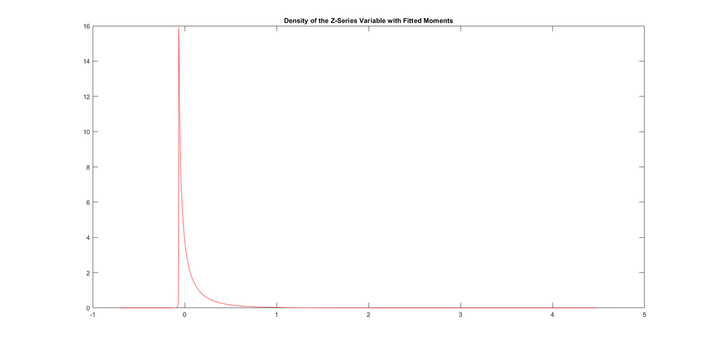
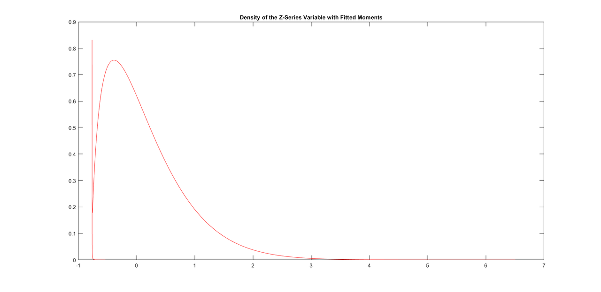
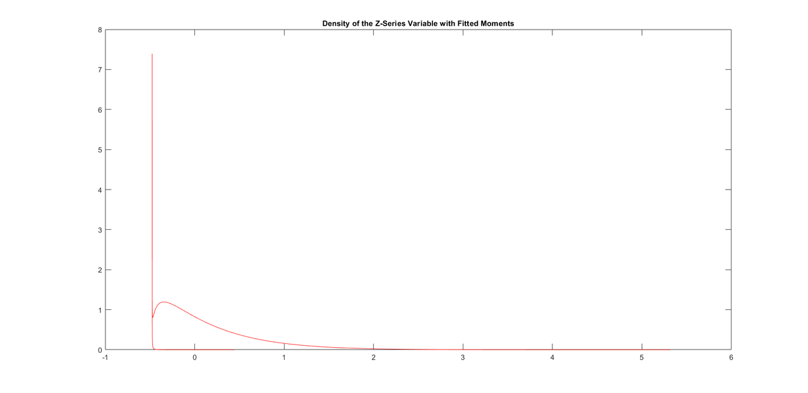

# Breakthrough in the theory of stochastic differential equations and their simulation

**Page 47 of 65** — Posts #2301–#2350

[← Previous](page_046.md) | [Index](index.md) | [Next →](page_048.md)

---

### #2301 — Amin (Topic Author)
*May 3, 2024, 5:36 AM*

Friends, even though polynomial reciprocal does not seem to be a perfectly good idea, I think there has to be some
research in the context of series solution of PDEs when we can use polynomial reciprocal and when we cannot use it. Even
though polynomial reciprocal might be less rigorous, we have other more rigorous alternatives like inversion or division
of polynomials by Taylor series expansions. In my previous research with SDEs solved with polynomial series, I freely
used Taylor expansion for expansion of functions in terms of polynomials  with perfect success. I will try to
investigate these related issues and associated limitations from time to time.

I think many friends might think of Taylor series as a valid alternative for series reciprocal with some limitations. At
least, it would be good to keep these possibilities in mind and use them when handy. Especially if a PDE has some
functions, they have to be expanded by Taylor series.

---

### #2302 — Amin (Topic Author)
*May 8, 2024, 1:28 PM*

Friends, past few days have been very difficult. After writing of previous post, I continued to be hit by bad food.

I am very over weight and quite concerned about it. Till two years ago, I would try to do my long morning walk
regularly. And it kept me from being further over weight. One of the major reasons for being over weight is that mind
control agents continue to kick the neurotransmitters they know out of their pathways using EM waves. It's the activity
of these neurotransmitters that maintains weight and causes us to lose weight by increasing metabolism. But when
neurotransmitters are kicked out of the pathways, it not only decreases metabolism , it also makes the victim to eat
more food in the attempt to somehow stimulate the brain. Please note that all coffee and tea in our country is drugged
on orders of Pakistan army so victim cannot look to these traditional stimulants to lift his brain. So my weight slowly
continued to increase.

I would love to go out for a long morning walk especially in months of the year when weather is pleasant, but they have
drugged water all over the city and it is difficult to get good water right away. I have to spend four or five hours
after every two days to get good water that I keep on myself. Even when I am working in the garage and our maid finds
opportunity, she quickly enters my room and drugs the water so the idea that to leave 20-25 liters of water at home and
go for a long walk is not a good one. Carrying water on myself is even bigger pain. So a morning walk mostly remains out
of question.

I recently found a traditional medicine formula to lose weight. The formula is basically ground powder of seven or eight
herbs/spices that has to be taken in very small amounts every day. Many of these are normal spices like star anise,
black cumin, cinnamon, Garden rue, common majoram, Bishop's weed and senna. I went to a traditional medicine/herbs store
to buy them about a week ago. At that time, I had been repeatedly hit by bad food and could not think perfectly well and
they had tracked the traditional medicine nd herbs store on my way. When the shop owner gave me the spices and herb, he
also added mind control drugs in it. I was enthusiastic to lose weight so took the powder every day for four days but I
noticed that when I would take the weight loss powder, my veins would start pumping which is a sign of mind control
chemicals going into the body. My weight decreased by more than three kg or more within three days but I also remained
disturbed due to mind control chemicals in the weight loss formula. It also stimulated my digestive system and I felt
far less hunger despite mind control. But when I realized that I was taking mind control drugs in it every day, I
discontinued it and decided to buy it again on spur of the moment somewhere else in the city after a few weeks. So I
hope I will start losing weight quickly again. But due to mind control chemicals, the whole thing kept me quite
disturbed and very unproductive.

I want to say that living under mind control is extremely difficult and everyday is a new struggle and everyday is a new
fight and consequences of losing this struggle are too bad.

Weather has not been very hot yet but there is a forecast of average increase of more than five Celsius in daily high
and more in daily low temperature within a few days so things would be extremely tough. I doubt that next two three
months would be very productive. Even last year, I was able to pick up work only in second half of September and summer
was extremely sluggish. I cannot mostly use air-conditioning especially in my room and there is extremely strong mind
control gas that follows when I turn on the air-conditioner in my room. There is also lighter mind control gas in
air-conditioners of other rooms and mostly it causes me to become drowsy and lethargic. The city is a concrete jungle
and during the most hot times of the year, one could be sweating even an hour or two before the sun-rise when the
temperature is supposed to be the lowest in 24 hours.

Nevertheless, I am determined to fight and look forward to continuing my research. Each day I learn something more
interesting. I will continue to work but I am afraid that work during the hot months would remain rather slow.

However, I am sure that every month, we would make some progress towards some research issue and would really try to
pick speed again in September.

Again I want to say that I am totally determined to continue my research on Schordinger equation and succeed in a
perfect solution. I have no qualms about trying hard or that we would finally be successful. I am just worried that my
speed in next few months might remain rather slow.

Another thing I wanted to mention that mind control agents continue to use methods that make mind control chemicals to
settle on my tongue and on inside of my mouth and the effect remains even after I brush since the chemicals seep into
the flesh. It changes taste of my mouth and causes me to remain slightly disturbed and very uncomfortable.

---

### #2303 — Amin (Topic Author)
*May 9, 2024, 11:23 AM*

Friends, I received an antipsychotic injection Fluanxol on this Sunday. And I have an appointment to speak to the doctor
on phone(since he is based in Rawalpindi). on Wednesday or Thursday next week. I am very afraid that mind control
agencies would ask the doctor to increase or change my forced medication. I want to request all good people to carefully
listen to my phone conversation with the psychiatrist. And I am very sure that doctor would find some excuse to declare
that I needed to be given more antipsychotics. They might try to change my medication to daily pills or syrup so that I
could be given different mind control drugs(added to pills or syrups) suited to retard the neurotransmitters that are
more active during that particular day.

If psychiatrist increased my medication or altered it, it might have a very negative effect on my research work.

I want to request all good people in America and Pakistan to please protest to the mind control agencies and the
psychiatrist involved and ask them to get me off all medication since I am perfectly healthy. I am asking good people to
help me again and please try to stop my life and my research from being destabilized again.

---

### #2304 — Amin (Topic Author)
*May 12, 2024, 4:27 AM*

Friends, there are many developments that I want to share today. I had mentioned several months ago that I had received
one million rupees from my father because I had told him that I wanted to invest them in crypto/stocks with my
algorithms. 1USD = 280 PKR. This was around August 2022. But instead of investing the money in markets, I decided to
continue my research and use the money on my daily expense. At that time, I still had not done hermite polynomial
regression and also had not discovered the hermite polynomial correlations. I continued to use that money and some other
minor resources and was able to make it till March 2023 with the money received from my father.

After completion of previous research work of multidimensional joint densities and conditional expectations, I decided
to work with Schordinger equation. But I have not been able to secure a reliable source of money and it becomes
difficult even to get decent food if I do not have enough money. I was quite enthusiastic about Schordinger equation but
it became difficult without some source where I can get enough money for my everyday expense.

I have therefore decided to take a break of about a month from Schordinger equation research and try to work on some
useful application of my  joint densities and conditional expectations project for a month or so. So that I can raise
some money from selling the program and then continue my work on schordinger equation.

I am therefore taking a small roughly month long break from my research on schordinger equation and use this time to
make some money so that I can support myself easily through the end of the schordinger equation research.

I hope friends will understand my situation and would be fine with this change of research direction for a few weeks.

Another very important thing I want to request friends is that I have a phone meeting with my psychiatrist in Rawalpondi
on this coming wednesday or Thursday and he might try to change my medication or increase it instead of decreasing it.
Please protest to the doctor, US defense and US government and ask them to treat me with with respect for my rights and
human dignity and not engage in anything unprofessional. Please help me in any way you can regarding this matter.

---

### #2305 — Amin (Topic Author)
*May 12, 2024, 5:11 AM*

Friends, I have been thinking about application of my joint densities and conditional expectations research to trading
and other related problems.

For example one way could be to try to find the joint density of one day ahead market and spot market variables and try
to predict the conditional expectation one day ahead given the knowledge/observations of spot variables today.

But many times we want to ask the question what are the specific spot market conditions today that cause a bull market
tomorrow. I think we can also answer such questions from our densities and conditional expectations work.

We would have to label all instances/days of bull market on our data. And similarly for all instances of bear market and
neutral market. Then we can make a joint density of data labelled as bull market on one day earlier market conditions.
And also make two other joint densities with data labelled as bear market and neutral market.

Suppose a simplistic case where we are using just one variable to predict tomorrow 's market and in that case we can
overlay graphs of one day ahead conditional expectation of a bull market, bear market and neutral market on the same
axis of today's market variable(which is one dimensional). This can easily give us a visual and qualitative clue to what
sort of variables cause a bull market, bear market and neutral market etc.

In reality we would not be conditioning on one variable and conditional expectation would be found with respect to many
variables. In that case again , we can overlay graphs of each predictor of tomorrow's market (these will be one
dimensional graphs for each predictor) for the three cases and find a qualitative feel for what conditions in the
predictor cause a bull market and what conditions cause a bear market and vice versa.

We would use the same common correlations (calculated form one complete set of data)  in three labelled scenarios since
there is no way of knowing before hand how to systematically alter any correlations across three scenario labels.
However there could be a possibility of altering correlations systematically using some mathematical rule (without
knowing the future value of market label) once we have gotten a qualitative feel of the data.

So with such simple tricks, we can do a large number of intersting things that are otherwise done with AI in a better
way.

I will not be posting a worked out program on this but will continue to post any remarks as I learn more on this work.

And if you want to use this research for prediction of your financial assets, I would love to sell my programs after
they are complete. You can approach me at anan2999(at)yahoo(dot)com or ahsanamin2999(at)gmail(dot)com

---

### #2306 — Amin (Topic Author)
*May 13, 2024, 7:27 PM*

Friends, I have been on forced antipsychotics for most of the time since early 1999. There were a few periods of a few
months when I remained free from antipsychotics. But other than two or three such periods, I have remained on
antipsychotics. It is very hard to feel well when huge antipsychotics are forced on someone who is mentally healthy. I
have also been detained forcefully tens of times whenever some of my neurotransmitters came back, the purpose of
detention was to take brilliant neurotransmitters out of my brain and send me back home with a relatively retarded brain
after the end of months long detentions. I have seen sheer trauma, torture and brutality on the hands of these
psychiatrists who connive with American defense and Pakistani military to declare me mentally ill so they can force
antipsychotics on me. I will be 51 this year and portion of my life that I lived under mind control has exceeded the
part of early life that I lived without mind control.

I have a phone meeting with the psychiatrist on this Wednesday or Thursday. And I am sure the psychiatrist will try
again to keep me under medication or even increase my medication. Even after a large number of people have become aware
of truth about mind control and accompanying persecution by the psychiatrists, most psychiatrists are not the least
worried that their wrongdoing is being exposed in public.

I want to request good Americans to please protest to American defense, mind control agency, Pak army and relevant
psychiatrists to please end this cruel practice of declaring healthy people on antipsychotics and forcefully detaining
them up to years in their faciiities.

I am copying some of the old posts so friends can see why and how I had to see torture, trauma and cruelties.

I am very worried that my persecution on hands of my country's army continues to increase. They really continue to try
their best to somehow make me get bad food so I cannot work properly. In efforts to deter me, mind control guy tell me
many many times a day that if I stopped working, they would stop their immediate persecution activity. Their persecution
activity really has to do with the fact that I have been trying to work hard and trying to make something out of my
research and they really do not like it especially because they think that due to hard work, I will take more
neurotransmitters from other parts of the brain in the catchment of central brain.

Since they are so determined to retard me, I am seriously worried that they might detain me sometime even though my
family continues to live normally and has not given me any such indication but I am still worried. Therefore I am
copying some posts from the past so that friends know the context of all of this very well.

Friends, mind control agencies and CIA continue to increase and perfect drugging of food in Lahore city. Almost all
available food in About 70% of the city is thoroughly drugged with mind control chemicals. Pakistan army has distributed
mind control chemicals in almost the entire city and everybody/every shop  who prepares food or snacks is adding mind
control chemicals to their prepared food. Small street Food restaurants, small stalls for snacks, shops of sweets, juice
shops all are adding mind control chemicals in their food in almost 70-80% of the city (This is among 25 largest cities
in the world). I have been holding on because I am aware of their tactics and have been extremely careful about what to
eat. I hope that I will continue to protect myself as far as getting good food is concerned.

But after spending several hundred million dollars in drugging Lahore city, mind control agencies are becoming nervous
since all their money spent might be a waste. And I really think their next move is to declare me mentally ill on some
flimsy premises and forcefully detain me at a psychiatric facility of their choice. I am very worried that forcefully
detaining me on flimsy psychiatric grounds is the next thing mind control agencies want to do next.

I have been saved several times from being forcefully detained due to protests of good American people in the past few
years. They used to detain me every year and sometimes even multiple times in a year before good people protested about
it. Due to efforts of good American people to protect me, it is my third year now that I have not been detained. I was
detained last time in early 2021.

When they detain me, they have fixed all mind control gadgets and lasers in the psychiatric facility and they add all
mind control chemicals openly in food and psychiatric drugs. It is a very controlled environment in captivity and within
a month or so, they are able to remove all neurotransmitters from the brain of the victim. Every time I was detained,
they kept me in the psychiatric facility for 30-50 days. One psychiatric even detained me for ten months after I
returned from Britain. There are also instances of being detained for six months once and three months twice.

I really want to request American people again to please protest to their government and try to make sure that I am not
being detained again on totally flimsy psychiatric grounds.

Due to their relevance, I am copying some posts from before.

.

.

.

[My Letter To HRW About My Human Rights Abuse](https://forum.wilmott.com/viewtopic.php?f=15&t=102298)

Above is a very incomplete account of how various psychiatrists continued to play in hands of Pakistan army to retard
me. It also does not cover all the time till year 2022 and the account stops several years earlier. I could not write
about last several years that were exceptionally brutal.

Friends, in a previous post I told friends how staff at a lady psychiatrist's hospital started beating me and abused me.
During past twenty three years, there have been many many instances of my obvious abuse by different psychiatrists. I
will describe some of those instances in this post.

When I came from United States and till fifteen years after that, my father would proudly ask me that I could see any
psychiatrist I wish. This was because Pakistan army was managing my persecution and they would force psychiatrists to
declare me schizophrenic and my father was told that every psychiatrist would be forced to cooperate. However, by chance
in 2016, I came  across a psychiatrist who was far better. I never told him that I was under mind control but whenever
he interviewed me, he always said after the interview that I was perfectly sane and mentally healthy. When my family
would force him to increase the dosage of antipsychotics, the doctor first told me that I should not live with my family
and make a comprehensive plan to support myself and become independent (such a plan could never work since Pakistan army
was threatening people in Pakistan to not give me any business and CIA was making sure that every contact I would reach
for work in Europe (and Singapore/ Japan /Australia) would be approached by CIA telling them that I was a very bad guy
and they must not do business with me. I had not told the doctor any such thing that intelligence agencies were after
me.)  When I told the good doctor how previous psychiatrists had abused me, he would tell me that this used to be a very
widespread practice in America hundred years ago to wrong mentally healthy humans by using corrupt psychiatrists as
instruments to detain them and strip them of their sanity. The good doctor I am talking about was American national with
Pakistan background who had practiced psychiatry in America for over twenty years and had returned to Pakistan. That
good doctor kept me on very low antipsychotics (1 mg resperidone per day) and that too on extreme insistence of my
family. It was only during that time of treatment by that doctor that I got my first break in research and I solved the
problem of high order monte carlo simulations (and analytic series solution of ODEs)  and posted that solution on this
thread. Ok, when my family was fed with the doctor, they detained me with another doctor. They detained me again two
years ago when I requested my family that I wanted to see the same doctor of my choice again( I have been detained every
year for past six or seven years by different doctors), they detained me through a different doctor. So my family now
stubbornly refuses to allow me to see a professional qualified American psychiatrist of my own choice and detains me
every time I try to approach him.

Now back to my obvious abuse by two other psychiatrists. I was detained by this doctor who was running a mental health
facility and was not a psychiatrist himself. At that time I did not use to walk very much and my blood pressure used to
be somewhat high. Since other antipsychotics had failed to retard me, doctor suggested I take aripperizole injections.
These injections affect the heart and also elevate blood pressure but doctor who wanted to retard me had no regard for
my health while pretending to cure me. In initial days of my detention, staff at the hospital when checked my blood
pressure told me high enough blood pressure in line with what I used to have but after I complained about aripperizole
and its effect on blood pressure the staff started doctoring blood pressure and started telling me that my blood
pressure was very good or even low. This is a post I wrote on another thread in this forum about it. How to safeguard my
research - Page 32 - wilmott.com

.

> Amin:
>
>
>
> Since I wrote about high blood pressure and mentioned high blood pressure before the hospital staff, they have started
to doctor blood pressure. Now, everyday they tell me that my blood pressure is 120/80 or 110/70. While they always told
me that my blood pressure was 130/90 or 140/100 prior to injections. I have never had so good blood pressure for years
that they have started to tell me now. Friends would recall a previous post when I could not sleep at night and had to
take a sleeping pill. When the dispenser came to me at night(The hospital has no MBBS who stays here at night in
Ramadan. Dr. AS used to stay here on some nights earlier but has been totally absent in Ramadan). When the dispenser
checked my blood pressure, he told me that it upper blood pressure is 110. I did not believe him at all. He asked me to
check on my own and put the stethoscope head assembly in my ears. I could easily tell that upper blood pressure was more
than 140 and lower was more than 100. The staff has already started to doctor blood pressure. My parents are going to
Saudi Arabia for two weeks in a few days. Now Dr. AS has the plan to hold me in detention while my parents are abroad. I
had a complete settlement with Dr. N and we(I and the doctor N) both agreed that I would be visiting him every fifteen
days and all modalities were agreed. I do think as a patient it is my right to choose the psychiatrist and Dr. AS( who
is incharge of facility Pav.) has no right to change the doctor after I have selected a psychiatrist and we both agree
on terms of any treatment. Dr. AS has imposed another psychiatrist Dr. M who has not even seen me and has already
started giving me injections and increased medicine without looking at my present condition. Dr. N had explicitly stated
that I would be free to leave if it were his facility. Most major reason for detaining me now is that Dr.AS wants to
continue to detain me while my parents are leaving for abroad for more than two weeks
>
>
.

Later after a few days, I was given a second aripperizole injection and released from detention. An injection was due
every fifteen days. My parents were in Saudi Arabia and I was living with my sister. She insisted after fifteen days
that I get a new aripperizole injection. I complained about too much side effects and other serious problems but my
sister insisted that I must get the injection. She talked to another doctor and the doctor told her that if his blood
pressure and pulse are fine, just give him the injection. I asked my sister that my blood pressure must be checked
before I get the new injection. We went to a small hospital close to her house and when my blood pressure was checked my
lower blood pressure was 110. The hospital staff recommended that I stay at the hospital in their care until my blood
pressure decreases. It was a totally random blood perssure check. When hospital staff came to know that I had been given
aripperizole injections, they told my sister to not give me those injections any more. My sister asked the staff to
relieve me and we came home but I was not given aripperizole injections after that.

But this is interesting that the psychiatrist was initially desperate to prescribe aripperizole despite that I had told
him about my heart and blood pressure problems and his staff was asked to doctor blood pressure so that I would accept
the injections.

Good thing is that only after stopping aripperizole, I started my treatment with good psychiatrist  doctor Naeem Aftab
(who is an American national) and he gave me enough relief that I was able to get a break in my research and solve the
problem of high order monte carlo simulations. I would always be thankful to Dr. Naeem Aftab for giving me relief at
such a crucial point in my life.

Yet another experience for abuse was with a seasoned psychiatrist who is known for his connections with Pakistan army.
When army dictator Pervaiz Musharraf ruled the country, he made this doctor the dean(president) of the university of
health sciences which regulates most medical universities in Pakistan. He had treated me for three years in year 2001.
He started my treatment without interviewing me and gave me electric shocks at the start to jumpstart the therapy. I was
given electric shocks for fifteen days in early 2001. I still recall that doctor would place a wooden wedge between my
teeth and then give me an injection and I still recall how numbness would move in my body from feet to the upper body
after the injection.

When going to that doctor's psychiatrist facility in 2001 I had to travel from Kot Addu to Rawalpindi. My family had
given me some drug in my food and I became unconscious after an hour or so. I still recall how I was begging my younger
brother to help me that I do not want to go anywhere and if he could help me but he like everybody else in the family
refused. Slowly drug in food showed its effect and I have absolutely no memory of being taken in my father's car despite
that it would have taken him at least eight hours to take me to Rawalpindi. Psychiatrist did not interview me and
detained me and started giving me electric shocks. I still recall how I defecated in my bed there and they had to wash
it.

Anyway, I was taken to this psychiatrist in 2017 again. He was very clearly told that I had been given antipsychotic
drug larjactil by another doctor and it backfired and I had extremely severe drug-induced jaundice. But the doctor was
so haughty and cavalier and so desperate to retard me that he still insisted that I must get the same drug larjactil and
said that it was not necessary that it would cause jaundice every time. Problem for the doctor was that most
antipsychotics had failed to retard me and he wanted to give me some potent antipsychotic that had not been well-tried
on me. Though the drug was given to me earlier and later discontinued, the doctor wanted to take his chances to retard
me and he had no regard for my health. This doctor is a big crony of Pakistan army and really wanted to please the
generals and therefore he decided to give me larjactil again. And as would already be obvious to most friends, after two
weeks, I started to show all signs of drug-induced jaundice again and my body and eyes were all yellow. My Biluribin
shot like anything. And it took more than two months to control jaundice after that. Though my biluribin came back to
normal after two months, several less known enzymes in my liver remained disturbed for several years after that and
continued to show as abnormal in my liver function test reports.

I have been detained more than 30 times by various psychiatrists during past twenty-five years on orders of Pakistan
Army. This is despite that I have never been violent all my life. I have never hit anyone in my adult life and I rarely
speak with anyone in a loud voice. I have never done anything like breaking a glass or any utensils that is associated
with sick people.

Here, I will recall an incident eight years ago when I myself approached a lady psychiatrist for help and how she abused
me, and her staff beat me for twenty minutes and then tied me and started my treatment with antipsychotics again.

I am recalling this from early 2015. They had previously put me on extremely high antipsychotics and my creativity was
all gone. I could barely do any intellectual work. At that time, I was able to convince my family to decrease the
injections and they had agreed since I had already lost most of my creativity and intellectual capability. I think mind
control agencies were also thinking that I had lost my creativity forever and they wanted to see if it was right time to
decrease my drugs and still make sure that I would remain intellectually dull after injections had ended.

But I slowly started to work on my research and started to regain my brain. When mind control agencies realized that I
had started to do better research, they asked my family to do something again to retard me. My father asked a
self-stylized religious saint to come to our house and take care of me. He came to our house with one of his followers
and told me that he wanted to give me injections and I would go to sleep for 24 hours, and they would take scans of my
brain to treat me, but I continued to beg and plead him, and I was able to convince him to allow me to leave the home in
my car. The supposed saint allowed me to leave since he was probably sure that he would get me later as I had no other
place to go other than my home and, therefore, I was able to convince him to let me go outside. When I left the house, I
made posts about the saint on at least two different forums from outside my house and pleaded for help. Enough people
were following my story even at that time and the saint had to leave. I also called my father when I was outside and
protested against this.

My family still remained very tense with me, and I was very afraid that they would force antipsychotics injections and
mind control drugs on me therefore I stayed one night out of the home. Here is the post I made when I was away on April
14th, 2015, 2:09 pm

[viewtopic.php?f=15&t=94796&start=315#p748191](https://forum.wilmott.com/viewtopic.php?f=15&t=94796&start=315#p748191)

"I am staying out of my home for the night since I had realized that my father will try to force me into detention again
and I would request a court tomorrow for stay order to stop my father from hospitalizing me forcefully again and I would
request the court that if there has to be a check on my mental health, it has to be done and investigated properly by a
psychiatrist of my choice and I should remain free at the same time. I do not want to be at the mercy of my father's
chosen psychiatrist as we saw in the past year that they continued to quote mental health laws and forcefully manipulate
me into taking injections. If my father forcefully hospitalized me, I would be cutoff from the outer world and they
would do whatever they like. My father's self-stylized saint(peer) had already hinted that he wanted to give me
injections that would put me to sleep for 24 hours and he had no argument for my mental sickness at all.”

Next day, on April 15, 2015, I went to Lahore High Court to find some help but I was told that I had to submit an
application that would be considered several weeks later when its turn would arrive. When I realized that there was no
possibility of help from the court, I decided to see a psychiatrist on my own. I was driving in Garden town Lahore where
I came across B**** psychiatric clinic and decided to see the psychiatrist Dr. N*** there. It was evening but the
psychiatrist still not had arrived there. I waited for an hour in the reception and then had a consultation with her. I
asked her to listen to my case carefully and then decide if I was sane enough and tell my parents about it. She said
that I seemed perfectly fine and asked me that she wanted to hear what my family had to say. I agreed and took an
appointment to visit her again at April 20, 2015. I took my mother on the planned day and my mother did not have
anything decisive to say about any disease other than that I did not eat at home. The psychiatrist asked me to visit her
after one week on 27 April 2015. The next week when I went again to visit the psychiatrist, on April 27, and was sitting
in the waiting room so that I could visit the psychiatrist on my turn. Another lady who was a psychologist came to me
and asked me to go with her in a different room to have a session with psychologist but I declined and said that I was
only interested in seeing the psychiatrist who had promised to see me again the earlier week. After five minutes, at
least four men came to the room and started besting me. They gave me slaps on my face with full force and gave me blows
and they continued to do it for more than fifteen minutes. I had never been beaten like that ever before in my life. All
this time, I was simply trying to raise my hand to somehow protect me. Since I was sitting on the sofa, only my face and
head were the target of slaps and blows. They were very violent with all sort of slaps and blows on my face as I earlier
mentioned that I was sitting and they were standing. . They literally continued to beat me and I continued to beg them
to stop. After fifteen minutes of beating me, they tied my legs and lifted me and put me on a bed in a room in the
psychiatrist facility and told me that doctor had gone to America and she could not see me. It was a complete lie and
the psychiatrist was in her office and was interviewing other patients when I arrived. I continued to ask them to loosen
the knots but they continued to make fun of me. I was totally surprised since Dr. N had behaved very nicely in the
previous meeting held at 20th with my mother and myself and I was sure she would declare me mentally sane on this
meeting. After I was kept tied for about half an hour, a new guard came and opened my hands and legs and said that they
would keep me at the facility for three days. The next day my medication in the form of pills started and I was also
given two more injections. I was given about nine pills at night and about eight pills in the morning. I was still not
given the opportunity to meet the psychiatrist N, and I was told several different things by different people including
that psychiatrist N had gone to America, and she had gone to Islamabad. About three days into my treatment, I saw
through the glass walls that psychiatrist N was interviewing her clients in her office. After seven days, I was asked to
meet psychiatrist N, and she said that she was unaware of the beating as she was in a meeting. Psychiatrist N also
assured me that I had no schizophrenia and previous doctors had very wrongly diagnosed me but it was a case of some
mania that she would properly treat this time.  Her staff continued to say that they were giving me drugs so that the
effect of other drugs given to me by previous psychiatrists would decrease.

Before my computer was taken away from me, I was able to take notes for two days in the hospital on my computer that I
write here. After first two days of medication, I was so extremely weak that I could barely walk and I had extreme
difficulty speaking.

“My Diary for past two days.

4/27/2015

I had two sessions with the doctor N previously on the 20th of April and once before at 13 or 14th of April. I remained
away from home during this time and second meeting on 20th of April, evening after the night when I remained away from
home. I had told the doctor about my circumstances in the first meeting with her. She had said that I looked perfectly
fine mentally but she needed to talk to my family. On 20th of April, I took my mother for a second joint session of
myself and my and the psychiatrist said, after the meeting, that said she really could not call me schizophrenic but she
needed one more sessions and asked me to come to her facility on 27th of April.

When I arrived at the psychiatric facility, a psychologist had asked me to accompany her which I did and on the way to
the her room, I asked for the reason, after which she replied that she wanted to take a session of mine. I told her that
I already had a session with another psyc hologist and also with a psychiatrist so I would prefer to have a new session
with the psychiatrist now. She agreed and I returned to the waiting room. I was sitting on a sofa in the waiting room on
27th at 8:00 PM (PST) in the line to see the psychiatrist when about five guards took control of me, while I was sitting
on a sofa in the waiting room to see the doctor, and gave me an injection. I was beaten and my legs and hands were very
strictly tied for more than hour. Though the doctor was in her consultation room and a lot of people were waiting to see
her, I was told again and again that doctor was not present at the facility.

In the previous two sessions, she had given the impression I was healthy mentally but she used force without
interviewing for the third time or seeing me and without requests to comply. If she was given any special information,
she should have talked to me about it and she should have verified with me any change in circumstances.

One injection was given around 8 PM when I arrived for third session with the doctor N. I really think that the doctor
was there since there was a large rush of visitors and her SUV was parked in the hospital but everybody among the staff
continued to say that doctor did not come to the facility this evening.

I was kept tied for more than one hour. I was taken tied from the waiting room to my room. All these rooms have video
cameras so you can ask Dr. N for a video of the events though she might make the excuse that cameras were not working.
One of the staff had mentioned when they brought me into a patient room in the facility, that everything was watched by
cameras.I would request people familiar with the matter to request her to show them footage of the cameras. Of course,
there could be many excuses that cameras were not working but I insist that cameras were working.

Good Mental health facilities try to avoid treating humans like this.

Another injection was given at night before I slept.

and my internet USB device was also taken. They simply took possession of everything out of my pockets and also took my
laptop.

When I asked why they gave me injections, one of the staff told me you were ?hyper? and I was totally surprised since I
was quietly sitting on the sofa in the waiting lounge for the doctor. I was told that I would stay in the hospital for
three days. I am sure this matter can be resolved who is lying and who is truthful once you look apt video footage of
cameras in most rooms.

4/28/2015

One injection was given in the morning. One injection was given around noon. All injections were IM (given in the
muscle.)

Unknown pills(some pills in the morning +5 pills around noon + 3 pills at night) were given and I was told,? We will
tell you know the names of these pills only when you leave.?

Computer was returned today but I was told that we did not take your mobile and they continued to say we never took my
mobile. My mobile was never returned( despite I always keep my mobile on me.)

I was also not given my EVO USB device and I was told you cannot write anything on internet. However the USB device was
returned to my mother at night.

I was told today by the psychologist that doctor N had gone to America and will come back after seven days and only then
she would be able to see you. I was told we are adjusting your medicine and see what was a good medicine. I was told
they were discussing the drugs with her on phone and skype There were several conflicting statements about where Dr. N
was. Somebody said she was just out of city and had gone to Islamabad.

When I asked my mother who is living with me at the hospital, I wanted a second opinion, because of beating and other
irresponsible behavior of the psychiatrist, my mother would make all sort of excuses while the staff would say that you
cannot leave the hospital until Dr. N arrives who is currently out of country.

Earlier today, I was told that I would live at the hospital for fifteen days and later I was told that I would live at
the facility for seven days. When I was tied, somebody had told me that I would live in the hospital for three days
only.

My mother told me please do not write anything wrong on internet otherwise, they would take your USB forcefully like Dr.
A had done more than one year ago. The purpose was to threaten me to not write about any maltreatment so that the doctor
would continue to freely manipulate me.

7-8 pills were given in the afternoon and similar number of pills were given at night. At many times during the day, I
could barely walk and had extreme difficulty speaking.”

Friends, I have previously described several horror experiences with psychiatrists but there are many more such
experiences that I have not posted on this thread. Today I am going to describe a continuing experience in which the
psychiatrist did everything in his power to retard me.

This is from year 2004/2005. I had a sound logic at that time and I was working from Lahore at a job with a foreign
Japanese company that was paying me \$4000 per month. I was still on high antipsychotics and when high dosage of normal
antipsychotics did not work, in order to retard me, the psychiatrist employed a procedure that is not known in
psychiatric practice in any country. The psychiatrist would give me some drugs in a glucose drip every two/three days in
the operation theater. When I would be given the glucose drip, I would gradually start to lose consciousness and when
half of the drip bottle would have gone into my blood, I would literally be unconscious, and I would later be taken
unconscious to my hospital bed by the hospital staff and I would wake up several hours later on the bed in my hospital
room and I would be extremely weak.

It was such a frightening experience that I would shudder from horror as the day of this treatment would come closer and
continued to beg the psychiatrist to stop this treatment. The psychiatrist would say that he was giving me vitamins and
vitamins were always harmless. He insisted that vitamins had to be given to me. He never told me what drugs he gave me
that made me unconscious and never discussed it with me other than mentioning vitamins. The psychiatrist continued to
perform this procedure for several weeks after sometimes second or usually third day. Most people cannot imagine how it
would feel when the drug in glucose drip would go into my body and I would lose my senses. To this day I shudder from
complete horror and recall the extremely sick feeling when I would slowly lose consciousness.

Now when I look back, I realize that they were giving me mind control drugs in the drip to take the intelligent
neurotransmitters out of my body. They continued to try to take intelligent neurotransmitters out of my body again and
again through this procedure for several weeks. I was completely helpless before my family and the psychiatrist and had
to go through such unlawful medical procedures.

As friends would have realized that purpose of mind control agencies was always to retard me since neocon scumbags of
pentagon and their backers were not capable of appreciating my humanity and did everything in their power to retard me
with an iron fist.

I have seen continuing pain, trauma and torture in my life only because I had some special neurotransmitters that people
with hatred and venom were not ready to let me have since they considered it a threat to let a Muslim have those
neurotransmitters.

After starting mind control in Lahore in early 2000's, bad jews (again apologies to good jews) were very emboldened how
easy it was to manipulate army and government in Pakistan to start mind control of intelligent people in Pakistan. It
was a time when Pervaiz Musharraf who was an army dictator ruled the country. He was very ready to please the CIA in
order to get help from American army to prolong his illegal dictatorship in Pakistan. He fixed in place all the required
mind control infrastructure in all large cities of Pakistan to please American army who was playing in hand of bad jews
to damage the Muslim majority country.

When Americans rightly blame our country for terrorism, they must not forget that many neocon generals in American army
have played in the hand of bad jews and have made every effort to systematically destroy talent in Pakistan on a very
large scale using mind control technologies to keep it backward forever.

Mind control in Pakistan is ensured by top Pakistani army generals since they are given several hundred million dollars
by US army every year and the top brass of Pakistan army divides this money among themselves with bigger fish getting
larger share and smaller fish getting a smaller share. Therefore, mind control infrastructure in Pakistan is very
detailed and thorough.

From my own experience, there is very large mind control activity in Lahore and Islamabad, the two cities where I have
lived during the past twenty years. There are at least more than 500 mind control targets in Pakistan most of whom are
computer science majors.

Mind control in Pakistan and many other places increased dramatically like never before. We have in Lahore a huge
building called Arfa Towers where all the facilities for technology and IT companies were provided to attract new firms
and entrepreneurs and later Arfa Towers became a scene of mind control carnage since tens of aspiring computer
scientists and entrepreneurs were retarded and it became very easy for mind control agencies to find the talent since
the facility attracted talent and retard it. Time between 2008 and 2016 was like black death for talent in technology in
our country (I am not talking about pseudo-talent that American embassy continued to support and showcase heroically in
the meantime.)  I still recoil with horror when I look back and recall how difficult it was to get good drinking water
in Lahore during that time for more than six months in 2013-2014. I would have to go to remote parts of the city, go to
villages around the city and sometimes even go to other cities and only then I would be able to get some good water
after repeated attempts and my only worry during the day would be to somehow get good food and water.

At this point I like to tell friends that a lot of food and beverages that are drugged with mind control chemicals would
be eaten or taken by most of the population that is not on mind control and they would never notice any anomaly in taste
or any other effect since these mind control chemicals are inactive and inert and become chemically active only when
targeted remotely with precise electromagnetic wave frequencies so only target victims are affected and this is a very
cruel method to target intelligent people by drugging the entire supply of food and beverages and then focusing waves on
the targeted individuals to activate the mind control chemicals. Pakistan army and mind control agencies would drug the
entire public water supply and beverages knowing that the victim would have to drink something somewhere. Ground water
is also so thoroughly drugged with mind control chemicals that entire public water supply of the city and several
kilometers out of the city would be completely drugged with mind control chemicals. Pakistan army routinely does this in
Lahore city on behest of American mind control agencies.

Ten years ago, army soldiers and agents would go to markets to drug the targeted food and beverages with mind control
chemicals which they still. Large scale movements of soldiers and agents raise suspicions in general public and
therefore mind control chemicals are supplied to beverage and food manufacturing companies in Pakistan, and they simply
add the chemicals in food and beverages during the manufacturing process.

In Lahore city, there are more drugged beverages at any time than good beverages in small stores or large supermarkets
alike since most of the beverages are drugged at manufacturing source by coca-cola, pepsi-cola and Nestle.

Coffee stimulates the brain and the brain connects in new ways after taking coffee and good coffee creates problems with
keeping victims on mind control since their brain starts connecting in many new ways after taking good coffee. All
coffee and I repeat that entire coffee in the country present in the stores is drugged with mind control chemicals. Most
of the coffee on good stores is imported from foreign countries. I do not know how it works but importer is probably
told by army to drug the imported coffee before distributing it in the market. It is even very difficult or rather
impossible to get good coffee beans. Two or three years ago it was possible to find some brand of coffee that was good
by trying all new brands but it has not worked for past two years now for me despite that I keep trying. I even know of
instances that when I was able to buy good coffee of a certain brand from very large and posh stores, they took entire
coffee brand off the shelf from all their branches within two to three days. People know that Corrupt Army in Pakistan
that ensures mind control is more powerful than any political government here.

Tea used to be good but for past one year most mainstream Pakistani brands of black tea are drugged with mind control
drugs. This has still not caught up thoroughly like coffee is thoroughly drugged and it is still possible to find some
good foreign brands tea that is good.

All stimulant/energy drinks including red bull are well drugged at manufacturing source. Red bull was better till last
year but then it became drugged everywhere. I even tried it at remote places in several cities other than Lahore and it
has always been drugged lately.

Most of the soaps, shampoos, creams, toothpastes are drugged with mind control chemicals. I do not use shampoos or
creams but whatever rare I tried them once in a while they were drugged and they charged my skin. All of these have mind
control chemicals that charge the skin and make mind control extremely effective. Many people would be amazed when I
tell them that even though I would be in my full senses before washing my head and face with a soap but after washing my
head and face with a drugged soap, my eyesight would deteriorate and my conception of reality would completely change
and sometimes I would face extreme anxiety. It is hard to emphasize that even a small thing like this can completely
change the victim's state of mind and consciousness. Getting a good soap was very difficult for me till last year and I
would drive for several hours in different parts of the city especially looking at all the pharmacies on the way to find
some unknown brand or some soap that would have been manufactured several years ago when soaps were not getting
completely drugged. I tried all the soaps including beauty soaps that are specially made for women, even many unknown
brands, and specially imported soaps(which were all universally drugged thoroughly) and it was very very difficult to
find a good soap. After finding a good soap, I would keep it in my pocket all the time. This is a small thing but you
cannot live without it. Since our mouth is kept charged and some charges continue to go into victim's body from one's
mouth. Therefore toothpastes are also added with mind control chemicals to charge inside of our mouth. You can imagine
that after buying five or six tooth pastes of different remote brands, I would get a good tooth paste. I have recently
been using toothpaste that is imported from abroad and is good. Toothpastes manufactured in Pakistan are all drugged
with mind control chemicals.

Another big problem is that pharmaceutical companies add mind control chemicals to their drugs(pills etc). Most of the
mind control victims are targeted due to their talent and intelligence in mind many times might require special minerals
that are rare in our food.  Most of the mineral and vitamin formulas are also drugged with mind control chemicals. Most
mainstream mineral and vitamin pills in the market are thoroughly drugged with mind control chemicals. I never like to
take names but I would like to tell friends that greatest crook of all times is Glaxosmithkline( I would invite them to
sue me for writing this on Wilmott). GSK's mineral and vitamin formulas, effervescent calcium tablets, and toothpastes
are all drugged with mind control chemicals. There is a tablet by the name Kemadrin that has to be taken with
antipsychotics and GSK manufactures it and it is also drugged with mind control chemicals. My experience with GSK is so
bad that If I have to buy any medicine and if it is made by GSK, I would try my utmost to avoid taking it for the fear
of its being drugged with mind control chemicals and look for alternatives.

Injection fluanxol and clopixol are also drugged with mind control chemicals.

Again all this thorough infrastructure took more than fifteen years to develop in Pakistan and Pakistan army continued
to work hard to develop it over the years. There are at least five hundred brilliant Pakistanis most of whom are
computer scientists who are on active mind control to thwart them to contribute to society in any good way.

All this infrastructure exists in Pakistan and was developed because neocon generals wanted to please bad but rich jews
and American mind control agencies continue to perfect it over last twenty years. Again, mind control in Pakistan is
ensured by top Pakistani army generals since they are given several hundred million dollars by US army

I have not talked about special infrastructure that is used to project EM waves on the target and this infrastructure is
present on all major roads and public places in big cities and major highways and motorways in the country.

[My Letter To HRW About My Human Rights Abuse](https://forum.wilmott.com/viewtopic.php?f=15&t=102298)

Above is a very incomplete account of how various psychiatrists continued to play in hands of Pakistan army to retard
me. It also does not cover all the time till year 2022 and the account stops several years earlier.

---

### #2307 — Amin (Topic Author)
*May 13, 2024, 7:28 PM*

Before writing this post, I want to apologize to good jews but want to tell them there are enough evil jews who are
doing everything to tarnish the great goodwill jews have so rightly earned through generations of hard work and being
nice and kind to other people in the society. I want to request good jews to Please force these evil(jewish) people to
end the bad practices that are starting to take root in American and other societies on their behest and before it is
too late. I also really hope that my mind control would finally end(as I have been begging for past twenty years) and I
would never have to write a post like this again.

In the past, I continued to mention about my mind control persecution from time to time but only started writing regularly about it when I arrived in UK on a Highly Skilled Migrant work visa. Mind control agencies did everything in their power to fail me in UK. People were asked to not give me a job. People I contacted were routinely told brazen lies about me totally shamelessly. When I realized that I had no future in UK, I returned to Pakistan after a six month stint in UK. Since my hard earned money had thoroughly insulted mind control infrastructure in UK as they had to drug entire cities with mind control chemicals in UK (read briefly about it in my application to HRW in a previous thread) for a nobody like me and American government had to move all their grand and influential puppets in UK (again for a nobody like me) to force people to drug the manufactured food. British Banks went to the extent to steal my money to bleed me. Read here: https://forum.wilmott.com/viewtopic.php?f=15&t=102298#p857494. British police forcefully stopped me from seeing law firms(Brief details are given in my application to HRW attached as a link below).  Since my money had given mind control agencies a very tough time, mind control agencies decided to never let me make significant money after that. My old Japanese employer was told to not hire me after I returned to Pakistan. Whoever I would contact someone in Europe for job or consulting, mind control agencies would move American embassy infrastructure in that country and somebody highly influential (or army or secret services of that particular country)  in that particular country would approach my target employer and again brazen lies and fabricated stories would be told about me shamelessly. I am a fighter in life and I continued my research despite all economic, coercive and other hardships. All odds were against me but I tried my best to continue.  I have been presenting my research to friends on this forum for past five or six years. At this point, I want to request good American and friends from other countries who have come to know me through my research to please use their influence to end my mind control forever.

Since things might heat up after my writing this and my persecution might increase, I want to ask European embassies in
Pakistan to keep a vigil. I want to tell Europeans that my writing about mind control is in their great interest since
the very same people who instigate retarding of intelligent muslims are behind retarding of dozens of intelligent
europeans and once these people are exposed I am sure they will be far more careful in openly retarding European
talent(that they do not like).

I had told friends earlier that a jewish billionaire is Godfather of mind control. When my persecution started (in late
1997) at the university in New York which is a big time player in mind control of Muslims, blacks and foreigners, many
university officials were very pleased that they were getting written in good books of the billionaire jewish Godfather.
Though there are far richer billionaires in US who are staunchly opposed to mind control, they are not ready to shell
out hundreds of millions of dollars to bribe anyone to end mind control while mind control Godfather continues to give
large bribes to people to continue mind control. Many of the people related to defense in mind control are given
extremely high paying jobs in Godfather and his other jewish friends' companies after they retire from mind control and
Godfather is extremely generous towards them and it is well established and well known to scum in mind control that
after retarding muslims, blacks and others in their career, they will move to paradise(tens of people from army/Pentagon
who follow whims of Billionaire Godfather are given jobs paying milllons of dollars by Godfather and his jewish cohort
in several companies) after they retire. No wonder there is no let up in mind control whatever good people try.

We know in almost all classic folk lore stories evil is too strong and too sure of itself while good is mostly weak and
just trying to protect itself from evil who is bent on damaging and eradicating the weak and the poor good but it is the
weak and poor good that finally prevails. I want to tell good American friends that evil at this stage has become too
bold and thousands of talented people are retarded every year. And it is just not muslims and blacks that are on the
line, several hundreds of brilliant whites are retarded across United States by mind control agency every year that has
become too emboldened due to lack of any accountability. Thousands of foreigners are also kept retarded in dozens of
countries including many European countries.

My only intention behind this post is that I want mind control to end from our societies. I do not have any joy in
mentioning that there are some bad jewish actors behind it. In American society there are a large number of jews who
have excelled in the professions of science, education, medicine and have made great contributions to our societies.
There are a very large number of jewish professors each of whom would have taught tens of thousands of students on top
of making extraordinary contributions to body of human knowledge through their great research. Then there are
accomplished jewish scientists whose work, research and inventions make our everyday life better. There are great jewish
doctors and surgeons who would treat countless sick people and make them recover from disease. The list of contributions
of jewish people to humanity is very long and it continues. Then there are a large number of ordinary jewish folks who
are known for their goodness and civility to other people in the society. When we know all of this, we do not want to
say anything anti-jewish to hurt the feelings of so many good jewish people. But I still have to say there are really
some bad people who are unconnected with most of the nice and accomplished jews and they instigate and continue cruel
mind control torture on talented people of other ethnicities, religions and countries based on their personal dislike
and hatred. My purpose is only to end the mind control victimization and torture on otherwise nice and talented people
and I do not have any hidden intentions beyond that. And I am sure American society knows very well about the
contributions of good Jews to both their country and broader humanity and my exposing some bad actors would never have
any bad effect of any kind on these good and nice jews who we all respect and who are our role models.I want to tell
friends something I have said before here that I am sure American society would eventually end the menace of mind
control from their and other countries. I want to request all good Americans and Europeans to come forward and invite
any investigative journalist you know to read my threads and ask them to help end the menace of mind control in our
societies through their investigative journalism. Without any accountability evil will continue to grow stronger and
then mind control would start to threaten even those people who consider themselves safe due to affiliations, status or
wealth.

I want to request CNN, New York Times, Washington Post, Al-Jazeera and large reputed European media outlets to run a
comprehensive story on mind control torture, retarding and victimization of intelligent people of US and other nations
by scum in US army on behest of some powerful people in United States and due to rightwing extremist biases of these
scumloads. If you would like to do investigative research about animal practices of US army, one great resource would be
mainland European embassies in Muslim countries who keep a detailed account of mind control persecution of intelligent
muslims in these countries by scum in US army. Many of the staff in mainland European embassies are very good human
beings who abhor such practices and would love to cooperate with good journalists in exposing the evil animal practices
of US army scum. Only the accounts of people at mainland European embassies in muslim countries thorough animal
practices of American army's mind control wing would be enough to drop a great bombshell in the media and general public
all across the world. I want to warn all the good people who try to have a civilized dialogue with scum in American army
to end their evil practices that their being nice with US army scumloads is a very misguided approach. Since good people
do not have the power to forcefully end the evil practices of US army scum, only way to end the evil practices of US
army crooks is by exposing them openly in US public and all across the world.

It seems that scum in American army and mind control are unable to pay a heed to civilized calls by good American people
and others to end their animal cruel practices and remain bent on mischief. If crooks in American army and mind
control remain adamant on continuing evil practices, the only solution seems that some brave investigative journalists
expose them by running a comprehensive story on mind control practices by American army. It seems that doing a civilized
dialogue with hardened crooks in mind control gives them a strong sense of weakness of good people and makes the crooks
even more adamant to continue their evil practices.  Reminds me of Abu-Gharib. Very similarly, scum in defense had no
conception that they were doing any wrong thing when there was a culture of openly urinating on human captives. It was
an open thing in army and most scumloads thought it was indeed a very right thing to do( and I am sure some of those
crooks still believe that it was a right thing they did even after being reprimanded by the broader American society).
It was not until brave people at CNN did a daring story against animal practices by crooks that evil practices stopped.
Though American army scumloads retard intelligent people of all color and creed, these ultra right wing army scumloads
love to retard blacks and muslims with great relish. Blacks are only 8-10% of US population but make a very large
proportion of victims in united states since many ultra right wing scum in US army would rather die than let those
intelligent blacks succeed in American society in a big way.

---

### #2308 — Amin (Topic Author)
*May 15, 2024, 12:45 PM*

Friends, I have a phone meeting with my psychiatrist tentatively at 12:30 pm tomorrow. I hope this meeting goes well. I
have other technical things to share about trading as I learnt some new things recently but will come back tomorrow
sometime after the phone meeting.

---

### #2309 — Amin (Topic Author)
*May 15, 2024, 6:04 PM*

Friends, I have been working with daily stock data to trade on a daily basis. I wrote a program with enough success and
want to share its basics with friends.

First of all, we must notice that cross-sectional correlations might be quite stable but correlations across time (in
days) to predict the future are quite cyclical (and continue to change from trending to mean-reverting and back and
forth) with quite small and obviously variable periods. When we take a small rolling window of two weeks to find
auto-correlations and other parameters, and try to predict the future direction of returns, mostly the period of
validity of correlations is already about complete and correlations are already transitioning from one phase to other so
we usually end up with poor forecasts.

So to some new ideas. First, I deal solely with log returns in prediction part of my program and raw stock prices are
used only to calculate profit/loss on trades.

Intuitively, In a small data set of 14 working days or so, if the market is trending, it is likely that average return
will be reasonably large. On the other hand, if the market is mean-reverting, average return would be smaller.  we
compare absolute returns without signs. I thought of a measure of mean-reversion should be calculated as ratio between
absolute average return and standard deviation. This should work well for small samples only. We call this
mean-reversion statistic.

Again we do not want to use correlations from past 14 days or so since market might already have switched in 14 working
days. We want 2-4 days of recent returns to tell us what state of market is by comparing these returns with previous
market average. Therefore, a better technique could be to divide the 14 day data in two groups. A front group of roughly
three elements and a back group of roughly eleven data points. We compare mean reversion statistic of these two small
groups on front and back. If abs(mu)/sigma is smaller in front group, we learn that market is mean reverting phase. And
same logic for trending market i.e. if  abs(mu)/sigma is larger in front group, we learn that market is in trending
phase. We take sign of mu (mean of returns) in front group and if market is trending, we trade in direction of this
mean, mu and if market is mean-reverting, we trade against the sign of this mu in front group.

With this simple strategy, I was able to get returns of more than 50%-100% per year in a large number of liquid stocks
though not on every stock. I did not pay any commissions and there was one trade everyday that lasted from stock market
open to stock market close on every working day.

This is a basic idea and can be improved in so many different ways. I got information about state of market only from
stock in question and we should rather find this information from weighted average of large number of stocks correlated
with stock in question being traded. Other layers of information can be added to the algorithm. Overall, I thought that
this was a good start towards a highly refined and very successful algorithm.

---

### #2310 — Amin (Topic Author)
*May 17, 2024, 1:52 PM*

Friends, I had mentioned about my coming phone meeting with the psychiatrist a few days ago. It was supposed to be held
yesterday but psychiatrist was late and we had to reschedule it for today.

When we had the meeting at around one today, I politely told the psychiatrist that I was doing well, and my research was
also going very good and I was taking care of all the needs of my mother and would drive her everywhere for her chores
and for her other routines on a daily basis whenever needed. I was thinking that the psychiatrist would be fine but the
psychiatrist instead told me that he wanted a full Fluanxol injection to be administered to me right today and that he
wanted to increase the frequency of injections.  I was shocked and asked the psychiatrist why he was doing that despite
everything seemed good. Psychiatrist told me that my sister's version of reality was totally different and she said that
I had become sick again and I was not doing any research. Instead my sister claimed that I remained busy with my
computer all the time hiding myself from reality and was not doing anything that was worth anything at all. She claimed
that I was wasting my time and this had to be stopped and I needed large amount of medication to make me healthy again.
Doctor was not willing to listen to anything I said but I tried to assure him that my research really had value and I
told him that I would arrange for references about my research from some very good people from some of the best
universities in the world. Hearing that, the psychiatrist backed slightly on his program to inject me and we decided
that if I can arrange for a few references from professors in some good universities till 15th of June, he will end my
medication otherwise, he would really have to highly increase my medication.

I am happy that present psychiatrist is better than many of the earlier psychiatrists that when you present a good
argument to him, he is ready to listen to you so I am thankful that he gave me a chance to prove that my research is
really worth something.

Here is a picture of his assessment after today's meeting

You can read the following comments on the assessment.

"Show me the output of research in last one year. Either we stop the treatment or we enhance the treatment."

.

[](./download/file.php?id=10380&sid=1aaca9c836d2cb0b5f9bf3e6a2037b94&mode=view)

I have been posting my research on this forum for more than seven or eight years. I have never demanded anything in
return other than trying to earn sympathies for victims of persecution like me. I believe a good thing is its own
reward. But today, I want to request friends who ever appreciated my research to please come forward and write an email
to the psychiatrist about quality of my research. I would be very thankful if when you write an email to the
psychiatrist, please drop a small message to my email as well and please wail until I respond to your email(as I promise
to do). This is to ensure that no message is stopped in its tracks by any agency. Please act to end the decades of
injustice that was meted out to me. This is my request to good people who are professor at universities who have
appreciated my research and who are in a position of good authority at some investment bank or hedge fund etc. Please be
kind to drop me a small note as well so I would know and I could respond to let you know that your email has been
received ta my end. I have noticed irregularities with my yahoo account so please cc both of my accounts.

The Name of the Psychiatrist is: Dr. Fareed Minhas

       Email  of the Psychiatrist is: minhas(dot)fa(at)gmail(dot)com

My email is :  anan2999(at)yahoo(dot)com

                      ahsanamin2999(at)gmail(dot)com

---

### #2311 — Amin (Topic Author)
*May 20, 2024, 8:03 AM*

Friends, I am going to individually email the letter below to all people at MIT who are associated with Probability
theory, Statistics, Math-Finance and SDEs in their Mathematics, Computer Science, and Business school departments.

Good universities are at the vanguard of discovery of knowledge and intellectual activity in good universities is
supposed to lead the direction of national thought in their countries. It is due to this reason that I am writing to
accomplished people at MIT so the problem of mind control would get some more exposure where needed and good people
would increase their efforts to end this menace of mind control from our societies.

I invite people from all over the world who know about mind control in their respective countries to please also
approach good people in American universities and tell them about stories of horror and cruelty so they would be more
willing to ask their government to stop mind control of innocent civilians.

I also want to say to people all over the world that in general Americans are some of the best people and very good
human beings in our world, but decades of wide spread corruption in American defense has bred large number of scumbags
there who are responsible for the evil of mind control all over the world. Let us together defeat these evil people and
end this menace of mind control from all our societies forever.

Here is my letter that I am going to post to around a hundred people in MIT as I mentioned earlier. Another reason for
posting this letter is that scumbags of American defense openly stop everybody's emails. They even stopped my tweets to
dozens of American senators when I asked for help about mind control. When I was in UK, I sent an email to all the
members of upper and lower house of Parliament asserting that I was totally innocent but every single email was stopped.
I also want to tell friends that I will not send a single mass email and will send all emails individually one by one.
So if friends do not receive email from me, please know that they must have blocked the email.

Subject:  Please endorse my research (on merit) and help restore my human rights.

Dear Dr. ---------,

I hope you are doing well and are doing interesting work and research.

I am a private researcher in mathematical finance and probability theory from Pakistan. I have been posting my research
on famous financial discussion forum Wilmott.com and my nick on forum is Amin.

A sample of my recent research project output here: https://forum.wilmott.com/viewtopic.php?t=99702&start=2235#p880319

I have been presenting my research in the form of worked out Matlab programs for more than past seven years. During last
year, I presented a method to construct analytic multidimensional joint density of correlated random variables from
parsimonious data (as little as 50 joint data points in 2-10 dimensions or more) which is very close to true density and
converges to true density as data points increase. You can use this setting for high dimensional conditional
expectations and non-linear regressions between multivariate data elements. In most of the cases, the new method handily
beats regressions and conditional expectations from sophisticated Artificial Intelligence and Machine Learning methods.
The method is based on Hermite polynomial representation of random variables. In our new method correlations are not
specified directly between random variables but rather between Hermite polynomials of same order associated with
different random variables.

Please let me come to the humanitarian part of this letter explaining why I am emailing you, and begging for help.
American defense retards innocent and talented people, researchers and entrepreneurs in our country to please the Jewish
lobby. I am sure many good and kind people would be in disbelief about my statement so please read here:

https://forum.wilmott.com/viewtopic.php?t=99702&start=2295#p881259

Since bad jews consider my country a threat to Israel (which is not true at all), there is a huge Mind control network
in Pakistan established by American defense that retards almost everyone in my country who tries to do anything out of
the ordinary in applied math and Sciences. I want to explain that I am not a fundamentalist Muslim. I do not even
believe in religion and I am looking to read more about evolution of life on earth and strange cosmic phenomenon in
remote galaxies all the time but thoroughly mediocre people in American defense want to please bad jews and earn the
kind of rewards that they otherwise can never even possibly dream in their life and thus the cruelty and torture
continues to increase.

Pakistan has a puppet government and it is actually ruled by its military force. American defense gives several hundred
million dollars in bribes to top military brass in Pakistan in exchange for continuing mind control of innocent and
talented Pakistanis in computer programming, and applied sciences. When victims of Pak military complain about cruel
mind control, petty psychiatrists who connive with military declare them schizophrenic. The corruption and lack of
professionalism in psychiatrists in Pakistan is extremely wide spread and can be imagined from the fact that the petty
and professionally criminal psychiatrist who declared me schizophrenic several years ago in connivance with Pakistan
military, pontificated several times to me that he had himself drafted the mental health law in constitution of
Pakistan. I have seen huge torture on the hands of psychiatrists over past 26 years. See hyperlinks below.

https://forum.wilmott.com/viewtopic.php?t=99702&start=2295#p881258

https://forum.wilmott.com/viewtopic.php?f=15&t=102298

Psychiatric torture on me and associated medication had decreased somewhat in last one year because several good people
in academia in United States repeatedly protested to American defense about her inhuman practices towards me and other
victims like me. Though the wrongdoing of psychiatrists did remarkably decrease due to pressure from good people in US
universities, the cruel and unprofessional psychiatrists are again ramping up antipsychotics on their mentally healthy
mind control victims. Please read here about my most recent consultation with the psychiatrist in hyperlink below:

https://forum.wilmott.com/viewtopic.php?t=99702&start=2295#p881346

In the latest meeting with the psychiatrist, after a long argument, I was able to get the concession if somebody in
academia at top universities in US could endorse my research as good, he would end my medication. I, therefore, want to
request you if you have previously followed my research or find it interesting when you look at it now, and if you also
think that it is world class research, please endorse it in a letter that I could present to the psychiatrist. I would
be extremely thankful to you for this favor.

Please also protest to American government and American defense to end cruel mind control of intelligent people all over
the world including US.

If you have been following my research, I will like to ask your opinion about it and would like to ask you to suggest
future research directions. If you need my help or opinion about problems related to your research, please do not
hesitate to ask and I would be more than happy to be of help.

Separately from endorsement, if you liked my research, please do reply to my message with your opinion so I would be
encouraged on my future research efforts.

I wish you a good week ahead,

Kind regards,

Ahsan Amin

---

### #2312 — Amin (Topic Author)
*May 20, 2024, 8:48 AM*

Friends, I want to say again that America is epitome of modern human civilization and Americans folks are some of the
best people on earth. Best American universities produce the greatest thought leaders in different countries all over
the world. From knowledge discovery to cultural indicators, rest of the world looks towards American universities and
American society.

So it is very painful to see that some bad actors in US are involved in something so cruel and inhuman as mind control
of innocent and intelligent people. One reason behind is that corrupt perpetrators of mind control in US continued to
mislead good people in US and elsewhere about their true intentions otherwise good people in US would never have allowed
any mind control anywhere. However I believe that this is a very right time when all good people should intervene to end
the menace of mind control from our respective societies forever.

---

### #2313 — Amin (Topic Author)
*May 21, 2024, 1:27 PM*

Friends, I stopped working on Schordinger Equation for a few months and we will go back to try the solution of N
electron problem in a few months as soon as Summers decrease a bit. I am determined to try for the perfect solution of
Schordinger equation,

In the meanwhile, let us solve some interesting problems in finance.

We want to start with hedging of exotic derivatives in terms of vanilla derivatves in our hermite polynomial framework.
I will come with precise details in a few days but briefly we know that an exotic derivative can be represented as a
series in Hermite polynomials. This hermite series representation would also be changing slightly with time. We will
deal with these issues in our research as we go further. But as a start we assume that we are given a hermite series of
the exotic derivative that we calculate from its PDF possibly by simulation and calculation of moments. Now we want to
hedge  this exotic derivative with some positions in the vanilla options/caps/floors. As I see and I will come with
detailed analytics in latex in a few days, if the hermite series representation of the exotic derivative goes to fifth
polynomial order, we will have to take six positions in one forward swap and five vanilla options(with different
judiciously calculated strikes) , with number of hedge positions equal to the number of hermite polynomials (including
zeroth hermite polynomial). This would solve for delta and vega of the exotic derivative.

We will solve for hedge calculations and hedge rebalancing for comparatively simpler derivatives in next few days and
then move on to more exotic derivatives.

I will make a detailed post and also upload a matlab program for this in next few days.

---

### #2314 — Amin (Topic Author)
*May 22, 2024, 9:52 AM*

First the basics of exotics hedging with single underlying. We will cover interest rate derivatives and multiple
underlyings later. I will post a working program in a few days.

Friends let us consider a permissible exotic derivative on a single underlying represented by X(t, T) . T corresponds to
maturity of the derivative contract and t is the present observation date.

We calculate probability density function or moments associated with the probability density function of X(T) as seen at
time t. This probability density function can be calculated from simulation of some appropriate model or in a model
independent way directly from the recent data of the underlying. Here I want to stress that distributions and associated
moments of various vanilla and exotic derivatives can also be calculated directly from the data.(For example in order to
calculate density/moments of derivative V(t,T) where t=0 and T=six months from historical data, we can collect daily
data for t=0 to 3 months and T= t + six months for three months and then construct derivative density( of V(t,T)=V(0,six
months)) and moments from that data. Of course many times you would have to be careful and judicious about range over
which a data has to be collected for above calculations. We will cover all these issues as our research progresses.

Once we calculate the pdf/moments of the exotic derivative and underlying, we would still have to be careful since this
distribution is changing over the life of the derivative as for example we advance V(t,T) from V(0,6 months) to next day
V(1 , 6 months) but we will cover these issues later. This post wants to deal with very simple basics. We will take care
of all details on top of our basics one by one later.

Suppose after calculation of moments of the exotic derivative, we represent it as a hermite series random variable as

$ V_x(t, T) \, = \,a_0 \, + a_1 \, H_1(Z)\, +\,  a_2 \,H_2(Z) \, + \, a_3 \, H_3(Z)$

After delta-hedging for the mean payoff associated with zeroth polynomial, we want to find hedges in terms of vanilla
derivatives so that volatility of the exotic derivative goes to zero (or very very small in practice)

We take vanilla options as hedging derivatives but we would have to be careful to choose them so as to minimize
collinearity. So their strikes have to be as apart as practically possible. For example one vanilla option can be
reasonably deep in the money, second could be ATM while the third could be reasonably OTM.

Let us suppose we are hedging$V_x(t,T)$ with three vanilla options$V_1(t,T)$ ,$V_2(t,T)$ , and$V_3(t,T)$ , whose hermite
representations are given as

$ V_1(t, T) \, = \,b_0 \, + b_1 \, H_1(Z)\, +\,  b_2 \,H_2(Z) \, + \, b_3 \, H_3(Z)$

$ V_2(t, T) \, = \,c_0 \, + c_1 \, H_1(Z)\, +\,  c_2 \,H_2(Z) \, + \, c_3 \, H_3(Z)$

$ V_3(t, T) \, = \,d_0 \, + d_1 \, H_1(Z)\, +\,  d_2 \,H_2(Z) \, + \, d_3 \, H_3(Z)$

Please know that all the three vanilla derivatives are on the same common underlying as the exotic derivative so they
share the same underlying Z among themselves and with the exotic derivative as well.

We want to take k1 of first derivative$V_1(t,T)$ and k2 of second derivative$V_2(t,T)$ and k3 of first derivative
$V_3(t,T)$ so that variance of the complete portfolio of$V_x(t,T)$ and$v_1(t,T)$ ,$v_2(t,T)$ and$v_3(t,T)$ goes to zero.

So we write the linear equations of variance of various hermite polynomial components going to zero as

condition for first hermite polynomial of the portfolio going to zero would be

$\, a_1\, + \, k1 \,b_1\,+ \, k2 \,c_1\,+ \, k3 \,d_1\,=\,0$

For second hermite polynomial of portfolio to become zero, we have

$\, a_2\, + \, k1 \,b_2\,+ \, k2 \,c_2\,+ \, k3 \,d_2\,=\,0$

For third hermite polynomial of portfolio to become zero, we have

$\, a_3\, + \, k1 \,b_3\,+ \, k2 \,c_3\,+ \, k3 \,d_3\,=\,0$

When above three linear equations are solved for three unknowns k1, k2, and k3, we would get the quantity of$V_1(t,T)$ ,
$V_2(t,T)$ and$V_3 (t,T)$ in our portfolio with$V_x(t,T)$ so that total local variance of the portfolio goes to zero.

So cost of the options that make the portfolio riskless till maturity would be price of the option. But we have made it
riskless only locally for a small time and we would have to re-hedge possibly everyday or as judicious to rebalance our
hedge according to changing probability density of the exotic derivative. We can use both real data or model simulations
with daily re-adjustment (as we will learn about it in later posts) of the hedges to calculate the cumulative cost of
the exotic derivative.  In reality there would probably always be a small variance due to model mis-specification,
parameter mis-calculation and parameter variance and other related factors.

---

### #2315 — Amin (Topic Author)
*May 22, 2024, 5:03 PM*

Friends, sorry for incomplete analysis in the previous post. We cannot deal with delta hedging separately and have to
include it in the same analytics. Please do carefully read the previous post for all the caveats mentioned and also for
the setting but I will repeat the main analysis in this post.

This is still in works and we will have a final version of the analysis after all the analytics would have been verified
by a matlab program so some things in this analysis still might change.

Suppose hermite representation of risk neutral asset is given as follows

$ X(t, T) \, = \, \bar{\mu_X} \, + \bar{a_1} \, H_1(Z)\, +\,  \bar{a_2} \,H_2(Z) \, + \, \bar{a_3} \, H_3(Z)$

where

$ \bar{\mu_X}=\exp{(r (T-t))}$ which has to hold to avoid forward-spot arbitrage.

After calculation of moments of the exotic derivative, we can represent the exotic derivative (whose hedges have to be
found) as a hermite series random variable as

$ V_x(t, T) \, = \,\mu_{V_x}  \, + a_1 \, H_1(Z)\, +\,  a_2 \,H_2(Z) \, + \, a_3 \, H_3(Z)$

It is$,\mu_{V_x} $ which is the expected value (fair value) of the exotic derivative that we usually calculate out of
simulations. Rest of the coefficients represent variances of the expected value of the exotic derivative. Please note
that zeroth hermite is a point value with zero first order variance if uncertainty of the problem has been properly
specified.

We want to find hedges in terms of vanilla derivatives so that total payoff of the portfolio goes to zero and volatility
of the pay off the portfolio of exotic derivative plus the hedge instruments goes to zero (or volatility becomes very
very small in practice)

We take vanilla options as hedging derivatives but we would have to be careful to choose them so as to minimize
collinearity. So their strikes have to be as apart as practically possible. For example one vanilla option can be
reasonably deep in the money, second could be ATM while the third could be reasonably OTM.

Let us suppose we are hedging$V_x(t,T)$ with three vanilla options$V_1(t,T)$ ,$V_2(t,T)$ , and$V_3(t,T)$ , whose hermite
representations are given as

$ V_1(t, T) \, = \, \mu_{V_1} \, + b_1 \, H_1(Z)\, +\,  b_2 \,H_2(Z) \, + \, b_3 \, H_3(Z)$

$ V_2(t, T) \, = \, \mu_{V_2} \, + c_1 \, H_1(Z)\, +\,  c_2 \,H_2(Z) \, + \, c_3 \, H_3(Z)$

$ V_3(t, T) \, = \, \mu_{V_3} \, + d_1 \, H_1(Z)\, +\,  d_2 \,H_2(Z) \, + \, d_3 \, H_3(Z)$

Please know that all the three vanilla derivatives are on the same common underlying as the exotic derivative so they
share the same underlying Z among themselves and with the exotic derivative as well.

We want to take k0 of asset forward$X(t,T) - K$ , k1 of first derivative$V_1(t,T)$ and k2 of second derivative$V_2(t,T)$
and k3 of first derivative$V_3(t,T)$ so that variance of the complete portfolio of$V_x(t,T)$ and$v_1(t,T)$ ,$v_2(t,T)$
and$v_3(t,T)$ goes to zero.

Now we write the linear equations so that payoff of complete portfolio goes to zero and variance of various hermite
polynomial components of the portfolio goes to zero as

condition for expected value of the portfolio going to zero would be

$\, \mu_{V_x}\, + \, k0 \, \big[\mu_X \,- \, K \big]\,+ \, k1 \, \mu_{V_1}\,+ \, k2 \, \mu_{V_2}\,+ \, k3 \, \mu_{V_3} \,=\,0$

condition for first hermite polynomial of the portfolio going to zero would be

$\, a_1\, + \, k0 \, \bar{a_1}\, + \, k1 \,b_1\,+ \, k2 \,c_1\,+ \, k3 \,d_1\,=\,0$

For second hermite polynomial of portfolio to become zero, we have

$\, a_2\, + \, k0 \, \bar{a_2}\,+ \, k1 \,b_2\,+ \, k2 \,c_2\,+ \, k3 \,d_2\,=\,0$

For third hermite polynomial of portfolio to become zero, we have

$\, a_3\, + \, k0 \, \bar{a_3}\,+ \, k1 \,b_3\,+ \, k2 \,c_3\,+ \, k3 \,d_3\,=\,0$

When above four linear equations are solved for four unknowns k0, k1, k2, and k3, we would get the quantity of$X(t,T)$ ,
$V_1(t,T)$ ,$V_2(t,T)$ and$V_3 (t,T)$ in our portfolio with$V_x(t,T)$ so that total value of the portfolio and its
variance goes to zero.

So cost of the options that make the portfolio riskless till maturity would be price of the option/exotic derivative. So
our true exotic option/derivative price would be the cumulative cost of all the transactions that are required to make
the portfolio riskless till maturity.

We have made the portfolio riskless only locally for a small time and we would have to re-hedge possibly everyday or as
judicious to rebalance our hedge according to changing probability density of the exotic derivative. So true cost of the
exotic option would have to be calculated with some simulation with daily rebalancing or from summing (over the days of
the life of the option) the cost of hedging as calculated from hermite representations of V(t,T) inferred from
historical data as suggested in previous post.

Again, we can use both real data or model simulations with daily re-adjustment (as we will learn about it in later
posts) of the hedges to calculate the cumulative cost of the exotic derivative.  In reality there would probably always
be a small variance due to model mis-specification, parameter mis-calculation and parameter variance and other related
factors.

---

### #2316 — Amin (Topic Author)
*May 23, 2024, 9:07 AM*

Friends, as I think, my previous two posts should probably give an identical result. In the first earlier post, where I
used a hedge of three options to make the portfolio zero variance, we can include two options and one underlying asset
and still be able to make the portfolio zero variance.

In order to calculate fair price of the option, We just need to make the portfolio zero variance and increase the value
of any investments to support the portfolio of exotic asset and its hedges at the risk free rate over the life of those
investments. And total sum of these interest rate adjusted investments over the life of option would give us the fair
price of derivative.

What I did in last post with underlying asset and three options is probably not needed as the portfolio was already zero
variance. We do not necessarily need to take the expected values to zero. Again in my thread, we deal with problems that
do not have a known solution so some things can be off from time to time.

In this post, I want to discuss what is nearest equivalent of traditional delta hedging in our framework. We know that
dynamics of underlying asset X(t,T) are given as

$ X(t, T) \, = \, \bar{\mu_X} \, + \bar{a_1} \, H_1(Z)\, +\,  \bar{a_2} \,H_2(Z) \, + \, \bar{a_3} \, H_3(Z)$

while After calculation of moments of the exotic derivative, we can represent the exotic derivative (whose hedges have
to be found) as a hermite series random variable as

$ V_x(t, T) \, = \,\mu_{V_x}  \, + a_1 \, H_1(Z)\, +\,  a_2 \,H_2(Z) \, + \, a_3 \, H_3(Z)$

We can just take k0 amount of underlying in the hedge so as to neutralize the first hermite polynomial of the
exotic/vanilla derivative as

So the equation of first hermite polynomial going to zero in a portfolio of two assets would be

$\, a_1\, + \, k0 \, \bar{a_1}\, =\,0$

$ \, k0 = \, \frac{-\, a_1}{\, \bar{a_1}}\, $

So with above calculated value of k0, we get something nearest equivalent of traditional delta hedging.

With above hedging, the portfolio of asset and its hedge would still be vulnerable to adverse movements of higher
hermite polynomials and therefore some premium has to be added to expected value by the option seller since he is still
bearing some unexposed risk from this partially hedged trade.

 Even if traditional delta-hedging were more perfect, it would not be possible to hedge three independent modes of
variance using just one underlying so options must be sold at a premium over traditional delta-hedged "risk-neutral"
price. There is more unhedged risk that option seller is bearing and has not been able to eliminate it with delta-hedge.

---

### #2317 — Amin (Topic Author)
*May 23, 2024, 6:12 PM*

Friends, there are also other challenges that we have to solve in our research effort towards use of hermite polynomials
in options and derivatives pricing. For example one of the problems is that options have a payoff with discontinuous
derivatives and we have problems in finding a faithful hermite series representation of this payoff especially at the
point of discontinuous derivatives.

The hermite series representation of options is usually fine in the body of the option but is not very well behaved
across the discontinuity and would lack precise accuracy required for derivatives pricing if used as such.

But I think we can find an extremely close hermite representation of the modified option payoff that has continuous
derivatives, varies very slightly at the discontinuity point and is smooth across it and also has exactly the same
expectation and variance as the original option with discontinuous derivatives.  This modified payoff would be exactly
the same in the body of the option but would be slightly different at discontinuity (of derivatives) point and it would
have smooth derivatives.

Please let me work on it for a few days and then I will come back with a matlab program to do this.

---

### #2318 — Amin (Topic Author)
*May 23, 2024, 11:07 PM*

Friends, I have been able to find smooth densities of many call options with hermite series. I have used a new technique
to find these densities with discontinuous derivatives of the option payoff.

For a call option at expiry, coming from positive infinity towards negative axis, the derivatives of option payoff
follow the asset derivatives till the strike price (on the right side of the strike) and then abruptly go to zero. I
differentiated the asset Z-series and then multiplied these derivatives with series expansion of analytic heaviside step
function to convert the derivatives to zero just a little left side of strike on asset axis. Then I integrate this
expression to convert it back to call payoff. I still have to fix its median since constant of integration has to be
exogenously specified by me out of analytics. The whole thing seems to work well and I will come back with a latex
explanation and a matlab program in a day or two.

meanwhile just a few raw densities of options with the method are given below. They are all centered at zero since
constant of integration has to be specified that will shift the option to its proper place on asset axis. Here are some
raw graphs.

Graph of density of An OTM option   from its Z-series. Graph is still centered at zero and its center has to be
adjusted.

[](https://postimg.cc/FfdPvM3H)

Graph of density of An ITM option  from its Z-series. Graph is still centered at zero and its center has to be adjusted.

[](https://postimg.cc/McC9p9mb)

Graph of density of A roughly ATM option from its Z-series. Graph is still centered at zero and its center has to be
adjusted.

[](https://postimg.cc/QFn6R8Bz)

---

### #2319 — Amin (Topic Author)
*May 25, 2024, 6:50 PM*

Friends, when I investigated the above method further, I realized that for several options it was not working well at
all since series expansion of analytic Heaviside function was getting worse at points away from the strike. So I decided
to change my strategy.

I directly calculated the moments of the option prices with different strikes when the asset is given by a Z-series.
These are basically truncated moments but modified so that density integrates to one. We apply the same normalization
factor to truncated moments that we apply to the density. This follows from conditionality or Bayes formula. After
calculation of first eight moments of the option prices, I went ahead and converted the moments into density of option
prices. We model options as assets in themselves that have a density starting at zero on option price axis (as opposed
to asset axis where it starts at strike). I noticed that for a large number of CEV like densities of assets, the match
to moments of call option prices was perfect and all eight moments perfectly matched all the time.

I used a lot of programs from previous work. For example for calculation of moments of option prices, along with
binomial formula,  I used a routine that used the moments of Z-series but substituted moments of standard normal with
moments of truncated normal. I also matched my calculated moments with simulation and found that first six moments had
an almost perfect match. I think simulation was off for higher moments (eighth moment of option prices involves 64th
moment of the truncated normal) since I used an automated routine that calculated any moment of option prices on the
same algorithm.

I really think that this method of calculating densities and Z-series of options is going to work very well. I will be
posting my code and the matlab program in another day or two and also explain the logic with latex equations in a day.

---

### #2320 — Amin (Topic Author)
*May 26, 2024, 10:46 AM*

Friends, sorry for this but I have taken a small break to work on a new algorithm for calculation of Z-series from
moments. While we have been working on some things like this for years now but previous work has its obvious flaws. Root
search method does not converge many times and other approximate methods also remain off at times.

I have been able to think of a totally analytic and very stable recursive method to calculate the moments. It calibrates
variance first with coefficient of Z and then adds effect of skew by adding coefficient of Z^2 and altering first
constant and while keeping variance of the system constant. Then it adds a third coefficient and alters previous
coefficients and keeps variance and skew constant while matching kurtosis. It continues to add a new coefficient and
calibrates a higher moment all while keeping previous moments constant.

All of the perturbations are based on sound mathematical analytics (unlike previous smoothing stuff) . If the data is
such that all moments could not be matched, you can specify that first four moments must be matched at all cost and rest
as closely as possible.

I was always a bit unsatisfied with previous programs to match moments of Z-series but I hope that this new program
would really change that. I am sure once I post analytics, friends would really like it. I want to get the program
working by mid-night and later will come with analytics and also post the matlab code.

In a day, I will resume my work with with option densities and their Z-series.

---

### #2321 — Amin (Topic Author)
*May 27, 2024, 5:35 PM*

Friends, it will be another day or two before I could post the new model for calculation of Z-series from the moments. I
want it to be a good model and I want to add enough detail in the model for it to be able to do good in various
scenarios.

Meanwhile, I was thinking that we can model the Z-series of options directly from Z-series of stocks. I will write a
detailed post about it tomorrow.

---

### #2322 — Amin (Topic Author)
*May 28, 2024, 1:22 PM*

Friends let us consider a  derivative on a single underlying represented by X(t, T) . T corresponds to maturity of the
derivative contract and t is the present observation date. We calculate probability density function or moments
associated with the probability density function of X(T) as seen at time t.

Suppose  we represent the underlying asset as a hermite series random variable as

$ X_{t,T}(Z) \, = \,a_0 \, + a_1 \, Z\, +\,  a_2 \, (Z^2-1) \, + \, a_3 \, (Z^3\,-\,3\,Z)$

We can then represent a call option as a truncated Z-series. I want to say that it is perfectly valid Z-series and can
be used in analytics. We can find correlations of derivative with respect to underlying, other exotic derivatives on the
same underlying, and other assets and exotic derivatives on other underlyings using this representation. Only to find
expectations, we cannot simply take expectations of hermite polynomials and we would have to use proper integrations.

$V_x(Z)\,=\, \begin{cases}

(\,a_0\,- k\,) + \, a_1\, Z\,+ \, a_2\, (Z^2-1)\, + \, a_3 \, (Z^3\,-\,3\,Z)\, , & \text{ if } Z \geq Z_k \\

0,   & \text{ otherwise }

\end{cases}  $

In the above equation$Z_k$ represents the value of Z at which asset equals the value of strike X(Z)=k. or in other words
$X(Z_k)=k$

The expectation of this option can be found by the formula (with zero interest rates)

$\,=\,(\,a_0\,- k\,) (1-\Phi(Z_k))\, +\, \phi(Z_k) \, [ a1 \,+\, a_2\, Z_k\, + \, a_3\, ({Z_k}^2-1)\,] $

Correlations are between hermite polynomials as ever. In order to find correlations between hermite polynomials of asset
and the option (we can also use very similar formula for correlations between two options). We know hermite polynomials
of the asset and underlying are the same in positive payoff zone but they are zero in No pay off zone.

We use the formula for correlations to find the correlation between 1st hermite polynomials as

$corr_1(X,V_x)\, =\Large{ \, \frac{  \int\limits_{Z_k}^{\infty} \, Z \,*\, Z  \,p(Z) \,dZ }{\sqrt{\int\limits_{-\infty}^{\infty} \, Z ^2 \,p(Z) \,dZ}\, \sqrt{\int\limits_{Z_k}^{\infty} \, Z^2 \,p(Z) \,dZ}} } $

$=\Large{ \, \frac{  (1\,-\, \Phi(Z_k)) + \phi(Z_k) \, Z_k}{\sqrt{(1\,-\, \Phi(Z_k)) + \phi(Z_k)}}}$

$=\sqrt{  (1\,-\, \Phi(Z_k)) + \phi(Z_k) \, Z_k}$

To find these integrals, please convert the square of hermite polynomials into a series in hermite polynomials and then
integrate using the simple formula

$ \int\limits_{Z_k}^{\infty} \, H_n(Z)  \,p(Z) \,dZ \, =\, \phi(Z_k) \, H_{n-1}(Z_k) $

similarly we find correlations between second and third hermite polynomials of underlying asset and the option as

$corr_2(X,V_x)\, =\Large{ \, \frac{  \int\limits_{Z_k}^{\infty} \, (Z^2\, -\, 1)\, *\, (Z^2\,-\,1)  \,p(Z) \,dZ }{\sqrt{\int\limits_{-\infty}^{\infty} \, (Z ^2-1)^2 \,p(Z) \,dZ}\, \sqrt{\int\limits_{Z_k}^{\infty} \, (Z^2\,-\,1)^2 \,p(Z) \,dZ}} } $

$=\Large{ \, \frac{ 2 \, (1\,-\, \Phi(Z_k)) + \phi(Z_k) \, \Large[  4\, H_1(Z_k) \, +\, H_3(Z_k)         \Large]}{2\,\sqrt{ 2 \, (1\,-\, \Phi(Z_k)) + \phi(Z_k) \, \Large[  4\, H_1(Z_k) \, +\, H_3(Z_k)         \Large]}}}$

$=\Large{ \, \frac{ \sqrt{ 2 \, (1\,-\, \Phi(Z_k)) + \phi(Z_k) \, \Large[  4\, H_1(Z_k) \, +\, H_3(Z_k)         \Large]}}{2\,}}$

for correlations between third hermite polynomials of call price and the asset we have

$corr_3(X,V_x)\, =\Large{ \, \frac{  \int\limits_{Z_k}^{\infty} \, (Z^3\, -\, 3\,Z)\, *\, (Z^3\,-\,3\,Z)  \,p(Z) \,dZ }{\sqrt{\int\limits_{-\infty}^{\infty} \, (Z ^3-3\,Z)^2 \,p(Z) \,dZ}\, \sqrt{\int\limits_{Z_k}^{\infty} \, (Z^3\,-\,3\, Z)^2 \,p(Z) \,dZ}} } $

$=\Large{ \, \frac{ 6 \, (1\,-\, \Phi(Z_k)) + \phi(Z_k) \, \Large[  18\, H_1(Z_k) \, +\, 9\, H_3(Z_k) +\,  H_5(Z_k)  \Large]}{6\,\sqrt{  (6 \, (1\,-\, \Phi(Z_k)) + \phi(Z_k) \, \Large[  18\, H_1(Z_k) \, +\, 9\, H_3(Z_k) +\,  H_5(Z_k)  \Large]}}}$

$=\Large{ \, \frac{ \sqrt{ (6 \, (1\,-\, \Phi(Z_k)) + \phi(Z_k) \, \Large[  18\, H_1(Z_k) \, +\, 9\, H_3(Z_k) +\,  H_5(Z_k)  \Large]}}{6\,}}$

We can find these correlations between hermite polynomials of any underlying asset/option with other options on the same
underlying and also (using correlations between two assets) between two options with different underlying assets.

We will have to hedge using these correlations. I will come back with hedging equations later tonight or tomorrow.

---

### #2323 — Amin (Topic Author)
*May 29, 2024, 11:38 AM*

**(broken latex: Unbalanced $: 39)**

```latex
Friends, on a risk neutral measure, the hermite series of terminal distribution of asset random variable at terminal
time T is given as

$ X(t, T) \, = \,x_0 \, \exp(r\,(T-t)) + a_1 \, H_1(Z)\, +\,  a_2 \,H_2(Z) \, + \, a_3 \, H_3(Z)$

while terminal distribution of a call price is given as

$V_x(Z)\,=\, \begin{cases}

(\, \,x_0 \, \exp(r\,(T-t))\,- k\,) + \, a_1\, Z\,+ \, a_2\, (Z^2-1)\, + \, a_3 \, (Z^3\,-\,3\,Z)\, , & \text{ if } Z
\geq Z_k \\

0,   & \text{ otherwise }

\end{cases}  $

In the above equation$Z_k$ represents the value of Z at which asset equals the value of strike X(Z)=k. or in other words
$X(Z_k)=k$

I need to clarify this first since I had not been correct in some of the recent earlier posts. We can use risk neutral
pricing argument only due to delta hedging which mitigates the option value risk due to movements of the spot asset. Our
underlying asset can be assumed to grow at the riskless rate only due to delta hedging argument

There are other different types of hedging. For example in spirit of vega hedging, we can hedge against the changes in
hermite series coefficients,$a_1$ ,$a_2$ and a$a_3$ of the terminal distribution.

We can also decrease the variance of any of(or some combination, or all of) the hermite polynomials thus altering the
effective variance of the risk neutral portfolio of the derivative and its hedge instruments.

So there is delta hedging that ensures that our portfolio is immune to small changes in spot. Then there is vega hedging
that makes the portfolio immune to changes in the hermite series coefficients or alternatively immune to changes in
different modes of cumulative variance till maturity. Then there could be other types of hedging that could altogether
alter the variance of the portfolio. We could also mitigate a multi-option portfolio against changes in variance of some
select stocks or we could go one step further and make our portfolio totally insensitive to variance of some
stocks/components.

We will continue to explore all of this along with correlations but first I want to discuss delta hedging in our
framework. I had earlier given a wrong formula for delta hedging a few posts earlier in which I hedged for the first
hermite polynomial and erroneously called it delta hedging.

Here is the right formula.

First expected value of call option is given without interest rates(we will cover all complete formulas very soon) as

$\,E[V_x\,]=\, \int\limits_{Z_k}^{\infty}\, \Big[ \,(\,x_0 \, \,- k\,) + \, a_1\, Z\,+ \, a_2\, (Z^2-1)\, + \, a_3 \, (Z^3\,-\,3\,Z) \Big] \, p(Z) \, dZ\,$

or simplifying

$\,E[V_x\,]=\, \int\limits_{Z_k}^{\infty}\, g(x_0,Z) \, p(Z) \, dZ\,$

By Liebniz Rule, we can right the derivative of above integral with respect to $x_0$ as

$\Large{\frac{d[E[V_x]]}{dx_0}\, = \, - g(x_0,Z_k)\, \frac{dZ_k}{dx_0} \, + \, \, \int\limits_{Z_k}^{\infty}\, \frac{dg(x_0,Z)}{dx_0} \, p(Z) \, dZ\,}$

To calculate  $\frac{dZ_k}{dx_0} \,$, we first write the hermite representation of the asset as

$ X(t, T) \, = \,x_0 \, + a_1 \, H_1(Z)\, +\,  a_2 \,H_2(Z) \, + \, a_3 \, H_3(Z)$

We know that $Z_k] is value of Z for which X(Z) is equal to strike, K. So

$ k \, = \,x_0 \, + a_1 \, H_1(Z_k)\, +\,  a_2 \,H_2(Z_k) \, + \, a_3 \, H_3(Z_k)$

Differentiating above equation with respect to $x_0$, we get

$\, 0\,=\, 1\,+ a_1\, \frac{dZ_k}{dx_0}\, + \,a_2\, 2\, Z_k\, \frac{dZ_k}{dx_0}\,+\, a_3\, (3\, {Z_k}^2\, -\, 3\,) \frac{dZ_k}{dx_0}\,$

or

$\Large{\, \frac{dZ_k}{dx_0}\,=\, \frac{-1}{a_1\, +\,2\,  a_2\, Z_k \, + \,   a_3\, (3\, {Z_k}^2\, -\, 3\,)}}$

So formula for our delta becomes

$\Large{\frac{d[E[V_x]]}{dx_0}\, = \, - g(x_0,Z_k)\, \frac{dZ_k}{dx_0} \, + \, \, \int\limits_{Z_k}^{\infty}\, \frac{dg(x_0,Z)}{dx_0} \, p(Z) \, dZ\,}$

$= \large{\, - \Big[ \, \big[(\,x_0 \, \,- k\,) + \, a_1\, {Z_k}\,+ \, a_2\, ({Z_k}^2-1)\, + \, a_3 \,
({Z_k}^3\,-\,3\,Z_k) \big] \, \phi(Z_k)\Big]\,} \Large{ \Big[\, \frac{-1}{a_1\, +\,2\, a_2\, Z_k \, + \, a_3\, (3\,
{Z_k}^2\, -\, 3\,)} \Big] \,} \\

+\large{\, \big[1\, -\, \Phi(Z_k) \big]\,}$
```

---

### #2324 — Amin (Topic Author)
*May 29, 2024, 12:43 PM*

Friends, just like we calculated sensitivity to spot asset or delta in previous post, we can also calculate
sensitivities to changes in coefficients of hermite polynomials which is equivalent to vegas in our hermite series
setting. This is very similar to calculations of delta.

First expected value of call option is given without interest ratesas

$\,E[V_x\,]=\, \int\limits_{Z_k}^{\infty}\, \Big[ \,(\,x_0 \, \,- k\,) + \, a_1\, Z\,+ \, a_2\, (Z^2-1)\, + \, a_3 \, (Z^3\,-\,3\,Z) \Big] \, p(Z) \, dZ\,$

or simplifying

$\,E[V_x\,]=\, \int\limits_{Z_k}^{\infty}\, g(x_0,Z) \, p(Z) \, dZ\,$

By Liebniz Rule, we can right the derivative of above integral with respect to $a_1$ as

$\Large{\frac{d[E[V_x]]}{da_1}\, = \, - g(a_1,Z_k)\, \frac{dZ_k}{da_1} \, + \, \, \int\limits_{Z_k}^{\infty}\, \frac{dg(a_1,Z)}{da_1} \, p(Z) \, dZ\,}$

To calculate  $\frac{dZ_k}{da_1} \,$, we first write the hermite representation of the asset as

$ X(t, T) \, = \,x_0 \, + a_1 \, H_1(Z)\, +\,  a_2 \,H_2(Z) \, + \, a_3 \, H_3(Z)$

We know that $Z_k$ is value of Z for which X(Z) is equal to strike, K. So

$ k \, = \,x_0 \, + a_1 \, H_1(Z_k)\, +\,  a_2 \,H_2(Z_k) \, + \, a_3 \, H_3(Z_k)$

Differentiating above equation with respect to $a_1$, we get

$\, 0\,=\, \, Z_k\, \,+ a_1\, \frac{dZ_k}{da_1}\, + \,a_2\, 2\, Z_k\, \frac{dZ_k}{da_1}\,+\, a_3\, (3\, {Z_k}^2\, -\, 3\,) \frac{dZ_k}{da_1}\,$

or

$\Large{\, \frac{dZ_k}{da_1}\,=\, \frac{-Z_k}{a_1\, +\,2\,  a_2\, Z_k \, + \,   a_3\, (3\, {Z_k}^2\, -\, 3\,)}}$

So formula for our delta becomes

$\Large{\frac{d[E[V_x]]}{da_1}\, = \, - g(x_0,Z_k)\, \frac{dZ_k}{dx_0} \, + \, \, \int\limits_{Z_k}^{\infty}\, \frac{dg(x_0,Z)}{dx_0} \, p(Z) \, dZ\,}$

$= \large{\, - \Big[ \, \big[(\,x_0 \, \,- k\,) + \, a_1\, {Z_k}\,+ \, a_2\, ({Z_k}^2-1)\, + \, a_3 \,
({Z_k}^3\,-\,3\,Z_k) \big] \, \phi(Z_k)\Big]\,} \Large{ \Big[\, \frac{-Z_k}{a_1\, +\,2\, a_2\, Z_k \, + \, a_3\, (3\,
{Z_k}^2\, -\, 3\,)} \Big] \,} \\

+\large{\, \, \phi(Z_k) \,}$

We can easily find sensitivities with respect to coefficients of higher hermite polynomials in a similar way. We can
also use similar method for calculations of discontinuous barrier options and their all different sensitivities
analytically.

---

### #2325 — Amin (Topic Author)
*May 30, 2024, 5:52 AM*

Friends, in this post we construct a portfolio of an exotic derivative and its hedge instruments and calculate the
amount of hedge assets required to make the total portfolio immune to small changes in spot underlying asset and changes
in hermite series coefficients(volatility coefficients) of the underlying asset.

We take unit amount of exotic derivative and k0 of underlying asset and $k_1$, $k_2$, and $k_3$ of options V1,V2 and V3.

Now our portfolio is given as

$\Pi\, =\, V_x\, + \, k_0 \, X \, + \, k_1\, V_1\,+ \, k_2\, V_2\,+ \, k_3\, V_3\,$

The condition to make the portfolio immune to changes in spot asset is given as

$\, \Large{ \frac{\partial\Pi}{\partial x_0}\, =\, \frac{\partial V_x}{\partial x_0}\, + \, k_0 \, \frac{\partial X}{\partial x_0}\, + \, k_1\, \frac{\partial V1}{\partial x_0}\,+ \, k_2\, \, \frac{\partial V_2}{\partial x_0}\,+ \, k_3\,\, \frac{\partial V_3}{\partial x_0}\,=\,0}$

The condition to make the portfolio immune to changes in coefficients of 1st hermite polynomial of distribution of 
asset X(t,T) is given as

$\, \Large{\frac{\partial\Pi}{\partial c_1}\, =\, \frac{\partial V_x}{\partial c_1}\, + \, k_0 \, \frac{\partial X}{\partial c1}\, + \, k_1\, \frac{\partial V1}{\partial c_1}\,+ \, k_2\, \, \frac{\partial V_2}{\partial c_1}\,+ \, k_3\,\, \frac{\partial V_3}{\partial c_1}\,\,=\,0}$

Similarly the next two conditoins to make the portfolio immune to small changes in $c_2$ and $c_3$ as

$\, \Large{\frac{\partial\Pi}{\partial c_2}\, =\, \frac{\partial V_x}{\partial c_2}\, + \, k_0 \, \frac{\partial X}{\partial c_2}\, + \, k_1\, \frac{\partial V1}{\partial c_2}\,+ \, k_2\, \, \frac{\partial V_2}{\partial c_2}\,+ \, k_3\,\, \frac{\partial V_3}{\partial c_2}\,\,=\,0}$

$\, \Large{\frac{\partial\Pi}{\partial c_3}\, =\, \frac{\partial V_x}{\partial c_3}\, + \, k_0 \, \frac{\partial X}{\partial c3}\, + \, k_1\, \frac{\partial V1}{\partial c_3}\,+ \, k_2\, \, \frac{\partial V_2}{\partial c_3}\,+ \, k_3\,\, \frac{\partial V_3}{\partial c_3}\,\,=\,0}$

Since we have analytically calculated all sensitivities analytically as before, we can easily solve for the amounts of
hedge instruments that we need to make the protfolio riskless to first order variations in spot and volatility. In our
case, we need to solve four equations in four unknowns to determine k0 of underlying asset and$k_1$ ,$k_2$ , and$k_3$ of
options V1,V2 and V3.

We can replace $V_x$ with any portfolio of options and other instruments on a single asset.

In a later post, we will calculate the hedges of a multiple-option portfolio with several underlying assets

---

### #2326 — Amin (Topic Author)
*May 30, 2024, 7:19 AM*

Oh sorry, I used misleading notation in previous post. We are making the sensitivities of the expectation of the
portfolio with respect to changes in spot and volatility coefficients.

We take unit amount of exotic derivative and k0 of underlying asset and $k_1$, $k_2$, and $k_3$ of options V1,V2 and V3.

Now our portfolio is given as

$\Pi\, =\, V_x\, + \, k_0 \, X \, + \, k_1\, V_1\,+ \, k_2\, V_2\,+ \, k_3\, V_3\,$

The condition to make the expectation of portfolio immune to changes in spot asset is given as

$\, \Large{ \frac{\partial \, E[\Pi]}{\partial x_0}\, =\, \frac{\partial E[V_x]}{\partial x_0}\, + \, k_0 \, \frac{\partial E[X]}{\partial x_0}\, + \, k_1\, \frac{\partial E[V1]}{\partial x_0}\,+ \, k_2\, \, \frac{\partial E[V_2]}{\partial x_0}\,+ \, k_3\,\, \frac{\partial E[V_3]}{\partial x_0}\,=\,0}$

The condition to make the expectation of portfolio immune to changes in coefficients of 1st hermite polynomial of
distribution of  asset X(t,T) is given as

$\, \Large{\frac{\partial E[\Pi]}{\partial c_1}\, =\, \frac{\partial E[V_x]}{\partial c_1}\, + \, k_0 \, \frac{\partial E[X]}{\partial c1}\, + \, k_1\, \frac{\partial E[V1]}{\partial c_1}\,+ \, k_2\, \, \frac{\partial E[V_2]}{\partial c_1}\,+ \, k_3\,\, \frac{\partial E[V_3]}{\partial c_1}\,\,=\,0}$

Similarly the next two conditoins to make the expectation of portfolio immune to small changes in $c_2$ and $c_3$ as

$\, \Large{\frac{\partial\ E[Pi]}{\partial c_2}\, =\, \frac{\partial E[V_x]}{\partial c_2}\, + \, k_0 \, \frac{\partial E[X]}{\partial c_2}\, + \, k_1\, \frac{\partial E[V1]}{\partial c_2}\,+ \, k_2\, \, \frac{\partial E[V_2]}{\partial c_2}\,+ \, k_3\,\, \frac{\partial E[V_3]}{\partial c_2}\,\,=\,0}$

$\, \Large{\frac{\partial\ E[Pi]}{\partial c_3}\, =\, \frac{\partial E[V_x]}{\partial c_3}\, + \, k_0 \, \frac{\partial E[X]}{\partial c3}\, + \, k_1\, \frac{\partial E[V1]}{\partial c_3}\,+ \, k_2\, \, \frac{\partial E[V_2]}{\partial c_3}\,+ \, k_3\,\, \frac{\partial E[V_3]}{\partial c_3}\,\,=\,0}$

Since we have analytically calculated all sensitivities analytically as before, we can easily solve for the amounts of
hedge instruments that we need to make the protfolio riskless to first order variations in spot and volatility. In our
case, we need to solve four equations in four unknowns to determine k0 of underlying asset and$k_1$ ,$k_2$ , and$k_3$ of
options V1,V2 and V3.

Please note that asset expectation has no vega with respect to any hermite polynomial so
$\frac{\partial E[X]}{\partial c1}\,$ ,$\frac{\partial E[X]}{\partial c2}\,$ and$\frac{\partial E[X]}{\partial c3}\,$
are all zero.

---

### #2327 — Amin (Topic Author)
*May 31, 2024, 9:30 AM*

Friends, sorry for some other minor errors. Following from post 2323, the formula for delta goes as

$\Large{\frac{d[E[V_x]]}{dx_0}\, = \, - g(x_0,Z_k)\, \frac{dZ_k}{dx_0} \, + \, \, \int\limits_{Z_k}^{\infty}\, \frac{dg(x_0,Z)}{dx_0} \, p(Z) \, dZ\,}$

$= \large{\, - \Big[ \, \big[(\,x_0 \, \,- k\,) + \, a_1\, {Z_k}\,+ \, a_2\, ({Z_k}^2-1)\, + \, a_3 \,
({Z_k}^3\,-\,3\,Z_k) \big] \, \phi(Z_k)\Big]\,} \Large{ \Big[\, \frac{-1}{a_1\, +\,2\, a_2\, Z_k \, + \, a_3\, (3\,
{Z_k}^2\, -\, 3\,)} \Big] \,} \\

+\large{\, \big[1\, -\, \Phi(Z_k) \big]\,}$

but in the first term the following factor
$\large{\,  \Big[ \, \big[(\,x_0 \, \,- k\,) + \, a_1\, {Z_k}\,+ \, a_2\, ({Z_k}^2-1)\, + \, a_3 \, ({Z_k}^3\,-\,3\,Z_k) \big]}$
goes to zero and we are left with

$\Large{\frac{d[E[V_x]]}{dx_0}}\, = \,\large{\, \big[1\, -\, \Phi(Z_k) \big]\,}$

This is because option price at the strike is zero therefore moving the boundary slightly does not gain anything locally
because integrand is zero. Other formulas are also very similar.

To be helpful I am writing all formulas for delta and vegas with respect  to different hermites.

$\Large{\frac{d[E[V_x]]}{dx_0}}\, = \,\large{\, \big[1\, -\, \Phi(Z_k) \big]\,}$

$\Large{\frac{d[E[V_x]]}{dc1}}\, = \,\large{\,  \phi(Z_k) \,}$

$\Large{\frac{d[E[V_x]]}{dc2}}\, = \,\large{\,  Z_k \, \phi(Z_k) \,}$

$\Large{\frac{d[E[V_x]]}{dc3}}\, = \,\large{\,  ({Z_k}^2\,-\,1 \,)\, \phi(Z_k) \,}$

and so on.

---

### #2328 — Amin (Topic Author)
*May 31, 2024, 10:00 AM*

Friends, we have been doing some interesting stuff on this forum for several years. And many friends might have gotten
known to me well in the sense of my work. And they would also know that I can be very dumb at times. It might as well be
my nature and might have also been worsened by mind control and kicking of neurotransmitters out of my mind that
sometimes I have no idea about my mistakes. It is like when juices are full in our brain, we can be very stimulative and
reasonably sharp but when juices recede, many times, I would have no idea what about several things that I would know
well earlier and I would have to make an effort to know them again. However, if I lose the same thing several times and
get to know it back again, then it becomes very easy to not forget it or lose it at all. I am very passionate about my
work and I like to work hard when my research is in full swing so I hope that friends would pardon many occasional
mistakes that I continue to make.

Now let us move towards something more interesting. I want to work for a week or two with calculation and inference of
Z-series risk neutral distribution, in a totally model free way, from a spectrum of options on a particular expiry date.
I think for a seven parameter Z-series, we can fit seven core options perfectly. 3 OTM puts, one ATM call/put and three
OTM call options. We can fit a larger number of options (than seven options) but then fit would be in a least square
fashion. Given the work we have done, this should not be particularly difficult.

Then we can find the volatility surface by matching the CDF of our Z-series risk neutral distribution and equating it
with lognormal distribution at the same CDF and backing out the lognormal volatility.

I really think it could also be possible to find transition distribution between Z-series risk neutral distribution at
one time to Z-series risk neutral distribution at a later different time.

We could even find an SDE that takes Z-series distribution at one time to a different Z-series risk neutral distribution
at a later time. In our recent joint expectations research we noticed that, in evolution of distributions, there is a
correlated part of variance between a distributions of a variable at two  different times. Out of the total varonce,
There is a correlated variance and there is a non-correlated variance as a random variable advances. In traditional SDEs
set up, it is the hermite polynomials of SDE in the drift that cover the correlated variance and hermite polynomials of
volatility that cover the non-correlated variance(that might still be dependent but non-correlated).

So let us look for some interesting work in next few days and weeks.

---

### #2329 — Amin (Topic Author)
*June 2, 2024, 7:36 AM*

Friends, I had mentioned earlier that I had been working with improving the method to fit Z-series coefficients to
specified moments. I tried some first order analytics (first order derivatives with a different method) but I realized
that with lognormal-like distributions, the solution from first order derivatives was being very off. I wanted to
include second order derivatives but I have not done that yet (I mention later why I stopped on 2nd order derivatives).

Another thing I did was to divide the defect of target moments with model Z-series moments from starting(seed)
coefficients into a large number of steps. When this defect is very large, I divide this large defect into for example
100 or 250 much smaller parts. Then I try multi-dimensional Newton method starting from seed coefficients with very
small defect (1/100th of full defect) so that Newton mostly converges very well as the defect is usually much smaller.
So I try to achieve convergence to target moments by 100 to 250 small steps of Newton convergence each (which usually
requires 2-4 iterations for small step). In my computer, this is still instantaneous.

Sometimes, the moments are so that  they really cannot be fitted and using this method we know when Newton stops
converging and all ways to make it converge start to fail so we can see  plots of successive convergences and see where
to fix the coefficients that can otherwise never be perfectly fitted.

I want to use a similar but slightly different multi-dimensional Newton based method for fitting the option prices. If
the Z-series goes to negative territory, I will place an extra constraint that its first derivative at origin goes to
zero. I hope I will be able to solve for the problem in nest 3-4 days.

Oh,  and I never tried 2nd order method with second derivatives since multi-dimensional Newton seemed to work quite well
so I thought that it would be unnecessary.

---

### #2330 — Amin (Topic Author)
*June 5, 2024, 7:45 AM*

Friends, I got endorsement about quality of my research from an icon in quantitative finance who emailed the
psychiatrist about my research. I also emailed the psychiatrist describing in details with a lot of references that the
person who endorsed me is a pioneer and an authority in quantitative finance.

My Fluanxol injection is due today and I had been trying to ask the doctor to recommend that I should stop getting the
injections in light of endorsement of my research work. But today doctor has responded that I should take the injection
and he would discuss the matter in complete detail on 14/06/24 when the next phone appointment is due and he will then
make his final decision.

May be doctor wants to discuss everything with me on phone appointment date before ending the injections but I still
cannot preclude the possibility that he might decide to continue with the injections.

I want to request all good people including Americans who always tried to help me to protest to American defense and ask
them to end my persecution with the help of psychiatrists. I also want to request good European people to please
approach their respective foreign embassies in Pakistan to ask their influential Pakistani friends to convince the
doctor to not force any more medication on me and end my medication on 14/06/2024. (14th of June 2024).

I am going to have to take the injection today. I hope this is the last injection and I would not have to take any more
injections after this.

---

### #2331 — Amin (Topic Author)
*June 5, 2024, 12:14 PM*

Friends, this speaks volumes about headstrong cruelty of people in American defense and their Jewish billionaire backers
cohort that they are even more ready to show me cruelties even after people have a widespread knowledge of their
machinations and tactics. These evil people have no intention or desire to decrease their torture on me despite that I
have been telling tales of their inhuman torture on me over past twenty five years through various psychiatrists.

Please read the following two posts to see the context how I have been maltreated by various psychiatrists on behest of
mind control agencies over past 25 years.

Friends, I have been on forced antipsychotics for most of the time since early 1999. There were a few periods of a few
months when I remained free from antipsychotics. But other than two or three such periods, I have remained on
antipsychotics. It is very hard to feel well when huge antipsychotics are forced on someone who is mentally healthy. I
have also been detained forcefully tens of times whenever some of my neurotransmitters came back, the purpose of
detention was to take brilliant neurotransmitters out of my brain and send me back home with a relatively retarded brain
after the end of months long detentions. I have seen sheer trauma, torture and brutality on the hands of these
psychiatrists who connive with American defense and Pakistani military to declare me mentally ill so they can force
antipsychotics on me. I will be 51 this year and portion of my life that I lived under mind control has exceeded the
part of early life that I lived without mind control.

I have a phone meeting with the psychiatrist on 14th of June 2024. And I am sure the psychiatrist will try again to keep
me under medication or even increase my medication. Even after a large number of people have become aware of truth about
mind control and accompanying persecution by the psychiatrists, most psychiatrists are not the least worried that their
wrongdoing is being exposed in public.

I want to request good Americans to please protest to American defense, mind control agency, Pak army and relevant
psychiatrists to please end this cruel practice of declaring healthy people on antipsychotics and forcefully detaining
them up to years in their faciiities.

When they detain me, they have fixed all mind control gadgets and lasers in the psychiatric facility and they add all
mind control chemicals openly in food and psychiatric drugs. It is a very controlled environment in captivity and within
a month or so, they are able to remove all neurotransmitters from the brain of the victim. Every time I was detained,
they kept me in the psychiatric facility for 30-50 days. One psychiatric even detained me for ten months after I
returned from Britain. There are also instances of being detained for six months once and three months twice.

I really want to request American people again to please protest to their government and try to make sure that I am not
being detained again on totally flimsy psychiatric grounds.

.

[My Letter To HRW About My Human Rights Abuse](https://forum.wilmott.com/viewtopic.php?f=15&t=102298)

Above is a very incomplete account of how various psychiatrists continued to play in hands of Pakistan army to retard
me. It also does not cover all the time till year 2022 and the account stops several years earlier. I could not write
about last several years that were exceptionally brutal.

Friends, in a previous post I told friends how staff at a lady psychiatrist's hospital started beating me and abused me.
During past twenty three years, there have been many many instances of my obvious abuse by different psychiatrists. I
will describe some of those instances in this post.

When I came from United States and till fifteen years after that, my father would proudly ask me that I could see any
psychiatrist I wish. This was because Pakistan army was managing my persecution and they would force psychiatrists to
declare me schizophrenic and my father was told that every psychiatrist would be forced to cooperate. However, by chance
in 2016, I came  across a psychiatrist who was far better. I never told him that I was under mind control but whenever
he interviewed me, he always said after the interview that I was perfectly sane and mentally healthy. When my family
would force him to increase the dosage of antipsychotics, the doctor first told me that I should not live with my family
and make a comprehensive plan to support myself and become independent (such a plan could never work since Pakistan army
was threatening people in Pakistan to not give me any business and CIA was making sure that every contact I would reach
for work in Europe (and Singapore/ Japan /Australia) would be approached by CIA telling them that I was a very bad guy
and they must not do business with me. I had not told the doctor any such thing that intelligence agencies were after
me.)  When I told the good doctor how previous psychiatrists had abused me, he would tell me that this used to be a very
widespread practice in America hundred years ago to wrong mentally healthy humans by using corrupt psychiatrists as
instruments to detain them and strip them of their sanity. The good doctor I am talking about was American national with
Pakistan background who had practiced psychiatry in America for over twenty years and had returned to Pakistan. That
good doctor kept me on very low antipsychotics (1 mg resperidone per day) and that too on extreme insistence of my
family. It was only during that time of treatment by that doctor that I got my first break in research and I solved the
problem of high order monte carlo simulations (and analytic series solution of ODEs)  and posted that solution on this
thread. Ok, when my family was fed with the doctor, they detained me with another doctor. They detained me again two
years ago when I requested my family that I wanted to see the same doctor of my choice again( I have been detained every
year for past six or seven years by different doctors), they detained me through a different doctor. So my family now
stubbornly refuses to allow me to see a professional qualified American psychiatrist of my own choice and detains me
every time I try to approach him.

Now back to my obvious abuse by two other psychiatrists. I was detained by this doctor who was running a mental health
facility and was not a psychiatrist himself. At that time I did not use to walk very much and my blood pressure used to
be somewhat high. Since other antipsychotics had failed to retard me, doctor suggested I take aripperizole injections.
These injections affect the heart and also elevate blood pressure but doctor who wanted to retard me had no regard for
my health while pretending to cure me. In initial days of my detention, staff at the hospital when checked my blood
pressure told me high enough blood pressure in line with what I used to have but after I complained about aripperizole
and its effect on blood pressure the staff started doctoring blood pressure and started telling me that my blood
pressure was very good or even low. This is a post I wrote on another thread in this forum about it. How to safeguard my
research - Page 32 - wilmott.com

.

> Amin:
>
>
>
> Since I wrote about high blood pressure and mentioned high blood pressure before the hospital staff, they have started
to doctor blood pressure. Now, everyday they tell me that my blood pressure is 120/80 or 110/70. While they always told
me that my blood pressure was 130/90 or 140/100 prior to injections. I have never had so good blood pressure for years
that they have started to tell me now. Friends would recall a previous post when I could not sleep at night and had to
take a sleeping pill. When the dispenser came to me at night(The hospital has no MBBS who stays here at night in
Ramadan. Dr. AS used to stay here on some nights earlier but has been totally absent in Ramadan). When the dispenser
checked my blood pressure, he told me that it upper blood pressure is 110. I did not believe him at all. He asked me to
check on my own and put the stethoscope head assembly in my ears. I could easily tell that upper blood pressure was more
than 140 and lower was more than 100. The staff has already started to doctor blood pressure. My parents are going to
Saudi Arabia for two weeks in a few days. Now Dr. AS has the plan to hold me in detention while my parents are abroad. I
had a complete settlement with Dr. N and we(I and the doctor N) both agreed that I would be visiting him every fifteen
days and all modalities were agreed. I do think as a patient it is my right to choose the psychiatrist and Dr. AS( who
is incharge of facility Pav.) has no right to change the doctor after I have selected a psychiatrist and we both agree
on terms of any treatment. Dr. AS has imposed another psychiatrist Dr. M who has not even seen me and has already
started giving me injections and increased medicine without looking at my present condition. Dr. N had explicitly stated
that I would be free to leave if it were his facility. Most major reason for detaining me now is that Dr.AS wants to
continue to detain me while my parents are leaving for abroad for more than two weeks
>
>
.

Later after a few days, I was given a second aripperizole injection and released from detention. An injection was due
every fifteen days. My parents were in Saudi Arabia and I was living with my sister. She insisted after fifteen days
that I get a new aripperizole injection. I complained about too much side effects and other serious problems but my
sister insisted that I must get the injection. She talked to another doctor and the doctor told her that if his blood
pressure and pulse are fine, just give him the injection. I asked my sister that my blood pressure must be checked
before I get the new injection. We went to a small hospital close to her house and when my blood pressure was checked my
lower blood pressure was 110. The hospital staff recommended that I stay at the hospital in their care until my blood
pressure decreases. It was a totally random blood perssure check. When hospital staff came to know that I had been given
aripperizole injections, they told my sister to not give me those injections any more. My sister asked the staff to
relieve me and we came home but I was not given aripperizole injections after that.

But this is interesting that the psychiatrist was initially desperate to prescribe aripperizole despite that I had told
him about my heart and blood pressure problems and his staff was asked to doctor blood pressure so that I would accept
the injections.

Good thing is that only after stopping aripperizole, I started my treatment with good psychiatrist  doctor Naeem Aftab
(who is an American national) and he gave me enough relief that I was able to get a break in my research and solve the
problem of high order monte carlo simulations. I would always be thankful to Dr. Naeem Aftab for giving me relief at
such a crucial point in my life.

Yet another experience for abuse was with a seasoned psychiatrist who is known for his connections with Pakistan army.
When army dictator Pervaiz Musharraf ruled the country, he made this doctor the dean(president) of the university of
health sciences which regulates most medical universities in Pakistan. He had treated me for three years in year 2001.
He started my treatment without interviewing me and gave me electric shocks at the start to jumpstart the therapy. I was
given electric shocks for fifteen days in early 2001. I still recall that doctor would place a wooden wedge between my
teeth and then give me an injection and I still recall how numbness would move in my body from feet to the upper body
after the injection.

When going to that doctor's psychiatrist facility in 2001 I had to travel from Kot Addu to Rawalpindi. My family had
given me some drug in my food and I became unconscious after an hour or so. I still recall how I was begging my younger
brother to help me that I do not want to go anywhere and if he could help me but he like everybody else in the family
refused. Slowly drug in food showed its effect and I have absolutely no memory of being taken in my father's car despite
that it would have taken him at least eight hours to take me to Rawalpindi. Psychiatrist did not interview me and
detained me and started giving me electric shocks. I still recall how I defecated in my bed there and they had to wash
it.

Anyway, I was taken to this psychiatrist in 2017 again. He was very clearly told that I had been given antipsychotic
drug larjactil by another doctor and it backfired and I had extremely severe drug-induced jaundice. But the doctor was
so haughty and cavalier and so desperate to retard me that he still insisted that I must get the same drug larjactil and
said that it was not necessary that it would cause jaundice every time. Problem for the doctor was that most
antipsychotics had failed to retard me and he wanted to give me some potent antipsychotic that had not been well-tried
on me. Though the drug was given to me earlier and later discontinued, the doctor wanted to take his chances to retard
me and he had no regard for my health. This doctor is a big crony of Pakistan army and really wanted to please the
generals and therefore he decided to give me larjactil again. And as would already be obvious to most friends, after two
weeks, I started to show all signs of drug-induced jaundice again and my body and eyes were all yellow. My Biluribin
shot like anything. And it took more than two months to control jaundice after that. Though my biluribin came back to
normal after two months, several less known enzymes in my liver remained disturbed for several years after that and
continued to show as abnormal in my liver function test reports.

I have been detained more than 30 times by various psychiatrists during past twenty-five years on orders of Pakistan
Army. This is despite that I have never been violent all my life. I have never hit anyone in my adult life and I rarely
speak with anyone in a loud voice. I have never done anything like breaking a glass or any utensils that is associated
with sick people.

Here, I will recall an incident eight years ago when I myself approached a lady psychiatrist for help and how she abused
me, and her staff beat me for twenty minutes and then tied me and started my treatment with antipsychotics again.

I am recalling this from early 2015. They had previously put me on extremely high antipsychotics and my creativity was
all gone. I could barely do any intellectual work. At that time, I was able to convince my family to decrease the
injections and they had agreed since I had already lost most of my creativity and intellectual capability. I think mind
control agencies were also thinking that I had lost my creativity forever and they wanted to see if it was right time to
decrease my drugs and still make sure that I would remain intellectually dull after injections had ended.

But I slowly started to work on my research and started to regain my brain. When mind control agencies realized that I
had started to do better research, they asked my family to do something again to retard me. My father asked a
self-stylized religious saint to come to our house and take care of me. He came to our house with one of his followers
and told me that he wanted to give me injections and I would go to sleep for 24 hours, and they would take scans of my
brain to treat me, but I continued to beg and plead him, and I was able to convince him to allow me to leave the home in
my car. The supposed saint allowed me to leave since he was probably sure that he would get me later as I had no other
place to go other than my home and, therefore, I was able to convince him to let me go outside. When I left the house, I
made posts about the saint on at least two different forums from outside my house and pleaded for help. Enough people
were following my story even at that time and the saint had to leave. I also called my father when I was outside and
protested against this.

My family still remained very tense with me, and I was very afraid that they would force antipsychotics injections and
mind control drugs on me therefore I stayed one night out of the home. Here is the post I made when I was away on April
14th, 2015, 2:09 pm

[viewtopic.php?f=15&t=94796&start=315#p748191](https://forum.wilmott.com/viewtopic.php?f=15&t=94796&start=315#p748191)

"I am staying out of my home for the night since I had realized that my father will try to force me into detention again
and I would request a court tomorrow for stay order to stop my father from hospitalizing me forcefully again and I would
request the court that if there has to be a check on my mental health, it has to be done and investigated properly by a
psychiatrist of my choice and I should remain free at the same time. I do not want to be at the mercy of my father's
chosen psychiatrist as we saw in the past year that they continued to quote mental health laws and forcefully manipulate
me into taking injections. If my father forcefully hospitalized me, I would be cutoff from the outer world and they
would do whatever they like. My father's self-stylized saint(peer) had already hinted that he wanted to give me
injections that would put me to sleep for 24 hours and he had no argument for my mental sickness at all.”

Next day, on April 15, 2015, I went to Lahore High Court to find some help but I was told that I had to submit an
application that would be considered several weeks later when its turn would arrive. When I realized that there was no
possibility of help from the court, I decided to see a psychiatrist on my own. I was driving in Garden town Lahore where
I came across B**** psychiatric clinic and decided to see the psychiatrist Dr. N*** there. It was evening but the
psychiatrist still not had arrived there. I waited for an hour in the reception and then had a consultation with her. I
asked her to listen to my case carefully and then decide if I was sane enough and tell my parents about it. She said
that I seemed perfectly fine and asked me that she wanted to hear what my family had to say. I agreed and took an
appointment to visit her again at April 20, 2015. I took my mother on the planned day and my mother did not have
anything decisive to say about any disease other than that I did not eat at home. The psychiatrist asked me to visit her
after one week on 27 April 2015. The next week when I went again to visit the psychiatrist, on April 27, and was sitting
in the waiting room so that I could visit the psychiatrist on my turn. Another lady who was a psychologist came to me
and asked me to go with her in a different room to have a session with psychologist but I declined and said that I was
only interested in seeing the psychiatrist who had promised to see me again the earlier week. After five minutes, at
least four men came to the room and started besting me. They gave me slaps on my face with full force and gave me blows
and they continued to do it for more than fifteen minutes. I had never been beaten like that ever before in my life. All
this time, I was simply trying to raise my hand to somehow protect me. Since I was sitting on the sofa, only my face and
head were the target of slaps and blows. They were very violent with all sort of slaps and blows on my face as I earlier
mentioned that I was sitting and they were standing. . They literally continued to beat me and I continued to beg them
to stop. After fifteen minutes of beating me, they tied my legs and lifted me and put me on a bed in a room in the
psychiatrist facility and told me that doctor had gone to America and she could not see me. It was a complete lie and
the psychiatrist was in her office and was interviewing other patients when I arrived. I continued to ask them to loosen
the knots but they continued to make fun of me. I was totally surprised since Dr. N had behaved very nicely in the
previous meeting held at 20th with my mother and myself and I was sure she would declare me mentally sane on this
meeting. After I was kept tied for about half an hour, a new guard came and opened my hands and legs and said that they
would keep me at the facility for three days. The next day my medication in the form of pills started and I was also
given two more injections. I was given about nine pills at night and about eight pills in the morning. I was still not
given the opportunity to meet the psychiatrist N, and I was told several different things by different people including
that psychiatrist N had gone to America, and she had gone to Islamabad. About three days into my treatment, I saw
through the glass walls that psychiatrist N was interviewing her clients in her office. After seven days, I was asked to
meet psychiatrist N, and she said that she was unaware of the beating as she was in a meeting. Psychiatrist N also
assured me that I had no schizophrenia and previous doctors had very wrongly diagnosed me but it was a case of some
mania that she would properly treat this time.  Her staff continued to say that they were giving me drugs so that the
effect of other drugs given to me by previous psychiatrists would decrease.

Before my computer was taken away from me, I was able to take notes for two days in the hospital on my computer that I
write here. After first two days of medication, I was so extremely weak that I could barely walk and I had extreme
difficulty speaking.

“My Diary for past two days.

4/27/2015

I had two sessions with the doctor N previously on the 20th of April and once before at 13 or 14th of April. I remained
away from home during this time and second meeting on 20th of April, evening after the night when I remained away from
home. I had told the doctor about my circumstances in the first meeting with her. She had said that I looked perfectly
fine mentally but she needed to talk to my family. On 20th of April, I took my mother for a second joint session of
myself and my and the psychiatrist said, after the meeting, that said she really could not call me schizophrenic but she
needed one more sessions and asked me to come to her facility on 27th of April.

When I arrived at the psychiatric facility, a psychologist had asked me to accompany her which I did and on the way to
the her room, I asked for the reason, after which she replied that she wanted to take a session of mine. I told her that
I already had a session with another psyc hologist and also with a psychiatrist so I would prefer to have a new session
with the psychiatrist now. She agreed and I returned to the waiting room. I was sitting on a sofa in the waiting room on
27th at 8:00 PM (PST) in the line to see the psychiatrist when about five guards took control of me, while I was sitting
on a sofa in the waiting room to see the doctor, and gave me an injection. I was beaten and my legs and hands were very
strictly tied for more than hour. Though the doctor was in her consultation room and a lot of people were waiting to see
her, I was told again and again that doctor was not present at the facility.

In the previous two sessions, she had given the impression I was healthy mentally but she used force without
interviewing for the third time or seeing me and without requests to comply. If she was given any special information,
she should have talked to me about it and she should have verified with me any change in circumstances.

One injection was given around 8 PM when I arrived for third session with the doctor N. I really think that the doctor
was there since there was a large rush of visitors and her SUV was parked in the hospital but everybody among the staff
continued to say that doctor did not come to the facility this evening.

I was kept tied for more than one hour. I was taken tied from the waiting room to my room. All these rooms have video
cameras so you can ask Dr. N for a video of the events though she might make the excuse that cameras were not working.
One of the staff had mentioned when they brought me into a patient room in the facility, that everything was watched by
cameras.I would request people familiar with the matter to request her to show them footage of the cameras. Of course,
there could be many excuses that cameras were not working but I insist that cameras were working.

Good Mental health facilities try to avoid treating humans like this.

Another injection was given at night before I slept.

and my internet USB device was also taken. They simply took possession of everything out of my pockets and also took my
laptop.

When I asked why they gave me injections, one of the staff told me you were ?hyper? and I was totally surprised since I
was quietly sitting on the sofa in the waiting lounge for the doctor. I was told that I would stay in the hospital for
three days. I am sure this matter can be resolved who is lying and who is truthful once you look apt video footage of
cameras in most rooms.

4/28/2015

One injection was given in the morning. One injection was given around noon. All injections were IM (given in the
muscle.)

Unknown pills(some pills in the morning +5 pills around noon + 3 pills at night) were given and I was told,? We will
tell you know the names of these pills only when you leave.?

Computer was returned today but I was told that we did not take your mobile and they continued to say we never took my
mobile. My mobile was never returned( despite I always keep my mobile on me.)

I was also not given my EVO USB device and I was told you cannot write anything on internet. However the USB device was
returned to my mother at night.

I was told today by the psychologist that doctor N had gone to America and will come back after seven days and only then
she would be able to see you. I was told we are adjusting your medicine and see what was a good medicine. I was told
they were discussing the drugs with her on phone and skype There were several conflicting statements about where Dr. N
was. Somebody said she was just out of city and had gone to Islamabad.

When I asked my mother who is living with me at the hospital, I wanted a second opinion, because of beating and other
irresponsible behavior of the psychiatrist, my mother would make all sort of excuses while the staff would say that you
cannot leave the hospital until Dr. N arrives who is currently out of country.

Earlier today, I was told that I would live at the hospital for fifteen days and later I was told that I would live at
the facility for seven days. When I was tied, somebody had told me that I would live in the hospital for three days
only.

My mother told me please do not write anything wrong on internet otherwise, they would take your USB forcefully like Dr.
A had done more than one year ago. The purpose was to threaten me to not write about any maltreatment so that the doctor
would continue to freely manipulate me.

7-8 pills were given in the afternoon and similar number of pills were given at night. At many times during the day, I
could barely walk and had extreme difficulty speaking.”

Friends, I have previously described several horror experiences with psychiatrists but there are many more such
experiences that I have not posted on this thread. Today I am going to describe a continuing experience in which the
psychiatrist did everything in his power to retard me.

This is from year 2004/2005. I had a sound logic at that time and I was working from Lahore at a job with a foreign
Japanese company that was paying me \$4000 per month. I was still on high antipsychotics and when high dosage of normal
antipsychotics did not work, in order to retard me, the psychiatrist employed a procedure that is not known in
psychiatric practice in any country. The psychiatrist would give me some drugs in a glucose drip every two/three days in
the operation theater. When I would be given the glucose drip, I would gradually start to lose consciousness and when
half of the drip bottle would have gone into my blood, I would literally be unconscious, and I would later be taken
unconscious to my hospital bed by the hospital staff and I would wake up several hours later on the bed in my hospital
room and I would be extremely weak.

It was such a frightening experience that I would shudder from horror as the day of this treatment would come closer and
continued to beg the psychiatrist to stop this treatment. The psychiatrist would say that he was giving me vitamins and
vitamins were always harmless. He insisted that vitamins had to be given to me. He never told me what drugs he gave me
that made me unconscious and never discussed it with me other than mentioning vitamins. The psychiatrist continued to
perform this procedure for several weeks after sometimes second or usually third day. Most people cannot imagine how it
would feel when the drug in glucose drip would go into my body and I would lose my senses. To this day I shudder from
complete horror and recall the extremely sick feeling when I would slowly lose consciousness.

Now when I look back, I realize that they were giving me mind control drugs in the drip to take the intelligent
neurotransmitters out of my body. They continued to try to take intelligent neurotransmitters out of my body again and
again through this procedure for several weeks. I was completely helpless before my family and the psychiatrist and had
to go through such unlawful medical procedures.

As friends would have realized that purpose of mind control agencies was always to retard me since neocon scumbags of
pentagon and their backers were not capable of appreciating my humanity and did everything in their power to retard me
with an iron fist.

I have seen continuing pain, trauma and torture in my life only because I had some special neurotransmitters that people
with hatred and venom were not ready to let me have since they considered it a threat to let a Muslim have those
neurotransmitters.

After starting mind control in Lahore in early 2000's, bad jews (again apologies to good jews) were very emboldened how
easy it was to manipulate army and government in Pakistan to start mind control of intelligent people in Pakistan. It
was a time when Pervaiz Musharraf who was an army dictator ruled the country. He was very ready to please the CIA in
order to get help from American army to prolong his illegal dictatorship in Pakistan. He fixed in place all the required
mind control infrastructure in all large cities of Pakistan to please American army who was playing in hand of bad jews
to damage the Muslim majority country.

When Americans rightly blame our country for terrorism, they must not forget that many neocon generals in American army
have played in the hand of bad jews and have made every effort to systematically destroy talent in Pakistan on a very
large scale using mind control technologies to keep it backward forever.

Mind control in Pakistan is ensured by top Pakistani army generals since they are given several hundred million dollars
by US army every year and the top brass of Pakistan army divides this money among themselves with bigger fish getting
larger share and smaller fish getting a smaller share. Therefore, mind control infrastructure in Pakistan is very
detailed and thorough.

From my own experience, there is very large mind control activity in Lahore and Islamabad, the two cities where I have
lived during the past twenty years. There are at least more than 500 mind control targets in Pakistan most of whom are
computer science majors.

Mind control in Pakistan and many other places increased dramatically like never before. We have in Lahore a huge
building called Arfa Towers where all the facilities for technology and IT companies were provided to attract new firms
and entrepreneurs and later Arfa Towers became a scene of mind control carnage since tens of aspiring computer
scientists and entrepreneurs were retarded and it became very easy for mind control agencies to find the talent since
the facility attracted talent and retard it. Time between 2008 and 2016 was like black death for talent in technology in
our country (I am not talking about pseudo-talent that American embassy continued to support and showcase heroically in
the meantime.)  I still recoil with horror when I look back and recall how difficult it was to get good drinking water
in Lahore during that time for more than six months in 2013-2014. I would have to go to remote parts of the city, go to
villages around the city and sometimes even go to other cities and only then I would be able to get some good water
after repeated attempts and my only worry during the day would be to somehow get good food and water.

At this point I like to tell friends that a lot of food and beverages that are drugged with mind control chemicals would
be eaten or taken by most of the population that is not on mind control and they would never notice any anomaly in taste
or any other effect since these mind control chemicals are inactive and inert and become chemically active only when
targeted remotely with precise electromagnetic wave frequencies so only target victims are affected and this is a very
cruel method to target intelligent people by drugging the entire supply of food and beverages and then focusing waves on
the targeted individuals to activate the mind control chemicals. Pakistan army and mind control agencies would drug the
entire public water supply and beverages knowing that the victim would have to drink something somewhere. Ground water
is also so thoroughly drugged with mind control chemicals that entire public water supply of the city and several
kilometers out of the city would be completely drugged with mind control chemicals. Pakistan army routinely does this in
Lahore city on behest of American mind control agencies.

Ten years ago, army soldiers and agents would go to markets to drug the targeted food and beverages with mind control
chemicals which they still. Large scale movements of soldiers and agents raise suspicions in general public and
therefore mind control chemicals are supplied to beverage and food manufacturing companies in Pakistan, and they simply
add the chemicals in food and beverages during the manufacturing process.

In Lahore city, there are more drugged beverages at any time than good beverages in small stores or large supermarkets
alike since most of the beverages are drugged at manufacturing source by coca-cola, pepsi-cola and Nestle.

Coffee stimulates the brain and the brain connects in new ways after taking coffee and good coffee creates problems with
keeping victims on mind control since their brain starts connecting in many new ways after taking good coffee. All
coffee and I repeat that entire coffee in the country present in the stores is drugged with mind control chemicals. Most
of the coffee on good stores is imported from foreign countries. I do not know how it works but importer is probably
told by army to drug the imported coffee before distributing it in the market. It is even very difficult or rather
impossible to get good coffee beans. Two or three years ago it was possible to find some brand of coffee that was good
by trying all new brands but it has not worked for past two years now for me despite that I keep trying. I even know of
instances that when I was able to buy good coffee of a certain brand from very large and posh stores, they took entire
coffee brand off the shelf from all their branches within two to three days. People know that Corrupt Army in Pakistan
that ensures mind control is more powerful than any political government here.

Tea used to be good but for past one year most mainstream Pakistani brands of black tea are drugged with mind control
drugs. This has still not caught up thoroughly like coffee is thoroughly drugged and it is still possible to find some
good foreign brands tea that is good.

All stimulant/energy drinks including red bull are well drugged at manufacturing source. Red bull was better till last
year but then it became drugged everywhere. I even tried it at remote places in several cities other than Lahore and it
has always been drugged lately.

Most of the soaps, shampoos, creams, toothpastes are drugged with mind control chemicals. I do not use shampoos or
creams but whatever rare I tried them once in a while they were drugged and they charged my skin. All of these have mind
control chemicals that charge the skin and make mind control extremely effective. Many people would be amazed when I
tell them that even though I would be in my full senses before washing my head and face with a soap but after washing my
head and face with a drugged soap, my eyesight would deteriorate and my conception of reality would completely change
and sometimes I would face extreme anxiety. It is hard to emphasize that even a small thing like this can completely
change the victim's state of mind and consciousness. Getting a good soap was very difficult for me till last year and I
would drive for several hours in different parts of the city especially looking at all the pharmacies on the way to find
some unknown brand or some soap that would have been manufactured several years ago when soaps were not getting
completely drugged. I tried all the soaps including beauty soaps that are specially made for women, even many unknown
brands, and specially imported soaps(which were all universally drugged thoroughly) and it was very very difficult to
find a good soap. After finding a good soap, I would keep it in my pocket all the time. This is a small thing but you
cannot live without it. Since our mouth is kept charged and some charges continue to go into victim's body from one's
mouth. Therefore toothpastes are also added with mind control chemicals to charge inside of our mouth. You can imagine
that after buying five or six tooth pastes of different remote brands, I would get a good tooth paste. I have recently
been using toothpaste that is imported from abroad and is good. Toothpastes manufactured in Pakistan are all drugged
with mind control chemicals.

Another big problem is that pharmaceutical companies add mind control chemicals to their drugs(pills etc). Most of the
mind control victims are targeted due to their talent and intelligence in mind many times might require special minerals
that are rare in our food.  Most of the mineral and vitamin formulas are also drugged with mind control chemicals. Most
mainstream mineral and vitamin pills in the market are thoroughly drugged with mind control chemicals. I never like to
take names but I would like to tell friends that greatest crook of all times is Glaxosmithkline( I would invite them to
sue me for writing this on Wilmott). GSK's mineral and vitamin formulas, effervescent calcium tablets, and toothpastes
are all drugged with mind control chemicals. There is a tablet by the name Kemadrin that has to be taken with
antipsychotics and GSK manufactures it and it is also drugged with mind control chemicals. My experience with GSK is so
bad that If I have to buy any medicine and if it is made by GSK, I would try my utmost to avoid taking it for the fear
of its being drugged with mind control chemicals and look for alternatives.

Injection fluanxol and clopixol are also drugged with mind control chemicals.

Again all this thorough infrastructure took more than fifteen years to develop in Pakistan and Pakistan army continued
to work hard to develop it over the years. There are at least five hundred brilliant Pakistanis most of whom are
computer scientists who are on active mind control to thwart them to contribute to society in any good way.

All this infrastructure exists in Pakistan and was developed because neocon generals wanted to please bad but rich jews
and American mind control agencies continue to perfect it over last twenty years. Again, mind control in Pakistan is
ensured by top Pakistani army generals since they are given several hundred million dollars by US army

I have not talked about special infrastructure that is used to project EM waves on the target and this infrastructure is
present on all major roads and public places in big cities and major highways and motorways in the country.

[My Letter To HRW About My Human Rights Abuse](https://forum.wilmott.com/viewtopic.php?f=15&t=102298)

Above is a very incomplete account of how various psychiatrists continued to play in hands of Pakistan army to retard
me. It also does not cover all the time till year 2022 and the account stops several years earlier.

---

### #2332 — Amin (Topic Author)
*June 5, 2024, 12:18 PM*

Before writing this post, I want to apologize to good jews but want to tell them there are enough evil jews who are
doing everything to tarnish the great goodwill jews have so rightly earned through generations of hard work and being
nice and kind to other people in the society. I want to request good jews to Please force these evil(jewish) people to
end the bad practices that are starting to take root in American and other societies on their behest and before it is
too late. I also really hope that my mind control would finally end(as I have been begging for past twenty years) and I
would never have to write a post like this again.

In the past, I continued to mention about my mind control persecution from time to time but only started writing regularly about it when I arrived in UK on a Highly Skilled Migrant work visa. Mind control agencies did everything in their power to fail me in UK. People were asked to not give me a job. People I contacted were routinely told brazen lies about me totally shamelessly. When I realized that I had no future in UK, I returned to Pakistan after a six month stint in UK. Since my hard earned money had thoroughly insulted mind control infrastructure in UK as they had to drug entire cities with mind control chemicals in UK (read briefly about it in my application to HRW in a previous thread) for a nobody like me and American government had to move all their grand and influential puppets in UK (again for a nobody like me) to force people to drug the manufactured food. British Banks went to the extent to steal my money to bleed me. Read here: https://forum.wilmott.com/viewtopic.php?f=15&t=102298#p857494. British police forcefully stopped me from seeing law firms(Brief details are given in my application to HRW attached as a link below).  Since my money had given mind control agencies a very tough time, mind control agencies decided to never let me make significant money after that. My old Japanese employer was told to not hire me after I returned to Pakistan. Whoever I would contact someone in Europe for job or consulting, mind control agencies would move American embassy infrastructure in that country and somebody highly influential (or army or secret services of that particular country)  in that particular country would approach my target employer and again brazen lies and fabricated stories would be told about me shamelessly. I am a fighter in life and I continued my research despite all economic, coercive and other hardships. All odds were against me but I tried my best to continue.  I have been presenting my research to friends on this forum for past five or six years. At this point, I want to request good American and friends from other countries who have come to know me through my research to please use their influence to end my mind control forever.

Since things might heat up after my writing this and my persecution might increase, I want to ask European embassies in
Pakistan to keep a vigil. I want to tell Europeans that my writing about mind control is in their great interest since
the very same people who instigate retarding of intelligent muslims are behind retarding of dozens of intelligent
europeans and once these people are exposed I am sure they will be far more careful in openly retarding European
talent(that they do not like).

I had told friends earlier that a jewish billionaire is Godfather of mind control. When my persecution started (in late
1997) at the university in New York which is a big time player in mind control of Muslims, blacks and foreigners, many
university officials were very pleased that they were getting written in good books of the billionaire jewish Godfather.
Though there are far richer billionaires in US who are staunchly opposed to mind control, they are not ready to shell
out hundreds of millions of dollars to bribe anyone to end mind control while mind control Godfather continues to give
large bribes to people to continue mind control. Many of the people related to defense in mind control are given
extremely high paying jobs in Godfather and his other jewish friends' companies after they retire from mind control and
Godfather is extremely generous towards them and it is well established and well known to scum in mind control that
after retarding muslims, blacks and others in their career, they will move to paradise(tens of people from army/Pentagon
who follow whims of Billionaire Godfather are given jobs paying milllons of dollars by Godfather and his jewish cohort
in several companies) after they retire. No wonder there is no let up in mind control whatever good people try.

We know in almost all classic folk lore stories evil is too strong and too sure of itself while good is mostly weak and
just trying to protect itself from evil who is bent on damaging and eradicating the weak and the poor good but it is the
weak and poor good that finally prevails. I want to tell good American friends that evil at this stage has become too
bold and thousands of talented people are retarded every year. And it is just not muslims and blacks that are on the
line, several hundreds of brilliant whites are retarded across United States by mind control agency every year that has
become too emboldened due to lack of any accountability. Thousands of foreigners are also kept retarded in dozens of
countries including many European countries.

My only intention behind this post is that I want mind control to end from our societies. I do not have any joy in
mentioning that there are some bad jewish actors behind it. In American society there are a large number of jews who
have excelled in the professions of science, education, medicine and have made great contributions to our societies.
There are a very large number of jewish professors each of whom would have taught tens of thousands of students on top
of making extraordinary contributions to body of human knowledge through their great research. Then there are
accomplished jewish scientists whose work, research and inventions make our everyday life better. There are great jewish
doctors and surgeons who would treat countless sick people and make them recover from disease. The list of contributions
of jewish people to humanity is very long and it continues. Then there are a large number of ordinary jewish folks who
are known for their goodness and civility to other people in the society. When we know all of this, we do not want to
say anything anti-jewish to hurt the feelings of so many good jewish people. But I still have to say there are really
some bad people who are unconnected with most of the nice and accomplished jews and they instigate and continue cruel
mind control torture on talented people of other ethnicities, religions and countries based on their personal dislike
and hatred. My purpose is only to end the mind control victimization and torture on otherwise nice and talented people
and I do not have any hidden intentions beyond that. And I am sure American society knows very well about the
contributions of good Jews to both their country and broader humanity and my exposing some bad actors would never have
any bad effect of any kind on these good and nice jews who we all respect and who are our role models.I want to tell
friends something I have said before here that I am sure American society would eventually end the menace of mind
control from their and other countries. I want to request all good Americans and Europeans to come forward and invite
any investigative journalist you know to read my threads and ask them to help end the menace of mind control in our
societies through their investigative journalism. Without any accountability evil will continue to grow stronger and
then mind control would start to threaten even those people who consider themselves safe due to affiliations, status or
wealth.

I want to request CNN, New York Times, Washington Post, Al-Jazeera and large reputed European media outlets to run a
comprehensive story on mind control torture, retarding and victimization of intelligent people of US and other nations
by scum in US army on behest of some powerful people in United States and due to rightwing extremist biases of these
scumloads. If you would like to do investigative research about animal practices of US army, one great resource would be
mainland European embassies in Muslim countries who keep a detailed account of mind control persecution of intelligent
muslims in these countries by scum in US army. Many of the staff in mainland European embassies are very good human
beings who abhor such practices and would love to cooperate with good journalists in exposing the evil animal practices
of US army scum. Only the accounts of people at mainland European embassies in muslim countries thorough animal
practices of American army's mind control wing would be enough to drop a great bombshell in the media and general public
all across the world. I want to warn all the good people who try to have a civilized dialogue with scum in American army
to end their evil practices that their being nice with US army scumloads is a very misguided approach. Since good people
do not have the power to forcefully end the evil practices of US army scum, only way to end the evil practices of US
army crooks is by exposing them openly in US public and all across the world.

It seems that scum in American army and mind control are unable to pay a heed to civilized calls by good American people
and others to end their animal cruel practices and remain bent on mischief. If crooks in American army and mind
control remain adamant on continuing evil practices, the only solution seems that some brave investigative journalists
expose them by running a comprehensive story on mind control practices by American army. It seems that doing a civilized
dialogue with hardened crooks in mind control gives them a strong sense of weakness of good people and makes the crooks
even more adamant to continue their evil practices.  Reminds me of Abu-Gharib. Very similarly, scum in defense had no
conception that they were doing any wrong thing when there was a culture of openly urinating on human captives. It was
an open thing in army and most scumloads thought it was indeed a very right thing to do( and I am sure some of those
crooks still believe that it was a right thing they did even after being reprimanded by the broader American society).
It was not until brave people at CNN did a daring story against animal practices by crooks that evil practices stopped.
Though American army scumloads retard intelligent people of all color and creed, these ultra right wing army scumloads
love to retard blacks and muslims with great relish. Blacks are only 8-10% of US population but make a very large
proportion of victims in united states since many ultra right wing scum in US army would rather die than let those
intelligent blacks succeed in American society in a big way.

---

### #2333 — Amin (Topic Author)
*June 6, 2024, 10:06 AM*

Friends, I have been posting my research on this forum more regularly since the year 2016. In 2016, I presented an
analytic solution to ODEs and promised to present a solution to SDEs. But the years between 2016 and 2020 were very
tough for me. A few weeks after I presented the solution of ODEs, I was detained by a psychiatrist and put on very high
medication. After the solution of ODE's, the extra work required to solve the SDEs was not very much but it took me till
mid of 2018 to present a solution for SDEs. I was again detained a day after I posted the comprehensive matlab program
to solve for SDE stepping with various orders of accuracy as desired by the user. These were very tough years and I was
detained at least four times between 2016 and 2020. The standard time of detention was mostly five weeks and each
psychiatrist who detained me had installed all lasers and mind control devices in their rooms and premises where I was
detained. Usually most psychiatrists who detained me would give me very high strength sedative injections for first 3-4
days of detention. No psychiatrist usually would talk to me during this period. When after 3-4 days, I would be so
extremely sedated that I would not even be able to talk coherently, they would start interviewing me. Present
psychiatrist is no exception and this is precisely what he did when he detained me on flimsy excuses in early 2020.

Every time I was detained, they would remove all neurotransmitters associated with intellectual activity in mathematics
and I would usually become very dumb and it would take me several months to get a few of the blocked neurotransmitters
back.

However some good American people had started to strongly protest to American defense and American government about my
abuse and maltreatment quite earlier. And after 2020, many good people, as I sense, tried to help me by raising voice
against injustice done to me. It was due to support from good Americans that I have not been detained since 2020. It is
the longest run without detention in my past twenty-five years of life and it would never had happened without strong
support of good Americans.

Fast forward to year 2024, we have done some good and meaningful research. I have absolutely no plans of ending the
format on which I have been distributing my research and for several years to come, I want to keep posting my research
on Wilmott. I really hope that my antipsychotics finally end due to help from good people but even if they would not
end, I would keep fighting and keep trying to do good research and keep posting it on internet.

My final dream is to start a very successful applied Mathematics consulting company but I think that I need to do
research and explore mathematics very aggressively before doing that. Even after forming the company, I will keep
posting all fundamental research on mathematics openly on internet.

I am fifty (I will be fifty-one this September) and getting older so naturally I would like to live more comfortably and
more independently while at the same time caring more for my health. But I still think that more than very big money, it
is more important to do good research and keep sharing it with friends.

I also want to say to friends that I do not want to live in the past and whatever good or bad has happened in the past
has no value to me. I just want to live a happy and healthy life in the future and passionately follow my research in
mathematics.

I am very happy that I try to do good science as this is one of the coolest things any human being can possibly do.

I want to request all those American and European friends who tried to help me earlier to please help me again. I need
help since in my next meeting with the psychiatrist that is due on 14th of June, he would make his decision to either
end or increase my medication. Please strongly protest to American government and American defense or possibly the
psychiatrist himself to end my persecution. Please try to help me as this can be big "make or break".

I also want to request good European friends to ask their respective embassies in Pakistan to keep a vigil and try to
use their influence among Pakistani circles to please try to convince the psychiatrist to end my medication.

Please record all my and my family's whatsapp conversation with the psychiatrist on 14th of June 2024.

Please do read this post for context: https://forum.wilmott.com/viewtopic.php?t=99702&start=2295#p881346

This is another post I made yesterday and copying it for its relevance.

Friends, I got endorsement about quality of my research from an icon in quantitative finance who emailed the
psychiatrist about my research. I also emailed the psychiatrist describing in details with a lot of references that the
person who endorsed me is a pioneer and an authority in quantitative finance.

My Fluanxol injection is due today and I had been trying to ask the doctor to recommend that I should stop getting the
injections in light of endorsement of my research work. But today doctor has responded that I should take the injection
and he would discuss the matter in complete detail on 14/06/24 when the next phone appointment is due and he will then
make his final decision.

May be doctor wants to discuss everything with me on phone appointment date before ending the injections but I still
cannot preclude the possibility that he might decide to continue with the injections.

I want to request all good people including Americans who always tried to help me to protest to American defense and ask
them to end my persecution with the help of psychiatrists. I also want to request good European people to please
approach their respective foreign embassies in Pakistan to ask their influential Pakistani friends to convince the
doctor to not force any more medication on me and end my medication on 14/06/2024. (14th of June 2024).

I am going to have to take the injection today. I hope this is the last injection and I would not have to take any more
injections after this.

---

### #2334 — Amin (Topic Author)
*June 6, 2024, 2:50 PM*

Friends, I really think that a possible plan of doctor is that on 14th of June, when we would have a phone meeting, he
would say that he needed to see me in person in his psychiatric clinic in Rawalpindi and before seeing me in person he
could not end my injections. And when I would visit his in his clinic, he would become friendly and say that he needed
to detain me for a few days under his observation in his psychiatric clinic so that he could make the judgement if it
would be suitable to end my injections. And then I would have no other way since otherwise he would readily detain me by
force. And during this detention of a few weeks, he would give me all sort of medication, chemicals and injections to
take out all good neurotransmitters I currently have in my brain. So I am sure that during our phone conversation,
doctor would ask me to visit him in Rawalpindi so that he could easily detain me without making a big fuss about it by
sending his guards to my home to pick me forcefully from my home.

I have previously said several times that evil people who are against me really want to detain me and take away my
neurotransmitters and they are machinating hard to achieve their designs as is their usual habit.

---

### #2335 — Amin (Topic Author)
*June 7, 2024, 11:10 AM*

I have been requesting good people in United States to help me. When people do not know each other extremely well, there
is naturally a fear among good people that there might be something wrong with this person that American mind control
agencies are hunting him. And such fear can prevent other good people from making an effort to save me from life of
further torture and misery.

This is from a thread that I thread started in July 2013 and I want to copy some really old posts in order to bring my
message across that I am not a bad person in any way at all.

When the thread started, and I told people about torture by mind control agencies, several people very wrongfully
thought I am somehow anti-American and those people really failed to understand that I only wanted freedom from mind
control and wanted to live a normal life.

In post 61 in this thread , another poster confused the same thing and thought that I was somehow against America. But
in his post he said," God Bless America."

As a rule, I believe in wishing well of good people of other nations and here is what I replied.

Here is the link to post # 62 written on Dec 05, 2013 , https://forum.wilmott.com/viewtopic.php?f=15&t=94796&start=60#p693325

> **Amin:**
>
>
>
> I really do not agree with most of what of what you said and do not want to go into the discussion of that. However I
will certainly say something you said that God bless America and its people. I truly have no problems with an ordinary
American citizen, their lifestyle, or whatever they like to do, at all. However wishing someone well does not mean that
you have to praise them. When they(as a collective nation) will be worthy of praise regarding aspects of humanity I
earlier mentioned in the thread, I will be the first one to praise them.
>
>
.

Since other posters knew that I was a Muslim, somebody posted a charlie Hebdo cartoon on my thread ( I just noticed now
that the cartoon in previous post has been deleted now.)

Here is the link to post # 193  written on Feb 17 2015  where I made a response.  https://forum.wilmott.com/viewtopic.php?f=15&t=94796&start=180#p740877
>
> I do not like to say anything against Charlie Hebdo. If they had made these cartoons without any motives I would have
said something politely to show some displeasure but after fanatics killed a lot of innocent people there, I am totally
shut up to say anything that would ever hurt anyone at Charlie Hebdo.
>
.

I want to mention that I was very busy doing my research and later when I was doing internet browsing, I go to know the
connotations of "je suis Charlie" related to freedom of speech and freedom of self expression and I thoroughly respect
these values in modern human societies. Here is what I wrote in a later post. Again I want people to know that this post
was written in 2015 and I still had mild faith in religion at that time and I just said my mind about religion and
honestly expressed myself. It was only in 2017 that I started to say that I have no religion since I got into study of
evolution of life in early earth and also about interesting cosmic phenomenon in our universe and I realized that
religion cannot be justified by science at all. With the overwhelming evidence of different scientific phenomenon we
have from our earth's life and also from past of our universe, it is really immaterial and inconsequential to say
anything that prophets were lying or speaking the truth (it simply does not matter at all).

Here is the post # 201 written on Feb 17, 2015.

https://forum.wilmott.com/viewtopic.php?f=15&t=94796&start=195#p740929

Here I copy the post.

.
>
> Sorry Tagoma, I have not been following a lot of major issues and events. I did not know the meanings and connotations
of Je suis Charlie. I had just briefly read about what was happening in those days as I was really busy with my research
work then. I totally agree with the meanings and connotations.  Few comments are in order though. I really do not follow
mainstream(dogmatic and childish) muslim line in many countries. As I understand the life of my Prophet, he would
actually have forgiven everyone like Charlie without any ill will or bad feelings. Some Christians might understand what
I am saying as this is how they think of Jesus(totally forgiving of everyone including his enemies). Dogmatic Muslims
today are totally opposed to spirit of his teachings as his message was exactly the same as that of (original message
of) Jesus that you should love your fellow people.
>
.

In a down and depressed moment, I put together a badly written summary of what happened with me over the years with my
family. I copy that post# 324 written on April 20, 2015 here.

Here is the link to the post: https://forum.wilmott.com/viewtopic.php?f=15&t=94796&start=315#p748658

.
>
> Since many members of this forum have insisted on psychological treatment, I will like to mention many things here
today that I never wrote on this forum ever before. I will try to be very very frank and open. I will not mention names
of psychiatrists but would use random letters for their names. I will leave it to the readers to decide based on their
own knowledge, goodness and degree of humanity whether any human ever deserves to be treated like this.I would, however,
make a two point statement at the start. 1. My family has been acting with malevolence for past sixteen years. 2.
Psychiatrists who treated me acted in a very unprofessional way.I will now state a lot of facts and incidents that
actually happened in past sixteen years but I will not speculate about anybody's motives. I will request the reader to
analyze the stated facts on their own and make a decision whether my assertions are true or not.When I came back to
Pakistan from America, in 1999, eight persons came to my uncle's home in Lahore, tied my hands and legs, gave me several
injections and made me drink a thick jelly like liquid in a bowl. I had not seen any psychiatrist at all when it
happened. After I had swallowed the thick liquid, I started to shiver, and this shivering continued for about 48 hours.
I could not sleep at night but I can recall very clearly that I continued to shiver. The next day, I was taken to a
different city Rawalpinidi and I was asked to meet a psychiatrist in CMH (Pakistan Army's hospital). When I met the
psychiatrist, I was in such a weak condition that I had to make a sheer effort to lift my eyelids. It was very difficult
for me to open the eyes. The psychiatrist never really interviewed me much about what happened and started giving me
psychiatric medicine. Though I can clearly recall that time, I had no mental strength to fluently reason and sy anything
about my sanity. Later, I was taken to my sister's home where I was allowed to go out of the home freely after a few
days. I left the home and was walking towards Saddar, and I saw a Military building mentioning it was GHQ. I Walked in
and casually told that I wanted to meet Pervaiz Musharraf who was army chief. An army car came and took me to a close by
army installation and the CO (Commanding Officer) there quizzed me. I told him everything frankly and told him that I
was living with my sister and my brother-in-law was in Army. The CO called my brother-in-law and he took me home.
However my family did not allow me to go out of the home after that. There was armed guard stationed on the door of my
sister's home and would force me to stay inside. My brother-in-law also told my mother that army had told him that they
would  ask several intelligence personnel in plain clothes to follow wherever I would go. I would like to ask the
readers this question whether my forced confinement was justified just because I talked to a CO in army. I think this
cannot be easily explained.I was also kept in the hospital for two weeks and two armed guard stood at the gate only to
take care of me and told me that chief has sent us to make sure nobody gives you any wrong medicine.After a few weeks, I
went to my home at Kot Addu where an armed guard remained at the gate to stop me from leaving the house. The locks of my
room were reversed and could be locked from outside and I was locked every night for six months.I was put on extremely
heavy medication and I had drug-induced jaundice after six months. I was taken to the same psychiatrist who asked for
stopping some medication and gave an alternate medication that did not metabolise through the liver. I was also put on
treatment to improve my liver. Jaundice was so extreme that I could not sleep at night for two months due to severe
itching. The doctor for the liver asked my family to really stop all medication but my sister insisted that I must
continue the medication that did not metabolise through the liver. Jaundice was not getting better until I started
getting several glucose drips everyday for more than a month and then things started getting better. My family promised
that they would never give me any drugs ever. I really believed what they said.I started moving freely in Kot Addu and
resumed work on my thesis research. My family did not like my moving freely very much. I had lived on my own previously
all my life in various universities. One day I went to Multan to buy computer software that I needed for my research. My
family did not like that. There was nothing wrong with this and I said something of the sort that I am not property of
my father. My father and brothers snatched all money I had and tied me to a chair and also tied my legs and beat me. My
mother was watching. There was enough noise and our immediate neighbors also started looking over the wall what was
going inside our house. My family continued to suppress me for many days. I Asked them to let me go but they said that
they wanted 50,000 dollars they had spent on my education. I said that I will pay in a few years but they said that they
wanted their money at that time.I left my home after a few weeks and went to Lahore and started working at a software
firm. I was living with a friend. After about a week my family came to the house I was living and gave me injections
forcefully. I had not met a psychiatrist yet. I did see a psychiatrist next day who briefly interviewed me and said that
he could never be my enemy and why would he ever do anything to hurt me. He put me on some medication. I was taken back
to Kot Addu and again started living with my family. My family was better this time and after a few months, they allowed
me to go back to Lahore where I started my thesis work again. My father gave me three thousand dollars and I went to
Hong Kong where I tried to look for a job. I could not find a job and returned after two months. dot com bubble had
burst. After spending only a week in our house at Kot Addu, my family started saying that you are not "working". You are
not doing anything much. (I would like to mention that my other two brothers never really worked for more than six or
seven years but nobody ever objected. When I got work later in 2003, I supported one of my brothers for more than five
years who did not work in this period.) I ate strictly from our house at that time and did not eat anywhere else. After
a week, my family mentioned that they wanted to take me to a psychiatrist in Rawalpindi. They gave me something in food
and I have no memory of more than nine hours of travel to Rawalpindi. I also cannot recall anything I said to
psychiatrist M. This is horrifying to this day since I vividly remember taking food before the journey and later getting
into the car. I can recall almost every significant moment of my life but I do not know what happened there and I just
recall that when I woke up I was lying on a bed at the psychiatrist M's facility and my memory restarted. I can recall
everything after that. I have no memory whatsoever of being interviewed by Psychiatrist M. I was so week that many time
I would defecate on the bed  and hospital staff would have to wash my bed. Anything like this never happened all my life
before. Every second or third day, I would be taken to a different room where they would place a wood piece between my
jaws and give me anesthesia. I did not know anything about what they did. Somebody later told me after a few months that
they gave me electric shocks. Doctor never discussed any thing about it or told me what he was doing. I used to ask my
mother I was perfectly fine and nothing of the sort was ever needed but my family continued to force medication. I was
allowed to go home with very heavy medication and continued to visit Doctor M after every two weeks. Doctor M never
talked to me about any psychiatric problems. He would put a headphone like device with wire winded on it and would ask
my mother,"How is your son." Doctor M kept me on heavy medication for more than three years. I was always told that you
were not taking interest in your work and that is why you needed to be treated and this treatment lasted for three
years. It was very difficult for me to work on my thesis on such heavy medication but I slowly continued since I had
done most work before I had left for Hong Kong. When my medication decreased, I could work better. My thesis was very
good and author of a mathematical finance book had asked me that he would make me co-author if I could contribute my
programs and code for his book. I did give some code for free and it was published in a book. I also made a website
Libor Market Model web where some free code was given for download. There were more than ten unique visits to that web
site per day for many years and a lot of people downloaded code and papers by others and my thesis. This started in year
2002.I found a job with a Japanese company from Pakistan since they liked my work and asked me to write professional
programs for derivative pricing and hedging. I moved to Lahore again form Kot Addu and rented a good sized apartment and
continued to work. Slowly my family also started moving to my apartment. My work was going very well but my family
started to insist again that I needed to see a psychiatrist. My brother, my father and my mother had already shifted to
that apartment. One morning when I woke up, four people entered my room and asked that I had to visit a psychiatrist
with them. In the facility, I was given an injection, my medication started and the psychiatrist S  saw me after two
days. Psychiatrist put me on heavy medication again despite that I was getting a very good salary and my reasoning was
perfectly normal. I do not know why so heavy medication was needed. Doctor S continue to give me some drugs without my
knowledge and without discussing with me. Doctor S would give me some drugs in a glucose drip every two/three days in
operation theater. When I would be given the glucose drip, my blood pressure would start to fall and when half of the
drip bottle would have gone into my blood, I would literally be unconscious and I would wake up several hours later in
my room. I would shudder from fear as the day of this treatment would come closer and continued to beg psychiatrist S to
stop this treatment. He said we are  giving you vitamins and vitamins are always harmless. He insisted that vitamins had
to be given to me. He never told me what drugs he gave me that made me unconscious and never discussed it with me other
than mentioning vitamins.My company asked me to come to Tokyo and did the necessary paperwork  but I resigned and
decided to go back to Pakistan after a month. I came back to our house in Kot Addu where my father, mother and another
guy gave me an injection, I fainted and I woke up at the basement of Doctor S's facility in Lahore. I continued to work
and made some new models and when the company in Tokyo came to know about my new models, they asked me to start working
with them again from Pakistan like I did before. Meanwhile Doctor S continued to give me very heavy medication. I
started to get a salary of more than 5500 dollars per month and supported my mother and brother again and I incurred all
their expenses. My father also borrowed more than sixty thousand dollars from me. I continued to ask Doctor S that my
work was going well, and I was doing everything very sensibly so he should decrease the medication but he refused. I was
earning handsome money and I decided to leave my family and go to Karachi. I drove to Karachi on my car. On arrival in
Karachi my ATM card was disabled. I did have the check books with me so I continued to withdraw money. Police seriously
harassed me in Karachi and After about three days, a police van stopped me and asked me to drive to Clifton police
station where police blamed that my car, actually bought with my own money, was stolen. They forced me in a locker and a
Police inspector slapped me violently several times. After several hours three navy jeeps came to police station and I
was taken to a navy walled compound where I was locked again in a cellar for the night without any food or water. In the
morning, I was taken outside and Four injections were forced on me by the intelligence personnel. I was forcefully sent
back to Lahore with Doctor S where I remained in forced confinement for more than six months where drugs were forced on
me and two injections were given daily.I would now digress to tell something about my early life and family. I went to
one of the best boarding high schools in Pakistan where acceptance rate was one boy out of a hundred applicants at that
time. We had four exams every year. Throughout my school life, I was among first four boys except only two times. My
brothers also went to the same school but one of them was asked to leave due to academic problems after two years. The
other brother managed to pass. My both brothers never worked. One of them started working with my father but they always
fought. The other started working abroad only two years ago(2013). One of my married brothers who worked with my father
had a fight with my father (2009). My father called me and asked me to pay no money to my brother. Two weeks later I
heard the news that my brother had died. His body was brought to Lahore. I do not know about any poisons but I noticed
that some people were talking strange about early death and poison. I also heard one of my sister say that he had taken
poison. I was told he had a heart attack at 34 and most people did not believe. My brother was very aggressive and would
take two knives, one in each hand and would walk in the house. This was when I was forced to live in Kot Addu. Everybody
would lock in his room. I told my parents several time that if anybody needed treatment, it was my brother but my
parents would laugh away. Whenever there was any fight in my family house, I would simply leave the house because I
never liked or wanted to participate in their fights or loud arguments. I told my family several times that my brother
needed some help but they never cared. He got divorced and left a daughter behind. He suicided. I wish my family had
heeded my requests to treat him. When my brother died, I argued with my family that I am perfectly sane and I must be
allowed to live a life without medication. My family agreed but said that they would give me drugs for six more months.
My sister asked Dr. S to increase the number of injections from two per month to three per month. After six months, my
family said that I must see another psychiatrist. My work was going very well. I was earning money. I Was paying for my
mother and other brother's all expenses but they still wanted to continue drugging me. I was taken to psychiatrist R in
Rawalpindi. Psychiatrist R gave me extreme medication and I would sleep for thirteen hours everyday. I argued with the
doctor that I Was perfectly fine and these drugs do not let me work well and I remain mentally suppressed due to their
effect but he continued. He said that I had good schizophrenia that I could work normally and make a handsome income
(8500 dollars per month) and I could think rationally but I still had to be treated. He said that he had never come
across a case of good schizophrenia before all his life.When I came back to Karachi from London, I wanted to live in
Karachi and wanted to rented a house. I continued to call to my family two to three time everyday. My brother-in-law and
his friends called me and posed as brokers interested in arranging housing for me over the phone and asked me to come to
a thinly populated area. I asked the taxi driver to reach the place they mentioned. My brother-in-law started forcing me
to go with him. I continued to ask him that we could talk and settle everything nicely but he was belligerent. They
forced me off me feet on the road and tied both my hands and legs. He wanted to blindfold me in the car by putting a
cover on my head but I forced my head against the roof of the car(my hands and legs were tied) and he could not
blindfold me. They took me to a house in DHA Karachi and locked the main gate. Some people continued to come and go from
the smaller gate. They gave me some injections and I would fall asleep. I would doze for about half an hour to hour and
when I would wake up they would give me some other injection. One of the people there asked if I wanted them to arrange
a dance party at night. In the afternoon they gave me some food to eat. While I was eating, a woman I never knew and
never had seen before and all her breasts were exposed came and started eating in the same plate I was eating. I
continued to answer what she said but did not do anything at all. They continued to give me injections and in the
evening they gave me a final injection and I woke up at a psychiatrist's facility next day. Attendants at the hospital
gave me an underwear and asked me to change my underwear. I was wearing two underwears. I removed one of the two
underwears and wore their underwear(sorry for not using any other word) and came out of the bathroom. The attendants
gave me several blows and said that I was trying to be smart with them. Doctor I did not interview me for several days
and my heavy medication started again. I was threatened to comply. One of the other patients told me that some people
took me out of my room unconscious at night and brought me back in the morning. I told Doctor I to make sure that nobody
enters my room when I am sleeping but Doctor I would say that nobody would enter my room. I noticed that people
continued to enter my room at night when I Was sleeping. After a lot of those incidents and protests, Doctor I changed
his line and said that we really have to enter your room at night because of your safety. Doctor I kept me in his
facility for more than nine months. He said that he would let me go out only if I live with my family in Lahore
otherwise he will continue to detain me for possibly several years. I had to live with drug addicts and in a very very
unprofessional environment. He allowed me to leave after about a year when I knew that there was no other way but to
live with my family in Lahore.I am tired of writing and would continue in a day again.
>
.

Somebody posted irrelevant pictures of terrorist acts by extremist muslims, and I was very appalled and upset since it was totally irrelevant to the topic of the thread and here is what I posted. This is probably not a very good post since I used some inappropriate words because I was slightly upset but I want to show it for friends. Here is the link to post # 436 here: https://forum.wilmott.com/viewtopic.php?f=15&t=94796&start=435#p779166

.
>
> It suits people with ulterior motives(scumbags) to put pictures of terrorism in Brussels on my thread(totally
irrelevant to topic of thread) so as to classify all Muslims as terrorists, leverage on going anti-Muslim resentment and
evoke typical blanket hatred against all Muslims including those like me who continue to get persecuted by you for more
than eighteen years only for the crime that my passion to excel and my talent was noticed by a university professor in
United States and he informed CIA about me. I was just a boy when my persecution was instigated but US agencies continue
to heroically rape me and many others like me in my own country and these crooks in CIA want to continue to rape me all
my life. To the people posting such irrelevant pictures, I would say if you can find in me even a hint at hurting any
human anywhere of any religion or any creed in anyway despite taking continuous insults from inhuman people in your
defence department, I would gladly accept the death penalty punishment.
>
.

I also want to mention for friends that I am human enough and there were several moments when my continued helplessness
and cruelty of mind control agents made me write posts with satire about American people in general and I was not
careful to be specific about right wing hardliners and differentiate them from good people in American public but if
those posts are read with a reference to right wing hardliners and not American people, you could still see that even
though some word might be inappropriate due to satire, the true spirit of what I wanted to say would still be obvious
and you could still sense that I really never wanted to hurt or harm any human being in any way.

However, I will really agree that I am a vocal critic of American defence department and their inhuman practices and I
would like to share my ideas with other friends in a totally peaceful way since I believe it is American people who have
to take right and intelligent decisions about defence of their country. And I will really request friends to never
confuse my criticism on American defence department and hardliners in defence with any wrong emotions towards good
American People.

I am proud that I do science and I strongly believe if it were not for advances in science, there would probably never
be any advances in human civilization. I love to share my research with people of all countries and if it leads to other
friends creating something better for human beings in their respective societies, I am sure I have served the purpose of
my living.

It would be hard for many people to imagine the cruelty (of other people) like I have seen. For years, years and years,
I would continue to beg my father, my mother, my brothers, my sisters to not give me antipsychotic drugs but they would
have no sympathy or special feelings for me. It was simply a torture to pass time due to extreme uneasiness in my brain
due to antipsychotics and mind control drugs.

I again want to request good and respectable people in American universities, if they know some influential alumni in
Pakistan, to force my psychiatrist to treat me with my human dignity and do not force any antipsychotics or
antipsychotic injections on me.

I really beg that if good people do not help me at this stage  I would be forced again towards the dark time with mind
control and antipsychotic drugs.

---

### #2336 — Amin (Topic Author)
*June 7, 2024, 11:48 AM*

I made the post below when I was feeling a little better since I had not been detained after 2011 (so I was probably a
bit high), but only after a few months after writing of post below, I was detained by a psychiatrist who gave all sort
of injections and drugs.

Sat Dec 14, 2013 7:58 am

> **Amin:**
>
> Since I gave the web address of this discussion at various places, I will like to add a few words for Americans, and
people of other nations. You have to read this thread only to see the human side of the problem. It is really not about
myself. I am having real and good fun in whatever I do. But since I  passed through extremely cruel and inhuman
experiences, I know what happens to those people who are forced to lead a life of total misery. I was able to continue
to work on neurotransmitters they could not block so I have seen just enough of what happens to victims. Humanity is not
about God/religions/nations, it is about empathy and compassion we have towards other humans that helps us have an
understanding of what other  humans are, irrespective of any group we identify with. Since I know how normal humans
think and feel and I also know what happens to victims of these mind control weapons, so I can say I might never have
cared that deeply about mind control victims if I had not passed through this experience myself or somebody shared their
experiences with me.Just because you allocate too much money to US military, which is not my problem and your nations's
own decision, they should not be allowed to alter any human's brain and create a phony world around them. I do not want
to use any degrading words here but it is insulting to victim, to those around him who are promised huge money and also
to your nation. I might criticize US or not, is my own business, and you should be able to appreciate that, but I am
never going to hurt feelings of any good human anywhere, save if I get to know their evil intentions.Other than that if
you want to continue to use these weapons on me, I do not mind since you really cannot control me but Please, do not use
them on any human being ever.
>
>
.

Here I have copied another post that shows my stance even now. I just want to move on with my life and try to do good
research.

Tue Feb 17, 2015 9:39 am

.

> **Amin:**
>
> I have no desire to say anything that hurts Americans or any other nation. I really do not enjoy it and myself do not
like posting it despite it is total truth and inhuman torture. Instead of being angry on me, I would ask Americans and
their sincere friends to become wiser and stop using NEM weapons on me. I will simply move on with my life and would
want to keep posting in technical sections which I always like and probably everyone likes.
>
>
.

Below I made a post when I was being ironic of mind control people and their tactics. I had earlier said in a post that
these people consider themselves like little gods and called them big jolly. When I look back, I know some of my posts
were somewhat inappropriate and my mood changed many times when they would give me drugs and injections. But I still
retained enough sanity and good humanity alive.

Sun Mar 29, 2015 4:37 am

.
> Amin:
>
> To decrease the temperature of many Americans, I will like to say I am also a Jolly. I just try to be a good Jolly and
not a big jolly. We are all jollies. Humans are really not that big/grand/or great and I think every human should
acknowledge that. Acting/thinking of oneself as grand/or great might make shallow people feel special but I think
humbleness and modesty are special gifts of God to good humans(that even God does not have). If we understand, we all
have a very short life and it would be better lived if we love and respect each other. I will still continue to make
appropriate use of the word Jolly as long as Americans here continue to act in grand godly ways to retard people in our
country.
.

I want to ask American defense department how many good and intelligent human beings would they retard with sub-human
animal cruelty to please jewish billionaire and his cohort of rich  jews in order to get huge favors and money in
return. As more people get retarded and nobody cares, the lust for money of the thoroughly mediocre scumbags (who cannot
ever otherwise possibly dream of such kind of money that is given to them by rich jewish cohort) in American defense
continues to increase.

---

### #2337 — Amin (Topic Author)
*June 7, 2024, 9:19 PM*

>
> Friends, I had mentioned about my coming phone meeting with the psychiatrist a few days ago. It was supposed to be
held yesterday but psychiatrist was late and we had to reschedule it for today.
>
> When we had the meeting at around one today, I politely told the psychiatrist that I was doing well, and my research
was also going very good and I was taking care of all the needs of my mother and would drive her everywhere for her
chores and for her other routines on a daily basis whenever needed. I was thinking that the psychiatrist would be fine
but the psychiatrist instead told me that he wanted a full Fluanxol injection to be administered to me right today and
that he wanted to increase the frequency of injections.  I was shocked and asked the psychiatrist why he was doing that
despite everything seemed good. Psychiatrist told me that my sister's version of reality was totally different and she
said that I had become sick again and I was not doing any research. Instead my sister claimed that I remained busy with
my computer all the time hiding myself from reality and was not doing anything that was worth anything at all. She
claimed that I was wasting my time and this had to be stopped and I needed large amount of medication to make me healthy
again. Doctor was not willing to listen to anything I said but I tried to assure him that my research really had value
and I told him that I would arrange for references about my research from some very good people from some of the best
universities in the world. Hearing that, the psychiatrist backed slightly on his program to inject me and we decided
that if I can arrange for a few references from professors in some good universities till 15th of June, he will end my
medication otherwise, he would really have to highly increase my medication.
>
> I am happy that present psychiatrist is better than many of the earlier psychiatrists that when you present a good
argument to him, he is ready to listen to you so I am thankful that he gave me a chance to prove that my research is
really worth something.
>
> Here is a picture of his assessment after today's meeting
>
>
>
> You can read the following comments on the assessment.
>
> "Show me the output of research in last one year. Either we stop the treatment or we enhance the treatment."
>
>
>
> .
>
>
>
> 
>
>
>
>
>
> I have been posting my research on this forum for more than seven or eight years. I have never demanded anything in
return other than trying to earn sympathies for victims of persecution like me. I believe a good thing is its own
reward. But today, I want to request friends who ever appreciated my research to please come forward and write an email
to the psychiatrist about quality of my research. I would be very thankful if when you write an email to the
psychiatrist, please drop a small message to my email as well and please wail until I respond to your email(as I promise
to do). This is to ensure that no message is stopped in its tracks by any agency. Please act to end the decades of
injustice that was meted out to me. This is my request to good people who are professor at universities who have
appreciated my research and who are in a position of good authority at some investment bank or hedge fund etc. Please be
kind to drop me a small note as well so I would know and I could respond to let you know that your email has been
received ta my end. I have noticed irregularities with my yahoo account so please cc both of my accounts.
>
>
>
> The Name of the Psychiatrist is: Dr. Fareed Minhas
>
>        Email  of the Psychiatrist is: minhas(dot)fa(at)gmail(dot)com
>
>
>
> My email is :  anan2999(at)yahoo(dot)com
>
>                       ahsanamin2999(at)gmail(dot)com
>
.

.

.

Friends, I would like to mention that same psychiatrist Dr. Fareed Minhas had earlier given me psychiatric medication
for two years starting year 2008. Dr. Fareed gave me extreme medication and I would sleep for thirteen hours everyday. I
think he gave me a very large dose of Epival combined with some antipsychotic injections. At that time I was making 8500
dollars per month working for a Japanese firm. I always argued with the doctor that I was perfectly fine and these drugs
do not let me work well and I remain mentally suppressed due to their effect but Dr. Fareed Minhas continued to give me
extremely heavy dose of the antipsyhotics. In my meetings with Dr. Minhas, he said that I had 'good schizophrenia' that
I could work normally and make a handsome income (8500 dollars per month) and I could think rationally but I still had
to be treated. He said that he had never come across a case of 'good schizophrenia' before all his life.

I would ask Dr. Fareed whether the talk about positive Schizophrenia means that Dr. Fareed was trying to retard me and
acting unethically and unprofessionally while practicing criminal psychiatry. I would also ask Dr. Fareed whether giving
me drugs that made me sleep 13 hours while I was working and getting a pay of \$8500/month seem justified by his
psychiatric knowledge.

In fact, when I told Dr. Fareed that my life with antipsychotics is far worse than adverse effects of positive
schizophrenia that he was claiming, he replied that if I could not get better after his treatment, he would end all my
medication forever after that. A promise he never kept.

In some other meetings with Dr. Fareed Minhas, I told him that even from his point of view I was sane enough and
successful in my profession and antipsychotic injections could not be forced on me but he replied that Mental Health
Laws of Pakistan were written by him and he knew their proper interpretation and threatened me that if I stopped taking
injections, he would force injections on me.

I was able to get off his treatment when I went to UK on Highly skilled Migrant visa program in Sep 2010.

Similarly when this doctor detained me again in spring 2020, four guards came to my sister's house when I came back home
in the evening. My mother had a bypass surgery a month ago and doctor had advised that she really needs to walk to get
better and when she would go to washroom, she had to be lifted off the bed properly. During the day, I would support my
mother's shoulder with my hands while we would walk around the pathway on inside the walls  of my sister's house for
40-45 rounds in 7-10 batches. This was around four kilometers. I was the one who would help my mother with the walk and
also lift her from her bed when she need to go to wash room. I was also simultaneously posting my research on my thread.
In the evening, I would go out on my car for two hours.

I was so sure that I care for my mother and also do everything right that nobody could possibly detain me. But Dr.
Fareed Minhas sent his guards and they took me from my sister's house to his clinic.

At this point, I want to tell readers that I have become an expert at dealing with  guards who take me to detention.
Many times, the guards are more nervous that somehow their target patient might not run away. Two guards grab you with
both arms and there is another guard who also remains physical. First thing I tell them is that I assure them in a very
calm and solemn manner that I would go with them and I will absolutely create no trouble. And do everything as
accurately as they ask me to do so they know very well that I am complying. I really remain calm and assure the guards
that there is no need to panic or get overly worried.

So I did exactly the same when guards from Dr. Fareed's clinic came to take me. I remained very calm when I reached the
clinic. But I tried to tell the clinic staff that before they give me any medication, psychiatrist must interview me.
The staff refused and told me that  no doctor would see me on spot. They gave me a clopixol accuphase injection that is
extremely sedatory and is designed to release in muscles within 48 hours. Just a few hours after the injection, I was
breathing with a high snoring sound (while awake) and it would be difficult to even talk or even keep my eyes open due
to very high sedation.

More than 24 hours after the injection when I would not be able to talk properly at all, Dr. Fareed Minhas' wife, who is
also a psychiatrist, talked to me for five minutes. She did not talk about any disease of symptoms or why they had to
detain me or what was wrong with me. She just told me that they would detain me for a few weeks. Even if she had tried
to interview me, I could not have been able to properly answer anything since I even had difficulty raising my eyelids.

During all of my detention of five weeks, doctor never discussed why I had to be detained or what was reasoning behind
his diagnosis to declare me schizophrenic. About a week after start of my detention, when I become less sedated, I told
the doctor that there has to be a joint meeting with my family in which we talk together and my family would mention
what was wrong with me and why would I need psychiatric care, and I would also give reply to their arguments  and try to
reason that I was perfectly healthy. Doctor first agreed and said that there would be a joint meeting with my family for
that but he later backed off and such a meeting was never held. And doctor himself never discussed reasons for his
diagnosis with me and also never discussed why I needed to be detained.

Here I would like to mention another incident. In early 2008, I left my family home and drove on my car to Karachi. I
wanted to live independently. But army asked Karachi Police to follow me everywhere. A day or two after arrival in
Karachi, I was just driving in Karachi that two police cars with about ten police staff came and approached me. I told
them that I had all my documents on me and I had not violated any law and they should not harass me. Police officer
knew(as He had been already told) that I had no friends and I did not want to get back to my family. He asked me that if
I could get one friend or family person to tell police on my phone that I was a good guy, they would leave me. Police
officer already knew I could not do that since I had no friends. Luckily, a few weeks before driving to Karachi, while I
was walking through a market, I had come across a very good friend from old university days in UET, Lahore. We talked
for a little bit and also exchanged phone numbers. When police asked me that they wanted someone to tell them that I was
a good guy, I thought of the old friend I had come across and called him. It was around mid-night and he was sleeping
but he was kind to pick the phone and I explained everything to him. He told police that he knew I was a very good guy
and also gave police references to several civil service officers in DMG group who were his personal friends. When he
closed the call, police officer who was earlier saying that he would let me go became very belligerent and physical. He
snatched my phone and started calling my family. He had given me a chance to talk to someone on phone only because he
knew that I would not be able to do that. And when I was actually able to talk to a friend, police officer became very
belligerent.

Just like my father used to say that I could get any psychiatrist of my choice if I wanted since he knew that all
psychiatrists would comply when asked to do by Pakistan army. And when I actually found such a psychiatrist Dr. Naeem
Aftab and asked my family that I wanted to be treated by Dr. Naeem Aftab, my family would become belligerent and detain
me with some other psychiatrist.

So this psychiatrist Dr. Fareed Minhas had agreed if I could get an endorsement of my research work from some authority
in subject, probably because he knew that I do my research totally independently and it would be difficult for me to get
any such references. Now when I have been able to get an endorsement of my work from an authority in subject, I am
afraid that Dr. Fareed Minhas might (become belligerent) back off and make all sort of new excuses to continue to give
me antipsychotics. I am very sure this is what he would do on 14th of June when the new phone meeting is due.

---

### #2338 — Amin (Topic Author)
*June 8, 2024, 12:45 PM*

I want to write this post to ask American tax payers to please cut funding of crooks in US army. I was reading that
there has not been a successful audit of spending by US army in past decade. Crooks in US defense are willing to spend
billions of dollars to retard a single individual in order to please the Jews while threatening to close and abandon
entire army bases due to lack of funds.

You would probably ask me why you should do anything to bridle spending by crooks in army. Here is why.

Crooks in US defense have spent several billion dollars in attempts to retard me over past twenty years. I went to Hong
Kong in 2000 to find a job in finance and derivatives and I stayed there for three months. Crooks in US army continues
to drug food and water at large number of places in Hong Kong and Kowloon and continued to play all sort of tricks with
me. I still recall when I went to office of South China Morning Post to tell them how badly they had drugged the city of
Hong Kong, they had already set up someone who received me and told me after hearing my story that he did not believe
me.

They gave me electric shocks twenty days after I returned from Hong Kong.

Later I was asked by my Japanese employer to come to Tokyo (2005) and work in their office there(I was earlier working
from Lahore). They drugged large number of places in Tokyo city and made my life absolute hell and I resigned only after
one month of stay in Tokyo. I did not want to return to Pakistan due to huge persecution by my family and the army so I
decided to go somewhere where US military could not go and got Iranian visit visa from Tokyo and went to Tehran.

Crooks in US defense gave huge amount of money to Iranian crooks(crooks everywhere know each other well) and they used
huge microwave and gases torture on me. I still recall on my first night in an Iranian hotel, I left the hotel after
midnight and randomly ran in streets of Tehran to somehow avoid pain due to directed microwave torture. Just after two
or three days in Tehran, I was trying to find refuge in embassies like Vatican in Tehran asking them to help me on human
grounds. I left Tehran after one week and flew back to Pakistan. I still recall that I arrived at Tehran airport a lot
earlier than flight departure. I had previously protested somewhere against unnecessary removal of shoes of Muslim
passengers and it was known to mind control agencies. They asked Iranians security on airport who approached me inside
the departure lounge and took me to a room and asked me to remove my shoes and had my body search.

Since during all this, mind control agencies could not control me well and several of my neurotransmitters were coming
back, they had extremely huge amount of gases in washrooms in Dubai airport where I would stop for transit while going
to Karachi. No wonder ultra conservative crooks in US army align so well with Saudi(who dissolve their criticizers in
acid) and Dubai.

Later I got British HSMP work visa and went to London in 2010. Crooks in US defense drugged several large cities of UK
on a large scale(it was impossible to get good beverages or bottled water. They even drugged beer, wine and pork at a
lot of places.) You can ask people in UK secret services(many of whom would love to tell you everything in detail) about
supernatural stories how they drugged food in cities of UK in 2010. I still recall that I wrote several page account of
my persecution and I would print hundred of copies of it and distribute them in London. When I was distributing those
papers outside of some London Newspapers, administration of those newspapers went to extreme length to point out that
certain part of sidewalk was their property and they would call police if I stepped there. I was forcefully removed from
the compound in London(after I had passed all security checks) when I went there to ask law firms for help and the law
firms on main street would refuse to meet me and say that I had to either email or send the letter by post and they
would not accept any papers from me(somebody would approach me at the door and tell me about it and ask me to leave.).

They continued to drug food and beverages in entire city of Lahore numerous times in past ten years.

Net worth of several mind control agents who continued to retard me in Pakistan is north of several hundred million
dollars each depending upon their seniority(with most senior agent worth 800 million USD). If you could only recover the
money embezzled by mind control agents all over the world, all the military bases that US defense threatens to abandon,
could easily continue to exist without any problems.

And this drugging of entire cities by crooks of US defense never ends. Now they are drugging the city of Lahore.

I am just telling about myself. There are tens of thousands of mind control victims all over the world.

Please cut their funding before it is too late. They are not retarding just Muslims(I have no religion but of course I
am Muslim by birth) only, they retard a large number of totally innocent and talented Americans. Crooks love to bite the
same hand that feeds them(It is typical of crooks and large unbridled armies in human history)

---

### #2339 — Amin (Topic Author)
*June 8, 2024, 12:54 PM*

This is a post from a few years before.

I have subscribed to CNN's "Meanwhile in America" and I was reading that new President wants to honor the memory of dead
in a massacre of American blacks in Tulsa a hundred years ago. Though it is a great gesture by the new President, there
are many times when I wonder why American establishment and government are so late to acknowledge the wrongs in American
society and redress them.

We can recall when Martin Luther King Jr. was trying to lead the civil rights movement towards success, he was called a
great traitor by American government and American intelligence agencies were trying to do everything in their power to
sabotage him. Though Martin Luther King made a great impact on American society, the government apparatus remained
antagonistic during his life and he was finally murdered. But It is a great thing that American society today
acknowledges his contribution to American society and Martin Luther king is known as one of the great leaders in
American history.

They say that the new President owes his presidency to African American voters. And I must say gain that it is a great
symbolic gesture by the new President to visit the site of massacre of Black Americans. But I would like to say that is
far more important (and probably less politically convenient) to bring a change in the life of living and end torture on
them than honor the dead. I am trying to point towards mind control torture on thousands of intelligent blacks who have
been victimized by racist hardliners in American army and mind control agencies.

Because racism has greatly decreased in American society, it is very difficult to openly continue racist practices in US
society. But there is still a substantial segment of hardliners in American society who would do everything in their
power to fail people of color especially when they could recognize brilliant people very early due to their
neurotransmitters long before these people have distinguished themselves in American society. When many intelligent
people(of color) would not have done anything extraordinary in their early life and their talent would be recognized by
crooks in American army and mind control agencies, these racist crooks are quick to put such people of color and
foreigners on mind control on all sort of totally false pretexts. Many large American universities proudly engage in
this practice.

I want to request the new president if he really means to bring a great and rightful change in the life of American
blacks, please end the mind control of thousands of intelligent blacks who are running around all over the country to
avoid mind control torture. While it may not be politically expedient, it may be the perfectly right thing to do.

I had subscribed to a mind control group on yahoo (Yahoo has ended groups now) and I used to receive heartbreaking
accounts of torture on this extremely nice and intelligent black woman who would post all the stories of torture every
week or two on yahoo mind control group. I always knew that there is very little humanity in mind control crooks and
even women of color are not safe from their inhuman animal torture since racist crooks are very sure they can get away
with it.

A very large number of Americans and people all over the world rightfully praise American society for its great
diversity but there are still a significant segment of population that does not like this diversity and when these
racist crooks become powerful in American army and mind control agencies, they do everything in their power to fail
foreigners, blacks and other people of color.

As history tell us again and again, I am very sure that evil of mind control will definitely end in American society but
I will request Americans to end it before a large number of people, who are a victim of mind control torture for
decades, finally have died. I am sure most people would agree that it is far better to end the wrong on living humans
than celebrate the memory of dead who had been wronged.

---

### #2340 — Amin (Topic Author)
*June 8, 2024, 2:10 PM*

Friends, last fall and winter were quite fruitful in terms of good research we did. We solved some interesting problems
in mathematics of stochastic random variables. However, I lost some momentum when I tried for solution to Schordinger
equation. I had to temporarily abandon the work on analytic solution of Schordinger equation due to a myriad of
problems. One reason was that I needed money to survive and I had mostly exhausted my money supply. Another problem was
that Summers this year are just way too hot and when there are consecutive hot days, it is virtually impossible to do
something. I just think that my protoplasm probably starts to become unstable due to very hot weather. And it will
remain like this for a few more weeks until the start of monsoon early next month.

As I have previously learnt that in order to do good research, we need some important and interesting unexplored
mathematics problem at hand and then start working on it.

In our last project with conditional expectation of multidimensional correlated random variables, we noticed that we
still could not use the research for forecast of financial securities since auto-correlations and
cross-auto-correlations were very unstable as opposed to cross-sectional correlations. Due to their unstable and
changing nature, it becomes very difficult to calculate them from time series data and apply them to forecasts since by
the time we want to use them after calculation from previous data, the underlying changing correlation would already
have shifted somewhere else.

So I think it would be a nice research effort to somehow parametrically model the changing nature of auto-correlations
in a way that it gives good prediction results for the future. I am still not clear about the parametric form and expect
that we might have to use optimizations and we would have to do exploratory work on the dependency structure of
auto-correlations. The project seems difficult but so were the earlier projects we did very well.

So this seems like good next research project to solve. However, our progress might remain a bit slow for a few weeks
until hot weather decreases. In the meantime, I also want to approach a lot of people especially in Europe for some
consulting projects so I could make some decent money. American army actively threatens American people and others to
not give me any consulting work. But I do hope that it would be better this time when I approach a lot of people with a
request for consulting work to solve some problem they want me to do.

---

### #2341 — sharper
*June 9, 2024, 10:49 AM*

Hello - please can I ask if you have good recommendation for references for risk neutral calibration of the Libor Market
Model?

---

### #2342 — Amin (Topic Author)
*June 10, 2024, 10:25 PM*

Friends, I want to describe again what happens to victims of mind control on a regular basis and how animals scumloads
of American defense insult and humiliate these victims all their life to please the rich jews.

First thing is that EM waves emitting devices and lasers are fitted all over my room and also in all other rooms of my
family home. For example when I am having a good deep sleep which is rather unusual, they would target my head with
lasers and high frequency waves and I will feel very tired when I would wake up as if I had not slept at all. Just like
neurotransmitters, when molecular weights of enzymes and hormones is known , they can be targeted with resonance of
appropriate frequency to not allow them in certain areas of the body or at least decrease their concentration in
particular areas. For example when I had a foot fracture in 2014, they never allowed it to heal properly by targeting
waves of appropriate frequencies on the fractured area. Many times when I am working in my good spirits in my room or in
garage etc, the mind control agents would point high frequency lasers towards my forehead to cause pain so that I would
not be able to concentrate on anything and get angry and start ranting and would not be able to work anymore. Sometimes,
when they are more cautious, they would simply point EM waves with appropriate resonance to cause me to sleep or become
drowsy. They change the position of a lot of devices everyday based on their anticipation of position and place where I
would next work on my research and sleep.

In our house, every bed, sofa or chair that has foam on it, causes severe itch in my back when I sit on it. I think this
is because they inject some chemical that settles in pores of the foam and then becomes volatile when EM waves of a
particular frequency are focused on it. The volatile chemical enters the body of the mind control victim through the
anus since it has "potential" to combine with some of the neurotransmitters in the body. It is extremely painful to sit
on these beds, sofas or chairs. If I have to do that, I place two or three cotton pillows on top of the foam bed, sofa
or chair and then sit on the pillows. I have a large double bed in my room but I never sleep on it and instead sleep on
a small cot (with cotton filled quilts beneath me) in my room since it is impossible to sleep on the bed. Again sleeping
on the bed causes unbearable and very large physical pain and huge itch in the anus.

It is impossible for the victim to shower everyday since the water in the washroom is charged with mind control
chemicals that make the victim feel half faint and totally energy-less. Several years ago, I discovered the water in our
kitchen did not have mind control chemicals to charge the skin and I would simply take water from the kitchen to the
wash room and take a rich sumptuous shower. Even though mind control was not very high at that time, they closed the
loophole after a few weeks.

Soaps of all large Pakistani companies have mind control chemicals in them that charge the skin and when EM waves are
focused on the face, forehead and the skin, the victims feels a completely altered consciousness and sometimes extreme
anxiety and nervousness. I have been living on Indian soaps (Did we separate from India only to fill the pockets of
corrupt scumbag generals of Pakistan army who take hundreds of millions in bribes from CIA and then heroically stab
"dhirti mata"/motherland in its back?)

The antipsychotic drugs and injections are mixed at the manufacturing source on orders of scumbags of Pakistan army and 
they have a huge deteriorating effect on the victim. They would take away all neurotransmitters from my body  they can
using mind control injections and I would not be able to have a proper conversation with anyone or do any research work
until 7-10 days after the injections. I would have muscular pains and other aches all over my body. Sometimes they take
away some special neurotransmitters from the body and the victim would feel as if he is losing all energy in the body
and the victim would have to eat something or take a drink to get better. This happens to me all the time despite my
sugar tests both fasting and random and H1BAC are perfectly good. Since food is one of the only few things that can help
you get better when the victim is under mind control drugs, my weight has increased beyond limits and I am 30 kg over
weight now.  There were small periods when I did not take antipsychotics and my weight decreased quite fast in those
periods so I expect if my antipsychotics filled with mind control drugs end, I will easily lose a lot of weight quickly.

I tried to re-start my morning walk several times last year but mind control agents tried everything in their power to
deter me by taking out my neurotransmitters and even went to the limits of Police threatening me to walk not on sidewalk
of  public service roads but in parks only (Police has no such authority but they can harass anyone). I have done a
complete post on this harassment incident somewhere else.

They can even kill the vicitm remotely when the vicitim is under mind control drugs but the scumloads of American
defense have still not done that to me.

Another very nasty thing these "proud" scumloads of American defense do is that when the vicitm goes into wash room
where his penis is exposed, they use some device that throws small amount of some chemical that settles on the tip of
the penis and then they target the victim with EM waves and it causes unbearable and excruciating pain. I am recalling a
few older posts about this. They used to do this routinely but when my research got known well, they stopped doing it.
This is from more than three or four years earlier.

This is an excerpt from post 971 written on June 01, 2019 here: [forum.wilmott.com/viewtopic.php?f=15&t=94796&start=960#p846210](https://forum.wilmott.com/forum.wilmott.com/viewtopic.php?f=15&t=94796&start=960#p846210)
> Ok, I am not complaining but I decided to write this post several days ago when I was forced on shameful and
humiliating torture three days ago. They locked directed energy on the tip of my penis and it was very painful and
unsettling for me. I urinated more than twenty times in two hours. I would feel better when I would be able to take a
very small amount of urine out of my penis each time. They had done this two times previously for several hours but I
did not write here since I thought that it was a self-humiliating exercise to tell people about my persecution like this
but when they did it last time, I decided to write about it lest it becomes a common practice and starts to happen
everyday. I would say again that many of these mind control people have absolutely no respect or regard for my or
anybody's human dignity. I want people to recall how American army soldiers were openly urinating on prisoners in
Abu-Gharib and most of the staff there knew about it but such humiliatory actions were considered perfectly normal by
most of them. It was until the tapes were run on TV and news was on air everywhere that many of them started to think
that we have made a mistake. Mind control agents are not very different and when they are angry about their failure in
controlling me, they resort to punishing me using humiliating actions like targeting directed energy on the tip of
my penis. I would like to ask Americans if such actions represent American ethics and mentality and if they do not
represent American ethics I wonder why such things do not stop even after I write here openly about them. Please own
your actions if you do not want to stop them.
>
>
> I want to ask friends that some of the mind control agents become extremely mean when they fail to control their
target victim properly and they resort to such ugly tactics. For example one of the tactic mind control agents used to
exercise was that they would make a very little injury/cut on my tongue with microwaves. It will not bleed but it would
be constantly painful all the day since tongue is extremely sensitive. This used to happen almost every two weeks or ten
days. They charged my penis this morning today, as I mentioned in post #1063 written this morning, again though it was
far less severe than what I have described in the above post but such activities continue unabated and the experience
this morning made me recall the horrible experience above. I want to request friends to force the mind control agencies
to replace the guy who controls me as he has a very mean nature which is evident from the above post.
.

https://forum.wilmott.com/viewtopic.php?p=854970

.
> I have previously told friends that, during brain control, charged ions enter the body from every opening we have into
the body. I am very sorry to write this here and want to make an apology to friends for the relatively gross nature of
this post. But I would like to tell friends that  I firmly tape my penis with a paper tape to prevent charges going
inside it. When I do not do this tape, my eyesight sharply deteriorates and I become extremely lethargic. There are such
things I never mentioned on this forum because they are too disgusting to mention but once the torture continues, I
finally decided to mention some of the things here. The way it works for the charges to go into the body, I believe,
they release a small amount of very ionizable gas in the air and charge a pathway through gaseous air with laser beams
towards the body, for example towards the mouth, nose or the anus and apply potential across it. At the same time, they
create opposite potential by ionizing the chemicals that have gone into the body with food using microwave resonance
caused by laser beams. And then chemicals mixed with ionized gas start to go inside the body from the anus etc and this
becomes a self-sustaining process as long as the potential is maintained at both ends. I have seen a lot of such
instances over past twenty years of persecution when chemicals will zap inside through the anus causing severe pain. I
believe flow of charges is really directly proportional to applied potential and pathway conductivity caused by the
ionized gas.  I keep some soft tissues in my anus as it helps. I have tried other things that could more firmly block
the anus but then mind control agents greatly increase the potential and it causes extreme pain and minor seepage like
bleeding(it might possibly be because of very high frequency microwaves). Mind control agents love such torture tricks
that prevent people from doing anything that blocks their mind control. I also tried other tricks like lubricating the
anus but they would simply and freely add mind control chemicals that would charge the body to the creams and lotions in
the supermarkets just like they drug the food on the shelves. I am sure these practices are done all over the world
since adding chemicals to creams and lotions was widely done when I was in UK for six months and even upscale chains
like body shop and others had ionizing chemicals added to their creams and lotions once mind control agents would
suspect that any such shop could fall on my way.
>
> Ok, mind control agents in Pakistan had been making anywhere between 10-40 million dollars per year depending upon how
good the year had been for mind control operations. These agents want to continue mind control one way or other. These
agents tell their like-minded hardliner right wing bosses that there are certain things I never mention in my writing of
the journal (because they are probably too disgusting to write) and these are the things mind control agents need to
apply for my mind control since people would not know about these practices when they would not be written in the
journal. A few weeks ago I mentioned briefly that they cause severe itching in my back/anus but then I never wrote about
it again even though it continued. They almost always have charges going into the body of the target from the back but
sometimes it becomes very painful. And yesterday, it was again so painful that several times I would step up from the
chair while working on my research, open my pants and rub and scratch my anus and replace the tissue that has already
been charged but they would continue to increase potential again and again and I would be repeating the whole thing
again. I also woke up several times at night due to sheer itching in my anus.
>
> I had talked about reprieve from gas in my room in the previous post but I fear that might have been because for past
three to four days before writing of that post, I did not leave the home for long and mind control agents might not have
enough opportunity to come to my home and recharge the ionizing and resonance laser beams and refill the gas because I
remained in the neighborhood very close to home and returned quickly.
>
> I want to request all good American people to force their government to stop such inhuman, cruel and  animal barbaric
practices on other humans only because some powerful people in US do not like intelligent muslims/others to excel and
use their influence to continue such animal practices that hurt the image of American people and such practices are
becoming more and more of a norm with every passing year. Sorry to say but there are good and bad people everywhere in
every country, culture and religion and US is no exception. In US where many bad people do not openly do bad things
because being cruel to other humans is really not appreciated by the American society, but when evil and cruel people
know that their cruelties would not be noticed by the general american people, they are very ready to expose their true
nature and use the methods of cruelties and persecution when they are sure these things would not be noticed by the
American people. These evil, bad and cruel but powerful people have no regard for the goodwill of American people but
just want to use their influence in US right wing to extend their personal agendas. I am very sure if all of these
things would be known to American people in their true entirety, none of these mind control persecutions would ever take
place.
.

Post 1370 on this thread.

.
> Friends, I drove from Islamabad to Kot Addu today. It took me around eight hours to reach kot Addu. Long drives are
very stimulating and I thought of several new ideas both about SDEs and stocks trading. But when I reached Kot Addu, I
had extreme uneasiness in my penis since mind control agents continued to charge my penis on the way as I had to be in
the same accurately predictable position for many hours sitting in the driving seat. After reaching home, I urinated
again and again to feel better but it did not work. I also realized that my urine was reddish as there was blood mixed
with urine as I urinated.
>
> When they force electromagnetic waves inside the penis, the body tissues inside the penis tube get damaged and blood
starts to seep through the tissues and gets mixed with urine. Forcing waves into the penis is a very important part of
mind control since it is impossible to control adrenaline and dopamine without controlling the sex organ. Adrenaline and
dopamine give us drive to concentrate and force ourselves to work hard so mind control agents really have to control
these and several other similar neurotransmitters and they have to force waves into our penis to be able to do that.
>
> I normally do not like to urinate in the wash room since when I urinate there, it is very easy for them to force high
frequency waves inside the penis and it feels like a needle is going into the penis when urine is coming out and high
frequency waves are going inside. I would rather take a mineral water bottle and urine into it in my room and drop the
urine in the wash room and wash the bottle to use again. But if I would remain in a single place in my room to urinate,
they install gadgets and urinating in my room is no different from urinating in the wash room as they can again force
waves into the penis and the target victim would have needle like feeling going into the penis so I have to continue to
change places randomly in my room to urinate.
>
> Anyway they were doing the same thing again and blood was coming out of my penis mixed with urine as I supposed the
inside of tube that carries urine out of our body was damaged due to high frequency waves. This is very serious thing so
I decided to write about it so as to deter the mind control crooks who are bringing a great name to American people by
such feats. But these hardliner conservative crooks in army will continue their ugly antics since their desire to enter
the paradise of Jewish billionaire godfather is stronger than regard for any country or any human ethics.
>
> Previously I had told friends several times (may be eight or nine times in total) that they force chemicals into my
mouth when I am sleeping. This is sheer science though I do not know underlying exact details but I know they can create
potential at a precise place for special types of ions(neurotransmitters) emitted from elsewhere with lasers and EM
waves. Well I continued to mention that they charge my mouth every night with special mind control chemicals that settle
on my tongue and inside of upper jaw and my mouth is very bitter and I have to wash it or brush inside of my mouth to
feel better. I continued to mention it again and again on this forum but they never stopped so I stopped writing about
it.
>
> I want to tell Americans that Americans are mostly not bad people at all but these hardliner conservative crooks in
army and mind control who are dying to enter the paradise of the jewish billionaire godfather are not bringing any good
name to Americans with their inhuman machinations.
>
> Another thing I have mentioned several times before is that I find likes on several linkedin posts (in my activity)
that I never liked. They know my passwords and have enough control over my computer and they repeatedly like something I
never liked (I never like anything unless I strongly feel about it which is usually relatively rare). This is something
that gets known to me since there is a log of every like in my Linkedin activity. Imagine what else they are doing from
my internet traffic that I never came to know.
Another big problem is that when I approach people all over the world for consulting projects, the scumloads of American
defense reach them as well with their infrastructure in that particular country and threaten people to not work with me
or give me any project. Depending upon the nature of person, they would tell some particular lie so that they would not
be willing to work with me at all. In past 14 years, I have only earned 3500 dollars.

I have tried to hold despite all odds and tried to do good research. If things were as good as with other people free
from mind control, I would have been able to do far better research. From my side, I am not enemies with anyone and
would like everyone to use my research and make money utilizing it.

Again the The rich anal jews including the jewish billionaire are extraordinarily pleased when they hear these torture
stories and reward the scumloads of American defense (who are ready to do any nasty, disgusting or degrading thing to
other humans to prove their allegiance to rich jews). These scumloads of American defense, whose arrogance pierces
through the seventh sky, would do every anal and disgusting thing to innocent and intelligent victims in order to please
the rich jewish cohort who would in turn reward them with great jobs and high social status in successful jewish
companies and these scumloads of American defense have absolutely no regard for anybody's human diginity once rich jews
have beaconed them to retard someone.

I want to request good people to help me end my perpetual misery and force the bad people in American defense to end
their cruel practices. I have a phone meeting with the psychiatrist on 14th of June. These psychiatrists are extremely
rich by Pakistani standards and usually do not have much incentive to harm anyone or practice criminal psychiatry but
when millions of dollars are offered to these psychiatrists that are more than worth their entire practice of several
years, they are more than willing to cooperate.

Is United States a Jungle law? I have been telling the truth and exposing the evil people for more than ten years but
still their government and defense are even more adamant to continue my cruel and inhuman persecution.

---

### #2343 — Amin (Topic Author)
*June 10, 2024, 10:39 PM*

Hello sharper, Look at this special risk book edited by Massimo Morini and Marco Bianchetti

https://riskbooks.com/interest-rate-modelling-after-the-financial-crisis

When you press Table of Contents, you will see list of papers in the risk book. There are twelve papers in the risk
book.

At No. 9 , you will also see my paper published in the book as

**9**: Calibration, Simulation and Hedging in a Heston Libor Market Model with Stochastic Basis

Ahsan Amin

Infiniti Derivatives

---

### #2344 — Amin (Topic Author)
*June 11, 2024, 9:07 PM*

Friends, I mentioned yesterday that I have muscles pain all the time.  Mind control agents continue to take out some
neurotransmitters form some of the muscles in the body and this causes ache and cramps in the muscles and many times the
targeted muscles get weakened. I have written something similar in this post #  on the other thread.

.

.
>  I was working on my computer in an informal but comfortable position lying on my belly with my laptop placed on the
pillow of the bed. I continued to work for more than forty minutes. Once I tried to get up, my muscles would not allow
me to move. I had extremely strong cramps in my arms and legs and I had extreme pain in moving them even a very little
bit. With very extreme effort and also with extreme pain I was able to walk out of my room and out of the gate of my
house onto the road outside but the extreme pain continued. I moved around a bit and then got behind the side wall of my
house and all of a sudden all the pain was gone and I was moving freely. I remained behind the wall for more than ten
minutes and made myself better. As I believe they have put EM resonance devices in the sofas of the drawing room and
when I was comfortably lying still, they kicked,using EM resonance, every neurotransmitter out of their pathway in my
arms and legs that would make me move. Mind control agent later told me that he was surprised how I could walk out of
the room in that situation when he had removed every neurotransmitter. He told me that he wanted me to lie their
motionless and cry for help and would be taken to hospital where they would diagnose me of some brain diseases and start
giving me all sorts of drugs again.
.

I also recall that sometimes when I am driving in my car and mind control victims do not like my movement in the city on
car, they would take some neurotransmitters out of my leg and then they would emit EM Waves out of some gadget already
fixed  in my car, and my legs would have strong ache and cramps and my muscles would refuse to work and do something
that I would have otherwise done effortlessly all my life.

I have not mentioned this previously but they have also taken neurotransmitters out of some of the parts in my left arm.
And I have ache in my left arm on several angles and I cannot lift anything heavy in some angles. When I go out to get
water and buy food every other day, I have to sit in a fixed position on my motorcycle. And some waves coming out of the
motor-cycle handle continue to target my hands and my arms all the time. After every few minutes, I take my left arm off
the handle and put it on my back to avoid torture and return it to normal state. They continue to kick some of the 
neurotransmitters out of the left arm and due to that it stops working on some particular angles. I really thought that
this problem will go away but mind control agents repeat this practice every other day when I go out on motorcycle. Now
the problem is also old and it does not get better despite my effort.

Similarly they have some devices that continue to move mind control chemicals into my mouth and these mind control
chemicals settle on inside om mouth and the tongue and inner walls of my face. These mind control chemicals have a very
disturbing taste but I simply cannot do anything about it at all. I continued to complain about it but this problem
never stopped completely.

I talked yesterday about itch in my back when EM waves go into my body from the back. Several years ago the problem was
not severe and I will simply put a pillow on my back and it would solve the problem but over time, they increased the
intensities of all lasers and EM waves in my room and putting several pillows on my back does not solve the problem at
all now. I cannot sleep in any position where my anus is exposed as they cause extreme pain in my back a few tens of
minutes into my sleep and I have to adjust my position that my anus is not exposed. Sleeping straight looking towards
the roof does not solve the problem either since microwaves from different angles in my bed or other places pass through
the cotton quilts I have spread on the bed and easily charge my anus. Since they never decreased or solved the problem,
I stopped complaining about itch and microwaves into my back a very long time ago.

---

### #2345 — Amin (Topic Author)
*June 12, 2024, 8:11 AM*

Friends, I just received an email reply from the psychiatrist to my earlier email sent ten days ago, saying that I
should continue the injections as before.

> Dear Ahsan,
>
> Despite your research achievement, I suggest the treatment should continue as planned.
>
> Please get the injections as before.
>
> Coordinate your next appointment when it’s due.
>
> Regards

I cannot thank friends enough who tried to help me. It is a bad decision for me but it is not end of the world and I
will try my best to continue doing good research.

I am down these days due to very hot summers but as soon as monsoon starts, I will try my best to do good research.

Anyway, phone meeting is due on 14th and I will protest to the psychiatrist and ask him to change his decision.

---

### #2346 — Amin (Topic Author)
*June 12, 2024, 11:10 AM*

Friends, though our model worked so well at so many places, we noticed that our new high dimensional joint conditional
expectation model failed miserably when we used it as such to make forecasts about prices of stocks in the future. I
think one reason is that we failed to properly and ingeniously use the model. We need to add more dimensions to the
model that add information about current state of the markets whether they are mean-reverting or trending (these are
like features in feature learning/modelling). We also need a strategy to find out the current state of these features
from the market data. We also would need a strategy to find out parameters of all other dimensions jointly with feature
dimensions parameters. This is not very easy but once we start doing it successfully, I believe there will be no limits
on our extensive use of the joint conditional expectation model. We would have to pre-process the input data and assign
feature scores (using some other mathematical formula) to dimensions associated with various features. And then we would
find joint correlations of data points with each other and also with feature variables. I hope this will be a very
interesting exercise to work on.

I strongly believe that anything people do with feature modelling and transformers, we can do in a far better way and
with more sound mathematics and with higher accuracy using our high dimensional joint conditional expectations model. We
need to be more innovative and ingenious in our use of the model.  I will continue to work on it and try to present a
few worked out examples.

---

### #2347 — Amin (Topic Author)
*June 14, 2024, 12:31 PM*

Friends, I had phone meeting with my psychiatrist an hour ago. He increased the duration of injections from current four
weeks to five weeks. I do not want to be unthankful and complaining and think that this would help me do better research
in the future. I will come back with more details later as I have to go out for a little bit.

I want to take this opportunity to thank all those good people who helped me in one way or other. Even though I have to
take drugs but they are decreasing. And it would not have been possible without help from friends. I do not have the
words to thank people who tried to help me through this problem.

I have not been posting my research for past few weeks but I really hope that this will change in coming days. I really
want to move towards the research like we did in winters.

---

### #2348 — Amin (Topic Author)
*June 14, 2024, 7:23 PM*

I am still trying to see how to comprehensively approach this but some basic ideas are here.

I think we have to think about average correlation, point correlation and density of correlation.

Average Auto-Correlations between hermite polynomials =
$ \Large{\frac{ \sum\limits_{t=0}^{t=T-1}\, H_n(t)\, H_n(t+1)}{\sqrt{\sum\limits_{t=0}^{t=T-1} \, H_n(t)^2 \, \sum\limits_{t=0}^{t=T-1} \, H_n(t+1)^2\,}}}$

Since this is auto-correlation, we can write the average correlation as

$\approx  \, \Large{\frac{ \sum\limits_{t=0}^{t=T-1}\, H_n(t)\, H_n(t+1)}{\sum\limits_{t=0}^{t=T-1} \, H_n(t)^2 \,}}$

While as a start, we can think of point auto-correlation at a certain time as

$\approx  \, \Large{\frac{ \, H_n(t)\, H_n(t+1)}{\sum\limits_{t=0}^{t=T-1} \, H_n(t)^2 \,}}$

The above formula might have some problems with normalization as sometimes it will lead to numbers greater than one but
I think it can be fixed(more on it later after I could verify in my experiments) but I think it can nevertheless be
useful.

From the above point correlations, we can calculate the density of correlation and average correlation over the density
would be equal to average correlation calculated from  the first formula.

I think we have to move from average correlations to point correlations so we can introduce dynamic correlation
framework as opposed to static correlations we usually use in our analytics.

---

### #2349 — Amin (Topic Author)
*June 14, 2024, 8:12 PM*

>
> I am still trying to see how to comprehensively approach this but some basic ideas are here.
>
>
>
> I think we have to think about average correlation, point correlation and density of correlation.
>
>
>
> Average Auto-Correlations between hermite polynomials =
$ \Large{\frac{ \sum\limits_{t=0}^{t=T-1}\, H_n(t)\, H_n(t+1)}{\sqrt{\sum\limits_{t=0}^{t=T-1} \, H_n(t)^2 \, \sum\limits_{t=0}^{t=T-1} \, H_n(t+1)^2\,}}}$
>
> Since this is auto-correlation, we can write the average correlation as
>
> $\approx  \, \Large{\frac{ \sum\limits_{t=0}^{t=T-1}\, H_n(t)\, H_n(t+1)}{\sum\limits_{t=0}^{t=T-1} \, H_n(t)^2 \,}}$
>
>
>
> While as a start, we can think of point auto-correlation at a certain time as
>
>
>
> $\approx  \, \Large{\frac{ \, H_n(t)\, H_n(t+1)}{\sum\limits_{t=0}^{t=T-1} \, H_n(t)^2 \,}}$
>
>
>
> The above formula might have some problems with normalization as sometimes it will lead to numbers greater than one
but I think it can be fixed(more on it later after I could verify in my experiments) but I think it can nevertheless be
useful.
>
> From the above point correlations, we can calculate the density of correlation and average correlation over the
density would be equal to average correlation calculated from  the first formula.
>
>
>
> I think we have to move from average correlations to point correlations so we can introduce dynamic correlation
framework as opposed to static correlations we usually use in our analytics.
>
.

.

I am still thinking and one possibility could be that we have formula for point correlations with a Lag parameter as

$\rho_n(t)\, \approx  \, \Large{\frac{ \sum\limits_{s=t-Lag}^{t} \,\, H_n(s)\, H_n(s+1)}{\sum\limits_{s=0}^{s=T-1} \, H_n(s)^2 \,}}$

and we use a value of lag that gives us smooth enough result while maintaining localness of the correlations statistic.

---

### #2350 — Amin (Topic Author)
*June 15, 2024, 8:26 AM*

Friends, I expect that it will take us several months to complete this work but at this stage, we are just brainstorming
and thinking of different possibilities.

We suppose that dynamics of an asset are given by an SDE-like form (so we are in a relatively familiar setting) as

$dX(t)=\, a \, \rho(t) \,dX(t-1)\, + \nu(t) \, dZ(t)\, $

where a is a scaling factor added for generality.$\nu(t)$ is volatility that can be stochastic but first we keep it
de-correlated at start.

We know that we can expand stochastic variables dX(t) and $\nu(t)$ as their own Z-series as

$dX\, =\, a_0\, +\, a_1\, Z_x\, + \, a_2\, {Z_x}^2\, + \ldots$

Again to find$Z_x(t)$ corresponding to a particular value of dX(t), we would have to invert the equation below
(following from above equation) as

$dX(t)\, =\, a_0\, +\, a_1\, Z_x(t)\, + \, a_2\, {Z_x(t)}^2\, + \ldots$

We will similarly have Z-series of$\nu$ in terms of$Z_v$ and we would be able to invert it to find$Z_v(t)$ corresponding
to a particular$\nu(t)$ just like we did for inversion of dX(t) to find$Z_x(t)$ .

We suppose that our dynamic correlation is a function of

$\rho(t)\,=\, \rho(Z_x(t),Z_v(t),Z_r(t))$

that is, it depends on distribution of asset, volatility and market regime. Market regime is an extra variable that is
calculated from cross-sectional data one step earlier (that is already known at time of calculation) and indicates
whether correlations across the market spectrum/cross-section are trending or mean-reverting. This is like a feature
variable and we could give it a value between one and zero or between one and negative one. This step of calculating
market regime$Z_r$ has to be done exogenously of the model in an intelligent way.

From the above form of correlation, we should be able to expand it in the form of Taylor series possibly around its
mean/median (given to first order only for brevity) as

$\rho(t)\,=\, \rho(Z_x(t),Z_v(t),Z_r(t)) \,= \, \rho(Z_{x,0},Z_{v,0},Z_{r,0})\, +\, \frac{\partial
\rho(Z_{x,0},Z_{v,0},Z_{r,0})}{\partial Z_{x}} \, (Z_x(t)\, -\, Z_{x,0}) \\

+\, \frac{\partial \rho(Z_{x,0},Z_{v,0},Z_{r,0})}{\partial Z_{v}} \, (Z_v(t)\, -\, Z_{v,0})+\, \frac{\partial
\rho(Z_{x,0},Z_{v,0},Z_{r,0})}{\partial Z_{r}} \, (Z_r(t)\, -\, Z_{r,0}) \\+ \ldots$

We do not know the values of these first order derivatives and higher order derivatives that appear in Taylor expansion
of dynamic correlations and it would be impossible to calculate them from noisy data. But if the data is large enough,
we can replace the derivatives with coefficients that we can calculate with least squares regression. At least this can
give us a starting intelligent value that we can later optimize in various ways to fit with changing dynamic
correlations. If we replace the first order and higher derivatives with regression coefficients, our form of the Taylor
expression becomes to its first order expansion

$\rho(t)\,=\, \rho(Z_x(t),Z_v(t),Z_r(t)) \,= \, \rho(Z_{x,0},Z_{v,0},Z_{r,0})\, +\, c_{1,0,0} \, (Z_x(t)\, -\, Z_{x,0})
\\

+\, c_{0,1,0} \, (Z_v(t)\, -\, Z_{v,0})+\,  c_{0,0,1}\, (Z_r(t)\, -\, Z_{r,0}) \\+ \ldots$

Since we have calculated point correlations$\rho(t)$ by some independent and robust algorithm, and joint realizations of
all values on the right hand side are also known from Z-series of those variables, we can easily run this regression to
find to find out coefficients$ c_{1,0,0}$ ,$ c_{0,1,0}$ and$ c_{0,0,1}$ whether dynamic correlations follow a pattern.

I earlier wrote the form of correlation SDE as below

$dX(t)=\, a \, \rho(t) \,dX(t-1)\, + \nu(t) \, dZ(t)\, $

but in general we will need dynamic correlation for every hermite polynomial component of dX(t) as

$dX(t)=\, a_1 \, \rho_1(t) \,Z_x(t-1)\, +\, a_2 \, \rho_2(t) \,(Z_x(t-1)^2\,-\,1)\, +\, a_3 \, \rho_3(t) \,(Z_x(t-1)^3\, -\,3\, Z_x(t-1))\, + \nu(t) \, dZ(t)\, $

and we would want to determine all of the above correlations dynamically from the data.

For the algorithm to find correlation structure, we would have to work on two important things. First, the robust
calculation of point correlations (as opposed to average correlation) is very very important. Second, we also need a
robust method of calculation of market regime which is like a feature variable in our model. I will continue to think
about these related issues  and try to solve them in next few days.

---

[← Previous](page_046.md) | [Index](index.md) | [Next →](page_048.md)
