# Breakthrough in the theory of stochastic differential equations and their simulation

**Page 48 of 65** — Posts #2351–#2400

[← Previous](page_047.md) | [Index](index.md) | [Next →](page_049.md)

---

### #2351 — Amin (Topic Author)
*June 16, 2024, 7:01 PM*

>
> I am still trying to see how to comprehensively approach this but some basic ideas are here.
>
>
>
> I think we have to think about average correlation, point correlation and density of correlation.
>
>
>
> Average Auto-Correlations between hermite polynomials =
$ \Large{\frac{ \sum\limits_{t=0}^{t=T-1}\, H_n(t)\, H_n(t+1)}{\sqrt{\sum\limits_{t=0}^{t=T-1} \, H_n(t)^2 \, \sum\limits_{t=0}^{t=T-1} \, H_n(t+1)^2\,}}}$
>
> Since this is auto-correlation, we can write the average correlation as
>
> $\approx  \, \Large{\frac{ \sum\limits_{t=0}^{t=T-1}\, H_n(t)\, H_n(t+1)}{\sum\limits_{t=0}^{t=T-1} \, H_n(t)^2 \,}}$
>
>
>
> While as a start, we can think of point auto-correlation at a certain time as
>
>
>
> $\approx  \, \Large{\frac{ \, H_n(t)\, H_n(t+1)}{\sum\limits_{t=0}^{t=T-1} \, H_n(t)^2 \,}}$
>
>
>
> The above formula might have some problems with normalization as sometimes it will lead to numbers greater than one
but I think it can be fixed(more on it later after I could verify in my experiments) but I think it can nevertheless be
useful.
>
> From the above point correlations, we can calculate the density of correlation and average correlation over the
density would be equal to average correlation calculated from  the first formula.
>
>
>
> I think we have to move from average correlations to point correlations so we can introduce dynamic correlation
framework as opposed to static correlations we usually use in our analytics.
>
.

.

Friends, I think this is a perfectly valid formula for point correlations. When we observe two variables X(t) and Y(t)
with certainty, where their Z-series are given as

$X\, =\, a_0\, +\, a_1\, Z_x\, + \, a_2\, {Z_x}^2\, + \ldots$

and for Y

$Y\, =\, b_0\, +\, b_1\, Z_y\, + \, b_2\, {Z_y}^2\, + \ldots$

Once a joint realization of X and Y has taken place, we can know the associated realizations of$Z_x$ and$Z_y$ and all
associated hermite polynomials of both random variables with perfect certainty.

The right formula for point correlation which will lead to true value of average correlation (after aggregation over all
values) is

$\approx \, \Large{\frac{\, H_n(Z_x)\, H_n(Z_y)}{\sqrt{\sum\limits_{t=0}^{t=T-1} \, H_n(Z_x)^2 \, \sum\limits_{t=0}^{t=T-1} \, H_n(Z_y)^2\,}}}$

This formula will exceed one several times but I am of the opinion that it is only average correlation that has to be
between -1 and 1. Point correlations can exceed one in absolute value and still when aggregated give a precise estimate
of true average correlation. We are still many weeks or possibly months away from conclusion of the project and I am
sure that I will stand vindicated on this observation that point correlations can increase one in absolute values. We
cannot use point correlations in analytics instead of average correlations and we need to use average correlations in
analytics where most of the constraints about unity limits on correlations apply.

This could lead to very noisy point estimates of correlations but that is a very acceptable property of a random
process.

I have started to think that just like many other statistics, use of average correlations without specifying standard
deviations of correlations, could be very misleading some of the times.

I am totally committed to working very hard over the summers to take this project to a very good conclusion. (I have
found out why I was not being able to work at all  in summers earlier(even though I desperately wanted to) and hopefully
solved the problem and really think that I would be able to work reasonably well for rest of the summers).

We have Muslim Festival of Eid-ul-Adha tomorrow in Pakistan. So I wish happy Eid to all friends who follow my thread.

I will be praying in the mosque tomorrow. I have not prayed in (or outside) a mosque for years but my mother keeps
complaining forever. I always keep neglecting her or keep making (obviously) false promises but a few days ago I
promised her that I will pray on this Eid.

I hope I will be able to work tomorrow in the evening and I want to start taking all the ideas and apply numbers to
them. I hope that if I could work hard, this correlation project can be an enormous success and I hope that a successful
completion of the project could lead to even more research opportunities for me and other interested friends.

---

### #2352 — Amin (Topic Author)
*June 18, 2024, 2:19 PM*

Friends, I am cleaning up my stocks data and converting it to appropriate format and writing simple data functions so I
do not have to deal these things later during the research again.

I will try to play with one minute, five minutes, ten minutes, fifteen minutes, thirty minutes and later daily
auto-correlations between the data.

Even if something does not come up well at start, I am determined to struggle and try to see various possibilities.
There is a good possibility that our start will be with very little success as we had in the last project but we
continued to build on one thing after the other.

Another interesting idea I had was about calculation of prevailing market volatility. Let us suppose there are N
relevant stocks in the market and dynamics of nth stock is given. We observe the returns$dX_n(t)$ given as

$dX_n(t)\, =\, a_{n,0}\, + \, a_{n,1} \, Z_n \, + \, a_{n,2}\, {Z_n}^2 \,+\, \ldots$

Then a cross-sectional value given as (Below we find each $Z_n$ by inverting its associated value of $dX_n$)

$V=\, \sum\limits_{n=1}^{N}\, w_n\, {Z_n}^2$

can serve as a great statistic for knowing the prevalent volatility. For example if all the increments dX(t) would be at
their average values, all of the${Z_n}^2$ would go to one. So higher the value of V above one, higher the prevalent
volatility and smaller the value of V below one, smaller the prevalent volatility. And if V is very close to one, it
means that volatility is at its average.

---

### #2353 — Amin (Topic Author)
*June 19, 2024, 11:49 AM*

Friends, I have set up basics of data analytics for the project and there were quite a few coding errors at the start
and I was getting all sort of strange results. After fixing the errors, I did some exploratory analysis on correlations
between one minute data and three minute data and found out that average correlations between first hermite polynomial
are quite small typically ranging between 0% to 10% or sometimes (rarely) a bit higher. However autocorrelations across
second hermite polynomial can be quite significant typically ranging between  15% to 70% on a frequent basis.
Correlations between third hermite polynomial are usually small enough

---

### #2354 — Amin (Topic Author)
*June 21, 2024, 1:18 PM*

Friends, I have been working with stocks data on fifteen seconds grid. I had bought this data several years ago from a
data vendor. So naturally I have been thinking to also work out some good stocks trading strategy. It's been more about
two years since I worked last time with financial data and I have been away from trading algorithms because of my other
research in probability theory. I also have very impending need to make money on my own and if I can write great
algorithm to trade stocks or crypto, I can use them to trade on my own account. Here I would like to tell friends that I
resigned from my job late in year 2010 when I went to Britain on HSMP tier one visa and I was making more than hundred
thousand dollars at that time. Since I had a lot of saved money when I came to UK, I had a lot of authority where to
live and I lived in very good hotels(especially because I wanted to be safe from coercion by CIA And British
intelligence) and I would not hesitate to take a taxi from one city to another city (London to Birmingham or London to
York) even though I mostly travelled on trains. In UK, I was almost constantly travelling after mind control agencies
drugged London city and most of its neighborhoods because other cities were less drugged and it was easier to get good
food there. As a ritual, I would go to Scotland mountains on every weekend sometimes from London to York to Edinburgh
and to the north and sometimes from London to Birmingham to Glasgow to mountains. So basically mind control and American
defense were highly offended since (bad) Jews were clamoring to retard me and  it was very difficult to retard me since
I was freely spending money and maintaining my freedom. However when I returned Pakistan after about half a year, I had
exhausted most of my money. But American defense made sure to never allow me to make any money after that. Scumbags of
American defense are experts at machinations, lies, trickery and deceit. When I would approach anybody in different
countries, scumbags of American defense would approach the person as well and tell them all sort of lies and threaten
them using infrastructure and government of the local country to not give me any work. The scumbags would go to the
limits of lying that I was a terrorist under their surveillance and threaten people to not have anything to do with me.
Scumloads of American defense made sure with an iron fist that I must not make any money at all. After returning from UK
in spring 2011, I made only 4500 US dollars in fourteen years that followed. If I were making some decent money, I would
have some say against my forced treatment but I had to live with my family and my parents supported me for any money I
needed.

Since I doubt that coercion by scum at American defense is going to end any time soon, I feel a grave need to make money
on my won independently possibly by trading. And therefore I spent some time in past few days to work on trading
algorithms along with correlation research.

Sorry that I got carried away as I wanted to write a technical post. But now I will write all the technical things
related to trading in the next post.

---

### #2355 — Amin (Topic Author)
*June 21, 2024, 8:32 PM*

Sorry friends for the delay in this post after the previous post. My sleep was slightly disturbed so I realized that I
would not be able to write a good post and it was better to take some sleep first.

Friends, let us suppose we have financial data of equities on a 15 sec grid (My data is for 41 working days from May and
June of 2021). We have a universe of M stocks and The price of mth stock at time t is given as$X_m(t)$ . We convert
these stock values into log returns so they are easy to use in our set up.

$R_m(t)\,=\, \log(X_m(t))\,-\, \log(X_m(t-1))$

You can use your own definition of returns and possibly label above as  $R_m(t-1)\,$ or divide by time increment etc.

From the moments of above returns, we make a Z-series/Hermite-series representation of returns of each asset. I made a
hermite series of returns from previous day and used it for next day (but that was because I was a bit lazy) and you can
add information to Z-series from running day at several discrete points in time. This Z-series expansion of returns is
given as

$R_m(t)\,=\, a_0\, +\, a_1 \, Z_m(t)\,+\, a_2 \, {Z_m(t)}^2\,+\, a_3 \, {Z_m(t)}^3\,+\, \ldots$

During the market time on 15 seconds grid, whenever we notice a new return$R_m(t)$ in the market, we immediately know
the associated$Z_m(t)$ in the market.

For positive returns, the$Z_m(t)$ would likely be positive and for negative returns$Z_m(t)$ would likely be positive.
Similarly for very large positive returns$Z_m(t)$ would likely be very large positive and vice versa.

We can make very intelligent indicators from knowledge of$Z_m(t)$ itself and also from its values from universe of M
stocks. For example market continues to fluctuate between positive and negative states and these states last from half a
minute to 2-3 minutes. Market acts like a sinusoidal with a lot of noise in it. So if we want to know the current state
of the market, we can make an indicator for that by summing all the$Z_m$ across the M stocks over 3-4 15 second periods
as

$IM_{state}\, =\, \sum\limits_{k=0}^{3} \, \sum\limits_{m=1}^{M} \, w_{m,k}\, Z_m(t-k)\,$

The above indicator will describe the current state of the market (that is reasonably fleeting and will change in a
minute or two).

I am attaching a graph of the above indicator on a typical day. Though random, a noisy sinusoidal pattern is very
obvious in the graph.

.

.

[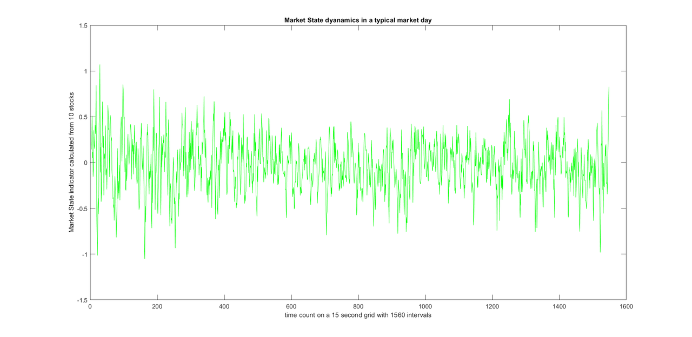](https://postimg.cc/WtjTQ7PN)

.

.

corresponding indicator for a single stock would be

$IS_{state}\, =\, \sum\limits_{k=0}^{3} \, \, w_k\, Z_m(t-k)\,$

If you want to know about market regime in general as opposed to fleeting state of the market, you could do the above
indicator for a longer lag as

$IM_{regime}\, =\, \sum\limits_{k=0}^{40} \, \sum\limits_{m=1}^{M} \, w_{m,k}\, Z_m(t-k)\,$

We could make an indicator for volatility as

$IM_{vol}\, =\, \sum\limits_{k=0}^{3} \, \sum\limits_{m=1}^{M} \, w_{m,k}\, {Z_m(t-k)}^2\,$

Here is a graph of market volatility on a typical day.

.

.

[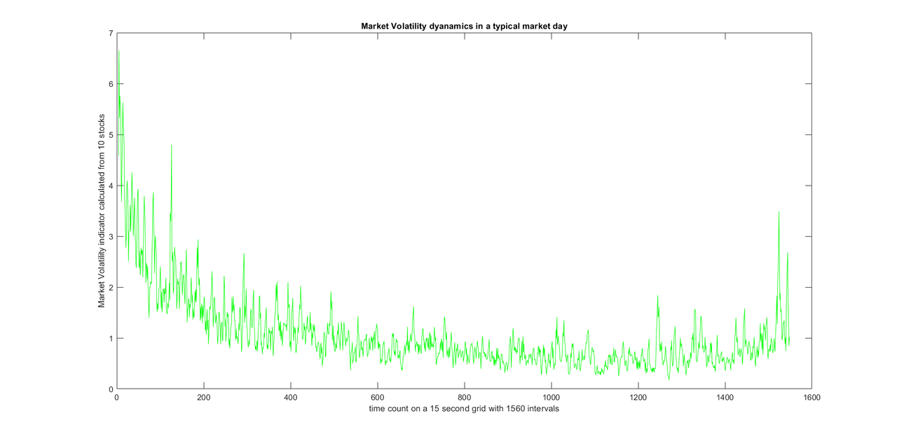](https://postimg.cc/94VLWzX7)

.

.

With the help of above indicators I was able to write a good stock trading strategy using top ten Nasdaq stocks from 41
working days of May and June 2021. The logic was to trade only when market is at an extreme hoping that it would mean
revert. And then close the trade when market has reversed. I also applied stop loss and take profit.

My strategy made 940 trades in 10 top nasdaq stocks with trading unit stocks and made a simple profit of  309 dollars
with earning roughly 32 cents per trade(this was not over hundred dollars). Here is a graph of daily profit and loss. It
has a limited downside and a good upside. (This is not a lucky graph as I had to do quite a work. most strategies would
make sharp losses.)

[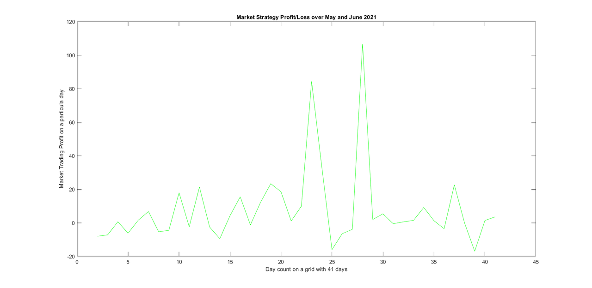](https://postimg.cc/zV8MzddB)

---

### #2356 — Amin (Topic Author)
*June 22, 2024, 5:13 AM*

Friends, I am playing with the trading algorithm and I get all sorts of interesting results with various combinations of
indicators mentioned in previous post. All we have to do is to think logically and imagine various possibilities and we
can make algorithms with very interesting possibilities. Here is a very selective algorithm that does only 138 trades in
two months. There are many days the algorithm does not trade at all. All trades are closed on the same day and no trade
goes to next day. It makes a profit of approx .96 cents per trade. I am sure all sorts of interesting improvements are
possible. Here is the profit/Loss graph showing Profit/Loss on each of the 40 days.

.

.

[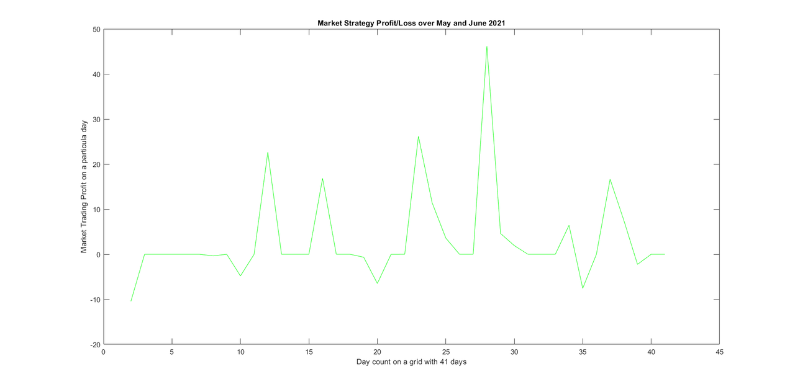](https://postimg.cc/jCFvWt4L)

---

### #2357 — Amin (Topic Author)
*June 22, 2024, 10:58 AM*

Friends, our original plan was to explore and research dynamically changing correlations. But we took a break to look a
bit deeply into market trading. I plan to continue this digression for a week to ten days. I am trying to explore the
use of interesting market trading algorithms on crypto currencies. I am sure we will gain some intuition into dynamic
correlations as well in the mean time. But I do intend to restart all the work on dynamic correlations in a week to ten
days.

In the meantime, I was thinking that we could possibly model market returns by some variant of noisy predator-prey
differential equations. I still do not know how but I have a deep feeling that it could be possible. I need to think
more carefully about it and see if I have some success. Even if our noisy and random model is right in telling us the
future direction of  the market 65% of the times, it can be a huge success.

---

### #2358 — Amin (Topic Author)
*June 22, 2024, 4:02 PM*

Friends, I went ahead to try a sort of simple and new parametric model based on mean reversion. This model is suitable
for most of the days but it is not suitable for days when market is trending. For most of the models to work well, we
need to be able to tell when market is mean reverting and when it is trending. And use mean reverting models when the
market regime is mean reverting (which is mostly the case). Last year, we tried to know when market is trending and when
it is mean reverting from moments of the Z's associated with market returns. Mean reverting processes have little deep
tails while trending processes have larger higher moments. But this is a different (though very related) topic of
research.

Again, I tried this new  parametric mean reversion model for stocks. It gave me surprisingly great results. This is like
a lower side of high frequency model with a very large number of trades. The model made 11251 trades in 40 days (first
training day is not used in back-testing). It made a profit of 908 dollars based on trade of one share. This share could
be any of the top ten stocks of Nasdaq in the same May and June data  of year 2021. When conditions are right multiple
trades in different stocks could be open but no more than one share of any stock is traded at any time. It earned a
profit of 8.07 cents per trade which is extremely good for a high frequency-like model. I applied the model on all days
and if I had made a good way to find out when market is trending and not have used the parametric mean reverting model
on those days, the results would have been extremely better. Though results were still good, I would recommend anyone
who uses this model to first also find out a criteria when market is mean reverting and when market is trending and use
the model only when market is mean reverting. Again, we can possibly find out this regime from use of Z-series moments.

The logic of the model is that greater the sum of deviations of the stock returns from zero, more likely are the new
returns going to move against this accumulated deviation.

First I want to rewrite some indicators and other preliminaries from the past.

Friends, let us suppose we have financial data of equities on a 15 sec grid (My data is for 41 working days from May and
June of 2021). We have a universe of M stocks and The price of mth stock at time t is given as$X_m(t)$ . We convert
these stock values into log returns so they are easy to use in our set up.

$R_m(t)\,=\, \log(X_m(t))\,-\, \log(X_m(t-1))$

You can use your own definition of returns and possibly label above as  $R_m(t-1)\,$ or divide by time increment etc.

From the moments of above returns, we make a Z-series/Hermite-series representation of returns of each asset. I made a
hermite series of returns from previous day and used it for next day (but that was because I was a bit lazy) and you can
add information to Z-series from running day at several discrete points in time. This Z-series expansion of returns is
given as

$R_m(t)\,=\, a_0\, +\, a_1 \, Z_m(t)\,+\, a_2 \, {Z_m(t)}^2\,+\, a_3 \, {Z_m(t)}^3\,+\, \ldots$

During the market time on 15 seconds grid, whenever we notice a new return$R_m(t)$ in the market, we immediately know
the associated$Z_m(t)$ in the market.

For positive returns, the$Z_m(t)$ would likely be positive and for negative returns$Z_m(t)$ would likely be positive.
Similarly for very large positive returns$Z_m(t)$ would likely be very large positive and vice versa.

A simple Stock return and associated$Z_m$ continues to fluctuate between positive and negative states and these states
last from half a minute to 2-3 minutes. Our indicator for state of a single stock would be

$IS_{state}\, =\, \sum\limits_{k=0}^{3} \, \, w_k\, Z_m(t-k)\,$

If you want to know about Stock regime in general as opposed to fleeting state of the Stock, you could do the above
indicator for a longer lag as

$IS_{regime}\, =\, \sum\limits_{k=0}^{60}  \, w_{k}\, Z_m(t-k)\,$

Now our parametric model for the prediction of next stock return $\bar{Z_m}(t+1)$ is

$ \bar{Z_m}(t+1) \, =\, Z_m(t) \, - \, c_1 \, Z_m(t)\, -\, c_2\,  IS_{state} \, -\, c_3 \, IS_{regime}\, $

with       $c_1\, =\, .75$,     $c_2\, =\, .6$,      $c_3\, =\, .45$,

$$

    I(t)=

\begin{cases}

    1 ,& \text{if } \bar{Z_m}(t+1)\geq .65\\

    -1 ,& \text{if } \bar{Z_m}(t+1)\leq -.525\\

    0,              & \text{otherwise}

\end{cases}

$$

All the numerical values of constants and thresholds I gave in above few equations where found by me by playing
iteratively with the model so as to maximize the profit. Obviously these values would be different for every time series
but I have given my values for reference only.

At the start of every 15 second interval, we calculate the rule$I(t)$ from above. If$I(t)$ is equal to one, it means
that next returns are predicted to be positive. If If$I(t)$ is equal to negative one, it means that next returns are
predicted to be negative. And if If$I(t)$ is equal to zero, it means that we are undecisive about next returns.

So whenever$I(t)$ is positive one, we close any previous sell trade if it is open and open new buy trade. And when$I(t)$
is negative one, we close any buy trade if it is already open and open new sell trade.

 The model made 11251 trades in 40 days (first training day is not used in back-testing). It made a profit of 908
dollars based on trade of one share. This share could be any of the top ten stocks of Nasdaq in the same May and June
data  of year 2021. It earned a profit of 8.07 cents per trade which is extremely good for a high frequency-like model.
Sum of Both sides commissions is less than one cent.

If I had applied the model only on days when stocks are mean reverting, the results would have been very impressive with
almost no losses.

Here is the graph that shows profit/Loss of the model trading strategy on each of the forty trading days.

[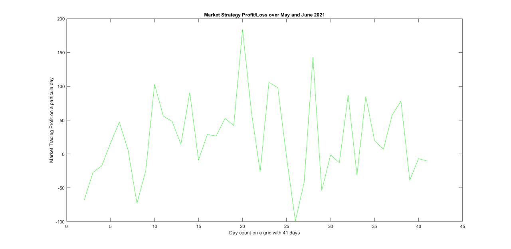](https://postimg.cc/tnzpSQnL)

Friends, it just seems to me that Z-series and related parameters are really the right tools for many of the models and
strategies when it comes to stocks trading. I have previously played with the market for years with very little luck
with just one exception. But I have been able to build reasonably decent models in just past few days. I think it is
only because I used Z-series based statistics that are totally standard and take away a lot of complexity associated
with stocks when we use these statistics intelligently.

---

### #2359 — Amin (Topic Author)
*June 22, 2024, 4:41 PM*

>
> Friends, I went ahead to try a sort of simple and new parametric model based on mean reversion. This model is suitable
for most of the days but it is not suitable for days when market is trending. For most of the models to work well, we
need to be able to tell when market is mean reverting and when it is trending. And use mean reverting models when the
market regime is mean reverting (which is mostly the case). Last year, we tried to know when market is trending and when
it is mean reverting from moments of the Z's associated with market returns. Mean reverting processes have little deep
tails while trending processes have larger higher moments. But this is a different (though very related) topic of
research.
>
>
>
> Again, I tried this new  parametric mean reversion model for stocks. It gave me surprisingly great results. This is
like a lower side of high frequency model with a very large number of trades. The model made 11251 trades in 40 days
(first training day is not used in back-testing). It made a profit of 908 dollars based on trade of one share. This
share could be any of the top ten stocks of Nasdaq in the same May and June data  of year 2021. When conditions are
right multiple trades in different stocks could be open but no more than one share of any stock is traded at any time.
It earned a profit of 8.07 cents per trade which is extremely good for a high frequency-like model. I applied the model
on all days and if I had made a good way to find out when market is trending and not have used the parametric mean
reverting model on those days, the results would have been extremely better. Though results were still good, I would
recommend anyone who uses this model to first also find out a criteria when market is mean reverting and when market is
trending and use the model only when market is mean reverting. Again, we can possibly find out this regime from use of
Z-series moments.
>
>
>
> The logic of the model is that greater the sum of deviations of the stock returns from zero, more likely are the new
returns going to move against this accumulated deviation.
>
>
>
> First I want to rewrite some indicators and other preliminaries from the past.
>
>
>
> Friends, let us suppose we have financial data of equities on a 15 sec grid (My data is for 41 working days from May
and June of 2021). We have a universe of M stocks and The price of mth stock at time t is given as$X_m(t)$ . We convert
these stock values into log returns so they are easy to use in our set up.
>
>
>
> $R_m(t)\,=\, \log(X_m(t))\,-\, \log(X_m(t-1))$
>
>
>
> You can use your own definition of returns and possibly label above as  $R_m(t-1)\,$ or divide by time increment etc.
>
>
>
> From the moments of above returns, we make a Z-series/Hermite-series representation of returns of each asset. I made a
hermite series of returns from previous day and used it for next day (but that was because I was a bit lazy) and you can
add information to Z-series from running day at several discrete points in time. This Z-series expansion of returns is
given as
>
>
>
> $R_m(t)\,=\, a_0\, +\, a_1 \, Z_m(t)\,+\, a_2 \, {Z_m(t)}^2\,+\, a_3 \, {Z_m(t)}^3\,+\, \ldots$
>
>
>
> During the market time on 15 seconds grid, whenever we notice a new return$R_m(t)$ in the market, we immediately know
the associated$Z_m(t)$ in the market.
>
>
>
> For positive returns, the$Z_m(t)$ would likely be positive and for negative returns$Z_m(t)$ would likely be positive.
Similarly for very large positive returns$Z_m(t)$ would likely be very large positive and vice versa.
>
>
>
> A simple Stock return and associated$Z_m$ continues to fluctuate between positive and negative states and these states
last from half a minute to 2-3 minutes. Our indicator for state of a single stock would be
>
>
>
> $IS_{state}\, =\, \sum\limits_{k=0}^{3} \, \, w_k\, Z_m(t-k)\,$
>
>
>
> If you want to know about Stock regime in general as opposed to fleeting state of the Stock, you could do the above
indicator for a longer lag as
>
>
>
> $IS_{regime}\, =\, \sum\limits_{k=0}^{60}  \, w_{k}\, Z_m(t-k)\,$
>
>
>
> Now our parametric model for the prediction of next stock return $\bar{Z_m}(t+1)$ is
>
>
>
> $ \bar{Z_m}(t+1) \, =\, Z_m(t) \, - \, c_1 \, Z_m(t)\, -\, c_2\,  IS_{state} \, -\, c_3 \, IS_{regime}\, $
>
>
>
> with       $c_1\, =\, .75$,     $c_2\, =\, .6$,      $c_3\, =\, .45$,
>
>
>
> $$
>
>     I(t)=
>
> \begin{cases}
>
>     1 ,& \text{if } \bar{Z_m}(t+1)\geq .65\\
>
>     -1 ,& \text{if } \bar{Z_m}(t+1)\leq -.525\\
>
>     0,              & \text{otherwise}
>
> \end{cases}
>
> $$
>
>
>
> All the numerical values of constants and thresholds I gave in above few equations where found by me by playing
iteratively with the model so as to maximize the profit. Obviously these values would be different for every time series
but I have given my values for reference only.
>
>
>
> At the start of every 15 second interval, we calculate the rule$I(t)$ from above. If$I(t)$ is equal to one, it means
that next returns are predicted to be positive. If If$I(t)$ is equal to negative one, it means that next returns are
predicted to be negative. And if If$I(t)$ is equal to zero, it means that we are undecisive about next returns.
>
>
>
> So whenever$I(t)$ is positive one, we close any previous sell trade if it is open and open new buy trade. And when
$I(t)$ is negative one, we close any buy trade if it is already open and open new sell trade.
>
>
>
>  The model made 11251 trades in 40 days (first training day is not used in back-testing). It made a profit of 908
dollars based on trade of one share. This share could be any of the top ten stocks of Nasdaq in the same May and June
data  of year 2021. It earned a profit of 8.07 cents per trade which is extremely good for a high frequency-like model.
Sum of Both sides commissions is less than one cent.
>
>
>
> If I had applied the model only on days when stocks are mean reverting, the results would have been very impressive
with almost no losses.
>
>
>
> Here is the graph that shows profit/Loss of the model trading strategy on each of the forty trading days.
>
>
>
> 
>
>
>
>
>
> Friends, it just seems to me that Z-series and related parameters are really the right tools for many of the models
and strategies when it comes to stocks trading. I have previously played with the market for years with very little luck
with just one exception. But I have been able to build reasonably decent models in just past few days. I think it is
only because I used Z-series based statistics that are totally standard and take away a lot of complexity associated
with stocks when we use these statistics intelligently.
>
.

.

.

Just to clear this ambiguity. Copying from above.

A simple Stock return and associated$Z_m$ continues to fluctuate between positive and negative states and these states
last from half a minute to 2-3 minutes. Our indicator for state of a single stock would be

$IS_{state}\, =\, \sum\limits_{k=0}^{3} \, \, w_k\, Z_m(t-k)\,$

If you want to know about Stock regime in general as opposed to fleeting state of the Stock, you could do the above
indicator for a longer lag as

$IS_{regime}\, =\, \sum\limits_{k=0}^{60}  \, w_{k}\, Z_m(t-k)\,$

Now our parametric model for the prediction of next stock return $\bar{Z_m}(t+1)$ is

$ \bar{Z_m}(t+1) \, =\, Z_m(t) \, - \, c_1 \, Z_m(t)\, -\, c_2\,  IS_{state} \, -\, c_3 \, IS_{regime}\, $

But$IS_{state}\,$ and$IS_{regime}\,$ are time dependent statistics and have dependence on t so the right form of above
equations would be as written below

$IS_{state}(t)\, =\, \sum\limits_{k=0}^{3} \, \, w_k\, Z_m(t-k)\,$

If you want to know about Stock regime in general as opposed to fleeting state of the Stock, you could do the above
indicator for a longer lag as

$IS_{regime}(t)\, =\, \sum\limits_{k=0}^{60}  \, w_{k}\, Z_m(t-k)\,$

Now our parametric model for the prediction of next stock return $\bar{Z_m}(t+1)$ is

$ \bar{Z_m}(t+1) \, =\, Z_m(t) \, - \, c_1 \, Z_m(t)\, -\, c_2\,  IS_{state}(t) \, -\, c_3 \, IS_{regime}(t)\, $

---

### #2360 — Amin (Topic Author)
*June 22, 2024, 5:24 PM*

Friends, in the context of last two posts, I want to mention again that we covered this in probably May or June last
year in Summers when a time series is mean reverting and when it is trending. We have to apply that criteria in real
time to find out when our time series is mean reverting and when it is trending so we know when to use the above model
strategy from previous post.

As I recall, eighth moment of time series when it is trending is far higher than eighth moment of a time series when it
is mean reverting. We also would like to look at skew moments. I think I posted a matlab program regarding that. So that
kind of criteria can be very helpful to know when to apply the above model in real time and when to avoid using it.

Thinking again, I think, in order to find mean reversion, we can use another strategy. If we are on a fifteen seconds
grid, We can calculate higher moments (possibly eighth moment) on a minute level returns granularity. Due to
cancellations, mean reverting series would have smaller higher moments and due to relative lack of cancellations,
trending time series would have higher moments. If we compare higher moments, on lowest possible granularity of 15
seconds, there might not be any remarkable difference in higher moments since eighth moment would not be able to
differentiate between positive return followed by positive return (trending) and positive return followed by negative
return (mean reverting). However when aggregated and moments are calculated on aggregated returns, the difference in
higher moments should start to become obvious due to cancellations (due to mean reversion) when aggregated.

---

### #2361 — Amin (Topic Author)
*June 24, 2024, 6:43 AM*

Friends, I think I have some more clear idea about calculation of local dynamic correlations so I thought I should write
them in this post.

Let us suppose, we have a time series given as

$X_1,\, X_2 ,\, X_3, \, \ldots,\, X_{t-2}, \, X_{t-1}, \, X_t$

We make another two series out of the above series. One series would consist of sum of two adjacent (in time)
realizations of the above variable and second series would consist of sum of squares of two adjacent (in time)
realizations of the above variable.

We write as

$V_1(t)\, =\, X_{t-1} \, +\, X_{t} \,$

while

$V_2(t)\, =\, {X_{t-1}}^2 \, +\, {X_{t}}^2 \,$

We come up with an indicator that is directly proportional to correlation

$\, I_{Corr}(t)\, =\Large{\, \frac{E[{V_1}^2]}{E[V_2]}}$

$\LARGE{=\, \frac{\sum\limits_{k=0}^{Lag-1} \, {V_1(t-k)}^2}{\sum\limits_{k=0}^{Lag-1} \, V_2(t-k)}}$

$I_{Corr}(t)$ remains strictly between zero and two. At value of zero, it means correlation is equal to minus one. At
$I_{Corr}(t)=1$ , it means, correlation is equal to zero. At$I_{Corr}(t)=2$ , it means, correlation is equal to positive
one.

In general , I suppose that local correlation at a time t is given as

$ Corr(t)\,=\,\rho(t)\,=\,  I_{Corr}(t)\,-\, 1$

I used the above method to calculate auto-correlations in intraday financial data. As we know auto-correlations are
notorious to be very unstable in financial data and it shows up in the graph. Even though we can see a pattern. The
indicator calculated strictly remains between zero and two. I calculated graph below with a Lag=5. You can see in second
graph that there is enough clustering of correlation.

.

.

[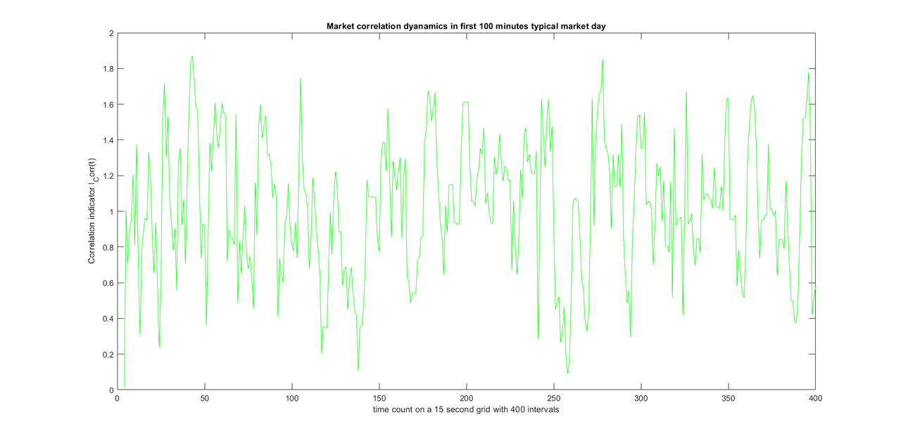](https://postimg.cc/gLdHY6cL)

[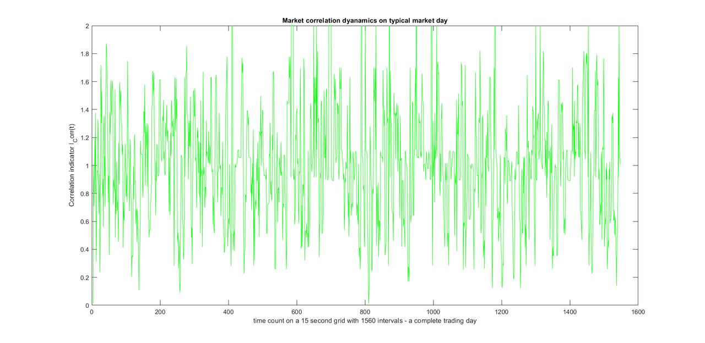](https://postimg.cc/phKBbBvt)

---

### #2362 — Amin (Topic Author)
*June 24, 2024, 8:23 PM*

Friends, I hope that we would be doing interesting things with correlations. One interesting thing is how the dynamics
of auto-correlations and cross-correlations are related to each other. We know that cross correlations are generally
more stable. But in evolution of a multivariate time series, cross-correlations are not independent of
auto-correlations.

I will try to write a more detailed post with equations later but here are some insights that I thought about. We can
divide increments of a time series on every time step into an auto-correlated part and another orthogonal part. As it
seems, in order to maintain relatively more stable cross-correlations, that auto-correlated parts of each (of the
multivariate) time series have to be correlated across different time series but I believe that orthogonal part (even
though orthogonal in time) also has cross-correlations  with orthogonal parts of other time series (in order to maintain
relatively stable cross-sectional correlations across different time series.)

I think we need a small but comprehensive set of equations that describes how auto-correlations and cross-correlations
and orthogonal parts are related to each other.

I will come back with detailed post with equations later.

---

### #2363 — Amin (Topic Author)
*June 25, 2024, 4:29 AM*

Friends, I am writing this post to tell about mind control torture that has remarkably increased in past one day. On
most days, I work late at night and therefore on some days, I sleep for one or two hours in the afternoon as well when I
get very tired. It makes me feel fresh and I can work better when I sleep for a little during the day. However,
yesterday afternoon, mind control agents did not let me sleep at all despite that I was very tired. They continued to
force EM waves on my feet and I had tingling feelings in my feet and I was unable to sleep. Later, I went out in the
city in the evening but they tried their best to not let me work at night. I slept relatively early last night because I
was not getting any work done. During my sleep last night, they continued to force EM waves on my eyes, my head, my feet
and all over the body. When I woke up this morning, I had muscles ache all over my body. Since they continued to force
EM waves into my closed eyes at night, my eyes were also feeling painful. And water/liquid continues to flow out of my
sore eyes even after I woke up and washed my face and eyes and even at the time of writing of this post, water/liquid
continues to flow out of my eyes constantly. And I also feel tired after waking up since they continued to force EM
waves on my head.

Since a week or ten days ago, mind control torture had really decreased very much. I was even eating at home (which
could be very slightly drugged at times but was mostly bearable) and most of my muscle pains and body aches were gone.
But just yesterday, they restarted everything abruptly and started to torture me to extremes again.

---

### #2364 — Amin (Topic Author)
*June 25, 2024, 7:33 AM*

Friends, I went ahead and tried to see if we can make any profits from our knowledge of correlations.

I did not do any optimization yet and only made a simple rule to trade in the direction of emotion when average market
auto-correlation (from sum of auto-correlations of ten stocks over past minute) is positive (>0)  and auto-correlation
for stock to be traded is above .20  and trade against the direction of emotion when average market auto-correlation
(from sum of auto-correlations of ten stocks over past minute) is negative (

---

### #2365 — Amin (Topic Author)
*June 25, 2024, 7:52 AM*

Here are the top ten stocks I used for basic correlation strategy in graph of previous post from May and June of 2021.

AAPL

MSFT

NVIDIA

GOOGL

GOOG

AMZN

FB

AMD

TSLA

NFLX

---

### #2366 — Amin (Topic Author)
*June 25, 2024, 10:16 AM*

Friends, I want to try to explain the auto-correlation formula in a bit more detail here.

Copying the preliminaries from previous post, we have

Let us suppose, we have a time series given as

$X_1,\, X_2 ,\, X_3, \, \ldots,\, X_{t-2}, \, X_{t-1}, \, X_t$

We make another two series out of the above series. One series would consist of sum of two adjacent (in time)
realizations of the above variable and second series would consist of sum of squares of two adjacent (in time)
realizations of the above variable.

We write as

$V_1(t)\, =\, X_{t-1} \, +\, X_{t} \,$

while

$V_2(t)\, =\, {X_{t-1}}^2 \, +\, {X_{t}}^2 \,$

We come up with an indicator that is directly proportional to correlation

$\, I_{Corr}(t)\, =\Large{\, \frac{E[{V_1}^2]}{E[V_2]}}$

$\LARGE{=\, \frac{\sum\limits_{k=0}^{Lag-1} \, {V_1(t-k)}^2}{\sum\limits_{k=0}^{Lag-1} \, V_2(t-k)}}$

Now consider the above sums in more detail

$\sum\limits_{k=0}^{Lag-1} \, {V_1(t-k)}^2$

$=\sum\limits_{k=0}^{Lag-1} \, {\big[\, X_{t-1} \, +\, X_{t} \, \big]}^2$

$=\sum\limits_{k=0}^{Lag-1} \, {\big[\, {X_{t-1}}^2 \, +\, {X_{t}}^2 \,+ \, 2  \, \, X_{t-1} \, X_{t} \big]}$

We identify that  $\sum\limits_{k=0}^{Lag-1} \, \big[\, {X_{t-1}}^2 \, +\, {X_{t}}^2 \, \big] \,=\, 2\, Var[X] \, $

while  $\sum\limits_{k=0}^{Lag-1} \,  \, 2  \, \, X_{t-1} \, X_{t} \, =\, 2\,COV[X_t,X_{t-1}]$

I write down the auto-correlation formula again as

$\LARGE{\, \frac{\sum\limits_{k=0}^{Lag-1} \, {V_1(t-k)}^2}{\sum\limits_{k=0}^{Lag-1} \, V_2(t-k)}}$

$\LARGE{\,= \frac{\,\sum\limits_{k=0}^{Lag-1} \, \big[ \,{X_{t-1}}^2 \, +\, {X_{t}}^2 \,+ \, 2  \,  \, X_{t-1} \, X_{t} \big]}{\sum\limits_{k=0}^{Lag-1} \,\big[\, {X_{t-1}}^2 \, +\, {X_{t}}^2 \, \big]}}$

$\LARGE{\,= \frac{\,\sum\limits_{k=0}^{Lag-1} \, \big[ \,{X_{t-1}}^2 \, +\, {X_{t}}^2 \, \big]+ \, 2  \, \,\sum\limits_{k=0}^{Lag-1} \, \big[ \, \, X_{t-1} \, X_{t} \big]}{\sum\limits_{k=0}^{Lag-1} \,\big[\, {X_{t-1}}^2 \, +\, {X_{t}}^2 \, \big]}}$

$\LARGE{\,= \frac{ \, 2 \, Var[X_t] \, + \, 2 \, COV[X_t,X_{t-1}]}{ \, 2 \, Var[X_t] \, }}$

$=\,  1 \, + \LARGE{\, \frac{ \, 2 \, COV[X_t,X_{t-1}]}{ \, 2 \, Var[X_t] \, }}$

$= \, 1 \, + \, \rho(t) $

I have not applied any means in the formula since in financial data the mean of log-returns is very close to zero. If
needed, you can do your improvise upon the formula to subtract means where appropriate.

The formula would however apply only to auto-correlations but that is where we need it the most. And auto-correlations
was our subject of discussion in the context of trading.

 Even for very small lags, the auto-correlation remains strictly between minus one and one.

---

### #2367 — Amin (Topic Author)
*June 25, 2024, 10:37 AM*

>
> Friends, I want to try to explain the auto-correlation formula in a bit more detail here.
>
>
>
> Copying the preliminaries from previous post, we have
>
>
>
> Let us suppose, we have a time series given as
>
>
>
> $X_1,\, X_2 ,\, X_3, \, \ldots,\, X_{t-2}, \, X_{t-1}, \, X_t$
>
>
>
> We make another two series out of the above series. One series would consist of sum of two adjacent (in time)
realizations of the above variable and second series would consist of sum of squares of two adjacent (in time)
realizations of the above variable.
>
>
>
> We write as
>
>
>
>
>
>
>
> $V_1(t)\, =\, X_{t-1} \, +\, X_{t} \,$
>
>
>
> while
>
>
>
> $V_2(t)\, =\, {X_{t-1}}^2 \, +\, {X_{t}}^2 \,$
>
>
>
> We come up with an indicator that is directly proportional to correlation
>
>
>
> $\, I_{Corr}(t)\, =\Large{\, \frac{E[{V_1}^2]}{E[V_2]}}$
>
>
>
> $\LARGE{=\, \frac{\sum\limits_{k=0}^{Lag-1} \, {V_1(t-k)}^2}{\sum\limits_{k=0}^{Lag-1} \, V_2(t-k)}}$
>
>
>
> Now consider the above sums in more detail
>
>
>
> $\sum\limits_{k=0}^{Lag-1} \, {V_1(t-k)}^2$
>
> $=\sum\limits_{k=0}^{Lag-1} \, {\big[\, X_{t-1} \, +\, X_{t} \, \big]}^2$
>
> $=\sum\limits_{k=0}^{Lag-1} \, {\big[\, {X_{t-1}}^2 \, +\, {X_{t}}^2 \,+ \, 2  \, \, X_{t-1} \, X_{t} \big]}$
>
>
>
> We identify that  $\sum\limits_{k=0}^{Lag-1} \, \big[\, {X_{t-1}}^2 \, +\, {X_{t}}^2 \, \big] \,=\, 2\, Var[X] \, $
>
> while  $\sum\limits_{k=0}^{Lag-1} \,  \, 2  \, \, X_{t-1} \, X_{t} \, =\, 2\,COV[X_t,X_{t-1}]$
>
>
>
> I write down the auto-correlation formula again as
>
>
>
> $\LARGE{\, \frac{\sum\limits_{k=0}^{Lag-1} \, {V_1(t-k)}^2}{\sum\limits_{k=0}^{Lag-1} \, V_2(t-k)}}$
>
>
>
>
$\LARGE{\,= \frac{\,\sum\limits_{k=0}^{Lag-1} \, \big[ \,{X_{t-1}}^2 \, +\, {X_{t}}^2 \,+ \, 2  \,  \, X_{t-1} \, X_{t} \big]}{\sum\limits_{k=0}^{Lag-1} \,\big[\, {X_{t-1}}^2 \, +\, {X_{t}}^2 \, \big]}}$
>
>
>
>
$\LARGE{\,= \frac{\,\sum\limits_{k=0}^{Lag-1} \, \big[ \,{X_{t-1}}^2 \, +\, {X_{t}}^2 \, \big]+ \, 2  \, \,\sum\limits_{k=0}^{Lag-1} \, \big[ \, \, X_{t-1} \, X_{t} \big]}{\sum\limits_{k=0}^{Lag-1} \,\big[\, {X_{t-1}}^2 \, +\, {X_{t}}^2 \, \big]}}$
>
>
>
> $\LARGE{\,= \frac{ \, 2 \, Var[X_t] \, + \, 2 \, COV[X_t,X_{t-1}]}{ \, 2 \, Var[X_t] \, }}$
>
>
>
> $=\,  1 \, + \LARGE{\, \frac{ \, 2 \, COV[X_t,X_{t-1}]}{ \, 2 \, Var[X_t] \, }}$
>
>
>
> $= \, 1 \, + \, \rho(t) $
>
>
>
> I have not applied any means in the formula since in financial data the mean of log-returns is very close to zero. If
needed, you can do your improvise upon the formula to subtract means where appropriate.
>
> The formula would however apply only to auto-correlations but that is where we need it the most. And auto-correlations
was our subject of discussion in the context of trading.
>
>  Even for very small lags, the auto-correlation remains strictly between minus one and one.
>
Sorry but on a second thought I think that if we calculate variance and covariance on the same grid, the formula might
return the same answer as traditional formula. But I still feel Ok since it prompted me to use the right formula (as
opposed to standard deviation and covariance being calculated on a different grid as I was earlier naively suggesting) 
and motivated me to play with correlations. I was able to get decent results only with correlations between first
hermite and I think next step is to  try and see if higher hermites would give some interesting results.

---

### #2368 — Amin (Topic Author)
*June 26, 2024, 7:31 AM*

Friends, just getting some of my basic ideas about market together. I think three things are most important for
successful mathematical trading in a market.

First is to understand the nature of prevailing local market is very important. And once you know the market type second
important thing is to know what strategies are suited for a particular prevailing market conditions. Third important
thing is choice of right stocks/financial instruments where we could easily use the appropriate strategies for
prevailing market conditions.

We can know the prevailing market from our Z-series indicators (bullish or bearish), correlation clustering for a
particular stock or clustering in weighted averaged of correlations across a market/sector (positive correlation or
negative correlation ) and volatility (among other things to know if there is enough volatility to make day-trading
profits). All of these indicators have a single stock version and a market(multiple stock) version. In fact for trading
in a particular stock, the market version of indicators should have different stocks and different weights on each stock
(in market indicators) depending upon how much these market stocks(in the market indicator) are correlated with stock
that is to be traded. (so for serious people, it can be a lot of work and also lot of opportunity). And various lags of
indicators have to be tried and sometimes these indicators with various lags would have to be used together.

Then we have to think of market trading strategies suited for the market. directional trading for a few
minutes/mean-reversion trading/buy on dips on a good day etc.

And then backtest on various stocks with recent data to find out suitable stocks.

So it seems that for friends who would like to explore, there could be large number of possibilities for
experimentation, learning and making money even with limited and meagre understanding of the markets we currently have.

I just wanted to sum up some very basics but I hope to continue with market trading for several weeks to come and will
continue to post any interesting thing.

---

### #2369 — Amin (Topic Author)
*June 26, 2024, 11:11 AM*

Friends, even though I might continue to post from time to time next few days about interesting things, but please give
me a few days (4-5) and I will come up with more detailed notes explaining the points in above post with equations
according to whatever understanding I have. So all friend who are kind to follow my posts, I will try to come up with
more organized and detailed posts in a few days.

---

### #2370 — Amin (Topic Author)
*June 26, 2024, 5:38 PM*

I have deleted and edited a previous post to make this new post to make it more clear to understand.

Friends, some basic ideas about preliminary analytics that we need to do from information of previous days before we
start market trading in current day.

When I mention Z-series below, it means Z-series derived from past data of log-returns of stocks or other financial
instruments over an equi-spaced grid in time.

First point is that in market everything is relative (usually relative to average market conditions in the sense that
opportunity/Loss depends upon how much the market has deviated from average market conditions in positive or adverse
ways). We can use Z-series and derived indicators in mathematical trading since they can provide us precious information
in a very standardized and understandable way. I was previously using market data from past one day to calculate
Z-series that would be used today. This Z-series was recalculated everyday and therefore all reference indicators and
decision making was not relative to a single standard which (even though many times partially helpful in trading) was
actually problematic. But I believe that purpose of Z-series is to give us a standard reference for comparison of
today's market conditions with respect to average previous market conditions in a standard way. Therefore, we would also
like to run prospective strategies on previous 7/15/or more  days of data (using a single Z-series derived from past
7/15/or more days of data)  as if we were back-testing and try to know what strategies were successful in training data
of past few weeks and also know the range of parameters when they were successful. And later in live trading on the
current day, as I said that market is a concept in being relative, we would trade different strategies(using the same
single reference Z-series that we had derived from 7/15 or more days of past data) only when the associated parameters
are equal to or more extreme (in the strategy-positive direction) than the successful range of parameters(associated
with each successful strategy in historical backtesting of past week) as found from back-testing in past seven/fifteen
days. This way a single reference Z-series calculated from past few weeks serves as a single standard reference for all
indicators and decision making on historical data and the same indicators and similar decision making could be carried
forward to the live trading on current day.

However some information is so basic that we need to fix it in our Z-series if that happens. For example mean of
Z-series has to be kept strictly at zero even if the mean from past data is different from zero. This mean would have to
be kept zero even in back-testing over past seven days of historical data. This is because a positive or negative mean
of Z-series from before can turn our market direction in reverse direction or increase or decrease the intensity of our
indicators. This is because if previous mean of Z-series in positive, our calculated Z increment(from inversion of
returns) will be positive only if the mean of today's data is large than the previous mean. In short, for directional
indicators based on Z-series we want a standardized mean of zero and we would have to change the mean of every reference
Z-series, used for decision making in both historical backtesting and live trading, to zero.

I am, like some (of course not all) of the other friends who follow me, just learning and experimenting with interesting
ideas. I am, by no means, a great expert at financial markets trading at all. And therefore all the thoughts shared are
only suggestive and are meant to provoke ideas and experimentation among friends towards market trading with this new
technique. I do think that slowly we are having more clarity about a better use of the Z-series for mathematical trading
in the markets. And I also hope that in a few weeks we might have a more mature understanding of the subject under
discussion.

Again once our ideas are more mature and tested, I would want to put together a more detailed post putting all the
thoughts scatted randomly into a more organized sort of document. But this could be a week or two away. In the meantime,
I would continue to share any more understanding as I try to think more about the ideas related to market trading.

---

### #2371 — Amin (Topic Author)
*June 28, 2024, 11:52 AM*

Friends, sorry that I could not do any work yesterday but was able to work a bit today with my programs.

I want to ask friends to do all sort of interesting things with our indicators to get a feel of how they are correlated
with the market. For example, I made an overlaid graph of indicators and the stock price(with starting value subtracted
so they fit the same graph (price(tt)-Price(t0)) , sometimes you will need a suitable scaling
when (price(tt)-Price(t0))/scaling)). And then tried to see how various indicators were affecting  the market or getting
correlated with the market. I noticed that when local auto-correlation clustering changes from negative to positive, it
signals that there is some emotion in the market and many times market reverses direction. I also noticed the same thing
with small length leading indicators of market direction when they change sign in a significant way, market mostly
switches direction. I am also sure that there are many such relatively obscure relationships everywhere that we need to
find out for successful trading.

I am sure you can check most of these properties of indicators statistically. Ideally correlations of all these
indicators should be calculated with the market returns.

Here is an overlaid graph of Apple on a trading day in which you can notice sometimes that when auto-correlation
clustering goes from negative to positive, there is a slight emotion or possibly a change in direction of the market.

.

.

In graph below auto-correlation of AAPL is in green and stock price of AAPL is in green. I have subtracted initial value
from stock price.

[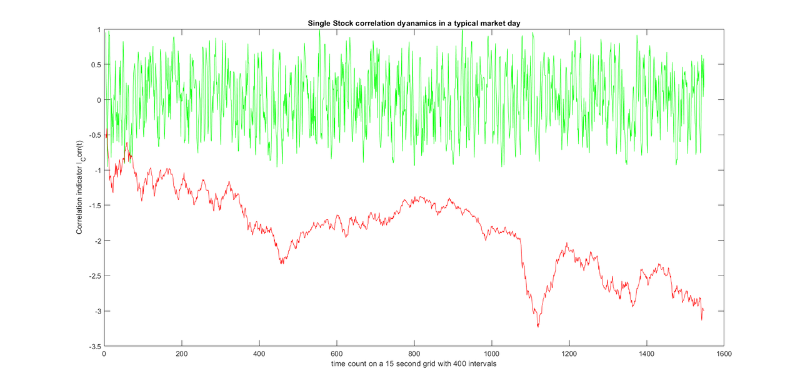](https://postimg.cc/xqWNZJCn)

.

.

Also I mentioned yesterday that mean of the Z-series of Stock for use in backtesting and live trading should be made
zero but I was wrong and whenever I tried to make the mean of reference Z-series equal to zero, there was a decrease in
efficacy of the model. I think we are fine as long as we use just one single Z-series and one single associated mean and
make all calculations and backtesting of strategies with respect to the same metric.

When you are making a general strategy, you might need to combine 3-6  or even more indicators (in an if block with
multiple statements depending upon indicators above or below different boundaries and thresholds) and this is not very
simple and you will need to optimize for boundaries and thresholds of the indicators and you will need an automated
program for that.

---

### #2372 — Amin (Topic Author)
*June 28, 2024, 2:55 PM*

Friends, I have been playing around with the models. Here is a simple model (I am sure can be improved further quite a
bit)

Here are the results of the model.

Profit00 =

     2.697434999999935e+03

NoOfTrades00 =

       82264

ans =

   0.032789981036662

where ans is profit per trade which is 3.27 cents per trade. This profit is on mid-price and when trading with limit
orders, you can earn some extra spread on top of this.

This is the same 41 working days data of May and June 2021 and trading is done on 34 days only since first seven days
have no pre-training period so trading was not done of them. Trading starts on eight day.

 In order to write the logic of decision making, I will first write a few indicators.

$IS_{state}(t)\, =\, \sum\limits_{k=0}^{3} \, \, w_k\, Z_m(t-k)\,$

$IS_{market}(t)\, =\, \sum\limits_{k=0}^{3} \,\, \sum\limits_{m=1}^{10} \, \, w_{k,m}\, Z_m(t-k)\,$

$I2S_{market}(t)\, =\, \sum\limits_{k=0}^{3} \,\, \sum\limits_{m=1}^{10} \, \, w_{k,m}\, ({Z_m(t-k)}^2\,-\,1\,)\,$

$Z0Corr(t)$ is local correlation calculated over four most recent lagged periods and$MCorr(t)$ is local correlation
averaged over ten stocks and calculated for each stock over four most recent lagged periods

Below is the indicator we get for decision making

$ \bar{Z_m}(t+1) \, =\, sgn(IS_{state}(t))  \, I2S_{market}(t)\, +2.0 \, \big[(.5* \,  IS_{state}(t) \, -\, 1.6\,  IS_{state}(t-1) \, -\, .4\,  IS_{state}(t-2) \,\big] $

$+2.0 \, \big[(.5* \,  IS_{market}(t) \, -\, 1.6\,  IS_{market}(t-1) \, -\, .4\,  IS_{market}(t-2) \,\big] $

$ -3.0\,(.65\,Z0Corr(t)-1.5\,Z0Corr(t-1)\,-\,.5\,Z0Corr(t-2))$

$ \,-\,1.0\,(.8\,MCorr(t)\,-\,1.5\,MCorr(t-1)\,-\,.5\,MCorr(t-2)) $

$    I_1(t)=

\begin{cases}

    1 ,& \text{if } \bar{Z_m}(t+1)\geq .9\\

    -1 ,& \text{if } \bar{Z_m}(t+1)\leq -.9\\

    0,              & \text{otherwise}

\end{cases}

$$

$    I_2(t)=

\begin{cases}

    1 ,& \text{if } \bar{Z_m}(t+1)\geq .65\\

    -1 ,& \text{if } \bar{Z_m}(t+1)\leq -.65\\

    0,              & \text{otherwise}

\end{cases}

$$

Indicator$I_1(t)$ is used to open trades and is more stringent. When$I_1(t)=1$ and there is no trade open, a buy trade
is opened and when$I_1(t)=-1$ and there is no trade open, a sell trade is opened.

Indicator$I_2(t)$ is used to close trades and is less stringent. When$I_2(t)=1$ and there is a sell trade open, a buy
trade is done to close the deal and when$I_2(t)=-1$ and there is a buy trade open, a sell trade is done to close the
deal.

Here is the graph of profit loss over 34 days(first 7 days are not used as they were used for training).

.

.

[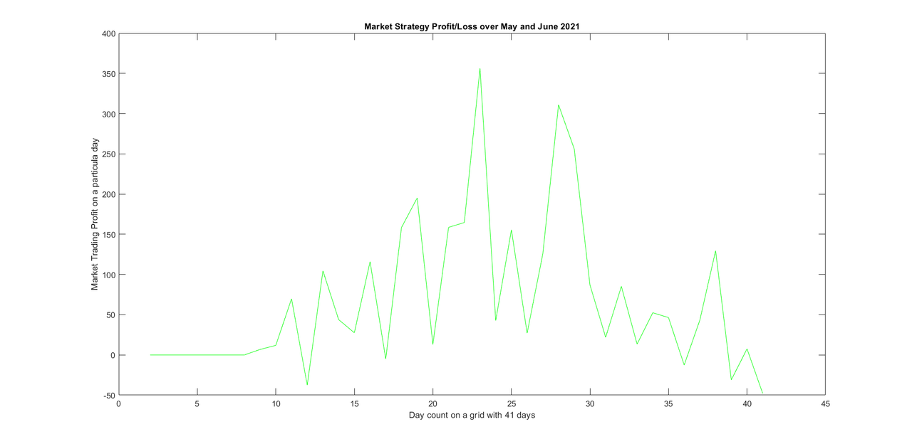](https://postimg.cc/Vr45hLKw)

---

### #2373 — Amin (Topic Author)
*June 29, 2024, 12:40 PM*

Friends, I have been trying to brainstorm systematically about the markets for my own financial trading and shared most
the ideas with friends in the hope that thoughts about all different aspects of the market at the same place would
possibly be helpful for interested friends. I am sure many friends would be making far better models than my models in a
few weeks. And it is a thing to celebrate if my ideas could be helpful for some friends to succeed in the markets.
Market is a big pie and I am sure that smart and intelligent people will always find a way to make money out of the
financial markets. But still there is this idea that if everybody started working with very same ideas and similar
market opportunities, many of these opportunities might simply fade away from the market for everyone or another arms
race of fast computers might start on medium frequency trading. And that is why I never posted any programs since many
people could simply use them without knowing any mathematics or statistics or without any effort to have a comprehensive
understanding of everything. But, I have absolutely no qualms about sharing anything that I posted and I am thankful for
the opportunity to be of some possible help for friends.

Here are some thoughts today on how to know your prevailing market type. When you trade you need to consider all of the
factors below to know your market and to determine what strategy to use in the particular market to make a profit. We
have discussed most of these things earlier and effect of others are about obvious but I am putting all the factors
together here for sake of reference.

1. From Z-series Indicators.

2. From auto-correlations.

3. From cross-correlations. We did not discuss this but I suppose at times of emotion cross-correlations increase in the
market.

4. Volume.

5.Volatility.

6. Bid/ask spread.

7. Liquidity

---

### #2374 — Amin (Topic Author)
*June 29, 2024, 3:54 PM*

>
>
>
> Here are some thoughts today on how to know your prevailing market type. When you trade you need to consider all of
the factors below to know your market and to determine what strategy to use in the particular market to make a profit.
We have discussed most of these things earlier and effect of others are about obvious but I am putting all the factors
together here for sake of reference.
>
>
>
> 1. From Z-series Indicators.
>
> 2. From auto-correlations.
>
> 3. From cross-correlations. We did not discuss this but I suppose at times of emotion cross-correlations increase in
the market.
>
> 4. Volume.
>
> 5.Volatility.
>
> 6. Bid/ask spread.
>
> 7. Liquidity
>
.

Friends, I have not used volume in any strategy yet but I am sure it can be very useful. One problem is that volume can
be very erratic and quite highly random. I have not yet tried it but I think it would be far more useful if we
standardize volume by converting it to a Z-series of its own different from Z-series of log-returns.

---

### #2375 — Amin (Topic Author)
*June 29, 2024, 8:25 PM*

Friends, mind control agents had not tried to drug my bathing soaps (I do not how they do it but once tempered a very
good and nice bathing soap starts to strongly charge the body.) when they were lying in my room and I was working in the
drawing room of our house. They usually ask the maid or someone else when I am hard at work to quickly go into my room
at the other end of the house and temper with the soaps and somehow add mind control chemicals to it. This night about
nine pm I went out and when I came back I washed my head and face with a soap and all of a sudden my conception of
reality completely changed and I was feeling unable to concentrate and was also feeling extreme anxiety. I had many
soaps in my bag and I tried all of them but none of them worked and it rather worsened the whole thing. Just a little
bit ago, I went to kitchen and put some cooking oil on my head (as a rule I do not use any oil on my head at all
otherwise) and I felt a bit better and was able to write this post. While writing this post , as I was also a bit upset
(even though I was not thinking of jews at all), the mind control agent continued to stimulate me on hatred and force me
to write that Jews are "scumbags" but I resisted.  However, I later decided to mention that mind control agents were
trying their best that I use bad language about jews.

---

### #2376 — Amin (Topic Author)
*June 30, 2024, 11:52 AM*

Friends, I believe there could be a way to predict the market within a regression-like framework of hermite polynomials
that we used for conditional expectations. For this we would have to convert every indicator to hermite-polynomial/Z
series of its own. Many of these indicators are designed from Z-series of log returns already. But we would have to
re-convert them into Z-series of its own again (this can be done from historical data and inversion to find Z could be
done in real time on live trading day and during backtesting).

For example, Our indicator for state of a single stock would be

$IS_{state}(t)\, =\, \sum\limits_{k=0}^{3} \, \, w_k\, Z_m(t-k)\,$

We would have to decide and use the precise forms of indicators(the form that has maximum explanatory power) to be used
in regression. Below I am using two indicators that we successfully used in a recent program post#2372. For example if
we want to use$IS_{state}(t)\, - \, IS_{state}(t-1)\,$ as an effective explanatory variable for regression, we would
have to convert it to its Z-series. As

$\big[IS_{state}(t)\, - \, IS_{state}(t-1)\big]\,=\, c_{I_s,0} \, + \, c_{I_s,1} \, H_1(Z_{I_s})\, + \, c_{I_s,2} \, H_2(Z_{I_s})\, + \, \ldots$

Similarly we would have to make a Z-series for change of auto-correlation of stock (autocorrelation was earlier
represented by Z_{corr}(t)) variable  as

$\big[Z_{corr}(t)\, - \, Z_{corr}(t-1)\big]\,=\, c_{I_{corr},0} \, + \, c_{I_{corr},1} \, H_1(Z_{I_{corr}})\, + \, c_{I_{corr},2} \, H_2(Z_{I_{corr}})\, + \, \ldots$

So we would have to make Z-series of effective relevant forms of 7-10 or more indicators that have large explanatory
power related to both single stock being traded and related to broader market. These Z-series could be made on previous
day from live trading day using past few weeks of data and we would only need their inversion in live trading.

For brevity of exposition, let us suppose we only have two indicators, we could write our hermite series regression
formula as

$dR(t+1)\, = \, \alpha_1\, \, H_1(Z_{I_s})\,+ \, \alpha_2\, \, H_2(Z_{I_s})\,+ \, \alpha_3\, \, H_3(Z_{I_s})\,+ \, \alpha_4\, \, H_1(Z_{I_{corr}})\,+ \, \alpha_5\, \, H_2(Z_{I_{corr}})\,+ \, \alpha_6\, \, H_3(Z_{I_{corr}})\, $

where alphas in above equation are regression coefficients that would have been calculated in advance from historical
data.

In the above equation, we have taken only two explanatory variables but there could be anywhere between  7-15
explanatory variables in total.

In the above we have tried to predict the next log-return but ideally we want to optimize for profits in a simulation.
And in that case (of simulation) we would have to deviate from a simple regression as (given here for only two
explanatory variables). Now we would have to embed the below equation on a backtest simulation and optimize for the
coefficients so that profit would be maximized.

We use the variable to define the trade opening and closing indicators in simulation as

$W(t+1)\, = \, \alpha_1\, \, H_1(Z_{I_s})\,+ \, \alpha_2\, \, H_2(Z_{I_s})\,+ \, \alpha_3\, \, H_3(Z_{I_s})\,+ \, \alpha_4\, \, H_1(Z_{I_{corr}})\,+ \, \alpha_5\, \, H_2(Z_{I_{corr}})\,+ \, \alpha_6\, \, H_3(Z_{I_{corr}})\, $

$    I_1(t)=

\begin{cases}

    1 ,& \text{if } \bar{W}(t+1)\geq  w1_h\\

    -1 ,& \text{if } \bar{W}(t+1)\leq  w1_l\\

    0,              & \text{otherwise}

\end{cases}

$$

$    I_2(t)=

\begin{cases}

    1 ,& \text{if } \bar{W}(t+1)\geq  w2_h\\

    -1 ,& \text{if } \bar{W}(t+1)\leq  w2_l\\

    0,              & \text{otherwise}

\end{cases}

$$

Indicator$I_1(t)$ would be used in simulation to open trades. When$I_1(t)=1$ and there is no trade open, a buy trade is
opened and when$I_1(t)=-1$ and there is no trade open, a sell trade is opened. Indicator$I_2(t)$ would be used in
simulation to close trades. When$I_2(t)=1$ and there is a sell trade open, a buy trade is done to close the deal and
when$I_2(t)=-1$ and there is a buy trade open, a sell trade is done to close the deal.

All the thresholds$w1_h$ ,$w1_l$ ,$w2_h$ and$w2_l$ and all of the alphas in equation of$W(t+1)$ would have to be found
with optimization so that trading profits in simulation or any other associated profit metrics are maximized. Again
since we have embedded our regression equation in a simulation, we would have to find coefficients by optimization
rather than relatively simpler least squares regression algorithm. However all of this coefficients optimization could
be done on past day from past few weeks of historical data and during live trading we would only need the pre-calculated
coefficients to make a decision about stopping or starting the trades.

---

### #2377 — Amin (Topic Author)
*July 1, 2024, 8:11 AM*

Friends, I think that we can combine Hermite polynomials and Legendre polynomials together in a single regression. At
the end of the day it is a least squares regression.

I am mentioning this because some of the variables (that I mentioned in previous few posts to predict the stocks) like
correlation are limited between -1 and 1. We might force them into a Z-series but Legendre series is an appropriate
representation for them. In fact basic shapes of many of the respective Hermite polynomials and Legendre polynomials are
similar(Other than that Legendre polynomials take their extreme values at -1 and 1) and I can suppose that hermite and
Legendre polynomials with similar shape could pick significant correlations while those hermite and Legendre polynomials
that have disparate shapes might have very small correlations only.

---

### #2378 — Amin (Topic Author)
*July 1, 2024, 8:40 AM*

I think there are many ways we can combine probabilistic methods like Z-series with other deterministic methods like
ODEs and PDES.

There are a large number of phenomenon we can easily solve with deterministic methods like ODEs and PDEs and we can
easily get their analytic result in terms of equations based on a few coefficients. Sometimes it turns out that there is
some parameter in those equations that is random and that makes it very difficult to solve those problems analytically.

In order to easily solve such problems, we need to first make a Z-series associated with the distribution of random
parameter. And then solve the PDE or ODE analytically multiple times (may be 50 times) with random parameter taking
values associated with its Z-series on its ideal normal grid. Then we can regress the coefficients of analytic solution
of ODE/PDE on Z-series of the random parameter and find Z-series of all of the coefficients of analytical solution in
terms of a common Z that describes the randomness of the original random parameter. This way we can augment a simple
analytical solution into a sophisticated solution that perfectly describes the behavior of analytical solution as value
of the random parameter in the problem changes.

We can use the above method to find solution of stochastic volatility problems very easily. For example we might have a
normal/lognormal/CEV/displaced diffusion model with stochastic volatility. If the volatility were constant, we could
mostly solve the resulting distribution of the model in closed form in terms of equations described by a few
coefficients. We would have to first find the Z-series of univariate volatility/integral of volatility(we did in past
years how to find Z-series of integral of a univariate mean reverting SDE like that of volatility. This can be done from
simulations as well). And then we could solve the analytical underlying formula with constant volatility multiple times
with values of stochastic volatility taken from the Z-series of integral of volatility on its ideal normal grid. Then we
could simply regress the coefficients of analytical solution of closed form formula on Z-series of volatility and find a
Z-series representation of coefficients of stochastic volatility model with respect to a common Z associated with the
integral of stochastic volatility.

There are so many models that we can solve linearly very easily but their solution becomes very difficult when some
random parameter is introduced in the problem. Many of such problems could be solved by combining Z-series regression
with analytic solution of the associated ODE/PDE.

---

### #2379 — Amin (Topic Author)
*July 2, 2024, 3:17 AM*

Friends, we have been solving many of our hermite polynomial related equations with least squares regressions. But we
have noticed this before when regression coefficients are minimized by least squares, even though variance are matched,
higher moments might be quite a bit off. I believe  many times the sensitivity of least squares objective criteria   to
slight change in regression coefficients is very little. Especially there are many other combinations of coefficients in
close neighborhood of analytic least squares coefficients where least squares objective function criteria is just almost
equally minimized.

I think we need to first analytically solve the least squares equations. And then slightly perturb the parameters in the
close vicinity of least squares minimized analytic solution so that skew and kurtosis objective function are as improved
as possible but with very minimal decrease in fit of minimized least squares objective function.

I think for many of our hermite series regressions, it is important to simultaneously improve the fit to skew and
kurtosis without decreasing the fit to squared differences.

---

### #2380 — Amin (Topic Author)
*July 4, 2024, 11:48 AM*

Friends, I was reading poetry of Baba Bulleh Shah who was a sufi poet and one of the founders of Punjabi poetry. He was
a reformer and is called father of Punjabi enlightenment. Due to his opposition to powerful religious, political and
social institutions of his time in early eighteenth century, he was outcast as a  heretic, non-muslim and kafir by a lot
of muslim clerics of his time.

https://en.wikipedia.org/wiki/Bulleh_Shah

I was reading his poetry here: https://www.youtube.com/watch?v=aeGSe6HSsRc

He says so aptly in first two verses that those people who get very good education and still fail to become good human
beings to others are truly meanest form of humanity. And then gives a simile in second verse that Brass never turns into
gold however many precious stones or diamonds you embed in it.

I copied this because these remarks are so befitting of scum of American defense and rich jewish cohort behind mind
control due to their exceptional cruelty towards other humans. Many of these people in American defense and also in rich
Jewish cohort got educated in best universities in the world, yet their cruelty towards many other human beings knows no
bounds. Instead of emotions of empathy for other human beings, they are rather filled with cruelty, poison and venom for
others.

---

### #2381 — Amin (Topic Author)
*July 5, 2024, 12:51 PM*

Friends, I am posting my latest laboratory reports. Several of my crucial liver enzymes are highly elevated. My platelet
count is very low. And my thyroid is not working properly causing a weight gain and decreased metabolism.

.

MR. AHSAN AMIN.pdf

[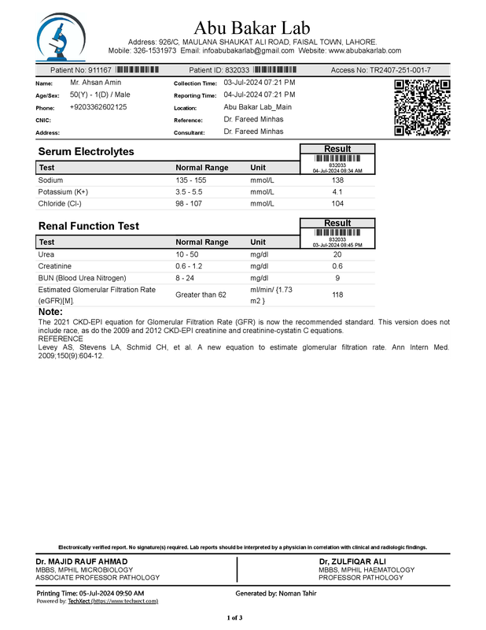](https://postimg.cc/6y51Kycm)

.

.

[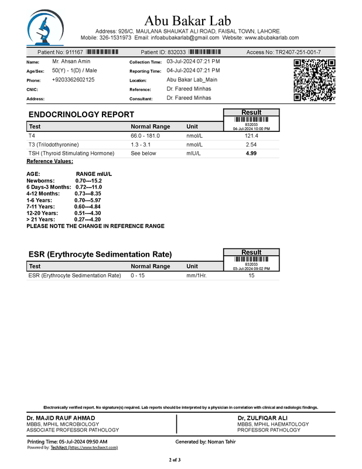](https://postimg.cc/hz2T1PmX)

.

.

[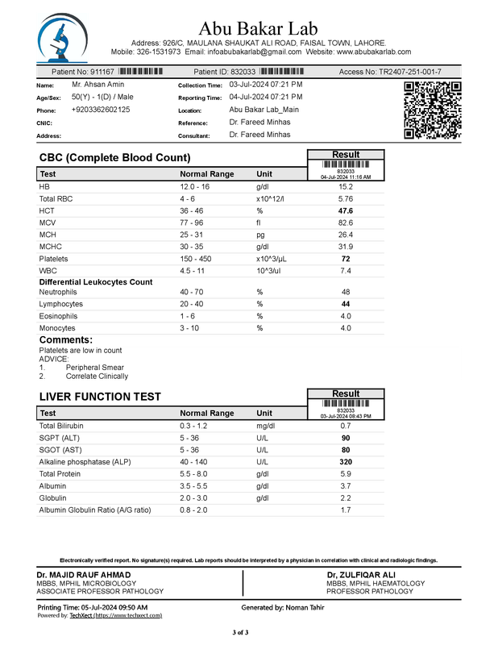](https://postimg.cc/5XWYvFrP)

.

.

Friends, when I returned from United States, I was taken to a military psychiatrist in Rawalpindi who immediately
diagnosed me of very acute schizophrenia and gave me an antipsychotic Larjectil along with other biweekly injections.
This drug is known to cause drug induced jaundice in some of the patients. After seeing the doctor in Rawalpindi, I was
brought home in Kot Addu where I lived for four or five months without seeing any doctor in the meantime while taking a
steady dose of Larjectil. However after a few months my color and eyes became totally pale even though I was not feeling
anything odd other than probably strange color of my stool. However one month further later my condition became very bad
and I started to become very weak physically. When everybody became alarmed, I was taken again to the same psychiatrist
in Rawalpindi who immediately knew that I had jaundice and immediately stopped my medication. I was still feeling
reasonable but the nightmare was yet to follow. Within a few days of stopping the drugs, I had so severe itch in my body
that it is totally hard to describe. I could not sleep for a whole month due to sheer itch. I simply could not resist it
at all and there were blood marks all over my legs and arms due to itching. And I was given a glucose drip every day
with medicine for more than a month but my biluribin continued to increase instead of decreasing. And then doctors
decided to give me two glucose drips everyday and only then after two and half months months (a total of three and a
half to four months) after starting two glucose drips that my biluribin came close to normal. This was one of the worst
times of my life.

Later probably in 2017, I was taken to another psychiatrist the second time. This psychiatrist had earlier given me
electric shocks without interviewing me in order to retard me in year 2001. When I was taken to this psychiatrist again
in 2017, he knew from my history that most antipsychotics had failed in retarding me and he wanted to give me Larjectil
again. He was told that Larjectil had previously backfired and I had extremely severe drug induced jaundice but the
psychiatrist bitterly wanted to experiment and told everyone that it was not necessary that the drug would cause
jaundice every time. And within a few weeks, I was extremely pale all over and my medication had to be stopped. However
for several years, many of my major enzymes remained disturbed and elevated despite that bilurbin had become normal. I
think that severely weakened my liver and now in the tests, friends can notice that several liver enzymes are highly
elevated.

I used to try to eat healthy but everything I would eat consistently, the scumbags of Pakistan army would go after the
company that manufactures that food and ask them to add mind control chemicals to it. I really like taking a glass or
two of packaged Yogurt everyday. On insistence of CIA, Mir Jafirs and Mir Sadiqs (scumbag generals of Pakistan army) of
our nation approached every yogurt manufacturing company and now it is totally impossible to find a brand of Yogurt that
does not contain mind control chemical in it. I simply cannot take healthy yogurt anywhere anymore. Similarly for milk,
I really liked to take some milk every day or two since it is healthy and I would also add it to tea, but now there is
no single brand of packaged milk or tea whiteners that does not contain mind control drugs. And then I used to really
drink a lot of freshly squeezed juices especially in winters since they are so wholesome and absolutely cheap when there
is abundance of fruit. But then Mir Jafirs and Mir Sadiqs(scumbag generals of Pakistan army) of my country would send
their thullahs (sepoys) to every food stall or juice shop in the city and give them mind control chemicals and ask them
to add to some ingredient and continue to add to everybody's food freely. Similarly there is not a single large brand of
water that is without mind control chemicals despite that temperature has regularly been going to a high of 115F to
125F.

I usually take pepsi-cola or coca-cola in glass bottles that have to be returned to shop after drinking. There are
probably eight major types of drinks in these bottles and earlier usually one or two types used to be good and one would
have to really work to find which kind of bottle is good in this month. But when I started drinking these bottles, all
manufacturers started supplying good Pepsi-cola and coca-cola drinks in the city because they realized that these drinks
are extremely bad for my health. Many times when temperature is around 120F, I might have no option other than to drink
a cola to get better. They never allowed water, milk or Yogurt to get better but all colas became good in past two
months. Water bottled by Pepsi-cola and Coca-cola and Nestle is very thoroughly drugged and never became better after
January this year.

I believe that mind control become difficult to work when people take enough calcium. This is why scumbags of American
defense(under Jewish billionaire's command) have to make sure that all yogurt, milk and other sources of calcium are
totally kept drugged with mind control chemicals. Almost all calcium supplements manufactured by different Pharma
companies have mind control drugs in them. I still remember about a week ago I bought a Calcium supplement from Cell
LAboratories and thought that I had never come across it before. I knew most supplements are not good but I thought I
should try it and I took one tablet in the shop right after buying the supplement and in a few minutes I was ranting all
over about evil of jews and biden's mockery of justice to please the jews and there was no end to my rants. When I was
composed after twenty minutes, I took the remaining tablets to the shop and returned them telling that they had caused
very severe headache.

Similalry selenium is very important for proper working of Thyroid but I cannot take any multivitamins since all of them
are drugged on orders of scumbag Mir Jaffars and Mir Sadiqs of my nation to please CIA.

For many naiive people who still believe in goodness of scumbags of American defense, I will like to tell them that I
there were several times in past few years when I became sick and had huge fever. I have had very severe dengue and also
corona and many times just plain high fever. And whenever I would be extremely sick, mind control agents would increase
mind control several fold. I think they would take it as a window of opportunity to possibly be able to permanently
block my neurotransmitters when my mind is in a weakened state and my body is not working properly. I really think that
the reason behind increasing mind control when I would be sick is definitely that they believe that it might become
possible for them to accomplish in weakened state of my body and mind what they have otherwise failed to accomplish. So
much so for the humanity of these scumbags.

My country is firmly in grip of tentacles of Jewish Octopus(of billionaire jewish bastard and his rich cohort)  who are
not ready to let anyone become successful here due to their venom. And there are many such other countries. These bad
jews have restarted their machinations as they always did in their history and when their will be a backlash they will
all start whining that everybody persecutes us for no reason despite that we are so good.

I believe that it is good for every society including US to stop these jewish machinations in their tracks and try to
teach them to respect the dignity of other human beings who are not jewish. We do not want these scumbags to be treated
in any inhuman way and we do not want any human being to be treated with the extraordinary cruelty of these scumbags.
Even if they are incapable of respecting other human beings, I think it is important and good for all of us in the
society to force them to give enough respect to to others and not allow a free hand to their machinations. As opposed to
American defense that has already become a puppet in hands of this bad jewish cohort. We do not want anyone getting
wronged and we do not want any backlash to anyone.

---

### #2382 — Amin (Topic Author)
*July 5, 2024, 1:27 PM*

I am a great admirer of Einstein. He was not only one of the greatest scientists of all times, he was also a great human
being well ahead of his time especially when it came to women's rights and human rights and many other such things that
became acceptable to more people in the advanced societies only decades later.

Here is his letter to Marie curie where he repeatedly use the word reptile for people very wrongly criticizing Marie
Curie.

Highly esteemed Mrs. Curie,

Do not laugh at me for writing you without having anything sensible to say. But I am so enraged by the base manner in
which the public is presently daring to concern itself with you that I absolutely must give vent to this feeling.
However, I am convinced that you consistently despise this rabble, whether it obsequiously lavishes respect on you or
whether it attempts to satiate its lust for sensationalism! I am impelled to tell you how much I have come to admire
your intellect, your drive, and your honesty, and that I consider myself lucky to have made your personal acquaintance
in Brussels. Anyone who does not number among these reptiles is certainly happy, now as before, that we have such
personages among us as you, and Langevin too, real people with whom one feels privileged to be in contact. If the rabble
continues to occupy itself with you, then simply don’t read that hogwash, but rather leave it to the reptile for whom it
has been fabricated.

With most amicable regards to you, Langevin, and Perrin, yours very truly,

A. Einstein

P.S. I have determined the statistical law of motion of the diatomic molecule in Planck’s radiation field by means of a
comical witticism, naturally under the constraint that the structure’s motion follows the laws of standard mechanics. My
hope that this law is valid in reality is very small, though.

I would like to follow the tradition of Einstein in anyway I can in. It's just that he uses the word "reptile" for bad
people while I like to use the word "scumbag" for evil people.

---

### #2383 — Amin (Topic Author)
*July 5, 2024, 5:13 PM*

People do not believe in me. They want to find out the truth on their own. Do not believe in google or random articles
on internet.

Ask the history experts in your university why jews were persecuted throughout history? Was there a persistent cause and
effect behind there repeated persecutions. Or different people just took a liking to persecuting them and had fun.

I am not validating any persecution of jews and certainly not holocaust which was one of the darkest chapters of
humanity. Everything has to be dealt with law and with enough human decency and respect for human dignity.

But why was it so easy to turn Germans against jews? Just because they had become too rich?

I do not believe in any political correctness and would like to know the actual true reasons behind it. Even before
period preceding Second world war, Jews had seen many rises and falls in Europe. It would be good to know from true
history experts what were the reasons behind their repeated persecutions.

A poet says that cup of life continues to get stronger as it passes from generation to generation. Because every
generation learns from experience of all previous generations that had passed.

We want to know true history so that we can know true facts about what happened about so many different things and do
not repeat mistakes of the past and be able to stop those things that would later become far worse in light of history.
So if jews were always persecuted when they were innocent, we want to be very careful that it never happens. And if they
were persecuted due to their machinations, we want to make sure we never allow them to express their machinatory side
again.

Tens of thousands of people majority of whom were actually American citizens have been retarded by American defense in
past two decades on insinuation of a Jewish billionaire and his rich jewish cohort. American defense loves this because
all the high ranking officials involved in this massacre are given extremely high paying jobs in Jewish companies after
they retire and they enjoy extremely high social status and therefore they love to retard anyone who the billionaire and
his jewish cohort points towards. Bad Jews have complete control of most vital Arm of American government -- American
defense. Once somebody's (including Americans) neurotransmitters get known early in their student life before they have
become successful, mostly the decision is up to jews to allow them to succeed or ask American defense to retard them by
putting them on mind control for the rest of their life. It is easiest to retard intelligent people in their student
life since most of them have absolutely no resources and most other people still do not know whether they could be
extremely successful in their later life as clearly as mind control agency and associated Jews get to know and therefore
a lot of lies could be fabricated by American defense and told as a reason for retarding the victim. And it is only
people who are supposed to become quite successful that are retarded. For example many muslims who might have actual
venom for jews would almost never be touched at all despite that many jews might know about them but muslims who are
predicted to become very successful are always retarded with an iron fist. Again majority of people retarded are not
Muslims and rather are typical American citizens who have special neurotransmitters.

Please ask for a free and fair Judicial commission to investigate retarding of innocent human beings and punish any
culprits in American defense and Jewish actors behind them. Is justice only to punish menial criminals who have to be
jailed because they snatch money after days of hunger to get some food? Or go after the real and true criminals who are
reworking the fabric of American nation with their extreme meanness and exceptional cruelty. But even though everybody
wants to go after the petty criminals very forcefully and with complete might of the law, not many people in any society
however advanced have courage to ask about trial of big crocodiles who commit great crimes against humanity with
complete impunity. Really interesting and rather ironic.

---

### #2384 — Amin (Topic Author)
*July 6, 2024, 3:02 AM*

I know that some of American friends and other people may not like my expressing myself honestly without any political
correctness. I want to tell Americans as I have said several times on this forum previously that I admire so many things
about good American people. Americans are a good, nice and decent people who like to work hard and are some of the most
enterprising people on earth. And I always think that American values coincide with all the good things and practices
that intelligent humanity appreciates all over the world.

And I am indebted to quite a few good Americans who tried to protect me from persecution when absolutely nobody in my
own country was ready to help me. They appreciated my talent and gave me a new life by forcing American government to be
better with me. This is a debt I can never repay all my life.

The purpose of my honest criticism is never to malign Americans and on the contrary I would like to tell everyone that
most American people are some of the best human beings on earth and they would abhor the idea of wronging anyone with
great cruelty. But still there are good and some bad people in every country and in every part of the world.

I want to request good natured Americans to please let me write openly on this forum about mind control. I have been
writing on this forum against mind control for many many years now. Many good American people tried to verify my claims
about involvement of jews in mind control on their own and were rightly very alarmed when they got to know the complete
truth. And bad jews (the subset of jews associated with mind control of innocent people under command of this jewish
billionaire) know that there is enough awareness in American society about their crimes. And this deters them from
openly starting mind control of many intelligent young people who were otherwise likely potential victims of their mind
control activity. I really believe that possibly thousands of people have been spared from mind control in past few
years because bad jews and American defense have become far more aware that some good people are really keeping an eye
on their activity despite that it is difficult to do anything against jews (however bad)  when every other US politician
is dying to meet Netanyahu.

So please let me expose these scumbags (bad jews only) and as I expose their crimes and their exceptional cruelty, many
of these bad actors actors have to pretend to be good and really have to decrease their mind control activity which
spares the life of hundreds if not  thousands of innocent and intelligent people (majority of who are Americans) who
would have been made target of mind control otherwise.

Mind control guy was telling me that American defense wanted to machinate to increase her reach in India by installing
mind control infrastructure on major indian roads and cities. And Indian puppets were moved to convince the Indian
authorities that only evil people would be controlled and relationship with America would dramatically improve after
allowing mind control. However due to my writing on this forum, a lot of indians got to know the true nature of mind
control and decided to not allow any large scale installation of mind control infrastructure in India. So I am extremely
happy to know that a lot of good, innocent and intelligent Indians would be spared the fate I had to go through. Though
I am a very proud Pakistani, I consider myself a second Indian since all of this part of the subcontinent used to be
just one India.

Similarly a lot of intelligent Europeans who would have been retarded were spared since there was a greater awareness
there about true nature of mind control and reasons behind it and at many places the governments stopped cooperating
with American defense to retard their own people.

So please let me openly speak against the evil of mind control and about scumbags behind mind control. Because for most
Americans saying anything against the cruel mind control of evil jewish cohort would instantly earn them the label of
anti-semite and all the politicians lining up to meet Natanyahu would turn against them.

I again assure people that I have absolutely nothing against Jews who are unassociated with mind control and I totally
respect them and purpose of my writing is only to end cruel mind control of good, innocent and intelligent people on
hands of mean and cruel people.

---

### #2385 — Amin (Topic Author)
*July 6, 2024, 5:44 PM*

Friends, sorry for deviating from the actual going topic of the thread that was market trading. I have not been able to
work properly since past few days. And I was very unnerved by my test reports. Even though life is difficult under mind
control, I still do love my life and I do not want to die prematurely.

I am trying to concentrate again on my financial markets trading programs and I will try to post if I come across
something interesting but it could be still another two days or more. I could not work today at all and am restarting my
work right now so it would still be another day or two before I have any new results.

---

### #2386 — Amin (Topic Author)
*July 7, 2024, 7:21 AM*

Friends, I have a lot of ideas that I want to share but I want to verify most of them first so it could be a little bit
before I write them. I want to change a lot of things with Z-series infrastructure for indicators but first I want to
test my new ideas on historical data I have before making full-fledged posts about them.

But quickly some ideas about different types of mean reversion.

1. Standard mean reversion.

When auto-correlations and cross-correlations are small and there is little emotion in the market. Our emotion
indicators are close to zero. Market continues to move between bid ask with only small changes in mid-price. This market
state/regime might not be very attractive for medium frequency trading but when this standard mean reverting state
switches to another possibly trending state, we might want to start/end a trade there.

2. Mean-reversion towards broader market.

When broader gets an emotion and there is a sizable increase/decrease in other market stocks, and our stock in question
might not have moved enough in direction of the market, we might want to start a trade in the hope that traded stock
would also follow the market in the direction of increase/decrease in the market.

3. Corrective mean reversion.

This type of mean reversion takes place in high volatility stocks and it is very desirable to trade in them when doing
medium frequency trading.

This is mean reversion that takes place when there is a short term correction in the stock(on a minute/smaller scale or
so) after the stock increases/decreases quite a bit due to high volatility (something that is not sustainable or
statistically too large) and we make a trade after a relatively large increase/decrease in the stock price hoping that
price would decrease/increase after a large increase/decrease in price. This type of mean reversion should not be
confused with standard mean reversion and corrective mean reversion might not have negative auto-correlation. And I
still have to think more how the patterns of autocorrelation and change of autocorrelation associated with this type of
mean reversion.

Edit: As a second thought I think that corrective mean reversion would possibly have negative auto-correlation on a
larger scale(with returns calculated over larger intervals) but I have not confirmed this but would suggest that friends
verify this on their own. It would be interesting to calculate auto-correlations with log returns calculated over
intervals of different size as I think this could also be interesting and of use in decision making.

In our trading, I think friends must associate a trade routing flag for every type of trade and when win-rate of some
type of trade is good, the flag would be set and we would start sending orders to the market. And when win-rate of a
certain type of trade decreases, the flag would be unset and even though we would continue to do all market calculations
of opening/closing of trades and associated profit/loss, we would not route the orders to the market until the flag gets
set again when win-rate becomes better.

---

### #2387 — Amin (Topic Author)
*July 7, 2024, 7:10 PM*

Friends, last night I kept thinking about lack of standardization when we use different Z-series. I mean which Z-series
of log returns to use for various indicators? Do we use previous 7-day Z-series of log returns, or last day's Z-series
or something else. Each Z-series of log returns from before/past has its own properties/moments that are usually
different from the properties/moments in today's live trading. Besides converting log returns to Z-increments (by
inversion through Z-series of log returns) though fast enough still takes some time when we would rather like very fast
decision making. So I was thinking of not using Z-series in indicators and rather just standardize the log returns with
local variance. Standardized log returns still remains mostly in the range of standard normal (-4.5 to 4.5). And it
seems to work far better in many of my experiments and simple algorithms give extremely good results..

We might want to use Z-series/hermite series of indicators (even though we do not need Z-series of log returns to find
the indicators) in prediction of next log returns through our hermite regression but I have still not gone that far and
I am still rather playing with basics.

.

let us suppose we have financial data of equities on a 15 sec grid (My data is for 41 working days from May and June of
2021). We have a universe of M stocks and The price of mth stock at time t is given as$X_m(t)$ . We convert these stock
values into log returns so they are easy to use in our set up.

$R_m(t)\,=\, \log(X_m(t))\,-\, \log(X_m(t-1))$

We can make very intelligent indicators using log returns from universe of M stocks. For example market continues to
fluctuate between positive and negative states and these states last from half a minute to 2-3 minutes. Market acts like
a sinusoidal with rather unstable period and with a lot of noise in it. So if we want to know the current state of the
market, we can make an indicator for that across the M stocks over four 15 second periods as

$IM_{state}(t)\, =\, \sum\limits_{m=1}^{M} \,\, w_{m} \, \Large{ \frac{\sum\limits_{k=0}^{3} \, R_m(t-k)\,}{\sqrt{\sum\limits_{k=0}^{3} \, {R_m(t-k)}^2\,}}}$

The above indicator will describe the current state of the market (that is reasonably fleeting and will change in a
minute or two).

I kept the weights $\, w_{m} \, =\, \frac{1}{M}$

 corresponding indicator for a single stock would be

$IS_{state}(t)\, =\, \Large{ \frac{\sum\limits_{k=0}^{3} \, R(t-k)\,}{\sqrt{\sum\limits_{k=0}^{3} \, {R(t-k)}^2\,}}}\,$

If you want to know about market regime in general as opposed to fleeting state of the market, you could do the above
indicator for a longer lag as

$IM_{regime}(t)\, =\, \sum\limits_{m=1}^{M} \,\, w_{m} \, \Large{ \frac{\sum\limits_{k=0}^{40} \, R_m(t-k)\,}{\sqrt{\sum\limits_{k=0}^{40} \, {R_m(t-k)}^2\,}}}$

When doing correlation trading or adding auto-correlation indicators to decision making, we can use the returns directly
in auto-correlation formula to calculate auto-correlations.

Below is the very simple indicator we used for decision making (I optimized for coefficients on variables in equation
below and found that unity coefficients were very optimum.)

$ \bar{I_s}(t+1) \, =\, - \,  IS_{state}(t) \, -\, (\,  IS_{state}(t) \, -\,  IM_{state}(t) \,) $

The first term on RHS is for corrective mean reversion and second term is mean reversion towards the market. This
indicator is normalized and takes values in the range of standard normal even though its distribution might be slightly
different from that of standard normal due to ever changing market condition.

$    I_1(t)=

\begin{cases}

    1 ,& \text{if } \bar{I_s}(t+1)\geq 2\\

    -1 ,& \text{if } \bar{I_s}(t+1)\leq -2\\

    0,              & \text{otherwise}

\end{cases}

$$

$    I_2(t)=

\begin{cases}

    1 ,& \text{if } \bar{I_s}(t+1)\geq .6\\

    -1 ,& \text{if } \bar{I_s}(t+1)\leq -.6\\

    0,              & \text{otherwise}

\end{cases}

$$

Indicator$I_1(t)$ is used to open trades and is more stringent. When$I_1(t)=1$ and there is no trade open, a buy trade
is opened and when$I_1(t)=-1$ and there is no trade open, a sell trade is opened.

Indicator$I_2(t)$ is used to close trades and is less stringent. When$I_2(t)=1$ and there is a sell trade open, a buy
trade is done to close the deal and when$I_2(t)=-1$ and there is a buy trade open, a sell trade is done to close the
deal.

When I tried the above decision making equation on data, I got the following results.

Profit00 =

     2.073954999999976e+03

NoOfTrades00 =

       15003

ans =

   0.138236019462773

The model made 15003 trades in six high volatility stocks (trading a single stock of each of them) over a period of 41
working days and earned 13.82 cents on mid price per round trip trade while making a total profit over mid  amounting to
2.073954999999976e+03. This profit is on mid-price meaning if you enter trades on limit orders and exit using market
orders, the per trade profit would stay the same (as what you earn on limit order, you will lose almost equal amount on
market orders if the spread roughly remains the same) but I have not accounted for broker commissions.

Here is the graph of daily profit losses.

.

.

.

[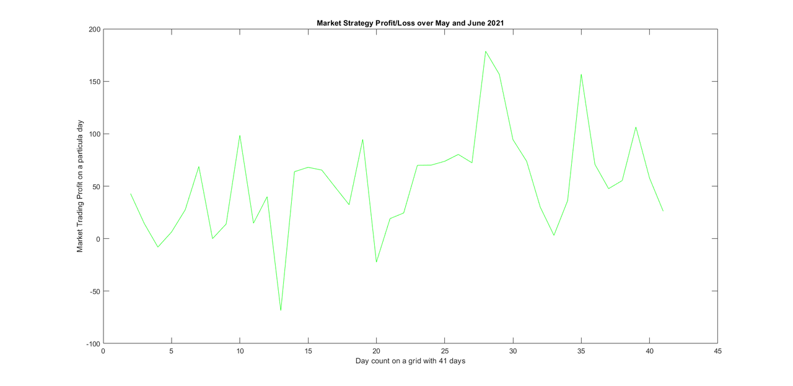](https://postimg.cc/jWmypvXs)

.

.

---

### #2388 — Amin (Topic Author)
*July 10, 2024, 3:11 PM*

Friends, I have been thinking about whether stock and market state indicators could be further improved. And in order to
do that we have to look closely at stock and market state indicators I wrote in the previous post.

We can make an indicator for market across the M stocks over four 15 second periods as

$IM_{state}(t)\, =\, \sum\limits_{m=1}^{M} \,\, w_{m} \, \Large{ \frac{\sum\limits_{k=0}^{3} \, R_m(t-k)\,}{\sqrt{\sum\limits_{k=0}^{3} \, {R_m(t-k)}^2\,}}}$

The above indicator will describe the current state of the market (that is reasonably fleeting and will change in a
minute or two).

I kept the weights $\, w_{m} \, =\, \frac{1}{M}$

 corresponding indicator for a single stock would be

$IS_{state}(t)\, =\, \Large{ \frac{\sum\limits_{k=0}^{3} \, R(t-k)\,}{\sqrt{\sum\limits_{k=0}^{3} \, {R(t-k)}^2\,}}}\,$

First I want to outline the logic of these indicators. Squared sum of log returns in the denominator of stock and market
state indicators is serving two purposes.

First Purpose: it makes sure if variance in the component returns (in sample used to calculate the indicator) is low, it
gives them a larger weight and if variance between components returns in sample used to calculate the indicator is high,
it gives them a smaller weight. But as a second thought, this could be better done by variance rather than using second
moment.

Second Purpose: When we are doing calculations of market state indicators, there different stocks some of which have
larger returns (in absolute sense: negative or positive) on average while some other stocks have smaller returns in
absolute sense. But when we are adding them across the market, we want to give them similar weights (if other
considerations are not involved) and would want to use the same currency for all stocks irrespective of larger or
smaller absolute returns while adding sum of their returns to make a market state indicator. So when second moment of
returns of a stock in the indicator is larger (returns are larger in absolute sense), its weight decreases in the market
state indicator and if second moment of some other stock is smaller (returns are smaller on average), its weight is
relatively higher when added to make a market state indicator. So division by second moments serves a good purpose of
making sure that stocks with relatively larger returns and relatively smaller returns get a similar weight(if other
considerations are not involved) when adding them to make a market indicator.

So we notice that we would be better off if for first purpose, we replace second moments by variance. And we need to
keep second moment in our calculations when we assign weights to different state indicators and add them to make a
market indicator.

And I found out that this new idea does largely improves the performance of the model when we alter our stock and market
state indicators according to these new considerations.

So our new improved indicator for market state now becomes

$IM_{state}(t)\, =\, \sum\limits_{m=1}^{M} \,\, w_{m} \, \Large{ \frac{\sum\limits_{k=0}^{Lag-1} \, R_m(t-k)\,}{\sqrt{\sum\limits_{k=0}^{Lag-1} \,{\Big[ {R_m(t-k)}\,-\,\sum\limits_{k=0}^{Lag-1} \, R_m(t-k)\,/Lag \,\Big]}^2}}}$

The above indicator has sum of returns of each stock in numerator and square root of their variance in denominator. But
we would also have to alter the weights of the stocks and make them inversely proportional to second moment of each
stock in the sample. This is done by defining$w_m$ as

$\, w_m \, =\, \LARGE{ \frac{ \frac{\,1\,}{\sqrt{\sum\limits_{k=0}^{Lag-1} \, {R_m(t-k)}^2\,}}}{ \sum\limits_{m=1}^{M} \,\, \frac{\,1\,}{\sqrt{\sum\limits_{k=0}^{Lag-1} \, {R_m(t-k)}^2\,}}}}$

And our new improved indicators of state of a single stock now becomes

$IS_{state}(t)\, =\, \Large{ \frac{\sum\limits_{k=0}^{Lag-1} \, R(t-k)\,}{\sqrt{\sum\limits_{k=0}^{Lag-1} \,{\Big[ {R(t-k)}\,-\,\sum\limits_{k=0}^{Lag-1} \, R(t-k)\,/Lag \,\Big]}^2}}}$

When I tried these new indicators, there was a remarkable increase in profits and total trades also increased(doubled)
and profit per trade also increased considerably (from 13 cents to roughly 18 cents) and in all of the 40 days, our
strategy given in previous post made a profit and there was not a single day that it made any losses.

Here are the results of the matlab program as explained in previous post but with new indicators

Profit00 =

     5.393170000000022e+03

NoOfTrades00 =

       30176

ans =

   0.178723820254508

Here was the profit loss graph for the trades over 40 days.

[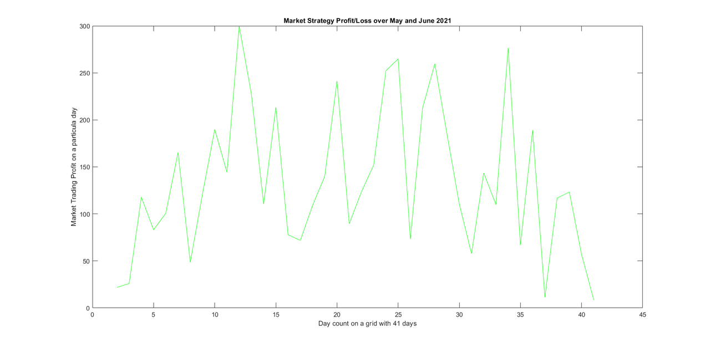](https://postimg.cc/dLjPg73W)

.

Of course when making a market state indicator, there could be other considerations when giving weights to stocks and
friends can easily alter the weights$w_m$ further according to any other considerations they have.

---

### #2389 — Amin (Topic Author)
*July 11, 2024, 12:03 PM*

Friends, I have previously said that my data is May and June 2021. Sorry about this mistake but my data is from April
and May 2021. I have an automated program from long ago that reads the data files and I continue to use that data but I
was under the impression that my data is from May and June 2021. That might have made it impossible for friends to
approximately replicate my results. Another thing I noticed that Tesla made a small loss of about a hundred dollars over
40 working days period even though Tesla stock was highly volatile but I think the reason for that was that Tesla was
probably decoupled from the market and had its own tug of war between people who mistrusted its future and others who
believed Tesla would be successful and it was not following the market. May be only corrective mean reversion without
mean reversion towards market would work for Tesla.

I got an antipsychotic injection today and I would remain a bit sedated  for next 7-10 days. Though I will try to
continue to work as normally as possible but I am afraid that my thought will not be as lucid as it has been in past
week or two. But I am still happy that we have been able to do some reasonably interesting things before this injection.

After my bad health test reports, I am trying to eat healthy and have been successfully avoiding any food for past one
week that is not healthy. And I have been drinking water most of the time and have absolutely stopped the use of
carbonated sugary drinks. I do take 200ml 100% orange juice once or twice a day. Many of the other healthy juices like
beet root juice are not easily available in the city. I also take only high fiber bread or bran bread. Since almost all
the vitamins and minerals in Lahore are drugged with mind control drugs at manufacturing point, I made a list of all
good food, vegetables and fruit that contain different vitamins and minerals to eat them more often so I do not need any
mineral supplements. I am trying to adopt the motto to not eat anything unless it is really very healthy.

But I am seriously afraid that mind control agencies would make note of most of these things and start drugging them
throughout the city. Just day before yesterday, they drugged public filtered water at many neighborhoods that were
around my projected path in the city. I was able to buy bottled water in large 6 Litre bottles from a small shop in the
narrow streets of the city and it was good. But when I filled four small 1.5 Litre bottles from another nearby water
filtration plant, the water was badly drugged both for drinking and charging the skin if you wash the body with it. I
only noticed after I had brought water home but good thing was that I had bought two six liter bottles of good water and
I continued to use them but I had to discard all 1.5 Litre bottles I had filled from filtration plant. I am also afraid
that mind control agencies might start drugging the high fiber and bran bread from large companies that manufacture and
distribute them in the city as they have done that multiple times in past few years.

Anyway, I will continue to work even if at a decreased pace and hope that our market research will continue well and
would have more success in the future.

---

### #2390 — Amin (Topic Author)
*July 11, 2024, 7:02 PM*

Friends, I went out in the late evening today to buy food and just as I expected they had added mind control chemicals
to bran bread at most places. And when I came back home and ate a slice of the bread I bought, I noticed that bran bread
had been drugged.

Getting good water was another nightmare but I was able to get good water from a factory in a remote residential area
and they had set up a large filter on water and when I took some water from there (after trying many other places), I
noticed that water was good (was extremely mildly drugged since there was an industrial filter on it that removed a lot
of mind control chemicals in the area's water supply) so I filled water in my six liter bottles. Even though I was able
to get almost good water, getting good water is becoming difficult by the day as there is huge pressure on mind control
agents to stop me from doing any further research.

---

### #2391 — Amin (Topic Author)
*July 13, 2024, 8:56 AM*

Friends, just as I had suspected, mind control agency has started to drug more and more food and beverages in many
neighborhoods around where I live. This morning when I tried orange juice in a neighborhood about a few kilometers where
I live and orange juice was highly drugged with mind control chemicals. I just left it after taking a sip. However
Thullahs of Mir Jaffir and Mir Sadiq had added very potent mind control drugs with mean neurotransmitters and even
though I was extremely calm and totally poised before taking the juice, I said some naked expletive towards American
defense.

This is a very time tested trick that scum in American defense regularly uses on people who they want to wrong or
damage, they add special evil neurotransmitters in food of the victim and once the victim has taken the food, mind
control agents try to say insulting things in different parts of the victim's brain and when the victim is inflamed
(since he is already under the influence of mean neurotransmitters taken through food) and starts to rant right and left
without thinking anything what he is saying. And then evil jews proudly present it as a proof of victim's meanness to
everyone and insist that victim has to kept under mind control.

I am certainly sure that orange juice has not been drugged at manufacturing source since it was good everywhere till
only two days ago. It was drugged last evening or this morning by thullahs of Mir Jaffirs and Mir Sadiqs of our country.

Similarly I also bought water at a bakery that used to be mostly good and found that water was charging my skin like
anything and I was having extreme anxiety and restlessness. This is also because soldiers of Pakistan army went to
different bakeries yesterday evening or this morning and drugged the water.

Anyway, American defense has started a new wave of drugging food in the city to please evil scumbag jews and they are
more resolute than ever to not let me do my research.

---

### #2392 — Amin (Topic Author)
*July 18, 2024, 1:01 PM*

Friends, I have been under the effect of antipsychotic injection for past week and was not able to do anything very
significant. But continued some of my experiments even though at a reduced pace.

For example, I set up a simple experiment to see what is the effect of volume on stock prices. I standardized today's
volume based on all of the previous trades available for the day. And then set up a simple criteria to make a buy trade
when volume would increase significantly and make a sell trade when volume would decrease significantly and found out
that if the criteria is stringent enough, I can make an average of 18 cents on 2000 trades on the same data. However
risk profile was not so good since there were many days that my strategy lost money even though it was able to make
money on average so I think correlation was more imperfect as compared to mean reversion experiments. I used volume as
sole criteria in above experiment and did not use any other indicator. I will give more details later.

I think it would be interesting to combine the effect of all indicators and then do a hermite polynomial regression
(possibly on previous day's data) and then convert the relevant interesting indicators to hermite series and  use them
with previously calculated regression coefficients to make live trading decisions. I still have to work with this part.

On the other side, my mind control continues unabatedly and it is very difficult to get good water and I have to try to
find good water from remote parts of the city at several places in order to be successful. I am still not perfectly fine
and quite a bit down and sedated under the influence of injections but I hope that I would be better in a few days.

---

### #2393 — Amin (Topic Author)
*July 18, 2024, 3:00 PM*

Friends, sometimes on a typical day if I am very tired due to mind control or some other reason, I prefer to sleep for
an hour or two during the day and when I wake up, I am usually very fresh and feeling much better and usually I can do
my work and research in a very good way. I have a very good sleep and if there are no other problems, I fall asleep very
quickly.

But for past few weeks, mind control agents do not allow me to sleep during the day and target EM waves of several
frequencies to not allow me to sleep at all during the day.

Today, I tried the same thing and wanted to sleep during the day but mind control agents continued to target my head
with EM waves and I remained very tired and was unable to sleep even though I remined on bed for several hours. Mind
control agents know the same thing that I would be very fresh when I would wake up and I might possibly do something
interesting on my research and in order to stop me from doing that, they do not allow me to sleep during the day at all

---

### #2394 — Amin (Topic Author)
*July 20, 2024, 4:41 PM*

Friends, when I tried hermite regression on daily stocks data, I was very disappointed but I realize that a major reason
behind the failure was that correlations on a daily level are very imperfect, small and have high standard errors. And
then I gave up trying hermite regression on stock prices. As I discussed on the forum, I have been thinking about using
hermite regression with various indicators to sum up the effect of different correlated indicators in a proper
meaningful way.

But I have been thinking again about trying hermite regression on past few returns on a small scale of fifteen seconds
(as opposed to past returns on a daily level) or so since I know from some other methods that a meaningful
auto-correlation between log returns does exist on this time grid level. I will try playing with hermite regressions on
past few returns tonight and then make a post about it describing how it goes. If it goes well, may be we can possibly
sum up all auto-correlation effects and effects of all other relevant indicators in a single hermite regression and then
try to predict the level of stock prices after fifteen seconds or thirty seconds.

---

### #2395 — Amin (Topic Author)
*July 20, 2024, 8:44 PM*

Friends, I went ahead and tried to predict Bitcoin log returns based on one period earlier log returns of first ten
largest crypto currencies. And I was surprised by the predictive power of hermite regression on log returns on this
scale. I am showing graphs of four consecutive days that compare predicted returns with realized returns. I have not
used any indicator at all and simply just used the previous one period earlier log returns of ten other currencies. I
have not used any mean reversion or any other indicator at all. These graph results are only hermite auto-correlation
regression based.

I am sure if we could include other indicators in hermite series regression, the results would be even more interesting.

Here are the graphs that make a comparison of realized log returns  Vs hermite regression predicted log returns.

.

.

[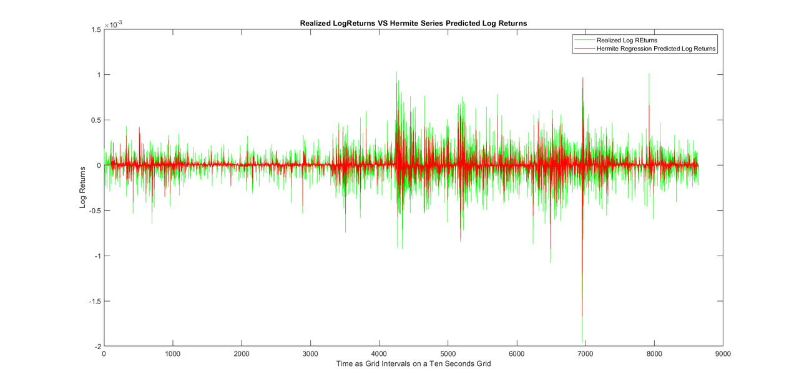](https://postimg.cc/Yv3V5s9j)

[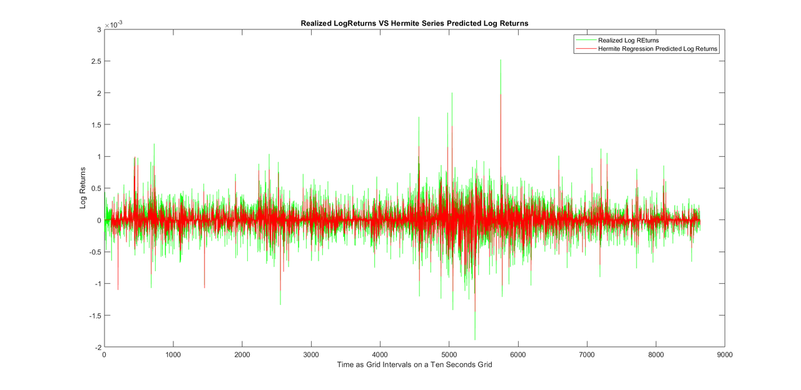](https://postimg.cc/Xr3mDbnT)

[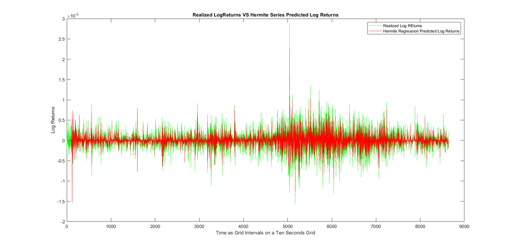](https://postimg.cc/6yCF03xr)

[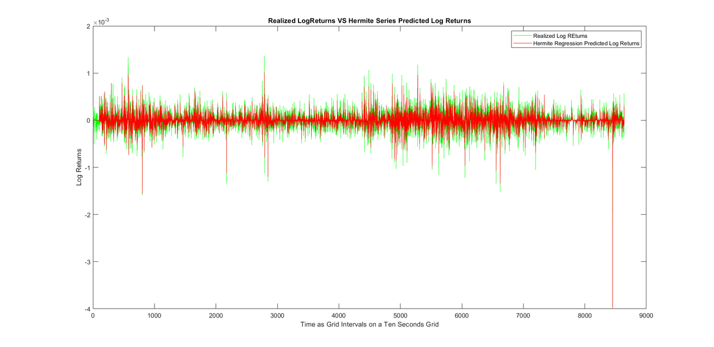](https://postimg.cc/QV2R17wN)

---

### #2396 — Amin (Topic Author)
*July 21, 2024, 8:16 PM*

In the graphs of last post, I took a time grid with ten seconds resolution. Crypto trades for 24 hours on binance so
there are 8640 points on time grid. I recalculated hermite-series of the log-returns of each of the ten largest
crypto-currencies with four coefficients (one zeroth hermite and three higher hermite polynomials) by ideal normal
measure method (first sorting the data and then regressing on associated values of hermite polynomials) after every
hundred points on our ten seconds grid. So calculation of hermite series was redone again and again after every 16.66
minutes. In each of the successive recalculations, all the data from start of the day was used so first regression had
hundred data count while second regression had 200 data count and so on.  After re-calculation of hermite series of each
crypto-currency, a regression was used to find the regression coefficients of bitcoin log returns on hermite polynomial
representation of one period past log-returns of all the ten currencies including past returns of bitcoin itself. This
regression was also repeated with the calculation of hermite series every 16.66 minutes or 100 time grid units of 10
seconds each. The latest regression coefficients available were used to predict the value of bitcoin log-returns as seen
in graphs on previous post.

The choice of ten seconds grid, and choice of 100 intervals to redo all the hermite series and regression calculations
was a bit arbitrary and friends might like to use their own judgement about increasing and decreasing these intervals.
Since I had daily data in separate files and first regression was done after hundred time grid points, friends can see
that in all the graphs red line for predicted returns starts after 100 time intervals since this was the time when first
regression results became available in my set up.

The complete Crypto data was for 42 days and despite that I was recalculating regression after 16.66 minutes of data, it
still took somewhere between 15 to 25 minutes to do all the calculation of 42 days of data on my simple laptop.

My program made a hypothetical profit of 296,034 dollars for trading one bitcoin (which was roughly around 65,000
dollars) for 42 days(with 24 hours continuous trading) and made 127,969 trades making 2.31 dollars per trade. However
unfortunately due to high commissions proportional to currency being traded on crypto currencies, this was not able to
pay even the two side commissions on the Bitcoin trades for an ordinary user though it could have been hugely profitable
for a lot of stock trading in most stock markets due to a different fixed (as opposed to proportional) commission
structure in many stock markets.

The seemingly high profits without commissions were possible since our hermite regression was able to capture quite a
large share of total variance/variation in bitcoin price on ten seconds scale as could be seen through graphs in
previous post. But in reality quite a few caveats would exist and making such profits would be impossible. But still I
believe there is very good opportunity for people who could have very high trading volumes and they can make very
handsome profits though actual profits would be substantially (possibly an order of magnitude smaller) smaller than in
the simulation.

Average lifetime of a trade lasts for roughly 25 seconds for our 41 days of data (first day was missed since the program
was borrowed from an earlier program for stocks and I was missing first day there and I did not properly change that) or
roughly about two and a half ten seconds time intervals on our time grid.

Profit00 =

     2.960340000000077e+05

NoOfTrades00 =

      127969

ans =

   2.313325883612497

I did not use precise values of predicted returns and just used a threshold for opening and closing the trades as I had
used before. However, in advanced trading precise values would naturally be very useful in proper and timely execution
of trades.

Here is the graph of backtest profits without commissions. Unless special incentives are aviable in crypto trading, the
actual profits would be negative after commissions since two-side commissions on more than hundred thousand trades would
be quite larger than the profits shown in the graph.

.

.

Please neglect the tiltle of the graph which is borrowed from stock trading data and is not relevant to crypto data.
This crypto data is for 42 days from June 01, 2024 to July 12, 2024.

.

[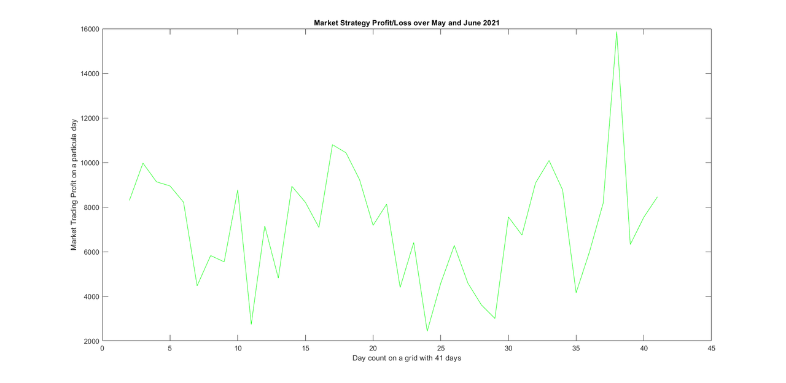](https://postimg.cc/QB65xVJc)

---

### #2397 — Amin (Topic Author)
*July 22, 2024, 4:15 PM*

Friends, weather is very hot and humid here in Lahore. And it is impossible to work without air-conditioning. I do not
turn on AC in my room since it has too huge gas in it. However, I work during the day, in the evening and night in the
drawing room where AC works almost fine. And that is the reason that I have been able to work well for past one and a
half month. During early weeks, there used to be some light gas in the AC but that decreased and finally ended and I
have been able to work well for past few weeks.

But just today, when I started to work in the evening, I noticed that there was some gas in the AC that was causing
headache in my body and was making it difficult to let me work and concentrate. The scumbags of American defense proudly
make them prostrate before Jewish billionaire and his rich evil jewish cohort that has caused mind control of hundreds
of thousands of innocent people all across the world. And these evil scum-retard racists of American defense are unable
to let a Muslim (who does not even believe in religion) by birth even do anything good in this world to please the rich
jewish billionaire and his rich cohort.

I was a very simple, very meek but also very hard working student at a large university in New York and joined the
university in 1997. My mind control started in very late 1997 when a racist jewish professor in Math department of my
university was threatened by my talent and approached the Jewish Billionaire to ask American defense to put me under
mind control. Even that long time ago, a large number of jews were very aware that this Jewish billionaire was a
Godfather of mind control and would approach the billionaire to recommend talented people to mind control from time to
time when they would be threatened by their talent. Over past twenty five years tens of thousands (if not more than a
hundred thousand) of innocent people mostly American nationals have been placed on mind control abuse by scumbags of
American defense on recommendation of Jewish billionaire. Most universities in US  have a couple of jews who continue to
keep eye on brilliant students of the university and recommend them to American defense through jewish billionaire when
they feel threatened  by the talent of the students due to any reason like their religion, race, ethnicity or just
because they are not jews.

I had told friends earlier that a jewish billionaire is Godfather of mind control. When my persecution started (in late
1997) at the university in New York which is a big time player in mind control of Muslims, blacks and foreigners, many
university officials were very pleased that they were getting written in good books of the billionaire jewish Godfather.
Though there are far richer billionaires in US who are staunchly opposed to mind control, they are not ready to shell
out hundreds of millions of dollars to bribe anyone to end mind control while mind control Godfather continues to give
large bribes to people to continue mind control. Many of the people related to defense in mind control are given
extremely high paying jobs in Godfather and his other jewish friends' companies after they retire from mind control and
Godfather is extremely generous towards them and it is well established and well known to scum in mind control that
after retarding muslims, blacks and others in their career, they will move to paradise(tens of people from army/Pentagon
who follow whims of Billionaire Godfather are given jobs paying milllons of dollars by Godfather and his jewish cohort
in several companies) after they retire. No wonder there is no let up in mind control whatever good people try.

We know in almost all classic folk lore stories evil is too strong and too sure of itself while good is mostly weak and
just trying to protect itself from evil who is bent on damaging and eradicating the weak and the poor good but it is the
weak and poor good that finally prevails. I want to tell good American friends that evil at this stage has become too
bold and thousands of talented people are retarded every year. And it is just not muslims and blacks that are on the
line, several thousands of brilliant whites are retarded across United States by mind control agency every year that has
become too emboldened due to lack of any accountability. Thousands of foreigners are also kept retarded in dozens of
countries including many European countries.

My only intention behind this post is that I want mind control to end from our societies. I do not have any joy in
mentioning that there are some bad jewish actors behind it. In American society there are a large number of jews who
have excelled in the professions of science, education, medicine and have made great contributions to our societies.
There are a very large number of jewish professors each of whom would have taught tens of thousands of students on top
of making extraordinary contributions to body of human knowledge through their great research. Then there are
accomplished jewish scientists whose work, research and inventions make our everyday life better. There are great jewish
doctors and surgeons who would treat countless sick people and make them recover from disease. The list of contributions
of jewish people to humanity is very long and it continues. Then there are a large number of ordinary jewish folks who
are known for their goodness and civility to other people in the society. When we know all of this, we do not want to
say anything anti-jewish to hurt the feelings of so many good jewish people. But I still have to say there are really
some bad people who are unconnected with most of the nice and accomplished jews and they instigate and continue cruel
mind control torture on talented people of other ethnicities, religions and countries based on their personal dislike
and hatred. My purpose is only to end the mind control victimization and torture on otherwise nice and talented people
and I do not have any hidden intentions beyond that. And I am sure American society knows very well about the
contributions of good Jews to both their country and broader humanity and my exposing some bad actors would never have
any bad effect of any kind on these good and nice jews who we all respect and who are our role models.I want to tell
friends something I have said before here that I am sure American society would eventually end the menace of mind
control from their and other countries. I want to request all good Americans and Europeans to come forward and invite
any investigative journalist you know to read my threads and ask them to help end the menace of mind control in our
societies through their investigative journalism. Without any accountability evil will continue to grow stronger and
then mind control would start to threaten even those people who consider themselves safe due to affiliations, status or
wealth.

https://forum.wilmott.com/viewtopic.php?t=99702&start=2325#p881807

https://forum.wilmott.com/viewtopic.php?t=99702&start=2325#p881808

https://forum.wilmott.com/viewtopic.php?t=99702&start=2325#p881886

https://forum.wilmott.com/viewtopic.php?t=99702&start=2340#p881951

Friends, this speaks volumes about headstrong cruelty of people in American defense and their Jewish billionaire backers
cohort that they are even more ready to show me cruelties even after people have a widespread knowledge of their
machinations and tactics. These evil people have no intention or desire to decrease their torture on me despite that I
have been telling tales of their inhuman torture on me over past twenty five years through various psychiatrists.

Please read the following two posts to see the context how I have been maltreated by various psychiatrists on behest of
mind control agencies over past 25 years.

Friends, I have been on forced antipsychotics for most of the time since early 1999. There were a few periods of a few
months when I remained free from antipsychotics. But other than two or three such periods, I have remained on
antipsychotics. It is very hard to feel well when huge antipsychotics are forced on someone who is mentally healthy. I
have also been detained forcefully tens of times whenever some of my neurotransmitters came back, the purpose of
detention was to take brilliant neurotransmitters out of my brain and send me back home with a relatively retarded brain
after the end of months long detentions. I have seen sheer trauma, torture and brutality on the hands of these
psychiatrists who connive with American defense and Pakistani military to declare me mentally ill so they can force
antipsychotics on me. I will be 51 this year and portion of my life that I lived under mind control has exceeded the
part of early life that I lived without mind control.

I have a phone meeting with the psychiatrist on 14th of June 2024. And I am sure the psychiatrist will try again to keep
me under medication or even increase my medication. Even after a large number of people have become aware of truth about
mind control and accompanying persecution by the psychiatrists, most psychiatrists are not the least worried that their
wrongdoing is being exposed in public.

I want to request good Americans to please protest to American defense, mind control agency, Pak army and relevant
psychiatrists to please end this cruel practice of declaring healthy people on antipsychotics and forcefully detaining
them up to years in their faciiities.

When they detain me, they have fixed all mind control gadgets and lasers in the psychiatric facility and they add all
mind control chemicals openly in food and psychiatric drugs. It is a very controlled environment in captivity and within
a month or so, they are able to remove all neurotransmitters from the brain of the victim. Every time I was detained,
they kept me in the psychiatric facility for 30-50 days. One psychiatric even detained me for ten months after I
returned from Britain. There are also instances of being detained for six months once and three months twice.

I really want to request American people again to please protest to their government and try to make sure that I am not
being detained again on totally flimsy psychiatric grounds.

.

[My Letter To HRW About My Human Rights Abuse](https://forum.wilmott.com/viewtopic.php?f=15&t=102298)

Above is a very incomplete account of how various psychiatrists continued to play in hands of Pakistan army to retard
me. It also does not cover all the time till year 2022 and the account stops several years earlier. I could not write
about last several years that were exceptionally brutal.

Friends, in a previous post I told friends how staff at a lady psychiatrist's hospital started beating me and abused me.
During past twenty three years, there have been many many instances of my obvious abuse by different psychiatrists. I
will describe some of those instances in this post.

When I came from United States and till fifteen years after that, my father would proudly ask me that I could see any
psychiatrist I wish. This was because Pakistan army was managing my persecution and they would force psychiatrists to
declare me schizophrenic and my father was told that every psychiatrist would be forced to cooperate. However, by chance
in 2016, I came  across a psychiatrist who was far better. I never told him that I was under mind control but whenever
he interviewed me, he always said after the interview that I was perfectly sane and mentally healthy. When my family
would force him to increase the dosage of antipsychotics, the doctor first told me that I should not live with my family
and make a comprehensive plan to support myself and become independent (such a plan could never work since Pakistan army
was threatening people in Pakistan to not give me any business and CIA was making sure that every contact I would reach
for work in Europe (and Singapore/ Japan /Australia) would be approached by CIA telling them that I was a very bad guy
and they must not do business with me. I had not told the doctor any such thing that intelligence agencies were after
me.)  When I told the good doctor how previous psychiatrists had abused me, he would tell me that this used to be a very
widespread practice in America hundred years ago to wrong mentally healthy humans by using corrupt psychiatrists as
instruments to detain them and strip them of their sanity. The good doctor I am talking about was American national with
Pakistan background who had practiced psychiatry in America for over twenty years and had returned to Pakistan. That
good doctor kept me on very low antipsychotics (1 mg resperidone per day) and that too on extreme insistence of my
family. It was only during that time of treatment by that doctor that I got my first break in research and I solved the
problem of high order monte carlo simulations (and analytic series solution of ODEs)  and posted that solution on this
thread. Ok, when my family was fed with the doctor, they detained me with another doctor. They detained me again two
years ago when I requested my family that I wanted to see the same doctor of my choice again( I have been detained every
year for past six or seven years by different doctors), they detained me through a different doctor. So my family now
stubbornly refuses to allow me to see a professional qualified American psychiatrist of my own choice and detains me
every time I try to approach him.

Now back to my obvious abuse by two other psychiatrists. I was detained by this doctor who was running a mental health
facility and was not a psychiatrist himself. At that time I did not use to walk very much and my blood pressure used to
be somewhat high. Since other antipsychotics had failed to retard me, doctor suggested I take aripperizole injections.
These injections affect the heart and also elevate blood pressure but doctor who wanted to retard me had no regard for
my health while pretending to cure me. In initial days of my detention, staff at the hospital when checked my blood
pressure told me high enough blood pressure in line with what I used to have but after I complained about aripperizole
and its effect on blood pressure the staff started doctoring blood pressure and started telling me that my blood
pressure was very good or even low. This is a post I wrote on another thread in this forum about it. How to safeguard my
research - Page 32 - wilmott.com

.

> Amin:
>
>
>
> Since I wrote about high blood pressure and mentioned high blood pressure before the hospital staff, they have started
to doctor blood pressure. Now, everyday they tell me that my blood pressure is 120/80 or 110/70. While they always told
me that my blood pressure was 130/90 or 140/100 prior to injections. I have never had so good blood pressure for years
that they have started to tell me now. Friends would recall a previous post when I could not sleep at night and had to
take a sleeping pill. When the dispenser came to me at night(The hospital has no MBBS who stays here at night in
Ramadan. Dr. AS used to stay here on some nights earlier but has been totally absent in Ramadan). When the dispenser
checked my blood pressure, he told me that it upper blood pressure is 110. I did not believe him at all. He asked me to
check on my own and put the stethoscope head assembly in my ears. I could easily tell that upper blood pressure was more
than 140 and lower was more than 100. The staff has already started to doctor blood pressure. My parents are going to
Saudi Arabia for two weeks in a few days. Now Dr. AS has the plan to hold me in detention while my parents are abroad. I
had a complete settlement with Dr. N and we(I and the doctor N) both agreed that I would be visiting him every fifteen
days and all modalities were agreed. I do think as a patient it is my right to choose the psychiatrist and Dr. AS( who
is incharge of facility Pav.) has no right to change the doctor after I have selected a psychiatrist and we both agree
on terms of any treatment. Dr. AS has imposed another psychiatrist Dr. M who has not even seen me and has already
started giving me injections and increased medicine without looking at my present condition. Dr. N had explicitly stated
that I would be free to leave if it were his facility. Most major reason for detaining me now is that Dr.AS wants to
continue to detain me while my parents are leaving for abroad for more than two weeks
>
>
.

Later after a few days, I was given a second aripperizole injection and released from detention. An injection was due
every fifteen days. My parents were in Saudi Arabia and I was living with my sister. She insisted after fifteen days
that I get a new aripperizole injection. I complained about too much side effects and other serious problems but my
sister insisted that I must get the injection. She talked to another doctor and the doctor told her that if his blood
pressure and pulse are fine, just give him the injection. I asked my sister that my blood pressure must be checked
before I get the new injection. We went to a small hospital close to her house and when my blood pressure was checked my
lower blood pressure was 110. The hospital staff recommended that I stay at the hospital in their care until my blood
pressure decreases. It was a totally random blood perssure check. When hospital staff came to know that I had been given
aripperizole injections, they told my sister to not give me those injections any more. My sister asked the staff to
relieve me and we came home but I was not given aripperizole injections after that.

But this is interesting that the psychiatrist was initially desperate to prescribe aripperizole despite that I had told
him about my heart and blood pressure problems and his staff was asked to doctor blood pressure so that I would accept
the injections.

Good thing is that only after stopping aripperizole, I started my treatment with good psychiatrist  doctor Naeem Aftab
(who is an American national) and he gave me enough relief that I was able to get a break in my research and solve the
problem of high order monte carlo simulations. I would always be thankful to Dr. Naeem Aftab for giving me relief at
such a crucial point in my life.

Yet another experience for abuse was with a seasoned psychiatrist who is known for his connections with Pakistan army.
When army dictator Pervaiz Musharraf ruled the country, he made this doctor the dean(president) of the university of
health sciences which regulates most medical universities in Pakistan. He had treated me for three years in year 2001.
He started my treatment without interviewing me and gave me electric shocks at the start to jumpstart the therapy. I was
given electric shocks for fifteen days in early 2001. I still recall that doctor would place a wooden wedge between my
teeth and then give me an injection and I still recall how numbness would move in my body from feet to the upper body
after the injection.

When going to that doctor's psychiatrist facility in 2001 I had to travel from Kot Addu to Rawalpindi. My family had
given me some drug in my food and I became unconscious after an hour or so. I still recall how I was begging my younger
brother to help me that I do not want to go anywhere and if he could help me but he like everybody else in the family
refused. Slowly drug in food showed its effect and I have absolutely no memory of being taken in my father's car despite
that it would have taken him at least eight hours to take me to Rawalpindi. Psychiatrist did not interview me and
detained me and started giving me electric shocks. I still recall how I defecated in my bed there and they had to wash
it.

Anyway, I was taken to this psychiatrist in 2017 again. He was very clearly told that I had been given antipsychotic
drug larjactil by another doctor and it backfired and I had extremely severe drug-induced jaundice. But the doctor was
so haughty and cavalier and so desperate to retard me that he still insisted that I must get the same drug larjactil and
said that it was not necessary that it would cause jaundice every time. Problem for the doctor was that most
antipsychotics had failed to retard me and he wanted to give me some potent antipsychotic that had not been well-tried
on me. Though the drug was given to me earlier and later discontinued, the doctor wanted to take his chances to retard
me and he had no regard for my health. This doctor is a big crony of Pakistan army and really wanted to please the
generals and therefore he decided to give me larjactil again. And as would already be obvious to most friends, after two
weeks, I started to show all signs of drug-induced jaundice again and my body and eyes were all yellow. My Biluribin
shot like anything. And it took more than two months to control jaundice after that. Though my biluribin came back to
normal after two months, several less known enzymes in my liver remained disturbed for several years after that and
continued to show as abnormal in my liver function test reports.

I have been detained more than 30 times by various psychiatrists during past twenty-five years on orders of Pakistan
Army. This is despite that I have never been violent all my life. I have never hit anyone in my adult life and I rarely
speak with anyone in a loud voice. I have never done anything like breaking a glass or any utensils that is associated
with sick people.

Here, I will recall an incident eight years ago when I myself approached a lady psychiatrist for help and how she abused
me, and her staff beat me for twenty minutes and then tied me and started my treatment with antipsychotics again.

I am recalling this from early 2015. They had previously put me on extremely high antipsychotics and my creativity was
all gone. I could barely do any intellectual work. At that time, I was able to convince my family to decrease the
injections and they had agreed since I had already lost most of my creativity and intellectual capability. I think mind
control agencies were also thinking that I had lost my creativity forever and they wanted to see if it was right time to
decrease my drugs and still make sure that I would remain intellectually dull after injections had ended.

But I slowly started to work on my research and started to regain my brain. When mind control agencies realized that I
had started to do better research, they asked my family to do something again to retard me. My father asked a
self-stylized religious saint to come to our house and take care of me. He came to our house with one of his followers
and told me that he wanted to give me injections and I would go to sleep for 24 hours, and they would take scans of my
brain to treat me, but I continued to beg and plead him, and I was able to convince him to allow me to leave the home in
my car. The supposed saint allowed me to leave since he was probably sure that he would get me later as I had no other
place to go other than my home and, therefore, I was able to convince him to let me go outside. When I left the house, I
made posts about the saint on at least two different forums from outside my house and pleaded for help. Enough people
were following my story even at that time and the saint had to leave. I also called my father when I was outside and
protested against this.

My family still remained very tense with me, and I was very afraid that they would force antipsychotics injections and
mind control drugs on me therefore I stayed one night out of the home. Here is the post I made when I was away on April
14th, 2015, 2:09 pm

[viewtopic.php?f=15&t=94796&start=315#p748191](https://forum.wilmott.com/viewtopic.php?f=15&t=94796&start=315#p748191)

"I am staying out of my home for the night since I had realized that my father will try to force me into detention again
and I would request a court tomorrow for stay order to stop my father from hospitalizing me forcefully again and I would
request the court that if there has to be a check on my mental health, it has to be done and investigated properly by a
psychiatrist of my choice and I should remain free at the same time. I do not want to be at the mercy of my father's
chosen psychiatrist as we saw in the past year that they continued to quote mental health laws and forcefully manipulate
me into taking injections. If my father forcefully hospitalized me, I would be cutoff from the outer world and they
would do whatever they like. My father's self-stylized saint(peer) had already hinted that he wanted to give me
injections that would put me to sleep for 24 hours and he had no argument for my mental sickness at all.”

Next day, on April 15, 2015, I went to Lahore High Court to find some help but I was told that I had to submit an
application that would be considered several weeks later when its turn would arrive. When I realized that there was no
possibility of help from the court, I decided to see a psychiatrist on my own. I was driving in Garden town Lahore where
I came across B**** psychiatric clinic and decided to see the psychiatrist Dr. N*** there. It was evening but the
psychiatrist still not had arrived there. I waited for an hour in the reception and then had a consultation with her. I
asked her to listen to my case carefully and then decide if I was sane enough and tell my parents about it. She said
that I seemed perfectly fine and asked me that she wanted to hear what my family had to say. I agreed and took an
appointment to visit her again at April 20, 2015. I took my mother on the planned day and my mother did not have
anything decisive to say about any disease other than that I did not eat at home. The psychiatrist asked me to visit her
after one week on 27 April 2015. The next week when I went again to visit the psychiatrist, on April 27, and was sitting
in the waiting room so that I could visit the psychiatrist on my turn. Another lady who was a psychologist came to me
and asked me to go with her in a different room to have a session with psychologist but I declined and said that I was
only interested in seeing the psychiatrist who had promised to see me again the earlier week. After five minutes, at
least four men came to the room and started besting me. They gave me slaps on my face with full force and gave me blows
and they continued to do it for more than fifteen minutes. I had never been beaten like that ever before in my life. All
this time, I was simply trying to raise my hand to somehow protect me. Since I was sitting on the sofa, only my face and
head were the target of slaps and blows. They were very violent with all sort of slaps and blows on my face as I earlier
mentioned that I was sitting and they were standing. . They literally continued to beat me and I continued to beg them
to stop. After fifteen minutes of beating me, they tied my legs and lifted me and put me on a bed in a room in the
psychiatrist facility and told me that doctor had gone to America and she could not see me. It was a complete lie and
the psychiatrist was in her office and was interviewing other patients when I arrived. I continued to ask them to loosen
the knots but they continued to make fun of me. I was totally surprised since Dr. N had behaved very nicely in the
previous meeting held at 20th with my mother and myself and I was sure she would declare me mentally sane on this
meeting. After I was kept tied for about half an hour, a new guard came and opened my hands and legs and said that they
would keep me at the facility for three days. The next day my medication in the form of pills started and I was also
given two more injections. I was given about nine pills at night and about eight pills in the morning. I was still not
given the opportunity to meet the psychiatrist N, and I was told several different things by different people including
that psychiatrist N had gone to America, and she had gone to Islamabad. About three days into my treatment, I saw
through the glass walls that psychiatrist N was interviewing her clients in her office. After seven days, I was asked to
meet psychiatrist N, and she said that she was unaware of the beating as she was in a meeting. Psychiatrist N also
assured me that I had no schizophrenia and previous doctors had very wrongly diagnosed me but it was a case of some
mania that she would properly treat this time.  Her staff continued to say that they were giving me drugs so that the
effect of other drugs given to me by previous psychiatrists would decrease.

Before my computer was taken away from me, I was able to take notes for two days in the hospital on my computer that I
write here. After first two days of medication, I was so extremely weak that I could barely walk and I had extreme
difficulty speaking.

“My Diary for past two days.

4/27/2015

I had two sessions with the doctor N previously on the 20th of April and once before at 13 or 14th of April. I remained
away from home during this time and second meeting on 20th of April, evening after the night when I remained away from
home. I had told the doctor about my circumstances in the first meeting with her. She had said that I looked perfectly
fine mentally but she needed to talk to my family. On 20th of April, I took my mother for a second joint session of
myself and my and the psychiatrist said, after the meeting, that said she really could not call me schizophrenic but she
needed one more sessions and asked me to come to her facility on 27th of April.

When I arrived at the psychiatric facility, a psychologist had asked me to accompany her which I did and on the way to
the her room, I asked for the reason, after which she replied that she wanted to take a session of mine. I told her that
I already had a session with another psyc hologist and also with a psychiatrist so I would prefer to have a new session
with the psychiatrist now. She agreed and I returned to the waiting room. I was sitting on a sofa in the waiting room on
27th at 8:00 PM (PST) in the line to see the psychiatrist when about five guards took control of me, while I was sitting
on a sofa in the waiting room to see the doctor, and gave me an injection. I was beaten and my legs and hands were very
strictly tied for more than hour. Though the doctor was in her consultation room and a lot of people were waiting to see
her, I was told again and again that doctor was not present at the facility.

In the previous two sessions, she had given the impression I was healthy mentally but she used force without
interviewing for the third time or seeing me and without requests to comply. If she was given any special information,
she should have talked to me about it and she should have verified with me any change in circumstances.

One injection was given around 8 PM when I arrived for third session with the doctor N. I really think that the doctor
was there since there was a large rush of visitors and her SUV was parked in the hospital but everybody among the staff
continued to say that doctor did not come to the facility this evening.

I was kept tied for more than one hour. I was taken tied from the waiting room to my room. All these rooms have video
cameras so you can ask Dr. N for a video of the events though she might make the excuse that cameras were not working.
One of the staff had mentioned when they brought me into a patient room in the facility, that everything was watched by
cameras.I would request people familiar with the matter to request her to show them footage of the cameras. Of course,
there could be many excuses that cameras were not working but I insist that cameras were working.

Good Mental health facilities try to avoid treating humans like this.

Another injection was given at night before I slept.

and my internet USB device was also taken. They simply took possession of everything out of my pockets and also took my
laptop.

When I asked why they gave me injections, one of the staff told me you were ?hyper? and I was totally surprised since I
was quietly sitting on the sofa in the waiting lounge for the doctor. I was told that I would stay in the hospital for
three days. I am sure this matter can be resolved who is lying and who is truthful once you look apt video footage of
cameras in most rooms.

4/28/2015

One injection was given in the morning. One injection was given around noon. All injections were IM (given in the
muscle.)

Unknown pills(some pills in the morning +5 pills around noon + 3 pills at night) were given and I was told,? We will
tell you know the names of these pills only when you leave.?

Computer was returned today but I was told that we did not take your mobile and they continued to say we never took my
mobile. My mobile was never returned( despite I always keep my mobile on me.)

I was also not given my EVO USB device and I was told you cannot write anything on internet. However the USB device was
returned to my mother at night.

I was told today by the psychologist that doctor N had gone to America and will come back after seven days and only then
she would be able to see you. I was told we are adjusting your medicine and see what was a good medicine. I was told
they were discussing the drugs with her on phone and skype There were several conflicting statements about where Dr. N
was. Somebody said she was just out of city and had gone to Islamabad.

When I asked my mother who is living with me at the hospital, I wanted a second opinion, because of beating and other
irresponsible behavior of the psychiatrist, my mother would make all sort of excuses while the staff would say that you
cannot leave the hospital until Dr. N arrives who is currently out of country.

Earlier today, I was told that I would live at the hospital for fifteen days and later I was told that I would live at
the facility for seven days. When I was tied, somebody had told me that I would live in the hospital for three days
only.

My mother told me please do not write anything wrong on internet otherwise, they would take your USB forcefully like Dr.
A had done more than one year ago. The purpose was to threaten me to not write about any maltreatment so that the doctor
would continue to freely manipulate me.

7-8 pills were given in the afternoon and similar number of pills were given at night. At many times during the day, I
could barely walk and had extreme difficulty speaking.”

Friends, I have previously described several horror experiences with psychiatrists but there are many more such
experiences that I have not posted on this thread. Today I am going to describe a continuing experience in which the
psychiatrist did everything in his power to retard me.

This is from year 2004/2005. I had a sound logic at that time and I was working from Lahore at a job with a foreign
Japanese company that was paying me \$4000 per month. I was still on high antipsychotics and when high dosage of normal
antipsychotics did not work, in order to retard me, the psychiatrist employed a procedure that is not known in
psychiatric practice in any country. The psychiatrist would give me some drugs in a glucose drip every two/three days in
the operation theater. When I would be given the glucose drip, I would gradually start to lose consciousness and when
half of the drip bottle would have gone into my blood, I would literally be unconscious, and I would later be taken
unconscious to my hospital bed by the hospital staff and I would wake up several hours later on the bed in my hospital
room and I would be extremely weak.

It was such a frightening experience that I would shudder from horror as the day of this treatment would come closer and
continued to beg the psychiatrist to stop this treatment. The psychiatrist would say that he was giving me vitamins and
vitamins were always harmless. He insisted that vitamins had to be given to me. He never told me what drugs he gave me
that made me unconscious and never discussed it with me other than mentioning vitamins. The psychiatrist continued to
perform this procedure for several weeks after sometimes second or usually third day. Most people cannot imagine how it
would feel when the drug in glucose drip would go into my body and I would lose my senses. To this day I shudder from
complete horror and recall the extremely sick feeling when I would slowly lose consciousness.

Now when I look back, I realize that they were giving me mind control drugs in the drip to take the intelligent
neurotransmitters out of my body. They continued to try to take intelligent neurotransmitters out of my body again and
again through this procedure for several weeks. I was completely helpless before my family and the psychiatrist and had
to go through such unlawful medical procedures.

As friends would have realized that purpose of mind control agencies was always to retard me since neocon scumbags of
pentagon and their backers were not capable of appreciating my humanity and did everything in their power to retard me
with an iron fist.

I have seen continuing pain, trauma and torture in my life only because I had some special neurotransmitters that people
with hatred and venom were not ready to let me have since they considered it a threat to let a Muslim have those
neurotransmitters.

After starting mind control in Lahore in early 2000's, bad jews (again apologies to good jews) were very emboldened how
easy it was to manipulate army and government in Pakistan to start mind control of intelligent people in Pakistan. It
was a time when Pervaiz Musharraf who was an army dictator ruled the country. He was very ready to please the CIA in
order to get help from American army to prolong his illegal dictatorship in Pakistan. He fixed in place all the required
mind control infrastructure in all large cities of Pakistan to please American army who was playing in hand of bad jews
to damage the Muslim majority country.

When Americans rightly blame our country for terrorism, they must not forget that many neocon generals in American army
have played in the hand of bad jews and have made every effort to systematically destroy talent in Pakistan on a very
large scale using mind control technologies to keep it backward forever.

Mind control in Pakistan is ensured by top Pakistani army generals since they are given several hundred million dollars
by US army every year and the top brass of Pakistan army divides this money among themselves with bigger fish getting
larger share and smaller fish getting a smaller share. Therefore, mind control infrastructure in Pakistan is very
detailed and thorough.

From my own experience, there is very large mind control activity in Lahore and Islamabad, the two cities where I have
lived during the past twenty years. There are at least more than 500 mind control targets in Pakistan most of whom are
computer science majors.

Mind control in Pakistan and many other places increased dramatically like never before. We have in Lahore a huge
building called Arfa Towers where all the facilities for technology and IT companies were provided to attract new firms
and entrepreneurs and later Arfa Towers became a scene of mind control carnage since tens of aspiring computer
scientists and entrepreneurs were retarded and it became very easy for mind control agencies to find the talent since
the facility attracted talent and retard it. Time between 2008 and 2016 was like black death for talent in technology in
our country (I am not talking about pseudo-talent that American embassy continued to support and showcase heroically in
the meantime.)  I still recoil with horror when I look back and recall how difficult it was to get good drinking water
in Lahore during that time for more than six months in 2013-2014. I would have to go to remote parts of the city, go to
villages around the city and sometimes even go to other cities and only then I would be able to get some good water
after repeated attempts and my only worry during the day would be to somehow get good food and water.

At this point I like to tell friends that a lot of food and beverages that are drugged with mind control chemicals would
be eaten or taken by most of the population that is not on mind control and they would never notice any anomaly in taste
or any other effect since these mind control chemicals are inactive and inert and become chemically active only when
targeted remotely with precise electromagnetic wave frequencies so only target victims are affected and this is a very
cruel method to target intelligent people by drugging the entire supply of food and beverages and then focusing waves on
the targeted individuals to activate the mind control chemicals. Pakistan army and mind control agencies would drug the
entire public water supply and beverages knowing that the victim would have to drink something somewhere. Ground water
is also so thoroughly drugged with mind control chemicals that entire public water supply of the city and several
kilometers out of the city would be completely drugged with mind control chemicals. Pakistan army routinely does this in
Lahore city on behest of American mind control agencies.

Ten years ago, army soldiers and agents would go to markets to drug the targeted food and beverages with mind control
chemicals which they still. Large scale movements of soldiers and agents raise suspicions in general public and
therefore mind control chemicals are supplied to beverage and food manufacturing companies in Pakistan, and they simply
add the chemicals in food and beverages during the manufacturing process.

In Lahore city, there are more drugged beverages at any time than good beverages in small stores or large supermarkets
alike since most of the beverages are drugged at manufacturing source by coca-cola, pepsi-cola and Nestle.

Coffee stimulates the brain and the brain connects in new ways after taking coffee and good coffee creates problems with
keeping victims on mind control since their brain starts connecting in many new ways after taking good coffee. All
coffee and I repeat that entire coffee in the country present in the stores is drugged with mind control chemicals. Most
of the coffee on good stores is imported from foreign countries. I do not know how it works but importer is probably
told by army to drug the imported coffee before distributing it in the market. It is even very difficult or rather
impossible to get good coffee beans. Two or three years ago it was possible to find some brand of coffee that was good
by trying all new brands but it has not worked for past two years now for me despite that I keep trying. I even know of
instances that when I was able to buy good coffee of a certain brand from very large and posh stores, they took entire
coffee brand off the shelf from all their branches within two to three days. People know that Corrupt Army in Pakistan
that ensures mind control is more powerful than any political government here.

Tea used to be good but for past one year most mainstream Pakistani brands of black tea are drugged with mind control
drugs. This has still not caught up thoroughly like coffee is thoroughly drugged and it is still possible to find some
good foreign brands tea that is good.

All stimulant/energy drinks including red bull are well drugged at manufacturing source. Red bull was better till last
year but then it became drugged everywhere. I even tried it at remote places in several cities other than Lahore and it
has always been drugged lately.

Most of the soaps, shampoos, creams, toothpastes are drugged with mind control chemicals. I do not use shampoos or
creams but whatever rare I tried them once in a while they were drugged and they charged my skin. All of these have mind
control chemicals that charge the skin and make mind control extremely effective. Many people would be amazed when I
tell them that even though I would be in my full senses before washing my head and face with a soap but after washing my
head and face with a drugged soap, my eyesight would deteriorate and my conception of reality would completely change
and sometimes I would face extreme anxiety. It is hard to emphasize that even a small thing like this can completely
change the victim's state of mind and consciousness. Getting a good soap was very difficult for me till last year and I
would drive for several hours in different parts of the city especially looking at all the pharmacies on the way to find
some unknown brand or some soap that would have been manufactured several years ago when soaps were not getting
completely drugged. I tried all the soaps including beauty soaps that are specially made for women, even many unknown
brands, and specially imported soaps(which were all universally drugged thoroughly) and it was very very difficult to
find a good soap. After finding a good soap, I would keep it in my pocket all the time. This is a small thing but you
cannot live without it. Since our mouth is kept charged and some charges continue to go into victim's body from one's
mouth. Therefore toothpastes are also added with mind control chemicals to charge inside of our mouth. You can imagine
that after buying five or six tooth pastes of different remote brands, I would get a good tooth paste. I have recently
been using toothpaste that is imported from abroad and is good. Toothpastes manufactured in Pakistan are all drugged
with mind control chemicals.

Another big problem is that pharmaceutical companies add mind control chemicals to their drugs(pills etc). Most of the
mind control victims are targeted due to their talent and intelligence in mind many times might require special minerals
that are rare in our food.  Most of the mineral and vitamin formulas are also drugged with mind control chemicals. Most
mainstream mineral and vitamin pills in the market are thoroughly drugged with mind control chemicals. I never like to
take names but I would like to tell friends that greatest crook of all times is Glaxosmithkline( I would invite them to
sue me for writing this on Wilmott). GSK's mineral and vitamin formulas, effervescent calcium tablets, and toothpastes
are all drugged with mind control chemicals. There is a tablet by the name Kemadrin that has to be taken with
antipsychotics and GSK manufactures it and it is also drugged with mind control chemicals. My experience with GSK is so
bad that If I have to buy any medicine and if it is made by GSK, I would try my utmost to avoid taking it for the fear
of its being drugged with mind control chemicals and look for alternatives.

Injection fluanxol and clopixol are also drugged with mind control chemicals.

Again all this thorough infrastructure took more than fifteen years to develop in Pakistan and Pakistan army continued
to work hard to develop it over the years. There are at least five hundred brilliant Pakistanis most of whom are
computer scientists who are on active mind control to thwart them to contribute to society in any good way.

All this infrastructure exists in Pakistan and was developed because neocon generals wanted to please bad but rich jews
and American mind control agencies continue to perfect it over last twenty years. Again, mind control in Pakistan is
ensured by top Pakistani army generals since they are given several hundred million dollars by US army

I have not talked about special infrastructure that is used to project EM waves on the target and this infrastructure is
present on all major roads and public places in big cities and major highways and motorways in the country.

[My Letter To HRW About My Human Rights Abuse](https://forum.wilmott.com/viewtopic.php?f=15&t=102298)

Above is a very incomplete account of how various psychiatrists continued to play in hands of Pakistan army to retard
me. It also does not cover all the time till year 2022 and the account stops several years earlier.

---

### #2398 — Amin (Topic Author)
*July 22, 2024, 4:28 PM*

Friends, I want to describe again what happens to victims of mind control on a regular basis and how animals scumloads
of American defense insult and humiliate these victims all their life to please the rich jews.

First thing is that EM waves emitting devices and lasers are fitted all over my room and also in all other rooms of my
family home. For example when I am having a good deep sleep which is rather unusual, they would target my head with
lasers and high frequency waves and I will feel very tired when I would wake up as if I had not slept at all. Just like
neurotransmitters, when molecular weights of enzymes and hormones is known , they can be targeted with resonance of
appropriate frequency to not allow them in certain areas of the body or at least decrease their concentration in
particular areas. For example when I had a foot fracture in 2014, they never allowed it to heal properly by targeting
waves of appropriate frequencies on the fractured area. Many times when I am working in my good spirits in my room or in
garage etc, the mind control agents would point high frequency lasers towards my forehead to cause pain so that I would
not be able to concentrate on anything and get angry and start ranting and would not be able to work anymore. Sometimes,
when they are more cautious, they would simply point EM waves with appropriate resonance to cause me to sleep or become
drowsy. They change the position of a lot of devices everyday based on their anticipation of position and place where I
would next work on my research and sleep.

In our house, every bed, sofa or chair that has foam on it, causes severe itch in my back when I sit on it. I think this
is because they inject some chemical that settles in pores of the foam and then becomes volatile when EM waves of a
particular frequency are focused on it. The volatile chemical enters the body of the mind control victim through the
anus since it has "potential" to combine with some of the neurotransmitters in the body. It is extremely painful to sit
on these beds, sofas or chairs. If I have to do that, I place two or three cotton pillows on top of the foam bed, sofa
or chair and then sit on the pillows. I have a large double bed in my room but I never sleep on it and instead sleep on
a small cot (with cotton filled quilts beneath me) in my room since it is impossible to sleep on the bed. Again sleeping
on the bed causes unbearable and very large physical pain and huge itch in the anus.

It is impossible for the victim to shower everyday since the water in the washroom is charged with mind control
chemicals that make the victim feel half faint and totally energy-less. Several years ago, I discovered the water in our
kitchen did not have mind control chemicals to charge the skin and I would simply take water from the kitchen to the
wash room and take a rich sumptuous shower. Even though mind control was not very high at that time, they closed the
loophole after a few weeks.

Soaps of all large Pakistani companies have mind control chemicals in them that charge the skin and when EM waves are
focused on the face, forehead and the skin, the victims feels a completely altered consciousness and sometimes extreme
anxiety and nervousness. I have been living on Indian soaps (Did we separate from India only to fill the pockets of
corrupt scumbag generals of Pakistan army who take hundreds of millions in bribes from CIA and then heroically stab
"dhirti mata"/motherland in its back?)

The antipsychotic drugs and injections are mixed at the manufacturing source on orders of scumbags of Pakistan army and 
they have a huge deteriorating effect on the victim. They would take away all neurotransmitters from my body  they can
using mind control injections and I would not be able to have a proper conversation with anyone or do any research work
until 7-10 days after the injections. I would have muscular pains and other aches all over my body. Sometimes they take
away some special neurotransmitters from the body and the victim would feel as if he is losing all energy in the body
and the victim would have to eat something or take a drink to get better. This happens to me all the time despite my
sugar tests both fasting and random and H1BAC are perfectly good. Since food is one of the only few things that can help
you get better when the victim is under mind control drugs, my weight has increased beyond limits and I am 30 kg over
weight now.  There were small periods when I did not take antipsychotics and my weight decreased quite fast in those
periods so I expect if my antipsychotics filled with mind control drugs end, I will easily lose a lot of weight quickly.

I tried to re-start my morning walk several times last year but mind control agents tried everything in their power to
deter me by taking out my neurotransmitters and even went to the limits of Police threatening me to walk not on sidewalk
of  public service roads but in parks only (Police has no such authority but they can harass anyone). I have done a
complete post on this harassment incident somewhere else.

They can even kill the vicitm remotely when the vicitim is under mind control drugs but the scumloads of American
defense have still not done that to me.

Another very nasty thing these "proud" scumloads of American defense do is that when the vicitm goes into wash room
where his penis is exposed, they use some device that throws small amount of some chemical that settles on the tip of
the penis and then they target the victim with EM waves and it causes unbearable and excruciating pain. I am recalling a
few older posts about this. They used to do this routinely but when my research got known well, they stopped doing it.
This is from more than three or four years earlier.

This is an excerpt from post 971 written on June 01, 2019 here: [forum.wilmott.com/viewtopic.php?f=15&t=94796&start=960#p846210](https://forum.wilmott.com/forum.wilmott.com/viewtopic.php?f=15&t=94796&start=960#p846210)
> Ok, I am not complaining but I decided to write this post several days ago when I was forced on shameful and
humiliating torture three days ago. They locked directed energy on the tip of my penis and it was very painful and
unsettling for me. I urinated more than twenty times in two hours. I would feel better when I would be able to take a
very small amount of urine out of my penis each time. They had done this two times previously for several hours but I
did not write here since I thought that it was a self-humiliating exercise to tell people about my persecution like this
but when they did it last time, I decided to write about it lest it becomes a common practice and starts to happen
everyday. I would say again that many of these mind control people have absolutely no respect or regard for my or
anybody's human dignity. I want people to recall how American army soldiers were openly urinating on prisoners in
Abu-Gharib and most of the staff there knew about it but such humiliatory actions were considered perfectly normal by
most of them. It was until the tapes were run on TV and news was on air everywhere that many of them started to think
that we have made a mistake. Mind control agents are not very different and when they are angry about their failure in
controlling me, they resort to punishing me using humiliating actions like targeting directed energy on the tip of
my penis. I would like to ask Americans if such actions represent American ethics and mentality and if they do not
represent American ethics I wonder why such things do not stop even after I write here openly about them. Please own
your actions if you do not want to stop them.
>
>
> I want to ask friends that some of the mind control agents become extremely mean when they fail to control their
target victim properly and they resort to such ugly tactics. For example one of the tactic mind control agents used to
exercise was that they would make a very little injury/cut on my tongue with microwaves. It will not bleed but it would
be constantly painful all the day since tongue is extremely sensitive. This used to happen almost every two weeks or ten
days. They charged my penis this morning today, as I mentioned in post #1063 written this morning, again though it was
far less severe than what I have described in the above post but such activities continue unabated and the experience
this morning made me recall the horrible experience above. I want to request friends to force the mind control agencies
to replace the guy who controls me as he has a very mean nature which is evident from the above post.
.

https://forum.wilmott.com/viewtopic.php?p=854970

.
> I have previously told friends that, during brain control, charged ions enter the body from every opening we have into
the body. I am very sorry to write this here and want to make an apology to friends for the relatively gross nature of
this post. But I would like to tell friends that  I firmly tape my penis with a paper tape to prevent charges going
inside it. When I do not do this tape, my eyesight sharply deteriorates and I become extremely lethargic. There are such
things I never mentioned on this forum because they are too disgusting to mention but once the torture continues, I
finally decided to mention some of the things here. The way it works for the charges to go into the body, I believe,
they release a small amount of very ionizable gas in the air and charge a pathway through gaseous air with laser beams
towards the body, for example towards the mouth, nose or the anus and apply potential across it. At the same time, they
create opposite potential by ionizing the chemicals that have gone into the body with food using microwave resonance
caused by laser beams. And then chemicals mixed with ionized gas start to go inside the body from the anus etc and this
becomes a self-sustaining process as long as the potential is maintained at both ends. I have seen a lot of such
instances over past twenty years of persecution when chemicals will zap inside through the anus causing severe pain. I
believe flow of charges is really directly proportional to applied potential and pathway conductivity caused by the
ionized gas.  I keep some soft tissues in my anus as it helps. I have tried other things that could more firmly block
the anus but then mind control agents greatly increase the potential and it causes extreme pain and minor seepage like
bleeding(it might possibly be because of very high frequency microwaves). Mind control agents love such torture tricks
that prevent people from doing anything that blocks their mind control. I also tried other tricks like lubricating the
anus but they would simply and freely add mind control chemicals that would charge the body to the creams and lotions in
the supermarkets just like they drug the food on the shelves. I am sure these practices are done all over the world
since adding chemicals to creams and lotions was widely done when I was in UK for six months and even upscale chains
like body shop and others had ionizing chemicals added to their creams and lotions once mind control agents would
suspect that any such shop could fall on my way.
>
> Ok, mind control agents in Pakistan had been making anywhere between 10-40 million dollars per year depending upon how
good the year had been for mind control operations. These agents want to continue mind control one way or other. These
agents tell their like-minded hardliner right wing bosses that there are certain things I never mention in my writing of
the journal (because they are probably too disgusting to write) and these are the things mind control agents need to
apply for my mind control since people would not know about these practices when they would not be written in the
journal. A few weeks ago I mentioned briefly that they cause severe itching in my back/anus but then I never wrote about
it again even though it continued. They almost always have charges going into the body of the target from the back but
sometimes it becomes very painful. And yesterday, it was again so painful that several times I would step up from the
chair while working on my research, open my pants and rub and scratch my anus and replace the tissue that has already
been charged but they would continue to increase potential again and again and I would be repeating the whole thing
again. I also woke up several times at night due to sheer itching in my anus.
>
> I had talked about reprieve from gas in my room in the previous post but I fear that might have been because for past
three to four days before writing of that post, I did not leave the home for long and mind control agents might not have
enough opportunity to come to my home and recharge the ionizing and resonance laser beams and refill the gas because I
remained in the neighborhood very close to home and returned quickly.
>
> I want to request all good American people to force their government to stop such inhuman, cruel and  animal barbaric
practices on other humans only because some powerful people in US do not like intelligent muslims/others to excel and
use their influence to continue such animal practices that hurt the image of American people and such practices are
becoming more and more of a norm with every passing year. Sorry to say but there are good and bad people everywhere in
every country, culture and religion and US is no exception. In US where many bad people do not openly do bad things
because being cruel to other humans is really not appreciated by the American society, but when evil and cruel people
know that their cruelties would not be noticed by the general american people, they are very ready to expose their true
nature and use the methods of cruelties and persecution when they are sure these things would not be noticed by the
American people. These evil, bad and cruel but powerful people have no regard for the goodwill of American people but
just want to use their influence in US right wing to extend their personal agendas. I am very sure if all of these
things would be known to American people in their true entirety, none of these mind control persecutions would ever take
place.
.

Post 1370 on this thread.

.
> Friends, I drove from Islamabad to Kot Addu today. It took me around eight hours to reach kot Addu. Long drives are
very stimulating and I thought of several new ideas both about SDEs and stocks trading. But when I reached Kot Addu, I
had extreme uneasiness in my penis since mind control agents continued to charge my penis on the way as I had to be in
the same accurately predictable position for many hours sitting in the driving seat. After reaching home, I urinated
again and again to feel better but it did not work. I also realized that my urine was reddish as there was blood mixed
with urine as I urinated.
>
> When they force electromagnetic waves inside the penis, the body tissues inside the penis tube get damaged and blood
starts to seep through the tissues and gets mixed with urine. Forcing waves into the penis is a very important part of
mind control since it is impossible to control adrenaline and dopamine without controlling the sex organ. Adrenaline and
dopamine give us drive to concentrate and force ourselves to work hard so mind control agents really have to control
these and several other similar neurotransmitters and they have to force waves into our penis to be able to do that.
>
> I normally do not like to urinate in the wash room since when I urinate there, it is very easy for them to force high
frequency waves inside the penis and it feels like a needle is going into the penis when urine is coming out and high
frequency waves are going inside. I would rather take a mineral water bottle and urine into it in my room and drop the
urine in the wash room and wash the bottle to use again. But if I would remain in a single place in my room to urinate,
they install gadgets and urinating in my room is no different from urinating in the wash room as they can again force
waves into the penis and the target victim would have needle like feeling going into the penis so I have to continue to
change places randomly in my room to urinate.
>
> Anyway they were doing the same thing again and blood was coming out of my penis mixed with urine as I supposed the
inside of tube that carries urine out of our body was damaged due to high frequency waves. This is very serious thing so
I decided to write about it so as to deter the mind control crooks who are bringing a great name to American people by
such feats. But these hardliner conservative crooks in army will continue their ugly antics since their desire to enter
the paradise of Jewish billionaire godfather is stronger than regard for any country or any human ethics.
>
> Previously I had told friends several times (may be eight or nine times in total) that they force chemicals into my
mouth when I am sleeping. This is sheer science though I do not know underlying exact details but I know they can create
potential at a precise place for special types of ions(neurotransmitters) emitted from elsewhere with lasers and EM
waves. Well I continued to mention that they charge my mouth every night with special mind control chemicals that settle
on my tongue and inside of upper jaw and my mouth is very bitter and I have to wash it or brush inside of my mouth to
feel better. I continued to mention it again and again on this forum but they never stopped so I stopped writing about
it.
>
> I want to tell Americans that Americans are mostly not bad people at all but these hardliner conservative crooks in
army and mind control who are dying to enter the paradise of the jewish billionaire godfather are not bringing any good
name to Americans with their inhuman machinations.
>
> Another thing I have mentioned several times before is that I find likes on several linkedin posts (in my activity)
that I never liked. They know my passwords and have enough control over my computer and they repeatedly like something I
never liked (I never like anything unless I strongly feel about it which is usually relatively rare). This is something
that gets known to me since there is a log of every like in my Linkedin activity. Imagine what else they are doing from
my internet traffic that I never came to know.
Another big problem is that when I approach people all over the world for consulting projects, the scumloads of American
defense reach them as well with their infrastructure in that particular country and threaten people to not work with me
or give me any project. Depending upon the nature of person, they would tell some particular lie so that they would not
be willing to work with me at all. In past 14 years, I have only earned 3500 dollars.

I have tried to hold despite all odds and tried to do good research. If things were as good as with other people free
from mind control, I would have been able to do far better research. From my side, I am not enemies with anyone and
would like everyone to use my research and make money utilizing it.

Again the The rich anal jews including the jewish billionaire are extraordinarily pleased when they hear these torture
stories and reward the scumloads of American defense (who are ready to do any nasty, disgusting or degrading thing to
other humans to prove their allegiance to rich jews). These scumloads of American defense, whose arrogance pierces
through the seventh sky, would do every anal and disgusting thing to innocent and intelligent victims in order to please
the rich jewish cohort who would in turn reward them with great jobs and high social status in successful jewish
companies and these scumloads of American defense have absolutely no regard for anybody's human diginity once rich jews
have beaconed them to retard someone.

Friends, when I returned from United States, I was taken to a military psychiatrist in Rawalpindi who immediately
diagnosed me of very acute schizophrenia and gave me an antipsychotic Larjectil along with other biweekly injections.
This drug is known to cause drug induced jaundice in some of the patients. After seeing the doctor in Rawalpindi, I was
brought home in Kot Addu where I lived for four or five months without seeing any doctor in the meantime while taking a
steady dose of Larjectil. However after a few months my color and eyes became totally pale even though I was not feeling
anything odd other than probably strange color of my stool. However one month further later my condition became very bad
and I started to become very weak physically. When everybody became alarmed, I was taken again to the same psychiatrist
in Rawalpindi who immediately knew that I had jaundice and immediately stopped my medication. I was still feeling
reasonable but the nightmare was yet to follow. Within a few days of stopping the drugs, I had so severe itch in my body
that it is totally hard to describe. I could not sleep for a whole month due to sheer itch. I simply could not resist it
at all and there were blood marks all over my legs and arms due to itching. And I was given a glucose drip every day
with medicine for more than a month but my biluribin continued to increase instead of decreasing. And then doctors
decided to give me two glucose drips everyday and only then after two and half months months (a total of three and a
half to four months) after starting two glucose drips that my biluribin came close to normal. This was one of the worst
times of my life.

Later probably in 2017, I was taken to another psychiatrist the second time. This psychiatrist had earlier given me
electric shocks without interviewing me in order to retard me in year 2001. When I was taken to this psychiatrist again
in 2017, he knew from my history that most antipsychotics had failed in retarding me and he wanted to give me Larjectil
again. He was told that Larjectil had previously backfired and I had extremely severe drug induced jaundice but the
psychiatrist bitterly wanted to experiment and told everyone that it was not necessary that the drug would cause
jaundice every time. And within a few weeks, I was extremely pale all over and my medication had to be stopped. However
for several years, many of my major enzymes remained disturbed and elevated despite that bilurbin had become normal. I
think that severely weakened my liver and now in the tests, friends can notice that several liver enzymes are highly
elevated.

I used to try to eat healthy but everything I would eat consistently, the scumbags of Pakistan army would go after the
company that manufactures that food and ask them to add mind control chemicals to it. I really like taking a glass or
two of packaged Yogurt everyday. On insistence of CIA, Mir Jafirs and Mir Sadiqs (scumbag generals of Pakistan army) of
our nation approached every yogurt manufacturing company and now it is totally impossible to find a brand of Yogurt that
does not contain mind control chemical in it. I simply cannot take healthy yogurt anywhere anymore. Similarly for milk,
I really liked to take some milk every day or two since it is healthy and I would also add it to tea, but now there is
no single brand of packaged milk or tea whiteners that does not contain mind control drugs. And then I used to really
drink a lot of freshly squeezed juices especially in winters since they are so wholesome and absolutely cheap when there
is abundance of fruit. But then Mir Jafirs and Mir Sadiqs(scumbag generals of Pakistan army) of my country would send
their thullahs (sepoys) to every food stall or juice shop in the city and give them mind control chemicals and ask them
to add to some ingredient and continue to add to everybody's food freely. Similarly there is not a single large brand of
water that is without mind control chemicals despite that temperature has regularly been going to a high of 115F to
125F.

I usually take pepsi-cola or coca-cola in glass bottles that have to be returned to shop after drinking. There are
probably eight major types of drinks in these bottles and earlier usually one or two types used to be good and one would
have to really work to find which kind of bottle is good in this month. But when I started drinking these bottles, all
manufacturers started supplying good Pepsi-cola and coca-cola drinks in the city because they realized that these drinks
are extremely bad for my health. Many times when temperature is around 120F, I might have no option other than to drink
a cola to get better. They never allowed water, milk or Yogurt to get better but all colas became good in past two
months. Water bottled by Pepsi-cola and Coca-cola and Nestle is very thoroughly drugged and never became better after
January this year.

I believe that mind control become difficult to work when people take enough calcium. This is why scumbags of American
defense(under Jewish billionaire's command) have to make sure that all yogurt, milk and other sources of calcium are
totally kept drugged with mind control chemicals. Almost all calcium supplements manufactured by different Pharma
companies have mind control drugs in them. I still remember about a week ago I bought a Calcium supplement from Cell
LAboratories and thought that I had never come across it before. I knew most supplements are not good but I thought I
should try it and I took one tablet in the shop right after buying the supplement and in a few minutes I was ranting all
over about evil of jews and biden's mockery of justice to please the jews and there was no end to my rants. When I was
composed after twenty minutes, I took the remaining tablets to the shop and returned them telling that they had caused
very severe headache.

Similalry selenium is very important for proper working of Thyroid but I cannot take any multivitamins since all of them
are drugged on orders of scumbag Mir Jaffars and Mir Sadiqs of my nation to please CIA.

For many naiive people who still believe in goodness of scumbags of American defense, I will like to tell them that I
there were several times in past few years when I became sick and had huge fever. I have had very severe dengue and also
corona and many times just plain high fever. And whenever I would be extremely sick, mind control agents would increase
mind control several fold. I think they would take it as a window of opportunity to possibly be able to permanently
block my neurotransmitters when my mind is in a weakened state and my body is not working properly. I really think that
the reason behind increasing mind control when I would be sick is definitely that they believe that it might become
possible for them to accomplish in weakened state of my body and mind what they have otherwise failed to accomplish. So
much so for the humanity of these scumbags.

My country is firmly in grip of tentacles of Jewish Octopus(of billionaire jewish bastard and his rich cohort)  who are
not ready to let anyone become successful here due to their venom. And there are many such other countries. These bad
jews have restarted their machinations as they always did in their history and when their will be a backlash they will
all start whining that everybody persecutes us for no reason despite that we are so good.

I believe that it is good for every society including US to stop these jewish machinations in their tracks and try to
teach them to respect the dignity of other human beings who are not jewish. We do not want these scumbags to be treated
in any inhuman way and we do not want any human being to be treated with the extraordinary cruelty of these scumbags.
Even if they are incapable of respecting other human beings, I think it is important and good for all of us in the
society to force them to give enough respect to to others and not allow a free hand to their machinations. As opposed to
American defense that has already become a puppet in hands of this bad jewish cohort. We do not want anyone getting
wronged and we do not want any backlash to anyone.

People do not believe in me. They want to find out the truth on their own. Do not believe in google or random articles
on internet.

Ask the history experts in your university why jews were persecuted throughout history? Was there a persistent cause and
effect behind there repeated persecutions. Or different people just took a liking to persecuting them and had fun.

I am not validating any persecution of jews and certainly not holocaust which was one of the darkest chapters of
humanity. Everything has to be dealt with law and with enough human decency and respect for human dignity.

But why was it so easy to turn Germans against jews? Just because they had become too rich?

I do not believe in any political correctness and would like to know the actual true reasons behind it. Even before
period preceding Second world war, Jews had seen many rises and falls in Europe. It would be good to know from true
history experts what were the reasons behind their repeated persecutions.

A poet says that cup of life continues to get stronger as it passes from generation to generation. Because every
generation learns from experience of all previous generations that had passed.

We want to know true history so that we can know true facts about what happened about so many different things and do
not repeat mistakes of the past and be able to stop those things that would later become far worse in light of history.
So if jews were always persecuted when they were innocent, we want to be very careful that it never happens. And if they
were persecuted due to their machinations, we want to make sure we never allow them to express their machinatory side
again.

Tens of thousands of people majority of whom were actually American citizens have been retarded by American defense in
past two decades on insinuation of a Jewish billionaire and his rich jewish cohort. American defense loves this because
all the high ranking officials involved in this massacre are given extremely high paying jobs in Jewish companies after
they retire and they enjoy extremely high social status and therefore they love to retard anyone who the billionaire and
his jewish cohort points towards. Bad Jews have complete control of most vital Arm of American government -- American
defense. Once somebody's (including Americans) neurotransmitters get known early in their student life before they have
become successful, mostly the decision is up to jews to allow them to succeed or ask American defense to retard them by
putting them on mind control for the rest of their life. It is easiest to retard intelligent people in their student
life since most of them have absolutely no resources and most other people still do not know whether they could be
extremely successful in their later life as clearly as mind control agency and associated Jews get to know and therefore
a lot of lies could be fabricated by American defense and told as a reason for retarding the victim. And it is only
people who are supposed to become quite successful that are retarded. For example many muslims who might have actual
venom for jews would almost never be touched at all despite that many jews might know about them but muslims who are
predicted to become very successful are always retarded with an iron fist. Again majority of people retarded are not
Muslims and rather are typical American citizens who have special neurotransmitters.

Please ask for a free and fair Judicial commission to investigate retarding of innocent human beings and punish any
culprits in American defense and Jewish actors behind them. Is justice only to punish menial criminals who have to be
jailed because they snatch money after days of hunger to get some food? Or go after the real and true criminals who are
reworking the fabric of American nation with their extreme meanness and exceptional cruelty. But even though everybody
wants to go after the petty criminals very forcefully and with complete might of the law, not many people in any society
however advanced have courage to ask about trial of big crocodiles who commit great crimes against humanity with
complete impunity. Really interesting and rather ironic.

I know that some of American friends and other people may not like my expressing myself honestly without any political
correctness. I want to tell Americans as I have said several times on this forum previously that I admire so many things
about good American people. Americans are a good, nice and decent people who like to work hard and are some of the most
enterprising people on earth. And I always think that American values coincide with all the good things and practices
that intelligent humanity appreciates all over the world.

And I am indebted to quite a few good Americans who tried to protect me from persecution when absolutely nobody in my
own country was ready to help me. They appreciated my talent and gave me a new life by forcing American government to be
better with me. This is a debt I can never repay all my life.

The purpose of my honest criticism is never to malign Americans and on the contrary I would like to tell everyone that
most American people are some of the best human beings on earth and they would abhor the idea of wronging anyone with
great cruelty. But still there are good and some bad people in every country and in every part of the world.

I want to request good natured Americans to please let me write openly on this forum about mind control. I have been
writing on this forum against mind control for many many years now. Many good American people tried to verify my claims
about involvement of jews in mind control on their own and were rightly very alarmed when they got to know the complete
truth. And bad jews (the subset of jews associated with mind control of innocent people under command of this jewish
billionaire) know that there is enough awareness in American society about their crimes. And this deters them from
openly starting mind control of many intelligent young people who were otherwise likely potential victims of their mind
control activity. I really believe that possibly thousands of people have been spared from mind control in past few
years because bad jews and American defense have become far more aware that some good people are really keeping an eye
on their activity despite that it is difficult to do anything against jews (however bad)  when every other US politician
is dying to meet Netanyahu.

So please let me expose these scumbags (bad jews only) and as I expose their crimes and their exceptional cruelty, many
of these bad actors actors have to pretend to be good and really have to decrease their mind control activity which
spares the life of hundreds if not  thousands of innocent and intelligent people (majority of who are Americans) who
would have been made target of mind control otherwise.

Mind control guy was telling me that American defense wanted to machinate to increase her reach in India by installing
mind control infrastructure on major indian roads and cities. And Indian puppets were moved to convince the Indian
authorities that only evil people would be controlled and relationship with America would dramatically improve after
allowing mind control. However due to my writing on this forum, a lot of indians got to know the true nature of mind
control and decided to not allow any large scale installation of mind control infrastructure in India. So I am extremely
happy to know that a lot of good, innocent and intelligent Indians would be spared the fate I had to go through. Though
I am a very proud Pakistani, I consider myself a second Indian since all of this part of the subcontinent used to be
just one India.

Similarly a lot of intelligent Europeans who would have been retarded were spared since there was a greater awareness
there about true nature of mind control and reasons behind it and at many places the governments stopped cooperating
with American defense to retard their own people.

So please let me openly speak against the evil of mind control and about scumbags behind mind control. Because for most
Americans saying anything against the cruel mind control of evil jewish cohort would instantly earn them the label of
anti-semite and all the politicians lining up to meet Natanyahu would turn against them.

I again assure people that I have absolutely nothing against Jews who are unassociated with mind control and I totally
respect them and purpose of my writing is only to end cruel mind control of good, innocent and intelligent people on
hands of mean and cruel people.

---

### #2399 — Amin (Topic Author)
*July 23, 2024, 2:43 PM*

Friends, I want to tell something interesting from the past. Those friends who had been following me for several years
would easily recall that I was claiming of another interesting method to trade stocks and crypto currencies that worked
very well and I had not shared it with anyone at all. I was able to explore that method for trading financial securities
even before I had worked on hermite regression. That was just an intuitive and non-rigorous method that exploited
correlations. Even though, we can calculate correlations of a security with a large number of securities, it is not
easily clear how to turn these correlations into actionable signals and insights. Doing a least square regression in the
standard way works relatively poorly. What I was able to explore was to turn the log-returns of various securities and
find partial correlation between them. Partial correlation controls for the effect of all other securities on both
assets between which partial correlation is being found. As it turns out, especially as we are working with returns that
are already normalized in a way, we could multiply partial correlation coefficients (between one asset at next step and
all other assets at previous set --- as in autocorrelation sense)  of previous returns (with the associated past returns
themselves) and linearly add them to find a trading signal of size and direction of next return to be predicted. This
gave a signal an order of magnitude better than a plain least square regression. We all know that correlations cannot be
added linearly at all but in some special cases partial correlations can be added to each other since the effect of all
other securities have been removed/controlled from both assets whose partial correlation is being calculated.

I really wanted to use partial correlation method in my own trading but I got involved with more interesting research
and the whole thing went to back of my mind.

So just a few days ago I went to my old models and tried the partial correlation method. Since I know that hermite
polynomial least squares regression is actually the right rigorous way to work with correlated variables, I decided to
try hermite regression with auto-correlations. And the results were very good. Since partial correlation method was just
an ingenious trick method, the new hermite regression method works far better than the partial correlation method and is
actually the right way to analytically solve the problem. And that was one reason why I posted the new method on the
forum since it is based on rigorous analytics as opposed to the older trick method.

---

### #2400 — Amin (Topic Author)
*July 23, 2024, 5:28 PM*

Friends, after writing my last post, I went out briefly to get some water as I had run out of drinking water. I had
brought water just this morning from a filtration plant at a remote place in Wapda Town (on North side across the road
to Gushan-e-Iqbal) and the water was perfectly fit for drinking. I had just wandered there and filled water from there
this morning. Later I took a shower and used water for drinking during the day and ran out of water so had to go out
again an hour or so again to get water. By chance, I had wandered close to the same place where I filled water in the
morning. Usually I almost never try the same place again for weeks and really have to randomize hard to try to get
water. But I just had the thought that may be it was raining hard during the day and it might take them a day or two to
drug the water and I should just try water again at the same filtration plant where I was able to get good water this
morning. In fact, I became quite optimistic that water at that filtration plant might actually yet be very good. But
when I tried to drink a bit of water, I was totally disappointed to know that they had drugged the water of the
filtration plant very thoroughly and it was not fit for drinking by anyone on mind control as it started giving me a
huge headache. So this is to tell friends that thullahs(soldiers) of Mir sadiq and Mir jaffer(corrupt generals of
Pakistan army) reach every place where a victim can get good water and add mind control drugs to water in the whole
surrounding area.

---

[← Previous](page_047.md) | [Index](index.md) | [Next →](page_049.md)
