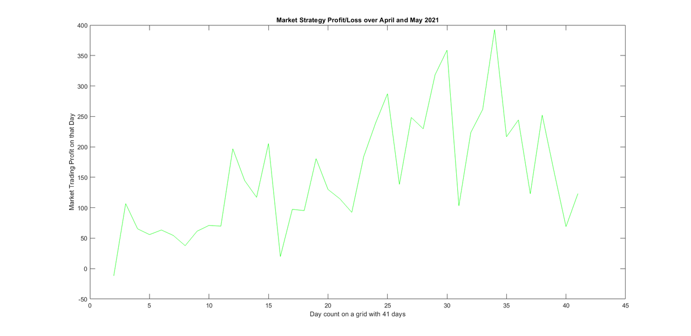

# Breakthrough in the theory of stochastic differential equations and their simulation

**Page 53 of 59** — Posts #2601–#2650

[← Previous](page_052.md) | [Index](index.md) | [Next →](page_054.md)

---

### #2601 — Amin (Topic Author)
*January 21, 2025, 12:13 AM*

Friends, it is 5:15 am in the morning and the anals of mind control continued to target microwaves on my head and I have
been kept forcefully awake.

---

### #2602 — Amin (Topic Author)
*January 21, 2025, 4:35 AM*

Friends, I could not sleep all night and continued to have conscious fleeting thoughts with a very heavy head due to
directed microwaves.

This used to be a very usual occurrence in some part of my past 27 years of mind control. They would keep me awake for
several nights at a stretch. And at one stage I got so used to it and I would stay motionless with my eyes closed and
would simply jump off the bed in the morning and try to start doing things normally. However, I was not doing any
special research at that time.

Friends, there is a very high possibility that torture, persecution and use of laser microwave gadgets on me would
sharply increase now so I will be keeping a more complete journal of everything that is happening in attempt to protect
myself. I might be making multiple posts on many days when there is a lot of torture and things are happening fast.

---

### #2603 — Amin (Topic Author)
*January 21, 2025, 8:25 PM*

Friends, I have decided to keep a daily journal everyday where I will write about all of my day's activities and also
mention anything significant including all the torture, suffering and humiliating tactics of mind control agents that I
have to go through everyday. I will also try to talk about my interactions with other people that I would have gone
through during every coming day.

I got off the bed a little after 9:00 am. Even though I did not sleep all night, I had a burst of energy in the morning.
I was not expecting that I would have any energy in the morning but it was reverse. It was like a burst of energy that
follows an accident or after a patient goes through heart surgery and becomes psychotic after they become conscious
after the surgery operation.

I had been working work well in general for more than past two weeks since I was able to buy good tea from a remote
utility store in the city. I was able to get this tea about three weeks ago after a gap of more than two months. I had
tried more than twenty tea brands from most unknown companies but all of them drug their tea with mind control
chemicals. I even tried to buy different brands of tea from akbari mandi where all the largest wholesalers and importers
of the tea have shops but all of them drug their tea and I was unable to buy good tea from there.

But in the last days of December when I was passing close to Yateem Khana on Multan road I noticed a small utility store
there. I almost never go to utility stores but I quickly decided to go inside the store and see if there is something
interesting to buy. And I found some Dawoodi tea manufactured by Islamabad Tea company. I had previously noticed that
tea from Islamabad Tea company used to be good five or six months ago since it is not manufactured in Lahore or Karachi.
All of the tea manufactured by large companies from Lahore and Karachi that own 97% of the share of tea market  had
already become bad more than two years ago. Lipton, Brooke Bond, Tapal, Vital and Meezan all drug their tea when it is
manufactured. However Islmabad tea is sold in Lahore very very rarely and only a few large stores have it on shelves.
Anyway, I bought two packs of Dawoodi Islamabd tea for 760 rupees. I recall I had only about 800-900 rupees in my pocket
when I bought that tea. And if I had more money, I would have bought more packs of the tea and keep enjoying it. So I
have been taking a lot of tea in past few weeks and I was far less sedated and was able to work better.

I never used to be very fond of tea and always took coffee earlier but all the coffee in Lahore was drugged and it had
become impossible to find good coffee in the city. They had started to drug coffee in Pakistan more than ten or fifteen
years ago. Nestle, Pakistan has been completely drugging all the coffee since earlier than year 2010. I recall up till
six or seven years ago, I would continue to try different brands of coffee and eventually find some good coffee. I still
recall about five years ago when all of the coffee brands were drugged, I noticed some russian imported Nestle coffee
that was good and I started buying it but eventually it was drugged on shelves and the importer started drugging it
before selling it in the market. But it took them more than 7-8 years to have a complete dark out of coffee. Then five
or six years ago, I switched to tea. At that time all brands of tea used to be absolutely good. But they started
drugging tea from all large brands within a year. But there are a large number of very small manufacturers and packagers
of tea but eventually over past 2-3 years all of them started drugging their tea. Now it is almost absolutely impossible
to find good tea in the city.

Even when I could find good tea from the city with efforts of several weeks or months, it is difficult to keep it safe
since mind control agents get extremely annoyed when they are unable to sedate me. During last six months of past year,
many times I would have good tea on me in my room and I would lock the room and start working on my research outside in
the car garage sitting on portable plastic table and chairs. But they would ask my mother's maid to quickly enter the
room, drug the tea and leave. They did that at least four or five times last year. Making keys for ordinary locks is not
a problem for anyone and they would simply give the maid keys to my room and she would quickly enter, drug the tea and
leave. And then I had to be extremely careful whenever the maid would be inside our house.

With sheer burst of luck, just yesterday when I went out to buy food, I was able to buy good tea from a remote lower
middle class neighborhood of the city on the end of canal road close to Jallo/suzo (I forgot the name of water park)
water park. It was a very unknown brand and had been manufactured in 2023 and had been lying on the shelf. I bought all
of the four small sized packets of the tea the store had. So I hope that I have enough supply of tea to last till end of
February or a bit longer if the maid does not enter the story again to spoil my fortunes.

Anyway, I started working a bit after 12:00 pm and had good ideas and tried to work but I was not feeling fresh at all
even though I started with quite a bit of energy and enthusiasm. In the evening, around 4:00 pm, I made my meal by
cutting onions, tomatoes and green peppers. Added some garlic, ginger and spices and fried it somewhat and then  added
four eggs. I would not eat four eggs in a day but I did not want to make a meal again tomorrow so I thought I would
divide it into two portions and eat one portion tomorrow. Last winters, a year ago, I survived by living on jams, and
pasta. But over the year they completely drugged all jams and pasta brands manufactured in Pakistan. Even though
sometimes I would not eat eggs for many days in a stretch, I have been eating them a lot during past three months
especially when it is difficult to buy other good food. I have replaced jams with honey that I put on bread slices but I
have to be extremely careful about buying honey since they continue to drug it everywhere and of all the times I bought
honey seventy percent of the times, it had been drugged and in a few months, it would be impossible to buy good honey
since all the good honey on the shelves from past years when it used to be good would get sold out from stores in remote
parts of the city.

I started working again around 6:30 pm. But today was a bad day since I could not get anything done since I was not
fresh at all due to staying awake all night yesterday. I would be goung to bed now and hope that I would not have to go
through torture at night again. And if there is some serious torture, I will make a detailed pqst about it right away.

I am looking forward to start working agin tomorrow morning and hope that it would be a better day.

I will keep posting a detailed daily journal for at least next few months in addition to matlab programs that follow
from my research.

Edit: I was working in Lounge when I made the above post. When I went inside my room, they started to release heavy
ionized gas in my room. I am quite sure they would follow with microwave torture after it. I would describe more details
tomorrow.

---

### #2604 — Amin (Topic Author)
*January 22, 2025, 6:43 AM*

Friends, there was no very significant torture last night and I had a reasonably good sleep. However, in some parts of
night, I could feel waves targeting my both hands inside the comforter and a resulting tingling feeling in my hands.
This is very interesting since I recall about six or seven years ago whenever I would feel some waves targeting some
part of my body, I would simply place a pillow there and would feel better but then they upgraded their lasers and
microwaves and for past few years I have noticed that placing a pillow or something like that does not help at all. In
fact on many nights, they would direct microwaves into my anus and it would be physically painful. All my life, I liked
to sleep on one side sort of hugging a pillow but for several years I mostly do not sleep like that since my back would
be exposed to microwaves and EM waves on one side and they would almost always use this opportunity to charge my anus
with waves.

Yesterday, I wanted to mention in detail about how I bought food from around the city on 20th January when I spent my
day buying food outside. I typically try to buy things from the following: roti/chappati (which is Pakistani bread),
some bread from bakeries, some yogurt, some vegetables, eggs, jam, honey, some chicken meat(I just started doing that a
few weeks ago) and I also have to get good water. Most important part of this is to get good water. I carry five six
liter bottles on my motorcycle and fill them wherever I find good water. Underground water all over the city is drugged.
However water in some random remote parts of the city can possibly be good. Most of the water filtration plants are
asked to add mind control chemicals in their water but there are always some places where filtration plants have good
water. Lahore is 17th largest city in the world in the largest contagious city category with population solidly more
than 15 million so it is hard to drug water everywhere and I have to continue to find pockets of opportunity in remote
areas.

When I want to get something, the most important thing is not to plan ahead since there are several hundreds or possibly
more than a thousand agents who know what you are thinking and are ready to drug the food that I would intend to buy
right away. I continue to roam around the city and continue to pick things and food to buy that I think would be good by
making a decision right on the spot when I am already somewhere.

So about getting water on this monday. I left Johar town on my motorcycle and went on the canal road. When I was close
to punjab university crossing, I thought I should buy some food from small market of Sheikh Zayed hospital so I drove
inside. And then I recalled that I was able to get good water from the mosque in residential area of Sheikh Zayed
hospital about seven months ago. I thought that if I could get water again from there, it would be really good so I went
to that mosque but it was closed as there were no prayer times. But I was able to find a water filtration plant in
Sheikh Zayed colony and tried the water and luckily it was very good. I was very surprised since it is extremely
difficult to get good water in these residential areas. I filled my five six liter bottles with water. As a second
thought I believe that  Sheikh Zayed Hospital is right next to Chinese consulate and may be army did not want to drug
water near the Chinese consulate but it was just a theory.

After taking water, I came back to canal road and drove till the end which was rather rare since I almost always take
some small street and drive inside to buy food. I ate a chicken biryani at the ring road junction of canal road. It was
a sunny day in mildly cold weather so I really like to drive my bike on the canal road. I drive very slowly at 25-35
kmph since driving fast never helps and important thing is to stay relaxed and think on your feet. I drove till the end
of canal road and asked about different paths. Somebody told me that a road was leading to DHA Phase eight from there
and I wanted to try there. But just a little ahead I noticed a lower middle class neighborhood and I drove inside and
was able to buy some good tea from a totally unknown brand that had been lying on the shelf for more than a year(that I
mentioned yesterday). I noticed that shopkeeper was very slightly aggressive and tried to take tea from my hands but I
remained calm and refused to give him the tea and rather gave him the money (they keep using voice or skull to talk to
shopkeepers and it has happened to me that several times shopkeepers in small places would become belligerent and
totally refuse to sell me anything).

Another very important rule I have learned is when I buy something from a place, and it can take a few minutes, many
agents in the meantime drug many shops in the same neighborhood (for example they would drug the roti or yogurt or bread
in all the close by places) so it is very important to leave that place solidly and buy other things elsewhere. They
even go inside small streets on the target's path and drug all of the roti, yogurt and bakeries bread so it is important
to leave that area and go elsewhere.

Then I came back on canal and then started on the left side of the motorway and there is a small village behind army's
enclaves and I wanted to buy roti from there but there was one Tanoor/Oven and they told me they only sell Naans so I
broke my tradition of eating roti and bought ten naans (that I generally avoid as they are unhealthy). From there I went
back to ring road and close to bhatta chowk there was a small neighbor hood where I was able to buy good honey(which is
rather rare for me to find) . From there I came back to ring road and bought a fluanxol injection (I would have to take
this injection in a few days) from large Mahmood pharmacy right next to askari nine or ten in this compound on corner of
ring road where a lot of good upscale shops are found together.

From there I followed the next road and I was able to get some good yogurt from a small shop. Here I want to tell
friends that I used to eat packaged yogurt several years ago but they drugged all of the yogurt and all the major brands
including nestle sell yogurt with mind control chemicals in it. Then I almost stopped eating yogurt for more than a
year.  But since one and a half year ago, I started buying freshly made yogurt from small shops that sell it in small
plastic polythene bags. But over the year they have given chemicals to small milk shop owners and they add mind control
chemicals in milk when they make yogurt. So it is impossible to get good yogurt in most of the areas where I go more
frequently. But there are still many remote places in the city where good yogurt could be found with effort. I first
check the yogurt by buying small amount of it and then buy it if it seems reasonable.

After that I came to main road and there was a small shop that was selling frozen meat and I bought some chappli kababs.
Sadly when I tried them later at home they were drugged by chappli kabab manufacturer. This was the only drugged thing I
bought on monday.

After that I drove back and came back to my house. It took me about more than five hours of drive on the motorcycle to
buy all of this food for next two days. These days my routine is to go to the city on motorcycle every third day and
then keep food in my room and keep working on my research for next two days. Earlier I would go to the city every second
day but it was not sustainable since it would take too much of my time and for past two weeks, I have been trying to go
out in the city to buy food every third day and then work on my research for other two days.

But mind control agents have been much bolder for past two days. Even yesterday when I was trying to work, they would
target microwaves on my neck and whenever they play this trick, I become fatigued after half an hour or so as if I lack
all energy and my brain becomes very tired. Even when I wrote this post, they kept microwaves targeted on the back of my
neck to exhaust me so I would not be able to work after it.

---

### #2605 — Amin (Topic Author)
*January 23, 2025, 4:10 AM*

Friends, I was unable to work in the house yesterday morning and then in the afternoon I decided to got to a park with
my laptop and calculated hermite correlations between transition increments of all four coefficients. I will come with a
better program but this is what I have at the moment. I also have to go to city to buy food and any uncertain thing can
happen so I decided to post whatever work I have done before I leave.

.

.

```
function [] = SlidingWindowZSeriesEstimation()

 TT=500;
seed=15898837;

seed=98831629;

[X1] = ProduceSDEDataTimeSeries(TT,seed);

NIntervals=15;  %Intervals used to estimate moments

plot((1:TT),X1(1:TT),'g');
str=input("Look at graph of Time Series variable X");

for tt=(1+NIntervals):TT
    muA(1:4)=0;
    for nn=1:NIntervals
        dXt=X1(tt-NIntervals+nn)-X1(tt-NIntervals+nn-1); %Moments are calculated for dX(t)
        muA(1:4)=muA(1:4)+(dXt.^(1:4))/NIntervals;
    end

    [c(1,tt),c(2:4,tt),FittedMoments] = CalculateZSeriesDensityFromRawMoments02M4(muA,0);

    c
    %str=input("Look at new Coeffs");

end
%
% % save("C:\Users\Lenovo\Documents\MATLAB\MATLAB1\DynamicCoeffs01.mat","c");
% %
% % str=input("I have saved dynamic coeffs");
% %
%
% load("C:\Users\Lenovo\Documents\MATLAB\MATLAB1\DynamicCoeffs01.mat","c");

[bnm1,Z_dX1,ZX1]=EstimateDynamicCoeffParameters(c(1,:));
[bnm2,Z_dX2,ZX2]=EstimateDynamicCoeffParameters(c(2,:));
[bnm3,Z_dX3,ZX3]=EstimateDynamicCoeffParameters(c(3,:));
[bnm4,Z_dX4,ZX4]=EstimateDynamicCoeffParameters(c(4,:));

bnm1
bnm2
bnm3
bnm4

%Calculations of hermite correlations between transition Z's of four dynamic coefficients
%below

Ndata=TT-1;
Z(1,1:Ndata)=Z_dX1(1:Ndata);
Z(2,1:Ndata)=Z_dX2(1:Ndata);
Z(3,1:Ndata)=Z_dX3(1:Ndata);
Z(4,1:Ndata)=Z_dX4(1:Ndata);

NN=4;
HH=2;

[CorrH] = CalculateCorrelationMatricesHermiteCH(Z,NN,TT-1,HH);

CorrH
str=input("Please look at correlations between first and second hermite of the transition dynamics of four dynamic
coefficients above");

%c
clf;
yyaxis left
plot((1:TT),X1(1:TT),'g')
ylabel('Random Variable X')
xlabel('Time Intervals')
yyaxis right
plot((1+NIntervals:TT),c(1,1+NIntervals:TT),'b');

hold on
yyaxis right
plot((1+NIntervals:TT),c(2,1+NIntervals:TT),'r');
ylabel('Coefficients c0 and c1 of Z-series of X')

title("Graph of time series X and first two Coefficients of its Z-series, c0 and c1");
legend('X','c0','c1','Location','northeast');
%plot((1:TT),X1(1:TT),'g',(1+NIntervals:TT),c(1,1+NIntervals:TT),'b',(1+NIntervals:TT),c(2,1+NIntervals:TT),'r',(1+NIntervals:TT),c(3,1+NIntervals:TT),'k',(1+NIntervals:TT),c(4,1+NIntervals:TT),'m');
str=input("Look at graph--final");

clf;
yyaxis left
plot((1:TT),X1(1:TT),'g')
ylabel('Random Variable X')
xlabel('Time Intervals')
 hold on
yyaxis right
plot((1+NIntervals:TT),c(3,1+NIntervals:TT),'k');
ylabel('Coefficients c2 of Z-series of X')

title("Graph of time series X and third coefficients of its Z-series, c2");
legend('X','c2','Location','northeast');

str=input("Graph--Fianl--2")

clf;
yyaxis left
plot((1:TT),X1(1:TT),'g')
ylabel('Random Variable X')
xlabel('Time Intervals')
hold on
yyaxis right
plot((1+NIntervals:TT),c(4,1+NIntervals:TT),'m');
ylabel('Coefficients c3 of Z-series of X')

title("Graph of time series X and fourth coefficient of its Z-series, c3");
legend('X','c3','Location','northeast');

end

```

.

.

.

```
function [bnm,Z_dX,ZX] = EstimateDynamicCoeffParameters(X)

Ndata=length(X)-1;
Order=7;

%Calculate transition dX
for nn=1:Ndata
    dX(nn)=X(nn+1)-X(nn);
end

%Below Calculate Z-series of X and dX.

[CoeffX,ZX,RSquared1] = CalculateActualZSeriesFromData(X,Order);
[CoeffdX,ZdX,RSquared2] = CalculateActualZSeriesFromData(dX,Order);

Ymu1(1:Ndata,1)=dX(1:Ndata);
dXcorr(1:Ndata,1)=0;
[W1] = EvalHermiteArrayH0(ZX(1:Ndata),Order);
        %Below, do the regression to find the coefficients of part of dX
        %random variable that is correalted with X.
coeff1=inv(W1'*W1)*(W1'*Ymu1);
        %Below, we evaluate the correalted part of dX random variable
        %with X by summing over all the hermite polynomials out
        %to Order.
for hh=0:Order
            %Below dXcorr continues to sum corelated part over all hermites of X

      dXcorr(1:Ndata,1)=dXcorr(1:Ndata,1)+coeff1(hh+1,1).*W1(1:Ndata,hh+1);

end

%Below, we calculate orthogonal part of DX that is uncorrelated with dX

dXdecorr(1:Ndata,1)=Ymu1(1:Ndata,1)-dXcorr(1:Ndata,1);

%dXdcrr(1:Ndata)=dXdecorr(1:Ndata,1);

%[Coeff,Zy,RSquared] = CalculateActualHermiteSeriesFromDataYdY(X(1:Ndata),dXdcrr(1:Ndata),Order);

%Coeff
%RSquared
%str=input("Look at results of regression");

%Below calculat moments of correalted (with X)  part and orthogonal (with respect to X) part of dX
for kk=1:8
    rMudecorr(kk)=sum(dXdecorr(1:Ndata,1).^kk)/Ndata;
    rMucorr(kk)=sum(dXcorr(1:Ndata,1).^kk)/Ndata;
end

rMudecorr
rMucorr
%dXcorr
%dXdecorr

%str=input("Look at decorrelated part moments");

NMoments=6;
Iterations=20000;

%The function below finds the 2D Z-series of orthogonal part of dX.

[bnm,ObjFunc] = ZSeriesCoeffsFromMomentsIterativeNoiseTerm2D01A(rMudecorr,NMoments,Iterations);

%[bnm,ObjFunc] = ZSeriesCoeffsFromMomentsIterativeNoiseTermNew(rMudecorr,NMoments,Iterations);

bnm

%Our 2D Z-series Equation for transition dynamics of coefficients is given as
% dX(tt) =[ bnm(1,1) + bnm(2,1) * ZX(tt)+ bnm(3,1) * ZX(tt)^2+ bnm(4,1) * ZX(tt)^3 ]
%+[ bnm(1,2) + bnm(2,2) * ZX(tt)+ bnm(3,2) * ZX(tt)^2+ bnm(4,2) * ZX(tt)^3 ] Z_{dX}
%+[ bnm(1,3) + bnm(2,3) * ZX(tt)+ bnm(3,3) * ZX(tt)^2+ bnm(4,3) * ZX(tt)^3 ] {Z_{DX}}^2

%We use the simplification

%    alpha0(tt)=bnm(1,1)+bnm(2,1)*ZX(tt)+bnm(3,1)*ZX(tt).^2+bnm(4,1)*ZX(tt).^3;
%    alpha1(tt)=bnm(1,2)+bnm(2,2)*ZX(tt)+bnm(3,2)*ZX(tt).^2+bnm(4,2)*ZX(tt).^3;
%    alpha2(tt)=bnm(1,3)+bnm(2,3)*ZX(tt)+bnm(3,3)*ZX(tt).^2+bnm(4,3)*ZX(tt).^3;

%to get the following equation for transition dynamics as

%dX(tt)=alpha0(tt)+alpha0(tt)*Z_dX(tt)+alpha0(tt)*Z_dX(tt).^2;

for tt=1:Ndata
    alpha0(tt)=bnm(1,1)+bnm(2,1)*ZX(tt)+bnm(3,1)*ZX(tt).^2+bnm(4,1)*ZX(tt).^3;
    alpha1(tt)=bnm(1,2)+bnm(2,2)*ZX(tt)+bnm(3,2)*ZX(tt).^2+bnm(4,2)*ZX(tt).^3;
    alpha2(tt)=bnm(1,3)+bnm(2,3)*ZX(tt)+bnm(3,3)*ZX(tt).^2+bnm(4,3)*ZX(tt).^3;

    c0=alpha0(tt);
    c(1)=alpha1(tt);
    c(2)=alpha2(tt);
    c(3)=0;

    %dX(tt)=alpha0(tt)+alpha0(tt)*Z_dX(tt)+alpha0(tt)*Z_dX(tt).^2;
    %The following function backs out Z_dX according to above equation.

    [Z_dX(tt)]=CalculateZgivenXAndZSeriesBisectionC3(dX(tt),c0,c);
end

Z_dX

str=input("Look at Z_dX associated with transition of coefficients_N0_###");

end

```

.

.

.

```
function [bnm,ObjFunc] = ZSeriesCoeffsFromMomentsIterativeNoiseTerm2D01A(rMu,NMoments,Iterations)

%This program computes coeffs of Z-series when values of raw moments are
%given using Iterative method.

%rMu are raw moments;

%Hermite Series Form is

%
% Y=  +(bnmh(1,2) + bnmh(2,2)* Z1 + bnmh(3,2)* (Z1^2-1) + bnmh(4,2)* (Z1^3-3*Z1))* Z2
%     +(bnmh(1,3) + bnmh(2,3)* Z1 + bnmh(3,3)* (Z1^2-1) + bnmh(4,3)* (Z1^3-3*Z1))* (Z2^2-1)
%
% Equivalent 2D Z-series form is
% Y=   (bnm(1,1) + bnm(2,1) Z1 + bnm(3,1) Z1^2 + bnm(4,1) Z1^3)
%     +(bnm(1,2) + bnm(2,2) Z1 + bnm(3,2) Z1^2 + bnm(4,2) Z1^3) Z2
%     +(bnm(1,3) + bnm(2,3) Z1 + bnm(3,3) Z1^2 + bnm(4,3) Z1^3) Z2^2
%
%
% Var(Y)= bnmh(1,2).^2 + bnmh(2,2).^2 + 2* bnmh(3,2).^2 + 6* bnmh(4,2).^2
%        +2*(bnmh(1,3).^2 + bnmh(2,3).^2 + 2* bnmh(3,3).^2 + 6* bnmh(4,3).^2)
%
%
%
% bnm(1,1)= -bnmh(1,3) + bnmh(3,3)
% bnm(2,1)= -bnmh(2,3) + 3* bnmh(4,3)
% bnm(3,1)= -bnmh(3,3)
% bnm(4,1)= -bnmh(4,3)
%
% bnm(1,2)= bnmh(1,2) - bnmh(3,2)
% bnm(2,2)= bnmh(2,2) - 3* bnmh(4,2)
% bnm(3,2)= bnmh(3,2)
% bnm(4,2)= bnmh(4,2)
%
% bnm(1,3)= bnmh(1,3) - bnmh(3,3)
% bnm(2,3)= bnmh(2,3) - 3* bnmh(4,3)
% bnm(3,3)= bnmh(3,3)
% bnm(4,3)= bnmh(4,3)

%We have used the notation
%cH0=bnmh(1,2);
%cH(1)=bnmh(2,2);
%CH(2)=bnmh(3,2);
%CH(3)=bnmh(4,2);
%cH(4)=bnmh(1,3);
%cH(5)=bnmh(2,3);
%CH(6)=bnmh(3,3);
%CH(7)=bnmh(4,3);

% SO We will use the equations

% cH0=1-sqrt(cH(1).^2 + 2*cH(2).^2 + 6*cH(3).^2+2*(cH(4).^2 + cH(5).^2 + 2*cH(6).^2 + 6*cH(7).^2));
%
%
% bnm(1,1)= -cH(4) + cH(6);
% bnm(2,1)= -cH(5) + 3*cH(7);
% bnm(3,1)= -cH(6);
% bnm(4,1)= -cH(7);
%
% bnm(1,2)= cH0 - cH(2);
% bnm(2,2)= cH(1) - 3*cH(3);
% bnm(3,2)= cH(2);
% bnm(4,2)= cH(3);
%
% bnm(1,3)= cH(4) - cH(6);
% bnm(2,3)= cH(5) - 3*cH(7);
% bnm(3,3)= cH(6);
% bnm(4,3)= cH(7);

mOrder=NMoments;         %Number of raw moments in calibration.

%%%%Standardize the Raw Moments

                  %Find central Moments from raw moments
[Mu1,cMu] = ConvertRawMomentsToCentralMoments(rMu,mOrder);
                  %Find standardized Moments from central moments
sMu(1)=0;
sMu(2)=1;
sMu(3)=cMu(3)/cMu(2).^1.5;
sMu(4)=cMu(4)/cMu(2).^2.0;
sMu(5)=cMu(5)/cMu(2).^2.5;
sMu(6)=cMu(6)/cMu(2).^3.0;
%sMu(7)=cMu(7)/cMu(2).^3.5;
%sMu(8)=cMu(8)/cMu(2).^4.0;

%cH(1)=1;

SeriesOrder=7;
cH(1:SeriesOrder)=0;
cH(1)=.001;%.05
%%%%%%Choose the iteration step size.

for nn=1:3
    DeltaX(nn)=.00125/sqrt(factorial(nn+1));
end
for nn=4:7
    DeltaX(nn)=.00125/sqrt(factorial(nn+1-3))*2;
end

%%%Weights on objective function that shows fit to moments
w(NMoments)=1;
for nn=NMoments-1:-1:1
    w(nn)=w(nn+1)*(nn+1)*(nn+2);
end

w(3)=w(3)*2;
w(5)=w(5)*2;
w(4)=w(4)*1;

cH0=sqrt(1-(cH(1).^2 + 2*cH(2).^2 + 6*cH(3).^2+2*(cH(4).^2 + cH(5).^2 + 2*cH(6).^2 + 6*cH(7).^2)));

bnm(1,1)= -cH(4) + cH(6);
bnm(2,1)= -cH(5) + 3*cH(7);
bnm(3,1)= -cH(6);
bnm(4,1)= -cH(7);

bnm(1,2)= cH0 - cH(2);
bnm(2,2)= cH(1) - 3*cH(3);
bnm(3,2)= cH(2);
bnm(4,2)= cH(3);

bnm(1,3)= cH(4) - cH(6);
bnm(2,3)= cH(5) - 3*cH(7);
bnm(3,3)= cH(6);
bnm(4,3)= cH(7);

SeriesOrder10=4;
SeriesOrder01=3;

[Moments] = Calculate2DSeriesMoments(bnm,SeriesOrder10,SeriesOrder01,NMoments);

Moments
%str=input("Look at Moments");

[ObjFuncBest] = CalculateObjMoment(sMu,Moments,w,mOrder);

cHBest=cH;

ImproveFlag(1:SeriesOrder)=1;
ImproveFlagPrev(1:SeriesOrder)=0;
ImproveCount=0;

for mm=1:Iterations
AdjustFlag=0;
    %mm
    %First 500 iterations try to fit three moments only
    if(mm=500)&&(mm=4000)&&(mm=10000))
        SeriesOrder1=1;
        SeriesOrder2=7;
        NMoments=6;
        mOrder=NMoments;

        %Block Below: Once we move from fitting five moments to six moments
        %Best Objective Function changes and becomes larger. This
        %has to be reset at the start of six moments optimization.
        %We also increase the weight associated with already
        %calibrated third, fourth and fifth moment is increased so
        %that stays in calibration
        if(mm==10000)
        SeriesOrder10=4;
        SeriesOrder01=3;

        [Moments] = Calculate2DSeriesMoments(bnmBest,SeriesOrder10,SeriesOrder01,NMoments);
        cH=cHBest;
        w(3:5)=4*w(3:5);
        [ObjFuncBest] = CalculateObjMoment(sMu,Moments,w,mOrder);
        ObjFuncBest
        %str=input("I am in here NMoments =6 ");
        AdjustFlag=1;
        end
    end

    for nn=SeriesOrder1:SeriesOrder2

        ImproveFlagPrev(nn)=ImproveFlag(nn);

        cinH=cH;
        cinH(nn)=cinH(nn)+DeltaX(nn);

        %Below lines keep the total variance equal to one.
        CondFlag=1;
        VarYP=cinH(1).^2 + 2*cinH(2).^2 + 6*cinH(3).^2+2*(cinH(4).^2 + cinH(5).^2 + 2*cinH(6).^2 + 6*cinH(7).^2);
        if(VarYP>1)
            cinH=cinH/sqrt(VarYP)*.98;
            %CondFlag=0;
        end

        cinH0=abs(sqrt(1-(VarYP)));

        %Convert to 2D Z-series Coeffs from Hermite Coeffs

        bnm(1,1)= -cinH(4) + cinH(6);
        bnm(2,1)= -cinH(5) + 3*cinH(7);
        bnm(3,1)= -cinH(6);
        bnm(4,1)= -cinH(7);

        bnm(1,2)= cinH0 - cinH(2);
        bnm(2,2)= cinH(1) - 3*cinH(3);
        bnm(3,2)= cinH(2);
        bnm(4,2)= cinH(3);

        bnm(1,3)= cinH(4) - cinH(6);
        bnm(2,3)= cinH(5) - 3*cinH(7);
        bnm(3,3)= cinH(6);
        bnm(4,3)= cinH(7);

        SeriesOrder10=4;
        SeriesOrder01=3;

        [Moments] = Calculate2DSeriesMoments(bnm,SeriesOrder10,SeriesOrder01,NMoments);

        [ObjFunc] = CalculateObjMoment(sMu,Moments,w,mOrder);

        if((ObjFunc1)
                cinH=cinH/sqrt(VarYP)*.98;
                %CondFlag=0;
            end

            cinH0=abs(sqrt(1-(VarYP)));

            %Convert to 2D Z-series Coeffs from Hermite Coeffs
            bnm(1,1)= -cinH(4) + cinH(6);
            bnm(2,1)= -cinH(5) + 3*cinH(7);
            bnm(3,1)= -cinH(6);
            bnm(4,1)= -cinH(7);

            bnm(1,2)= cinH0 - cinH(2);
            bnm(2,2)= cinH(1) - 3*cinH(3);
            bnm(3,2)= cinH(2);
            bnm(4,2)= cinH(3);

            bnm(1,3)= cinH(4) - cinH(6);
            bnm(2,3)= cinH(5) - 3*cinH(7);
            bnm(3,3)= cinH(6);
            bnm(4,3)= cinH(7);

            SeriesOrder10=4;
            SeriesOrder01=3;

            [Moments] = Calculate2DSeriesMoments(bnm,SeriesOrder10,SeriesOrder01,NMoments);

            [ObjFunc] = CalculateObjMoment(sMu,Moments,w,mOrder);
            if((ObjFunc10)&&(ObjFuncBest==ObjFuncBestBefore))
        ResetFlag=1;
    end
    ObjFuncBestBefore=ObjFuncBest;
    %DeltaX
    %ImproveCount

    end
    if(ResetFlag==1)
     %  DeltaX=DeltaX*5;

    end

    ImproveFlag0=0;
    for nn=1:SeriesOrder
       if(ImproveFlag(nn)==1)
           ImproveFlag0=1;
           ImproveCount=ImproveCount+1;
       end
    end
    for nn=2:SeriesOrder
        if(ImproveFlag0==0)
            DeltaX(nn)=DeltaX(nn)*.95;
            ImproveCount=0;
        end
    end
    if(ImproveCount>4)
       for nn=2:SeriesOrder
            DeltaX(nn)=DeltaX(nn)*1.05;
       end
    end

    end

end

bnm=bnmBest;
[Moments] = Calculate2DSeriesMoments(bnm,SeriesOrder10,SeriesOrder01,NMoments);

Moments
sMu

%str=input("Look at comparison of Standardised model moments and Standardized target moments")

bnm=bnm*sqrt(cMu(2));

[Moments] = Calculate2DSeriesMoments(bnm,SeriesOrder10,SeriesOrder01,NMoments)
rMu

str=input("Look at comparison of model raw moments and target raw moments of transition dX of coefficients")

end
```

.

.

.

```
function [Z]=CalculateZgivenXAndZSeriesBisectionC3(Y,c0,c)

if(Y>c0)
    if(Y c0+c(1)*Zmid+c(2)*Zmid^2 +c(3) * Zmid^3)
            Za=Zmid;
        end
    Z=.5*Za+.5*Zb;
    Za
    Zb
    Z
    end

end

if(Y c0+c(1)*-.5+c(2)*(-.5)^2 +c(3) * (-.5)^3)
        Za=-.5;
        Zb=0;
    elseif(Y> c0+c(1)*(-1)+c(2)*(-1)^2 +c(3) * (-1)^3)
        Za=-1;
        Zb=-.5;
    elseif(Y> c0+c(1)*(-1.5)+c(2)*(-1.5)^2 +c(3) * (-1.5)^3)
        Za=-1.5;
        Zb=-1;
    elseif(Y> c0+c(1)*(-2)+c(2)*(-2)^2 +c(3) * (-2)^3)
        Za=-2;
        Zb=-1.5;
    elseif(Y> c0+c(1)*(-2.5)+c(2)*(-2.5)^2 +c(3) * (-2.5)^3)
        Za=-2.5;
        Zb=-2.0;
    elseif(Y> c0+c(1)*(-3)+c(2)*(-3)^2 +c(3) * (-3)^3)
        Za=-3;
        Zb=-2.5;
    elseif(Y> c0+c(1)*(-3.5)+c(2)*(-3.5)^2 +c(3) * (-3.5)^3)
        Za=-3.5;
        Zb=-3.0;
    elseif(Y> c0+c(1)*(-4)+c(2)*(-4)^2 +c(3) * (-4)^3)
        Za=-4;
        Zb=-3.5;
    elseif(Y> c0+c(1)*(-4.5)+c(2)*(-4.5)^2 +c(3) * (-4.5)^3)
        Za=-4.5;
        Zb=-4.0;
    else
        Za=-6.5;
        Zb=-4.5;
    end
    for mm=1:100
        Zmid=.5*Za+.5*Zb;
        if(Y c0+c(1)*Zmid+c(2)*Zmid^2 +c(3) * Zmid^3)
            Za=Zmid;
        end
    Z=.5*Za+.5*Zb;
    Za
    Zb
    Z
    end

end

end

```

.

.

.

```
function [CorrH] = CalculateCorrelationMatricesHermiteCH(Z,NN,TT,HH)

CorrH(1:NN,1:NN,1:HH)=0;
for mm=1:NN
    for nn=1:NN
        for tt=1:TT
            for hh=1:HH
                if(hh==1)
                    CorrH(mm,nn,hh)=CorrH(mm,nn,hh)+Z(mm,tt).*Z(nn,tt);
                end
                if(hh==2)
                    CorrH(mm,nn,hh)=CorrH(mm,nn,hh)+(Z(mm,tt).^2-1).*(Z(nn,tt).^2-1);
                end
                if(hh==3)
                    CorrH(mm,nn,hh)=CorrH(mm,nn,hh)+(Z(mm,tt).^3-3*Z(mm,tt)).*(Z(nn,tt).^3-3*Z(nn,tt));
                end
            end
        end

    end
end

for mm=1:NN
    for nn=1:NN
        if(mm~=nn)
        CorrH(mm,nn,1:HH)=CorrH(mm,nn,1:HH)./sqrt(CorrH(mm,mm,1:HH))./sqrt(CorrH(nn,nn,1:HH));
        end
    end
end
for mm=1:NN
    CorrH(mm,mm,1:HH)=1;
end

end

```

.

.

.

```
function [Wh] = EvalZArrayZ0(Z,Order)

%Evaluates first Order-th  the array of Z's. If input array of Z
%has a size of 100 and Order is 4, it will return a 100 X 5 array.

%Hz=HermitePoly(Order);

Wh(1:length(Z),1:Order+1)=0;

for nn=1:Order+1
    Wh(:,nn)=Z(:).^(nn-1);
end

end
```

.

.

.

When you run this program, these are the correlation matrices of first two hermites between transition dynamics of four
dynamic coefficients. (My numbers below are from SDE data and my not have anything to do with real stocks data so please
run the program on your data. I will start playing with real data in about a week.)

CorrH(:,:,1) =

  Columns 1 through 3

   1.000000000000000   0.094342768615494  -0.256466896254814

   0.094342768615494   1.000000000000000  -0.113761755488927

  -0.256466896254814  -0.113761755488927   1.000000000000000

  -0.165592654007035  -0.421454042507929   0.112421140649381

  Column 4

  -0.165592654007035

  -0.421454042507929

   0.112421140649381

   1.000000000000000

CorrH(:,:,2) =

  Columns 1 through 3

   1.000000000000000   0.136058823570082   0.068990943138262

   0.136058823570082   1.000000000000000   0.215117238601746

   0.068990943138262   0.215117238601746   1.000000000000000

   0.153297662153921   0.408451237479719   0.247274226718769

  Column 4

   0.153297662153921

   0.408451237479719

   0.247274226718769

   1.000000000000000

Please look at correlations between first and second hermite of the transition dynamics of four dynamic coefficients
above

---

### #2606 — Amin (Topic Author)
*January 23, 2025, 4:20 AM*

I repeatedly tried to make a post yesterday. I also wanted to upload the above program last night but I continued to see
cloud flare message that wilmott.com is not responding.

I have to go out into the city again today and anything can happen. I am not worried but I know that it would be
difficult. I will details about what would happen today in the city later in the evening.

---

### #2607 — Amin (Topic Author)
*January 23, 2025, 5:31 PM*

Friends, I will first describe what happened yesterday, 22nd of January.

When I woke up, I was reasonably fine but I lost some energy half an hour after getting up. I had lost a lot of lucidity
of thought over night that followed 20th January and 21st January. My parents were also to arrive from Islamabad a
little after noon and I was thinking that I will start my work once they are at home. And I was also feeling very brain
numb and unable to do any work. After my parents arrived in early afternoon, I had realized that I could not work at
home. Earlier I was thinking of not leaving home at all till Thursday(today) but when I realized that I was being unable
to work at home due to EM waves torture, I decided to go to a nearby park and do some work there. When I went out, I had
very little energy and mind control agents were constantly trying to re-wire my brain. Before going to Park, I drank
three red bull drinks from two different places. I rarely drink red bull since quite a bit of time since it is a bit
costly for me to drink everyday. Clarifying here that Red bull has continued to alternate between being good(free of
mind control drugs) and bad. And since early last year, it has mostly been good but it is expensive for me and I rarely
drink it so that might be one reason that they did not strictly turn it bad again. Earlier when I drank red bull would
be about two weeks earlier and had been avoiding it to save money. But yesterday, I was so down that I took three red
bulls in a span of forty minutes and I was happy that I did that because some of the numbness of my brain decreased. I
spent some time thinking about my research outside the part next to Mughal Eye Hospital in johar Town. And later I came
to small park behind G-1 market and worked on my laptop for about two hours where I did the work on calculation of
correlations.

I arrived home from the G-1 park after sunset and then wanted to make a post on wilmott about my day's activities but I
always noticed Cloud Flare on my internet screen telling me that Wilmott was not responding or down. Later my mother
told me that she needed cough syrup Hydrallin and I went to a pharmacy in G-1 market and bought Hydrallin cough syrup. I
also bought some Jalaibees(sweets) from Wafaqi market. There was not anything significant after that other than that I
continued to see Cloud Flare when I tried to open Wilmott forums. I also ate some Yogurt with Naans and thought of some
random things before sleeping around mid-night.

Journal for 23rd January on next post.

---

### #2608 — Amin (Topic Author)
*January 23, 2025, 8:05 PM*

Daily Journal for 23/01/2025

I woke up around 8:00 in the morning. After a little bit I wrote some comments on the calculation of Parameters of
coefficients and their correlations. I basically just wasted a bit of time and then decided to go out in the city to get
food and water. But first, I went to a pharmacy and bought insulin for my mother and brought that at home and placed it
in the fridge. I left again and went to canal road and again went to a small market behind University of health sciences
and ate some parathas. They were reasonably good but I thought they had very small amount of mind control drugs but I
ate them with chick-peas. Either the parathas or chick peas were very mildly drugged with mind control drugs but the
effect was not strong at all.

From back of University of Health Sciences, I came back to canal road and came to wahdat road after crossing through New
Muslim Town. From Wahdat road, just a little before it meets Ferozpur road, I took a small street and went towards Ichra
area using inside streets. I saw a water filtration plant and filled some water but after drinking a bit of water, I
realized that water was not very good but I had already filled two six liter bottles that I kept on me and then I moved
on and drove towards Ferozpur road. I was thinking of buying a 19 litre water bottle and filling my remaining three
bottles with 19 litre water and keeping the other two bottles for washing (of face etc) purposes only. I noticed a Shell
petrol pump on Ferozpur road and found that there were many 19 L Nestle water bottles. I bought one bottle's water (with
the intention to return the empty 19L bottle right at spot) and filled the remaining three six liter bottles with Nestle
water. I drank a bit of water and thought it was good but after a few minutes I noticeded that I was losing energy and
my senses, and awareness were decreasing. I realized that water was bad. I could not tell whether it was done by Nestle
or whether agents approached there to drug the water since 19L Nestle water used to be good when I tried it a month ago.
I continued on Ferozpur road and approached upper Mall road and took a turn towards Saggian bridge. On the road towards
Saggian Bridge, I took a small street on the left and found a water filtration plant and luckily its water was good so I
dropped all Nestle and older water and filled my bottles again with new good water. I continued on Saggian Road again
and noticed there was a right before the river Bridge on the left and I took it and bought some bread(roti) from a
Tanoor. I then came back and went to other side of Saggian road and noticed a small stall for fresh juices and drank
freshly squeezed orange juice and fresh beet root juice. The juice was just totally out of this world. I was thinking of
returning and buying any remaining things on  my way back to Johar Town but it was very pleasant and sunny and I
absolutely loved the weather so I decided to go across the river from saggian bridge. Here I am adding some details that
are slightly gross to mention in a formal journal. I took a side road after crossing Saggian bridge and there were
fields with crops in sort of village areas. I excreted there and I was feeling really good and free from mind control
after that. I want to tell friends when we excrete (stool), a lot of parts in our brain are reset and this is not good
from the perspective of mind control and they went the mind control victims to only excrete in controlled environments
like in wash room of their house etc. A lot of gadgets are fitted in the wash room of the victims's house so that
neurotransmitters controlled by mind control agents are kept in control even when the victim excretes(which is sometimes
not easy). So a formula I always use when I am under extreme mind control  that I would go to outskirts of the city
where there are plenty of places with agricultural fields and crops are growing and simply excrete there inside the
fields and wash with a water bottle and many neurotransmitters are immediately reset and I would come out of my zombie
like state. Mind control agents go to extreme limits to make sure if victim excretes in public toilets, they fit gadgets
there to prevent resetting of many neurotransmitters. I had started to notice this more than ten years ago that in most
of the wash rooms of petrol pumps on main roads like on Thokar Niaz beg, they had installed mind control gadgets in all
the public wash rooms of the petrol pumps. You can check this fact with Thokar pumps or other pumps where some victim
could possibly go.

I came to saggian road again and drove towards G.T.Road on Shahdra side and bought chicken meat from a small shop. I
have been cooking chicken once in a while for past few weeks and it was my third or fourth time that I bought chicken
that I would cook myself at home later at night. From Shahdra, I came to Data Darbar from G.T.Road and then passed
around the walled city and crossed Do-Morya bridge under the train line and then crossed the Ghari shahu bridge to go to
canal road. I left canal road to leave on Ferozpur road towards model town and bought half kilogram of some fried
peanuts and then came to Johar town after crossing the model town and returned home.

I want to mention here that some secret agents might always remain close to me but they do not follow me with hundreds
of agents everyday and there might be some days in between when only some crucial agents would be around. I have started
to write this journal and army would be careful on some days to not send hundreds or thousands of agents. However, for
past few weeks, in most of the days, they used a large number of agents to try to drug my food on paths I followed. But
I am sure on some of the days like today, after knowing that I make all details public, they would just keep only most
necessary personnel on my paths. But from time to time, there are several instances when they employ very large number
of people to drug the food for more several weeks at a stretch. However, today I did not feel any very special activity
and I am sure there would be days when they would not like to move large number of agents especially when people are
coming to know about my stories in detail.

I also want to say that we want to concentrate on our mathematical research and other activities are rather secondary.
If they did not increase torture on the night of 20th January, I was not going to make a very big deal out of it. So
there might be days when I would be down and there will be some times when speed of our research would be slow due to my
mind control, but we want to remain steadfast. I really want to continue my research on algorithmic trading into summers
and hope that we would make some real progress during this time.

---

### #2609 — Amin (Topic Author)
*January 24, 2025, 11:57 AM*

Friends, we have to move to real stocks data in a few days so I had been brainstorming about various indicators in the
markets and other things related to algorithmic trading.

We would be thinking about algorithmic trading and divide the whole thing into three parts.

1. Know your Market Type.

2. What type of strategies to use for various market types.

3. What are the most suitable instruments for particular type of market types and particular market strategies.

We will first work for more than a month mostly trying to understand the market type so I will give very brief thoughts
about it. These ideas are initial and tentative and once we deal with real data many of these things would slightly
change. But these are ideas from initial brainstorming as we embark on the project.

Know Your Market Type.

I want to make a multi-dimensional indicator for the market.  We will calculate these indicators and their variances.
First dimension could be whether market is bearish or bullish on a scale of -1 to +1. Second dimension could be whether
market is low volatility or high volatility on a scale of zero to 1. Third dimension would be whether market is low
mean-reverting or high mean reverting on similar scale possibly zero to one. There could be other dimensions like volume
and liquidity in both sides of the market.

We will use various indicators including our recent work on moments to give a single statistic to all of the above
dimensions related to market type and also calculate variance of each statistic.

As a background and in order to get oriented, I would request friends to read the follwing two posts: https://forum.wilmott.com/viewtopic.php?t=99702&start=2385#p882431  and https://forum.wilmott.com/viewtopic.php?t=99702&start=2385#p882455

let us suppose we have financial data of equities on a 15 sec grid (My data is for 41 working days from May and June of
2021). We have a universe of M stocks and The price of mth stock at time t is given as$X_m(t)$ . We convert these stock
values into log returns so they are easy to use in our set up.

$R_m(t)\,=\, \log(X_m(t))\,-\, \log(X_m(t-1))$

We can make very intelligent indicators using log returns from universe of M stocks.

We can make an indicator for market across the M stocks over four 15 second periods as

$IM_{state}(t)\, =\, \sum\limits_{m=1}^{M} \,\, w_{m} \, \Large{ \frac{\sum\limits_{k=0}^{Lag-1} \, R_m(t-k)\,}{\sqrt{\sum\limits_{k=0}^{Lag-1} \,{\Big[ {R_m(t-k)}\,-\,\sum\limits_{k=0}^{Lag-1} \, R_m(t-k)\,/Lag \,\Big]}^2}}}$

The above indicator has sum of returns of each stock in numerator and square root of their variance in denominator. But
while making a single statistic for market state, we would also have to alter the weights of the stocks and make them
inversely proportional to square root of variance of statistic of each stock in the sample so that low standard
deviation stock statistics get high weight and high standard deviation statistics of stocks get a low weight when we
form a single market indicator. This is done by defining$w_m$ as

$\, w_m \, =\, \LARGE{ \frac{ \frac{\,1\,}{\sqrt{\sum\limits_{k=0}^{Lag-1} \,{\Big[ {R_m(t-k)}\,-\,\sum\limits_{k=0}^{Lag-1} \, R_m(t-k)\,/Lag \,\Big]}^2}}}{ \sum\limits_{m=1}^{M} \,\, \frac{\,1\,}{\sqrt{\sum\limits_{k=0}^{Lag-1} \,{\Big[ {R_m(t-k)}\,-\,\sum\limits_{k=0}^{Lag-1} \, R_m(t-k)\,/Lag \,\Big]}^2}}}}$

We can write the above indicator in shorthand as

$IM_{state}(t)\, =\, \sum\limits_{m=1}^{M} \,\, w_{m} \, \Large{ \frac{E \left[ R_m\right]\,}{\sqrt{\, Var\left[R_m\right]}}}$

and

$\, w_m \, =\, \LARGE{ \frac{ \frac{\,1\,}{\sqrt{\, Var\left[R_m\right]}}}{ \sum\limits_{m=1}^{M} \,\, \frac{\,1\,}{\sqrt{\, Var\left[R_m\right]}}}}$

We can have indicators for variance, skew and kurtosis of the market based like just the above indicator. For example
indicator for market variance could be given as

$IM_{var}(t)\, =\, \sum\limits_{m=1}^{M} \,\, w_{2,m} \, \Large{ \frac{Var \left[ R_m\right]\,}{\sqrt{\, Var\left[Var\left[R_m\right]\right]}}}$

and

$\, w_{2,m} \, =\, \LARGE{ \frac{ \frac{\,1\,}{\sqrt{\, \,Var\left[Var\left[R_m\right]\right]}}}{ \sum\limits_{m=1}^{M} \,\, \frac{\,1\,}{\sqrt{\,Var\left[ Var\left[R_m\right]\right]}}}}$

Similarly for skew and kurtosis, we could have

$IM_{skew}(t)\, =\, \sum\limits_{m=1}^{M} \,\, w_{3,m} \, \Large{ \frac{Skew \left[ R_m\right]\,}{\sqrt{\, Var\left[Skew\left[R_m\right]\right]}}}$

and

$\, w_{3,m} \, =\, \LARGE{ \frac{ \frac{\,1\,}{\sqrt{\, \,Var\left[Skew\left[R_m\right]\right]}}}{ \sum\limits_{m=1}^{M} \,\, \frac{\,1\,}{\sqrt{\,Var\left[ Skew\left[R_m\right]\right]}}}}$

and

$IM_{kurtosis}(t)\, =\, \sum\limits_{m=1}^{M} \,\, w_{4,m} \, \Large{ \frac{Kurtosis \left[ R_m\right]\,}{\sqrt{\, Var\left[Kurtosis\left[R_m\right]\right]}}}$

and

$\, w_{4,m} \, =\, \LARGE{ \frac{ \frac{\,1\,}{\sqrt{\, \,Var\left[Kurtosis\left[R_m\right]\right]}}}{ \sum\limits_{m=1}^{M} \,\, \frac{\,1\,}{\sqrt{\,Var\left[ Kurtosis\left[R_m\right]\right]}}}}$

and for the intensity of mean reversion, we want to use a special indicator

$IM_{MR}(t)\, =\, \sum\limits_{m=1}^{M} \,\, w_{5,m} \, \Large{ \frac{   \frac{Kurtosis \left[ R_m\right]\,}{Var \left[ R_m\right]\,}}{\sqrt{\, Var\left[\frac{Kurtosis \left[ R_m\right]\,}{Var \left[ R_m\right]\,}\right]}}}$

and

$\, w_{5,m} \, =\, \LARGE{ \frac{ \frac{\,1\,}{\sqrt{\, Var\left[\frac{Kurtosis \left[ R_m\right]\,}{Var \left[ R_m\right]\,}\right]}}}{ \sum\limits_{m=1}^{M} \,\, \sqrt{\, Var\left[\frac{Kurtosis \left[ R_m\right]\,}{Var \left[ R_m\right]\,}\right]}}}$

We can also calculate variances of above indicators in both time and across the stock spectrum and use associated
standard deviations for confidence limits.

Friends, these are tentatively brainstormed form of indicators and are framed analogously to our first order indicator
to market state and these indicators might undergo many changes as we play with data and our final version might be very
different.

---

### #2610 — Amin (Topic Author)
*January 24, 2025, 3:26 PM*

> Amin:
>
>
>
> Friends, we have to move to real stocks data in a few days so I had been brainstorming about various indicators in the
markets and other things related to algorithmic trading.
>
>
>
>
>
> We would be thinking about algorithmic trading and divide the whole thing into three parts.
>
>
>
> 1. Know your Market Type.
>
> 2. What type of strategies to use for various market types.
>
> 3. What are the most suitable instruments for particular type of market types and particular market strategies.
>
>
>
>
>
> We will first work for more than a month mostly trying to understand the market type so I will give very brief
thoughts about it. These ideas are initial and tentative and once we deal with real data many of these things would
slightly change. But these are ideas from initial brainstorming as we embark on the project.
>
>
>
> Know Your Market Type.
>
>
>
> I want to make a multi-dimensional indicator for the market.  We will calculate these indicators and their variances.
First dimension could be whether market is bearish or bullish on a scale of -1 to +1. Second dimension could be whether
market is low volatility or high volatility on a scale of zero to 1. Third dimension would be whether market is low
mean-reverting or high mean reverting on similar scale possibly zero to one. There could be other dimensions like volume
and liquidity in both sides of the market.
>
>
>
> We will use various indicators including our recent work on moments to give a single statistic to all of the above
dimensions related to market type and also calculate variance of each statistic.
>
>
>
> As a background and in order to get oriented, I would request friends to read the follwing two posts: [viewtopic.php?t=99702&start=2385#p882431](https://forum.wilmott.com/viewtopic.php?t=99702&start=2385#p882431)  and [viewtopic.php?t=99702&start=2385#p882455](https://forum.wilmott.com/viewtopic.php?t=99702&start=2385#p882455)
>
>
>
>
>
> let us suppose we have financial data of equities on a 15 sec grid (My data is for 41 working days from May and June
of 2021). We have a universe of M stocks and The price of mth stock at time t is given as$X_m(t)$ . We convert these
stock values into log returns so they are easy to use in our set up.
>
>
>
> $R_m(t)\,=\, \log(X_m(t))\,-\, \log(X_m(t-1))$
>
>
>
> We can make very intelligent indicators using log returns from universe of M stocks.
>
>
>
> We can make an indicator for market across the M stocks over four 15 second periods as
>
>
>
>
>
>
$IM_{state}(t)\, =\, \sum\limits_{m=1}^{M} \,\, w_{m} \, \Large{ \frac{\sum\limits_{k=0}^{Lag-1} \, R_m(t-k)\,}{\sqrt{\sum\limits_{k=0}^{Lag-1} \,{\Big[ {R_m(t-k)}\,-\,\sum\limits_{k=0}^{Lag-1} \, R_m(t-k)\,/Lag \,\Big]}^2}}}$
>
>
>
>
>
> The above indicator has sum of returns of each stock in numerator and square root of their variance in denominator.
But while making a single statistic for market state, we would also have to alter the weights of the stocks and make
them inversely proportional to square root of variance of statistic of each stock in the sample so that low standard
deviation stock statistics get high weight and high standard deviation statistics of stocks get a low weight when we
form a single market indicator. This is done by defining$w_m$ as
>
>
>
>
>
>
$\, w_m \, =\, \LARGE{ \frac{ \frac{\,1\,}{\sqrt{\sum\limits_{k=0}^{Lag-1} \,{\Big[ {R_m(t-k)}\,-\,\sum\limits_{k=0}^{Lag-1} \, R_m(t-k)\,/Lag \,\Big]}^2}}}{ \sum\limits_{m=1}^{M} \,\, \frac{\,1\,}{\sqrt{\sum\limits_{k=0}^{Lag-1} \,{\Big[ {R_m(t-k)}\,-\,\sum\limits_{k=0}^{Lag-1} \, R_m(t-k)\,/Lag \,\Big]}^2}}}}$
>
>
>
> We can write the above indicator in shorthand as
>
>
>
>
$IM_{state}(t)\, =\, \sum\limits_{m=1}^{M} \,\, w_{m} \, \Large{ \frac{E \left[ R_m\right]\,}{\sqrt{\, Var\left[R_m\right]}}}$
>
>
>
> and
>
>
>
>
$\, w_m \, =\, \LARGE{ \frac{ \frac{\,1\,}{\sqrt{\, Var\left[R_m\right]}}}{ \sum\limits_{m=1}^{M} \,\, \frac{\,1\,}{\sqrt{\, Var\left[R_m\right]}}}}$
>
>
>
> We can have indicators for variance, skew and kurtosis of the market based like just the above indicator. For example
indicator for market variance could be given as
>
>
>
>
$IM_{var}(t)\, =\, \sum\limits_{m=1}^{M} \,\, w_{2,m} \, \Large{ \frac{Var \left[ R_m\right]\,}{\sqrt{\, Var\left[Var\left[R_m\right]\right]}}}$
>
>
>
> and
>
>
>
>
$\, w_{2,m} \, =\, \LARGE{ \frac{ \frac{\,1\,}{\sqrt{\, \,Var\left[Var\left[R_m\right]\right]}}}{ \sum\limits_{m=1}^{M} \,\, \frac{\,1\,}{\sqrt{\,Var\left[ Var\left[R_m\right]\right]}}}}$
>
>
>
> Similarly for skew and kurtosis, we could have
>
>
>
>
$IM_{skew}(t)\, =\, \sum\limits_{m=1}^{M} \,\, w_{3,m} \, \Large{ \frac{Skew \left[ R_m\right]\,}{\sqrt{\, Var\left[Skew\left[R_m\right]\right]}}}$
>
>
>
> and
>
>
>
>
$\, w_{3,m} \, =\, \LARGE{ \frac{ \frac{\,1\,}{\sqrt{\, \,Var\left[Skew\left[R_m\right]\right]}}}{ \sum\limits_{m=1}^{M} \,\, \frac{\,1\,}{\sqrt{\,Var\left[ Skew\left[R_m\right]\right]}}}}$
>
>
>
> and
>
>
>
>
$IM_{kurtosis}(t)\, =\, \sum\limits_{m=1}^{M} \,\, w_{4,m} \, \Large{ \frac{Kurtosis \left[ R_m\right]\,}{\sqrt{\, Var\left[Kurtosis\left[R_m\right]\right]}}}$
>
>
>
> and
>
>
>
>
$\, w_{4,m} \, =\, \LARGE{ \frac{ \frac{\,1\,}{\sqrt{\, \,Var\left[Kurtosis\left[R_m\right]\right]}}}{ \sum\limits_{m=1}^{M} \,\, \frac{\,1\,}{\sqrt{\,Var\left[ Kurtosis\left[R_m\right]\right]}}}}$
>
>
>
> and for the intensity of mean reversion, we want to use a special indicator
>
>
>
>
>
>
$IM_{MR}(t)\, =\, \sum\limits_{m=1}^{M} \,\, w_{5,m} \, \Large{ \frac{   \frac{Kurtosis \left[ R_m\right]\,}{Var \left[ R_m\right]\,}}{\sqrt{\, Var\left[\frac{Kurtosis \left[ R_m\right]\,}{Var \left[ R_m\right]\,}\right]}}}$
>
>
>
> and
>
>
>
>
$\, w_{5,m} \, =\, \LARGE{ \frac{ \frac{\,1\,}{\sqrt{\, Var\left[\frac{Kurtosis \left[ R_m\right]\,}{Var \left[ R_m\right]\,}\right]}}}{ \sum\limits_{m=1}^{M} \,\, \sqrt{\, Var\left[\frac{Kurtosis \left[ R_m\right]\,}{Var \left[ R_m\right]\,}\right]}}}$
>
>
>
> We can also calculate variances of above indicators in both time and across the stock spectrum and use associated
standard deviations for confidence limits.
>
>
>
> Friends, these are tentatively brainstormed form of indicators and are framed analogously to our first order indicator
to market state and these indicators might undergo many changes as we play with data and our final version might be very
different.
>

.

.

.

Friends, in order to calculate$Var\left[Var\left[R_m\right]\right]$ , you will have to calculate a (sliding window)
series of variance statistic with a given lag (that you have to suitably choose with experimentation. We will do that in
coming days.) and calculate variance of this series of variance statistic over same lag or possibly another interval. We
will cover all these details in a few days.

Coming towards today's journal which is very brief. I woke up quite late in the morning. And then brainstormed about
bigger picture of my research and market trading indicators. I later made the previous post on forum about getting to
know the market type and related indicators. I did not do anything significant after that. I remained at home all day
and did not leave the home at all. In the evening I was not feeling very well so I decided to sleep early. I hope to be
going to bed now and possibly wake up in the middle of night or very early in the morning to think about my research
work.

---

### #2611 — Amin (Topic Author)
*January 25, 2025, 12:22 AM*

Friends, I want to explain yesterday's post a bit more. I am copying the older post on top of this page so we can easily
reference it. I will make my comments in the next post. Here we only have yesterday's copied post.

Friends, we have to move to real stocks data in a few days so I had been brainstorming about various indicators in the
markets and other things related to algorithmic trading.

We would be thinking about algorithmic trading and divide the whole thing into three parts.

1. Know your Market Type.

2. What type of strategies to use for various market types.

3. What are the most suitable instruments for particular type of market types and particular market strategies.

We will first work for more than a month mostly trying to understand the market type so I will give very brief thoughts
about it. These ideas are initial and tentative and once we deal with real data many of these things would slightly
change. But these are ideas from initial brainstorming as we embark on the project.

Know Your Market Type.

I want to make a multi-dimensional indicator for the market.  We will calculate these indicators and their variances.
First dimension could be whether market is bearish or bullish on a scale of -1 to +1. Second dimension could be whether
market is low volatility or high volatility on a scale of zero to 1. Third dimension would be whether market is low
mean-reverting or high mean reverting on similar scale possibly zero to one. There could be other dimensions like volume
and liquidity in both sides of the market.

We will use various indicators including our recent work on moments to give a single statistic to all of the above
dimensions related to market type and also calculate variance of each statistic.

As a background and in order to get oriented, I would request friends to read the follwing two posts: https://forum.wilmott.com/viewtopic.php?t=99702&start=2385#p882431  and https://forum.wilmott.com/viewtopic.php?t=99702&start=2385#p882455

let us suppose we have financial data of equities on a 15 sec grid (My data is for 41 working days from May and June of
2021). We have a universe of M stocks and The price of mth stock at time t is given as$X_m(t)$ . We convert these stock
values into log returns so they are easy to use in our set up.

$R_m(t)\,=\, \log(X_m(t))\,-\, \log(X_m(t-1))$

We can make very intelligent indicators using log returns from universe of M stocks.

We can make an indicator for market across the M stocks over four 15 second periods as

$IM_{state}(t)\, =\, \sum\limits_{m=1}^{M} \,\, w_{m} \, \Large{ \frac{\sum\limits_{k=0}^{Lag-1} \, R_m(t-k)\,}{\sqrt{\sum\limits_{k=0}^{Lag-1} \,{\Big[ {R_m(t-k)}\,-\,\sum\limits_{k=0}^{Lag-1} \, R_m(t-k)\,/Lag \,\Big]}^2}}}$

The above indicator has sum of returns of each stock in numerator and square root of their variance in denominator. But
while making a single statistic for market state, we would also have to alter the weights of the stocks and make them
inversely proportional to square root of variance of statistic of each stock in the sample so that low standard
deviation stock statistics get high weight and high standard deviation statistics of stocks get a low weight when we
form a single market indicator. This is done by defining$w_m$ as

$\, w_m \, =\, \LARGE{ \frac{ \frac{\,1\,}{\sqrt{\sum\limits_{k=0}^{Lag-1} \,{\Big[ {R_m(t-k)}\,-\,\sum\limits_{k=0}^{Lag-1} \, R_m(t-k)\,/Lag \,\Big]}^2}}}{ \sum\limits_{m=1}^{M} \,\, \frac{\,1\,}{\sqrt{\sum\limits_{k=0}^{Lag-1} \,{\Big[ {R_m(t-k)}\,-\,\sum\limits_{k=0}^{Lag-1} \, R_m(t-k)\,/Lag \,\Big]}^2}}}}$

We can write the above indicator in shorthand as

$IM_{state}(t)\, =\, \sum\limits_{m=1}^{M} \,\, w_{m} \, \Large{ \frac{E \left[ R_m\right]\,}{\sqrt{\, Var\left[R_m\right]}}}$

and

$\, w_m \, =\, \LARGE{ \frac{ \frac{\,1\,}{\sqrt{\, Var\left[R_m\right]}}}{ \sum\limits_{m=1}^{M} \,\, \frac{\,1\,}{\sqrt{\, Var\left[R_m\right]}}}}$

We can have indicators for variance, skew and kurtosis of the market based like just the above indicator. For example
indicator for market variance could be given as

$IM_{var}(t)\, =\, \sum\limits_{m=1}^{M} \,\, w_{2,m} \, \Large{ \frac{Var \left[ R_m\right]\,}{\sqrt{\, Var\left[Var\left[R_m\right]\right]}}}$

and

$\, w_{2,m} \, =\, \LARGE{ \frac{ \frac{\,1\,}{\sqrt{\, \,Var\left[Var\left[R_m\right]\right]}}}{ \sum\limits_{m=1}^{M} \,\, \frac{\,1\,}{\sqrt{\,Var\left[ Var\left[R_m\right]\right]}}}}$

Similarly for skew and kurtosis, we could have

$IM_{skew}(t)\, =\, \sum\limits_{m=1}^{M} \,\, w_{3,m} \, \Large{ \frac{Skew \left[ R_m\right]\,}{\sqrt{\, Var\left[Skew\left[R_m\right]\right]}}}$

and

$\, w_{3,m} \, =\, \LARGE{ \frac{ \frac{\,1\,}{\sqrt{\, \,Var\left[Skew\left[R_m\right]\right]}}}{ \sum\limits_{m=1}^{M} \,\, \frac{\,1\,}{\sqrt{\,Var\left[ Skew\left[R_m\right]\right]}}}}$

and

$IM_{kurtosis}(t)\, =\, \sum\limits_{m=1}^{M} \,\, w_{4,m} \, \Large{ \frac{Kurtosis \left[ R_m\right]\,}{\sqrt{\, Var\left[Kurtosis\left[R_m\right]\right]}}}$

and

$\, w_{4,m} \, =\, \LARGE{ \frac{ \frac{\,1\,}{\sqrt{\, \,Var\left[Kurtosis\left[R_m\right]\right]}}}{ \sum\limits_{m=1}^{M} \,\, \frac{\,1\,}{\sqrt{\,Var\left[ Kurtosis\left[R_m\right]\right]}}}}$

and for the intensity of mean reversion, we want to use a special indicator

$IM_{MR}(t)\, =\, \sum\limits_{m=1}^{M} \,\, w_{5,m} \, \Large{ \frac{   \frac{Kurtosis \left[ R_m\right]\,}{Var \left[ R_m\right]\,}}{\sqrt{\, Var\left[\frac{Kurtosis \left[ R_m\right]\,}{Var \left[ R_m\right]\,}\right]}}}$

and

$\, w_{5,m} \, =\, \LARGE{ \frac{ \frac{\,1\,}{\sqrt{\, Var\left[\frac{Kurtosis \left[ R_m\right]\,}{Var \left[ R_m\right]\,}\right]}}}{ \sum\limits_{m=1}^{M} \,\, \sqrt{\, Var\left[\frac{Kurtosis \left[ R_m\right]\,}{Var \left[ R_m\right]\,}\right]}}}$

We can also calculate variances of above indicators in both time and across the stock spectrum and use associated
standard deviations for confidence limits.

Friends, these are tentatively brainstormed form of indicators and are framed analogously to our first order indicator
to market state and these indicators might undergo many changes as we play with data and our final version might be very
different.

---

### #2612 — Amin (Topic Author)
*January 25, 2025, 6:16 AM*

Friends, we might have to make small changes in yesterday's suggested indicators as shown in the above post.

Let us consider the variance indicator. For example indicator for market variance could be given as

$
$IM_{var}(t)\, =\, \sum\limits_{m=1}^{M} \,\, w_{2,m} \, \Large{ \frac{Var \left[ R_m\right]\,}{\sqrt{\, Var\left[Var\left[R_m\right]\right]}}}$
$

and

$
$\, w_{2,m} \, =\, \LARGE{ \frac{ \frac{\,1\,}{\sqrt{\, \,Var\left[Var\left[R_m\right]\right]}}}{ \sum\limits_{m=1}^{M} \,\, \frac{\,1\,}{\sqrt{\,Var\left[ Var\left[R_m\right]\right]}}}}$
$

In the main indicator equation, we have taken$Var \left[ R_m\right]\,$ but we are already dealing with log-returns.
Recalling the definition of$R_m$ , we have

$$R_m(t)\,=\, \log(X_m(t))\,-\, \log(X_m(t-1))$$

So Variance of the market is obviously better reflected by second moment of log-returns as opposed to variance of
log-returns. We also have to consider that calculating variance takes out one degree of freedom out and calculating
variance of variance takes out two degrees of freedom out in a small sample. So a better suggested form of market
indicator could be one of the following

$
$IM_{var}(t)\, =\, \sum\limits_{m=1}^{M} \,\, w_{2,m} \, \Large{ \frac{E \left[ {R_m}^2\right]\,}{\sqrt{\, Var\left[{R_m}^2\,\right]}}}$
$

where

$$ E \left[ {R_m}^2\right]\,=\,\frac{\sum\limits_{k=0}^{Lag-1} \, {R_m}^2(t-k)\,}{\, Lag} $$

and

$
$ Var \left[ {R_m}^2\right]\,=\,\frac{\sum\limits_{k=0}^{Lag-1} \, \left[{R_m}^2(t-k)\,-\,E \left[ {R_m}^2\right]\, \right]^2}{\, Lag}$
$

and

$
$\, w_{2,m} \, =\, \LARGE{ \frac{ \frac{\,1\,}{\sqrt{\, \,Var\left[ {R_m}^2\,\right]}}}{ \sum\limits_{m=1}^{M} \,\, \frac{\,1\,}{\sqrt{\,Var\left[{R_m}^2\,\right]}}}}$
$

Similarly, we would like to slightly alter the previous indicators of skew and kurtosis as

$
$IM_{skew}(t)\, =\, \sum\limits_{m=1}^{M} \,\, w_{3,m} \, \Large{ \frac{E \left[ {R_m}^3\right]\,}{\sqrt{\, Var\left[{R_m}^3\,\right]}}}$
$

and

$
$\, w_{3,m} \, =\, \LARGE{ \frac{ \frac{\,1\,}{\sqrt{\, \,Var\left[E\left[{R_m}^3\right]\right]}}}{ \sum\limits_{m=1}^{M} \,\, \frac{\,1\,}{\sqrt{\,Var\left[ {R_m}^3\,\right]}}}}$
$

and

$
$IM_{kurtosis}(t)\, =\, \sum\limits_{m=1}^{M} \,\, w_{4,m} \, \Large{ \frac{E \left[ {R_m}^4\right]\,}{\sqrt{\, Var\left[{R_m}^4\,\right]}}}$
$

and

$
$\, w_{4,m} \, =\, \LARGE{ \frac{ \frac{\,1\,}{\sqrt{\, \,Var\left[E\left[{R_m}^4\right]\right]}}}{ \sum\limits_{m=1}^{M} \,\, \frac{\,1\,}{\sqrt{\,Var\left[{R_m}^4\right]}}}}$
$

and for the intensity of mean reversion, we want to use a special indicator

$
$IM_{MR}(t)\, =\, \sum\limits_{m=1}^{M} \,\, w_{5,m} \, \Large{ \frac{   \frac{E \left[ {R_m}^4\right]\,}{E \left[ {R_m}^2\right]\,}}{\sqrt{\, Var\left[\frac{E \left[ {R_m}^4\right]\,}{E \left[ {R_m}^2\right]\,}\right]}}}$
$

and

$
$\, w_{5,m} \, =\, \LARGE{ \frac{ \frac{\,1\,}{\sqrt{\, Var\left[\frac{E \left[ {R_m}^4\right]\,}{E \left[ {R_m}^2\right]\,}\right]}}}{ \sum\limits_{m=1}^{M} \,\, \sqrt{\, Var\left[\frac{E \left[ {R_m}^4\right]\,}{E \left[ {R_m}^2\right]\,}\right]}}}$
$

Friends, sorry for this mistake in the earlier post as I confused variance of market with variance of \{R_m\} which is
already a log difference.

As I had earlier suggested that there could be further changes in these indicators as we work with real data and I also
suggest to friends to think of their own possible improvements.

---

### #2613 — Amin (Topic Author)
*January 25, 2025, 9:29 AM*

Friends, I kept brainstorming today about different ways to get more information about the market type. I will get an
antipsychotic Fluanxol injection tomorrow and a lot of lucidity of thought will go away for more than a week to ten days
only to recover slowly later so I wanted to think of good ideas when I have enough strength in my brain. I was able to
think of sort of raw version of two different numerical procedures. I will try to think of more later today. After the
injections, I will do more mechanical work of setting up data and applying numerical procedures that I have already
thought of.

One simple raw idea that I had that we could take market high and market low possibly in terms of logarithms (especially
if we want to aggregate across stocks). Then we could measure the "average volatility(SD of variance)" or "local
volatility" weighted distance between market high and market low and make a comparison with respect to its probability
density or average across the days. If this volatility weighted distance is high compared to average over the days, it
would mean that market is trending around more than average so we could use algorithmic strategies associated more with
trending markets. If this volatility weighted distance is low, we could know that market is moving in a small band and
highly mean reverting depending upon the values of our statistic on a comparative scale.

We could repeat the above procedure on scale of an hour or on different scales to know local nature of market.

Another idea is to calculate "occupation time probability" of the market over some pre-specified time. We could divide
the stock axis between maximum and low (over our time range interval) into an equi-spaced grid or equi-spaced bin. We
suppose that there are N intervals of time$\Delta t$ . We start from starting time and add 1/N in the appropriate bin
based on the values of X at the end of first interval. If this value of stock X at the end of first interval is$X_1$ ,
we add 1/N in the grid cell/bin in which$X_1$ lies. And so for all values of$X_n(t_n)$ at the end of time$t_n$ we
continue to add weight 1/N in the appropriate bin based on which bin$X_n$ falls in. So this way, we would have a density
of relative time spent in each grid cell/bin over the time involved and we could also graph relative time spent VS stock
value anywhere between high and low.

We could also calculate occupation time density of stocks on all sort of recent time intervals from a few days to 5-10
minutes.

We will use all these ideas in our algorithmic trading later starting a few  days.

---

### #2614 — Amin (Topic Author)
*January 25, 2025, 6:00 PM*

Friends, I have been thinking more about determining mean-reversion in the market. I have some raw thoughts and I think
lot of this would have to be finessed when I would deal with actual data.

First we have to take a toy example of addition of variance of a stochastic process across two periods. Suppose we call
first interval part of stochastic process as$X_{t_1}$ and the stochastic process across second part as$X_{t_2}$ . If we
add variance across two parts of the stochastic process the resulting formula is

$
$ Var \left[\,X_{t_1}\,+\,X_{t_2}\,\right]\,=\,Var\left[X_{t_1}\right] \,+\,Var\left[X_{t_2}\right] \,+2\,\rho_{X_{t_1},X_{t_2}}\,\,Var\left[X_{t_1}\right] \,\,Var\left[X_{t_2}\right] \, $
$

If we can devise a numerical algorithm that can calculate all of the variances
$Var \left[\,X_{t_1}\,+\,X_{t_2}\,\right]\,$ ,$Var \left[\,X_{t_1}\,\right]\,$ and$Var \left[\,X_{t_2}\,\right]\,$ , we
can calculate the correlation and associated mean reversion. Specifically if market is highly mean-reverting and
correlation would be significiantly smaller smaller than zero and in that case
$Var \left[\,X_{t_1}\,+\,X_{t_2}\,\right]\,$ , would be significantly smaller than sum of the two variances given by
$Var \left[\,X_{t_1}\,\right]\,$ and$Var \left[\,X_{t_2}\,\right]\,$ and vice versa.

We can devise a numerical method around above algorithm that finds mean reversion by calculating variances in multiple
intervals and their sum as described in the above post. Most important thing would be that we would have to aggregate
across all stocks to find an average mean reversion indicative of mean-reversion regime and and strength of mean
reversion prevailing in the whole market. We would also have to determine mean-reversion on different scales.

---

### #2615 — Amin (Topic Author)
*January 25, 2025, 6:29 PM*

Friends, today I remained at home till the evening and thought about my research. In the evening, I went out for one and
a half hour but there was nothing very special. After coming back, I continued to work and brainstorm and made the above
post.

Tomorrow might have more details since I will get an antipsychotic injection and it is also the day for me to go out
into they city to do food shopping and get good water. I will be away from home for anywhere between 3-5 hours.

---

### #2616 — Amin (Topic Author)
*January 26, 2025, 5:42 AM*

>
> Friends, I have been thinking more about determining mean-reversion in the market. I have some raw thoughts and I
think lot of this would have to be finessed when I would deal with actual data.
>
>
>
> First we have to take a toy example of addition of variance of a stochastic process across two periods. Suppose we
call first interval part of stochastic process as$X_{t_1}$ and the stochastic process across second part as$X_{t_2}$ .
If we add variance across two parts of the stochastic process the resulting formula is
>
>
>
> $
$ Var \left[\,X_{t_1}\,+\,X_{t_2}\,\right]\,=\,Var\left[X_{t_1}\right] \,+\,Var\left[X_{t_2}\right] \,+2\,\rho_{X_{t_1},X_{t_2}}\,\,Var\left[X_{t_1}\right] \,\,Var\left[X_{t_2}\right] \, $
$
>
>
>
> If we can devise a numerical algorithm that can calculate all of the variances
$Var \left[\,X_{t_1}\,+\,X_{t_2}\,\right]\,$ ,$Var \left[\,X_{t_1}\,\right]\,$ and$Var \left[\,X_{t_2}\,\right]\,$ , we
can calculate the correlation and associated mean reversion. Specifically if market is highly mean-reverting and
correlation would be significiantly smaller smaller than zero and in that case
$Var \left[\,X_{t_1}\,+\,X_{t_2}\,\right]\,$ , would be significantly smaller than sum of the two variances given by
$Var \left[\,X_{t_1}\,\right]\,$ and$Var \left[\,X_{t_2}\,\right]\,$ and vice versa.
>
>
>
> We can devise a numerical method around above algorithm that finds mean reversion by calculating variances in multiple
intervals and their sum as described in the above post. Most important thing would be that we would have to aggregate
across all stocks to find an average mean reversion indicative of mean-reversion regime and and strength of mean
reversion prevailing in the whole market. We would also have to determine mean-reversion on different scales.
>
.

.

.

Friends, as I had earlier suggested that some of these ideas will change once I go to real data in coming week. But
still here are some thoughts. Let us try to look for mean reversion in asset X first and apply variance equations
directly to asset X. if$X(t_n)$ denotes the price of an asset at time$t_n$ , then we can calculate variance of asset in
first N periods as

$$Var_1\,=\,\frac{\,\sum\limits_{n=1}^{N}\, {\left(X(t_n)\,-\,E\left[X\right]\right)}^2}{N}$$

$$Var_2\,=\,\frac{\sum\limits_{n=N+1}^{2N}\, {\left(X(t_n)\,-\,E\left[X\right]\right)}^2}{N}$$

$$Var_{12}\,=\,\frac{\sum\limits_{n=1}^{2N}\, {\left(X(t_n)\,-\,E\left[X\right]\right)}^2}{2N}$$

So we can compare the variances$Var_1$ ,$Var_2$ and$Var_{12}$ to approximately find the level of mean reversion and
associated average correlation. If we want to aggregate across all stocks to find mean reversion regime in the market we
would have to deal with variance analytics in terms of$\log(X)$ instead of dealing directly with X.

We apply similar logic to dynamics of$\Delta X_{t}$ and see if variance of$\Delta X_{t}$ increases appropriately with
time. Mostly it does not and its mean reversion is rather high. And we can use that for calculation of mean reversion
regime in the market by appropriately aggregating the log-dynamics across all major stocks of interest. We would try to
see in a few days what is average mean reversion in the market and what are mean-reversion bands for a trading strategy
and what are critical mean-reversion limits at which we would have to alter our trading style.

---

### #2617 — Amin (Topic Author)
*January 26, 2025, 3:51 PM*

Friends, in the morning I received an IM antipsychotic injection in my arm. Since today was my day  to go out and buy
food and get water, I left after getting the injection. I felt there could be quite a few people trying to drug food but
I did not make a big deal about it at all. I would not waste friends' time with unnecessary details but I visited
Shadman, Mall Road, Shalamar Road and later Harbanspura area. I was able to get good food.

I am trying to sit down today and for next two days to get some work done. I am preparing my programs to work with real
stocks data. And I will come back when I would have made some progress.

---

### #2618 — Amin (Topic Author)
*January 27, 2025, 2:50 PM*

>
> Friends, I have been thinking more about determining mean-reversion in the market. I have some raw thoughts and I
think lot of this would have to be finessed when I would deal with actual data.
>
>
>
> First we have to take a toy example of addition of variance of a stochastic process across two periods. Suppose we
call first interval part of stochastic process as$X_{t_1}$ and the stochastic process across second part as$X_{t_2}$ .
If we add variance across two parts of the stochastic process the resulting formula is
>
>
>
> $
$ Var \left[\,X_{t_1}\,+\,X_{t_2}\,\right]\,=\,Var\left[X_{t_1}\right] \,+\,Var\left[X_{t_2}\right] \,+2\,\rho_{X_{t_1},X_{t_2}}\,\,Var\left[X_{t_1}\right] \,\,Var\left[X_{t_2}\right] \, $
$
>
>
>
> If we can devise a numerical algorithm that can calculate all of the variances
$Var \left[\,X_{t_1}\,+\,X_{t_2}\,\right]\,$ ,$Var \left[\,X_{t_1}\,\right]\,$ and$Var \left[\,X_{t_2}\,\right]\,$ , we
can calculate the correlation and associated mean reversion. Specifically if market is highly mean-reverting and
correlation would be significiantly smaller smaller than zero and in that case
$Var \left[\,X_{t_1}\,+\,X_{t_2}\,\right]\,$ , would be significantly smaller than sum of the two variances given by
$Var \left[\,X_{t_1}\,\right]\,$ and$Var \left[\,X_{t_2}\,\right]\,$ and vice versa.
>
>
>
> We can devise a numerical method around above algorithm that finds mean reversion by calculating variances in multiple
intervals and their sum as described in the above post. Most important thing would be that we would have to aggregate
across all stocks to find an average mean reversion indicative of mean-reversion regime and and strength of mean
reversion prevailing in the whole market. We would also have to determine mean-reversion on different scales.
>
.

.

Friends, sorry for gross errors in so basic formulas. I have some reasonable sense of what I am doing but I continue to
make gross mistakes and I have no conception that I made any mistake or did anything wrong. I need to sort of
consolidate again and try to be sure of everything I am doing. I hope to come back tomorrow. Sorry, but when they
continue to try to alter my brain stubbornly all the time, such things are probably bound to happen. It is not easy to
live under mind control. However, I am steadfast and truly hope to take my research to a very good conclusion. Please
pardon these mistakes.

---

### #2619 — Amin (Topic Author)
*January 27, 2025, 3:14 PM*

Friends, I deleted a slightly different version of this post a little ago since I was alarmed that I was doing a lot of
things wrong without knowing anything about errors in them.

I am however reposting it but hope there are no errors in it.

Friends, even though first order statistics that I called Market State that we calculated last year and gave a reference
now in first two posts of this page, worked excellently, it is not possible to make calculation of descriptive statistic
of higher market moments without including hermite correlations and hermite polynomials (or some other appropriate form
of correlations) and we simply cannot do univariate type of additions for higher moments analogously to what we did for
first order moment.

I intend to calculate market variance and standardized market skew and standardized market kurtosis and these three
higher moments when combined with our earlier calculated market state statistic, should be reasonably enough to know our
market type and comparisons across similar statistics of each stock. For example when standardized skew is above or
below a threshold with significant value of market state  in that direction (and reasonably high standardized kurtosis),
we could tell that market is trending. Specially larger market kurtosis with large enough skew could mean that market is
trending. Similarly very small value of standardized kurtosis would mean that market is mean-reverting and
mean-reversion in market could be inversely proportional to standardized kurtosis while keeping other factors fixed.
Similarly larger positive skew but very small value of market State(mean) would mean that there are large amount of very
small negative innovations(or transition increments) and small amounts of very large deviations so that net mean is zero
but skew is high positive. The four descriptive statistics for the market could explain a very large portion of market
movements. After we have found the standardized market state, standardized market skew and standardized market kurtosis,
we could do a full-span least squares regression on these four variables(including some other possibly necessary
variables) to explain the categorical variable whether we should trade or not (since a combination of market moments
could mean that trades are rather risky and we should avoid trading) and if the result of our full span regression is
that we need to trade, we could further use another regression to explain whether we should trade in mean-reverting
style or trending style. Using the answer from this second regression and based on market variables, we could find out
whether we should go long or short vanilla assets.

I am trying to see what is the best way to do this in our framework.

---

### #2620 — Amin (Topic Author)
*January 27, 2025, 4:27 PM*

Friends, this post is about calculation of moments of a weighted basket of stocks that we would need in our analytics.
When data is given, we need to find all correlations and expectations involved from the data to find data moments.

For example, please consider three random variables W, X and Y.

$
$E{\left[W\,+\,X\,+\,Y\right]^2} \,=\,E\left[W^2 \,\right]\, + 2 E\left[W X\,\right]\, + E\left[X^2\,\right]\, + 2 E\left[W Y\,\right]\, + 2 E\left[X Y\,\right]\, + E\left[Y^2\,\right]\,$
$

and

$
$E{\left[W\,+\,X\,+\,Y\right]^3} \,=\,E\left[W^3\,\right]\,+3 E\left[W^2 X\,\right]\,+3 E\left[W X^2\,\right]\,+E\left[X^3\,\right]\,+3 E\left[W^2 Y\,\right]\,+6 E\left[W X Y\,\right]\,\\+3 E\left[X^2 Y\,\right]\,+3 E\left[W Y^2\,\right]\,+3 E\left[X Y^2\,\right]\,+E\left[Y^3\,\right]\,$
$

and so on for higher moments.

All the expectations of variables and products of variables on the Right Hand Side of above equations can be calculated
from data observations as summations over data observations divided by number of observations. When above variables are
changing all the time, in order to calculate exact values of moments, we need to find all the above expectations from
the given relevant data observations involved. Any pre-calculated expectations or correlations would alter the
calculated moment values on LHS of above equations from true moments corresponding to data observations. We can find
these expectations from data to calculate the exact values of moments on LHS of above equations.

In context of stock trading, we would like to find the above moments and involved expectations from data of most recent
observations as we did earlier for finding market state.

---

### #2621 — Amin (Topic Author)
*January 29, 2025, 3:03 PM*

Friends, we have to start working with real stocks data. I have some tick and 15 seconds stocks data that is several
years old. In order to make friends properly oriented, I will upload my matlab programs for a strategy based on logic
of  mean reversion of single stocks towards composite market  on a 15 seconds grid by tomorrow evening. I will also
upload my data for key stocks involved in the trading strategy. But this is only a recall of old work that I did last
Summers. Once friends download the program tomorrow with data, it would be easier for them to get oriented in the
framework I have used in the past.

The program I mentioned above is on a fifteen seconds grid, but we want to find out profitable trading strategies on a
longer time frame of ten minutes to thirty minutes trade holding periods. But I do not expect it to be easy and it could
take several months before we are very comfortable with trading strategies on such a longer time frame. I hope that some
time by end of march, we would be comfortable with longer time frame trading.

Today was my day to go out and buy food. It went well. I have not tried everything but I hope that I have got good food.

Mind control agents still continue to try to deter me from my research and try to make me drowsy when I am working. Even
though, they did not repeat the microwave torture on me that was done on night of 20th January, they still continue to
target my hands with microwaves when I am sleeping.

Again, please do not forget to download and play with the matlab program that I post later tomorrow. I will also upload
relevant data as part of non-profit research activity as I am not making any money out of it at all.

---

### #2622 — Amin (Topic Author)
*January 29, 2025, 7:01 PM*

Friends, a lot of my readers on Wilmott might be more familiar with many of the ideas I suggest but still there may be
many more readers who want to learn everything like I myself want to do. I continue to think about many of these things
randomly with the intention to collect them and put them together in a perfect manner later so that everything fits
together.

I was thinking that most of the stocks have a large part that is perfectly correlated with the market and their sector.
And in order to predict this part, we need a prediction strategy of the market and the sector. We would try to do that
from our knowledge of state of the market and its moments among other factors. We can represent the collective market,
all sectors in the market, and each stock with univariate-hermite series of their own. However, all of these hermite
series would be correlated with each other. Using these hermite-series and their correlations, we can find the
correlated part of each stock (that is correlated with the common market and with its sectors) and an idiosyncratic part
of the stock. In fact, we can find the state of each idiosyncratic part (just like stock state) and all moments and
standardized moments of the idiosyncratic part. Using hermite series, we can find time series of values of idiosyncratic
part and do other analytics on it as well. And since complete dynamics of the stock depend upon dynamics of both
correlated part and idiosyncratic part, I think behavior of this idiosyncratic part is very important to determine when
friends are picking stocks on a longer term and in other cases where they want to predict the future path of the stock.

You can also consider idiosyncratic part of a stock found from hermite series and their correlations in terms of pairs trading as suggested by Late Prof. Avellaneda in his celebrated paper: [Statistical Arbitrage in the U.S. Equities Market](https://papers.ssrn.com/sol3/papers.cfm?abstract_id=1153505) , Only difference is that we want to rely on hermite polynomials and their correlations in addition to our special definition of the market as we constructed while he used principle component analysis with some trading weighted value of time as I recall.

---

### #2623 — Amin (Topic Author)
*January 29, 2025, 8:07 PM*

Friends, I was thinking that when trading fast, our strategies need a feedback loop from profits to the strategy
parameters and when the profits of the strategy are optimal, we can further emphasize the core logic of the strategy and
if a strategy does not create profits, we can continue to later it. Just like as in AI, this feedback loop should help
us slowly alter the strategy towards a more profitable version. May be we could collapse the dimensionality regarding
trading decision on just one or two parameters and while live trading in the market based on a strategy, we can run a
paper sort of trading strategy with trading decision based on perturbed parameters and then switch to parameters with
enhanced trading profits. Regardless, I would suggest that their should be some sort of backwards feedback loop from
profits that affects our choice of trading strategy parameters and related decision making

---

### #2624 — Amin (Topic Author)
*January 30, 2025, 7:03 PM*

Friends, I am making some changes to program to make it more simple to use. And I was slightly hit by a programming bug
that took some more time. I want to make a few interesting changes in the program. So will have to post it on Friday,
tomorrow. Sorry for this delay.

---

### #2625 — Amin (Topic Author)
*January 31, 2025, 5:37 PM*

Friends, here is the program. In order to understand it, you would have to read the following two posts: https://forum.wilmott.com/viewtopic.php?t=99702&start=2385#p882431  and https://forum.wilmott.com/viewtopic.php?t=99702&start=2385#p882455

This program is about mean reversion towards market. I found that when it is applied to AMZN, or GOOG, or some other
stocks, it works very well but when applied to MSFT, or APPL, they do very poorly and lose money since these last two
stocks make the market and not follow it.

The matlab program constructs market from ten specified stocks and trades one stock that follows the broader market
index. Please try constructing your own versions of the market with more appropriate stocks or larger number of stocks.
Not all stocks make money on this trading logic and some stocks actually lose money.

We will try to improve the dynamics of  part of stock that follows the broader market(mean reversion towards market) and
also work on finding the dynamics of uncorrelated(idiosyncratic part) part of stock and then we would join analytics
from both correlated and uncorrelated parts to make better informed decisions  about the market.

In the program, you can specify a trading notional. You can also specify trade comissions. But it does not account for
slippage or market impact on the trading activity. All trades are made with respect to mid-market between bid price and
ask price. If you trade with limit orders in reality, you can possibly also earn bid-ask spread on top of mid-market
trading profits.

Here are the programs.

```
function [] = AlgoTradingProjectBaseNewNotionalUni()

pathstring="C:\Users\Lenovo\Documents\MATLAB\MATLAB1\ReadDates0.txt";
T = readtable(pathstring);
StockDate(1:41)=table2array(T(1:41,1));

%Above read data about stocks dates from a file.

NoOfDates=41;

StockSymbol0="GOOG"  %This is stock symbol for trading
%StockSymbol0="AMZN"  %This is stock symbol for trading.Uncomment for AMZN
%trading. Specify any out of ten symbols below.I have posted data of only ten
%stocks.

%Ten stocks below to construct a market towards the above stock would mean
%revert according to trading algorithm.
StockSymbol(1)="NVDA"
StockSymbol(2)="GOOGL"
StockSymbol(3)="GOOG"
StockSymbol(4)="AMZN"
StockSymbol(5)="FB"
StockSymbol(6)="AVGO"
StockSymbol(7)="NFLX"
StockSymbol(8)="AAPL"
StockSymbol(9)="MSFT"
StockSymbol(10)="TSLA"

EPeriods=1;%Periods for calculation of log differences.

NStocks=10; %Total Stocks in the market.

NoOfTrades00=0;   %Total Number of trades over our 41 working days period
Profit00=0;%Total profit over all trades in our 41 working days period
StockComission=.0035;%One side stock comission for limit orders.
%IB has a rate of .0035 cents per share(with other conditions like order
%size and total volume).

for nDate=1:NoOfDates
    nDate
    mCount=0;

    %%%%%%%%%%%%%%%%%%%%%%%%%%%%%%%%%%%%%%%%%%%%%%%%%%%%%%%%%%%%%%%%%%%%%%%%%%%%%5
    for mSymbol=1:NStocks %Loop over market symbols to read their data from disk.
        nDate
        mSymbol
        StockDate(nDate)
        StockSymbol(mSymbol)
        try
            SData=StocksClassW(StockSymbol(mSymbol),StockDate(nDate),EPeriods);
            TradeFlag(nDate,mSymbol)=1;
        catch
            mCount=mCount+1;
        end
        StockReturns(1:1560,mSymbol,nDate)=SData.LogReturns(1:1560);
        %StockPrice(1:1560,mSymbol,nDate)=SData.StockPrice0Series(1:1560);
        %StockVolumeSeries0(1:1560,mSymbol,nDate)=SData.StockVolumeSeries(1:1560);
        %delete(SData);
    end
    %%%%%%%%%%%%%%%%%%%%%%%%%%%%%%%%%%%%%%%%%%%%%%%%%%%%%%%%%%%%%%%%%%%%%%%%
    %Now read the particular stock data from disk for trades purpose.
    try
        SData0=StocksClassW(StockSymbol0,StockDate(nDate),EPeriods);
        TradeFlag0(nDate)=1;
    catch
        mCount=mCount+1;
        TradeFlag0(nDate)=0;
    end
    StockReturns0(1:1560,nDate)=SData0.LogReturns(1:1560);
    StockPrice0(1:1560,nDate)=SData0.StockPrice0Series(1:1560);

    %%%%%%%%%%%%%%%%%%%%%%%%%%%%%%%%%%%%%%%%%%%%%%%%%%%%%%%%%%%%%%%%%%%%%%%%%%5
    %Below assign a notional proportional to stock price. This is crucial since large
    %brokers charge comission per stock and not per given dollar volume.
    %But you can specify other notional proportional to stock price or even specify a fixed notional.

    if(nDate==1)
        Notional=StockPrice0(1,nDate);
        NotionalInitial=Notional;
    end

%%%%%%%%%%%%%%%%%%%%%%%%%%%%%%%%%%%%%%%%%%%%%%%%%%%%%%%%%%%%%%%%%%%%%%%%%%%%%%%%%%%%%%%%%%%%%%%%%%%%%%%%%%%%%%%%%%%%%%%%%%%%%%%%%%%%%%%%%%%%%%%55
    if(nDate>1)
       %NoOfTrades0=0;
        %Profit0=0;
        for mSymbol=1:1
            %for mSymbol=1:1
            %if ((mSymbol~=1)&&(mSymbol~=2)&&(mSymbol~=7)&&(mSymbol~=8)&&(mSymbol<=20))
            if(TradeFlag0(nDate)==1)
                StockDate(nDate)% Print stock date while running the program.

                %The matlab function below calculates profit or loss in a single
                %day's trading on the specified stock. The algo trading strategy is
                %specified inside the function. It takes data of stocks returns to
                %construct the "market state" and it also takes the data of
                %original stock to construct the "stock state"
                [Profit(nDate),NoOfTrades(nDate),Notional(mSymbol)] =
BacktestTheStrategy09D2CUni(StockReturns0(1:1560,nDate),StockReturns(1:1560,:,nDate),StockPrice0(1:1560,nDate),NStocks,Notional,StockComission);

                  %NoOfTrades0=NoOfTrades0+NoOfTrades;

                if(isnan(Profit(nDate))==1)
                    Profit(nDate)=0;
                end
            else
                Profit(nDate)=0;
                %NoOfTrades=0;
            end
        end

        %PProfit(nDate)=Profit;
        Profit00=Profit00+Profit(nDate);
        NoOfTrades00=NoOfTrades00+NoOfTrades(nDate);
        nDate
        Profit(nDate)

    end

end

%TradeFlag(nDate,mSymbol)

Profit

Profit00

NoOfTrades00

ProfitPerTrade=Profit00/NoOfTrades00
ProportionalGainInNotional=Notional./NotionalInitial

clf;

plot((2:41),Profit(2:41),'g');
 xlabel('Day count on a grid with 41 days')
  ylabel('Market Trading Profit on that Day')
  title('Market Strategy Profit/Loss over April and May 2021')
str=input("Look at profit graphs")

end

```

 .

.

.

.

```
function [Profit,NoOfTrades,Notional] =
BacktestTheStrategy09D2CUni(LogRSeries0,LogRSeries1,StockPrice0,NStocks,Notional,StockComission)

%LogRSeries1 are multidimensional array carrying data of Log Returns of
%Nstocks number of stocks in order to construct Market Staete from these stocks.
%LogRSeries and StockPrice0 carry data of stock to be traded. This is log
%returns data and stock price data. Stock price and Log returns are
%caclulated from mid-market prices between bid and ask prices.

Sell=0; %If Sell is one, a sell trade is open.
Buy=0;  %If Buy  is one, a buy trade is open.
%Sell and buy cannot be simultaneously one.
Trade=0;%If Trade is one, a trade(either sell or buy ) is open.
%If Trade is one, either Sell or Buy is one. If Trade is zero, both
%sell and buy are zero

NoOfTrades=0;
Profit=0;

for tt=4:1560

    StopLossProfit=-StockPrice0(tt)/100;
    TakeProfit=StockPrice0(tt)/50;
    TimeEndFlag=0;
    if(tt==1560)
        TimeEndFlag=1;
    end

    %%%%%%%%%%%%%%%%%%%%%%%%%%%%%%%%%%%%%%%%%%%%%%%%%%%%%%%%%%%%%%
    %Calculation of Stock State in this block. Is04 stands for stock state
    %indicator over four intervals.
    Is04(tt)=0;
    Lag=4;
    if(tt2) %
        StMove0=1;
    elseif(bb(tt+1).7) %.7
        StMove1=1;
    elseif(bb(tt+1)TakeProfit) )%Ending Old Trade: Take Profit
            Buy=0;
            Sell=0;
            Trade=0;
            BuyPrice=StockPrice0(tt);
            Profit0=SShares*(SellPrice-BuyPrice)-2*SShares*StockComission;
            Profit=Profit+Profit0;
            NoOfTrades=NoOfTrades+1;
            Notional=Notional+Profit0;
        end
    end

    if( (Sell==0) && (Buy==1)&&(Trade==1))
        SProfit=StockPrice0(tt)-BuyPrice;
        if(SProfitTakeProfit))%Ending Old Trade: Take Profit
            Buy=0;
            Sell=0;
            Trade=0;
            %SellPrice=LogRSeries(tt,1);
            SellPrice=StockPrice0(tt);
            Profit0=SShares*(SellPrice-BuyPrice)-2*SShares*StockComission;
            Profit=Profit+Profit0;
            NoOfTrades=NoOfTrades+1;
            Notional=Notional+Profit0;
        end

    end

    if((StMove1==1) || (TimeEndFlag==1))
        if((Sell==1) && (Buy==0)&&(Trade==1))%Ending Old Trade
            Buy=0;
            Sell=0;
            Trade=0;
            BuyPrice=StockPrice0(tt);
            Profit0=SShares*(SellPrice-BuyPrice)-2*SShares*StockComission;
            Profit=Profit+Profit0;
            NoOfTrades=NoOfTrades+1;
            Notional=Notional+Profit0;
        end
    end

    if((StMove1==-1) || (TimeEndFlag==1))
        if( (Sell==0) && (Buy==1)&&(Trade==1))%Ending Old Trade
            Buy=0;
            Sell=0;
            Trade=0;
            SellPrice=StockPrice0(tt);
            Profit0=SShares*(SellPrice-BuyPrice)-2*SShares*StockComission;
            Profit=Profit+Profit0;
            NoOfTrades=NoOfTrades+1;
            Notional=Notional+Profit0;
        end

     end
    if((StMove0==-1) && (Sell==0) && (Buy==0) && (Trade==0)) %Entering New Trade

        Buy=0;
        Sell=1;
        Trade=1;
        SellPrice=StockPrice0(tt);
        SShares=Notional./StockPrice0(tt);

    end
    if((StMove0==1)&&(Sell==0) && (Buy==0) && (Trade==0)) %Entering New Trade

        Buy=1;
        Sell=0;
        Trade=1;
        BuyPrice=StockPrice0(tt);
        SShares=Notional./StockPrice0(tt);

    end

  Profit1(tt)=Profit;

 %%%%%%%%%%%%%%%%%%%%%%%%%%%%%%%%%%%%%%%%%%%%%%%%%%%%%%%%%%%%%%%%%%%%%%%%%%%%5

end

clf;
yyaxis left

ylabel('StockPrice')
xlabel('Time Intervals')

plot((3:1560),StockPrice0(3:1560),'g')
hold on
yyaxis right
plot((3:1560),Is04(3:1560),'r')
%str=input('Look at graph---1');

hold on
yyaxis right
ylabel('StockState')
xlabel('Time Intervals')
plot((3:1560),Im04(3:1560),'b')
%str=input('Look at graph---2');

end
```

.

.

.

```
classdef StocksClassW
   properties
      StockSymbol=0;
      StockDate=0;
      EPeriods=0;

      %StockPriceSeries(1561,1)=0;
      StockPrice0Series(1561,1)=0;
      StockBidSeries(1561,1)=0;
      StockAskSeries(1561,1)=0;
      StockVolumeSeries(1561,1)=0;
      %StockReturnSeries(1561,1)=0;
      LogReturns(1561,1)=0;
      %LogReturns04(1561,1)=0;
      %LogReturns08(1561,1)=0;
      %LogReturns12(1561,1)=0;
      %LogReturns16(1561,1)=0;
      %LogReturnsT(1561,1)=0;
      %TotalVolume=0;
      LRMean;
      LRVar;
      %LRSD;

   end
   methods
       % function obj=StocksClass()
       %     obj.StockSymbol=StockSymbol0;
       % end
       function obj=StocksClassW(StockSymbol0,StockDate0,EPeriods)
      %     StockSymbol0
            obj.StockSymbol=StockSymbol0;
            obj.StockDate=datetime(StockDate0,'InputFormat','dd\MM\yyyy');
            obj.EPeriods=EPeriods;
            str1=string(obj.StockDate, "yyyy_MM_dd");
            %str0="C:\Users\Lenovo\Documents\DailyData\";
            str2="C:\Users\Lenovo\Documents\WilmottData\";
            %pathstring=str0+ str1 + '\' + str1 + '_' + string(obj.StockSymbol);
            pathstring=str2+ str1 + '\' + str1 + '_' + string(obj.StockSymbol);
            %pathstring=str0+ '\' + str1 + '_' + string(obj.StockSymbol);
            %pathstring2=str2+ str1 + '\' + str1 + '_' + string(obj.StockSymbol);
            %pathstring20=str2+ str1;

            T = readtable(pathstring);

% %             [status, msg, msgID] =mkdir(str2,str1)
% %
% %
% %             pathstring=str0+ str1 + '\';
% %             %pathstring=str0+ '\' + str1 + '_' + string(obj.StockSymbol);
% %             pathstring2=str2+ str1 + '\';
% %
% %
% %             p1 = pathstring;
% %             p1
% %             pdest = pathstring2;
% %             pdest
% %             filename = str1 + '_' + string(obj.StockSymbol)+'.txt';
% %             filename
% %
% %             source = fullfile(p1,filename);
% %             source
% %             destination = fullfile(pdest,filename);
% %             destination
% %             [status,msg,msgID]=copyfile(source,destination)

            obj.StockBidSeries(1:1561,1)=table2array(T(1:1561,4));
            obj.StockAskSeries(1:1561,1)=table2array(T(1:1561,5));
            obj.StockPrice0Series(1:1561,1)=.5*obj.StockBidSeries(1:1561,1)+.5*obj.StockAskSeries(1:1561,1);
            obj.StockVolumeSeries(1:1561,1)=table2array(T(1:1561,6));

            obj.LogReturns(1)=0;
            for nn=2:1561
                obj.LogReturns(nn,1)=log(obj.StockPrice0Series(nn,1))-log(obj.StockPrice0Series(nn-1,1));
            end
%             obj.LogReturns04(1:4)=0;
%             for nn=5:1561
%                 obj.LogReturns04(nn,1)=log(obj.StockPrice0Series(nn,1))-log(obj.StockPrice0Series(nn-4,1));
%             end
%             obj.LogReturns08(1:8)=0;
%             for nn=9:1561
%                 obj.LogReturns08(nn,1)=log(obj.StockPrice0Series(nn,1))-log(obj.StockPrice0Series(nn-8,1));
%             end
%             obj.LogReturns12(1:12)=0;
%             for nn=13:1561
%                 obj.LogReturns12(nn,1)=log(obj.StockPrice0Series(nn,1))-log(obj.StockPrice0Series(nn-12,1));
%             end
%
%
%             for nn=1:1561-obj.EPeriods
%                 obj.LogReturnsT(nn,1)=log(obj.StockPrice0Series(nn+obj.EPeriods,1))-log(obj.StockPrice0Series(nn,1));
%             end
%
%
%        %     obj.TotalVolume=sum(obj.StockVolumeSeries(:,1));
%
%             obj.LRMean=sum(obj.LogReturns(:,1))/1560;
%             obj.LRVar=sum((obj.LogReturns(:,1).^2-obj.LRMean.^2))/1560;
%        %     obj.LRSD=sqrt(obj.LRVar);

       end

   end
end
```

.

.

.

 [ReadDates0.txt](./download/file.php?id=10541&sid=6c443e75ce24f4a32e602d6dbe9fafa3)
(490 Bytes) Downloaded 6 times

.

.

.

The example of profits from GOOG is rather unrealistic since you cannot trade a lot of hundred shares (I just specified
a commission of .35 cents which might not apply in the case of smaller lots.) Especially market impact is not accounted
for. And markets now might have moved from dynamics several years ago when I bought this data. GOOG had a large share
price and trading it in sizable lots would really move its market, so this has to be accounted for.

So please try the program with your own version of market (constituent stocks in the calculation of market), and your
own likely commissions and you could possibly add impact in the profit calculation equations to account for all these
variables.

For a stock to be viable for fast trading profit per trade should be a bit larger than one cent if you could easily
trade hundred shares lots. The only requirement is that two way trade profits in the market exceed the commissions. IB
charges .35 cents, so if you can maintain more than seventy cents in the live market or maintain per trade profits
larger than any other relevant commission structure, you would be making money.

.

.

Here is the output when you run the above files. This is only result of 41 working days (two months) of data from March
2021 to May 31,2021.

Profit =

   1.0e+02 *

  Columns 1 through 3

                   0  -0.118505893163862   1.067201657329395

  Columns 4 through 6

   0.653746624178112   0.558351121006410   0.633892896892807

  Columns 7 through 9

   0.544836325123528   0.376206569588806   0.614318291542017

  Columns 10 through 12

   0.709614359411799   0.697394179205419   1.969015416628868

  Columns 13 through 15

   1.445395160020671   1.170713150059073   2.055078376148132

  Columns 16 through 18

   0.196732609357355   0.972971534509158   0.953390018230620

  Columns 19 through 21

   1.806535680450452   1.300813683384379   1.145906883626667

  Columns 22 through 24

   0.923556826089234   1.838747708390151   2.391066527228306

  Columns 25 through 27

   2.872491051330524   1.383536055815609   2.482661199579407

  Columns 28 through 30

   2.296963312692581   3.184268816283607   3.588513038955986

  Columns 31 through 33

   1.030220619985985   2.235558614359159   2.614466175710559

  Columns 34 through 36

   3.927347544115453   2.165962167643784   2.442092815076415

  Columns 37 through 39

   1.227259996935169   2.522833763532246   1.589543426978588

  Columns 40 through 41

   0.689187349372965   1.231181201118716

Profit00 =

     6.139106685472426e+03

NoOfTrades00 =

        8733

ProfitPerTrade =

   0.702977978412049

ProportionalGainInNotional =

   3.931690592618337

Please note that profit in graph below is not cumulative profit, the graph shows profit on each day. In order to find
cumulative profit, you would have to integrate(sum) the profits shown in graph below.

.

[](https://postimg.cc/NL2PK068)

---

### #2626 — Amin (Topic Author)
*February 2, 2025, 8:03 AM*

Friends, we can also have a better improved version of the above program in which daily trading profit and loss is
calculated. We can easily keep track of the variables like prices, log differences, volume, volatility or any other
variable at the start and variables like profit at the end of every trade. At the end of the daily trading activity, the
program will save all the trades and other variables associated with each trade in a file or create an output. And we
can also make the program multi-dimensional or multi-path in which various stocks could be traded in parallel
independently like a unidimensional version of my program I posted. Every trading path will deal with one stock and a
different strategy could be applied to every different trading path. The paths even though independent could interact
after every few minutes to change the common variables like notional that might possibly need to be averaged after every
few minutes.

Data associated with winning or losing trades saved through our programs can be used to train Math AI or neural networks
for smart trading decisions.

I am working on other ideas at the moment but will get this multidimensional program with trade data ready in a week to
ten days.

We are just starting with real data and I just basically uploaded what we had done in Summers last year but hope to
present more interesting work with new research in a few days.

---

### #2627 — Amin (Topic Author)
*February 2, 2025, 1:15 PM*

Friends, my next program that might take a week would also be related to an earlier work here: https://forum.wilmott.com/viewtopic.php?t=99702&start=2385#p882623 . Please read this post in conjunction with another post: https://forum.wilmott.com/viewtopic.php?t=99702&start=2400#p882695  where I have mentioned that even though I am predicting the future (in auto-correlation sense), the regression is done in cross-correlation sense.

However, I want to improve the logic of the program by using both cross correlation and auto-correlation. In the earlier
program to which I have given the link, we only truly use cross-correlations. However, I want to add auto-correlations
in the same program. Friends, do not have to worry about logic of the old program at the moment since I will post all
the code again on the forum. We will try to see how much R-squared is explained by cross-correlation + auto-correlation.
I will also see if we would need to divide the stock stochastic variable into an correlated part and idiosyncratic part
for this purpose.

My sense of bigger picture is that once we have understood correlations and auto-correlations perfectly (something that
also includes mean reversion towards market), we would then define the multi-dimensional market variable and we would
see how market variable (or features) alters the correlations coefficients and auto-correlation coefficients and other
related variables systematically. Or in other words, we would like to know how market variable alters(or predicts) the
regression coefficients that themselves predict the future state of individual stocks and the collective market.

Once we have a good sense of algorithmic on this small scale (15sec to 90 sec), we would move towards predicting the
market on a larger scale of  (10min to 30min).

However, good research can take sometime and can be hectic but I do hope that I would be able to have a new matlab
program ready within a week. I will continue to update friends with progress on the program.

---

### #2628 — Amin (Topic Author)
*February 3, 2025, 2:37 PM*

Friends, I try my best to not post too much about my mind control problems. Even though, I had decided to write a daily
journal, I backtracked since I had decided to  not mix up my difficulties with more technical information on the forum
that friends are primarily interested in. But when mind control strongly starts to deter me from my work, I think that I
should request friends to intervene so that I could concentrate on my research.

For past several days, mind control agents are not in very good spirits but they have continued their tactics to thwart
me. For example, when I am working on my research, they would target lasers on my back bone and I would become very
tired with huge pain in my backbone and it would become impossible to continue my work. They have repeatedly used this
tactic during past three or four days. Sometimes, it is just not back bone but huge ache all over the body and I would
simply feel extremely weak and very fatigued and I would not be able to do any work after that.

The second major tactic they use is that they make me very very drowsy when I am working at night to the limit that it
become impossible to work. When I am deeply involved in my research, I like to stay up till just before very early
morning (I have always done that) but I have not been able to do that well for many weeks now and they continue to make
me very drowsy so I would not be able to do any proper work.

There are other tricks that they use from time to time like gas in my room but they have been rather light on gases for
past week to ten days.

I just basically want to concentrate on my research and I would be able to do much better if I had a pleasant and
conducive to research environment. Please request the politicians and government officials you know to end my mind
control.

I am not being ungrateful. I am indeed very very thankful to all those good Americans who tried to help me in the past
and it is only due to their help and kindness that a lot of my earlier problems sharply decreased and I was able to do
good research. I am determined to  continue my research one way or other but if my mind control and antipsychotics end,
I would be able to do my research even better as compared to what I have been able to do. Please ask the good people in
American government you know to end the torture with lasers and other tactics on me and ask the mind control agencies to
stop drugging my food.

---

### #2629 — Amin (Topic Author)
*February 4, 2025, 5:59 PM*

Friends, I hope to post next correlation based algorithmic trading program for stocks on this Friday or Saturday. I am
doing most of the work and hope that I will complete the program for stocks on this Friday or Saturday. I am doing most
of the work and hope that I will complete tomorrow.

---

### #2630 — Amin (Topic Author)
*February 5, 2025, 5:23 PM*

Friends, I have been trying for past few days to find intelligent trading strategies but I again and again come to
realization that the whole thing about algorithmic trading has to be addressed more scientifically on a very sold
technical grounds.

For example, we should be able to find out, given the market variables, when to open a trade. But more interesting at
the start is to approach if we have a trade open, given the market environment variables, when to optimally close it. A
trade should remain open if expected market distribution in the future is supposed to increase the existing profit of
the trade. And we should close the trade if the future expected market distribution would likely decrease the profit
value of the trade. It is as if on each time step, we have to solve one step forward dynamic problem related to one step
expected distribution of the market.

And technically it all boils down to if we can become able to project the existing market environment variables on to a
single (but suitable) time step ahead expected distribution of the market or one step expected transition probabilities
of the market based on the present value of market environment variables. If we can indeed make this one suitable (small
or large depending upon the problem) time step ahead projection of the expected distribution of the market, we can very
easily solve the related simple problem about when to allow a trade to live into the future and when to end it given the
trade has already been opened in the past.

The first part when to open a trade, given the market environment variables, is even more interesting and obviously
related but we will come to it later.

So I have been thinking that I should try to understand more carefully how to carefully project the current state of
market environment variables into the future in the form of a conditional expected distribution of the market. And if we
can achieve this, there would be many interesting ways to make all different types of interesting trading strategies in
the market.

Please give me a day or two and I will come back with a concrete plan how to map the market environment variables on a
future distribution or transition value of the market. I am not sure but I suppose work we did on solution of SDEs with
Math AI might possibly be useful in addition to other new tools that we would need.

---

### #2631 — Amin (Topic Author)
*February 5, 2025, 7:17 PM*

Friends, in a day or two, I want to come back with a detailed strategy to be able to predict the future expected
distribution of the market from the present state of market variables environment. However this current post is about
some observations regarding which stock would follow mean reversion towards the market and which stocks would not follow
mean reversion towards the market. I posted a mean-reversion towards market progem

In general stocks that lead the market would not follow mean reversion towards the market and applying mean reversion
towards market on them would be counter productive and would result in market losses. These market leading stocks could
be general stocks that lead the market like apple, microsoft or others. Everyday some stocks that otherwise follow the
market would become market leading stocks due to special news about them and mean reversion towards market must not be
applied on them. For example consider NVidia that might be a nice market following stock but on days when there is a
very special news about it, it becomes a powerful market leading stock and mean reversion towards market must not be
applied on it until you are being very careful about it. In fact the algorithm has to be refined by adding stocks with
special news into market-leading basket or sector-leading basket that defines the market or sector and mean reversion
towards market or sector should not be applied on these stocks.

---

### #2632 — Amin (Topic Author)
*February 6, 2025, 10:11 AM*

>
> Friends, I have been trying for past few days to find intelligent trading strategies but I again and again come to
realization that the whole thing about algorithmic trading has to be addressed more scientifically on a very sold
technical grounds.
>
>
>
> For example, we should be able to find out, given the market variables, when to open a trade. But more interesting at
the start is to approach if we have a trade open, given the market environment variables, when to optimally close it. A
trade should remain open if expected market distribution in the future is supposed to increase the existing profit of
the trade. And we should close the trade if the future expected market distribution would likely decrease the profit
value of the trade. It is as if on each time step, we have to solve one step forward dynamic problem related to one step
expected distribution of the market.
>
>
>
> And technically it all boils down to if we can become able to project the existing market environment variables on to
a single (but suitable) time step ahead expected distribution of the market or one step expected transition
probabilities of the market based on the present value of market environment variables. If we can indeed make this one
suitable (small or large depending upon the problem) time step ahead projection of the expected distribution of the
market, we can very easily solve the related simple problem about when to allow a trade to live into the future and when
to end it given the trade has already been opened in the past.
>
>
>
> The first part when to open a trade, given the market environment variables, is even more interesting and obviously
related but we will come to it later.
>
>
>
> So I have been thinking that I should try to understand more carefully how to carefully project the current state of
market environment variables into the future in the form of a conditional expected distribution of the market. And if we
can achieve this, there would be many interesting ways to make all different types of interesting trading strategies in
the market.
>
>
>
> Please give me a day or two and I will come back with a concrete plan how to map the market environment variables on a
future distribution or transition value of the market. I am not sure but I suppose work we did on solution of SDEs with
Math AI might possibly be useful in addition to other new tools that we would need.
>
>
>
>
>
.

.

Further brainstorming about market dynamics, I could come back to the idea behind mean-reversion towards the market
again. The whole idea is that information is constantly arriving in the market in the form of news and other trading
activity. This arrival of information is most reflected in the stocks whose trading volume sharply increases the average
mean trading volume (increased volume in the whole market is similarly also synonymous with increased information in the
market). So arrival of information flows from the stocks whose volume abnormally increases and bellwether stocks and
rest of the stocks respond to this information. Again rest of the stocks have to follow the information stocks with
increased volume and the bellwether stocks and broader market absorbs the arrival of information into it and reacts
appropriately. Arrival of information is a forcing term in the dynamics of all other stocks in the market that continues
to alter the direction of market from time to time.

Combining these new (for me) ideas with the ideas in the copied post, I think the problem is to find out given all the
information in the market if we can project the existing market environment variables related to information leading
stocks and the bellwether stocks on to a single (but suitable) time step ahead expected distribution of the market or
one step expected transition probabilities of the market based on the present value of market environment variables and
the information in the market. If we can indeed make this one suitable (small or large depending upon the problem) time
step ahead projection of the expected distribution of the leading information stocks and bellwether stocks in the market
(or the broader market in other words), we can then more easily solve the related simple problem about when to allow a
trade to live into the future and when to end it given the trade has already been opened in the past.

A simple non-quant way of putting it would be that new trades are opened with the arrival of new information in the
market and are expected to last as long as the market continues to absorb the effect of this arrival of new information.
However to put all of this in a quantitative and technical framework is what we need to do in next few days or weeks.
This new information is not necessarily a news, it can easily be a market self-started trading activity or sometimes
silent buying/selling by a few hedge funds that catches the emotion of the broader market and increase in volume of some
stocks associated with increased trading activity and rest of the stocks have to adjust to this increased information in
the market.

---

### #2633 — Amin (Topic Author)
*February 7, 2025, 4:24 AM*

Friends, currently on this thread we continue to explore stocks trading but we also want to learn new interesting
numerical methods. I had done some research with partial correlations based trading signals. While a simple regression
gives us an unbiased idea about the value being predicted  (regressand), regressions underlying partial correlation
method give us strength of relationship between regressors and regressand and can be a better indicator about direction
of movement of the regressand. For next two to three days, I want to explore the effect of partial correlaton type
regressions in our hermite setting and try to use that to find trading signals among difficult to trade stocks. I expect
that we would be able to trade many stocks like microsoft and Apple, where mean-reversion towards market failed, very
profitably using partial correlations methods

Here is my old post about partial correlation trading. : https://forum.wilmott.com/viewtopic.php?p=882676#p882676   More about partial correlation on wikipedia here: https://en.wikipedia.org/wiki/Partial_correlation

> Amin:
>
>
>
> Friends, I want to tell something interesting from the past. Those friends who had been following me for several years
would easily recall that I was claiming of another interesting method to trade stocks and crypto currencies that worked
very well and I had not shared it with anyone at all. I was able to explore that method for trading financial securities
even before I had worked on hermite regression. That was just an intuitive and non-rigorous method that exploited
correlations. Even though, we can calculate correlations of a security with a large number of securities, it is not
easily clear how to turn these correlations into actionable signals and insights. Doing a least square regression in the
standard way works relatively poorly. What I was able to explore was to turn the log-returns of various securities and
find partial correlation between them. Partial correlation controls for the effect of all other securities on both
assets between which partial correlation is being found. As it turns out, especially as we are working with returns that
are already normalized in a way, we could multiply partial correlation coefficients (between one asset at next step and
all other assets at previous set --- as in autocorrelation sense)  of previous returns (with the associated past returns
themselves) and linearly add them to find a trading signal of size and direction of next return to be predicted. This
gave a signal an order of magnitude better than a plain least square regression. We all know that correlations cannot be
added linearly at all but in some special cases partial correlations can be added to each other since the effect of all
other securities have been removed/controlled from both assets whose partial correlation is being calculated.

---

### #2634 — Amin (Topic Author)
*February 8, 2025, 6:33 PM*

Friends, I have some difficulty in making a hermite polynomial series version of partial correlations so I am putting it
for a longer term project. However, I have something else interesting for friends. We have been trying to know if the
market or a stock is locally mean-reverting or trending i.e. whether its increments have negative correlation or
positive correlation between them.

A very simple statistic that can tell us whether a stock is locally negative correlation or positive correlation can be
given as follows. A stock has locally negative correlation if

$
${\left[\sum\limits_{n=1}^{n=Lag}\, \Delta{X_n} \,\right]}^2\, \lt \sum\limits_{n=1}^{n=Lag}\, \left[\Delta{X_n} \right]^2 $
$

Similalry A stock has locally positive correlation if

$
${\left[\sum\limits_{n=1}^{n=Lag}\, \Delta{X_n} \,\right]}^2\, \gt \sum\limits_{n=1}^{n=Lag}\, \left[\Delta{X_n} \right]^2 $
$

We can develop a statistic that gives us local strength of correlation for a single stock given by index m as

$
$IS_{\rho}^{m}\,=\,\frac{{\left[\sum\limits_{n=1}^{n=Lag}\, \Delta{X_n} \,\right]}^2\,}{  \sum\limits_{n=1}^{n=Lag}\, \left[\Delta{X_n} \right]^2} $
$

We can sum the value of above indicator over M market stocks with suitable weights$w_m$ to find out the value of
indicator for the market as

$$IM_{\rho}\,=\, \sum\limits_{m=1}^{m=M}\,w_m\, IS_{\rho}^m\,  $$

This can easily tell us if the market is locally mean-reverting with negative correlation between successive time
intervals or trending with positive correlation between successive time intervals.

---

### #2635 — Amin (Topic Author)
*February 8, 2025, 10:06 PM*

Friends, in a day or two, I will present a new matlab program for conditional/transition probabilities. I have been
working off and on on the theme and we did some work last winters about this idea but the program I gave last winters
did not capture dependency in transition probabilities on originating variable and orthogonal part of variance
associated with transition probabilities was considered independent of the originating variable which was not a good
idea. My understanding of the problem last year was rather limited, however, I think that I have been able to solve for
the transition probabilities in a way that orthogonal part would properly capture the dependence structure on the
originating variable. I hope to present a new matlab program in another day or two. We will try to use this new
transition probabilities program in algorithmic trading setting later.

---

### #2636 — Amin (Topic Author)
*February 10, 2025, 6:09 AM*

Two Dimensional Z-Series/Hermite-Series: Introduction to Two Dimensional Joint And Conditional Gaussian Series of
Non-Gaussian Continuous Random variables

Suppose we have two non-Gaussian continuous random variables, X and Y and we can make observations of their joint
realizations. We can calculate the univariate Z-series/Hermite-series of X and Y respectively as

$$\,X(Z_x)\,=\, ah_0 \, +\, ah_1 \,H_1(Z_x) \,+\, ah_2 \,H_2(Z_x) \,+\, ah_3 \,H_3(Z_x) \,+\,\ldots$$

$$\,Y(Z_y)\,=\, bh_0 \, +\, bh_1 \,H_1(Z_y) \,+\, bh_2 \,H_2(Z_y) \,+\, bh_3 \,H_3(Z_y) \,+\,\ldots $$

Bivariate Joint Hermite-Series of X and Y is denoted by a random variable W in the form of a product (of joint
realizations of X and Y) and is given as (please note that$aH_{m,n}$ are merely numerical coefficients while$H_n(.)$ are
hermite polynomials)

\begin{align}

W(Z_x \, , \, Z_y)\, = \, X\, Y\,&=\, \Big[\, aH_{0,0} \, + \, aH_{0,1} \,H_1(Z_x) \,+\, aH_{0,2} \, H_2(Z_x) \,\, + \,
aH_{0,3} \,H_3(Z_x)\,\,+\,\ldots\,\Big] \\

&+\, \Big[ \, aH_{1,0} \, + \, aH_{1,1} \,H_1(Z_x) \,+\, aH_{1,2} \, H_2(Z_x) \, + \, aH_{1,3} \,H_3(Z_x)\,\,+\,\ldots\,
\Big] \, H_1(Z_y) \, \\

&+\, \Big[ \, aH_{2,0} \, + \, aH_{2,1} \,H_1(Z_x) \,+\, aH_{2,2} \, H_2(Z_x) \, \, + \, aH_{2,3}
\,H_3(Z_x)\,\,+\,\ldots\, \Big] \, H_2(Z_y) \, \\

&+\,\,\,\ldots\, \\

\end{align}

The bivariate conditional Hermite-Series of X conditional on Y is given as (please note that$bH_{m,n}$ are numerical
coefficients)

\begin{align}

\left[X|Y\right](Z_x \, , \, Z_y)\, \,&=\, \Big[\, bH_{0,0} \, + \, bH_{0,1} \,H_1(Z_x) \,+\, bH_{0,2} \, H_2(Z_x) \,\,
+ \, bH_{0,3} \,H_3(Z_x)\,\,+\,\ldots\,\Big] \\

&+\, \Big[ \, bH_{1,0} \, + \, bH_{1,1} \,H_1(Z_x) \,+\, bH_{1,2} \, H_2(Z_x) \, + \, bH_{1,3} \,H_3(Z_x)\,\,+\,\ldots\,
\Big] \, H_1(Z_y) \, \\

&+\, \Big[ \, bH_{2,0} \, + \, bH_{2,1} \,H_1(Z_x) \,+\, bH_{2,2} \, H_2(Z_x) \, \, + \, bH_{2,3}
\,H_3(Z_x)\,\,+\,\ldots\, \Big] \, H_2(Z_y) \, \\

&+\,\,\,\ldots\, \\

\end{align}

Similarly, the bivariate conditional Hermite-Series of Y conditional on X is given as (please note that$cH_{m,n}$ are
numerical coefficients)

\begin{align}

\left[Y|X\right](Z_x \, , \, Z_y)\, \,&=\, \Big[\, cH_{0,0} \, + \, cH_{0,1} \,H_1(Z_x) \,+\, cH_{0,2} \, H_2(Z_x) \,\,
+ \, cH_{0,3} \,H_3(Z_x)\,\,+\,\ldots\,\Big] \\

&+\, \Big[ \, cH_{1,0} \, + \, cH_{1,1} \,H_1(Z_x) \,+\, cH_{1,2} \, H_2(Z_x) \, + \, cH_{1,3} \,H_3(Z_x)\,\,+\,\ldots\,
\Big] \, H_1(Z_y) \, \\

&+\, \Big[ \, cH_{2,0} \, + \, cH_{2,1} \,H_1(Z_x) \,+\, cH_{2,2} \, H_2(Z_x) \, \, + \, cH_{2,3}
\,H_3(Z_x)\,\,+\,\ldots\, \Big] \, H_2(Z_y) \, \\

&+\,\,\,\ldots\, \\

\end{align}

Please note that
$W(Z_x \, , \, Z_y),\,\left[X|Y\right](Z_x \, , \, Z_y)\, \text{and}\, \left[Y|X\right](Z_x \, , \, Z_y)\,$ are neither
probability distributions or expectations, rather they are Bivariate Hermite-series with associated probability
distributions and expectations.

However, Bayes law should perfectly apply and we should have

$$ \,W(Z_x \, , \, Z_y)\, =\,\left[Y|X\right](Z_x \, , \, Z_y)\,\,X(Z_x)\,$$

$$ \,W(Z_x \, , \, Z_y)\, =\,\left[X|Y\right](Z_x \, , \, Z_y)\,\,Y(Z_y)\,$$

Similarly, we should be able to retrieve one dimensional marginal Hermite-Series from Bivariate joint Hermite-Series
after integrating over the second variable.

$$\,Y(Z_y)\,=\,\int\limits_{-\infty}^{\infty}\, \,W(Z_x \, , \, Z_y)\, dZ_x$$

$$\,X(Z_x)\,=\,\int\limits_{-\infty}^{\infty}\, \,W(Z_x \, , \, Z_y)\, dZ_y$$

In the next post, we discuss numerical procedure for estimation of Bivariate joint Hermite-Series of X and Y given by
$W(Z_x \, , \, Z_y),\,$ , Bivariate conditional hermite-series of X conditional on Y given by
$\left[X|Y\right](Z_x \, , \, Z_y)\, $ and bivariate conditional Hermite-Series of Y conditional on X given by
$\left[Y|X\right](Z_x \, , \, Z_y)\,$ given the joint observations of X and Y.

---

### #2637 — Amin (Topic Author)
*February 10, 2025, 7:08 AM*

Estimation procedure for Two Dimensional Joint or Conditional Hermite-Series/Z-Series From Joint Observation Data of Two
Random Variables

Suppose we have P joint observations of random variables X and Y. We represent $\text{pth}$ observations of X as $X_p$ and  $\text{pth}$ observations of Y as $Y_p$. We would sort the values of X and Y independently and map each of the observations of   $X_p$ and $Y_p $independently on two independent discretized Gaussian distributions separately(analogously to what we did for one estimation of one dimensional Z-series in section 3.2 of my paper: [https://papers.ssrn.com/sol3/papers.cfm ... id=4933283](https://papers.ssrn.com/sol3/papers.cfm?abstract_id=4933283) ).

Using the sort and mapping each variable's data independently on respective univariate discretized Gaussian density, we
associate a unique value of discretized Gaussian$Z_{X_p}$ to each observed value of$X_p$ and similarly but
independently, we associate a value of univariate discretized Gaussian$Z_{Y_p}$ to each observed value of$Y_p$

For estimation of joint bivariate Hermite-Series of X and Y given by$W(Z_x \, , \, Z_y)\, = \, X\, Y$ , we set up the
regression for each observation

$$\,X_p\,Y_p\,=\, \sum\limits_{n=0}^{N}\, \sum\limits_{m=0}^{M}\, aH_{n,m}\,H_m(Z_{X_p})\,H_n(Z_{Y_p})$$

The values$X_p$ and$Y_p$ on LHS are known for each observation while values of$,H_m(Z_{X_p}) $ and$\,H_n(Z_{Y_p})$ on
RHS are known for each observation and we are only left with finding$aH_{n,m}$ which have to be found from least squares
linear regression.

Similarly for estimation of conditional bivariate Hermite-Series of X conditional on Y, given as
$\left[X|Y\right](Z_x \, , \, Z_y)\,$ , we would do the regression (in which RHS known hermite variables would be
exactly the same but coefficients to be determioned would be diffferent) as

$$\,X_p\,=\, \sum\limits_{n=0}^{N}\, \sum\limits_{m=0}^{M}\, bH_{n,m}\,H_m(Z_{X_p})\,H_n(Z_{Y_p})$$

We have to find $bH_{n,m}$ from above regression.

Again for estimation of conditional bivariate Hermite-Series of Y conditional on X, given as
$\left[Y|X\right](Z_x \, , \, Z_y)\,$ , we would do the regression with equation of pth observation as

$$\,Y_p\,=\, \sum\limits_{n=0}^{N}\, \sum\limits_{m=0}^{M}\, cH_{n,m}\,H_m(Z_{X_p})\,H_n(Z_{Y_p})$$

We have to find $cH_{n,m}$ from this regression.

This way, we can easily calculate the bivariate joint and conditional Hermite-series of two random variables given the
joint data for the two random variables.

reference: section 3.2 of my paper, [https://papers.ssrn.com/sol3/papers.cfm ... id=4933283](https://papers.ssrn.com/sol3/papers.cfm?abstract_id=4933283)

This can easily be extended to more dimensions and we could easily find conditional Hermite-series of a random variable
conditional on realizations of several other jointly distributed random variables.

Please note that preliminary conditions on first derivatives of both distributions of X and Y required for our sort and
map on discretized Gaussian density must hold. For details, please see the referenced paper above.

---

### #2638 — Amin (Topic Author)
*February 10, 2025, 12:10 PM*

Friends, my analysis in previous post has an error. Z_x and Z_y obtained by sorting X and Y independently could be
correlated while by definition Z_x and Z_y are orthogonal in Bivariate Z-series.

So we will map X on Z_x by sorting it and then remove any  of its correlation from Y(BY removing all hermite
correlations between X and Y). This decorrelated Y would be sorted to and mapped on Z_y.

Rest if the analysis would go the same.

I am outside and left in the afternoon to get food and water and making this post from my phone.

Will delete previous post tonight and replace with a corrected post. The problem is solved.

---

### #2639 — Amin (Topic Author)
*February 10, 2025, 12:33 PM*

No, more analysis is needed. will come back tonight. I think I know now how to fix it but details later tonight.

---

### #2640 — Amin (Topic Author)
*February 10, 2025, 3:36 PM*

Friends, regressions given in post 2637 are perfectly right. Only thing we need to determine is how to associate
$Z_{x_p}$ with$X$ and$Z_{y_p}$ with$Y$ . Once we have properly made this association, our regressions would be exactly
the same as in post 2637.

Let us try again.

In order to associate data observations of first variable$X_p$ with its underlying Gaussian,$Z_{X_p}$ , we simply sort
the observations$X_p$ and associate them with discretized Gaussian density$Z_{X_p}$ just as we did for univariate
densities.

Now we are left with associating the observations of second variable $Y_p$ with $Z_{Y_p}$. This is more difficult.

First we decorrelate the observations$Y_p$ by removing the effect of$X_p$ . For this we will have to remove the
correlated hermite polynomials of$Z_{X_p}$ . This can also be done by a univariate regression of the observations$Y_p$
on hermite polynomials of joint observations of$X_p$ given by$H_n(Z_{X_p})$ . Suppose decorrelated (and de-meaned)
observations are denoted as$\bar{Y}_p$ . These observations would have zero mean.

In order to find dependence structure of variance of observations$\bar{Y}_p$ on$Z_{X_p}$ , we regress${ \bar{Y}_p}^2$ on
hermite polynomials of$Z_{X_p}$ along with a constant. We call this variance regression as
$Var\left[\bar{Y}\right](Z_{X_p})$ which would be an expression in hermite polynomials of$Z_{X_p}$ .

Now the decorrelated$\bar{Y}$ , standardized by square root of variance$Var\left[\bar{Y}\right](Z_{X_p}) $ , should be
distributed in an increasing order i.e. the standardized values$\frac{\bar{Y}}{\sqrt{Var\left[\bar{Y}\right](Z_{X_p})}}$
could be sorted and assigned to discretized density of$Z_{Y_p}$ in increasing order.

I will be posting a program later tonight or possibly tomorrow with this method. I am very sure it will work.

---

### #2641 — Amin (Topic Author)
*February 11, 2025, 8:07 AM*

Friends, I am writing corrected version of the introduction again. The older introduction in post#2636 remains but it is
understood that it has some errors. The version below is corrected version. Specifically in the article with errors,
Bayes law could be not be applied in reverse direction since due to correlations and dependent variance, one of the
random variables Y and X would have to be dependent on both$Z_x$ and$Z_y$ so Bayes law cannot be applied in both
directions on X and Y with existing$Z_x$ and$Z_y$ . Principles of Bayes law remain valid but we would have to change the
defintion of$Z_x$ and$Z_y$

For example applying Bayes law as

$$ \,W(Z_x \, , \, Z_y)\, =\,\left[Y|X\right](Z_x \, , \, Z_y)\,\,X(Z_x)\,$$

would mean that X is independent variable dependent only on$Z_x$ and it is Y that is dependent on$Z_x$ and$Z_y$ and we
would have to do joint density analytics with the same thing in mind.

Applying Bayes law in other direction

$$ \,W(Z_x \, , \, Z_y)\, =\,\left[X|Y\right](Z_x \, , \, Z_y)\,\,Y(Z_y)\,$$

would imply that Y is independent variable solely dependent on$Z_y$ while it is X that is both dependent on$Z_x$ and
$Z_y$ and we would have to do joint density analytics with the same assumptions.

It will not be possible to apply Bayes law in both directions with the same defintion of$Z_x$ and$Z_y$ . However, we can
construct decorrelated versions of X and Y where Bayes law could apply in both directions with same definition of$Z_x$
and$Z_y$

Two Dimensional Z-Series/Hermite-Series:

Case 1:  Random variable X indepenent and Random Variable Y dependent and Conditional on X

Suppose we have two non-Gaussian continuous random variables, X and Y and we can make observations of their joint
realizations. We suppose that X is the independent random variable and Y is the dependent random variable. This
dependence might follow from causality but would usually be arbitrary for the analytics and we could possibly reverse
the dependent and independent random variables and successfully re-do the analytics.

We can calculate the univariate Z-series/Hermite-series of independent random variable X as

$$\,X(Z_x)\,=\, ah_0 \, +\, ah_1 \,H_1(Z_x) \,+\, ah_2 \,H_2(Z_x) \,+\, ah_3 \,H_3(Z_x) \,+\,\ldots$$

Even though we can make a univariate Z-series/Hermite-Series of Y, this would not be helpful from two dimensional
perspective. We just define a conditional version of Y as

\begin{align}

\left[Y|X\right](Z_x \, , \, Z_y)\, \,&=\, \Big[\, cH_{0,0} \, + \, cH_{0,1} \,H_1(Z_x) \,+\, cH_{0,2} \, H_2(Z_x) \,\,
+ \, cH_{0,3} \,H_3(Z_x)\,\,+\,\ldots\,\Big] \\

&+\, \Big[ \, cH_{1,0} \, + \, cH_{1,1} \,H_1(Z_x) \,+\, cH_{1,2} \, H_2(Z_x) \, + \, cH_{1,3} \,H_3(Z_x)\,\,+\,\ldots\,
\Big] \, H_1(Z_y) \, \\

&+\, \Big[ \, cH_{2,0} \, + \, cH_{2,1} \,H_1(Z_x) \,+\, cH_{2,2} \, H_2(Z_x) \, \, + \, cH_{2,3}
\,H_3(Z_x)\,\,+\,\ldots\, \Big] \, H_2(Z_y) \, \\

&+\,\,\,\ldots\, \\

\end{align}

Bivariate Joint Hermite-Series of X and Y is denoted by a random variable W in the form of a product (of joint
realizations of X and Y) and is given as (please note that$aH_{m,n}$ are merely numerical coefficients while$H_n(.)$ are
hermite polynomials)

\begin{align}

W(Z_x \, , \, Z_y)\, = \, X\, Y\,&=\, \Big[\, aH_{0,0} \, + \, aH_{0,1} \,H_1(Z_x) \,+\, aH_{0,2} \, H_2(Z_x) \,\, + \,
aH_{0,3} \,H_3(Z_x)\,\,+\,\ldots\,\Big] \\

&+\, \Big[ \, aH_{1,0} \, + \, aH_{1,1} \,H_1(Z_x) \,+\, aH_{1,2} \, H_2(Z_x) \, + \, aH_{1,3} \,H_3(Z_x)\,\,+\,\ldots\,
\Big] \, H_1(Z_y) \, \\

&+\, \Big[ \, aH_{2,0} \, + \, aH_{2,1} \,H_1(Z_x) \,+\, aH_{2,2} \, H_2(Z_x) \, \, + \, aH_{2,3}
\,H_3(Z_x)\,\,+\,\ldots\, \Big] \, H_2(Z_y) \, \\

&+\,\,\,\ldots\, \\

\end{align}

The following version of conditional Hermite-Series would hold

$$ \,W(Z_x \, , \, Z_y)\, =\,\left[Y|X\right](Z_x \, , \, Z_y)\,\,X(Z_x)\,$$

Now, we want to do analysis of$\left[Y|X\right](Z_x \, , \, Z_y)\, $ . It is composed of three parts. The first part of
Y is directly correlated with X and appears on first row in the formula of$\left[Y|X\right](Z_x \, , \, Z_y)\, $ . The
second part of Y is that has variance independent of X and that appears in the first column in the formula of
$\left[Y|X\right](Z_x \, , \, Z_y)\, $ . The third part of Y has variance that is dependent on X and this part appears
below the first row and towards left of the first column. rewriting the formula of$\left[Y|X\right](Z_x \, , \, Z_y)\, $
, we have

\begin{align}

\left[Y|X\right](Z_x \, , \, Z_y)\, \,&=\, \Big[\, cH_{0,0} \, + \, cH_{0,1} \,H_1(Z_x) \,+\, cH_{0,2} \, H_2(Z_x) \,\,
+ \, cH_{0,3} \,H_3(Z_x)\,\,+\,\ldots\,\Big] \\

&+\, \Big[ \, cH_{1,0} \, + \, cH_{1,1} \,H_1(Z_x) \,+\, cH_{1,2} \, H_2(Z_x) \, + \, cH_{1,3} \,H_3(Z_x)\,\,+\,\ldots\,
\Big] \, H_1(Z_y) \, \\

&+\, \Big[ \, cH_{2,0} \, + \, cH_{2,1} \,H_1(Z_x) \,+\, cH_{2,2} \, H_2(Z_x) \, \, + \, cH_{2,3}
\,H_3(Z_x)\,\,+\,\ldots\, \Big] \, H_2(Z_y) \, \\

&+\,\,\,\ldots\, \\

\end{align}

The first row
$ \Big[\, cH_{0,0} \, + \, cH_{0,1} \,H_1(Z_x) \,+\, cH_{0,2} \, H_2(Z_x) \,\, + \, cH_{0,3} \,H_3(Z_x)\,\,+\,\ldots\,\Big]$
has part of Y that is directly correlated with X.

And first column given as

\begin{align}

&+\, \Big[ \, cH_{1,0} \,  \Big] \, H_1(Z_y) \, \\

&+\, \Big[ \, cH_{2,0} \, \Big] \, H_2(Z_y) \, \\

&+\, \Big[ \, cH_{3,0} \, \Big] \, H_3(Z_y) \, \\

&+\,\,\,\ldots\, \\

\end{align}

is independent of X while the remaining body given as

\begin{align}

&+\, \Big[  \, cH_{1,1} \,H_1(Z_x) \,+\, cH_{1,2} \, H_2(Z_x) \, + \, cH_{1,3} \,H_3(Z_x)\,\,+\,\ldots\, \Big] \,
H_1(Z_y) \, \\

&+\, \Big[  \, cH_{2,1} \,H_1(Z_x) \,+\, cH_{2,2} \, H_2(Z_x) \, \, + \, cH_{2,3} \,H_3(Z_x)\,\,+\,\ldots\, \Big] \,
H_2(Z_y) \, \\

&+\, \Big[  \, cH_{3,1} \,H_1(Z_x) \,+\, cH_{3,2} \, H_2(Z_x) \, \, + \, cH_{3,3} \,H_3(Z_x)\,\,+\,\ldots\, \Big] \,
H_3(Z_y) \, \\

&+\,\,\,\ldots\, \\

\end{align}

is the part whose variance systematically depends upon X.

We should be not be able to retrieve one dimensional marginal Hermite-Series from Bivariate joint Hermite-Series after
integrating over the second variable. This is because we are integrating over Z_x that is found as underlying in both
variables X and Y as they are correlated. The following are true only when X and Y are independent.

$$\,Y(Z_y)\,=\,\int\limits_{-\infty}^{\infty}\, \,W(Z_x \, , \, Z_y)\, dZ_x$$

$$\,X(Z_x)\,=\,\int\limits_{-\infty}^{\infty}\, \,W(Z_x \, , \, Z_y)\, dZ_y$$

I am working on the algorithm to find two dimensional joint and conditional distributions and my matlab program should
be ready in another day or two.

---

### #2642 — Amin (Topic Author)
*February 11, 2025, 8:33 AM*

Another simple solution to finding two dimensional joint distribution would be to find the univariate Z-series of random
variable X and Y independently as

\begin{equation}\label{1}

\,X(Z_x)\,=\, ah_0 \, +\, ah_1 \,H_1(Z_x) \,+\, ah_2 \,H_2(Z_x) \,+\, ah_3 \,H_3(Z_x) \,+\,\ldots

\end{equation}

\begin{equation}\label{2}

\,Y(Z_y)\,=\, bh_0 \, +\, bh_1 \,H_1(Z_y) \,+\, bh_2 \,H_2(Z_y) \,+\, bh_3 \,H_3(Z_y) \,+\,\ldots

\end{equation}

Now we calculate correlations between hermite polynomials of the same order as

\begin{equation}\label{3}

\rho_{XY,n} \, = \,  \frac{\sum\limits_{p=1}^{P}\, H_n(Z_{X,p}) \, \, H_n(Z_{Y,p}) \,}{\sqrt{\sum\limits_{p=1}^{P} \,
{H_n(Z_{X,p})}^2 \,\sum\limits_{p=1}^{P} \, \, {H_n(Z_{Y,p})}^2 \,}}

\end{equation}

 Now, we substitute correlations in the definition of dependent random variable which is Y to get

\begin{align}\label{4}

\,Y(Z_x,Z_y)\,&=\, bh_0 \, + \, bh_1\, \left[\rho_{XY,1} \,H_1(Z_X) \,+\,\sqrt{1-\,{\rho_{XY,1}}^2 \,} \,H_1(Z_y)
\right]\,+\, bh_2 \,\left[\rho_{XY,2} \,H_2(Z_X) \,+\,\sqrt{1-\,{\rho_{XY,2}}^2 \,} \,H_2(Z_y) \right]\,\,\\

&+\, bh_3 \,\left[\rho_{XY,3} \,H_3(Z_X) \,+\,\sqrt{1-\,{\rho_{XY,3}}^2 \,} \,H_3(Z_y) \right]\,\,+\,\ldots

\end{align}

Now we do a series multiplication of above equation (4) with equation (1) to find a value of

\begin{equation}\label{5}

W(Z_x \, , \, Z_y)\, = \, X(Z_x)\, Y(Z_x\,,\,Z_y)\

\end{equation}

We can possibly find the value of $\left[Y|X\right](Z_x \, , \, Z_y)\,$ from

\begin{equation}\label{6}

W(Z_x \, , \, Z_y)\, =\,\left[Y|X\right](Z_x \, , \, Z_y)\,\,X(Z_x)\,

\end{equation}

by using

\begin{equation}\label{7}

\,\left[Y|X\right](Z_x \, , \, Z_y)\, =\,\frac{\,W(Z_x \, , \, Z_y)\,}{\,X(Z_x)\,}

\end{equation}

But again, this fails to properly capture the dependence of variance of Y on X. The above expression only gives us
orthogonal variance that is independent.

Again, I thought of this at spur of the moment and decided to share it but I will come back with a proper program that
does capture the dependence structure in variance in a day or two.

---

### #2643 — Amin (Topic Author)
*February 11, 2025, 5:57 PM*

>
> Friends, regressions given in post 2637 are perfectly right. Only thing we need to determine is how to associate
$Z_{x_p}$ with$X$ and$Z_{y_p}$ with$Y$ . Once we have properly made this association, our regressions would be exactly
the same as in post 2637.
>
>
>
> Let us try again.
>
>
>
> In order to associate data observations of first variable$X_p$ with its underlying Gaussian,$Z_{X_p}$ , we simply sort
the observations$X_p$ and associate them with discretized Gaussian density$Z_{X_p}$ just as we did for univariate
densities.
>
>
>
> Now we are left with associating the observations of second variable $Y_p$ with $Z_{Y_p}$. This is more difficult.
>
>
>
> First we decorrelate the observations$Y_p$ by removing the effect of$X_p$ . For this we will have to remove the
correlated hermite polynomials of$Z_{X_p}$ . This can also be done by a univariate regression of the observations$Y_p$
on hermite polynomials of joint observations of$X_p$ given by$H_n(Z_{X_p})$ . Suppose decorrelated (and de-meaned)
observations are denoted as$\bar{Y}_p$ . These observations would have zero mean.
>
>
>
> In order to find dependence structure of variance of observations$\bar{Y}_p$ on$Z_{X_p}$ , we regress${ \bar{Y}_p}^2$
on hermite polynomials of$Z_{X_p}$ along with a constant. We call this variance regression as
$Var\left[\bar{Y}\right](Z_{X_p})$ which would be an expression in hermite polynomials of$Z_{X_p}$ .
>
>
>
> Now the decorrelated$\bar{Y}$ , standardized by square root of variance$Var\left[\bar{Y}\right](Z_{X_p}) $ , should be
distributed in an increasing order i.e. the standardized values$\frac{\bar{Y}}{\sqrt{Var\left[\bar{Y}\right](Z_{X_p})}}$
could be sorted and assigned to discretized density of$Z_{Y_p}$ in increasing order.
>
>
>
> I will be posting a program later tonight or possibly tomorrow with this method. I am very sure it will work.
>

.

.

Friends, I tried this and it seems to give reasonable results in first tests. I want to test further and match
transition probabilities with the ones that are known from SDEs. However the tests could take a few days. I am a bit
tired and feeling not so good today but will try to post the program in appropriate context tomorrow or day after
tomorrow.

---

### #2644 — Amin (Topic Author)
*February 13, 2025, 7:10 AM*

Friends, I worked all night and I have not been able to get perfectly good results. Things are encouraging but more
research is needed. Good thing is that I have a better understanding of the broader problem now. I want to quit all
other activities and just want to concentrate on this current research theme. Even if regression does not work, I have
better ideas and we can tackle two dimensional Hermite-series from moments and cross-moments (I have done some analytics
for that). Even though I wanted to try all moments and cross-moments last winters but I did not have proper clarity at
that time. It may take sometime but I am concentrating on a robust numerical solution of this problem.

---

### #2645 — Amin (Topic Author)
*February 13, 2025, 2:46 PM*

Friends, I have some good news. Last night, I was using a SDE sample of 5000 paths. I was not using any moment matching
of underlying Gaussian for my regressions. It seemed that for high volatility SDEs, data sample of 5000 paths without
any moment matching was not large enough for regression coefficients to properly converge. However, when I increased the
number of paths to 100000, there was a nice convergence of first five moments of moment values of product W=XY derived
from 2D Hermite series obtained from least squares regression and the moment values derived from the original data of
joint values of X and Y to find expectations of XY itself and its powers.

Here are moments of W=XY from data (X and Y are found from an SDE)

MomentsData =

   1.0e+04 *

  Columns 1 through 3

   0.000131646281875   0.000404311343888   0.002170754100277

  Columns 4 through 6

   0.017825320799042   0.202200095994172   2.884629594446404

Then I found 2D Hermite Series of W=XY from least squares regression method and then found the moments from 2D Hermite
Series

Moments1D1 =

   1.0e+04 *

  Columns 1 through 3

   0.000131513512157   0.000403322824323   0.002153028482629

  Columns 4 through 6

   0.017730199899182   0.209399293819167   3.397255339571018

This is good initial success. I am making some more changes like adding moment matching of underlying Gaussians and then
I would post the program tomorrow.

I think that regressions in high dimensions would not work well for smaller data sizes and we would have to directly
find coefficients of 2D Hermite-Series from some Newton-like method fitting the moments.

---

### #2646 — Amin (Topic Author)
*February 13, 2025, 3:49 PM*

Friends, I would post my uncommented programs in an hour. A proper commented and official version can take a few days
but for friends following my research, I will post my current programs as they currently are in an hour or two. I think
friends who have been following me since some time would easily understand the uncommented matlab programs.

---

### #2647 — Amin (Topic Author)
*February 13, 2025, 4:49 PM*

**(broken latex: Unbalanced $: 7)**

```latex
.

.

.

.

```
function []= ConditionalDensityHermitesBivariate()

%SV SDE is
%dV(t)=mu1 V(t)^beta1 dt+ mu2 V(t)^beta2 dt + sigma0 V(t)^gamma dZ(t)
%In mean reverting SDEs we ususally have
%mu1= kappaV * thetaV
%beta1=0
%mu2=-kappa
%beta2=0

%NDim=4;%Three assets and one SV.

%%%%%%%%%%%%%%%%%%%5

V0=1.0;%.32;
thetaV=1.0;%.045;%1;%.04;
kappaV=1.0;%1.5;%1.5;
mu1=kappaV*thetaV;
mu2=-kappaV;
beta1=0;

beta2=1;
gamma=.95;
sigma0=.65;%.45;

dt=.03125/2;
Tt=64*1;

T=Tt*dt;
% %%%%%%%%%%%%%%%%%%%%%%%%%%%%%%%%%%%%%%%%%%%%%%%%%%%%%%%%%%%%%%%%%%%%%%%%%%5

%In this code block, we do monte carlo simulation of stochastic volatility SDEs
%And also calculate monte carlo call prices.

seed0=82150987;
%seed0=52130649;
rng(seed0, 'twister')
paths=100000;
V(1:paths,1)=V0;

%%%%%%%%%%%%%%%%%%%%%%%%%%%%%%%%%%%%%%%%%%%%%%%%%%%%%%%%%%%%%%%%%%%%%%%%%%%%%%%%%%%%5

Random2(1:paths,1)=0;

for tt=1:Tt

Random2=randn(size(Random2));

    V(1:paths,1)=V(1:paths,1)+ ...
        (mu1.*V(1:paths,1).^beta1 + mu2.*V(1:paths,1).^beta2)*dt + ...
        sigma0*V(1:paths,1).^gamma .*Random2(1:paths,1)*sqrt(dt) + ...
        (mu1.*beta1*V(1:paths,1).^(beta1-1) + mu2.*beta2.*V(1:paths,1).^(beta2-1)).* ...
        ((mu1.*V(1:paths,1).^beta1 + mu2.*V(1:paths,1).^beta2)*dt^2/2 + ...
        sigma0*V(1:paths,1).^gamma .*Random2(1:paths,1)*(1-1/sqrt(3))*dt^1.5) + ...
        .5*(mu1.*beta1.*(beta1-1).*V(1:paths,1).^(beta1-2) + mu2.*beta2.*(beta2-1).*V(1:paths,1).^(beta2-2)).* ...
        sigma0^2.*V(1:paths,1).^(2*gamma).*dt^2/2 + ...
        sigma0*gamma*V(1:paths,1).^(gamma-1) .* ...
        ((mu1.*V(1:paths,1).^beta1 + mu2.*V(1:paths,1).^beta2).*Random2(1:paths,1).*1/sqrt(3)*dt^1.5 + ...
        sigma0.*V(1:paths,1).^gamma .*(Random2(1:paths,1).^2-1)*dt/2) + ...
        .5*sigma0*gamma*(gamma-1).*V(1:paths,1).^(gamma-2) .* ...
        sigma0^2.*V(1:paths,1).^(2*gamma) .*Random2(1:paths,1).*1/sqrt(3)*dt^1.5;

    V(V<0)=.00001;

    if(tt==32)
        Xin(1:paths,1)=V(1:paths,1);
    end

    if(tt==34)
        Yin(1:paths,1)=V(1:paths,1);
    end
end

Order=5;

%The function belwo does all the analytics of caclulation of 2D conditional
%and joint densities
 CalculateBivariateHermiteSeries0(Yin,Xin,Order)

str=input("Ihave reached after the function");

end
```

.

.

.

```
function [] = CalculateBivariateHermiteSeries0(Yin,Xin,Order)

Ndata=length(Yin);

%Below find one dimensional Hermite-Series of variable that is taken as
%independent in the analytics.
[CoeffX,Zx] = CalculateHermiteSeriesFromData(Xin,Order);

%With respect to HErmite-series of X, find correlated and orthogonal parts of
%observations of dependent variable Y.
[Ycorr0,Ydecorr,Coeffyx] = FindDecorrelatedYwrtX(Yin,Zx,Order);

%I was trying to work with regression on variance but dropped this idea.
%%Below, on orhtogonal part of
[YExplainedVar,RSquared,YdecorrAdj] = FindConditionalVarianceAdjustedOrthogonalRV(Ydecorr,Zx,Order);

%The functions below need YdecorrAdj as input but do not use it in the latest version.
%This is basically redundant. The above function and resulting value of
%YdecorrAdj is redundant in the latest versions of the program.

%
%
%str=input("We have reached close to end");

%%%%%%%%%%%%%%%%%%%%%%%%%%%%%%%%%%%%%%%%%%%%%%%%%%%%%%%
%The function below finds 2D conditional hermite series of uncorrelated
%orthogonal part of Y from regression
[aCoeffHH] = Calculate2DHermiteSeriesConditionalOrthogonal(Ydecorr,YdecorrAdj,Zx,Order);

%Below we add 1D correlated part Hermite Series coefficients to
%uncorrelated 2D Hermite series to get one single 2D hermite series of all
%of Y
aaCoeffHH=aCoeffHH;
aaCoeffHH(1,1:Order+1)=aaCoeffHH(1,1:Order+1)+Coeffyx(1:Order+1,1).';

%The function below finds 2D conditional hermite series of all of Y directly from regression.
[bCoeffHH] = Calculate2DHermiteSeriesConditional(Ydecorr,YdecorrAdj,Yin,Zx,Order);

aaCoeffHH
bCoeffHH

str=input("Look at comparison of both 2D Series (orthogonal regressed+correlated) and singly regressed");

[cCoeffHH] = Calculate2DHermiteSeriesJoint(Ydecorr,YdecorrAdj,Yin,Xin,Zx,Order);

%The function above calculates 2D joint Hermite-series of W=XY from regression

%%%%%%%%%%%%%%%%%%%%%%%%%%%%%%%%%%%%%%%%%%%%%%%%%%%%%%%
%Below calculate six moments of W=XY from data of X and Y
for mm=1:6
    MomentsData(mm)=sum(Xin(1:Ndata).^mm.*Yin(1:Ndata).^mm)./Ndata;
end
SeriesOrder10=Order+1;
SeriesOrder01=Order+1;
NMomentsXY=6;
[Moments1D1] = Calculate1DMomentsOf2DHermiteSeries(cCoeffHH,SeriesOrder10,SeriesOrder01,NMomentsXY);

Moments1D1
MomentsData

str=input("Look at comparison of moments of 2D product W=XY from the data and from 2D Hermite-Series");

%%%%%%%%%%%%%%%%%%%%%%%%%%%%%%%%%%%%%%%%%%%%%%%%%%%%%%55
%Convert 2D conditional HErmite-Series of Y into 2D Z-series. This is
%required for finding its product with univariate Z-series of X.
[bCoeff] = Convert2DHermitesInto2DSeries(bCoeffHH);
%Below, convert univariate hermite-series of X into univariate Z-series
[cCoeffX(1),cCoeffX(2:6)] = ConvertHermiteSeriesToZSeries(CoeffX(1),CoeffX(2:6),Order);

%Below do calculations to find product of 2D conditional Z-series of Y and
%univariate Z-series of X with the aim to find 2D joint Z-series of W=XY
SeriesOrder10=Order+1;
SeriesOrder01=Order+1;
SeriesOrder20=1;
SeriesOrder02=Order+1;

%Below calculate the product: 2D product of Z-series [Y|X](Zx,Zy)*X(Zx)
[ccCoeff,EXY] =SeriesProduct2DAlgorithmicNew(bCoeff,cCoeffX,SeriesOrder10,SeriesOrder01,SeriesOrder20,SeriesOrder02);

[ccCoeffHH] = Convert2dSeriesInto2DHermites(ccCoeff);

SeriesOrder10=6;
SeriesOrder01=6;
NMomentsXY=6;

[Moments1D2] = Calculate1DMomentsOf2DHermiteSeries(ccCoeffHH,SeriesOrder10,SeriesOrder01,NMomentsXY);

Moments1D2
MomentsData

str=input("Look at comparison of moments of 2D product densities. Moments Found from data itself and moments found from
2D product [Y|X](Zx,Zy)*X(Zx) ");

end
```

.

.

.

.

```
function [Coeff,Zy] = CalculateHermiteSeriesFromData(Yin,Order)

Ndata=length(Yin);

%Hz=HermitePoly(Order);
MeanYin=sum(Yin(1:Ndata))/Ndata;
Ym(1:Ndata)=Yin(1:Ndata)-MeanYin;
YmVar=sum(Ym(1:Ndata).^2)/Ndata;
Y(1:Ndata)=Ym(1:Ndata)/sqrt(YmVar);

[Zn] = StandardNormalIdealDesity02(Ndata,1);
%[ZI] = CalculateZI(Zn);

ZI=Zn;
%Below W is the design matrix for least squares regression i.e the matrix
%that contains all the hermite polynomials calculated at ideal normal
%density grid of size Ndata.
[W] = EvalHermiteArrayH0(ZI,Order);

%We first sort the data so that we can assign one appropriate Z-grid
%point(and associated hermite polynomials calculated at that grid point)
%to each data element. This ideal normal density Z-grid is
%constructed so that its size is equal to data observations count. We
%suppose that first derivative of random variables with repsect to Z
%does not switch sign meaning that increasing values of data
%observations have to aligned with increasing values of ideal normal
%density grid.
[Ys,I]=sort(Y(1:Ndata));
%In the line below, the data sort is reversed so that now the ideal
%normal density grid elements assigned to various observations of random
%variable face it on data observations index. For details, Please look
%on interent the definition of matlab sort command with role of "I"
%in output and how it alters the index.

%%Zs1(I(1:Ndata))=ZI(1:Ndata);

%Below the values to be regressed facing the design matrix are assigned
Ymu(1:Ndata,1)=Ys(1:Ndata);
%Below, implement least squares regression.
coeff=(W'*W)$W'*Ymu);
%Store in coefficietns array of all random varaibles
Coeff(1:Order+1)= coeff(1:Order+1,1);
%Store the associated Z in Z-array of all coefficients.
Zy(I(1:Ndata))=W(1:Ndata,2);

Coeff(1:Order+1)=Coeff(1:Order+1).*sqrt(YmVar);
Coeff(1)=Coeff(1)+MeanYin;

end

```

.

.

.

```
function [Ycorr,Ydecorr,coeffcorr] = FindDecorrelatedYwrtX(Y,Zx,Order)

%1. This function takes in observations of a random variable Y.
%2. This function takes in Zx underlying Hermite-series of another correlated variable X
%which is in the order of observations of X and Y.
%3. This function takes in Order upto which to perform the decorrelation analytics.

%This function takes observations of Y, and finds out a part of
%each of the observations that is correlated with X and another par that is
%orthogonal to X.

%Correlated part is returned as Ycorr.
%Orthogonal part is returned as Ydecorr
%Coefficients of correlated part as a function of Hermite polynomials
%series of Zx are returned in coeffcorr/

    Ndata=length(Y);

    Ycorr(1:Ndata,1)=0;
    Ymu1(1:Ndata,1)=Y(1:Ndata);
        %Z1(:)=Zx(:,1);
        %Below find the least squares regression design matrix including
        %hermites of mmth ZOrtho.
        [W1] = EvalHermiteArrayH0(Zx,Order);
        %Below, do the regression to find the hermite series coefficients of part of
        %random variable Y that is correalted with Zx.

        coeffcorr=(W1'*W1)$W1'*Ymu1);

        for hh=1:Order+1
            %Below Y corr continues to sum over all hermites of Zx
            Ycorr(1:Ndata,1)=Ycorr(1:Ndata,1)+coeffcorr(hh,1).*W1(1:Ndata,hh);

        end

    Ydecorr(1:Ndata,1)=Y(1:Ndata,1)-Ycorr(1:Ndata,1);

end

```

.

.

.

```
function [YExplainedVar,RSquared,YdecorrAdj] = FindConditionalVarianceAdjustedOrthogonalRV(Ydecorr,Zx,Order)

%This function regresses variance of orthogonal part of Y on hermite
%polynomials of Zx and finds

    Ndata=length(Ydecorr);
    EYdecorr=sum(Ydecorr(1:Ndata))/Ndata;
    YVar(1:Ndata,1)=Ydecorr(1:Ndata,1).^2-(EYdecorr).^2;
    Ymu(1:Ndata,1)=YVar(1:Ndata,1);
    [W1] = EvalHermiteArrayH0(Zx,2*Order);
    %Below, do the least squares regression
    coeff=(W1'*W1)$W1'*Ymu);
    YExplainedVar(1:Ndata,1)=0;
    %YExplainedVar0(1:Ndata,1)=0;
    for hh=1:2*Order+1
            %Below Y corr continues to sum over all hermites of all mm
            %Zorthos that are less than nnth random variable.
            YExplainedVar(1:Ndata,1)=YExplainedVar(1:Ndata,1)+coeff(hh,1).*W1(1:Ndata,hh);

    end

    SStot=sum((YVar(1:Ndata,1)-(sum(YVar(1:Ndata,1))/Ndata)).^2);
    SSfit=sum((YVar(1:Ndata,1)-YExplainedVar(1:Ndata,1)).^2);

    RSquared=1-SSfit/SStot

    str=input("Look at R-Squared");

    YExplainedVarP=YExplainedVar(YExplainedVar>0);
    YExplainedVarPMin=min(YExplainedVarP);
    YExplainedVar(YExplainedVar<0)=YExplainedVarPMin;

    YVarOut(1:Ndata,1)=(1-RSquared)*YVar(1:Ndata,1)+((RSquared)*YVar(1:Ndata,1))./YExplainedVar(1:Ndata,1);

   % 
YdecorrAdj(1:Ndata,1)=EYdecorr+sqrt((1-RSquared)*YVar(1:Ndata,1))+sqrt(((RSquared)*YVar(1:Ndata,1))./YExplainedVar(1:Ndata,1));

    %YdecorrAdj(1:Ndata,1)=Ydecorr(1:Ndata,1).*sqrt(YVarOut(1:Ndata,1)./YVar(1:Ndata,1));

   
%YdecorrAdj(1:Ndata,1)=EYdecorr+Ydecorr(1:Ndata,1).*sqrt((1-RSquared))+Ydecorr(1:Ndata,1).*sqrt(1./YVar(1:Ndata,1).*YExplainedVar(1:Ndata,1)./(RSquared));
  % 
YdecorrAdj(1:Ndata,1)=EYdecorr+Ydecorr(1:Ndata,1).*sqrt((1-RSquared))+Ydecorr(1:Ndata,1).*(-sqrt(RSquared.*YVar(1:Ndata,1))+sqrt(YExplainedVar(1:Ndata,1)))./sqrt(YVar(1:Ndata,1));
   
YdecorrAdj(1:Ndata,1)=EYdecorr+(Ydecorr(1:Ndata,1)-EYdecorr).*sqrt((1-RSquared))+(Ydecorr(1:Ndata,1)-EYdecorr).*(RSquared).*sqrt(YVar(1:Ndata,1)./YExplainedVar(1:Ndata,1));

end

```

.

.

.

```
function [bCoeffHH] = Calculate2DHermiteSeriesConditionalOrthogonal(Ydecorr,YdecorrAdj,Zx,Order)

%As the function name states Orthogonal decorrelated part of Y called Ydecorr is regressed in this function.

Ndata=length(Ydecorr);

%Ydecorr0(1:Ndata,1)=Ydecorr(1:Ndata,1)./sqrt(abs(YVar(1:Ndata,1)));

%YVarP=YVar(YVar>0);
%YVarPMin=min(YVarP);
%YVar(YVar<0)=YVarPMin;

%Ydecorr0(1:Ndata,1)=Ydecorr(1:Ndata,1)./sqrt((YVar(1:Ndata,1)));

[Ydecorr0s,I]=sort(Ydecorr(1:Ndata,1));
%[Ydecorr0s,I]=sort(YdecorrAdj(1:Ndata,1));

[Zn] = StandardNormalIdealDesity02(Ndata,1);
%[ZI] = CalculateZI(Zn);

ZI=Zn;

Zy(I(1:Ndata))=ZI(1:Ndata);
[Wx] = EvalHermiteArrayH0(Zx,Order);
[Wy] = EvalHermiteArrayH0(Zy,Order);

Ymu(1:Ndata,1)=Ydecorr(1:Ndata,1); %As the function name states Orthogonal decorrelated part of Y is regressed.

for nn=1:Order+1
    Wxy(1:Ndata,nn+(nn-1)*Order:nn+nn*Order)=Wx(1:Ndata,1:Order+1).*Wy(1:Ndata,nn);
end

    coeff=(Wxy'*Wxy)$Wxy'*Ymu);

for nn=1:Order+1
    bCoeffHH(nn,1:Order+1)=coeff(nn+(nn-1)*Order:nn+nn*Order);
end

end
```

.

.

.

```
function [bCoeffHH] = Calculate2DHermiteSeriesConditional(Ydecorr,YdecorrAdj,Y,Zx,Order)
 %As the function name states All of Y is regressed and conditional value found.

Ndata=length(Ydecorr);

% Ydecorr0(1:Ndata,1)=Ydecorr(1:Ndata,1)./sqrt(abs(YVar(1:Ndata,1)));
% [Ydecorr0s,I]=sort(Ydecorr0(1:Ndata,1));

%[Ydecorr0s,I]=sort(YdecorrAdj(1:Ndata,1));

[Ydecorr0s,I]=sort(Ydecorr(1:Ndata,1));

[Zn] = StandardNormalIdealDesity02(Ndata,1);
%[ZI] = CalculateZI(Zn);

ZI=Zn;

Zy(I(1:Ndata))=ZI(1:Ndata);
[Wx] = EvalHermiteArrayH0(Zx,Order);
[Wy] = EvalHermiteArrayH0(Zy,Order);

Ymu(1:Ndata,1)=Y(1:Ndata);%As the function name states All of Y is regressed and conditional value found.

for nn=1:Order+1
    Wxy(1:Ndata,nn+(nn-1)*Order:nn+nn*Order)=Wx(1:Ndata,1:Order+1).*Wy(1:Ndata,nn);
end

    coeff=(Wxy'*Wxy)$Wxy'*Ymu);

for nn=1:Order+1
    bCoeffHH(nn,1:Order+1)=coeff(nn+(nn-1)*Order:nn+nn*Order);
end

end

```

.

.

.

```
function [bCoeffHH] = Calculate2DHermiteSeriesJoint(Ydecorr,YdecorrAdj,Y,X,Zx,Order)

%As the function name states All of joint value W=Y*X is regressed in this function.

Ndata=length(Ydecorr);

%[Ydecorr0s,I]=sort(YdecorrAdj(1:Ndata,1));
[Ydecorr0s,I]=sort(Ydecorr(1:Ndata,1));

[Zn] = StandardNormalIdealDesity02(Ndata,1);
%[ZI] = CalculateZI(Zn);

ZI=Zn;

Zy(I(1:Ndata))=ZI(1:Ndata);
[Wx] = EvalHermiteArrayH0(Zx,Order);
[Wy] = EvalHermiteArrayH0(Zy,Order);

Ymu(1:Ndata,1)=Y(1:Ndata).*X(1:Ndata);%As the function name states All of joint value W=Y*X is regressed in this
function.

for nn=1:Order+1
    Wxy(1:Ndata,nn+(nn-1)*Order:nn+nn*Order)=Wx(1:Ndata,1:Order+1).*Wy(1:Ndata,nn);
end

    coeff=(Wxy'*Wxy)$Wxy'*Ymu);

for nn=1:Order+1
    bCoeffHH(nn,1:Order+1)=coeff(nn+(nn-1)*Order:nn+nn*Order);
end

end

```

.

.

.

```
function [bCoeffHH] = Calculate2DHermiteSeriesJoint(Ydecorr,YdecorrAdj,Y,X,Zx,Order)

%As the function name states All of joint value W=Y*X is regressed in this function.

Ndata=length(Ydecorr);

%[Ydecorr0s,I]=sort(YdecorrAdj(1:Ndata,1));
[Ydecorr0s,I]=sort(Ydecorr(1:Ndata,1));

[Zn] = StandardNormalIdealDesity02(Ndata,1);
%[ZI] = CalculateZI(Zn);

ZI=Zn;

Zy(I(1:Ndata))=ZI(1:Ndata);
[Wx] = EvalHermiteArrayH0(Zx,Order);
[Wy] = EvalHermiteArrayH0(Zy,Order);

Ymu(1:Ndata,1)=Y(1:Ndata).*X(1:Ndata);%As the function name states All of joint value W=Y*X is regressed in this
function.

for nn=1:Order+1
    Wxy(1:Ndata,nn+(nn-1)*Order:nn+nn*Order)=Wx(1:Ndata,1:Order+1).*Wy(1:Ndata,nn);
end

    coeff=(Wxy'*Wxy)$Wxy'*Ymu);

for nn=1:Order+1
    bCoeffHH(nn,1:Order+1)=coeff(nn+(nn-1)*Order:nn+nn*Order);
end

end

```

.

.

.

```
function [cc,EX] =SeriesProduct2DAlgorithmicNew(aa,bb,SeriesOrder10,SeriesOrder01,SeriesOrder20,SeriesOrder02)

SeriesOrder30=SeriesOrder10+SeriesOrder20-1;
SeriesOrder03=SeriesOrder01+SeriesOrder02-1;

cc(1:SeriesOrder30,1:SeriesOrder03)=0;

for nn1=1:SeriesOrder30
    if(nn1<=SeriesOrder10)
        nn3=nn1;
    else
        nn3=SeriesOrder10;
    end
    for nn2=1:SeriesOrder03
        if(nn2<=SeriesOrder01)
            nn4=nn2;
        else
            nn4=SeriesOrder01;
        end
        for jj1=1:nn3
            if(nn1-jj1+1 <=SeriesOrder20)
                for jj2=1:nn4
                    if(nn2-jj2+1 <=SeriesOrder02)
                        cc(nn1,nn2)=cc(nn1,nn2)+aa(jj1,jj2).*bb(nn1-jj1+1,nn2-jj2+1);
                    end
                end
            end
        end
    end
end

[EZ] = EZZ2();

EX=0;
for nn1=1:SeriesOrder30
    for nn2=1:SeriesOrder03
        EX=EX+cc(nn1,nn2).*EZ(nn1).*EZ(nn2);
    end
end

end
```

.

.

.

```
function [gHH] = Convert2DSeriesInto2DHermites(g)

gH(1,:)=g(1,:)+g(3,:)+3*g(5,:);
gH(2,:)=g(2,:)+3*g(4,:)+15*g(6,:);
gH(3,:)=g(3,:)+6*g(5,:);
gH(4,:)=g(4,:)+10*g(6,:);
gH(5,:)=g(5,:);
gH(6,:)=g(6,:);

gHH(:,1)=gH(:,1)+gH(:,3)+3*gH(:,5);
gHH(:,2)=gH(:,2)+3*gH(:,4)+15*gH(:,6);
gHH(:,3)=gH(:,3)+6*gH(:,5);
gHH(:,4)=gH(:,4)+10*gH(:,6);
gHH(:,5)=gH(:,5);
gHH(:,6)=gH(:,6);

end

```

.

.

.

```
function [g] = Convert2DHermitesInto2DSeries(gHH)

gH(:,1)=gHH(:,1)-gHH(:,3)+3*gHH(:,5);
gH(:,2)=gHH(:,2)-3*gHH(:,4)+15*gHH(:,6);
gH(:,3)=gHH(:,3)-6*gHH(:,5);
gH(:,4)=gHH(:,4)-10*gHH(:,6);
gH(:,5)=gHH(:,5);
gH(:,6)=gHH(:,6);

g(1,:)=gH(1,:)-gH(3,:)+3*gH(5,:);
g(2,:)=gH(2,:)-3*gH(4,:)+15*gH(6,:);
g(3,:)=gH(3,:)-6*gH(5,:);
g(4,:)=gH(4,:)-10*gH(6,:);
g(5,:)=gH(5,:);
g(6,:)=gH(6,:);

end

```

.

.

.

```
function [b0,b] = ConvertHermiteSeriesToZSeries(ch0,ch,Order)

dh(1)=ch0;
dh(2:Order+1)=ch(1:Order);

c(1:Order+1)=0;
[Hz] = HermitePoly(Order);
for nn=1:Order+1
    for mm=1:Order+1
        c(mm)=c(mm)+dh(nn).*Hz(nn,mm);
    end
end

b0=c(1);
b(1:Order)=c(2:Order+1);

end

```

.

.

.

```
function [Wh] = EvalHermiteArrayH0(Z,Order)

%Evaluates first Order-th hermites at the array of Z's. If input array of Z
%has a size of 100 and Order is 4, it will return a 100 X 5 array.

Hz=HermitePoly(Order);

Wh(1:length(Z),1:Order+1)=0;
for nn=1:Order+1
    Wh(:,nn)=0;
    for mm=1:nn
        Wh(:,nn)=Wh(:,nn)+Hz(nn,mm).*Z(:).^(mm-1);
    end
end

end
```

.

.

.

```
function [ZZ] = StandardNormalIdealDesity02(Ndata,Sigma)
%Ndata is number of data points in sample, for which we want to find the
%coefficients of the Z-series.
%Sigma=1+.06;
%Sigma=1;
if (rem(Ndata,2)==0)
    NnMid=Ndata/2;
    NnMid
    ZZ(NnMid+1)=norminv(.5+1/Ndata*.5,0,Sigma);
    ZZ(NnMid)=norminv(.5-1/Ndata*.5,0,Sigma);
    for nn=2:NnMid-1
        ZZ(nn+NnMid)=norminv(.5+(nn-.5)*1/Ndata,0,Sigma);
        ZZ(-nn+1+NnMid)=norminv(.5-(nn-.5)*1/Ndata,0,Sigma);
    end
    %A=normcdf((Ndata-1)/Ndata);
    %ZZ(Ndata)=exp(-5*A^2)/(1/Ndata);
    A=norminv((Ndata-1)/Ndata);
    ZZ(Ndata)=A +0.398942 *exp(-.5*A^2)/sqrt(1/Ndata)/sqrt(.5);
    ZZ(1)=-A-0.398942 *exp(-.5*A^2)/sqrt(1/Ndata)/sqrt(.5);
end

if (rem(Ndata,2)==1)
    NnMid=(Ndata+1)/2;
    ZZ(NnMid)=0;
    for nn=1:NnMid-2
        ZZ(nn+NnMid)=norminv(.5+(nn)*1/Ndata,0,Sigma);
        ZZ(-nn+NnMid)=norminv(.5-(nn)*1/Ndata,0,Sigma);
    end
   A=norminv((Ndata-1)/Ndata);
    ZZ(Ndata)=A +0.398942 *exp(-.5*A^2)/sqrt(1/Ndata)/sqrt(.5);
    ZZ(1)=-A-0.398942 *exp(-.5*A^2)/sqrt(1/Ndata)/sqrt(.5);
end

%ZZ
%A
%plot(ZZ)
%str=input("Look at density plot standard")

end

```

.

.

.

Here is the last output you will see when you will run this program.

Moments1D1 =

   1.0e+04 *

  Columns 1 through 3

   0.000114060460541   0.000228695824181   0.000828666794056

  Columns 4 through 6

   0.005717055625406   0.058480038566825   2.892109408517658

MomentsData =

   1.0e+03 *

  Columns 1 through 3

   0.001141788451688   0.002295214895405   0.008514052298269

  Columns 4 through 6

   0.057361881005992   0.606090575346114   8.344067932971779

Look at comparison of moments of 2D product W=XY from the data and from 2D Hermite-Series

Moments1D2 =

   1.0e+03 *

  Columns 1 through 3

   0.001135234336760   0.002222469499063   0.007496676913725

  Columns 4 through 6

   0.042956603322803   0.401536302194722   5.799563781458257

MomentsData =

   1.0e+03 *

  Columns 1 through 3

   0.001141788451688   0.002295214895405   0.008514052298269

  Columns 4 through 6

   0.057361881005992   0.606090575346114   8.344067932971779

Look at comparison of moments of 2D product densities. Moments Found from data itself and moments found from 2D product
[Y|X](Zx,Zy)*X(Zx)
```

---

### #2648 — Amin (Topic Author)
*February 13, 2025, 4:55 PM*

I noticed a strange phenomenon with some mean-reverting SDEs. As paths increased for example, 5th moment of 2D Hermite
series of W=XY would be off. But would converge when paths would increase to 100000. But 5th moment would be off again
when paths would further be increased to 500000 paths. Just mentioning for friends to see things on their own.

---

### #2649 — Amin (Topic Author)
*February 14, 2025, 8:34 AM*

Friends, after making some changes to regression procedure, I have been able to get extremely good results. Now the
joint probability of W=XY settles down very closely only after 15000 paths of SDE as opposed to more than 50,000 paths
it was taking and results with 15,000 paths are much better than I had with 100000 paths. Also the relationship between
coefficients of 2D joint Hermite-series of$W(Z_x,Z_y)$ and coefficients of 2D conditional Hermite-series of
$[Y|X](Z_x,Z_y)$ is perfectly retrieved by multiplying the conditional 2D hermite series with one dimensional
hermite-Series of$X(Z_x)$ . And everything seems to fit together well.

I will post my new programs in  a few hours.

---

### #2650 — Amin (Topic Author)
*February 14, 2025, 11:22 AM*

Least Squares Regression Logic To Calculate Joint Bivariate Hermite Series of$XY=W(Z_y,Z_x)$ and Conditional Hermite
Series$[Y|X](Z_y,Z_x)$

Bivariate Joint Hermite-Series of X and Y is denoted by a random variable W in the form of a product (of joint
realizations of X and Y) and is given as (please note that$aH_{m,n}$ are merely numerical coefficients while$H_n(.)$ are
hermite polynomials)

\begin{align}

W(Z_x \, , \, Z_y)\, = \, X\, Y\,&=\, \Big[\, aH_{0,0} \, + \, aH_{0,1} \,H_1(Z_x) \,+\, aH_{0,2} \, H_2(Z_x) \,\, + \,
aH_{0,3} \,H_3(Z_x)\,\,+\,\ldots\,\Big] \\

&+\, \Big[ \, aH_{1,0} \, + \, aH_{1,1} \,H_1(Z_x) \,+\, aH_{1,2} \, H_2(Z_x) \, + \, aH_{1,3} \,H_3(Z_x)\,\,+\,\ldots\,
\Big] \, H_1(Z_y) \, \\

&+\, \Big[ \, aH_{2,0} \, + \, aH_{2,1} \,H_1(Z_x) \,+\, aH_{2,2} \, H_2(Z_x) \, \, + \, aH_{2,3}
\,H_3(Z_x)\,\,+\,\ldots\, \Big] \, H_2(Z_y) \, \\

&+\,\,\,\ldots\, \\

\end{align}

One dimensional Hermite Series of X is given as

$$\,X(Z_x)\,=\,g(Z_x)\,=\, ah_0 \, +\, ah_1 \,H_1(Z_x) \,+\, ah_2 \,H_2(Z_x) \,+\, ah_3 \,H_3(Z_x) \,+\,\ldots$$

We can write the first equation as

\begin{align}

 \, g(Z_x)\, Y\,&=\, \Big[\, aH_{0,0} \, + \, aH_{0,1} \,H_1(Z_x) \,+\, aH_{0,2} \, H_2(Z_x) \,\, + \, aH_{0,3}
\,H_3(Z_x)\,\,+\,\ldots\,\Big] \\

&+\, \Big[ \, aH_{1,0} \, + \, aH_{1,1} \,H_1(Z_x) \,+\, aH_{1,2} \, H_2(Z_x) \, + \, aH_{1,3} \,H_3(Z_x)\,\,+\,\ldots\,
\Big] \, H_1(Z_y) \, \\

&+\, \Big[ \, aH_{2,0} \, + \, aH_{2,1} \,H_1(Z_x) \,+\, aH_{2,2} \, H_2(Z_x) \, \, + \, aH_{2,3}
\,H_3(Z_x)\,\,+\,\ldots\, \Big] \, H_2(Z_y) \, \\

&+\,\,\,\ldots\, \\

\end{align}

Dividing both sides by $g(Z_x)$, we get

\begin{align}

 Y\,&=\, \Big[\, aH_{0,0} \,\frac{1}{g(Z_x)}\, + \, aH_{0,1} \frac{H_1(Z_x)}{g(Z_x)}\,+\, aH_{0,2} \,
\frac{H_2(Z_x)}{g(Z_x)}\, \,\, + \, aH_{0,3} \frac{H_3(Z_x)}{g(Z_x)}\,\,+\,\ldots\,\Big] \\

&+\, \Big[ \, aH_{1,0} \, \,\frac{1}{g(Z_x)}\,+ \, aH_{1,1} \frac{H_1(Z_x)}{g(Z_x)}\,+\, aH_{1,2} \,
\frac{H_2(Z_x)}{g(Z_x)}\, + \, aH_{1,3} \,\frac{H_3(Z_x)}{g(Z_x)}\,\,+\,\ldots\, \Big] \, H_1(Z_y) \, \\

&+\, \Big[ \, aH_{2,0} \, \,\frac{1}{g(Z_x)}\,+ \, aH_{2,1} \, \,\frac{H_1(Z_x)}{g(Z_x)}\,\,+\, aH_{2,2}
\,\frac{H_2(Z_x)}{g(Z_x)}\, \, + \, aH_{2,3} \frac{H_3(Z_x)}{g(Z_x)}\,\,+\,\ldots\, \Big] \, H_2(Z_y) \, \\

&+\,\,\,\ldots\, \\

\end{align}

From the above regression, we get coefficients$aH_{n,m}$ of hermite-series of$W=XY$ as found in very first equation at
start of the post.

The above equation is written again below emphasizing the dependence on pth joint observations as in one line of
regression

\begin{align}

 Y_p\,&=\, \Big[\, aH_{0,0} \,\frac{1}{g(Z_{x,p})}\, + \, aH_{0,1} \frac{H_1(Z_{x,p})}{g(Z_{x,p})}\,+\, aH_{0,2} \,
\frac{H_2(Z_{x,p})}{g(Z_{x,p})}\, \,\, + \, aH_{0,3} \frac{H_3(Z_{x,p})}{g(Z_{x,p})}\,\,+\,\ldots\,\Big] \\

&+\, \Big[ \, aH_{1,0} \, \,\frac{1}{g(Z_{x,p})}\,+ \, aH_{1,1} \frac{H_1(Z_{x,p})}{g(Z_{x,p}/)}\,+\, aH_{1,2} \,
\frac{H_2(Z_{x,p})}{g(Z_{x,p})}\, + \, aH_{1,3} \,\frac{H_3(Z_{x,p})}{g(Z_{x,p})}\,\,+\,\ldots\, \Big] \, H_1(Z_{y,p})
\, \\

&+\, \Big[ \, aH_{2,0} \, \,\frac{1}{g(Z_{x,p})}\,+ \, aH_{2,1} \, \,\frac{H_1(Z_{x,p})}{g(Z_{x,p})}\,\,+\, aH_{2,2}
\,\frac{H_2(Z_{x,p})}{g(Z_{x,p})}\, \, + \, aH_{2,3} \frac{H_3(Z_{x,p})}{g(Z_{x,p})}\,\,+\,\ldots\, \Big] \,
H_2(Z_{y,p}) \, \\

&+\,\,\,\ldots\, \\

\end{align}

But we have simultaneously done regression for conditional value of $[Y|X](Z_y,Z_x)$ and if we denote

\begin{align}

\left[Y|X\right](Z_x \, , \, Z_y)\, \,&=\, \Big[\, cH_{0,0} \, + \, cH_{0,1} \,H_1(Z_x) \,+\, cH_{0,2} \, H_2(Z_x) \,\,
+ \, cH_{0,3} \,H_3(Z_x)\,\,+\,\ldots\,\Big] \\

&+\, \Big[ \, cH_{1,0} \, + \, cH_{1,1} \,H_1(Z_x) \,+\, cH_{1,2} \, H_2(Z_x) \, + \, cH_{1,3} \,H_3(Z_x)\,\,+\,\ldots\,
\Big] \, H_1(Z_y) \, \\

&+\, \Big[ \, cH_{2,0} \, + \, cH_{2,1} \,H_1(Z_x) \,+\, cH_{2,2} \, H_2(Z_x) \, \, + \, cH_{2,3}
\,H_3(Z_x)\,\,+\,\ldots\, \Big] \, H_2(Z_y) \, \\

&+\,\,\,\ldots\, \\

\end{align}

then for first row of both conditional and joint equations

$$\Big[\, cH_{0,0} \, + \, cH_{0,1} \,H_1(Z_x) \,+\, cH_{0,2} \, H_2(Z_x) \,\, + \, cH_{0,3}
\,H_3(Z_x)\,\,+\,\ldots\,\Big] \\

= \Big[\, aH_{0,0} \,\frac{1}{g(Z_x)}\, + \, aH_{0,1} \frac{H_1(Z_x)}{g(Z_x)}\,+\, aH_{0,2} \, \frac{H_2(Z_x)}{g(Z_x)}\,
\,\, + \, aH_{0,3} \frac{H_3(Z_x)}{g(Z_x)}\,\,+\,\ldots\,\Big] $$

The above equation can be solved in many ways to get  the values of $cH_{0,m}$

From second row of both bivariate Z-series

$$\, \, \Big[ \, cH_{1,0} \, + \, cH_{1,1} \,H_1(Z_x) \,+\, cH_{1,2} \, H_2(Z_x) \, + \, cH_{1,3}
\,H_3(Z_x)\,\,+\,\ldots\, \Big] \,\\

=\Big[ \, aH_{1,0} \, \,\frac{1}{g(Z_x)}\,+ \, aH_{1,1} \frac{H_1(Z_x)}{g(Z_x)}\,+\, aH_{1,2} \,
\frac{H_2(Z_x)}{g(Z_x)}\, + \, aH_{1,3} \,\frac{H_3(Z_x)}{g(Z_x)}\,\,+\,\ldots\, \Big] $$

The above equation can be solved in many ways to get  the values of $cH_{1,m}$

So we can repeat for all rows to get the values of all coefficients $cH_{n,m}$

This way we get very stable regressions. For many SDEs for which nothing was working earlier yesterday for several
hundred thousands of paths, I found excellent match (with regression as described in this post) to moments as paths
increased beyond 20,000. And all the conditional and joint Hermite-series are fully consistent with each other in
conditional sense by construction.

---

[← Previous](page_052.md) | [Index](index.md) | [Next →](page_054.md)
