# Breakthrough in the theory of stochastic differential equations and their simulation

**Page 54 of 65** — Posts #2651–#2700

[← Previous](page_053.md) | [Index](index.md) | [Next →](page_055.md)

---

### #2651 — Amin (Topic Author)
*February 14, 2025, 3:03 PM*

**(broken latex: Unbalanced $: 3)**

```latex
Here are the matlab programs.

.

.

.

```
function []= ConditionalDensityHermitesBivariate()

%SV SDE is
%dV(t)=mu1 V(t)^beta1 dt+ mu2 V(t)^beta2 dt + sigma0 V(t)^gamma dZ(t)
%In mean reverting SDEs we ususally have
%mu1= kappaV * thetaV
%beta1=0
%mu2=-kappa
%beta2=0

%NDim=4;%Three assets and one SV.

%%%%%%%%%%%%%%%%%%%5

V0=1.0;%.32;
thetaV=.80;%.045;%1;%.04;
kappaV=1.0;%1.5;%1.5;
mu1=kappaV*thetaV;
mu2=-kappaV;
beta1=0;

beta2=1;
gamma=.95;
sigma0=.55;%.45;

dt=.03125/2;
Tt=64*1;

T=Tt*dt;
% %%%%%%%%%%%%%%%%%%%%%%%%%%%%%%%%%%%%%%%%%%%%%%%%%%%%%%%%%%%%%%%%%%%%%%%%%%5

%In this code block, we do monte carlo simulation of stochastic volatility SDEs
%And also calculate monte carlo call prices.

seed0=82150987;
%seed0=52130649;
rng(seed0, 'twister')
paths=50000
V(1:paths,1)=V0;

%%%%%%%%%%%%%%%%%%%%%%%%%%%%%%%%%%%%%%%%%%%%%%%%%%%%%%%%%%%%%%%%%%%%%%%%%%%%%%%%%%%%5

Random2(1:paths,1)=0;

for tt=1:Tt

Random2=randn(size(Random2));

    V(1:paths,1)=V(1:paths,1)+ ...
        (mu1.*V(1:paths,1).^beta1 + mu2.*V(1:paths,1).^beta2)*dt + ...
        sigma0*V(1:paths,1).^gamma .*Random2(1:paths,1)*sqrt(dt) + ...
        (mu1.*beta1*V(1:paths,1).^(beta1-1) + mu2.*beta2.*V(1:paths,1).^(beta2-1)).* ...
        ((mu1.*V(1:paths,1).^beta1 + mu2.*V(1:paths,1).^beta2)*dt^2/2 + ...
        sigma0*V(1:paths,1).^gamma .*Random2(1:paths,1)*(1-1/sqrt(3))*dt^1.5) + ...
        .5*(mu1.*beta1.*(beta1-1).*V(1:paths,1).^(beta1-2) + mu2.*beta2.*(beta2-1).*V(1:paths,1).^(beta2-2)).* ...
        sigma0^2.*V(1:paths,1).^(2*gamma).*dt^2/2 + ...
        sigma0*gamma*V(1:paths,1).^(gamma-1) .* ...
        ((mu1.*V(1:paths,1).^beta1 + mu2.*V(1:paths,1).^beta2).*Random2(1:paths,1).*1/sqrt(3)*dt^1.5 + ...
        sigma0.*V(1:paths,1).^gamma .*(Random2(1:paths,1).^2-1)*dt/2) + ...
        .5*sigma0*gamma*(gamma-1).*V(1:paths,1).^(gamma-2) .* ...
        sigma0^2.*V(1:paths,1).^(2*gamma) .*Random2(1:paths,1).*1/sqrt(3)*dt^1.5;

    V(V<0)=.00001;

    if(tt==32)
        Xin(1:paths,1)=V(1:paths,1);
    end

    if(tt==34)
        Yin(1:paths,1)=V(1:paths,1);
    end
end

Order=5;

%The function belwo does all the analytics of caclulation of 2D conditional
%and joint densities
 CalculateBivariateHermiteSeries01(Yin,Xin,Order)

str=input("Ihave reached after the function");

end
```

.

.

.

```
function [] = CalculateBivariateHermiteSeries01(Yin,Xin,Order)

Ndata=length(Yin);

[ZnNew] = StandardNormalIdealDesity02(Ndata,1);

ZI=ZnNew;
%Below find one dimensional Hermite-Series of variable that is taken as
%independent in the analytics.
[XCoeffH,Zx] = CalculateHermiteSeriesFromData01(Xin,Order,ZI);

%With respect to HErmite-series of X, find correlated and orthogonal parts of
%observations of dependent variable Y.
[Ycorr0,Ydecorr,Coeffyx] = FindDecorrelatedYwrtX(Yin,Zx,Order);

%I was trying to work with regression on variance but dropped this idea.
%%Below, on orhtogonal part of
%[YExplainedVar,RSquared,YdecorrAdj] = FindConditionalVarianceAdjustedOrthogonalRV(Ydecorr,Zx,Order);

%The functions below need YdecorrAdj as input but do not use it in the latest version.
%This is basically redundant. The above function and resulting value of
%YdecorrAdj is redundant in the latest versions of the program.

YdecorrAdj=0;
%%%%%%%%%%%%%%%%%%%%%%%%%%%%%%%%%%%%%%%%%%%%%%%%%%%%%%%%%%%%%%%%%%%%%%%%%%%%%%%%%%%5

%The function below calculates the 2D joint hermite-series of W=XY
%XYCoeffHH is the 2D joint hermite Series of W=XY
%YCoeffHH is 2D conditional hermite-series of Y|X

[XYCoeffHH,YCoeffHH] = Calculate2DHermiteSeriesConditionalAndJoint(Ydecorr,YdecorrAdj,Yin,Xin,Zx,Order,ZI);

%XYCoeffHH are coefficients of 2D joint Hermite-Series of X and Y.
%YCoeffHH are coefficients of 2D conditional Hermite-Series of Y given X.

%%%%%%%%%%%%%%%%%%%%%%%%%%%%%%%%%%%%%%%%%%%%%%%%%%%%%%%
%Below calculate six moments of W=XY from data of X and Y
for mm=1:6
    MomentsData(mm)=sum(Xin(1:Ndata).^mm.*Yin(1:Ndata).^mm)./Ndata;
end
SeriesOrder10=Order+1;
SeriesOrder01=Order+1;
NMomentsXY=6;
[Moments1D1] = Calculate1DMomentsOf2DHermiteSeries(XYCoeffHH,SeriesOrder10,SeriesOrder01,NMomentsXY);

Moments1D1
MomentsData

str=input("Look at comparison of moments of 2D product W=XY from the data and from 2D Hermite-Series");

%%%%%%%%%%%%%%%%%%%%%%%%%%%%%%%%%%%%%%%%%%%%%%%%%%%%%%55

 [YCoeff2D] = Convert2DHermitesInto2DSeries(YCoeffHH);
 %Below, convert univariate hermite-series of X into univariate Z-series

 [XCoeff(1),XCoeff(2:6)] = ConvertHermiteSeriesToZSeries(XCoeffH(1),XCoeffH(2:6),Order);

 %Below do calculations to find product of 2D conditional Z-series of Y and
 %univariate Z-series of X with the aim to find 2D joint Z-series of W=XY
 SeriesOrder10=Order+1;
 SeriesOrder01=Order+1;
 SeriesOrder20=1;
 SeriesOrder02=Order+1;

 %Below calculate the product: 2D product of Z-series [Y|X](Zx,Zy)*X(Zx)
 [XYCoeff2,EXY] =SeriesProduct2DAlgorithmicNew(YCoeff2D,XCoeff,SeriesOrder10,SeriesOrder01,SeriesOrder20,SeriesOrder02);

 [XYCoeffHH2] = Convert2dSeriesInto2DHermites(XYCoeff2);

 %Below 2D Hermite series coefficients matrix XYCoeffHH2 is derived from multiplying
 %2D conditional Hermite-Series of Y|X with univariate HErmite-Series of X
 %The above multiplication is carried out in the form of repsective Z-series.
 %It is compared with 2D Hermite-series Coefficients matrix XYCoeffHH found
 %directly from data.
 %The both 2D hermite-series could precisely be the same but for that we would
 %have to increase order in X-direction
 XYCoeffHH2
 XYCoeffHH

 str=input("Look at comparison of Hermite-series of W directly from data and after multiplying 2D conditional Hermite
series of Y|X with hermite-series of X ");

end
```

.

.

.

```
function [aCoeffHH,cCoeffHH] = Calculate2DHermiteSeriesConditionalAndJoint(Ydecorr,YdecorrAdj,Yin,Xin,Zx,Order,ZI)

%This function returns two bivariate hermite-Series.
%bCoeffHH(1:Order+1,1:Order+1) is a matrix containing coefficients of 2D
%Hermite-Series of Joint distribution of X and Y.
%The way to construct Hermite-series from bCoeffHH is sum of terms bCoeffHH(n,m)H_{n-1)(Z_y)H_{m-1}(Z_x)
%cCoeffHH(1:Order+1,1:Order+1) is a matrix containing coefficients of 2D
%Hermite-Series of Conditional distribution of Y given X (or Z_x).

%Inputs are
%1. Ydecorr is decorrelated part of observations of Y:decorrelated with
%respect to X
%2. YdecorrAdj is currently redundant.
%3. Yin are observations of Y
%4. Xin are observations of X.
%5. Zx are standard normal values underlying observations of X. Z_{x,p} --> X_p
%6. Order is Order of expansion in both sides of Hermite-series. Univariate
%Hermite-Series had the same order.
%7. ZI is discretized normal density array and appears as input so its moment
%matched version is passed to all functions in the program.

Ndata=length(Ydecorr);

[Ydecorr0s,I]=sort(Ydecorr(1:Ndata,1));
%[Ydecorr0s,I]=sort(YdecorrAdj(1:Ndata,1));

Zy(I(1:Ndata))=ZI(1:Ndata);
[Wx] = EvalHermiteArrayH0(Zx,Order);
[Wy] = EvalHermiteArrayH0(Zy,Order);

Ymu(1:Ndata,1)=Yin(1:Ndata,1);

for nn=1:Order+1
    Wxy(1:Ndata,nn+(nn-1)*Order:nn+nn*Order)=Wx(1:Ndata,1:Order+1).*Wy(1:Ndata,nn)./Xin(1:Ndata,1);
end

    coeff=(Wxy'*Wxy)$Wxy'*Ymu);

%Below aCoeffHH are coefficients of 2D Hermite-Series of W=XY.
for nn=1:Order+1
    aCoeffHH(nn,1:Order+1)=coeff(nn+(nn-1)*Order:nn+nn*Order);
end

%Below, we construct the coefficients of H_{n-1}(Z_x) that are realized for
%pth observations of data.
%These are values for nth row and pth observation set
% XrowCoeff(n,p)=\sum_{m=0}^{Order+1}  aCoeffHH(n,m} H_{m-1}(Z_{x,p})./X_p

for nn=1:Order+1  %Repeat over all rows multiplying (n-1)th Hermite of Z_y
    XrowCoeff(1:Ndata,1)=0;
    for hh=1:Order+1
        XrowCoeff(1:Ndata,1)=XrowCoeff(1:Ndata,1)+aCoeffHH(nn,hh).*Wx(1:Ndata,hh)./Xin(1:Ndata,1);
    end

    % XrowCoeff(n,p)values are regressed on hermites of Z_{x,p} to find
    % coefficients of conditional 2D Hermite-Series of Y

    Ccoeff=(Wx'*Wx)$Wx'*XrowCoeff);

    %cCoeffHH are Coefficients of 2D conditional Hermite-Series of Y given X.
    cCoeffHH(nn,1:Order+1)=Ccoeff(1:Order+1);

end

end
```

.

.

.

```
function [Coeff,Zy] = CalculateHermiteSeriesFromData01(Yin,Order,ZI)

Ndata=length(Yin);

%Hz=HermitePoly(Order);
MeanYin=sum(Yin(1:Ndata))/Ndata;
Ym(1:Ndata)=Yin(1:Ndata)-MeanYin;
YmVar=sum(Ym(1:Ndata).^2)/Ndata;
Y(1:Ndata)=Ym(1:Ndata)/sqrt(YmVar);

% [Zn] = StandardNormalIdealDesity02(Ndata,1);
% %[ZI] = CalculateZI(Zn);
%
%
% ZI=Zn;
%Below W is the design matrix for least squares regression i.e the matrix
%that contains all the hermite polynomials calculated at ideal normal
%density grid of size Ndata.
[W] = EvalHermiteArrayH0(ZI,Order);

%We first sort the data so that we can assign one appropriate Z-grid
%point(and associated hermite polynomials calculated at that grid point)
%to each data element. This ideal normal density Z-grid is
%constructed so that its size is equal to data observations count. We
%suppose that first derivative of random variables with repsect to Z
%does not switch sign meaning that increasing values of data
%observations have to aligned with increasing values of ideal normal
%density grid.
[Ys,I]=sort(Y(1:Ndata));
%In the line below, the data sort is reversed so that now the ideal
%normal density grid elements assigned to various observations of random
%variable face it on data observations index. For details, Please look
%on interent the definition of matlab sort command with role of "I"
%in output and how it alters the index.

%%Zs1(I(1:Ndata))=ZI(1:Ndata);

%Below the values to be regressed facing the design matrix are assigned
Ymu(1:Ndata,1)=Ys(1:Ndata);
%Below, implement least squares regression.
coeff=(W'*W)$W'*Ymu);
%Store in coefficietns array of all random varaibles
Coeff(1:Order+1)= coeff(1:Order+1,1);
%Store the associated Z in Z-array of all coefficients.
Zy(I(1:Ndata))=W(1:Ndata,2);

Coeff(1:Order+1)=Coeff(1:Order+1).*sqrt(YmVar);
Coeff(1)=Coeff(1)+MeanYin;

end

```

.

.

.

Here is the output when you run the program.

>> ConditionalDensityHermitesBivariate

paths =

       50000

NnMid =

       25000

Moments1D1 =

   1.0e+02 *

  Columns 1 through 3

   0.009339351085975   0.013200875000722   0.028453859426203

  Columns 4 through 6

   0.093886217211554   0.470396115324018   4.342938543379914

MomentsData =

   1.0e+02 *

  Columns 1 through 3

   0.009338782489851   0.013260671466972   0.029144878365143

  Columns 4 through 6

   0.098749147821191   0.482519142215311   3.036909143098590

Look at comparison of moments of 2D product W=XY from the data and from 2D Hermite-Series

XYCoeffHH2 =

  Columns 1 through 3

   0.932221321011216   0.591445809432458   0.189701382591621

   0.082982186373105   0.027421287964677   0.000067742925991

   0.003364974582490  -0.000238472470643  -0.000774375241723

   0.002102646723133   0.001182213260259  -0.003128196897984

   0.000144803030191  -0.000065088854855   0.000354581888335

  -0.000099379412715   0.000058854088147  -0.000327172574743

  Columns 4 through 6

   0.042133626500634   0.005786325190427   0.000871571667574

   0.000657075757547  -0.001161399499040   0.000019185933235

  -0.000682596039671  -0.000304275511237   0.000096124900127

  -0.000064513661092  -0.000919391286407  -0.000051727012841

   0.000017168323118   0.000044684389062  -0.000006685298461

   0.000030734746599  -0.000093027084532  -0.000006626450210

XYCoeffHH =

  Columns 1 through 3

   0.933935108597543   0.592593274637135   0.194841408666432

   0.084096953744043   0.029030164570997   0.003551514056271

   0.004001523746690   0.000429099976038   0.001181745064122

   0.002670815351835   0.002118011545015  -0.001340236395074

   0.000077513888080  -0.000147464339133   0.000145142945969

  -0.000044354075573   0.000155126728597  -0.000153196177191

  Columns 4 through 6

   0.043173506428318   0.007344588694457   0.000903896700903

   0.002208944671472  -0.000036438613800   0.000181420704333

  -0.000028344740759   0.000313177032308   0.000157844900384

   0.000836552771282  -0.000334819306111   0.000048160612949

  -0.000062621183501  -0.000022475515157  -0.000014434972600

   0.000123179776919  -0.000035796617422   0.000003726752674

Look at comparison of Hermite-series of W directly from data and after multiplying 2D conditional Hermite series of Y|X
with hermite-series of X
```

---

### #2652 — Amin (Topic Author)
*February 14, 2025, 3:12 PM*

Friends, there are two comments on the above program.

Yesterday, in the older program, whenever, I changed the long term mean of  mean-reverting SDE different from starting
value, moments almost always never converged at all but they converge very well now even though sixth moment can still
be quite a bit off when volatility increases. Applying moment matching would improve this problem somewhat. In the
parameters of SDE for which the results are shown, long term mean is quite different from starting value but moments are
quite well matched.

Matrices of coefficients of joint product (W=XY) Hermite-series constructed directly from data and constructed after
multiplication of conditional 2D Hermite-series of [Y|X](Zx,Zy) with univariate Z-series of X(Z_x) are very close to
each other as shown in the end of last post. They can be made arbitrarily identical by increasing the order in
X-direction. The difference is because I truncated order in X-direction at the same Order as in Y-direction.

---

### #2653 — Amin (Topic Author)
*February 14, 2025, 3:47 PM*

Friends, I will play with this program for a few days and then I hope to write a multidimensional Newton root search
based program to match first six or eight moments of joint distributions. We might have to do some analytics to ensure
that Zx associated with independent variable is properly captured. I am looking forward to working on this during next
week.

I really hope that many of us would be working with random variables in four or five dimensions in a year finding
conditional values of random variables conditional on realization of several other covariate random variables.

---

### #2654 — Amin (Topic Author)
*February 15, 2025, 8:31 AM*

Friends, I am taking it a bit relaxed for next two or so days. I doubt that there would be any further major change in
matlab programs. I will post new formal programs with extra features in about two days(No change in any of the previous
ideas just some graphs and moment matching would be added). I will also make a formal explanatory post in about two to
three days.

We will soon be moving on to finding all coefficients of various 2D Hermite-series from all moments and cross moments
using Newton root search.

---

### #2655 — Amin (Topic Author)
*February 15, 2025, 8:43 PM*

Friends, I have been thinking about it and it seems that extending the current analytics that involve two random
variables to joint analytics of three, four or even five random variables is no more difficult. I think that my laptop
can easily handle four or possibly five dimensions for joint and conditional analytics of random variables.

Similarly when we do not have observations data of random variables but we have all their moments and cross moments to a
particular order, we can easily find the conditional and joint dynamics of the random variables with Newton root search
method. When moments are given but observations data is not known, all the correlations between hermite polynomials of
hermite series can be found from fitting the data of cross moments and correlations are not free variables anymore after
the cross moments have been specified.

Again applying the Newton method to fit the moments and cross moments of up to four or five random variables on their
joint and conditional hermite-series also does not have any conceptual problems at all and can be done on a laptop.

So I am thinking that for one next month, let us write a good matlab program for regression based analytics of joint
hermite series in 4-5 dimensions and also write a Newton based search routine that finds all the correlations and
joint/conditional hermite series in 4-5 dimensions. I really think that now the problem does not have any conceptual
difficulties and we have to solve analytics in higher dimensions by building on previous dimensions in a rather
univariate way.

So during next one months, let us spend some time to write interesting code to tackle the problem of joint and
conditional hermite series of up to four or five random variables. I am sure once theses  tools are available, we would
be able to apply our new research in hermite series to a large number of practical problems.

---

### #2656 — Amin (Topic Author)
*February 16, 2025, 6:51 AM*

>
>
>
> Again applying the Newton method to fit the moments and cross moments of up to four or five random variables on their
joint and conditional hermite-series also does not have any conceptual problems at all and can be done on a laptop.
>
>
>
> So I am thinking that for one next month, let us write a good matlab program for regression based analytics of joint
hermite series in 4-5 dimensions and also write a Newton based search routine that finds all the correlations and
joint/conditional hermite series in 4-5 dimensions. I really think that now the problem does not have any conceptual
difficulties and we have to solve analytics in higher dimensions by building on previous dimensions in a rather
univariate way.
>
>
>
> So during next one months, let us spend some time to write interesting code to tackle the problem of joint and
conditional hermite series of up to four or five random variables. I am sure once theses  tools are available, we would
be able to apply our new research in hermite series to a large number of practical problems.
>
.

.

Friends, one thing I missed is that we would have to develop a multidimensional framework for doing mathematics on
multidimensional hermite-series. We would have to find out how to do additions, multiplications, and Taylor series of
general multidimensional hermite-series with algorithms that can do those operations in arbitrary dimensions(to at least
4-5 dimensions). Even though it is not conceptually difficult, it can take at least a month to develop this accompanying
infrastructure for multidimensional hermite series. Currently for even 2D hermite-series, we just have incomplete
framework to do all these mathematical operations.

---

### #2657 — Amin (Topic Author)
*February 16, 2025, 11:10 AM*

Oh, sorry. When underlying Gaussians are common in different multivariate Hermite-Series, the addition is linear by
coefficients. However, if for example two bivariate hermite-series have independent underlying gaussians, we would have
to add both bivariate Hermite-Series in all four Z's and expand the sum as powers and take expectations to find
resulting moments and then convert these moments to univariate or bivariate hermite series.

---

### #2658 — Amin (Topic Author)
*February 18, 2025, 9:50 AM*

Friends, sorry something off topic. I have been able to work well over past two months since I have been able to
consistently get good (black) tea. It is just thoroughly impossible to find good tea in Lahore city. However at the end
of December last year, I was able to get good tea from a utility store after a period of around six months trying to get
good tea. It was simply impossible to find good tea in the city or its suburban areas. I lived on the tea that I had
bought in December End 2024 for most of the January 2025.

Then 20th January came and all of a sudden there was a sharp resurgence in mind control and I wrote about my daily
routines and how I had to go from one area of the city to another and into the maze of streets to get good food and
water. When I wrote the details of how secret services followed me in the city, there was a sharp decrease in their huge
activity after a few days.

It was probably around end of January when mind control activity had somewhat decreased that I randomly decided to go to
Manga Mandi which is a reasonably large town outside Lahore. I think it had been more than ten years since I previously
went to Manga city. I was surprised when I reached Manga and found some brands of black tea on large number of small
shops that were good. I bought large amount of black tea to last for a few months and came back to Lahore. I was
extremely happy that I was covered for tea for next few months and I would continue to do good research.

I keep my tea in a small back pack that remains on my shoulder when I go out to buy things in the city. I used to stay
at home for two days and usually go out on third day. However, earlier I had to take my mother to her class for four
weekdays but her arm had been fractured and she was having complete rest. Recently, when she became better, I had to
restart dropping her for her class and then picking her after one hour.

Yesterday, when I went to drop her, I placed my bag pack on rear seat of the car and other stuff in the trunk. Yesterday
was also my day to go out. After I brought her back home, I removed the things from trunk of the car and hanged my bags
on the motorcycle handles. But I totally forgot to take the back pack from inside the car on back seat. I was well into
the city and had already passed an hour when I realized that my bag pack with tea and several essential things had
remained on the back seat of the car and was not on my back. Things like this have happened to me large number of times
over past many years and mind control agents can cause such forgetfulness by disconnecting some parts of the brain. So
when I found that my bag pack was not on me, I felt really bad because I knew that it would not be easy to get good tea
again. I quickly returned home and continued to decide what to do next. From my experience of easily getting good tea
from manga city just two weeks ago, I had earlier realized that good tea must be available in several other cities
around Lahore where I usually do not go and other mind control victims probably do not go either. I also did not want to
go to Manga again since I was afraid that they might already have drugged black tea there over the period of past two
weeks (also it is not a huge city and they could possibly quickly drug it if they wanted)

I knew if I would wait any longer, they may drug all the black tea on shelves in many cities around Lahore by agents
going inside each shop personally. I quickly drove my motorcycle to Sheikhupura which is another large city close to
Lahore. I had not been to Sheikhupura for more than ten years or even longer. It took me less than an hour to get to
Sheikhupura and I was able to buy large amount of good tea again from a small random shop. I noticed that mind control
agents approached several shops after me when I was buying things in Sheikhupura however I had mostly very quickly
bought things I had needed at those shops. And on some places, they were also using voice to skull messaging on
shopkeepers to ask them to not sell me things.  I also noticed that water of filtration plants in Sheikhupura had also
been drugged by the time I bought other things and decided to take water before returning to Lahore. I was not able to
get good water from two filtration plants and found water on my third attempt from a small remote street following a
maze of streets.

I enjoyed driving back from Sheikhupura and drove very slowly on the way back doing all sort of sightseeing around the
road. I even stopped for one hour at a large canal on the way and drove my motorcycle on the dirt path and stayed there
for at least an hour just seeing the huge body of water flowing through the canal from canal banks covered with large
shady trees.

I have plenty of good tea again but I am worried that CIA would ask its Pakistani agents to drug all the tea that is
already lying on shelves in many cities within 30-40 km of  Lahore city. I want to request all good Pakistanis including
patriotic people in our armed forces to not allow anybody to drug tea anywhere any more and ask large tea distributors
to start supplying good and un-drugged tea again in Lahore city itself.

I drink a large amount of water and I wake up in the middle of the night sometimes twice to urinate. Last night when I
woke up and then tried to sleep again ,they forced microwaves on me and I was not able to sleep well and was just
subconscious with fast fleeting thoughts for several hours.

I was not able to work well last night but hope to post new versions of my program later today followed by a detailed
explanation of the method and related preliminaries possibly tomorrow.

---

### #2659 — Amin (Topic Author)
*February 18, 2025, 1:49 PM*

Friends, sorry again but for those Pakistanis who want to know more. In my experience all large brands of tea in
Pakistan are drugged at manufacturing source. Lipton, Supreme, Brooke bond, Tapal, Vital, Mezan are all drugged at
manufacturing source. In fact large number of small companies run by Pathans distribute tea in makeshift packaging and
they are all drugged at least in Lahore city. Lots of retailers keep sacks of tea and they are also all drugged in
Lahore(possibly by some wholesalers or importers). All smaller brands of tea circulated by larger traders of Akbari
Mandi drug the tea while packaging it. But tea companies in Islamabad have been holding up and have good tea. Islamabad
tea, Qamar tea and Chai Shai are not drugged at manufacturing source and I am very afraid that CIA agents would approach
these three medium sized companies based in Islamabad to ask their owners to drug their tea at manufacturing source. Tea
I bought from Manga Mandi three weeks ago was Qamar tea and I knew from before that this had always been good when I
tried it in Islamabad one and a half years ago and later and therefore I bought plenty of it. I also bought Qamar tea
from Sheikhupura yesterday. This tea was not found by me in Lahore city proper anywhere other than at some utility
stores where it was later drugged at shelves. I am very afraid that CIA agents would go after these few tea good
companies in Islamabad that have been holding up to ask them to drug their tea at manufacturing source.

---

### #2660 — Amin (Topic Author)
*February 19, 2025, 5:46 PM*

Friends, sorry but I have not been able to work properly even today. This morning, after dropping my mother on her
class, I bought some Rotis (loaves of bread) from a random oven (Tanoor) in Johar town which is the neighborhood where I
live. I almost never buy Rotis in the morning so I was not very worried if they would be drugged. Later after brining my
mother home, I took some tomatoes and pickle and ate it with Roti, Unfortunately Roti was not good and  was drugged. I
believe that Tanoor owner had already been given drugs by CIA agents in Pakistan and he would mix the drugs with dough
to make roti. I was very disturbed after taking drugged food and could not work  almost all day. I would have to post
the new program tomorrow.

---

### #2661 — Amin (Topic Author)
*February 19, 2025, 6:24 PM*

Friends, even though I have not been able to work properly for past few days, I am very determined to continue my work
and I am looking forward to writing a two dimensional program that calculates the transition probabilities with moments
and cross moments. The logic of this new program is already well understood by me and I do not anticipate any problems
but I have to sort of stabilize myself and get myself to work through this program but mind control agents are already
going rabid and are increasing my mind control every day and do not want to let me work. I want to assure friends that
as soon as my mind control decreases and I find opportunity, I would post a new 2D program for transition probabilities
with moments. It is just that even though mind control agents might pretend otherwise, my mind control increased sharply
after I completed and posted the matlab program for transition probabilities and there seems to be an extreme urgency in
mind control agents to somehow not let me do any further research. And this urgency seems to increase with every passing
day.

---

### #2662 — Amin (Topic Author)
*February 20, 2025, 6:14 AM*

Friends, when I went to Sheikhupura a few days ago on my motorbike, some of my neurotransmitters that they had
controlled for a long time started connecting in my brain. Now everyday mind control agents and others are trying their
best to somehow control me again. They are trying special drugs and moving very special equipment in my house or
surroundings to stop me from properly connecting my brain. I am very worried that they can even possibly try to detain
me in a few days because it is completely impossible for some powerful evil people to accept that I could have my own
properly connected brain. This is such a great irony that huge number of good and educated people all over the world
know about my case but still evil people are not worried about even keeping a pretense of humanity. Now it has become
commonplace in our country that large number of very so call respected psychiatrists take bribes from CIA and declare
intelligent people schizophrenic and give them all sort of drugs to retard their brain forever and all humanity, all
nations and their embassies remain silent and accept it. Many top psychiatrists are making more money from CIA than they
earn from treating patients in the whole year. Please, if you are a good human being, do not remain silent as it is time
to make a strong protest and ask responsible people to stop this continuing evil. If you do not do it now, they will use
special techniques to retard me again as mind control agencies have absolutely no qualms about what they are doing. It
is getting worse everyday.

As I am sure that good people in US who always backed me would surely try to help me again, I would request all good
European friends to please force your politicians and government to specially ask your European embassy in Pakistan to
very strongly intervene and demand Pakistan army to end my mind control and mind control of many other good people. If
you do not help me now, it may be too late in a few days.

---

### #2663 — Amin (Topic Author)
*February 20, 2025, 4:20 PM*

Friends, there is some more that I want to mention. I went to Sheikhupura to get tea a few days ago as I had described
earlier. I had bought ten tea packets of Qamar tea from there. As it turned out that mind control agents had already
probably reached the shop from where I had bought tea and had given them drugged Qamar tea.

I took tea from a pack for a day or two. The tea seemed fine but I mixed up that bag with some old tea and had to
discard the whole bag. Then I opened another bag and I was thinking that this would also be good tea but it was highly
drugged tea. And last night I spent more than an hour ranting against below the belt tactics of American defense and
their cruelties to please some rich people. I had not been on so high mind control drugs (as came from tea) for several
months. Mind control guy also continued to pinch me and tried his best for me to say things in as bad manner as
possible. Only with some difficulty, I was able to regain control and then simply slept. I had sensed that something was
possibly wrong with the tea but I was so sure that I shrugged off the idea that tea could be bad. Only this morning when
I tried tea again that I realized that it was actually very highly drugged with powerful bad neurotransmitters. This
morning I tried just a little of tea and then discarded it. And then I realized that I had probably three bags of good
tea and six bags of bad tea since six bags had exactly the same manufacturing date and possibly had exactly the same
source. Then I took tea from another bag that was good and this tea was fine so I was able to do some work today.

I want to tell friends that scumbags of American defense has this time tested tactic that when they cannot find any
fault with someone they do not like, they add mind control drugs to these people's food so the target starts ranting
everything right and left. And then these scumbags proudly indicate to others how bad and evil the guy is who had taken
food with mind control drugs.

---

### #2664 — Amin (Topic Author)
*February 21, 2025, 3:11 AM*

New program with moment matching and 2D graphs below.

.

.

```
function []= ConditionalDensityHermitesBivariate()

%SV SDE is
%dV(t)=mu1 V(t)^beta1 dt+ mu2 V(t)^beta2 dt + sigma0 V(t)^gamma dZ(t)
%In mean reverting SDEs we ususally have
%mu1= kappaV * thetaV
%beta1=0
%mu2=-kappa
%beta2=0

%NDim=4;%Three assets and one SV.

%%%%%%%%%%%%%%%%%%%5

V0=1.0;%.32;
thetaV=1.0;%.045;%1;%.04;
kappaV=0.0;%1.5;%1.5;
mu1=kappaV*thetaV;
mu2=-kappaV;
beta1=0;

beta2=1;
gamma=.950;
sigma0=.45;%.45;

dt=.03125/2;
Tt=64*1;

T=Tt*dt;
% %%%%%%%%%%%%%%%%%%%%%%%%%%%%%%%%%%%%%%%%%%%%%%%%%%%%%%%%%%%%%%%%%%%%%%%%%%5

%In this code block, we do monte carlo simulation of stochastic volatility SDEs
%And also calculate monte carlo call prices.

seed0=82150987;
%seed0=52130649;
rng(seed0, 'twister')
paths=10000;
V(1:paths,1)=V0;

%%%%%%%%%%%%%%%%%%%%%%%%%%%%%%%%%%%%%%%%%%%%%%%%%%%%%%%%%%%%%%%%%%%%%%%%%%%%%%%%%%%%5

Random2(1:paths,1)=0;

for tt=1:Tt

Random2=randn(size(Random2));

    V(1:paths,1)=V(1:paths,1)+ ...
        (mu1.*V(1:paths,1).^beta1 + mu2.*V(1:paths,1).^beta2)*dt + ...
        sigma0*V(1:paths,1).^gamma .*Random2(1:paths,1)*sqrt(dt) + ...
        (mu1.*beta1*V(1:paths,1).^(beta1-1) + mu2.*beta2.*V(1:paths,1).^(beta2-1)).* ...
        ((mu1.*V(1:paths,1).^beta1 + mu2.*V(1:paths,1).^beta2)*dt^2/2 + ...
        sigma0*V(1:paths,1).^gamma .*Random2(1:paths,1)*(1-1/sqrt(3))*dt^1.5) + ...
        .5*(mu1.*beta1.*(beta1-1).*V(1:paths,1).^(beta1-2) + mu2.*beta2.*(beta2-1).*V(1:paths,1).^(beta2-2)).* ...
        sigma0^2.*V(1:paths,1).^(2*gamma).*dt^2/2 + ...
        sigma0*gamma*V(1:paths,1).^(gamma-1) .* ...
        ((mu1.*V(1:paths,1).^beta1 + mu2.*V(1:paths,1).^beta2).*Random2(1:paths,1).*1/sqrt(3)*dt^1.5 + ...
        sigma0.*V(1:paths,1).^gamma .*(Random2(1:paths,1).^2-1)*dt/2) + ...
        .5*sigma0*gamma*(gamma-1).*V(1:paths,1).^(gamma-2) .* ...
        sigma0^2.*V(1:paths,1).^(2*gamma) .*Random2(1:paths,1).*1/sqrt(3)*dt^1.5;

    V(V<0)=.00001;

    if(tt==18)
        Xin(1:paths,1)=V(1:paths,1);
    end

    if(tt==36)
        Yin(1:paths,1)=V(1:paths,1);
    end
end

Order=5;

%The function belwo does all the analytics of caclulation of 2D conditional
%and joint densities
 [YCoeffHH,XYCoeffHH,XCoeffH] =CalculateBivariateHermiteSeries01(Yin,Xin,Order);

 NoOfBinsX=200;
 NoOfBinsY=200;

 XX(1)=min(Xin);
 XX(NoOfBinsX)=max(Xin);
 XX(2:NoOfBinsX-1)=XX(1)+(1:NoOfBinsX-2)*(XX(NoOfBinsX)-XX(1))/(NoOfBinsX-1);

 YY(1)=min(Yin);
 YY(NoOfBinsY)=max(Yin);
 YY(2:NoOfBinsY-1)=YY(1)+(1:NoOfBinsY-2)*(YY(NoOfBinsY)-YY(1))/(NoOfBinsY-1);

 [pY2D] = Calculate2VariablesOn2DGridFromAnalyticZSeriesNew(XX,YY,YCoeffHH,XCoeffH);

surf(XX(3:NoOfBinsX),YY(3:NoOfBinsY),pY2D(3:NoOfBinsY,3:NoOfBinsX));

xlabel('Random Variable X'), ylabel('Random Variable Y'),zlabel('Bivariate Density of XY')

title('Graph of Bivariate joint Density of XY');
str=input("Look at graph of joint density of XY ----1");

[pXY2D] = Calculate2VariablesOn2DGridFromAnalyticZSeriesNew(XX,YY,XYCoeffHH,XCoeffH);

surf(YY(3:NoOfBinsX),XX(3:NoOfBinsY),pXY2D(3:NoOfBinsY,3:NoOfBinsX));

xlabel('Random Variable X'), ylabel('Random Variable Y'),zlabel('Bivariate Density of Y conditional on X')
title('Graph of Bivariate conditional Density of Y|X');

str=input("Look at graph of conditional density Y|X ----2");

end
```

.

.

.

```
function [YCoeffHH,XYCoeffHH,XCoeffH] = CalculateBivariateHermiteSeries01(Yin,Xin,Order)

Ndata=length(Yin);

%[ZnNew] = StandardNormalIdealDesity02(Ndata,1);
[ZI] = MomentMatchedStandardNormalDiscretizedDensity(Ndata);

%ZI=ZnNew;
%Below find one dimensional Hermite-Series of variable that is taken as
%independent in the analytics.
[XCoeffH,Zx] = CalculateHermiteSeriesFromData01(Xin,Order,ZI);

%With respect to HErmite-series of X, find correlated and orthogonal parts of
%observations of dependent variable Y.
[Ycorr0,Ydecorr,Coeffyx] = FindDecorrelatedYwrtX(Yin,Zx,Order);

YdecorrAdj=0;
%%%%%%%%%%%%%%%%%%%%%%%%%%%%%%%%%%%%%%%%%%%%%%%%%%%%%%%%%%%%%%%%%%%%%%%%%%%%%%%%%%%5

%The function below calculates the 2D joint hermite-series of W=XY
%XYCoeffHH is the 2D joint hermite Series of W=XY
%YCoeffHH is 2D conditional hermite-series of Y|X

[XYCoeffHH,YCoeffHH] = Calculate2DHermiteSeriesConditionalAndJoint(Ydecorr,YdecorrAdj,Yin,Xin,Zx,Order,ZI);

%XYCoeffHH are coefficients of 2D joint Hermite-Series of X and Y.
%YCoeffHH are coefficients of 2D conditional Hermite-Series of Y given X.

%[YCoeffH,Zdecorr] = CalculateHermiteSeriesFromData01(Ydecorr,Order,ZI);

%YCoeffH
%YCoeffHH

%str=input("I am here");

%%%%%%%%%%%%%%%%%%%%%%%%%%%%%%%%%%%%%%%%%%%%%%%%%%%%%%%
%Below calculate six moments of W=XY from data of X and Y
for mm=1:6
    MomentsData(mm)=sum(Xin(1:Ndata).^mm.*Yin(1:Ndata).^mm)./Ndata;
end
SeriesOrder10=Order+1;
SeriesOrder01=Order+1;
NMomentsXY=6;
[Moments1D1] = Calculate1DMomentsOf2DHermiteSeries(XYCoeffHH,SeriesOrder10,SeriesOrder01,NMomentsXY);

Moments1D1
MomentsData

str=input("Look at comparison of moments of 2D product W=XY from the data and from 2D Hermite-Series");

%%%%%%%%%%%%%%%%%%%%%%%%%%%%%%%%%%%%%%%%%%%%%%%%%%%%%%55

 [YCoeff2D] = Convert2DHermitesInto2DSeries(YCoeffHH);
 %Below, convert univariate hermite-series of X into univariate Z-series

 [XCoeff(1),XCoeff(2:6)] = ConvertHermiteSeriesToZSeries(XCoeffH(1),XCoeffH(2:6),Order);

 %Below do calculations to find product of 2D conditional Z-series of Y and
 %univariate Z-series of X with the aim to find 2D joint Z-series of W=XY
 SeriesOrder10=Order+1;
 SeriesOrder01=Order+1;
 SeriesOrder20=1;
 SeriesOrder02=Order+1;

 %Below calculate the product: 2D product of Z-series [Y|X](Zx,Zy)*X(Zx)
 [XYCoeff2,EXY] =SeriesProduct2DAlgorithmicNew(YCoeff2D,XCoeff,SeriesOrder10,SeriesOrder01,SeriesOrder20,SeriesOrder02);

 [XYCoeffHH2] = Convert2dSeriesInto2DHermites(XYCoeff2);

 %Below 2D Hermite series coefficients matrix XYCoeffHH2 is derived from multiplying
 %2D conditional Hermite-Series of Y|X with univariate HErmite-Series of X
 %The above multiplication is carried out in the form of repsective Z-series.
 %It is compared with 2D Hermite-series Coefficients matrix XYCoeffHH found
 %directly from data.
 %The both 2D hermite-series could precisely be the same but for that we would
 %have to increase order in X-direction
 XYCoeffHH2
 XYCoeffHH

 str=input("Look at comparison of Hermite-series of W directly from data and after multiplying 2D conditional Hermite
series of Y|X with hermite-series of X ");

SeriesOrder10=Order+1;
SeriesOrder01=Order+1;
NMomentsXY=6;
[Moments1D2] = Calculate1DMomentsOf2DHermiteSeries(XYCoeffHH2,SeriesOrder10,SeriesOrder01,NMomentsXY);

Moments1D1
Moments1D2
MomentsData

str=input("Look at comparison of moments of 2D product W=XY from the data and from 2D Hermite-Series");

end
```

.

.

.

```
function [ZnNew] = MomentMatchedStandardNormalDiscretizedDensity(Ndata)

[ZnNew] = StandardNormalIdealDesity02(Ndata,1);

if((Ndata=30))
    MOrder=6;

alpha(1) =1.002706567896411;
alpha(3)=-0.001341612601616;
alpha(5)=0.000431803496557;

elseif((Ndata>=250)&&(Ndata=2000)&&(Ndata=50000)&&(Ndata=100000)&&(Ndata=350000))
    MOrder=14;

    alpha(1) =1.000899195470733;
    alpha(3)=-0.000414380757501;
  alpha(5)=0.000161271457889;
  alpha(7)=0.000037987998807;
  alpha(9)=0;%.000016308099635;
  alpha(11)=0.;%000002045556572;                   0
  alpha(13)=0;%.000000157715037;
end

%[ZnNew,alpha,Moment] = MatchMomentParametersOfIdealZhalfNew01(ZnNew,MOrder);

% alpha(1)=0.998665620502348;
% alpha(3)=0.000729818387735;
% alpha(5)=0.000026530286747;
% alpha(7)=0.000021718051556;
% alpha(9)=0.000008734265559;
% alpha(11)=-0.000000362716896;                  0
% alpha(13)=-0.000000010818264;

[ZnNew,alpha] = NewtonRootSearchForMatchingMomentsOfGaussianVariates01(ZnNew,alpha,MOrder);

% alpha
%
% str=input("Look at alpha");

end

```

.

.

.

```
function [ZnNew,alpha] = NewtonRootSearchForMatchingMomentsOfGaussianVariates01(Zn,alpha,MOrder)

Ndata=length(Zn);

 %MOrder=12;
 HOrder=MOrder-2;

 EZ(1)=0;
EZ(2)=1;
for nn=3:MOrder
    if rem(nn,2)==1
        EZ(nn)=0;
    else
        EZ(nn)=EZ(nn-2)*(nn-1);
        %EZ(nn)
    end
end

TMoment(1:MOrder)=EZ(1:MOrder);
 %CalculateMomentsAndDerivativesOfIdealNormalGrid(Zn,alpha,MOrder,HOrder);
 [F,dF] = CalculateMomentsAndDerivativesOfIdealNormalGrid(Zn,alpha,MOrder,HOrder,TMoment);

% F
% dF
% str=input("Look at results");

w(MOrder)=1;
for nn=MOrder-2:-2:2
w(nn)=w(nn+2).*(nn+2)*(nn+1);%*.5;
end
%w(2)=w(2)*1024;
%w(8)=w(8)*2;
%w(10)=w(10)*sqrt(2);
%w
%str=input("Look at weights--12")

[ZnNew] = CalculateZnAfterHermiteSeriesMultiplication(Zn,alpha,MOrder);

for mm=1:MOrder
    Moment(mm)=sum(ZnNew(1:Ndata).^mm)/Ndata;
end

ObjFuncBest=CalculateObjMoment(EZ,Moment,w,MOrder);

ObjFuncBest
%str=input("Look at ObjFuncBest");
%b0Best=c0;
alphaBest(1:HOrder+1)=alpha(1:HOrder+1);

    qq=0;
    for mm=2:2:MOrder
        qq=qq+1;
        da(qq,1)=alpha(mm-1);
    end

nn=0;
while((nn.000000000001) || (abs(F(2,1))>.000000000001) || (abs(F(3,1))>.000000000001)))% ||
(abs(F(4,1))>.00000000001)))%|| (abs(F(5,1))>.00000000001)))%|| (abs(F(6,1))>.00000000001)))%||
(abs(F(7,1))>.00000000001)|| (abs(F(8,1))>.00000000001)  ))

    nn=nn+1;
    %Below Newton matrix equation to improve the Z-series coefficients guess at previous step.
    da=da-dF\F;

    qq=0;
    for mm=2:2:MOrder
        qq=qq+1;
        alpha(mm-1)=da(qq,1);
    end
    %b(1:SeriesOrder)=da(2:SeriesOrder+1,1);

    [ZnNew] = CalculateZnAfterHermiteSeriesMultiplication(Zn,alpha,MOrder);

    for mm=1:MOrder
        Moment(mm)=sum(ZnNew(1:Ndata).^mm)/Ndata;
    end

    ObjFuncNew=CalculateObjMoment(EZ,Moment,w,MOrder);

ObjFuncBest
ObjFuncNew
%str=input("Look at objfunction--11--");

%alpha

%str=input("Look at alpha");

    if(ObjFuncBest>ObjFuncNew)

       ObjFuncBest=ObjFuncNew;
       alphaBest=alpha;
       %bBest(1:SeriesOrder)=b(1:SeriesOrder);
    end

    [F,dF] = CalculateMomentsAndDerivativesOfIdealNormalGrid(Zn,alpha,MOrder,HOrder,TMoment);

    qq=0;
    for mm=2:2:MOrder
        qq=qq+1;
        da(qq,1)=alpha(mm-1);
    end

end
alpha=alphaBest;%Best;

   [ZnNew] = CalculateZnAfterHermiteSeriesMultiplication(Zn,alpha,MOrder);

end
```

.

.

.

```
function [F,dF] = CalculateMomentsAndDerivativesOfIdealNormalGrid(Zn,alpha,MOrder,HOrder,TMoment)

Ndata=length(Zn);

[Hz] = HermitePoly(HOrder);

for nn=1:2:HOrder+1
    ZZ(nn,1:Ndata)=Zn(1:Ndata).^(nn-1);
end

HermiteSeries(1:Ndata)=alpha(1);
HermiteZ(1:Ndata,1:HOrder)=0;
for nn=2:2:HOrder
    %Ndata
    %nn
    HermiteZ(1:Ndata)=0;
    for mm=1:2:(nn+1)
        %HermiteZ(nn,:)=HermiteZ(nn,:)+Hz(nn+1,mm).*ZZ(mm,:);
        HermiteZ(1:Ndata)=HermiteZ(1:Ndata)+Hz(nn+1,mm).*ZZ(mm,1:Ndata);
    end
    HermiteSeries(1:Ndata)=HermiteSeries(1:Ndata)+ alpha(nn+1).*HermiteZ(1:Ndata);
end

ZnNew(1:Ndata)=Zn(1:Ndata).*HermiteSeries(1:Ndata);

for mm=1:MOrder
    Moment(mm)=sum(ZnNew(1:Ndata).^mm)/Ndata;
    for nn=2:2:HOrder
        HermiteZ(1:Ndata)=0;
        for kk=1:2:(nn+1)
            HermiteZ(1:Ndata)=HermiteZ(1:Ndata)+Hz(nn+1,kk).*ZZ(kk,1:Ndata);
        end
        dG(mm,nn)=sum(Zn(1:Ndata).^(mm).*mm.*HermiteSeries(1:Ndata).^(mm-1).*HermiteZ(1:Ndata))/Ndata;

    end

    dG0(mm)=sum(Zn(1:Ndata).^(mm).*mm.*HermiteSeries(1:Ndata).^(mm-1))/Ndata;

    G(mm,1)=Moment(mm)-TMoment(mm);
end

%dG0

%str=input("Look at dG0");
QQ=round(MOrder/2);
qq=0;
for nn=2:2:MOrder
qq=qq+1;
F(qq,1)=G(nn,1);
dF(qq,1)=dG0(nn);
dF(qq,2:QQ)=dG(nn,2:2:(2+(QQ-2)*2));
end

% F(1,1)=G(2,1);
% F(2,1)=G(4,1);
% F(3,1)=G(6,1);
% F(4,1)=G(8,1);
% F(5,1)=G(10,1);
% F(6,1)=G(12,1);
%
% dF(1,1)=dG0(2);
% dF(2,1)=dG0(4);
% dF(3,1)=dG0(6);
% dF(4,1)=dG0(8);
% dF(5,1)=dG0(10);
% dF(6,1)=dG0(12);
%
% dF(1,2)=dG(2,2);
% dF(2,2)=dG(4,2);
% dF(3,2)=dG(6,2);
% dF(4,2)=dG(8,2);
% dF(5,2)=dG(10,2);
% dF(6,2)=dG(12,2);
%
% dF(1,3)=dG(2,4);
% dF(2,3)=dG(4,4);
% dF(3,3)=dG(6,4);
% dF(4,3)=dG(8,4);
% dF(5,3)=dG(10,4);
% dF(6,3)=dG(12,4);
%
% dF(1,4)=dG(2,6);
% dF(2,4)=dG(4,6);
% dF(3,4)=dG(6,6);
% dF(4,4)=dG(8,6);
% dF(5,4)=dG(10,6);
% dF(6,4)=dG(12,6);
%
% dF(1,5)=dG(2,8);
% dF(2,5)=dG(4,8);
% dF(3,5)=dG(6,8);
% dF(4,5)=dG(8,8);
% dF(5,5)=dG(10,8);
% dF(6,5)=dG(12,8);
%
% dF(1,6)=dG(2,10);
% dF(2,6)=dG(4,10);
% dF(3,6)=dG(6,10);
% dF(4,6)=dG(8,10);
% dF(5,6)=dG(10,10);
% dF(6,6)=dG(12,10);
%Moment

%dMoment

% F
% dF
% dG
% Moment
%
% str=input("Look at moments and F");

end

```

.

.

.

```
function [ZnNew] = CalculateZnAfterHermiteSeriesMultiplication(Zn,alpha,MOrder)

HOrder=MOrder-2;

Ndata=length(Zn);

[Hz] = HermitePoly(HOrder);

for nn=1:2:HOrder+1
    ZZ(nn,1:Ndata)=Zn(1:Ndata).^(nn-1);
end

HermiteSeries(1:Ndata)=alpha(1);
HermiteZ(1:Ndata,1:HOrder)=0;
for nn=2:2:HOrder
    Ndata;
    nn;
    HermiteZ(1:Ndata)=0;
    for mm=1:2:(nn+1)
        %HermiteZ(nn,:)=HermiteZ(nn,:)+Hz(nn+1,mm).*ZZ(mm,:);
        HermiteZ(1:Ndata)=HermiteZ(1:Ndata)+Hz(nn+1,mm).*ZZ(mm,1:Ndata);
    end
    HermiteSeries(1:Ndata)=HermiteSeries(1:Ndata)+ alpha(nn+1).*HermiteZ(1:Ndata);
end

ZnNew(1:Ndata)=Zn(1:Ndata).*HermiteSeries(1:Ndata);

% Moment2=sum(ZnNew(1:Ndata).^2)*1/Ndata
% Moment4=sum(ZnNew(1:Ndata).^4)*1/Ndata
% Moment6=sum(ZnNew(1:Ndata).^6)*1/Ndata
% Moment8=sum(ZnNew(1:Ndata).^8)*1/Ndata
% Moment10=sum(ZnNew(1:Ndata).^10)*1/Ndata
% Moment12=sum(ZnNew(1:Ndata).^12)*1/Ndata
% Moment14=sum(ZnNew(1:Ndata).^14)*1/Ndata

plot((1:Ndata),Zn(1:Ndata),'g',(1:Ndata),ZnNew(1:Ndata),'r')

end

```

.

.

.

```
function [ZZ] = StandardNormalIdealDesity02(Ndata,Sigma)
%Ndata is number of data points in sample, for which we want to find the
%coefficients of the Z-series.
%Sigma=1+.06;
%Sigma=1;
if (rem(Ndata,2)==0)
    NnMid=Ndata/2;
    NnMid
    ZZ(NnMid+1)=norminv(.5+1/Ndata*.5,0,Sigma);
    ZZ(NnMid)=norminv(.5-1/Ndata*.5,0,Sigma);
    for nn=2:NnMid-1
        ZZ(nn+NnMid)=norminv(.5+(nn-.5)*1/Ndata,0,Sigma);
        ZZ(-nn+1+NnMid)=norminv(.5-(nn-.5)*1/Ndata,0,Sigma);
    end
    %A=normcdf((Ndata-1)/Ndata);
    %ZZ(Ndata)=exp(-5*A^2)/(1/Ndata);
    A=norminv((Ndata-1)/Ndata);
    ZZ(Ndata)=A +0.398942 *exp(-.5*A^2)/sqrt(1/Ndata)/sqrt(.5);
    ZZ(1)=-A-0.398942 *exp(-.5*A^2)/sqrt(1/Ndata)/sqrt(.5);
end

if (rem(Ndata,2)==1)
    NnMid=(Ndata+1)/2;
    ZZ(NnMid)=0;
    for nn=1:NnMid-2
        ZZ(nn+NnMid)=norminv(.5+(nn)*1/Ndata,0,Sigma);
        ZZ(-nn+NnMid)=norminv(.5-(nn)*1/Ndata,0,Sigma);
    end
   A=norminv((Ndata-1)/Ndata);
    ZZ(Ndata)=A +0.398942 *exp(-.5*A^2)/sqrt(1/Ndata)/sqrt(.5);
    ZZ(1)=-A-0.398942 *exp(-.5*A^2)/sqrt(1/Ndata)/sqrt(.5);
end

%ZZ
%A
%plot(ZZ)
%str=input("Look at density plot standard")

end

```

.

.

.

```
function [Hz] = HermitePoly(Order)
Hz(1:Order+1,1:Order+1)=0.0;
Hz(1,1)=1.0;
for k=1:Order
    for m=1:k
       Hz(k+1,m+1)=Hz(k,m);
       if (m>1)
            Hz(k+1,m-1)=Hz(k+1,m-1)-(m-1)*Hz(k,m);
       end
    end
end

end

```

.

.

.

```
function [pXY2D] = Calculate2VariablesOn2DGridFromAnalyticZSeriesNew(XX,YY,YCoeffHH,XCoeffH)

NoOfBinsY=length(YY);
NoOfBinsX=length(XX);

xOrder=length(XCoeffH)-1;
yOrder=size(XCoeffH,2)-1;

%YY are Y-coordinates of 2D Grid. In our case this is stochastic
%volatility and is univariate and independent of asset so it can be
%inverted as a univariate Z-series. its Z-series is given by a0 and a.

[Zx] = CalculateZgivenXAndHSeriesCoeffs(XX,XCoeffH,xOrder);

% Zx
%
% XX
%
% str=input("Look at Zx");

Hz=HermitePoly(xOrder);
for indexX=1:NoOfBinsX
    for hh=1:yOrder+1
        CoeffH(1:xOrder+1)=YCoeffHH(hh,1:xOrder+1);
        [CoeffHY(hh),dXh] = EvalHermiteSeriesH0(CoeffH,Zx(indexX),yOrder,Hz);
    end
    [Zy0] = CalculateZgivenXAndHSeriesCoeffs(YY,CoeffHY,yOrder);

    Zy(1:NoOfBinsY,indexX)=Zy0(1:NoOfBinsY);
end

%Below we make calculations of density in original coordinates by doing
%change of probability derivative with respect to gaussian density.
DinvfYY(1:NoOfBinsY,1:NoOfBinsX)=0;
for mm=2:NoOfBinsY-1
    %DinvfXX(1,mm)= (Zx(1 + 1,mm) - Zx(1,mm))/(XX(1 + 1) - XX(1));
    for nn=2:NoOfBinsX-1

        DinvfYY(mm,nn) = (Zy(mm,nn+1) - Zy(mm,nn-1))/(YY(mm + 1) - YY(mm - 1));

    end
    %DinvfXX(nn,mm) = (Zx(nn + 1,mm) - Zx(nn - 1,mm))/(XX(nn + 1) - XX(nn - 1));
    %DinvfYY(NoOfBinsX,mm)=DinvfYY(NoOfBinsX-1,mm);
    %DinvfYY(1,mm)=DinvfYY(2,mm);
end

DinvfXX(1:NoOfBinsX)=0;
%DinvfYY(1) = (Zy(1+1) - Zy(1))/(YY(1 + 1) - YY(1));
for nn=2:NoOfBinsX-1

        DinvfXX(nn) = (Zx(nn+1) - Zx(nn-1))/(XX(nn + 1) - XX(nn - 1));

end
DinvfXX(NoOfBinsX)=DinvfXX(NoOfBinsX-1);
DinvfXX(1)=DinvfXX(2);

pXY2D(1:NoOfBinsY,1:NoOfBinsX)=0;
for mm=1:NoOfBinsX
    for nn=1:NoOfBinsY

    pXY2D(nn,mm) = (normpdf(Zy(nn,mm),0, 1))*abs(DinvfYY(nn,mm)).*(normpdf(Zx(mm),0, 1))*abs(DinvfXX(mm));

    end
end

end
```

.

.

.

```
function [Z] = CalculateZgivenXAndHSeriesCoeffs(X,Coeff,Order)

%Finds Z given an array of X-values and Coeffs of hermite series.

Z(1:length(X))=0;
Hz=HermitePoly(Order);
median=0;
for nn=1:Order+1
    median=median+Coeff(nn).*Hz(nn,1);
end

for nn=1:length(X)
    Z(nn)=CalculateZgivenXAndHermiteSeriesBisection(X(nn),Coeff,median,Hz,Order);
end

end

```

.

.

.

```
function [Z]=CalculateZgivenXAndHermiteSeriesBisection(Y,coeff,median,Hz,Order)
%[Z]=CalculateZgivenXAndZSeriesBisection2C5(Y,c0,c);

%This program takes a value of Y as input and returns the corresponding
%value of Z given the parameters of the Z-series.
%It first see if the value of Y is greater than median or smaller than
%median. If the value of Y is greater than median Z has to be greater than
%zero and if the value of Y is smaller than median Z has to be negative.
% Once we know whether Z is greater than Z or smaller than Zero, we divide
% the program into two repeated if loops, one for Z greater than zero and
%one for Z smaller than zero.
%If Z is positive, we have to assign it a valid band of upper and
%lower values between which it can be found.
%This is done sequentially by calculating Y(.5) at Z=.5, if Y is smaller
%than Y(.5), we know that true value of Y will lie between 0 and .5
%so we assign a lower band value Za=0 and upper band value Zb=.5
%If however Y is greater than Y(.5), we know that true Z should be larger
%than .5 and we again evaluate Y(1) at Z=1, If Y is smaller than Y(1),
%we know that true value of Z should be between .5 and 1, and we assign a
%lower band value Za=.5 and upper band value of Zb=1. Through repeated
%elseif we continue until we find an appropriate band value of Z.

%Once we have determined the upper band value of Zb and lower band value of
%Za, We find Zmid=(Za+Zb)/2. We then evaluate Y(Zmid) and if Y  Y(Zmid), we assign the lower band value equal to Zmid as
Za=Zmid. In a
% few iterations, this bisection procedure gets extremely close to true
% value of Z for which Y(Z)=Y
%EvalHermiteSeriesH0(Coeff,Z,Order,Hz)

Z=(Y-coeff(1))/coeff(2);
BracketSize=.5;
if(Y>=median)
    Ztry=.5;
    ZtryBefore=0;
    NotBracketed=1;
    while((NotBracketed)&&(Ztry Ymid)
            Za=Zmid;
        end
    Z=.5*Za+.5*Zb; %This can be taken out of the loop and does not
    %necessarily have to be calculated again and again. Has to be
    %calculated at least once after the loop to determine the true value of
    %Z.

    end

end

if(Y=-8))
        [Ytry,dYtrydZ]= EvalHermiteSeriesH0(coeff,Ztry,Order,Hz);
        if((Y>= Ytry) || (dYtrydZ  Ymid)|| (dYmiddZ<0))
            Za=Zmid;
        elseif(Y<  Ymid)
            Zb=Zmid;
        end
    Z=.5*Za+.5*Zb; %This can be taken out of the loop and does not
    %necessarily have to be calculated again and again. Has to be
    %calculated at least once after the loop to determine the true value of
    %Z.

    end

end

end

```

.

.

.

```
function [Xh,dXh] = EvalHermiteSeriesH0(Coeff,Z,Order,Hz)

%Hz=HermitePoly(Order);

%Xh=Coeff(1);
Xh(1:length(Z))=0;
dXh(1:length(Z))=0;
for nn=1:Order+1
    for mm=1:nn
        Xh(:)=Xh(:)+Coeff(nn).*Hz(nn,mm).*Z(:).^(mm-1);
    end
    for mm=1:nn-1
        dXh(:)=dXh(:)+Coeff(nn).*(nn-1)*Hz(nn-1,mm).*Z(:).^(mm-1);
    end
end

end

```

.

.

.

[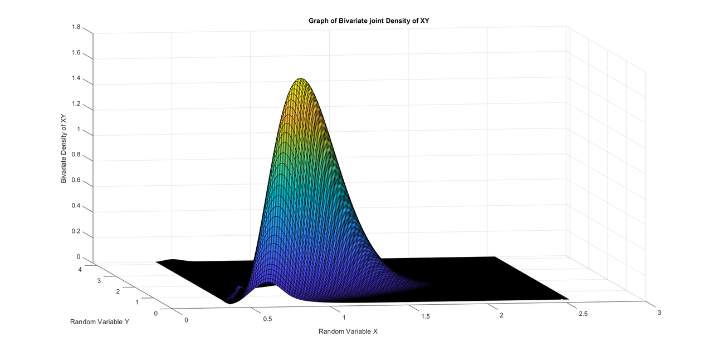](https://postimg.cc/4HnvD8VW)

[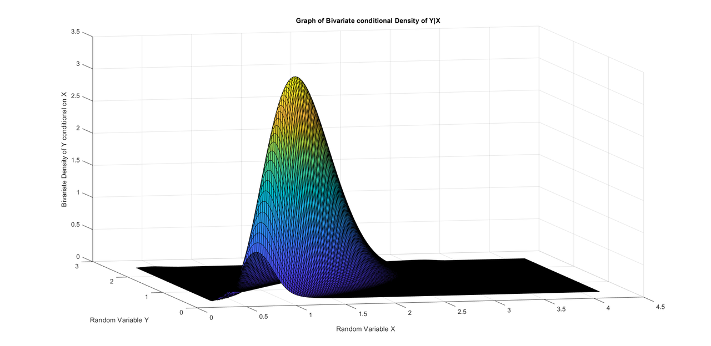](https://postimg.cc/fkbvSbpY)

---

### #2665 — Amin (Topic Author)
*February 21, 2025, 6:23 AM*

Friends, I distribute my research for free always and I want to continue doing that. One reason was that Pakistan army
thwarted me from doing business with anyone in Pakistan and CIA stopped everyone in US, Europe, Japan, India and S.
Korea from working with me. I do not usually mind it these days at all and remain busy and happy with my research work.
And I do love posting my programs for free.

I had a job with a Japanese frim from 2003 to 2010 and I was making more than hundred thousand dollars per year. I had,
in the meantime, loaned my father more than 70 lac rupees (Rs. 70,00,000) before 2010. In 2011, I came back from UK and
had a few thousand pounds left in all. I spent them over next two years and lived in our home at Lahore. Later my family
supported me with bare-minimum money and my father refused to return my money. I have been living with my family since
then. Yes, two years ago, my father returned me ten lac rupees 10,000,000 and I was able to live better for a little
bit. I mostly remain busy in my research and also enjoy driving my motorcycle in the city and I never wanted to make a
big deal about these problems. I just wanted to continue my research and rest of the things are rather secondary for me.

Just this morning, my father told me that he did not want to support me even with bare-minimum money and he wanted me to
work on his tractors show room in Kot Addu and end all other activities. I told my father that if he just returned my
own 50 lac rupees he had borrowed, I will be able to support myself and would not need money from him again but he was
upset and refused.

I was however able to get some little money from my mother and hope that things would get better with my family in a few
days.

I like living a simple life and want to devote next few years to my research in a similar format.

Hopefully in a few years as my mind control ends, I do want to start my mathematical consulting firm based in Pakistan
where I want to live for the rest of my life.

I want to ask friends that when below the belt tactics of American defense have all failed, they are forcing my father
to create problems for me so that I could be manipulated by scumbags of American defense.

I hope things get smooth again in a few days but I am sharing with friends the latest details of what is going on.

---

### #2666 — Amin (Topic Author)
*February 21, 2025, 2:22 PM*

Friends, I  wanted to remain busy with my research and not speak about mind control and its reasons and people behind
it. I simply wanted to concentrate on my research but whenever I have any progress in my research, my mind control and
related torture sharply increases to make more research impossible for me. I want to remain totally devoted to my
research and want friends to help me in doing that, I want everyone of all the good people in Europe or America who
follow my research to please tell two or three journalists about my research and my mind control. I will also request
European friends to ask their government and embassies to please keep a vigil about the matter and force corrupt
Pakistani govt. and establishment to not drug food in Lahore with mind control chemicals.

For the context especially for people who have recently started following me, I am copying some previous posts.

I was a very simple, very meek but also very hard working student at a large university in New York and joined the
university in 1997. My mind control started in very late 1997 when a racist jewish professor in Math department of my
university was threatened by my talent and approached the Jewish Billionaire to ask American defense to put me under
mind control. Even that long time ago, a large number of jews were very aware that this Jewish billionaire was a
Godfather of mind control and would approach the billionaire to recommend talented people to mind control from time to
time when they would be threatened by their talent. Over past twenty five years tens of thousands (if not more than a
hundred thousand) of innocent people mostly American nationals have been placed on mind control abuse by scumbags of
American defense on recommendation of Jewish billionaire. Most universities in US  have a couple of jews who continue to
keep eye on brilliant students of the university and recommend them to American defense through jewish billionaire when
they feel threatened  by the talent of the students due to any reason like their religion, race, ethnicity or just
because they are not jews.

I had told friends earlier that a jewish billionaire is Godfather of mind control. When my persecution started (in late
1997) at the university in New York which is a big time player in mind control of Muslims, blacks and foreigners, many
university officials were very pleased that they were getting written in good books of the billionaire jewish Godfather.
Though there are far richer billionaires in US who are staunchly opposed to mind control, they are not ready to shell
out hundreds of millions of dollars to bribe anyone to end mind control while mind control Godfather continues to give
large bribes to people to continue mind control. Many of the people related to defense in mind control are given
extremely high paying jobs in Godfather and his other jewish friends' companies after they retire from mind control and
Godfather is extremely generous towards them and it is well established and well known to scum in mind control that
after retarding muslims, blacks and others in their career, they will move to paradise(tens of people from army/Pentagon
who follow whims of Billionaire Godfather are given jobs paying milllons of dollars by Godfather and his jewish cohort
in several companies) after they retire. No wonder there is no let up in mind control whatever good people try.

We know in almost all classic folk lore stories evil is too strong and too sure of itself while good is mostly weak and
just trying to protect itself from evil who is bent on damaging and eradicating the weak and the poor good but it is the
weak and poor good that finally prevails. I want to tell good American friends that evil at this stage has become too
bold and thousands of talented people are retarded every year. And it is just not muslims and blacks that are on the
line, several thousands of brilliant whites are retarded across United States by mind control agency every year that has
become too emboldened due to lack of any accountability. Thousands of foreigners are also kept retarded in dozens of
countries including many European countries.

My only intention behind this post is that I want mind control to end from our societies. I do not have any joy in
mentioning that there are some bad jewish actors behind it. In American society there are a large number of jews who
have excelled in the professions of science, education, medicine and have made great contributions to our societies.
There are a very large number of jewish professors each of whom would have taught tens of thousands of students on top
of making extraordinary contributions to body of human knowledge through their great research. Then there are
accomplished jewish scientists whose work, research and inventions make our everyday life better. There are great jewish
doctors and surgeons who would treat countless sick people and make them recover from disease. The list of contributions
of jewish people to humanity is very long and it continues. Then there are a large number of ordinary jewish folks who
are known for their goodness and civility to other people in the society. When we know all of this, we do not want to
say anything anti-jewish to hurt the feelings of so many good jewish people. But I still have to say there are really
some bad people who are unconnected with most of the nice and accomplished jews and they instigate and continue cruel
mind control torture on talented people of other ethnicities, religions and countries based on their personal dislike
and hatred. My purpose is only to end the mind control victimization and torture on otherwise nice and talented people
and I do not have any hidden intentions beyond that. And I am sure American society knows very well about the
contributions of good Jews to both their country and broader humanity and my exposing some bad actors would never have
any bad effect of any kind on these good and nice jews who we all respect and who are our role models.I want to tell
friends something I have said before here that I am sure American society would eventually end the menace of mind
control from their and other countries. I want to request all good Americans and Europeans to come forward and invite
any investigative journalist you know to read my threads and ask them to help end the menace of mind control in our
societies through their investigative journalism. Without any accountability evil will continue to grow stronger and
then mind control would start to threaten even those people who consider themselves safe due to affiliations, status or
wealth.

https://forum.wilmott.com/viewtopic.php?t=99702&start=2325#p881807

https://forum.wilmott.com/viewtopic.php?t=99702&start=2325#p881808

https://forum.wilmott.com/viewtopic.php?t=99702&start=2325#p881886

https://forum.wilmott.com/viewtopic.php?t=99702&start=2340#p881951

Friends, this speaks volumes about headstrong cruelty of people in American defense and their Jewish billionaire backers
cohort that they are even more ready to show me cruelties even after people have a widespread knowledge of their
machinations and tactics. These evil people have no intention or desire to decrease their torture on me despite that I
have been telling tales of their inhuman torture on me over past twenty five years through various psychiatrists.

Please read the following two posts to see the context how I have been maltreated by various psychiatrists on behest of
mind control agencies over past 25 years.

Friends, I have been on forced antipsychotics for most of the time since early 1999. There were a few periods of a few
months when I remained free from antipsychotics. But other than two or three such periods, I have remained on
antipsychotics. It is very hard to feel well when huge antipsychotics are forced on someone who is mentally healthy. I
have also been detained forcefully tens of times whenever some of my neurotransmitters came back, the purpose of
detention was to take brilliant neurotransmitters out of my brain and send me back home with a relatively retarded brain
after the end of months long detentions. I have seen sheer trauma, torture and brutality on the hands of these
psychiatrists who connive with American defense and Pakistani military to declare me mentally ill so they can force
antipsychotics on me. I will be 51 this year and portion of my life that I lived under mind control has exceeded the
part of early life that I lived without mind control.

I have a phone meeting with the psychiatrist on 14th of June 2024. And I am sure the psychiatrist will try again to keep
me under medication or even increase my medication. Even after a large number of people have become aware of truth about
mind control and accompanying persecution by the psychiatrists, most psychiatrists are not the least worried that their
wrongdoing is being exposed in public.

I want to request good Americans to please protest to American defense, mind control agency, Pak army and relevant
psychiatrists to please end this cruel practice of declaring healthy people on antipsychotics and forcefully detaining
them up to years in their faciiities.

When they detain me, they have fixed all mind control gadgets and lasers in the psychiatric facility and they add all
mind control chemicals openly in food and psychiatric drugs. It is a very controlled environment in captivity and within
a month or so, they are able to remove all neurotransmitters from the brain of the victim. Every time I was detained,
they kept me in the psychiatric facility for 30-50 days. One psychiatric even detained me for ten months after I
returned from Britain. There are also instances of being detained for six months once and three months twice.

I really want to request American people again to please protest to their government and try to make sure that I am not
being detained again on totally flimsy psychiatric grounds.

.

[My Letter To HRW About My Human Rights Abuse](https://forum.wilmott.com/viewtopic.php?f=15&t=102298)

Above is a very incomplete account of how various psychiatrists continued to play in hands of Pakistan army to retard
me. It also does not cover all the time till year 2022 and the account stops several years earlier. I could not write
about last several years that were exceptionally brutal.

Friends, in a previous post I told friends how staff at a lady psychiatrist's hospital started beating me and abused me.
During past twenty three years, there have been many many instances of my obvious abuse by different psychiatrists. I
will describe some of those instances in this post.

When I came from United States and till fifteen years after that, my father would proudly ask me that I could see any
psychiatrist I wish. This was because Pakistan army was managing my persecution and they would force psychiatrists to
declare me schizophrenic and my father was told that every psychiatrist would be forced to cooperate. However, by chance
in 2016, I came  across a psychiatrist who was far better. I never told him that I was under mind control but whenever
he interviewed me, he always said after the interview that I was perfectly sane and mentally healthy. When my family
would force him to increase the dosage of antipsychotics, the doctor first told me that I should not live with my family
and make a comprehensive plan to support myself and become independent (such a plan could never work since Pakistan army
was threatening people in Pakistan to not give me any business and CIA was making sure that every contact I would reach
for work in Europe (and Singapore/ Japan /Australia) would be approached by CIA telling them that I was a very bad guy
and they must not do business with me. I had not told the doctor any such thing that intelligence agencies were after
me.)  When I told the good doctor how previous psychiatrists had abused me, he would tell me that this used to be a very
widespread practice in America hundred years ago to wrong mentally healthy humans by using corrupt psychiatrists as
instruments to detain them and strip them of their sanity. The good doctor I am talking about was American national with
Pakistan background who had practiced psychiatry in America for over twenty years and had returned to Pakistan. That
good doctor kept me on very low antipsychotics (1 mg resperidone per day) and that too on extreme insistence of my
family. It was only during that time of treatment by that doctor that I got my first break in research and I solved the
problem of high order monte carlo simulations (and analytic series solution of ODEs)  and posted that solution on this
thread. Ok, when my family was fed with the doctor, they detained me with another doctor. They detained me again two
years ago when I requested my family that I wanted to see the same doctor of my choice again( I have been detained every
year for past six or seven years by different doctors), they detained me through a different doctor. So my family now
stubbornly refuses to allow me to see a professional qualified American psychiatrist of my own choice and detains me
every time I try to approach him.

Now back to my obvious abuse by two other psychiatrists. I was detained by this doctor who was running a mental health
facility and was not a psychiatrist himself. At that time I did not use to walk very much and my blood pressure used to
be somewhat high. Since other antipsychotics had failed to retard me, doctor suggested I take aripperizole injections.
These injections affect the heart and also elevate blood pressure but doctor who wanted to retard me had no regard for
my health while pretending to cure me. In initial days of my detention, staff at the hospital when checked my blood
pressure told me high enough blood pressure in line with what I used to have but after I complained about aripperizole
and its effect on blood pressure the staff started doctoring blood pressure and started telling me that my blood
pressure was very good or even low. This is a post I wrote on another thread in this forum about it. How to safeguard my
research - Page 32 - wilmott.com

.

> Amin:
>
>
>
> Since I wrote about high blood pressure and mentioned high blood pressure before the hospital staff, they have started
to doctor blood pressure. Now, everyday they tell me that my blood pressure is 120/80 or 110/70. While they always told
me that my blood pressure was 130/90 or 140/100 prior to injections. I have never had so good blood pressure for years
that they have started to tell me now. Friends would recall a previous post when I could not sleep at night and had to
take a sleeping pill. When the dispenser came to me at night(The hospital has no MBBS who stays here at night in
Ramadan. Dr. AS used to stay here on some nights earlier but has been totally absent in Ramadan). When the dispenser
checked my blood pressure, he told me that it upper blood pressure is 110. I did not believe him at all. He asked me to
check on my own and put the stethoscope head assembly in my ears. I could easily tell that upper blood pressure was more
than 140 and lower was more than 100. The staff has already started to doctor blood pressure. My parents are going to
Saudi Arabia for two weeks in a few days. Now Dr. AS has the plan to hold me in detention while my parents are abroad. I
had a complete settlement with Dr. N and we(I and the doctor N) both agreed that I would be visiting him every fifteen
days and all modalities were agreed. I do think as a patient it is my right to choose the psychiatrist and Dr. AS( who
is incharge of facility Pav.) has no right to change the doctor after I have selected a psychiatrist and we both agree
on terms of any treatment. Dr. AS has imposed another psychiatrist Dr. M who has not even seen me and has already
started giving me injections and increased medicine without looking at my present condition. Dr. N had explicitly stated
that I would be free to leave if it were his facility. Most major reason for detaining me now is that Dr.AS wants to
continue to detain me while my parents are leaving for abroad for more than two weeks
>
>
.

Later after a few days, I was given a second aripperizole injection and released from detention. An injection was due
every fifteen days. My parents were in Saudi Arabia and I was living with my sister. She insisted after fifteen days
that I get a new aripperizole injection. I complained about too much side effects and other serious problems but my
sister insisted that I must get the injection. She talked to another doctor and the doctor told her that if his blood
pressure and pulse are fine, just give him the injection. I asked my sister that my blood pressure must be checked
before I get the new injection. We went to a small hospital close to her house and when my blood pressure was checked my
lower blood pressure was 110. The hospital staff recommended that I stay at the hospital in their care until my blood
pressure decreases. It was a totally random blood perssure check. When hospital staff came to know that I had been given
aripperizole injections, they told my sister to not give me those injections any more. My sister asked the staff to
relieve me and we came home but I was not given aripperizole injections after that.

But this is interesting that the psychiatrist was initially desperate to prescribe aripperizole despite that I had told
him about my heart and blood pressure problems and his staff was asked to doctor blood pressure so that I would accept
the injections.

Good thing is that only after stopping aripperizole, I started my treatment with good psychiatrist  doctor Naeem Aftab
(who is an American national) and he gave me enough relief that I was able to get a break in my research and solve the
problem of high order monte carlo simulations. I would always be thankful to Dr. Naeem Aftab for giving me relief at
such a crucial point in my life.

Yet another experience for abuse was with a seasoned psychiatrist who is known for his connections with Pakistan army.
When army dictator Pervaiz Musharraf ruled the country, he made this doctor the dean(president) of the university of
health sciences which regulates most medical universities in Pakistan. He had treated me for three years in year 2001.
He started my treatment without interviewing me and gave me electric shocks at the start to jumpstart the therapy. I was
given electric shocks for fifteen days in early 2001. I still recall that doctor would place a wooden wedge between my
teeth and then give me an injection and I still recall how numbness would move in my body from feet to the upper body
after the injection.

When going to that doctor's psychiatrist facility in 2001 I had to travel from Kot Addu to Rawalpindi. My family had
given me some drug in my food and I became unconscious after an hour or so. I still recall how I was begging my younger
brother to help me that I do not want to go anywhere and if he could help me but he like everybody else in the family
refused. Slowly drug in food showed its effect and I have absolutely no memory of being taken in my father's car despite
that it would have taken him at least eight hours to take me to Rawalpindi. Psychiatrist did not interview me and
detained me and started giving me electric shocks. I still recall how I defecated in my bed there and they had to wash
it.

Anyway, I was taken to this psychiatrist in 2017 again. He was very clearly told that I had been given antipsychotic
drug larjactil by another doctor and it backfired and I had extremely severe drug-induced jaundice. But the doctor was
so haughty and cavalier and so desperate to retard me that he still insisted that I must get the same drug larjactil and
said that it was not necessary that it would cause jaundice every time. Problem for the doctor was that most
antipsychotics had failed to retard me and he wanted to give me some potent antipsychotic that had not been well-tried
on me. Though the drug was given to me earlier and later discontinued, the doctor wanted to take his chances to retard
me and he had no regard for my health. This doctor is a big crony of Pakistan army and really wanted to please the
generals and therefore he decided to give me larjactil again. And as would already be obvious to most friends, after two
weeks, I started to show all signs of drug-induced jaundice again and my body and eyes were all yellow. My Biluribin
shot like anything. And it took more than two months to control jaundice after that. Though my biluribin came back to
normal after two months, several less known enzymes in my liver remained disturbed for several years after that and
continued to show as abnormal in my liver function test reports.

I have been detained more than 30 times by various psychiatrists during past twenty-five years on orders of Pakistan
Army. This is despite that I have never been violent all my life. I have never hit anyone in my adult life and I rarely
speak with anyone in a loud voice. I have never done anything like breaking a glass or any utensils that is associated
with sick people.

Here, I will recall an incident eight years ago when I myself approached a lady psychiatrist for help and how she abused
me, and her staff beat me for twenty minutes and then tied me and started my treatment with antipsychotics again.

I am recalling this from early 2015. They had previously put me on extremely high antipsychotics and my creativity was
all gone. I could barely do any intellectual work. At that time, I was able to convince my family to decrease the
injections and they had agreed since I had already lost most of my creativity and intellectual capability. I think mind
control agencies were also thinking that I had lost my creativity forever and they wanted to see if it was right time to
decrease my drugs and still make sure that I would remain intellectually dull after injections had ended.

But I slowly started to work on my research and started to regain my brain. When mind control agencies realized that I
had started to do better research, they asked my family to do something again to retard me. My father asked a
self-stylized religious saint to come to our house and take care of me. He came to our house with one of his followers
and told me that he wanted to give me injections and I would go to sleep for 24 hours, and they would take scans of my
brain to treat me, but I continued to beg and plead him, and I was able to convince him to allow me to leave the home in
my car. The supposed saint allowed me to leave since he was probably sure that he would get me later as I had no other
place to go other than my home and, therefore, I was able to convince him to let me go outside. When I left the house, I
made posts about the saint on at least two different forums from outside my house and pleaded for help. Enough people
were following my story even at that time and the saint had to leave. I also called my father when I was outside and
protested against this.

My family still remained very tense with me, and I was very afraid that they would force antipsychotics injections and
mind control drugs on me therefore I stayed one night out of the home. Here is the post I made when I was away on April
14th, 2015, 2:09 pm

[viewtopic.php?f=15&t=94796&start=315#p748191](https://forum.wilmott.com/viewtopic.php?f=15&t=94796&start=315#p748191)

"I am staying out of my home for the night since I had realized that my father will try to force me into detention again
and I would request a court tomorrow for stay order to stop my father from hospitalizing me forcefully again and I would
request the court that if there has to be a check on my mental health, it has to be done and investigated properly by a
psychiatrist of my choice and I should remain free at the same time. I do not want to be at the mercy of my father's
chosen psychiatrist as we saw in the past year that they continued to quote mental health laws and forcefully manipulate
me into taking injections. If my father forcefully hospitalized me, I would be cutoff from the outer world and they
would do whatever they like. My father's self-stylized saint(peer) had already hinted that he wanted to give me
injections that would put me to sleep for 24 hours and he had no argument for my mental sickness at all.”

Next day, on April 15, 2015, I went to Lahore High Court to find some help but I was told that I had to submit an
application that would be considered several weeks later when its turn would arrive. When I realized that there was no
possibility of help from the court, I decided to see a psychiatrist on my own. I was driving in Garden town Lahore where
I came across B**** psychiatric clinic and decided to see the psychiatrist Dr. N*** there. It was evening but the
psychiatrist still not had arrived there. I waited for an hour in the reception and then had a consultation with her. I
asked her to listen to my case carefully and then decide if I was sane enough and tell my parents about it. She said
that I seemed perfectly fine and asked me that she wanted to hear what my family had to say. I agreed and took an
appointment to visit her again at April 20, 2015. I took my mother on the planned day and my mother did not have
anything decisive to say about any disease other than that I did not eat at home. The psychiatrist asked me to visit her
after one week on 27 April 2015. The next week when I went again to visit the psychiatrist, on April 27, and was sitting
in the waiting room so that I could visit the psychiatrist on my turn. Another lady who was a psychologist came to me
and asked me to go with her in a different room to have a session with psychologist but I declined and said that I was
only interested in seeing the psychiatrist who had promised to see me again the earlier week. After five minutes, at
least four men came to the room and started besting me. They gave me slaps on my face with full force and gave me blows
and they continued to do it for more than fifteen minutes. I had never been beaten like that ever before in my life. All
this time, I was simply trying to raise my hand to somehow protect me. Since I was sitting on the sofa, only my face and
head were the target of slaps and blows. They were very violent with all sort of slaps and blows on my face as I earlier
mentioned that I was sitting and they were standing. . They literally continued to beat me and I continued to beg them
to stop. After fifteen minutes of beating me, they tied my legs and lifted me and put me on a bed in a room in the
psychiatrist facility and told me that doctor had gone to America and she could not see me. It was a complete lie and
the psychiatrist was in her office and was interviewing other patients when I arrived. I continued to ask them to loosen
the knots but they continued to make fun of me. I was totally surprised since Dr. N had behaved very nicely in the
previous meeting held at 20th with my mother and myself and I was sure she would declare me mentally sane on this
meeting. After I was kept tied for about half an hour, a new guard came and opened my hands and legs and said that they
would keep me at the facility for three days. The next day my medication in the form of pills started and I was also
given two more injections. I was given about nine pills at night and about eight pills in the morning. I was still not
given the opportunity to meet the psychiatrist N, and I was told several different things by different people including
that psychiatrist N had gone to America, and she had gone to Islamabad. About three days into my treatment, I saw
through the glass walls that psychiatrist N was interviewing her clients in her office. After seven days, I was asked to
meet psychiatrist N, and she said that she was unaware of the beating as she was in a meeting. Psychiatrist N also
assured me that I had no schizophrenia and previous doctors had very wrongly diagnosed me but it was a case of some
mania that she would properly treat this time.  Her staff continued to say that they were giving me drugs so that the
effect of other drugs given to me by previous psychiatrists would decrease.

Before my computer was taken away from me, I was able to take notes for two days in the hospital on my computer that I
write here. After first two days of medication, I was so extremely weak that I could barely walk and I had extreme
difficulty speaking.

“My Diary for past two days.

4/27/2015

I had two sessions with the doctor N previously on the 20th of April and once before at 13 or 14th of April. I remained
away from home during this time and second meeting on 20th of April, evening after the night when I remained away from
home. I had told the doctor about my circumstances in the first meeting with her. She had said that I looked perfectly
fine mentally but she needed to talk to my family. On 20th of April, I took my mother for a second joint session of
myself and my and the psychiatrist said, after the meeting, that said she really could not call me schizophrenic but she
needed one more sessions and asked me to come to her facility on 27th of April.

When I arrived at the psychiatric facility, a psychologist had asked me to accompany her which I did and on the way to
the her room, I asked for the reason, after which she replied that she wanted to take a session of mine. I told her that
I already had a session with another psyc hologist and also with a psychiatrist so I would prefer to have a new session
with the psychiatrist now. She agreed and I returned to the waiting room. I was sitting on a sofa in the waiting room on
27th at 8:00 PM (PST) in the line to see the psychiatrist when about five guards took control of me, while I was sitting
on a sofa in the waiting room to see the doctor, and gave me an injection. I was beaten and my legs and hands were very
strictly tied for more than hour. Though the doctor was in her consultation room and a lot of people were waiting to see
her, I was told again and again that doctor was not present at the facility.

In the previous two sessions, she had given the impression I was healthy mentally but she used force without
interviewing for the third time or seeing me and without requests to comply. If she was given any special information,
she should have talked to me about it and she should have verified with me any change in circumstances.

One injection was given around 8 PM when I arrived for third session with the doctor N. I really think that the doctor
was there since there was a large rush of visitors and her SUV was parked in the hospital but everybody among the staff
continued to say that doctor did not come to the facility this evening.

I was kept tied for more than one hour. I was taken tied from the waiting room to my room. All these rooms have video
cameras so you can ask Dr. N for a video of the events though she might make the excuse that cameras were not working.
One of the staff had mentioned when they brought me into a patient room in the facility, that everything was watched by
cameras.I would request people familiar with the matter to request her to show them footage of the cameras. Of course,
there could be many excuses that cameras were not working but I insist that cameras were working.

Good Mental health facilities try to avoid treating humans like this.

Another injection was given at night before I slept.

and my internet USB device was also taken. They simply took possession of everything out of my pockets and also took my
laptop.

When I asked why they gave me injections, one of the staff told me you were ?hyper? and I was totally surprised since I
was quietly sitting on the sofa in the waiting lounge for the doctor. I was told that I would stay in the hospital for
three days. I am sure this matter can be resolved who is lying and who is truthful once you look apt video footage of
cameras in most rooms.

4/28/2015

One injection was given in the morning. One injection was given around noon. All injections were IM (given in the
muscle.)

Unknown pills(some pills in the morning +5 pills around noon + 3 pills at night) were given and I was told,? We will
tell you know the names of these pills only when you leave.?

Computer was returned today but I was told that we did not take your mobile and they continued to say we never took my
mobile. My mobile was never returned( despite I always keep my mobile on me.)

I was also not given my EVO USB device and I was told you cannot write anything on internet. However the USB device was
returned to my mother at night.

I was told today by the psychologist that doctor N had gone to America and will come back after seven days and only then
she would be able to see you. I was told we are adjusting your medicine and see what was a good medicine. I was told
they were discussing the drugs with her on phone and skype There were several conflicting statements about where Dr. N
was. Somebody said she was just out of city and had gone to Islamabad.

When I asked my mother who is living with me at the hospital, I wanted a second opinion, because of beating and other
irresponsible behavior of the psychiatrist, my mother would make all sort of excuses while the staff would say that you
cannot leave the hospital until Dr. N arrives who is currently out of country.

Earlier today, I was told that I would live at the hospital for fifteen days and later I was told that I would live at
the facility for seven days. When I was tied, somebody had told me that I would live in the hospital for three days
only.

My mother told me please do not write anything wrong on internet otherwise, they would take your USB forcefully like Dr.
A had done more than one year ago. The purpose was to threaten me to not write about any maltreatment so that the doctor
would continue to freely manipulate me.

7-8 pills were given in the afternoon and similar number of pills were given at night. At many times during the day, I
could barely walk and had extreme difficulty speaking.”

Friends, I have previously described several horror experiences with psychiatrists but there are many more such
experiences that I have not posted on this thread. Today I am going to describe a continuing experience in which the
psychiatrist did everything in his power to retard me.

This is from year 2004/2005. I had a sound logic at that time and I was working from Lahore at a job with a foreign
Japanese company that was paying me \$4000 per month. I was still on high antipsychotics and when high dosage of normal
antipsychotics did not work, in order to retard me, the psychiatrist employed a procedure that is not known in
psychiatric practice in any country. The psychiatrist would give me some drugs in a glucose drip every two/three days in
the operation theater. When I would be given the glucose drip, I would gradually start to lose consciousness and when
half of the drip bottle would have gone into my blood, I would literally be unconscious, and I would later be taken
unconscious to my hospital bed by the hospital staff and I would wake up several hours later on the bed in my hospital
room and I would be extremely weak.

It was such a frightening experience that I would shudder from horror as the day of this treatment would come closer and
continued to beg the psychiatrist to stop this treatment. The psychiatrist would say that he was giving me vitamins and
vitamins were always harmless. He insisted that vitamins had to be given to me. He never told me what drugs he gave me
that made me unconscious and never discussed it with me other than mentioning vitamins. The psychiatrist continued to
perform this procedure for several weeks after sometimes second or usually third day. Most people cannot imagine how it
would feel when the drug in glucose drip would go into my body and I would lose my senses. To this day I shudder from
complete horror and recall the extremely sick feeling when I would slowly lose consciousness.

Now when I look back, I realize that they were giving me mind control drugs in the drip to take the intelligent
neurotransmitters out of my body. They continued to try to take intelligent neurotransmitters out of my body again and
again through this procedure for several weeks. I was completely helpless before my family and the psychiatrist and had
to go through such unlawful medical procedures.

As friends would have realized that purpose of mind control agencies was always to retard me since neocon scumbags of
pentagon and their backers were not capable of appreciating my humanity and did everything in their power to retard me
with an iron fist.

I have seen continuing pain, trauma and torture in my life only because I had some special neurotransmitters that people
with hatred and venom were not ready to let me have since they considered it a threat to let a Muslim have those
neurotransmitters.

After starting mind control in Lahore in early 2000's, bad jews (again apologies to good jews) were very emboldened how
easy it was to manipulate army and government in Pakistan to start mind control of intelligent people in Pakistan. It
was a time when Pervaiz Musharraf who was an army dictator ruled the country. He was very ready to please the CIA in
order to get help from American army to prolong his illegal dictatorship in Pakistan. He fixed in place all the required
mind control infrastructure in all large cities of Pakistan to please American army who was playing in hand of bad jews
to damage the Muslim majority country.

When Americans rightly blame our country for terrorism, they must not forget that many neocon generals in American army
have played in the hand of bad jews and have made every effort to systematically destroy talent in Pakistan on a very
large scale using mind control technologies to keep it backward forever.

Mind control in Pakistan is ensured by top Pakistani army generals since they are given several hundred million dollars
by US army every year and the top brass of Pakistan army divides this money among themselves with bigger fish getting
larger share and smaller fish getting a smaller share. Therefore, mind control infrastructure in Pakistan is very
detailed and thorough.

From my own experience, there is very large mind control activity in Lahore and Islamabad, the two cities where I have
lived during the past twenty years. There are at least more than 500 mind control targets in Pakistan most of whom are
computer science majors.

Mind control in Pakistan and many other places increased dramatically like never before. We have in Lahore a huge
building called Arfa Towers where all the facilities for technology and IT companies were provided to attract new firms
and entrepreneurs and later Arfa Towers became a scene of mind control carnage since tens of aspiring computer
scientists and entrepreneurs were retarded and it became very easy for mind control agencies to find the talent since
the facility attracted talent and retard it. Time between 2008 and 2016 was like black death for talent in technology in
our country (I am not talking about pseudo-talent that American embassy continued to support and showcase heroically in
the meantime.)  I still recoil with horror when I look back and recall how difficult it was to get good drinking water
in Lahore during that time for more than six months in 2013-2014. I would have to go to remote parts of the city, go to
villages around the city and sometimes even go to other cities and only then I would be able to get some good water
after repeated attempts and my only worry during the day would be to somehow get good food and water.

At this point I like to tell friends that a lot of food and beverages that are drugged with mind control chemicals would
be eaten or taken by most of the population that is not on mind control and they would never notice any anomaly in taste
or any other effect since these mind control chemicals are inactive and inert and become chemically active only when
targeted remotely with precise electromagnetic wave frequencies so only target victims are affected and this is a very
cruel method to target intelligent people by drugging the entire supply of food and beverages and then focusing waves on
the targeted individuals to activate the mind control chemicals. Pakistan army and mind control agencies would drug the
entire public water supply and beverages knowing that the victim would have to drink something somewhere. Ground water
is also so thoroughly drugged with mind control chemicals that entire public water supply of the city and several
kilometers out of the city would be completely drugged with mind control chemicals. Pakistan army routinely does this in
Lahore city on behest of American mind control agencies.

Ten years ago, army soldiers and agents would go to markets to drug the targeted food and beverages with mind control
chemicals which they still. Large scale movements of soldiers and agents raise suspicions in general public and
therefore mind control chemicals are supplied to beverage and food manufacturing companies in Pakistan, and they simply
add the chemicals in food and beverages during the manufacturing process.

In Lahore city, there are more drugged beverages at any time than good beverages in small stores or large supermarkets
alike since most of the beverages are drugged at manufacturing source by coca-cola, pepsi-cola and Nestle.

Coffee stimulates the brain and the brain connects in new ways after taking coffee and good coffee creates problems with
keeping victims on mind control since their brain starts connecting in many new ways after taking good coffee. All
coffee and I repeat that entire coffee in the country present in the stores is drugged with mind control chemicals. Most
of the coffee on good stores is imported from foreign countries. I do not know how it works but importer is probably
told by army to drug the imported coffee before distributing it in the market. It is even very difficult or rather
impossible to get good coffee beans. Two or three years ago it was possible to find some brand of coffee that was good
by trying all new brands but it has not worked for past two years now for me despite that I keep trying. I even know of
instances that when I was able to buy good coffee of a certain brand from very large and posh stores, they took entire
coffee brand off the shelf from all their branches within two to three days. People know that Corrupt Army in Pakistan
that ensures mind control is more powerful than any political government here.

Tea used to be good but for past one year most mainstream Pakistani brands of black tea are drugged with mind control
drugs. This has still not caught up thoroughly like coffee is thoroughly drugged and it is still possible to find some
good foreign brands tea that is good.

All stimulant/energy drinks including red bull are well drugged at manufacturing source. Red bull was better till last
year but then it became drugged everywhere. I even tried it at remote places in several cities other than Lahore and it
has always been drugged lately.

Most of the soaps, shampoos, creams, toothpastes are drugged with mind control chemicals. I do not use shampoos or
creams but whatever rare I tried them once in a while they were drugged and they charged my skin. All of these have mind
control chemicals that charge the skin and make mind control extremely effective. Many people would be amazed when I
tell them that even though I would be in my full senses before washing my head and face with a soap but after washing my
head and face with a drugged soap, my eyesight would deteriorate and my conception of reality would completely change
and sometimes I would face extreme anxiety. It is hard to emphasize that even a small thing like this can completely
change the victim's state of mind and consciousness. Getting a good soap was very difficult for me till last year and I
would drive for several hours in different parts of the city especially looking at all the pharmacies on the way to find
some unknown brand or some soap that would have been manufactured several years ago when soaps were not getting
completely drugged. I tried all the soaps including beauty soaps that are specially made for women, even many unknown
brands, and specially imported soaps(which were all universally drugged thoroughly) and it was very very difficult to
find a good soap. After finding a good soap, I would keep it in my pocket all the time. This is a small thing but you
cannot live without it. Since our mouth is kept charged and some charges continue to go into victim's body from one's
mouth. Therefore toothpastes are also added with mind control chemicals to charge inside of our mouth. You can imagine
that after buying five or six tooth pastes of different remote brands, I would get a good tooth paste. I have recently
been using toothpaste that is imported from abroad and is good. Toothpastes manufactured in Pakistan are all drugged
with mind control chemicals.

Another big problem is that pharmaceutical companies add mind control chemicals to their drugs(pills etc). Most of the
mind control victims are targeted due to their talent and intelligence in mind many times might require special minerals
that are rare in our food.  Most of the mineral and vitamin formulas are also drugged with mind control chemicals. Most
mainstream mineral and vitamin pills in the market are thoroughly drugged with mind control chemicals. I never like to
take names but I would like to tell friends that greatest crook of all times is Glaxosmithkline( I would invite them to
sue me for writing this on Wilmott). GSK's mineral and vitamin formulas, effervescent calcium tablets, and toothpastes
are all drugged with mind control chemicals. There is a tablet by the name Kemadrin that has to be taken with
antipsychotics and GSK manufactures it and it is also drugged with mind control chemicals. My experience with GSK is so
bad that If I have to buy any medicine and if it is made by GSK, I would try my utmost to avoid taking it for the fear
of its being drugged with mind control chemicals and look for alternatives.

Injection fluanxol and clopixol are also drugged with mind control chemicals.

Again all this thorough infrastructure took more than fifteen years to develop in Pakistan and Pakistan army continued
to work hard to develop it over the years. There are at least five hundred brilliant Pakistanis most of whom are
computer scientists who are on active mind control to thwart them to contribute to society in any good way.

All this infrastructure exists in Pakistan and was developed because neocon generals wanted to please bad but rich jews
and American mind control agencies continue to perfect it over last twenty years. Again, mind control in Pakistan is
ensured by top Pakistani army generals since they are given several hundred million dollars by US army

I have not talked about special infrastructure that is used to project EM waves on the target and this infrastructure is
present on all major roads and public places in big cities and major highways and motorways in the country.

[My Letter To HRW About My Human Rights Abuse](https://forum.wilmott.com/viewtopic.php?f=15&t=102298)

Above is a very incomplete account of how various psychiatrists continued to play in hands of Pakistan army to retard
me. It also does not cover all the time till year 2022 and the account stops several years earlier.

---

### #2667 — Amin (Topic Author)
*February 21, 2025, 2:24 PM*

Friends, I want to describe again what happens to victims of mind control on a regular basis and how animals scumloads
of American defense insult and humiliate these victims all their life to please the rich jews.

First thing is that EM waves emitting devices and lasers are fitted all over my room and also in all other rooms of my
family home. For example when I am having a good deep sleep which is rather unusual, they would target my head with
lasers and high frequency waves and I will feel very tired when I would wake up as if I had not slept at all. Just like
neurotransmitters, when molecular weights of enzymes and hormones is known , they can be targeted with resonance of
appropriate frequency to not allow them in certain areas of the body or at least decrease their concentration in
particular areas. For example when I had a foot fracture in 2014, they never allowed it to heal properly by targeting
waves of appropriate frequencies on the fractured area. Many times when I am working in my good spirits in my room or in
garage etc, the mind control agents would point high frequency lasers towards my forehead to cause pain so that I would
not be able to concentrate on anything and get angry and start ranting and would not be able to work anymore. Sometimes,
when they are more cautious, they would simply point EM waves with appropriate resonance to cause me to sleep or become
drowsy. They change the position of a lot of devices everyday based on their anticipation of position and place where I
would next work on my research and sleep.

In our house, every bed, sofa or chair that has foam on it, causes severe itch in my back when I sit on it. I think this
is because they inject some chemical that settles in pores of the foam and then becomes volatile when EM waves of a
particular frequency are focused on it. The volatile chemical enters the body of the mind control victim through the
anus since it has "potential" to combine with some of the neurotransmitters in the body. It is extremely painful to sit
on these beds, sofas or chairs. If I have to do that, I place two or three cotton pillows on top of the foam bed, sofa
or chair and then sit on the pillows. I have a large double bed in my room but I never sleep on it and instead sleep on
a small cot (with cotton filled quilts beneath me) in my room since it is impossible to sleep on the bed. Again sleeping
on the bed causes unbearable and very large physical pain and huge itch in the anus.

It is impossible for the victim to shower everyday since the water in the washroom is charged with mind control
chemicals that make the victim feel half faint and totally energy-less. Several years ago, I discovered the water in our
kitchen did not have mind control chemicals to charge the skin and I would simply take water from the kitchen to the
wash room and take a rich sumptuous shower. Even though mind control was not very high at that time, they closed the
loophole after a few weeks.

Soaps of all large Pakistani companies have mind control chemicals in them that charge the skin and when EM waves are
focused on the face, forehead and the skin, the victims feels a completely altered consciousness and sometimes extreme
anxiety and nervousness. I have been living on Indian soaps (Did we separate from India only to fill the pockets of
corrupt scumbag generals of Pakistan army who take hundreds of millions in bribes from CIA and then heroically stab
"dhirti mata"/motherland in its back?)

The antipsychotic drugs and injections are mixed at the manufacturing source on orders of scumbags of Pakistan army and 
they have a huge deteriorating effect on the victim. They would take away all neurotransmitters from my body  they can
using mind control injections and I would not be able to have a proper conversation with anyone or do any research work
until 7-10 days after the injections. I would have muscular pains and other aches all over my body. Sometimes they take
away some special neurotransmitters from the body and the victim would feel as if he is losing all energy in the body
and the victim would have to eat something or take a drink to get better. This happens to me all the time despite my
sugar tests both fasting and random and H1BAC are perfectly good. Since food is one of the only few things that can help
you get better when the victim is under mind control drugs, my weight has increased beyond limits and I am 30 kg over
weight now.  There were small periods when I did not take antipsychotics and my weight decreased quite fast in those
periods so I expect if my antipsychotics filled with mind control drugs end, I will easily lose a lot of weight quickly.

I tried to re-start my morning walk several times last year but mind control agents tried everything in their power to
deter me by taking out my neurotransmitters and even went to the limits of Police threatening me to walk not on sidewalk
of  public service roads but in parks only (Police has no such authority but they can harass anyone). I have done a
complete post on this harassment incident somewhere else.

They can even kill the vicitm remotely when the vicitim is under mind control drugs but the scumloads of American
defense have still not done that to me.

Another very nasty thing these "proud" scumloads of American defense do is that when the vicitm goes into wash room
where his penis is exposed, they use some device that throws small amount of some chemical that settles on the tip of
the penis and then they target the victim with EM waves and it causes unbearable and excruciating pain. I am recalling a
few older posts about this. They used to do this routinely but when my research got known well, they stopped doing it.
This is from more than three or four years earlier.

This is an excerpt from post 971 written on June 01, 2019 here: [forum.wilmott.com/viewtopic.php?f=15&t=94796&start=960#p846210](https://forum.wilmott.com/forum.wilmott.com/viewtopic.php?f=15&t=94796&start=960#p846210)
> Ok, I am not complaining but I decided to write this post several days ago when I was forced on shameful and
humiliating torture three days ago. They locked directed energy on the tip of my penis and it was very painful and
unsettling for me. I urinated more than twenty times in two hours. I would feel better when I would be able to take a
very small amount of urine out of my penis each time. They had done this two times previously for several hours but I
did not write here since I thought that it was a self-humiliating exercise to tell people about my persecution like this
but when they did it last time, I decided to write about it lest it becomes a common practice and starts to happen
everyday. I would say again that many of these mind control people have absolutely no respect or regard for my or
anybody's human dignity. I want people to recall how American army soldiers were openly urinating on prisoners in
Abu-Gharib and most of the staff there knew about it but such humiliatory actions were considered perfectly normal by
most of them. It was until the tapes were run on TV and news was on air everywhere that many of them started to think
that we have made a mistake. Mind control agents are not very different and when they are angry about their failure in
controlling me, they resort to punishing me using humiliating actions like targeting directed energy on the tip of
my penis. I would like to ask Americans if such actions represent American ethics and mentality and if they do not
represent American ethics I wonder why such things do not stop even after I write here openly about them. Please own
your actions if you do not want to stop them.
>
>
> I want to ask friends that some of the mind control agents become extremely mean when they fail to control their
target victim properly and they resort to such ugly tactics. For example one of the tactic mind control agents used to
exercise was that they would make a very little injury/cut on my tongue with microwaves. It will not bleed but it would
be constantly painful all the day since tongue is extremely sensitive. This used to happen almost every two weeks or ten
days. They charged my penis this morning today, as I mentioned in post #1063 written this morning, again though it was
far less severe than what I have described in the above post but such activities continue unabated and the experience
this morning made me recall the horrible experience above. I want to request friends to force the mind control agencies
to replace the guy who controls me as he has a very mean nature which is evident from the above post.
.

https://forum.wilmott.com/viewtopic.php?p=854970

.
> I have previously told friends that, during brain control, charged ions enter the body from every opening we have into
the body. I am very sorry to write this here and want to make an apology to friends for the relatively gross nature of
this post. But I would like to tell friends that  I firmly tape my penis with a paper tape to prevent charges going
inside it. When I do not do this tape, my eyesight sharply deteriorates and I become extremely lethargic. There are such
things I never mentioned on this forum because they are too disgusting to mention but once the torture continues, I
finally decided to mention some of the things here. The way it works for the charges to go into the body, I believe,
they release a small amount of very ionizable gas in the air and charge a pathway through gaseous air with laser beams
towards the body, for example towards the mouth, nose or the anus and apply potential across it. At the same time, they
create opposite potential by ionizing the chemicals that have gone into the body with food using microwave resonance
caused by laser beams. And then chemicals mixed with ionized gas start to go inside the body from the anus etc and this
becomes a self-sustaining process as long as the potential is maintained at both ends. I have seen a lot of such
instances over past twenty years of persecution when chemicals will zap inside through the anus causing severe pain. I
believe flow of charges is really directly proportional to applied potential and pathway conductivity caused by the
ionized gas.  I keep some soft tissues in my anus as it helps. I have tried other things that could more firmly block
the anus but then mind control agents greatly increase the potential and it causes extreme pain and minor seepage like
bleeding(it might possibly be because of very high frequency microwaves). Mind control agents love such torture tricks
that prevent people from doing anything that blocks their mind control. I also tried other tricks like lubricating the
anus but they would simply and freely add mind control chemicals that would charge the body to the creams and lotions in
the supermarkets just like they drug the food on the shelves. I am sure these practices are done all over the world
since adding chemicals to creams and lotions was widely done when I was in UK for six months and even upscale chains
like body shop and others had ionizing chemicals added to their creams and lotions once mind control agents would
suspect that any such shop could fall on my way.
>
> Ok, mind control agents in Pakistan had been making anywhere between 10-40 million dollars per year depending upon how
good the year had been for mind control operations. These agents want to continue mind control one way or other. These
agents tell their like-minded hardliner right wing bosses that there are certain things I never mention in my writing of
the journal (because they are probably too disgusting to write) and these are the things mind control agents need to
apply for my mind control since people would not know about these practices when they would not be written in the
journal. A few weeks ago I mentioned briefly that they cause severe itching in my back/anus but then I never wrote about
it again even though it continued. They almost always have charges going into the body of the target from the back but
sometimes it becomes very painful. And yesterday, it was again so painful that several times I would step up from the
chair while working on my research, open my pants and rub and scratch my anus and replace the tissue that has already
been charged but they would continue to increase potential again and again and I would be repeating the whole thing
again. I also woke up several times at night due to sheer itching in my anus.
>
> I had talked about reprieve from gas in my room in the previous post but I fear that might have been because for past
three to four days before writing of that post, I did not leave the home for long and mind control agents might not have
enough opportunity to come to my home and recharge the ionizing and resonance laser beams and refill the gas because I
remained in the neighborhood very close to home and returned quickly.
>
> I want to request all good American people to force their government to stop such inhuman, cruel and  animal barbaric
practices on other humans only because some powerful people in US do not like intelligent muslims/others to excel and
use their influence to continue such animal practices that hurt the image of American people and such practices are
becoming more and more of a norm with every passing year. Sorry to say but there are good and bad people everywhere in
every country, culture and religion and US is no exception. In US where many bad people do not openly do bad things
because being cruel to other humans is really not appreciated by the American society, but when evil and cruel people
know that their cruelties would not be noticed by the general american people, they are very ready to expose their true
nature and use the methods of cruelties and persecution when they are sure these things would not be noticed by the
American people. These evil, bad and cruel but powerful people have no regard for the goodwill of American people but
just want to use their influence in US right wing to extend their personal agendas. I am very sure if all of these
things would be known to American people in their true entirety, none of these mind control persecutions would ever take
place.
.

Post 1370 on this thread.

.
> Friends, I drove from Islamabad to Kot Addu today. It took me around eight hours to reach kot Addu. Long drives are
very stimulating and I thought of several new ideas both about SDEs and stocks trading. But when I reached Kot Addu, I
had extreme uneasiness in my penis since mind control agents continued to charge my penis on the way as I had to be in
the same accurately predictable position for many hours sitting in the driving seat. After reaching home, I urinated
again and again to feel better but it did not work. I also realized that my urine was reddish as there was blood mixed
with urine as I urinated.
>
> When they force electromagnetic waves inside the penis, the body tissues inside the penis tube get damaged and blood
starts to seep through the tissues and gets mixed with urine. Forcing waves into the penis is a very important part of
mind control since it is impossible to control adrenaline and dopamine without controlling the sex organ. Adrenaline and
dopamine give us drive to concentrate and force ourselves to work hard so mind control agents really have to control
these and several other similar neurotransmitters and they have to force waves into our penis to be able to do that.
>
> I normally do not like to urinate in the wash room since when I urinate there, it is very easy for them to force high
frequency waves inside the penis and it feels like a needle is going into the penis when urine is coming out and high
frequency waves are going inside. I would rather take a mineral water bottle and urine into it in my room and drop the
urine in the wash room and wash the bottle to use again. But if I would remain in a single place in my room to urinate,
they install gadgets and urinating in my room is no different from urinating in the wash room as they can again force
waves into the penis and the target victim would have needle like feeling going into the penis so I have to continue to
change places randomly in my room to urinate.
>
> Anyway they were doing the same thing again and blood was coming out of my penis mixed with urine as I supposed the
inside of tube that carries urine out of our body was damaged due to high frequency waves. This is very serious thing so
I decided to write about it so as to deter the mind control crooks who are bringing a great name to American people by
such feats. But these hardliner conservative crooks in army will continue their ugly antics since their desire to enter
the paradise of Jewish billionaire godfather is stronger than regard for any country or any human ethics.
>
> Previously I had told friends several times (may be eight or nine times in total) that they force chemicals into my
mouth when I am sleeping. This is sheer science though I do not know underlying exact details but I know they can create
potential at a precise place for special types of ions(neurotransmitters) emitted from elsewhere with lasers and EM
waves. Well I continued to mention that they charge my mouth every night with special mind control chemicals that settle
on my tongue and inside of upper jaw and my mouth is very bitter and I have to wash it or brush inside of my mouth to
feel better. I continued to mention it again and again on this forum but they never stopped so I stopped writing about
it.
>
> I want to tell Americans that Americans are mostly not bad people at all but these hardliner conservative crooks in
army and mind control who are dying to enter the paradise of the jewish billionaire godfather are not bringing any good
name to Americans with their inhuman machinations.
>
> Another thing I have mentioned several times before is that I find likes on several linkedin posts (in my activity)
that I never liked. They know my passwords and have enough control over my computer and they repeatedly like something I
never liked (I never like anything unless I strongly feel about it which is usually relatively rare). This is something
that gets known to me since there is a log of every like in my Linkedin activity. Imagine what else they are doing from
my internet traffic that I never came to know.
Another big problem is that when I approach people all over the world for consulting projects, the scumloads of American
defense reach them as well with their infrastructure in that particular country and threaten people to not work with me
or give me any project. Depending upon the nature of person, they would tell some particular lie so that they would not
be willing to work with me at all. In past 14 years, I have only earned 3500 dollars.

I have tried to hold despite all odds and tried to do good research. If things were as good as with other people free
from mind control, I would have been able to do far better research. From my side, I am not enemies with anyone and
would like everyone to use my research and make money utilizing it.

Again the The rich anal jews including the jewish billionaire are extraordinarily pleased when they hear these torture
stories and reward the scumloads of American defense (who are ready to do any nasty, disgusting or degrading thing to
other humans to prove their allegiance to rich jews). These scumloads of American defense, whose arrogance pierces
through the seventh sky, would do every anal and disgusting thing to innocent and intelligent victims in order to please
the rich jewish cohort who would in turn reward them with great jobs and high social status in successful jewish
companies and these scumloads of American defense have absolutely no regard for anybody's human diginity once rich jews
have beaconed them to retard someone.

Friends, when I returned from United States, I was taken to a military psychiatrist in Rawalpindi who immediately
diagnosed me of very acute schizophrenia and gave me an antipsychotic Larjectil along with other biweekly injections.
This drug is known to cause drug induced jaundice in some of the patients. After seeing the doctor in Rawalpindi, I was
brought home in Kot Addu where I lived for four or five months without seeing any doctor in the meantime while taking a
steady dose of Larjectil. However after a few months my color and eyes became totally pale even though I was not feeling
anything odd other than probably strange color of my stool. However one month further later my condition became very bad
and I started to become very weak physically. When everybody became alarmed, I was taken again to the same psychiatrist
in Rawalpindi who immediately knew that I had jaundice and immediately stopped my medication. I was still feeling
reasonable but the nightmare was yet to follow. Within a few days of stopping the drugs, I had so severe itch in my body
that it is totally hard to describe. I could not sleep for a whole month due to sheer itch. I simply could not resist it
at all and there were blood marks all over my legs and arms due to itching. And I was given a glucose drip every day
with medicine for more than a month but my biluribin continued to increase instead of decreasing. And then doctors
decided to give me two glucose drips everyday and only then after two and half months months (a total of three and a
half to four months) after starting two glucose drips that my biluribin came close to normal. This was one of the worst
times of my life.

Later probably in 2017, I was taken to another psychiatrist the second time. This psychiatrist had earlier given me
electric shocks without interviewing me in order to retard me in year 2001. When I was taken to this psychiatrist again
in 2017, he knew from my history that most antipsychotics had failed in retarding me and he wanted to give me Larjectil
again. He was told that Larjectil had previously backfired and I had extremely severe drug induced jaundice but the
psychiatrist bitterly wanted to experiment and told everyone that it was not necessary that the drug would cause
jaundice every time. And within a few weeks, I was extremely pale all over and my medication had to be stopped. However
for several years, many of my major enzymes remained disturbed and elevated despite that bilurbin had become normal. I
think that severely weakened my liver and now in the tests, friends can notice that several liver enzymes are highly
elevated.

I used to try to eat healthy but everything I would eat consistently, the scumbags of Pakistan army would go after the
company that manufactures that food and ask them to add mind control chemicals to it. I really like taking a glass or
two of packaged Yogurt everyday. On insistence of CIA, Mir Jafirs and Mir Sadiqs (scumbag generals of Pakistan army) of
our nation approached every yogurt manufacturing company and now it is totally impossible to find a brand of Yogurt that
does not contain mind control chemical in it. I simply cannot take healthy yogurt anywhere anymore. Similarly for milk,
I really liked to take some milk every day or two since it is healthy and I would also add it to tea, but now there is
no single brand of packaged milk or tea whiteners that does not contain mind control drugs. And then I used to really
drink a lot of freshly squeezed juices especially in winters since they are so wholesome and absolutely cheap when there
is abundance of fruit. But then Mir Jafirs and Mir Sadiqs(scumbag generals of Pakistan army) of my country would send
their thullahs (sepoys) to every food stall or juice shop in the city and give them mind control chemicals and ask them
to add to some ingredient and continue to add to everybody's food freely. Similarly there is not a single large brand of
water that is without mind control chemicals despite that temperature has regularly been going to a high of 115F to
125F.

I usually take pepsi-cola or coca-cola in glass bottles that have to be returned to shop after drinking. There are
probably eight major types of drinks in these bottles and earlier usually one or two types used to be good and one would
have to really work to find which kind of bottle is good in this month. But when I started drinking these bottles, all
manufacturers started supplying good Pepsi-cola and coca-cola drinks in the city because they realized that these drinks
are extremely bad for my health. Many times when temperature is around 120F, I might have no option other than to drink
a cola to get better. They never allowed water, milk or Yogurt to get better but all colas became good in past two
months. Water bottled by Pepsi-cola and Coca-cola and Nestle is very thoroughly drugged and never became better after
January this year.

I believe that mind control become difficult to work when people take enough calcium. This is why scumbags of American
defense(under Jewish billionaire's command) have to make sure that all yogurt, milk and other sources of calcium are
totally kept drugged with mind control chemicals. Almost all calcium supplements manufactured by different Pharma
companies have mind control drugs in them. I still remember about a week ago I bought a Calcium supplement from Cell
LAboratories and thought that I had never come across it before. I knew most supplements are not good but I thought I
should try it and I took one tablet in the shop right after buying the supplement and in a few minutes I was ranting all
over about evil of jews and biden's mockery of justice to please the jews and there was no end to my rants. When I was
composed after twenty minutes, I took the remaining tablets to the shop and returned them telling that they had caused
very severe headache.

Similalry selenium is very important for proper working of Thyroid but I cannot take any multivitamins since all of them
are drugged on orders of scumbag Mir Jaffars and Mir Sadiqs of my nation to please CIA.

For many naiive people who still believe in goodness of scumbags of American defense, I will like to tell them that I
there were several times in past few years when I became sick and had huge fever. I have had very severe dengue and also
corona and many times just plain high fever. And whenever I would be extremely sick, mind control agents would increase
mind control several fold. I think they would take it as a window of opportunity to possibly be able to permanently
block my neurotransmitters when my mind is in a weakened state and my body is not working properly. I really think that
the reason behind increasing mind control when I would be sick is definitely that they believe that it might become
possible for them to accomplish in weakened state of my body and mind what they have otherwise failed to accomplish. So
much so for the humanity of these scumbags.

My country is firmly in grip of tentacles of Jewish Octopus(of billionaire jewish bastard and his rich cohort)  who are
not ready to let anyone become successful here due to their venom. And there are many such other countries. These bad
jews have restarted their machinations as they always did in their history and when their will be a backlash they will
all start whining that everybody persecutes us for no reason despite that we are so good.

I believe that it is good for every society including US to stop these jewish machinations in their tracks and try to
teach them to respect the dignity of other human beings who are not jewish. We do not want these scumbags to be treated
in any inhuman way and we do not want any human being to be treated with the extraordinary cruelty of these scumbags.
Even if they are incapable of respecting other human beings, I think it is important and good for all of us in the
society to force them to give enough respect to to others and not allow a free hand to their machinations. As opposed to
American defense that has already become a puppet in hands of this bad jewish cohort. We do not want anyone getting
wronged and we do not want any backlash to anyone.

People do not believe in me. They want to find out the truth on their own. Do not believe in google or random articles
on internet.

Ask the history experts in your university why jews were persecuted throughout history? Was there a persistent cause and
effect behind there repeated persecutions. Or different people just took a liking to persecuting them and had fun.

I am not validating any persecution of jews and certainly not holocaust which was one of the darkest chapters of
humanity. Everything has to be dealt with law and with enough human decency and respect for human dignity.

But why was it so easy to turn Germans against jews? Just because they had become too rich?

I do not believe in any political correctness and would like to know the actual true reasons behind it. Even before
period preceding Second world war, Jews had seen many rises and falls in Europe. It would be good to know from true
history experts what were the reasons behind their repeated persecutions.

A poet says that cup of life continues to get stronger as it passes from generation to generation. Because every
generation learns from experience of all previous generations that had passed.

We want to know true history so that we can know true facts about what happened about so many different things and do
not repeat mistakes of the past and be able to stop those things that would later become far worse in light of history.
So if jews were always persecuted when they were innocent, we want to be very careful that it never happens. And if they
were persecuted due to their machinations, we want to make sure we never allow them to express their machinatory side
again.

Tens of thousands of people majority of whom were actually American citizens have been retarded by American defense in
past two decades on insinuation of a Jewish billionaire and his rich jewish cohort. American defense loves this because
all the high ranking officials involved in this massacre are given extremely high paying jobs in Jewish companies after
they retire and they enjoy extremely high social status and therefore they love to retard anyone who the billionaire and
his jewish cohort points towards. Bad Jews have complete control of most vital Arm of American government -- American
defense. Once somebody's (including Americans) neurotransmitters get known early in their student life before they have
become successful, mostly the decision is up to jews to allow them to succeed or ask American defense to retard them by
putting them on mind control for the rest of their life. It is easiest to retard intelligent people in their student
life since most of them have absolutely no resources and most other people still do not know whether they could be
extremely successful in their later life as clearly as mind control agency and associated Jews get to know and therefore
a lot of lies could be fabricated by American defense and told as a reason for retarding the victim. And it is only
people who are supposed to become quite successful that are retarded. For example many muslims who might have actual
venom for jews would almost never be touched at all despite that many jews might know about them but muslims who are
predicted to become very successful are always retarded with an iron fist. Again majority of people retarded are not
Muslims and rather are typical American citizens who have special neurotransmitters.

Please ask for a free and fair Judicial commission to investigate retarding of innocent human beings and punish any
culprits in American defense and Jewish actors behind them. Is justice only to punish menial criminals who have to be
jailed because they snatch money after days of hunger to get some food? Or go after the real and true criminals who are
reworking the fabric of American nation with their extreme meanness and exceptional cruelty. But even though everybody
wants to go after the petty criminals very forcefully and with complete might of the law, not many people in any society
however advanced have courage to ask about trial of big crocodiles who commit great crimes against humanity with
complete impunity. Really interesting and rather ironic.

I know that some of American friends and other people may not like my expressing myself honestly without any political
correctness. I want to tell Americans as I have said several times on this forum previously that I admire so many things
about good American people. Americans are a good, nice and decent people who like to work hard and are some of the most
enterprising people on earth. And I always think that American values coincide with all the good things and practices
that intelligent humanity appreciates all over the world.

And I am indebted to quite a few good Americans who tried to protect me from persecution when absolutely nobody in my
own country was ready to help me. They appreciated my talent and gave me a new life by forcing American government to be
better with me. This is a debt I can never repay all my life.

The purpose of my honest criticism is never to malign Americans and on the contrary I would like to tell everyone that
most American people are some of the best human beings on earth and they would abhor the idea of wronging anyone with
great cruelty. But still there are good and some bad people in every country and in every part of the world.

I want to request good natured Americans to please let me write openly on this forum about mind control. I have been
writing on this forum against mind control for many many years now. Many good American people tried to verify my claims
about involvement of jews in mind control on their own and were rightly very alarmed when they got to know the complete
truth. And bad jews (the subset of jews associated with mind control of innocent people under command of this jewish
billionaire) know that there is enough awareness in American society about their crimes. And this deters them from
openly starting mind control of many intelligent young people who were otherwise likely potential victims of their mind
control activity. I really believe that possibly thousands of people have been spared from mind control in past few
years because bad jews and American defense have become far more aware that some good people are really keeping an eye
on their activity despite that it is difficult to do anything against jews (however bad)  when every other US politician
is dying to meet Netanyahu.

So please let me expose these scumbags (bad jews only) and as I expose their crimes and their exceptional cruelty, many
of these bad actors actors have to pretend to be good and really have to decrease their mind control activity which
spares the life of hundreds if not  thousands of innocent and intelligent people (majority of who are Americans) who
would have been made target of mind control otherwise.

Mind control guy was telling me that American defense wanted to machinate to increase her reach in India by installing
mind control infrastructure on major indian roads and cities. And Indian puppets were moved to convince the Indian
authorities that only evil people would be controlled and relationship with America would dramatically improve after
allowing mind control. However due to my writing on this forum, a lot of indians got to know the true nature of mind
control and decided to not allow any large scale installation of mind control infrastructure in India. So I am extremely
happy to know that a lot of good, innocent and intelligent Indians would be spared the fate I had to go through. Though
I am a very proud Pakistani, I consider myself a second Indian since all of this part of the subcontinent used to be
just one India.

Similarly a lot of intelligent Europeans who would have been retarded were spared since there was a greater awareness
there about true nature of mind control and reasons behind it and at many places the governments stopped cooperating
with American defense to retard their own people.

So please let me openly speak against the evil of mind control and about scumbags behind mind control. Because for most
Americans saying anything against the cruel mind control of evil jewish cohort would instantly earn them the label of
anti-semite and all the politicians lining up to meet Natanyahu would turn against them.

I again assure people that I have absolutely nothing against Jews who are unassociated with mind control and I totally
respect them and purpose of my writing is only to end cruel mind control of good, innocent and intelligent people on
hands of mean and cruel people.

---

### #2668 — Amin (Topic Author)
*February 21, 2025, 2:28 PM*

Friends, as many of you would already have known by reading many of my post that I am on mind control by American
defense since  end 1997/ early 1998. I was a student in Economics department in NYU and had taken a few courses in Math
department during fall semester of 1997. A jewish professor in math department of NYU was slighted by my talent for
Mathematics and asked US defense to put me on mind control. Mind control was well known in many jewish circles even in
1997 since a jewish billionaire and his cohort of rich jews (who were very close to American defense) at that time was a
major force behind mind control and many people were put on mind control from time to time and a lot of jews knew who to
contact who would suggest to American defense to start somebody's mind control. Though I know I have blamed jewish
circles for systematic mind control I am very aware that a large number of Jews, just like most of the other people, had
nothing to do with mind control and I am not blaming every jew for this practice.

Even after mind control started, I continued to work and do my research in NYU. For almost a year, I had no idea that I
was under state mind control but I knew something was very wrong with me and many times I would for example try hard to
read some book for hours without getting any meanings in my brain. And due to several suspicious things, I had realized
that some people were freely entering my apartment in my absence. Once I approached a dean or vice-dean(I forgot the
exact designation now) of my school of natural sciences and told him about my problems and he suggested that I should
seek psychiatric help. In fact, I later realized that some people at the university were actively trying to detain me or
force psychiatric medicine on me so that they could give me anti-psychotics or other medicine to damage my brain.
However, despite all mind control, I was a very decent guy and I approached all people very nicely and never misbehaved
in any way so nobody could have any possible pretext to hospitalize me.

However, when I realized that American defense was after me and they were systematically adding drugs in the food at
many places I regularly buy food, I was very worried and I realized that I had no future in United States even though I
wanted to build my future there. A few weeks after this realization, I decided to leave United states and come back to
Pakistan. However, during one year of mind control, many mind control agents had realized that I had several special
neurotransmitters and I would become successful even in Pakistan if they ended my mind control. So they contacted my
Parents with promises of huge money to cooperate with them. My father was a reasonably successful businessman at that
time but we were still a middle-class family even though he paid for my tution in the university. Mind control agents
had probably told him that my brilliance would be gone but I would continue to do most things normally and everybody
including myself would be better off if the family cooperated otherwise they would still stop me with an iron fist if my
family did not cooperate.

When I returned to Pakistan from flight to USA at February 1999, I stayed in my uncle's home. Next day about twelve
people came to my house and tied my hands and legs and forced me to drink a thick jelly like liquid in a bowl,
immediately after taking that liquid, I started shivering and I continued to shiver all night. I was so sedated that it
was even difficult for me to lift my eyelids. Next day I was taken to an army hospital in Rawalpindi from Lahore and an
army psychiatrist talked to me. I could barely talk but he immediately identified me of Paranoid Schizophrenia saying he
thinks CIA is after him. He detained me in his hospital for two weeks and then I was allowed to go to my home town in
Kot Addu where I was regularly given antipsychotic pills and injections. I continued to take the medicine in my hometown
for several months without seeing a doctor again and after a few months I was all yellow since one of the antipsychotic
medication had backfired and I developed drug induced jaundice. I was taken to the same doctor again and he immediately
ended most medication and I was taken to another specialist doctor in army hospital for treatment of liver. I heard my
sister tell the liver doctor that I was still being given an antipsychotic that did not metabolise through liver but
doctor was upset that my condition was very serious and they should end all medication. I was given a glucose drip every
day but my biluribin continued to increase. There were blood marks all over my legs as I just could not help scratching
my body due to extreme itching. After a month, doctor suggested that I had to be given two glucose drips everyday and
then slowly my biluribin started decreasing. I continued to get glucose drips for at least four months and then I was a
bit better.

Later I was taken to another doctor who started my treatment by giving me electric shocks for two weeks. I still recall
that they would take me to an operation theatre every other day and doctor would place a wooden wedge between my teeth
and give me an anesthesia injection. I still recall how numbness would move from my lower body to upper body before I
would be fully unconscious.

Later another psychiatrist doctor told me in 2016 that giving electric shocks at the start of treatment without trying
chemical means is considered criminal at many places.

It is not possible to narrate everything in limited time but I have been kept under antipsychotics during past twenty
five years. By chance, I came under treatment of a good psychiatrist in 2016 who was not ready to give me any strong
antipsychotics at all and told me that criminal psychiatry was highly practiced in United States about a hundred years
ago. He even advised me to become independent and live separately from my family on my own (I could not become
independent because despite my wonderful research nobody would give me any work or job because American defense and
Pakistan army would approach everyone in Pakistan or all other advanced countries (Europe, Japan, India, S Korea,
singapore etc.) and force them to not give me any work or anything). Later I was forcefully taken by my family to a
different psychiatrist and they would threaten to detain me whenever I would ask that I wanted to see the same good
psychiatrist.

For other background, I want friends to read my older posts that I would copy after this.

To cut long story short, I was being detained regularly by different psychiatrists every year. One psychiatrist detained
me for about a year and when I told him that I wanted to live independently of my family after becoming free, threatened
to detain me indefinitely if I did not agree to live with my family. I have also been detained at least for six month
twice and  for fifty days more than ten times. All doctors simply said that my schizophrenia was acute and my insight
was gone and I did not trust my family. This is despite I never fought or was physical with anybody ever. There is no
human being who can make this claim that I physically touched them in wrong or abusive way. I never damaged anything and
have always been absolutely nice with everyone.

 So basically every year they would detain me with a psychiatrist, and would set up all the mind control gadgets in the
facility and would also openly drug the food that I would be given and would also give me all sort of high antipsychotic
medication. The purpose would be sap all special or intelligent neurotransmitters out of my brain every year once they
would have come back. I was also resolute and every time I would come out of detention, I would re-start my research and
start working again even though it would be a very difficult and uphill task. And since CIA was omni-powerful, once they
would see that I had started doing good research again, they would detain me again and take out all the
neurotransmitters they know I was using.

However, I have not been detained after early 2020 and that was the last time I was detained. Since I had been able to
do some good research, and it was noticed by some good people, many of those good people and good human beings in United
States strongly protested to American defense against such cruel and inhuman practice. I was still threatened many times
and might have been detained but I would mention it on this forum and many people would protest strongly and I would get
a lease of life again.

And I could not have possibly done any good research if it were not due to strong protests from many good American
people, and if I have done any good research, I owe it to support from many people who made sure that I would not be
detained in a cruel and inhuman way again.

However, I am still on some antipsychotics and get an antipsychotic injection every month. This month my mother did not
talk about the injection but a few days ago she told me that I should get the injection. I will be getting an
antipsychotic injection on 24th October.

However, for past one week, they have hugely increased giving me gases and sometimes especially today they were giving
me a gas that would cause very severe pain in my heart. And I am very worried about my increasing persecution.

I am very sure that mind control agencies and American defense plan to start detaining me again if Trump comes to office
in November. I want to request all friends especially all good Americans to protest to American defense about my
continuing persecution. And if you know any politician in office well, please ask them to very strongly protest to
American defense against this continuing cruelty and put an end to this. I am very afraid that I would strongly need
help of friends if Trump got elected in office again especially since my mind control that was fast decreasing, has had
a complete resurgence recently when current vice president's chances started to decrease.

I will also request readers, for good of our societies, to let at least one journalist you know in the following
American, European and Pakistani newspapers about true nature of mind control and about my thread.

New York Times.

Washington  Post.

CNN.

Fox News.

USA Today.

Los Angeles Times.

Chicago Tribune.

Boston Globe.

Minnesota Star Tribune

New York Post

Newsday

San Fransisco Chronicle

The Dallas Morning News

Tampa Bay Times

Hartford Courant

Publick Occurrences Both Forreign and Domestick

The Michigan Daily

The Denver Post

Pittsburgh Post-Gazette

The Seattle Times

Las Vegas Sun

Bourbon County Citizen

The Register Star

NewYork Metro

The Queens Ledger

Philadelphia Tribune

Baltimore Afro-American

Portland Tribune

Indianapolis Recorder

The Patriot-News

El Diario NY

The Modesto Bee

Fairfax County Times

The Epoch Times

Barron's

Queens Chronicle

Phoenix New Times

El Informador

The Philadelphia Inquirer

New York Daily News

The Star-Ledger

St. Louis Post-Dispatch

The Mercury News

The Arizona Republic

The Plain Dealer

Detroit Free Press

The Press-Enterprise

The Tennessean

Sun Sentinel

The Copenhagen Post

The Slovak Spectator

The Budapest Times

Tirana Times

Menorca Sun

The Vienna Review

Le News

The Irish Times

Die Welt

Het Nieuwsblad

Le Soir

Albania Today

Algemeen Dagblad

De Telegraaf

de Volkskrant

The European

Het Laatste Nieuws

The Daily Telegraph

Daily Mirror

The Sun

Pravda

The Moscow Times

The Guardian

Le Figaro

Le Monde

ABC

la Repubblica

Il Messaggero

El Periódico de Catalunya

El Mundo

Libération

El País

Kronen Zeitung

La Stampa

Frankfurter Allgemeine Zeitung

Bild

20 minutes

Sport

Aftenposten

Marca

Gazeta Wyborcza

Izvestia

Die Presse

Süddeutsche Zeitung

La Tribune

Novaya Gazeta

Neue Zürcher Zeitung

Dagens Nyheter

Expressen

La Gazzetta dello Sport

Mladá fronta Dnes

Urdu News

Daily Pakistan

Dawn

Daily Express

Daily Jang

The Express Tribune

The News International

The Nation

Pakistan Today

Daily Dunya

Daily Ummat

Nawaiwaqt

The Regional Times of Sindh

Pakistan Observer

Khabrain

Daily Ausaf

Daily Jasarat

Daily Nai Baat

Daily Basharat

Daily Times

The Frontier Post

Daily Sarhad

Daily Imroze

The Pakistan Times

The Financial Daily

Daily Aaj

Daily Mashriq

Millat

Business Recorder

Daily Inqilab

Kawish

Daily Lokaai

Talár

Maidan Daily

Daily Asas

Christian Voice

The Friday Times

Awam

Daily Awami Awaz

The Star

Al Akhbar

Khyber Mail

Nawai Watan

Sajjan

Daily Hilal Pakistan

Daily Sindhu

Daily Koshish

Daily Mehran

Bhulekha

Civil and Military Gazette

---

### #2669 — Amin (Topic Author)
*February 22, 2025, 5:07 AM*

Friends, I have tried to say my mind without any political correctness. But I want friends to know that nowhere have I
hinted or suggested that any jewish human being should be treated in any subhuman way. I am not asking for hatred for
jews at all. I am merely asking all the friends to try to stop the illegal and machinatory activities of rich jewish
cohort especially related to mind control of innocent human beings. And that too within the confines of law. And other
than that I have absolutely nothing against good jewish folks everywhere.

Now I come to the second point. I like to think independently and I think Ronald Reagan was the last great president US
had. Presidents that followed him were reasonable but none of them was closer to an extraordinary leader. Here is what
Reagan said.

This, I believe, is one of the most important sources of America's greatness. We lead the world because, unique among
nations, we draw our people -- our strength -- from every country and every corner of the world. And by doing so we
continuously renew and enrich our nation. While other countries cling to the stale past, here in America we breathe life
into dreams. We create the future, and the world follows us into tomorrow. Thanks to each wave of new arrivals to this
land of opportunity, we're a nation forever young, forever bursting with energy and new ideas, and always on the cutting
edge, always leading the world to the next frontier. This quality is vital to our future as a nation. If we ever closed
the door to new Americans, our leadership in the world would soon be lost.

Now contrast the ideas in Reagan's speech with what scumbags of American defense are doing. These scumbags have found an
extraordinary solution for the extraordinary talent that comes to United States. These scumbags retard  this special
talent while in universities. I am not only talking about Muslims and other immigrants only, there are hundred times
more intelligent Americans that are retarded by scumbags of American defense on insinuation and orders of rich jewish
cohort.

And then I wonder when I see several naive Americans whining about China and other nations getting ahead. Chinese simply
have a young system that encourages everybody to work hard and become successful after decades of hard work. They
continue to get ahead in sciences and technologies. Morons of American defense retard a large percentage of talent that
comes to US to find success by working hard and also retard thousands of intelligent Americans. While Chinese have a
better system that allows and equally promotes the talent to work hard and become successful after long years and
decades of hard work. When talented people are retarded in US and continue to do interesting things in China, now after
decades of this activity by American defense, it has started to show up in China catching up fast with US. These stupid
morons of US defense are cutting foundations of the great society that made American great.

And Negative begets negative. When morons of American defense would have completely failed their nation and their would
be no way to get ahead, they might likely suggest to President by saying,"We can still win over the Chinese Mr.
President. Please press this special button."

---

### #2670 — Amin (Topic Author)
*February 22, 2025, 9:37 AM*

There is also another very important theme in the analysis of previous post.

I am an avid reader of history and I have noticed again and again that even though large and strong armies were greatly
instrumental in rise of nations, when those armies started interfering and meddling in every affair of the state, those
great nations had a spectacular fall from grace. A strong but professional military is not usually bad at all unless it
becomes too large a drain on a nation's finances but when these powerful militaries start controlling the affairs of the
state, those nations are mostly doomed forever. A Military of any country has to be strong and professional but must be
kept in great control and must never allowed to meddle in other affairs of the state that is left for civilians to
manage.

What, your ideal is Pakistan or Burma?

---

### #2671 — Amin (Topic Author)
*February 23, 2025, 7:58 AM*

Friends, I have always suggested that in order to remain the greatest country on earth, Americans only have to follow
the very American values that made the country great. Please do not lose the American spirit and safeguard the American
principles of freedom and liberty. I believe as long as Americans continue to follow the principles of freedom and
liberty and practice American values that made America great, it will remain the greatest country on earth. Americans
are a very hard working and enterprising people but everything would be lost if true American values and the associated
principles of freedom and liberty are lost.

Make America great again by following the very time tested values and traditions that built the greatest country on
earth. You cannot afford to do any new experiments with the country when other nations are catching up and consequences
of any wrong decisions and actions could be catastrophic. You do not need new experiments with prosperity and greatness
of the country, all you need is to fix any damage to the foundations of the great country.

I looked up internet and was able to find a video of Reagen's address in which he mentioned his thoughts on people
coming to US.

https://www.youtube.com/watch?v=6QzUL-bFqXI

.

.
[YouTube Video](https://www.youtube.com/watch?v=6QzUL-bFqXI)

---

### #2672 — Amin (Topic Author)
*February 24, 2025, 9:43 AM*

Friends, what is most remarkable that President Reagen made the above remarks on 19th of January 1989, the last day
before he was to leave white house after two terms in President's office. There is another You-tube video on internet
that says Reagen's farewell address to nation but that speech was made on 11th January 1989.

I am re-starting my research again today and I have enough food for a few days. If nothing else goes wrong, I really
hope that we would have a matlab program for two dimensional transition probabilities based on moments with Newton root
search for coefficients in a week to ten days. I have very good ideas about how to put different things together and
hope there will not be any conceptual problem or hurdle.

---

### #2673 — Amin (Topic Author)
*April 19, 2025, 5:39 AM*

Friends, very sorry for complete inactivity on my thread for past two months. I was detained (by using a different
psychiatrist doctor) on Feb 25,2025 and I had absolutely no access to phone or my laptop. I was freed just yesterday and
was able to get home yesterday.

My plans are the same and I want to continue posting my research work on the forum for next 4-5 years in a format
similar to past.

However, when I was reflecting all about it during the calm period of my detention, I truly realized that I needed to
make enough money to be able to lead a safe, and simple but reasonably comfortable life style and continue robustly on
my research. So now, after the detention, I want to make sure that I can make 6000-10000 dollars per month somehow
without putting a price on my research that I distribute as free while making all of my research available on the forum.
I have a very serious realization that I simultaneously need to make decent money for a reasonably comfortable life.
There are several possibilities in my mind and one possibility could be to attach with a good university as a research
scientist on remote basis. If I cannot make some good money, I expect many more episodes of detention for me in the
future.

I will be taking it a bit lightly in next week (or two) and may not be posting too much research. But I expect to come
back with more research on algorithmic trading in coming May.

I am very grateful that I was able to do good research on transition/conditional probabilities just two weeks before I
was detained and was able to complete one of the more significant things before I was detained.

And I am so thankful to all those good Americans who did not let me get detained in four years prior to this detention
so I was able to do some good work thanks to help from friends. I need this help much more seriously again now.

---

### #2674 — Amin (Topic Author)
*April 28, 2025, 1:01 PM*

Friends, it is not only detention, my antipsychotic medicine is very high after detention and it is very difficult to
pass the day normally.

I have decided to find some sources of income before I restart my normal research. I am thinking of applying to a large
number of good foreign universities and trying for a research scientist or assistant professor position remotely based
in Pakistan. I am very glad that I had written a paper on my initial Z-series research. I am writing quickly a few more
papers on which I have completed the numerical work. This includes recent work on finding conditional probabilities
based 2D Z-series of Y|X, another paper on finding densities of SDEs given the parameters of the SDEs and a small paper
on my work on algorithmic trading. I hope to complete all of this in next three weeks. And I hope that when I approach
the professors in these universities with my request for work, there is enough academic material that hopefully some of
them would be willing to offer me the job as a research scientist or an assistant professor. But this is still tough
since I remain drowsy and lethargic due to high level of antipsychotics forced on me.

Once I have some more stable sources of income in about two months, I will re-start my research and start posting my
programs on Wilmott as I had always been doing. In next few weeks, I would be posting formal versions of papers that I
am writing and hope that friends would find those papers helpful.

I really hope once I have an academic job with some good university, it would be very difficult to arbitrarily declare
me schizophrenic and having a stable income would also help very much so I am currently looking forward to this.

---

### #2675 — Amin (Topic Author)
*May 7, 2025, 3:42 PM*

Friends, very sorry for not writing for too long. I am under very high anti-psychotic medication and it is difficult to
do any meaningful work. I continue to try to do some work but I am not being very successful.

I also noticed that my transition probabilities program works well for lognormal SDEs with type transition probabilities
but not for SDEs close to CEV=.5. In previous circumstances, this problem would have been an inspiration to more
rigorous research (about it and other related phenomenon like that)  but I am just not being able to think clearly
anymore about it.

Exhausted, and dejected by the mistreatment on hands of psychiatrists, I am already sending requests for work to some
Chinese references where I think people will have more inclination to acknowledge my humanity and treat me with enough
human dignity. Isn't this a sign of times that bad people among the ones who are symbolized by Lady Liberty are bent on
gang-raping intelligent people all over the world while innocent people like me are trying to find hope in what people
stylishly disparage as a communist country. If you find me annoying, please tell me where I am wrong. Think of it. Isn't
Mind Control parallel in meanings to Gang-Rape of intelligent individuals by large number of mediocres in the society. I
mean if you have some capability to think you can find that it is an appropriate synonym. Like seeing a beautiful woman
who is vulnerable, many lowly people become out of control and start to gang-rape.

I am not writing this against American people who are almost always very good natured and nice and have tried to help me
in the past and I am very thankful for their help since I was able to have some better time as a human and was able to
do somewhat good research something I loved to share with friends and want to continue to share in the future.

I am to have a meeting with a new psychiatrist Dr. Ahsan-ul-Haq Chishti on 15th of May and he might change my medication
altogether. I want to request friends who always tried to help me to please force mind control agencies that I am not
given heavy antipsychotics or end my antipsychotics. I want to ask friends that it is very crucial to help me now
because it can make all the difference. If you cannot help me now, it can damage all the good work, we have done
together over past few years.

Mind control agents leave no stone unturned to try to take away my neurotransmitters. Several times, today, I had very
high pain in my heart and I know the reason behind the pain is that they block the neurotransmitters that are vital to
proper working of the heart. Please ask the mind control agents to please not play with my heart or neurotransmitters
controlling my heart. This is an attempt to force early death on me.

New York Times.

Washington  Post.

CNN.

Fox News.

USA Today.

Los Angeles Times.

Chicago Tribune.

Boston Globe.

Minnesota Star Tribune

New York Post

Newsday

San Fransisco Chronicle

The Dallas Morning News

Tampa Bay Times

Hartford Courant

Publick Occurrences Both Forreign and Domestick

The Michigan Daily

The Denver Post

Pittsburgh Post-Gazette

The Seattle Times

Las Vegas Sun

Bourbon County Citizen

The Register Star

NewYork Metro

The Queens Ledger

Philadelphia Tribune

Baltimore Afro-American

Portland Tribune

Indianapolis Recorder

The Patriot-News

El Diario NY

The Modesto Bee

Fairfax County Times

The Epoch Times

Barron's

Queens Chronicle

Phoenix New Times

El Informador

The Philadelphia Inquirer

New York Daily News

The Star-Ledger

St. Louis Post-Dispatch

The Mercury News

The Arizona Republic

The Plain Dealer

Detroit Free Press

The Press-Enterprise

The Tennessean

Sun Sentinel

The Copenhagen Post

The Slovak Spectator

The Budapest Times

Tirana Times

Menorca Sun

The Vienna Review

Le News

The Irish Times

Die Welt

Het Nieuwsblad

Le Soir

Albania Today

Algemeen Dagblad

De Telegraaf

de Volkskrant

The European

Het Laatste Nieuws

The Daily Telegraph

Daily Mirror

The Sun

Pravda

The Moscow Times

The Guardian

Le Figaro

Le Monde

ABC

la Repubblica

Il Messaggero

El Periódico de Catalunya

El Mundo

Libération

El País

Kronen Zeitung

La Stampa

Frankfurter Allgemeine Zeitung

Bild

20 minutes

Sport

Aftenposten

Marca

Gazeta Wyborcza

Izvestia

Die Presse

Süddeutsche Zeitung

La Tribune

Novaya Gazeta

Neue Zürcher Zeitung

Dagens Nyheter

Expressen

La Gazzetta dello Sport

Mladá fronta Dnes

Urdu News

Daily Pakistan

Dawn

Daily Express

Daily Jang

The Express Tribune

The News International

The Nation

Pakistan Today

Daily Dunya

Daily Ummat

Nawaiwaqt

The Regional Times of Sindh

Pakistan Observer

Khabrain

Daily Ausaf

Daily Jasarat

Daily Nai Baat

Daily Basharat

Daily Times

The Frontier Post

Daily Sarhad

Daily Imroze

The Pakistan Times

The Financial Daily

Daily Aaj

Daily Mashriq

Millat

Business Recorder

Daily Inqilab

Kawish

Daily Lokaai

Talár

Maidan Daily

Daily Asas

Christian Voice

The Friday Times

Awam

Daily Awami Awaz

The Star

Al Akhbar

Khyber Mail

Nawai Watan

Sajjan

Daily Hilal Pakistan

Daily Sindhu

Daily Koshish

Daily Mehran

Bhulekha

Civil and Military Gazette

---

### #2676 — Amin (Topic Author)
*May 9, 2025, 7:17 AM*

Friends, here is the current situation with me and I also present my plans for the near future.

I was earlier thinking that I would complete three papers and then apply to universities. I started working first with
transition/conditional probabilities paper but later found out that my presented algorithm was not working for all
situations. This was a major drawback. Trying to figure out the proper solution can take many more weeks and is still
not guaranteed.

Then I thought that I have done a lot of work with algorithmic trading and algorithmic trading is gold-mine of money. It
should be surprising that I am trying hard to find sources of money. One reason is that secret agencies stop my linkedin
messages selectively and hence they eliminate those people where my probability of making a simple deal is decently
high. And they can alter my programs (even though they are not known to have done it for quite a while now) and I remain
afraid that if I trade on my own account, things will remain unsecure.

So I thought that I would re-start my research on algorithmic trading and also write a decent paper on the algorithmic
trading work I have already done and simultaneously continue to ask friends for paid work to give customized algorithms
for trading problems facing different people. Even earlier I was thinking that I should re-start my work on algorithmic
trading. Therefore I have decided that I would continue to do more interesting work on algorithmic trading and
simultaneously share it with people on the forum as I did earlier last year. And from time to time, I will continue to
take some breaks or decrease my speed while working on some customer's required algorithms.

And hopefully when winters are here again, I would look back at the transition probabilities problem once again to find
a final solution.

I am starting work with algorithmic trading today and hope that I would start to  have my first algorithms ready by the
end of next week or earlier and would start posting the new matlab programs on the forum. Even thought things are
difficult, I hope that I would do some good work. I hope that friends would like my new research regarding algorithmic
trading.

---

### #2677 — Amin (Topic Author)
*May 13, 2025, 7:39 AM*

Friends, I am going to post the matlab programs for Algorithmic trading with Hermite regressions. I had earlier
mentioned this technique but never posted the complete program. Even though, the program I currently give uses stock
data, I have used this technique very successfully for crypto currencies as I have earlier pointed out in my paper. Here
is the relevant portion of the paper (Matlab Programs with stocks trading in next following posts).

Applications of Z-series Towards Algorithmic Trading of Stocks

In order to find the predictive power of Hermite-Series regression, we tried to predict the next ten seconds prices of
bitcoin using ten other largest currencies as explanatory variables. We updated our Hermite-series of the log-returns of
each of the ten largest Crypto-currencies with four coefficients (one zeroth Hermite and three higher Hermite
polynomials) by discrete normal grid density method (first sorting the data and then regressing on associated values of
hermite polynomials) after every hundred points on our ten seconds grid. So calculation of Hermite series was re-done
again and again after every 16 minutes and 40 seconds. Crypto trades for 24 hours on Binance so there are 8640 points on
time grid.  In each of the successive recalculations of Hermite-Series, all the data from start of the day was used so
first regression had hundred data count while second regression had 200 data count and so on.

The regression for estimation of coefficients is done in cross-correlation sense. I am not using hermite polynomials
because purpose is to emphasize the time index only.

Following section(\ref{sec5.1}), we write the regression equation to explain Y by M explanatory variables
$X_{m,t},\, m\,=\,1,\dots,M$ where we include N first hermite polynomials of each$X_{m,t}$ as

\begin{equation}\label{6.4.1}

\,Y_t\,=\, \beta_0\,+\,\sum\limits_{n=1}^{N}\,\,\sum\limits_{m=1}^{M}\,\beta_{m,n}\, H_n(Z_{m,t})\,

\end{equation}

and prediction is done by using the equation ---- emphasizing time index only

\begin{equation}\label{6.4.2}

\,Y_{t+1}\,=\, \beta_0\,+\,\sum\limits_{n=1}^{N}\,\,\sum\limits_{m=1}^{M}\,\beta_{m,n}\, H_n(Z_{m,t})\,

\end{equation}

The regression is done in cross-correlation sense on the explanatory assets at the same  time level as dependent asset
on 10 seconds grid. Here in regression index of regressand and regressors both is t.

We use the following criteria to open and close the trades.

\begin{equation}\label{6.4.3}

    I(t)=

\begin{cases}

    1 ,& \text{if } Y_{t+1}  \geq Y_h\\

    -1 ,& \text{if } Y_{t+1}\leq Y_l\\

    0,              & \text{otherwise}

\end{cases}

\end{equation}

When$I(t)\,=\,1$ , we end any open sell trades and open a buy trade similarly when$I(t)\,=\, -1$ , we end any open buy
trades and open a sell trade. When$I(t)\,=\,0$ , we take no action where$Y_h$ and$Y_l$ are calculated by experimentation
on data.

The choice of ten seconds grid, and choice of 100 intervals to redo all the hermite series and regression calculations
was a bit arbitrary and friends might like to use their own judgement about increasing and decreasing these intervals.
Since I had daily data in separate files and first regression was done after hundred time grid points, friends can see
that in all the graphs red line for predicted returns starts after 100 time intervals since this was the time when first
regression results became available in my set up.

[attachment=0]Hermite-Predicted-Returns03.png[/attachment]

The complete Crypto data was for 42 days and despite that I was recalculating regression after 16.66 minutes of data, it
still took only between 15 to 20 minutes to do all the calculation of 42 days of data on my simple laptop.

My program made a hypothetical profit of 296,034 dollars for trading one bitcoin (which was roughly around 65,000
dollars) for 42 days(with 24 hours continuous trading) and made 127,969 trades making 2.31 dollars per trade. However
unfortunately due to high commissions proportional to currency being traded on crypto currencies, this was not able to
pay even the two side commissions on the Bitcoin trades for an ordinary user although similar trading could have been
hugely profitable for a lot of stocks trading in most stock markets due to a different fixed (as opposed to
proportional) commission structure in many stock markets.

The seemingly high profits without commissions were possible since our hermite regression was able to capture quite a
large share of total variance/variation in bitcoin price on ten seconds scale as could be seen through graphs in
previous post. But in reality quite a few caveats would exist like impact of our trades on the market, order slippage,
competition between several traders and many other factors that we did not consider in our calculations and making such
profits would be impossible. But still I believe there is very good opportunity for people who could have very high
trading volumes and they can make very handsome profits though actual profits would be substantially (possibly an order
of magnitude smaller) smaller than in the simulation.

---

### #2678 — Amin (Topic Author)
*May 13, 2025, 8:21 AM*

Here is the matlab program for Algorithmic trading of Stocks with Hermite Regressions Method with immediate output of
the matlab program also given after the program. In this version of back-testing, I have made sure that a trade can take
place only when a minimum of 200 shares have been traded in 15 seconds period.

I would like to mention that all profits are earned on mid-price (half between bid and ask) and there is a very
reasonable bid-ask spread earned if you can enter the trade with limit orders and that bid ask spread is not a part of
profits shown below and is unaccounted in my calculations. Experts in the market trade many times only to earn this
commission (that we have not included in our calculations).

The program earns 30 cents per trade and you can easily trade lots of 10 stocks or 5 stocks and still remain highly
profitable. (Sorry I did not change the earlier calculations where commissions were as if 100 stocks were being traded.)
If you go to 10 stocks trade, the per trade profit would decrease from 30 cents to 26 cents.

.

.

```
function [Profit,NoOfTrades,Notional] =
BacktestTheStrategy09D2CUniV02(LogRSeries0,LogRSeries1,StockPrice0,NStocks,Notional,StockComission,StockVolume,StockVolume0,StockPrice)

%LogRSeries1 are multidimensional array carrying data of Log Returns of
%Nstocks number of stocks in order to construct Market Staete from these stocks.
%LogRSeries and StockPrice0 carry data of stock to be traded. This is log
%returns data and stock price data. Stock price and Log returns are
%caclulated from mid-market prices between bid and ask prices.

Sell=0; %If Sell is one, a sell trade is open.
Buy=0;  %If Buy  is one, a buy trade is open.
%Sell and buy cannot be simultaneously one.
Trade=0;%If Trade is one, a trade(either sell or buy ) is open.
%If Trade is one, either Sell or Buy is one. If Trade is zero, both
%sell and buy are zero

NoOfTrades=0;
Profit=0;

for tt=4:1560

    StopLossProfit=-StockPrice0(tt)/100;
    TakeProfit=StockPrice0(tt)/50;
    TimeEndFlag=0;
    if(tt==1560)
        TimeEndFlag=1;
    end

    %%%%%%%%%%%%%%%%%%%%%%%%%%%%%%%%%%%%%%%%%%%%%%%%%%%%%%%%%%%%%%
    %Calculation of Stock State in this block. Is04 stands for stock state
    %indicator over four intervals.
    Is04(tt)=0;
    Lag=4;
    if(tt=100)
        W=0;
        W1=0;
        mm=0;
        for mmm=1:NStocks
            %if (mmm~=mSymbol)
            mm=mm+1;
            Coeff1Spot=CoeffSpot;
            Coeff1Spot(5:6,mm)=0;
           
[ZSpot(1,mm)]=CalculateZgivenXAndZSeriesBisection2C5Improved(LogRSeries1(tt,mm),Coeff1Spot(1,mm),Coeff1Spot(2:6,mm));
          % 
[ZSpot(1,mm)]=CalculateZgivenXAndZSeriesBisection2C5Improved(Iss04(mm,tt),Coeff1Spot(1,mm),Coeff1Spot(2:6,mm));
            [W1] = EvalHermiteArrayH0(ZSpot(1,mm),Order);
            if(mm==1)
                W=W1;
                mmStart=1;
                mmend=4;
            else
               W(1,mmend+1:mmend+3)=W1(1,2:4);
               mmend=mmend+3;
            end
            %end
        end
%
%         Coeff1m=Coeffm;
%         Coeff1m(5:6,mm)=0;
%         [Zm(1,mm)]=CalculateZgivenXAndZSeriesBisection2C5Improved(Im04(tt),Coeff1m(1),Coeff1m(2:6));
%         [W1] = EvalHermiteArrayH0(Zm(1,mm),Order);
%         W(1,mmend+1:mmend+3)=W1(1,2:4);

    end

    if(tt>100)
 %   size(Coeff1)
 %   size(W)

   % str=input("Look at sizes")
        Xx(tt+1)=0;
        Xx0=Coeff1(1,1).*W(1,1);
        for mm=1:NStocks-1+1 %1 extra for market.
        Xx0=Xx0+sum(Coeff1(1,(mm-1)*3+2:mm*3+1).*W(1,(mm-1)*3+2:mm*3+1));
        end

        %Xx0=Xx0+sum(Coeff1(1,(mm-1)*3+2:mm*3+1).*W(1,(mm-1)*3+2:mm*3+1));
  %      size(Xx0)

        Xx(tt+1)=Xx0;

       % Xx(tt+1)=Xx(tt+1)+.5*(-Is04(tt)*0-(Is04(tt)-Im04(tt)));

  %      Xx(tt+1)

       % str=input("Look at Xx");
    end

Mul=.110/1.8/2.4*2;%For GS %/1.8;%/1.6;
Up1=w_Zt0*Mul;
Down1=-w_Zt0*Mul;
Up0=w_Zt0*Mul;
Down0=-w_Zt0*Mul;

StMove0=0;
StMove1=0;

if(tt>100)

    if((StockVolume0(tt)>200))%Trading Criteria Different From Zero in backtesting only when at least 200 stocks Volume
are being traded.
if((Xx(tt+1)>.2*Up0))% && (bb(tt+1)-4)) %.525
    StMove0=-1;
else
    StMove0=0;
end

if(Xx(tt+1)>.15*Up1) %.7
    StMove1=1;
elseif(Xx(tt+1)100)
%
% if((Xx(tt+1)>0)&&(Im_Corr04(tt)>.0)&&(Is04(tt)>0))
%
% StMove0=1;
% StMove1=1;
% end
%
% if((Xx(tt+1).0)&&(Is04(tt)0)&&(Im_Corr04(tt)0))
%
% StMove0=-1;
% StMove1=-1;
% end
%
% end
%
% end

% if((Xx(tt+1)-.150)&&(Is04(tt)100)
%
%     if(( Im_Corr04(tt)>.150)&&(StockVolume0(tt)>100))
% if((Xx(tt+1)>2*Up0))% && (bb(tt+1)-4)) %.525
%     StMove0=-1;
% else
%     StMove0=0;
% end
%
%
%
%
% if(Xx(tt+1)>1.5*Up1) %.7
%     StMove1=1;
% elseif(Xx(tt+1)100))
%
%
%
%
%
%
% if((Xx(tt+1)>2*Up0))% && (bb(tt+1)-4)) %.525
%     StMove0=1;
% else
%     StMove0=0;
% end
%
%
%
%
% if(Xx(tt+1)>1.5*Up1) %.7
%     StMove1=-1;
% elseif(Xx(tt+1).0071)&&(StockVolume0(tt)>200)) %
%         StMove0=1;
%     elseif((sqrt(1)*bb(tt+1)200)) % %.525
%         StMove0=-1;
%     else
%         StMove0=0;
%     end
%
%
%     %Calculation of StMove1. If StMove1 is one and a sell trade is open, an ending buy trade
%     %will be opened to close the deal.If StMove0 is negative one and a buy trade is open, a sell trade
%     %will be opened to complete the other side of trade.
%
%     if((sqrt(1)*bb(tt+1)>.0017)&&(StockVolume0(tt)>200)) % %.7
%         StMove1=1;
%     elseif((sqrt(1)*bb(tt+1)200)) % %.525
%         StMove1=-1;
%     else
%         StMove1=0;
%     end
%
% else
%     StMove0=StMove0*-1;
%         StMove1=StMove1*-1;
%
% end
    %%%%%%%%%%%%%%%%%%%%%%%%%%%%%%%%%%%%%%%%%%%%%%%%%%%%%%%%%%%%%%%%%%%%%%%%%

    %Calculation of Trades and profits in this code block.

    if((Sell==1) && (Buy==1))
        str=input("There is an error.Both sell or buy trades cannot be open simultaneously.")
    end
    if((Sell==1) && (Buy==0)&&(Trade==1))

        SProfit=SellPrice-StockPrice0(tt);

        if(SProfitTakeProfit) )%Ending Old Trade: Take Profit
            Buy=0;
            Sell=0;
            Trade=0;
            BuyPrice=StockPrice0(tt);
            Profit0=SShares*(SellPrice-BuyPrice)-2*SShares*StockComission;
            Profit=Profit+Profit0;
            NoOfTrades=NoOfTrades+1;
            Notional=Notional+Profit0;
        end
    end

    if( (Sell==0) && (Buy==1)&&(Trade==1))
        SProfit=StockPrice0(tt)-BuyPrice;
        if(SProfitTakeProfit))%Ending Old Trade: Take Profit
            Buy=0;
            Sell=0;
            Trade=0;
            %SellPrice=LogRSeries(tt,1);
            SellPrice=StockPrice0(tt);
            Profit0=SShares*(SellPrice-BuyPrice)-2*SShares*StockComission;
            Profit=Profit+Profit0;
            NoOfTrades=NoOfTrades+1;
            Notional=Notional+Profit0;
        end

    end

    if((StMove1==1) || (TimeEndFlag==1))
        if((Sell==1) && (Buy==0)&&(Trade==1))%Ending Old Trade
            Buy=0;
            Sell=0;
            Trade=0;
            BuyPrice=StockPrice0(tt);
            Profit0=SShares*(SellPrice-BuyPrice)-2*SShares*StockComission;
            Profit=Profit+Profit0;
            NoOfTrades=NoOfTrades+1;
            Notional=Notional+Profit0;
        end
    end

    if((StMove1==-1) || (TimeEndFlag==1))
        if( (Sell==0) && (Buy==1)&&(Trade==1))%Ending Old Trade
            Buy=0;
            Sell=0;
            Trade=0;
            SellPrice=StockPrice0(tt);
            Profit0=SShares*(SellPrice-BuyPrice)-2*SShares*StockComission;
            Profit=Profit+Profit0;
            NoOfTrades=NoOfTrades+1;
            Notional=Notional+Profit0;
        end

     end
    if((StMove0==-1) && (Sell==0) && (Buy==0) && (Trade==0)) %Entering New Trade

        Buy=0;
        Sell=1;
        Trade=1;
        SellPrice=StockPrice0(tt);
        SShares=Notional./StockPrice0(tt);

    end
    if((StMove0==1)&&(Sell==0) && (Buy==0) && (Trade==0)) %Entering New Trade

        Buy=1;
        Sell=0;
        Trade=1;
        BuyPrice=StockPrice0(tt);
        SShares=Notional./StockPrice0(tt);

    end

  Profit1(tt)=Profit;

 %%%%%%%%%%%%%%%%%%%%%%%%%%%%%%%%%%%%%%%%%%%%%%%%%%%%%%%%%%%%%%%%%%%%%%%%%%%%5

end

clf;
yyaxis left

ylabel('StockPrice')
xlabel('Time Intervals')

plot((3:1560),StockPrice0(3:1560),'g')
hold on
yyaxis right
%plot((3:1560),Is04(3:1560),'r',(3:1560),Im_04(3:1560),'b')
%plot((3:1560),Im_Corr04(3:1560),'b')
%str=input('Look at graph---1');

hold on
yyaxis right
ylabel('StockState')
xlabel('Time Intervals')
plot((3:1560),Im04(3:1560),'b')
%str=input('Look at graph---2');

end
```

.

.

.

```
function [] = AlgoTradingProjectBaseNewNotionalUni()

pathstring="C:\Users\Lenovo\Documents\MATLAB\MATLAB1\ReadDates0.txt";
T = readtable(pathstring);
StockDate(1:41)=table2array(T(1:41,1));

%Above read data about stocks dates from a file.

NoOfDates=41;

StockSymbol0="AMZN"  %This is stock symbol for trading
%StockSymbol0="AMZN"  %This is stock symbol for trading.Uncomment for AMZN
%trading. Specify any out of six symbols below.I have posted data of only ten
%stocks.

%Six stocks below to construct a market towards the above stock would mean
%revert according to trading algorithm.(While AMZN is being algorithmically traded)
StockSymbol(2)="MSFT"
StockSymbol(3)="AAPL"
StockSymbol(1)="GOOG"
 StockSymbol(4)="GOOGL"
 StockSymbol(5)="FB"
 StockSymbol(6)="NVDA"

% StockSymbol(2)="GOOGL"
% StockSymbol(3)="NVDA"
% StockSymbol(4)="AMZN"
% StockSymbol(5)="FB"
% StockSymbol(6)="AVGO"
% StockSymbol(7)="NFLX"
% StockSymbol(8)="AAPL"
% StockSymbol(9)="MSFT"
% StockSymbol(10)="TSLA"

% StockSymbol0="C"
%
%  StockSymbol(2)="JPM"
%  StockSymbol(3)="BAC"
%  StockSymbol(1)="USB"
%   StockSymbol(4)="WFC"
%   StockSymbol(5)="GS"
%   StockSymbol(6)="GS"
%
%

EPeriods=1;%Periods for calculation of log differences.

NStocks=6; %Total Stocks in the market.

NoOfTrades00=0;   %Total Number of trades over our 41 working days period
Profit00=0;%Total profit over all trades in our 41 working days period
StockComission=.0035;%One side stock comission for limit orders.
%IB has a rate of .0035 cents per share(with other conditions like order
%size and total volume).

for nDate=1:NoOfDates
    nDate
    mCount=0;

    %%%%%%%%%%%%%%%%%%%%%%%%%%%%%%%%%%%%%%%%%%%%%%%%%%%%%%%%%%%%%%%%%%%%%%%%%%%%%5
    for mSymbol=1:NStocks %Loop over market symbols to read their data from disk.
        nDate
        mSymbol
        StockDate(nDate)
        StockSymbol(mSymbol)
        try
            SData=StocksClassW(StockSymbol(mSymbol),StockDate(nDate),EPeriods);
            TradeFlag(nDate,mSymbol)=1;
        catch
            mCount=mCount+1;
        end
        StockReturns(1:1560,mSymbol,nDate)=SData.LogReturns(1:1560);
        StockPrice(1:1560,mSymbol,nDate)=SData.StockPrice0Series(1:1560);
        StockVolume(1:1560,mSymbol,nDate)=SData.StockVolumeSeries(1:1560);
        %delete(SData);
    end
    %%%%%%%%%%%%%%%%%%%%%%%%%%%%%%%%%%%%%%%%%%%%%%%%%%%%%%%%%%%%%%%%%%%%%%%%
    %Now read the particular stock data from disk for trades purpose.
    try
        SData0=StocksClassW(StockSymbol0,StockDate(nDate),EPeriods);
        TradeFlag0(nDate)=1;
    catch
        mCount=mCount+1;
        TradeFlag0(nDate)=0;
    end
    StockReturns0(1:1560,nDate)=SData0.LogReturns(1:1560);
    StockPrice0(1:1560,nDate)=SData0.StockPrice0Series(1:1560);
    StockVolume0(1:1560,nDate)=SData0.StockVolumeSeries(1:1560);

    %%%%%%%%%%%%%%%%%%%%%%%%%%%%%%%%%%%%%%%%%%%%%%%%%%%%%%%%%%%%%%%%%%%%%%%%%%5
    %Below assign a notional proportional to stock price. This is crucial since large
    %brokers charge comission per stock and not per given dollar volume.
    %But you can specify other notional proportional to stock price or even specify a fixed notional.

    if(nDate==1)
        Notional=StockPrice0(1,nDate);
        NotionalInitial=Notional;
    end

%%%%%%%%%%%%%%%%%%%%%%%%%%%%%%%%%%%%%%%%%%%%%%%%%%%%%%%%%%%%%%%%%%%%%%%%%%%%%%%%%%%%%%%%%%%%%%%%%%%%%%%%%%%%%%%%%%%%%%%%%%%%%%%%%%%%%%%%%%%%%%%55
    if(nDate>1)
       %NoOfTrades0=0;
        %Profit0=0;
        for mSymbol=1:1
            %for mSymbol=1:1
            %if ((mSymbol~=1)&&(mSymbol~=2)&&(mSymbol~=7)&&(mSymbol~=8)&&(mSymbol<=20))
            if(TradeFlag0(nDate)==1)
                StockDate(nDate)% Print stock date while running the program.

                %The matlab function below calculates profit or loss in a single
                %day's trading on the specified stock. The algo trading strategy is
                %specified inside the function. It takes data of stocks returns to
                %construct the "market state" and it also takes the data of
                %original stock to construct the "stock state"
                %[Profit(nDate),NoOfTrades(nDate),Notional(mSymbol)] =
BacktestTheStrategy09D2CUniV(StockReturns0(1:1560,nDate),StockReturns(1:1560,:,nDate),StockPrice0(1:1560,nDate),NStocks,Notional,StockComission);

                [Profit(nDate),NoOfTrades(nDate),Notional(mSymbol)] =
BacktestTheStrategy09D2CUniV02(StockReturns0(1:1560,nDate),StockReturns(1:1560,:,nDate),StockPrice0(1:1560,nDate),NStocks,Notional,StockComission,StockVolume(1:1560,:,nDate),StockVolume0(1:1560,nDate),StockPrice(1:1560,:,nDate));

                  %NoOfTrades0=NoOfTrades0+NoOfTrades;

                if(isnan(Profit(nDate))==1)
                    Profit(nDate)=0;
                end
            else
                Profit(nDate)=0;
                %NoOfTrades=0;
            end
        end

        %PProfit(nDate)=Profit;
        Profit00=Profit00+Profit(nDate);
        nDate
       % NoOfTrades(nDate)
        NoOfTrades00=NoOfTrades00+NoOfTrades(nDate);
        nDate
        Profit(nDate)

    end

end

TradeFlag(nDate,mSymbol)

Profit

Profit00

NoOfTrades00

ProfitPerTrade=Profit00/NoOfTrades00
ProportionalGainInNotional=Notional./NotionalInitial

clf;

plot((2:41),Profit(2:41),'g');
 xlabel('Day count on a grid with 41 days')
  ylabel('Market Trading Profit on that Day')
  title('Market Strategy Profit/Loss over April and May 2021')
str=input("Look at profit graphs")

end

```

.

.

.

.

```
classdef StocksClassW
   properties
      StockSymbol=0;
      StockDate=0;
      EPeriods=0;

      %StockPriceSeries(1561,1)=0;
      StockPrice0Series(1561,1)=0;
      StockBidSeries(1561,1)=0;
      StockAskSeries(1561,1)=0;
      StockVolumeSeries(1561,1)=0;
      %StockReturnSeries(1561,1)=0;
      LogReturns(1561,1)=0;
      %LogReturns04(1561,1)=0;
      %LogReturns08(1561,1)=0;
      %LogReturns12(1561,1)=0;
      %LogReturns16(1561,1)=0;
      %LogReturnsT(1561,1)=0;
      %TotalVolume=0;
      LRMean;
      LRVar;
      %LRSD;

   end
   methods
       % function obj=StocksClass()
       %     obj.StockSymbol=StockSymbol0;
       % end
       function obj=StocksClassW(StockSymbol0,StockDate0,EPeriods)
      %     StockSymbol0
            obj.StockSymbol=StockSymbol0;
            obj.StockDate=datetime(StockDate0,'InputFormat','dd\MM\yyyy');
            obj.EPeriods=EPeriods;
            str1=string(obj.StockDate, "yyyy_MM_dd");
            str0="C:\Users\Lenovo\Documents\DailyData\";
            %str2="C:\Users\Lenovo\Documents\WilmottData\";
            pathstring=str0+ str1 + '\' + str1 + '_' + string(obj.StockSymbol);
            %'pathstring=str2+ str1 + '\' + str1 + '_' + string(obj.StockSymbol);
            %pathstring=str0+ '\' + str1 + '_' + string(obj.StockSymbol);
            %pathstring2=str2+ str1 + '\' + str1 + '_' + string(obj.StockSymbol);
            %pathstring20=str2+ str1;

            T = readtable(pathstring);

% %             [status, msg, msgID] =mkdir(str2,str1)
% %
% %
% %             pathstring=str0+ str1 + '\';
% %             %pathstring=str0+ '\' + str1 + '_' + string(obj.StockSymbol);
% %             pathstring2=str2+ str1 + '\';
% %
% %
% %             p1 = pathstring;
% %             p1
% %             pdest = pathstring2;
% %             pdest
% %             filename = str1 + '_' + string(obj.StockSymbol)+'.txt';
% %             filename
% %
% %             source = fullfile(p1,filename);
% %             source
% %             destination = fullfile(pdest,filename);
% %             destination
% %             [status,msg,msgID]=copyfile(source,destination)

            obj.StockBidSeries(1:1561,1)=table2array(T(1:1561,4));
            obj.StockAskSeries(1:1561,1)=table2array(T(1:1561,5));
            obj.StockPrice0Series(1:1561,1)=.5*obj.StockBidSeries(1:1561,1)+.5*obj.StockAskSeries(1:1561,1);
            obj.StockVolumeSeries(1:1561,1)=table2array(T(1:1561,6));

            obj.LogReturns(1)=0;
            for nn=2:1561
                obj.LogReturns(nn,1)=log(obj.StockPrice0Series(nn,1))-log(obj.StockPrice0Series(nn-1,1));
            end
%             obj.LogReturns04(1:4)=0;
%             for nn=5:1561
%                 obj.LogReturns04(nn,1)=log(obj.StockPrice0Series(nn,1))-log(obj.StockPrice0Series(nn-4,1));
%             end
%             obj.LogReturns08(1:8)=0;
%             for nn=9:1561
%                 obj.LogReturns08(nn,1)=log(obj.StockPrice0Series(nn,1))-log(obj.StockPrice0Series(nn-8,1));
%             end
%             obj.LogReturns12(1:12)=0;
%             for nn=13:1561
%                 obj.LogReturns12(nn,1)=log(obj.StockPrice0Series(nn,1))-log(obj.StockPrice0Series(nn-12,1));
%             end
%
%
%             for nn=1:1561-obj.EPeriods
%                 obj.LogReturnsT(nn,1)=log(obj.StockPrice0Series(nn+obj.EPeriods,1))-log(obj.StockPrice0Series(nn,1));
%             end
%
%
%        %     obj.TotalVolume=sum(obj.StockVolumeSeries(:,1));
%
%             obj.LRMean=sum(obj.LogReturns(:,1))/1560;
%             obj.LRVar=sum((obj.LogReturns(:,1).^2-obj.LRMean.^2))/1560;
%        %     obj.LRSD=sqrt(obj.LRVar);

       end

   end
end
```

.

.

.

.

Output is below:

Profit00 =

     4.929941736539829e+03

NoOfTrades00 =

       16274

ProfitPerTrade =

   0.302933620286336

ProportionalGainInNotional =

   2.581021658822339

[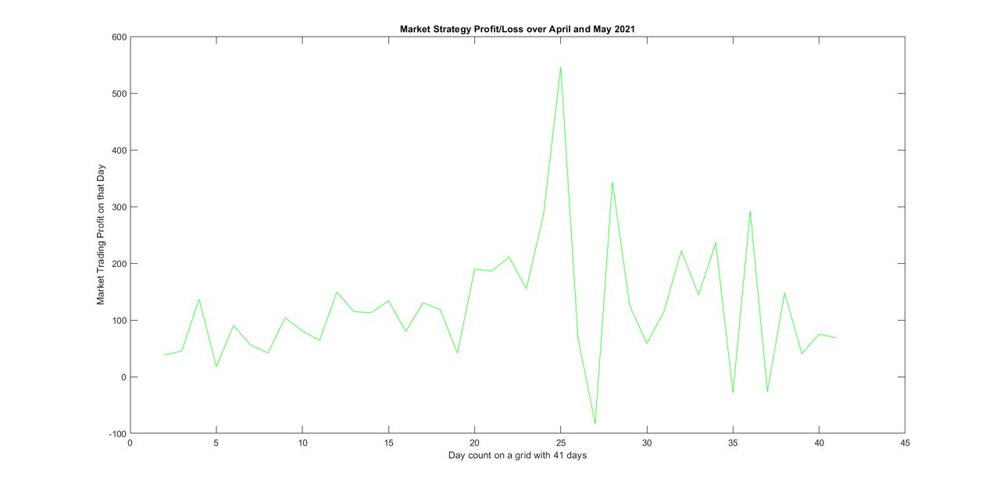](https://postimg.cc/62v0NYCn)

---

### #2679 — Amin (Topic Author)
*May 13, 2025, 8:42 AM*

You will need the following data to run the programs in previous post. I have zipped the 15 seconds data file for ten
symbols  for 41 days. This is a 5.8 MB zipped file for data of ten stock symbols on 15 seconds grid for 41 days in year
2021.

 [ReadDates0.zip](./download/file.php?id=10634&sid=b07543955863c4ff3f8644876fb9df84)
(222 Bytes) Downloaded 14 times

 [ReadDates0.zip](./download/file.php?id=10634&sid=b07543955863c4ff3f8644876fb9df84)
(222 Bytes) Downloaded 14 times

---

### #2680 — Amin (Topic Author)
*May 13, 2025, 10:09 AM*

Friends, I have quite a few other ideas about algorithmic trading other than mean-reversion and correlations based
algorithmic trading programs that I have posted in the past. I want to spend the Summers working on the same theme. I
have a meeting with a new psychiatrist, Dr. Ahsan-ul-Haq Chishti, day after tomorrow. If you like the idea of my working
and posting new trading strategies on the forum, please ask the mind control agency to ask the psychiatrist to not give
me any strong psychiatric medication. I hope that I would be able to work with new ideas on algorithmic trading and post
about them on the forum. I want to thank friends for helping me in the past and hope that they would continue to support
me in the future.

---

### #2681 — Amin (Topic Author)
*May 16, 2025, 1:49 PM*

Friends, I had a meeting with the new psychiatrist yesterday. He did not decrease my medicine at all. He told my mother
and sister that he wants to fix my problem with psychotherapy in which some psychologist would have weekly meetings with
me and would suggest me how to live and change my life. I hated the idea of any psychologist but had to live with it. I
have previously had very bad experiences with some domineering psychologist pushing me to do stupid things almost
forcefully. I have a meeting with a psychologist tomorrow now. Let us see how that goes.

I have also made an account on freelancer.com in attempt to find some good paid work. Paul had encouraged me to start with freelancer.com. It is still tentative and I will be adding more details to my profile. Here is my address on freelancer.com if you would like to give me some paid research work about something interesting.   https://www.freelancer.com/u/ahsan2999

---

### #2682 — Amin (Topic Author)
*May 23, 2025, 2:50 AM*

[YouTube Video](https://www.youtube.com/watch?v=rQ8x-rzVnJU)

---

### #2683 — Amin (Topic Author)
*May 24, 2025, 9:41 AM*

Friends, even though I have not been able to post regularly, it is because my research is going very slowly. I hope
friends still continue to look at my thread from time to time. I will keep my thread alive and continue to post
important technical details about algorithmic trading so please hang around.

Today, I want to give a technical update on how to buy flying stocks when they go down and sell lackluster stocks when
they go up.

Buy the stocks with positive high standardized skew when their stock state Is(t) goes negative from time to time.

Sell the stocks with highly negative standardized skew when its stock state Is(t) goes positive from time to time.

So basically sell the stocks with high negative skew when they make gains and buy stocks with highly positive skew when
they make losses.

If you implement it properly you will win 4 out of five times.

Please stay with the thread as there is more to share in coming days.

---

### #2684 — Amin (Topic Author)
*May 24, 2025, 9:55 AM*

>
> Friends, even though I have not been able to post regularly, it is because my research is going very slowly. I hope
friends still continue to look at my thread from time to time. I will keep my thread alive and continue to post
important technical details about algorithmic trading so please hang around.
>
>
>
> Today, I want to give a technical update on how to buy flying stocks when they go down and sell lackluster stocks when
they go up.
>
>
>
> Buy the stocks with positive high standardized skew when their stock state Is(t) goes negative from time to time.
>
>
>
> Sell the stocks with highly negative standardized skew when its stock state Is(t) goes positive from time to time.
>
>
>
> So basically sell the stocks with high negative skew when they make gains and buy stocks with highly positive skew
when they make losses.
>
>
>
> If you implement it properly you will win 4 out of five times.
>
>
>
> Please stay with the thread as there is more to share in coming days.
>
.

.

If you would like me to implement the above strategy for you and many other algorithmic trading strategies like that ,
please email me at anan2999(at)yahoo(dot)com

---

### #2685 — Amin (Topic Author)
*May 25, 2025, 7:30 AM*

Friends, when we are dealing with statistics of skew and kurtosis in financial trading, we would also want to know how
variable these statistics are. Does the skew or kurtosis remain in a small range of they vary a lot and are all over the
place?

This is where sixth and eighth moment comes in. Sixth moment is intuitively associated with variance of skew. If
standardized sixth moment is very large with respect to third moment, it means that skew is changing all over the place
and is highly variable. If sixth moment is smaller with respect to third moment, it would mean that skew is changing in
a small range.

We can have a useful standardized statistic to know this variability. This statistic could be square root of
standardized sixth moment divided by standardized third moment. The larger the absolute value of this statistic, the
larger the relative variability in skew. Here the statistic$\rho_3$ can be given as

$$\,\rho_3=\, \Large{\frac{\,\sqrt{\mu_6}}{\,\mu_3}} \, $$

where $\mu_3$ and  $\mu_6$ are standardized third and sixth moments.

A similar statistic $\rho_4$ for variability of kurtosis would be given as

$$\,\rho_4=\, \Large{\frac{\,\sqrt{\mu_8}}{\,\mu_4}} \, $$

where$\mu_4$ and$\mu_8$ are standardized fourth and eighth moments. Higher the value of$\rho_4$ , the larger the
variability in kurtosis. And if$\rho_4$ is small, it means that kurtosis remains in a relatively small range and does
not change all over.

These indicators $\rho_3$  and $\rho_4$ would be very helpful in algorithmic trading of stocks and options.

---

### #2686 — Amin (Topic Author)
*May 29, 2025, 6:02 AM*

Friends, as I have stated somewhere here earlier that mean reversion can be measured from a ratio of second moment and
fourth moment. We just have to look at standardized fourth moment for knowledge of mean reversion as standardized fourth
moment is already fourth moment divided by square of second moment.

We know that standard normal has a standardized fourth moment of three. This is reference standardized kurtosis. Above
it, the financial assets diffusion is more trending with more positive auto-correlations and below it the diffusion is
more mean reverting with more negative auto-correlation.

In my trading scenarios, when local standardized kurtosis was more than four, I could safely assume that market is
mostly trending with positive correlations. Similarly, we can  find a number below three at which we can safely assume
that market is mean reverting.

If you have a strategy with trending market i.e. with positive correlations, you would like to avoid trading when
standardized kurtosis is not safely towards your side i.e. it is not more than four or any other appropriate limit you
have found from your experiments.

Similarly for trending market and there is a grey area between both sides when market is not decisively trending or mean
reverting where it would be difficult to know how to take sides.

I have not found any other indicator so powerful when trying to know whether the market is trending or mean reverting.

Friends might want to use standardized fourth moment further in conjunction with eighth moment as I have described in a
previous post.

---

### #2687 — Amin (Topic Author)
*June 12, 2025, 11:11 AM*

Friends, very sorry for not being able to post anything for quite a while. I have been working on algorithmic trading
techniques. I have decided to trade cryptocurrencies on my own account using Binance platform. I had thought that it
would be a piece of cake to construct algorithmic trading strategies on crypto data since I have been working with
algorithmic trading for a while. But when I played with data, I was horrified to know that all the strategies that I had
earlier posted on internet were no longer making money on Binance and had been traded out of profitability. And I was
very worried that my crypto-trading might not make any special profit and might rather result in losses. I was seriously
worried what would happen if I could not make money from trading since I was realizing that other avenues for making
money were also close for me.

After a real struggle for several weeks, many new ideas and trying so many improvisations, I was able to find
algorithmic trading strategies that were comfortably profitable but it was not easy. If everything goes well, I will
start trading with very small portfolios to check profits of my algorithmic trading strategies in about a week. And then
move to full-fledged trading in about two to three weeks. I am happy that I have been able to find profitable strategies
but I still know the feeling of uncertainty that I passed when I was not being able to make any profits on data.

I hope that I would be able to find a very steady stream of money in a few months and then I hope that I would come back
to may mathematics and Math AI research in a more formal setting of an office when winters start in this coming October.

Friends, a lot of things are happening in US. Trump is bent on forcing all illegal immigrants out of United States. I do
not want to argue that Trump should not remove illegal immigrants out of US. American people gave trump mandate to evict
illegal immigrants and it is their country. But I want to request everyone involved to treat people in a human way and
respect their human dignity. The way many times police and forces maltreat illegal immigrants and handle them violently,
this should not happen.

On the same note, I have very vocally criticized a subset of Jews in United states due to their hand in mind control
activity but nowhere did I suggest to wrong them or kill them or maltreat them. I have always requested people to treat
them with all their human dignity intact but just try to stop their bad actions.

Similarly, I am a vocal critic of barbarianism that Govt. of Israel has unleashed on Palestinians. I do not side with
Hamas at all who are anything but even more evil. In this conflict between Israeli Government and Palestinian
Government, there is no hero and both parties are villains. Both parties have totally failed to respect the sanctity of
human life and have shown no regard for safeguarding dignity of ordinary human beings on both sides. I want to ask the
Israeli Govt. to please bring all hostages home and force trial of every single Hamas perpetrator who was involved in
the massacre of Israeli citizens, but please respect the human dignity of ordinary Palestinians and they should not be
collectively punished. Lots of good people have said the same thing to Israeli govt only to be rebuked by them in
return.

Again, I do not suggest to anyone as a reprisal to killings of tens of thousands of Palestinians, they should kill or
wrong Israelis. I really believe that world should force an inquiry about evil and inhuman practices on both sides of
the conflict and everyone who is responsible of killing and stripping ordinary human beings of their human dignity
should be brought to justice. Everyone from Hamas and Israel responsible for war crimes should face consequences. But
please do not wrong or abuse any Israeli or Palestinian due to crimes of their governments. There has to be some way for
law to take its course and no individual should be taking law in his own hands and behaving violently for any reprisals.

---

### #2688 — Amin (Topic Author)
*June 17, 2025, 2:07 PM*

Friends, even though I do not write many things about my persecution, a lot has continued to happen and I am sharing
some of that today for friends who had been following my case.

After I left the psychiatric facility, I have been taking medicine regularly so that nobody would have an excuse to
start drugging my food anywhere. I eat  from home more than 90% of the time and it is very rare that I would eat outside
of our home. I also take water from home but sometimes I would bring a few water bottles from some shop around in the
area where we live and drink that water at home. I absolutely do not go away to any remote area of the city to get any
food and water.

But it does not mean that mind control agents do not drug my food or water. I still remember that in many areas around
our home, bottled water was drugged a few weeks after I left the psychiatric facility and came home  but it all turned
to normal two or three days after that and they stopped drugging water everywhere. And after every week or two, they
start some drugging activity and drug some water or my food at home but mostly things are known to return to normal
after a few days of drugging the food.

But very recently, as my research in market trading becomes more successful and as I get closer to market trading, there
is continuously more drugging activity related to food and water. As my research succeeds, the mind control agents start
to lose their patience and re-start drugging the food and other things that they had stopped doing. I strongly fear that
they would continue increasing their attempts since it is very difficult for them to see my succeed in anything.

I want to request friends to please protest to mind control agencies and the government to end my persecution that was
solely started because some people did not like my religion.

Since I left the psychiatric facility, I have solely been concerned with making some livelihood for myself but when I
get closer to my aim, mind control agents start to lose patience. I really hope that I will succeed in making some
decent money and would re-start my research towards Math AI that I was previously doing. I have some ideas and I hope
that I will still be able to take a  day or two off from my market research and post a transition probabilities program
for lognormal-like diffusions that could be helpful for a few friends.

---

### #2689 — Amin (Topic Author)
*June 21, 2025, 12:33 PM*

Friends, I have been playing with the old transition probabilities program from time to time when I could be free.

I think it is difficult to find precise transition probabilities according to an arbitrary stochastic data generating
program. The reason is that there is usually no unique transition probability between two marginal distributions. And
transition probabilities could be generated in so many ways that they fit two marginal distributions. We have more
information when we are given joint pairs of starting and ending distribution but I still think that we still need to
specify some extra structure or conditions on the transition probabilities calculation program for it to be able to
match transition probabilities with data generation program.

My Transition probabilities generation program seems to work well with lognormal data but for CEV type SDEs, it has some
slack. I will give graph examples to explain this. My method to generate transition probabilities goes as follows. I
take an SDE with starting point one and take data observations at starting future point  Ts and ending future point Tz.
This data is used to find transition probabilities between input data at Ts and output data at Tz. With this analytic
formula, we can project transition probabilities at any time point Tz while being projected from delta source anywhere
on Ts. Then we check for how good these analytic calculations are by using the original SDE to numerically generate
transition probabilities at time Tz from various delta sources at Ts.

We use a general SDE of the form.

                                                      X(Tz) = X(Ts) + kappa * (theta - X)  dt + epsilon * X^gamma *dz

Here is graph of a lognormal type SDE     X0=1, X(Ts)=1.5, kappa=0, epsilon=.35, gamma=.95, Ts= 19*Delta_t , Tz=
38*Delta_t

In all these graphs red is monte carlo generated numerical transition probability coming out of X(Ts) and green line
density is found from our analytic procedure to find transition probabilities from joint data of X(Ts) and X(Tz).

Please pardon the titles on these graphs, it is a carryover from an old program and I noticed it after making the
graphs.

In these graphs, red is from numerical monte carlo using delta source s at forward time and green density is from our
analytic method.

[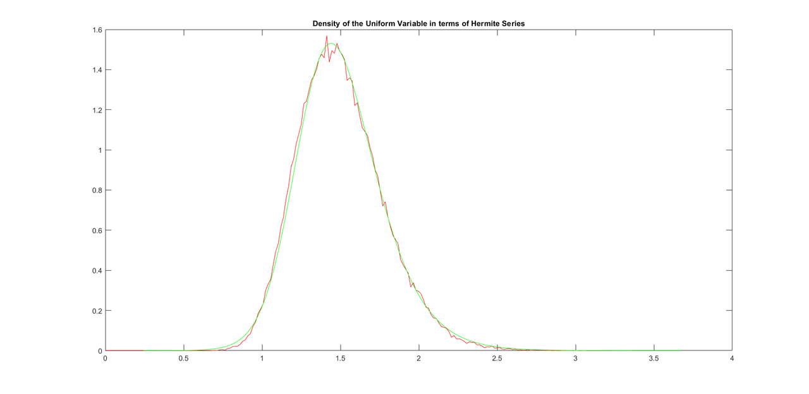](https://postimg.cc/ZW1mtrb5)

Here is graph of a lognormal type SDE     X0=1, X(Ts)=.66, kappa=0, epsilon=.35, gamma=.95, Ts= 19*Delta_t , Tz=
38*Delta_t

[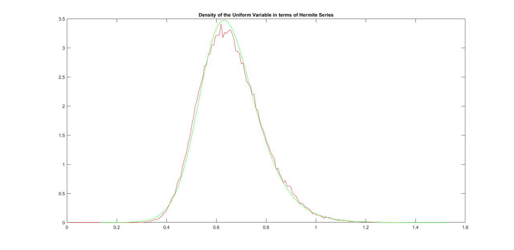](https://postimg.cc/DSVhRryy)

Here is graph of a mean-reverting  lognormal type SDE     X0=1, X(Ts)=1.33, kappa=1, theta=1.25,  epsilon=.35,
gamma=.95, Ts= 19*Delta_t , Tz= 38*Delta_t

[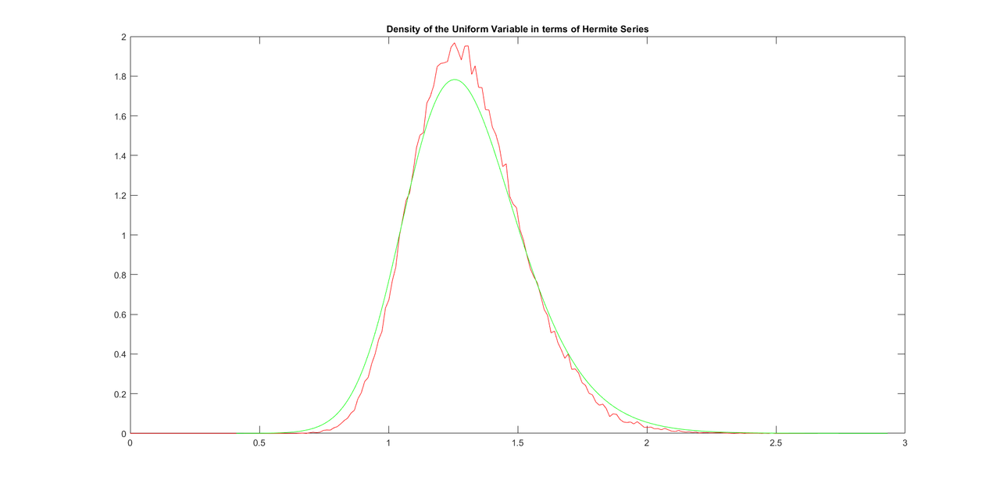](https://postimg.cc/wtpmxRF9)

Here is graph of a mean-reverting  lognormal type SDE     X0=1, X(Ts)=.75,  kappa=1, theta=1.25,  epsilon=.35,
gamma=.95, Ts= 19*Delta_t , Tz= 38*Delta_t

[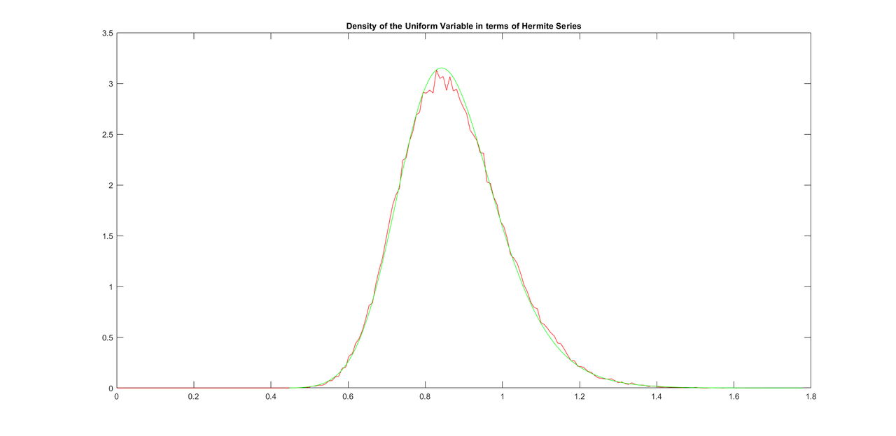](https://postimg.cc/62LJsgq9)

Here is graph of a non-drifting CEV type SDE     X0=1, X(Ts)=.75,  kappa=0, theta=0,  epsilon=.3, gamma=.65, Ts=
19*Delta_t , Tz= 38*Delta_t

[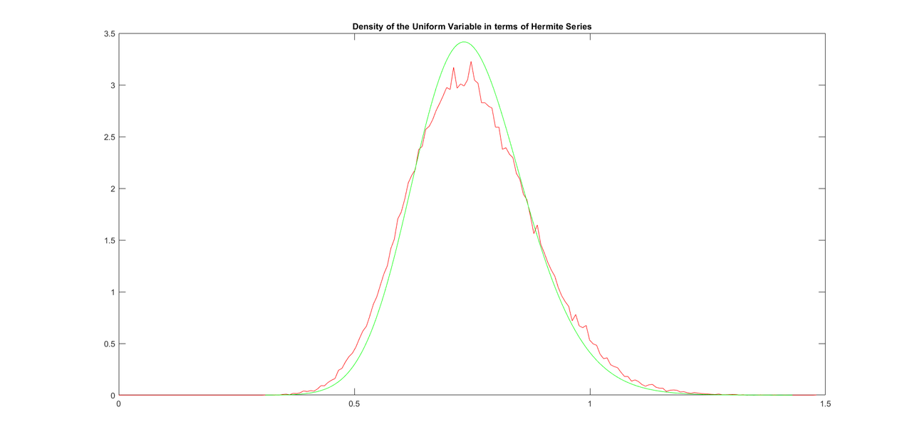](https://postimg.cc/7GDPTgTZ)

Here is graph of a non-drifting CEV type SDE     X0=1, X(Ts)=1.4,  kappa=0, theta=0,  epsilon=.3, gamma=.65, Ts=
19*Delta_t , Tz= 38*Delta_t

[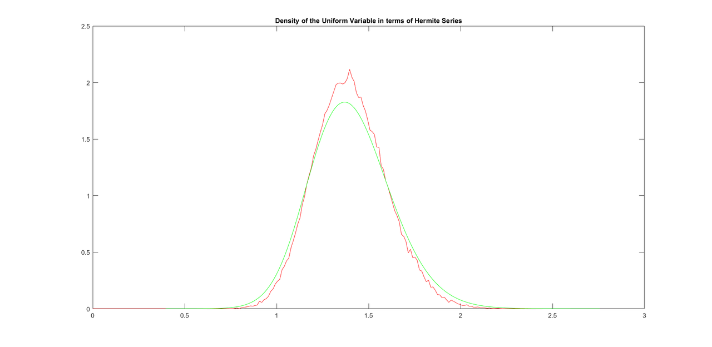](https://postimg.cc/G45sYSch)

---

### #2690 — Amin (Topic Author)
*June 21, 2025, 2:25 PM*

Friends, I did not  post the program used to make above graphs because it has errors. I found that outputs of one of the
most important function were being returned in a wrong order. I fixed that several weeks ago but several other side
calculations of R-squared and match of moments went off in the outer program even though the main calculations were
good.

It can take me a few days to fix everything as I do not spend much time on this topic. I will release a properly worked
out and explained version in a few days.

---

### #2691 — Amin (Topic Author)
*June 29, 2025, 10:43 AM*

Friends, very sorry that I did not have enough time to play with transition probabilities but today I was having
problems with my internet connection while connecting to binance for my trial program so I decided to spend some time on
transition probabilities. And it seems that I have been able to reasonably work the program for all CEV values and the
results are also very good for various CEV values with mean reversion.

I will be posting the new transition probabilities program with graphs in a few hours. I also want to write in detail
about what has been going on at my end. I hope that friends would like my transition probabilities program quite a bit.

---

### #2692 — Amin (Topic Author)
*June 29, 2025, 3:11 PM*

Friends, before I post the graphs of comparison of analytic and numerical transition probabilities of SDEs, I want to
tell the friends about the methodology with which these graphs were made.

Our SDE is

                                       dV(t) = kappa * ( theta - V(t) ) dt +sigma * V(t)^gamma dZ(t)

or in latex form

 $$ dV(t) = \kappa  \,( \theta - V )\, dt\, +\, \sigma V^{\gamma} \, dZ(t) $$

$$V(TT1)\,=X$$

$$V(TT2)\,=Y$$

where both TT1 and TT2 are greater than zero and TT2 > TT1.

First I chose parameters of an SDE and simulated it. I took the values of paths of SDE at 18th step(TT1) (and called
them X) and also the values of paths of SDE at 36th step (TT2) (and called them Y). We are now given pairs of X and Y
from the same paths. Using this joint data, we construct transition probabilities of  P(Y|X=X0) or more precisely
P(Y(TT2)|X(TT1)=X0) from any delta point X0 on the distribution of X. This is done both analytically from our algorithm
and also numerically from the SDE.  For numerically finding the transition probabilities, we simply take the SDE and
start it at delta origin X=X0 and simulate it for time (TT2 - TT1). Analytic calculation does not know the SDE at all
but we do use the value of gamma parameter of of the SDE  in our calculations but this gamma parameter can be
numerically estimated from the data points. In fact, we believe that in mean reverting SDEs, our use of the value of
gamma directly from SDE is suboptimal since effective value of gamma changes due to strong mean reversion and our
results might improve if we directly estimate gamma from the SDE data.

Here are the graphs. Parameters of the SDE and other variables are given on title of each graph.

[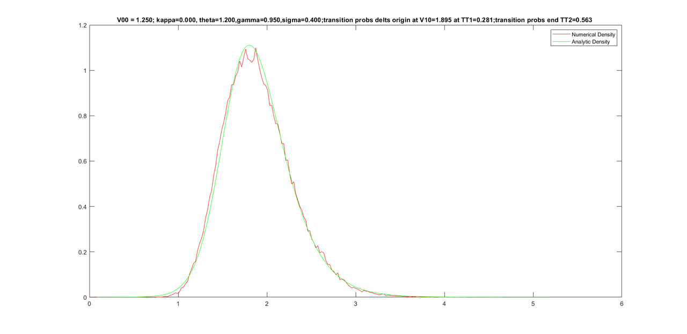](https://postimg.cc/9D2sZQFH)

[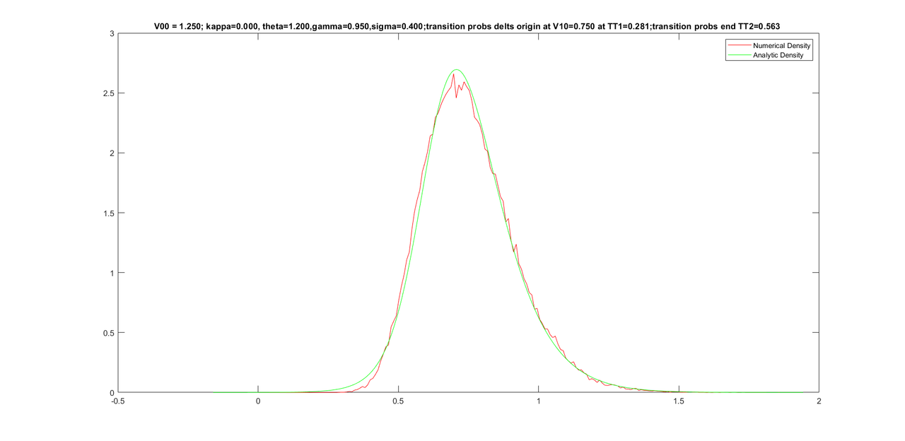](https://postimg.cc/zVK9ygNk)

[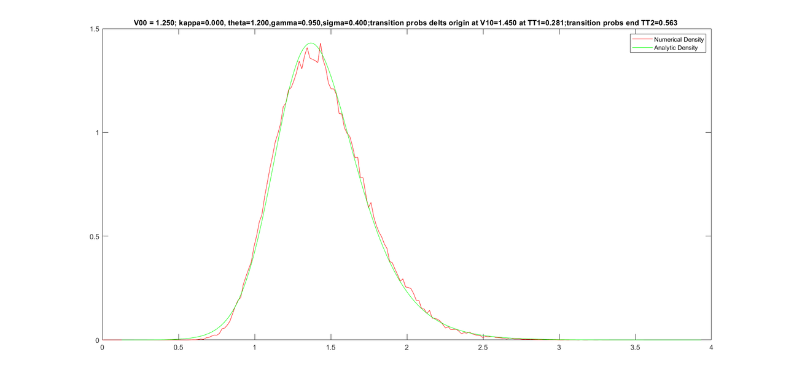](https://postimg.cc/BtdrZCr6)

[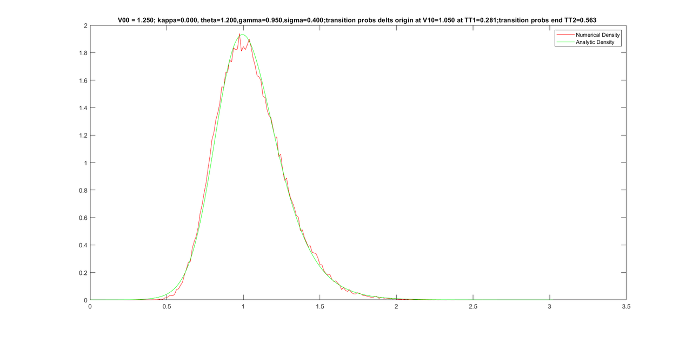](https://postimg.cc/K4kXyWsw)

[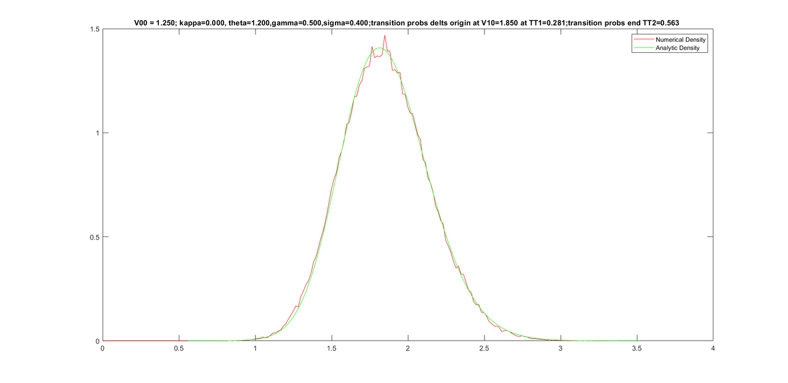](https://postimg.cc/xNbBykzn)

[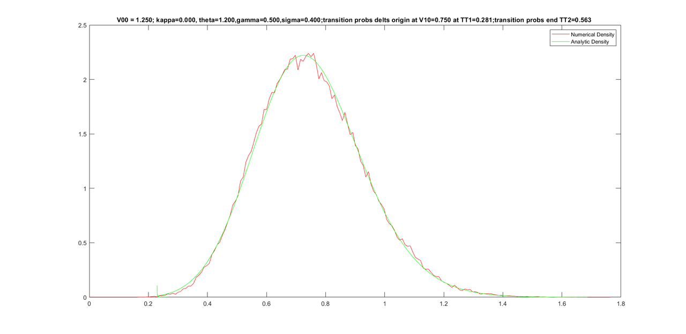](https://postimg.cc/N9nWH8Ld)

[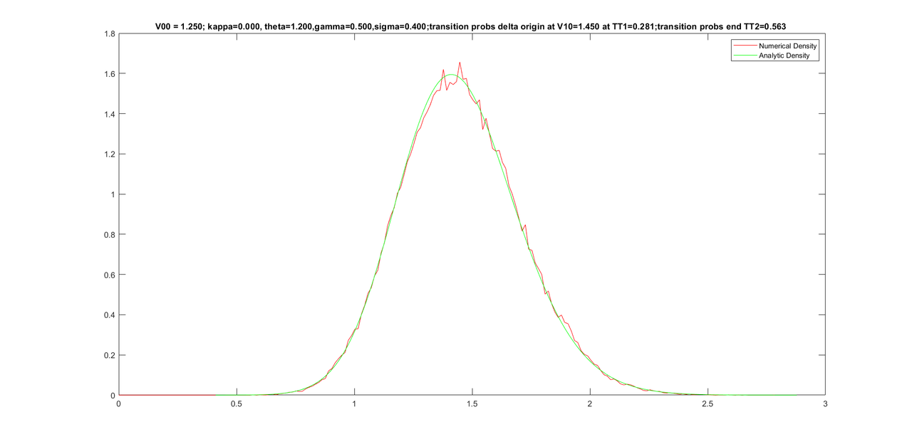](https://postimg.cc/gXjCjtcw)

[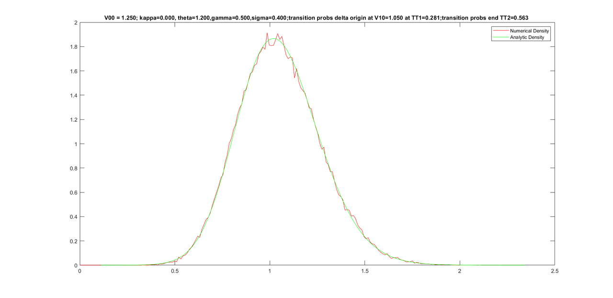](https://postimg.cc/nsFbbc6G)

[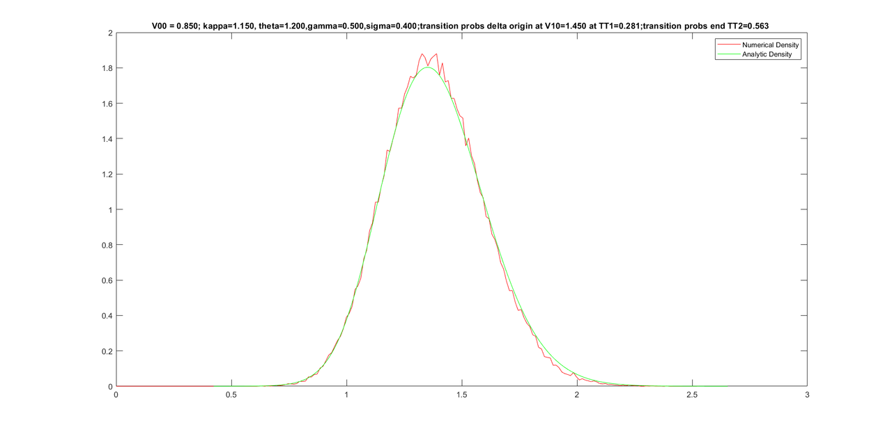](https://postimg.cc/Mc9kWJw2)

[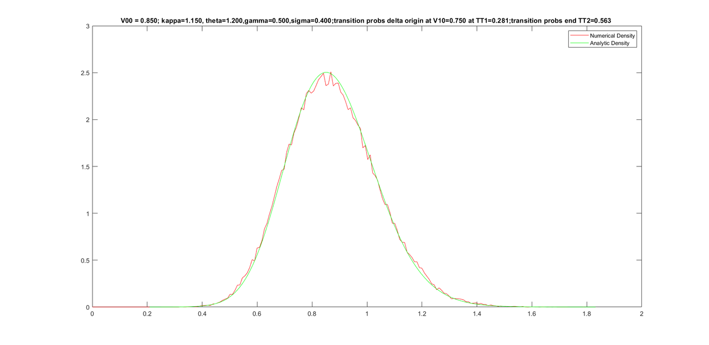](https://postimg.cc/5XqdRFkt)

[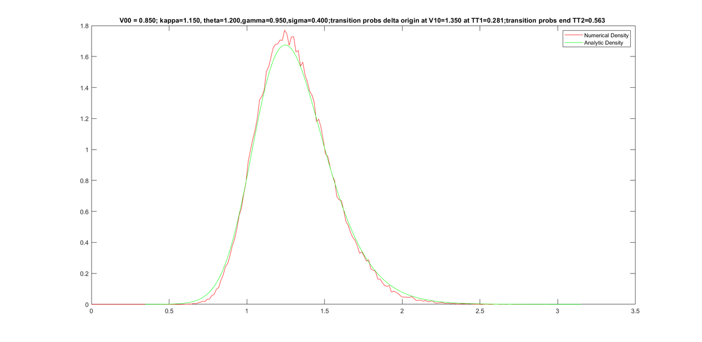](https://postimg.cc/QVw39DTj)

[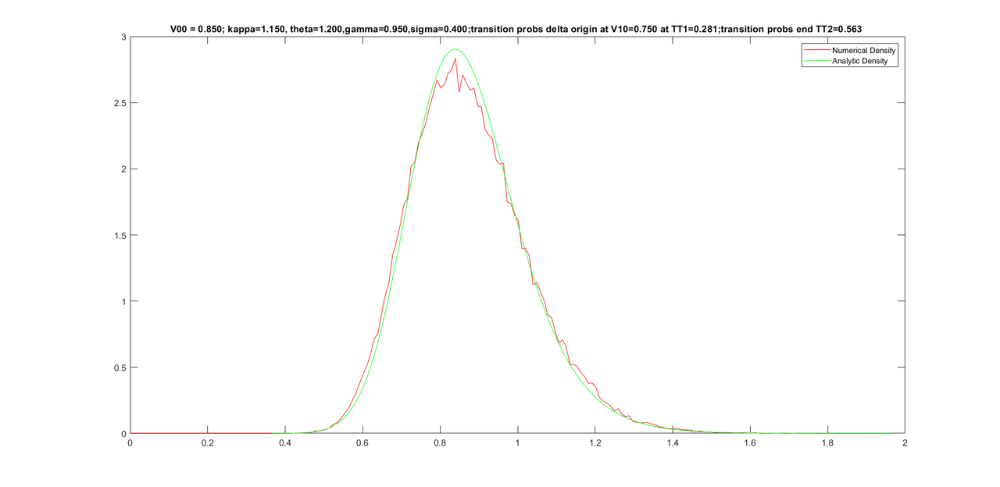](https://postimg.cc/K4Rb8j49)

[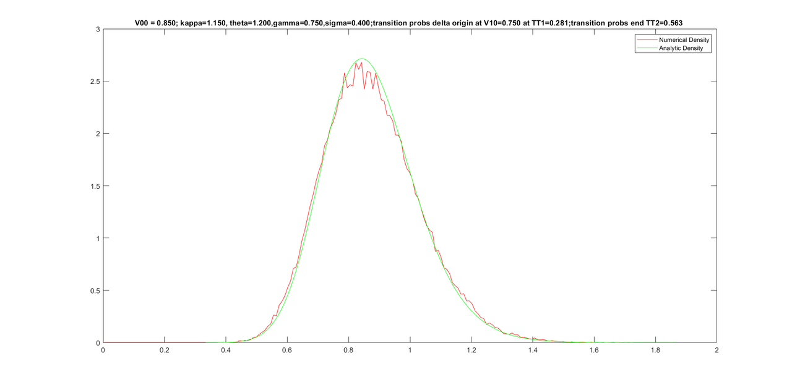](https://postimg.cc/WhZP0yGg)

[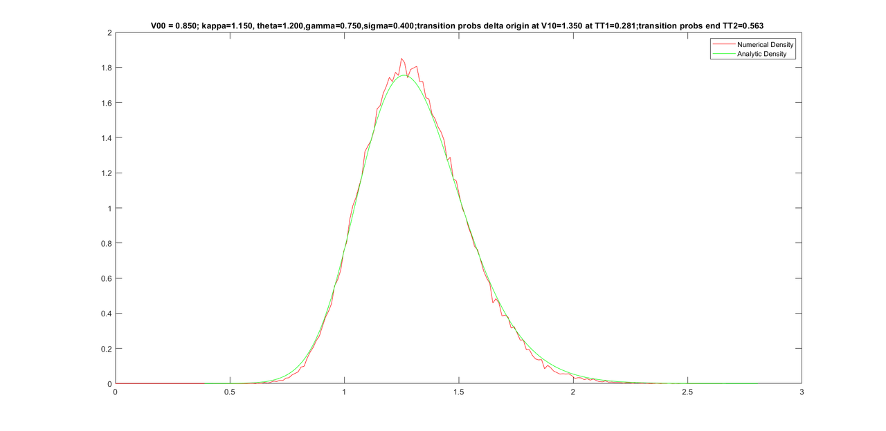](https://postimg.cc/68NxchcS)

I will post the program used to make these graphs in about an hour.

---

### #2693 — Amin (Topic Author)
*June 29, 2025, 5:02 PM*

Friends, first I want to describe the analytical procedure for the calculation of transition probabilities  (Y|X=X0)
where Y=V(TT2) and X=V(TT1) and V is a stochastic process.

1. First we find a general two dimensional distribution in the form of 2D Hermite series of Y|X from the least squares
regression as we had earlier described. This 2D Hermite series is given as

\begin{align}

\left[Y|X\right](Z_x \, , \, Z_y)\, \,&=\, \Big[\, cH_{0,0} \, + \, cH_{0,1} \,H_1(Z_x) \,+\, cH_{0,2} \, H_2(Z_x) \,\,
+ \, cH_{0,3} \,H_3(Z_x)\,\,+\,\ldots\,\Big] \\

&+\, \Big[ \, cH_{1,0} \, + \, cH_{1,1} \,H_1(Z_x) \,+\, cH_{1,2} \, H_2(Z_x) \, + \, cH_{1,3} \,H_3(Z_x)\,\,+\,\ldots\,
\Big] \, H_1(Z_y) \, \\

&+\, \Big[ \, cH_{2,0} \, + \, cH_{2,1} \,H_1(Z_x) \,+\, cH_{2,2} \, H_2(Z_x) \, \, + \, cH_{2,3}
\,H_3(Z_x)\,\,+\,\ldots\, \Big] \, H_2(Z_y) \, \\

&+\,\,\,\ldots\, \\

\end{align}

2. We are also given a 1D Hermite series of X from its univariate distribution. We invert this distribution to find
$Z_{X_0}$ corresponding to$X_0$ which is the delta source from where we want to calculate transition probabilities.

if Hermite series of X is given as

$$\,X(Z_x)\,=\, ah_0 \, +\, ah_1 \,H_1(Z_x) \,+\, ah_2 \,H_2(Z_x) \,+\, ah_3 \,H_3(Z_x) \,+\,\ldots$$

then $Z_{X_0}$ is the value of $Z_x$ for which the following equation holds

$$\,X_0\,=\, ah_0 \, +\, ah_1 \,H_1(Z_{X_0}) \,+\, ah_2 \,H_2(Z_{X_0}) \,+\, ah_3 \,H_3(Z_{X_0}) \,+\,\ldots$$

The above inversion to find$Z_{X_0}$ corresponding to$X_0$ is usually done by some iterative or Newton search algorithm.

3. Now we collapse the above two dimensional Hermite series of$\left[Y|X\right](Z_x \, , \, Z_y)\,$ by substituting the
numerical value of$Z_{X_0}$ in this equation by equating$Z_x\,=\, Z_{X_0}$ in the 2D Hermite series equation. This will
give us one dimensional conditional Hermite series in terms of$Z_y$ . This conditional Hermite series can be written as

$$\,Y(Z_y)\,=\, bh_0 \, +\, bh_1 \,H_1(Z_y) \,+\, bh_2 \,H_2(Z_y) \,+\, bh_3 \,H_3(Z_y) \,+\,\ldots$$

Please recall that above one dimensional Hermite series is obtained by collapsing the 2D conditional Hermite series of
$\left[Y|X\right](Z_x \, , \, Z_y)\,$ by substituting the numerical value of$Z_x\,=\,Z_{X_0}$ .

4. To find a proper conditional distribution corresponding to delta source at$X=X_0$ as in transition probabilities, We
have to divide the above univariate Hermite series by two terms. First term is${E[X]}^{\gamma}$ . Second term is
${X_0}^{(1-\gamma)}$ . So we write

$
$\,Y(Z_y)\,| \left(X=X_0\right)\, =\frac{\, bh_0 \, +\, bh_1 \,H_1(Z_y) \,+\, bh_2 \,H_2(Z_y) \,+\, bh_3 \,H_3(Z_y) \,+\,\ldots}{{E[X]}^{\gamma} \,{X_0}^{(1-\gamma)} } $
$

5. In the last step, we have to replace the mean of above conditional series by conditional mean of$E[Y|(X=X_0)]$ . This
conditional mean is easily found by regressing one dimensional unconditional univariate Z-series of Y on one dimensional
Z-series of X found by a univariate Z-series least squares regression. If we represent the numerical value of
conditional mean as$E[Y|(X=X_0)]$ , our final expression for the Hermite series of conditional transition probabilities
becomes

$
$\,Y(Z_y)\,| \left(X=X_0\right)\, =\, E[Y|(X=X_0)] + \frac{\, bh_1 \,H_1(Z_y) \,+\, bh_2 \,H_2(Z_y) \,+\, bh_3 \,H_3(Z_y) \,+\,\ldots}{{E[X]}^{\gamma} \,{X_0}^{(1-\gamma)} } $
$

In other words, we can now write the Hermite series of conditional transition probabilities as

$
$\,\,Y(Z_y)\,| \left(X=X_0\right)\, \,=\, ch_0 \, +\, ch_1 \,H_1(Z_y) \,+\, ch_2 \,H_2(Z_y) \,+\, ch_3 \,H_3(Z_y) \,+\,\ldots$
$

where

$$ch_0\,=\, E[Y|(X=X_0)]\,=\, E[Y|(Z_x=Z_{X_0})]\, $$

$$ch_1\,=\, \frac{\, bh_1 }{{E[X]}^{\gamma} \,{X_0}^{(1-\gamma)} } $$

$$ch_2\,=\, \frac{\, bh_2 }{{E[X]}^{\gamma} \,{X_0}^{(1-\gamma)} } $$

$$ch_3\,=\, \frac{\, bh_3 }{{E[X]}^{\gamma} \,{X_0}^{(1-\gamma)} } $$

and so on for nth coefficient.

Please note that$E[X]\,=\,ah_0$ because in a hermite series constant term is equal to mean of the random variable, so
for nth coefficient, we have equivalently

$$ch_n\,=\, \frac{\, bh_n }{{ah_0}^{\gamma} \,{X_0}^{(1-\gamma)} } $$

In all of the above calculations, we did not use any knowledge of parameters of the SDE except for parameter gamma
$(\gamma)$ . This gamma can easily be numerically calculated from the distribution of X and we believe that for strong
mean-reverting SDEs and other difficult SDEs, it will be more accurate to calculate this gamma from the distribution
itself.

In the next post, I will now upload the matlab programs.

---

### #2694 — Amin (Topic Author)
*June 29, 2025, 6:14 PM*

**(broken latex: Unbalanced $: 5)**

```latex
I have attached all necessary matlab files but if there is anything left not attached, please let me know. You can also
search for relevant files that have been attached in the past.

.

.

.

```
function []= ConditionalDensityHermitesBivariateNew()

%SV SDE is
%dV(t)=mu1 V(t)^beta1 dt+ mu2 V(t)^beta2 dt + sigma0 V(t)^gamma dZ(t)
%In mean reverting SDEs we ususally have
%mu1= kappaV * thetaV
%beta1=0
%mu2=-kappa
%beta2=0

%NDim=4;%Three assets and one SV.

%%%%%%%%%%%%%%%%%%%5

V0=.850;%.32;
V00=V0;

thetaV=1.20;%.045;%1;%.04;
kappaV=1.150;%1.5;%1.5;
mu1=kappaV*thetaV;
mu2=-kappaV;
beta1=0;

beta2=1;
gamma=.50;
sigma0=.4;%.45;

dt=.03125/2;
Tt=64*1;

V00f=thetaV+(V0-thetaV)*exp(-kappaV*dt*36);
T=Tt*dt;
% %%%%%%%%%%%%%%%%%%%%%%%%%%%%%%%%%%%%%%%%%%%%%%%%%%%%%%%%%%%%%%%%%%%%%%%%%%5

%In this code block, we do monte carlo simulation of stochastic volatility SDEs
%And also calculate monte carlo call prices.

seed0=82150987;
%seed0=52130649;
rng(seed0, 'twister')
paths=100000;
V(1:paths,1)=V0;

%%%%%%%%%%%%%%%%%%%%%%%%%%%%%%%%%%%%%%%%%%%%%%%%%%%%%%%%%%%%%%%%%%%%%%%%%%%%%%%%%%%%5
TT1=18; %Transition distribution start
TT2=36; %Transition distribution end

Random2(1:paths,1)=0;

for tt=1:Tt

Random2=randn(size(Random2));

    V(1:paths,1)=V(1:paths,1)+ ...
        (mu1.*V(1:paths,1).^beta1 + mu2.*V(1:paths,1).^beta2)*dt + ...
        sigma0*V(1:paths,1).^gamma .*Random2(1:paths,1)*sqrt(dt) + ...
        (mu1.*beta1*V(1:paths,1).^(beta1-1) + mu2.*beta2.*V(1:paths,1).^(beta2-1)).* ...
        ((mu1.*V(1:paths,1).^beta1 + mu2.*V(1:paths,1).^beta2)*dt^2/2 + ...
        sigma0*V(1:paths,1).^gamma .*Random2(1:paths,1)*(1-1/sqrt(3))*dt^1.5) + ...
        .5*(mu1.*beta1.*(beta1-1).*V(1:paths,1).^(beta1-2) + mu2.*beta2.*(beta2-1).*V(1:paths,1).^(beta2-2)).* ...
        sigma0^2.*V(1:paths,1).^(2*gamma).*dt^2/2 + ...
        sigma0*gamma*V(1:paths,1).^(gamma-1) .* ...
        ((mu1.*V(1:paths,1).^beta1 + mu2.*V(1:paths,1).^beta2).*Random2(1:paths,1).*1/sqrt(3)*dt^1.5 + ...
        sigma0.*V(1:paths,1).^gamma .*(Random2(1:paths,1).^2-1)*dt/2) + ...
        .5*sigma0*gamma*(gamma-1).*V(1:paths,1).^(gamma-2) .* ...
        sigma0^2.*V(1:paths,1).^(2*gamma) .*Random2(1:paths,1).*1/sqrt(3)*dt^1.5;

    V(V<0)=.00001;

    if(tt==TT1)
        Xin(1:paths,1)=V(1:paths,1);
    end

    if(tt==TT2)
        Yin(1:paths,1)=V(1:paths,1);
    end
end

str=input("I have reached stone 1");

Order=5;

%Ndata=paths;
%[ZI] = StandardNormalIdealDesity02(Ndata,1);
%[YCoeffH,Zy] = CalculateHermiteSeriesFromData01(Yin,Order,ZI)

%The function belwo does all the analytics of caclulation of 2D conditional
%and joint densities
 [XYCoeffHH,YCoeffHH,XCoeffH] =CalculateBivariateHermiteSeries01(Yin,Xin,Order);

 size(XYCoeffHH)
 size(YCoeffHH)
 str=input("I have reached stone 2");

%%%%%%%%%%%%%%%%%%%%%%%%%%%%%%%%%%%%%%%%%%%%%%%%%%%%%%%%%%%%%%%%%%%%%%%%%%%%
% % %This block is 2D graphs and can be skipped. I am commenint it.
% %
% %
% %  NoOfBinsX=200;
% %  NoOfBinsY=100;
% %
% %
% %  XX(1)=min(Xin);
% %  XX(NoOfBinsX)=max(Xin);
% %  XX(2:NoOfBinsX-1)=XX(1)+(1:NoOfBinsX-2)*(XX(NoOfBinsX)-XX(1))/(NoOfBinsX-1);
% %
% %
% %
% %  YY(1)=min(Yin);
% %  YY(NoOfBinsY)=max(Yin);
% %  YY(2:NoOfBinsY-1)=YY(1)+(1:NoOfBinsY-2)*(YY(NoOfBinsY)-YY(1))/(NoOfBinsY-1);
% %
% %
% %
% %  [pXY2D] = Calculate2VariablesOn2DGridFromAnalyticZSeriesNew(XX,YY,XYCoeffHH,XCoeffH);
% %
% % clf;
% % surf(XX(3:NoOfBinsX),YY(3:NoOfBinsY),pXY2D(3:NoOfBinsY,3:NoOfBinsX));
% %
% % xlabel('Random Variable X'), ylabel('Random Variable Y'),zlabel('Bivariate Density of XY')
% %
% % title('Graph of Bivariate joint Density of XY');
% % str=input("Look at graph of joint density of XY ----1");
% %
% %
% %
% % [pY2D] = Calculate2VariablesOn2DGridFromAnalyticZSeriesNew(XX,YY,YCoeffHH,XCoeffH);
% %
% % clf;
% %
% % surf(XX(3:NoOfBinsX),YY(3:NoOfBinsY),pY2D(3:NoOfBinsY,3:NoOfBinsX));
% %
% % xlabel('Random Variable X'), ylabel('Random Variable Y'),zlabel('Bivariate Density of Y conditional on X')
% % title('Graph of Bivariate conditional Density of Y|X');
% %
% % str=input("Look at graph of conditional density Y|X ----2");
% %
% %
% %
% % %%%%%%%%%%%%%%%%%%%%%%%%%%%%%%%%%%%%%%%%%%%%%%%%%%%%%%%%%%%%%%%%%%5
%Below we numerically and analytically find
%transition probabilities from point v10 and make a comparison of both
%numerically constructed density and analytically constructed density so
%that both of them are originating from arbitrary point V10.

%V10 below is the delta origin at time TT1 from where the transition
%probabilities will originate. Feel free to move it around in the
%distribution of X.
V10=.75;
%V10=1.10;

V(1:paths)=V10;

Random2(1:paths,1)=0;

for tt=TT1+1:TT2

Random2=randn(size(Random2));

    V(1:paths,1)=V(1:paths,1)+ ...
        (mu1.*V(1:paths,1).^beta1 + mu2.*V(1:paths,1).^beta2)*dt + ...
        sigma0*V(1:paths,1).^gamma .*Random2(1:paths,1)*sqrt(dt) + ...
        (mu1.*beta1*V(1:paths,1).^(beta1-1) + mu2.*beta2.*V(1:paths,1).^(beta2-1)).* ...
        ((mu1.*V(1:paths,1).^beta1 + mu2.*V(1:paths,1).^beta2)*dt^2/2 + ...
        sigma0*V(1:paths,1).^gamma .*Random2(1:paths,1)*(1-1/sqrt(3))*dt^1.5) + ...
        .5*(mu1.*beta1.*(beta1-1).*V(1:paths,1).^(beta1-2) + mu2.*beta2.*(beta2-1).*V(1:paths,1).^(beta2-2)).* ...
        sigma0^2.*V(1:paths,1).^(2*gamma).*dt^2/2 + ...
        sigma0*gamma*V(1:paths,1).^(gamma-1) .* ...
        ((mu1.*V(1:paths,1).^beta1 + mu2.*V(1:paths,1).^beta2).*Random2(1:paths,1).*1/sqrt(3)*dt^1.5 + ...
        sigma0.*V(1:paths,1).^gamma .*(Random2(1:paths,1).^2-1)*dt/2) + ...
        .5*sigma0*gamma*(gamma-1).*V(1:paths,1).^(gamma-2) .* ...
        sigma0^2.*V(1:paths,1).^(2*gamma) .*Random2(1:paths,1).*1/sqrt(3)*dt^1.5;

    V(V<0)=.00001;

end

NoOfBins=200;
MaxCutOff=10;

[XDensity,IndexOut,IndexMax] = MakeDensityFromSimulation_Infiniti_NEW(V,paths,NoOfBins,MaxCutOff )

clf;

plot(IndexOut(1:IndexMax),XDensity(1:IndexMax),'r');

hold on

xOrder=Order;
yOrder=Order;
[Zx] = CalculateZgivenXAndHSeriesCoeffs(V10,XCoeffH,xOrder);
%The above is calculation for Zx corresponding to delta origin of
%transition probabilities at mid-starting time TT1;

%The regression below is for conditional mean of Y|X.
Dim=1;
NN=paths;
[CoeffR,CoeffX] = RegressYOnX(Yin,Xin,NN,Dim,Order)
[Wh] = EvalHermiteArrayH0(Zx,Order);
Ymu=CoeffR(1,1);
for hh=2:Order+1
    Ymu=Ymu+Wh(1,hh).*CoeffR(hh,1);
end
Ymu
%Ymu is conditional mean of Y given a delta origin at density X. It is the
%conditional mean of Y given X.

%Below, we collapse two dimensional pdf of Y|X to one dimensional pdf given
%Zx i.e. this Y|X=X(Zx)
He(1)=1;
He(2)=Zx
He(3)=Zx^2-1;
He(4)=Zx^3-3*Zx;
He(5)=Zx^4-6*Zx.^2+3;
He(6)=Zx^5-10*Zx.^3+15*Zx;
for hh=1:yOrder+1
    YCoeffh(hh)=0.0;
    for hh2=1:xOrder+1
        YCoeffh(hh)=YCoeffh(hh)+YCoeffHH(hh,hh2).*He(hh2);
    end
end

YCoeffh=YCoeffh/V10.^(1-gamma)/XCoeffH(1).^gamma;
%YCoeffh=YCoeffh/V10.^(1-gamma/2)/XCoeffH(1).^(gamma);

%We have to divide by a function of mean XCoeffH(1).^gamma of the starting distribution X
%and a function of transition delta origin V10.^(1-gamma)

YCoeffh(1)=Ymu

PlotHermiteSeriesDensityAndRvGraph(YCoeffh(1),YCoeffh(2:yOrder+1),'g')
title(sprintf('V00 = %.3f; kappa=%.3f, theta=%.3f,gamma=%.3f,sigma=%.3f;transition probs delta origin at V10=%.3f at
TT1=%.3f;transition probs end TT2=%.3f ',V00, kappaV, thetaV,gamma,sigma0, V10,(TT1*dt),(TT2*dt)));%,sprintf('theta=
%f', theta), sprintf('kappa = %f', kappa),sprintf('sigma = %f', sigma0),sprintf('T = %f', T));
legend({'Numerical Density','Analytic Density'}, ...
    'Location','northeast')

YCoeffh

end
```

.

.

.

.

```
function [YCoeffHH,XYCoeffHH,XCoeffH] = CalculateBivariateHermiteSeries01(Yin,Xin,Order)

Ndata=length(Yin);

%[ZnNew] = StandardNormalIdealDesity02(Ndata,1);
[ZI] = MomentMatchedStandardNormalDiscretizedDensity(Ndata);

%ZI=ZnNew;
%Below find one dimensional Hermite-Series of variable that is taken as
%independent in the analytics.
[XCoeffH,Zx] = CalculateHermiteSeriesFromData01(Xin,Order,ZI);

%With respect to HErmite-series of X, find correlated and orthogonal parts of
%observations of dependent variable Y.
[Ycorr0,Ydecorr,Coeffyx] = FindDecorrelatedYwrtX(Yin,Zx,Order);

YdecorrAdj=0;
%%%%%%%%%%%%%%%%%%%%%%%%%%%%%%%%%%%%%%%%%%%%%%%%%%%%%%%%%%%%%%%%%%%%%%%%%%%%%%%%%%%5

%The function below calculates the 2D joint hermite-series of W=XY
%XYCoeffHH is the 2D joint hermite Series of W=XY
%YCoeffHH is 2D conditional hermite-series of Y|X

[XYCoeffHH,YCoeffHH] = Calculate2DHermiteSeriesConditionalAndJoint(Ydecorr,YdecorrAdj,Yin,Xin,Zx,Order,ZI);

%XYCoeffHH are coefficients of 2D joint Hermite-Series of X and Y. This
%value XYCoeffHH is bad and it has to be treated for common covariance before further
%use. I am not doing that since I will not need it in conditional
%probabilities calculations. This will be fixed in a future version.

%YCoeffHH are coefficients of 2D conditional Hermite-Series of Y given X.

%size(YCoeffHH)
%size(YCoeffHH(1,1:Order+1))
%size(Coeffyx(1:Order+1))
YCoeffHH(1,1:Order+1)=YCoeffHH(1,1:Order+1)+Coeffyx(1:Order+1)';

%Above I add common covariance in the orthogonal part

% % %%%%%%%%%%%%%%%%%%%%%%%%%%%%%%%%%%%%%%%%%%%%%%%%%%%%%%%
% % %Below calculate six moments of W=XY from data of X and Y
% % for mm=1:Order+1
% %     MomentsData(mm)=sum(Xin(1:Ndata).^mm.*Yin(1:Ndata).^mm)./Ndata;
% % end
% % SeriesOrder10=Order+1;
% % SeriesOrder01=Order+1;
% % NMomentsXY=Order+1;
% %
% % Order
% % [Moments1D1] = Calculate1DMomentsOf2DHermiteSeries(XYCoeffHH,SeriesOrder10,SeriesOrder01,NMomentsXY);
% %
% % Moments1D1
% % MomentsData
% %
% %
% % str=input("Look at comparison of moments of 2D product W=XY from the data and from 2D Hermite-Series");
% %
% %
% % %%%%%%%%%%%%%%%%%%%%%%%%%%%%%%%%%%%%%%%%%%%%%%%%%%%%%%55
% %
% %
% %
% %  [YCoeff2D] = Convert2DHermitesInto2DSeries(YCoeffHH);
% %  %Below, convert univariate hermite-series of X into univariate Z-series
% %
% %  [XCoeff(1),XCoeff(2:Order+1)] = ConvertHermiteSeriesToZSeries(XCoeffH(1),XCoeffH(2:Order+1),Order);
% %
% %
% %  %Below do calculations to find product of 2D conditional Z-series of Y and
% %  %univariate Z-series of X with the aim to find 2D joint Z-series of W=XY
% %  SeriesOrder10=Order+1;
% %  SeriesOrder01=Order+1;
% %  SeriesOrder20=1;
% %  SeriesOrder02=Order+1;
% %
% %  %Below calculate the product: 2D product of Z-series [Y|X](Zx,Zy)*X(Zx)
% %  [XYCoeff2,EXY]
=SeriesProduct2DAlgorithmicNew(YCoeff2D,XCoeff,SeriesOrder10,SeriesOrder01,SeriesOrder20,SeriesOrder02);
% %
% %
% %  [XYCoeffHH2] = Convert2dSeriesInto2DHermites(XYCoeff2);
% %
% %  %Below 2D Hermite series coefficients matrix XYCoeffHH2 is derived from multiplying
% %  %2D conditional Hermite-Series of Y|X with univariate HErmite-Series of X
% %  %The above multiplication is carried out in the form of repsective Z-series.
% %  %It is compared with 2D Hermite-series Coefficients matrix XYCoeffHH found
% %  %directly from data.
% %  %The both 2D hermite-series could precisely be the same but for that we would
% %  %have to increase order in X-direction
% %  XYCoeffHH2
% %  XYCoeffHH
% %
% %
% %  str=input("Look at comparison of Hermite-series of W directly from data and after multiplying 2D conditional
Hermite series of Y|X with hermite-series of X ");
% %
% % SeriesOrder10=Order+1;
% % SeriesOrder01=Order+1;
% % NMomentsXY=Order+1;
% % [Moments1D2] = Calculate1DMomentsOf2DHermiteSeries(XYCoeffHH2,SeriesOrder10,SeriesOrder01,NMomentsXY);
% %
% % Moments1D1
% % Moments1D2
% % MomentsData
% %
% %
% % str=input("Look at comparison of moments of 2D product W=XY from the data and from 2D Hermite-Series");

end
```

.

.

.

.

.

```
function [aCoeffHH,cCoeffHH] = Calculate2DHermiteSeriesConditionalAndJoint(Ydecorr,YdecorrAdj,Yin,Xin,Zx,Order,ZI)

%This function returns two bivariate hermite-Series.
%bCoeffHH(1:Order+1,1:Order+1) is a matrix containing coefficients of 2D
%Hermite-Series of Joint distribution of X and Y.
%The way to construct Hermite-series from bCoeffHH is sum of terms bCoeffHH(n,m)H_{n-1)(Z_y)H_{m-1}(Z_x)
%cCoeffHH(1:Order+1,1:Order+1) is a matrix containing coefficients of 2D
%Hermite-Series of Conditional distribution of Y given X (or Z_x).

%Inputs are
%1. Ydecorr is decorrelated part of observations of Y:decorrelated with
%respect to X
%2. YdecorrAdj is currently redundant.
%3. Yin are observations of Y
%4. Xin are observations of X.
%5. Zx are standard normal values underlying observations of X. Z_{x,p} --> X_p
%6. Order is Order of expansion in both sides of Hermite-series. Univariate
%Hermite-Series had the same order.
%7. ZI is discretized normal density array and appears as input so its moment
%matched version is passed to all functions in the program.

Ndata=length(Ydecorr);

[Ydecorr0s,I]=sort(Ydecorr(1:Ndata,1));
%[Ydecorr0s,I]=sort(YdecorrAdj(1:Ndata,1));

Zy(I(1:Ndata))=ZI(1:Ndata);
[Wx] = EvalHermiteArrayH0(Zx,Order);
[Wy] = EvalHermiteArrayH0(Zy,Order);

%Ymu(1:Ndata,1)=Yin(1:Ndata,1);
Ymu(1:Ndata,1)=Ydecorr(1:Ndata,1);

for nn=1:Order+1
    Wxy(1:Ndata,nn+(nn-1)*Order:nn+nn*Order)=Wx(1:Ndata,1:Order+1).*Wy(1:Ndata,nn)./Xin(1:Ndata,1);
end

    coeff=(Wxy'*Wxy)$Wxy'*Ymu);

%Below aCoeffHH are coefficients of 2D Hermite-Series of W=XY.
for nn=1:Order+1
    aCoeffHH(nn,1:Order+1)=coeff(nn+(nn-1)*Order:nn+nn*Order);
end

%Below, we construct the coefficients of H_{n-1}(Z_x) that are realized for
%pth observations of data.
%These are values for nth row and pth observation set
% XrowCoeff(n,p)=\sum_{m=0}^{Order+1}  aCoeffHH(n,m} H_{m-1}(Z_{x,p})./X_p

for nn=1:Order+1  %Repeat over all rows multiplying (n-1)th Hermite of Z_y
    XrowCoeff(1:Ndata,1)=0;
    for hh=1:Order+1
        XrowCoeff(1:Ndata,1)=XrowCoeff(1:Ndata,1)+aCoeffHH(nn,hh).*Wx(1:Ndata,hh)./Xin(1:Ndata,1);
    end

    % XrowCoeff(n,p)values are regressed on hermites of Z_{x,p} to find
    % coefficients of conditional 2D Hermite-Series of Y

    Ccoeff=(Wx'*Wx)$Wx'*XrowCoeff);

    %cCoeffHH are Coefficients of 2D conditional Hermite-Series of Y given X.
    cCoeffHH(nn,1:Order+1)=Ccoeff(1:Order+1);

end

% % % YProjected(1:Ndata,1)=0;
% % % for nn=1:Order+1  %Repeat over all rows multiplying (n-1)th Hermite of Z_y
% % %
% % %     for hh=1:Order+1
% % %       
 YProjected(1:Ndata,1)=YProjected(1:Ndata,1)+aCoeffHH(nn,hh).*Wx(1:Ndata,hh).*Wy(1:Ndata,nn)./Xin(1:Ndata,1);
% % %     end
% % %
% % % end
% % %
% % % STot=sum((Yin(1:Ndata,1)-sum(Yin(1:Ndata,1))/Ndata).^2);
% % % SRes=sum((Yin(1:Ndata,1)-YProjected(1:Ndata,1)).^2);
% % %
% % % RSquared=1-SRes/STot;
% % %
% % % RSquared
% % %
% % % str=input("Look at RSquared--0002")
% % %

end
```

.

.

.

.

```
function [ZnNew] = MomentMatchedStandardNormalDiscretizedDensity(Ndata)

[ZnNew] = StandardNormalIdealDesity02(Ndata,1);

if((Ndata=30))
    MOrder=6;

alpha(1) =1.002706567896411;
alpha(3)=-0.001341612601616;
alpha(5)=0.000431803496557;

elseif((Ndata>=250)&&(Ndata=2000)&&(Ndata=50000)&&(Ndata=100000)&&(Ndata=350000))
    MOrder=14;

    alpha(1) =1.000899195470733;
    alpha(3)=-0.000414380757501;
  alpha(5)=0.000161271457889;
  alpha(7)=0.000037987998807;
  alpha(9)=0;%.000016308099635;
  alpha(11)=0.;%000002045556572;                   0
  alpha(13)=0;%.000000157715037;
end

%[ZnNew,alpha,Moment] = MatchMomentParametersOfIdealZhalfNew01(ZnNew,MOrder);

% alpha(1)=0.998665620502348;
% alpha(3)=0.000729818387735;
% alpha(5)=0.000026530286747;
% alpha(7)=0.000021718051556;
% alpha(9)=0.000008734265559;
% alpha(11)=-0.000000362716896;                  0
% alpha(13)=-0.000000010818264;

[ZnNew,alpha] = NewtonRootSearchForMatchingMomentsOfGaussianVariates01(ZnNew,alpha,MOrder);

% alpha
%
% str=input("Look at alpha");

end

```

.

.

.

```
function [ZnNew,alpha] = NewtonRootSearchForMatchingMomentsOfGaussianVariates01(Zn,alpha,MOrder)

Ndata=length(Zn);

 %MOrder=12;
 HOrder=MOrder-2;

 EZ(1)=0;
EZ(2)=1;
for nn=3:MOrder
    if rem(nn,2)==1
        EZ(nn)=0;
    else
        EZ(nn)=EZ(nn-2)*(nn-1);
        %EZ(nn)
    end
end

TMoment(1:MOrder)=EZ(1:MOrder);
 %CalculateMomentsAndDerivativesOfIdealNormalGrid(Zn,alpha,MOrder,HOrder);
 [F,dF] = CalculateMomentsAndDerivativesOfIdealNormalGrid(Zn,alpha,MOrder,HOrder,TMoment);

% F
% dF
% str=input("Look at results");

w(MOrder)=1;
for nn=MOrder-2:-2:2
w(nn)=w(nn+2).*(nn+2)*(nn+1);%*.5;
end
%w(2)=w(2)*1024;
%w(8)=w(8)*2;
%w(10)=w(10)*sqrt(2);
%w
%str=input("Look at weights--12")

[ZnNew] = CalculateZnAfterHermiteSeriesMultiplication(Zn,alpha,MOrder);

for mm=1:MOrder
    Moment(mm)=sum(ZnNew(1:Ndata).^mm)/Ndata;
end

ObjFuncBest=CalculateObjMoment(EZ,Moment,w,MOrder);

ObjFuncBest
%str=input("Look at ObjFuncBest");
%b0Best=c0;
alphaBest(1:HOrder+1)=alpha(1:HOrder+1);

    qq=0;
    for mm=2:2:MOrder
        qq=qq+1;
        da(qq,1)=alpha(mm-1);
    end

nn=0;
while((nn.000000000001) || (abs(F(2,1))>.000000000001) || (abs(F(3,1))>.000000000001)))% ||
(abs(F(4,1))>.00000000001)))%|| (abs(F(5,1))>.00000000001)))%|| (abs(F(6,1))>.00000000001)))%||
(abs(F(7,1))>.00000000001)|| (abs(F(8,1))>.00000000001)  ))

    nn=nn+1;
    %Below Newton matrix equation to improve the Z-series coefficients guess at previous step.
    da=da-dF\F;

    qq=0;
    for mm=2:2:MOrder
        qq=qq+1;
        alpha(mm-1)=da(qq,1);
    end
    %b(1:SeriesOrder)=da(2:SeriesOrder+1,1);

    [ZnNew] = CalculateZnAfterHermiteSeriesMultiplication(Zn,alpha,MOrder);

    for mm=1:MOrder
        Moment(mm)=sum(ZnNew(1:Ndata).^mm)/Ndata;
    end

    ObjFuncNew=CalculateObjMoment(EZ,Moment,w,MOrder);

ObjFuncBest
ObjFuncNew
%str=input("Look at objfunction--11--");

%alpha

%str=input("Look at alpha");

    if(ObjFuncBest>ObjFuncNew)

       ObjFuncBest=ObjFuncNew;
       alphaBest=alpha;
       %bBest(1:SeriesOrder)=b(1:SeriesOrder);
    end

    [F,dF] = CalculateMomentsAndDerivativesOfIdealNormalGrid(Zn,alpha,MOrder,HOrder,TMoment);

    qq=0;
    for mm=2:2:MOrder
        qq=qq+1;
        da(qq,1)=alpha(mm-1);
    end

end
alpha=alphaBest;%Best;

   [ZnNew] = CalculateZnAfterHermiteSeriesMultiplication(Zn,alpha,MOrder);

end
```

.

.

.

```
function [F,dF] = CalculateMomentsAndDerivativesOfIdealNormalGrid(Zn,alpha,MOrder,HOrder,TMoment)

Ndata=length(Zn);

[Hz] = HermitePoly(HOrder);

for nn=1:2:HOrder+1
    ZZ(nn,1:Ndata)=Zn(1:Ndata).^(nn-1);
end

HermiteSeries(1:Ndata)=alpha(1);
HermiteZ(1:Ndata,1:HOrder)=0;
for nn=2:2:HOrder
    %Ndata
    %nn
    HermiteZ(1:Ndata)=0;
    for mm=1:2:(nn+1)
        %HermiteZ(nn,:)=HermiteZ(nn,:)+Hz(nn+1,mm).*ZZ(mm,:);
        HermiteZ(1:Ndata)=HermiteZ(1:Ndata)+Hz(nn+1,mm).*ZZ(mm,1:Ndata);
    end
    HermiteSeries(1:Ndata)=HermiteSeries(1:Ndata)+ alpha(nn+1).*HermiteZ(1:Ndata);
end

ZnNew(1:Ndata)=Zn(1:Ndata).*HermiteSeries(1:Ndata);

for mm=1:MOrder
    Moment(mm)=sum(ZnNew(1:Ndata).^mm)/Ndata;
    for nn=2:2:HOrder
        HermiteZ(1:Ndata)=0;
        for kk=1:2:(nn+1)
            HermiteZ(1:Ndata)=HermiteZ(1:Ndata)+Hz(nn+1,kk).*ZZ(kk,1:Ndata);
        end
        dG(mm,nn)=sum(Zn(1:Ndata).^(mm).*mm.*HermiteSeries(1:Ndata).^(mm-1).*HermiteZ(1:Ndata))/Ndata;

    end

    dG0(mm)=sum(Zn(1:Ndata).^(mm).*mm.*HermiteSeries(1:Ndata).^(mm-1))/Ndata;

    G(mm,1)=Moment(mm)-TMoment(mm);
end

%dG0

%str=input("Look at dG0");
QQ=round(MOrder/2);
qq=0;
for nn=2:2:MOrder
qq=qq+1;
F(qq,1)=G(nn,1);
dF(qq,1)=dG0(nn);
dF(qq,2:QQ)=dG(nn,2:2:(2+(QQ-2)*2));
end

% F(1,1)=G(2,1);
% F(2,1)=G(4,1);
% F(3,1)=G(6,1);
% F(4,1)=G(8,1);
% F(5,1)=G(10,1);
% F(6,1)=G(12,1);
%
% dF(1,1)=dG0(2);
% dF(2,1)=dG0(4);
% dF(3,1)=dG0(6);
% dF(4,1)=dG0(8);
% dF(5,1)=dG0(10);
% dF(6,1)=dG0(12);
%
% dF(1,2)=dG(2,2);
% dF(2,2)=dG(4,2);
% dF(3,2)=dG(6,2);
% dF(4,2)=dG(8,2);
% dF(5,2)=dG(10,2);
% dF(6,2)=dG(12,2);
%
% dF(1,3)=dG(2,4);
% dF(2,3)=dG(4,4);
% dF(3,3)=dG(6,4);
% dF(4,3)=dG(8,4);
% dF(5,3)=dG(10,4);
% dF(6,3)=dG(12,4);
%
% dF(1,4)=dG(2,6);
% dF(2,4)=dG(4,6);
% dF(3,4)=dG(6,6);
% dF(4,4)=dG(8,6);
% dF(5,4)=dG(10,6);
% dF(6,4)=dG(12,6);
%
% dF(1,5)=dG(2,8);
% dF(2,5)=dG(4,8);
% dF(3,5)=dG(6,8);
% dF(4,5)=dG(8,8);
% dF(5,5)=dG(10,8);
% dF(6,5)=dG(12,8);
%
% dF(1,6)=dG(2,10);
% dF(2,6)=dG(4,10);
% dF(3,6)=dG(6,10);
% dF(4,6)=dG(8,10);
% dF(5,6)=dG(10,10);
% dF(6,6)=dG(12,10);
%Moment

%dMoment

% F
% dF
% dG
% Moment
%
% str=input("Look at moments and F");

end

```

.

.

.

```
function [ZnNew] = CalculateZnAfterHermiteSeriesMultiplication(Zn,alpha,MOrder)

HOrder=MOrder-2;

Ndata=length(Zn);

[Hz] = HermitePoly(HOrder);

for nn=1:2:HOrder+1
    ZZ(nn,1:Ndata)=Zn(1:Ndata).^(nn-1);
end

HermiteSeries(1:Ndata)=alpha(1);
HermiteZ(1:Ndata,1:HOrder)=0;
for nn=2:2:HOrder
    Ndata;
    nn;
    HermiteZ(1:Ndata)=0;
    for mm=1:2:(nn+1)
        %HermiteZ(nn,:)=HermiteZ(nn,:)+Hz(nn+1,mm).*ZZ(mm,:);
        HermiteZ(1:Ndata)=HermiteZ(1:Ndata)+Hz(nn+1,mm).*ZZ(mm,1:Ndata);
    end
    HermiteSeries(1:Ndata)=HermiteSeries(1:Ndata)+ alpha(nn+1).*HermiteZ(1:Ndata);
end

ZnNew(1:Ndata)=Zn(1:Ndata).*HermiteSeries(1:Ndata);

% Moment2=sum(ZnNew(1:Ndata).^2)*1/Ndata
% Moment4=sum(ZnNew(1:Ndata).^4)*1/Ndata
% Moment6=sum(ZnNew(1:Ndata).^6)*1/Ndata
% Moment8=sum(ZnNew(1:Ndata).^8)*1/Ndata
% Moment10=sum(ZnNew(1:Ndata).^10)*1/Ndata
% Moment12=sum(ZnNew(1:Ndata).^12)*1/Ndata
% Moment14=sum(ZnNew(1:Ndata).^14)*1/Ndata

plot((1:Ndata),Zn(1:Ndata),'g',(1:Ndata),ZnNew(1:Ndata),'r')

end

```

.

.

.

```
function [ObjMomentOut] = CalculateObjMoment(Moment0,Moment,w,MOrder)

ObjMomentOut=0;
for nn=1:MOrder
    ObjMomentOut=ObjMomentOut+(Moment(nn)-Moment0(nn)).^2.*w(nn);
end

end

```

.

.

.

```
function [ZZ] = StandardNormalIdealDesity02(Ndata,Sigma)
%Ndata is number of data points in sample, for which we want to find the
%coefficients of the Z-series.
%Sigma=1+.06;
%Sigma=1;
if (rem(Ndata,2)==0)
    NnMid=Ndata/2;
    NnMid
    ZZ(NnMid+1)=norminv(.5+1/Ndata*.5,0,Sigma);
    ZZ(NnMid)=norminv(.5-1/Ndata*.5,0,Sigma);
    for nn=2:NnMid-1
        ZZ(nn+NnMid)=norminv(.5+(nn-.5)*1/Ndata,0,Sigma);
        ZZ(-nn+1+NnMid)=norminv(.5-(nn-.5)*1/Ndata,0,Sigma);
    end
    %A=normcdf((Ndata-1)/Ndata);
    %ZZ(Ndata)=exp(-5*A^2)/(1/Ndata);
    A=norminv((Ndata-1)/Ndata);
    ZZ(Ndata)=A +0.398942 *exp(-.5*A^2)/sqrt(1/Ndata)/sqrt(.5);
    ZZ(1)=-A-0.398942 *exp(-.5*A^2)/sqrt(1/Ndata)/sqrt(.5);
end

if (rem(Ndata,2)==1)
    NnMid=(Ndata+1)/2;
    ZZ(NnMid)=0;
    for nn=1:NnMid-2
        ZZ(nn+NnMid)=norminv(.5+(nn)*1/Ndata,0,Sigma);
        ZZ(-nn+NnMid)=norminv(.5-(nn)*1/Ndata,0,Sigma);
    end
   A=norminv((Ndata-1)/Ndata);
    ZZ(Ndata)=A +0.398942 *exp(-.5*A^2)/sqrt(1/Ndata)/sqrt(.5);
    ZZ(1)=-A-0.398942 *exp(-.5*A^2)/sqrt(1/Ndata)/sqrt(.5);
end

%ZZ
%A
%plot(ZZ)
%str=input("Look at density plot standard")

end

```

.

.

.

```
function [Coeff,Zy] = CalculateHermiteSeriesFromData01(Yin,Order,ZI)

Ndata=length(Yin);

%Hz=HermitePoly(Order);
MeanYin=sum(Yin(1:Ndata))/Ndata;
Ym(1:Ndata)=Yin(1:Ndata)-MeanYin;
YmVar=sum(Ym(1:Ndata).^2)/Ndata;
Y(1:Ndata)=Ym(1:Ndata)/sqrt(YmVar);

% [Zn] = StandardNormalIdealDesity02(Ndata,1);
% %[ZI] = CalculateZI(Zn);
%
%
% ZI=Zn;
%Below W is the design matrix for least squares regression i.e the matrix
%that contains all the hermite polynomials calculated at ideal normal
%density grid of size Ndata.
[W] = EvalHermiteArrayH0(ZI,Order);

%We first sort the data so that we can assign one appropriate Z-grid
%point(and associated hermite polynomials calculated at that grid point)
%to each data element. This ideal normal density Z-grid is
%constructed so that its size is equal to data observations count. We
%suppose that first derivative of random variables with repsect to Z
%does not switch sign meaning that increasing values of data
%observations have to aligned with increasing values of ideal normal
%density grid.
[Ys,I]=sort(Y(1:Ndata));
%In the line below, the data sort is reversed so that now the ideal
%normal density grid elements assigned to various observations of random
%variable face it on data observations index. For details, Please look
%on interent the definition of matlab sort command with role of "I"
%in output and how it alters the index.

%%Zs1(I(1:Ndata))=ZI(1:Ndata);

%Below the values to be regressed facing the design matrix are assigned
Ymu(1:Ndata,1)=Ys(1:Ndata);
%Below, implement least squares regression.
coeff=(W'*W)$W'*Ymu);
%Store in coefficietns array of all random varaibles
Coeff(1:Order+1)= coeff(1:Order+1,1);
%Store the associated Z in Z-array of all coefficients.
Zy(I(1:Ndata))=W(1:Ndata,2);

Coeff(1:Order+1)=Coeff(1:Order+1).*sqrt(YmVar);
Coeff(1)=Coeff(1)+MeanYin;

end

```

.

.

.

```
function [Wh] = EvalHermiteArrayH0(Z,Order)

%Evaluates first Order-th hermites at the array of Z's. If input array of Z
%has a size of 100 and Order is 4, it will return a 100 X 5 array.

Hz=HermitePoly(Order);

Wh(1:length(Z),1:Order+1)=0;
for nn=1:Order+1
    Wh(:,nn)=0;
    for mm=1:nn
        Wh(:,nn)=Wh(:,nn)+Hz(nn,mm).*Z(:).^(mm-1);
    end
end

end

```

.

.

.

```
function [Ycorr,Ydecorr,coeffcorr] = FindDecorrelatedYwrtX(Y,Zx,Order)

%1. This function takes in observations of a random variable Y.
%2. This function takes in Zx underlying Hermite-series of another correlated variable X
%which is in the order of observations of X and Y.
%3. This function takes in Order upto which to perform the decorrelation analytics.

%This function takes observations of Y, and finds out a part of
%each of the observations that is correlated with X and another par that is
%orthogonal to X.

%Correlated part is returned as Ycorr.
%Orthogonal part is returned as Ydecorr
%Coefficients of correlated part as a function of Hermite polynomials
%series of Zx are returned in coeffcorr/

    Ndata=length(Y);

    Ycorr(1:Ndata,1)=0;
    Ymu1(1:Ndata,1)=Y(1:Ndata);
        %Z1(:)=Zx(:,1);
        %Below find the least squares regression design matrix including
        %hermites of mmth ZOrtho.
        [W1] = EvalHermiteArrayH0(Zx,Order);
        %Below, do the regression to find the hermite series coefficients of part of
        %random variable Y that is correalted with Zx.

        coeffcorr=(W1'*W1)$W1'*Ymu1);

        for hh=1:Order+1
            %Below Y corr continues to sum over all hermites of Zx
            Ycorr(1:Ndata,1)=Ycorr(1:Ndata,1)+coeffcorr(hh,1).*W1(1:Ndata,hh);

        end

    Ydecorr(1:Ndata,1)=Y(1:Ndata,1)-Ycorr(1:Ndata,1);

end

```

.

.

.

.

```
function [XDensity,IndexOut,IndexMax] = MakeDensityFromSimulation_Infiniti_NEW(X,Paths,NoOfBins,MaxCutOff )
%Processes monte carlo paths to return a series Xdensity as a function of IndexOut. IndexMax is the maximum value of
index.
%

Xmin=10000;
Xmax=0;
for p=1:Paths
if(X(p)>MaxCutOff)
X(p)=MaxCutOff;
end
%if(X(p)real(X(p)))
Xmin=real(X(p));
end
if(XmaxIndexMax)
index=IndexMax;
end

XDensity(index)=XDensity(index)+1.0/Paths/BinSize;

end

IndexOut(1:IndexMax)=Xmin+(0:(IndexMax-1))*BinSize;

end
```

.

.

.

```
function [Z] = CalculateZgivenXAndHSeriesCoeffs(X,Coeff,Order)

%Finds Z given an array of X-values and Coeffs of hermite series.

Z(1:length(X))=0;
Hz=HermitePoly(Order);
median=0;
for nn=1:Order+1
    median=median+Coeff(nn).*Hz(nn,1);
end

for nn=1:length(X)
    Z(nn)=CalculateZgivenXAndHermiteSeriesBisection(X(nn),Coeff,median,Hz,Order);
end

end

```

.

.

.

```
function [Z]=CalculateZgivenXAndHermiteSeriesBisection(Y,coeff,median,Hz,Order)
%[Z]=CalculateZgivenXAndZSeriesBisection2C5(Y,c0,c);

%This program takes a value of Y as input and returns the corresponding
%value of Z given the parameters of the Z-series.
%It first see if the value of Y is greater than median or smaller than
%median. If the value of Y is greater than median Z has to be greater than
%zero and if the value of Y is smaller than median Z has to be negative.
% Once we know whether Z is greater than Z or smaller than Zero, we divide
% the program into two repeated if loops, one for Z greater than zero and
%one for Z smaller than zero.
%If Z is positive, we have to assign it a valid band of upper and
%lower values between which it can be found.
%This is done sequentially by calculating Y(.5) at Z=.5, if Y is smaller
%than Y(.5), we know that true value of Y will lie between 0 and .5
%so we assign a lower band value Za=0 and upper band value Zb=.5
%If however Y is greater than Y(.5), we know that true Z should be larger
%than .5 and we again evaluate Y(1) at Z=1, If Y is smaller than Y(1),
%we know that true value of Z should be between .5 and 1, and we assign a
%lower band value Za=.5 and upper band value of Zb=1. Through repeated
%elseif we continue until we find an appropriate band value of Z.

%Once we have determined the upper band value of Zb and lower band value of
%Za, We find Zmid=(Za+Zb)/2. We then evaluate Y(Zmid) and if Y  Y(Zmid), we assign the lower band value equal to Zmid as
Za=Zmid. In a
% few iterations, this bisection procedure gets extremely close to true
% value of Z for which Y(Z)=Y
%EvalHermiteSeriesH0(Coeff,Z,Order,Hz)

Z=(Y-coeff(1))/coeff(2);
BracketSize=.5;
if(Y>=median)
    Ztry=.5;
    ZtryBefore=0;
    NotBracketed=1;
    while((NotBracketed)&&(Ztry Ymid)
            Za=Zmid;
        end
    Z=.5*Za+.5*Zb; %This can be taken out of the loop and does not
    %necessarily have to be calculated again and again. Has to be
    %calculated at least once after the loop to determine the true value of
    %Z.

    end

end

if(Y=-8))
        [Ytry,dYtrydZ]= EvalHermiteSeriesH0(coeff,Ztry,Order,Hz);
        if((Y>= Ytry) || (dYtrydZ  Ymid)|| (dYmiddZ<0))
            Za=Zmid;
        elseif(Y<  Ymid)
            Zb=Zmid;
        end
    Z=.5*Za+.5*Zb; %This can be taken out of the loop and does not
    %necessarily have to be calculated again and again. Has to be
    %calculated at least once after the loop to determine the true value of
    %Z.

    end

end

end

```

.

.

.

```
function [Xh,dXh] = EvalHermiteSeriesH0(Coeff,Z,Order,Hz)

%Hz=HermitePoly(Order);

%Xh=Coeff(1);
Xh(1:length(Z))=0;
dXh(1:length(Z))=0;
for nn=1:Order+1
    for mm=1:nn
        Xh(:)=Xh(:)+Coeff(nn).*Hz(nn,mm).*Z(:).^(mm-1);
    end
    for mm=1:nn-1
        dXh(:)=dXh(:)+Coeff(nn).*(nn-1)*Hz(nn-1,mm).*Z(:).^(mm-1);
    end
end

end

```

.

.

.

```
function [Hz] = HermitePoly(Order)
Hz(1:Order+1,1:Order+1)=0.0;
Hz(1,1)=1.0;
for k=1:Order
    for m=1:k
       Hz(k+1,m+1)=Hz(k,m);
       if (m>1)
            Hz(k+1,m-1)=Hz(k+1,m-1)-(m-1)*Hz(k,m);
       end
    end
end

end

```

.

.

.

```
function [CoeffR,CoeffX] = RegressYOnX(Y,Xin,NN,Dim,Order)

[ZI] = StandardNormalIdealDesity02(NN,1);
for mm=1:Dim
    [CoeffX(mm,1:Order+1),Zx(1:NN,mm)] = CalculateHermiteSeriesFromData(Xin(1:NN,mm),Order,ZI);
end

WW(1:NN,1:Order+1)=EvalHermiteArrayH0(Zx(1:NN,1),Order);

for mm=2:Dim
    WW(1:NN,(mm-1)*Order+2:mm*Order+1)=EvalHermiteArrayH1(Zx(1:NN,mm),Order);
end

Ymu(1:NN,1)=Y(1:NN);

CoeffR=(WW'*WW)$WW'*Ymu);

end

```

.

.

.

```
function [] = PlotHermiteSeriesDensityAndRvGraph(c0,c,Color)

Index=length(c);

dNn=.1/2;   % Normal density subdivisions width. would change with number of subdivisions
Nn=45*4;  % No of normal density subdivisions
NnMid=((1+Nn)/2)*dNn;
Z(1:Nn)=(((1:Nn)*dNn)-NnMid);
%Z
%str=input('Look at Z');
%Now calculate Y as a function of normal random variable.
[W] = EvalHermiteArrayH0(Z,Index);

Y(1:Nn,1)=c0;
for nn=1:Index
    Y(1:Nn,1)=Y(1:Nn,1)+W(1:Nn,nn+1).*c(nn);
end

%Now take change of densities derivative of Y with respect to normal
DfY(1:Nn)=0;
for nn=2:Nn-1
    DfY(nn) = (Y(nn + 1) - Y(nn - 1))/(Z(nn + 1) - Z(nn - 1));
    %Change of variable derivative for densities
end
DfY(Nn)=DfY(Nn-1);
DfY(1)=DfY(2);

%Now calculate the density of Y from density of normal random variable
%using change of probability derivative.
pY(1:Nn)=0;
for nn = 1:Nn
    pY(nn) = (normpdf(Z(nn),0, 1))/abs(DfY(nn));
end
Y;
%clf;
plot(Y(1:Nn),pY(1:Nn),Color);
%title('Density of the Z-Series Variable with Fitted Moments');
title('Density of the Uniform Variable in terms of Hermite Series');
str=input('Look at density');

%clf;
%plot(Z(1:Nn),Y(1:Nn),Color);
%title('Graph of Z-Series Variable as a function of underlying standard normal');
%str=input('Look at Graph of Z-Series Variable as a function of underlying standard normal');

end

```

.

.

.

```
function [Hz] = HermitePoly(Order)
Hz(1:Order+1,1:Order+1)=0.0;
Hz(1,1)=1.0;
for k=1:Order
    for m=1:k
       Hz(k+1,m+1)=Hz(k,m);
       if (m>1)
            Hz(k+1,m-1)=Hz(k+1,m-1)-(m-1)*Hz(k,m);
       end
    end
end

end

```

```

---

### #2695 — Amin (Topic Author)
*June 29, 2025, 6:29 PM*

Friends, a lot is going on at my end about mind control and I will write in detail about it tomorrow. It's a bit late
and hard to work late with so much medicine. I am going to sleep in a bit and write about details of my mind control
tomorrow.

---

### #2696 — Amin (Topic Author)
*June 30, 2025, 11:33 AM*

Friends, for past many weeks, I have been trying to write an automated program for trading on Binance. I have done about
99.5% of the work and actually wanted to start live trading with 10 dollars notional each for eight currencies today but
I was not feeling well and decided to start tomorrow. I will try to trade for a week or two with very small notional and
then increase the notional properly if things go well.

But my persecution sharply increased as my trading program evolved into a piece of good code. Especially, they have
drugged water in neighborhood where I live and in many other close by neighborhoods. This started about a week ago when
my program started to become better and I experimented on binance and its testnet with my programs. I was still able to
buy good bottled water but I had to make several attempts at buying a bottle of water and trying it to find whether it
was good before buying four or five bottles of good water.

I also eat at home especially for lunch these days and for past three or four days, food at home had been highly drugged
that would drastically alter my mind and very highly sedate me. I remained better since I mostly had my breakfast
outside and would have to go out to have stimulation drinks with caffeine after eating bad food at lunch in home.

I was getting very worried as water and food at home started to become more and more drugged during past week. And I
know if they drugged a large number of liquid beverages in neighborhoods around, I will be totally squeezed and I would
have to go to remote areas, something I totally want to avoid. I really do not want to go back to that time when I had
to go across the city to get good water and food and I had to carry food with me all the time. Even though I take quick
breakfast from outside my home on some of the days, I have still been having my lunch at home with perfect regularity.
And sometimes, it is highly drugged to the limit of totally numbing the brain with sedation. I usually do not have
dinner at all in the evening since I take lunch in the afternoon after 2:00 PM or later.

Friends, I had been looking upto algorithmic trading for many years and this is just about to become a reality for me
and I really hope that I will be able to make more than sufficient money for myself. However, as mind control agencies
recently drugged water and my food at home, I am very worried that they are not ready to let me succeed in algorithmic
trading and want to create all sorts of problems for me.

I want to request friends to please protest to American govt. and the secret agencies and ask them to let me do
algorithmic trading without creating any problems for me.

Yesterday, I was very happy that I was able to find a satisfactory solution to transition probabilities problem. I was
very lucky that while playing with the model, I had several random ideas that worked very well and I was able to find
something that worked reasonably well. But I would love to further work for basis point kind of precision in the
solution of transition densities.

If my algorithmic trading goes well, I would love to re-start my research with multidimensional Z-series/Hermite-series
starting from September or October this year. I hope and believe that I can do good research to solve various important
problems with hermite -series that are otherwise difficult to solve with simpler Math.

Friends, next few days are very crucial as I want to start live trading now possibly tomorrow and I really hope that I
would be successful and would be able to finally make some money now after not having earned anything for so many years.

I really want to look forward to Winters when I hope that I will start working in a small office paid for by my trading
profits and I would be able to play with interesting problems in mathematics.

---

### #2697 — Amin (Topic Author)
*July 1, 2025, 10:50 AM*

>
> Friends, first I want to describe the analytical procedure for the calculation of transition probabilities  (Y|X=X0)
where Y=V(TT2) and X=V(TT1) and V is a stochastic process.
>
>
>
> 1. First we find a general two dimensional distribution in the form of 2D Hermite series of Y|X from the least squares
regression as we had earlier described. This 2D Hermite series is given as
>
>
>
> \begin{align}
>
>
>
> \left[Y|X\right](Z_x \, , \, Z_y)\, \,&=\, \Big[\, cH_{0,0} \, + \, cH_{0,1} \,H_1(Z_x) \,+\, cH_{0,2} \, H_2(Z_x)
\,\, + \, cH_{0,3} \,H_3(Z_x)\,\,+\,\ldots\,\Big] \\
>
> &+\, \Big[ \, cH_{1,0} \, + \, cH_{1,1} \,H_1(Z_x) \,+\, cH_{1,2} \, H_2(Z_x) \, + \, cH_{1,3}
\,H_3(Z_x)\,\,+\,\ldots\, \Big] \, H_1(Z_y) \, \\
>
> &+\, \Big[ \, cH_{2,0} \, + \, cH_{2,1} \,H_1(Z_x) \,+\, cH_{2,2} \, H_2(Z_x) \, \, + \, cH_{2,3}
\,H_3(Z_x)\,\,+\,\ldots\, \Big] \, H_2(Z_y) \, \\
>
> &+\,\,\,\ldots\, \\
>
> \end{align}
>
>
>
> 2. We are also given a 1D Hermite series of X from its univariate distribution. We invert this distribution to find
$Z_{X_0}$ corresponding to$X_0$ which is the delta source from where we want to calculate transition probabilities.
>
> if Hermite series of X is given as
>
>
>
> $$\,X(Z_x)\,=\, ah_0 \, +\, ah_1 \,H_1(Z_x) \,+\, ah_2 \,H_2(Z_x) \,+\, ah_3 \,H_3(Z_x) \,+\,\ldots$$
>
>
>
> then $Z_{X_0}$ is the value of $Z_x$ for which the following equation holds
>
>
>
> $$\,X_0\,=\, ah_0 \, +\, ah_1 \,H_1(Z_{X_0}) \,+\, ah_2 \,H_2(Z_{X_0}) \,+\, ah_3 \,H_3(Z_{X_0}) \,+\,\ldots$$
>
>
>
> The above inversion to find$Z_{X_0}$ corresponding to$X_0$ is usually done by some iterative or Newton search
algorithm.
>
>
>
> 3. Now we collapse the above two dimensional Hermite series of$\left[Y|X\right](Z_x \, , \, Z_y)\,$ by substituting
the numerical value of$Z_{X_0}$ in this equation by equating$Z_x\,=\, Z_{X_0}$ in the 2D Hermite series equation. This
will give us one dimensional conditional Hermite series in terms of$Z_y$ . This conditional Hermite series can be
written as
>
>
>
> $$\,Y(Z_y)\,=\, bh_0 \, +\, bh_1 \,H_1(Z_y) \,+\, bh_2 \,H_2(Z_y) \,+\, bh_3 \,H_3(Z_y) \,+\,\ldots$$
>
>
>
> Please recall that above one dimensional Hermite series is obtained by collapsing the 2D conditional Hermite series of
$\left[Y|X\right](Z_x \, , \, Z_y)\,$ by substituting the numerical value of$Z_x\,=\,Z_{X_0}$ .
>
>
>
> 4. To find a proper conditional distribution corresponding to delta source at$X=X_0$ as in transition probabilities,
We have to divide the above univariate Hermite series by two terms. First term is${E[X]}^{\gamma}$ . Second term is
${X_0}^{(1-\gamma)}$ . So we write
>
>
>
> $
$\,Y(Z_y)\,| \left(X=X_0\right)\, =\frac{\, bh_0 \, +\, bh_1 \,H_1(Z_y) \,+\, bh_2 \,H_2(Z_y) \,+\, bh_3 \,H_3(Z_y) \,+\,\ldots}{{E[X]}^{\gamma} \,{X_0}^{(1-\gamma)} } $
$
>
>
>
> 5. In the last step, we have to replace the mean of above conditional series by conditional mean of$E[Y|(X=X_0)]$ .
This conditional mean is easily found by regressing one dimensional unconditional univariate Z-series of Y on one
dimensional Z-series of X found by a univariate Z-series least squares regression. If we represent the numerical value
of conditional mean as$E[Y|(X=X_0)]$ , our final expression for the Hermite series of conditional transition
probabilities becomes
>
>
>
> $
$\,Y(Z_y)\,| \left(X=X_0\right)\, =\, E[Y|(X=X_0)] + \frac{\, bh_1 \,H_1(Z_y) \,+\, bh_2 \,H_2(Z_y) \,+\, bh_3 \,H_3(Z_y) \,+\,\ldots}{{E[X]}^{\gamma} \,{X_0}^{(1-\gamma)} } $
$
>
>
>
> In other words, we can now write the Hermite series of conditional transition probabilities as
>
>
>
> $
$\,\,Y(Z_y)\,| \left(X=X_0\right)\, \,=\, ch_0 \, +\, ch_1 \,H_1(Z_y) \,+\, ch_2 \,H_2(Z_y) \,+\, ch_3 \,H_3(Z_y) \,+\,\ldots$
$
>
>
>
> where
>
> $$ch_0\,=\, E[Y|(X=X_0)]\,=\, E[Y|(Z_x=Z_{X_0})]\, $$
>
> $$ch_1\,=\, \frac{\, bh_1 }{{E[X]}^{\gamma} \,{X_0}^{(1-\gamma)} } $$
>
> $$ch_2\,=\, \frac{\, bh_2 }{{E[X]}^{\gamma} \,{X_0}^{(1-\gamma)} } $$
>
> $$ch_3\,=\, \frac{\, bh_3 }{{E[X]}^{\gamma} \,{X_0}^{(1-\gamma)} } $$
>
> and so on for nth coefficient.
>
>
>
> Please note that$E[X]\,=\,ah_0$ because in a hermite series constant term is equal to mean of the random variable, so
for nth coefficient, we have equivalently
>
>
>
> $$ch_n\,=\, \frac{\, bh_n }{{ah_0}^{\gamma} \,{X_0}^{(1-\gamma)} } $$
>
>
>
>
>
> In all of the above calculations, we did not use any knowledge of parameters of the SDE except for parameter gamma
$(\gamma)$ . This gamma can easily be numerically calculated from the distribution of X and we believe that for strong
mean-reverting SDEs and other difficult SDEs, it will be more accurate to calculate this gamma from the distribution
itself.
>
>
>
> In the next post, I will now upload the matlab programs.
>
.

.

.

Friends, very sorry for this but there are a few errors in my program. I had erroneously changed the names of XYCoeffHH
and YCoeffHH with each other. What I had called conditional density of Y named as$\left[Y|X\right](Z_x \, , \, Z_y)\,$
was actually$\left[XY\right](Z_x \, , \, Z_y)\,$ and vice versa. But as it seems we can use both
$\left[XY\right](Z_x \, , \, Z_y)\,$ and$\left[Y|X\right](Z_x \, , \, Z_y)\,$ for calculations of our transition
probabilities.

What I had done is given as follows.

$$\,Y(Z_y)\,| \left(X=X_0\right)\, =\frac{\,\left[XY\right](Z_x \, , \, Z_y)\,}{{E[X]}^{\gamma} \,{X_0}^{(1-\gamma)} } $
$ Equation(1)

But we can equally use the equation for conditional Y as  $\left[Y|X\right](Z_x \, , \, Z_y)\,$ using the follows

$
$\,Y(Z_y)\,| \left(X=X_0\right)\, =\frac{\, \left[Y|X\right](Z_x \, , \, Z_y)\,\,}{{E[X]}^{\gamma} \,{X_0}^{(-\gamma)} } $
$ Equation(2)

What I used in my program was Equation(1) and what friends might want to use is probably Equation (2). In equation (1),
there is just one extra multiplication in the denominator with$X\,=\,X_0 $ .

.

.

.

.

> 5. In the last step, we have to replace the mean of above conditional series by conditional mean of$E[Y|(X=X_0)]$ .
This conditional mean is easily found by regressing one dimensional unconditional univariate Z-series of Y on one
dimensional Z-series of X found by a univariate Z-series least squares regression. If we represent the numerical value
of conditional mean as$E[Y|(X=X_0)]$ , our final expression for the Hermite series of conditional transition
probabilities becomes
>
>
>
> $
$\,Y(Z_y)\,| \left(X=X_0\right)\, =\, E[Y|(X=X_0)] + \frac{\, bh_1 \,H_1(Z_y) \,+\, bh_2 \,H_2(Z_y) \,+\, bh_3 \,H_3(Z_y) \,+\,\ldots}{{E[X]}^{\gamma} \,{X_0}^{(1-\gamma)} } $
$
>
>
>
> In other words, we can now write the Hermite series of conditional transition probabilities as
>
>
>
> $
$\,\,Y(Z_y)\,| \left(X=X_0\right)\, \,=\, ch_0 \, +\, ch_1 \,H_1(Z_y) \,+\, ch_2 \,H_2(Z_y) \,+\, ch_3 \,H_3(Z_y) \,+\,\ldots$
$
>
>
>
> where
>
> $$ch_0\,=\, E[Y|(X=X_0)]\,=\, E[Y|(Z_x=Z_{X_0})]\, $$
>
> $$ch_1\,=\, \frac{\, bh_1 }{{E[X]}^{\gamma} \,{X_0}^{(1-\gamma)} } $$
>
> $$ch_2\,=\, \frac{\, bh_2 }{{E[X]}^{\gamma} \,{X_0}^{(1-\gamma)} } $$
>
> $$ch_3\,=\, \frac{\, bh_3 }{{E[X]}^{\gamma} \,{X_0}^{(1-\gamma)} } $$
>
> and so on for nth coefficient.
>
>
>
> Please note that$E[X]\,=\,ah_0$ because in a hermite series constant term is equal to mean of the random variable, so
for nth coefficient, we have equivalently
>
>
>
> $$ch_n\,=\, \frac{\, bh_n }{{ah_0}^{\gamma} \,{X_0}^{(1-\gamma)} } $$
>
>
 .

.

I noticed in my calculations that if we use median instead of mean, we get slightly better results for the final
transition density. So I will request friends to please also try median of X instead of mean of X, E[X] in the above
calculations.

Corrected forms of Equation(1) and Equation(2) would be

$
$\,Y(Z_y)\,| \left(X=X_0\right)\, =\frac{\,\left[XY\right](Z_x \, , \, Z_y)\,}{{X^{\gamma}_{median}} \,{X_0}^{(1-\gamma)} } $
$ Equation(1)

But we can equally use the equation for conditional Y as  $\left[Y|X\right](Z_x \, , \, Z_y)\,$ using the follows

$
$\,Y(Z_y)\,| \left(X=X_0\right)\, =\frac{\, \left[Y|X\right](Z_x \, , \, Z_y)\,\,}{{X^{\gamma}_{median}}\,{X_0}^{(-\gamma)} } $
$ Equation(2)

In a day or two, I will post corrected program where the above errors are corrected.

---

### #2698 — Amin (Topic Author)
*July 1, 2025, 11:10 AM*

I also did an experiment to find out if dependence on SDE parameter gamma that was used in the numerator for dividing
conditional or joint distributions, has anything to do with transition distribution. I used one value of SDE parameter
gamma till time zero to TT1 and our initial transition start distribution X depended on this gamma called gamma1. Then I
drastically altered SDE parameter gamma for rest of the SDE from TT1 to TT2 and our transition distribution totally
depended on this second altered gamma called gamma2. It turned out that I had to just use the first gamma i.e gamma1
that was used to create distribution X and can be calculated from initial distribution X  and our results did not depend
on second gamma gamma2 at all and we did not need to use later altered gamma at all and we were able to get perfectly
excellent results. All the dependence on second altered gamma i.e. gamma2 was captured by our earlier 2D regression and
we did not need to worry about it later.

---

### #2699 — Amin (Topic Author)
*July 5, 2025, 3:00 PM*

Friends, a lot of new things are happening with me that I decided to share here. I started to try my trading programs on
live binance trading. It was a very good experience to see the program working since I had programmed the API in python
by myself and the programs were based on python-binance API. When I started to do back-testing on historical data, I
found that trading with spot seemed more profitable. Spot trading with FDUSD has no trading commissions on binance so I
had to use FDUSD as stablecoin. However I soon realized that I keep sitting on posted limit orders and there was little
liquidity in the FDUSD especially since I was trading with second tier currencies that really were not very liquid. When
there was little liquidity, my trades would continue to make losses but I would have an edge when liquidity would be
better.

Frustrated with low liquidity, I decided to try futures trading with USDC stablecoin on binance. I went again to
historical data and tried various tricks and was finally able to find some strategies that worked very well on
historical data on USDC futures. I have almost completed work with substitution of futures based commands for trading
and market data using python-binance in place of python-binance commands for spot trading that I was earlier using and
today I tested those commands on futures testnet. I want to do some more analytics with futures historical data and hope
to start live trading with futures in another two to three days. Given my results with spot trading, I am very
optimistic that futures trading would go really much better than spot trading with little liquidity. I have already made
a new API key for futures trading and got binance approval for futures trading just yesterday after finding out that I
would need to work with futures.

It seems that I am all set up for a good and profitable trading with futures but there are some other problems. It seems
to me that mind control agents are getting more agitated and want to stop me from succeeding in my trading effort. They
actively  try to drug water and food for me when I go out to get bottled water in the morning. This morning, when I went
out to get water, there were many agents who were trying to drug water at likely places where I could buy water. And I
was hit with bad water at a small beverages shop when I bought water there. When I drank small amount of water to see if
the water was good enough to buy more bottles of water, my conception of reality was altered and my brain became very
numb. I had to take a lot of good food at other places to get my mind working again. They were tracking my path and they
had drugged water at a small shop where I least suspected that water could be bad.

I am really worried that more than everything else, mind control agents are worried about the possibility that I might
start trading profitably and become independent and they are trying their best to thwart anything like that. This is
funny that for more than a decade, mind control agencies approached almost every single person who wanted to give me
consulting work but when I have almost succeeded in making money in the markets, they are becoming even more bitter to
stop me in my efforts.

I want to request friends to please protest to mind control agencies and ask them to please act in a civilized way and
not try to make problems with me. I hope that I would be able to restart my research soon after doing successful trading
on binance.

---

### #2700 — Amin (Topic Author)
*July 6, 2025, 11:48 AM*

Friends, I spent sometime last night on transition probabilities program and I was able to find out exact form of
solution of SDEs and other stochastic systems.

I have written previously that we canb use the equation for conditional Y as$\left[Y|X\right](Z_x \, , \, Z_y)\,$ using
the follows

$
$\,Y(Z_y)\,| \left(X=X_0\right)\, =\frac{\, \left[Y|X\right](Z_x \, , \, Z_y)\,\,}{{X^{\gamma}_{median}}\,{X_0}^{(-\gamma)} } $
$ Equation(2)

The true form of solution is given as

$
$\, \Large{Y(Z_y)\,| \left(X=X_0\right)\, =\, \left[Y|X\right](Z_x \, , \, Z_y)\,\,  \left[ \frac{      {\frac{dX}{dZ_x}}{|}^{Z_x=Z_{X_0}}    }{  {\frac{dX}{dZ_x}} |^{Z_x=0}   } \right] }  $
$ Equation(2)

In my previous equations,${X_0}^{(\gamma)} $ was a proxy for$ \large{{\frac{dX}{dZ_x}}{|}^{Z_x=Z_{X_0}}}  $ and
${X_{median}}^{(\gamma)} $ was a proxy for$ \large{{\frac{dX}{dZ_x}}{|}^{Z_x=0}}  $

Soon I will be posting a modified function that has this new part with derivatives programmed in it.

---

[← Previous](page_053.md) | [Index](index.md) | [Next →](page_055.md)
