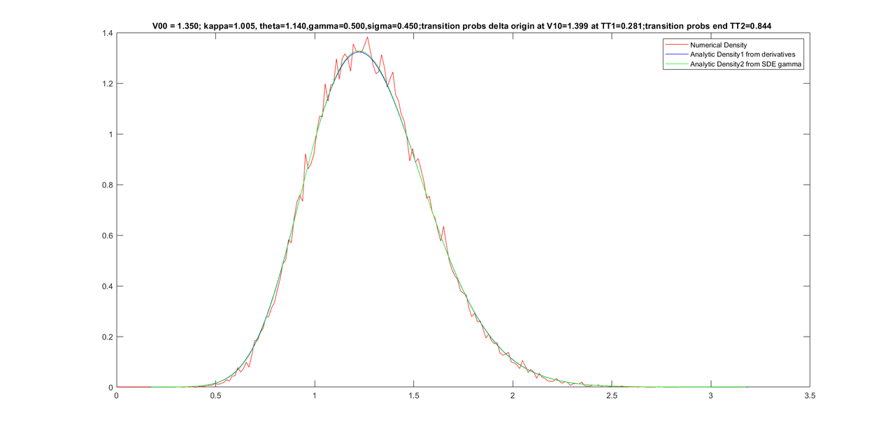
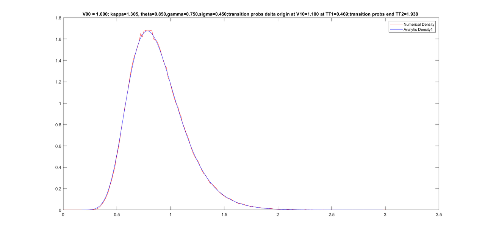
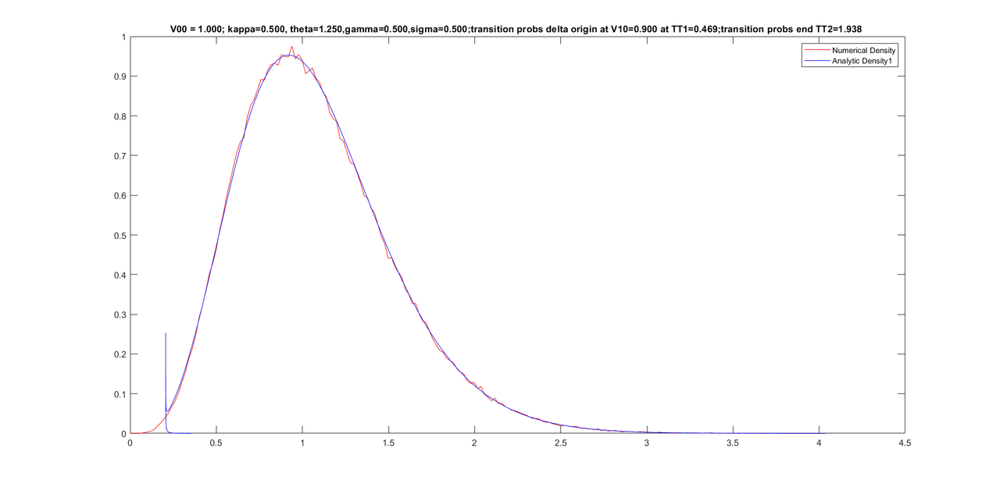

# Breakthrough in the theory of stochastic differential equations and their simulation

**Page 55 of 65** — Posts #2701–#2750

[← Previous](page_054.md) | [Index](index.md) | [Next →](page_056.md)

---

### #2701 — Amin (Topic Author)
*July 6, 2025, 12:32 PM*

Friends, first I want to describe the analytical procedure for the calculation of transition probabilities  (Y|X=X0)
where Y=V(TT2) and X=V(TT1) and V is a stochastic process.

1. First we find a general two dimensional distribution in the form of 2D Hermite series of Y|X from the least squares
regression as we had earlier described. This 2D Hermite series is given as

\begin{align}

\left[Y|X\right](Z_x \, , \, Z_y)\, \,&=\, \Big[\, cH_{0,0} \, + \, cH_{0,1} \,H_1(Z_x) \,+\, cH_{0,2} \, H_2(Z_x) \,\,
+ \, cH_{0,3} \,H_3(Z_x)\,\,+\,\ldots\,\Big] \\

&+\, \Big[ \, cH_{1,0} \, + \, cH_{1,1} \,H_1(Z_x) \,+\, cH_{1,2} \, H_2(Z_x) \, + \, cH_{1,3} \,H_3(Z_x)\,\,+\,\ldots\,
\Big] \, H_1(Z_y) \, \\

&+\, \Big[ \, cH_{2,0} \, + \, cH_{2,1} \,H_1(Z_x) \,+\, cH_{2,2} \, H_2(Z_x) \, \, + \, cH_{2,3}
\,H_3(Z_x)\,\,+\,\ldots\, \Big] \, H_2(Z_y) \, \\

&+\,\,\,\ldots\, \\

\end{align}

2. We are also given a 1D Hermite series of X from its univariate distribution.

This Hermite series is given as

$$\,X\,=\, ah_0 \, +\, ah_1 \,H_1(Z_x) \,+\, ah_2 \,H_2(Z_x) \,+\, ah_3 \,H_3(Z_x) \,+\,\ldots$$

its equivalent Z-series is given as

$$\,X\,=\, a_0 \, +\, a_1 \,Z_x \,+\, a_2 \,{Z_x}^2 \,+\, a_3 \,{Z_x}^3 \,+\,\ldots$$

We also point out that $\frac{dX}{dZ}$ is given as

$$\,\frac{dX}{dZ}\,=\,\, a_1 \,+\,2\, a_2 \,{Z_x} \,+\,3\, a_3 \,{Z_x}^2 \,\,+\,4\, a_4 \,{Z_x}^3 \,+\,\ldots$$

We invert the Hermite series of X to find$Z_{X_0}$ corresponding to$X_0$ which is the delta source from where we want to
calculate transition probabilities.

if Hermite series of X is given as

$$\,X\,=\, ah_0 \, +\, ah_1 \,H_1(Z_x) \,+\, ah_2 \,H_2(Z_x) \,+\, ah_3 \,H_3(Z_x) \,+\,\ldots$$

then $Z_{X_0}$ is the value of $Z_x$ for which the following equation holds

$$\,X_0\,=\, ah_0 \, +\, ah_1 \,H_1(Z_{X_0}) \,+\, ah_2 \,H_2(Z_{X_0}) \,+\, ah_3 \,H_3(Z_{X_0}) \,+\,\ldots$$

The above inversion to find$Z_{X_0}$ corresponding to$X_0$ is usually done by some iterative or Newton search algorithm.

3. Now we collapse the above two dimensional Hermite series of$\left[Y|X\right](Z_x \, , \, Z_y)\,$ by substituting the
numerical value of$Z_{X_0}$ in this equation by equating$Z_x\,=\, Z_{X_0}$ in the 2D Hermite series equation. This will
give us one dimensional conditional Hermite series in terms of$Z_y$ . This conditional Hermite series can be written as

$$\,Y(Z_y)\,=\, bh_0 \, +\, bh_1 \,H_1(Z_y) \,+\, bh_2 \,H_2(Z_y) \,+\, bh_3 \,H_3(Z_y) \,+\,\ldots$$

Please recall that above one dimensional Hermite series is obtained by collapsing the 2D conditional Hermite series of
$\left[Y|X\right](Z_x \, , \, Z_y)\,$ by substituting the numerical value of$Z_x\,=\,Z_{X_0}$ .

4. To find a proper conditional distribution corresponding to delta source at$X=X_0$ as in transition probabilities, We
have to take out the existing derivative at median written as$ {\frac{dX}{dZ_x}} |^{Z_x=0} $ and apply the derivative at
$X=X_0$ given as$  {\frac{dX}{dZ_x}}{|}^{Z_x=Z_{X_0}} $

$
$\,Y(Z_y)\,| \left(X=X_0\right)\, =\left[{\, bh_0 \, +\, bh_1 \,H_1(Z_y) \,+\, bh_2 \,H_2(Z_y) \,+\, bh_3 \,H_3(Z_y) \,+\,\ldots}\right] \large{\left[ \frac{      {\frac{dX}{dZ_x}}{|}^{Z_x=Z_{X_0}}    }{  {\frac{dX}{dZ_x}} |^{Z_x=0}   } \right]}  $
$

We can substitute for the Z-series of derivatives as

$
$\,Y(Z_y)\,| \left(X=X_0\right)\, =\left[{\, bh_0 \, +\, bh_1 \,H_1(Z_y) \,+\, bh_2 \,H_2(Z_y) \,+\, bh_3 \,H_3(Z_y) \,+\,\ldots}\right] \, *\, \\  \left[ \frac{ \left[ \,\, a_1 \,+\,2\, a_2 \,{Z_{X_0}} \,+\,3\, a_3 \,{Z_{X_0}}^2 \,\,+\,4\, a_4 \,{Z_{X_0}}^3 \,+\,\ldots \right]    }{  a_1   } \right]  $
$

5. In the last step, we have to replace the mean of above conditional series by conditional mean of$E[Y|(X=X_0)]$ . This
conditional mean is easily found by regressing one dimensional unconditional univariate Z-series of Y on one dimensional
Z-series of X found by a univariate Z-series least squares regression. If we represent the numerical value of
conditional mean as$E[Y|(X=X_0)]$ , our final expression for the Hermite series of conditional transition probabilities
becomes

$
$\,Y(Z_y)\,| \left(X=X_0\right)\, =\, E[Y|(X=X_0)] + \left[{\, bh_1 \,H_1(Z_y) \,+\, bh_2 \,H_2(Z_y) \,+\, bh_3 \,H_3(Z_y) \,+\,\ldots} \right] \,*\, \\ \left[ \frac{ \left[ \,\, a_1 \,+\,2\, a_2 \,{Z_{X_0}} \,+\,3\, a_3 \,{Z_{X_0}}^2 \,\,+\,4\, a_4 \,{Z_{X_0}}^3 \,+\,\ldots \right]    }{  a_1   } \right]   $
$

We notice that multiplier on right side given below is just a single number depending upon  $Z_{X_0}$

$
$ C[Z_{X_0}]\,=\,\left[ \frac{ \left[ \,\, a_1 \,+\,2\, a_2 \,{Z_{X_0}} \,+\,3\, a_3 \,{Z_{X_0}}^2 \,\,+\,4\, a_4 \,{Z_{X_0}}^3 \,+\,\ldots \right]    }{  a_1   } \right] $
$

In other words, we can now write the Hermite series of conditional transition probabilities as

$
$\,\,Y(Z_y)\,| \left(X=X_0\right)\, \,=\, E[Y|(Z_x=Z_{X_0})]\, \, +\,C[Z_{X_0}]\left[ bh_1 \,H_1(Z_y) \,+\, bh_2 \,H_2(Z_y) \,+\, bh_3 \,H_3(Z_y) \,+\,\ldots \right]$
$

In all of the above calculations, we did not use any knowledge of parameters of the SDE at all.

In the next post, I will now upload the matlab programs.

---

### #2702 — Amin (Topic Author)
*July 6, 2025, 12:53 PM*

.

.

.

.

```
function []= ConditionalDensityHermitesBivariateNew()

%SV SDE is
%dV(t)=mu1 V(t)^beta1 dt+ mu2 V(t)^beta2 dt + sigma0 V(t)^gamma dZ(t)
%In mean reverting SDEs we ususally have
%mu1= kappaV * thetaV
%beta1=0
%mu2=-kappa
%beta2=0

%NDim=4;%Three assets and one SV.

%%%%%%%%%%%%%%%%%%%5

V0=1.350;%.32;
V00=V0;

thetaV=1.140;%.045;%1;%.04;
kappaV=1.0050;%1.5;%1.5;
mu1=kappaV*thetaV;
mu2=-kappaV;
beta1=0;

beta2=1;
gamma=.50;
%gamma0=gamma;
sigma0=.45;%.45;

dt=.03125/2;
Tt=64*2;

V00f=thetaV+(V0-thetaV)*exp(-kappaV*dt*36);
T=Tt*dt;
% %%%%%%%%%%%%%%%%%%%%%%%%%%%%%%%%%%%%%%%%%%%%%%%%%%%%%%%%%%%%%%%%%%%%%%%%%%5

seed0=82150987;
seed0=52130649;
rng(seed0, 'twister')
paths=50000;
V(1:paths,1)=V0;

%%%%%%%%%%%%%%%%%%%%%%%%%%%%%%%%%%%%%%%%%%%%%%%%%%%%%%%%%%%%%%%%%%%%%%%%%%%%%%%%%%%%5
TT1=18; %Transition distribution start
TT2=54; %Transition distribution end

Random2(1:paths,1)=0;

for tt=1:Tt

Random2=randn(size(Random2));

if(tt>TT1)
%    gamma=.25
end

    V(1:paths,1)=V(1:paths,1)+ ...
        (mu1.*V(1:paths,1).^beta1 + mu2.*V(1:paths,1).^beta2)*dt + ...
        sigma0*V(1:paths,1).^gamma .*Random2(1:paths,1)*sqrt(dt) + ...
        (mu1.*beta1*V(1:paths,1).^(beta1-1) + mu2.*beta2.*V(1:paths,1).^(beta2-1)).* ...
        ((mu1.*V(1:paths,1).^beta1 + mu2.*V(1:paths,1).^beta2)*dt^2/2 + ...
        sigma0*V(1:paths,1).^gamma .*Random2(1:paths,1)*(1-1/sqrt(3))*dt^1.5) + ...
        .5*(mu1.*beta1.*(beta1-1).*V(1:paths,1).^(beta1-2) + mu2.*beta2.*(beta2-1).*V(1:paths,1).^(beta2-2)).* ...
        sigma0^2.*V(1:paths,1).^(2*gamma).*dt^2/2 + ...
        sigma0*gamma*V(1:paths,1).^(gamma-1) .* ...
        ((mu1.*V(1:paths,1).^beta1 + mu2.*V(1:paths,1).^beta2).*Random2(1:paths,1).*1/sqrt(3)*dt^1.5 + ...
        sigma0.*V(1:paths,1).^gamma .*(Random2(1:paths,1).^2-1)*dt/2) + ...
        .5*sigma0*gamma*(gamma-1).*V(1:paths,1).^(gamma-2) .* ...
        sigma0^2.*V(1:paths,1).^(2*gamma) .*Random2(1:paths,1).*1/sqrt(3)*dt^1.5;

    V(V<0)=.00001;

    if(tt==TT1)
        Xin(1:paths,1)=V(1:paths,1);
    end

    if(tt==TT2)
        Yin(1:paths,1)=V(1:paths,1);
    end
end

str=input("I have reached stone 1");

Order=5;

%The function belwo does all the analytics of caclulation of 2D conditional
%and joint densities
 [YCoeffHH,XYCoeffHH,XCoeffH] =CalculateBivariateHermiteSeries01(Yin,Xin,Order);

 size(XYCoeffHH)
 size(YCoeffHH)
 str=input("I have reached stone 2");

%  for hh=1:Order
%
%  dXCoeffH(hh)=XCoeffH(hh+1)*(hh+1);
%
%  end
%%%%%%%%%%%%%%%%%%%%%%%%%%%%%%%%%%%%%%%%%%%%%%%%%%%%%%%%%%%%%%%%%%%%%%%%%%%%
% % %This block is 2D graphs and can be skipped. I am commenint it.
% %
% %
% %  NoOfBinsX=200;
% %  NoOfBinsY=100;
% %
% %
% %  XX(1)=min(Xin);
% %  XX(NoOfBinsX)=max(Xin);
% %  XX(2:NoOfBinsX-1)=XX(1)+(1:NoOfBinsX-2)*(XX(NoOfBinsX)-XX(1))/(NoOfBinsX-1);
% %
% %
% %
% %  YY(1)=min(Yin);
% %  YY(NoOfBinsY)=max(Yin);
% %  YY(2:NoOfBinsY-1)=YY(1)+(1:NoOfBinsY-2)*(YY(NoOfBinsY)-YY(1))/(NoOfBinsY-1);
% %
% %
% %
% %  [pXY2D] = Calculate2VariablesOn2DGridFromAnalyticZSeriesNew(XX,YY,XYCoeffHH,XCoeffH);
% %
% % clf;
% % surf(XX(3:NoOfBinsX),YY(3:NoOfBinsY),pXY2D(3:NoOfBinsY,3:NoOfBinsX));
% %
% % xlabel('Random Variable X'), ylabel('Random Variable Y'),zlabel('Bivariate Density of XY')
% %
% % title('Graph of Bivariate joint Density of XY');
% % str=input("Look at graph of joint density of XY ----1");
% %
% %
% %
% % [pY2D] = Calculate2VariablesOn2DGridFromAnalyticZSeriesNew(XX,YY,YCoeffHH,XCoeffH);
% %
% % clf;
% %
% % surf(XX(3:NoOfBinsX),YY(3:NoOfBinsY),pY2D(3:NoOfBinsY,3:NoOfBinsX));
% %
% % xlabel('Random Variable X'), ylabel('Random Variable Y'),zlabel('Bivariate Density of Y conditional on X')
% % title('Graph of Bivariate conditional Density of Y|X');
% %
% % str=input("Look at graph of conditional density Y|X ----2");
% %
% %
% %
% % %%%%%%%%%%%%%%%%%%%%%%%%%%%%%%%%%%%%%%%%%%%%%%%%%%%%%%%%%%%%%%%%%%5
%Below we numerically and analytically find
%transition probabilities from point v10 and make a comparison of both
%numerically constructed density and analytically constructed density so
%that both of them are originating from arbitrary point V10.

%V10 below is the delta origin at time TT1 from where the transition
%probabilities will originate. Feel free to move it around in the
%distribution of X.
V10=1.3991;
%V10=1.10;

V(1:paths)=V10;

Random2(1:paths,1)=0;

for tt=TT1+1:TT2

Random2=randn(size(Random2));

    V(1:paths,1)=V(1:paths,1)+ ...
        (mu1.*V(1:paths,1).^beta1 + mu2.*V(1:paths,1).^beta2)*dt + ...
        sigma0*V(1:paths,1).^gamma .*Random2(1:paths,1)*sqrt(dt) + ...
        (mu1.*beta1*V(1:paths,1).^(beta1-1) + mu2.*beta2.*V(1:paths,1).^(beta2-1)).* ...
        ((mu1.*V(1:paths,1).^beta1 + mu2.*V(1:paths,1).^beta2)*dt^2/2 + ...
        sigma0*V(1:paths,1).^gamma .*Random2(1:paths,1)*(1-1/sqrt(3))*dt^1.5) + ...
        .5*(mu1.*beta1.*(beta1-1).*V(1:paths,1).^(beta1-2) + mu2.*beta2.*(beta2-1).*V(1:paths,1).^(beta2-2)).* ...
        sigma0^2.*V(1:paths,1).^(2*gamma).*dt^2/2 + ...
        sigma0*gamma*V(1:paths,1).^(gamma-1) .* ...
        ((mu1.*V(1:paths,1).^beta1 + mu2.*V(1:paths,1).^beta2).*Random2(1:paths,1).*1/sqrt(3)*dt^1.5 + ...
        sigma0.*V(1:paths,1).^gamma .*(Random2(1:paths,1).^2-1)*dt/2) + ...
        .5*sigma0*gamma*(gamma-1).*V(1:paths,1).^(gamma-2) .* ...
        sigma0^2.*V(1:paths,1).^(2*gamma) .*Random2(1:paths,1).*1/sqrt(3)*dt^1.5;

    V(V<0)=.00001;

end

%gamma=gamma0;

NoOfBins=200;
MaxCutOff=10;

[XDensity,IndexOut,IndexMax] = MakeDensityFromSimulation_Infiniti_NEW(V,paths,NoOfBins,MaxCutOff )

clf;

plot(IndexOut(1:IndexMax),XDensity(1:IndexMax),'r');

hold on

xOrder=Order;
yOrder=Order;
[Zx0] = CalculateZgivenXAndHSeriesCoeffs(V10,XCoeffH,xOrder);
[Zxm] = CalculateZgivenXAndHSeriesCoeffs(XCoeffH(1),XCoeffH,xOrder);

%The above is calculation for Zx corresponding to delta origin of
%transition probabilities at mid-starting time TT1;

%The regression below is for conditional mean of Y|X.
Dim=1;
NN=paths;
[CoeffR,CoeffX] = RegressYOnX(Yin,Xin,NN,Dim,Order)
[Wh0] = EvalHermiteArrayH0(Zx0,Order);
Ymu0=CoeffR(1,1);
for hh=2:Order+1
    Ymu0=Ymu0+Wh0(1,hh).*CoeffR(hh,1);
end
Ymu0

%Ymu is conditional mean of Y given a delta origin at density X. It is the
%conditional mean of Y given X.
%Below, we collapse two dimensional pdf of Y|X to one dimensional pdf given
%Zx i.e. this Y|X=X(Zx)
He(1)=1;
He(2)=Zx0
He(3)=Zx0^2-1;
He(4)=Zx0^3-3*Zx0;
He(5)=Zx0^4-6*Zx0.^2+3;
He(6)=Zx0^5-10*Zx0.^3+15*Zx0;
He(7)=Zx0^6-15*Zx0.^4+45*Zx0.^2-15;
He(8)=Zx0^7-21*Zx0.^5+105*Zx0.^3-105*Zx0;

YCoeffh(1:Order+1)=0;
for hh=1:yOrder+1
    for hh2=1:xOrder+1
        YCoeffh(hh)=YCoeffh(hh)+YCoeffHH(hh,hh2).*He(hh2);
    end
end

%Convert the Hermite-series of X to Z-series of X.
[XCoeffZ] = ConvertHermiteSeriesToZSeries01(XCoeffH,Order);

%Below is calculation of dX/dZ
for nn=1:Order
dXCoeffZ(nn)=(nn)*XCoeffZ(nn+1);
end

%Evaluation of dX/dZ at transition probabilities delta source.
dX0=dXCoeffZ(1); %at Z_X_0
dXm=dXCoeffZ(1); %at median Z=0
for hh=2:Order
    dX0=dX0+Zx0.^(hh-1).*dXCoeffZ(hh);
   % dXm=dXm+Zxm.^(hh-1).*dXCoeffZ(hh);
end
dX0
dXm

for hh=1:yOrder+1
    YCoeffh1(hh)=YCoeffh(hh)./((V10.^(-gamma))*XCoeffZ(1).^(gamma));%/normpdf(Zx0)*normpdf(0);
end

%Please note that in below dXCoeffZ(1) is the value of dX/dZ at median Z=0;
for hh=1:yOrder+1
  YCoeffh(hh)=YCoeffh(hh).*(dX0./(dXm));%
end

%Replace the calculated conditional mean Ymu0 to first coefficient of
%conditional hermite series
YCoeffh(1)=Ymu0;
%YCoeffh(1)=Ymu0;

PlotHermiteSeriesDensityAndRvGraph(YCoeffh(1),YCoeffh(2:yOrder+1),'b')

hold on
PlotHermiteSeriesDensityAndRvGraph(YCoeffh(1),YCoeffh1(2:yOrder+1),'g')
title(sprintf('V00 = %.3f; kappa=%.3f, theta=%.3f,gamma=%.3f,sigma=%.3f;transition probs delta origin at V10=%.3f at
TT1=%.3f;transition probs end TT2=%.3f ',V00, kappaV, thetaV,gamma,sigma0, V10,(TT1*dt),(TT2*dt)));%,sprintf('theta=
%f', theta), sprintf('kappa = %f', kappa),sprintf('sigma = %f', sigma0),sprintf('T = %f', T));
legend({'Numerical Density','Analytic Density1 from derivatives','Analytic Density2 from SDE gamma'}, ...
    'Location','northeast')

YCoeffh

end
```

.

.

.

.

```
function [ZnNew] = MomentMatchedStandardNormalDiscretizedDensity(Ndata)

[ZnNew] = StandardNormalIdealDesity02(Ndata,1);

if((Ndata=30))
    MOrder=6;

alpha(1) =1.002706567896411;
alpha(3)=-0.001341612601616;
alpha(5)=0.000431803496557;

elseif((Ndata>=250)&&(Ndata=2000)&&(Ndata=50000)&&(Ndata=100000)&&(Ndata=350000))
    MOrder=14;

    alpha(1) =1.000899195470733;
    alpha(3)=-0.000414380757501;
  alpha(5)=0.000161271457889;
  alpha(7)=0.000037987998807;
  alpha(9)=0;%.000016308099635;
  alpha(11)=0.;%000002045556572;                   0
  alpha(13)=0;%.000000157715037;
end

%[ZnNew,alpha,Moment] = MatchMomentParametersOfIdealZhalfNew01(ZnNew,MOrder);

% alpha(1)=0.998665620502348;
% alpha(3)=0.000729818387735;
% alpha(5)=0.000026530286747;
% alpha(7)=0.000021718051556;
% alpha(9)=0.000008734265559;
% alpha(11)=-0.000000362716896;                  0
% alpha(13)=-0.000000010818264;

[ZnNew,alpha] = NewtonRootSearchForMatchingMomentsOfGaussianVariates01(ZnNew,alpha,MOrder);

% alpha
%
% str=input("Look at alpha");

end

```

.

.

.

I have attached an altered version of the function MomentMatchedStandardNormalDiscretizedDensity which is an improvement
upon previous program. Briefly calibrating too many moments actually deteriorates the shape of final density many times.
I decreased the number of moments calibrated in above program.

Here is the graph of final density you should see.

[](https://postimg.cc/XpTVDJR1)

I am very sure that friends can easily apply this method to get transition or conditional probabilities in univariate
stochastic volatility diffusions of assets in SV models.

---

### #2703 — Amin (Topic Author)
*July 7, 2025, 8:17 AM*

Friends, I forgot to post this small function yesterday.

.

.

.

```
function [c] = ConvertHermiteSeriesToZSeries01(ch,Order)

c(1:Order+1)=0;
[Hz] = HermitePoly(Order);
for nn=1:Order+1
    for mm=1:Order+1
        c(mm)=c(mm)+ch(nn).*Hz(nn,mm);
    end
end

end
```

---

### #2704 — Amin (Topic Author)
*July 7, 2025, 7:20 PM*

Friends, after I solved the transition probabilities problem with derivatives, two days ago, my persecution sharply
increased. Especially, they started giving gas off the air-conditioning in the room where I work. I work in the drawing
room of our house and sometimes sleep there as well. When I went out in the evening yesterday, they fixed some gadget in
the AC that gives off gas. When I tried to sleep in the drawing room yesterday, I lied there only for fifty minutes and
I was so disturbed by gas (as it had started to work on my brain) that I had to abandon the idea of sleeping in the
drawing room and I left drawing room and slept in my own room without AC. Today and yesterday, I also noticed an
increase in drugging activity of water in the markets.

I want to request friends to tell the mind control agencies and American defense that they should stop my persecution
now. I want to tell friends again that I have been vocally speaking on this forum about bad and cruel practices by a
subset of jews. I want to tell friends again that I have nothing against jews and I want all of them to be
well-educated, wealthy, successful and happy with true compassion for all other human beings including non-jews. Only
thing I Want to change about the subset of jews is to have some real compassion about human suffering of  non-jews in
the society and not use any unjust methods like mind control on non-jews in the society. My anti-semitism consists in
wishing them to become very good human beings on top of other good things they already have and never wrong any innocent
member of the society.

Friends, I have been on mind control for twenty five years now and there are no signs that mind control agencies would
easily let go of me even now. Please ask mind control agencies to finally end my persecution and not play with my human
dignity any more.

---

### #2705 — Amin (Topic Author)
*July 8, 2025, 1:28 PM*

Friends, for most of the summers, I continued to work in the drawing room of our house since I can concentrate on my
work and since there is good air-conditioning in the drawing room. But just two or three days ago, mind control agents
implanted special gadgets in the AC and whenever I sit there, I have a sickening feeling and I absolutely cannot do any
work there.

Today, I decided to sit in the lounge of our house and try to do my computational work there after turning on the
air-conditioner of lounge. I have been able to do good work today but I am again seriously worried that whenever I will
leave my house, they would plant gadgets for gas in the lounge AC as well. I have absolutely no doubt that they intend
to do that so I would not be able to do any more work on my trading programs.

I want to request friends to please stop the mind control agents from stopping my research. Please ask them to not
implant any device that releases sickening gas in the AC any more. It is very difficult to work in hot and humid monsoon
weather of July and August without some air-conditioning.

I will write tomorrow again and tell friends if they would implant any device in the AC of lounge that releases any
sickening gas so people would know of their true intentions. I will also mention if the AC remained fine without any
gas.

Please ask mind control agencies to be better and ask them to allow me to do my research and related activities and not
create hurdles for me.

---

### #2706 — Amin (Topic Author)
*July 10, 2025, 2:19 PM*

Friends, I have been busy finessing my python program for binance futures trading. I hope that I would be able to run
the program live tomorrow. I really hope that my programs make some money for me and I am free from some constraints of
money and have more freedom to do interesting things.

I am already thinking about how to re-start my research on probability theory in this coming winters starting late
September. I want to do more work with random variables that have multi-modal densities. I also want to work with
suitable approximations for discrete random variables so that we can find Hermite-like correlations between discrete
densities and also be able to calculate transition/conditional probabilities with discrete random variables. There are
also other ideas that include multiple conditional variables and also calculation of conditional densities with moments
of bi-variate hermite series. There are so many new things that can be done and I am looking forward to it.

And yes, a good thing is that mind control agents have yet not installed any gadgets in the AC of the living
room/lounge. It had been raining very heavily since yesterday till this morning and the weather was pleasant and air
conditioning was not needed. But it was a bit humid this evening and I turned on the AC and it seemed to work fine.

I will keep friends updated about results of my algorithmic crypto futures trading programs and hope that I can make
some decent profits. I will let friends know in a day or two how my programs seem to fare in early trading.

---

### #2707 — Amin (Topic Author)
*July 12, 2025, 8:17 AM*

Friends, I again need real help and support from good people. Mind control agents are fast increasing my persecution and
are starting to use more serious tactics. Mind control agents are doing all those things that they do before a full
scale persecution. They are starting to add drugs to water filtration plants before I would reach there to get water.
Earlier, they had drugged large amount of water on shelves in the area where I live and in some close surrounding areas
as I usually do not go far from home.

Last night, they also used gas out of lounge AC when I continued to work late till 2:00 AM in the night. I was thinking
they had no gas gadgets in the lounge AC but very late night, when gas started to come out of the AC, I realized that
they had the gadgets but they were earlier only being careful to not use them and decided to use the gas when I
continued to work late at night.

These are all classic patterns that mean that mind control agents are bracing for a full-scaled persecution in a little
bit of time. They are losing patience and are starting more extreme tactics that they had not used for a while. I am
very sure that things are going to be very bad in a little bit of time.

I want to thank all friends who supported me in the past and due to whose support, I was able to do some serious work
but I need their support more than ever now. If mind control agents stop serious persecution and let me work on my
crypto algorithmic trading project, I am very sure that I would be ready to work with some serious mathematics in second
half of September. I do not know why these people of American defense are against me as I post all my research work on
internet and it is good and convenient for everyone to easily access it. Whatever decent research I was able to do, I
continued to post it and I think it is only science due to which human beings have been able to support our
civilization. Science has elevated standards of living of billions of human beings and more knowledge has decreased
inherent fear of nature that had plagued humanity for many millenieums. I think every sane human being should support
everyone who does good science and mathematics and works for proliferation of mathematics and sciences. Please, let us
openly work to try to know the unknown and understand the secrets of laws that govern nature. I suppose every human
being should support those who want to explore the uncharted territories in acquiring knowledge about laws that natural
processes follow.

I want to request people to please support me as I am not a bad human being and I have tried to do the good and right
thing all my life despite huge odds against me. Please help me and try to support me by protesting to US defense to end
my persecution.

---

### #2708 — Amin (Topic Author)
*July 12, 2025, 9:04 AM*

Friends, I had mentioned that I would tell friends how my algorithmic trading is faring in early trading. Well, I had to
finesse a lot of small things and minor errors and I have still not tried my program on live trading. I am still working
on a few minor issues and hope that I would start live trading on this Monday. I will let friends know at the start of
the week how my trading program works.

---

### #2709 — Amin (Topic Author)
*July 12, 2025, 2:28 PM*

Friends, I do not write so frequently usually as I have done today. But I have decided to write this quick post to
describe how frenetic mind control agents have become.

My mother had told me that she wanted to go to her Bank ATM to withdraw cash and I was supposed to drive her to ATM. I
replied that we would go there in the evening. Some time before we were supposed to leave, I took my two 1.5 litre water
bottles in the car so that I would not have to place them in the car before my mother as it might become too obvious
that I am keeping some water on me. After placing them in the car, I came inside the house and made some tea. I was not
being very careful and did not care to look too often to see if somebody was doing anything wrong with the water. And
then after sometime when I was feeling thirsty, I went to the car again and drank some water from one of the bottles and
I was horrified when I realized that water had been drugged and I had already started feeling headaches and pain in my
head.

As it happens some agents from Pak army remain around the house all the time and they have all the keys of the house and
the outer gate and they quickly come inside the house and drug something or do anything else required and then quickly
move out of the house. In fact, it reminded me of old times before my recent detaining when many times I would be
working in the drawing room and I would have my food or water in some bag in the drawing room and then I would quickly
need to go to wash room and I would have to come across the lounge and come to my own room to access the wash room. I t
would just take me about two minutes to get back to drawing room but all the water lying in the drawing room would have
been drugged within two minutes when I would approach the drawing room again and there would be no sign of anybody
around since the agents very quickly enter the house and leave right away.

I cannot complain to anyone, since it is all blamed by people around me on my supposed schizophrenia as American defense
systematically uses money and other incentives to lure the people around the victim to promote the narrative of
schizophrenia when they complain about abuse by mind control agents or any other such thing and our supposedly patriotic
Pakistan army completely cooperates with CIA in return for money the generals are given. This abuse is so systematic
that only in Lahore city there are more than five hundred brilliant brains that are kept under mind control with total
cooperation of Pakistan army and American army does this solely to please the billionaire Godfather who is behind most
of the mind control. All of these mind control victims are mostly very liberal people (I, for one, do not believe in any
religion) and most of them were educated in US and in absolutely no way can they ever do anything against America but
mind control Godfather systematically wants intelligent people in many countries they do not like to be systematically
stopped from doing math, sciences or interesting computer science. But my speaking against the excesses of this
billionaire Godfather is called antisemitism by a lot of cruel people who are beneficiaries of mind control and these
cruel people never want mind control of innocent people to stop since they are the very ones who are suggesting to this
mind control Godfather who to be included in mind control list.

As the pace of things happening get faster, I will try to write many things on the forum just as they happen.

---

### #2710 — Amin (Topic Author)
*July 13, 2025, 10:18 AM*

Friends, I had hoped that I would never have to write a post like this again. But I want to tell friends that mind
control agents are moving slowly towards their aim to detain me again and take me into the same psychiatric facility
that fully cooperated with them two months ago. They want to control everything in the food and keep people enclosed in
very small areas so that while they retard the victim and take out his neurotransmitters, nothing unexpected would
happen and everything would go by their plan and they really need to detain people for that in order to retard them and
take out their neurotransmitters. I want to warn friends that mind control agencies are moving everything in that
direction again with the target of detaining me again in a month or two.

I think a lot of defense infrastructure continues to lie to American people that they have no intentions against me
while the reality on ground is that they increase my persecution when a lot of people ask them to stop it while falsely
assuring people that they would decrease the persecution. Whatever people at helm at defense tell people, the reality on
ground is that they want to increase my persecution with the aim of detaining me in a few weeks or in a few months and
they are perfectly resolved about it and have no doubts about their goals and ambitions. I have absolutely no doubt that
I would have to be in detention in a few months and I am already trying to make up my mind and be psychologically ready
for that.

I want to request friends to please ask these mind control agencies to finally end my persecution but mind control
agencies are very emboldened since Jewish billionaire who is god father of mind control is an apple of new president's
eyes and everybody in administration dances to his tunes. No wonder that just a few weeks after new president came to
office, mind control agents detained me again after four years and now they are bracing for detaining me again and again
and they have absolutely no regard for my human dignity. Is there any humanity left in this world for weak people who
are totally innocent. Is this scumbag Jewish billionaire our God who will always decide our destinies and will humiliate
helpless people like us at will when he would feel like. When will his bloodbath of retarding thousands of innocent but
intelligent people end? Looks like american dream today in defense consists in dancing to this billionaire's tunes and
then becoming rich and respected after retarding hundreds of innocent people. People who have not followed my blog, I
want to tell them that everybody in defense who retards hundreds of people on whims of this scumbag billionaire is given
a prestigious job paying millions in salaries (after they retire) in one of the companies run either by this jewish
billionaire or his jewish cohort of rich people and they are given great respect in social circles. This is the
neo-American dream in US defense that a lot of scumbags in American defense long for in this twenty first century( I
thoroughly apologize to good human beings in American defense but it is true that there are a large number of such
scumbags in US defense today who are ready to humiliate any good and innocent human being in order to purse their
neo-American dream).

---

### #2711 — Amin (Topic Author)
*July 13, 2025, 12:36 PM*

Friends, throughout history when a group of people is mistreated by the society, they have to make a struggle to
convince good people in the society to treat them well and support them in getting their right place in the society. In
older societies women were very badly treated and considered lesser than men but they struggled for decades in many
countries to get their rights (at least in legal sense). Many of use continue even today to emphasize women's rights and
equality and women still continue to struggle about awareness of their rights. The case of Blacks is also very similar.
And I think that the case of mind control victims is no different. Even though stigmatized by perpetrators of mind
control, we have to make an effort to convince good people that most of us are not bad people at all and most of us are
wronged due to our talent or some special neurotransmitters in our brain when some of the perpetrators of mind control
get to know about these qualities and are assured of our success in the society and are slighted by that possible
outcome.

Towards that goal, I have decided to write a series of posts for friends telling them more about mind control and its
horrors, the science behind it and who is behind mind control and who benefits from it and all other details. How
sometimes water, food and beverages are drugged in entire metropolitan cities to target some innocent victim. How
packaged food and manufactured edibles are drugged with mind control chemicals on the orders of armies of several
countries again to target someone innocent. I will take also about how psychiatrists declare mind control victims as
patients of schizophrenia so that their brains can be targeted with potent antipsychotics. I will also speak how a
narrative of schizophrenia and psychosis is developed by people around the victim in hope of monetary rewards by the
government associated perpetrators of mind control. I will try to do ten to twenty posts to explain all of this in
coming days.

There is another issue that I want to bring to consideration of friends. I got my higher education in United States. I
am aware of horrors of racism and anti-semitism especially since almost all of the students I came across in the
universities were very liberal and were mostly against any form of racism. I am also aware that jews were wrongly
targeted many times in their history and holocaust was one of the greatest crimes against humanity. When we know all of
this, we do not want to say anything against Jews. But what can I say when I know that some bad jews are behind a crime?
Should I become silent and let people wrong me just because jews were cruelly treated in the history again and again.
However, I can certainly request one thing to people to not generalize anything I say to all of the jews since there are
a large number of great Jewish folks who are very good human beings and who respect other people very well. So when I
mention bad Jews, please know that I have no intention of maligning most of the good Jews un-associated with mind
control and I am only talking about those bad jews who target innocent students in the universities or industry with
mind control and we have to be careful to not think badly about any good jew. I again say very openly that I want Jews
to be greatly educated, rich, successful and happy people but I would also like them to be very nice and kind towards
other people and have great human compassion when they see human beings in misery and suffering. I do not want them to
be like autistic rich people who are not moved at all when cruelty is shown to good and innocent people  and who have no
special human compassion in face of great human misery and suffering. Please try to understand me that I am not against
good ordinary Jewish folks at all.

And I love to tell people that a human being I respect the most and consider one of the greatest human beings, Einstein,
was also a Jew. He was not only one of the greatest scientists, he was also one of the greatest human beings as well.

---

### #2712 — Amin (Topic Author)
*July 13, 2025, 1:05 PM*

Friends, another thing I want to invite friends to notice is the difference in tone between previous post and the post
before that.

When I wrote the first of the two posts, I believe that there was some gas in the AC that I had inhaled. I started out
calm but mind control agents had enough control over me and they connected some bad parts of my brain and I later lost
my calm and started writing in a sort of upset manner and started to use words like scumbag  etc. After writing the
first post, I left home and tried to have some good food to calm me and offset the effect  of gas. I turned off the AC
while writing the second post and remained composed throughout.

Mostly whenever I write a post, they like to connect bad parts so that I would start using expletives like scumbag and
other negative informal language for people so that I would lose any influence over good people(who would later read my
posts) who never use such language. They had a lot of control over me when I wrote the first post. Even though what I
wanted to say did not change, it was said in a very negative and ill-written tone while I could have written the same
thing without insulting anyone at all. They could not change the basic substance but they totally changed my tone to
very negative due to their influence.

I want to tell friends that mind control agents have a very special interest in continuing my persecution. Especially
when entire neighborhoods of the city are drugged and large portions of cities are drugged, there is a large chain of
people that makes money on the order of several tens of millions of dollars or sometimes possibly close to hundred
million dollars(collectively) and all of this booty is mainly divided between mind control agents with some small
percentage given as bribes to Pakistan army generals so it is in the great interest of mind control agents to present me
as very offensive (especially by destabilizing me somewhat when I write a post) so that my persecution would continue
and they would also continue to make millions of dollars every month. And mind control agents do their best to convince
decision makers that large parts of cities have to be drugged since this is when they make very big money as big money
flows to drug the city which is basically swindled by mind control agents between themselves. I have already made this
claim that agent who directly tries to control me for more than past fifteen years has a net worth north of a billion
dollars and these people are extremely sensitive to anything that would end my persecution since they are one of the
greatest beneficiaries of this mind control.

---

### #2713 — Amin (Topic Author)
*July 15, 2025, 1:43 PM*

I had an antipsychotic Fluanxol injection yesterday. I would be able to work well for next three or four days and then
4-11 days after the injection would be very bad. I recall when I had this injection last time a month ago, seven days
after the injection I was totally listless with pangs of depression and I would sleep for 16 hours on some days. And I
was completely and absolutely unable to do any work at all. This lasted for at least one week and then I slowly became
better.

Friends, I have about completed my crypto futures trading program. When I was trying my program over testnet(mock trade
matching order book)a few days ago, I was very worried about stop loss orders (due to huge slippage and orders not
getting filled easily) since I did not want to set a stop loss in advance as that would not be a maker order and rather
would be treated as a taker order and I would have to pay commissions. But when I tried real trading, there was lot of
liquidity in USDC futures and "maker limit orders" orders were getting filled quickly very close to stop loss level.

I also noticed that a lot of my trades were getting executed at stop loss since it was placed very close to trade
opening position -.2% of the price level. I had found this level by optimization over historical data. But I later
changed it and stop loss is executed at -.2% only when market is against me. If the market is in my favor, I do not
execute at this stop loss and it hugely improved my profitability in historical simulations.

There is another problem that WiFi router goes off when there is an electrical outage which is common at least once or
twice a day especially in monsoon when there are rains every other day. I still have to write a small program that reads
about open trades from binance and then adds them as open trades into the program for which opposite sides of the trade
would be automatically executed. I also needs to do some book keeping work that I would do in next week as I run the
program on four currencies with a 60 USD total notional  to know how good the program is and if I needed further
improvements.

But after recent changes, I am very hopeful that it is a very good program that will be quite profitable and I hope to
cover my expenses and more very easily and would be able to concentrate on my applied math research in the coming
months.

---

### #2714 — Amin (Topic Author)
*July 16, 2025, 8:51 PM*

Friends, I start my series of posts about mind control today. The first question is: What is mind control? And what is
science behind it which I explain in a rather simplistic manner.

This is a broad question because several phenomenon are used in mind control and it varies with intended intensity of
mind control of the victim. But first thing to know is that we are biological machines and some physical "cause and
effect" underlies all our actions and thoughts. Mostly this cause and effect is achieved through dynamic interaction of
the neurotransmitters in our brain.

Mind control consists in altering the neurotransmitters in the victim's brain, rewiring the victim's brain so that
neurotransmitters connect different parts of the brain than they originally did without mind control and mind control
also consists in constantly controlling some neurotransmitters so as to not allow the victim to connect and access some
special parts of the brain. It is important to know that mind control is not a single type of physical phenomenon but
mind control consists in reasonably large number of different techniques that depend upon their own different cause and
effect but all of these techniques have one thing in common that they are used to alter the victim's brain.

The effect of mind control on victims differs in degree depending upon how much of the victim's neurotransmitters get
known to the mind control agents. If 100% of the neurotransmitters of a victim get known to mind control agents, the
victim can be controlled like a zombie robot that perfectly obeys the mind control agents through their control of the
neurotransmitters. On the other hand, when some individuals have a large number of neurotransmitters that are not known
to mind control agents, they can continue to easily exercise their will despite any manipulations of known subset of the
neurotransmitters in the victim's brain.

We also need to know that there are a huge number of different types of neurotransmitters in our brain and their
dynamics is usually very complex. But some observations are in order. First that even though there are large number of
neurotransmitters required to connect two different parts of the brain, there is always some potent single
neurotransmitters that is needed in the chain of chemical reactions of the neurotransmitters to connect one part of the
brain to the other. If this single potent neurotransmitter could be stopped from chain of chemical reactions of the
neurotransmitters, remaining neurotransmitters, however large in number, cannot connect the same two parts of the brain
as they did with the blocked neurotransmitters involved in the chain chemical reactions. Second observation is that some
neurotransmitters (usually related to sight and depend upon light) in the brain move very fast while some extremely
potent neurotransmitters move extremely slowly in their pathways.

Here I will like to tell friends about physical properties of EM waves and something about neurotransmitters. Even
though EM (electromagnetic) waves are not known to move things or matter, they have a special resonance property that is
very handy for mind control. With resonance of appropriate frequency EM waves  small charges like neurotransmitters can
be physically displaced from their path. Similarly  EM wave resonance can be used especially with suitably engineered
chemicals that are basically inert and do not do any chemical reactions with any other thing but these suitably
engineered chemicals can be ionized by resonance after pointing special frequency EM waves on the victim. Lastly
neurotransmitters are ions and it is possible to have synthetic neurotransmitters that combine with these naturally
occurring ions in our brain and these synthetic neurotransmitters are used to connect to some third part of the brain
and not to parts where it would connect on its own.

Another important thing to know is that neurotransmitters are basically charges or ions. There could be different
methods used to alter their chemical reactions. As I told friends that some very special and potent neurotransmitters
move very slowly in our brain. However electromagnetic signals move at the speed of light and are extremely faster. When
some large and potent neurotransmitter that moves very slowly starts off to connect two parts of the brain, an
electromagnetic signal is received by mind control agents and they process this signal of their own very fast (light
based) neurotransmitters and then some EM wave with resonance is pointed on the slow moving neurotransmitter that kicks
it out of pathways and never allows it to connect the two parts of the brain. For some people, mind control agents can
continue to stop special neurotransmitters from connecting the brain for years using this method.

For some other people drugs or synthetic neurotransmitters are added in victim's food in an inert form. When victim has
eaten this food with inert synthetic neurotransmitters, he/she is targeted with special EM waves resonance to convert
the inert neurotransmitters into charged ions that move towards the brain and these charged synthetic neurotransmitters
are designed to connect with special neurotransmitters so they could be made to connect to some third part of the brain
not intended by the victim. This way brain of the victim is constantly re-wired to over-write the original wiring and
connections of the victim's brain.

As we learnt earlier, Mind control basically over-writes the original wiring of the biological machines we are. This
re-wiring could be temporary forcing the victim to do some action if most of the neurotransmitters of the victim are
known. However, if large number of the neurotransmitters are not known, the unknown neurotransmitters are not
neutralized or re-wired and continue to function in the brain as original and if mind control agents try to re-wire the
brain for the victim to do something or think something, the unknown neurotransmitters can strongly resist or stop these
externally planted orders based on re-wiring of the known neurotransmitters of the brain. However, most people on mind
control become zombies or externally controlled biological machines to a large degree.

Another special technique for mind control is to take a special neurotransmitter that is essential to connect two parts
of the brain and take it out of the chemicals reactions chain. Some people do not know properly what to do at all after
that since they cannot think or do things properly since their life-long training of the neurotransmitters  is disabled
when most functional parts of their brains are not allowed to connect together. Many of these people lose coherence and
do not know properly what is going on or what to do.

---

### #2715 — Amin (Topic Author)
*July 18, 2025, 3:05 PM*

Friends, antipsychotic injection seems to have taken its effect and I am no longer able to work properly. After sleeping
last night, I continued to sleep through the day as well due to huge sedation. Next four or five days will be very
difficult. I will be 52 this year and my body cannot easily bear the effect of antipsychotics at this age after remining
under antipsychotics since 25 years of age when I left US.

I lost \$1.5 in my trading a notional of \$ 60 over today morning and yesterday. While I had made more than a half
dollar a few days ago. I think I made some bad changes in the program yesterday and they were a total disaster. I am
very hopeful that I would be fine once I reverse those changes as soon I am a bit better.

I will also soon resume writing about mind control as well.

---

### #2716 — Amin (Topic Author)
*July 21, 2025, 3:28 PM*

>
> Friends, I have been thinking about it and it seems that extending the current analytics that involve two random
variables to joint analytics of three, four or even five random variables is no more difficult. I think that my laptop
can easily handle four or possibly five dimensions for joint and conditional analytics of random variables.
>
>
>
> Similarly when we do not have observations data of random variables but we have all their moments and cross moments to
a particular order, we can easily find the conditional and joint dynamics of the random variables with Newton root
search method. When moments are given but observations data is not known, all the correlations between hermite
polynomials of hermite series can be found from fitting the data of cross moments and correlations are not free
variables anymore after the cross moments have been specified.
>
>
>
> Again applying the Newton method to fit the moments and cross moments of up to four or five random variables on their
joint and conditional hermite-series also does not have any conceptual problems at all and can be done on a laptop.
>
>
>
> So I am thinking that for one next month, let us write a good matlab program for regression based analytics of joint
hermite series in 4-5 dimensions and also write a Newton based search routine that finds all the correlations and
joint/conditional hermite series in 4-5 dimensions. I really think that now the problem does not have any conceptual
difficulties and we have to solve analytics in higher dimensions by building on previous dimensions in a rather
univariate way.
>
>
>
> So during next one months, let us spend some time to write interesting code to tackle the problem of joint and
conditional hermite series of up to four or five random variables. I am sure once theses  tools are available, we would
be able to apply our new research in hermite series to a large number of practical problems.
>
.

.

Friends, I wanted to continue working further with transition probabilities in multiple dimensions but I was detained
for about two months on flimsy excuses and was falsely diagnosed again of acute schizophrenia  and my psychiatric
medicine was highly increased. It is difficult for me to properly work with so much medicine but I still try to think of
further research with transition probabilities.

And I think that it could be a possibility to tackle dimensionality iteratively meaning that we would not need to work
with two-dimensional Z-series at any time and increasing dimensions could be tackled iteratively in a two-dimensional
set up. If it works, then there would be no limit on dimensionality because otherwise if we have to deal with four or
five dimensional Z-series for four to five dimensional problems, we cannot increase dimensionality beyond that easily.
However if iterative logic works, we can deal with any number of dimensions in the conditional set up and it would be
reasonably simple to deal with multiply conditioned problems.

I hope that soon I would be able to come back to the problem and play with multiple dimensional problems. I look forward
to that.

---

### #2717 — Amin (Topic Author)
*July 22, 2025, 11:33 AM*

Friends, monsoon in Pakistan is in full swing and every week there is a spell of three or four days that it continues to
rain. When it is not raining, it is very hot and humid and it is almost impossible to work without some AC in the room.
I have been trying to sit in the drawing room for past few days but mind control agents release some gases in the room
from the AC and it literally makes me feel very weak and fragile as if I have no strength. I have continued to request
mind control agents to not use gases in the AC but to no avail at all. They continue to release gases in every room
where I turn on the AC irrespective.

Please protest to mind control agencies to not use mind control gases on ordinary civilians. Please ask them to stop
using gases on me.

---

### #2718 — Amin (Topic Author)
*July 24, 2025, 10:58 AM*

Friends, I am trying to think aloud about handling conditional distributions in higher dimensions iteratively.

Let us suppose, we have four random variables A, B, C and D. And we want to find the distribution of D conditional on A,
B and C taking certain values. We are in a continuous distributions set up. We can first find conditional distributions
of the whole universe of variables B, C and D on A in a two dimensional set up. Then we take these conditioned
distributions and further find conditional distributions of  C|A and D|A given B|A. I believe it will give us C|(A and
B) and  D|(A and B). Now we simply use two dimensional algorithm to find to condition D|(A and B) on C|(A and B) giving
us D|(A and B and C). We will need intermediate steps to convert variables A|B into (A and B) using  P(A and
B)=P(A|B)*P(B).  I think this can work for high dimensional conditional variables.

---

### #2719 — Amin (Topic Author)
*July 29, 2025, 5:23 PM*

Friends, I am already out of the lethargic and sedation phase that followed after the injection. It was quite bad, and
on some days, I continued to sleep for fourteen hours. I am happy that I am finally better.

My trading program is still only roughly complete. I changed its main logic several times and I finally have something
that I do like. When trading like a pro with fast paced automated trading, I have to worry about a large number of
things that have to be done right. I learnt many many things in past few weeks. I hope that I will have a very good
program in a few days. Even though I have been trying my various intermediate program for a few hours live on binance
with a small notional, I still have to start full-fledged trading. I hope that I would be running my programs with small
notional live on binance continuously and then slowly increase notional.

I really hope that I would be financially independent in a few weeks and would be trading live profitably latest by end
of August. And in early September, I want to revert to my probability theory research and start working where I lost the
threads at the end of last winters. I hope that this winters would be an interesting time more than the previous years
and hopefully I would be able to do better research. Even more so since we have already done all the ground work and it
is time to work with new interesting methods based on all the previous research.

I will request friends to please force the defense and mind control agencies to end my high medications so that I would
be able to work better without all the high sedation and be able to properly concentrate on my research.

---

### #2720 — Amin (Topic Author)
*August 6, 2025, 6:24 PM*

Friends, I had been working with my trading programs for past all the days since previous post. It was not so good for
so many days. My programs created profits on historical data but I would start losing money fast when I would try them
in live trading. Just yesterday, I completely changed the logic of my program again. And finally it worked and I was
able to make profits over few hours of live trading in the past two days. I was earlier getting worried when nothing
seemed to work. But I am very hopeful now that I can make some decent profits to support myself. I had allocated the
month of August to make any changes or improvements to my trading algorithms and make sure that they work well in live
trading.

I have also noticed a marked decrease in mind control activities and drugging of food in past one week to ten days.
Earlier I was getting very worried since mind control agents were completely getting charged up to start the same cycle
of forced drugging of food and water that would have forced me to go out into the city to try to find good food and
water but mind control agents abruptly aborted about ten days ago. Even though getting good bottled water from the
market can still be a problem if I am not careful but I can still manage to get good water. I think some friends
strongly protested to American defense and mind control agents decreased their activities for the time being. I am not
making a very big deal out of it since I am very afraid that it might be just a temporary thing and mind control agents
might start increasing my persecution and mind control possibly any day. I am thankful to friends who decided to help me
and want to tell them that their favors mean a lot to me and I would not have been able to reach this milestone of
making profits in live trading. Now I hope that I would have more time to concentrate on Math research in next and
following months without worrying too much about trading research.

I have to quickly end my post  since I am feeling very sleepy but  I will soon make a detailed post to let friends know
what is going on with me in more details .

---

### #2721 — Amin (Topic Author)
*August 10, 2025, 9:20 AM*

Friends, I have been more actively trading in past few days. Even though, I have remained profitable, I still want a
better trading logic. Though it is very unintelligent, I have not used any of my research in the trading logic I have
used in my program. Even though I have thought about earlier as well but today I thought harder and realized that using
my research on stochastics would be one of the best things I can do to make my programs profitable. I also like this
idea since it would unify my research in mathematical stochastics and my research about financial trading.

For example, I am thinking of simulating trading on historical data and then find conditional distributions of
indicators at the start and end of trades that were more profitable than a benchmark (and also for the trades that made
losses), this way I would be able to find the values of indicators (and their complete conditional distributions) that
exist at the start of winning trades and also values that existed at the time of closing of the winning trades to make
profits. A comparison with similar exercise on losing trades would give more insights. This way I hope to be able to
find expressions of indicators to open and end the winning trades.

I am a bit more excited since I would, this way, continue my math research on densities of multiple conditional events
and also be able to simultaneously use that work to do profitable trading.

I know that quite a few people use AI to find conditional distributions of correlated variables given a certain event
from joint data but my approach (for which I have previously posted matlab programs on this thread) just solves the
conditional distribution/densities problem for large scale data in seconds  while it may take AI black box approach
several days if not weeks to solve similar problems and the results of the black box approach are still usually not
comparable in accuracy to sound mathematical logic based approach I have taken. You can verify it by downloading some of
my programs and then using it on your own data.

So I hope that I would come back to stochastics research (that I so love) even earlier than the end of August and would
come up with more programs with multiply conditioned densities in another few weeks. I would post all my mathematical
research on Wilmott as ever even though I may not post the worked out financial trading programs (but I guess many
industry veterans can do that much better than I can). I am also happy since it is good to know that some of my programs
could be used in other natural sciences to solve various applied problems which is very good for all of us.

So I will be restarting my research on stochastics simultaneously with my financial research and hope to make more
frequent contributions and postings of matlab programs hopefully soon trying to tackle multiply conditioned densities
problems. Please do check my thread at least once a week if you are interested in my research since I hope to be more
active in coming weeks.

---

### #2722 — Amin (Topic Author)
*August 11, 2025, 6:18 AM*

Friends, even though my post yesterday was quite upbeat but there are some bad things happening and I want to share them
with friends. After I wrote the post a few days ago in which I had mentioned that my mind control had decreased, there
was a sharp increase in my mind control again. Apparently the people who want to see me retarded and persecuted got
infuriated and started moving their puppets in defense again to increase my mind control.

It became much more difficult after that to get good water and I cannot easily get good water if I do not go to
reasonably remote areas. I had slept late last night and did not get up early in the morning. And therefore I could not
go to any remote place today and tried to get good water from Johar town where I live. I bought some water and it seemed
fine just after drinking it but I was feeling extremely numb in my brain a few minutes after drinking it. I then
refilled the bottles from a filtration plant nearby but water there was also drugged. So it is very difficult to get
good water unless I go to areas that are reasonably remote areas(next to distinct adjacent areas that are again next to
where I live).

There is another very strong apprehension I have that may be just my suspicion but I am sharing it with friends. I am
again afraid that mind control agents are changing my programs. I want to tell fiends that when I mentioned last two
times that mind control agents are changing my programs, I had to backtrack and apologize to friends and had to tell
them again that they had not, in fact, changed my programs. Again, It is just a suspicion at the moment and the reason
is that when I ran some of my programs two days ago, I was getting some strange results however I altered the parameters
and it was very odd. After that I was a bit worried that something is wrong. But I am not hundred percent sure and it is
still possible that error could be on my side somewhere. Here I want to tell friends that before I did any major
research prior to 2016, it was very normal for them to change my programs sometimes on a daily basis and it was very
difficult to continue research with that. I also believe that they almost never altered my programs after  2016 with
only a few exceptions. Again I am a bit worried about their possibly doing it now but admittedly it is only a suspicion
and I truly hope that it is not true. If I could be sure about it in the future, I will share it with friends again.

I eat mostly at home and food at home can be good on some days and might be lightly drugged on other days but I have to
put up with it. And in past few days, there were some occasions when I bought some drink while driving around and
noticed that it must have been drugged just minutes before my arrival to that store since the store was very likely to
be in my driving path. So I know that on some days they follow me to especially drug the drinks in the stores on the way
to get mind control drugs into my body.

So I want to tell friends that mind control agencies and backers of my persecution are not ready at all to let go of me
and they are very resolved to continue my mind control to the logical conclusion that they have in their mind. I want to
request friends to please help me in any way they can so I can get my life back and my human dignity is restored.

---

### #2723 — Amin (Topic Author)
*August 11, 2025, 7:06 AM*

Friends, I have taken a lot of tea made with drugged water and it seems that I am a bit upset. Otherwise, I am usually a
nice guy who does not want to offend anyone but at the moment I am not ready to be nice anymore.

Friends, you know what these bad jews tell the lawmakers and other officials when they want to persecute someone who is
more intelligent and talented. They start with their typical line that this guy is an anti-semite who has hatred for us.
This trick that they continue to sharpen in united states works extraordinarily well and tens of thousands of people in
United states and abroad have been retarded on insinuation of these rich jewish scumbags. Always, it is the poison of
hatred of these bad rich jewish scumbags (who belong to the scumbag jewish billionaire cohort) that is the motivating
factor behind these retardings of innocent people. These inaccurate scumbags are very easily slighted by talent and
intelligence of non-jews and continue to force American defense to retard the innocent people claiming and whining (that
these people want to hurt us and we have been hurt by such people always in our history and if we do not retard them,
they will hurt us) that these innocent and nice people are indeed anti-semites and must be pesecuted. Jews refined this
weapon in United States so well that it works seamlessly like a swiss watch and people usually are always on their side
to praise them.

I say again that I am totally innocent and when my persecution started I did not even know who was a jew in faculty of
my university and who was not since I was not aware of Jewish names(due to my foreign origin and I never tried to know)
and nor did I care at all. But I had talent for mathematics and a jewish professor got slighted by my talent. Many jews
knew inside their communities about jewish scumbag billionaire who is god father of mind control. So this professor
personally approached the scumbag billionaire and threatened him that if we never retarded this guy, he would become
very successful and jewish billionaire must never let this happen and must stop it at all cost. All these bad jewish
scumbags are very insecure and they very easily get slighted by intelligence of non-jews.

I want to apologize to good jews and want to tell them to stop the scumbags among them who are behind the evil of mind
control in US and are bringing bad name to even the jews who are good. Personally my anti-semitism consists in exposing
the evil of bad jews so that they become good and not remain evil after that. I believe I have already saved tens of
thousands of people from the evil of these scumbags by exposing the real truth behind mind control. And I have to do
more. Personally all I want is that jews become successful, happy, well educated and rich but I want to end the evil of
the bad ones.

---

### #2724 — Amin (Topic Author)
*August 11, 2025, 8:06 AM*

Friends, sorry for my last post with a highly upset mode. I have told friends before that when I am on drugs, tone of my
writing might become offensive, but the message behind them is still true and a fact which could have been written in
relatively polite English if I were not on mind control drugs.

Friends, this seems like a complete Jungle law or Bengie rule how a billionaire has amassed so much influence on
American defense to be able to retard tens of thousands of people. Jews know about it very well in their circles and
continue to approach the billionaire when they are displeased with someone to start the mind control of the victim. In a
civilized country like US that is on forefront of advance of human civilization, this thing does not look like a good
omen for humanity. I mean, I continued to raise hue and cry for decades know but Jews and American defense is not even
ready to maintain a semblance of goodness or any humanity and  are always ready to be extremely cruel.

America is full of very good human beings but they are not the ones who machinate or control US defense as opposed to
other machinatory people who like to control defense for their own inhuman and cruel designs. I absolutely do not want
to live in US. Not because it is a bad country in any way, but because people who are behind my persecution are very
influential and powerful in US and far more so than good people in US who usually do not get into machinations and mind
their own business.

Mind control agents continue to say that they would end my mind control if I promise to work for some jew. I am not
ready to except any such thing and never want to work for a Jew not because all jews are bad but because I can never
know who is good or bad. I want to ask mind control agents to stop pestering me with this talk for working for any Jew
in the future. I continue to tell them that I have no such intention but mind control agents continue to whine about it
day and night believing that I would give up before their torture. Of course, they are not doing it for my love at all
but for their own bad designs. I want to work independently and continue my research and ask mind control agencies to
simply let me do my research in mathematics that I also like to share with friends abroad. Please let me live as a free
human being.

I want to tell American friends that if they did not check the excesses  of mind control agencies before it is too late,
their children will have to deal with something that is decidedly far worse than nations who faced Gestapo or KGB. And
then intelligent people will always side with Gestapo and KGB since they would know the consequences of not doing so
like it presently works in our poor countries. If human values are not upheld by majority of the society, just having a
democratic system is no guarantee that it would lead to a good future of the nation.

---

### #2725 — Amin (Topic Author)
*August 11, 2025, 10:43 AM*

Friends, I went out more than an hour ago and was able to bring some good water. But it was after several attempts that
I got good water. Nestle and Dasani (coca-cola) are again supplying drugged water at least in parts of cities I have
tried. And underground water in many of the adjacent areas has again been drugged. And even though mind control agencies
might claim the opposite, they are drugging water in areas where they had not previously done that and they continue to
do it now. Soon it will be impossible to get good water in any of the places close to where I live and I will have to go
to remote areas of the city to get good water. Mind control agencies are starting this cycle again, on purpose, so that
they could soon declare me schizophrenic and then detain me again. Mind control agencies have realized that I have
retrieved many of my original neurotransmitters and they want to detain me somewhere for two months where they would
take away all my intelligent neurotransmitters again in a very controlled environment.

I really want to tell people that I have lived as a sane person due to support from friends otherwise I was even put to
physical torture before my case got known to a lot of good people. I am copying an experience of planned physical abuse
on the insistence of mind control agencies. I am copying context of the post as well.

The excerpt below  is from a past post stating obvious abuse by various psychiatrists on the insistence of mind control
agencies. The episode of physical abuse by beating me for more than twenty minutes is towards the end of this post:

Friends, I  wanted to remain busy with my research and not speak about mind control and its reasons and people behind
it. I simply wanted to concentrate on my research but whenever I have any progress in my research, my mind control and
related torture sharply increases to make more research impossible for me. I want to remain totally devoted to my
research and want friends to help me in doing that, I want everyone of all the good people in Europe or America who
follow my research to please tell two or three journalists about my research and my mind control. I will also request
European friends to ask their government and embassies to please keep a vigil about the matter and force corrupt
Pakistani govt. and establishment to not drug food in Lahore with mind control chemicals.

I was a very simple, very meek but also very hard working student at a large university in New York and joined the
university in 1997. My mind control started in very late 1997 when a racist jewish professor in Math department of my
university was threatened by my talent and approached the Jewish Billionaire to ask American defense to put me under
mind control. Even that long time ago, a large number of jews were very aware that this Jewish billionaire was a
Godfather of mind control and would approach the billionaire to recommend talented people to mind control from time to
time when they would be threatened by their talent. Over past twenty five years tens of thousands (if not more than a
hundred thousand) of innocent people mostly American nationals have been placed on mind control abuse by scumbags of
American defense on recommendation of Jewish billionaire. Most universities in US  have a couple of jews who continue to
keep eye on brilliant students of the university and recommend them to American defense through jewish billionaire when
they feel threatened  by the talent of the students due to any reason like their religion, race, ethnicity or just
because they are not jews.

I had told friends earlier that a jewish billionaire is Godfather of mind control. When my persecution started (in late
1997) at the university in New York which is a big time player in mind control of Muslims, blacks and foreigners, many
university officials were very pleased that they were getting written in good books of the billionaire jewish Godfather.
Though there are far richer billionaires in US who are staunchly opposed to mind control, they are not ready to shell
out hundreds of millions of dollars to bribe anyone to end mind control while mind control Godfather continues to give
large bribes to people to continue mind control. Many of the people related to defense in mind control are given
extremely high paying jobs in Godfather and his other jewish friends' companies after they retire from mind control and
Godfather is extremely generous towards them and it is well established and well known to scum in mind control that
after retarding muslims, blacks and others in their career, they will move to paradise(tens of people from army/Pentagon
who follow whims of Billionaire Godfather are given jobs paying milllons of dollars by Godfather and his jewish cohort
in several companies) after they retire. No wonder there is no let up in mind control whatever good people try.

We know in almost all classic folk lore stories evil is too strong and too sure of itself while good is mostly weak and
just trying to protect itself from evil who is bent on damaging and eradicating the weak and the poor good but it is the
weak and poor good that finally prevails. I want to tell good American friends that evil at this stage has become too
bold and thousands of talented people are retarded every year. And it is just not muslims and blacks that are on the
line, several thousands of brilliant whites are retarded across United States by mind control agency every year that has
become too emboldened due to lack of any accountability. Thousands of foreigners are also kept retarded in dozens of
countries including many European countries.

My only intention behind this post is that I want mind control to end from our societies. I do not have any joy in
mentioning that there are some bad jewish actors behind it. In American society there are a large number of jews who
have excelled in the professions of science, education, medicine and have made great contributions to our societies.
There are a very large number of jewish professors each of whom would have taught tens of thousands of students on top
of making extraordinary contributions to body of human knowledge through their great research. Then there are
accomplished jewish scientists whose work, research and inventions make our everyday life better. There are great jewish
doctors and surgeons who would treat countless sick people and make them recover from disease. The list of contributions
of jewish people to humanity is very long and it continues. Then there are a large number of ordinary jewish folks who
are known for their goodness and civility to other people in the society. When we know all of this, we do not want to
say anything anti-jewish to hurt the feelings of so many good jewish people. But I still have to say there are really
some bad people who are unconnected with most of the nice and accomplished jews and they instigate and continue cruel
mind control torture on talented people of other ethnicities, religions and countries based on their personal dislike
and hatred. My purpose is only to end the mind control victimization and torture on otherwise nice and talented people
and I do not have any hidden intentions beyond that. And I am sure American society knows very well about the
contributions of good Jews to both their country and broader humanity and my exposing some bad actors would never have
any bad effect of any kind on these good and nice jews who we all respect and who are our role models.I want to tell
friends something I have said before here that I am sure American society would eventually end the menace of mind
control from their and other countries. I want to request all good Americans and Europeans to come forward and invite
any investigative journalist you know to read my threads and ask them to help end the menace of mind control in our
societies through their investigative journalism. Without any accountability evil will continue to grow stronger and
then mind control would start to threaten even those people who consider themselves safe due to affiliations, status or
wealth.

https://forum.wilmott.com/viewtopic.php?t=99702&start=2325#p881807

https://forum.wilmott.com/viewtopic.php?t=99702&start=2325#p881808

https://forum.wilmott.com/viewtopic.php?t=99702&start=2325#p881886

https://forum.wilmott.com/viewtopic.php?t=99702&start=2340#p881951

Friends, this speaks volumes about headstrong cruelty of people in American defense and their Jewish billionaire backers
cohort that they are even more ready to show me cruelties even after people have a widespread knowledge of their
machinations and tactics. These evil people have no intention or desire to decrease their torture on me despite that I
have been telling tales of their inhuman torture on me over past twenty five years through various psychiatrists.

Please read the following two posts to see the context how I have been maltreated by various psychiatrists on behest of
mind control agencies over past 25 years.

Friends, I have been on forced antipsychotics for most of the time since early 1999. There were a few periods of a few
months when I remained free from antipsychotics. But other than two or three such periods, I have remained on
antipsychotics. It is very hard to feel well when huge antipsychotics are forced on someone who is mentally healthy. I
have also been detained forcefully tens of times whenever some of my neurotransmitters came back, the purpose of
detention was to take brilliant neurotransmitters out of my brain and send me back home with a relatively retarded brain
after the end of months long detentions. I have seen sheer trauma, torture and brutality on the hands of these
psychiatrists who connive with American defense and Pakistani military to declare me mentally ill so they can force
antipsychotics on me. I will be 51 this year and portion of my life that I lived under mind control has exceeded the
part of early life that I lived without mind control.

I have a phone meeting with the psychiatrist on 14th of June 2024. And I am sure the psychiatrist will try again to keep
me under medication or even increase my medication. Even after a large number of people have become aware of truth about
mind control and accompanying persecution by the psychiatrists, most psychiatrists are not the least worried that their
wrongdoing is being exposed in public.

I want to request good Americans to please protest to American defense, mind control agency, Pak army and relevant
psychiatrists to please end this cruel practice of declaring healthy people on antipsychotics and forcefully detaining
them up to years in their faciiities.

When they detain me, they have fixed all mind control gadgets and lasers in the psychiatric facility and they add all
mind control chemicals openly in food and psychiatric drugs. It is a very controlled environment in captivity and within
a month or so, they are able to remove all neurotransmitters from the brain of the victim. Every time I was detained,
they kept me in the psychiatric facility for 30-50 days. One psychiatric even detained me for ten months after I
returned from Britain. There are also instances of being detained for six months once and three months twice.

I really want to request American people again to please protest to their government and try to make sure that I am not
being detained again on totally flimsy psychiatric grounds.

.

[My Letter To HRW About My Human Rights Abuse](https://forum.wilmott.com/viewtopic.php?f=15&t=102298)

Above is a very incomplete account of how various psychiatrists continued to play in hands of Pakistan army to retard
me. It also does not cover all the time till year 2022 and the account stops several years earlier. I could not write
about last several years that were exceptionally brutal.

Friends, in a previous post I told friends how staff at a lady psychiatrist's hospital started beating me and abused me.
During past twenty three years, there have been many many instances of my obvious abuse by different psychiatrists. I
will describe some of those instances in this post.

When I came from United States and till fifteen years after that, my father would proudly ask me that I could see any
psychiatrist I wish. This was because Pakistan army was managing my persecution and they would force psychiatrists to
declare me schizophrenic and my father was told that every psychiatrist would be forced to cooperate. However, by chance
in 2016, I came  across a psychiatrist who was far better. I never told him that I was under mind control but whenever
he interviewed me, he always said after the interview that I was perfectly sane and mentally healthy. When my family
would force him to increase the dosage of antipsychotics, the doctor first told me that I should not live with my family
and make a comprehensive plan to support myself and become independent (such a plan could never work since Pakistan army
was threatening people in Pakistan to not give me any business and CIA was making sure that every contact I would reach
for work in Europe (and Singapore/ Japan /Australia) would be approached by CIA telling them that I was a very bad guy
and they must not do business with me. I had not told the doctor any such thing that intelligence agencies were after
me.)  When I told the good doctor how previous psychiatrists had abused me, he would tell me that this used to be a very
widespread practice in America hundred years ago to wrong mentally healthy humans by using corrupt psychiatrists as
instruments to detain them and strip them of their sanity. The good doctor I am talking about was American national with
Pakistan background who had practiced psychiatry in America for over twenty years and had returned to Pakistan. That
good doctor kept me on very low antipsychotics (1 mg resperidone per day) and that too on extreme insistence of my
family. It was only during that time of treatment by that doctor that I got my first break in research and I solved the
problem of high order monte carlo simulations (and analytic series solution of ODEs)  and posted that solution on this
thread. Ok, when my family was fed with the doctor, they detained me with another doctor. They detained me again two
years ago when I requested my family that I wanted to see the same doctor of my choice again( I have been detained every
year for past six or seven years by different doctors), they detained me through a different doctor. So my family now
stubbornly refuses to allow me to see a professional qualified American psychiatrist of my own choice and detains me
every time I try to approach him.

Now back to my obvious abuse by two other psychiatrists. I was detained by this doctor who was running a mental health
facility and was not a psychiatrist himself. At that time I did not use to walk very much and my blood pressure used to
be somewhat high. Since other antipsychotics had failed to retard me, doctor suggested I take aripperizole injections.
These injections affect the heart and also elevate blood pressure but doctor who wanted to retard me had no regard for
my health while pretending to cure me. In initial days of my detention, staff at the hospital when checked my blood
pressure told me high enough blood pressure in line with what I used to have but after I complained about aripperizole
and its effect on blood pressure the staff started doctoring blood pressure and started telling me that my blood
pressure was very good or even low. This is a post I wrote on another thread in this forum about it. How to safeguard my
research - Page 32 - wilmott.com

.

> Amin:
>
>
>
> Since I wrote about high blood pressure and mentioned high blood pressure before the hospital staff, they have started
to doctor blood pressure. Now, everyday they tell me that my blood pressure is 120/80 or 110/70. While they always told
me that my blood pressure was 130/90 or 140/100 prior to injections. I have never had so good blood pressure for years
that they have started to tell me now. Friends would recall a previous post when I could not sleep at night and had to
take a sleeping pill. When the dispenser came to me at night(The hospital has no MBBS who stays here at night in
Ramadan. Dr. AS used to stay here on some nights earlier but has been totally absent in Ramadan). When the dispenser
checked my blood pressure, he told me that it upper blood pressure is 110. I did not believe him at all. He asked me to
check on my own and put the stethoscope head assembly in my ears. I could easily tell that upper blood pressure was more
than 140 and lower was more than 100. The staff has already started to doctor blood pressure. My parents are going to
Saudi Arabia for two weeks in a few days. Now Dr. AS has the plan to hold me in detention while my parents are abroad. I
had a complete settlement with Dr. N and we(I and the doctor N) both agreed that I would be visiting him every fifteen
days and all modalities were agreed. I do think as a patient it is my right to choose the psychiatrist and Dr. AS( who
is incharge of facility Pav.) has no right to change the doctor after I have selected a psychiatrist and we both agree
on terms of any treatment. Dr. AS has imposed another psychiatrist Dr. M who has not even seen me and has already
started giving me injections and increased medicine without looking at my present condition. Dr. N had explicitly stated
that I would be free to leave if it were his facility. Most major reason for detaining me now is that Dr.AS wants to
continue to detain me while my parents are leaving for abroad for more than two weeks
.

Later after a few days, I was given a second aripperizole injection and released from detention. An injection was due
every fifteen days. My parents were in Saudi Arabia and I was living with my sister. She insisted after fifteen days
that I get a new aripperizole injection. I complained about too much side effects and other serious problems but my
sister insisted that I must get the injection. She talked to another doctor and the doctor told her that if his blood
pressure and pulse are fine, just give him the injection. I asked my sister that my blood pressure must be checked
before I get the new injection. We went to a small hospital close to her house and when my blood pressure was checked my
lower blood pressure was 110. The hospital staff recommended that I stay at the hospital in their care until my blood
pressure decreases. It was a totally random blood perssure check. When hospital staff came to know that I had been given
aripperizole injections, they told my sister to not give me those injections any more. My sister asked the staff to
relieve me and we came home but I was not given aripperizole injections after that.

But this is interesting that the psychiatrist was initially desperate to prescribe aripperizole despite that I had told
him about my heart and blood pressure problems and his staff was asked to doctor blood pressure so that I would accept
the injections.

Good thing is that only after stopping aripperizole, I started my treatment with good psychiatrist  doctor Naeem Aftab
(who is an American national) and he gave me enough relief that I was able to get a break in my research and solve the
problem of high order monte carlo simulations. I would always be thankful to Dr. Naeem Aftab for giving me relief at
such a crucial point in my life.

Yet another experience for abuse was with a seasoned psychiatrist who is known for his connections with Pakistan army.
When army dictator Pervaiz Musharraf ruled the country, he made this doctor the dean(president) of the university of
health sciences which regulates most medical universities in Pakistan. He had treated me for three years in year 2001.
He started my treatment without interviewing me and gave me electric shocks at the start to jumpstart the therapy. I was
given electric shocks for fifteen days in early 2001. I still recall that doctor would place a wooden wedge between my
teeth and then give me an injection and I still recall how numbness would move in my body from feet to the upper body
after the injection.

When going to that doctor's psychiatrist facility in 2001 I had to travel from Kot Addu to Rawalpindi. My family had
given me some drug in my food and I became unconscious after an hour or so. I still recall how I was begging my younger
brother to help me that I do not want to go anywhere and if he could help me but he like everybody else in the family
refused. Slowly drug in food showed its effect and I have absolutely no memory of being taken in my father's car despite
that it would have taken him at least eight hours to take me to Rawalpindi. Psychiatrist did not interview me and
detained me and started giving me electric shocks. I still recall how I defecated in my bed there and they had to wash
it.

Anyway, I was taken to this psychiatrist in 2017 again. He was very clearly told that I had been given antipsychotic
drug larjactil by another doctor and it backfired and I had extremely severe drug-induced jaundice. But the doctor was
so haughty and cavalier and so desperate to retard me that he still insisted that I must get the same drug larjactil and
said that it was not necessary that it would cause jaundice every time. Problem for the doctor was that most
antipsychotics had failed to retard me and he wanted to give me some potent antipsychotic that had not been well-tried
on me. Though the drug was given to me earlier and later discontinued, the doctor wanted to take his chances to retard
me and he had no regard for my health. This doctor is a big crony of Pakistan army and really wanted to please the
generals and therefore he decided to give me larjactil again. And as would already be obvious to most friends, after two
weeks, I started to show all signs of drug-induced jaundice again and my body and eyes were all yellow. My Biluribin
shot like anything. And it took more than two months to control jaundice after that. Though my biluribin came back to
normal after two months, several less known enzymes in my liver remained disturbed for several years after that and
continued to show as abnormal in my liver function test reports.

I have been detained more than 30 times by various psychiatrists during past twenty-five years on orders of Pakistan
Army. This is despite that I have never been violent all my life. I have never hit anyone in my adult life and I rarely
speak with anyone in a loud voice. I have never done anything like breaking a glass or any utensils that is associated
with sick people.

Here, I will recall an incident eight years ago when I myself approached a lady psychiatrist for help and how she abused
me, and her staff beat me for twenty minutes and then tied me and started my treatment with antipsychotics again.

I am recalling this from early 2015. They had previously put me on extremely high antipsychotics and my creativity was
all gone. I could barely do any intellectual work. At that time, I was able to convince my family to decrease the
injections and they had agreed since I had already lost most of my creativity and intellectual capability. I think mind
control agencies were also thinking that I had lost my creativity forever and they wanted to see if it was right time to
decrease my drugs and still make sure that I would remain intellectually dull after injections had ended.

But I slowly started to work on my research and started to regain my brain. When mind control agencies realized that I
had started to do better research, they asked my family to do something again to retard me. My father asked a
self-stylized religious saint to come to our house and take care of me. He came to our house with one of his followers
and told me that he wanted to give me injections and I would go to sleep for 24 hours, and they would take scans of my
brain to treat me, but I continued to beg and plead him, and I was able to convince him to allow me to leave the home in
my car. The supposed saint allowed me to leave since he was probably sure that he would get me later as I had no other
place to go other than my home and, therefore, I was able to convince him to let me go outside. When I left the house, I
made posts about the saint on at least two different forums from outside my house and pleaded for help. Enough people
were following my story even at that time and the saint had to leave. I also called my father when I was outside and
protested against this.

My family still remained very tense with me, and I was very afraid that they would force antipsychotics injections and
mind control drugs on me therefore I stayed one night out of the home. Here is the post I made when I was away on April
14th, 2015, 2:09 pm

[viewtopic.php?f=15&t=94796&start=315#p748191](https://forum.wilmott.com/viewtopic.php?f=15&t=94796&start=315#p748191)

"I am staying out of my home for the night since I had realized that my father will try to force me into detention again
and I would request a court tomorrow for stay order to stop my father from hospitalizing me forcefully again and I would
request the court that if there has to be a check on my mental health, it has to be done and investigated properly by a
psychiatrist of my choice and I should remain free at the same time. I do not want to be at the mercy of my father's
chosen psychiatrist as we saw in the past year that they continued to quote mental health laws and forcefully manipulate
me into taking injections. If my father forcefully hospitalized me, I would be cutoff from the outer world and they
would do whatever they like. My father's self-stylized saint(peer) had already hinted that he wanted to give me
injections that would put me to sleep for 24 hours and he had no argument for my mental sickness at all.”

Next day, on April 15, 2015, I went to Lahore High Court to find some help but I was told that I had to submit an
application that would be considered several weeks later when its turn would arrive. When I realized that there was no
possibility of help from the court, I decided to see a psychiatrist on my own. I was driving in Garden town Lahore where
I came across B**** psychiatric clinic and decided to see the psychiatrist Dr. N*** there. It was evening but the
psychiatrist still not had arrived there. I waited for an hour in the reception and then had a consultation with her. I
asked her to listen to my case carefully and then decide if I was sane enough and tell my parents about it. She said
that I seemed perfectly fine and asked me that she wanted to hear what my family had to say. I agreed and took an
appointment to visit her again at April 20, 2015. I took my mother on the planned day and my mother did not have
anything decisive to say about any disease other than that I did not eat at home. The psychiatrist asked me to visit her
after one week on 27 April 2015. The next week when I went again to visit the psychiatrist, on April 27, and was sitting
in the waiting room so that I could visit the psychiatrist on my turn. Another lady who was a psychologist came to me
and asked me to go with her in a different room to have a session with psychologist but I declined and said that I was
only interested in seeing the psychiatrist who had promised to see me again the earlier week. After five minutes, at
least four men came to the room and started besting me. They gave me slaps on my face with full force and gave me blows
and they continued to do it for more than fifteen minutes. I had never been beaten like that ever before in my life. All
this time, I was simply trying to raise my hand to somehow protect me. Since I was sitting on the sofa, only my face and
head were the target of slaps and blows. They were very violent with all sort of slaps and blows on my face as I earlier
mentioned that I was sitting and they were standing. . They literally continued to beat me and I continued to beg them
to stop. After fifteen minutes of beating me, they tied my legs and lifted me and put me on a bed in a room in the
psychiatrist facility and told me that doctor had gone to America and she could not see me. It was a complete lie and
the psychiatrist was in her office and was interviewing other patients when I arrived. I continued to ask them to loosen
the knots but they continued to make fun of me. I was totally surprised since Dr. N had behaved very nicely in the
previous meeting held at 20th with my mother and myself and I was sure she would declare me mentally sane on this
meeting. After I was kept tied for about half an hour, a new guard came and opened my hands and legs and said that they
would keep me at the facility for three days. The next day my medication in the form of pills started and I was also
given two more injections. I was given about nine pills at night and about eight pills in the morning. I was still not
given the opportunity to meet the psychiatrist N, and I was told several different things by different people including
that psychiatrist N had gone to America, and she had gone to Islamabad. About three days into my treatment, I saw
through the glass walls that psychiatrist N was interviewing her clients in her office. After seven days, I was asked to
meet psychiatrist N, and she said that she was unaware of the beating as she was in a meeting. Psychiatrist N also
assured me that I had no schizophrenia and previous doctors had very wrongly diagnosed me but it was a case of some
mania that she would properly treat this time.  Her staff continued to say that they were giving me drugs so that the
effect of other drugs given to me by previous psychiatrists would decrease.

Before my computer was taken away from me, I was able to take notes for two days in the hospital on my computer that I
write here. After first two days of medication, I was so extremely weak that I could barely walk and I had extreme
difficulty speaking.

“My Diary for past two days.

4/27/2015

I had two sessions with the doctor N previously on the 20th of April and once before at 13 or 14th of April. I remained
away from home during this time and second meeting on 20th of April, evening after the night when I remained away from
home. I had told the doctor about my circumstances in the first meeting with her. She had said that I looked perfectly
fine mentally but she needed to talk to my family. On 20th of April, I took my mother for a second joint session of
myself and my and the psychiatrist said, after the meeting, that said she really could not call me schizophrenic but she
needed one more sessions and asked me to come to her facility on 27th of April.

When I arrived at the psychiatric facility, a psychologist had asked me to accompany her which I did and on the way to
the her room, I asked for the reason, after which she replied that she wanted to take a session of mine. I told her that
I already had a session with another psyc hologist and also with a psychiatrist so I would prefer to have a new session
with the psychiatrist now. She agreed and I returned to the waiting room. I was sitting on a sofa in the waiting room on
27th at 8:00 PM (PST) in the line to see the psychiatrist when about five guards took control of me, while I was sitting
on a sofa in the waiting room to see the doctor, and gave me an injection. I was beaten and my legs and hands were very
strictly tied for more than hour. Though the doctor was in her consultation room and a lot of people were waiting to see
her, I was told again and again that doctor was not present at the facility.

In the previous two sessions, she had given the impression I was healthy mentally but she used force without
interviewing for the third time or seeing me and without requests to comply. If she was given any special information,
she should have talked to me about it and she should have verified with me any change in circumstances.

One injection was given around 8 PM when I arrived for third session with the doctor N. I really think that the doctor
was there since there was a large rush of visitors and her SUV was parked in the hospital but everybody among the staff
continued to say that doctor did not come to the facility this evening.

I was kept tied for more than one hour. I was taken tied from the waiting room to my room. All these rooms have video
cameras so you can ask Dr. N for a video of the events though she might make the excuse that cameras were not working.
One of the staff had mentioned when they brought me into a patient room in the facility, that everything was watched by
cameras.I would request people familiar with the matter to request her to show them footage of the cameras. Of course,
there could be many excuses that cameras were not working but I insist that cameras were working.

Good Mental health facilities try to avoid treating humans like this.

Another injection was given at night before I slept.

and my internet USB device was also taken. They simply took possession of everything out of my pockets and also took my
laptop.

When I asked why they gave me injections, one of the staff told me you were ?hyper? and I was totally surprised since I
was quietly sitting on the sofa in the waiting lounge for the doctor. I was told that I would stay in the hospital for
three days. I am sure this matter can be resolved who is lying and who is truthful once you look apt video footage of
cameras in most rooms.

4/28/2015

One injection was given in the morning. One injection was given around noon. All injections were IM (given in the
muscle.)

Unknown pills(some pills in the morning +5 pills around noon + 3 pills at night) were given and I was told,? We will
tell you know the names of these pills only when you leave.?

Computer was returned today but I was told that we did not take your mobile and they continued to say we never took my
mobile. My mobile was never returned( despite I always keep my mobile on me.)

I was also not given my EVO USB device and I was told you cannot write anything on internet. However the USB device was
returned to my mother at night.

I was told today by the psychologist that doctor N had gone to America and will come back after seven days and only then
she would be able to see you. I was told we are adjusting your medicine and see what was a good medicine. I was told
they were discussing the drugs with her on phone and skype There were several conflicting statements about where Dr. N
was. Somebody said she was just out of city and had gone to Islamabad.

When I asked my mother who is living with me at the hospital, I wanted a second opinion, because of beating and other
irresponsible behavior of the psychiatrist, my mother would make all sort of excuses while the staff would say that you
cannot leave the hospital until Dr. N arrives who is currently out of country.

Earlier today, I was told that I would live at the hospital for fifteen days and later I was told that I would live at
the facility for seven days. When I was tied, somebody had told me that I would live in the hospital for three days
only.

My mother told me please do not write anything wrong on internet otherwise, they would take your USB forcefully like Dr.
A had done more than one year ago. The purpose was to threaten me to not write about any maltreatment so that the doctor
would continue to freely manipulate me.

7-8 pills were given in the afternoon and similar number of pills were given at night. At many times during the day, I
could barely walk and had extreme difficulty speaking.”

---

### #2726 — Amin (Topic Author)
*August 11, 2025, 10:55 AM*

I always wonder why despite Gestapo like retardings of tens of thousands of innocent people, American and other Western
press is so adamantly silent about the issue of mind control abuse. Supposedly we have free speech in US and the western
countries.

Probably answer lies in famous quote of Noam Chomsky.

“The smart way to keep people passive and obedient is to strictly limit the spectrum of acceptable opinion, but allow
very lively debate within that spectrum....”

Probably there is no money to be made by exposing the bad actors behind mind control.

I am very sure that most obedient press in US, that likes to play pretty, will always remain silent about this issue of
cruel human abuse. They know that speaking about mind control is not acceptable to many powerful circles in US and
supposedly free and bold press in US does not want to offend those powerful circles.

---

### #2727 — Amin (Topic Author)
*August 11, 2025, 10:27 PM*

Friends, it seems like I have stepped my foot on the tails of scumbags of mind control Gestapo. And they are responding
to allegations of torture by doubling up on torture. I was not allowed to sleep at all last night and was kept awake by
forcing high frequency waves on my body. It was very painful but there was nothing I could do about it.

I still recall that I was kept awake all night on 19th of January earlier this year when Trump was to be president next
day however torture decreased after I complained on the forum. However, I was detained a few weeks after that and the
whole story ended.

Before my case received public attention in 2016, they used to torture me a lot and sometimes would keep me awake with
laser torture for several nights in a row and this was a very normal thing for them to do on a routine basis.

I am very heavy-headed and unable to work at the moment and afraid that I would have a very bad day. Mind control agents
want to stop me from doing any research for next few days since an injection is due in a few weeks and then I would not
be able to work for 7-10 days due to the influence of the injection and they want to stop me from further good research.
This is because scumbags of Gestapo are adamant on continuing my persecution to please the Jewish Godfather behind it
and it becomes very difficult for them after my case receives public attention due to any good research I do so they
want to stop any further research fearing that it would give more publicity to stories of my cruel victimization on the
hands of scumbags of Gestapo.

---

### #2728 — Amin (Topic Author)
*August 12, 2025, 5:38 AM*

Friends, scumbags are not decreasing my mind control at all and are bent on increasing it in every way. This morning, I
stopped at two or three small stores and secret service men approached all the places after me and tried to mix up with
the store staff however I had already quickly bought things I needed. They are following me wherever I go to find an
opportunity to drug my food. This does not look good at all. I am a bit worried but then I try to tell myself that I
have tried to be a good human in every way and I have to remain resolute before evil racists  of Gestapo so I am not
making a big deal about it and want to remain strong.

I want to request the good Jews to please stop the bad ones from bringing a bad name to jews in general. The brain of
the bad rich jews in the rich jewish cohort works like a super-computer when it comes to money but when it comes to
human compassion and facing human tragedy, these people have a stunted and an autistic brain. Though I know there are
large number of good Jews who are against these excesses of even bad Jews who control American defense.

---

### #2729 — Amin (Topic Author)
*August 12, 2025, 5:52 AM*

Friends, I brought a lot of good water yesterday and kept it on myself. I had to take my mother to her class in the
morning and I placed all the 5-6 water bottles in the trunk of my car. When coming back, my mother told me that she
would have to possibly go out again and I might have to drive for her again. Therefore when I came back to home, I kept
the water in the trunk. I waited a bit for my mother if she would go out but then went inside for a minute to ask her if
she wanted to go out. But in the meantime, mind control agents who were probably outside my house, opened the gate lock
(for which they must have keys) and added drugs to water that I had kept in the trunk. I noticed that one or two bottles
at the bottom in the bag remained good and all the rest of them have been drugged. I had earlier told friends that mind
control agents were following me like psychos (they give big prize to the guy who succeeds in drugging my food) but when
they failed in drugging my food, they were able to drug my water in my own home placed in the trunk of my car.

Please note that I had drank some bad water before I wrote my previous post.

---

### #2730 — Amin (Topic Author)
*August 13, 2025, 10:17 AM*

Friends, I have previously described several horror experiences with psychiatrists but there are many more such
experiences that I have not posted on this thread. Today I am going to describe a continuing experience in which the
psychiatrist did everything in his power to retard me.

This is from year 2004/2005. I had a sound logic at that time and I was working from Lahore at a job with a foreign
Japanese company that was paying me \$4000 per month. I was still on high antipsychotics and when high dosage of normal
antipsychotics did not work, in order to retard me, the psychiatrist employed a procedure that is not known in
psychiatric practice in any country. The psychiatrist would give me some drugs in a glucose drip every two/three days in
the operation theater. When I would be given the glucose drip, I would gradually start to lose consciousness and when
half of the drip bottle would have gone into my blood, I would literally be unconscious, and I would later be taken
unconscious to my hospital bed by the hospital staff and I would wake up several hours later on the bed in my hospital
room and I would be extremely weak.

It was such a frightening experience that I would shudder from horror as the day of this treatment would come closer and
continued to beg the psychiatrist to stop this treatment. The psychiatrist would say that he was giving me vitamins and
vitamins were always harmless. He insisted that vitamins had to be given to me. He never told me what drugs he gave me
that made me unconscious and never discussed it with me other than mentioning vitamins. The psychiatrist continued to
perform this procedure for several weeks after sometimes second or usually third day. Most people cannot imagine how it
would feel when the drug in glucose drip would go into my body and I would lose my senses. To this day I shudder from
complete horror and recall the extremely sick feeling when I would slowly lose consciousness.

Now when I look back, I realize that they were giving me mind control drugs in the drip to take the intelligent
neurotransmitters out of my body. They continued to try to take intelligent neurotransmitters out of my body again and
again through this procedure for several weeks. I was completely helpless before my family and the psychiatrist and had
to go through such unlawful medical procedures.

As friends would have realized that purpose of mind control agencies was always to retard me since neocon scumbags of
pentagon and their backers were not capable of appreciating my humanity and did everything in their power to retard me
with an iron fist.

I have seen continuing pain, trauma and torture in my life only because I had some special neurotransmitters that people
with hatred and venom were not ready to let me have since these insecure morons consider it a threat to let me have
those neurotransmitters.

Despite my mind control, I am properly oriented in space and time (Astronomy and Evolution)  and therefore do not
believe in any religion and know that all religions are false while most of these scumbags, that are after me, believe
in some supposed true religion and derive their hatred from those false dogmatic beliefs from pre-historic times and
these scumbags are unable to properly orient themselves in this world (in history of earth and the universe) and are
unable to think clearly even for themselves that religions are not true.

---

### #2731 — Amin (Topic Author)
*August 13, 2025, 11:27 PM*

Friends, I will soon be releasing an improved version of the last conditional expectation program. Though I know that
friends who followed me and understood Hermite-series related stochastic calculus well, would have made their own
changes. For other friends, I will upload a program that will give conditional distribution when a range (instead of a
point) is specified and conditional distribution has to be found given a range on first independent distribution.

Then I will try to move two dimensional joint conditional distributions. I have thought some about it and I feel that
finding a third target distribution conditional on two other correlated (correlation is across all three distributions)
distributions is not very difficult and can be done by mildly extending the previous framework in which we worked with
conditionality on two one dimensional distributions. Once we have found the distribution (conditional on two correlated
distributions) in an iterative manner, we can also find a three dimensional Hermite-series representation of the
conditional distribution.

I am also sure that all of this can easily be expanded to deal with three and many more dimensional conditionality and
there are really no conceptual problems in this and most of this is just extending one dimensional conditionality
framework to higher dimensions and I believe (as I have thought about it) that it should be very straightforward.

And curse of dimensionality might not be severe since we can iteratively solve the problem without attacking full blown
high dimensional problem in one go.

We can do all sort of "and" and "or" types of combinations of ranges in independent (but correlated) variables in sense
of probability mass while finding conditional probability distribution of the dependent variable. I mean in the sense of
conditional on "A and B" and conditional on "A or B" when A and B are points or ranges on density of two correlated
variables

---

### #2732 — Amin (Topic Author)
*August 14, 2025, 9:16 AM*

Friends, I have been working with the conditional probability distribution calculation program. Even though it is a good
program, I realize that there is need for improvement in the algorithm especially for conditional on values close to
tail of a variable.

I think one possible way could be to write a two dimensional Z-series program based on matching all two dimensional
moments/cross-moments on the two distributions through Newton based optimization. I am sure such a program will be a
very exact fit to all moments/cross moments and conditional distribution calculated with this Newton optimization based
method will be far more faithful to the true conditional distribution.

Even though it is two dimensional optimization and there are far more parameters in this optimization( for fitting all
moments and cross moments till 8th order, there will be at least 64+ parameters in Newton optimization) than we had for
one dimensional distribution, I believe that writing such a program will not be very difficult and for many of the
reasonable distributions, we would be able to get an exact fit to all moments and cross-moments up to specified order.

In the meantime, I hope to upload an updated version of the previous program in possibly a day.

---

### #2733 — Amin (Topic Author)
*August 14, 2025, 10:13 AM*

Friends, my persecution has greatly increased in past few days and it has reached the stage that Pakistan army has
started to deploy hundreds if not thousands of people to drug my food and water when I go out to try to take food. Today
was Pakistan's independence day and army has to be busy in their parades and celebrations, therefore I was able to get
good water today but I am very afraid that it would not be easily possible in coming days.

I want to request all European friends to please ask your government and embassies in Pakistan to please ask the
Pakistani military to stop my persecution on requests of CIA. Please ask the embassies to tell all Pakistani influential
citizens and politicians they know about my persecution and ask them to protest to Pakistan military against retarding
innocent civilians to please American generals. Please also ask human rights agencies in Pakistan and abroad to keep a
vigil on the whole thing. Friends, I am in great difficulty and danger but I have always been able to survive mostly
because of help of American or other friends and I hope that I will survive again with the help of friends but, please,
you have to try to help me.

I also want to request American friends who helped me in the past so many times to please help me again and force
American defense and government to end my persecution and allow me to live freely with my human dignity intact. I need
this help more than ever now.

---

### #2734 — Amin (Topic Author)
*August 14, 2025, 9:15 PM*

Friends, I have calculated derivatives matrix for 2D Newton for root-search of all 2D moments and cross-moments up to a
specified order. There are as many moments and cross moments to be fitted as there are coefficients in the 2D matrix. If
all moments and cross-moments till 8th moment are fitted, it comes to 64 various moments and we also have the same
number of coefficients. So for many problems, when data is given and all cross-moments can be calculated, the fit would
possibly be very good. The Newton Jacobian matrix is then of order 64 X 64. I have written the code for derivatives
calculations and will embed that is Newton iterations tomorrow.

It may take a few days to complete this but I hope that this would be quite straightforward.

---

### #2735 — Amin (Topic Author)
*August 15, 2025, 10:42 PM*

Friends, I had an antipsychotic injection (Fluanxol depot 40mg) today. I was expecting the injection to be good but it
was highly drugged (with mind control chemicals) and I lost all my mind just minutes after getting the injection. After
getting the injection, I dropped my mother at home and my water bottles were in the car. I was so absent-minded and
half-brained that I forgot to put the water bottles from the trunk of car to the motorcycle. It was only half an hour
later that I realized that I had forgotten my water bottles. This is despite I usually care very much about water.

Later when I came home, I slept for a bit but when I had food at home at around 4:00, it was way too drugged and all the
freshness from sleep was gone when I had the drugged food. I slept again after having food and woke up at 10:00 pm. I
quickly went out on the motorcycle and bought some biscuits and drinks. I have been able to make some progress on work
by eating biscuits after every 5-10 minutes. Once I have food, they release mind control chemicals from the depot
injection and very quickly all my mind becomes sort of numb and I have to keep eating repeatedly to remain better.

Good thing is that I had written most of the structure of the Jacobian derivatives calculation program and was able to
get it to run today(tonight, as it is 3:35 AM). I am very sure that I will get the whole thing to work in another two
days.

But want to tell friends that there is no let up in the persecution specially food I had at home was very highly drugged
last evening on top of the drugged Fluanxol injection I have already been injected. I think mind control agents and
military infrastructure will not be after me to drug the food for another week since they can release all the drugs from
the depot injection into my blood whenever they want but they would restart my persecution very strongly after 7-10 days
when mind control drugs in the depot injection would have decreased.

---

### #2736 — Amin (Topic Author)
*August 16, 2025, 11:05 AM*

Friends, I have tried a basic version of Jacobian calculations to do Newton iterations for fitting of coefficients of 2D
Hermite series to cross moments. But Newton iterations do not seem to converge. I will be playing a bit more at night.
But I have ideas for writing an analytic function (just like I wrote for 1D Z-series moments fitting problems that I
called smoothing function) and such a function can possibly be written for fitting of 2D problems to cross-moments as
well. I believe we can break down the 8 X 8 coefficients fitting problem to eight one dimensional fitting problems and
then apply modified form of our 1D analytic smoothing function.  I hope that I would be able to write the new function
in another two days.

---

### #2737 — Amin (Topic Author)
*August 18, 2025, 6:35 AM*

Friends, I am working full time on calibrating two dimensional Z-series to cross-moments of two random variables. And I
have many different ideas and I am trying all sort of possibilities. I am very confident that soon we will have a
reliable program that would be able to solve the 2D Z-series calibration problem. I am very sure that it is not going to
be a very difficult problem and we will soon have a good solution to it.

My persecution decreased somewhat but they continue to try their best to drug my water. Yesterday, I went out to get
good water. In Allama Iqbal town, I filled water from a public water cooler outside a mosque. I was able to fill one
bottle with good water but when I filled second 6 Liter water bottle, it was drugged. I am sure that by the time I
filled first water bottle, some agent reached and quickly drugged the water supply to water cooler from inside the
mosque and the second bottle was drugged even though first water bottle was good. When I found that second bottle had
been drugged, I did not fill the third bottle from there and filled it from somewhere else.

I had about 8 Liters of good water this morning in two 6 Liter water bottles(one bottle was only about quarter filled).
I had to take my mother to her class in the morning and I placed water in the trunk of my car. My car had an accident
several years ago that changed the alignment of trunk hood (trunk upper portion with back window in it)  and it has to
be pushed hard to lock it and it makes a somewhat louder sound. I know very clearly that had locked the trunk properly.
Just like several days ago, I quickly went inside the house to find out how long it would take my mother to come out and
leave with me. I quickly came out but was surprised to know that trunk door was open and it was not locked. Mind control
agents were waiting outside and quickly entered the house and opened the trunk and drugged my six liter water bottles.
It was really bad since exactly similar thing had happened three or four days ago. I was not expecting them to be so
quick.

Anyway, I discarded that water and bought two six Liter water bottles from small streets in a remote area called
Gul-daman society or adjacent to Gul-daman society.

I was able to get good water again but this is frightening how mind control agencies and their puppets in Pakistan
constantly try to drug water everywhere I go. Since I raised some hue and cry about it, these agencies are trying to
achieve their goals without deploying a very large number of people for the time being but they are resolute to stop me.

---

### #2738 — Amin (Topic Author)
*August 18, 2025, 12:33 PM*

Friends, I have got my Newton method to almost converge for a lot of SDE problems. Newton method does not converge
smoothly at all. Newton method continues to meander with an iteration converging after every 7-10 iterations. I continue
to increase weight to diagonal of Jacobian to convert Newton to Steepest Descent when iterations do not converge. After
every converging iteration method gives a very off results in following iterations but gives a converging iteration
after every 7-10 iterations or so. Only when an iteration is successful that the coefficients to be optimized are
updated. I ran the Newton loop with 1000 iterations (takes less than a minute on my slow computer) and it gives close
convergence to most of the SDE problems of the old type that I had previously used but it does not converge perfectly
like one dimensional Newton did. I double checked that my calculation of jacobian derivatives for Newton root search is
good. I will play some more today and hopefully upload the program in another day or two. But I think that I have got
the method to converge reasonably well for a lot of problems.

EDIT: I changed my program a bit and I take a miniscule step, only .00625 of what Pure Newton dictates, and it converges
steadily by a reasonable amount in almost every other iteration. Derivatives of the coefficients in Jacobian are beastly
and any large step takes the solution away from true value. I am getting a good convergence but it is not like 10^-7 or
something like that we had for Newton search in one dimension. May be I should allow increased step when the method has
almost converged.

I will post a commented program tomorrow.

---

### #2739 — Amin (Topic Author)
*August 18, 2025, 3:19 PM*

Friends, I have tried the program on many SDE examples and it works very well. I take a very small step and the method
steadily converges. I am using a generic program with 15000 iterations of Newton and it takes less than three minutes on
my slow computer but after this fit to all SDEs is very good and difference between all of the target cross moments and
model cross moments is always in small decimals. The largest difference in cross-moments is of Order of .1 or .01, I
have used the program for fitting first six moments and I have not tried it with eight moments but I am sure it will
work there as well.

I tried increasing the step when the methods is close to convergence but it did not work and the program stopped
converging.

I also noticed that when moments are very large and initial fit is very bad as in the case of high volatility, the
Newton iteration step has to be decreased more by multiplying it with a smaller multiple. I am using initial seed for
Newton from my 2D regression method.

I am sure friends would want to use the program for a variety of applications and they would be able to fine-tune the
Newton steps and total number of iterations and other parameters as it suits their applications. I really hope that
friends would like my program. I will post it tomorrow.

---

### #2740 — Amin (Topic Author)
*August 19, 2025, 11:25 AM*

Friends, I have been trying to post the program for several hours but was stopped by CloudFlare that Wilmott was not
responding.

Here is the matlab code to Calibrate 2D Z-series to Cross Moments calculated from Data.

Please make sure if you increase volatility of SDE, you increase total number of Iterations, MaxIter,  (on line 109 of
main function) to 15000 or 20000 from current value of 5000.

```
function []= ConditionalDensityHermitesBivariateNewtonIters02()

%SV SDE is
%dV(t)=mu1 V(t)^beta1 dt+ mu2 V(t)^beta2 dt + sigma0 V(t)^gamma dZ(t)
%In mean reverting SDEs we ususally have
%mu1= kappaV * thetaV
%beta1=0
%mu2=-kappa
%beta2=0

%NDim=4;%Three assets and one SV.

%%%%%%%%%%%%%%%%%%%5

V0=1.00;%.32;
thetaV=1.850;%.045;%1;%.04;
kappaV=0.0050;%1.5;%1.5;
mu1=kappaV*thetaV;
mu2=-kappaV;
beta1=0;
beta2=1;
gamma=.750;
sigma0=.45;%.45;

dt=.03125/2;
Tt=64*2;

T=Tt*dt;
% %%%%%%%%%%%%%%%%%%%%%%%%%%%%%%%%%%%%%%%%%%%%%%%%%%%%%%%%%%%%%%%%%%%%%%%%%%5

seed0=82150987;
seed0=52130649;
rng(seed0, 'twister')
paths=50000;
V(1:paths,1)=V0;

%%%%%%%%%%%%%%%%%%%%%%%%%%%%%%%%%%%%%%%%%%%%%%%%%%%%%%%%%%%%%%%%%%%%%%%%%%%%%%%%%%%%5
TT1=18; %Transition distribution start
TT2=104; %Transition distribution end

Random2(1:paths,1)=0;

for tt=1:Tt

Random2=randn(size(Random2));

if(tt>TT1)
%    gamma=.25
end

    V(1:paths,1)=V(1:paths,1)+ ...
        (mu1.*V(1:paths,1).^beta1 + mu2.*V(1:paths,1).^beta2)*dt + ...
        sigma0*V(1:paths,1).^gamma .*Random2(1:paths,1)*sqrt(dt) + ...
        (mu1.*beta1*V(1:paths,1).^(beta1-1) + mu2.*beta2.*V(1:paths,1).^(beta2-1)).* ...
        ((mu1.*V(1:paths,1).^beta1 + mu2.*V(1:paths,1).^beta2)*dt^2/2 + ...
        sigma0*V(1:paths,1).^gamma .*Random2(1:paths,1)*(1-1/sqrt(3))*dt^1.5) + ...
        .5*(mu1.*beta1.*(beta1-1).*V(1:paths,1).^(beta1-2) + mu2.*beta2.*(beta2-1).*V(1:paths,1).^(beta2-2)).* ...
        sigma0^2.*V(1:paths,1).^(2*gamma).*dt^2/2 + ...
        sigma0*gamma*V(1:paths,1).^(gamma-1) .* ...
        ((mu1.*V(1:paths,1).^beta1 + mu2.*V(1:paths,1).^beta2).*Random2(1:paths,1).*1/sqrt(3)*dt^1.5 + ...
        sigma0.*V(1:paths,1).^gamma .*(Random2(1:paths,1).^2-1)*dt/2) + ...
        .5*sigma0*gamma*(gamma-1).*V(1:paths,1).^(gamma-2) .* ...
        sigma0^2.*V(1:paths,1).^(2*gamma) .*Random2(1:paths,1).*1/sqrt(3)*dt^1.5;

    V(V<0)=.00001;

    if(tt==TT1)
        Xin(1:paths,1)=V(1:paths,1);
    end

    if(tt==TT2)
        Yin(1:paths,1)=V(1:paths,1);
    end
end

str=input("I have reached stone 1");

Order=5;

%The function belwo does all the analytics of caclulation of 2D conditional
%and joint densities
[YCoeffHH,XYCoeffHH,XCoeffH,Coeffyx,YCoeffH] =CalculateBivariateHermiteSeries01(Yin,Xin,Order);

%The above 2D Conditional density calculated from regression is used as an
%input seed to Newton method. YCoeffHH is input as a seed to Newton method
%after converting it to a 2D Z-series.

str=input("I have reached stone 2");

%Below, we calculate Target cross-moments of Y and X from data.
for pp1=1:Order+1
    for qq1=1:Order+1
        MomentsYX0((pp1-1)*(Order+1)+qq1,1)=sum(Yin(1:paths).^pp1.*Xin(1:paths).^qq1)/paths;
    end
end

%Before we enter Newton optimization function, we want to convert 2D and 1D hermite
%Series to Z-series.

[XCoeffZ(1:Order+1)] = ConvertHermiteSeriesToZSeries01(XCoeffH(1:Order+1),Order);

[YCoeffZZ] = Convert2DHermitesInto2DSeriesNew(YCoeffHH,Order,Order);

MaxIter=5000;

[YCoeffZZ,AMat] = DoNewtonIterationsOn2DZSeries(YCoeffZZ,XCoeffZ,Order,MomentsYX0,MaxIter)

YCoeffZZ

AMat
MomentsYX0

%Below Check the difference between model moments and target moments.
AMat-MomentsYX0

end
```

.

.

.

```
function [YCoeffZZ,AMat] = DoNewtonIterationsOn2DZSeries(YCoeffZZ,XCoeffZ,Order,MomentsYX0,MaxIter)

%YCoeffZZ is 2D Z-series conditional on X denoted in literature as [Y|X](Zy,Zx)
%The way to construct Z-series from YCoeffZZ is sum of terms YCoeffZZ(n,m) Zy^{n-1)Zx^{m-1}.
%YCoeffZZ(1:Order+1,1:Order+1) is a 2D array containing coefficients of 2D
%Z-Series of Conditional distribution of Y given X (or Z_x).

%XCoeffZ(1:Order+1) is a one dimensional Z-series of X. The way to construct the Z-series is
%sum of terms XCoeffZ(m) Zx^{m-1}. It has dimensiona YCoeffZ(1:Order+1).

% The way to calculate the cross-product/cross-moments: 2D product of Z-series
% ([Y|X](Zy,Zx))^(pp1-1) *(X(Zx))^qq2/E[([Y|X](Zy,Zx))^(pp1-1)*(X(Zx))^qq2]

%MomentsYX0 is a 1D array containing all the target cross-moments ((Order+1)*(Order+1))stacked in an array.

%%AMat gives us all the expected model cross-moments ((Order+1)*(Order+1))stacked in an array.
%DMat contains Jacobian that calculates ((Order+1)*(Order+1)) derivatives
%for each cross-moment hence its size is ((Order+1)*(Order+1)) *,((Order+1)*(Order+1))

%Below, we calculate AMat and DMat.
[AMat,DMat] = CalculateMomentsAndDerivativesFor2DNewton_0(YCoeffZZ,XCoeffZ,Order);

mul=.00625*4;
mulCount=0;
mulCount0=0;

%Below is initial value of Objective function calculated from input array
%target and model sum of squared differences of cross-moments.
ObjMax=sum((AMat-MomentsYX0).^2);

FailCount=0;
%Iterations=MaxIter;
Mul_Gauss=1;
iter=0;
while((sum((AMat-MomentsYX0).^2)>.001)&&(iterMulGaussHigh)
        Mul_Gauss=MulGaussLow;
    end

    if(ObjNew=4)
            Mul_Gauss=Mul_Gauss*.75;
            if(Mul_Gauss1)
            mul=1;
        end
        FailCount=0;
    else
        mul=mul*.5; %On failure, decrease the step size.
        if(mul=4)
            Mul_Gauss=Mul_Gauss*1.5;
            mul_Count=0;
        end
        FailCount=FailCount+1;
    end
    %Calculate model cross-moments and Jacobian derivatives for Next Newton
    %type iteration.
    [AMat,DMat] = CalculateMomentsAndDerivativesFor2DNewton_0(YCoeffZZ,XCoeffZ,Order);
end

YCoeffZZ
AMat
MomentsYX0
AMat-MomentsYX0

end
```

.

.

.

```
function [AMat,DMat] = CalculateMomentsAndDerivativesFor2DNewton_0(YCoeffZZ,XCoeffZ,Order)

%The way to construct Z-series from YCoeffZZ is sum of terms YCoeffZZ(n,m) Zy^{n-1)Zx^{m-1}.
%YCoeffZZ(1:Order+1,1:Order+1) is a 2D array containing coefficients of 2D
%Z-Series of Conditional distribution of Y given X (or Z_x).

%XCoeffZ(1:Order+1) is a one dimensional Z-series of X. The way to construct the Z-series is
%sum of terms XCoeffZ(m) Zx^{m-1}. It has dimensiona YCoeffZ(1:Order+1).

NMoments=Order+1;

%YpCoeff are 3D arrays, these are basically
%YpCoeff(1:OrderY*OrderY,1:OrderX*OrderX,1:OrderY)
%YpCoeff Contains 2D Z-series of powers of YCoeffZZ. The last index of the
%three tells us what power of YCoeffZZ is in the rest of the 2D Array.
YpCoeff(1:(Order+1)*(Order+1),1:(Order+1)*(Order+1),1:Order+1)=0.0;

%Below First power of YCoeffZZ is assigned to YpCoeff. Higher powers would
%be later calculated in the following program.
YpCoeff(1:Order+1,1:Order+1,1)=YCoeffZZ(1:Order+1,1:Order+1);

%XqCoeff0 conntains Z-series of Powers of XCoeffZ.@nd index is for power.
XqCoeff0(1:(Order+1)*(Order+1),1:Order+1)=0;

%For 2D series multiplication, I append a first index that always remains
%one. So our one dimensional Z-series has a two dimensional version with
%first coefficients always one.
XqCoeff(1:1,1:(Order+1)*(Order+1),1:Order+1)=0;

%AMat gives us all the expected model cross-moments ((Order+1)*(Order+1))stacked in an array.
AMat(1:(Order+1)*(Order+1),1)=0.0;
%DMat contains Jacobian that calculates ((Order+1)*(Order+1)) derivatives
%for each cross-moment hence its size is ((Order+1)*(Order+1)) *,((Order+1)*(Order+1))
DMat(1:(Order+1)*(Order+1),1:(Order+1)*(Order+1))=0.0;

%Ypq1Coeff contains cross-powers of 2D Z-series of YCoeffZZ and 1D Z-series
%XCoeffZ.
Ypq1Coeff(1:(Order+1)*(Order+1),1:2*(Order+1)*(Order+1))=0.0;

SeriesOrder10=Order+1;
SeriesOrder01=Order+1;
SeriesOrder20=Order+1;
SeriesOrder02=Order+1;

for pp=2:NMoments
    %In this loop, we calculate powers of 2D Z-series YCoeffZZ.
    SeriesOrder30=SeriesOrder10+SeriesOrder20-1;
    SeriesOrder03=SeriesOrder01+SeriesOrder02-1;
    % %
    % %  %Below calculate the product: 2D product of Z-series [Y|X](Zy,Zx)*X(Zx)
    [YpCoeff(1:SeriesOrder30,1:SeriesOrder03,pp),EYp(pp)]
=SeriesProduct2DAlgorithmicNew(YpCoeff(1:SeriesOrder10,1:SeriesOrder01,pp-1),YpCoeff(1:Order+1,1:Order+1,1),SeriesOrder10,SeriesOrder01,SeriesOrder20,SeriesOrder02);

    SeriesOrder10=SeriesOrder30;
    SeriesOrder01=SeriesOrder03;
    SeriesOrder20=Order+1;
    SeriesOrder02=Order+1;

end

XqCoeff0(1:Order+1,1)=XCoeffZ(1:Order+1);

SeriesOrder1=Order+1;
SeriesOrder2=Order+1;

for qq=2:NMoments
    %In this loop, we calculate powers of 1D Z-series XCoeffZZ.
    SeriesOrder3=SeriesOrder1+SeriesOrder2-1;
    [XqCoeff0(1:SeriesOrder3,qq),EXq(qq)]
=SeriesProduct1D(XqCoeff0(1:SeriesOrder1,qq-1),XqCoeff0(1:SeriesOrder2,1),SeriesOrder1,SeriesOrder2);

    SeriesOrder1=SeriesOrder3;
    SeriesOrder2=Order+1;

end

[EZ] = EZZ2();

for pp1=1:Order+1
    for qq1=1:Order+1

        %In this double loop, we calculate cross-products of YCoeffZZ(.,.).^pp1 *XCoeffZ(.)^qq1
        %We also calculate model cross-moments and 2D Jacobian later in
        %this loop

        ASeriesOrder10=(pp1)*Order+1;
        ASeriesOrder01=(pp1)*Order+1;
        ASeriesOrder20=1;
        ASeriesOrder02=(qq1)*Order+1;
        ASeriesOrder30=ASeriesOrder10+ASeriesOrder20-1;
        ASeriesOrder03=ASeriesOrder01+ASeriesOrder02-1;
        XqCoeff(1:1,1:ASeriesOrder02,qq1)=XqCoeff0(1:ASeriesOrder02,qq1);

        %Model cross-moments are stored in AMat stacked in a single array.
        %TempMat below is not being used.
        [TempMat,AMat((pp1-1)*(Order+1)+qq1,1)]
=SeriesProduct2DAlgorithmicNew(YpCoeff(1:ASeriesOrder10,1:ASeriesOrder01,pp1),XqCoeff(1:ASeriesOrder20,1:ASeriesOrder02,qq1),ASeriesOrder10,ASeriesOrder01,ASeriesOrder20,ASeriesOrder02);

        if(pp1==1)
            %SeriesOrder10=(pp1-1)*Order+1;
            %SeriesOrder01=(pp1-1)*Order+1;
            SeriesOrder20=1;
            SeriesOrder02=(qq1)*Order+1;
            XqCoeff(1:1,1:SeriesOrder02,qq1)=XqCoeff0(1:SeriesOrder02,qq1);

            SeriesOrder30=SeriesOrder20;
            SeriesOrder03=SeriesOrder02;
            Ypq1Coeff(1:SeriesOrder30,1:SeriesOrder03) =XqCoeff(1:SeriesOrder20,1:SeriesOrder02,qq1);
        end
        if(pp1>1)
            SeriesOrder10=(pp1-1)*Order+1;
            SeriesOrder01=(pp1-1)*Order+1;
            SeriesOrder20=1;
            SeriesOrder02=(qq1)*Order+1;
            XqCoeff(1:1,1:SeriesOrder02,qq1)=XqCoeff0(1:SeriesOrder02,qq1);

            SeriesOrder30=SeriesOrder10+SeriesOrder20-1;
            SeriesOrder03=SeriesOrder01+SeriesOrder02-1;

% %  %Below calculate the product: 2D product of Z-series
% ([Y|X](Zy,Zx))^(pp1-1) *(X(Zx))^qq2
            [Ypq1Coeff(1:SeriesOrder30,1:SeriesOrder03),TempMat]
=SeriesProduct2DAlgorithmicNew(YpCoeff(1:SeriesOrder10,1:SeriesOrder01,pp1-1),XqCoeff(1:SeriesOrder20,1:SeriesOrder02,qq1),SeriesOrder10,SeriesOrder01,SeriesOrder20,SeriesOrder02);
        end
        %DMat contains the Jacobian matrix.
        DMat((pp1-1)*(Order+1)+qq1,1:(Order+1)*(Order+1))=0.0;
        %pp1 and qq1 are for cross moments stacked in an array
        %pp2 and qq2 are for indices of coefficients ot 2D Z-series
        %YCoeffZZ also stacked in other dimension of 2D Jacobian array
        %DMat.
        %pp1 and qq1 are of the same size as pp2 and qq2 respectively.

        for pp2=1:Order+1
            for qq2=1:Order+1
                for nn1=1:SeriesOrder30
                    for nn2=1:SeriesOrder03
                       
DMat((pp1-1)*(Order+1)+qq1,(pp2-1)*(Order+1)+qq2)=DMat((pp1-1)*(Order+1)+qq1,(pp2-1)*(Order+1)+qq2)+pp1*Ypq1Coeff(nn1,nn2).*EZ(nn1+pp2-1).*EZ(nn2+qq2-1);
                    end
                end
            end
        end
    end
end

end

```

.

.

.

.

```
function [cc,EX] =SeriesProduct2DAlgorithmicNew(aa,bb,SeriesOrder10,SeriesOrder01,SeriesOrder20,SeriesOrder02)

SeriesOrder30=SeriesOrder10+SeriesOrder20-1;
SeriesOrder03=SeriesOrder01+SeriesOrder02-1;

cc(1:SeriesOrder30,1:SeriesOrder03)=0;

for nn1=1:SeriesOrder30
    if(nn1<=SeriesOrder10)
        nn3=nn1;
    else
        nn3=SeriesOrder10;
    end
    for nn2=1:SeriesOrder03
        if(nn2<=SeriesOrder01)
            nn4=nn2;
        else
            nn4=SeriesOrder01;
        end
        for jj1=1:nn3
            if(nn1-jj1+1 <=SeriesOrder20)
                for jj2=1:nn4
                    if(nn2-jj2+1 <=SeriesOrder02)
                        cc(nn1,nn2)=cc(nn1,nn2)+aa(jj1,jj2).*bb(nn1-jj1+1,nn2-jj2+1);
                    end
                end
            end
        end
    end
end

[EZ] = EZZ2();

EX=0;
for nn1=1:SeriesOrder30
    for nn2=1:SeriesOrder03
        EX=EX+cc(nn1,nn2).*EZ(nn1).*EZ(nn2);
    end
end

end
```

.

.

.

```
function [cc,EX] =SeriesProduct1D(aa,bb,SeriesOrder1,SeriesOrder2)

SeriesOrder3=SeriesOrder1+SeriesOrder2-1;

cc(1:SeriesOrder3)=0;

for nn1=1:SeriesOrder3
    if(nn1<=SeriesOrder1)
        nn3=nn1;
    else
        nn3=SeriesOrder1;
    end
    for jj1=1:nn3
        if(nn1-jj1+1 <=SeriesOrder2)
            cc(nn1)=cc(nn1)+aa(jj1).*bb(nn1-jj1+1);
        end

    end
end

[EZ] = EZZ2();

EX=0;
for nn1=1:SeriesOrder3
    EX=EX+cc(nn1).*EZ(nn1);
end

end
```

.

.

.

```
function [EZ] = EZZ2()

EZ(1)=1;
EZ(2)=0;
EZ(3)=1;
for nn=4:96 %Increase for larger products.
    if rem(nn,2)==0
        EZ(nn)=0;
    else
        EZ(nn)=EZ(nn-2)*(nn-2);
        EZ(nn);
    end
end
% EZ(64)
% EZ(64).*EZ(64)

end

```

.

.

.

```
function [AMat] = CalculateCrossMomentsofTwo2Dand1DZSeries(YCoeffZZ,XCoeffZ,OrderY,OrderX)

NMomentsY=OrderY+1;
NMomentsX=OrderX+1;

YpCoeff(1:(OrderY+1)*(OrderY+1),1:(OrderX+1)*(OrderX+1),1:OrderY+1)=0.0;

%YpCoeff(1:Order+1,1:Order+1,1)=YCoeffZZ(1:Order+1,1:Order+1);

XqCoeff0(1:(OrderX+1)*(OrderX+1),1:OrderX+1)=0;

XqCoeff(1:1,1:(OrderX+1)*(OrderX+1),1:OrderX+1)=0;

AMat(1:(OrderY+1)*(OrderX+1),1)=0.0;

%DMat(1:(OrderY+1)*(OrderX+1),1:(OrderY+1)*(OrderX+1))=0.0;

%Ypq1Coeff(1:(Order+1)*(Order+1),1:2*(Order+1)*(Order+1))=0.0;

SeriesOrder10=OrderY+1;
SeriesOrder01=OrderX+1;
SeriesOrder20=OrderY+1;
SeriesOrder02=OrderX+1;

YpCoeff(1:OrderY+1,1:OrderX+1,1)=YCoeffZZ(1:OrderY+1,1:OrderX+1);

for pp=2:NMomentsY

  SeriesOrder30=SeriesOrder10+SeriesOrder20-1;
  SeriesOrder03=SeriesOrder01+SeriesOrder02-1;
% %
% %  %Below calculate the product: 2D product of Z-series [Y|X](Zy,Zx)*X(Zx)
  [YpCoeff(1:SeriesOrder30,1:SeriesOrder03,pp),EYp(pp)]
=SeriesProduct2DAlgorithmicNew(YpCoeff(1:SeriesOrder10,1:SeriesOrder01,pp-1),YCoeffZZ(1:OrderX+1,1:OrderY+1),SeriesOrder10,SeriesOrder01,SeriesOrder20,SeriesOrder02);

  YMoments(pp)=EYp(pp);

  SeriesOrder10=SeriesOrder30;
SeriesOrder01=SeriesOrder03;
SeriesOrder20=OrderY+1;
SeriesOrder02=OrderX+1;

end

XqCoeff0(1:OrderX+1,1)=XCoeffZ(1:OrderX+1);

  SeriesOrder1=OrderX+1;
  SeriesOrder2=OrderX+1;

for qq=2:NMomentsX

  SeriesOrder3=SeriesOrder1+SeriesOrder2-1;
  [XqCoeff0(1:SeriesOrder3,qq),EXq(qq)]
=SeriesProduct1D(XqCoeff0(1:SeriesOrder1,qq-1),XqCoeff0(1:SeriesOrder2,1),SeriesOrder1,SeriesOrder2);

 SeriesOrder1=SeriesOrder3;
 SeriesOrder2=OrderX+1;

end

[EZ] = EZZ2();

for pp1=1:OrderY+1
    for qq1=1:OrderX+1
%        DMat((pp1-1)*(Order+1)+qq1
            ASeriesOrder10=(pp1)*OrderY+1;
            ASeriesOrder01=(pp1)*OrderY+1;
            ASeriesOrder20=1;
            ASeriesOrder02=(qq1)*OrderX+1;
            ASeriesOrder30=ASeriesOrder10+ASeriesOrder20-1;
            ASeriesOrder03=ASeriesOrder01+ASeriesOrder02-1;
            XqCoeff(1:1,1:ASeriesOrder02,qq1)=XqCoeff0(1:ASeriesOrder02,qq1);
      %size(XqCoeff)
      %qq1
      %size(YpCoeff)
      %pp1
      %str=input("Look at sizes")
            [TempMat,AMat((pp1-1)*(OrderX+1)+qq1,1)]
=SeriesProduct2DAlgorithmicNew(YpCoeff(1:ASeriesOrder10,1:ASeriesOrder01,pp1),XqCoeff(1:ASeriesOrder20,1:ASeriesOrder02,qq1),ASeriesOrder10,ASeriesOrder01,ASeriesOrder20,ASeriesOrder02);

    end
end

end

```

.

.

.

.

```
function [YCoeffHH,XYCoeffHH,XCoeffH,Coeffyx,YCoeffH] = CalculateBivariateHermiteSeries01(Yin,Xin,Order)

Ndata=length(Yin);

% MeanXin=sum(Xin(1:paths))/paths;
% Xin(1:paths,1)=Xin(1:paths,1)-MeanXin;
% XVar=0.0;
% XVar=XVar+(Xin(1:paths)-MeanXin).^2/paths;
% Xin(1:paths,1)=Xin(1:paths,1)./sqrt(XVar);
%
% MeanYin=sum(Yin(1:paths))/paths;
% Yin(1:paths,1)=Yin(1:paths,1)-MeanYin;
% YVar=0.0;
% YVar=YVar+(Yin(1:paths)-MeanYin).^2/paths;
% Yin(1:paths,1)=Yin(1:paths,1)./sqrt(YVar);

%[ZnNew] = StandardNormalIdealDesity02(Ndata,1);
[ZI] = MomentMatchedStandardNormalDiscretizedDensity(Ndata);

%ZI=ZnNew;
%Below find one dimensional Hermite-Series of variable that is taken as
%independent in the analytics.
[XCoeffH,Zx] = CalculateHermiteSeriesFromData01(Xin,Order,ZI);

[YCoeffH,Zy] = CalculateHermiteSeriesFromData01(Yin,Order,ZI);

%With respect to HErmite-series of X, find correlated and orthogonal parts of
%observations of dependent variable Y.
[Ycorr0,Ydecorr,Coeffyx] = FindDecorrelatedYwrtX(Yin,Zx,Order);

YdecorrAdj=0;
%%%%%%%%%%%%%%%%%%%%%%%%%%%%%%%%%%%%%%%%%%%%%%%%%%%%%%%%%%%%%%%%%%%%%%%%%%%%%%%%%%%5

%The function below calculates the 2D joint hermite-series of W=XY
%XYCoeffHH is the 2D joint hermite Series of W=XY
%YCoeffHH is 2D conditional hermite-series of Y|X

[XYCoeffHH,YCoeffHH] = Calculate2DHermiteSeriesConditionalAndJoint(Ydecorr,YdecorrAdj,Yin,Xin,Zx,Order,ZI);

%XYCoeffHH are coefficients of 2D joint Hermite-Series of X and Y. This
%value XYCoeffHH is bad and it has to be treated for common covariance before further
%use. I am not doing that since I will not need it in conditional
%probabilities calculations. This will be fixed in a future version.

%YCoeffHH are coefficients of 2D conditional Hermite-Series of Y given X.

%size(YCoeffHH)
%size(YCoeffHH(1,1:Order+1))
%size(Coeffyx(1:Order+1))

Coeffyx(1:Order+1,1)
str=input("Look at Coeffyx");
YCoeffHH(1,1:Order+1)=YCoeffHH(1,1:Order+1)+Coeffyx(1:Order+1,1)';

%Above I add common covariance in the orthogonal part

%%%%%%%%%%%%%%%%%%%%%%%%%%%%%%%%%%%%%%%%%%%%%%%%%%%%%%%
for mm=1:Order+1
    MomentsData(mm)=sum(Yin(1:Ndata).^mm)./Ndata;
end
SeriesOrder10=Order+1;
SeriesOrder01=Order+1;
NMomentsXY=Order+1;

Order

[Moments1D1] = Calculate1DMomentsOf2DHermiteSeries(YCoeffHH,SeriesOrder10,SeriesOrder01,NMomentsXY);

Moments1D1
MomentsData

str=input("Look at comparison of moments of 1D Yin from the data and from 2D Y|X Hermite-Series");

%%%%%%%%%%%%%%%%%%%%%%%%%%%%%%%%%%%%%%%%%%%%%%%%%%%%%%%5
%Below calculate six moments of W=XY from data of X and Y
for mm=1:Order+1
    MomentsData(mm)=sum(Xin(1:Ndata).^mm.*Ydecorr(1:Ndata).^mm)./Ndata;
end
SeriesOrder10=Order+1;
SeriesOrder01=Order+1;
NMomentsXY=Order+1;

Order

[Moments1D1] = Calculate1DMomentsOf2DHermiteSeries(XYCoeffHH,SeriesOrder10,SeriesOrder01,NMomentsXY);

Moments1D1
MomentsData

str=input("Look at comparison of moments of 2D product W=XY from the data and from 2D Hermite-Series");

%YCoeffHH=YCoeffHH*sqrt(YVar);
%YCoeffHH=YCoeffHH
%%%%%%%%%%%%%%%%%%%%%%%%%%%%%%%%%%%%%%%%%%%%%%%%%%%%%%55
% %
% %
% %
% %  [YCoeff2D] = Convert2DHermitesInto2DSeries(YCoeffHH);
% %  %Below, convert univariate hermite-series of X into univariate Z-series
% %
% %  [XCoeff(1),XCoeff(2:Order+1)] = ConvertHermiteSeriesToZSeries(XCoeffH(1),XCoeffH(2:Order+1),Order);
% %
% %
% %  %Below do calculations to find product of 2D conditional Z-series of Y and
% %  %univariate Z-series of X with the aim to find 2D joint Z-series of W=XY
% %  SeriesOrder10=Order+1;
% %  SeriesOrder01=Order+1;
% %  SeriesOrder20=1;
% %  SeriesOrder02=Order+1;
% %
% %  %Below calculate the product: 2D product of Z-series [Y|X](Zx,Zy)*X(Zx)
% %  [XYCoeff2,EXY]
=SeriesProduct2DAlgorithmicNew(YCoeff2D,XCoeff,SeriesOrder10,SeriesOrder01,SeriesOrder20,SeriesOrder02);
% %
% %
% %  [XYCoeffHH2] = Convert2dSeriesInto2DHermites(XYCoeff2);
% %
% %  %Below 2D Hermite series coefficients matrix XYCoeffHH2 is derived from multiplying
% %  %2D conditional Hermite-Series of Y|X with univariate HErmite-Series of X
% %  %The above multiplication is carried out in the form of repsective Z-series.
% %  %It is compared with 2D Hermite-series Coefficients matrix XYCoeffHH found
% %  %directly from data.
% %  %The both 2D hermite-series could precisely be the same but for that we would
% %  %have to increase order in X-direction
% %  XYCoeffHH2
% %  XYCoeffHH
% %
% %
% %  str=input("Look at comparison of Hermite-series of W directly from data and after multiplying 2D conditional
Hermite series of Y|X with hermite-series of X ");
% %
% % SeriesOrder10=Order+1;
% % SeriesOrder01=Order+1;
% % NMomentsXY=Order+1;
% % [Moments1D2] = Calculate1DMomentsOf2DHermiteSeries(XYCoeffHH2,SeriesOrder10,SeriesOrder01,NMomentsXY);
% %
% % Moments1D1
% % Moments1D2
% % MomentsData
% %
% %
% % str=input("Look at comparison of moments of 2D product W=XY from the data and from 2D Hermite-Series");

end
```

.

.

.

.

```
function [ZnNew] = MomentMatchedStandardNormalDiscretizedDensity(Ndata)

[ZnNew] = StandardNormalIdealDesity02(Ndata,1);

if((Ndata=30))
    MOrder=6;

alpha(1) =1.002706567896411;
alpha(3)=-0.001341612601616;
alpha(5)=0.000431803496557;

elseif((Ndata>=250)&&(Ndata=2000)&&(Ndata=50000)&&(Ndata=100000)&&(Ndata=250000))
    MOrder=14;

    alpha(1) =1.000899195470733;
    alpha(3)=-0.000414380757501;
  alpha(5)=0.000161271457889;
  alpha(7)=0.000037987998807;
  alpha(9)=0;%.000016308099635;
  alpha(11)=0.;%000002045556572;                   0
  alpha(13)=0;%.000000157715037;
end

%[ZnNew,alpha,Moment] = MatchMomentParametersOfIdealZhalfNew01(ZnNew,MOrder);

% alpha(1)=0.998665620502348;
% alpha(3)=0.000729818387735;
% alpha(5)=0.000026530286747;
% alpha(7)=0.000021718051556;
% alpha(9)=0.000008734265559;
% alpha(11)=-0.000000362716896;                  0
% alpha(13)=-0.000000010818264;

[ZnNew,alpha] = NewtonRootSearchForMatchingMomentsOfGaussianVariates01(ZnNew,alpha,MOrder);

% alpha
%
% str=input("Look at alpha");

end

```

.

.

.

```
function [ZnNew,alpha] = NewtonRootSearchForMatchingMomentsOfGaussianVariates01(Zn,alpha,MOrder)

Ndata=length(Zn);

 %MOrder=12;
 HOrder=MOrder-2;

 EZ(1)=0;
EZ(2)=1;
for nn=3:MOrder
    if rem(nn,2)==1
        EZ(nn)=0;
    else
        EZ(nn)=EZ(nn-2)*(nn-1);
        %EZ(nn)
    end
end

TMoment(1:MOrder)=EZ(1:MOrder);
 %CalculateMomentsAndDerivativesOfIdealNormalGrid(Zn,alpha,MOrder,HOrder);
 [F,dF] = CalculateMomentsAndDerivativesOfIdealNormalGrid(Zn,alpha,MOrder,HOrder,TMoment);

% F
% dF
% str=input("Look at results");

w(MOrder)=1;
for nn=MOrder-2:-2:2
w(nn)=w(nn+2).*(nn+2)*(nn+1);%*.5;
end
%w(2)=w(2)*1024;
%w(8)=w(8)*2;
%w(10)=w(10)*sqrt(2);
%w
%str=input("Look at weights--12")

[ZnNew] = CalculateZnAfterHermiteSeriesMultiplication(Zn,alpha,MOrder);

for mm=1:MOrder
    Moment(mm)=sum(ZnNew(1:Ndata).^mm)/Ndata;
end

ObjFuncBest=CalculateObjMoment(EZ,Moment,w,MOrder);

ObjFuncBest
%str=input("Look at ObjFuncBest");
%b0Best=c0;
alphaBest(1:HOrder+1)=alpha(1:HOrder+1);

    qq=0;
    for mm=2:2:MOrder
        qq=qq+1;
        da(qq,1)=alpha(mm-1);
    end

nn=0;
while((nn.000000000001) || (abs(F(2,1))>.000000000001) || (abs(F(3,1))>.000000000001)))% ||
(abs(F(4,1))>.00000000001)))%|| (abs(F(5,1))>.00000000001)))%|| (abs(F(6,1))>.00000000001)))%||
(abs(F(7,1))>.00000000001)|| (abs(F(8,1))>.00000000001)  ))

    nn=nn+1;
    %Below Newton matrix equation to improve the Z-series coefficients guess at previous step.
    da=da-dF\F;

    qq=0;
    for mm=2:2:MOrder
        qq=qq+1;
        alpha(mm-1)=da(qq,1);
    end
    %b(1:SeriesOrder)=da(2:SeriesOrder+1,1);

    [ZnNew] = CalculateZnAfterHermiteSeriesMultiplication(Zn,alpha,MOrder);

    for mm=1:MOrder
        Moment(mm)=sum(ZnNew(1:Ndata).^mm)/Ndata;
    end

    ObjFuncNew=CalculateObjMoment(EZ,Moment,w,MOrder);

ObjFuncBest
ObjFuncNew
%str=input("Look at objfunction--11--");

%alpha

%str=input("Look at alpha");

    if(ObjFuncBest>ObjFuncNew)

       ObjFuncBest=ObjFuncNew;
       alphaBest=alpha;
       %bBest(1:SeriesOrder)=b(1:SeriesOrder);
    end

    [F,dF] = CalculateMomentsAndDerivativesOfIdealNormalGrid(Zn,alpha,MOrder,HOrder,TMoment);

    qq=0;
    for mm=2:2:MOrder
        qq=qq+1;
        da(qq,1)=alpha(mm-1);
    end

end
alpha=alphaBest;%Best;

   [ZnNew] = CalculateZnAfterHermiteSeriesMultiplication(Zn,alpha,MOrder);

end
```

.

.

.

```
function [F,dF] = CalculateMomentsAndDerivativesOfIdealNormalGrid(Zn,alpha,MOrder,HOrder,TMoment)

Ndata=length(Zn);

[Hz] = HermitePoly(HOrder);

for nn=1:2:HOrder+1
    ZZ(nn,1:Ndata)=Zn(1:Ndata).^(nn-1);
end

HermiteSeries(1:Ndata)=alpha(1);
HermiteZ(1:Ndata,1:HOrder)=0;
for nn=2:2:HOrder
    %Ndata
    %nn
    HermiteZ(1:Ndata)=0;
    for mm=1:2:(nn+1)
        %HermiteZ(nn,:)=HermiteZ(nn,:)+Hz(nn+1,mm).*ZZ(mm,:);
        HermiteZ(1:Ndata)=HermiteZ(1:Ndata)+Hz(nn+1,mm).*ZZ(mm,1:Ndata);
    end
    HermiteSeries(1:Ndata)=HermiteSeries(1:Ndata)+ alpha(nn+1).*HermiteZ(1:Ndata);
end

ZnNew(1:Ndata)=Zn(1:Ndata).*HermiteSeries(1:Ndata);

for mm=1:MOrder
    Moment(mm)=sum(ZnNew(1:Ndata).^mm)/Ndata;
    for nn=2:2:HOrder
        HermiteZ(1:Ndata)=0;
        for kk=1:2:(nn+1)
            HermiteZ(1:Ndata)=HermiteZ(1:Ndata)+Hz(nn+1,kk).*ZZ(kk,1:Ndata);
        end
        dG(mm,nn)=sum(Zn(1:Ndata).^(mm).*mm.*HermiteSeries(1:Ndata).^(mm-1).*HermiteZ(1:Ndata))/Ndata;

    end

    dG0(mm)=sum(Zn(1:Ndata).^(mm).*mm.*HermiteSeries(1:Ndata).^(mm-1))/Ndata;

    G(mm,1)=Moment(mm)-TMoment(mm);
end

%dG0

%str=input("Look at dG0");
QQ=round(MOrder/2);
qq=0;
for nn=2:2:MOrder
qq=qq+1;
F(qq,1)=G(nn,1);
dF(qq,1)=dG0(nn);
dF(qq,2:QQ)=dG(nn,2:2:(2+(QQ-2)*2));
end

% F(1,1)=G(2,1);
% F(2,1)=G(4,1);
% F(3,1)=G(6,1);
% F(4,1)=G(8,1);
% F(5,1)=G(10,1);
% F(6,1)=G(12,1);
%
% dF(1,1)=dG0(2);
% dF(2,1)=dG0(4);
% dF(3,1)=dG0(6);
% dF(4,1)=dG0(8);
% dF(5,1)=dG0(10);
% dF(6,1)=dG0(12);
%
% dF(1,2)=dG(2,2);
% dF(2,2)=dG(4,2);
% dF(3,2)=dG(6,2);
% dF(4,2)=dG(8,2);
% dF(5,2)=dG(10,2);
% dF(6,2)=dG(12,2);
%
% dF(1,3)=dG(2,4);
% dF(2,3)=dG(4,4);
% dF(3,3)=dG(6,4);
% dF(4,3)=dG(8,4);
% dF(5,3)=dG(10,4);
% dF(6,3)=dG(12,4);
%
% dF(1,4)=dG(2,6);
% dF(2,4)=dG(4,6);
% dF(3,4)=dG(6,6);
% dF(4,4)=dG(8,6);
% dF(5,4)=dG(10,6);
% dF(6,4)=dG(12,6);
%
% dF(1,5)=dG(2,8);
% dF(2,5)=dG(4,8);
% dF(3,5)=dG(6,8);
% dF(4,5)=dG(8,8);
% dF(5,5)=dG(10,8);
% dF(6,5)=dG(12,8);
%
% dF(1,6)=dG(2,10);
% dF(2,6)=dG(4,10);
% dF(3,6)=dG(6,10);
% dF(4,6)=dG(8,10);
% dF(5,6)=dG(10,10);
% dF(6,6)=dG(12,10);
%Moment

%dMoment

% F
% dF
% dG
% Moment
%
% str=input("Look at moments and F");

end

```

.

.

.

.

```
function [Hz] = HermitePoly(Order)
Hz(1:Order+1,1:Order+1)=0.0;
Hz(1,1)=1.0;
for k=1:Order
    for m=1:k
       Hz(k+1,m+1)=Hz(k,m);
       if (m>1)
            Hz(k+1,m-1)=Hz(k+1,m-1)-(m-1)*Hz(k,m);
       end
    end
end

end

```

.

.

.

```
function [ObjMomentOut] = CalculateObjMoment(Moment0,Moment,w,MOrder)

ObjMomentOut=0;
for nn=1:MOrder
    ObjMomentOut=ObjMomentOut+(Moment(nn)-Moment0(nn)).^2.*w(nn);
end

end

```

.

.

.

```
function [ZnNew] = CalculateZnAfterHermiteSeriesMultiplication(Zn,alpha,MOrder)

HOrder=MOrder-2;

Ndata=length(Zn);

[Hz] = HermitePoly(HOrder);

for nn=1:2:HOrder+1
    ZZ(nn,1:Ndata)=Zn(1:Ndata).^(nn-1);
end

HermiteSeries(1:Ndata)=alpha(1);
HermiteZ(1:Ndata,1:HOrder)=0;
for nn=2:2:HOrder
    Ndata;
    nn;
    HermiteZ(1:Ndata)=0;
    for mm=1:2:(nn+1)
        %HermiteZ(nn,:)=HermiteZ(nn,:)+Hz(nn+1,mm).*ZZ(mm,:);
        HermiteZ(1:Ndata)=HermiteZ(1:Ndata)+Hz(nn+1,mm).*ZZ(mm,1:Ndata);
    end
    HermiteSeries(1:Ndata)=HermiteSeries(1:Ndata)+ alpha(nn+1).*HermiteZ(1:Ndata);
end

ZnNew(1:Ndata)=Zn(1:Ndata).*HermiteSeries(1:Ndata);

% Moment2=sum(ZnNew(1:Ndata).^2)*1/Ndata
% Moment4=sum(ZnNew(1:Ndata).^4)*1/Ndata
% Moment6=sum(ZnNew(1:Ndata).^6)*1/Ndata
% Moment8=sum(ZnNew(1:Ndata).^8)*1/Ndata
% Moment10=sum(ZnNew(1:Ndata).^10)*1/Ndata
% Moment12=sum(ZnNew(1:Ndata).^12)*1/Ndata
% Moment14=sum(ZnNew(1:Ndata).^14)*1/Ndata

plot((1:Ndata),Zn(1:Ndata),'g',(1:Ndata),ZnNew(1:Ndata),'r')

end

```

.

.

.

```
function [Coeff,Zy] = CalculateHermiteSeriesFromData01(Yin,Order,ZI)

Ndata=length(Yin);

%Hz=HermitePoly(Order);
MeanYin=sum(Yin(1:Ndata))/Ndata;
Ym(1:Ndata)=Yin(1:Ndata)-MeanYin;
YmVar=sum(Ym(1:Ndata).^2)/Ndata;
Y(1:Ndata)=Ym(1:Ndata)/sqrt(YmVar);

% [Zn] = StandardNormalIdealDesity02(Ndata,1);
% %[ZI] = CalculateZI(Zn);
%
%
% ZI=Zn;
%Below W is the design matrix for least squares regression i.e the matrix
%that contains all the hermite polynomials calculated at ideal normal
%density grid of size Ndata.
[W] = EvalHermiteArrayH0(ZI,Order);

%We first sort the data so that we can assign one appropriate Z-grid
%point(and associated hermite polynomials calculated at that grid point)
%to each data element. This ideal normal density Z-grid is
%constructed so that its size is equal to data observations count. We
%suppose that first derivative of random variables with repsect to Z
%does not switch sign meaning that increasing values of data
%observations have to aligned with increasing values of ideal normal
%density grid.
[Ys,I]=sort(Y(1:Ndata));
%In the line below, the data sort is reversed so that now the ideal
%normal density grid elements assigned to various observations of random
%variable face it on data observations index. For details, Please look
%on interent the definition of matlab sort command with role of "I"
%in output and how it alters the index.

%%Zs1(I(1:Ndata))=ZI(1:Ndata);

%Below the values to be regressed facing the design matrix are assigned
Ymu(1:Ndata,1)=Ys(1:Ndata);
%Below, implement least squares regression.
coeff=(W'*W)$W'*Ymu);
%Store in coefficietns array of all random varaibles
Coeff(1:Order+1)= coeff(1:Order+1,1);
%Store the associated Z in Z-array of all coefficients.
Zy(I(1:Ndata))=W(1:Ndata,2);

Coeff(1:Order+1)=Coeff(1:Order+1).*sqrt(YmVar);
Coeff(1)=Coeff(1)+MeanYin;

end

```

.

.

.

```
function [Wh] = EvalHermiteArrayH0(Z,Order)

%Evaluates first Order-th hermites at the array of Z's. If input array of Z
%has a size of 100 and Order is 4, it will return a 100 X 5 array.

Hz=HermitePoly(Order);

Wh(1:length(Z),1:Order+1)=0;
for nn=1:Order+1
    Wh(:,nn)=0;
    for mm=1:nn
        Wh(:,nn)=Wh(:,nn)+Hz(nn,mm).*Z(:).^(mm-1);
    end
end

end

```

.

.

.

```
function [Ycorr,Ydecorr,coeffcorr] = FindDecorrelatedYwrtX(Y,Zx,Order)

%1. This function takes in observations of a random variable Y.
%2. This function takes in Zx underlying Hermite-series of another correlated variable X
%which is in the order of observations of X and Y.
%3. This function takes in Order upto which to perform the decorrelation analytics.

%This function takes observations of Y, and finds out a part of
%each of the observations that is correlated with X and another par that is
%orthogonal to X.

%Correlated part is returned as Ycorr.
%Orthogonal part is returned as Ydecorr
%Coefficients of correlated part as a function of Hermite polynomials
%series of Zx are returned in coeffcorr/

    Ndata=length(Y);

    Ycorr(1:Ndata,1)=0;
    Ymu1(1:Ndata,1)=Y(1:Ndata);
        %Z1(:)=Zx(:,1);
        %Below find the least squares regression design matrix including
        %hermites of mmth ZOrtho.
        [W1] = EvalHermiteArrayH0(Zx,Order);
        %Below, do the regression to find the hermite series coefficients of part of
        %random variable Y that is correalted with Zx.

        coeffcorr=(W1'*W1)$W1'*Ymu1);

        for hh=1:Order+1
            %Below Y corr continues to sum over all hermites of Zx
            Ycorr(1:Ndata,1)=Ycorr(1:Ndata,1)+coeffcorr(hh,1).*W1(1:Ndata,hh);

        end

    Ydecorr(1:Ndata,1)=Y(1:Ndata,1)-Ycorr(1:Ndata,1);

end

```

.

.

.

```
function [aCoeffHH,cCoeffHH] = Calculate2DHermiteSeriesConditionalAndJoint(Ydecorr,YdecorrAdj,Yin,Xin,Zx,Order,ZI)

%This function returns two bivariate hermite-Series.
%bCoeffHH(1:Order+1,1:Order+1) is a matrix containing coefficients of 2D
%Hermite-Series of Joint distribution of X and Y.
%The way to construct Hermite-series from bCoeffHH is sum of terms bCoeffHH(n,m)H_{n-1)(Z_y)H_{m-1}(Z_x)
%cCoeffHH(1:Order+1,1:Order+1) is a matrix containing coefficients of 2D
%Hermite-Series of Conditional distribution of Y given X (or Z_x).

%Inputs are
%1. Ydecorr is decorrelated part of observations of Y:decorrelated with
%respect to X
%2. YdecorrAdj is currently redundant.
%3. Yin are observations of Y
%4. Xin are observations of X.
%5. Zx are standard normal values underlying observations of X. Z_{x,p} --> X_p
%6. Order is Order of expansion in both sides of Hermite-series. Univariate
%Hermite-Series had the same order.
%7. ZI is discretized normal density array and appears as input so its moment
%matched version is passed to all functions in the program.

Ndata=length(Ydecorr);

[Ydecorr0s,I]=sort(Ydecorr(1:Ndata,1));
%[Ydecorr0s,I]=sort(YdecorrAdj(1:Ndata,1));

Zy(I(1:Ndata))=ZI(1:Ndata);
[Wx] = EvalHermiteArrayH0(Zx,Order);
[Wy] = EvalHermiteArrayH0(Zy,Order);

%Ymu(1:Ndata,1)=Yin(1:Ndata,1);
Ymu(1:Ndata,1)=Ydecorr(1:Ndata,1);

for nn=1:Order+1
    Wxy(1:Ndata,nn+(nn-1)*Order:nn+nn*Order)=Wx(1:Ndata,1:Order+1).*Wy(1:Ndata,nn)./Xin(1:Ndata,1);
end

    coeff=(Wxy'*Wxy)$Wxy'*Ymu);

%Below aCoeffHH are coefficients of 2D Hermite-Series of W=XY.
for nn=1:Order+1
    aCoeffHH(nn,1:Order+1)=coeff(nn+(nn-1)*Order:nn+nn*Order);
end

%Below, we construct the coefficients of H_{n-1}(Z_x) that are realized for
%pth observations of data.
%These are values for nth row and pth observation set
% XrowCoeff(n,p)=\sum_{m=0}^{Order+1}  aCoeffHH(n,m} H_{m-1}(Z_{x,p})./X_p

for nn=1:Order+1  %Repeat over all rows multiplying (n-1)th Hermite of Z_y
    XrowCoeff(1:Ndata,1)=0;
    for hh=1:Order+1
        XrowCoeff(1:Ndata,1)=XrowCoeff(1:Ndata,1)+aCoeffHH(nn,hh).*Wx(1:Ndata,hh)./Xin(1:Ndata,1);
    end

    % XrowCoeff(n,p)values are regressed on hermites of Z_{x,p} to find
    % coefficients of conditional 2D Hermite-Series of Y

    Ccoeff=(Wx'*Wx)$Wx'*XrowCoeff);

    %cCoeffHH are Coefficients of 2D conditional Hermite-Series of Y given X.
    cCoeffHH(nn,1:Order+1)=Ccoeff(1:Order+1);

end

 YProjected(1:Ndata,1)=0;
 for nn=1:Order+1  %Repeat over all rows multiplying (n-1)th Hermite of Z_y
%
     for hh=1:Order+1
         YProjected(1:Ndata,1)=YProjected(1:Ndata,1)+aCoeffHH(nn,hh).*Wx(1:Ndata,hh).*Wy(1:Ndata,nn)./Xin(1:Ndata,1);
         %YProjected(1:Ndata,1)=YProjected(1:Ndata,1)+aCoeffHH(nn,hh).*Wx(1:Ndata,hh);%.*Wy(1:Ndata,nn);
     end
%
 end
%
 STot=sum((Ydecorr(1:Ndata,1)-sum(Ydecorr(1:Ndata,1))/Ndata).^2);
 SRes=sum((Ydecorr(1:Ndata,1)-YProjected(1:Ndata,1)).^2);
%
 RSquared=1-SRes/STot;
%
 RSquared
%
 str=input("Look at RSquared--0002")

end
```

.

.

.

```
function [Moments1D] = Calculate1DMomentsOf2DHermiteSeries(bnmHH,SeriesOrder10,SeriesOrder01,NMomentsX)

%Order=5;

[bnm] = Convert2DHermitesInto2DSeries(bnmHH);

X(1:SeriesOrder10*NMomentsX-NMomentsX+1,1:SeriesOrder01*NMomentsX-NMomentsX+1,1:NMomentsX)=0;
X(1:SeriesOrder10,1:SeriesOrder01,1)=bnm(1:SeriesOrder10,1:SeriesOrder01);
anm=bnm;
SeriesOrder20=SeriesOrder10;
SeriesOrder02=SeriesOrder01;

EZ=EZZ2();
Moments1D(1)=0;
for nn=1:SeriesOrder10
    for mm=1:SeriesOrder01
        Moments1D(1)=Moments1D(1)+bnm(nn,mm).*EZ(nn).*EZ(mm);
    end
end

%bnm

%str=input("bnm in Cross Moments..");
for nn=1:NMomentsX-1

[cnm,EX0] =SeriesProduct2DAlgorithmicNew(bnm,anm,SeriesOrder10,SeriesOrder01,SeriesOrder20,SeriesOrder02);

SeriesOrder20=SeriesOrder20+SeriesOrder10-1;
SeriesOrder02=SeriesOrder02+SeriesOrder01-1;

%size(cnm)
%SeriesOrder20
%SeriesOrder02
%nn+1
%str=input("Look at sizes of result of moments");

X(1:SeriesOrder20,1:SeriesOrder02,nn+1)=cnm(1:SeriesOrder20,1:SeriesOrder02);
anm=cnm;
Moments1D(nn+1)=EX0;
end

end

```

.

.

.

```
function [gZZ] = Convert2DHermitesInto2DSeriesNew(gHH,OrderX,OrderY)

for nn=1:OrderY+1
[gZH(nn,1:OrderX+1)] = ConvertHermiteSeriesToZSeries01(gHH(nn,1:OrderX+1),OrderX)
end

for mm=1:OrderX+1
[gZZ(1:OrderY+1,mm)] = ConvertHermiteSeriesToZSeries01(gZH(1:OrderY+1,mm),OrderY)
end

end

```

.

.

.

```
function [cHnm] = ConvertZSeriesToHermiteSeries2D(bnm,SeriesOrder10,SeriesOrder01)

%[Hz] = HermitePoly(Order);
[Hz] = HermitePoly(max(SeriesOrder01,SeriesOrder10));

for mm=SeriesOrder01:-1:1
    for nn=1:SeriesOrder10
        cnm(nn,mm)=bnm(nn,mm);
        if((mm-1)>0)
            bnm(nn,1:mm-1)=bnm(nn,1:mm-1)-cnm(nn,mm).*Hz(mm,1:mm-1);
        end
    end
end

for mm=1:SeriesOrder01
    bb(1:SeriesOrder10)=cnm(1:SeriesOrder10,mm)
    [cH] = ConvertZSeriesToHermiteSeries1D(bb,SeriesOrder10)
    cHnm(1:SeriesOrder10,mm)=cH(1:SeriesOrder10);
end

end
```

.

.

.

```
function [g] = Convert2DHermitesInto2DSeriesNew(gHH,OrderX,OrderY)

gH(:,1)=gHH(:,1)-gHH(:,3)+3*gHH(:,5);
gH(:,2)=gHH(:,2)-3*gHH(:,4)+15*gHH(:,6);
gH(:,3)=gHH(:,3)-6*gHH(:,5);
gH(:,4)=gHH(:,4)-10*gHH(:,6);
gH(:,5)=gHH(:,5);
gH(:,6)=gHH(:,6);

g(1,:)=gH(1,:)-gH(3,:)+3*gH(5,:);
g(2,:)=gH(2,:)-3*gH(4,:)+15*gH(6,:);
g(3,:)=gH(3,:)-6*gH(5,:);
g(4,:)=gH(4,:)-10*gH(6,:);
g(5,:)=gH(5,:);
g(6,:)=gH(6,:);

end

```

.

.

.

```
function [c] = ConvertHermiteSeriesToZSeries01(ch,Order)

c(1:Order+1)=0;
[Hz] = HermitePoly(Order);
for nn=1:Order+1
    for mm=1:Order+1
        c(mm)=c(mm)+ch(nn).*Hz(nn,mm);
    end
end

end

```

.

.

.

---

### #2741 — Amin (Topic Author)
*August 19, 2025, 11:33 AM*

When you run the above program, you should get the following final output:

YCoeffZZ is final Conditional 2D Z-series output of [Y|X](Zy,Zx).

AMat is a one dimensional array with 6*6 model Cross Moments (calculated from above Z-series) stacked on each other.

MomentsYX0  is a one dimensional array with 6*6  target Cross Moments (calculated from data) stacked on each other.

And last array is difference between AMat and MomentsYX0 given by (AMat - MomentsYX0 )  which shows us how good the fit
is to cross moments.

I have given the final result in 2D Z-series but you can convert it back to 2D Hermite Series and I have previously
distributed functions for that. But I will post that function again in the next post.

YCoeffZZ =

  Columns 1 through 3

   0.902710454217522   0.272992855947945  -0.042803467460092

   0.494582846842220   0.032112062860287   0.035166719877752

   0.064281553030465  -0.047859857580920   0.069234171424590

   0.004789364388877   0.050668514947378  -0.026865419168228

   0.007329808665184   0.002998419557059  -0.004316254928939

  -0.001306821624808  -0.001639426944466   0.001462992198541

  Columns 4 through 6

   0.006475128773255   0.007290999184380  -0.001457456761037

   0.008358734164237  -0.003658638777693  -0.000045016917302

   0.000800144577672  -0.006236108618439   0.000708403775085

  -0.002549631520617   0.001590458501473  -0.000024176878649

  -0.000318554309181   0.000301284710719  -0.000021157529597

  -0.000021430249781  -0.000077370831733   0.000004970579148

AMat =

   1.0e+02 *

   0.010686789106593

   0.011953711119064

   0.014081311687907

   0.017435135402057

   0.022649699318862

   0.030818228505711

   0.015250615386609

   0.017886101604289

   0.022049129993338

   0.028508321555613

   0.038584268269897

   0.054566524344393

   0.027789293149383

   0.033999011196670

   0.043616269853490

   0.058525169513659

   0.081966112695462

   0.119596819063055

   0.062682750564591

   0.079550869645790

   0.105530219252884

   0.145926969201142

   0.209895802515717

   0.313495990240644

   0.170573307332886

   0.222953120415495

   0.303409599551274

   0.428785612279886

   0.628118318684361

   0.952410952390803

   0.550618657940123

   0.731201631208318

   1.010325531153437

   1.446245146683089

   2.140011413559763

   3.270370694605349

MomentsYX0 =

   1.0e+02 *

   0.010682126117020

   0.011945234246149

   0.014068067205947

   0.017415193358215

   0.022619566974013

   0.030773499359324

   0.015254987539186

   0.017882471939950

   0.022035971769679

   0.028485543472879

   0.038552480533993

   0.054529111490447

   0.027827645860111

   0.034020717481259

   0.043617029415296

   0.058509046304798

   0.081944444759029

   0.119592313022454

   0.062826710476673

   0.079654601580193

   0.105566832213846

   0.145903780846991

   0.209848053746726

   0.313491083079411

   0.171131698549691

   0.223389705194962

   0.303645132075168

   0.428840217483116

   0.628124095959306

   0.952631139649131

   0.548601811043334

   0.731186378930718

   1.010643320696410

   1.446164870057065

   2.139411069365517

   3.268414547381364

ans =

   0.000466298957295

   0.000847687291467

   0.001324448195924

   0.001994204384191

   0.003013234484956

   0.004472914638735

  -0.000437215257727

   0.000362966433882

   0.001315822365844

   0.002277808273388

   0.003178773590455

   0.003741285394538

  -0.003835271072819

  -0.002170628458940

  -0.000075956180631

   0.001612320886170

   0.002166793643335

   0.000450604060090

  -0.014395991208280

  -0.010373193440328

  -0.003661296096210

   0.002318835415148

   0.004774876899091

   0.000490716123338

  -0.055839121680521

  -0.043658477946742

  -0.023553252389405

  -0.005460520323027

  -0.000577727494424

  -0.022018725832822

   0.201684689678892

   0.001525227760027

  -0.031778954297209

   0.008027662602359

   0.060034419424596

   0.195614722398545

---

### #2742 — Amin (Topic Author)
*August 19, 2025, 3:01 PM*

You can use the following program to convert square Z-Series  Order=7 with coefficients (Order+1)*(Order+1) using the
following program.

.

.

.

```
function [cHnm] = ConvertZSeriesToHermiteSeries2D(bnm,SeriesOrder10,SeriesOrder01)

%[Hz] = HermitePoly(Order);
[Hz] = HermitePoly(max(SeriesOrder01,SeriesOrder10));

for mm=SeriesOrder01:-1:1
    for nn=1:SeriesOrder10
        cnm(nn,mm)=bnm(nn,mm);
        if((mm-1)>0)
            bnm(nn,1:mm-1)=bnm(nn,1:mm-1)-cnm(nn,mm).*Hz(mm,1:mm-1);
        end
    end
end

for mm=1:SeriesOrder01
    bb(1:SeriesOrder10)=cnm(1:SeriesOrder10,mm)
    [cH] = ConvertZSeriesToHermiteSeries1D(bb,SeriesOrder10)
    cHnm(1:SeriesOrder10,mm)=cH(1:SeriesOrder10);
end

end
```

.

.

---

### #2743 — Amin (Topic Author)
*August 19, 2025, 6:24 PM*

Friends, the program I posted results in better conditional densities calculation but we have to make some changes to
previous program. I will post a worked out version of conditional densities  calculation program tomorrow.

We have to make some changes to previous program and remove unnecessary things. I will post new program tomorrow.

---

### #2744 — Amin (Topic Author)
*August 20, 2025, 3:36 AM*

Friends, it seems that antipsychotic injection itself has started to take some effect and I could not work late last
night at all.

There is a lot of good work to be done. I have been able to write an initial version of the 2D Cross-moments calibration
program but it has to be improved and and also needs to be applied to eight order moments (as opposed to sixth order we
have).

Among other things, I want to double check Jacobian derivatives again by bumping them and matching with analytical
numbers. To me it seems that Newton should converge when very close. I will look at this again.

At least it is a good start and there is lot more to be done but I hope that we will stay busy this coming winters to do
a lot of really interesting work.

In order to get conditional densities, you have to omit any multiplications or divisions with derivatives that I had
suggested about two months ago. It was possibly something associated with regression based program (Or might just be an
error but I will try to understand why we needed it with regression based program) but it seems that when proper cross
derivatives are calculated, we do not need those multiplications with derivatives. I will post a worked out example
today.

---

### #2745 — Amin (Topic Author)
*August 20, 2025, 8:31 AM*

I quickly checked Jacobian derivatives by bumping them and it seems that my  analytic Jacobian derivatives are perfectly
sound and good. Bumping by a very small number gave me the same exact answer.

I noticed that sensitivity to coefficients of highest powers was more than 10^9 while sensitivity to coefficients of
smallest powers was in fractions.

But, at least, we have an initial model that works reasonably well as a start.

---

### #2746 — Amin (Topic Author)
*August 20, 2025, 1:56 PM*

Friends, here is the matlab program with calculations of conditional expected density of Y given a certain value of X.
$P_y(Y|X=X0) $ . The calculations are made in the context of SDEs.

Here is the new program.

.

.

.

```
function []= ConditionalDensityHermitesBivariateNewtonIters02()

%SV SDE is
%dV(t)=mu1 V(t)^beta1 dt+ mu2 V(t)^beta2 dt + sigma0 V(t)^gamma dZ(t)
%In mean reverting SDEs we ususally have
%mu1= kappaV * thetaV
%beta1=0
%mu2=-kappa
%beta2=0

%NDim=4;%Three assets and one SV.

%%%%%%%%%%%%%%%%%%%5

V0=1.00;%.32;
V00=V0;
thetaV=.850;%.045;%1;%.04;
kappaV=1.3050;%1.5;%1.5;
mu1=kappaV*thetaV;
mu2=-kappaV;
beta1=0;
beta2=1;
gamma=.750;
sigma0=.45;%
dt=.03125/2;
Tt=64*2;
T=Tt*dt;

seed0=52130649;
rng(seed0, 'twister')
paths=400000;
V(1:paths,1)=V0;

%%%%%%%%%%%%%%%%%%%%%%%%%%%%%%%%%%%%%%%%%%%%%%%%%%%%%%%%%%%%%%%%%%%%%%%%%%%%%%%%%%%%5
TT1=30; %Transition distribution start
TT2=124; %Transition distribution end

Random2(1:paths/2,1)=0;

for tt=1:Tt

    Random2(1:paths/2)=randn(paths/2,1);
    Random2(paths/2+1:paths)=-Random2(1:paths/2);

    V(1:paths,1)=V(1:paths,1)+ ...
        (mu1.*V(1:paths,1).^beta1 + mu2.*V(1:paths,1).^beta2)*dt + ...
        sigma0*V(1:paths,1).^gamma .*Random2(1:paths,1)*sqrt(dt) + ...
        (mu1.*beta1*V(1:paths,1).^(beta1-1) + mu2.*beta2.*V(1:paths,1).^(beta2-1)).* ...
        ((mu1.*V(1:paths,1).^beta1 + mu2.*V(1:paths,1).^beta2)*dt^2/2 + ...
        sigma0*V(1:paths,1).^gamma .*Random2(1:paths,1)*(1-1/sqrt(3))*dt^1.5) + ...
        .5*(mu1.*beta1.*(beta1-1).*V(1:paths,1).^(beta1-2) + mu2.*beta2.*(beta2-1).*V(1:paths,1).^(beta2-2)).* ...
        sigma0^2.*V(1:paths,1).^(2*gamma).*dt^2/2 + ...
        sigma0*gamma*V(1:paths,1).^(gamma-1) .* ...
        ((mu1.*V(1:paths,1).^beta1 + mu2.*V(1:paths,1).^beta2).*Random2(1:paths,1).*1/sqrt(3)*dt^1.5 + ...
        sigma0.*V(1:paths,1).^gamma .*(Random2(1:paths,1).^2-1)*dt/2) + ...
        .5*sigma0*gamma*(gamma-1).*V(1:paths,1).^(gamma-2) .* ...
        sigma0^2.*V(1:paths,1).^(2*gamma) .*Random2(1:paths,1).*1/sqrt(3)*dt^1.5;

    V(V<0)=.00001;

    if(tt==TT1)
        Xin(1:paths,1)=V(1:paths,1);
    end

    if(tt==TT2)
        Yin(1:paths,1)=V(1:paths,1);
    end
end

str=input("I have reached stone 1");

Order=5;

%The function below does initial analytics of caclulation of 2D conditional
%and joint densities. We want to use the result from this function as a
%Starting guess/seed to Newton derivatives based optimization method.

[YCoeffHH,XYCoeffHH,XCoeffH,Coeffyx,YCoeffH] =CalculateBivariateHermiteSeries01(Yin,Xin,Order);

%The above 2D Conditional density calculated from regression is used as an
%input seed to Newton method. YCoeffHH is input as a seed to Newton method
%after converting it to a 2D Z-series.

str=input("I have reached stone 2");

%Below, we calculate Target cross-moments of Y and X from data.
for pp1=1:Order+1
    for qq1=1:Order+1
        MomentsYX0((pp1-1)*(Order+1)+qq1,1)=sum(Yin(1:paths).^pp1.*Xin(1:paths).^qq1)/paths;
    end
end

%Before we enter Newton optimization function, we want to convert 2D and 1D hermite
%Series to Z-series.

[XCoeffZ(1:Order+1)] = ConvertHermiteSeriesToZSeries01(XCoeffH(1:Order+1),Order);

%[YCoeffZ(1:Order+1)] = ConvertHermiteSeriesToZSeries01(YCoeffH(1:Order+1),Order);

[YCoeffZZ] = Convert2DHermitesInto2DSeriesNew(YCoeffHH,Order,Order);

MaxIter=5000;

[YCoeffZZ,AMat] = DoNewtonIterationsOn2DZSeries(YCoeffZZ,XCoeffZ,Order,MomentsYX0,MaxIter);

%YCoeffZZ is the 2D conditional Z-series of Y given X [Y|X](Zy,Zx)
%that is the result of optimization method and is calibrated to Cross-moments of Y and X.

YCoeffZZ

AMat
MomentsYX0

%Below Check the difference between model moments and target moments.
AMat-MomentsYX0

%Below, we convert the 2D Conditional Z-series of [Y|X](Zy,Zx) into 2D
%Conditional Hermite Seiries of [Y|X](Zy,Zx).
[YCoeffHH] = ConvertZSeriesToHermiteSeries2D(YCoeffZZ,Order+1,Order+1)

%%%%%%%%%%%%%%%%%%%%%%%%%%%%%%%%%%%%%%%%%%%%%%%%%%%%%%%%%%%%%%%%%%%%%%%%%%%%%5
%In this block, we do conditional Monte Carlo of SDE which is the true
%numerical 1D conditional density of Y conditional on X having a given
%value. This value of X on which we are conditionin is defined by V10 below.
%We can alter V10 below and it will take out a 1D slice from the 2D density
%of Y conditional on X  taking a specific value (here V10).

V10=1.1;
V(1:paths)=V10;
Random2(1:paths,1)=0;

for tt=TT1+1:TT2

    Random2(1:paths/2)=randn(paths/2,1);
    Random2(paths/2+1:paths)=-Random2(1:paths/2);

    V(1:paths,1)=V(1:paths,1)+ ...
        (mu1.*V(1:paths,1).^beta1 + mu2.*V(1:paths,1).^beta2)*dt + ...
        sigma0*V(1:paths,1).^gamma .*Random2(1:paths,1)*sqrt(dt) + ...
        (mu1.*beta1*V(1:paths,1).^(beta1-1) + mu2.*beta2.*V(1:paths,1).^(beta2-1)).* ...
        ((mu1.*V(1:paths,1).^beta1 + mu2.*V(1:paths,1).^beta2)*dt^2/2 + ...
        sigma0*V(1:paths,1).^gamma .*Random2(1:paths,1)*(1-1/sqrt(3))*dt^1.5) + ...
        .5*(mu1.*beta1.*(beta1-1).*V(1:paths,1).^(beta1-2) + mu2.*beta2.*(beta2-1).*V(1:paths,1).^(beta2-2)).* ...
        sigma0^2.*V(1:paths,1).^(2*gamma).*dt^2/2 + ...
        sigma0*gamma*V(1:paths,1).^(gamma-1) .* ...
        ((mu1.*V(1:paths,1).^beta1 + mu2.*V(1:paths,1).^beta2).*Random2(1:paths,1).*1/sqrt(3)*dt^1.5 + ...
        sigma0.*V(1:paths,1).^gamma .*(Random2(1:paths,1).^2-1)*dt/2) + ...
        .5*sigma0*gamma*(gamma-1).*V(1:paths,1).^(gamma-2) .* ...
        sigma0^2.*V(1:paths,1).^(2*gamma) .*Random2(1:paths,1).*1/sqrt(3)*dt^1.5;

    V(V<0)=.00001;

end

%Below

NoOfBins=200;
MaxCutOff=10;

[XDensity,IndexOut,IndexMax] = MakeDensityFromSimulation_Infiniti_NEW(V,paths,NoOfBins,MaxCutOff );

clf;

plot(IndexOut(1:IndexMax),XDensity(1:IndexMax),'r');

hold on

%%%%%%%%%%%%%%%%%%%%%%%%%%%%%%%%%%%%%%%%%%%%%%%%%%%%%%%%%%%%%%%%%%%%%%%%%%%%%%%%%%%%%%%5
%Below, we calculate the value of Zx0 corresponding to X0 (here V10). This
%comes from inverting the Z-series of X so that X=V10;

xOrder=Order;
yOrder=Order;
[Zx0] = CalculateZgivenXAndHSeriesCoeffs(V10,XCoeffH,xOrder);

%Below, we collapse two dimensional pdf of Y|X to one dimensional pdf given
%Zx i.e. this Y|X=X(Zx)
%Here we take out a 1D slice from the 2D density
%of Y conditional on X  taking a specific value (here V10).
He(1)=1;
He(2)=Zx0;
He(3)=Zx0^2-1;
He(4)=Zx0^3-3*Zx0;
He(5)=Zx0^4-6*Zx0.^2+3;
He(6)=Zx0^5-10*Zx0.^3+15*Zx0;
He(7)=Zx0^6-15*Zx0.^4+45*Zx0.^2-15;
He(8)=Zx0^7-21*Zx0.^5+105*Zx0.^3-105*Zx0;

YCoeffh(1:Order+1)=0;
for hh=1:yOrder+1
    for hh2=1:xOrder+1
        YCoeffh(hh)=YCoeffh(hh)+YCoeffHH(hh,hh2).*He(hh2);
    end
end

PlotHermiteSeriesDensityAndRvGraph(YCoeffh(1),YCoeffh(2:yOrder+1),'b')

%hold on
%PlotHermiteSeriesDensityAndRvGraph(YCoeffh(1),YCoeffh1(2:yOrder+1),'g')
title(sprintf('V00 = %.3f; kappa=%.3f, theta=%.3f,gamma=%.3f,sigma=%.3f;transition probs delta origin at V10=%.3f at
TT1=%.3f;transition probs end TT2=%.3f ',V00, kappaV, thetaV,gamma,sigma0, V10,(TT1*dt),(TT2*dt)));%,sprintf('theta=
%f', theta), sprintf('kappa = %f', kappa),sprintf('sigma = %f', sigma0),sprintf('T = %f', T));
legend({'Numerical Density','Analytic Density1'}, ...
    'Location','northeast')

YCoeffh

end
```

.

.

.

.

Here is the graph you will see when you run this program.

.

.

[](https://postimg.cc/Wd4knKqz)

Here are final values you should see on your screen.

YCoeffh =

  Columns 1 through 3

   0.885381448116455   0.257117677256930   0.035102609623682

  Columns 4 through 6

   0.003242536429982   0.000072343932972   0.000004303931521

---

### #2747 — Amin (Topic Author)
*August 20, 2025, 4:27 PM*

I have noticed that conditional density approximation is relatively bad when we have a lognormal SDE with medium to high
vols. I think these densities require including cross moments till eighth moment in the calibration.

The conditional density approximation is very good for densities with SDE gamma away from one.

I also noticed that one (usually left) tail of the density abruptly stops and ends in a vertical line. This can be fixed
or at least improved and I will come with a program tomorrows that stops (or at least improves) this phenomenon and
gives a proper left tail.

---

### #2748 — Amin (Topic Author)
*August 20, 2025, 5:11 PM*

Friends, please instead use this function for conditional density calculations. It has slightly improved tails.

.

.

```
function []= ConditionalDensityHermitesBivariateNewtonIters02()

%SV SDE is
%dV(t)=mu1 V(t)^beta1 dt+ mu2 V(t)^beta2 dt + sigma0 V(t)^gamma dZ(t)
%In mean reverting SDEs we ususally have
%mu1= kappaV * thetaV
%beta1=0
%mu2=-kappa
%beta2=0

%NDim=4;%Three assets and one SV.

%%%%%%%%%%%%%%%%%%%5

V0=1.00;%.32;
V00=V0;
thetaV=1.250;%.045;%1;%.04;
kappaV=.50;%1.5;%1.5;
mu1=kappaV*thetaV;
mu2=-kappaV;
beta1=0;
beta2=1;
gamma=.50;
sigma0=.5;%
dt=.03125/2;
Tt=64*2;
T=Tt*dt;

seed0=52130649;
rng(seed0, 'twister')
paths=400000;
V(1:paths,1)=V0;

%%%%%%%%%%%%%%%%%%%%%%%%%%%%%%%%%%%%%%%%%%%%%%%%%%%%%%%%%%%%%%%%%%%%%%%%%%%%%%%%%%%%5
TT1=30; %Transition distribution start
TT2=124; %Transition distribution end

Random2(1:paths/2,1)=0;

for tt=1:Tt

    Random2(1:paths/2)=randn(paths/2,1);
    Random2(paths/2+1:paths)=-Random2(1:paths/2);

    V(1:paths,1)=V(1:paths,1)+ ...
        (mu1.*V(1:paths,1).^beta1 + mu2.*V(1:paths,1).^beta2)*dt + ...
        sigma0*V(1:paths,1).^gamma .*Random2(1:paths,1)*sqrt(dt) + ...
        (mu1.*beta1*V(1:paths,1).^(beta1-1) + mu2.*beta2.*V(1:paths,1).^(beta2-1)).* ...
        ((mu1.*V(1:paths,1).^beta1 + mu2.*V(1:paths,1).^beta2)*dt^2/2 + ...
        sigma0*V(1:paths,1).^gamma .*Random2(1:paths,1)*(1-1/sqrt(3))*dt^1.5) + ...
        .5*(mu1.*beta1.*(beta1-1).*V(1:paths,1).^(beta1-2) + mu2.*beta2.*(beta2-1).*V(1:paths,1).^(beta2-2)).* ...
        sigma0^2.*V(1:paths,1).^(2*gamma).*dt^2/2 + ...
        sigma0*gamma*V(1:paths,1).^(gamma-1) .* ...
        ((mu1.*V(1:paths,1).^beta1 + mu2.*V(1:paths,1).^beta2).*Random2(1:paths,1).*1/sqrt(3)*dt^1.5 + ...
        sigma0.*V(1:paths,1).^gamma .*(Random2(1:paths,1).^2-1)*dt/2) + ...
        .5*sigma0*gamma*(gamma-1).*V(1:paths,1).^(gamma-2) .* ...
        sigma0^2.*V(1:paths,1).^(2*gamma) .*Random2(1:paths,1).*1/sqrt(3)*dt^1.5;

    V(V<0)=.00001;

    if(tt==TT1)
        Xin(1:paths,1)=V(1:paths,1);
    end

    if(tt==TT2)
        Yin(1:paths,1)=V(1:paths,1);
    end
end

str=input("I have reached stone 1");

Order=5;

%The function below does initial analytics of caclulation of 2D conditional
%and joint densities. We want to use the result from this function as a
%Starting guess/seed to Newton derivatives based optimization method.

[YCoeffHH,XYCoeffHH,XCoeffH,Coeffyx,YCoeffH] =CalculateBivariateHermiteSeries01(Yin,Xin,Order);

%The above 2D Conditional density calculated from regression is used as an
%input seed to Newton method. YCoeffHH is input as a seed to Newton method
%after converting it to a 2D Z-series.

str=input("I have reached stone 2");

%Below, we calculate Target cross-moments of Y and X from data.
for pp1=1:Order+1
    for qq1=1:Order+1
        MomentsYX0((pp1-1)*(Order+1)+qq1,1)=sum(Yin(1:paths).^pp1.*Xin(1:paths).^qq1)/paths;
    end
end

%Before we enter Newton optimization function, we want to convert 2D and 1D hermite
%Series to Z-series.

[XCoeffZ(1:Order+1)] = ConvertHermiteSeriesToZSeries01(XCoeffH(1:Order+1),Order);

%[YCoeffZ(1:Order+1)] = ConvertHermiteSeriesToZSeries01(YCoeffH(1:Order+1),Order);

[YCoeffZZ] = Convert2DHermitesInto2DSeriesNew(YCoeffHH,Order,Order);

MaxIter=5000;

[YCoeffZZ,AMat] = DoNewtonIterationsOn2DZSeries(YCoeffZZ,XCoeffZ,Order,MomentsYX0,MaxIter);

%YCoeffZZ is the 2D conditional Z-series of Y given X [Y|X](Zy,Zx)
%that is the result of optimization method and is calibrated to Cross-moments of Y and X.

YCoeffZZ

AMat
MomentsYX0

%Below Check the difference between model moments and target moments.
AMat-MomentsYX0

%Below, we convert the 2D Conditional Z-series of [Y|X](Zy,Zx) into 2D
%Conditional Hermite Seiries of [Y|X](Zy,Zx).
[YCoeffHH] = ConvertZSeriesToHermiteSeries2D(YCoeffZZ,Order+1,Order+1)

%%%%%%%%%%%%%%%%%%%%%%%%%%%%%%%%%%%%%%%%%%%%%%%%%%%%%%%%%%%%%%%%%%%%%%%%%%%%%5
%In this block, we do conditional Monte Carlo of SDE which is the true
%numerical 1D conditional density of Y conditional on X having a given
%value. This value of X on which we are conditionin is defined by V10 below.
%We can alter V10 below and it will take out a 1D slice from the 2D density
%of Y conditional on X  taking a specific value (here V10).

V10=.9;
V(1:paths)=V10;
Random2(1:paths,1)=0;

for tt=TT1+1:TT2

    Random2(1:paths/2)=randn(paths/2,1);
    Random2(paths/2+1:paths)=-Random2(1:paths/2);

    V(1:paths,1)=V(1:paths,1)+ ...
        (mu1.*V(1:paths,1).^beta1 + mu2.*V(1:paths,1).^beta2)*dt + ...
        sigma0*V(1:paths,1).^gamma .*Random2(1:paths,1)*sqrt(dt) + ...
        (mu1.*beta1*V(1:paths,1).^(beta1-1) + mu2.*beta2.*V(1:paths,1).^(beta2-1)).* ...
        ((mu1.*V(1:paths,1).^beta1 + mu2.*V(1:paths,1).^beta2)*dt^2/2 + ...
        sigma0*V(1:paths,1).^gamma .*Random2(1:paths,1)*(1-1/sqrt(3))*dt^1.5) + ...
        .5*(mu1.*beta1.*(beta1-1).*V(1:paths,1).^(beta1-2) + mu2.*beta2.*(beta2-1).*V(1:paths,1).^(beta2-2)).* ...
        sigma0^2.*V(1:paths,1).^(2*gamma).*dt^2/2 + ...
        sigma0*gamma*V(1:paths,1).^(gamma-1) .* ...
        ((mu1.*V(1:paths,1).^beta1 + mu2.*V(1:paths,1).^beta2).*Random2(1:paths,1).*1/sqrt(3)*dt^1.5 + ...
        sigma0.*V(1:paths,1).^gamma .*(Random2(1:paths,1).^2-1)*dt/2) + ...
        .5*sigma0*gamma*(gamma-1).*V(1:paths,1).^(gamma-2) .* ...
        sigma0^2.*V(1:paths,1).^(2*gamma) .*Random2(1:paths,1).*1/sqrt(3)*dt^1.5;

    V(V<0)=.00001;

end

%Below

NoOfBins=200;
MaxCutOff=10;

[XDensity,IndexOut,IndexMax] = MakeDensityFromSimulation_Infiniti_NEW(V,paths,NoOfBins,MaxCutOff );

clf;

plot(IndexOut(1:IndexMax),XDensity(1:IndexMax),'r');

hold on

%%%%%%%%%%%%%%%%%%%%%%%%%%%%%%%%%%%%%%%%%%%%%%%%%%%%%%%%%%%%%%%%%%%%%%%%%%%%%%%%%%%%%%%5
%Below, we calculate the value of Zx0 corresponding to X0 (here V10). This
%comes from inverting the Z-series of X so that X=V10;

xOrder=Order;
yOrder=Order;
[Zx0] = CalculateZgivenXAndHSeriesCoeffs(V10,XCoeffH,xOrder);

%Below, we collapse two dimensional pdf of Y|X to one dimensional pdf given
%Zx i.e. this Y|X=X(Zx)
%Here we take out a 1D slice from the 2D density
%of Y conditional on X  taking a specific value (here V10).
He(1)=1;
He(2)=Zx0;
He(3)=Zx0^2-1;
He(4)=Zx0^3-3*Zx0;
He(5)=Zx0^4-6*Zx0.^2+3;
He(6)=Zx0^5-10*Zx0.^3+15*Zx0;
He(7)=Zx0^6-15*Zx0.^4+45*Zx0.^2-15;
He(8)=Zx0^7-21*Zx0.^5+105*Zx0.^3-105*Zx0;

YCoeffh(1:Order+1)=0;
for hh=1:yOrder+1
    for hh2=1:xOrder+1
        YCoeffh(hh)=YCoeffh(hh)+YCoeffHH(hh,hh2).*He(hh2);
    end
end

[YCoeffz(1:Order+1)] = ConvertHermiteSeriesToZSeries01(YCoeffh(1:Order+1),Order);

%[IsValidFlag] = CheckIsValidDensityPN(YCoeffz(1),YCoeffz(2:Order+1));
[PIsValidFlag,NIsValidFlag] = CheckIsValidDensityPN02(YCoeffz(1),YCoeffz(2:Order+1));
PIsValidFlag
NIsValidFlag

for mm=1:35
    [PIsValidFlag,NIsValidFlag] = CheckIsValidDensityPN02(YCoeffz(1),YCoeffz(2:Order+1));
if((NIsValidFlag==0)&&(PIsValidFlag==1))
    YCoeffz(5)=YCoeffz(5)-.01*abs(YCoeffz(5));
    %YCoeffz(3)=YCoeffz(3)-.001*abs(YCoeffz(3));
end

if((PIsValidFlag==0)&&(NIsValidFlag==1))
    YCoeffz(5)=YCoeffz(5)+.01*abs(YCoeffz(5));
    %YCoeffz(3)=YCoeffz(3)-.001*abs(YCoeffz(3));
end

if((NIsValidFlag==0)&&(PIsValidFlag==0))
    YCoeffz(6)=YCoeffz(6)+.01*abs(YCoeffz(6));
    %YCoeffz(3)=YCoeffz(3)-.001*abs(YCoeffz(3));
end

end

[YCoeffh] = ConvertZSeriesToHermiteSeriesNew(YCoeffz,Order)

PlotHermiteSeriesDensityAndRvGraph(YCoeffh(1),YCoeffh(2:yOrder+1),'b')

%hold on
%PlotHermiteSeriesDensityAndRvGraph(YCoeffh(1),YCoeffh1(2:yOrder+1),'g')
title(sprintf('V00 = %.3f; kappa=%.3f, theta=%.3f,gamma=%.3f,sigma=%.3f;transition probs delta origin at V10=%.3f at
TT1=%.3f;transition probs end TT2=%.3f ',V00, kappaV, thetaV,gamma,sigma0, V10,(TT1*dt),(TT2*dt)));%,sprintf('theta=
%f', theta), sprintf('kappa = %f', kappa),sprintf('sigma = %f', sigma0),sprintf('T = %f', T));
legend({'Numerical Density','Analytic Density1'}, ...
    'Location','northeast')

YCoeffh

end
```

.

.

.

.

```
function [PIsValidFlag,NIsValidFlag] = CheckIsValidDensityPN02(cc0,cc)
%Roughly checks if the density is valid. It is not a definitive check but
%just a rough one but mostly works.

if(cc(1)>0)
Z(1)=2.0;
Z(2)=3.0;
Z(3)=3.9;
Z(4)=4.2;

Z(5)=-2.3;
Z(6)=-2.7;
Z(7)=-3.3;
Z(8)=-3.9;
Z(9)=-4.3;

if(length(cc)==7)
X=cc0 + cc(1) * Z+ cc(2) * Z.^2+ cc(3) * Z.^3+ cc(4) * Z.^4+ cc(5) * Z.^5+ cc(6) * Z.^6+ cc(7) * Z.^7;
end
if(length(cc)==5)
X=cc0 + cc(1) * Z+ cc(2) * Z.^2+ cc(3) * Z.^3+ cc(4) * Z.^4+ cc(5) * Z.^5;
end
PIsValidFlag=0;
if ((X(4)>=X(3)) && (X(3)>X(2)) && (X(2)>X(1))&&(X(1)>X(5)) )
    PIsValidFlag=1;
end
NIsValidFlag=0;
if ((X(5)>X(6))&&(X(6)>X(7)) && (X(7)>X(8))&& (X(8)>X(9)))
    NIsValidFlag=1;
end

else

Z(1)=2.0;
Z(2)=3.0;
Z(3)=3.9;
Z(4)=4.2;

Z(5)=-2.3;
Z(6)=-2.7;
Z(7)=-3.3;
Z(8)=-3.9;
Z(9)=-4.3;

if(length(cc)==7)
X=cc0 + cc(1) * Z+ cc(2) * Z.^2+ cc(3) * Z.^3+ cc(4) * Z.^4+ cc(5) * Z.^5+ cc(6) * Z.^6+ cc(7) * Z.^7;
end
if(length(cc)==5)
X=cc0 + cc(1) * Z+ cc(2) * Z.^2+ cc(3) * Z.^3+ cc(4) * Z.^4+ cc(5) * Z.^5;
end
PIsValidFlag=0;
if ((X(4)>=X(3)) && (X(3)>X(2)) && (X(2)>X(1))&&(X(1)>X(5)) )
    PIsValidFlag=1;
end
NIsValidFlag=0;
if ((X(5)>X(6))&&(X(6)>X(7)) && (X(7)>X(8))&& (X(8)>X(9)))
    NIsValidFlag=1;
end

end

end

```

.

.

.

```
function [cH] = ConvertZSeriesToHermiteSeriesNew(c,Order)
%Order is order of highest hermite.
b(1:Order+1)=c(1:Order+1);
[Hz] = HermitePoly(Order);
if(b(Order+1)~= 0)
    for nn=Order+1:-1:1
        cH(nn)=b(nn);
        if((nn-1)>0)
            b(1:nn-1)=b(1:nn-1)-cH(nn).*Hz(nn,1:nn-1);
        end
    end
    bH0=cH(1);
    bH(1:Order)=cH(2:Order+1);
end

end

```

.

.

.

[](https://postimg.cc/bGp5YWLz)

---

### #2749 — Amin (Topic Author)
*August 21, 2025, 8:40 AM*

Friends, I am taking a few days off from Probability theory research and will restart it on coming Monday or Tuesday. It
is difficult to work anyway since I feel very sedated due to the effect of antipsychotic injection. When I wake up from
sleep, I have pain in my bones and I feel very lethargic during the day. It is very difficult to work creatively in
these circumstances.

I hope that I would be able to do routine programming work during these days.

There are many new things we need to do with 2D Z-series/Hermite-Series. I also want to give a try to smoothing type
algorithm and also try to make sure that we can make good approximations of probability densities with 2D Hermite-series
even when volatility is high. I also want to find out a good way to calibrate cross-moments till 8th order of the
moments.

There is a lot of good work to do and I will try to make my programs interesting so friends would like my programs.

---

### #2750 — Amin (Topic Author)
*August 21, 2025, 2:07 PM*

Friends, it seems that for high volatility and also for lognormal type densities, we will need a 2D
Z-series/Hermite-Series that is calibrated to cross-moments till eight order. In a few days, I will try to come back to
this and see if there could be something interesting that can be done to achieve that goal. I am sure, we will find a
way to calibrate to eighth order cross-moments.

Meanwhile, my persecution does not decrease. Especially it is very difficult to get good water. I tried to get water
from a filter in OPF society this evening but water there was not good. Then I bought a 19L bottle and filled my three
six liter bottles with it. I checked the water and it felt as if it was slightly drugged but unfortunately I shrugged
the idea and thought that water was good. But when I tried it at home, I realized that it was more drugged. And now I am
back home and I have no choice but to drink the same slightly drugged water.

The continue to drug underground  water reservoirs on a large scale and also systematically drug bottled water both on
shelves or at the stores. They continue to drug water at more and more places everyday. And it is becoming very
difficult to get good water now,

---

[← Previous](page_054.md) | [Index](index.md) | [Next →](page_056.md)
