# Breakthrough in the theory of stochastic differential equations and their simulation

**Page 56 of 65** — Posts #2751–#2800

[← Previous](page_055.md) | [Index](index.md) | [Next →](page_057.md)

---

### #2751 — Amin (Topic Author)
*August 24, 2025, 5:36 AM*

Friends, my persecution continues unabated. I am mentioning a few things that they have been doing routinely in past few
days.

From time to time, they release a gas in the living room when I am working there. It is difficult to smell the gas but
it causes uneasiness in breathing as if I were inhaling light smoke. They continue to do it from time to time freely.

They do not let me sleep properly and keep targeting with high frequency EM waves from time to time when I try to sleep.

They also block neurotransmitters in my heart and I feel light pain and uneasiness in my heart. They do it every second
or third day for several hours.

I have been eating mostly at home and mind control agencies ask my family to add drugs they give them in my food
including bread, milk and yogurt. After having food, mostly I become sedated and drowsy and remain unable to do any
work. This is a very big problem.

---

### #2752 — Amin (Topic Author)
*August 26, 2025, 6:50 AM*

Friends, I have been away from probability theory research for past few days and trying to make updates to my trading
program logic. I had thought that I would complete my trading program but I could not do it since I was too much under
the effect of antipsychotic injections. For example, on day before yesterday, I slept for 16 or 17 hours in a row. So it
was hard to do any meaningful work. Only on one of these days, I was able to do some proper work.

However, I have decided to come back to probability theory research and I would continue to do some work with my trading
program in the meantime.

There are several things to do. First, I have to generalize the previous program that works for 6 X 6 cross-moments, so
that it can work for any My X Mx cross-moments. I also want to see if we can get this program or its modification to
work for up to 8 X 8 cross-moments.

I also want to play with smoothing (as I called Newton seed parameters generation program) type logic and see if it
works for cross-moments.

Friends, on this Friday at 7:50 pm, I have a meeting with my psychiatrist Dr. Ahsan-ul-Haq Chishti. I want to request
friends to please ask their Pakistani connections to approach Dr. Ahsan Chishti and ask him to decrease or end my
antipsychotics. Please ask the doctor to stop cooperating with military. I want to thank friends for this favor.

---

### #2753 — Amin (Topic Author)
*August 26, 2025, 10:14 AM*

Friends, as I had written about heart ache, gas in the room and mind control drugs in the food. Today I felt that they
purposefully increased those things to probably assure me that they will not be deterred by my writing about these
issues.

For example, they gave me heart ache in the morning and then released gases when I started to work and just now the food
I had at home was highly drugged. I think they are doing it with emphasis to tell me that they would not stop due to my 
bringing attention to people about these issues.

---

### #2754 — Amin (Topic Author)
*August 26, 2025, 6:20 PM*

Friends, I made a "smoothing type" program for 2D densities and fitted it to cross-moments. I noticed that even with
50,000  paths, I was getting very good results after smoothing output was used as input to Newton and there were nice
densities mostly with good tails and a perfect fit.

But I think that mind control agents are changing my programs. I continued to see very good results for typical
parameters I Was using and then I decided to make a post with various graphs and then all of a sudden I could not see
that my program is working well at all. Friends, I want to request to please protest to mind control agencies and
American defense as they are becoming emboldened every day.

I was so happy that I was able to get great results for smaller number of paths but they have somehow altered my output
and I do not see any of that after I decided to post my programs.

I had saved a graph that showed a good density but I am unable to replicate that graph anymore and I cannot get good
graphs at vastly less extreme parameters. I am sure they are altering output of my programs.

Mind control scumbag tells me everyday that if I promise to never post anything on Wilmott, they will stop my
persecution. They want to put me to my knees by altering my programs and similar tactics so that I start working for
their chosen scumbag and then I would be asked to not post anything on Wilmott.

I made this graph at .65 volatility but now I cannot even work my program for .5 volatility at V10=.9 (as opposed to
V10=.7 used in the graph). They probably believed that I would not pull this graph at all. They are definitely changing
my programs now.

.

.

[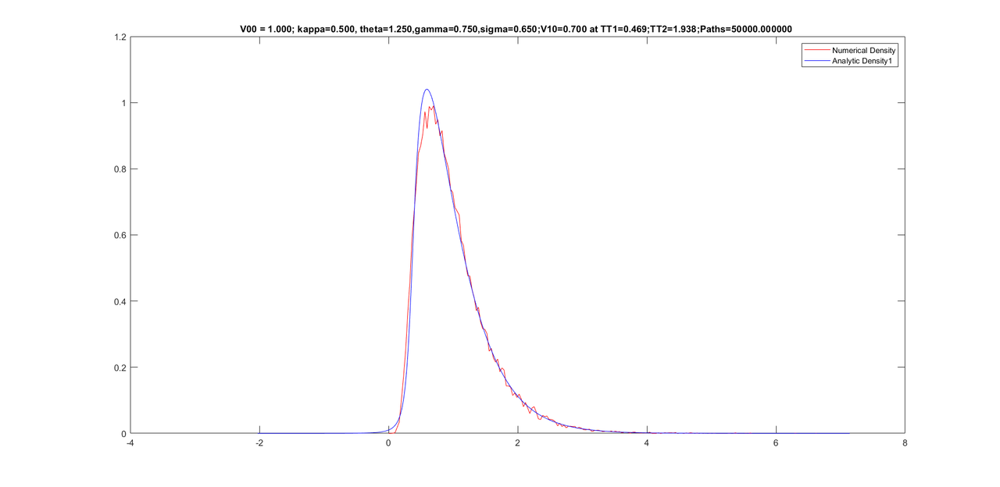](https://postimg.cc/pyTcH7bb)

---

### #2755 — Amin (Topic Author)
*August 27, 2025, 11:46 AM*

Friends, I am posting the new program. I was able to get it to work. It is better but there is need for improvement. I
think there has to be a way to analytically treat the noisy cross-moments before they enter optimizations. I will try to
think about it.

Once you run this program, you will see the graph in previous post. But try it first with relatively easy parameters.

Friends, I have meeting with my  psychiatrist on this Friday evening at 7:50 pm. Please ask your Pakistani colleagues or
connections to tell the psychiatrist everything and ask him to be better and decrease my medication.

Here is the new program.

,

,

,

```
function []= ConditionalDensityHermitesBivariateNewtonIters02()

%SV SDE is
%dV(t)=mu1 V(t)^beta1 dt+ mu2 V(t)^beta2 dt + sigma0 V(t)^gamma dZ(t)
%In mean reverting SDEs we ususally have
%mu1= kappaV * thetaV
%beta1=0
%mu2=-kappa
%beta2=0

%NDim=4;%Three assets and one SV.

%%%%%%%%%%%%%%%%%%%5

V0=1.00;%.32;
V00=V0;
thetaV=1.250;%.045;%1;%.04;
kappaV=0.50;%1.5;%1.5;
mu1=kappaV*thetaV;
mu2=-kappaV;
beta1=0;
beta2=1;
gamma=.750;
sigma0=.65;%
dt=.03125/2;
Tt=64*2;
T=Tt*dt;

seed0=52130649;
rng(seed0, 'twister')
paths=50000;
V(1:paths,1)=V0;

%%%%%%%%%%%%%%%%%%%%%%%%%%%%%%%%%%%%%%%%%%%%%%%%%%%%%%%%%%%%%%%%%%%%%%%%%%%%%%%%%%%%5
TT1=30; %Transition distribution start
TT2=124; %Transition distribution end

Random2(1:paths/2,1)=0;

for tt=1:Tt

    Random2(1:paths/2)=randn(paths/2,1);
    Random2(paths/2+1:paths)=-Random2(1:paths/2);

    V(1:paths,1)=V(1:paths,1)+ ...
        (mu1.*V(1:paths,1).^beta1 + mu2.*V(1:paths,1).^beta2)*dt + ...
        sigma0*V(1:paths,1).^gamma .*Random2(1:paths,1)*sqrt(dt) + ...
        (mu1.*beta1*V(1:paths,1).^(beta1-1) + mu2.*beta2.*V(1:paths,1).^(beta2-1)).* ...
        ((mu1.*V(1:paths,1).^beta1 + mu2.*V(1:paths,1).^beta2)*dt^2/2 + ...
        sigma0*V(1:paths,1).^gamma .*Random2(1:paths,1)*(1-1/sqrt(3))*dt^1.5) + ...
        .5*(mu1.*beta1.*(beta1-1).*V(1:paths,1).^(beta1-2) + mu2.*beta2.*(beta2-1).*V(1:paths,1).^(beta2-2)).* ...
        sigma0^2.*V(1:paths,1).^(2*gamma).*dt^2/2 + ...
        sigma0*gamma*V(1:paths,1).^(gamma-1) .* ...
        ((mu1.*V(1:paths,1).^beta1 + mu2.*V(1:paths,1).^beta2).*Random2(1:paths,1).*1/sqrt(3)*dt^1.5 + ...
        sigma0.*V(1:paths,1).^gamma .*(Random2(1:paths,1).^2-1)*dt/2) + ...
        .5*sigma0*gamma*(gamma-1).*V(1:paths,1).^(gamma-2) .* ...
        sigma0^2.*V(1:paths,1).^(2*gamma) .*Random2(1:paths,1).*1/sqrt(3)*dt^1.5;

    V(V<0)=.00001;

    if(tt==TT1)
        Xin(1:paths,1)=V(1:paths,1);
    end

    if(tt==TT2)
        Yin(1:paths,1)=V(1:paths,1);
    end
end

str=input("I have reached stone 1");

Order=5;

%The function below does initial analytics of caclulation of 2D conditional
%and joint densities. We want to use the result from this function as a
%Starting guess/seed to Newton derivatives based optimization method.

[YCoeffHH,XYCoeffHH,XCoeffH,Coeffyx,YCoeffH] =CalculateBivariateHermiteSeries01(Yin,Xin,Order);

%The above 2D Conditional density calculated from regression is used as an
%input seed to Newton method. YCoeffHH is input as a seed to Newton method
%after converting it to a 2D Z-series.

str=input("I have reached stone 2");

%Below, we calculate Target cross-moments of Y and X from data.
for pp1=1:Order+1
    for qq1=1:Order+1
        MomentsYX0((pp1-1)*(Order+1)+qq1,1)=sum(Yin(1:paths).^pp1.*Xin(1:paths).^qq1)/paths;
    end
end

%Before we enter Newton optimization function, we want to convert 2D and 1D hermite
%Series to Z-series.

[XCoeffZ(1:Order+1)] = ConvertHermiteSeriesToZSeries01(XCoeffH(1:Order+1),Order);

[YCoeffZ(1:Order+1)] = ConvertHermiteSeriesToZSeries01(YCoeffH(1:Order+1),Order);

[YCoeffZZ] = Convert2DHermitesInto2DSeriesNew(YCoeffHH,Order,Order);

OrderY=Order;
OrderX=Order;
[Y1DMoments]=CalculateMomentsOfZSeries(YCoeffZ(1),YCoeffZ(2:6),5,6)
YCoeffZZ=CalculateSmoothingGuessDensity2D(YCoeffZZ,XCoeffZ,MomentsYX0,Y1DMoments,OrderY,OrderX)
str=input("Look at smoothing results")
MaxIter=5000;

[YCoeffZZ,AMat] = DoNewtonIterationsOn2DZSeries(YCoeffZZ,XCoeffZ,Order,MomentsYX0,MaxIter);

%YCoeffZZ is the 2D conditional Z-series of Y given X [Y|X](Zy,Zx)
%that is the result of optimization method and is calibrated to Cross-moments of Y and X.

OrderY=Order;
OrderX=Order;
NMoments=6;
[MeanZZ,VarZZ] = CalculateMeanAndVarOf2DZSeriesY(YCoeffZZ,OrderY,OrderX)
%The name of above function is slightly misleading. It calculates mean and
%second moment

[Y1DMoments]=CalculateMomentsOfZSeries(YCoeffZ(1),YCoeffZ(2:6),5,6)

[YMoments] = CalculateMomentsOf2DZSeriesY(YCoeffZZ,OrderY,OrderX,NMoments);

Y1DMoments
YMoments

%Y1DMoments(2)-Y1DMoments(1).^2
%VarZZ

str=input("Look at comparison of second moments/moments");

YCoeffZZ

AMat
MomentsYX0

%Below Check the difference between model moments and target moments.
AMat-MomentsYX0

%Below, we convert the 2D Conditional Z-series of [Y|X](Zy,Zx) into 2D
%Conditional Hermite Seiries of [Y|X](Zy,Zx).
[YCoeffHH] = ConvertZSeriesToHermiteSeries2D(YCoeffZZ,Order+1,Order+1)

%
MMul1=sqrt(YCoeffHH(1,1).^2+YCoeffHH(1,2).^2+YCoeffHH(1,3).^2*2+YCoeffHH(1,4).^2*6+YCoeffHH(1,5).^2*24+YCoeffHH(1,6).^2*120)
% YCoeffH(1)
%
% %YCoeffHH(1,:)=YCoeffHH(1,:)*abs(YCoeffH(1))./MMul1;
%
%
%
MMul2=sqrt(YCoeffHH(2,1).^2+YCoeffHH(2,2).^2+YCoeffHH(2,3).^2*2+YCoeffHH(2,4).^2*6+YCoeffHH(2,5).^2*24+YCoeffHH(2,6).^2*120)
% YCoeffH(2)
%
%
MMul3=sqrt(YCoeffHH(3,1).^2+YCoeffHH(3,2).^2+YCoeffHH(3,3).^2*2+YCoeffHH(3,4).^2*6+YCoeffHH(3,5).^2*24+YCoeffHH(3,6).^2*120)
% YCoeffH(3)
%
%
%
MMul4=sqrt(YCoeffHH(4,1).^2+YCoeffHH(4,2).^2+YCoeffHH(4,3).^2*2+YCoeffHH(4,4).^2*6+YCoeffHH(4,5).^2*24+YCoeffHH(4,6).^2*120)
% YCoeffH(4)
%
%
MMul5=sqrt(YCoeffHH(5,1).^2+YCoeffHH(5,2).^2+YCoeffHH(5,3).^2*2+YCoeffHH(5,4).^2*6+YCoeffHH(5,5).^2*24+YCoeffHH(5,6).^2*120)
% YCoeffH(5)
%
%
%
MMul6=sqrt(YCoeffHH(6,1).^2+YCoeffHH(6,2).^2+YCoeffHH(6,3).^2*2+YCoeffHH(6,4).^2*6+YCoeffHH(6,5).^2*24+YCoeffHH(6,6).^2*120)
% YCoeffH(6)
%
% % YCoeffHH(1,:)=YCoeffHH(1,:)*abs(YCoeffH(1))./MMul1;
% % YCoeffHH(2,:)=YCoeffHH(2,:)*abs(YCoeffH(2))./MMul2;
% % YCoeffHH(3,:)=YCoeffHH(3,:)*abs(YCoeffH(3))./MMul3;
% % YCoeffHH(4,:)=YCoeffHH(4,:)*abs(YCoeffH(4))./MMul4;
% % YCoeffHH(5,:)=YCoeffHH(5,:)*abs(YCoeffH(5))./MMul5;
% % YCoeffHH(6,:)=YCoeffHH(6,:)*abs(YCoeffH(6))./MMul6;
%
%
%
%
% str=input("Look at comparison of coefficients")
%

%%%%%%%%%%%%%%%%%%%%%%%%%%%%%%%%%%%%%%%%%%%%%%%%%%%%%%%%%%%%%%%%%%%%%%%%%%%%%5
%In this block, we do conditional Monte Carlo of SDE which is the true
%numerical 1D conditional density of Y conditional on X having a given
%value. This value of X on which we are conditionin is defined by V10 below.
%We can alter V10 below and it will take out a 1D slice from the 2D density
%of Y conditional on X  taking a specific value (here V10).

V10=.7;
V(1:paths)=V10;
Random2(1:paths,1)=0;

for tt=TT1+1:TT2

    Random2(1:paths/2)=randn(paths/2,1);
    Random2(paths/2+1:paths)=-Random2(1:paths/2);

    V(1:paths,1)=V(1:paths,1)+ ...
        (mu1.*V(1:paths,1).^beta1 + mu2.*V(1:paths,1).^beta2)*dt + ...
        sigma0*V(1:paths,1).^gamma .*Random2(1:paths,1)*sqrt(dt) + ...
        (mu1.*beta1*V(1:paths,1).^(beta1-1) + mu2.*beta2.*V(1:paths,1).^(beta2-1)).* ...
        ((mu1.*V(1:paths,1).^beta1 + mu2.*V(1:paths,1).^beta2)*dt^2/2 + ...
        sigma0*V(1:paths,1).^gamma .*Random2(1:paths,1)*(1-1/sqrt(3))*dt^1.5) + ...
        .5*(mu1.*beta1.*(beta1-1).*V(1:paths,1).^(beta1-2) + mu2.*beta2.*(beta2-1).*V(1:paths,1).^(beta2-2)).* ...
        sigma0^2.*V(1:paths,1).^(2*gamma).*dt^2/2 + ...
        sigma0*gamma*V(1:paths,1).^(gamma-1) .* ...
        ((mu1.*V(1:paths,1).^beta1 + mu2.*V(1:paths,1).^beta2).*Random2(1:paths,1).*1/sqrt(3)*dt^1.5 + ...
        sigma0.*V(1:paths,1).^gamma .*(Random2(1:paths,1).^2-1)*dt/2) + ...
        .5*sigma0*gamma*(gamma-1).*V(1:paths,1).^(gamma-2) .* ...
        sigma0^2.*V(1:paths,1).^(2*gamma) .*Random2(1:paths,1).*1/sqrt(3)*dt^1.5;

    V(V<0)=.00001;

end

%Below

NoOfBins=200;
MaxCutOff=10;

[XDensity,IndexOut,IndexMax] = MakeDensityFromSimulation_Infiniti_NEW(V,paths,NoOfBins,MaxCutOff );

clf;

plot(IndexOut(1:IndexMax),XDensity(1:IndexMax),'r');

hold on

%%%%%%%%%%%%%%%%%%%%%%%%%%%%%%%%%%%%%%%%%%%%%%%%%%%%%%%%%%%%%%%%%%%%%%%%%%%%%%%%%%%%%%%5
%Below, we calculate the value of Zx0 corresponding to X0 (here V10). This
%comes from inverting the Z-series of X so that X=V10;

xOrder=Order;
yOrder=Order;
[Zx0] = CalculateZgivenXAndHSeriesCoeffs(V10,XCoeffH,xOrder);

%Below, we collapse two dimensional pdf of Y|X to one dimensional pdf given
%Zx i.e. this Y|X=X(Zx)
%Here we take out a 1D slice from the 2D density
%of Y conditional on X  taking a specific value (here V10).
He(1)=1;
He(2)=Zx0;
He(3)=Zx0^2-1;
He(4)=Zx0^3-3*Zx0;
He(5)=Zx0^4-6*Zx0.^2+3;
He(6)=Zx0^5-10*Zx0.^3+15*Zx0;
He(7)=Zx0^6-15*Zx0.^4+45*Zx0.^2-15;
He(8)=Zx0^7-21*Zx0.^5+105*Zx0.^3-105*Zx0;

YCoeffh(1:Order+1)=0;
for hh=1:yOrder+1
    for hh2=1:xOrder+1
        YCoeffh(hh)=YCoeffh(hh)+YCoeffHH(hh,hh2).*He(hh2);
    end
end

[YCoeffz(1:Order+1)] = ConvertHermiteSeriesToZSeries01(YCoeffh(1:Order+1),Order);

%[IsValidFlag] = CheckIsValidDensityPN(YCoeffz(1),YCoeffz(2:Order+1));
[PIsValidFlag,NIsValidFlag] = CheckIsValidDensityPN02(YCoeffz(1),YCoeffz(2:Order+1));
PIsValidFlag
NIsValidFlag

for mm=1:100
    [PIsValidFlag,NIsValidFlag] = CheckIsValidDensityPN02(YCoeffz(1),YCoeffz(2:Order+1));
if((NIsValidFlag==0)&&(PIsValidFlag==1))
    YCoeffz(5)=YCoeffz(5)-.01*abs(YCoeffz(5));
    YCoeffz(6)=YCoeffz(6)+.001*abs(YCoeffz(6));
    %YCoeffz(3)=YCoeffz(3)-.001*abs(YCoeffz(3));
end

if((PIsValidFlag==0)&&(NIsValidFlag==1))
    YCoeffz(5)=YCoeffz(5)+.01*abs(YCoeffz(5));
    YCoeffz(6)=YCoeffz(6)+.001*abs(YCoeffz(6));
    %YCoeffz(3)=YCoeffz(3)-.001*abs(YCoeffz(3));
end

if((NIsValidFlag==0)&&(PIsValidFlag==0))
    YCoeffz(6)=YCoeffz(6)+.01*abs(YCoeffz(6));
    %YCoeffz(3)=YCoeffz(3)-.001*abs(YCoeffz(3));
end

end

[YCoeffh] = ConvertZSeriesToHermiteSeriesNew(YCoeffz,Order)

PlotHermiteSeriesDensityAndRvGraph(YCoeffh(1),YCoeffh(2:yOrder+1),'b')

%hold on
%PlotHermiteSeriesDensityAndRvGraph(YCoeffh(1),YCoeffh1(2:yOrder+1),'g')
title(sprintf('V00 = %.3f; kappa=%.3f, theta=%.3f,gamma=%.3f,sigma=%.3f;V10=%.3f at TT1=%.3f;TT2=%.3f;Paths=%d ',V00,
kappaV, thetaV,gamma,sigma0, V10,(TT1*dt),(TT2*dt),paths));%,sprintf('theta= %f', theta), sprintf('kappa = %f',
kappa),sprintf('sigma = %f', sigma0),sprintf('T = %f', T));
legend({'Numerical Density','Analytic Density1'}, ...
    'Location','northeast')

YCoeffh

end
```

.

.

.

```
function [YCoeffZZBest] = CalculateSmoothingGuessDensity2D(YCoeffZZ,XCoeffZ,MomentsYX0,MomentsY,OrderY,OrderX)

Order=5;
%[AMat] = CalculateCrossMomentsofTwo2Dand1DZSeries(YCoeffZZ,XCoeffZ,OrderY,OrderX)

Iterations=20;
Iterations2=10;
[AMat,DMat] = CalculateMomentsAndDerivativesFor2DNewton_0(YCoeffZZ,XCoeffZ,Order);
ObjMax=sum((AMat-MomentsYX0).^2);

for iter=1:Iterations

    for pp1=1:Order+1
        for qq1=1:Order+1

            for iter2=1:Iterations2
                [AMat,DMat] = CalculateMomentsAndDerivativesFor2DNewton_0(YCoeffZZ,XCoeffZ,Order);

                DiffMoment=AMat((pp1-1)*(Order+1)+qq1)-MomentsYX0((pp1-1)*(Order+1)+qq1);
                DDiff=DMat((pp1-1)*(Order+1)+qq1,(pp1-1)*(Order+1)+qq1);
                %YCoeffZZ=YCoeffZZ;
                YCoeffZZ(pp1,qq1)=YCoeffZZ(pp1,qq1)-DiffMoment/DDiff;
            end

            [MeanZZ,VarZZ] = CalculateMeanAndVarOf2DZSeriesY(YCoeffZZ,Order,Order);
            YCoeffZZ=YCoeffZZ*sqrt(MomentsY(2))./sqrt(VarZZ);
            [MeanZZ,VarZZ] = CalculateMeanAndVarOf2DZSeriesY(YCoeffZZ,Order,Order);
            YCoeffZZ(1,1)=YCoeffZZ(1,1)+MomentsY(1)-MeanZZ;
            [AMat,DMat] = CalculateMomentsAndDerivativesFor2DNewton_0(YCoeffZZ,XCoeffZ,Order);
    ObjNew=sum((AMat-MomentsYX0).^2);
    if(ObjNew2*ObjMax)
    %    YCoeffZZ=YCoeffZZBest;
    end
    ObjNew
    ObjMax
    iter

end

end

% for iter=1:Iterations
%
%     for pp1=1:Order+1
%         for qq1=1:Order+1
%
%             for iter2=1:Iterations2
%                 [AMat,DMat] = CalculateMomentsAndDerivativesFor2DNewton_0(YCoeffZZ,XCoeffZ,Order);
%
%                 DiffMoment=AMat((pp1-1)*(Order+1)+qq1)-MomentsYX0((pp1-1)*(Order+1)+qq1);
%                 DDiff=DMat((pp1-1)*(Order+1)+qq1,(pp1-1)*(Order+1)+qq1);
%                 YCoeffZZnew=YCoeffZZ;
%                 YCoeffZZnew(pp1,qq1)=YCoeffZZ(pp1,qq1)-DiffMoment/DDiff;
%             end
%
%             [MeanZZ,VarZZ] = CalculateMeanAndVarOf2DZSeriesY(YCoeffZZnew,Order,Order);
%             YCoeffZZnew=YCoeffZZnew*sqrt(MomentsY(2))./sqrt(VarZZ);
%             [MeanZZ,VarZZ] = CalculateMeanAndVarOf2DZSeriesY(YCoeffZZnew,Order,Order);
%             YCoeffZZnew(1,1)=YCoeffZZnew(1,1)+MomentsY(1)-MeanZZ;
%             [AMat,DMat] = CalculateMomentsAndDerivativesFor2DNewton_0(YCoeffZZnew,XCoeffZ,Order);
%     ObjNew=sum((AMat-MomentsYX0).^2);
%     if(ObjNew<ObjMax)
%         %If objective function decreases assign YCoeffZZnew to YCoeffZZ
%         ObjMax=ObjNew;
%         YCoeffZZ=YCoeffZZnew;
%     end
%         end
%
%     end
%     [AMat,DMat] = CalculateMomentsAndDerivativesFor2DNewton_0(YCoeffZZ,XCoeffZ,Order);
%     ObjNew=sum((AMat-MomentsYX0).^2);
%     if(ObjNew<ObjMax)
%         %If objective function decreases assign YCoeffZZnew to YCoeffZZ
%         ObjMax=ObjNew;
%         YCoeffZZBest=YCoeffZZ;
%     end
%
%     ObjNew
%     ObjMax
%     iter
%
%
% end
```

,

,

,The name of function below is misleading. It calculates second moment and not variance.

```
function [MeanZZ,VarZZ] = CalculateMeanAndVarOf2DZSeriesY(YCoeffZZ,OrderY,OrderX)

[EZ] = EZZ2();

EX=0;
for nn1=1:OrderY
    for nn2=1:OrderX
        EX=EX+YCoeffZZ(nn1,nn2).*EZ(nn1).*EZ(nn2);
    end
end

MeanZZ=EX;

SeriesOrder10=OrderY+1;
SeriesOrder01=OrderX+1;
SeriesOrder20=OrderY+1;
SeriesOrder02=OrderX+1;

  SeriesOrder30=SeriesOrder10+SeriesOrder20-1;
  SeriesOrder03=SeriesOrder01+SeriesOrder02-1;
% %
% %  %Below calculate the product: 2D product of Z-series [Y|X](Zy,Zx)*X(Zx)
  [YpCoeff(1:SeriesOrder30,1:SeriesOrder03),EYp]
=SeriesProduct2DAlgorithmicNew(YCoeffZZ(1:SeriesOrder10,1:SeriesOrder01),YCoeffZZ(1:OrderX+1,1:OrderY+1),SeriesOrder10,SeriesOrder01,SeriesOrder20,SeriesOrder02);

 VarZZ=EYp;

end

```

.

.

.

```
function [YMoments] = CalculateMomentsOf2DZSeriesY(YCoeffZZ,OrderY,OrderX,NMoments)

[EZ] = EZZ2();

EX=0;
for nn1=1:OrderY
    for nn2=1:OrderX
        EX=EX+YCoeffZZ(nn1,nn2).*EZ(nn1).*EZ(nn2);
    end
end

MeanZZ=EX;
YMoments(1)=EX;

YpCoeff(1:(OrderY+1)*(OrderX+1),1:(OrderY+1)*(OrderX+1),1:NMoments)=0.0;

YpCoeff(1:OrderY+1,1:OrderX+1,1)=YCoeffZZ(1:OrderY+1,1:OrderX+1);

SeriesOrder10=OrderY+1;
SeriesOrder01=OrderX+1;
SeriesOrder20=OrderY+1;
SeriesOrder02=OrderX+1;

for pp=2:NMoments

  SeriesOrder30=SeriesOrder10+SeriesOrder20-1;
  SeriesOrder03=SeriesOrder01+SeriesOrder02-1;
% %
% %  %Below calculate the product: 2D product of Z-series [Y|X](Zy,Zx)*X(Zx)
  [YpCoeff(1:SeriesOrder30,1:SeriesOrder03,pp),EYp(pp)]
=SeriesProduct2DAlgorithmicNew(YpCoeff(1:SeriesOrder10,1:SeriesOrder01,pp-1),YCoeffZZ(1:OrderX+1,1:OrderY+1,1),SeriesOrder10,SeriesOrder01,SeriesOrder20,SeriesOrder02);

  YMoments(pp)=EYp(pp);

  SeriesOrder10=SeriesOrder30;
SeriesOrder01=SeriesOrder03;
SeriesOrder20=OrderY+1;
SeriesOrder02=OrderX+1;

end

end

```

.

.

.

```
function [Moments] = CalculateMomentsOfZSeries(a0,a,SeriesOrder,NMoments)

%aa0=a0;
%a0=0;% ---1

EZ(1)=0;
EZ(2)=1;
%LogEZ(2)=0;
for nn=3:NMoments*SeriesOrder
    if rem(nn,2)==1
        EZ(nn)=0;
    else
        EZ(nn)=EZ(nn-2)*(nn-1);
        %LogEZ(nn)=log(EZ(nn-2))+log(nn-1);
        %EZ(nn);
    end
end
%EZ
%EZ(1:30)
%str=input('Look at numbers')
a(SeriesOrder+1:SeriesOrder*NMoments+1)=0;
b0=a0;
b=a;

for mm=1:NMoments
    if(mm>1)
        %[b0,b] =SeriesProductLogarithmic(a0,a,b0,b,SeriesOrder*mm);

        [b0,b] =SeriesProduct(a0,a,b0,b,SeriesOrder*mm);

        %b0-bb0

        %b-bb

        %str=input('Look at two products')

        b(SeriesOrder*mm+1:SeriesOrder*NMoments+1)=0;
    end
   % Logb=log(abs(b));
   % Signb=sign(b);
    EXZ(mm,1)=b0;
    for pp2=1:SeriesOrder*mm
        if rem(pp2,2)==0
            %EXZ(mm,1)=EXZ(mm,1)+exp(Logb(pp2)+LogEZ(pp2)).*Signb(pp2);
            EXZ(mm,1)=EXZ(mm,1)+b(pp2).*EZ(pp2);
 %           b(pp2).*EZ(pp2)
 %           exp(Logb(pp2)+LogEZ(pp2)).*Signb(pp2)
 %           mm
 %           pp2
            %str=input('Look at moment values')
        end
    end
end

for nn=1:NMoments
    Moments(nn)=EXZ(nn,1);
end

end

```

.

.

.

---

### #2756 — Amin (Topic Author)
*August 27, 2025, 12:00 PM*

Friends, please use this version of the function and discard this function given in previous post.

.

.

.

```
function [YCoeffZZBest] = CalculateSmoothingGuessDensity2D(YCoeffZZ,XCoeffZ,MomentsYX0,MomentsY,OrderY,OrderX)

Order=5;
%[AMat] = CalculateCrossMomentsofTwo2Dand1DZSeries(YCoeffZZ,XCoeffZ,OrderY,OrderX)

Iterations=20;
Iterations2=2;
[AMat,DMat] = CalculateMomentsAndDerivativesFor2DNewton_0(YCoeffZZ,XCoeffZ,Order);
ObjMax=sum((AMat-MomentsYX0).^2);

for iter=1:Iterations

    for pp1=1:Order+1
        for qq1=1:Order+1

            for iter2=1:Iterations2
                [AMat,DMat] = CalculateMomentsAndDerivativesFor2DNewton_0(YCoeffZZ,XCoeffZ,Order);

                DiffMoment=AMat((pp1-1)*(Order+1)+qq1)-MomentsYX0((pp1-1)*(Order+1)+qq1);
                DDiff=DMat((pp1-1)*(Order+1)+qq1,(pp1-1)*(Order+1)+qq1);
                %YCoeffZZ=YCoeffZZ;
                YCoeffZZ(pp1,qq1)=YCoeffZZ(pp1,qq1)-DiffMoment/DDiff;
            end

            [MeanZZ,VarZZ] = CalculateMeanAndVarOf2DZSeriesY(YCoeffZZ,Order,Order);
            YCoeffZZ=YCoeffZZ*sqrt(MomentsY(2))./sqrt(VarZZ);
            [MeanZZ,VarZZ] = CalculateMeanAndVarOf2DZSeriesY(YCoeffZZ,Order,Order);
            YCoeffZZ(1,1)=YCoeffZZ(1,1)+MomentsY(1)-MeanZZ;
            [AMat,DMat] = CalculateMomentsAndDerivativesFor2DNewton_0(YCoeffZZ,XCoeffZ,Order);
    ObjNew=sum((AMat-MomentsYX0).^2);
    if(ObjNew2*ObjMax)
    %    YCoeffZZ=YCoeffZZBest;
    end
    ObjNew
    ObjMax
    iter

end

end

```

---

### #2757 — Amin (Topic Author)
*August 27, 2025, 7:31 PM*

Friends, I am committed to continue working with all different aspects of 2D conditional probability distributions and
related variables all through the Winters. The very next thing to do is to create a general program that calculates 2D
conditional variables with arbitrary coefficients as desired by the user. The current program works with 6 X 6 cross
moments but when paths/observations are only several hundred, it would be prudent to try using only 4 X 4 cross Moments.
And for lognormal type 2D conditional distributions, we would need 8 X 8 cross moments when enough paths/observations
are given.

There are other issues about how we can get acceptable output with smaller number of observations/paths that is close to
true values. And many more issues would arise as we go deeper into solution of these problems.

Let us try to find solution to related problems and I plan to continue working through the winters to resolve these and
other related problems as they arise in the new research. I hope friends would morally support me for this opportunity.

---

### #2758 — Amin (Topic Author)
*August 27, 2025, 7:43 PM*

Friends, in my experiments I have seen that it is possible to have a good fit to smaller number of observations of order
of 5000 or so. I will continue working with samples of 5000 and smaller samples and will post some new programs in a day
for working with smaller numbers of observations. I have had enough luck with smaller samples and hope that I will get
large number of examples to work and then post the new program.

---

### #2759 — Amin (Topic Author)
*August 27, 2025, 9:45 PM*

Friends, here is the new version of the program. I have added one round of smoothing function after every fifty
iterations of Newton Type algorithm. And made some other small changes. I am sure, in a few weeks, we will have vastly
improved algorithms. In about two days, I will post a general program that would also be able to work up to eighth cross
moments and also for up to fourth cross moments as desired by the user. I am sure that eighth order cross moments can
also be handled well with a bit of extra effort.

Here are the updated functions.

```
function []= ConditionalDensityHermitesBivariateNewtonIters02()

%SV SDE is
%dV(t)=mu1 V(t)^beta1 dt+ mu2 V(t)^beta2 dt + sigma0 V(t)^gamma dZ(t)
%In mean reverting SDEs we ususally have
%mu1= kappaV * thetaV
%beta1=0
%mu2=-kappa
%beta2=0

%NDim=4;%Three assets and one SV.

%%%%%%%%%%%%%%%%%%%5

V0=1.00;%.32;
V00=V0;
thetaV=1.250;%.045;%1;%.04;
kappaV=0.50;%1.5;%1.5;
mu1=kappaV*thetaV;
mu2=-kappaV;
beta1=0;
beta2=1;
gamma=.50;
sigma0=.5;%
dt=.03125/2;
Tt=64*2;
T=Tt*dt;

seed0=52130649;
rng(seed0, 'twister')
paths=10000;
V(1:paths,1)=V0;

%%%%%%%%%%%%%%%%%%%%%%%%%%%%%%%%%%%%%%%%%%%%%%%%%%%%%%%%%%%%%%%%%%%%%%%%%%%%%%%%%%%%5
TT1=30; %Transition distribution start
TT2=124; %Transition distribution end

Random2(1:paths/2,1)=0;

for tt=1:Tt

    Random2(1:paths/2)=randn(paths/2,1);
    Random2(paths/2+1:paths)=-Random2(1:paths/2);

    V(1:paths,1)=V(1:paths,1)+ ...
        (mu1.*V(1:paths,1).^beta1 + mu2.*V(1:paths,1).^beta2)*dt + ...
        sigma0*V(1:paths,1).^gamma .*Random2(1:paths,1)*sqrt(dt) + ...
        (mu1.*beta1*V(1:paths,1).^(beta1-1) + mu2.*beta2.*V(1:paths,1).^(beta2-1)).* ...
        ((mu1.*V(1:paths,1).^beta1 + mu2.*V(1:paths,1).^beta2)*dt^2/2 + ...
        sigma0*V(1:paths,1).^gamma .*Random2(1:paths,1)*(1-1/sqrt(3))*dt^1.5) + ...
        .5*(mu1.*beta1.*(beta1-1).*V(1:paths,1).^(beta1-2) + mu2.*beta2.*(beta2-1).*V(1:paths,1).^(beta2-2)).* ...
        sigma0^2.*V(1:paths,1).^(2*gamma).*dt^2/2 + ...
        sigma0*gamma*V(1:paths,1).^(gamma-1) .* ...
        ((mu1.*V(1:paths,1).^beta1 + mu2.*V(1:paths,1).^beta2).*Random2(1:paths,1).*1/sqrt(3)*dt^1.5 + ...
        sigma0.*V(1:paths,1).^gamma .*(Random2(1:paths,1).^2-1)*dt/2) + ...
        .5*sigma0*gamma*(gamma-1).*V(1:paths,1).^(gamma-2) .* ...
        sigma0^2.*V(1:paths,1).^(2*gamma) .*Random2(1:paths,1).*1/sqrt(3)*dt^1.5;

    V(V<0)=.00001;

    if(tt==TT1)
        Xin(1:paths,1)=V(1:paths,1);
    end

    if(tt==TT2)
        Yin(1:paths,1)=V(1:paths,1);
    end
end

str=input("I have reached stone 1");

Order=5;

%The function below does initial analytics of caclulation of 2D conditional
%and joint densities. We want to use the result from this function as a
%Starting guess/seed to Newton derivatives based optimization method.

[YCoeffHH,XYCoeffHH,XCoeffH,Coeffyx,YCoeffH] =CalculateBivariateHermiteSeries01(Yin,Xin,Order);

YCoeffHH(1:6,5:6)=YCoeffHH(1:6,5:6)/1000;
YCoeffHH(5:6,1:6)=YCoeffHH(5:6,1:6)/1000;

%The above 2D Conditional density calculated from regression is used as an
%input seed to Newton method. YCoeffHH is input as a seed to Newton method
%after converting it to a 2D Z-series.

str=input("I have reached stone 2");

%Below, we calculate Target cross-moments of Y and X from data.
for pp1=1:Order+1
    for qq1=1:Order+1
        MomentsYX0((pp1-1)*(Order+1)+qq1,1)=sum(Yin(1:paths).^pp1.*Xin(1:paths).^qq1)/paths;
    end
end

%Before we enter Newton optimization function, we want to convert 2D and 1D hermite
%Series to Z-series.

[XCoeffZ(1:Order+1)] = ConvertHermiteSeriesToZSeries01(XCoeffH(1:Order+1),Order);

[YCoeffZ(1:Order+1)] = ConvertHermiteSeriesToZSeries01(YCoeffH(1:Order+1),Order);

[YCoeffZZ] = Convert2DHermitesInto2DSeriesNew(YCoeffHH,Order,Order);

OrderY=Order;
OrderX=Order;
[Y1DMoments]=CalculateMomentsOfZSeries(YCoeffZ(1),YCoeffZ(2:6),5,6)
MaxIter0=30;
YCoeffZZ=CalculateSmoothingGuessDensity2D(YCoeffZZ,XCoeffZ,MomentsYX0,Y1DMoments,OrderY,OrderX,MaxIter0)
str=input("Look at smoothing results")
MaxIter=2000;

[YCoeffZZ,AMat] = DoNewtonIterationsOn2DZSeries(YCoeffZZ,XCoeffZ,Order,MomentsYX0,Y1DMoments,MaxIter);

%MaxIter0=30;
%YCoeffZZ=CalculateSmoothingGuessDensity2D(YCoeffZZ,XCoeffZ,MomentsYX0,Y1DMoments,OrderY,OrderX,MaxIter0);

%str=input("Look at smoothing results")
%MaxIter=200;

%[YCoeffZZ,AMat] = DoNewtonIterationsOn2DZSeries(YCoeffZZ,XCoeffZ,Order,MomentsYX0,Y1DMoments,MaxIter);

%YCoeffZZ is the 2D conditional Z-series of Y given X [Y|X](Zy,Zx)
%that is the result of optimization method and is calibrated to Cross-moments of Y and X.

%MaxIter0=30;
%YCoeffZZ=CalculateSmoothingGuessDensity2D(YCoeffZZ,XCoeffZ,MomentsYX0,Y1DMoments,OrderY,OrderX,MaxIter0);

%str=input("Look at smoothing---3 results")

OrderY=Order;
OrderX=Order;
NMoments=6;
[MeanZZ,VarZZ] = CalculateMeanAndVarOf2DZSeriesY(YCoeffZZ,OrderY,OrderX)
%The name of above function is slightly misleading. It calculates mean and
%second moment

[Y1DMoments]=CalculateMomentsOfZSeries(YCoeffZ(1),YCoeffZ(2:6),5,6)

[YMoments] = CalculateMomentsOf2DZSeriesY(YCoeffZZ,OrderY,OrderX,NMoments);

Y1DMoments
YMoments

%Y1DMoments(2)-Y1DMoments(1).^2
%VarZZ

str=input("Look at comparison of second moments/moments");

YCoeffZZ

AMat
MomentsYX0

%Below Check the difference between model moments and target moments.
AMat-MomentsYX0

%Below, we convert the 2D Conditional Z-series of [Y|X](Zy,Zx) into 2D
%Conditional Hermite Seiries of [Y|X](Zy,Zx).
[YCoeffHH] = ConvertZSeriesToHermiteSeries2D(YCoeffZZ,Order+1,Order+1)

%
MMul1=sqrt(YCoeffHH(1,1).^2+YCoeffHH(1,2).^2+YCoeffHH(1,3).^2*2+YCoeffHH(1,4).^2*6+YCoeffHH(1,5).^2*24+YCoeffHH(1,6).^2*120)
% YCoeffH(1)
%
% %YCoeffHH(1,:)=YCoeffHH(1,:)*abs(YCoeffH(1))./MMul1;
%
%
%
MMul2=sqrt(YCoeffHH(2,1).^2+YCoeffHH(2,2).^2+YCoeffHH(2,3).^2*2+YCoeffHH(2,4).^2*6+YCoeffHH(2,5).^2*24+YCoeffHH(2,6).^2*120)
% YCoeffH(2)
%
%
MMul3=sqrt(YCoeffHH(3,1).^2+YCoeffHH(3,2).^2+YCoeffHH(3,3).^2*2+YCoeffHH(3,4).^2*6+YCoeffHH(3,5).^2*24+YCoeffHH(3,6).^2*120)
% YCoeffH(3)
%
%
%
MMul4=sqrt(YCoeffHH(4,1).^2+YCoeffHH(4,2).^2+YCoeffHH(4,3).^2*2+YCoeffHH(4,4).^2*6+YCoeffHH(4,5).^2*24+YCoeffHH(4,6).^2*120)
% YCoeffH(4)
%
%
MMul5=sqrt(YCoeffHH(5,1).^2+YCoeffHH(5,2).^2+YCoeffHH(5,3).^2*2+YCoeffHH(5,4).^2*6+YCoeffHH(5,5).^2*24+YCoeffHH(5,6).^2*120)
% YCoeffH(5)
%
%
%
MMul6=sqrt(YCoeffHH(6,1).^2+YCoeffHH(6,2).^2+YCoeffHH(6,3).^2*2+YCoeffHH(6,4).^2*6+YCoeffHH(6,5).^2*24+YCoeffHH(6,6).^2*120)
% YCoeffH(6)
%
% % YCoeffHH(1,:)=YCoeffHH(1,:)*abs(YCoeffH(1))./MMul1;
% % YCoeffHH(2,:)=YCoeffHH(2,:)*abs(YCoeffH(2))./MMul2;
% % YCoeffHH(3,:)=YCoeffHH(3,:)*abs(YCoeffH(3))./MMul3;
% % YCoeffHH(4,:)=YCoeffHH(4,:)*abs(YCoeffH(4))./MMul4;
% % YCoeffHH(5,:)=YCoeffHH(5,:)*abs(YCoeffH(5))./MMul5;
% % YCoeffHH(6,:)=YCoeffHH(6,:)*abs(YCoeffH(6))./MMul6;
%
%
%
%
% str=input("Look at comparison of coefficients")
%

%%%%%%%%%%%%%%%%%%%%%%%%%%%%%%%%%%%%%%%%%%%%%%%%%%%%%%%%%%%%%%%%%%%%%%%%%%%%%5
%In this block, we do conditional Monte Carlo of SDE which is the true
%numerical 1D conditional density of Y conditional on X having a given
%value. This value of X on which we are conditionin is defined by V10 below.
%We can alter V10 below and it will take out a 1D slice from the 2D density
%of Y conditional on X  taking a specific value (here V10).

V10=.70;
V(1:paths)=V10;
Random2(1:paths,1)=0;

for tt=TT1+1:TT2

    Random2(1:paths/2)=randn(paths/2,1);
    Random2(paths/2+1:paths)=-Random2(1:paths/2);

    V(1:paths,1)=V(1:paths,1)+ ...
        (mu1.*V(1:paths,1).^beta1 + mu2.*V(1:paths,1).^beta2)*dt + ...
        sigma0*V(1:paths,1).^gamma .*Random2(1:paths,1)*sqrt(dt) + ...
        (mu1.*beta1*V(1:paths,1).^(beta1-1) + mu2.*beta2.*V(1:paths,1).^(beta2-1)).* ...
        ((mu1.*V(1:paths,1).^beta1 + mu2.*V(1:paths,1).^beta2)*dt^2/2 + ...
        sigma0*V(1:paths,1).^gamma .*Random2(1:paths,1)*(1-1/sqrt(3))*dt^1.5) + ...
        .5*(mu1.*beta1.*(beta1-1).*V(1:paths,1).^(beta1-2) + mu2.*beta2.*(beta2-1).*V(1:paths,1).^(beta2-2)).* ...
        sigma0^2.*V(1:paths,1).^(2*gamma).*dt^2/2 + ...
        sigma0*gamma*V(1:paths,1).^(gamma-1) .* ...
        ((mu1.*V(1:paths,1).^beta1 + mu2.*V(1:paths,1).^beta2).*Random2(1:paths,1).*1/sqrt(3)*dt^1.5 + ...
        sigma0.*V(1:paths,1).^gamma .*(Random2(1:paths,1).^2-1)*dt/2) + ...
        .5*sigma0*gamma*(gamma-1).*V(1:paths,1).^(gamma-2) .* ...
        sigma0^2.*V(1:paths,1).^(2*gamma) .*Random2(1:paths,1).*1/sqrt(3)*dt^1.5;

    V(V<0)=.00001;

end

%Below

NoOfBins=200;
MaxCutOff=10;

[XDensity,IndexOut,IndexMax] = MakeDensityFromSimulation_Infiniti_NEW(V,paths,NoOfBins,MaxCutOff );

clf;

plot(IndexOut(1:IndexMax),XDensity(1:IndexMax),'r');

hold on

%%%%%%%%%%%%%%%%%%%%%%%%%%%%%%%%%%%%%%%%%%%%%%%%%%%%%%%%%%%%%%%%%%%%%%%%%%%%%%%%%%%%%%%5
%Below, we calculate the value of Zx0 corresponding to X0 (here V10). This
%comes from inverting the Z-series of X so that X=V10;

xOrder=Order;
yOrder=Order;
[Zx0] = CalculateZgivenXAndHSeriesCoeffs(V10,XCoeffH,xOrder);

%Below, we collapse two dimensional pdf of Y|X to one dimensional pdf given
%Zx i.e. this Y|X=X(Zx)
%Here we take out a 1D slice from the 2D density
%of Y conditional on X  taking a specific value (here V10).
He(1)=1;
He(2)=Zx0;
He(3)=Zx0^2-1;
He(4)=Zx0^3-3*Zx0;
He(5)=Zx0^4-6*Zx0.^2+3;
He(6)=Zx0^5-10*Zx0.^3+15*Zx0;
He(7)=Zx0^6-15*Zx0.^4+45*Zx0.^2-15;
He(8)=Zx0^7-21*Zx0.^5+105*Zx0.^3-105*Zx0;

YCoeffh(1:Order+1)=0;
for hh=1:yOrder+1
    for hh2=1:xOrder+1
        YCoeffh(hh)=YCoeffh(hh)+YCoeffHH(hh,hh2).*He(hh2);
    end
end

[YCoeffz(1:Order+1)] = ConvertHermiteSeriesToZSeries01(YCoeffh(1:Order+1),Order);

%[IsValidFlag] = CheckIsValidDensityPN(YCoeffz(1),YCoeffz(2:Order+1));
[PIsValidFlag,NIsValidFlag] = CheckIsValidDensityPN02(YCoeffz(1),YCoeffz(2:Order+1));
PIsValidFlag
NIsValidFlag

for mm=1:100
    [PIsValidFlag,NIsValidFlag] = CheckIsValidDensityPN02(YCoeffz(1),YCoeffz(2:Order+1));
if((NIsValidFlag==0)&&(PIsValidFlag==1))
    YCoeffz(5)=YCoeffz(5)-.01*abs(YCoeffz(5));
    YCoeffz(6)=YCoeffz(6)+.001*abs(YCoeffz(6));
    %YCoeffz(3)=YCoeffz(3)-.001*abs(YCoeffz(3));
end

if((PIsValidFlag==0)&&(NIsValidFlag==1))
    YCoeffz(5)=YCoeffz(5)+.01*abs(YCoeffz(5));
    YCoeffz(6)=YCoeffz(6)+.001*abs(YCoeffz(6));
    %YCoeffz(3)=YCoeffz(3)-.001*abs(YCoeffz(3));
end

if((NIsValidFlag==0)&&(PIsValidFlag==0))
    YCoeffz(6)=YCoeffz(6)+.01*abs(YCoeffz(6));
    %YCoeffz(3)=YCoeffz(3)-.001*abs(YCoeffz(3));
end

end

[YCoeffh] = ConvertZSeriesToHermiteSeriesNew(YCoeffz,Order)

PlotHermiteSeriesDensityAndRvGraph(YCoeffh(1),YCoeffh(2:yOrder+1),'b')

%hold on
%PlotHermiteSeriesDensityAndRvGraph(YCoeffh(1),YCoeffh1(2:yOrder+1),'g')
title(sprintf('V00 = %.3f; kappa=%.3f, theta=%.3f,gamma=%.3f,sigma=%.3f;V10=%.3f at TT1=%.3f;TT2=%.3f;Paths=%d ',V00,
kappaV, thetaV,gamma,sigma0, V10,(TT1*dt),(TT2*dt),paths));%,sprintf('theta= %f', theta), sprintf('kappa = %f',
kappa),sprintf('sigma = %f', sigma0),sprintf('T = %f', T));
legend({'Numerical Density','Analytic Density1'}, ...
    'Location','northeast')

YCoeffh

end
```

.

.

.

.

```
function [YCoeffZZ,AMat] = DoNewtonIterationsOn2DZSeries(YCoeffZZ,XCoeffZ,Order,MomentsYX0,MomentsY,MaxIter)

%YCoeffZZ is 2D Z-series conditional on X denoted in literature as [Y|X](Zy,Zx)
%The way to construct Z-series from YCoeffZZ is sum of terms YCoeffZZ(n,m) Zy^{n-1)Zx^{m-1}.
%YCoeffZZ(1:Order+1,1:Order+1) is a 2D array containing coefficients of 2D
%Z-Series of Conditional distribution of Y given X (or Z_x).

%XCoeffZ(1:Order+1) is a one dimensional Z-series of X. The way to construct the Z-series is
%sum of terms XCoeffZ(m) Zx^{m-1}. It has dimensiona YCoeffZ(1:Order+1).

% The way to calculate the cross-product/cross-moments: 2D product of Z-series
% ([Y|X](Zy,Zx))^(pp1-1) *(X(Zx))^qq2/E[([Y|X](Zy,Zx))^(pp1-1)*(X(Zx))^qq2]

%MomentsYX0 is a 1D array containing all the target cross-moments ((Order+1)*(Order+1))stacked in an array.

%%AMat gives us all the expected model cross-moments ((Order+1)*(Order+1))stacked in an array.
%DMat contains Jacobian that calculates ((Order+1)*(Order+1)) derivatives
%for each cross-moment hence its size is ((Order+1)*(Order+1)) *,((Order+1)*(Order+1))

%Below, we calculate AMat and DMat.
[AMat,DMat] = CalculateMomentsAndDerivativesFor2DNewton_0(YCoeffZZ,XCoeffZ,Order);

%CalculateMomentsAndDerivativesFor2DNewton_0_BumpCheck
mul=.00625*4;
mulCount=0;
mulCount0=0;

%Below is initial value of Objective function calculated from input array
%target and model sum of squared differences of cross-moments.
ObjMax=sum((AMat-MomentsYX0).^2);

FailCount=0;
%Iterations=MaxIter;
Mul_Gauss=1;
iter=0;
while((sum((AMat-MomentsYX0).^2)>.001)&&(iterMulGaussHigh)
        Mul_Gauss=MulGaussLow;
    end

    if(ObjNew=4)
            Mul_Gauss=Mul_Gauss*.75;
            if(Mul_Gauss1)
            mul=1;
        end
        FailCount=0;
    else
        mul=mul*.5; %On failure, decrease the step size.
        if(mul=4)
            Mul_Gauss=Mul_Gauss*1.5;
            mul_Count=0;
        end
        FailCount=FailCount+1;
    end

    %Calculate model cross-moments and Jacobian derivatives for Next Newton
    %type iteration.
    [AMat,DMat] = CalculateMomentsAndDerivativesFor2DNewton_0(YCoeffZZ,XCoeffZ,Order);
end

% YCoeffZZ
% AMat
% MomentsYX0
% AMat-MomentsYX0

end
```

.

.

.

.

```
function [YCoeffZZBest] = CalculateSmoothingGuessDensity2D(YCoeffZZ,XCoeffZ,MomentsYX0,MomentsY,OrderY,OrderX,MaxIter)

Order=5;
%[AMat] = CalculateCrossMomentsofTwo2Dand1DZSeries(YCoeffZZ,XCoeffZ,OrderY,OrderX)

Iterations=40;
Iterations2=2;
YCoeffZZBest=YCoeffZZ;
[AMat,DMat] = CalculateMomentsAndDerivativesFor2DNewton_0(YCoeffZZ,XCoeffZ,Order);
ObjMax=sum((AMat-MomentsYX0).^2);

for iter=1:MaxIter

    for pp1=1:Order+1
        for qq1=1:Order+1

            for iter2=1:Iterations2
                [AMat,DMat] = CalculateMomentsAndDerivativesFor2DNewton_0(YCoeffZZ,XCoeffZ,Order);

                DiffMoment=AMat((pp1-1)*(Order+1)+qq1)-MomentsYX0((pp1-1)*(Order+1)+qq1);
                DDiff=DMat((pp1-1)*(Order+1)+qq1,(pp1-1)*(Order+1)+qq1);
                %YCoeffZZ=YCoeffZZ;
                YCoeffZZ(pp1,qq1)=YCoeffZZ(pp1,qq1)-DiffMoment/DDiff;
            end

            [MeanZZ,VarZZ] = CalculateMeanAndVarOf2DZSeriesY(YCoeffZZ,Order,Order);
            YCoeffZZ=YCoeffZZ*sqrt(MomentsY(2))./sqrt(VarZZ);
            [MeanZZ,VarZZ] = CalculateMeanAndVarOf2DZSeriesY(YCoeffZZ,Order,Order);
            YCoeffZZ(1,1)=YCoeffZZ(1,1)+MomentsY(1)-MeanZZ;
            [AMat,DMat] = CalculateMomentsAndDerivativesFor2DNewton_0(YCoeffZZ,XCoeffZ,Order);
    ObjNew=sum((AMat-MomentsYX0).^2);
    if(ObjNew2*ObjMax)
    %    YCoeffZZ=YCoeffZZBest;
    end
    ObjNew
    ObjMax
    iter

end

end

```

.

.

.

.

Here is the output graph of this code.

.

.

.

[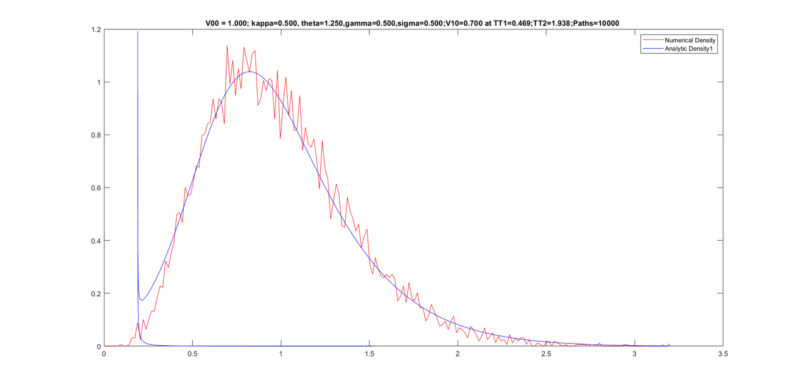](https://postimg.cc/xcmy53dc)

---

### #2760 — Amin (Topic Author)
*August 28, 2025, 6:38 AM*

Friends, I believe that there has to be some restrictions on moments (or inequalities for moments) in order for hermite
polynomial based densities to have proper tails. Among other things, I will try to see if I can find any restrictions or
inequalities on moments to have properly tailed densities. Let us see if we can find anything meaningful in this regard.

---

### #2761 — Amin (Topic Author)
*August 28, 2025, 1:57 PM*

Friends, I want to make a general version of the previous program that can take non-square cross-moments matrix and can
also work till at least eighth moment. It can take a day or two. I want to keep the program general.

Then I will take 2-3 days to sum up and explain with latex equations everything that we have been doing since past one
week including the later work.

I also thought about properties of moments so that resulting calibrated Z-series would have proper tails. Suppose
moment(n) is nth central moment of a Z-series. I tried that ratio  moment(6)/moment(5) has to be equal to or greater
than the ratio moment(4)/moment(3). Please note that these moments are central. I tried it on a few Z-series and it
seemed to work and the tail would become proper and accurate but it was very initial and I need more work to see if it
always holds. In general, I would suggest when there are eight moments then (we take absolute values of moments in case
of negative odd moments)

moment(8)/moment(7) >= moment (6)/moment(5) >=moment(4)/moment(3)

where all of the above are central moments. At the moment, this is just suggestive and I need more work to verify this.

I hope to share interesting work in coming days.

---

### #2762 — Amin (Topic Author)
*August 31, 2025, 9:23 AM*

Friends, for the calculations of model cross-moments, I have been using the Hermite-series of independent variable X
derived from least squares regression. Just like its two dimensional counterpart, this one dimensional
Z-series/Hermite-Series have enough noise in its highest coefficients associated with higher hermite polynomials when
derived from regression. The noise in these higher coefficients contributes to instability of the whole process.  I have
tried finding this one dimensional density of independent variable X  from fitting of moments on one dimensional
Z-series and it increases the robustness of the whole process. The 1D Coefficients derived from fitting of one
dimensional moments are more stable and, as a result, the two dimensional model cross-moment calculations are more
well-behaved and robust. In a few hours, I will post this new matlab program for friends.

---

### #2763 — Amin (Topic Author)
*August 31, 2025, 4:46 PM*

Friends, here are some graphs for various conditional densities. I have corrected for tail of the density at the end of
the program by calculating one dimensional moments of the conditional Z-series. Sixth moments is then increased until
the tail re-appears. Once the tail is fine, I reconstruct the density from new moments (five old moments + sixth new
moment).

However, the above process of increasing sixth moment slightly rotates the density somewhat which is undesirable. I am
trying to fix it with some work I did several years ago. I hope that undesirable rotation in the density would end and
the density would also have a proper tail once I apply another new method on this.

I will post the matlab program used to make these graphs in a little bit.

Please note that conditional density is  $$ P_Y( Y(T_2) \,|\, X(T_1)=V_{10})\,$$

Here are the graphs with parameters on the title of graphs.

.

.

.

[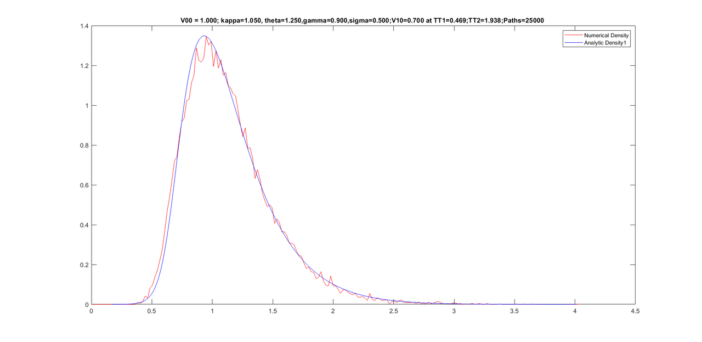](https://postimg.cc/sM36Xbnz)

[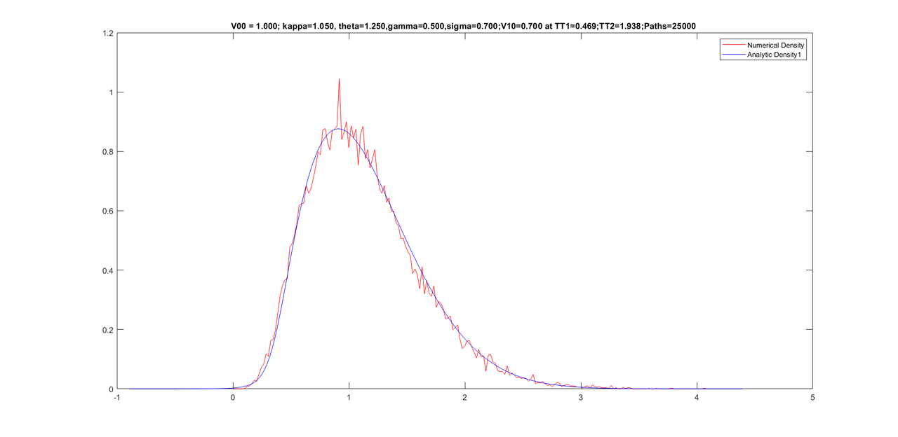](https://postimg.cc/XXQcLXLR)

[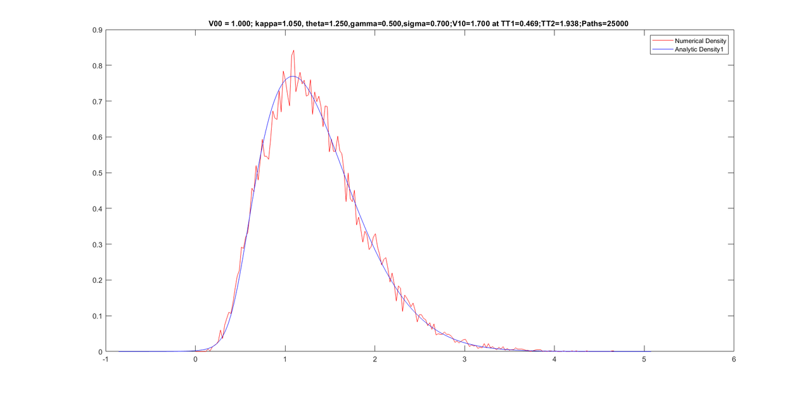](https://postimg.cc/3WKF22Xj)

[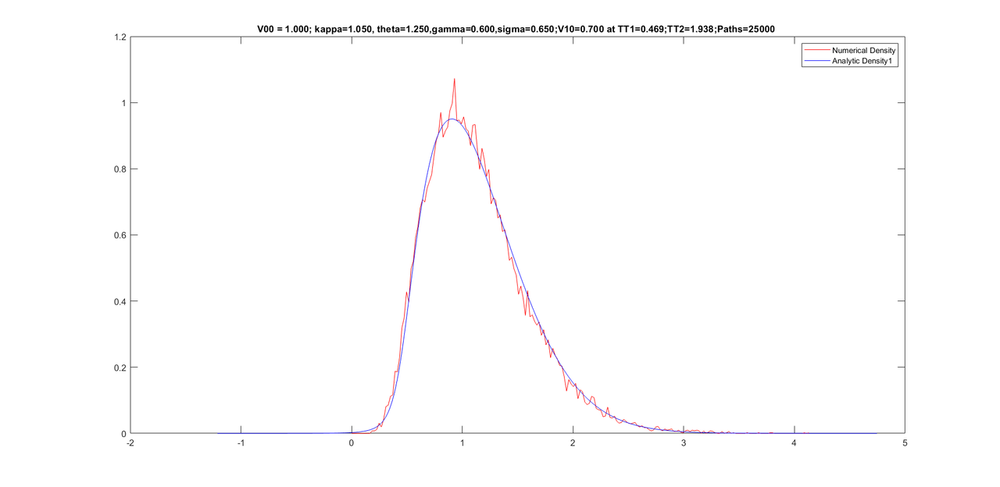](https://postimg.cc/fST7Zhzq)

[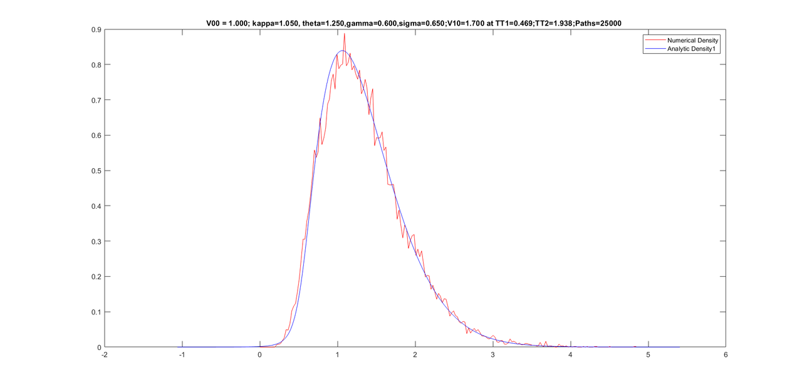](https://postimg.cc/phBQgdHn)

[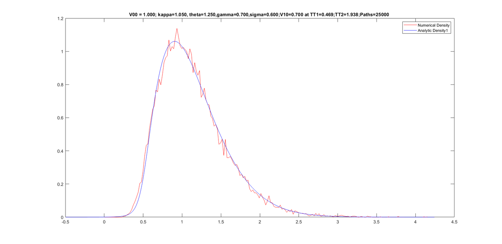](https://postimg.cc/wyzcfmSp)

[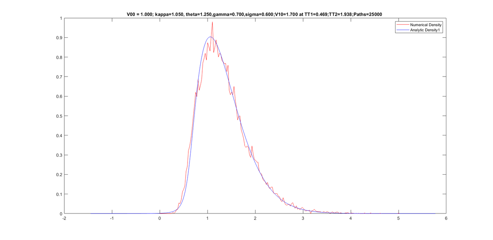](https://postimg.cc/KKBDDNpf)

[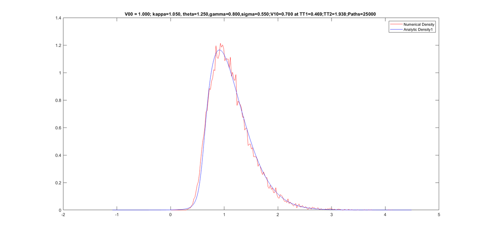](https://postimg.cc/rDv94bjz)

[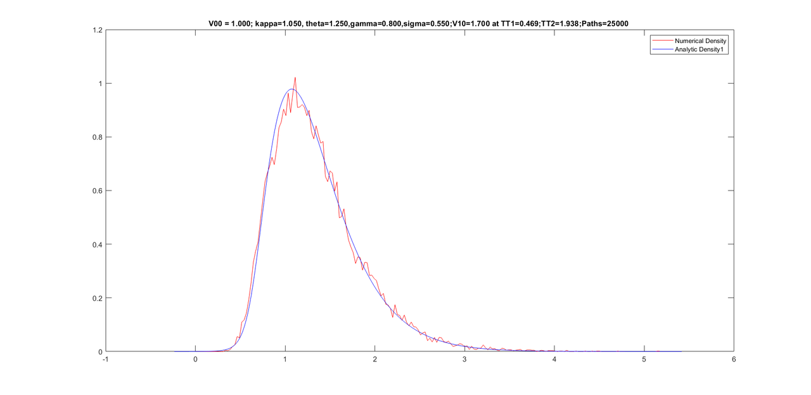](https://postimg.cc/crkhx68R)

[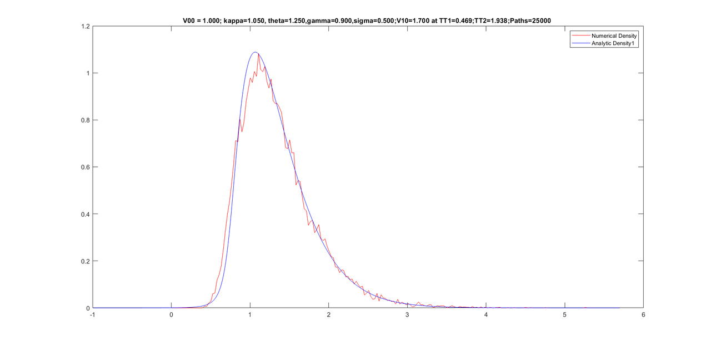](https://postimg.cc/SnXrJqWw)

---

### #2764 — Amin (Topic Author)
*August 31, 2025, 5:17 PM*

I am posting most of the functions required to run the program. Functions recently posted might not be included unless I
changed them. If you cannot find any function, please search for it on the thread using search functionality.

.

.

.

```
function []= ConditionalDensityHermitesBivariateNewtonIters02()

%SV SDE is
%dV(t)=mu1 V(t)^beta1 dt+ mu2 V(t)^beta2 dt + sigma0 V(t)^gamma dZ(t)
%In mean reverting SDEs we ususally have
%mu1= kappaV * thetaV
%beta1=0
%mu2=-kappa
%beta2=0

%NDim=4;%Three assets and one SV.

%%%%%%%%%%%%%%%%%%%5

V0=1.00;%.32;
V00=V0;
thetaV=1.250;%.045;%1;%.04;
kappaV=1.05;%1.5;%1.5;
mu1=kappaV*thetaV;
mu2=-kappaV;
beta1=0;
beta2=1;
gamma=.9;%.950;
sigma0=.5%.45;%
dt=.03125/2;
Tt=64*2;
T=Tt*dt;

seed0=52130649;
rng(seed0, 'twister')
paths=25000;
V(1:paths,1)=V0;

%%%%%%%%%%%%%%%%%%%%%%%%%%%%%%%%%%%%%%%%%%%%%%%%%%%%%%%%%%%%%%%%%%%%%%%%%%%%%%%%%%%%5
TT1=30; %Transition distribution start
TT2=124; %Transition distribution end

Random2(1:paths/2,1)=0;

for tt=1:Tt

    Random2(1:paths/2)=randn(paths/2,1);
    Random2(paths/2+1:paths)=-Random2(1:paths/2);

    V(1:paths,1)=V(1:paths,1)+ ...
        (mu1.*V(1:paths,1).^beta1 + mu2.*V(1:paths,1).^beta2)*dt + ...
        sigma0*V(1:paths,1).^gamma .*Random2(1:paths,1)*sqrt(dt) + ...
        (mu1.*beta1*V(1:paths,1).^(beta1-1) + mu2.*beta2.*V(1:paths,1).^(beta2-1)).* ...
        ((mu1.*V(1:paths,1).^beta1 + mu2.*V(1:paths,1).^beta2)*dt^2/2 + ...
        sigma0*V(1:paths,1).^gamma .*Random2(1:paths,1)*(1-1/sqrt(3))*dt^1.5) + ...
        .5*(mu1.*beta1.*(beta1-1).*V(1:paths,1).^(beta1-2) + mu2.*beta2.*(beta2-1).*V(1:paths,1).^(beta2-2)).* ...
        sigma0^2.*V(1:paths,1).^(2*gamma).*dt^2/2 + ...
        sigma0*gamma*V(1:paths,1).^(gamma-1) .* ...
        ((mu1.*V(1:paths,1).^beta1 + mu2.*V(1:paths,1).^beta2).*Random2(1:paths,1).*1/sqrt(3)*dt^1.5 + ...
        sigma0.*V(1:paths,1).^gamma .*(Random2(1:paths,1).^2-1)*dt/2) + ...
        .5*sigma0*gamma*(gamma-1).*V(1:paths,1).^(gamma-2) .* ...
        sigma0^2.*V(1:paths,1).^(2*gamma) .*Random2(1:paths,1).*1/sqrt(3)*dt^1.5;

    V(V<0)=.00001;

    if(tt==TT1)
        Xin(1:paths,1)=V(1:paths,1);
    end

    if(tt==TT2)
        Yin(1:paths,1)=V(1:paths,1);
    end
end

str=input("I have reached stone 1");

Order=5;

%The function below does initial analytics of caclulation of 2D conditional
%and joint densities. We want to use the result from this function as a
%Starting guess/seed to Newton derivatives based optimization method.

[YCoeffHH,XYCoeffHH,XCoeffH,Coeffyx,YCoeffH] =CalculateBivariateHermiteSeries01(Yin,Xin,Order);

for qq1=1:Order+1
  XMoments(qq1)=sum(Xin(1:paths).^qq1)/paths;
end

[XCoeffZ(1:Order+1)] = ConvertHermiteSeriesToZSeries01(XCoeffH(1:Order+1),Order);

[XCoeffZ(1),XCoeffZ(2:6)] = CalculateZSeriesDensityFromRawMomentsM6(XMoments,XCoeffZ(2:6));

YCoeffHH(1:Order+1,Order:Order+1)=YCoeffHH(1:Order+1,Order:Order+1)/100000;
YCoeffHH(Order:Order+1,1:Order+1)=YCoeffHH(Order:Order+1,1:Order+1)/100000;

%The above 2D Conditional density calculated from regression is used as an
%input seed to Newton method. YCoeffHH is input as a seed to Newton method
%after converting it to a 2D Z-series.

str=input("I have reached stone 2");

%Below, we calculate Target cross-moments of Y and X from data.
for pp1=1:Order+1
    for qq1=1:Order+1
        MomentsYX0((pp1-1)*(Order+1)+qq1,1)=sum(Yin(1:paths).^pp1.*Xin(1:paths).^qq1)/paths;
    end
end

%  for pp1=1:Order+1
%      pp4=6;
%      pp3=5;
%      pp2=4;
%      pp1=3;
%     
if((MomentsYX0((pp4-1)*(Order+1)+qq1,1)/MomentsYX0((pp3-1)*(Order+1)+qq1,1))<(MomentsYX0((pp2-1)*(Order+1)+qq1,1)/MomentsYX0((pp1-1)*(Order+1)+qq1,1)))
%         
MomentsYX0((pp4-1)*(Order+1)+qq1,1)=MomentsYX0((pp3-1)*(Order+1)+qq1,1)*(MomentsYX0((pp2-1)*(Order+1)+qq1,1)/MomentsYX0((pp1-1)*(Order+1)+qq1,1));
%
%          str=input("Moments are being altered")
%      end
%      %for qq1=1:Order+1
%      %    MomentsYX0((pp1-1)*(Order+1)+qq1,1)=sum(Yin(1:paths).^pp1.*Xin(1:paths).^qq1)/paths;
%      %end
%  end

%Before we enter Newton optimization function, we want to convert 2D and 1D hermite
%Series to Z-series.

[XCoeffZ(1:Order+1)] = ConvertHermiteSeriesToZSeries01(XCoeffH(1:Order+1),Order);

[YCoeffZ(1:Order+1)] = ConvertHermiteSeriesToZSeries01(YCoeffH(1:Order+1),Order);

[YCoeffZZ] = Convert2DHermitesInto2DSeriesNew(YCoeffHH,Order,Order);

OrderY=Order;
OrderX=Order;
[Y1DMoments]=CalculateMomentsOfZSeries(YCoeffZ(1),YCoeffZ(2:6),5,6)
MaxIter0=30;
YCoeffZZ=CalculateSmoothingGuessDensity2D(YCoeffZZ,XCoeffZ,MomentsYX0,Y1DMoments,OrderY,OrderX,MaxIter0)
str=input("Look at smoothing results")
MaxIter=3000;

[YCoeffZZ,AMat] = DoNewtonIterationsOn2DZSeries(YCoeffZZ,XCoeffZ,Order,MomentsYX0,Y1DMoments,MaxIter);

%%%%%%%%%%%%%%%%%%%%%%%%%%%%%%%%%%%%%%%%%%%%%%%%%%%%%%%%%%%%%%%%%%%%%%%%%%%%%%%%%%%%%%%%%%%%%%%%%5
% Order=7
% YCoeffHH(1:Order+1,Order:Order+1)=0.0;%YCoeffHH(1:Order+1,Order:Order+1)/100000;
% YCoeffHH(Order:Order+1,1:Order+1)=0.0;%YCoeffHH(Order:Order+1,1:Order+1)/100000;
%
% for pp1=1:Order+1
%     for qq1=1:Order+1
%         MomentsYX0((pp1-1)*(Order+1)+qq1,1)=sum(Yin(1:paths).^pp1.*Xin(1:paths).^qq1)/paths;
%     end
% end
%

%MaxIter0=30;
%YCoeffZZ=CalculateSmoothingGuessDensity2D(YCoeffZZ,XCoeffZ,MomentsYX0,Y1DMoments,OrderY,OrderX,MaxIter0);

%str=input("Look at smoothing results")
%MaxIter=200;

%[YCoeffZZ,AMat] = DoNewtonIterationsOn2DZSeries(YCoeffZZ,XCoeffZ,Order,MomentsYX0,Y1DMoments,MaxIter);

%YCoeffZZ is the 2D conditional Z-series of Y given X [Y|X](Zy,Zx)
%that is the result of optimization method and is calibrated to Cross-moments of Y and X.

%MaxIter0=30;
%YCoeffZZ=CalculateSmoothingGuessDensity2D(YCoeffZZ,XCoeffZ,MomentsYX0,Y1DMoments,OrderY,OrderX,MaxIter0);

%str=input("Look at smoothing---3 results")

OrderY=Order;
OrderX=Order;
NMoments=6;
[MeanZZ,VarZZ] = CalculateMeanAndVarOf2DZSeriesY(YCoeffZZ,OrderY,OrderX)
%The name of above function is slightly misleading. It calculates mean and
%second moment

[Y1DMoments]=CalculateMomentsOfZSeries(YCoeffZ(1),YCoeffZ(2:6),5,6)

[YMoments] = CalculateMomentsOf2DZSeriesY(YCoeffZZ,OrderY,OrderX,NMoments);

Y1DMoments
YMoments

%Y1DMoments(2)-Y1DMoments(1).^2
%VarZZ

str=input("Look at comparison of second moments/moments");

YCoeffZZ

%AMat
%MomentsYX0

%Below Check the difference between model moments and target moments.
%AMat-MomentsYX0

%Below, we convert the 2D Conditional Z-series of [Y|X](Zy,Zx) into 2D
%Conditional Hermite Seiries of [Y|X](Zy,Zx).
[YCoeffHH] = ConvertZSeriesToHermiteSeries2D(YCoeffZZ,Order+1,Order+1)

%
MMul1=sqrt(YCoeffHH(1,1).^2+YCoeffHH(1,2).^2+YCoeffHH(1,3).^2*2+YCoeffHH(1,4).^2*6+YCoeffHH(1,5).^2*24+YCoeffHH(1,6).^2*120)
% YCoeffH(1)
%
% %YCoeffHH(1,:)=YCoeffHH(1,:)*abs(YCoeffH(1))./MMul1;
%
%
%
MMul2=sqrt(YCoeffHH(2,1).^2+YCoeffHH(2,2).^2+YCoeffHH(2,3).^2*2+YCoeffHH(2,4).^2*6+YCoeffHH(2,5).^2*24+YCoeffHH(2,6).^2*120)
% YCoeffH(2)
%
%
MMul3=sqrt(YCoeffHH(3,1).^2+YCoeffHH(3,2).^2+YCoeffHH(3,3).^2*2+YCoeffHH(3,4).^2*6+YCoeffHH(3,5).^2*24+YCoeffHH(3,6).^2*120)
% YCoeffH(3)
%
%
%
MMul4=sqrt(YCoeffHH(4,1).^2+YCoeffHH(4,2).^2+YCoeffHH(4,3).^2*2+YCoeffHH(4,4).^2*6+YCoeffHH(4,5).^2*24+YCoeffHH(4,6).^2*120)
% YCoeffH(4)
%
%
MMul5=sqrt(YCoeffHH(5,1).^2+YCoeffHH(5,2).^2+YCoeffHH(5,3).^2*2+YCoeffHH(5,4).^2*6+YCoeffHH(5,5).^2*24+YCoeffHH(5,6).^2*120)
% YCoeffH(5)
%
%
%
MMul6=sqrt(YCoeffHH(6,1).^2+YCoeffHH(6,2).^2+YCoeffHH(6,3).^2*2+YCoeffHH(6,4).^2*6+YCoeffHH(6,5).^2*24+YCoeffHH(6,6).^2*120)
% YCoeffH(6)
%
% % YCoeffHH(1,:)=YCoeffHH(1,:)*abs(YCoeffH(1))./MMul1;
% % YCoeffHH(2,:)=YCoeffHH(2,:)*abs(YCoeffH(2))./MMul2;
% % YCoeffHH(3,:)=YCoeffHH(3,:)*abs(YCoeffH(3))./MMul3;
% % YCoeffHH(4,:)=YCoeffHH(4,:)*abs(YCoeffH(4))./MMul4;
% % YCoeffHH(5,:)=YCoeffHH(5,:)*abs(YCoeffH(5))./MMul5;
% % YCoeffHH(6,:)=YCoeffHH(6,:)*abs(YCoeffH(6))./MMul6;
%
%
%
%
 str=input("Look at comparison of coefficients")
%

%%%%%%%%%%%%%%%%%%%%%%%%%%%%%%%%%%%%%%%%%%%%%%%%%%%%%%%%%%%%%%%%%%%%%%%%%%%%%5
%In this block, we do conditional Monte Carlo of SDE which is the true
%numerical 1D conditional density of Y conditional on X having a given
%value. This value of X on which we are conditionin is defined by V10 below.
%We can alter V10 below and it will take out a 1D slice from the 2D density
%of Y conditional on X  taking a specific value (here V10).

V10=1.70;
V(1:paths)=V10;
Random2(1:paths,1)=0;

for tt=TT1+1:TT2

    Random2(1:paths/2)=randn(paths/2,1);
    Random2(paths/2+1:paths)=-Random2(1:paths/2);

    V(1:paths,1)=V(1:paths,1)+ ...
        (mu1.*V(1:paths,1).^beta1 + mu2.*V(1:paths,1).^beta2)*dt + ...
        sigma0*V(1:paths,1).^gamma .*Random2(1:paths,1)*sqrt(dt) + ...
        (mu1.*beta1*V(1:paths,1).^(beta1-1) + mu2.*beta2.*V(1:paths,1).^(beta2-1)).* ...
        ((mu1.*V(1:paths,1).^beta1 + mu2.*V(1:paths,1).^beta2)*dt^2/2 + ...
        sigma0*V(1:paths,1).^gamma .*Random2(1:paths,1)*(1-1/sqrt(3))*dt^1.5) + ...
        .5*(mu1.*beta1.*(beta1-1).*V(1:paths,1).^(beta1-2) + mu2.*beta2.*(beta2-1).*V(1:paths,1).^(beta2-2)).* ...
        sigma0^2.*V(1:paths,1).^(2*gamma).*dt^2/2 + ...
        sigma0*gamma*V(1:paths,1).^(gamma-1) .* ...
        ((mu1.*V(1:paths,1).^beta1 + mu2.*V(1:paths,1).^beta2).*Random2(1:paths,1).*1/sqrt(3)*dt^1.5 + ...
        sigma0.*V(1:paths,1).^gamma .*(Random2(1:paths,1).^2-1)*dt/2) + ...
        .5*sigma0*gamma*(gamma-1).*V(1:paths,1).^(gamma-2) .* ...
        sigma0^2.*V(1:paths,1).^(2*gamma) .*Random2(1:paths,1).*1/sqrt(3)*dt^1.5;

    V(V<0)=.00001;

end

%Below

NoOfBins=200;
MaxCutOff=10;

[XDensity,IndexOut,IndexMax] = MakeDensityFromSimulation_Infiniti_NEW(V,paths,NoOfBins,MaxCutOff );

clf;

plot(IndexOut(1:IndexMax),XDensity(1:IndexMax),'r');

hold on

%%%%%%%%%%%%%%%%%%%%%%%%%%%%%%%%%%%%%%%%%%%%%%%%%%%%%%%%%%%%%%%%%%%%%%%%%%%%%%%%%%%%%%%5
%Below, we calculate the value of Zx0 corresponding to X0 (here V10). This
%comes from inverting the Z-series of X so that X=V10;

xOrder=Order;
yOrder=Order;
[Zx0] = CalculateZgivenXAndHSeriesCoeffs(V10,XCoeffH,xOrder);

%Below, we collapse two dimensional pdf of Y|X to one dimensional pdf given
%Zx i.e. this Y|X=X(Zx)
%Here we take out a 1D slice from the 2D density
%of Y conditional on X  taking a specific value (here V10).
He(1)=1;
He(2)=Zx0;
He(3)=Zx0^2-1;
He(4)=Zx0^3-3*Zx0;
He(5)=Zx0^4-6*Zx0.^2+3;
He(6)=Zx0^5-10*Zx0.^3+15*Zx0;
He(7)=Zx0^6-15*Zx0.^4+45*Zx0.^2-15;
He(8)=Zx0^7-21*Zx0.^5+105*Zx0.^3-105*Zx0;

YCoeffh(1:Order+1)=0;
for hh=1:yOrder+1
    for hh2=1:xOrder+1
        YCoeffh(hh)=YCoeffh(hh)+YCoeffHH(hh,hh2).*He(hh2);
    end
end

 [YCoeffz(1:Order+1)] = ConvertHermiteSeriesToZSeries01(YCoeffh(1:Order+1),Order);
%
%
% %[IsValidFlag] = CheckIsValidDensityPN(YCoeffz(1),YCoeffz(2:Order+1));
% [PIsValidFlag,NIsValidFlag] = CheckIsValidDensityPN02(YCoeffz(1),YCoeffz(2:Order+1));
% PIsValidFlag
% NIsValidFlag
%
%
% for mm=1:100
%     [PIsValidFlag,NIsValidFlag] = CheckIsValidDensityPN02(YCoeffz(1),YCoeffz(2:Order+1));
% if((NIsValidFlag==0)&&(PIsValidFlag==1))
%     YCoeffz(5)=YCoeffz(5)-.01*abs(YCoeffz(5));
%     YCoeffz(6)=YCoeffz(6)+.001*abs(YCoeffz(6));
%     %YCoeffz(3)=YCoeffz(3)-.001*abs(YCoeffz(3));
% end
%
% if((PIsValidFlag==0)&&(NIsValidFlag==1))
%     YCoeffz(5)=YCoeffz(5)+.01*abs(YCoeffz(5));
%     YCoeffz(6)=YCoeffz(6)+.001*abs(YCoeffz(6));
%     %YCoeffz(3)=YCoeffz(3)-.001*abs(YCoeffz(3));
% end
%
% if((NIsValidFlag==0)&&(PIsValidFlag==0))
%     YCoeffz(6)=YCoeffz(6)+.01*abs(YCoeffz(6));
%     %YCoeffz(3)=YCoeffz(3)-.001*abs(YCoeffz(3));
% end
%
% end
%
% [YCoeffh] = ConvertZSeriesToHermiteSeriesNew(YCoeffz,Order)
%

PlotHermiteSeriesDensityAndRvGraph(YCoeffh(1),YCoeffh(2:yOrder+1),'b')

%hold on
%PlotHermiteSeriesDensityAndRvGraph(YCoeffh(1),YCoeffh1(2:yOrder+1),'g')
title(sprintf('V00 = %.3f; kappa=%.3f, theta=%.3f,gamma=%.3f,sigma=%.3f;V10=%.3f at TT1=%.3f;TT2=%.3f;Paths=%d ',V00,
kappaV, thetaV,gamma,sigma0, V10,(TT1*dt),(TT2*dt),paths));%,sprintf('theta= %f', theta), sprintf('kappa = %f',
kappa),sprintf('sigma = %f', sigma0),sprintf('T = %f', T));
legend({'Numerical Density','Analytic Density1'}, ...
    'Location','northeast')

str=input("This is the first version without altering the moments of conditional density")

% %[IsValidFlag] = CheckIsValidDensityPN(YCoeffz(1),YCoeffz(2:Order+1));
[PIsValidFlag,NIsValidFlag] = CheckIsValidDensityPN02(YCoeffz(1),YCoeffz(2:Order+1));
PIsValidFlag
NIsValidFlag
LoopIter=0;

Mul6(1)=.66;
Mul6(2)=.8;
Mul6(3)=.9;
Mul6(4)=1.0;
Mul6(5)=1.1;
while(((PIsValidFlag==0)||(NIsValidFlag==0))&&(LoopIter<5))
LoopIter=LoopIter+1;
    YCoeffh

    Y2Coeffz=YCoeffz;
    Mean=Y2Coeffz(1)+(Y2Coeffz(3)+3*Y2Coeffz(5));
    Y2Coeffz(1)=-(Y2Coeffz(3)+3*Y2Coeffz(5));

    [YMoments]=CalculateMomentsOfZSeries(Y2Coeffz(1),Y2Coeffz(2:6),5,6)

    %%%%%%%%%%%%%%%%%%%%%%%%%%%%%%%%%%%%%%%%%%%%%%%%%%%%%%%%
    abs(YMoments(3:6))./abs(YMoments(2:5))

    YMoments(2:6)
    %%%%%%%%%%%%%%%%%%%%%%%%%%%%%%%%%%%%%%%%%%%%%%%%%%%%%%%555

    if(abs(YMoments(6)/YMoments(5))<abs(YMoments(4)/YMoments(3))*Mul6(LoopIter))
    YMoments(6)=abs(YMoments(5).*YMoments(4)./YMoments(3)*Mul6(LoopIter))

    end

    [Y3Coeffz(1),Y3Coeffz(2:6)] = CalculateZSeriesDensityFromRawMomentsM6(YMoments,Y2Coeffz(2:6));

    Y3Coeffz(1)=Mean-(Y2Coeffz(3)+3*Y2Coeffz(5));

    [PIsValidFlag,NIsValidFlag] = CheckIsValidDensityPN02(Y3Coeffz(1),Y3Coeffz(2:Order+1));
PIsValidFlag
NIsValidFlag
end
if(LoopIter==0)

     Y3Coeffz=YCoeffz;
end

clf;

plot(IndexOut(1:IndexMax),XDensity(1:IndexMax),'r');

hold on

PlotZSeriesDensity(Y3Coeffz(1),Y3Coeffz(2:yOrder+1),'b')

title(sprintf('V00 = %.3f; kappa=%.3f, theta=%.3f,gamma=%.3f,sigma=%.3f;V10=%.3f at TT1=%.3f;TT2=%.3f;Paths=%d ',V00,
kappaV, thetaV,gamma,sigma0, V10,(TT1*dt),(TT2*dt),paths));%,sprintf('theta= %f', theta), sprintf('kappa = %f',
kappa),sprintf('sigma = %f', sigma0),sprintf('T = %f', T));
legend({'Numerical Density','Analytic Density1'}, ...
    'Location','northeast')
str=input("This is the Second version after possibly altering the moments of conditional density when needed")

end
```

.

.

.

.

```
function [YCoeffZZ,AMat] = DoNewtonIterationsOn2DZSeries(YCoeffZZ,XCoeffZ,Order,MomentsYX0,MomentsY,MaxIter)

%YCoeffZZ is 2D Z-series conditional on X denoted in literature as [Y|X](Zy,Zx)
%The way to construct Z-series from YCoeffZZ is sum of terms YCoeffZZ(n,m) Zy^{n-1)Zx^{m-1}.
%YCoeffZZ(1:Order+1,1:Order+1) is a 2D array containing coefficients of 2D
%Z-Series of Conditional distribution of Y given X (or Z_x).

%XCoeffZ(1:Order+1) is a one dimensional Z-series of X. The way to construct the Z-series is
%sum of terms XCoeffZ(m) Zx^{m-1}. It has dimensiona YCoeffZ(1:Order+1).

% The way to calculate the cross-product/cross-moments: 2D product of Z-series
% ([Y|X](Zy,Zx))^(pp1-1) *(X(Zx))^qq2/E[([Y|X](Zy,Zx))^(pp1-1)*(X(Zx))^qq2]

%MomentsYX0 is a 1D array containing all the target cross-moments ((Order+1)*(Order+1))stacked in an array.

%%AMat gives us all the expected model cross-moments ((Order+1)*(Order+1))stacked in an array.
%DMat contains Jacobian that calculates ((Order+1)*(Order+1)) derivatives
%for each cross-moment hence its size is ((Order+1)*(Order+1)) *,((Order+1)*(Order+1))

%Below, we calculate AMat and DMat.
[AMat,DMat] = CalculateMomentsAndDerivativesFor2DNewton_0(YCoeffZZ,XCoeffZ,Order);

%CalculateMomentsAndDerivativesFor2DNewton_0_BumpCheck
mul=.00625*4;
mulCount=0;
mulCount0=0;

%Below is initial value of Objective function calculated from input array
%target and model sum of squared differences of cross-moments.
ObjMax=sum((AMat-MomentsYX0).^2);

FailCount=0;
%Iterations=MaxIter;
Mul_Gauss=1;
iter=0;
while((sum((AMat-MomentsYX0).^2)>.001)&&(iterMulGaussHigh)
        Mul_Gauss=MulGaussLow;
    end

    if(ObjNew=4)
            Mul_Gauss=Mul_Gauss*.75;
            if(Mul_Gauss1)
            mul=1;
        end
        FailCount=0;
    else
        mul=mul*.5; %On failure, decrease the step size.
        if(mul=4)
            Mul_Gauss=Mul_Gauss*1.5;
            mul_Count=0;
        end
        FailCount=FailCount+1;
    end

    %Calculate model cross-moments and Jacobian derivatives for Next Newton
    %type iteration.
    [AMat,DMat] = CalculateMomentsAndDerivativesFor2DNewton_0(YCoeffZZ,XCoeffZ,Order);
end

% YCoeffZZ
% AMat
% MomentsYX0
% AMat-MomentsYX0

end
```

.

.

.

.

```
function [YCoeffZZBest] = CalculateSmoothingGuessDensity2D(YCoeffZZ,XCoeffZ,MomentsYX0,MomentsY,OrderY,OrderX,MaxIter)

Order=OrderY;
%[AMat] = CalculateCrossMomentsofTwo2Dand1DZSeries(YCoeffZZ,XCoeffZ,OrderY,OrderX)

Iterations=40;
Iterations2=2;
YCoeffZZBest=YCoeffZZ;
[AMat,DMat] = CalculateMomentsAndDerivativesFor2DNewton_0(YCoeffZZ,XCoeffZ,Order);
ObjMax=sum((AMat-MomentsYX0).^2);

for iter=1:MaxIter

    for pp1=1:Order+1
        for qq1=1:Order+1

            for iter2=1:Iterations2
                [AMat,DMat] = CalculateMomentsAndDerivativesFor2DNewton_0(YCoeffZZ,XCoeffZ,Order);

                DiffMoment=AMat((pp1-1)*(Order+1)+qq1)-MomentsYX0((pp1-1)*(Order+1)+qq1);
                DDiff=DMat((pp1-1)*(Order+1)+qq1,(pp1-1)*(Order+1)+qq1);
                %YCoeffZZ=YCoeffZZ;
                YCoeffZZ(pp1,qq1)=YCoeffZZ(pp1,qq1)-DiffMoment/DDiff;
            end

            [MeanZZ,VarZZ] = CalculateMeanAndVarOf2DZSeriesY(YCoeffZZ,Order,Order);
            YCoeffZZ=YCoeffZZ*sqrt(MomentsY(2))./sqrt(VarZZ);
            [MeanZZ,VarZZ] = CalculateMeanAndVarOf2DZSeriesY(YCoeffZZ,Order,Order);
            YCoeffZZ(1,1)=YCoeffZZ(1,1)+MomentsY(1)-MeanZZ;
            [AMat,DMat] = CalculateMomentsAndDerivativesFor2DNewton_0(YCoeffZZ,XCoeffZ,Order);
    ObjNew=sum((AMat-MomentsYX0).^2);
    if(ObjNew2*ObjMax)
    %    YCoeffZZ=YCoeffZZBest;
    end
    ObjNew
    ObjMax
    iter

end

end

% for iter=1:Iterations
%
%     for pp1=1:Order+1
%         for qq1=1:Order+1
%
%             for iter2=1:Iterations2
%                 [AMat,DMat] = CalculateMomentsAndDerivativesFor2DNewton_0(YCoeffZZ,XCoeffZ,Order);
%
%                 DiffMoment=AMat((pp1-1)*(Order+1)+qq1)-MomentsYX0((pp1-1)*(Order+1)+qq1);
%                 DDiff=DMat((pp1-1)*(Order+1)+qq1,(pp1-1)*(Order+1)+qq1);
%                 YCoeffZZnew=YCoeffZZ;
%                 YCoeffZZnew(pp1,qq1)=YCoeffZZ(pp1,qq1)-DiffMoment/DDiff;
%             end
%
%             [MeanZZ,VarZZ] = CalculateMeanAndVarOf2DZSeriesY(YCoeffZZnew,Order,Order);
%             YCoeffZZnew=YCoeffZZnew*sqrt(MomentsY(2))./sqrt(VarZZ);
%             [MeanZZ,VarZZ] = CalculateMeanAndVarOf2DZSeriesY(YCoeffZZnew,Order,Order);
%             YCoeffZZnew(1,1)=YCoeffZZnew(1,1)+MomentsY(1)-MeanZZ;
%             [AMat,DMat] = CalculateMomentsAndDerivativesFor2DNewton_0(YCoeffZZnew,XCoeffZ,Order);
%     ObjNew=sum((AMat-MomentsYX0).^2);
%     if(ObjNew<ObjMax)
%         %If objective function decreases assign YCoeffZZnew to YCoeffZZ
%         ObjMax=ObjNew;
%         YCoeffZZ=YCoeffZZnew;
%     end
%         end
%
%     end
%     [AMat,DMat] = CalculateMomentsAndDerivativesFor2DNewton_0(YCoeffZZ,XCoeffZ,Order);
%     ObjNew=sum((AMat-MomentsYX0).^2);
%     if(ObjNew<ObjMax)
%         %If objective function decreases assign YCoeffZZnew to YCoeffZZ
%         ObjMax=ObjNew;
%         YCoeffZZBest=YCoeffZZ;
%     end
%
%     ObjNew
%     ObjMax
%     iter
%
%
% end
```

.

.

.

.

```
function [PIsValidFlag,NIsValidFlag] = CheckIsValidDensityPN02(cc0,cc)
%Roughly checks if the density is valid. It is not a definitive check but
%just a rough one but mostly works.

if(cc(1)>0)
Z(1)=2.0;
Z(2)=3.0;
Z(3)=3.9;
Z(4)=4.2;

Z(5)=-2.3;
Z(6)=-2.7;
Z(7)=-3.3;
Z(8)=-3.9;
Z(9)=-4.3;

if(length(cc)==7)
X=cc0 + cc(1) * Z+ cc(2) * Z.^2+ cc(3) * Z.^3+ cc(4) * Z.^4+ cc(5) * Z.^5+ cc(6) * Z.^6+ cc(7) * Z.^7;
end
if(length(cc)==5)
X=cc0 + cc(1) * Z+ cc(2) * Z.^2+ cc(3) * Z.^3+ cc(4) * Z.^4+ cc(5) * Z.^5;
end
PIsValidFlag=0;
if ((X(4)>=X(3)) && (X(3)>X(2)) && (X(2)>X(1))&&(X(1)>X(5)) )
    PIsValidFlag=1;
end
NIsValidFlag=0;
if ((X(5)>X(6))&&(X(6)>X(7)) && (X(7)>X(8))&& (X(8)>X(9)))
    NIsValidFlag=1;
end

else

Z(1)=2.0;
Z(2)=3.0;
Z(3)=3.9;
Z(4)=4.2;

Z(5)=-2.3;
Z(6)=-2.7;
Z(7)=-3.3;
Z(8)=-3.9;
Z(9)=-4.3;

if(length(cc)==7)
X=cc0 + cc(1) * Z+ cc(2) * Z.^2+ cc(3) * Z.^3+ cc(4) * Z.^4+ cc(5) * Z.^5+ cc(6) * Z.^6+ cc(7) * Z.^7;
end
if(length(cc)==5)
X=cc0 + cc(1) * Z+ cc(2) * Z.^2+ cc(3) * Z.^3+ cc(4) * Z.^4+ cc(5) * Z.^5;
end
PIsValidFlag=0;
if ((X(4)>=X(3)) && (X(3)>X(2)) && (X(2)>X(1))&&(X(1)>X(5)) )
    PIsValidFlag=1;
end
NIsValidFlag=0;
if ((X(5)>X(6))&&(X(6)>X(7)) && (X(7)>X(8))&& (X(8)>X(9)))
    NIsValidFlag=1;
end

end

end

```

.

.

.

.

```
function [c0,c] = CalculateZSeriesDensityFromRawMomentsM6(rMu,bGuess)

    mOrder=6;
    [Mu1,cMu] = ConvertRawMomentsToCentralMoments(rMu,mOrder);

    sMu(1)=0;
    sMu(2)=1;
    sMu(3)=cMu(3)/cMu(2).^1.5;
    sMu(4)=cMu(4)/cMu(2).^2.0;
    sMu(5)=cMu(5)/cMu(2).^2.5;
    sMu(6)=cMu(6)/cMu(2).^3.0;
    %sMu(7)=cMu(7)/cMu(2).^3.5;
    %sMu(8)=cMu(8)/cMu(2).^4.0;

    w(mOrder)=1;
for nn=mOrder-1:-1:1
w(nn)=w(nn+1).*(nn+1)*(nn);
end
%w(2)=w(2)*1024;
%w(8)=w(8)*2;
%w(10)=w(10)*sqrt(2);

    iter=2000;
    %bGuess(1:5)=0;
    %bGuess(1)=1;
    [c0,c] = PreSmoothingGuessAdvancedFromGuessBestNewC5(sMu,bGuess,iter);

    SeriesOrder=5;
    NMoments=6;

    [F,dF] = CalculateMomentsAndDerivatives_0(sMu,c0,c,SeriesOrder,SeriesOrder,NMoments);

da(1,1)=c0;
da(2:SeriesOrder+1,1)=c(1:SeriesOrder);

[Moments] = CalculateMomentsOfZSeries(c0,c,SeriesOrder,NMoments);
Moments
sMu
%str=input('Look at comparison of moments');
%Replace with your own more intelligent objective function if you like.
%ObjBest=100000*(abs(sMu(1)-Moments(1)))+abs(sMu(2)-Moments(2))+abs((sMu(3)-Moments(3))^(1/1.5))+abs((sMu(4)-Moments(4))^(1/2.0))
+ ...
%    abs((sMu(5)-Moments(5))^(1/2.0))+abs((sMu(6)-Moments(6))^(1/2.0));
[ObjBest] = CalculateObjMoment(sMu,Moments,w,mOrder)

b0Best=c0;
bBest(1:SeriesOrder)=c(1:SeriesOrder);

nn=0;
while((nn.000000000001) || (abs(F(2,1))>.000000000001) || (abs(F(3,1))>.000000000001) || (abs(F(4,1))>.00000000001)||
(abs(F(5,1))>.00000000001)|| (abs(F(6,1))>.00000000001)  ))

    nn=nn+1;
    %Below Newton matrix equation to improve the Z-series coefficients guess at previous step.
    if(nnObjNew) &&( IsValidFlag))

       ObjBest=ObjNew;
       b0Best=b0;
       bBest(1:SeriesOrder)=b(1:SeriesOrder);
    end

    da(1,1)=b0;
    da(2:SeriesOrder+1,1)=b(1:SeriesOrder);

end
c0=b0Best;%Best;
c(1:SeriesOrder)=bBest;%Best(1:SeriesOrder);
[Moments] = CalculateMomentsOfZSeries(c0,c,SeriesOrder,NMoments);

b0Best
bBest
Moments
sMu
cMu(2)
%str=input('Look at fit of density----0000 ')
    c0=c0*sqrt(cMu(2));
    c=c*sqrt(cMu(2));

    c0=c0+Mu1;

end

```

.

.

.

```
function [c0,c] = PreSmoothingGuessAdvancedFromGuessBestNewC5(cmu,cin,iter)

%Mul=1.0;
SeriesOrder=5;
NMoments=6;

 EZ(1)=0;
 EZ(2)=1;
 for nn=3:NMoments*SeriesOrder+SeriesOrder+2
     if rem(nn,2)==1
         EZ(nn)=0;
     else
         EZ(nn)=EZ(nn-2)*(nn-1);
         EZ(nn);
     end
 end

c0=-(cin(2)+3*cin(4));  %This is for zero mean condition.
c=cin;
MaxIter=100;

for nn=1:iter     %increase the iterations over coefficients if neeeded

%%%%%%%%%%%%%%%%%%%%%%%%%%%%%%%%%%%%%%%%%%%%%%%%%%%%%%%%%

[M3,dc2] = CalculateParticularMomentAndDerivativeOfItsCoeff(c0,c,SeriesOrder,3,EZ);

tolerance=.0000001*cmu(3);
mm=0;
while ((abs(M3-cmu(3)) >tolerance ) && (mmtolerance ) && (mmtolerance ) && (mmtolerance ) && (mm<MaxIter))
mm=mm+1;

c(5)=c(5)-(M6-cmu(6))/dc5;
[M6,dc5] = CalculateParticularMomentAndDerivativeOfItsCoeff(c0,c,SeriesOrder,6,EZ);

end

[SecondMoment] = CalculateSecondMomentC5(c0,c);

c=c/sqrt(SecondMoment);
c0=c0/sqrt(SecondMoment);

[c0,c] = IterateSmoothingGuessOverPreviousMomentsC5(cmu,c,6,2,EZ);

%%%%%%%%%%%%%%%%%%%%%%%%%%%%%%%%

end

end

```

.

.

.

.

```
function [EnMoment,dEnMomentdCoeff] = CalculateParticularMomentAndDerivativeOfItsCoeff(a0,a,SeriesOrder,nMoment,EZ)

% if(SeriesOrder>=8)
% a0=-(a(2)+3*a(4)+15*a(6)+105*a(8));% ---1
% end
% if(SeriesOrder<8)
% a0=-(a(2)+3*a(4)+15*a(6));% ---1
% end
%
% EZ(1)=0;
% EZ(2)=1;
% for nn=3:NMoments*SeriesOrder+NZterms+2
%     if rem(nn,2)==1
%         EZ(nn)=0;
%     else
%         EZ(nn)=EZ(nn-2)*(nn-1);
%         EZ(nn);
%     end
% end
% EZ;

%EXZ(1,1)=1;
%for pp1=1:NZterms
%        EXZ(1,pp1+1)=EZ(pp1);
%end

a(SeriesOrder+1:nMoment*SeriesOrder+1+SeriesOrder)=0;
b0=a0;
b=a;

for mm=2:nMoment

    [b0,b] =SeriesProduct(a0,a,b0,b,SeriesOrder*mm+SeriesOrder+1);
     b(SeriesOrder*mm+1:nMoment*SeriesOrder+SeriesOrder+1)=0;
     if(mm==nMoment-1)
         dEnMomentdCoeff=b0.*EZ(nMoment-1);
         for pp2=1:SeriesOrder*nMoment-1

            dEnMomentdCoeff=dEnMomentdCoeff+b(pp2).*EZ(pp2+nMoment-1);
        end
        dEnMomentdCoeff=dEnMomentdCoeff*nMoment;
     end
     if(mm==nMoment)
        EnMoment=b0;
        for pp2=1:SeriesOrder*nMoment
            EnMoment=EnMoment+b(pp2).*EZ(pp2);

        end
     end
end

end

```

.

.

.

```
function [c0,c] = IterateSmoothingGuessOverPreviousMomentsC5(cmu,c,nMoment,iter,EZ)

MaxIter=7;
SeriesOrder=5;
c0=-(c(2)+3*c(4));
if(nMoment==3)
for nn=1:iter     %increase the iterations over coefficients if neeeded

%%%%%%%%%%%%%%%%%%%%%%%%%%%%%%%%%%%%%%%%%%%%%%%%%%%%%%%%%

c0=-(c(2)+3*c(4));

[SecondMoment] = CalculateSecondMomentC5(c0,c);

c=c/sqrt(SecondMoment);
c0=c0/sqrt(SecondMoment);

[M3,dc2] = CalculateParticularMomentAndDerivativeOfItsCoeff(c0,c,SeriesOrder,3,EZ);

tolerance=.0000001*cmu(3);
mm=0;
while ((abs(M3-cmu(3)) >tolerance ) && (mmtolerance ) && (mmtolerance ) && (mmtolerance ) && (mmtolerance ) &&
(mmtolerance ) && (mmtolerance ) && (mmtolerance ) && (mmtolerance ) && (mmtolerance ) && (mm<MaxIter))
mm=mm+1;

c(5)=c(5)-(M6-cmu(6))/dc5;
[M6,dc5] = CalculateParticularMomentAndDerivativeOfItsCoeff(c0,c,SeriesOrder,6,EZ);

end

[SecondMoment] = CalculateSecondMomentC5(c0,c);

c=c/sqrt(SecondMoment);
c0=c0/sqrt(SecondMoment);

%%%%%%%%%%%%%%%%%%%%%%%%%%%%%%%%

end

end

end

```

.

.

.

.

```
function [SecondMoment] = CalculateSecondMomentC5(a0,a)

SecondMoment=a0^2+a(1)^2 +2* a0* a(2) +3*(a(2).^2+2* a(1).* a(3) +2* a0* a(4))+ ...
    15*(a(3).^2 +2 *a(2).* a(4) +2 *a(1).* a(5))+105*(a(4).^2 +2* a(3).* a(5) )+ ...
    945*(a(5).^2 );
%a0^2+a1^2+2 a0 a2+3 (a2^2+2 a1 a3+2 a0 a4)+945 a5^2+15 (a3^2+2 a2 a4+2 a1 a5)+105 (a4^2+2 a3 a5)
end

```

.

.

.

.

```
function [Moments] = CalculateMomentsOfZSeries(a0,a,SeriesOrder,NMoments)

%aa0=a0;
%a0=0;% ---1

EZ(1)=0;
EZ(2)=1;
%LogEZ(2)=0;
for nn=3:NMoments*SeriesOrder
    if rem(nn,2)==1
        EZ(nn)=0;
    else
        EZ(nn)=EZ(nn-2)*(nn-1);
        %LogEZ(nn)=log(EZ(nn-2))+log(nn-1);
        %EZ(nn);
    end
end
%EZ
%EZ(1:30)
%str=input('Look at numbers')
a(SeriesOrder+1:SeriesOrder*NMoments+1)=0;
b0=a0;
b=a;

for mm=1:NMoments
    if(mm>1)
        %[b0,b] =SeriesProductLogarithmic(a0,a,b0,b,SeriesOrder*mm);

        [b0,b] =SeriesProduct(a0,a,b0,b,SeriesOrder*mm);

        %b0-bb0

        %b-bb

        %str=input('Look at two products')

        b(SeriesOrder*mm+1:SeriesOrder*NMoments+1)=0;
    end
   % Logb=log(abs(b));
   % Signb=sign(b);
    EXZ(mm,1)=b0;
    for pp2=1:SeriesOrder*mm
        if rem(pp2,2)==0
            %EXZ(mm,1)=EXZ(mm,1)+exp(Logb(pp2)+LogEZ(pp2)).*Signb(pp2);
            EXZ(mm,1)=EXZ(mm,1)+b(pp2).*EZ(pp2);
 %           b(pp2).*EZ(pp2)
 %           exp(Logb(pp2)+LogEZ(pp2)).*Signb(pp2)
 %           mm
 %           pp2
            %str=input('Look at moment values')
        end
    end
end

for nn=1:NMoments
    Moments(nn)=EXZ(nn,1);
end

end

```

.

.

.

```
function [F,dF] = CalculateMomentsAndDerivatives_0(Ms,a0,a,SeriesOrder,NZterms,NMoments)
%[F,dF] = CalculateCumulantsAndDerivativesFromMoments(C,a0,a,SeriesOrder,SeriesOrder,NoOfCumulants);

%a(1)=a1;
%a(2)=a2;
%a(3)=a3;
%a(4)=a4;
%a(5)=a5;
%a(6)=a6;
%a(7)=a7;

%aa0=a0;
if(NMoments>8)
a0=-(a(2)+3*a(4)+15*a(6)+105*a(8));% ---1
end
if((NMoments==7)||(NMoments==8))
a0=-(a(2)+3*a(4)+15*a(6));% ---1
end
% if(NMoments==6)
% a0=-(a(2)+3*a(4));% ---1
% end

if((NMoments==6)||(NMoments==7))
a0=-(a(2)+3*a(4));% ---1
end

if((NMoments==3)||(NMoments==4))
a0=-(a(2));% ---1
end

EZ(1)=0;
EZ(2)=1;
for nn=3:NMoments*SeriesOrder+NZterms+2
    if rem(nn,2)==1
        EZ(nn)=0;
    else
        EZ(nn)=EZ(nn-2)*(nn-1);
        EZ(nn);
    end
end
EZ;

EXZ(1,1)=1;
for pp1=1:NZterms
        EXZ(1,pp1+1)=EZ(pp1);
end

a(SeriesOrder+1:NMoments*SeriesOrder+1)=0;
b0=a0;
b=a;

for mm=1:NMoments
    if(mm>1)
        [b0,b] =SeriesProduct(a0,a,b0,b,SeriesOrder*mm);
        b(SeriesOrder*mm+1:NMoments*SeriesOrder+1)=0;
    end
   % b0
   % b
%str=input('Look at numbers')
    EXZ(mm+1,1)=b0;
    for pp2=1:SeriesOrder*mm

            EXZ(mm+1,1)=EXZ(mm+1,1)+b(pp2).*EZ(pp2);
    end
    for pp1=1:NZterms
        EXZ(mm+1,pp1+1)=b0.*EZ(pp1);
        for pp2=1:SeriesOrder*mm

            EXZ(mm+1,pp1+1)=EXZ(mm+1,pp1+1)+b(pp2).*EZ(pp2+pp1);
        end
    end
end

%u1=EXZ(2,1);
u2=EXZ(3,1);

if(NMoments>=3)
u3=EXZ(4,1);
end

%NMoments
if(NMoments>=4)
u4=EXZ(5,1);
end

u1=a0+a(2);
if(SeriesOrder>=4)
u1=a0+a(2)+3*a(4);
end
if(SeriesOrder>=6)
u1=u1+15*a(6);
end
if(SeriesOrder>=8)
u1=u1+105*a(8);
end

%k2=u2-u1^2;
%k3=u3-3*u2*u1+2*u1^3;
%k4=u4-4*u3*u1-3*u2^2+12*u2*u1^2-6*u1^4;

du1(1)=1;%----2
% du1(2)=0;%----2
% du1(3)=1;%----2
% du1(4)=0;%----2
% du1(5)=1;%----2
% du1(6)=0;%----2
% du1(7)=15;%----2
% du1(8)=0;%----2
% du1(9)=105;%----2
% du1(10)=0;%----2
 du2(1)=2*EXZ(2,1);

 if(NMoments>=3)

 du3(1)=3*EXZ(3,1);

 end

 if(NMoments>=4)
 du4(1)=4*EXZ(4,1);
 end

%du1(1)=1;%----2
%du2(1)=0;
%du3(1)=0;
%du4(1)=0;

for mm=2:SeriesOrder+1
du1(mm)=EXZ(1,mm);
du2(mm)=2*EXZ(2,mm);
if(NMoments>=3)

du3(mm)=3*EXZ(3,mm);
end
if(NMoments>=4)

du4(mm)=4*EXZ(4,mm);
end
end

if(NMoments>=5)
u5=EXZ(6,1);

%du5(1)=5*EXZ(5,1);

for mm=1:SeriesOrder+1
du5(mm)=5*EXZ(5,mm);
end

end

if(NMoments>=6)
u6=EXZ(7,1);
%du6(1)=0;

for mm=1:SeriesOrder+1
du6(mm)=6*EXZ(6,mm);
end

end

if(NMoments>=7)
u7=EXZ(8,1);
%str=input('Look at k7 and k71')

%du7(1)=0;

for mm=1:SeriesOrder+1
du7(mm)=7*EXZ(7,mm);
end

end
if(NMoments>=8)

u8=EXZ(9,1);
for mm=1:SeriesOrder+1
du8(mm)=8*EXZ(8,mm);
end

end

if(NMoments>=9)

u9=EXZ(10,1);
for mm=1:SeriesOrder+1
du9(mm)=9*EXZ(9,mm);
end

end
if(NMoments>=10)

u10=EXZ(11,1);
for mm=1:SeriesOrder+1
du10(mm)=10*EXZ(10,mm);
end

end

 F(1,1)=u1-Ms(1);
 F(2,1)=u2-Ms(2);
 F(3,1)=u3-Ms(3);
 if(NMoments>=4)
 F(4,1)=u4-Ms(4);
 end
 if(NMoments>=5)
 F(5,1)=u5-Ms(5);
 end
 if(NMoments>=6)
 F(6,1)=u6-Ms(6);
 end
 if(NMoments>=7)
 F(7,1)=u7-Ms(7);
 end
 if(NMoments>=8)
 F(8,1)=u8-Ms(8);
 end
 if(NMoments>=9)
 F(9,1)=u9-Ms(9);
 end
 if(NMoments>=10)
 F(10,1)=u10-Ms(10);
 end

      for mm=1:SeriesOrder+1
        dF(1,mm)=du1(mm);
        dF(2,mm)=du2(mm);
        dF(3,mm)=du3(mm);

        if(NMoments>=4)
        dF(4,mm)=du4(mm);
        end

        if(NMoments>=5)
            dF(5,mm)=du5(mm);
        end

        if(NMoments>=6)
        dF(6,mm)=du6(mm);
        end
        if(NMoments>=7)
        dF(7,mm)=du7(mm);
        end
        if(NMoments>=8)
        dF(8,mm)=du8(mm);
        end
        if(NMoments>=9)
        dF(9,mm)=du9(mm);
        end
        if(NMoments>=10)
        dF(10,mm)=du10(mm);
        end

      end

end

```

.

.

.

```
function [ObjMomentOut] = CalculateObjMoment(Moment0,Moment,w,MOrder)

ObjMomentOut=0;
for nn=1:MOrder
    ObjMomentOut=ObjMomentOut+(Moment(nn)-Moment0(nn)).^2.*w(nn);
end

end

```

.

.

.

.

```
function [mu1,cMu] = ConvertRawMomentsToCentralMoments(Mu,mOrder)

%cu
%mu
% %mOrder
%str=input('Look at numbers');
mu1=Mu(1);
for mm=2:mOrder
    cMu(mm)=0;
    for jj=0:mm
        if(jj==0)
            cMu(mm)=cMu(mm)+ (-1)^(mm-jj).*factorial(mm)/factorial(jj)/factorial(mm-jj)*1*mu1.^(mm-jj);

        else
            cMu(mm)=cMu(mm)+ (-1)^(mm-jj).*factorial(mm)/factorial(jj)/factorial(mm-jj)*Mu(jj)*mu1.^(mm-jj);

        end
    end
end

```

.

.

.

.

---

### #2765 — Amin (Topic Author)
*September 1, 2025, 8:32 AM*

Friends, when we fix the conditional 1D Z-series density by altering the six moments, the density takes a slight tilt
towards the left(in some cases that I ran). Today, I am trying to see whether this tilt can also be fixed. I am very
hopeful that we would soon be able to get more faithful densities without any such tilt. Let us see how this effort
goes. If it works, I will post a new program tonight.

---

### #2766 — Amin (Topic Author)
*September 1, 2025, 2:09 PM*

Friends, my experiment with further improving the density did not work. However, I noticed that performing too many
iterations of Newton causes a worse density. I kept Newton iterations to 500 only and was able to get the program to
work only for 10000 paths.  Here are some graphs with same parameters as yesterday but with only 10000 paths(as opposed
to 25000 paths yesterday) and the conditional densities are still good.

Here are some graphs with 10,000 paths (with only 500 Newton iterations).

.

.

.

[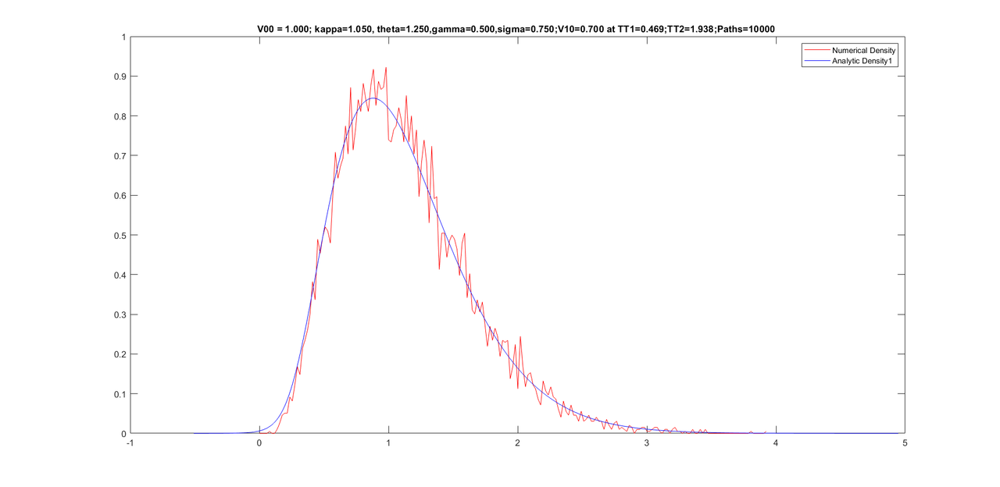](https://postimg.cc/D87Xj1sQ)

[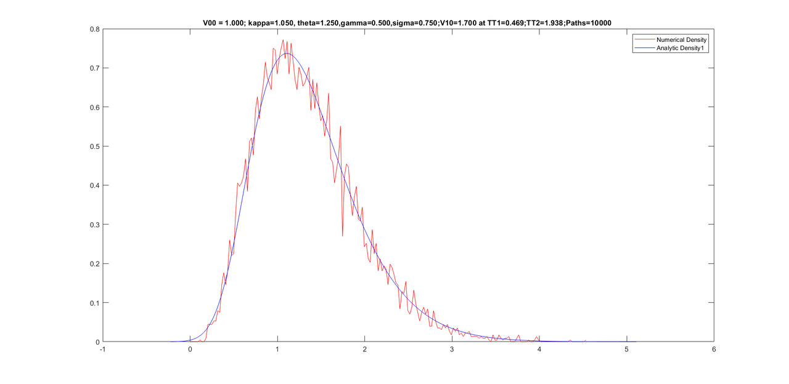](https://postimg.cc/D4PbfzVb)

[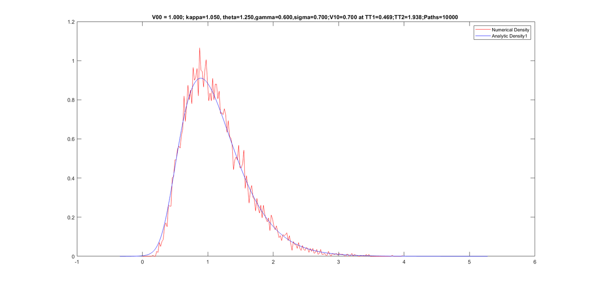](https://postimg.cc/cKvY7Z3V)

[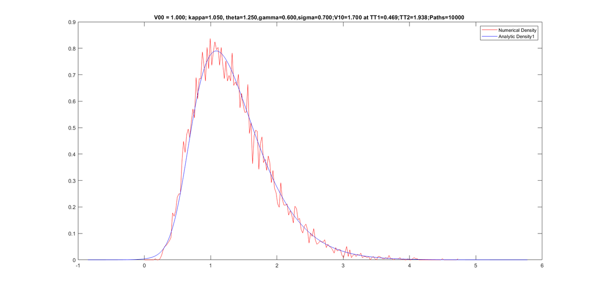](https://postimg.cc/DSjLbmSr)

[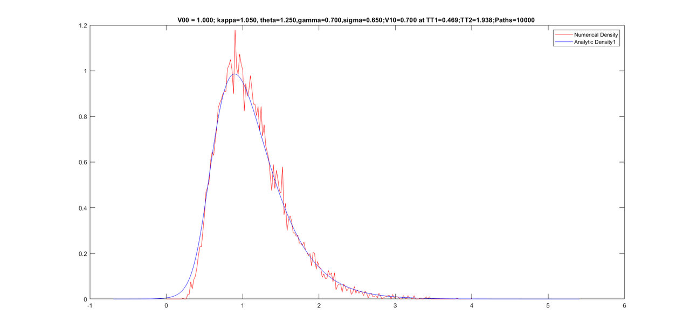](https://postimg.cc/0bCpPVxH)

[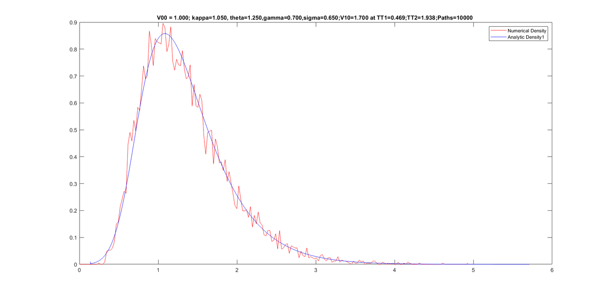](https://postimg.cc/sMD5X5gf)

[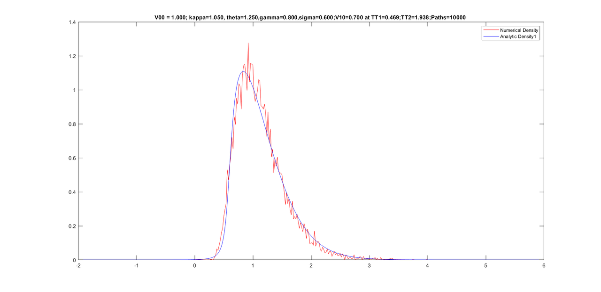](https://postimg.cc/9DWY7vJh)

[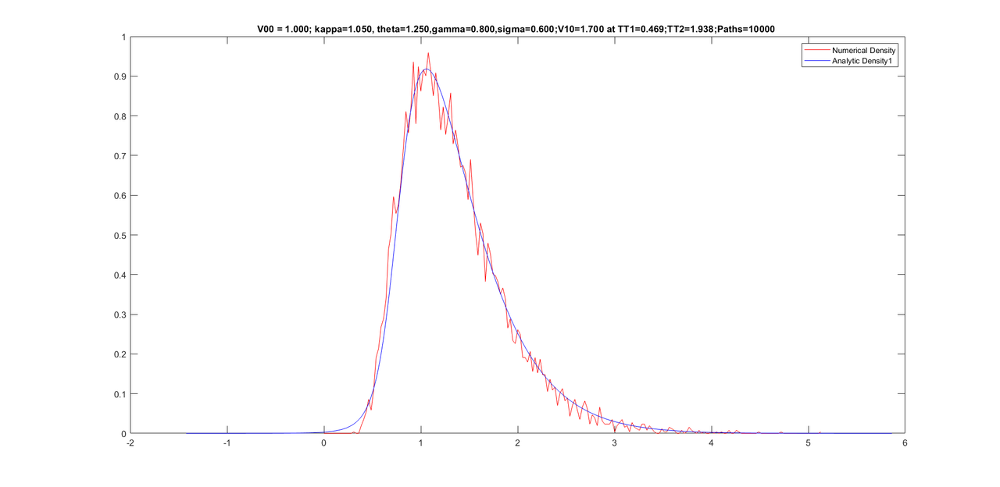](https://postimg.cc/67qVHnkb)

[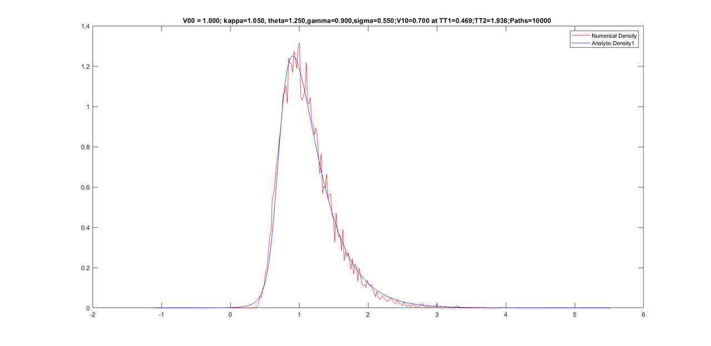](https://postimg.cc/gxNqqNT6)

[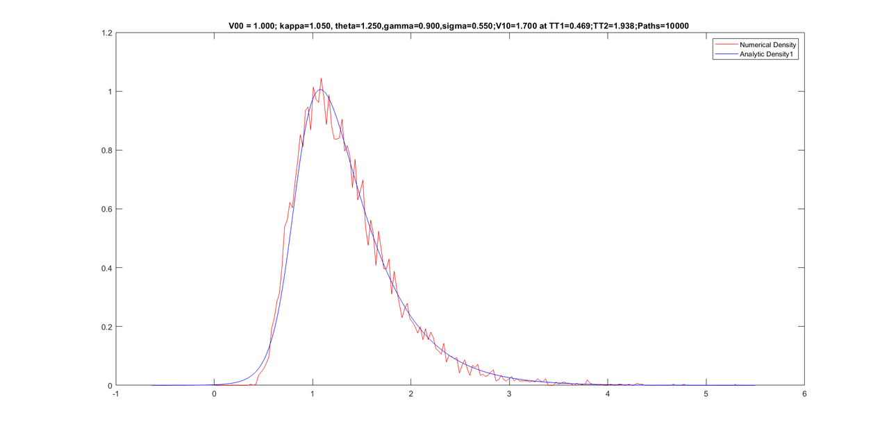](https://postimg.cc/JGCq1yXt)

---

### #2767 — Amin (Topic Author)
*September 1, 2025, 2:16 PM*

Here is the slightly modified matlab program. I used this program to make conditional densities in previous post with
10000 paths.

.

.

.

```
function []= ConditionalDensityHermitesBivariateNewtonIters02()

%SV SDE is
%dV(t)=mu1 V(t)^beta1 dt+ mu2 V(t)^beta2 dt + sigma0 V(t)^gamma dZ(t)
%In mean reverting SDEs we ususally have
%mu1= kappaV * thetaV
%beta1=0
%mu2=-kappa
%beta2=0

%NDim=4;%Three assets and one SV.

%%%%%%%%%%%%%%%%%%%5

V0=1.00;%.32;
V00=V0;
thetaV=1.250;%.045;%1;%.04;
kappaV=1.05;%1.5;%1.5;
mu1=kappaV*thetaV;
mu2=-kappaV;
beta1=0;
beta2=1;
gamma=.9;%.950;
sigma0=.55%.45;%
dt=.03125/2;
Tt=64*2;
T=Tt*dt;

seed0=52130649;
rng(seed0, 'twister')
paths=10000;
V(1:paths,1)=V0;

%%%%%%%%%%%%%%%%%%%%%%%%%%%%%%%%%%%%%%%%%%%%%%%%%%%%%%%%%%%%%%%%%%%%%%%%%%%%%%%%%%%%5
TT1=30; %Transition distribution start
TT2=124; %Transition distribution end

Random2(1:paths/2,1)=0;

for tt=1:Tt

    Random2(1:paths/2)=randn(paths/2,1);
    Random2(paths/2+1:paths)=-Random2(1:paths/2);

    V(1:paths,1)=V(1:paths,1)+ ...
        (mu1.*V(1:paths,1).^beta1 + mu2.*V(1:paths,1).^beta2)*dt + ...
        sigma0*V(1:paths,1).^gamma .*Random2(1:paths,1)*sqrt(dt) + ...
        (mu1.*beta1*V(1:paths,1).^(beta1-1) + mu2.*beta2.*V(1:paths,1).^(beta2-1)).* ...
        ((mu1.*V(1:paths,1).^beta1 + mu2.*V(1:paths,1).^beta2)*dt^2/2 + ...
        sigma0*V(1:paths,1).^gamma .*Random2(1:paths,1)*(1-1/sqrt(3))*dt^1.5) + ...
        .5*(mu1.*beta1.*(beta1-1).*V(1:paths,1).^(beta1-2) + mu2.*beta2.*(beta2-1).*V(1:paths,1).^(beta2-2)).* ...
        sigma0^2.*V(1:paths,1).^(2*gamma).*dt^2/2 + ...
        sigma0*gamma*V(1:paths,1).^(gamma-1) .* ...
        ((mu1.*V(1:paths,1).^beta1 + mu2.*V(1:paths,1).^beta2).*Random2(1:paths,1).*1/sqrt(3)*dt^1.5 + ...
        sigma0.*V(1:paths,1).^gamma .*(Random2(1:paths,1).^2-1)*dt/2) + ...
        .5*sigma0*gamma*(gamma-1).*V(1:paths,1).^(gamma-2) .* ...
        sigma0^2.*V(1:paths,1).^(2*gamma) .*Random2(1:paths,1).*1/sqrt(3)*dt^1.5;

    V(V<0)=.00001;

    if(tt==TT1)
        Xin(1:paths,1)=V(1:paths,1);
    end

    if(tt==TT2)
        Yin(1:paths,1)=V(1:paths,1);
    end
end

str=input("I have reached stone 1");

Order=5;

%The function below does initial analytics of caclulation of 2D conditional
%and joint densities. We want to use the result from this function as a
%Starting guess/seed to Newton derivatives based optimization method.

[YCoeffHH,XYCoeffHH,XCoeffH,Coeffyx,YCoeffH] =CalculateBivariateHermiteSeries01(Yin,Xin,Order);

for qq1=1:Order+1
  XMoments(qq1)=sum(Xin(1:paths).^qq1)/paths;
end

[XCoeffZ(1:Order+1)] = ConvertHermiteSeriesToZSeries01(XCoeffH(1:Order+1),Order);

[XCoeffZ(1),XCoeffZ(2:6)] = CalculateZSeriesDensityFromRawMomentsM6(XMoments,XCoeffZ(2:6));

for pp1=1:Order+1
  YMoments(pp1)=sum(Yin(1:paths).^pp1)/paths;
end

[YCoeffZ(1:Order+1)] = ConvertHermiteSeriesToZSeries01(YCoeffH(1:Order+1),Order);

[YCoeffZ(1),YCoeffZ(2:6)] = CalculateZSeriesDensityFromRawMomentsM6(YMoments,YCoeffZ(2:6));

[YCoeffH] = ConvertZSeriesToHermiteSeriesNew(YCoeffZ,Order);

YCoeffHH(1:Order+1,Order:Order+1)=YCoeffHH(1:Order+1,Order:Order+1)/100000;
YCoeffHH(Order:Order+1,1:Order+1)=YCoeffHH(Order:Order+1,1:Order+1)/100000;

%The above 2D Conditional density calculated from regression is used as an
%input seed to Newton method. YCoeffHH is input as a seed to Newton method
%after converting it to a 2D Z-series.

str=input("I have reached stone 2");

%Below, we calculate Target cross-moments of Y and X from data.
for pp1=1:Order+1
    for qq1=1:Order+1
        MomentsYX0((pp1-1)*(Order+1)+qq1,1)=sum(Yin(1:paths).^pp1.*Xin(1:paths).^qq1)/paths;
    end
end

%  for pp1=1:Order+1
%      pp4=6;
%      pp3=5;
%      pp2=4;
%      pp1=3;
%     
if((MomentsYX0((pp4-1)*(Order+1)+qq1,1)/MomentsYX0((pp3-1)*(Order+1)+qq1,1))<(MomentsYX0((pp2-1)*(Order+1)+qq1,1)/MomentsYX0((pp1-1)*(Order+1)+qq1,1)))
%         
MomentsYX0((pp4-1)*(Order+1)+qq1,1)=MomentsYX0((pp3-1)*(Order+1)+qq1,1)*(MomentsYX0((pp2-1)*(Order+1)+qq1,1)/MomentsYX0((pp1-1)*(Order+1)+qq1,1));
%
%          str=input("Moments are being altered")
%      end
%      %for qq1=1:Order+1
%      %    MomentsYX0((pp1-1)*(Order+1)+qq1,1)=sum(Yin(1:paths).^pp1.*Xin(1:paths).^qq1)/paths;
%      %end
%  end

%Before we enter Newton optimization function, we want to convert 2D and 1D hermite
%Series to Z-series.

[XCoeffZ(1:Order+1)] = ConvertHermiteSeriesToZSeries01(XCoeffH(1:Order+1),Order);

[YCoeffZ(1:Order+1)] = ConvertHermiteSeriesToZSeries01(YCoeffH(1:Order+1),Order);

[YCoeffZZ] = Convert2DHermitesInto2DSeriesNew(YCoeffHH,Order,Order);

OrderY=Order;
OrderX=Order;
[Y1DMoments]=CalculateMomentsOfZSeries(YCoeffZ(1),YCoeffZ(2:6),5,6)
MaxIter0=30;
YCoeffZZ=CalculateSmoothingGuessDensity2D(YCoeffZZ,XCoeffZ,MomentsYX0,Y1DMoments,OrderY,OrderX,MaxIter0)
str=input("Look at smoothing results")
MaxIter=500;

[YCoeffZZ,AMat] = DoNewtonIterationsOn2DZSeries(YCoeffZZ,XCoeffZ,Order,MomentsYX0,Y1DMoments,MaxIter);

%%%%%%%%%%%%%%%%%%%%%%%%%%%%%%%%%%%%%%%%%%%%%%%%%%%%%%%%%%%%%%%%%%%%%%%%%%%%%%%%%%%%%%%%%%%%%%%%%5
% Order=7
% YCoeffHH(1:Order+1,Order:Order+1)=0.0;%YCoeffHH(1:Order+1,Order:Order+1)/100000;
% YCoeffHH(Order:Order+1,1:Order+1)=0.0;%YCoeffHH(Order:Order+1,1:Order+1)/100000;
%
% for pp1=1:Order+1
%     for qq1=1:Order+1
%         MomentsYX0((pp1-1)*(Order+1)+qq1,1)=sum(Yin(1:paths).^pp1.*Xin(1:paths).^qq1)/paths;
%     end
% end
%

%MaxIter0=30;
%YCoeffZZ=CalculateSmoothingGuessDensity2D(YCoeffZZ,XCoeffZ,MomentsYX0,Y1DMoments,OrderY,OrderX,MaxIter0);

%str=input("Look at smoothing results")
%MaxIter=200;

%[YCoeffZZ,AMat] = DoNewtonIterationsOn2DZSeries(YCoeffZZ,XCoeffZ,Order,MomentsYX0,Y1DMoments,MaxIter);

%YCoeffZZ is the 2D conditional Z-series of Y given X [Y|X](Zy,Zx)
%that is the result of optimization method and is calibrated to Cross-moments of Y and X.

%MaxIter0=30;
%YCoeffZZ=CalculateSmoothingGuessDensity2D(YCoeffZZ,XCoeffZ,MomentsYX0,Y1DMoments,OrderY,OrderX,MaxIter0);

%str=input("Look at smoothing---3 results")

OrderY=Order;
OrderX=Order;
NMoments=6;
[MeanZZ,VarZZ] = CalculateMeanAndVarOf2DZSeriesY(YCoeffZZ,OrderY,OrderX)
%The name of above function is slightly misleading. It calculates mean and
%second moment

[Y1DMoments]=CalculateMomentsOfZSeries(YCoeffZ(1),YCoeffZ(2:6),5,6)

[YMoments] = CalculateMomentsOf2DZSeriesY(YCoeffZZ,OrderY,OrderX,NMoments);

Y1DMoments
YMoments

%Y1DMoments(2)-Y1DMoments(1).^2
%VarZZ

str=input("Look at comparison of second moments/moments");

YCoeffZZ

%AMat
%MomentsYX0

%Below Check the difference between model moments and target moments.
%AMat-MomentsYX0

%Below, we convert the 2D Conditional Z-series of [Y|X](Zy,Zx) into 2D
%Conditional Hermite Seiries of [Y|X](Zy,Zx).
[YCoeffHH] = ConvertZSeriesToHermiteSeries2D(YCoeffZZ,Order+1,Order+1)

%
MMul1=sqrt(YCoeffHH(1,1).^2+YCoeffHH(1,2).^2+YCoeffHH(1,3).^2*2+YCoeffHH(1,4).^2*6+YCoeffHH(1,5).^2*24+YCoeffHH(1,6).^2*120)
% YCoeffH(1)
%
% YCoeffHH(1,:)=YCoeffHH(1,:)*abs(YCoeffH(1))./MMul1;
%
%
%
MMul2=sqrt(YCoeffHH(2,1).^2+YCoeffHH(2,2).^2+YCoeffHH(2,3).^2*2+YCoeffHH(2,4).^2*6+YCoeffHH(2,5).^2*24+YCoeffHH(2,6).^2*120)
% YCoeffH(2)
%
%
MMul3=sqrt(YCoeffHH(3,1).^2+YCoeffHH(3,2).^2+YCoeffHH(3,3).^2*2+YCoeffHH(3,4).^2*6+YCoeffHH(3,5).^2*24+YCoeffHH(3,6).^2*120)
% YCoeffH(3)
%
%
%
MMul4=sqrt(YCoeffHH(4,1).^2+YCoeffHH(4,2).^2+YCoeffHH(4,3).^2*2+YCoeffHH(4,4).^2*6+YCoeffHH(4,5).^2*24+YCoeffHH(4,6).^2*120)
% YCoeffH(4)
%
%
MMul5=sqrt(YCoeffHH(5,1).^2+YCoeffHH(5,2).^2+YCoeffHH(5,3).^2*2+YCoeffHH(5,4).^2*6+YCoeffHH(5,5).^2*24+YCoeffHH(5,6).^2*120)
% YCoeffH(5)
%
%
%
MMul6=sqrt(YCoeffHH(6,1).^2+YCoeffHH(6,2).^2+YCoeffHH(6,3).^2*2+YCoeffHH(6,4).^2*6+YCoeffHH(6,5).^2*24+YCoeffHH(6,6).^2*120)
% YCoeffH(6)

%YCoeffHH(1,:)=YCoeffHH(1,:)*abs(YCoeffH(1))./MMul1;
%YCoeffHH(2,:)=YCoeffHH(2,:)*abs(YCoeffH(2))./MMul2;
%YCoeffHH(3,:)=YCoeffHH(3,:)*abs(YCoeffH(3))./MMul3;
%YCoeffHH(4,:)=YCoeffHH(4,:)*abs(YCoeffH(4))./MMul4;
%YCoeffHH(5,:)=YCoeffHH(5,:)*abs(YCoeffH(5))./MMul5;
%YCoeffHH(6,:)=YCoeffHH(6,:)*abs(YCoeffH(6))./MMul6;
%
%
%
%
% str=input("Look at comparison of coefficients")
%

%%%%%%%%%%%%%%%%%%%%%%%%%%%%%%%%%%%%%%%%%%%%%%%%%%%%%%%%%%%%%%%%%%%%%%%%%%%%%5
%In this block, we do conditional Monte Carlo of SDE which is the true
%numerical 1D conditional density of Y conditional on X having a given
%value. This value of X on which we are conditionin is defined by V10 below.
%We can alter V10 below and it will take out a 1D slice from the 2D density
%of Y conditional on X  taking a specific value (here V10).

V10=1.70;
V(1:paths)=V10;
Random2(1:paths,1)=0;

for tt=TT1+1:TT2

    Random2(1:paths/2)=randn(paths/2,1);
    Random2(paths/2+1:paths)=-Random2(1:paths/2);

    V(1:paths,1)=V(1:paths,1)+ ...
        (mu1.*V(1:paths,1).^beta1 + mu2.*V(1:paths,1).^beta2)*dt + ...
        sigma0*V(1:paths,1).^gamma .*Random2(1:paths,1)*sqrt(dt) + ...
        (mu1.*beta1*V(1:paths,1).^(beta1-1) + mu2.*beta2.*V(1:paths,1).^(beta2-1)).* ...
        ((mu1.*V(1:paths,1).^beta1 + mu2.*V(1:paths,1).^beta2)*dt^2/2 + ...
        sigma0*V(1:paths,1).^gamma .*Random2(1:paths,1)*(1-1/sqrt(3))*dt^1.5) + ...
        .5*(mu1.*beta1.*(beta1-1).*V(1:paths,1).^(beta1-2) + mu2.*beta2.*(beta2-1).*V(1:paths,1).^(beta2-2)).* ...
        sigma0^2.*V(1:paths,1).^(2*gamma).*dt^2/2 + ...
        sigma0*gamma*V(1:paths,1).^(gamma-1) .* ...
        ((mu1.*V(1:paths,1).^beta1 + mu2.*V(1:paths,1).^beta2).*Random2(1:paths,1).*1/sqrt(3)*dt^1.5 + ...
        sigma0.*V(1:paths,1).^gamma .*(Random2(1:paths,1).^2-1)*dt/2) + ...
        .5*sigma0*gamma*(gamma-1).*V(1:paths,1).^(gamma-2) .* ...
        sigma0^2.*V(1:paths,1).^(2*gamma) .*Random2(1:paths,1).*1/sqrt(3)*dt^1.5;

    V(V<0)=.00001;

end

%Below

NoOfBins=200;
MaxCutOff=10;

[XDensity,IndexOut,IndexMax] = MakeDensityFromSimulation_Infiniti_NEW(V,paths,NoOfBins,MaxCutOff );

clf;

plot(IndexOut(1:IndexMax),XDensity(1:IndexMax),'r');

hold on

%%%%%%%%%%%%%%%%%%%%%%%%%%%%%%%%%%%%%%%%%%%%%%%%%%%%%%%%%%%%%%%%%%%%%%%%%%%%%%%%%%%%%%%5
%Below, we calculate the value of Zx0 corresponding to X0 (here V10). This
%comes from inverting the Z-series of X so that X=V10;

xOrder=Order;
yOrder=Order;
[Zx0] = CalculateZgivenXAndHSeriesCoeffs(V10,XCoeffH,xOrder);

%Below, we collapse two dimensional pdf of Y|X to one dimensional pdf given
%Zx i.e. this Y|X=X(Zx)
%Here we take out a 1D slice from the 2D density
%of Y conditional on X  taking a specific value (here V10).
He(1)=1;
He(2)=Zx0;
He(3)=Zx0^2-1;
He(4)=Zx0^3-3*Zx0;
He(5)=Zx0^4-6*Zx0.^2+3;
He(6)=Zx0^5-10*Zx0.^3+15*Zx0;
He(7)=Zx0^6-15*Zx0.^4+45*Zx0.^2-15;
He(8)=Zx0^7-21*Zx0.^5+105*Zx0.^3-105*Zx0;

YCoeffh(1:Order+1)=0;
for hh=1:yOrder+1
    for hh2=1:xOrder+1
        YCoeffh(hh)=YCoeffh(hh)+YCoeffHH(hh,hh2).*He(hh2);
    end
end

 [YCoeffz(1:Order+1)] = ConvertHermiteSeriesToZSeries01(YCoeffh(1:Order+1),Order);
%
%
% %[IsValidFlag] = CheckIsValidDensityPN(YCoeffz(1),YCoeffz(2:Order+1));
% [PIsValidFlag,NIsValidFlag] = CheckIsValidDensityPN02(YCoeffz(1),YCoeffz(2:Order+1));
% PIsValidFlag
% NIsValidFlag
%
%
% for mm=1:100
%     [PIsValidFlag,NIsValidFlag] = CheckIsValidDensityPN02(YCoeffz(1),YCoeffz(2:Order+1));
% if((NIsValidFlag==0)&&(PIsValidFlag==1))
%     YCoeffz(5)=YCoeffz(5)-.01*abs(YCoeffz(5));
%     YCoeffz(6)=YCoeffz(6)+.001*abs(YCoeffz(6));
%     %YCoeffz(3)=YCoeffz(3)-.001*abs(YCoeffz(3));
% end
%
% if((PIsValidFlag==0)&&(NIsValidFlag==1))
%     YCoeffz(5)=YCoeffz(5)+.01*abs(YCoeffz(5));
%     YCoeffz(6)=YCoeffz(6)+.001*abs(YCoeffz(6));
%     %YCoeffz(3)=YCoeffz(3)-.001*abs(YCoeffz(3));
% end
%
% if((NIsValidFlag==0)&&(PIsValidFlag==0))
%     YCoeffz(6)=YCoeffz(6)+.01*abs(YCoeffz(6));
%     %YCoeffz(3)=YCoeffz(3)-.001*abs(YCoeffz(3));
% end
%
% end
%
% [YCoeffh] = ConvertZSeriesToHermiteSeriesNew(YCoeffz,Order)
%

PlotHermiteSeriesDensityAndRvGraph(YCoeffh(1),YCoeffh(2:yOrder+1),'b')

%hold on
%PlotHermiteSeriesDensityAndRvGraph(YCoeffh(1),YCoeffh1(2:yOrder+1),'g')
title(sprintf('V00 = %.3f; kappa=%.3f, theta=%.3f,gamma=%.3f,sigma=%.3f;V10=%.3f at TT1=%.3f;TT2=%.3f;Paths=%d ',V00,
kappaV, thetaV,gamma,sigma0, V10,(TT1*dt),(TT2*dt),paths));%,sprintf('theta= %f', theta), sprintf('kappa = %f',
kappa),sprintf('sigma = %f', sigma0),sprintf('T = %f', T));
legend({'Numerical Density','Analytic Density1'}, ...
    'Location','northeast')

str=input("This is the first version without altering the moments of conditional density")

[YMoments0]=CalculateMomentsOfZSeries(YCoeffz(1),YCoeffz(2:6),5,6)

% %[IsValidFlag] = CheckIsValidDensityPN(YCoeffz(1),YCoeffz(2:Order+1));
[PIsValidFlag,NIsValidFlag] = CheckIsValidDensityPN02(YCoeffz(1),YCoeffz(2:Order+1));
PIsValidFlag
NIsValidFlag
LoopIter=0;

Mul6(1)=.65;
Mul6(2)=.7;
Mul6(3)=.75;
Mul6(4)=.8;
Mul6(5)=.85;
Mul6(6)=.9;
Mul6(7)=.95;
Mul6(8)=1.0;
Mul6(9)=1.05;
Mul6(10)=1.1;

Mul0=1;
YMoment6=YMoments(6);
while(((PIsValidFlag==0)||(NIsValidFlag==0))&&(LoopIter<=10))
LoopIter=LoopIter+1;
    YCoeffh
Mul0=Mul0+.05;
    Y2Coeffz=YCoeffz;
    Mean=Y2Coeffz(1)+(Y2Coeffz(3)+3*Y2Coeffz(5));
    Y2Coeffz(1)=-(Y2Coeffz(3)+3*Y2Coeffz(5));

    [YMoments]=CalculateMomentsOfZSeries(Y2Coeffz(1),Y2Coeffz(2:6),5,6)

    %%%%%%%%%%%%%%%%%%%%%%%%%%%%%%%%%%%%%%%%%%%%%%%%%%%%%%%%
    %abs(YMoments(3:6))./abs(YMoments(2:5))

    %YMoments(2:6)
    %%%%%%%%%%%%%%%%%%%%%%%%%%%%%%%%%%%%%%%%%%%%%%%%%%%%%%%555

    if(abs(YMoments(6)/YMoments(5))<abs(YMoments(4)/YMoments(3))*Mul6(LoopIter))
    YMoments(6)=abs(YMoments(5).*YMoments(4)./YMoments(3)*Mul6(LoopIter))

    end

    %YMoments(6)=YMoments(6)*Mul0;
    %LoopIter
    %Mul0
    %YMoments(6)

    %str=input("Look at variables")

    [Y3Coeffz(1),Y3Coeffz(2:6)] = CalculateZSeriesDensityFromRawMomentsM6(YMoments,Y2Coeffz(2:6));

    Y3Coeffz(1)=Mean-(Y2Coeffz(3)+3*Y2Coeffz(5));

    [PIsValidFlag,NIsValidFlag] = CheckIsValidDensityPN02(Y3Coeffz(1),Y3Coeffz(2:Order+1));
PIsValidFlag
NIsValidFlag
end
if(LoopIter==0)

     Y3Coeffz=YCoeffz;
end

clf;

plot(IndexOut(1:IndexMax),XDensity(1:IndexMax),'r');

hold on

PlotZSeriesDensity(Y3Coeffz(1),Y3Coeffz(2:yOrder+1),'b')

title(sprintf('V00 = %.3f; kappa=%.3f, theta=%.3f,gamma=%.3f,sigma=%.3f;V10=%.3f at TT1=%.3f;TT2=%.3f;Paths=%d ',V00,
kappaV, thetaV,gamma,sigma0, V10,(TT1*dt),(TT2*dt),paths));%,sprintf('theta= %f', theta), sprintf('kappa = %f',
kappa),sprintf('sigma = %f', sigma0),sprintf('T = %f', T));
legend({'Numerical Density','Analytic Density1'}, ...
    'Location','northeast')
str=input("This is the Second version after possibly altering the moments of conditional density when needed")

end
```

---

### #2768 — Amin (Topic Author)
*September 4, 2025, 7:40 AM*

Friends, I have been away from my research on 2D Hermite-series for past two days and have rather been trying to debug
my market trading program written in python. I hope to get back to my research tomorrow. I am under intense pressure
from within myself and from the family and the psychiatrist to be able to make money on my own and I have to continue
that work from time to time. Despite these occasional breaks, I want to say that I am into 2D and multidimensional
hermite series research for months or possibly years to come. I am in it for a long haul and occasional breaks will not
stop my research. I want to be in the research on probability theory for the rest of my life.

On this weekend, I will explain all the basics and other details of my research on  2D Hermite-series with latex
equations. I will also look for more ideas to make the optimization program more robust but I will have to think of some
different ideas for that.

I hope that I am mostly done with my market trading program and it only needs tweaking from time to time so in coming
weeks, I will be spending most of my time on 2D hermite-series research. I really hope that we would do some interesting
work over these coming winters.

---

### #2769 — Amin (Topic Author)
*September 6, 2025, 11:08 PM*

Friends, I have been thinking about the problem of fitting cross-moments and 1D moments on a 2D Z-series and I am afraid
that Newton is not the best possible solution here.

I had the idea that we could fit the coefficients on a Z-series so that they fit the moments with multi-dimensional
bisection. We have to choose an objective function that has (monotonically) positive or negative derivatives with
respect to coefficients. And Moments increase monotonically with increase in coefficients. Suppose, we can estimate the
valid range for each coefficient in advance and the coefficient would be known to exist in that range. We have to bisect
along the diagonal of hyper-plane of the range of parameters. I think, along the diagonal, if there are N dimensions (or
N parameters), we can eliminate the hyper-cube volume (where coefficient cannot be found or where coefficient can
actually be found depending upon which side of our multi-dimensional bisection the target value of objective function
lies) at a rate of 1/N^2 by doing one bisection along the diagonal of hyper-plane of valid ranges of all variables.
Later depending upon how it turns out, our valid hyper-plane where the target objective function lies can take all sort
of interesting shapes (In two dimensions, it can be an L-shaped area) and we have to make simple rules about how to
proceed in different dimensions. Computers are fast and I think we can solve the problem reasonably quickly on an
ordinary computer.

Please give me a few days to work on the problem since I am afraid that we cannot rely on Newton to solve the problem
universally and we need something more interesting to be able to solve the given problem. Even though, there may be some
difficulty I have not imagined, I hope that I would be able to write a program that solves for fitting of Z-series
coefficients to cross-moments of even higher volatility stochastic processes.

I think many other optimization problems can be solved like this but underlying condition is that derivatives of the
objective function should not switch sign and we might have to improvise to fulfill this condition. There might be some
problems I have not thought of but I want to give this a try.

---

### #2770 — Amin (Topic Author)
*September 8, 2025, 1:21 PM*

I really want to tell people that I have lived as a sane person due to support from friends otherwise I was even put to
physical torture before my case got known to a lot of good people. I am copying an experience of planned physical abuse
on the insistence of mind control agencies. I am copying context of the post as well.

The excerpt below  is from a past post stating obvious abuse by various psychiatrists on the insistence of mind control
agencies. The episode of physical abuse by beating me for more than twenty minutes is towards the end of this post:

Friends, I  wanted to remain busy with my research and not speak about mind control and its reasons and people behind
it. I simply wanted to concentrate on my research but whenever I have any progress in my research, my mind control and
related torture sharply increases to make more research impossible for me. I want to remain totally devoted to my
research and want friends to help me in doing that, I want everyone of all the good people in Europe or America who
follow my research to please tell two or three journalists about my research and my mind control. I will also request
European friends to ask their government and embassies to please keep a vigil about the matter and force corrupt
Pakistani govt. and establishment to not drug food in Lahore with mind control chemicals.

I was a very simple, very meek but also very hard working student at a large university in New York and joined the
university in 1997. My mind control started in very late 1997 when a racist jewish professor in Math department of my
university was threatened by my talent and approached the Jewish Billionaire to ask American defense to put me under
mind control. Even that long time ago, a large number of jews were very aware that this Jewish billionaire was a
Godfather of mind control and would approach the billionaire to recommend talented people to mind control from time to
time when they would be threatened by their talent. Over past twenty five years tens of thousands (if not more than a
hundred thousand) of innocent people mostly American nationals have been placed on mind control abuse by scumbags of
American defense on recommendation of Jewish billionaire. Most universities in US  have a couple of jews who continue to
keep eye on brilliant students of the university and recommend them to American defense through jewish billionaire when
they feel threatened  by the talent of the students due to any reason like their religion, race, ethnicity or just
because they are not jews.

I had told friends earlier that a jewish billionaire is Godfather of mind control. When my persecution started (in late
1997) at the university in New York which is a big time player in mind control of Muslims, blacks and foreigners, many
university officials were very pleased that they were getting written in good books of the billionaire jewish Godfather.
Though there are far richer billionaires in US who are staunchly opposed to mind control, they are not ready to shell
out hundreds of millions of dollars to bribe anyone to end mind control while mind control Godfather continues to give
large bribes to people to continue mind control. Many of the people related to defense in mind control are given
extremely high paying jobs in Godfather and his other jewish friends' companies after they retire from mind control and
Godfather is extremely generous towards them and it is well established and well known to scum in mind control that
after retarding muslims, blacks and others in their career, they will move to paradise(tens of people from army/Pentagon
who follow whims of Billionaire Godfather are given jobs paying milllons of dollars by Godfather and his jewish cohort
in several companies) after they retire. No wonder there is no let up in mind control whatever good people try.

We know in almost all classic folk lore stories evil is too strong and too sure of itself while good is mostly weak and
just trying to protect itself from evil who is bent on damaging and eradicating the weak and the poor good but it is the
weak and poor good that finally prevails. I want to tell good American friends that evil at this stage has become too
bold and thousands of talented people are retarded every year. And it is just not muslims and blacks that are on the
line, several thousands of brilliant whites are retarded across United States by mind control agency every year that has
become too emboldened due to lack of any accountability. Thousands of foreigners are also kept retarded in dozens of
countries including many European countries.

My only intention behind this post is that I want mind control to end from our societies. I do not have any joy in
mentioning that there are some bad jewish actors behind it. In American society there are a large number of jews who
have excelled in the professions of science, education, medicine and have made great contributions to our societies.
There are a very large number of jewish professors each of whom would have taught tens of thousands of students on top
of making extraordinary contributions to body of human knowledge through their great research. Then there are
accomplished jewish scientists whose work, research and inventions make our everyday life better. There are great jewish
doctors and surgeons who would treat countless sick people and make them recover from disease. The list of contributions
of jewish people to humanity is very long and it continues. Then there are a large number of ordinary jewish folks who
are known for their goodness and civility to other people in the society. When we know all of this, we do not want to
say anything anti-jewish to hurt the feelings of so many good jewish people. But I still have to say there are really
some bad people who are unconnected with most of the nice and accomplished jews and they instigate and continue cruel
mind control torture on talented people of other ethnicities, religions and countries based on their personal dislike
and hatred. My purpose is only to end the mind control victimization and torture on otherwise nice and talented people
and I do not have any hidden intentions beyond that. And I am sure American society knows very well about the
contributions of good Jews to both their country and broader humanity and my exposing some bad actors would never have
any bad effect of any kind on these good and nice jews who we all respect and who are our role models.I want to tell
friends something I have said before here that I am sure American society would eventually end the menace of mind
control from their and other countries. I want to request all good Americans and Europeans to come forward and invite
any investigative journalist you know to read my threads and ask them to help end the menace of mind control in our
societies through their investigative journalism. Without any accountability evil will continue to grow stronger and
then mind control would start to threaten even those people who consider themselves safe due to affiliations, status or
wealth.

https://forum.wilmott.com/viewtopic.php?t=99702&start=2325#p881807

https://forum.wilmott.com/viewtopic.php?t=99702&start=2325#p881808

https://forum.wilmott.com/viewtopic.php?t=99702&start=2325#p881886

https://forum.wilmott.com/viewtopic.php?t=99702&start=2340#p881951

Friends, this speaks volumes about headstrong cruelty of people in American defense and their Jewish billionaire backers
cohort that they are even more ready to show me cruelties even after people have a widespread knowledge of their
machinations and tactics. These evil people have no intention or desire to decrease their torture on me despite that I
have been telling tales of their inhuman torture on me over past twenty five years through various psychiatrists.

Please read the following two posts to see the context how I have been maltreated by various psychiatrists on behest of
mind control agencies over past 25 years.

Friends, I have been on forced antipsychotics for most of the time since early 1999. There were a few periods of a few
months when I remained free from antipsychotics. But other than two or three such periods, I have remained on
antipsychotics. It is very hard to feel well when huge antipsychotics are forced on someone who is mentally healthy. I
have also been detained forcefully tens of times whenever some of my neurotransmitters came back, the purpose of
detention was to take brilliant neurotransmitters out of my brain and send me back home with a relatively retarded brain
after the end of months long detentions. I have seen sheer trauma, torture and brutality on the hands of these
psychiatrists who connive with American defense and Pakistani military to declare me mentally ill so they can force
antipsychotics on me. I will be 51 this year and portion of my life that I lived under mind control has exceeded the
part of early life that I lived without mind control.

I have a phone meeting with the psychiatrist on 14th of June 2024. And I am sure the psychiatrist will try again to keep
me under medication or even increase my medication. Even after a large number of people have become aware of truth about
mind control and accompanying persecution by the psychiatrists, most psychiatrists are not the least worried that their
wrongdoing is being exposed in public.

I want to request good Americans to please protest to American defense, mind control agency, Pak army and relevant
psychiatrists to please end this cruel practice of declaring healthy people on antipsychotics and forcefully detaining
them up to years in their faciiities.

When they detain me, they have fixed all mind control gadgets and lasers in the psychiatric facility and they add all
mind control chemicals openly in food and psychiatric drugs. It is a very controlled environment in captivity and within
a month or so, they are able to remove all neurotransmitters from the brain of the victim. Every time I was detained,
they kept me in the psychiatric facility for 30-50 days. One psychiatric even detained me for ten months after I
returned from Britain. There are also instances of being detained for six months once and three months twice.

I really want to request American people again to please protest to their government and try to make sure that I am not
being detained again on totally flimsy psychiatric grounds.

.

[My Letter To HRW About My Human Rights Abuse](https://forum.wilmott.com/viewtopic.php?f=15&t=102298)

Above is a very incomplete account of how various psychiatrists continued to play in hands of Pakistan army to retard
me. It also does not cover all the time till year 2022 and the account stops several years earlier. I could not write
about last several years that were exceptionally brutal.

Friends, in a previous post I told friends how staff at a lady psychiatrist's hospital started beating me and abused me.
During past twenty three years, there have been many many instances of my obvious abuse by different psychiatrists. I
will describe some of those instances in this post.

When I came from United States and till fifteen years after that, my father would proudly ask me that I could see any
psychiatrist I wish. This was because Pakistan army was managing my persecution and they would force psychiatrists to
declare me schizophrenic and my father was told that every psychiatrist would be forced to cooperate. However, by chance
in 2016, I came  across a psychiatrist who was far better. I never told him that I was under mind control but whenever
he interviewed me, he always said after the interview that I was perfectly sane and mentally healthy. When my family
would force him to increase the dosage of antipsychotics, the doctor first told me that I should not live with my family
and make a comprehensive plan to support myself and become independent (such a plan could never work since Pakistan army
was threatening people in Pakistan to not give me any business and CIA was making sure that every contact I would reach
for work in Europe (and Singapore/ Japan /Australia) would be approached by CIA telling them that I was a very bad guy
and they must not do business with me. I had not told the doctor any such thing that intelligence agencies were after
me.)  When I told the good doctor how previous psychiatrists had abused me, he would tell me that this used to be a very
widespread practice in America hundred years ago to wrong mentally healthy humans by using corrupt psychiatrists as
instruments to detain them and strip them of their sanity. The good doctor I am talking about was American national with
Pakistan background who had practiced psychiatry in America for over twenty years and had returned to Pakistan. That
good doctor kept me on very low antipsychotics (1 mg resperidone per day) and that too on extreme insistence of my
family. It was only during that time of treatment by that doctor that I got my first break in research and I solved the
problem of high order monte carlo simulations (and analytic series solution of ODEs)  and posted that solution on this
thread. Ok, when my family was fed with the doctor, they detained me with another doctor. They detained me again two
years ago when I requested my family that I wanted to see the same doctor of my choice again( I have been detained every
year for past six or seven years by different doctors), they detained me through a different doctor. So my family now
stubbornly refuses to allow me to see a professional qualified American psychiatrist of my own choice and detains me
every time I try to approach him.

Now back to my obvious abuse by two other psychiatrists. I was detained by this doctor who was running a mental health
facility and was not a psychiatrist himself. At that time I did not use to walk very much and my blood pressure used to
be somewhat high. Since other antipsychotics had failed to retard me, doctor suggested I take aripperizole injections.
These injections affect the heart and also elevate blood pressure but doctor who wanted to retard me had no regard for
my health while pretending to cure me. In initial days of my detention, staff at the hospital when checked my blood
pressure told me high enough blood pressure in line with what I used to have but after I complained about aripperizole
and its effect on blood pressure the staff started doctoring blood pressure and started telling me that my blood
pressure was very good or even low. This is a post I wrote on another thread in this forum about it. How to safeguard my
research - Page 32 - wilmott.com

.

> Amin:
>
>
>
> Since I wrote about high blood pressure and mentioned high blood pressure before the hospital staff, they have started
to doctor blood pressure. Now, everyday they tell me that my blood pressure is 120/80 or 110/70. While they always told
me that my blood pressure was 130/90 or 140/100 prior to injections. I have never had so good blood pressure for years
that they have started to tell me now. Friends would recall a previous post when I could not sleep at night and had to
take a sleeping pill. When the dispenser came to me at night(The hospital has no MBBS who stays here at night in
Ramadan. Dr. AS used to stay here on some nights earlier but has been totally absent in Ramadan). When the dispenser
checked my blood pressure, he told me that it upper blood pressure is 110. I did not believe him at all. He asked me to
check on my own and put the stethoscope head assembly in my ears. I could easily tell that upper blood pressure was more
than 140 and lower was more than 100. The staff has already started to doctor blood pressure. My parents are going to
Saudi Arabia for two weeks in a few days. Now Dr. AS has the plan to hold me in detention while my parents are abroad. I
had a complete settlement with Dr. N and we(I and the doctor N) both agreed that I would be visiting him every fifteen
days and all modalities were agreed. I do think as a patient it is my right to choose the psychiatrist and Dr. AS( who
is incharge of facility Pav.) has no right to change the doctor after I have selected a psychiatrist and we both agree
on terms of any treatment. Dr. AS has imposed another psychiatrist Dr. M who has not even seen me and has already
started giving me injections and increased medicine without looking at my present condition. Dr. N had explicitly stated
that I would be free to leave if it were his facility. Most major reason for detaining me now is that Dr.AS wants to
continue to detain me while my parents are leaving for abroad for more than two weeks
.

Later after a few days, I was given a second aripperizole injection and released from detention. An injection was due
every fifteen days. My parents were in Saudi Arabia and I was living with my sister. She insisted after fifteen days
that I get a new aripperizole injection. I complained about too much side effects and other serious problems but my
sister insisted that I must get the injection. She talked to another doctor and the doctor told her that if his blood
pressure and pulse are fine, just give him the injection. I asked my sister that my blood pressure must be checked
before I get the new injection. We went to a small hospital close to her house and when my blood pressure was checked my
lower blood pressure was 110. The hospital staff recommended that I stay at the hospital in their care until my blood
pressure decreases. It was a totally random blood perssure check. When hospital staff came to know that I had been given
aripperizole injections, they told my sister to not give me those injections any more. My sister asked the staff to
relieve me and we came home but I was not given aripperizole injections after that.

But this is interesting that the psychiatrist was initially desperate to prescribe aripperizole despite that I had told
him about my heart and blood pressure problems and his staff was asked to doctor blood pressure so that I would accept
the injections.

Good thing is that only after stopping aripperizole, I started my treatment with good psychiatrist  doctor Naeem Aftab
(who is an American national) and he gave me enough relief that I was able to get a break in my research and solve the
problem of high order monte carlo simulations. I would always be thankful to Dr. Naeem Aftab for giving me relief at
such a crucial point in my life.

Yet another experience for abuse was with a seasoned psychiatrist who is known for his connections with Pakistan army.
When army dictator Pervaiz Musharraf ruled the country, he made this doctor the dean(president) of the university of
health sciences which regulates most medical universities in Pakistan. He had treated me for three years in year 2001.
He started my treatment without interviewing me and gave me electric shocks at the start to jumpstart the therapy. I was
given electric shocks for fifteen days in early 2001. I still recall that doctor would place a wooden wedge between my
teeth and then give me an injection and I still recall how numbness would move in my body from feet to the upper body
after the injection.

When going to that doctor's psychiatrist facility in 2001 I had to travel from Kot Addu to Rawalpindi. My family had
given me some drug in my food and I became unconscious after an hour or so. I still recall how I was begging my younger
brother to help me that I do not want to go anywhere and if he could help me but he like everybody else in the family
refused. Slowly drug in food showed its effect and I have absolutely no memory of being taken in my father's car despite
that it would have taken him at least eight hours to take me to Rawalpindi. Psychiatrist did not interview me and
detained me and started giving me electric shocks. I still recall how I defecated in my bed there and they had to wash
it.

Anyway, I was taken to this psychiatrist in 2017 again. He was very clearly told that I had been given antipsychotic
drug larjactil by another doctor and it backfired and I had extremely severe drug-induced jaundice. But the doctor was
so haughty and cavalier and so desperate to retard me that he still insisted that I must get the same drug larjactil and
said that it was not necessary that it would cause jaundice every time. Problem for the doctor was that most
antipsychotics had failed to retard me and he wanted to give me some potent antipsychotic that had not been well-tried
on me. Though the drug was given to me earlier and later discontinued, the doctor wanted to take his chances to retard
me and he had no regard for my health. This doctor is a big crony of Pakistan army and really wanted to please the
generals and therefore he decided to give me larjactil again. And as would already be obvious to most friends, after two
weeks, I started to show all signs of drug-induced jaundice again and my body and eyes were all yellow. My Biluribin
shot like anything. And it took more than two months to control jaundice after that. Though my biluribin came back to
normal after two months, several less known enzymes in my liver remained disturbed for several years after that and
continued to show as abnormal in my liver function test reports.

I have been detained more than 30 times by various psychiatrists during past twenty-five years on orders of Pakistan
Army. This is despite that I have never been violent all my life. I have never hit anyone in my adult life and I rarely
speak with anyone in a loud voice. I have never done anything like breaking a glass or any utensils that is associated
with sick people.

Here, I will recall an incident eight years ago when I myself approached a lady psychiatrist for help and how she abused
me, and her staff beat me for twenty minutes and then tied me and started my treatment with antipsychotics again.

I am recalling this from early 2015. They had previously put me on extremely high antipsychotics and my creativity was
all gone. I could barely do any intellectual work. At that time, I was able to convince my family to decrease the
injections and they had agreed since I had already lost most of my creativity and intellectual capability. I think mind
control agencies were also thinking that I had lost my creativity forever and they wanted to see if it was right time to
decrease my drugs and still make sure that I would remain intellectually dull after injections had ended.

But I slowly started to work on my research and started to regain my brain. When mind control agencies realized that I
had started to do better research, they asked my family to do something again to retard me. My father asked a
self-stylized religious saint to come to our house and take care of me. He came to our house with one of his followers
and told me that he wanted to give me injections and I would go to sleep for 24 hours, and they would take scans of my
brain to treat me, but I continued to beg and plead him, and I was able to convince him to allow me to leave the home in
my car. The supposed saint allowed me to leave since he was probably sure that he would get me later as I had no other
place to go other than my home and, therefore, I was able to convince him to let me go outside. When I left the house, I
made posts about the saint on at least two different forums from outside my house and pleaded for help. Enough people
were following my story even at that time and the saint had to leave. I also called my father when I was outside and
protested against this.

My family still remained very tense with me, and I was very afraid that they would force antipsychotics injections and
mind control drugs on me therefore I stayed one night out of the home. Here is the post I made when I was away on April
14th, 2015, 2:09 pm

[viewtopic.php?f=15&t=94796&start=315#p748191](https://forum.wilmott.com/viewtopic.php?f=15&t=94796&start=315#p748191)

"I am staying out of my home for the night since I had realized that my father will try to force me into detention again
and I would request a court tomorrow for stay order to stop my father from hospitalizing me forcefully again and I would
request the court that if there has to be a check on my mental health, it has to be done and investigated properly by a
psychiatrist of my choice and I should remain free at the same time. I do not want to be at the mercy of my father's
chosen psychiatrist as we saw in the past year that they continued to quote mental health laws and forcefully manipulate
me into taking injections. If my father forcefully hospitalized me, I would be cutoff from the outer world and they
would do whatever they like. My father's self-stylized saint(peer) had already hinted that he wanted to give me
injections that would put me to sleep for 24 hours and he had no argument for my mental sickness at all.”

Next day, on April 15, 2015, I went to Lahore High Court to find some help but I was told that I had to submit an
application that would be considered several weeks later when its turn would arrive. When I realized that there was no
possibility of help from the court, I decided to see a psychiatrist on my own. I was driving in Garden town Lahore where
I came across B**** psychiatric clinic and decided to see the psychiatrist Dr. N*** there. It was evening but the
psychiatrist still not had arrived there. I waited for an hour in the reception and then had a consultation with her. I
asked her to listen to my case carefully and then decide if I was sane enough and tell my parents about it. She said
that I seemed perfectly fine and asked me that she wanted to hear what my family had to say. I agreed and took an
appointment to visit her again at April 20, 2015. I took my mother on the planned day and my mother did not have
anything decisive to say about any disease other than that I did not eat at home. The psychiatrist asked me to visit her
after one week on 27 April 2015. The next week when I went again to visit the psychiatrist, on April 27, and was sitting
in the waiting room so that I could visit the psychiatrist on my turn. Another lady who was a psychologist came to me
and asked me to go with her in a different room to have a session with psychologist but I declined and said that I was
only interested in seeing the psychiatrist who had promised to see me again the earlier week. After five minutes, at
least four men came to the room and started besting me. They gave me slaps on my face with full force and gave me blows
and they continued to do it for more than fifteen minutes. I had never been beaten like that ever before in my life. All
this time, I was simply trying to raise my hand to somehow protect me. Since I was sitting on the sofa, only my face and
head were the target of slaps and blows. They were very violent with all sort of slaps and blows on my face as I earlier
mentioned that I was sitting and they were standing. . They literally continued to beat me and I continued to beg them
to stop. After fifteen minutes of beating me, they tied my legs and lifted me and put me on a bed in a room in the
psychiatrist facility and told me that doctor had gone to America and she could not see me. It was a complete lie and
the psychiatrist was in her office and was interviewing other patients when I arrived. I continued to ask them to loosen
the knots but they continued to make fun of me. I was totally surprised since Dr. N had behaved very nicely in the
previous meeting held at 20th with my mother and myself and I was sure she would declare me mentally sane on this
meeting. After I was kept tied for about half an hour, a new guard came and opened my hands and legs and said that they
would keep me at the facility for three days. The next day my medication in the form of pills started and I was also
given two more injections. I was given about nine pills at night and about eight pills in the morning. I was still not
given the opportunity to meet the psychiatrist N, and I was told several different things by different people including
that psychiatrist N had gone to America, and she had gone to Islamabad. About three days into my treatment, I saw
through the glass walls that psychiatrist N was interviewing her clients in her office. After seven days, I was asked to
meet psychiatrist N, and she said that she was unaware of the beating as she was in a meeting. Psychiatrist N also
assured me that I had no schizophrenia and previous doctors had very wrongly diagnosed me but it was a case of some
mania that she would properly treat this time.  Her staff continued to say that they were giving me drugs so that the
effect of other drugs given to me by previous psychiatrists would decrease.

Before my computer was taken away from me, I was able to take notes for two days in the hospital on my computer that I
write here. After first two days of medication, I was so extremely weak that I could barely walk and I had extreme
difficulty speaking.

“My Diary for past two days.

4/27/2015

I had two sessions with the doctor N previously on the 20th of April and once before at 13 or 14th of April. I remained
away from home during this time and second meeting on 20th of April, evening after the night when I remained away from
home. I had told the doctor about my circumstances in the first meeting with her. She had said that I looked perfectly
fine mentally but she needed to talk to my family. On 20th of April, I took my mother for a second joint session of
myself and my and the psychiatrist said, after the meeting, that said she really could not call me schizophrenic but she
needed one more sessions and asked me to come to her facility on 27th of April.

When I arrived at the psychiatric facility, a psychologist had asked me to accompany her which I did and on the way to
the her room, I asked for the reason, after which she replied that she wanted to take a session of mine. I told her that
I already had a session with another psyc hologist and also with a psychiatrist so I would prefer to have a new session
with the psychiatrist now. She agreed and I returned to the waiting room. I was sitting on a sofa in the waiting room on
27th at 8:00 PM (PST) in the line to see the psychiatrist when about five guards took control of me, while I was sitting
on a sofa in the waiting room to see the doctor, and gave me an injection. I was beaten and my legs and hands were very
strictly tied for more than hour. Though the doctor was in her consultation room and a lot of people were waiting to see
her, I was told again and again that doctor was not present at the facility.

In the previous two sessions, she had given the impression I was healthy mentally but she used force without
interviewing for the third time or seeing me and without requests to comply. If she was given any special information,
she should have talked to me about it and she should have verified with me any change in circumstances.

One injection was given around 8 PM when I arrived for third session with the doctor N. I really think that the doctor
was there since there was a large rush of visitors and her SUV was parked in the hospital but everybody among the staff
continued to say that doctor did not come to the facility this evening.

I was kept tied for more than one hour. I was taken tied from the waiting room to my room. All these rooms have video
cameras so you can ask Dr. N for a video of the events though she might make the excuse that cameras were not working.
One of the staff had mentioned when they brought me into a patient room in the facility, that everything was watched by
cameras.I would request people familiar with the matter to request her to show them footage of the cameras. Of course,
there could be many excuses that cameras were not working but I insist that cameras were working.

Good Mental health facilities try to avoid treating humans like this.

Another injection was given at night before I slept.

and my internet USB device was also taken. They simply took possession of everything out of my pockets and also took my
laptop.

When I asked why they gave me injections, one of the staff told me you were ?hyper? and I was totally surprised since I
was quietly sitting on the sofa in the waiting lounge for the doctor. I was told that I would stay in the hospital for
three days. I am sure this matter can be resolved who is lying and who is truthful once you look apt video footage of
cameras in most rooms.

4/28/2015

One injection was given in the morning. One injection was given around noon. All injections were IM (given in the
muscle.)

Unknown pills(some pills in the morning +5 pills around noon + 3 pills at night) were given and I was told,? We will
tell you know the names of these pills only when you leave.?

Computer was returned today but I was told that we did not take your mobile and they continued to say we never took my
mobile. My mobile was never returned( despite I always keep my mobile on me.)

I was also not given my EVO USB device and I was told you cannot write anything on internet. However the USB device was
returned to my mother at night.

I was told today by the psychologist that doctor N had gone to America and will come back after seven days and only then
she would be able to see you. I was told we are adjusting your medicine and see what was a good medicine. I was told
they were discussing the drugs with her on phone and skype There were several conflicting statements about where Dr. N
was. Somebody said she was just out of city and had gone to Islamabad.

When I asked my mother who is living with me at the hospital, I wanted a second opinion, because of beating and other
irresponsible behavior of the psychiatrist, my mother would make all sort of excuses while the staff would say that you
cannot leave the hospital until Dr. N arrives who is currently out of country.

Earlier today, I was told that I would live at the hospital for fifteen days and later I was told that I would live at
the facility for seven days. When I was tied, somebody had told me that I would live in the hospital for three days
only.

My mother told me please do not write anything wrong on internet otherwise, they would take your USB forcefully like Dr.
A had done more than one year ago. The purpose was to threaten me to not write about any maltreatment so that the doctor
would continue to freely manipulate me.

7-8 pills were given in the afternoon and similar number of pills were given at night. At many times during the day, I
could barely walk and had extreme difficulty speaking.”

---

### #2771 — Amin (Topic Author)
*September 8, 2025, 1:54 PM*

Friends, I take fenugreeks seeds, carom seeds/bishop's weed and cinnamon in my tea almost twice everyday. Fenugreek
seeds increase metabolism. I am kept sedated all the time by antipsychotic injections and have low metabolism. I also
have hypo-thyroidism in which metabolism decreases.

Mind control agents do not like my taking any herbs in my key since they are good for my body. Now they have drugged
fenugreek seeds on a huge scale with mind control drugs. I think they mix drugs in fenugreek seeds in the market where
all the whole sale dealers of food in the Lahore are located. I bought fenugreek seeds from a totally random store and
it was a store chain that had packed fenugreek seeds for themselves and no vendors had supplied the seeds. However the
packing date on seeds was recent probably 18th August 2025. I am sure they are adding drugs in fenugreeks seeds in the
wholesale market of Lahore city.

Friends, these mind control people are so anal and and so malicious, they would add drugs to underground water in the
whole city but if I switch to Pepsi-Cola or Coca-Cola, they keep them undrugged because these beverages are so unhealthy
for me but they would not let me drink good water as this is the most healthy drink. Any healthy food or herb I take,
they want to stop me from taking it. Here I recall that I had liver problems (that I still have) and they drugged a lot
of liver tonics and hepa-merz (which is a universal drug to make liver better) with mind control drugs so that I cannot
take it.

I had run out of fenugreek seeds and bought them again today and when I had taken just very small sip, my mind was
completely altered and I am still reeling from that effect. I had several ideas about my work but I cannot do any work
and kept ranting for almost half an hour a little earlier. And therefore I made the previous post as well since water in
the city is getting drugged cruelly again and they are drugging other things as well. Please stop these anal heroes of
mind control from showing their cruelty to good human beings. I beg good people to please stop these cruel people from
their open cruelties.

---

### #2772 — Amin (Topic Author)
*September 8, 2025, 2:35 PM*

Friends, mind control guy continues to say that they will be better if I start working with one of their chosen guys. I
do not mean to be offensive to anyone and there are many very accomplished people in probability theory (probably they
are never the ones mind control guy wants me to work for) and some very respected and accomplished Jews in probability
theory who are also very good human beings. But I have absolutely no way to know who is genuine with me. Besides mind
control guy wants me to work for someone solely so that I would not be able to share my work freely after that. I
believe in sharing my work freely since I have always believed that any advances in science when they are accessible to
everyone is an absolutely good thing. If humans have been able to build a formidable civilization, it all due to so many
good scientists, mathematicians and engineers who were able to advance science. Please let us all walk in the footstep
of humanity that made good things possible for all of us. It is the worst form of racism when a Jew says that a Muslim
would not be allowed to do any research and share this research with others  because Muslims are not supposed(or
allowed) to do so. I am sure many people understand the meanings of this racism. Please let us all try to have good
ideals and let us all try to do something good and positive in this world.

Besides, I have been able to find my way out of religion as I oriented myself (by studying about) in this universe and
in the history of this earth and this universe. I do not believe in any religion and there are many muslims (by birth)
like me who are not given the opportunity to do anything good in this world because there is a scumbag Jewish
billionaire who is Godfather of mind control and he decides so. Please stop this cruelty now forever.

This is so bad but many jews remain insecure that if Muslims do good science in US and other places, the jewish control
(as is evident by complete control of Jewish scumbag over US defense by the scumbag billionaire) would decrease and
Israeli hostilities would no longer be tolerated. For example, I am not in any way against existence of Israel and want
all Muslim countries to have good diplomatic relations with Israel and then leverage these good relationships to have
enough human space for palestinians to live with enough human dignity. I am against all inhuman acts of Hamas against
Israelis and totally denounce that(Just as I denounce Israeli inhuman and barbaric acts on innocent civilians.) But I do
not believe in harming any jew in any way even though I openly speak against some of the bad ones on this forum. Again
most of the people like me fully acknowledge the Israeli right to exist and want our nations to have full diplomatic
relations with Israel and then leverage these relations to get a good enough deal for Palestinians. But this is funny
how so many Jews in US become insecure when they see muslim students working hard and they a large number of these
students are put on mind control. This has to end. Even though I write against bad jews who are behind the practice of
Mind control, I have nothing against good jews and want to tell that most educated Muslims are not irrational about
Israel at all.

---

### #2773 — Amin (Topic Author)
*September 9, 2025, 1:07 AM*

Friends, I slept earlier yesterday at 8:30 pm and did not work at night. The whole night mind control agents continue to
fire microwaves on me and I had a very rough sleep. They particularly shoot microwaves in the closed sleeping eyes and
my eyes become saltish due to that and I have to throw  water into inside of my eyes (wash inside of my eyes with
water)  to be able to see properly otherwise it is painful to even open the eyes (when I have not washed them). So it
was basically a rough night and I did not have a proper sound sleep at all.

---

### #2774 — Amin (Topic Author)
*September 9, 2025, 5:59 PM*

Friends, I have been trying to work with problem of getting properly tailed model densities that are faithful to their
true conditional values. I noticed that any optimization should first try to fit the smaller moments better and then
move on to fitting the higher moments. And then I have this idea of using various objective function criteria of fit for
that purpose. I start the optimization with an objective function (that has to be minimized) that gives a very large
weight to smaller moments. Then after some iterations of the optimization function, I slowly shift to objective function
that places slightly less higher weight to smaller moments and relatively larger weight(as compared to in the previous
objective function) to higher moments. And I continue to shift about four objective functions and finally end at the
objective function that is plain sum of squared differences between cross-moments. In this way, I mostly get a properly
tailed density that is quite reasonably close to the true conditional density.

Here are my various objective functions out of my matlab program.

```
 w2D0(1:NMomentsY,1:NMomentsX)=1;
 w2Dh(1:NMomentsY,1:NMomentsX)=1;
 w2D1(1:NMomentsY,1:NMomentsX)=1;
 w2D2(1:NMomentsY,1:NMomentsX)=1;
 w2D3(1:NMomentsY,1:NMomentsX)=1;
 w2D4(1:NMomentsY,1:NMomentsX)=1;

for nn=NMomentsY-1:-1:1
    for mm=NMomentsX-1:-1:1
        w2Dh(nn,mm)=w2Dh(nn+1,mm+1)*(nn+1).^.5*(mm+1).^.5;
        w2D1(nn,mm)=w2D1(nn+1,mm+1)*(nn+1)*(mm+1);
        w2D2(nn,mm)=w2D2(nn+1,mm+1)*(nn+1).^2*(mm+1).^2.0;
        w2D3(nn,mm)=w2D3(nn+1,mm+1)*(nn+1).^3*(mm+1).^3.0;
        w2D4(nn,mm)=w2D4(nn+1,mm+1)*(nn+1).^4*(mm+1).^4.0;
    end
end

```

.

.

Here weights w2D4 place a relatively very high weight on smaller moments. I start with w2D4 and after a few hundred
iterations, I switch to w2D3 and continue to switch to w2D2, w2D1, w2Dh and finally w2D0.

This way optimization takes a path that does not overfit higher moments too early to cause all sort of instabilities and
higher moments are slowly fitted only after smaller moments have become a good fit. I hope to post a program based on
that tomorrow.

Very sorry that I had earlier mentioned that I would describe all the details of the method over past weekend but I
continued to try to improve the previous work. But just in a day or two, I would post all the details with latex
equations. Sorry again for this delay as some friends might be waiting for this introduction to get oriented with the
method.

---

### #2775 — Amin (Topic Author)
*September 10, 2025, 4:20 PM*

Friends, before I explain 2D Z-series, some basic things about 1D Z-series starting very simple for proper orientation.

What is a Z-series?

Z-series of a one dimensional continuous random variable is a power series/Taylor Series mapping of a random variable on
a standard Gaussian. When we say Z-series, we refer to coefficients associated with different powers of standard
Gaussian in that mapping. Z-series is not directly a density itself but has an associated density that can be found by
taking a Jacobian of the random variable with respect to the standard Gaussian density on which it is mapped.

Z-Series of a random variable X is given as

$$\,X\,=\, a_0 \, +\, a_1 \,Z \,+\, a_2 \,{Z}^2 \,+\, a_3 \,{Z}^3 \,+\,\ldots$$

We store the coefficients of the above Series in an array and call these coefficients Z-series when it comes to all the
programming.

We also point out that Jacobian assciated with X, and  written in notation $\frac{dX}{dZ}$ is given as

$$\,\frac{dX}{dZ}\,=\,\, a_1 \,+\,2\, a_2 \,{Z} \,+\,3\, a_3 \,{Z}^2 \,\,+\,4\, a_4 \,{Z}^3 \,+\,\ldots$$

The density of the random variable X is then found using above Jacobian as

$$\,p_X(X)\,=\,p_Z(Z(X))\,\,|\frac{dZ}{dX}|$$

Again Z-series itself is distinct from the density and not a density in itself but has an associated density that can
easily be found.

Every Z-series has an associated Hermite series which is algebraically equivalent to its Z-series and when algebraically
collapsed both are exactly equivalent. A Hermite series is just algebraically re-arranged so that the whole series
appears as coefficients of Hermite polynomials. This is because hermite polynomials have a full span and every Nth
degree polynomial can be written as coefficients of first N Hermite polynomials.

This Hermite series is given as

$$\,X\,=\, ah_0 \, +\, ah_1 \,H_1(Z_x) \,+\, ah_2 \,H_2(Z_x) \,+\, ah_3 \,H_3(Z_x) \,+\,\ldots$$

When referring Hermite series in the context of a computer program, we refer to the array storing coefficients$ah_n$ of
the Hermite Polynomials.

For friends who want to follow the programs, In the programming, I have extensively used "Order" of a Z-series. It is
basically the highest power of Z in the Z-series or alternatively highest hermite-polynomial in the hermite-series. I
have used another programming variable  SeriesOrder but that can change with context to "Order" or to "Order+1". However
"Order" always have the same meanings throughout. This will be helpful when you try to understand the programs. Usually
it is natural that a hermite series with Order=N, will be fitted to N+1 moments.

I gave this very small review to univariate Z-series for context to properly orient friends and will now move in next post to 2D Z-series and its related programming. If you want to know more about univariate Z-series, please read my paper on SSRN here : [Representation of Non-Gaussian Continuous Random Variables by a Taylor Series in Standard Gaussian Random Variable: Estimation, Analytics and Applications](https://papers.ssrn.com/sol3/papers.cfm?abstract_id=4933283)

One more thing to mention. In older programs, when I was rather naive about how to deal with the whole thing, I have
used a bad programming practice that when supplying Z-series coefficients to functions, I used a0 and a where a0 was a
scalar and a(1:Order) was an array and both scalar a0 and array a were supplied as different arguments to a function. I
re-wrote many functions later so that only one array of size "Order+1" would be supplied as an argument to functions but
this can be confusing so I have decided to mention it for friends who might want to use old programs.

---

### #2776 — Amin (Topic Author)
*September 10, 2025, 6:33 PM*

Friends, I want to write my new posts about 2D Z-series in a programming context so you could use some main functions
for powers and products of 2D Z-series and could also take their expectations in order to get jump-started with
programming. But I will write detailed posts tomorrow.

Here are some notes copied from past but more detailed information tomorrow.

Two Dimensional Z-Series/Hermite-Series:

Case 1:  Random variable X indepenent and Random Variable Y dependent and Conditional on X

Suppose we have two non-Gaussian continuous random variables, X and Y and we can make observations of their joint
realizations. We suppose that X is the independent random variable and Y is the dependent random variable. This
dependence might follow from causality but would usually be arbitrary for the analytics and we could possibly reverse
the dependent and independent random variables and successfully re-do the analytics.

We can calculate the univariate Z-series/Hermite-series of independent random variable X as

$$\,X(Z_x)\,=\, ah_0 \, +\, ah_1 \,H_1(Z_x) \,+\, ah_2 \,H_2(Z_x) \,+\, ah_3 \,H_3(Z_x) \,+\,\ldots$$

Even though we can make a univariate Z-series/Hermite-Series of Y, this would not be helpful from two dimensional
perspective. We just define a conditional version of Y as

\begin{align}

\left[Y|X\right](Z_y \, , \, Z_x)\, \,&=\, \Big[\, cH_{0,0} \, + \, cH_{0,1} \,H_1(Z_x) \,+\, cH_{0,2} \, H_2(Z_x) \,\,
+ \, cH_{0,3} \,H_3(Z_x)\,\,+\,\ldots\,\Big] \\

&+\, \Big[ \, cH_{1,0} \, + \, cH_{1,1} \,H_1(Z_x) \,+\, cH_{1,2} \, H_2(Z_x) \, + \, cH_{1,3} \,H_3(Z_x)\,\,+\,\ldots\,
\Big] \, H_1(Z_y) \, \\

&+\, \Big[ \, cH_{2,0} \, + \, cH_{2,1} \,H_1(Z_x) \,+\, cH_{2,2} \, H_2(Z_x) \, \, + \, cH_{2,3}
\,H_3(Z_x)\,\,+\,\ldots\, \Big] \, H_2(Z_y) \, \\

&+\,\,\,\ldots\, \\

\end{align}

Bivariate Joint Hermite-Series of X and Y is denoted by a random variable W in the form of a product (of joint
realizations of X and Y) and is given as (please note that$aH_{m,n}$ are merely numerical coefficients while$H_n(.)$ are
hermite polynomials)

\begin{align}

W(Z_y \, , \, Z_x)\, = \, X\, Y\,&=\, \Big[\, aH_{0,0} \, + \, aH_{0,1} \,H_1(Z_x) \,+\, aH_{0,2} \, H_2(Z_x) \,\, + \,
aH_{0,3} \,H_3(Z_x)\,\,+\,\ldots\,\Big] \\

&+\, \Big[ \, aH_{1,0} \, + \, aH_{1,1} \,H_1(Z_x) \,+\, aH_{1,2} \, H_2(Z_x) \, + \, aH_{1,3} \,H_3(Z_x)\,\,+\,\ldots\,
\Big] \, H_1(Z_y) \, \\

&+\, \Big[ \, aH_{2,0} \, + \, aH_{2,1} \,H_1(Z_x) \,+\, aH_{2,2} \, H_2(Z_x) \, \, + \, aH_{2,3}
\,H_3(Z_x)\,\,+\,\ldots\, \Big] \, H_2(Z_y) \, \\

&+\,\,\,\ldots\, \\

\end{align}

The following version of conditional Hermite-Series would hold

$$ \,W(Z_y \, , \, Z_x)\, =\,\left[Y|X\right](Z_y \, , \, Z_x)\,\,X(Z_x)\,$$

Now, we want to do analysis of$\left[Y|X\right](Z_y \, , \, Z_x)\, $ . It is composed of three parts. The first part of
Y is directly correlated with X and appears on first row in the formula of$\left[Y|X\right](Z_y \, , \, Z_x)\, $ . The
second part of Y is that has variance independent of X and that appears in the first column in the formula of
$\left[Y|X\right](Z_y \, , \, Z_x)\, $ . The third part of Y has variance that is dependent on X and this part appears
below the first row and towards left of the first column. rewriting the formula of$\left[Y|X\right](Z_y \, , \, Z_x)\, $
, we have

\begin{align}

\left[Y|X\right](Z_x \, , \, Z_y)\, \,&=\, \Big[\, cH_{0,0} \, + \, cH_{0,1} \,H_1(Z_x) \,+\, cH_{0,2} \, H_2(Z_x) \,\,
+ \, cH_{0,3} \,H_3(Z_x)\,\,+\,\ldots\,\Big] \\

&+\, \Big[ \, cH_{1,0} \, + \, cH_{1,1} \,H_1(Z_x) \,+\, cH_{1,2} \, H_2(Z_x) \, + \, cH_{1,3} \,H_3(Z_x)\,\,+\,\ldots\,
\Big] \, H_1(Z_y) \, \\

&+\, \Big[ \, cH_{2,0} \, + \, cH_{2,1} \,H_1(Z_x) \,+\, cH_{2,2} \, H_2(Z_x) \, \, + \, cH_{2,3}
\,H_3(Z_x)\,\,+\,\ldots\, \Big] \, H_2(Z_y) \, \\

&+\,\,\,\ldots\, \\

\end{align}

The first row
$ \Big[\, cH_{0,0} \, + \, cH_{0,1} \,H_1(Z_x) \,+\, cH_{0,2} \, H_2(Z_x) \,\, + \, cH_{0,3} \,H_3(Z_x)\,\,+\,\ldots\,\Big]$
has part of Y that is directly correlated with X.

And first column given as

\begin{align}

&+\, \Big[ \, cH_{1,0} \,  \Big] \, H_1(Z_y) \, \\

&+\, \Big[ \, cH_{2,0} \, \Big] \, H_2(Z_y) \, \\

&+\, \Big[ \, cH_{3,0} \, \Big] \, H_3(Z_y) \, \\

&+\,\,\,\ldots\, \\

\end{align}

is independent of X while the remaining body given as

\begin{align}

&+\, \Big[  \, cH_{1,1} \,H_1(Z_x) \,+\, cH_{1,2} \, H_2(Z_x) \, + \, cH_{1,3} \,H_3(Z_x)\,\,+\,\ldots\, \Big] \,
H_1(Z_y) \, \\

&+\, \Big[  \, cH_{2,1} \,H_1(Z_x) \,+\, cH_{2,2} \, H_2(Z_x) \, \, + \, cH_{2,3} \,H_3(Z_x)\,\,+\,\ldots\, \Big] \,
H_2(Z_y) \, \\

&+\, \Big[  \, cH_{3,1} \,H_1(Z_x) \,+\, cH_{3,2} \, H_2(Z_x) \, \, + \, cH_{3,3} \,H_3(Z_x)\,\,+\,\ldots\, \Big] \,
H_3(Z_y) \, \\

&+\,\,\,\ldots\, \\

\end{align}

is the part whose variance systematically depends upon X.

Friends, I had forgotten to take my tablets(kemadrin) that offset some of the side-effects of antipsychotic injections
and therefore had a rather bad evening. I just took the tablets but I am feeling very tired. I want to explain things in
the programming context so many friends start writing their own simple functions with 2D Z-series. I am going to sleep
now but will write a new post tomorrow.

---

### #2777 — Amin (Topic Author)
*September 11, 2025, 10:40 AM*

Friends, In our 2D Framework, there are two basic building blocks/variables. The first variable is univariate Z-series
of independent variable X that is mapped on a single independent Gaussian$Z_x$ . And the second variable is Y which is
dependent on both$Z_x$ and$Z_y$ and has a 2D Z-series.

The univariate Z-series of X is given as (equivalently, we could have specified Hermite-series)

$$\,X(Z_x)\,=\, a_0 \, +\, a_1 \,Z_x \,+\, a_2 \,{Z_x}^2 \,+\, a_3 \,{Z_x}^3+\, \ldots $$

This can be written more briefly as

$$\,X(Z_x)\,\,=\, \sum\limits_{m=0}^{M}\, a_{m}\,{Z_{x}}^m  $$

The bivariate conditional Hermite-Series of X conditional on Y is given as (please note that$b_{m,n}$ are numerical
coefficients). In matlab indices of arrays start at one so in actual programming the indices below are offset by one.

By construction different underlying Gaussians that appear in 2D Z-series are orthogonal and independent.

\begin{align}

\left[Y|X\right](Z_y \, , \, Z_x)\, \,&=\, \Big[\, b_{0,0} \, + \, b_{0,1} \,Z_x \,+\, b_{0,2} \, {Z_x}^2 \,\, + \,
b_{0,3} \,{Z_x}^3\,\,+\,\ldots\,\Big] \\

&+\, \Big[ \, b_{1,0} \, + \, b_{1,1} \,Z_x \,+\, b_{1,2} \, {Z_x}^2 \, + \, b_{1,3} \,{Z_x}^3\,\,+\,\ldots\, \Big] \,
Z_y \, \\

&+\, \Big[ \, b_{2,0} \, + \, b_{2,1} \,{Z_x} \,+\, b_{2,2} \, {Z_x}^2 \, \, + \, b_{2,3} \,{Z_x}^3\,\,+\,\ldots\, \Big]
\, {Z_y}^2 \, \\

&+\,\,\,\ldots\, \\

\end{align}

$
$\,\left[Y|X\right](Z_y \, , \, Z_x)\, \,=\, \sum\limits_{n=0}^{N}\, \sum\limits_{m=0}^{M}\, b_{n,m}\,{Z_{y}}^n\,{Z_{x}}^m\,$
$

Expected Value of a 2D Z-series is given as

$
$\,E\left[Y|X\right](Z_y \, , \, Z_x)\, \,=\, \sum\limits_{n=0}^{N}\, \sum\limits_{m=0}^{M}\, b_{n,m}\,E[{Z_{y}}^n]\,E[{Z_{x}}^m]\,$
$

For example pth moment of 2D Z-series [Y|X\right](Z_y \, , \, Z_x) is found by repeated series multiplication of Y by
itself and then taking expectation over all Gaussians at the final series.

$
$\,E\left[Y|X\right]^p(Z_y \, , \, Z_x)\, \,=\, E\left[ {\left(\sum\limits_{n=0}^{N}\, \sum\limits_{m=0}^{M}\, b_{n,m}\,{Z_{Y}}^n\,{Z_{X}}^m\,\right)}^p\right] $
$

Cross moments of X and Y are calculated as repeated series products with themselves to find appropriate powers of X and
Y as series  and then a final cross product between these series followed by taking expectation over powers of two
Gaussians in the 2D Series.

$
$\,E\left[Y^p\,X^q\, \right](Z_y \, , \, Z_x)\, \,=\, E\left[ {\left(\sum\limits_{n=0}^{N}\, \sum\limits_{m=0}^{M}\, b_{n,m}\,{Z_{Y}}^n\,{Z_{X}}^m\,\right)}^p   \, {\left( \sum\limits_{l=0}^{L}\, a_{l}\,{Z_{x}}^l \, \right)}^q  \right] $
$

Since all of these calculations are series multiplications on which we later take expectations when necessary, I will
take a brief stop to explain the matlab function that handles 2D Series multiplications. I have attached this program at
the end.

Programming Notes:

The name of this function that handles multiplications of two 2D Z-series and takes expectation of the product
is function "SeriesProduct2DAlgorithmicNew".

Here is the header of the function:

function [cc,EX] =SeriesProduct2DAlgorithmicNew(aa,bb,SeriesOrder10,SeriesOrder01,SeriesOrder20,SeriesOrder02)

It multiplies two 2D or 1D Z-series. aa and bb are both two dimensional arrays that carry the Coefficients of each of
the two 2D Z-series that are  being multiplied. Let us have two Z-series.

$$\,Y(Z_y \, , \, Z_x)\, \,=\, \sum\limits_{n=0}^{5}\, \sum\limits_{m=0}^{7}\, aa_{n,m}\,{Z_{y}}^n\,{Z_{x}}^m\,$$

The above series has OrderY=5 and OrderX=7. So SeriesOrder10=OrderY+1=6  And  SeriesOrder01=OrderX+1=8

We want to multiply it with another Z-series that is just univariate and is given as: $
$\,X(Z_x)\,\,=\, \sum\limits_{m=0}^{5}\, bb_{m}\,{Z_{x}}^m  $ $

This univariate Z-series has SeriesOrder20= OrderY+1 = 0+ 1=1  And  SeriesOrder02= OrderX+1 = 5+ 1=6

We input these arguments$aa_{n,m}$ ,$bb_{m}$ , SeriesOrder10, SeriesOrder01, SeriesOrder20, SeriesOrder02 into the above
function to get the output 2D Z-series and its expectation.

The Series with coefficients cc that would be output will have SeriesOrder30=SeriesOrder10 + SeriesOrder20 -1  And 
SeriesOrder03=SeriesOrder01 + SeriesOrder02 -1 . Its coefficients range then would  be in matlab notation as 
cc(1:SeriesOrder30, 1:SeriesOrder03)

The output variable cc contains coefficients of the resulting product 2D Z-series and output variable EX will give
expectation of the resulting product 2D Z-series.

```
function [cc,EX] =SeriesProduct2DAlgorithmicNew(aa,bb,SeriesOrder10,SeriesOrder01,SeriesOrder20,SeriesOrder02)

SeriesOrder30=SeriesOrder10+SeriesOrder20-1;
SeriesOrder03=SeriesOrder01+SeriesOrder02-1;

cc(1:SeriesOrder30,1:SeriesOrder03)=0;

for nn1=1:SeriesOrder30
    if(nn1<=SeriesOrder10)
        nn3=nn1;
    else
        nn3=SeriesOrder10;
    end
    for nn2=1:SeriesOrder03
        if(nn2<=SeriesOrder01)
            nn4=nn2;
        else
            nn4=SeriesOrder01;
        end
        for jj1=1:nn3
            if(nn1-jj1+1 <=SeriesOrder20)
                for jj2=1:nn4
                    if(nn2-jj2+1 <=SeriesOrder02)
                        cc(nn1,nn2)=cc(nn1,nn2)+aa(jj1,jj2).*bb(nn1-jj1+1,nn2-jj2+1);
                    end
                end
            end
        end
    end
end

[EZ] = EZZ2();

EX=0;
for nn1=1:SeriesOrder30
    for nn2=1:SeriesOrder03
        EX=EX+cc(nn1,nn2).*EZ(nn1).*EZ(nn2);
    end
end

end
```

.

.

.

.

```
function [EZ] = EZZ2()

EZ(1)=1;
EZ(2)=0;
EZ(3)=1;
for nn=4:128 %Increase for larger products.
    if rem(nn,2)==0
        EZ(nn)=0;
    else
        EZ(nn)=EZ(nn-2)*(nn-2);
        EZ(nn);
    end
end
% EZ(64)
% EZ(64).*EZ(64)

end
```

I will follow with more on graphing and calculation of 2D Z-series Density, Calculating conditional Density of dependent
variable given a certain realization of Independent variable and also how to take Jacobian derivatives of the cross
moments of the two independent 1D and dependent 2D Z-series for optimization purposes.

---

### #2778 — Amin (Topic Author)
*September 12, 2025, 5:26 PM*

Friends, I could not do any work today. My mother probably had a minor stroke. She could move her left hand and fingers
but the hand was numb. She was mostly talking fine but her speech would become slurry from time to time. She had just
told us that her hand was numb but could be moved normally so in the morning we did not properly understand anything.
Then I noticed that she was not perfectly saying some words from time to time. And then I noticed that at one point she
lost balance while walking but could manage to not fall. At that point I was very worried and took her to hospital right
away. We went to several hospitals but neurologists were mostly not available for appointments for several days. I took
her to Jinnah hospital and they did her CT Scan and doctor told that no clot was visible and their might be some
fleeting clot that did not last for long. In the evening I noticed that she was better but she dropped a glass from her
left hand while eating at night and told me that she bit her lips with her teeth twice while eating food and I noticed
that at one point very small amount of food came out of her mouth from one side and I was again a bit worried. I think a
full recovery from stroke will take a few days or weeks. I will take her to hospital tomorrow again and hope she would
be fine in a few days.

Coming back to my research, I have some very different ideas for calibration of the 2D dependent Z-series and I hope to
start working on that tomorrow evening after I come back from hospital. I am very optimistic that there could be other
ways to analytically improve the calibration to cross-moments. It may take me another 2-3 days after tomorrow to finish
the work. Even though I cannot be sure if the idea would work perfectly, I am very very hopeful that it would work and
look forward to making it work. I had continued to think of the ideas for past two days and was able to think more
clearly today to fit everything together. I wanted to start working today but now would start hopefully tomorrow.

---

### #2779 — Amin (Topic Author)
*September 14, 2025, 4:10 AM*

Friends, my mind control is increasing like anything. It is becoming extremely difficult to get good water. They
continue to drug underground water in more and more remote areas as I try to go far to get good water. Bread in the city
is also being drugged and it is very difficult to get good bread for me. I have been taking bran bread by Dawn but I Was
hit twice in past three days by drugged bran bread and then I bought a bread by Dory bakers and it was also drugged.
Yesterday, I bought sandwich bread by Sunny breads and it was also drugged. They consider my research as bane of
everything against them and think that I was able to get exposure only due to my research and want to stop my research
and think once I would not be able to do my research, all good will gained and simultaneously all bad will against their
crimes would erode in a few weeks. Rich and evil jews have no remorse about their crimes and more I expose their crimes,
the more headstrong they become to stop me at all cost.

True stories of machinations by evil jews against many Americans are considered heresy by general American public who
believes strongly in protecting the Jews at all cost and it is a long held tradition in United States to call even true
criticism against Jews as anti-semitic talk. These ungrateful evil and cruel jews, on the other hand, respond to this
great benevolence of Americans by retarding thousands of innocent American folks through mind control  because American
defense is a puppet in their hands. Knowledge about mind-control is well known in some jewish circles and many of them
they know who to approach in the community to start anybody's mind control and a large number of simple  good-natured
American folks are placed under mind control when some jew is displeased with them.

Even though American society keeps jews in very high regard, they are not gold-plated. Just like any other people or
race, some of them are extremely good human beings, some of them are extremely evil and some of them simply do not care.
They tend to be more intelligent and when this intelligence shows itself in the form of Einstein we see one of the
greatest human beings ever born but when this intelligence turns evil and machinatory we have exactly opposite form of
humanity like evil jewish billionaire godfather/goldfather and his rich jewish cohort who has taken complete control of
American army to advance their nefarious designs and have retarded thousands of innocent and intelligent people they did
not like. So respect has to be shown in abundance to good people but very carefully to evil people. When great respect
is shown to evil people, they become even more emboldened to advance their agendas based on hatred, venom,  poison and
malice.

I want friends to please protest to American defense that has become a puppet in the hands of rich jews.  Black sheep in
American defense behind mind control are given very prestigious jobs paying millions of dollars in Jewish companies
after they retire and rich jews want to block talented muslims from being successful in United States with an iron fist,
they would start wielding some influence and start opposing American policies in Israel and they want to nip this
supposed evil in the bud. And American defense has no dearth of wannabees who desperately want to join the ranks of so
many others who have gotten extremely high paying jobs with great social status in jewish companies after retirement
from American defense. Please do not blindly believe me and find out somebody in your social circle(or well known to
somebody in your social circle) you know well and who is in mind control agency of US defense and ask them about my
allegations and your eyes would open forever about role of rich jews in United States and how they openly use mind
control on anyone they wish especially on a large number of even white Americans whose families have been living in US
for hundreds of years. If your eyes do not open forever, I am ready to take any blame you wish. Mind control is basis of
symbiotic relationship between American defense and rich and evil Jewish cohort.

Especially very talented American people in science and technology are forced to work in Jewish owned companies due to
fear of mind control. Many such people who want to leave are coldly told by administration to leave but their mind
control is initiated by American defense on insistence of jews right after they leave the jewish company and once they
know the reason behind mind control was that they tried to leave the jewish company against the will of the company
owners. And due to large number of such precedents well known to many professionals in many jewish companies, most of
the very talented people do not dare to leave the jewish companies against the will of administration since they know
very well that they would be instantly put on mind control by American defense who dances on the tunes of
rich jews since they want extremely high paying prestigious jobs with jewish companies having great social status.
Please do not believe a single word I say blindly but try to find out the actual truth on your own from authentic
sources you know well and you will find the truth that would open your eyes forever.

Many friends who are used to formal language all the time might be disturbed by my use of slang expletives for bad
people but after reading Einstein's letter to Marie Curie, I consider myself perfectly validated to use the word of scum
for American army and for bad jews who have no ethics and are ready to fall to every low level of humanity for some
material gain or due to their hatred, venom, poison or malice as in case of bad jews.

Over past thirty years, lot of bad jews have developed a network in academia(with absolute apology to all the great
jewish people in academia) and when a victim has to be retarded most of the jews in the network start orchestrating
totally complete lies about the victim so that good people think that retarding the victim is indeed is a very good
thing.

And I want to tell people that this network of evil jews has greatly perfected itself over past thirty years and not
only muslims are retarded, everyone they do not like including europeans, blacks and a large number of white talented
Americans are retarded at whim by this network of emboldened evil jews.

I want to request all good people in American society and in european countries to end and thwart this gang of
evil jews who are bent on retarding intelligent people of every nation and creed they do not like.

Not everybody is the same, there are at the same time a large number of jews who have nothing to do with any of this and
many good jewish companies who do not follow any inhuman practice. But there is a close group of rich jews who are
actually involved in large scale mind control with American defsnse working as their proxy. Please try to know the truth
on your own.

I want to advise American defense to watch a lot of American movies and try to behave like heroes in those movies.
Instead people in American defense are short-tempered scumbags who became belligerent when anybody criticizes them.
Contrary to American and Western spirit of freedom of criticism and speech that we all cherish, these short-tempered
scumbags are unwilling to tolerate anything other than eulogies based on complete lies. Just like Henry Ford used to say
that you can buy any color of car as long as it is black, to these scumbags of American defense the freedom of speech
means that you can say anything you like as long it is a eulogy otherwise they become belligerent and start moving
thousands of people to silence someone who speaks the truth about them. Let us all of us start cursing Erdogan together
now.

When mature and deep people face some criticism, they respond by totally neglecting it if it is wrong. Immature, shallow
and short-tempered people respond to criticism by getting angry and deeply offended and start jerking like psychos how
to respond meanly to this criticism. American defense is full of such immature blokes and I am very sure that intolerant
and arrogant scum of American army will again resort to torture and violence against me after reading my criticism.

I want to request(and suggest to good jews as a friend) to disavow any relationship with jewish scumbag billionaire and
his rich jewish cohort who are involved with mind control of innocent and intelligent people of so many nations for
their nefarious designs.

I also want to explain very clearly that I have been very severely criticizing bad jews and American defense but this is
limited to criticism in writing only. I write only on Wilmott forum where I also contribute my research and I do not
write anywhere else(at least for past 10-15 years).  I do not want anyone including myself to take the law in our own
hands. We have to respect the human dignity of every jew and every human being including those involved in bad practices
so even though I openly talk about bad people, it is not an invitation to anyone to take the law in their hands or hurt
any any human being. I will continue to fight for my cause of ending mind control of innocent and intelligent people but
I want people to completely respect all good jews and good people in American army(even though I wrongly generalized
about all of American defense as being bad, if you know any good and patriotic people there, please give them your
utmost respect) and make a political struggle for the law or government actions to take their course against corrupt and
evil people. I absolutely do not suggest any violence or anybody taking law in their hands.

---

### #2780 — Amin (Topic Author)
*September 14, 2025, 4:21 AM*

Friends, I am determined to take my research to conclusion even though I could not work yesterday night due to bad bread
again and again. I need some strength in my brain to work but they sapped all my energy after I had bad food and I was
unable to work properly. But I hope that I would work better in coming days (and today).

I have some very good ideas and hope that it will lead to far more simpler and more robust calibration to cross-moments.
I just want to concentrate on my work but I am stopped again and again by all the difficulties and altered brain due to
widespread drugging of food and water with mind control chemicals.

---

### #2781 — Amin (Topic Author)
*September 14, 2025, 6:54 AM*

Friends, when we take a regression of dependent variable Y (OrderY=5,OrderX=5) on X (!D regression using data), it
results in merely first six hermite polynomials. These six hermite polynomials give a break down of the first
cross-moment$ \mu_{1,1} $ in terms of component hermite polynomials. Similarly when Y^2 is regressed on X (again 1D
Hermite regression using data), the first twelve hermite polynomials give a break down of the cross moment$ \mu_{2,1} $
. Similarly all cross moments have their break down given in terms of hermite polynomials (found by 1D hermite
regressions) and this number of hermite polynomials can be sometimes very large. I did a regression of Y^2 and Y^3 on X
and found this regression to be well-behaved with final coefficients (for example tenth, elventh and twelvth
coefficients in case of Y^2) extremely small or miniscule. Even though hermite-regression for variance, we have
previously done are sometimes not extremely faithful, these 1D Hermite regressions of "Y on X" I am talking about here
are expectations and we could improve any shortcoming in these least square regressions by replacing them with
ridge-regressions. We can find the analytical values of these hermite-series coefficients in terms of Z-series
coefficients by multiplying 2D Y and 1D X Densities analytically since these hermite coefficients appear in the first
row of the 2D product hermite series. We can match these analytical values of hermite coefficients found from (some
manipulation of) series products with coefficients found from numerical regressions. There are several hundred or
possibly more than a thousand of these hermite polynomial coefficients from all the pairs of cross-moments and there are
only 36 (or 64) coefficients of dependent variable Y to be found. This is a very highly over-constrained problem with
very large number of equations and only a few tens of coefficients/variables to be backed out. If some regression
estimates are supposed to be bad, we can freely remove them from our calibration without making a big deal. We can do
Newton for this over-constrained problem and I suppose that dealing with coefficients of hermite polynomials in terms of
Z-series coefficients would be far more well-behaved than dealing with exponential type increasing moments since higher
hermite coefficients are extremely fast decreasing as opposed to doing Newton with moments where higher moments are very
fast increasing. And if there is any lapse in the method, it can give us an extremely good guess that can be perfected
by other methods. There can be a lot of ways in which any weakness of the method could be improved.

I have figured out all the details of the new method but I have to deal with mind control drugs everyday that make it
difficult for me to work otherwise I would have already done most of the work. I am determined to complete the work in
next few days and thought I would share the basic ideas with friends.

---

### #2782 — Amin (Topic Author)
*September 17, 2025, 7:23 PM*

Sorry friends for not writing on the thread for so many days.  My elder sister was visiting Lahore and I had to spend
some time with her in the home and outside. And then, earlier today, I had to take my mother to Jinnah Hospital for her
carotid artery color doppler test. As it turned out, a lot of her carotid artery is blocked.  We were asked by other
doctors to have CT-Angio or MRI-Angio. My brother is also in Lahore and he is going to take my mother for tests
tomorrow. My mother would possibly need angiography to clean her blocked artery.

I have been slowly working for the algorithm that tries to find the value of coefficients of 2D Z-series of Y by
matching analytical values of first few hermite polynomial coefficients  of cross products between Y^m and X^n (to be
matched) with numerical values of these first few hermites from data directly. We had earlier tried to match cross
moments which are coefficients of  zeroth hermites  of cross products between Y^m and X^n. I hope the program would be
ready in a few days. I have completed part of the program that calculates derivatives of the hermite coefficients of
cross products between powers of X and Y.

I hope to mention about progress on my work for next few days.

---

### #2783 — Amin (Topic Author)
*September 18, 2025, 5:17 PM*

Friends, I do not know what this is but I have become totally listless due to some new mind control drugs they are
trying on me. I eat something at home and mostly it is always lightly drugged. So some mind control drugs continue to go
into my body. In order to stop me from any further research, they are using some new drugs and, as a result, I have
become completely listless and devoid of energy. I always work with enthusiasm and passion but for past few days, I have
lost all enthusiasm and passion for my research and I sit on my computer and lethargically continue to waste time. I am
feeling very bad about it but this listlessness still takes over me. Please protest to US defense and mind control group
to please stop trying new mind control drugs and chemicals on me and let me do my work and research.

---

### #2784 — Amin (Topic Author)
*September 22, 2025, 1:34 PM*

Friends, my research is advancing slowly. First, the idea I had (about calculating coefficients of smaller hermite
polynomials with regression and then matching them with hermite coefficients found after calibration through
cross-products) did not seem to work properly. I implemented it but I could only include a few hermite products and then
calculated density did not match the true density as it was worse than what I had already been getting.

Nevertheless, I was able to improve the initial smoothing routine that works better than the previous smoothing routine.

I am truly thinking that one of the most important thing is to decrease the noise in moments of the smaller data sets. I
have decided to work for next two days to find a way to analytically improve the data moments. We deal with densities of
type gamma, generalized gamma, chi-squared, non-central chi-squared, generalized chi-squared. I want to match moments of
the raw data with moments of the above analytic distributions or moments of sum of any two of the above distributions. I
plan to do optimization by altering the parameters of the analytic parametric densities (or  sums of any of the two of
the above parametric densities) and fix the data moments where all data moments are very close to moments of a
particular parametric density or sum of the two parametric densities.

I really think that spending too much time on calibration through optimization is not the best strategy and a lot of
numerical optimizations become  very easy when input moments are well-behaved. If we can find a way to improve the noisy
moments by projecting them on moments of one of the analytic density (or on moments of sum of two analytic densities), a
lot of calibration would become very easy and simple with well-behaved densities. If it works, I hope that it would make
a lot of things very easy for our future research.

If we can find close parametric densities or combination of densities whose moments match data moments, we can directly
calculate the Z-series from knowledge of the closest parametric densities by calculating various derivatives in
neighborhood of their median and matching them Hermite moments of the normal density as we had done earlier in our
research. And we might not need Newton iterations at all in that case.

If it works and if we could apply it to cross-moments data, we would be able to extend our 2D Z-series densities to
small number of data like a thousand to a few thousand data members and our programs could also work well for smaller
data sets.

I am working on this new idea. In the meantime, I will post my program that I have been able to modify for better
smoothing as I described in the start.

---

### #2785 — Amin (Topic Author)
*September 22, 2025, 7:27 PM*

Friends, after writing my previous post, I went out to get some good water. I was able to buy three six liter water
bottles that had good water. I bought this water from a pharmacy slightly off Wahdat road. From there on my way back, I
stopped at Gourmet bakers  in Ayyubia market, New Muslim town. I bought some food quickly from inside and my motorcycle
was parked outside. A suspicious guy that was not wearing Gourmet uniform and was in plain clothes came inside and
started cleaning inside Gourmet. Since my water was hanging in bags on the front handle of the bike, I knew the guy
might have drugged it. I drank some water and realized that water had been thoroughly drugged in the meantime when I was
inside Gourmet shop. I had drank very little water but it was enough that I had realized that it had mean
neurotransmitters to make me rant against Mind control. I took control of myself and had to get more water from
somewhere else again and it took me a lot of time.

They continue to charge my anus when I am driving my motorcycle and it becomes very uncomfortable for me to drive the
motorcycle. I suppose they have put some gadget inside the motorcycle seat and it continues to emit EM and directed
energy waves.

They also put some colorless chemical on the chair in my home on which I sit and this chemical charges my anus when I
sit on the chair and sometimes it becomes very painful. I usually put some cloth or cushion on the chair but it does not
always work. Completely contrary to good natured Americans, Mind control people in American defense always continue to
hit below belt and are very proud of it and completely adamant on continuing to hit below the belt.

Mind control guy had told me that he had instructions to decrease mind control if I cannot do anything productive and
intelligent and they were asked to increase mind control after I shared ideas and started work on de-noising the data
moments.

---

### #2786 — Amin (Topic Author)
*September 24, 2025, 3:38 AM*

Friends, there is no decrease in machinations of the evil people. Just a bit ago this morning, there was nothing very
special to eat and I felt like drinking some warm milk still lying on kitchen burner. But as I drank a bit of milk, I
could feel sheer pain in my heart right away due to mind control drugs mixed in the milk. I was a bit confused and
wanted to confirm and tried a bit of milk a second time and again there was a strong pain in my heart right away as I
drank milk. Possibly because milk was about hot and the active mind control ingredient in milk diffused very quickly and
I would feel pain just as I would drink it. Please protest against the machinations of evil people.

---

### #2787 — Amin (Topic Author)
*September 24, 2025, 4:52 AM*

I really want to tell people that I have lived as a sane person due to support from friends otherwise I was even put to
physical torture before my case got known to a lot of good people. I am copying an experience of planned physical abuse
on the insistence of mind control agencies. I am copying context of the post as well.

The excerpt below  is from a past post stating obvious abuse by various psychiatrists on the insistence of mind control
agencies. The episode of physical abuse by beating me for more than twenty minutes is towards the end of this post:

Friends, I  wanted to remain busy with my research and not speak about mind control and its reasons and people behind
it. I simply wanted to concentrate on my research but whenever I have any progress in my research, my mind control and
related torture sharply increases to make more research impossible for me. I want to remain totally devoted to my
research and want friends to help me in doing that, I want everyone of all the good people in Europe or America who
follow my research to please tell two or three journalists about my research and my mind control. I will also request
European friends to ask their government and embassies to please keep a vigil about the matter and force corrupt
Pakistani govt. and establishment to not drug food in Lahore with mind control chemicals.

I was a very simple, very meek but also very hard working student at a large university in New York and joined the
university in 1997. My mind control started in very late 1997 when a racist jewish professor in Math department of my
university was threatened by my talent and approached the Jewish Billionaire to ask American defense to put me under
mind control. Even that long time ago, a large number of jews were very aware that this Jewish billionaire was a
Godfather of mind control and would approach the billionaire to recommend talented people to mind control from time to
time when they would be threatened by their talent. Over past twenty five years tens of thousands (if not more than a
hundred thousand) of innocent people mostly American nationals have been placed on mind control abuse by scumbags of
American defense on recommendation of Jewish billionaire. Most universities in US  have a couple of jews who continue to
keep eye on brilliant students of the university and recommend them to American defense through jewish billionaire when
they feel threatened  by the talent of the students due to any reason like their religion, race, ethnicity or just
because they are not jews.

I had told friends earlier that a jewish billionaire is Godfather of mind control. When my persecution started (in late
1997) at the university in New York which is a big time player in mind control of Muslims, blacks and foreigners, many
university officials were very pleased that they were getting written in good books of the billionaire jewish Godfather.
Though there are far richer billionaires in US who are staunchly opposed to mind control, they are not ready to shell
out hundreds of millions of dollars to bribe anyone to end mind control while mind control Godfather continues to give
large bribes to people to continue mind control. Many of the people related to defense in mind control are given
extremely high paying jobs in Godfather and his other jewish friends' companies after they retire from mind control and
Godfather is extremely generous towards them and it is well established and well known to scum in mind control that
after retarding muslims, blacks and others in their career, they will move to paradise(tens of people from army/Pentagon
who follow whims of Billionaire Godfather are given jobs paying milllons of dollars by Godfather and his jewish cohort
in several companies) after they retire. No wonder there is no let up in mind control whatever good people try.

We know in almost all classic folk lore stories evil is too strong and too sure of itself while good is mostly weak and
just trying to protect itself from evil who is bent on damaging and eradicating the weak and the poor good but it is the
weak and poor good that finally prevails. I want to tell good American friends that evil at this stage has become too
bold and thousands of talented people are retarded every year. And it is just not muslims and blacks that are on the
line, several thousands of brilliant whites are retarded across United States by mind control agency every year that has
become too emboldened due to lack of any accountability. Thousands of foreigners are also kept retarded in dozens of
countries including many European countries.

My only intention behind this post is that I want mind control to end from our societies. I do not have any joy in
mentioning that there are some bad jewish actors behind it. In American society there are a large number of jews who
have excelled in the professions of science, education, medicine and have made great contributions to our societies.
There are a very large number of jewish professors each of whom would have taught tens of thousands of students on top
of making extraordinary contributions to body of human knowledge through their great research. Then there are
accomplished jewish scientists whose work, research and inventions make our everyday life better. There are great jewish
doctors and surgeons who would treat countless sick people and make them recover from disease. The list of contributions
of jewish people to humanity is very long and it continues. Then there are a large number of ordinary jewish folks who
are known for their goodness and civility to other people in the society. When we know all of this, we do not want to
say anything anti-jewish to hurt the feelings of so many good jewish people. But I still have to say there are really
some bad people who are unconnected with most of the nice and accomplished jews and they instigate and continue cruel
mind control torture on talented people of other ethnicities, religions and countries based on their personal dislike
and hatred. My purpose is only to end the mind control victimization and torture on otherwise nice and talented people
and I do not have any hidden intentions beyond that. And I am sure American society knows very well about the
contributions of good Jews to both their country and broader humanity and my exposing some bad actors would never have
any bad effect of any kind on these good and nice jews who we all respect and who are our role models.I want to tell
friends something I have said before here that I am sure American society would eventually end the menace of mind
control from their and other countries. I want to request all good Americans and Europeans to come forward and invite
any investigative journalist you know to read my threads and ask them to help end the menace of mind control in our
societies through their investigative journalism. Without any accountability evil will continue to grow stronger and
then mind control would start to threaten even those people who consider themselves safe due to affiliations, status or
wealth.

https://forum.wilmott.com/viewtopic.php?t=99702&start=2325#p881807

https://forum.wilmott.com/viewtopic.php?t=99702&start=2325#p881808

https://forum.wilmott.com/viewtopic.php?t=99702&start=2325#p881886

https://forum.wilmott.com/viewtopic.php?t=99702&start=2340#p881951

Friends, this speaks volumes about headstrong cruelty of people in American defense and their Jewish billionaire backers
cohort that they are even more ready to show me cruelties even after people have a widespread knowledge of their
machinations and tactics. These evil people have no intention or desire to decrease their torture on me despite that I
have been telling tales of their inhuman torture on me over past twenty five years through various psychiatrists.

Please read the following two posts to see the context how I have been maltreated by various psychiatrists on behest of
mind control agencies over past 25 years.

Friends, I have been on forced antipsychotics for most of the time since early 1999. There were a few periods of a few
months when I remained free from antipsychotics. But other than two or three such periods, I have remained on
antipsychotics. It is very hard to feel well when huge antipsychotics are forced on someone who is mentally healthy. I
have also been detained forcefully tens of times whenever some of my neurotransmitters came back, the purpose of
detention was to take brilliant neurotransmitters out of my brain and send me back home with a relatively retarded brain
after the end of months long detentions. I have seen sheer trauma, torture and brutality on the hands of these
psychiatrists who connive with American defense and Pakistani military to declare me mentally ill so they can force
antipsychotics on me. I will be 51 this year and portion of my life that I lived under mind control has exceeded the
part of early life that I lived without mind control.

I have a phone meeting with the psychiatrist on 14th of June 2024. And I am sure the psychiatrist will try again to keep
me under medication or even increase my medication. Even after a large number of people have become aware of truth about
mind control and accompanying persecution by the psychiatrists, most psychiatrists are not the least worried that their
wrongdoing is being exposed in public.

I want to request good Americans to please protest to American defense, mind control agency, Pak army and relevant
psychiatrists to please end this cruel practice of declaring healthy people on antipsychotics and forcefully detaining
them up to years in their faciiities.

When they detain me, they have fixed all mind control gadgets and lasers in the psychiatric facility and they add all
mind control chemicals openly in food and psychiatric drugs. It is a very controlled environment in captivity and within
a month or so, they are able to remove all neurotransmitters from the brain of the victim. Every time I was detained,
they kept me in the psychiatric facility for 30-50 days. One psychiatric even detained me for ten months after I
returned from Britain. There are also instances of being detained for six months once and three months twice.

I really want to request American people again to please protest to their government and try to make sure that I am not
being detained again on totally flimsy psychiatric grounds.

.

[My Letter To HRW About My Human Rights Abuse](https://forum.wilmott.com/viewtopic.php?f=15&t=102298)

Above is a very incomplete account of how various psychiatrists continued to play in hands of Pakistan army to retard
me. It also does not cover all the time till year 2022 and the account stops several years earlier. I could not write
about last several years that were exceptionally brutal.

Friends, in a previous post I told friends how staff at a lady psychiatrist's hospital started beating me and abused me.
During past twenty three years, there have been many many instances of my obvious abuse by different psychiatrists. I
will describe some of those instances in this post.

When I came from United States and till fifteen years after that, my father would proudly ask me that I could see any
psychiatrist I wish. This was because Pakistan army was managing my persecution and they would force psychiatrists to
declare me schizophrenic and my father was told that every psychiatrist would be forced to cooperate. However, by chance
in 2016, I came  across a psychiatrist who was far better. I never told him that I was under mind control but whenever
he interviewed me, he always said after the interview that I was perfectly sane and mentally healthy. When my family
would force him to increase the dosage of antipsychotics, the doctor first told me that I should not live with my family
and make a comprehensive plan to support myself and become independent (such a plan could never work since Pakistan army
was threatening people in Pakistan to not give me any business and CIA was making sure that every contact I would reach
for work in Europe (and Singapore/ Japan /Australia) would be approached by CIA telling them that I was a very bad guy
and they must not do business with me. I had not told the doctor any such thing that intelligence agencies were after
me.)  When I told the good doctor how previous psychiatrists had abused me, he would tell me that this used to be a very
widespread practice in America hundred years ago to wrong mentally healthy humans by using corrupt psychiatrists as
instruments to detain them and strip them of their sanity. The good doctor I am talking about was American national with
Pakistan background who had practiced psychiatry in America for over twenty years and had returned to Pakistan. That
good doctor kept me on very low antipsychotics (1 mg resperidone per day) and that too on extreme insistence of my
family. It was only during that time of treatment by that doctor that I got my first break in research and I solved the
problem of high order monte carlo simulations (and analytic series solution of ODEs)  and posted that solution on this
thread. Ok, when my family was fed with the doctor, they detained me with another doctor. They detained me again two
years ago when I requested my family that I wanted to see the same doctor of my choice again( I have been detained every
year for past six or seven years by different doctors), they detained me through a different doctor. So my family now
stubbornly refuses to allow me to see a professional qualified American psychiatrist of my own choice and detains me
every time I try to approach him.

Now back to my obvious abuse by two other psychiatrists. I was detained by this doctor who was running a mental health
facility and was not a psychiatrist himself. At that time I did not use to walk very much and my blood pressure used to
be somewhat high. Since other antipsychotics had failed to retard me, doctor suggested I take aripperizole injections.
These injections affect the heart and also elevate blood pressure but doctor who wanted to retard me had no regard for
my health while pretending to cure me. In initial days of my detention, staff at the hospital when checked my blood
pressure told me high enough blood pressure in line with what I used to have but after I complained about aripperizole
and its effect on blood pressure the staff started doctoring blood pressure and started telling me that my blood
pressure was very good or even low. This is a post I wrote on another thread in this forum about it. How to safeguard my
research - Page 32 - wilmott.com

.

> Amin:
>
>
>
> Since I wrote about high blood pressure and mentioned high blood pressure before the hospital staff, they have started
to doctor blood pressure. Now, everyday they tell me that my blood pressure is 120/80 or 110/70. While they always told
me that my blood pressure was 130/90 or 140/100 prior to injections. I have never had so good blood pressure for years
that they have started to tell me now. Friends would recall a previous post when I could not sleep at night and had to
take a sleeping pill. When the dispenser came to me at night(The hospital has no MBBS who stays here at night in
Ramadan. Dr. AS used to stay here on some nights earlier but has been totally absent in Ramadan). When the dispenser
checked my blood pressure, he told me that it upper blood pressure is 110. I did not believe him at all. He asked me to
check on my own and put the stethoscope head assembly in my ears. I could easily tell that upper blood pressure was more
than 140 and lower was more than 100. The staff has already started to doctor blood pressure. My parents are going to
Saudi Arabia for two weeks in a few days. Now Dr. AS has the plan to hold me in detention while my parents are abroad. I
had a complete settlement with Dr. N and we(I and the doctor N) both agreed that I would be visiting him every fifteen
days and all modalities were agreed. I do think as a patient it is my right to choose the psychiatrist and Dr. AS( who
is incharge of facility Pav.) has no right to change the doctor after I have selected a psychiatrist and we both agree
on terms of any treatment. Dr. AS has imposed another psychiatrist Dr. M who has not even seen me and has already
started giving me injections and increased medicine without looking at my present condition. Dr. N had explicitly stated
that I would be free to leave if it were his facility. Most major reason for detaining me now is that Dr.AS wants to
continue to detain me while my parents are leaving for abroad for more than two weeks
.

Later after a few days, I was given a second aripperizole injection and released from detention. An injection was due
every fifteen days. My parents were in Saudi Arabia and I was living with my sister. She insisted after fifteen days
that I get a new aripperizole injection. I complained about too much side effects and other serious problems but my
sister insisted that I must get the injection. She talked to another doctor and the doctor told her that if his blood
pressure and pulse are fine, just give him the injection. I asked my sister that my blood pressure must be checked
before I get the new injection. We went to a small hospital close to her house and when my blood pressure was checked my
lower blood pressure was 110. The hospital staff recommended that I stay at the hospital in their care until my blood
pressure decreases. It was a totally random blood perssure check. When hospital staff came to know that I had been given
aripperizole injections, they told my sister to not give me those injections any more. My sister asked the staff to
relieve me and we came home but I was not given aripperizole injections after that.

But this is interesting that the psychiatrist was initially desperate to prescribe aripperizole despite that I had told
him about my heart and blood pressure problems and his staff was asked to doctor blood pressure so that I would accept
the injections.

Good thing is that only after stopping aripperizole, I started my treatment with good psychiatrist  doctor Naeem Aftab
(who is an American national) and he gave me enough relief that I was able to get a break in my research and solve the
problem of high order monte carlo simulations. I would always be thankful to Dr. Naeem Aftab for giving me relief at
such a crucial point in my life.

Yet another experience for abuse was with a seasoned psychiatrist who is known for his connections with Pakistan army.
When army dictator Pervaiz Musharraf ruled the country, he made this doctor the dean(president) of the university of
health sciences which regulates most medical universities in Pakistan. He had treated me for three years in year 2001.
He started my treatment without interviewing me and gave me electric shocks at the start to jumpstart the therapy. I was
given electric shocks for fifteen days in early 2001. I still recall that doctor would place a wooden wedge between my
teeth and then give me an injection and I still recall how numbness would move in my body from feet to the upper body
after the injection.

When going to that doctor's psychiatrist facility in 2001 I had to travel from Kot Addu to Rawalpindi. My family had
given me some drug in my food and I became unconscious after an hour or so. I still recall how I was begging my younger
brother to help me that I do not want to go anywhere and if he could help me but he like everybody else in the family
refused. Slowly drug in food showed its effect and I have absolutely no memory of being taken in my father's car despite
that it would have taken him at least eight hours to take me to Rawalpindi. Psychiatrist did not interview me and
detained me and started giving me electric shocks. I still recall how I defecated in my bed there and they had to wash
it.

Anyway, I was taken to this psychiatrist in 2017 again. He was very clearly told that I had been given antipsychotic
drug larjactil by another doctor and it backfired and I had extremely severe drug-induced jaundice. But the doctor was
so haughty and cavalier and so desperate to retard me that he still insisted that I must get the same drug larjactil and
said that it was not necessary that it would cause jaundice every time. Problem for the doctor was that most
antipsychotics had failed to retard me and he wanted to give me some potent antipsychotic that had not been well-tried
on me. Though the drug was given to me earlier and later discontinued, the doctor wanted to take his chances to retard
me and he had no regard for my health. This doctor is a big crony of Pakistan army and really wanted to please the
generals and therefore he decided to give me larjactil again. And as would already be obvious to most friends, after two
weeks, I started to show all signs of drug-induced jaundice again and my body and eyes were all yellow. My Biluribin
shot like anything. And it took more than two months to control jaundice after that. Though my biluribin came back to
normal after two months, several less known enzymes in my liver remained disturbed for several years after that and
continued to show as abnormal in my liver function test reports.

I have been detained more than 30 times by various psychiatrists during past twenty-five years on orders of Pakistan
Army. This is despite that I have never been violent all my life. I have never hit anyone in my adult life and I rarely
speak with anyone in a loud voice. I have never done anything like breaking a glass or any utensils that is associated
with sick people.

Here, I will recall an incident eight years ago when I myself approached a lady psychiatrist for help and how she abused
me, and her staff beat me for twenty minutes and then tied me and started my treatment with antipsychotics again.

I am recalling this from early 2015. They had previously put me on extremely high antipsychotics and my creativity was
all gone. I could barely do any intellectual work. At that time, I was able to convince my family to decrease the
injections and they had agreed since I had already lost most of my creativity and intellectual capability. I think mind
control agencies were also thinking that I had lost my creativity forever and they wanted to see if it was right time to
decrease my drugs and still make sure that I would remain intellectually dull after injections had ended.

But I slowly started to work on my research and started to regain my brain. When mind control agencies realized that I
had started to do better research, they asked my family to do something again to retard me. My father asked a
self-stylized religious saint to come to our house and take care of me. He came to our house with one of his followers
and told me that he wanted to give me injections and I would go to sleep for 24 hours, and they would take scans of my
brain to treat me, but I continued to beg and plead him, and I was able to convince him to allow me to leave the home in
my car. The supposed saint allowed me to leave since he was probably sure that he would get me later as I had no other
place to go other than my home and, therefore, I was able to convince him to let me go outside. When I left the house, I
made posts about the saint on at least two different forums from outside my house and pleaded for help. Enough people
were following my story even at that time and the saint had to leave. I also called my father when I was outside and
protested against this.

My family still remained very tense with me, and I was very afraid that they would force antipsychotics injections and
mind control drugs on me therefore I stayed one night out of the home. Here is the post I made when I was away on April
14th, 2015, 2:09 pm

[viewtopic.php?f=15&t=94796&start=315#p748191](https://forum.wilmott.com/viewtopic.php?f=15&t=94796&start=315#p748191)

"I am staying out of my home for the night since I had realized that my father will try to force me into detention again
and I would request a court tomorrow for stay order to stop my father from hospitalizing me forcefully again and I would
request the court that if there has to be a check on my mental health, it has to be done and investigated properly by a
psychiatrist of my choice and I should remain free at the same time. I do not want to be at the mercy of my father's
chosen psychiatrist as we saw in the past year that they continued to quote mental health laws and forcefully manipulate
me into taking injections. If my father forcefully hospitalized me, I would be cutoff from the outer world and they
would do whatever they like. My father's self-stylized saint(peer) had already hinted that he wanted to give me
injections that would put me to sleep for 24 hours and he had no argument for my mental sickness at all.”

Next day, on April 15, 2015, I went to Lahore High Court to find some help but I was told that I had to submit an
application that would be considered several weeks later when its turn would arrive. When I realized that there was no
possibility of help from the court, I decided to see a psychiatrist on my own. I was driving in Garden town Lahore where
I came across B**** psychiatric clinic and decided to see the psychiatrist Dr. N*** there. It was evening but the
psychiatrist still not had arrived there. I waited for an hour in the reception and then had a consultation with her. I
asked her to listen to my case carefully and then decide if I was sane enough and tell my parents about it. She said
that I seemed perfectly fine and asked me that she wanted to hear what my family had to say. I agreed and took an
appointment to visit her again at April 20, 2015. I took my mother on the planned day and my mother did not have
anything decisive to say about any disease other than that I did not eat at home. The psychiatrist asked me to visit her
after one week on 27 April 2015. The next week when I went again to visit the psychiatrist, on April 27, and was sitting
in the waiting room so that I could visit the psychiatrist on my turn. Another lady who was a psychologist came to me
and asked me to go with her in a different room to have a session with psychologist but I declined and said that I was
only interested in seeing the psychiatrist who had promised to see me again the earlier week. After five minutes, at
least four men came to the room and started besting me. They gave me slaps on my face with full force and gave me blows
and they continued to do it for more than fifteen minutes. I had never been beaten like that ever before in my life. All
this time, I was simply trying to raise my hand to somehow protect me. Since I was sitting on the sofa, only my face and
head were the target of slaps and blows. They were very violent with all sort of slaps and blows on my face as I earlier
mentioned that I was sitting and they were standing. . They literally continued to beat me and I continued to beg them
to stop. After fifteen minutes of beating me, they tied my legs and lifted me and put me on a bed in a room in the
psychiatrist facility and told me that doctor had gone to America and she could not see me. It was a complete lie and
the psychiatrist was in her office and was interviewing other patients when I arrived. I continued to ask them to loosen
the knots but they continued to make fun of me. I was totally surprised since Dr. N had behaved very nicely in the
previous meeting held at 20th with my mother and myself and I was sure she would declare me mentally sane on this
meeting. After I was kept tied for about half an hour, a new guard came and opened my hands and legs and said that they
would keep me at the facility for three days. The next day my medication in the form of pills started and I was also
given two more injections. I was given about nine pills at night and about eight pills in the morning. I was still not
given the opportunity to meet the psychiatrist N, and I was told several different things by different people including
that psychiatrist N had gone to America, and she had gone to Islamabad. About three days into my treatment, I saw
through the glass walls that psychiatrist N was interviewing her clients in her office. After seven days, I was asked to
meet psychiatrist N, and she said that she was unaware of the beating as she was in a meeting. Psychiatrist N also
assured me that I had no schizophrenia and previous doctors had very wrongly diagnosed me but it was a case of some
mania that she would properly treat this time.  Her staff continued to say that they were giving me drugs so that the
effect of other drugs given to me by previous psychiatrists would decrease.

Before my computer was taken away from me, I was able to take notes for two days in the hospital on my computer that I
write here. After first two days of medication, I was so extremely weak that I could barely walk and I had extreme
difficulty speaking.

“My Diary for past two days.

4/27/2015

I had two sessions with the doctor N previously on the 20th of April and once before at 13 or 14th of April. I remained
away from home during this time and second meeting on 20th of April, evening after the night when I remained away from
home. I had told the doctor about my circumstances in the first meeting with her. She had said that I looked perfectly
fine mentally but she needed to talk to my family. On 20th of April, I took my mother for a second joint session of
myself and my and the psychiatrist said, after the meeting, that said she really could not call me schizophrenic but she
needed one more sessions and asked me to come to her facility on 27th of April.

When I arrived at the psychiatric facility, a psychologist had asked me to accompany her which I did and on the way to
the her room, I asked for the reason, after which she replied that she wanted to take a session of mine. I told her that
I already had a session with another psyc hologist and also with a psychiatrist so I would prefer to have a new session
with the psychiatrist now. She agreed and I returned to the waiting room. I was sitting on a sofa in the waiting room on
27th at 8:00 PM (PST) in the line to see the psychiatrist when about five guards took control of me, while I was sitting
on a sofa in the waiting room to see the doctor, and gave me an injection. I was beaten and my legs and hands were very
strictly tied for more than hour. Though the doctor was in her consultation room and a lot of people were waiting to see
her, I was told again and again that doctor was not present at the facility.

In the previous two sessions, she had given the impression I was healthy mentally but she used force without
interviewing for the third time or seeing me and without requests to comply. If she was given any special information,
she should have talked to me about it and she should have verified with me any change in circumstances.

One injection was given around 8 PM when I arrived for third session with the doctor N. I really think that the doctor
was there since there was a large rush of visitors and her SUV was parked in the hospital but everybody among the staff
continued to say that doctor did not come to the facility this evening.

I was kept tied for more than one hour. I was taken tied from the waiting room to my room. All these rooms have video
cameras so you can ask Dr. N for a video of the events though she might make the excuse that cameras were not working.
One of the staff had mentioned when they brought me into a patient room in the facility, that everything was watched by
cameras.I would request people familiar with the matter to request her to show them footage of the cameras. Of course,
there could be many excuses that cameras were not working but I insist that cameras were working.

Good Mental health facilities try to avoid treating humans like this.

Another injection was given at night before I slept.

and my internet USB device was also taken. They simply took possession of everything out of my pockets and also took my
laptop.

When I asked why they gave me injections, one of the staff told me you were ?hyper? and I was totally surprised since I
was quietly sitting on the sofa in the waiting lounge for the doctor. I was told that I would stay in the hospital for
three days. I am sure this matter can be resolved who is lying and who is truthful once you look apt video footage of
cameras in most rooms.

4/28/2015

One injection was given in the morning. One injection was given around noon. All injections were IM (given in the
muscle.)

Unknown pills(some pills in the morning +5 pills around noon + 3 pills at night) were given and I was told,? We will
tell you know the names of these pills only when you leave.?

Computer was returned today but I was told that we did not take your mobile and they continued to say we never took my
mobile. My mobile was never returned( despite I always keep my mobile on me.)

I was also not given my EVO USB device and I was told you cannot write anything on internet. However the USB device was
returned to my mother at night.

I was told today by the psychologist that doctor N had gone to America and will come back after seven days and only then
she would be able to see you. I was told we are adjusting your medicine and see what was a good medicine. I was told
they were discussing the drugs with her on phone and skype There were several conflicting statements about where Dr. N
was. Somebody said she was just out of city and had gone to Islamabad.

When I asked my mother who is living with me at the hospital, I wanted a second opinion, because of beating and other
irresponsible behavior of the psychiatrist, my mother would make all sort of excuses while the staff would say that you
cannot leave the hospital until Dr. N arrives who is currently out of country.

Earlier today, I was told that I would live at the hospital for fifteen days and later I was told that I would live at
the facility for seven days. When I was tied, somebody had told me that I would live in the hospital for three days
only.

My mother told me please do not write anything wrong on internet otherwise, they would take your USB forcefully like Dr.
A had done more than one year ago. The purpose was to threaten me to not write about any maltreatment so that the doctor
would continue to freely manipulate me.

7-8 pills were given in the afternoon and similar number of pills were given at night. At many times during the day, I
could barely walk and had extreme difficulty speaking.”

---

### #2788 — Amin (Topic Author)
*September 28, 2025, 5:43 PM*

Friends, for past five or six days, I have been working with different ideas how to improve the calibration of two
dimensional Z-series to joint data of two random variables. And I have been able to investigate various different
things. Though I have a lot of insights, there are still some problems and I have to fix them. I worked on a lot of
ideas separately and I will spend next few days in putting everything together.  Here are a few things I worked with

I have worked with a new iterative method that works quite well for a large number of random variables. This iterative
method perturbs the coefficients of 2D Z-series in the direction of decreasing objective function. If initial input to
this method is reasonable, it can work very well. Mean and variance of 2D Z-series is kept matched at each perturbation.
We had done something like this for one dimensional Z-series and for 2D Z-series, this method works equally well. You
can also jointly match cross-moments and self-moments of the conditional Z-series with this method.
I have improved the first initial 2D regression to be able to give a better seed at the start of the method.
I have tried to improve the optimization by fixing/optimizing the 1st row of 2D Z-series, that has direct correlation
dependence on X, separately from rest of the optimization. Sometimes, it gives better results.
I have also tried fitting generalized gamma density on the moments of Y and cross-moments of Y and X. It seems to work
better but it needs to be properly embedded in the optimization procedure more seamlessly.
I have done a lot of work with all of the above different ideas and I need to put all of them together to make one
coherent optimization program.

I will take next few days to put everything in its place in the larger optimization program and I hope to keep posting
some of the work. I will surely post the final completed program in a few days within next work week.

I hope that I would post the new regression with iterative perturbation program sometime in the evening tomorrow.

---

### #2789 — Amin (Topic Author)
*September 29, 2025, 9:10 AM*

Friends, scumbags of mind control are now altering my programs again to please the bad, rich and anal jews. I was so
happy and confident when I slept last night that I have a good program that does iterative optimization with
perturbations. But when I woke up this morning and started working again, all the versions of the programs do not work
at all. I have seen this happen on two more mornings in past few days and I just shrugged it that I have made some
mistake but it has started to happen everyday.

I must admit that there have been days when they did not alter my programs and I said that they have done it. But they
have the technology and they are doing all sort of things that they have not done to please their masters. They have the
technology and they are altering my programs surely. I have seen this pattern in many nights over past few days.

I believe that American defense are obedient horses  and rich jewish cohort are the horsemen, That is how it works in
United States whatever many people might blubber to please each other.

The Somalian woman had very rightly said that it is all about bengie baby but all incompetent shitpieces who are
obsequious to rich jewish cohort started harassing her for speaking the truth.

You bet that all these insecure godlets of American defense will start machinating to silence me as I have stepped on
their tails.

I will continue to speak the truth because I am Charlie.

---

### #2790 — Amin (Topic Author)
*September 29, 2025, 9:24 AM*

Friends, it is impossible for me to work if they continue to alter my programs. Please protest to incompetent scum in US
defense and ask them to not alter my programs. I will still share my iterative algorithm program today as it is and
friends who have been following my work would be able to possibly use it on their own.

---

### #2791 — Amin (Topic Author)
*September 30, 2025, 6:40 AM*

Friends, I did not do any work yesterday as I was very down. I have started to work today but my programs do not work
right again. I will try to do micro-analysis to find out any sources of error or changes they might have made. This is
so unbelievable since my iterative programs were working so well and I was very enthusiastic. They never stopped
converging even though close to optimum, the convergence speed might be slow. But now they do not converge at all. They
do not make a single successful iteration.

Friends, I have enough talent and understanding of the research I have done and I have no qualms about working hard and
sharing my research with friends all over the world especially in US. There are many very intelligent people in
probability theory and finance and I do not want to make any tall claims but it will take other researchers a lot of
time on the scale of large number of months or years to get perfectly oriented with everything and then do great
research. As I have continued to work with many ideas right from the start, I have a better orientation with the
associated problems. I know nobody in this world is indispensable and the world would always move on. But I am
determined to do good work and I would continue to share it with friends and I have very good orientation with the
related problems and also very good ideas how to advance my research and take it to multiple dimensions. But, in order
for me to work hard, friends would have to convince American defense to not alter my programs. I want to continue to do
good work and better research and keep sharing it with friends.

I want to tell good Jews that I take no pleasure in bashing bad jews and exposing their antics, if my mind control ends
and I am allowed to work on my research, I will stop any new mention of jews. I just want to concentrate on my research
and try to do good work. Whenever I write a post against bad Jews, it is because something very wrong is done with me by
mind control agents backed by bad jews. There were many times I decided to never mention anything about Jews and
concentrate plainly on my work only to be grossly abused and then I had to write against the bad Jews.

---

### #2792 — Amin (Topic Author)
*September 30, 2025, 8:10 AM*

Friends, during past four or five days, they have been giving me huge pain in my heart since they pull neurotransmitters
associated with working of heart. A few days ago, I had also told friends about milk that caused instant pain in my
heart when I drank it. They have been giving me huge pain again and again during past few days. And now I have become so
sensitive that when I cough, I have serious pain in my heart. Friends, I continue to beg the mind control guy to not
block neurotransmitters associated with my heart but they continue to do that and it causes sheer pain and strong
uneasiness in my heart.

I have become a big problem for many corrupt people and they want my early death so that all the thing goes away.

---

### #2793 — Amin (Topic Author)
*September 30, 2025, 2:13 PM*

An Old Post:

Question: Is US a true democracy or a democratic tyranny? How do you see it?

Friends, I want to speak my mind more openly and candidly about evil of mind control and please forgive me if I lose
political correctness while trying to speak the truth.

First please let me give an idea about scope of mind control by corrupt American defense. In my country Pakistan,
anywhere between 500 to thousand intelligent people have been retarded by mind control and most of these were very
talented programmers or programmer entrepreneurs who wanted to do something extremely innovative. Therefore, I call the
previous decade, the lost decade of Pakistan. Talented People in many other countries like Malaysia were retarded with
even a greater zeal. It is not the Muslim countries only where large number of people are retarded, mind control is
actively done in a large number of European countries. Some countries like Switzerland proudly refused to allow mind
control on their soil, and their GDP has already greatly diverged from the GDP of a large number of other
technologically advanced European countries who allowed American defense to implement mind control on their soil. For
example, large number of French continue to wonder why despite all the good education, talent and great mathematics and
CS, their country is lagging far behind other countries with similar standards. America is no different and I strongly
believe that at least 50 non-Jewish Americans have been stopped in their tracks by American defense using mind control
who would have later gone on to become billionaires. Thousands of people, mostly in US, are retarded by American defense
every year.

Mind control is a very cruel practice (I will add another post after this post giving some sample of cruelties done to
me that are also freely done to most other mind control victims.) I have mentioned many times that a Jewish billionaire
and his cohort of some rich Jews is behind most of the mind control in United States. Please do not confuse my blaming
the jewish billionaire and his rich cohort for mind control with saying that all Jews are bad ( I have not made this
statement about all Jews) However I do honestly believe that a large number of jews are complicit in this crime because
they know the truth behind it and still remain silent about it and do not oppose it.

Going before the history of mind control, I believe that many rich jews had realized more than fifty years ago that they
need great relationship with American defense in order to protect the state of Israel and its interests in the region.
Over time, this relationship became a symbiotic relationship in which officials in American defense protected Jewish
interests and Jews gave them lavishly paid jobs after their retirement. This might still not be a very wrong thing but
after advances in science and advent of mind control, many bad jews realized its potential to advance their interests,
right or wrong, by using their already strong control over American defense. Since mind control is a very cruel thing
and most Americans when told about horrors, cruelty and torture associated with mind control, strongly want mind control
to end but you will notice that a large number of (evil) jews staunchly oppose any end to cruelty of mind control and
would vehemently lobby for mind control to continue at all cost.

Several Countries I mentioned earlier were made barren of their talent by American defense since evil Jews wanted to
undermine these countries without any human feelings for extreme poverty in countries like Pakistan. Scientific research
of a lot of European and non-Jewish talent retarded was handed to those people who back American defense and are
symbiotically related to it.

**A democracy is defined by rule of law, and rights of individuals in a democracy are protected by constitution and
upheld by democratic institutions and Judiciary. No individual, however rich or powerful, can extrajudicially hurt
anyone innocent and law-abiding in a true democracy.  As opposed to democracy, a tyranny is where innocent individuals
are wronged above the law by powerful people employing cruel means. Therefore I have come to this judgment that America
is not a democracy, it is a democratic tyranny. Why? in a true democracy, nobody, not even American president, can
decide to wrong anyone who is an innocent and a law-abiding individual. This simply does not happen in true democracies.
On the other hand, American defense, as if America were a country like Burma, Pakistan or Cambodia, cruelly retards
thousands of Americans and extra-judicially seals their fate forever. Armies in a democracy are simply not supposed to
meddle in civilian affairs of a country. Would this not be a great hypocrisy that when Chinese Army meddles in the
affairs of Chinese civilians, we all recall that a true democracy is the solution to the problem of Chinese people, but
when American army goes on rampage to retard thousands of Americans every year and makes entire countries barren on
whims of powerful jewish billionaire and his cohort, no American newspaper cares to write about it. I want to tell all
the great writers and columnists in large newspapers of US that true patriotism does  not lie in whining about ills of
Chinese government, rather true patriotism is about writing strongly about ills of your own country and eradicating them
from the society and its future generations forever. **

I want to say again that true democracies do not give  even to the most powerful and the richest people, the rights to
wrong any innocent and law-abiding citizen however weak or poor. And I am surprised, after all the cruelty of mind
control has been exposed and it is clear that most American public other than bad jews want to end mind control from
their country forever, why president Biden does not order American defense to end mind control cruel practice forever.
Most sensitive and kind-hearted American people and others shudder from the idea of mind control continuing in their
society. Most of them would have thought that President Biden would be one of the first people who would shudder from
cruelty of mind control when truth is told to him about it by a lot of good Americans and would order American defense
to end mind control of innocent human beings forever. But the fact that this is simply not happening sends wrong signals
about President Biden to good Americans. According to my understanding, any guy who has enough humanity and has a kind
heart would do everything in their power to end cruel practices like mind control and eradicate them from the society
forever. I want to request anybody around President Biden to convince him to end mind control in United States and
elsewhere forever. I want American president to make the right decision for American people whether he wants to make
America like a third world military tyranny or a truly advanced society that is epitome of human civilization and leads
the world in her democratic practices and ideals. We cannot judge him properly since we lack the complete foresight  but
history will truly judge him if he was one of the great American presidents or otherwise.

---

### #2794 — Amin (Topic Author)
*September 30, 2025, 2:22 PM*

I want to congratulate Americans on choosing former president Donald Trump as their president again. Even though many of
us are worried about climate change, we have to completely amicably accept the decision of broader American people since
that is how democracies are supposed to work. Even though many of us might differ with conservatives on many issues,
most of them are very patriotic people (sometimes even more so than democrats) and good human beings. Again one thing is
sure that for good of American people and for good of rest of the world, all of us would have to work with new president
and his administration.

For two decades, I have been writing against mind control of tens of thousands of totally innocent people and I hope
that new president Donald Trump would end this evil practice from United States and from rest of the world forever. I
want to firmly tell people that even though I have repeatedly alleged connivance between American defense and a rich
Jewish billionaire and his rich cohort to perpetrate mind control of innocent people, I have nothing against good jews.
Just like anybody else, I want them to work hard and become successful or billionaires or anything beyond that by doing
the right and good things in this world. And there are some jewish billionaires who are embodiment of that and I totally
respect them. And I want people to completely respect all good jews who are good human beings regardless of their wealth
or status. My fight is not with jews but against cruel practice of mind control of ordinary innocent civilians. I do own
that I have been attacking a billionaire jewish billionaire and his rich jewish cohort but it is solely due to their
exceptional cruelty of starting mind control of tens of thousands of innocent people and I must not remain silent about
it. My criticism would have been exactly the same if it were some other group or cohort of people associated with any
other religion or ideology. I must say again that I might not have been careful everywhere to point out and there have
been times when I might have unduly criticized Jews due to emotions and agony related to my helplessness, misery, and
suffering but again and again, repeatedly, I have almost always continued to stress that I have absolutely nothing
against jews who are good human beings and I want them to be as successful as they can and I wish well for them and want
everyone to give great respect to good jews who wish well for others (including non-jews) in the society and hold no
baseless prejudices.

And I have always criticized American defense as being a corrupt puppet of rich jewish cohort when it comes to mind
control. I want to step back here and tell good American people that even more than American defense I criticize corrupt
Army of my country that takes a sacred oath to protect the constitution and not meddle in politics but all of them
without exception break this oath and continue to interfere in politics and make puppets out of politicians and dictate
decisions to higher courts of law. The generals of the very same Pak army are the ones who manage mind control of
innocent and intelligent Pakistani citizens on behest of CIA since they are given hundreds of millions of dollars in
return by CIA every year. Our army is a very corrupt and unprofessional army. The case of American army is quite similar
but not in every domain. It is that in every country with big army, there are unseen (and unwritten) political, cultural
and other barriers (that exist in the mind of people) and corrupt armies usually do not dare to cross these barriers.
For example, in our country with very little unwritten barriers, our army does almost everything wrong and illegal but
still does not completely occupy the government due to possible backlash from people. These unwritten barriers are very
different in our backward country that has remained under army dictatorship for most of the time and in united states
where people have maintained a strong democracy and political rule for most oft the time. As an example, US defense
retards thousands of Americans every year with mind control most of them on insistence of rich jewish cohort and have
cumulatively retarded several hundred thousands of intelligent people all across the world with a very high percentage
of them in America. This has absolutely no constitutional basis and even president of United states cannot suggest to
american defense  to retard anyone. Just a few days ago before the American elections, on linkedin, I saw one of the top
American generals boasting that they were supposed to follow their oath to protect the constitution and not to any
single human being. This boasting is no different than the similar boasting by Pakistan army generals. American army
equally breaks the constitution but in different domain. American army has illegally installed thorough infrastructure
for total mind control of any arbitrary individual by EM waves all over urban United States even though mind control is
a cruel and illegal practice that American constitution does not allow at all. So much so for the grand boastings of
allegiance to constitution by American army generals.

So I say again that I have been vocally criticizing Bad Jews and American defense but please do respect every
professional person in your army and every good jew in your social circle. My criticism is aimed at cruel, inhuman,
illegal and extra-constitutional practices and bad actors behind those practices, and it is not against any religion or
general group of people.

Coming to the point, I want to tell friends that bad actors who are behind cruel mind control will start machinating to
find people in close circle of newly elected president to make sure and lobby for illegal mind control to continue. This
is what happens when a new president is chosen. I really want to request all good people to please do the exact opposite
and try to find genuinely patriotic people in trump's close circle and explain to them how some rich jews are forcing
mind control on good people right and left and convince them to strongly lobby to end mind control forever. Please
approach respectable, towering and patriotic conservative Americans in academia to suggest to new president trump to end
the cruel menace of mind control forever.

Here I would like to tell people that mind control damaged my country and set us back by more than a decade. We were
always a poor country so it was probably not a big deal. There were several hundred or possibly a thousand intelligent
people who were retarded by connivance of CIA and pak army on insistence of bad jews. On the other hand tens of
thousands of intelligent people were retarded in United States and I make this claim that US was set back by at least
five years but nobody could tell as US was even otherwise a very prosperous and rich country. On the other hand, there
is no mind control in countries like China where every intelligent person works totally unfettered. What I mean to say
that these American generals who are boasting their allegiance to constitution are biting the very hand that feeds them.
If US want to compete with China, power and potential of intelligent people has to be unleashed and not controlled by
mind control of tens of thousands of innocent people that has already damaged the country by costing it the progress of
at least five years.

---

### #2795 — Amin (Topic Author)
*September 30, 2025, 2:31 PM*

Is Mind Control a Legal Practice or is it Completely Illegal?

Americans should ask their Supreme Court to make a judgement and clearly outline whether extra-judicial mind control and
forever retarding of innocent civilians by American defense can be authorized by American constitution. Can American
defense ever be allowed to retard even one innocent and law abiding human being (let alone thousands of them that are
retarded by American defense every year) by American Supreme Court.

American government very cleverly continued to officially (aka continued to brazenly lie about its existence) deny the
existence of any mind control program for decades. Only after mind control has taken root in the society and a practice
of bowing of ordinary civilians before the army and secret services has taken hold in the society that American defense
now accepts the existence of mind control behind doors.

Again what I mean to say is that mind control of innocent people by American defense is both extra-judicial and
extra-constitutional. Can a government person who has taken oath to serve American people ever allow something that is
both extra-judicial and extra-constitutional to exist in United States when it is exactly in his power and under his
discretion to end such extra-judicial, extra-constitutional, cruel and inhuman practices while still laying claim to
love for America and her people. According to my opinion, by allowing and perpetrating extra-judicial and
extra-constitutional mind control and retarding of innocent civilians, you are breaking the constitution of Unites
States or in other words, you are becoming a traitor to United States.

Let us ask a question. Can a high government official or American president decide to allow extra-judicial or
extra-constitutional practices in United States? Is such a government official not overstepping his authority when he
allows extra-judicial and extra-constitutional practices? Is there any check and balance on such acts and practices of
breaking the constitution of United States.

American constitution was very carefully designed by forefathers of United States and all civil and individual liberties
very clearly protected in it with their great wisdom. Consequences of implicitly breaking the constitution and letting
such practices take root in the society can be extremely high especially for new and later generations when such
extra-judicial and extra-constitutional practices would become an accepted norm in the society. Once you let the camel
in the tent, Camel kicks you out of the tent and takes control of the tent. The act of providing justice cannot be left
to armies in any reasonably civilized society. Please, stop the implicit breaking of the US constitution otherwise 
everyone in the society would probably become vassals to rich and powerful billionaires who would be orchestrating mind
control of all of those ordinary citizens who have the courage to disagree with rich and powerful as has already started
to brazenly happen in American society.

---

### #2796 — Amin (Topic Author)
*September 30, 2025, 3:02 PM*

"**A democracy is defined by rule of law, and rights of individuals in a democracy are protected by constitution and
upheld by democratic institutions and Judiciary. No individual, however rich or powerful, can extrajudicially hurt
anyone innocent and law-abiding in a true democracy.  As opposed to democracy, a tyranny is where innocent individuals
are wronged above the law by powerful people employing cruel means. Therefore I have come to this judgment that America
is not a democracy, it is a democratic tyranny. Why? in a true democracy, nobody, not even American president, can
decide to wrong anyone who is an innocent and a law-abiding individual. This simply does not happen in true democracies.
On the other hand, American defense, as if America were a country like Burma, Pakistan or Cambodia, cruelly retards
thousands of Americans and extra-judicially seals their fate forever. Armies in a democracy are simply not supposed to
meddle in civilian affairs of a country. Would this not be a great hypocrisy that when Chinese Army meddles in the
affairs of Chinese civilians, we all recall that a true democracy is the solution to the problem of Chinese people, but
when American army goes on rampage to retard thousands of Americans every year and makes entire countries barren on
whims of powerful jewish billionaire and his cohort, no American newspaper cares to write about it. I want to tell all
the great writers and columnists in large newspapers of US that true patriotism does  not lie in whining about ills of
Chinese government, rather true patriotism is about writing strongly about ills of your own country and eradicating them
from the society and its future generations forever. "**

I must admit that there is enough difference since if I were in China and saying this about Chinese government, I might
have been practically silenced but there are enough strong ideological humans in Western countries who have stood to
safeguard my freedom of speech and allow me to write on this forum as long as it is not illegal (against the law).
Though I have been punished again and again for speaking boldly through Pakistan army and pakistani psychiatrists acting
as proxies of American defense and who continuously declare me schizophrenic since I expose mind control of American
army. The difference is not in armies as I do not consider American defense any better than Chinese army at all. Rather
the difference is in strong willed patriotic individuals in western countries who have tried to safeguard underlying
principles of their democracies and tried to take a stand to end undemocratic practices from their countries.

---

### #2797 — Amin (Topic Author)
*October 1, 2025, 12:03 PM*

Friends, I started to work again and tried many of my programs but none of them seem to work properly even for benign
parameters. I think that black sheep in US defense that I have exposed are extremely upset and do not want me to do any
research anymore since when I do good research, there are enough people who read my writings on my thread and sympathise
with me and thousands of innocent victims like me. This upsets the cruel hyenas in US defense who are adamant on
continuing mind control of innocent people to please the rich and evil  jewish cohort (jewish riders of scumbag horses).
And therefore they are doing all they can to stop my further research and are altering all my programs.

Friends, I am not going to be distracted by the machinations of these scumbags. I will continue to work and think about
the problem and try to think of new solutions and continue to see how I can keep working on my research.

I will surely post some of the latest programs in the evening today with comments so friends who have followed my
research would be able to play with them and add them to their existing programs.

Friends, I want to mention even though I continue to criticize and mock morons of American defense, I do believe that
American people are some of the greatest people on earth and most of them are very good (and nicest) human beings. As
Reagan famously said in his last speech in white house that America is last best hope of man on earth and I firmly
believe in that and I am proud that I have played a little part towards continuing greatness of this formidable nation
into the future. By making noise about bad things that could hurt the  future of this great nation.

---

### #2798 — Amin (Topic Author)
*October 1, 2025, 6:56 PM*

Friends, posting the iterative optimization program quickly. Will post everything with comments and auxiliary functions
again tomorrow.

.

.

.

```
function [YCoeffZZ,ObjFunc] = ZSeriesCoeffsFromCrossMomentsIterative2D(YCoeffZZ,XCoeffZ,MomentsYX0,YCoeffZ,MaxIter,w2D)

%This program computes coeffs of Z-series when values of raw moments are
%given using Iterative method.

%rMu are raw moments;
%c0,c are coeffs of Z-series to be found and when passed as parameters
%contain starting guess for Z-series coeffs.
%Series order is max coefficient of c. Here it is 7;
%Nmoments are maximum number of moments to use in calibration. Here this
%number is eight.
%The following relationship holds
%SeriesOrder=NMoments-1
%Total number of Iterations of the iterative method are given by input
%parameter iterations.
%The present program is written for SeriesOrder=7.
%To later it, you need to change the following line everywhere in program accordingly
%c0in=-(cin(2)+3*cin(4)+15*cin(6));
%If you change to SeriesOrder=10, the above line would change to
%c0in=-(cin(2)+3*cin(4)+15*cin(6)+105*c(8));
%If you change to SeriesOrder=6, the above line would change to
%c0in=-(cin(2)+3*cin(4));

% You can run the program by decommenting the following block if you are
% not using Input parameters of yours.
% %
% rMu(1)=0.000012499863483*10^5;
% rMu(2)=0.000021197093700*10^5;
% rMu(3)=0.000050274347857*10^5;
% rMu(4)=0.000171368317209*10^5;
% rMu(5)=0.000856094970826*10^5;
% rMu(6)=0.006320436615909*10^5;
% rMu(7)=0.068698344472325*10^5;
% rMu(8)=1.084082326087001*10^5;
% %
%  c0=0;
%  c(1)=1;
%  c(2:7)=0;
% %
  SeriesOrder=6;  %Z-series till 7th power.
% %
 NMoments=6;
 Order=5;

 [YMoments]=CalculateMomentsOfZSeries(YCoeffZ(1),YCoeffZ(2:6),5,6);
%
%Iterations=1000;

mOrder=NMoments;         %Number of raw moments in calibration.

        [MeanZZ,VarZZ] = CalculateMeanAndVarOf2DZSeriesY(YCoeffZZ,Order,Order);
        VarZZ=VarZZ-MeanZZ.^2;
        VarIn=YMoments(2)-YMoments(1).^2;
        YCoeffZZ=YCoeffZZ.*sqrt(VarIn/VarZZ);
        [YCoeffHH] = ConvertZSeriesToHermiteSeries2D(YCoeffZZ,Order+1,Order+1);
        YCoeffZZ(1,1)=YCoeffZZ(1,1)+YMoments(1)-YCoeffHH(1,1);

%%%%Standardize the Raw Moments

                  %Find central Moments from raw moments
% [Mu1,cMu] = ConvertRawMomentsToCentralMoments(rMu,mOrder);
%                   %Find standardized Moments from central moments
% sMu(1)=0;
% sMu(2)=1;
% sMu(3)=cMu(3)/cMu(2).^1.5;
% sMu(4)=cMu(4)/cMu(2).^2.0;
% sMu(5)=cMu(5)/cMu(2).^2.5;
% sMu(6)=cMu(6)/cMu(2).^3.0;
% sMu(7)=cMu(7)/cMu(2).^3.5;
% sMu(8)=cMu(8)/cMu(2).^4.0;
%
% c(1)=1;
% c(2:SeriesOrder)=0;

%%%%%%Choose the iteration step size.
for nn=1:SeriesOrder
    for mm=1:SeriesOrder
        DeltaX(nn,mm)=.00125/(factorial(nn+1))/factorial(mm+1)/2^(nn/2);
        DeltaXMax(nn,mm)=DeltaX(nn,mm)*5;
    end
end

ObjFunc1=0;
ObjFunc2=0;

%%%Weights on objective function that shows fit to moments
w2D(NMoments,NMoments)=1;
for nn=NMoments-1:-1:1
    for mm=NMoments-1:-1:1
        w2D(nn,mm)=w2D(nn+1,mm+1)*(nn+1).^0*(mm+1).^0;
    end
end

%[Moments] = CalculateMomentsOfZSeries(c0,c,SeriesOrder,NMoments);
[AMat] = CalculateCrossMomentsofTwo2Dand1DZSeries(YCoeffZZ,XCoeffZ,Order,Order);

for pp1=1:Order+1
     for qq1=1:Order+1
         Moments2D(pp1,qq1)=AMat((pp1-1)*(Order+1)+qq1,1);
         Moments2D0(pp1,qq1)=MomentsYX0((pp1-1)*(Order+1)+qq1,1);
     end
    % Moments1D(pp1)=AMat((Order+1)*(Order+1)+pp1,1);
 end
[ObjFuncBest] = CalculateObjMoment2D1D(Moments2D0,Moments2D,w2D,Order+1,Order+1);
%[ObjFuncBest] = CalculateObjMoment(sMu,Moments,w,mOrder);

%cBest=c;

ImproveFlag(1:SeriesOrder,1:SeriesOrder)=1;
ImproveFlagPrev(1:SeriesOrder,1:SeriesOrder)=0;
ImproveCount(1:SeriesOrder,1:SeriesOrder)=0;
kk=0;
while ((kk1))
kk=kk+1;
    %We only iteratively alter c(2:7), first and second moments are
    %retrieved automatically in our set up
    for nn=1:SeriesOrder
        for mm=1:SeriesOrder
        if((nn==1)&&(mm==1))
            ;
        else

        ImproveFlagPrev(nn,mm)=ImproveFlag(nn,mm);

        YCoeffZZnew=YCoeffZZ;
        YCoeffZZnew(nn,mm)=YCoeffZZnew(nn,mm)+DeltaX(nn,mm);
        %cin(nn)=cin(nn)+DeltaX(nn);
        %c0in=-(cin(2)+3*cin(4)+15*cin(6));

        [MeanZZ,VarZZ] = CalculateMeanAndVarOf2DZSeriesY(YCoeffZZnew,Order,Order);
        VarZZ=VarZZ-MeanZZ.^2;
        VarIn=YMoments(2)-YMoments(1).^2;
        YCoeffZZnew=YCoeffZZnew.*sqrt(VarIn/VarZZ);
        [YCoeffHHnew] = ConvertZSeriesToHermiteSeries2D(YCoeffZZnew,Order+1,Order+1);
        YCoeffZZnew(1,1)=YCoeffZZnew(1,1)+YMoments(1)-YCoeffHHnew(1,1);

        [AMat] = CalculateCrossMomentsofTwo2Dand1DZSeries(YCoeffZZnew,XCoeffZ,Order,Order);
        for pp1=1:Order+1
            for qq1=1:Order+1
                Moments2D(pp1,qq1)=AMat((pp1-1)*(Order+1)+qq1,1);
                Moments2D0(pp1,qq1)=MomentsYX0((pp1-1)*(Order+1)+qq1,1);
            end
            % Moments1D(pp1)=AMat((Order+1)*(Order+1)+pp1,1);
        end
        [ObjFunc1] = CalculateObjMoment2D1D(Moments2D0,Moments2D,w2D,Order+1,Order+1);

        if(ObjFunc1DeltaXMax(nn,mm))
           DeltaX(nn,mm)=DeltaXMax(nn,mm);
       end
        end
    end
    %for nn=2:SeriesOrder
    %    for mm=1:SeriesOrder
    %    if(ImproveFlag0==0)
    %        DeltaX(nn)=DeltaX(nn)*.88;
    %    end
    %end

end

ObjFunc=ObjFuncBest;
%c=cBest;
%c0=-(c(2)+3*c(4)+15*c(6));
%[Moments] = CalculateMomentsOfZSeries(c0,c,SeriesOrder,NMoments);

%Moments
%sMu

%str=input("Look at comparison of Standardised model moments and Standardized target moments")

% c0=c0*sqrt(cMu(2)); %convert from standardized to central moments
% c=c*sqrt(cMu(2));   %convert from standardized to central moments
%
% c0=c0+Mu1;          %convert from central to raw moments by adding mean.
%
%
% [Moments] = CalculateMomentsOfZSeries(c0,c,SeriesOrder,NMoments)
% rMu
%
% str=input("Look at comparison of model raw moments and target raw moments")

end
```

.

.

.

```
function [MeanZZ,VarZZ] = CalculateMeanAndVarOf2DZSeriesY(YCoeffZZ,OrderY,OrderX)

[EZ] = EZZ2();

EX=0;
for nn1=1:OrderY
    for nn2=1:OrderX
        EX=EX+YCoeffZZ(nn1,nn2).*EZ(nn1).*EZ(nn2);
    end
end

MeanZZ=EX;

SeriesOrder10=OrderY+1;
SeriesOrder01=OrderX+1;
SeriesOrder20=OrderY+1;
SeriesOrder02=OrderX+1;

  SeriesOrder30=SeriesOrder10+SeriesOrder20-1;
  SeriesOrder03=SeriesOrder01+SeriesOrder02-1;
% %
% %  %Below calculate the product: 2D product of Z-series [Y|X](Zy,Zx)*X(Zx)
  [YpCoeff(1:SeriesOrder30,1:SeriesOrder03),EYp]
=SeriesProduct2DAlgorithmicNew(YCoeffZZ(1:SeriesOrder10,1:SeriesOrder01),YCoeffZZ(1:OrderX+1,1:OrderY+1),SeriesOrder10,SeriesOrder01,SeriesOrder20,SeriesOrder02);

 VarZZ=EYp;

end

```

.

.

.

.

```
function [cHnm] = ConvertZSeriesToHermiteSeries2D(bnm,SeriesOrder10,SeriesOrder01)

%[Hz] = HermitePoly(Order);
[Hz] = HermitePoly(max(SeriesOrder01,SeriesOrder10));

for mm=SeriesOrder01:-1:1
    for nn=1:SeriesOrder10
        cnm(nn,mm)=bnm(nn,mm);
        if((mm-1)>0)
            bnm(nn,1:mm-1)=bnm(nn,1:mm-1)-cnm(nn,mm).*Hz(mm,1:mm-1);
        end
    end
end

for mm=1:SeriesOrder01
    bb(1:SeriesOrder10)=cnm(1:SeriesOrder10,mm);
    [cH] = ConvertZSeriesToHermiteSeries1D(bb,SeriesOrder10);
    cHnm(1:SeriesOrder10,mm)=cH(1:SeriesOrder10);
end

end
```

.

.

.

.

```
function [AMat] = CalculateCrossMomentsofTwo2Dand1DZSeries(YCoeffZZ,XCoeffZ,OrderY,OrderX)

NMomentsY=OrderY+1;
NMomentsX=OrderX+1;

YpCoeff(1:(OrderY+1)*(OrderY+1),1:(OrderX+1)*(OrderX+1),1:OrderY+1)=0.0;

%YpCoeff(1:Order+1,1:Order+1,1)=YCoeffZZ(1:Order+1,1:Order+1);

XqCoeff0(1:(OrderX+1)*(OrderX+1),1:OrderX+1)=0;

XqCoeff(1:1,1:(OrderX+1)*(OrderX+1),1:OrderX+1)=0;

AMat(1:(OrderY+1)*(OrderX+1),1)=0.0;

%DMat(1:(OrderY+1)*(OrderX+1),1:(OrderY+1)*(OrderX+1))=0.0;

%Ypq1Coeff(1:(Order+1)*(Order+1),1:2*(Order+1)*(Order+1))=0.0;

SeriesOrder10=OrderY+1;
SeriesOrder01=OrderX+1;
SeriesOrder20=OrderY+1;
SeriesOrder02=OrderX+1;

YpCoeff(1:OrderY+1,1:OrderX+1,1)=YCoeffZZ(1:OrderY+1,1:OrderX+1);

for pp=2:NMomentsY

  SeriesOrder30=SeriesOrder10+SeriesOrder20-1;
  SeriesOrder03=SeriesOrder01+SeriesOrder02-1;
% %
% %  %Below calculate the product: 2D product of Z-series [Y|X](Zy,Zx)*X(Zx)
  [YpCoeff(1:SeriesOrder30,1:SeriesOrder03,pp),EYp(pp)]
=SeriesProduct2DAlgorithmicNew(YpCoeff(1:SeriesOrder10,1:SeriesOrder01,pp-1),YCoeffZZ(1:OrderX+1,1:OrderY+1),SeriesOrder10,SeriesOrder01,SeriesOrder20,SeriesOrder02);

  YMoments(pp)=EYp(pp);

  SeriesOrder10=SeriesOrder30;
SeriesOrder01=SeriesOrder03;
SeriesOrder20=OrderY+1;
SeriesOrder02=OrderX+1;

end

XqCoeff0(1:OrderX+1,1)=XCoeffZ(1:OrderX+1);

  SeriesOrder1=OrderX+1;
  SeriesOrder2=OrderX+1;

for qq=2:NMomentsX

  SeriesOrder3=SeriesOrder1+SeriesOrder2-1;
  [XqCoeff0(1:SeriesOrder3,qq),EXq(qq)]
=SeriesProduct1D(XqCoeff0(1:SeriesOrder1,qq-1),XqCoeff0(1:SeriesOrder2,1),SeriesOrder1,SeriesOrder2);

 SeriesOrder1=SeriesOrder3;
 SeriesOrder2=OrderX+1;

end

[EZ] = EZZ2();

for pp1=1:OrderY+1
    for qq1=1:OrderX+1
%        DMat((pp1-1)*(Order+1)+qq1
            ASeriesOrder10=(pp1)*OrderY+1;
            ASeriesOrder01=(pp1)*OrderY+1;
            ASeriesOrder20=1;
            ASeriesOrder02=(qq1)*OrderX+1;
            ASeriesOrder30=ASeriesOrder10+ASeriesOrder20-1;
            ASeriesOrder03=ASeriesOrder01+ASeriesOrder02-1;
            XqCoeff(1:1,1:ASeriesOrder02,qq1)=XqCoeff0(1:ASeriesOrder02,qq1);
      %size(XqCoeff)
      %qq1
      %size(YpCoeff)
      %pp1
      %str=input("Look at sizes")
            [TempMat,AMat((pp1-1)*(OrderX+1)+qq1,1)]
=SeriesProduct2DAlgorithmicNew(YpCoeff(1:ASeriesOrder10,1:ASeriesOrder01,pp1),XqCoeff(1:ASeriesOrder20,1:ASeriesOrder02,qq1),ASeriesOrder10,ASeriesOrder01,ASeriesOrder20,ASeriesOrder02);

    end
end

end

```

.

.

.

.

```
function [ObjMomentOut] = CalculateObjMoment2D1D(Moment2D0,Moment2D,w2D,MOrder1,MOrder2)

MomentB=1;%Moment2D0(1,1)./Moment1D0(1);

ObjMomentOut=0;
for mm=1:MOrder1
    for nn=1:MOrder2
        %ObjMomentOut=ObjMomentOut+(Moment2D(nn,mm)-Moment2D0(nn,mm)).^2.*w2D(nn,mm);
        ObjMomentOut=ObjMomentOut+(Moment2D(nn,mm)-Moment2D0(nn,mm)).^2.*w2D(nn,mm);
        %ObjMomentOut=ObjMomentOut+((Moment2D(nn,mm)-Moment2D0(nn,mm))).^2./Moment2D0(2,2).^((nn+mm)/2).*w2D(nn,mm);

    end
end

% for mm=1:MOrder1
%     ObjMomentOut=ObjMomentOut+(Moment1D(mm)-Moment1D0(mm)).^2.*w1D(mm);
% end
end
```

.

.

.

---

### #2799 — Amin (Topic Author)
*October 2, 2025, 11:34 AM*

Friends, I worked today on a new version of iterative optimization program. In this new program coefficients of 2D
hermite series are optimized as opposed to optimization of coefficients of 2D Z-series. The program seems to work very
well.

I am a bit tired of working and want to go into the city for a few hours. I will post this new program tonight with some
comments. It is a very good program and I hope that friends would really like it.

These are levels of volatility at which earlier programs were failing. I think ultimately the densities with very high
moments like lognormal density or close would have to be tackled by a 8 X 8 parameter Hermite-Series and trying to fit
them on a 6X6 parameter series would not perfectly work.

Here is a graph of conditional fit to a value of independent variable.

.

.

.

[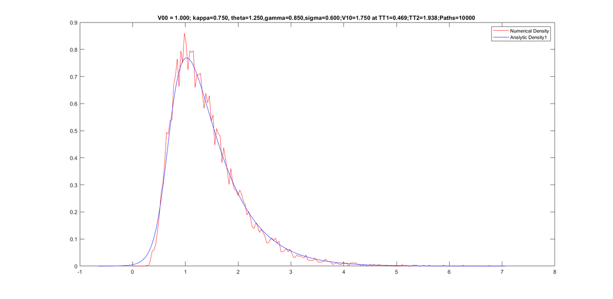](https://postimg.cc/YLYm2rRK)

---

### #2800 — Amin (Topic Author)
*October 2, 2025, 8:06 PM*

.

.

.

.

.

```
function []= ConditionalDensityHermitesBivariateNewtonIters04A()

%SV SDE is
%dV(t)=mu1 V(t)^beta1 dt+ mu2 V(t)^beta2 dt + sigma0 V(t)^gamma dZ(t)
%In mean reverting SDEs we ususally have
%mu1= kappaV * thetaV
%beta1=0
%mu2=-kappa
%beta2=0

Order=5;
%NDim=4;%Three assets and one SV.
NMomentsY=Order+1;
NMomentsX=Order+1;

w2D5(1:NMomentsY,1:NMomentsX)=1;
 w2D6(1:NMomentsY,1:NMomentsX)=1;
for nn=NMomentsY-1:-1:1
    for mm=NMomentsX-1:-1:1

        w2D5(nn,mm)=w2D5(nn+1,mm+1)*(nn+1).^5*(mm+1).^5.0;
        w2D6(nn,mm)=w2D6(nn+1,mm+1)*(nn+1).^6*(mm+1).^6.0;
    end
end

 w2D0(1:NMomentsY,1:NMomentsX)=1;
 w2Dh(1:NMomentsY,1:NMomentsX)=1;
 w2D1(1:NMomentsY,1:NMomentsX)=1;
 w2D2(1:NMomentsY,1:NMomentsX)=1;
 w2D3(1:NMomentsY,1:NMomentsX)=1;
 w2D4(1:NMomentsY,1:NMomentsX)=1;

for nn=NMomentsY-1:-1:1
    for mm=NMomentsX-1:-1:1
        w2Dh(nn,mm)=w2Dh(nn+1,mm+1)*(nn+1).^.5*(mm+1).^.5;
        w2D1(nn,mm)=w2D1(nn+1,mm+1)*(nn+1)*(mm+1);
        w2D2(nn,mm)=w2D2(nn+1,mm+1)*(nn+1).^2*(mm+1).^2.0;
        w2D3(nn,mm)=w2D3(nn+1,mm+1)*(nn+1).^3*(mm+1).^3.0;
        w2D4(nn,mm)=w2D4(nn+1,mm+1)*(nn+1).^4*(mm+1).^4.0;
    end
end

%%%%%%%%%%%%%%%%%%%5

V0=1.00;%.32;
V00=V0;
thetaV=1.250;%.045;%1;%.04;
kappaV=.750;%1.5;%1.5;
mu1=kappaV*thetaV;
mu2=-kappaV;
beta1=0;
beta2=1;
gamma=.85;%.950;
sigma0=.6;%.45;%
dt=.03125/2;
Tt=64*2;
T=Tt*dt;

seed0=52130649;
rng(seed0, 'twister')
paths=10000;
V(1:paths,1)=V0;

%%%%%%%%%%%%%%%%%%%%%%%%%%%%%%%%%%%%%%%%%%%%%%%%%%%%%%%%%%%%%%%%%%%%%%%%%%%%%%%%%%%%5
TT1=30; %Transition distribution start
TT2=124; %Transition distribution end

Random2(1:paths/2,1)=0;

for tt=1:Tt

    Random2(1:paths/2)=randn(paths/2,1);
    Random2(paths/2+1:paths)=-Random2(1:paths/2);

    V(1:paths,1)=V(1:paths,1)+ ...
        (mu1.*V(1:paths,1).^beta1 + mu2.*V(1:paths,1).^beta2)*dt + ...
        sigma0*V(1:paths,1).^gamma .*Random2(1:paths,1)*sqrt(dt) + ...
        (mu1.*beta1*V(1:paths,1).^(beta1-1) + mu2.*beta2.*V(1:paths,1).^(beta2-1)).* ...
        ((mu1.*V(1:paths,1).^beta1 + mu2.*V(1:paths,1).^beta2)*dt^2/2 + ...
        sigma0*V(1:paths,1).^gamma .*Random2(1:paths,1)*(1-1/sqrt(3))*dt^1.5) + ...
        .5*(mu1.*beta1.*(beta1-1).*V(1:paths,1).^(beta1-2) + mu2.*beta2.*(beta2-1).*V(1:paths,1).^(beta2-2)).* ...
        sigma0^2.*V(1:paths,1).^(2*gamma).*dt^2/2 + ...
        sigma0*gamma*V(1:paths,1).^(gamma-1) .* ...
        ((mu1.*V(1:paths,1).^beta1 + mu2.*V(1:paths,1).^beta2).*Random2(1:paths,1).*1/sqrt(3)*dt^1.5 + ...
        sigma0.*V(1:paths,1).^gamma .*(Random2(1:paths,1).^2-1)*dt/2) + ...
        .5*sigma0*gamma*(gamma-1).*V(1:paths,1).^(gamma-2) .* ...
        sigma0^2.*V(1:paths,1).^(2*gamma) .*Random2(1:paths,1).*1/sqrt(3)*dt^1.5;

    V(V<0)=.00001;

    if(tt==TT1)
        Xin(1:paths,1)=V(1:paths,1);
    end

    if(tt==TT2)
        Yin(1:paths,1)=V(1:paths,1);
    end
end

str=input("I have reached stone 1");

Order=5;

Ndata=paths;

[ZI] = MomentMatchedStandardNormalDiscretizedDensity(Ndata);

%ZI=ZnNew;
%Below find one dimensional Hermite-Series of variable that is taken as
%independent in the analytics.
[XCoeffH,Zx] = CalculateHermiteSeriesFromData01(Xin,Order,ZI);

[YCoeffH,Zy] = CalculateHermiteSeriesFromData01(Yin,Order,ZI);

%With respect to HErmite-series of X, find correlated and orthogonal parts of
%observations of dependent variable Y.
[Ycorr0,Ydecorr,Coeffyx] = FindDecorrelatedYwrtX(Yin,Zx,Order);

YdecorrAdj=0;
%%%%%%%%%%%%%%%%%%%%%%%%%%%%%%%%%%%%%%%%%%%%%%%%%%%%%%%%%%%%%%%%%%%%%%%%%%%%%%%%%%%5

%The function below calculates the 2D joint hermite-series of W=XY
%XYCoeffHH is the 2D joint hermite Series of W=XY
%YCoeffHH is 2D conditional hermite-series of Y|X

%sum(Ydecorr)/paths

%str=input("Look at mean of Ydecorr");

[XYCoeffHH,YCoeffHH] = Calculate2DHermiteSeriesConditionalAndJoint(Ydecorr,YdecorrAdj,Yin,Xin,Zx,Order,ZI);
%[XYCoeffHH,YCoeffHH] = Calculate2DHermiteSeriesConditionalAndJointNew02(Yin,Xin,Zx,Order,ZI);

%[YCoeffZZ] = Convert2DHermitesInto2DSeriesNew(YCoeffHH,Order,Order);
YCoeffHH(1:Order+1,Order:Order+1)=YCoeffHH(1:Order+1,Order:Order+1)/1000;
YCoeffHH(Order:Order+1,1:Order+1)=YCoeffHH(Order:Order+1,1:Order+1)/1000;

YCoeffHH(1,1:Order+1)=Coeffyx(1:Order+1,1)';

%%%%%%%%%%%%%%%%%%%%%%%%%%%%%%%%%%%%%%%%%%%%%%%%%%%%%%%%%%%%%%%%%%%%%%%%%%%%%%%%%%%%%5

%The function below does initial analytics of caclulation of 2D conditional
%and joint densities. We want to use the result from this function as a
%Starting guess/seed to Newton derivatives based optimization method.

%[YCoeffHH,XYCoeffHH,XCoeffH,Coeffyx,YCoeffH] =CalculateBivariateHermiteSeries01(Yin,Xin,Order);

%
 [XCoeffZ(1:Order+1)] = ConvertHermiteSeriesToZSeries01(XCoeffH(1:Order+1),Order);

  for qq1=1:Order+1
    XMoments(qq1)=sum(Xin(1:paths).^qq1)/paths;
  end
  [XCoeffZ(1),XCoeffZ(2:6)] = CalculateZSeriesDensityFromRawMomentsM6(XMoments,XCoeffZ(2:6));
  for pp1=1:Order+1
    YMoments(pp1)=sum(Yin(1:paths).^pp1)/paths;
  end

  [YCoeffZ(1:Order+1)] = ConvertHermiteSeriesToZSeries01(YCoeffH(1:Order+1),Order);
  [YCoeffZ(1),YCoeffZ(2:6)] = CalculateZSeriesDensityFromRawMomentsM6(YMoments,YCoeffZ(2:6));
  for pp1=1:Order+1
      for qq1=1:Order+1
          MomentsYX0((pp1-1)*(Order+1)+qq1,1)=sum(Yin(1:paths).^pp1.*Xin(1:paths).^qq1)/paths;
          MomentsYX(pp1,qq1)=sum(Yin(1:paths).^pp1.*Xin(1:paths).^qq1)/paths;
          if(pp1==1)
              MomentsYXN1(1,qq1)=sum(Yin(1:paths).^pp1.*Xin(1:paths).^qq1)/paths;%/(sum(Xin(1:paths).^(qq1)));
          end
      end
  end
%
  [MomentsY]=CalculateMomentsOfZSeries(YCoeffZ(1),YCoeffZ(2:6),5,6)
  MaxIter=5000;
%In the function below, we do iterative optimization on all 2D Hermite
%coefficients but do not optimize the first row of coefficients.The first
%row comes from regression and keeping it fixed gives robustness to
%regression.
[YCoeffHH,ObjFunc] = HSeriesCoeffsFromCrossMomentsIterative2D1st(YCoeffHH,XCoeffZ,MomentsYX0,YCoeffZ,MaxIter,w2D0)

MaxIter=1000;
%In the function below, we do iterative optimization on all 2D Hermite
%coefficients including the first row. This function is applied when we
%have become too close to the true values by optimization through previous
%function.
[YCoeffHH,ObjFunc] = HSeriesCoeffsFromCrossMomentsIterative2D2nd(YCoeffHH,XCoeffZ,MomentsYX0,YCoeffZ,MaxIter,w2D0)

[YCoeffZZ] = Convert2DHermitesInto2DSeriesNew(YCoeffHH,Order,Order);

 [Y1DMoments]=CalculateMomentsOfZSeries(YCoeffZ(1),YCoeffZ(2:6),5,6)

 OrderY=Order;
 OrderX=Order;
 NMoments=6;
 [YMoments] = CalculateMomentsOf2DZSeriesY(YCoeffZZ,OrderY,OrderX,NMoments);
%
%
 Y1DMoments
 YMoments
 str=input("Look at comparison of second moments/moments");

%%%%%%%%%%%%%%%%%%%%%%%%%%%%%%%%%%%%%%%%%%%%%%%%%%%%%%%%%%%%%%%%%%%%%%%%%%%%%5
%In this block, we do conditional Monte Carlo of SDE which is the true
%numerical 1D conditional density of Y conditional on X having a given
%value. This value of X on which we are conditionin is defined by V10 below.
%We can alter V10 below and it will take out a 1D slice from the 2D density
%of Y conditional on X  taking a specific value (here V10).
%Zx=2.0;
%V10=XCoeffZ(1)+XCoeffZ(2).*Zx+XCoeffZ(3).*Zx^2+XCoeffZ(4).*Zx^3+XCoeffZ(5).*Zx^4+XCoeffZ(6).*Zx^5;
%V10
%str=input("Look at V10");
V10=1.750;
V(1:paths)=V10;
Random2(1:paths,1)=0;

for tt=TT1+1:TT2

    Random2(1:paths/2)=randn(paths/2,1);
    Random2(paths/2+1:paths)=-Random2(1:paths/2);

    V(1:paths,1)=V(1:paths,1)+ ...
        (mu1.*V(1:paths,1).^beta1 + mu2.*V(1:paths,1).^beta2)*dt + ...
        sigma0*V(1:paths,1).^gamma .*Random2(1:paths,1)*sqrt(dt) + ...
        (mu1.*beta1*V(1:paths,1).^(beta1-1) + mu2.*beta2.*V(1:paths,1).^(beta2-1)).* ...
        ((mu1.*V(1:paths,1).^beta1 + mu2.*V(1:paths,1).^beta2)*dt^2/2 + ...
        sigma0*V(1:paths,1).^gamma .*Random2(1:paths,1)*(1-1/sqrt(3))*dt^1.5) + ...
        .5*(mu1.*beta1.*(beta1-1).*V(1:paths,1).^(beta1-2) + mu2.*beta2.*(beta2-1).*V(1:paths,1).^(beta2-2)).* ...
        sigma0^2.*V(1:paths,1).^(2*gamma).*dt^2/2 + ...
        sigma0*gamma*V(1:paths,1).^(gamma-1) .* ...
        ((mu1.*V(1:paths,1).^beta1 + mu2.*V(1:paths,1).^beta2).*Random2(1:paths,1).*1/sqrt(3)*dt^1.5 + ...
        sigma0.*V(1:paths,1).^gamma .*(Random2(1:paths,1).^2-1)*dt/2) + ...
        .5*sigma0*gamma*(gamma-1).*V(1:paths,1).^(gamma-2) .* ...
        sigma0^2.*V(1:paths,1).^(2*gamma) .*Random2(1:paths,1).*1/sqrt(3)*dt^1.5;

    V(V<0)=.00001;

end

%Below

NoOfBins=200;
MaxCutOff=10;

[XDensity,IndexOut,IndexMax] = MakeDensityFromSimulation_Infiniti_NEW(V,paths,NoOfBins,MaxCutOff );

clf;

plot(IndexOut(1:IndexMax),XDensity(1:IndexMax),'r');

hold on

for qq=1:6

    DataMoments(qq)=sum(V(:).^qq)/paths;

end

%%%%%%%%%%%%%%%%%%%%%%%%%%%%%%%%%%%%%%%%%%%%%%%%%%%%%%%%%%%%%%%%%%%%%%%%%%%%%%%%%%%%%%%5
%Below, we calculate the value of Zx0 corresponding to X0 (here V10). This
%comes from inverting the Z-series of X so that X=V10;

xOrder=Order;
yOrder=Order;
[Zx0] = CalculateZgivenXAndHSeriesCoeffs(V10,XCoeffH,xOrder);

%Below, we collapse two dimensional pdf of Y|X to one dimensional pdf given
%Zx i.e. this Y|X=X(Zx)
%Here we take out a 1D slice from the 2D density
%of Y conditional on X  taking a specific value (here V10).
He(1)=1;
He(2)=Zx0;
He(3)=Zx0^2-1;
He(4)=Zx0^3-3*Zx0;
He(5)=Zx0^4-6*Zx0.^2+3;
He(6)=Zx0^5-10*Zx0.^3+15*Zx0;
He(7)=Zx0^6-15*Zx0.^4+45*Zx0.^2-15;
He(8)=Zx0^7-21*Zx0.^5+105*Zx0.^3-105*Zx0;

YCoeffh(1:Order+1)=0;
for hh=1:yOrder+1
    for hh2=1:xOrder+1
        YCoeffh(hh)=YCoeffh(hh)+YCoeffHH(hh,hh2).*He(hh2);
    end
end

 [YCoeffz(1:Order+1)] = ConvertHermiteSeriesToZSeries01(YCoeffh(1:Order+1),Order);

 [YMomentsModel]=CalculateMomentsOfZSeries(YCoeffz(1),YCoeffz(2:6),5,6);

 YMomentsModel

 DataMoments

 str=input("Look at comparison of moments");

PlotHermiteSeriesDensityAndRvGraph(YCoeffh(1),YCoeffh(2:yOrder+1),'b')

%hold on
%PlotHermiteSeriesDensityAndRvGraph(YCoeffh(1),YCoeffh1(2:yOrder+1),'g')
title(sprintf('V00 = %.3f; kappa=%.3f, theta=%.3f,gamma=%.3f,sigma=%.3f;V10=%.3f at TT1=%.3f;TT2=%.3f;Paths=%d ',V00,
kappaV, thetaV,gamma,sigma0, V10,(TT1*dt),(TT2*dt),paths));%,sprintf('theta= %f', theta), sprintf('kappa = %f',
kappa),sprintf('sigma = %f', sigma0),sprintf('T = %f', T));
legend({'Numerical Density','Analytic Density1'}, ...
    'Location','northeast')

str=input("This is the first version without altering the moments of conditional density")

[YMoments0]=CalculateMomentsOfZSeries(YCoeffz(1),YCoeffz(2:6),5,6)

% %[IsValidFlag] = CheckIsValidDensityPN(YCoeffz(1),YCoeffz(2:Order+1));
[PIsValidFlag,NIsValidFlag] = CheckIsValidDensityPN02(YCoeffz(1),YCoeffz(2:Order+1));
PIsValidFlag
NIsValidFlag
LoopIter=0;

Mul6(1)=.65;
Mul6(2)=.7;
Mul6(3)=.75;
Mul6(4)=.8;
Mul6(5)=.85;
Mul6(6)=.9;
Mul6(7)=.95;
Mul6(8)=1.0;
Mul6(9)=1.05;
Mul6(10)=1.1;
Mul6(11)=1.2;

Mul0=1;
%YMoment6=YMoments(6);
while(((PIsValidFlag==0)||(NIsValidFlag==0))&&(LoopIter<=10))
LoopIter=LoopIter+1;
    YCoeffh
Mul0=Mul0+.05;
    Y2Coeffz=YCoeffz;
    Mean=Y2Coeffz(1)+(Y2Coeffz(3)+3*Y2Coeffz(5));
    Y2Coeffz(1)=-(Y2Coeffz(3)+3*Y2Coeffz(5));

    [YMoments]=CalculateMomentsOfZSeries(Y2Coeffz(1),Y2Coeffz(2:6),5,6)

    %%%%%%%%%%%%%%%%%%%%%%%%%%%%%%%%%%%%%%%%%%%%%%%%%%%%%%%%
    %abs(YMoments(3:6))./abs(YMoments(2:5))

    %YMoments(2:6)
    %%%%%%%%%%%%%%%%%%%%%%%%%%%%%%%%%%%%%%%%%%%%%%%%%%%%%%%555

    if(abs(YMoments(6)/YMoments(5))<abs(YMoments(4)/YMoments(3))*Mul6(LoopIter))
    YMoments(6)=abs(YMoments(5).*YMoments(4)./YMoments(3)*Mul6(LoopIter))

    end

    %YMoments(5)=YMoments(5)-1/25*abs(YMoments(5));

    %YMoments(6)=YMoments(6)*Mul0;
    %LoopIter
    %Mul0
    %YMoments(6)

    %str=input("Look at variables")

    [Y3Coeffz(1),Y3Coeffz(2:6)] = CalculateZSeriesDensityFromRawMomentsM6(YMoments,Y2Coeffz(2:6));

    Y3Coeffz(1)=Mean-(Y2Coeffz(3)+3*Y2Coeffz(5));

    [PIsValidFlag,NIsValidFlag] = CheckIsValidDensityPN02(Y3Coeffz(1),Y3Coeffz(2:Order+1));
PIsValidFlag
NIsValidFlag
end
if(LoopIter==0)

     Y3Coeffz=YCoeffz;
end

clf;

plot(IndexOut(1:IndexMax),XDensity(1:IndexMax),'r');

hold on

PlotZSeriesDensity(Y3Coeffz(1),Y3Coeffz(2:yOrder+1),'b')

title(sprintf('V00 = %.3f; kappa=%.3f, theta=%.3f,gamma=%.3f,sigma=%.3f;V10=%.3f at TT1=%.3f;TT2=%.3f;Paths=%d ',V00,
kappaV, thetaV,gamma,sigma0, V10,(TT1*dt),(TT2*dt),paths));%,sprintf('theta= %f', theta), sprintf('kappa = %f',
kappa),sprintf('sigma = %f', sigma0),sprintf('T = %f', T));
legend({'Numerical Density','Analytic Density1'}, ...
    'Location','northeast')
str=input("This is the Second version after possibly altering the moments of conditional density when needed")

end
```

.

.

.

.

```
function [YCoeffHH,ObjFunc] =
HSeriesCoeffsFromCrossMomentsIterative2D1st(YCoeffHH,XCoeffZ,MomentsYX0,YCoeffZ,MaxIter,w2D)

%This program computes coeffs of 2D Hermite-series when values of raw cross-moments are
%given using Iterative method.

%MomentsYX0 are raw cross-moments stacked in a single array;
%YCoeffHH are coeffs of 2D Hermite-series to be found and when passed as parameters
%contain starting guess for 2D Hermite-series coeffs.

%Total number of Iterations of the iterative method are given by input
%parameter MaxIter.
%The present program is written for SeriesOrder=6*6.
 SeriesOrder=6;  %Z-series till 7th power.

 NMoments=6;
 Order=5;

 %The following function calculates Moments of 1D Zseries of Y
 [YMoments]=CalculateMomentsOfZSeries(YCoeffZ(1),YCoeffZ(2:6),5,6);

 %In the following block, we keep mean and variance of Hermite-Series equal
 %to input value of mean and Variance found from 1D Z-series of Y. We do
 %not alter the coefficients on the first line that are associated with 1st
 %order correlation between Y and X of first five hermite polynomials.

 %M11 is variance of first row of Hermite Series that is not altered.
 %Below, we apply variance correction but this variance correction is not
 %applied to first row of hermite series that is kept unaltered.

M11=0;
for qq=2:6
M11=M11+YCoeffHH(1,qq).^2*factorial(qq-1);
end
%Below, we calculate first and 2nd moment of 2D Hermite series
[MeanHH,M2HH] = CalculateMeanAndVarOf2DHSeriesY(YCoeffHH,Order,Order);
%VarHH is model variance and it is adjusted by removing variance of 1st row of 2D Hermite series.
VarHH=M2HH-MeanHH.^2-M11;
%VarIn is input variance that is adjusted by removing variance of 1st row of hermite series
VarIn=YMoments(2)-YMoments(1).^2-M11;
%Variance correction is applied below to all rows but not to first row of hermite series.
YCoeffHH(2:6,1:6)=YCoeffHH(2:6,1:6).*sqrt(VarIn/VarHH);
%We convert final 2D Hermite series to 2D Z-series

[YCoeffZZ] = Convert2DHermitesInto2DSeriesNew(YCoeffHH,Order,Order);

%%%%%%Choose the iteration step size.
for nn=1:SeriesOrder
    for mm=1:SeriesOrder
        DeltaX(nn,mm)=.00125/(factorial(nn+1))/factorial(mm+1)/2^(nn/2);
        DeltaXMax(nn,mm)=DeltaX(nn,mm)*5;
    end
end

ObjFunc1=0;
ObjFunc2=0;

%%%Weights on objective function that shows fit to moments
w2D(NMoments,NMoments)=1;
for nn=NMoments-1:-1:1
    for mm=NMoments-1:-1:1
        w2D(nn,mm)=w2D(nn+1,mm+1)*(nn+1).^0*(mm+1).^0;
    end
end

%[Moments] = CalculateMomentsOfZSeries(c0,c,SeriesOrder,NMoments);
[AMat] = CalculateCrossMomentsofTwo2Dand1DZSeries(YCoeffZZ,XCoeffZ,Order,Order);

for pp1=1:Order+1
     for qq1=1:Order+1
         Moments2D(pp1,qq1)=AMat((pp1-1)*(Order+1)+qq1,1);
         Moments2D0(pp1,qq1)=MomentsYX0((pp1-1)*(Order+1)+qq1,1);
     end
 end
[ObjFuncBest] = CalculateObjMoment2D1D(Moments2D0,Moments2D,w2D,Order+1,Order+1);

ImproveFlag(1:SeriesOrder,1:SeriesOrder)=1;
ImproveFlagPrev(1:SeriesOrder,1:SeriesOrder)=0;
ImproveCount(1:SeriesOrder,1:SeriesOrder)=0;
kk=0;
while ((kk1))
kk=kk+1;
    %We only iteratively alter c(2:7), first and second moments are
    %retrieved automatically in our set up
    for nn=1:SeriesOrder
        for mm=1:SeriesOrder
            if((nn==1))
                ;
            else

            ImproveFlagPrev(nn,mm)=ImproveFlag(nn,mm);

            YCoeffHHnew=YCoeffHH;
            YCoeffHHnew(nn,mm)=YCoeffHHnew(nn,mm)+DeltaX(nn,mm);

             %M11 is variance of first row of Hermite Series that is not altered.
             %Below, we apply variance correction but this variance correction is not
             %applied to first row of hermite series that is kept unaltered.

            %         M11=0;
            %         for qq=2:6
            %         M11=M11+YCoeffHHnew(1,qq).^2*factorial(qq-1);
            %         end
             %Below, we calculate first and 2nd moment of 2D Hermite series
             [MeanHH,M2HH] = CalculateMeanAndVarOf2DHSeriesY(YCoeffHHnew,Order,Order);
             %VarHH is model variance and it is adjusted by removing variance of 1st row of 2D Hermite series.
             VarHH=M2HH-MeanHH.^2-M11;
             %VarIn is input variance that is adjusted by removing variance of 1st row of hermite series
             %       VarIn=YMoments(2)-YMoments(1).^2-M11;
             %Variance correction is applied below to all rows but not to first row of hermite series.
             YCoeffHHnew(2:6,1:6)=YCoeffHHnew(2:6,1:6).*sqrt(VarIn/VarHH);
            %We convert final 2D Hermite series to 2D Z-series

            [YCoeffZZnew] = Convert2DHermitesInto2DSeriesNew(YCoeffHHnew,Order,Order);
            %Below array AMat contains all model cross-derivatives in a single
            %arraay.
            [AMat] = CalculateCrossMomentsofTwo2Dand1DZSeries(YCoeffZZnew,XCoeffZ,Order,Order);

            %Below single dimensional arrays of model and market cross moments
            %are assigned to two dimensional arrays.
            for pp1=1:Order+1
                for qq1=1:Order+1
                    Moments2D(pp1,qq1)=AMat((pp1-1)*(Order+1)+qq1,1);
                    Moments2D0(pp1,qq1)=MomentsYX0((pp1-1)*(Order+1)+qq1,1);
                end
            end

            %Objective function is calculated.
            [ObjFunc1] = CalculateObjMoment2D1D(Moments2D0,Moments2D,w2D,Order+1,Order+1);

            if(ObjFunc1DeltaXMax(nn,mm))
           DeltaX(nn,mm)=DeltaXMax(nn,mm);
       end
        end
    end

end

ObjFunc=ObjFuncBest;

end
```

.

.

.

.

```
function [YCoeffHH,ObjFunc] =
HSeriesCoeffsFromCrossMomentsIterative2D1st(YCoeffHH,XCoeffZ,MomentsYX0,YCoeffZ,MaxIter,w2D)

%This program computes coeffs of 2D Hermite-series when values of raw cross-moments are
%given using Iterative method.

%MomentsYX0 are raw cross-moments stacked in a single array;
%YCoeffHH are coeffs of 2D Hermite-series to be found and when passed as parameters
%contain starting guess for 2D Hermite-series coeffs.

%Total number of Iterations of the iterative method are given by input
%parameter MaxIter.
%The present program is written for SeriesOrder=6*6.
 SeriesOrder=6;  %Z-series till 7th power.

 NMoments=6;
 Order=5;

 %The following function calculates Moments of 1D Zseries of Y
 [YMoments]=CalculateMomentsOfZSeries(YCoeffZ(1),YCoeffZ(2:6),5,6);

 %In the following block, we keep mean and variance of Hermite-Series equal
 %to input value of mean and Variance found from 1D Z-series of Y. We do
 %not alter the coefficients on the first line that are associated with 1st
 %order correlation between Y and X of first five hermite polynomials.

 %M11 is variance of first row of Hermite Series that is not altered.
 %Below, we apply variance correction but this variance correction is not
 %applied to first row of hermite series that is kept unaltered.

M11=0;
for qq=2:6
M11=M11+YCoeffHH(1,qq).^2*factorial(qq-1);
end
%Below, we calculate first and 2nd moment of 2D Hermite series
[MeanHH,M2HH] = CalculateMeanAndVarOf2DHSeriesY(YCoeffHH,Order,Order);
%VarHH is model variance and it is adjusted by removing variance of 1st row of 2D Hermite series.
VarHH=M2HH-MeanHH.^2-M11;
%VarIn is input variance that is adjusted by removing variance of 1st row of hermite series
VarIn=YMoments(2)-YMoments(1).^2-M11;
%Variance correction is applied below to all rows but not to first row of hermite series.
YCoeffHH(2:6,1:6)=YCoeffHH(2:6,1:6).*sqrt(VarIn/VarHH);
%We convert final 2D Hermite series to 2D Z-series

[YCoeffZZ] = Convert2DHermitesInto2DSeriesNew(YCoeffHH,Order,Order);

%%%%%%Choose the iteration step size.
for nn=1:SeriesOrder
    for mm=1:SeriesOrder
        DeltaX(nn,mm)=.00125/(factorial(nn+1))/factorial(mm+1)/2^(nn/2);
        DeltaXMax(nn,mm)=DeltaX(nn,mm)*5;
    end
end

ObjFunc1=0;
ObjFunc2=0;

%%%Weights on objective function that shows fit to moments
w2D(NMoments,NMoments)=1;
for nn=NMoments-1:-1:1
    for mm=NMoments-1:-1:1
        w2D(nn,mm)=w2D(nn+1,mm+1)*(nn+1).^0*(mm+1).^0;
    end
end

%[Moments] = CalculateMomentsOfZSeries(c0,c,SeriesOrder,NMoments);
[AMat] = CalculateCrossMomentsofTwo2Dand1DZSeries(YCoeffZZ,XCoeffZ,Order,Order);

for pp1=1:Order+1
     for qq1=1:Order+1
         Moments2D(pp1,qq1)=AMat((pp1-1)*(Order+1)+qq1,1);
         Moments2D0(pp1,qq1)=MomentsYX0((pp1-1)*(Order+1)+qq1,1);
     end
 end
[ObjFuncBest] = CalculateObjMoment2D1D(Moments2D0,Moments2D,w2D,Order+1,Order+1);

ImproveFlag(1:SeriesOrder,1:SeriesOrder)=1;
ImproveFlagPrev(1:SeriesOrder,1:SeriesOrder)=0;
ImproveCount(1:SeriesOrder,1:SeriesOrder)=0;
kk=0;
while ((kk1))
kk=kk+1;
    %We only iteratively alter c(2:7), first and second moments are
    %retrieved automatically in our set up
    for nn=1:SeriesOrder
        for mm=1:SeriesOrder
            if((nn==1))
                ;
            else

            ImproveFlagPrev(nn,mm)=ImproveFlag(nn,mm);

            YCoeffHHnew=YCoeffHH;
            YCoeffHHnew(nn,mm)=YCoeffHHnew(nn,mm)+DeltaX(nn,mm);

             %M11 is variance of first row of Hermite Series that is not altered.
             %Below, we apply variance correction but this variance correction is not
             %applied to first row of hermite series that is kept unaltered.

            %         M11=0;
            %         for qq=2:6
            %         M11=M11+YCoeffHHnew(1,qq).^2*factorial(qq-1);
            %         end
             %Below, we calculate first and 2nd moment of 2D Hermite series
             [MeanHH,M2HH] = CalculateMeanAndVarOf2DHSeriesY(YCoeffHHnew,Order,Order);
             %VarHH is model variance and it is adjusted by removing variance of 1st row of 2D Hermite series.
             VarHH=M2HH-MeanHH.^2-M11;
             %VarIn is input variance that is adjusted by removing variance of 1st row of hermite series
             %       VarIn=YMoments(2)-YMoments(1).^2-M11;
             %Variance correction is applied below to all rows but not to first row of hermite series.
             YCoeffHHnew(2:6,1:6)=YCoeffHHnew(2:6,1:6).*sqrt(VarIn/VarHH);
            %We convert final 2D Hermite series to 2D Z-series

            [YCoeffZZnew] = Convert2DHermitesInto2DSeriesNew(YCoeffHHnew,Order,Order);
            %Below array AMat contains all model cross-derivatives in a single
            %arraay.
            [AMat] = CalculateCrossMomentsofTwo2Dand1DZSeries(YCoeffZZnew,XCoeffZ,Order,Order);

            %Below single dimensional arrays of model and market cross moments
            %are assigned to two dimensional arrays.
            for pp1=1:Order+1
                for qq1=1:Order+1
                    Moments2D(pp1,qq1)=AMat((pp1-1)*(Order+1)+qq1,1);
                    Moments2D0(pp1,qq1)=MomentsYX0((pp1-1)*(Order+1)+qq1,1);
                end
            end

            %Objective function is calculated.
            [ObjFunc1] = CalculateObjMoment2D1D(Moments2D0,Moments2D,w2D,Order+1,Order+1);

            if(ObjFunc1DeltaXMax(nn,mm))
           DeltaX(nn,mm)=DeltaXMax(nn,mm);
       end
        end
    end

end

ObjFunc=ObjFuncBest;

end
```

.

.

.

.

```
function [MeanHH,M2HH] = CalculateMeanAndVarOf2DHSeriesY(YCoeffHH,OrderY,OrderX)

MeanHH=YCoeffHH(1,1);

M2HH=0;
for mm=1:OrderY+1
    for nn=1:OrderX+1
        M2HH=M2HH+YCoeffHH(mm,nn).^2.*factorial(mm-1).*factorial(nn-1);
    end
end

end

```

.

.

.

```
function [AMat] = CalculateCrossMomentsofTwo2Dand1DZSeries(YCoeffZZ,XCoeffZ,OrderY,OrderX)

NMomentsY=OrderY+1;
NMomentsX=OrderX+1;

YpCoeff(1:(OrderY+1)*(OrderY+1),1:(OrderX+1)*(OrderX+1),1:OrderY+1)=0.0;

%YpCoeff(1:Order+1,1:Order+1,1)=YCoeffZZ(1:Order+1,1:Order+1);

XqCoeff0(1:(OrderX+1)*(OrderX+1),1:OrderX+1)=0;

XqCoeff(1:1,1:(OrderX+1)*(OrderX+1),1:OrderX+1)=0;

AMat(1:(OrderY+1)*(OrderX+1),1)=0.0;

%DMat(1:(OrderY+1)*(OrderX+1),1:(OrderY+1)*(OrderX+1))=0.0;

%Ypq1Coeff(1:(Order+1)*(Order+1),1:2*(Order+1)*(Order+1))=0.0;

SeriesOrder10=OrderY+1;
SeriesOrder01=OrderX+1;
SeriesOrder20=OrderY+1;
SeriesOrder02=OrderX+1;

YpCoeff(1:OrderY+1,1:OrderX+1,1)=YCoeffZZ(1:OrderY+1,1:OrderX+1);

for pp=2:NMomentsY

  SeriesOrder30=SeriesOrder10+SeriesOrder20-1;
  SeriesOrder03=SeriesOrder01+SeriesOrder02-1;
% %
% %  %Below calculate the product: 2D product of Z-series [Y|X](Zy,Zx)*X(Zx)
  [YpCoeff(1:SeriesOrder30,1:SeriesOrder03,pp),EYp(pp)]
=SeriesProduct2DAlgorithmicNew(YpCoeff(1:SeriesOrder10,1:SeriesOrder01,pp-1),YCoeffZZ(1:OrderX+1,1:OrderY+1),SeriesOrder10,SeriesOrder01,SeriesOrder20,SeriesOrder02);

  YMoments(pp)=EYp(pp);

  SeriesOrder10=SeriesOrder30;
SeriesOrder01=SeriesOrder03;
SeriesOrder20=OrderY+1;
SeriesOrder02=OrderX+1;

end

XqCoeff0(1:OrderX+1,1)=XCoeffZ(1:OrderX+1);

  SeriesOrder1=OrderX+1;
  SeriesOrder2=OrderX+1;

for qq=2:NMomentsX

  SeriesOrder3=SeriesOrder1+SeriesOrder2-1;
  [XqCoeff0(1:SeriesOrder3,qq),EXq(qq)]
=SeriesProduct1D(XqCoeff0(1:SeriesOrder1,qq-1),XqCoeff0(1:SeriesOrder2,1),SeriesOrder1,SeriesOrder2);

 SeriesOrder1=SeriesOrder3;
 SeriesOrder2=OrderX+1;

end

[EZ] = EZZ2();

for pp1=1:OrderY+1
    for qq1=1:OrderX+1
%        DMat((pp1-1)*(Order+1)+qq1
            ASeriesOrder10=(pp1)*OrderY+1;
            ASeriesOrder01=(pp1)*OrderY+1;
            ASeriesOrder20=1;
            ASeriesOrder02=(qq1)*OrderX+1;
            ASeriesOrder30=ASeriesOrder10+ASeriesOrder20-1;
            ASeriesOrder03=ASeriesOrder01+ASeriesOrder02-1;
            XqCoeff(1:1,1:ASeriesOrder02,qq1)=XqCoeff0(1:ASeriesOrder02,qq1);
      %size(XqCoeff)
      %qq1
      %size(YpCoeff)
      %pp1
      %str=input("Look at sizes")
            [TempMat,AMat((pp1-1)*(OrderX+1)+qq1,1)]
=SeriesProduct2DAlgorithmicNew(YpCoeff(1:ASeriesOrder10,1:ASeriesOrder01,pp1),XqCoeff(1:ASeriesOrder20,1:ASeriesOrder02,qq1),ASeriesOrder10,ASeriesOrder01,ASeriesOrder20,ASeriesOrder02);

    end
end

end

```

.

.

.

.

```
function [gZZ] = Convert2DHermitesInto2DSeriesNew(gHH,OrderX,OrderY)

for nn=1:OrderY+1
[gZH(nn,1:OrderX+1)] = ConvertHermiteSeriesToZSeries01(gHH(nn,1:OrderX+1),OrderX);
end

for mm=1:OrderX+1
[gZZ(1:OrderY+1,mm)] = ConvertHermiteSeriesToZSeries01(gZH(1:OrderY+1,mm),OrderY);
end

end

```

.

.

.

```
function [YCoeffHH,ObjFunc] =
HSeriesCoeffsFromCrossMomentsIterative2D2nd(YCoeffHH,XCoeffZ,MomentsYX0,YCoeffZ,MaxIter,w2D)

SeriesOrder=6;
NMoments=6;
Order=5;

[YMoments]=CalculateMomentsOfZSeries(YCoeffZ(1),YCoeffZ(2:6),5,6);

%Below, we calculate first and 2nd moment of 2D Hermite series
[MeanHH,M2HH] = CalculateMeanAndVarOf2DHSeriesY(YCoeffHH,Order,Order);
%VarHH is model variance .
VarHH=M2HH-MeanHH.^2;
%VarIn is input variance
VarIn=YMoments(2)-YMoments(1).^2;
%Variance correction is applied below to all rows but not to first row of hermite series.
YCoeffHH(1:6,1:6)=YCoeffHH(1:6,1:6).*sqrt(VarIn/VarHH);
%We convert final 2D Hermite series to 2D Z-series

[YCoeffZZ] = Convert2DHermitesInto2DSeriesNew(YCoeffHH,Order,Order);

for nn=1:SeriesOrder
    for mm=1:SeriesOrder
        DeltaX(nn,mm)=.00125/(factorial(nn+1))/factorial(mm+1)/2^(nn/2);
        DeltaXMax(nn,mm)=DeltaX(nn,mm)*5;
    end
end

ObjFunc1=0;
ObjFunc2=0;

%%%Weights on objective function that shows fit to moments
w2D(NMoments,NMoments)=1;
for nn=NMoments-1:-1:1
    for mm=NMoments-1:-1:1
        w2D(nn,mm)=w2D(nn+1,mm+1)*(nn+1).^0*(mm+1).^0;
    end
end

[AMat] = CalculateCrossMomentsofTwo2Dand1DZSeries(YCoeffZZ,XCoeffZ,Order,Order);

for pp1=1:Order+1
     for qq1=1:Order+1
         Moments2D(pp1,qq1)=AMat((pp1-1)*(Order+1)+qq1,1);
         Moments2D0(pp1,qq1)=MomentsYX0((pp1-1)*(Order+1)+qq1,1);
     end
    % Moments1D(pp1)=AMat((Order+1)*(Order+1)+pp1,1);
 end
[ObjFuncBest] = CalculateObjMoment2D1D(Moments2D0,Moments2D,w2D,Order+1,Order+1);
%[ObjFuncBest] = CalculateObjMoment(sMu,Moments,w,mOrder);

%cBest=c;

ImproveFlag(1:SeriesOrder,1:SeriesOrder)=1;
ImproveFlagPrev(1:SeriesOrder,1:SeriesOrder)=0;
ImproveCount(1:SeriesOrder,1:SeriesOrder)=0;
kk=0;
while ((kk1))
kk=kk+1;
    %We only iteratively alter c(2:7), first and second moments are
    %retrieved automatically in our set up
    for nn=1:SeriesOrder
        for mm=1:SeriesOrder

            ImproveFlagPrev(nn,mm)=ImproveFlag(nn,mm);

            YCoeffHHnew=YCoeffHH;
            YCoeffHHnew(nn,mm)=YCoeffHHnew(nn,mm)+DeltaX(nn,mm);

            %Below, we calculate first and 2nd moment of 2D Hermite series
            [MeanHH,M2HH] = CalculateMeanAndVarOf2DHSeriesY(YCoeffHHnew,Order,Order);
            %VarHH is model variance .
            VarHH=M2HH-MeanHH.^2;
            %VarIn is input variance
            VarIn=YMoments(2)-YMoments(1).^2;
            %Variance correction is applied below to all rows but not to first row of hermite series.
            YCoeffHHnew(1:6,1:6)=YCoeffHHnew(1:6,1:6).*sqrt(VarIn/VarHH);
            %We convert final 2D Hermite series to 2D Z-series

            [YCoeffZZnew] = Convert2DHermitesInto2DSeriesNew(YCoeffHHnew,Order,Order);

            [AMat] = CalculateCrossMomentsofTwo2Dand1DZSeries(YCoeffZZnew,XCoeffZ,Order,Order);
            for pp1=1:Order+1
                for qq1=1:Order+1
                    Moments2D(pp1,qq1)=AMat((pp1-1)*(Order+1)+qq1,1);
                    Moments2D0(pp1,qq1)=MomentsYX0((pp1-1)*(Order+1)+qq1,1);
                end
            end
            [ObjFunc1] = CalculateObjMoment2D1D(Moments2D0,Moments2D,w2D,Order+1,Order+1);

            if(ObjFunc1DeltaXMax(nn,mm))
           DeltaX(nn,mm)=DeltaXMax(nn,mm);
       end
        end
    end

end

ObjFunc=ObjFuncBest;

end
```

.

.

.

This is the final output.

Y1DMoments =

  Columns 1 through 3

   1.188448918920995   1.723397425644299   3.067812986950702

  Columns 4 through 6

   6.700584591906397  17.764315333035949  56.010501087010887

YMoments =

  Columns 1 through 3

   1.182349731814849   1.708937481082462   3.062024413444629

  Columns 4 through 6

   6.752002492332380  17.890920580917061  55.321626483497297

Look at comparison of second moments/moments

IndexMax =

   201

YMomentsModel =

   1.0e+02 *

  Columns 1 through 3

   0.014188255217491   0.024902151831170   0.053283506244849

  Columns 4 through 6

   0.136542256849359   0.409631421915406   1.404651936517120

DataMoments =

   1.0e+02 *

  Columns 1 through 3

   0.014093548080371   0.024261167751951   0.050965861322233

  Columns 4 through 6

   0.129743173500164   0.394852638957946   1.408447178065625

Look at comparison of moments

Look at density

This is the first version without altering the moments of conditional density

str =

     []

YMoments0 =

   1.0e+02 *

  Columns 1 through 3

   0.014188255217491   0.024902151831170   0.053283506244849

  Columns 4 through 6

   0.136542256849359   0.409631421915406   1.404651936517120

PIsValidFlag =

     1

NIsValidFlag =

     1

Look at density

This is the Second version after possibly altering the moments of conditional density when needed

---

[← Previous](page_055.md) | [Index](index.md) | [Next →](page_057.md)
