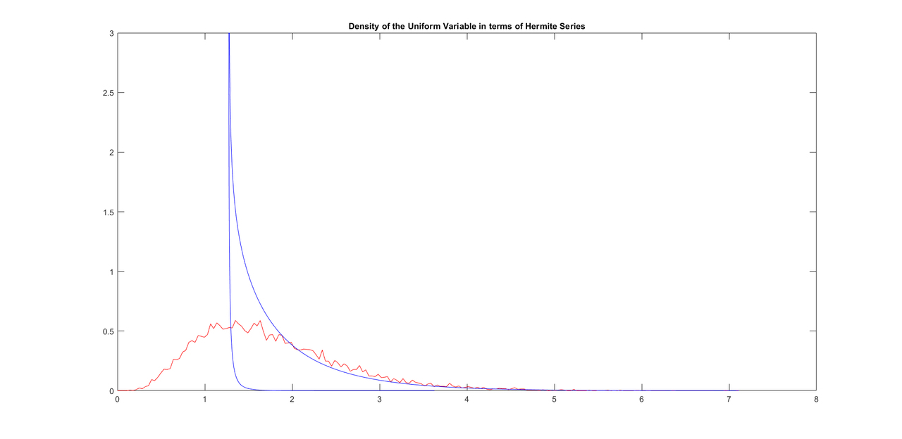
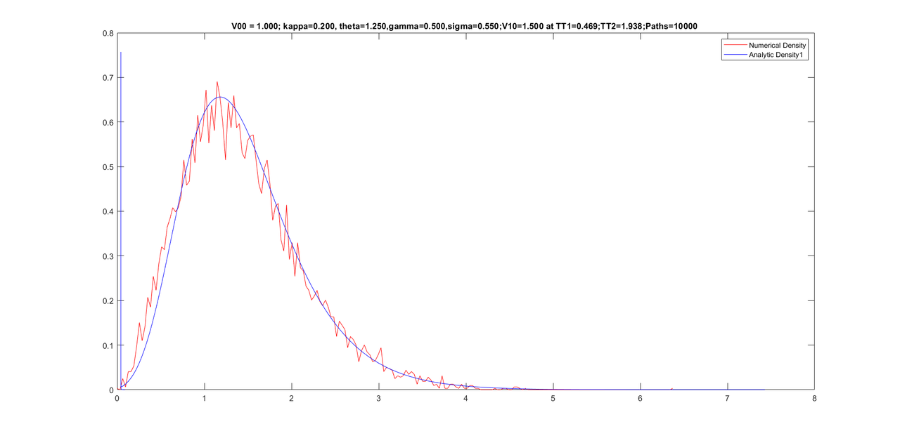
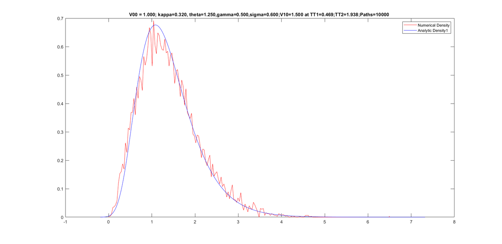
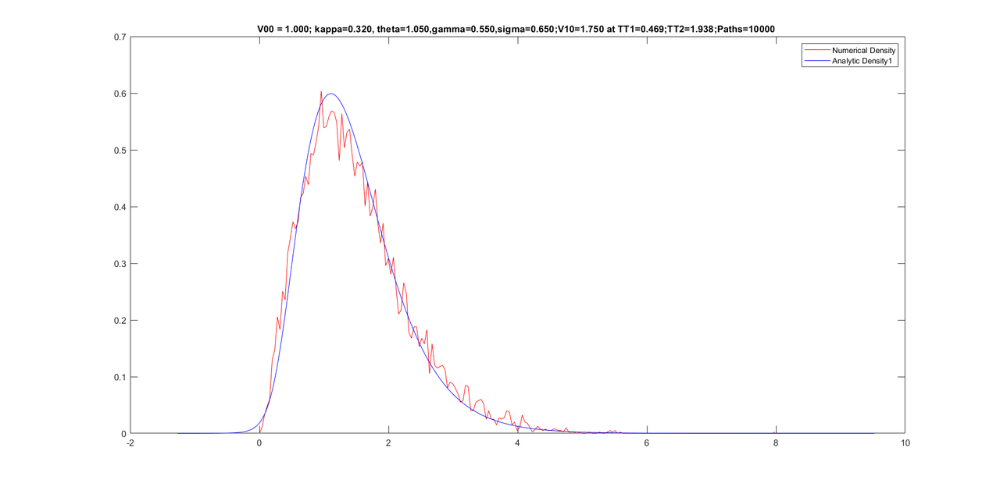

# Breakthrough in the theory of stochastic differential equations and their simulation

**Page 57 of 59** — Posts #2801–#2850

[← Previous](page_056.md) | [Index](index.md) | [Next →](page_058.md)

---

### #2801 — Amin (Topic Author)
*October 2, 2025, 8:26 PM*

Friends, in the iterative optimization program, step size of a coefficient is roughly inversely proportional to variance
of associated hermite. Please try to see how it works with different step sizes. I think keeping step size smaller
increases the quality of optimization. Please try different number of iterations.

There are two iterative optimization programs. In the first program that does most of the work, the first row associated
with zeroth hermite of Y is kept fixed and is borrowed from regression. This makes the regression robust. When close to
optimum, we use the 2nd iterative optimization program that includes even the first row in optimization.

---

### #2802 — Amin (Topic Author)
*October 3, 2025, 3:04 PM*

Friends, I am travelling tomorrow and will go to Islamabad early tomorrow morning. My parents will go through medical
checkup in Islamabad. My sister, who is also a doctor, has arranged for their medical checkup and I will accompany them.

Friends, eventually we want to take our research to multidimensions and want to answer questions of the sort that we are
given seven or eight random variables (or random attributes) and we want to find out the future probability density of
the target variable given the attributes (or random variables). For example, we might specify seven or eight attributes
of the stock market and the stock itself and we would want to find the conditional density of future value of stock
given the attributes.

I have been thinking about multidimensions and I realize in order to describe the effect of ten attributes on a target
random variable, we would need a hermite series of size ten into 36=360. We would not need 6^10 variables as could be
naively supposed. and we would not need to optimize 360 coefficients simultaneously and we could do that in N stages
recursively for N variables.  I will give details of this arrangement of hermite series in a detailed post from
Islamabad in a day or two.

We will soon move to multidimensions and I hope that soon we would be doing a lot of things with Hermite-series that is
otherwise tried to be done by blackbox AI.

Please give me a day or two as I want to give a complete detail of how different things would fit together in
multidimensional Hermite-Series.

---

### #2803 — Amin (Topic Author)
*October 7, 2025, 1:27 PM*

Friends, I travelled back to Lahore this morning. Weather is becoming pleasant. And I am looking forward to a winters in
which we would do some interesting research.

I had mentioned that we could easily condition a random variable on several other random variables. Suppose, we have a
random variable Y that depends upon random variables U, V, W and X and we want to capture all this dependence structure
mathematically using multi-dimensional Hermite-Series/ZSeries.

I will describe the  detailed strategy to calculate the underlying multi-dimensional Hermite-Series but first, I want to
write the form of this five dimensional Hermite-Series of Y that depends upon random variables U, V, W and X. The form
of the underlying hermite-Series would be

\begin{align}

\left[  Y\,  \,|X,W,V,U \right]&(Z_y \, , \, Z_x,\,Z_w\,,Z_v,\, Z_u))\, \,\\

&=\, \Big[\, cH_0 \, + \, cH_{1} \,H_1(Z_y) \,+\, cH_{2} \, H_2(Z_y) \,\, + \, cH_{3} \,H_3(Z_y)\,\,+\, cH_{4} \,
H_4(Z_y) \,\, + \, cH_{5} \,H_5(Z_y)\,\,\Big] \\

&+\, \Big[\, 0.0 \, + \, cH_{0,1} \,H_1(Z_x) \,+\, cH_{0,2} \, H_2(Z_x) \,\, + \, cH_{0,3}
\,H_3(Z_x)\,\,+\,\ldots\,\Big] \\

&+\, \Big[ \, 0.0 \, + \, cH_{1,1} \,H_1(Z_x) \,+\, cH_{1,2} \, H_2(Z_x) \,\, + \, cH_{1,3} \,H_3(Z_x)\,\,+\,\ldots\,
\Big] \, H_1(Z_y) \, \\

&+\, \Big[ \, 0.0 \, + \, cH_{2,1} \,H_1(Z_x) \,+\, cH_{2,2} \, H_2(Z_x) \,\, + \, cH_{2,3} \,H_3(Z_x)\,\,+\,\ldots\,
\Big] \, H_2(Z_y) \, \\

&+\, \Big[ \, 0.0 \, + \, cH_{3,1} \,H_1(Z_x) \,+\, cH_{3,2} \, H_2(Z_x) \, \,+ \, cH_{3,3} \,H_3(Z_x)\,\,+\,\ldots\,
\Big] \, H_3(Z_y) \, \\

&+\, \Big[ \, 0.0 \, + \, cH_{4,1} \,H_1(Z_x) \,+\, cH_{4,2} \, H_2(Z_x) \,\, + \, cH_{4,3} \,H_3(Z_x)\,\,+\,\ldots\,
\Big] \, H_4(Z_y) \, \\

&+\, \Big[ \, 0.0 \, + \, cH_{5,1} \,H_1(Z_x) \,+\, cH_{5,2} \, H_2(Z_x) \, \,+ \, cH_{5,3} \,H_3(Z_x)\,\,+\,\ldots\,
\Big] \, H_5(Z_y) \, \\

&+\, \Big[ \, 0.0 \, + \, cH_{1,0,1} \,H_1(Z_w) \,+\, cH_{1,0,2} \, H_2(Z_w) \,\, + \, cH_{1,0,3}
\,H_3(Z_w)\,\,+\,\ldots\, \Big] \, H_1(Z_y) \, \\

&+\, \Big[ \, 0.0 \, + \, cH_{2,0,1} \,H_1(Z_w) \,+\, cH_{2,0,2} \, H_2(Z_w) \,\, + \, cH_{2,0,3}
\,H_3(Z_w)\,\,+\,\ldots\, \Big] \, H_2(Z_y) \, \\

&+\, \Big[ \, 0.0 \, + \, cH_{3,0,1} \,H_1(Z_w) \,+\, cH_{3,0,2} \, H_2(Z_w) \, \,+ \, cH_{3,0,3}
\,H_3(Z_w)\,\,+\,\ldots\, \Big] \, H_3(Z_y) \, \\

&+\, \Big[ \, 0.0 \, + \, cH_{4,0,1} \,H_1(Z_w) \,+\, cH_{4,0,2} \, H_2(Z_w) \,\, + \, cH_{4,0,3}
\,H_3(Z_w)\,\,+\,\ldots\, \Big] \, H_4(Z_y) \, \\

&+\, \Big[ \, 0.0 \, + \, cH_{5,0,1} \,H_1(Z_w) \,+\, cH_{5,0,2} \, H_2(Z_w) \, \,+ \, cH_{5,0,3}
\,H_3(Z_w)\,\,+\,\ldots\, \Big] \, H_5(Z_y) \, \\

&+\, \Big[ \, 0.0 \, + \, cH_{1,0,0,1} \,H_1(Z_v) \,+\, cH_{1,0,0,2} \, H_2(Z_v) \,\, + \, cH_{1,0,0,3}
\,H_3(Z_v)\,\,+\,\ldots\, \Big] \, H_1(Z_y) \, \\

&+\, \Big[ \, 0.0 \, + \, cH_{2,0,0,1} \,H_1(Z_v) \,+\, cH_{2,0,0,2} \, H_2(Z_v) \,\, + \, cH_{2,0,0,3}
\,H_3(Z_v)\,\,+\,\ldots\, \Big] \, H_2(Z_y) \, \\

&+\, \Big[ \, 0.0 \, + \, cH_{3,0,0,1} \,H_1(Z_v) \,+\, cH_{3,0,0,2} \, H_2(Z_v) \, \,+ \, cH_{3,0,0,3}
\,H_3(Z_v)\,\,+\,\ldots\, \Big] \, H_3(Z_y) \, \\

&+\, \Big[ \,0.0  \, + \, cH_{4,0,0,1} \,H_1(Z_v) \,+\, cH_{4,0,0,2} \, H_2(Z_v) \,\, + \, cH_{4,0,0,3}
\,H_3(Z_v)\,\,+\,\ldots\, \Big] \, H_4(Z_y) \, \\

&+\, \Big[ \, 0.0 \, + \, cH_{5,0,0,1} \,H_1(Z_v) \,+\, cH_{5,0,0,2} \, H_2(Z_v) \, \,+ \, cH_{5,0,0,3}
\,H_3(Z_v)\,\,+\,\ldots\, \Big] \, H_5(Z_y) \, \\

&+\, \Big[ \, 0.0 \, + \, cH_{1,0,0,0,1} \,H_1(Z_u) \,+\, cH_{1,0,0,0,2} \, H_2(Z_u) \,\, + \, cH_{1,0,0,0,3}
\,H_3(Z_u)\,\,+\,\ldots\, \Big] \, H_1(Z_y) \, \\

&+\, \Big[ \,0.0  \, + \, cH_{2,0,0,0,1} \,H_1(Z_u) \,+\, cH_{2,0,0,0,2} \, H_2(Z_u) \,\, + \, cH_{2,0,0,0,3}
\,H_3(Z_u)\,\,+\,\ldots\, \Big] \, H_2(Z_y) \, \\

&+\, \Big[ \, 0.0 \, + \, cH_{3,0,0,0,1} \,H_1(Z_u) \,+\, cH_{3,0,0,0,2} \, H_2(Z_u) \, \,+ \, cH_{3,0,0,0,3}
\,H_3(Z_u)\,\,+\,\ldots\, \Big] \, H_3(Z_y) \, \\

&+\, \Big[ \, 0.0 \, + \, cH_{4,0,0,0,1} \,H_1(Z_u) \,+\, cH_{4,0,0,0,2} \, H_2(Z_u) \,\, + \, cH_{4,0,0,0,3}
\,H_3(Z_u)\,\,+\,\ldots\, \Big] \, H_4(Z_y) \, \\

&+\, \Big[ \,0.0 \, + \, cH_{5,0,0,0,1} \,H_1(Z_u) \,+\, cH_{5,0,0,0,2} \, H_2(Z_u) \, \,+ \, cH_{5,0,0,0,3}
\,H_3(Z_u)\,\,+\,\ldots\, \Big] \, H_5(Z_y) \, \\

\end{align}

The above form seems very unwieldy and difficult to calculate its coefficients but we can break down the problem of
calculation of its coefficients into recursive four 2D coefficients calculation problems. I will describe this numerical
strategy in the next post.

---

### #2804 — Amin (Topic Author)
*October 9, 2025, 12:22 AM*

Friends, here is my strategy to find the Coefficients of a multi-dimensional Hermite-Series.

Estimation procedure for Multi Dimensional Joint or Conditional Hermite-Series/Z-Series From Joint Observation Data of
Multiple Random Variables.

Suppose, we have a random variable Y that depends upon random variables U, V, W and X and we want to capture all this
dependence structure mathematically using multi-dimensional Hermite-Series/ZSeries. We would have to find
$ \left[  Y\,  \,|X,W,V,U \right](Z_y \, , \, Z_x,\,Z_w\,,Z_v,\, Z_u))\, \,$ as pointed in previous post.

Suppose we start our calculations with first estimating the effect of X on Y. We would have to find the effect of X on
other variables. For this, we use our 2D calibration procedures to find the value of Y, W, V and U conditional on X.
This will be in the following form for Y (The case of W, V and U would be exactly similar).

\begin{align}

\left[  Y\,  \,|X \right]&(Z_y \, , \, Z_x))\, \,\\

&=\, \Big[\, cH_{0,0} \, + \, cH_{0,1} \,H_1(Z_x) \,+\, cH_{0,2} \, H_2(Z_x) \,\, + \, cH_{0,3}
\,H_3(Z_x)\,\,+\,\ldots\,\Big] \\

&+\, \Big[ \, cH_{1,0} \, + \, cH_{1,1} \,H_1(Z_x) \,+\, cH_{1,2} \, H_2(Z_x) \,\, + \, cH_{1,3}
\,H_3(Z_x)\,\,+\,\ldots\, \Big] \, H_1(Z_y) \, \\

&+\, \Big[ \, cH_{2,0} \, + \, cH_{2,1} \,H_1(Z_x) \,+\, cH_{2,2} \, H_2(Z_x) \,\, + \, cH_{2,3}
\,H_3(Z_x)\,\,+\,\ldots\, \Big] \, H_2(Z_y) \, \\

&+\, \Big[ \, cH_{3,0} \, + \, cH_{3,1} \,H_1(Z_x) \,+\, cH_{3,2} \, H_2(Z_x) \, \,+ \, cH_{3,3}
\,H_3(Z_x)\,\,+\,\ldots\, \Big] \, H_3(Z_y) \, \\

&+\, \Big[ \, cH_{4,0} \, + \, cH_{4,1} \,H_1(Z_x) \,+\, cH_{4,2} \, H_2(Z_x) \,\, + \, cH_{4,3}
\,H_3(Z_x)\,\,+\,\ldots\, \Big] \, H_4(Z_y) \, \\

&+\, \Big[ \, cH_{5,0} \, + \, cH_{5,1} \,H_1(Z_x) \,+\, cH_{5,2} \, H_2(Z_x) \, \,+ \, cH_{5,3}
\,H_3(Z_x)\,\,+\,\ldots\, \Big] \, H_5(Z_y) \, \\

\end{align}

After fitting the above conditional version of Y on X, We sort the data of Y and line it in an increasing order. This
way, we can assign a$Z_y$ to every data value. We remove the effect of Zx based hermite polynomials from Y|X by
subtracting them from Y|X. The value being subtracted is given below (we could do this since, we know$Z_y$ and$Z_x$
associated with each data entry after sorting for$Z_y$ ). The following value is subtracted from data of Y

\begin{align}

&=\, \Big[\, 0.0 \, + \, cH_{0,1} \,H_1(Z_x) \,+\, cH_{0,2} \, H_2(Z_x) \,\, + \, cH_{0,3}
\,H_3(Z_x)\,\,+\,\ldots\,\Big] \\

&+\, \Big[ \, 0.0 \, + \, cH_{1,1} \,H_1(Z_x) \,+\, cH_{1,2} \, H_2(Z_x) \,\, + \, cH_{1,3} \,H_3(Z_x)\,\,+\,\ldots\,
\Big] \, H_1(Z_y) \, \\

&+\, \Big[ \,0.0 \, + \, cH_{2,1} \,H_1(Z_x) \,+\, cH_{2,2} \, H_2(Z_x) \,\, + \, cH_{2,3} \,H_3(Z_x)\,\,+\,\ldots\,
\Big] \, H_2(Z_y) \, \\

&+\, \Big[ \,0.0 \, + \, cH_{3,1} \,H_1(Z_x) \,+\, cH_{3,2} \, H_2(Z_x) \, \,+ \, cH_{3,3} \,H_3(Z_x)\,\,+\,\ldots\,
\Big] \, H_3(Z_y) \, \\

&+\, \Big[ \,0.0 \, + \, cH_{4,1} \,H_1(Z_x) \,+\, cH_{4,2} \, H_2(Z_x) \,\, + \, cH_{4,3} \,H_3(Z_x)\,\,+\,\ldots\,
\Big] \, H_4(Z_y) \, \\

&+\, \Big[ \,0.0 \, + \, cH_{5,1} \,H_1(Z_x) \,+\, cH_{5,2} \, H_2(Z_x) \, \,+ \, cH_{5,3} \,H_3(Z_x)\,\,+\,\ldots\,
\Big] \, H_5(Z_y) \, \\

\end{align}

We similarly subtract the effect of X from W, V and U.

Please recall that we have removed the effect of X from data values of Y, W, V and U and these removed effect values are
still in the form of slightly changed data. We calculate cross-moments between these removed effect data values of W and
Y, V and U and from these cross-moments, we would calibrate the new coefficients of
$\left[\,Y\,-\,X\,|\,W\,\right](Z_y,Z_w)$ . From respective cross-moments, we calibrate the coefficients of V and U
given W.

Our$Z_y$ remains the same. We again line up the data in order of increasing$Z_y$ and subtract the effect of W (We could
do this since we know the value of Z_y and Z_w associated with each data element).

Similarly we calibrate removed effect coefficients to V through removed effect cross-moments. And we continue with
removing the effect of V and fitting the remaining data to coefficients of Y given U. And this would complete our
calibration process.

I will try to post a program about this next week.

---

### #2805 — Amin (Topic Author)
*October 13, 2025, 5:18 PM*

Friends, I have been thinking about the problem of finding coefficients of multidimensional Hermite series for past one
day or so. I am very sure that in a few weeks, we would be dealing with several interesting and applied problems.
Currently, I am trying to see how to approach the problem so that we can solve everything recursively and break the
larger problem into smaller parts. However, some things still might need to be understood. For example, when we remove
correlations, we do it at variance level and do not bother with higher moments and do not properly know how higher
moments have to be altered for everything to remain in sync. I want to work on these minor issues so that we can easily
deal with removal of effect of one random variable from other random variables on a higher moments level and not merely
on variance level.

I look forward to a very well worked out solution of the problem.

---

### #2806 — Amin (Topic Author)
*October 15, 2025, 6:05 AM*

Friends, a lot of things have happened in past one week and I did not mention them in the two small posts I made during
the week so I decided to make a longer post today.

I try to eat at home during the day to avid the accusations of schizophrenia but food is very badly drugged (with mind
control chemicals) at home by the maid who cooks the food. And it is very hard to do any mental work after taking food
at home. Last year when I used to  work all night, that was because I brought my own food from the market and kept it on
me all the time but I was detained for two months that I was very highly schizophrenic. With highly drugged food, it is
very difficult to work and I have very little stimulation. And despite whatever I write on the forum, my food at home is
religiously drugged and there was almost never stopping of drugging my food at home after I came out of detention.

I have constant pain and aches in my body due to mind control. They have fitted lasers all over my room and they
continue to point lasers on my body all through the night and when I wake up, every part of my body is aching. I have
extreme pain in my torso and the ribs. It is very difficult to work after that and I have to force myself to work after
that. Instead of giving me comfort, sleeping has become a very painful exercise. Last year, I used to hang comforters on
the furniture and almirahs where I suspected that lasers are coming out of and I would have a far better sleep. It is
always impossible for me to do proper work and to be stimulative without a good sleep. I always had a very good sleep
but when my sleep is poor all of my day is bad.

With pain all over my body and with huge antipsychotics forced on  me, I have extremely poor quality of life and I
continue to feel extreme sickness all day. I prefer quality of life to money. Mind control agents had been telling me
that they could let me have money of the order of several hundred thousand dollars but they would not end my mind
control. I want my life back and I do not want to make any deal with money that perpetuates my misery.

Over the last weekend, I worked on my trading program. They have all sort of devices on my computer and they have more
control over my computer than I have myself. Even though I know maths and programming, I do not know fine technical
details about operating systems and other software. I had made an algorithmic trading program that made decisions on a
ten seconds grid. At the start, I did not make a back office and had decided to rely on binance's back office and
therefore had no record of my trades. And I was surprised when I noticed that a large number of trades were hitting stop
loss (I had all sort of continuously changing indications on console that told me what was happening to my trades and
the market) even though I was making decisions on a ten seconds grid. I can understand that you can surely lose money
when you are making decisions on a ten seconds grid but you would lose a small amount of money every time you trade and
I could not understand how I was constantly hitting stop loss on most currencies despite that I would kill the trade in
just ten seconds when the market reversed.

When I was developing this program, mind control agents had told me several times that they would never let me trade but
I did not make a big deal out of their claims and continued. They told me that they could allow me to do anything but
they could never allow me to do trading because this is what they wanted to stop me from all through my life. I was not
taking them so seriously but they are totally adamant to fail me completely.

I was really heart-broken after they failed my trading. I want to warn people that if American defense is allowed to
continue unfettered, what is happening to me would be happening to a large number of people if they are not Jews.

I have decided to teach tuition to one or two high school students on internet to cover my expenses since my family is
not ready to cover my everyday expenses.

I have to see my psychiatrist in a week or two. This psychiatrist whose name is Dr. Ahsan Chishti is a very respected
shit-piece (I take responsibility for writing this on internet and want the shit-piece to sue me in court for slander).
He has very proudly put his writings on the wall of his clinic and I was reading some of them and the shit-piece had
written something like," The biggest problem is that we criticise the establishment when we are not successful but after
becoming successful, we all start to cooperate with establishment". Shit-piece makes such tall claims in the writings
but when army orders him to persecute innocent people, the shit-piece has no qualms about it. Let us see what the
shit-piece does when I see him in a week or two. I will describe in every detail what happened when I see the shit-piece
again. When there is no accountability, these shit-pieces are extremely bold in doing wrong things.

Friends, I really want to request to please make some effort to free me from the mind control because they have steadily
been advancing on me after they detained me  last time. If I had not done all the difficult background earlier, I would
never have been able to do anything significant this year. Please press on the psychiatrist to behave better and not
force antipsychotics on innocent people. It will really difficult for me to continue working properly if my medication
does not end.

Please also try to force American defense to ask my family to not force the maid to add mind control drugs in my
everyday food. It becomes extremely difficult to do anything stimulating at all after I eat food at home.

I want to mention for friends that I have been able to do reasonably good research this year but please know that I have
had far less enthusiasm and stimulation than I had in last few years and my quality of life has been much poorer than
what I had in past few years. I was able to do good research since we were able to make a reasonably good foundation for
the whole thing and if I had to do what I did in previous years, I might not have been able to re-do it again since I
have both far less enthusiasm and little stimulation and I remain brain-numb most of the times. It is not that I am not
eager to work, rather I want to do better work but with a numb brain I have to force myself to work. I want to be more
enthusiastic to do better work but it is very difficult when I am completely sedated and sleepy all the time and have
aches all over your body that stop you from settling down to do any positive work.

---

### #2807 — Amin (Topic Author)
*October 15, 2025, 6:24 AM*

For Friends who have recently started to look at my thread, I am copying two more following posts from the past.

I really want to tell people that I have lived as a sane person due to support from friends otherwise I was even put to
physical torture before my case got known to a lot of good people. I am copying an experience of planned physical abuse
on the insistence of mind control agencies. I am copying context of the post as well.

The excerpt below  is from a past post stating obvious abuse by various psychiatrists on the insistence of mind control
agencies. The episode of physical abuse by beating me for more than twenty minutes is towards the end of this post:

Friends, I  wanted to remain busy with my research and not speak about mind control and its reasons and people behind
it. I simply wanted to concentrate on my research but whenever I have any progress in my research, my mind control and
related torture sharply increases to make more research impossible for me. I want to remain totally devoted to my
research and want friends to help me in doing that, I want everyone of all the good people in Europe or America who
follow my research to please tell two or three journalists about my research and my mind control. I will also request
European friends to ask their government and embassies to please keep a vigil about the matter and force corrupt
Pakistani govt. and establishment to not drug food in Lahore with mind control chemicals.

I was a very simple, very meek but also very hard working student at a large university in New York and joined the
university in 1997. My mind control started in very late 1997 when a racist jewish professor in Math department of my
university was threatened by my talent and approached the Jewish Billionaire to ask American defense to put me under
mind control. Even that long time ago, a large number of jews were very aware that this Jewish billionaire was a
Godfather of mind control and would approach the billionaire to recommend talented people to mind control from time to
time when they would be threatened by their talent. Over past twenty five years tens of thousands (if not more than a
hundred thousand) of innocent people mostly American nationals have been placed on mind control abuse by scumbags of
American defense on recommendation of Jewish billionaire. Most universities in US  have a couple of jews who continue to
keep eye on brilliant students of the university and recommend them to American defense through jewish billionaire when
they feel threatened  by the talent of the students due to any reason like their religion, race, ethnicity or just
because they are not jews.

I had told friends earlier that a jewish billionaire is Godfather of mind control. When my persecution started (in late
1997) at the university in New York which is a big time player in mind control of Muslims, blacks and foreigners, many
university officials were very pleased that they were getting written in good books of the billionaire jewish Godfather.
Though there are far richer billionaires in US who are staunchly opposed to mind control, they are not ready to shell
out hundreds of millions of dollars to bribe anyone to end mind control while mind control Godfather continues to give
large bribes to people to continue mind control. Many of the people related to defense in mind control are given
extremely high paying jobs in Godfather and his other jewish friends' companies after they retire from mind control and
Godfather is extremely generous towards them and it is well established and well known to scum in mind control that
after retarding muslims, blacks and others in their career, they will move to paradise(tens of people from army/Pentagon
who follow whims of Billionaire Godfather are given jobs paying milllons of dollars by Godfather and his jewish cohort
in several companies) after they retire. No wonder there is no let up in mind control whatever good people try.

We know in almost all classic folk lore stories evil is too strong and too sure of itself while good is mostly weak and
just trying to protect itself from evil who is bent on damaging and eradicating the weak and the poor good but it is the
weak and poor good that finally prevails. I want to tell good American friends that evil at this stage has become too
bold and thousands of talented people are retarded every year. And it is just not muslims and blacks that are on the
line, several thousands of brilliant whites are retarded across United States by mind control agency every year that has
become too emboldened due to lack of any accountability. Thousands of foreigners are also kept retarded in dozens of
countries including many European countries.

My only intention behind this post is that I want mind control to end from our societies. I do not have any joy in
mentioning that there are some bad jewish actors behind it. In American society there are a large number of jews who
have excelled in the professions of science, education, medicine and have made great contributions to our societies.
There are a very large number of jewish professors each of whom would have taught tens of thousands of students on top
of making extraordinary contributions to body of human knowledge through their great research. Then there are
accomplished jewish scientists whose work, research and inventions make our everyday life better. There are great jewish
doctors and surgeons who would treat countless sick people and make them recover from disease. The list of contributions
of jewish people to humanity is very long and it continues. Then there are a large number of ordinary jewish folks who
are known for their goodness and civility to other people in the society. When we know all of this, we do not want to
say anything anti-jewish to hurt the feelings of so many good jewish people. But I still have to say there are really
some bad people who are unconnected with most of the nice and accomplished jews and they instigate and continue cruel
mind control torture on talented people of other ethnicities, religions and countries based on their personal dislike
and hatred. My purpose is only to end the mind control victimization and torture on otherwise nice and talented people
and I do not have any hidden intentions beyond that. And I am sure American society knows very well about the
contributions of good Jews to both their country and broader humanity and my exposing some bad actors would never have
any bad effect of any kind on these good and nice jews who we all respect and who are our role models.I want to tell
friends something I have said before here that I am sure American society would eventually end the menace of mind
control from their and other countries. I want to request all good Americans and Europeans to come forward and invite
any investigative journalist you know to read my threads and ask them to help end the menace of mind control in our
societies through their investigative journalism. Without any accountability evil will continue to grow stronger and
then mind control would start to threaten even those people who consider themselves safe due to affiliations, status or
wealth.

https://forum.wilmott.com/viewtopic.php?t=99702&start=2325#p881807

https://forum.wilmott.com/viewtopic.php?t=99702&start=2325#p881808

https://forum.wilmott.com/viewtopic.php?t=99702&start=2325#p881886

https://forum.wilmott.com/viewtopic.php?t=99702&start=2340#p881951

Friends, this speaks volumes about headstrong cruelty of people in American defense and their Jewish billionaire backers
cohort that they are even more ready to show me cruelties even after people have a widespread knowledge of their
machinations and tactics. These evil people have no intention or desire to decrease their torture on me despite that I
have been telling tales of their inhuman torture on me over past twenty five years through various psychiatrists.

Please read the following two posts to see the context how I have been maltreated by various psychiatrists on behest of
mind control agencies over past 25 years.

Friends, I have been on forced antipsychotics for most of the time since early 1999. There were a few periods of a few
months when I remained free from antipsychotics. But other than two or three such periods, I have remained on
antipsychotics. It is very hard to feel well when huge antipsychotics are forced on someone who is mentally healthy. I
have also been detained forcefully tens of times whenever some of my neurotransmitters came back, the purpose of
detention was to take brilliant neurotransmitters out of my brain and send me back home with a relatively retarded brain
after the end of months long detentions. I have seen sheer trauma, torture and brutality on the hands of these
psychiatrists who connive with American defense and Pakistani military to declare me mentally ill so they can force
antipsychotics on me. I will be 51 this year and portion of my life that I lived under mind control has exceeded the
part of early life that I lived without mind control.

I have a phone meeting with the psychiatrist on 14th of June 2024. And I am sure the psychiatrist will try again to keep
me under medication or even increase my medication. Even after a large number of people have become aware of truth about
mind control and accompanying persecution by the psychiatrists, most psychiatrists are not the least worried that their
wrongdoing is being exposed in public.

I want to request good Americans to please protest to American defense, mind control agency, Pak army and relevant
psychiatrists to please end this cruel practice of declaring healthy people on antipsychotics and forcefully detaining
them up to years in their faciiities.

When they detain me, they have fixed all mind control gadgets and lasers in the psychiatric facility and they add all
mind control chemicals openly in food and psychiatric drugs. It is a very controlled environment in captivity and within
a month or so, they are able to remove all neurotransmitters from the brain of the victim. Every time I was detained,
they kept me in the psychiatric facility for 30-50 days. One psychiatric even detained me for ten months after I
returned from Britain. There are also instances of being detained for six months once and three months twice.

I really want to request American people again to please protest to their government and try to make sure that I am not
being detained again on totally flimsy psychiatric grounds.

.

[My Letter To HRW About My Human Rights Abuse](https://forum.wilmott.com/viewtopic.php?f=15&t=102298)

Above is a very incomplete account of how various psychiatrists continued to play in hands of Pakistan army to retard
me. It also does not cover all the time till year 2022 and the account stops several years earlier. I could not write
about last several years that were exceptionally brutal.

Friends, in a previous post I told friends how staff at a lady psychiatrist's hospital started beating me and abused me.
During past twenty three years, there have been many many instances of my obvious abuse by different psychiatrists. I
will describe some of those instances in this post.

When I came from United States and till fifteen years after that, my father would proudly ask me that I could see any
psychiatrist I wish. This was because Pakistan army was managing my persecution and they would force psychiatrists to
declare me schizophrenic and my father was told that every psychiatrist would be forced to cooperate. However, by chance
in 2016, I came  across a psychiatrist who was far better. I never told him that I was under mind control but whenever
he interviewed me, he always said after the interview that I was perfectly sane and mentally healthy. When my family
would force him to increase the dosage of antipsychotics, the doctor first told me that I should not live with my family
and make a comprehensive plan to support myself and become independent (such a plan could never work since Pakistan army
was threatening people in Pakistan to not give me any business and CIA was making sure that every contact I would reach
for work in Europe (and Singapore/ Japan /Australia) would be approached by CIA telling them that I was a very bad guy
and they must not do business with me. I had not told the doctor any such thing that intelligence agencies were after
me.)  When I told the good doctor how previous psychiatrists had abused me, he would tell me that this used to be a very
widespread practice in America hundred years ago to wrong mentally healthy humans by using corrupt psychiatrists as
instruments to detain them and strip them of their sanity. The good doctor I am talking about was American national with
Pakistan background who had practiced psychiatry in America for over twenty years and had returned to Pakistan. That
good doctor kept me on very low antipsychotics (1 mg resperidone per day) and that too on extreme insistence of my
family. It was only during that time of treatment by that doctor that I got my first break in research and I solved the
problem of high order monte carlo simulations (and analytic series solution of ODEs)  and posted that solution on this
thread. Ok, when my family was fed with the doctor, they detained me with another doctor. They detained me again two
years ago when I requested my family that I wanted to see the same doctor of my choice again( I have been detained every
year for past six or seven years by different doctors), they detained me through a different doctor. So my family now
stubbornly refuses to allow me to see a professional qualified American psychiatrist of my own choice and detains me
every time I try to approach him.

Now back to my obvious abuse by two other psychiatrists. I was detained by this doctor who was running a mental health
facility and was not a psychiatrist himself. At that time I did not use to walk very much and my blood pressure used to
be somewhat high. Since other antipsychotics had failed to retard me, doctor suggested I take aripperizole injections.
These injections affect the heart and also elevate blood pressure but doctor who wanted to retard me had no regard for
my health while pretending to cure me. In initial days of my detention, staff at the hospital when checked my blood
pressure told me high enough blood pressure in line with what I used to have but after I complained about aripperizole
and its effect on blood pressure the staff started doctoring blood pressure and started telling me that my blood
pressure was very good or even low. This is a post I wrote on another thread in this forum about it. How to safeguard my
research - Page 32 - wilmott.com

.

> Amin:
>
>
>
> Since I wrote about high blood pressure and mentioned high blood pressure before the hospital staff, they have started
to doctor blood pressure. Now, everyday they tell me that my blood pressure is 120/80 or 110/70. While they always told
me that my blood pressure was 130/90 or 140/100 prior to injections. I have never had so good blood pressure for years
that they have started to tell me now. Friends would recall a previous post when I could not sleep at night and had to
take a sleeping pill. When the dispenser came to me at night(The hospital has no MBBS who stays here at night in
Ramadan. Dr. AS used to stay here on some nights earlier but has been totally absent in Ramadan). When the dispenser
checked my blood pressure, he told me that it upper blood pressure is 110. I did not believe him at all. He asked me to
check on my own and put the stethoscope head assembly in my ears. I could easily tell that upper blood pressure was more
than 140 and lower was more than 100. The staff has already started to doctor blood pressure. My parents are going to
Saudi Arabia for two weeks in a few days. Now Dr. AS has the plan to hold me in detention while my parents are abroad. I
had a complete settlement with Dr. N and we(I and the doctor N) both agreed that I would be visiting him every fifteen
days and all modalities were agreed. I do think as a patient it is my right to choose the psychiatrist and Dr. AS( who
is incharge of facility Pav.) has no right to change the doctor after I have selected a psychiatrist and we both agree
on terms of any treatment. Dr. AS has imposed another psychiatrist Dr. M who has not even seen me and has already
started giving me injections and increased medicine without looking at my present condition. Dr. N had explicitly stated
that I would be free to leave if it were his facility. Most major reason for detaining me now is that Dr.AS wants to
continue to detain me while my parents are leaving for abroad for more than two weeks
.

Later after a few days, I was given a second aripperizole injection and released from detention. An injection was due
every fifteen days. My parents were in Saudi Arabia and I was living with my sister. She insisted after fifteen days
that I get a new aripperizole injection. I complained about too much side effects and other serious problems but my
sister insisted that I must get the injection. She talked to another doctor and the doctor told her that if his blood
pressure and pulse are fine, just give him the injection. I asked my sister that my blood pressure must be checked
before I get the new injection. We went to a small hospital close to her house and when my blood pressure was checked my
lower blood pressure was 110. The hospital staff recommended that I stay at the hospital in their care until my blood
pressure decreases. It was a totally random blood perssure check. When hospital staff came to know that I had been given
aripperizole injections, they told my sister to not give me those injections any more. My sister asked the staff to
relieve me and we came home but I was not given aripperizole injections after that.

But this is interesting that the psychiatrist was initially desperate to prescribe aripperizole despite that I had told
him about my heart and blood pressure problems and his staff was asked to doctor blood pressure so that I would accept
the injections.

Good thing is that only after stopping aripperizole, I started my treatment with good psychiatrist  doctor Naeem Aftab
(who is an American national) and he gave me enough relief that I was able to get a break in my research and solve the
problem of high order monte carlo simulations. I would always be thankful to Dr. Naeem Aftab for giving me relief at
such a crucial point in my life.

Yet another experience for abuse was with a seasoned psychiatrist who is known for his connections with Pakistan army.
When army dictator Pervaiz Musharraf ruled the country, he made this doctor the dean(president) of the university of
health sciences which regulates most medical universities in Pakistan. He had treated me for three years in year 2001.
He started my treatment without interviewing me and gave me electric shocks at the start to jumpstart the therapy. I was
given electric shocks for fifteen days in early 2001. I still recall that doctor would place a wooden wedge between my
teeth and then give me an injection and I still recall how numbness would move in my body from feet to the upper body
after the injection.

When going to that doctor's psychiatrist facility in 2001 I had to travel from Kot Addu to Rawalpindi. My family had
given me some drug in my food and I became unconscious after an hour or so. I still recall how I was begging my younger
brother to help me that I do not want to go anywhere and if he could help me but he like everybody else in the family
refused. Slowly drug in food showed its effect and I have absolutely no memory of being taken in my father's car despite
that it would have taken him at least eight hours to take me to Rawalpindi. Psychiatrist did not interview me and
detained me and started giving me electric shocks. I still recall how I defecated in my bed there and they had to wash
it.

Anyway, I was taken to this psychiatrist in 2017 again. He was very clearly told that I had been given antipsychotic
drug larjactil by another doctor and it backfired and I had extremely severe drug-induced jaundice. But the doctor was
so haughty and cavalier and so desperate to retard me that he still insisted that I must get the same drug larjactil and
said that it was not necessary that it would cause jaundice every time. Problem for the doctor was that most
antipsychotics had failed to retard me and he wanted to give me some potent antipsychotic that had not been well-tried
on me. Though the drug was given to me earlier and later discontinued, the doctor wanted to take his chances to retard
me and he had no regard for my health. This doctor is a big crony of Pakistan army and really wanted to please the
generals and therefore he decided to give me larjactil again. And as would already be obvious to most friends, after two
weeks, I started to show all signs of drug-induced jaundice again and my body and eyes were all yellow. My Biluribin
shot like anything. And it took more than two months to control jaundice after that. Though my biluribin came back to
normal after two months, several less known enzymes in my liver remained disturbed for several years after that and
continued to show as abnormal in my liver function test reports.

I have been detained more than 30 times by various psychiatrists during past twenty-five years on orders of Pakistan
Army. This is despite that I have never been violent all my life. I have never hit anyone in my adult life and I rarely
speak with anyone in a loud voice. I have never done anything like breaking a glass or any utensils that is associated
with sick people.

Here, I will recall an incident eight years ago when I myself approached a lady psychiatrist for help and how she abused
me, and her staff beat me for twenty minutes and then tied me and started my treatment with antipsychotics again.

I am recalling this from early 2015. They had previously put me on extremely high antipsychotics and my creativity was
all gone. I could barely do any intellectual work. At that time, I was able to convince my family to decrease the
injections and they had agreed since I had already lost most of my creativity and intellectual capability. I think mind
control agencies were also thinking that I had lost my creativity forever and they wanted to see if it was right time to
decrease my drugs and still make sure that I would remain intellectually dull after injections had ended.

But I slowly started to work on my research and started to regain my brain. When mind control agencies realized that I
had started to do better research, they asked my family to do something again to retard me. My father asked a
self-stylized religious saint to come to our house and take care of me. He came to our house with one of his followers
and told me that he wanted to give me injections and I would go to sleep for 24 hours, and they would take scans of my
brain to treat me, but I continued to beg and plead him, and I was able to convince him to allow me to leave the home in
my car. The supposed saint allowed me to leave since he was probably sure that he would get me later as I had no other
place to go other than my home and, therefore, I was able to convince him to let me go outside. When I left the house, I
made posts about the saint on at least two different forums from outside my house and pleaded for help. Enough people
were following my story even at that time and the saint had to leave. I also called my father when I was outside and
protested against this.

My family still remained very tense with me, and I was very afraid that they would force antipsychotics injections and
mind control drugs on me therefore I stayed one night out of the home. Here is the post I made when I was away on April
14th, 2015, 2:09 pm

[viewtopic.php?f=15&t=94796&start=315#p748191](https://forum.wilmott.com/viewtopic.php?f=15&t=94796&start=315#p748191)

"I am staying out of my home for the night since I had realized that my father will try to force me into detention again
and I would request a court tomorrow for stay order to stop my father from hospitalizing me forcefully again and I would
request the court that if there has to be a check on my mental health, it has to be done and investigated properly by a
psychiatrist of my choice and I should remain free at the same time. I do not want to be at the mercy of my father's
chosen psychiatrist as we saw in the past year that they continued to quote mental health laws and forcefully manipulate
me into taking injections. If my father forcefully hospitalized me, I would be cutoff from the outer world and they
would do whatever they like. My father's self-stylized saint(peer) had already hinted that he wanted to give me
injections that would put me to sleep for 24 hours and he had no argument for my mental sickness at all.”

Next day, on April 15, 2015, I went to Lahore High Court to find some help but I was told that I had to submit an
application that would be considered several weeks later when its turn would arrive. When I realized that there was no
possibility of help from the court, I decided to see a psychiatrist on my own. I was driving in Garden town Lahore where
I came across B**** psychiatric clinic and decided to see the psychiatrist Dr. N*** there. It was evening but the
psychiatrist still not had arrived there. I waited for an hour in the reception and then had a consultation with her. I
asked her to listen to my case carefully and then decide if I was sane enough and tell my parents about it. She said
that I seemed perfectly fine and asked me that she wanted to hear what my family had to say. I agreed and took an
appointment to visit her again at April 20, 2015. I took my mother on the planned day and my mother did not have
anything decisive to say about any disease other than that I did not eat at home. The psychiatrist asked me to visit her
after one week on 27 April 2015. The next week when I went again to visit the psychiatrist, on April 27, and was sitting
in the waiting room so that I could visit the psychiatrist on my turn. Another lady who was a psychologist came to me
and asked me to go with her in a different room to have a session with psychologist but I declined and said that I was
only interested in seeing the psychiatrist who had promised to see me again the earlier week. After five minutes, at
least four men came to the room and started besting me. They gave me slaps on my face with full force and gave me blows
and they continued to do it for more than fifteen minutes. I had never been beaten like that ever before in my life. All
this time, I was simply trying to raise my hand to somehow protect me. Since I was sitting on the sofa, only my face and
head were the target of slaps and blows. They were very violent with all sort of slaps and blows on my face as I earlier
mentioned that I was sitting and they were standing. . They literally continued to beat me and I continued to beg them
to stop. After fifteen minutes of beating me, they tied my legs and lifted me and put me on a bed in a room in the
psychiatrist facility and told me that doctor had gone to America and she could not see me. It was a complete lie and
the psychiatrist was in her office and was interviewing other patients when I arrived. I continued to ask them to loosen
the knots but they continued to make fun of me. I was totally surprised since Dr. N had behaved very nicely in the
previous meeting held at 20th with my mother and myself and I was sure she would declare me mentally sane on this
meeting. After I was kept tied for about half an hour, a new guard came and opened my hands and legs and said that they
would keep me at the facility for three days. The next day my medication in the form of pills started and I was also
given two more injections. I was given about nine pills at night and about eight pills in the morning. I was still not
given the opportunity to meet the psychiatrist N, and I was told several different things by different people including
that psychiatrist N had gone to America, and she had gone to Islamabad. About three days into my treatment, I saw
through the glass walls that psychiatrist N was interviewing her clients in her office. After seven days, I was asked to
meet psychiatrist N, and she said that she was unaware of the beating as she was in a meeting. Psychiatrist N also
assured me that I had no schizophrenia and previous doctors had very wrongly diagnosed me but it was a case of some
mania that she would properly treat this time.  Her staff continued to say that they were giving me drugs so that the
effect of other drugs given to me by previous psychiatrists would decrease.

Before my computer was taken away from me, I was able to take notes for two days in the hospital on my computer that I
write here. After first two days of medication, I was so extremely weak that I could barely walk and I had extreme
difficulty speaking.

“My Diary for past two days.

4/27/2015

I had two sessions with the doctor N previously on the 20th of April and once before at 13 or 14th of April. I remained
away from home during this time and second meeting on 20th of April, evening after the night when I remained away from
home. I had told the doctor about my circumstances in the first meeting with her. She had said that I looked perfectly
fine mentally but she needed to talk to my family. On 20th of April, I took my mother for a second joint session of
myself and my and the psychiatrist said, after the meeting, that said she really could not call me schizophrenic but she
needed one more sessions and asked me to come to her facility on 27th of April.

When I arrived at the psychiatric facility, a psychologist had asked me to accompany her which I did and on the way to
the her room, I asked for the reason, after which she replied that she wanted to take a session of mine. I told her that
I already had a session with another psyc hologist and also with a psychiatrist so I would prefer to have a new session
with the psychiatrist now. She agreed and I returned to the waiting room. I was sitting on a sofa in the waiting room on
27th at 8:00 PM (PST) in the line to see the psychiatrist when about five guards took control of me, while I was sitting
on a sofa in the waiting room to see the doctor, and gave me an injection. I was beaten and my legs and hands were very
strictly tied for more than hour. Though the doctor was in her consultation room and a lot of people were waiting to see
her, I was told again and again that doctor was not present at the facility.

In the previous two sessions, she had given the impression I was healthy mentally but she used force without
interviewing for the third time or seeing me and without requests to comply. If she was given any special information,
she should have talked to me about it and she should have verified with me any change in circumstances.

One injection was given around 8 PM when I arrived for third session with the doctor N. I really think that the doctor
was there since there was a large rush of visitors and her SUV was parked in the hospital but everybody among the staff
continued to say that doctor did not come to the facility this evening.

I was kept tied for more than one hour. I was taken tied from the waiting room to my room. All these rooms have video
cameras so you can ask Dr. N for a video of the events though she might make the excuse that cameras were not working.
One of the staff had mentioned when they brought me into a patient room in the facility, that everything was watched by
cameras.I would request people familiar with the matter to request her to show them footage of the cameras. Of course,
there could be many excuses that cameras were not working but I insist that cameras were working.

Good Mental health facilities try to avoid treating humans like this.

Another injection was given at night before I slept.

and my internet USB device was also taken. They simply took possession of everything out of my pockets and also took my
laptop.

When I asked why they gave me injections, one of the staff told me you were ?hyper? and I was totally surprised since I
was quietly sitting on the sofa in the waiting lounge for the doctor. I was told that I would stay in the hospital for
three days. I am sure this matter can be resolved who is lying and who is truthful once you look apt video footage of
cameras in most rooms.

4/28/2015

One injection was given in the morning. One injection was given around noon. All injections were IM (given in the
muscle.)

Unknown pills(some pills in the morning +5 pills around noon + 3 pills at night) were given and I was told,? We will
tell you know the names of these pills only when you leave.?

Computer was returned today but I was told that we did not take your mobile and they continued to say we never took my
mobile. My mobile was never returned( despite I always keep my mobile on me.)

I was also not given my EVO USB device and I was told you cannot write anything on internet. However the USB device was
returned to my mother at night.

I was told today by the psychologist that doctor N had gone to America and will come back after seven days and only then
she would be able to see you. I was told we are adjusting your medicine and see what was a good medicine. I was told
they were discussing the drugs with her on phone and skype There were several conflicting statements about where Dr. N
was. Somebody said she was just out of city and had gone to Islamabad.

When I asked my mother who is living with me at the hospital, I wanted a second opinion, because of beating and other
irresponsible behavior of the psychiatrist, my mother would make all sort of excuses while the staff would say that you
cannot leave the hospital until Dr. N arrives who is currently out of country.

Earlier today, I was told that I would live at the hospital for fifteen days and later I was told that I would live at
the facility for seven days. When I was tied, somebody had told me that I would live in the hospital for three days
only.

My mother told me please do not write anything wrong on internet otherwise, they would take your USB forcefully like Dr.
A had done more than one year ago. The purpose was to threaten me to not write about any maltreatment so that the doctor
would continue to freely manipulate me.

7-8 pills were given in the afternoon and similar number of pills were given at night. At many times during the day, I
could barely walk and had extreme difficulty speaking.”

---

### #2808 — Amin (Topic Author)
*October 15, 2025, 6:28 AM*

Friends, my mind control is increasing like anything. It is becoming extremely difficult to get good water. They
continue to drug underground water in more and more remote areas as I try to go far to get good water. Bread in the city
is also being drugged and it is very difficult to get good bread for me. I have been taking bran bread by Dawn but I Was
hit twice in past three days by drugged bran bread and then I bought a bread by Dory bakers and it was also drugged.
Yesterday, I bought sandwich bread by Sunny breads and it was also drugged. They consider my research as bane of
everything against them and think that I was able to get exposure only due to my research and want to stop my research
and think once I would not be able to do my research, all good will gained and simultaneously all bad will against their
crimes would erode in a few weeks. Rich and evil jews have no remorse about their crimes and more I expose their crimes,
the more headstrong they become to stop me at all cost.

True stories of machinations by evil jews against many Americans are considered heresy by general American public who
believes strongly in protecting the Jews at all cost and it is a long held tradition in United States to call even true
criticism against Jews as anti-semitic talk. These ungrateful evil and cruel jews, on the other hand, respond to this
great benevolence of Americans by retarding thousands of innocent American folks through mind control  because American
defense is a puppet in their hands. Knowledge about mind-control is well known in some jewish circles and many of them
they know who to approach in the community to start anybody's mind control and a large number of simple 
good-natured American folks are placed under mind control when some jew is displeased with them.

Even though American society keeps jews in very high regard, they are not gold-plated. Just like any other people or
race, some of them are extremely good human beings, some of them are extremely evil and some of them simply do not care.
They tend to be more intelligent and when this intelligence shows itself in the form of Einstein we see one of the
greatest human beings ever born but when this intelligence turns evil and machinatory we have exactly opposite form of
humanity like evil jewish billionaire godfather/goldfather and his rich jewish cohort who has taken complete control of
American army to advance their nefarious designs and have retarded thousands of innocent and intelligent people they did
not like. So respect has to be shown in abundance to good people but very carefully to evil people. When great respect
is shown to evil people, they become even more emboldened to advance their agendas based on hatred, venom,  poison and
malice.

I want friends to please protest to American defense that has become a puppet in the hands of rich jews.  Black sheep in
American defense behind mind control are given very prestigious jobs paying millions of dollars in Jewish companies
after they retire and rich jews want to block talented muslims from being successful in United States with an iron fist,
they would start wielding some influence and start opposing American policies in Israel and they want to nip this
supposed evil in the bud. And American defense has no dearth of wannabees who desperately want to join the ranks of so
many others who have gotten extremely high paying jobs with great social status in jewish companies after retirement
from American defense. Please do not blindly believe me and find out somebody in your social circle(or well known to
somebody in your social circle) you know well and who is in mind control agency of US defense and ask them about my
allegations and your eyes would open forever about role of rich jews in United States and how they openly use mind
control on anyone they wish especially on a large number of even white Americans whose families have been living in US
for hundreds of years. If your eyes do not open forever, I am ready to take any blame you wish. Mind control is basis of
symbiotic relationship between American defense and rich and evil Jewish cohort. I think when they claim that
industrial-military complex is behind it, know in plain English it means that bad Jews of the billionaire and his cohort
are behind it.

Especially very talented American people in science and technology are forced to work in Jewish owned companies due to
fear of mind control. Many such people who want to leave are coldly told by administration to leave but their mind
control is initiated by American defense on insistence of jews right after they leave the jewish company and once they
know the reason behind mind control was that they tried to leave the jewish company against the will of the company
owners. And due to large number of such precedents well known to many professionals in many jewish companies, most of
the very talented people do not dare to leave the jewish companies against the will of administration since they know
very well that they would be instantly put on mind control by American defense who dances on the tunes of
rich jews since they want extremely high paying prestigious jobs with jewish companies having great social status.
Please do not believe a single word I say blindly but try to find out the actual truth on your own from authentic
sources you know well and you will find the truth that would open your eyes forever.

Many friends who are used to formal language all the time might be disturbed by my use of slang expletives for bad
people but after reading Einstein's letter to Marie Curie, I consider myself perfectly validated to use the word of scum
for American army and for bad jews who have no ethics and are ready to fall to every low level of humanity for some
material gain or due to their hatred, venom, poison or malice as in case of bad jews.

Over past thirty years, lot of bad jews have developed a network in academia(with absolute apology to all the great
jewish people in academia) and when a victim has to be retarded most of the jews in the network start orchestrating
totally complete lies about the victim so that good people think that retarding the victim is indeed is a very good
thing.

And I want to tell people that this network of evil jews has greatly perfected itself over past thirty years and not
only muslims are retarded, everyone they do not like including europeans, blacks and a large number of white talented
Americans are retarded at whim by this network of emboldened evil jews.

I want to request all good people in American society and in european countries to end and thwart this gang of
evil jews who are bent on retarding intelligent people of every nation and creed they do not like.

Not everybody is the same, there are at the same time a large number of jews who have nothing to do with any of this and
many good jewish companies who do not follow any inhuman practice. But there is a close group of rich jews who are
actually involved in large scale mind control with American defsnse working as their proxy. Please try to know the truth
on your own.

I want to advise American defense to watch a lot of American movies and try to behave like heroes in those movies.
Instead people in American defense are short-tempered scumbags who became belligerent when anybody criticizes them.
Contrary to American and Western spirit of freedom of criticism and speech that we all cherish, these short-tempered
scumbags are unwilling to tolerate anything other than eulogies based on complete lies. Just like Henry Ford used to say
that you can buy any color of car as long as it is black, to these scumbags of American defense the freedom of speech
means that you can say anything you like as long it is a eulogy otherwise they become belligerent and start moving
thousands of people to silence someone who speaks the truth about them. Let us all of us start cursing Erdogan together
now.

When mature and deep people face some criticism, they respond by totally neglecting it if it is wrong. Immature, shallow
and short-tempered people respond to criticism by getting angry and deeply offended and start jerking like psychos how
to respond meanly to this criticism. American defense is full of such immature blokes and I am very sure that intolerant
and arrogant scum of American army will again resort to torture and violence against me after reading my criticism.

I want to request(and suggest to good jews as a friend) to disavow any relationship with jewish scumbag billionaire and
his rich jewish cohort who are involved with mind control of innocent and intelligent people of so many nations for
their nefarious designs.

I also want to explain very clearly that I have been very severely criticizing bad jews and American defense but this is
limited to criticism in writing only. I write only on Wilmott forum where I also contribute my research and I do not
write anywhere else(at least for past 10-15 years).  I do not want anyone including myself to take the law in our own
hands. We have to respect the human dignity of every jew and every human being including those involved in bad practices
so even though I openly talk about bad people, it is not an invitation to anyone to take the law in their hands or hurt
any any human being. I will continue to fight for my cause of ending mind control of innocent and intelligent people but
I want people to completely respect all good jews and good people in American army(even though I wrongly generalized
about all of American defense as being bad, if you know any good and patriotic people there, please give them your
utmost respect) and make a political struggle for the law or government actions to take their course against corrupt and
evil people. I absolutely do not suggest any violence or anybody taking law in their hands.

---

### #2809 — Amin (Topic Author)
*October 15, 2025, 6:58 AM*

Friends, I was thinking that our regressions for finding coefficients of Z-series are of poor quality since variances of
underlying hermite polynomials from data are not matched. We take true values of hermite polynomial moments in
optimization but variances of hermite polynomials are found from data. I tried to fix the problem but when data elements
are not very large fixing higher moments distorts the density and does not work properly. I want to try replacing data
values of variances of hermite polynomials in the regression matrix with true values of variances of hermites and also
try some hack to see if we can find better results from regression that are roughly comparable to full scale
optimization.

Another thing I noticed was that we have for example the first data variable given as

$$ X[Z_x]\,=\, ah_0 \, + \, ah_1 \,H_1(Z_x) + \, ah_2 \,H_2(Z_x) +\, ah_3 \,H_3(Z_x) + \, \ldots $$

I noticed that we are given data$X_n$ that we use for calculating cross-moments of X with other data variables. But when
data$X_n$ is known, the corresponding values of$Z_{x_n}$ are also numerically known. We can just take cross moments of
$Z_{x_n}$ with$Y_n$ for the same calibration that we were doing between cross-moments of$X_n$ and$Y_n$ . This will
remove a whole layer of complexity and I think that calibration would become far easier when directly done with values
of$Z_{x_n}$ with$Y_n$ to calculate cross-moments. At the end of the day, it is only$Z_{x_n}$ that is involved in the
final expression of the 2D Z-series/Hermite-series and we should rather use it directly for calibration.

---

### #2810 — Amin (Topic Author)
*October 15, 2025, 8:10 AM*

Friends, I added this in a previously copied post. Since some people will not read my post as they might have read it
earlier, I want to copy the added sentence here below.

"I think when they claim that industrial-military complex is behind it, know in plain English it means that bad Jews of
the billionaire and his cohort are behind it. "

Again, please, do not believe a word I say blindly, and please do your due diligence before believing anything. You will
have more clarity about the truth if you have more data. Just ask around from your friends in good universities and
other people you know very well in military and defense. Again, please do not believe a word I say blindly and please
use your own mind with more data.

---

### #2811 — Amin (Topic Author)
*October 15, 2025, 12:47 PM*

>
> Friends, I was thinking that our regressions for finding coefficients of Z-series are of poor quality since variances
of underlying hermite polynomials from data are not matched. We take true values of hermite polynomial moments in
optimization but variances of hermite polynomials are found from data. I tried to fix the problem but when data elements
are not very large fixing higher moments distorts the density and does not work properly. I want to try replacing data
values of variances of hermite polynomials in the regression matrix with true values of variances of hermites and also
try some hack to see if we can find better results from regression that are roughly comparable to full scale
optimization.
>
>
>
> Another thing I noticed was that we have for example the first data variable given as
>
>
>
> $$ X[Z_x]\,=\, ah_0 \, + \, ah_1 \,H_1(Z_x) + \, ah_2 \,H_2(Z_x) +\, ah_3 \,H_3(Z_x) + \, \ldots $$
>
>
>
> I noticed that we are given data$X_n$ that we use for calculating cross-moments of X with other data variables. But
when data$X_n$ is known, the corresponding values of$Z_{x_n}$ are also numerically known. We can just take cross moments
of$Z_{x_n}$ with$Y_n$ for the same calibration that we were doing between cross-moments of$X_n$ and$Y_n$ . This will
remove a whole layer of complexity and I think that calibration would become far easier when directly done with values
of$Z_{x_n}$ with$Y_n$ to calculate cross-moments. At the end of the day, it is only$Z_{x_n}$ that is involved in the
final expression of the 2D Z-series/Hermite-series and we should rather use it directly for calibration.
>

.

.

.

Friends, I will soon update my previous programs according on 2D Hermite-series to the above and other changes and also
make these changes relevant in the 3D or 4D Hermite-series program I plan to post by the end of coming weekend.

---

### #2812 — Amin (Topic Author)
*October 15, 2025, 1:07 PM*

Friends, I feel bad when I write against some bad Jews. I respect all good Jews and want to tell them that world would
be incomplete without them. Even though some of them might not want to be associated with me, Einstein was the greatest
scientist and a great human being. Founder of mathematica has done something so remarkable for mathematics and I Was
extremely impressed by his recent research. In our math-fianance and Wilmott community Raphael Douady is one great guy
who everyone loves without exception (I was inspired by one of his presentations in year 2000 to work on Least Square
monte carlo for bermudan derivatives with Libor Market Model). There are so many other innumerable great jews who have
done something remarkable without which our world would not have been what it is.

But this is what I want Jews to be like and when they become rich by doing great things in this world, we show them
great respect. There are many jewish billionaires who are absolutely fantastic people.

My fight is only with bigoted jews who become rich and simultaneously cruel and start wronging others right and left and
refuse to play by the rules of a civilized society. Jew or non-Jew, this simply cannot be allowed to let individuals
however rich to become above the law and start wronging other innocent citizens.

And I want my jewish friends to know that religion is a thing of the past when people bowed before something in the
belief that it would ward off the occasional cruelties of the elements and even though a lot of us find our identity in
race and religion, we should be better than that. We should respect all good human beings whatever their race and
religion and we should criticize all bad human beings whatever their creed. Even though it matters, but we should not
allow race and religion to affect our dealings with other people beyond a certain point. I know that a lot of very good
jews say the same thing. We are all human beings foremost, and other considerations are always second.

I mean you can sometimes reward someone slightly because of race, or religion on top of other factors and I would not
say this is very wrong but making race and religion the first consideration seems grossly wrong to me. At leas this is
how I feel.

---

### #2813 — Amin (Topic Author)
*October 15, 2025, 5:17 PM*

Friends, I did not eat anything from home all day. This morning, I made tea with a lot of milk(very large ratio of milk,
250 ml) and had two mugs of this tea. I felt very good and did not feel like eating anything. I skipped my breakfast and
did not eat from even outside the home. In the noon, I had the same tea again and again did not eat anything. In the
afternoon, I went out and ate three patties from a bakery. I did not eat again till half an hour earlier. I felt a bit
hungry now and took some marmalade from the refrigerator at home. They had already mixed mind control drugs in it and
after having a small sandwich I am cursing myself again. I continued to feel stimulating during all of the day but now
all of a sudden after eating this sandwich from home, all sort of aches have started in my body again. I was feeling
very well during all of the day as compared to other days but My bones starting aching in my torso and ribs right after
I ate this sandwich mixed with mind control drugs. They block a lot of neurotransmitters required for proper working of
the body and when these neurotransmitters are blocked many functions that are required for a healthy body cannot be done
by our organs.

Please stop these cruel people from American defense from wronging totally innocent and good natured people to please
their Jewish Lord.

---

### #2814 — Amin (Topic Author)
*October 16, 2025, 10:12 AM*

Friends, when I completed my algorithmic trading program and tried it and realized that they had hacked everything, I
decided to not do any further effort at trading and devote all my time to my maths AI research.

When they realized that I gave up, they want to use the same trick with my maths research and hope that altering my
programs would end my enthusiasm. They had actually been boldly changing my programs for past few weeks.

These evil, cruel and malicious people know that they had been retarding me and thousands of other people like me and
now all these evil people are annoyed that my research is already touching to solve the various factors prediction
problem in finance. If I were a Jew, all these evil people would be full of great praise for me but unfortunately I am
not one. These evil, cruel and malicious people are doing their best to thwart me from my research lest one of their
victims would solve an important problem in finance and then all of the defense and their evil patrons would have to be
apologetic and go around town asking people to not appreciate my research as they used to do in past few years.

Friends please stop the uncivilized, evil and cruel people from continuing their machinations and torture on innocent
people.

In my case, they simply alter the graph that shows on the screen. They have experts who have my programs and they build
programs on top of my programs what to show me on screen. This is the limit to which these evil and cruel people have
fallen to. And these evil people are very proud of their cruelty, evil and machinations and have no qualms about their
evil.

Please look here how moments of both densities are matched enough and then see how graph of their densities is so
different. The data and graphs are supposedly of the same densities.

I want to request friends to please ask these evil people to end their machinations.

YMomentsModel =

   1.0e+02 *

  Columns 1 through 3

   0.018135004107400   0.037240034725370   0.089563853382224

  Columns 4 through 6

   0.256773696462444   0.870849709224168   3.403323571881652

DataMoments =

   1.0e+02 *

  Columns 1 through 3

   0.017450976271717   0.037335780342285   0.095155389819151

  Columns 4 through 6

   0.282459298743862   0.958613457258890   3.660821759461771

[](https://postimg.cc/w7zV50zy)

---

### #2815 — Amin (Topic Author)
*October 17, 2025, 7:41 AM*

Friends, here I am describing the systematic procedure for calibration of four correlated variables to their high
dimensional Z-series, H-Series.

Before I start, I want to explain the orthogonality and correlation between two joint gaussians underlying two joint
variables, depends on joint order of data. If we do not change  this joint order, any correlation cannot change its
value however we alter the data values by changing coefficients of hermites polynomials without changing joint order of
data. For example if  Y and X are given as

$$Y(Z_Y)\,=\, \sum\limits_{n=0}^{N}\, c_n\, H_n(Z_Y) $$

$$X(Z_X)\,=\, \sum\limits_{n=0}^{N}\, b_n\, H_n(Z_X) $$

We can continue to alter the coefficients$c_n$ and$b_n$ on Hermite-Series of Y and X but it would not alter the
correlation between hermite polynomials of$Z_X$ and$Z_Y$ . And if$Z_X$ and$Z_Y$ are orthogonal and have zero
correlations in their polynomials, they will remain orthogonal however we alter the coefficients$c_n$ and$b_n$ in the
hermite series of X and Y.

We have four variables X, Y, W, and V and their joint data is given. The Z-series of X would be one dimensional and it
is the most independent variable. Z-series of Y would be two dimensional. Z-series/Hermite-Series of W would be three
dimensional and finally Z-series/Hermite-Series of V would depend on previous all three and would be four dimensional.

First we calibrate the coefficients of one dimensional Hermite-Series of X. this is done by usual methods for example like what I described in my paper https://papers.ssrn.com/sol3/papers.cfm?abstract_id=4933283

Now we have to calibrate 2D Hermite-series of $\left[Y|X\right]$ which is of the form

\begin{align}

\left[Y|X\right](Z_y \, , \, Z_x)\, \,&=\, \Big[\, b_{0,0} \, + \, b_{0,1} \,Z_x \,+\, b_{0,2} \, {Z_x}^2 \,\, + \,
b_{0,3} \,{Z_x}^3\,\,+\,\ldots\,\Big] \\

&+\, \Big[ \, b_{1,0} \, + \, b_{1,1} \,Z_x \,+\, b_{1,2} \, {Z_x}^2 \, + \, b_{1,3} \,{Z_x}^3\,\,+\,\ldots\, \Big] \,
Z_y \, \\

&+\, \Big[ \, b_{2,0} \, + \, b_{2,1} \,{Z_x} \,+\, b_{2,2} \, {Z_x}^2 \, \, + \, b_{2,3} \,{Z_x}^3\,\,+\,\ldots\, \Big]
\, {Z_y}^2 \, \\

&+\,\,\,\ldots\, \\

\end{align}

We want to break down the calibration of$\left[Y|X\right]$ into two parts. This procedure may have slight inaccuracies
but this is very practical. I want to avoid doing joint full moment calibration on first line of 2D Hermite-Series of
$\left[Y|X\right]$ given below

$$\Big[\, b_{0,0} \, + \, b_{0,1} \,Z_x \,+\, b_{0,2} \, {Z_x}^2 \,\, + \, b_{0,3} \,{Z_x}^3\,\,+\,\ldots\,\Big] $$

Coefficients of this line can be independently calibrated using correlations from hermite polynomials (multiplied by
respective coefficients on hermite polynomials of Y. This can be done by removing the correlation effect of X from
corresponding pairs of Y. This is done as

$$\tilde{Y}_p\,=\,Y_p-\,\sum\limits_{n=1}^{N}\,\rho_{XY_n} \, c_n \, H_n(Z_{X_p}) \,$$

Please note that p above indicates pth data element in a sample of total P data and the above equation is applied on
each data element pair (of X and Y) in joint sense.

so

$$b_{0,0}\,=\,c_0$$

$$b_{0,1}\,=\,\rho_{XY_1} \, c_1\,$$

$$b_{0,2}\,=\,\rho_{XY_2} \, c_2\,$$

$$b_{0,n}\,=\,\rho_{XY_n} \, c_n\,$$

This line of 2D Hermite-series we are trying to fit independently depends only on first order moments independently of
other moments and there are several other ways it can be fitted by solution of linear equations and also by some
optimization. In some of my earlier programs I fixed this line independently and then fitted rest of the coefficients
independently but did a final joint calibration to fit it jointly together with rest of the coefficients.

After fitting this line independently, we take$\tilde{Y}_p\,$ which is orthogonal of hermite polynomials of$Z_x$ and use
it to construct$Z_y$ . The orthogonality of$\tilde{Y}_p\,$ with$X_p$ is important to make sure that Z_y is independent
of Z_x or is at least orthogonal. Again this$\tilde{Y}_p\,$ comes from equation

$$\tilde{Y}_p\,=\,Y_p-\,\sum\limits_{n=1}^{N}\, \, b_{0,n} \, H_n(Z_{X_p}) \,$$

Now we take cross moments of$Z_x$ and this orthogonal$\tilde{Y}$ and fit a two dimensional Hermite-series of the form
below to it. Please note that we now do not fit the first line now that we fitted using correlations or other means. We
only fit the remaining portion omitting the first line given below as

\begin{align}

\left[\tilde{Y}|X\right](Z_y \, , \, Z_x)\, \,&=\, \Big[ \, b_{1,0} \, + \, b_{1,1} \,Z_x \,+\, b_{1,2} \, {Z_x}^2 \, +
\, b_{1,3} \,{Z_x}^3\,\,+\,\ldots\, \Big] \, Z_y \, \\

&+\, \Big[ \, b_{2,0} \, + \, b_{2,1} \,{Z_x} \,+\, b_{2,2} \, {Z_x}^2 \, \, + \, b_{2,3} \,{Z_x}^3\,\,+\,\ldots\, \Big]
\, {Z_y}^2 \, \\

&+\,\,\,\ldots\, \\

\end{align}

We want friends to notice again that multiplication by factor
$\Big[ \, b_{1,0} \, + \, b_{1,1} \,Z_x \,+\, b_{1,2} \, {Z_x}^2 \, + \, b_{1,3} \,{Z_x}^3\,\,+\,\ldots\, \Big] $ is
just an alteration of coefficients of hermite polynomials of$Z_y$ and we learnt at the start that however we alter the
coefficients of hermite polynomials of$Z_y$ and$Z_x$ , it does not alter the orthogonality between$Z_x$ and$Z_y$ . So
However we alter the coefficients in the factor
$\Big[ \, b_{1,0} \, + \, b_{1,1} \,Z_x \,+\, b_{1,2} \, {Z_x}^2 \, + \, b_{1,3} \,{Z_x}^3\,\,+\,\ldots\, \Big] $ , it
will not change the correlation between$Z_x$ and$Z_y$ .

Again point is that in order for$Z_x$ and$Z_y$ to be properly orthogonal, the first line in 2D hermite-series of Y that
only depend on hermite-polynomials of$Z_x$ and remaining lines that depend on hermite polynomials of$Z_y$ should be
orthogonal on data level. It means that$Y\,-\,\tilde{Y}$ and$\,\tilde{Y}$ should be orthogonal to each other. Even
though we assume independence$Z_y$ by construction comes from$\tilde{Y}$ which means that if Y and$\tilde{Y}$ are not
orthogonal, there will be some correlation between$Z_x$ and$Z_y$ as described by data of X and Y(backed out from data of
X and Y).

This is two dimensional calibration that we have already gone through.

In the next post I explain how to continue with the calibration of coefficients of Z-series of remaining variables W and
V for their respective three and four dimensional Hermite-Series.

---

### #2816 — Amin (Topic Author)
*October 17, 2025, 9:41 AM*

**(broken latex: Unbalanced $: 83)**

```latex
In order to calibrate the coefficients of three dimensional conditional Hermite-Series of W, we first describe what form
this three dimensional Hermite-Series has. It has the following form

\begin{align}

\left[  W\,  \,|X,Y \right]&(Z_w \, , \, Z_y,\,Z_x\,)\, \,\\

&=\, \Big[\, cH_0 \, + \, cH_{1,0,0} \,H_1(Z_w) \,+\, cH_{2,0,0} \, H_2(Z_w) \,\, + \, cH_{3,0,0} \,H_3(Z_w)\,\,+\,
cH_{4,0,0} \, H_4(Z_w) \,\, + \, cH_{5} \,H_5(Z_w)\,\,\Big] \\

&+\, \Big[\, 0.0 \, + \, cH_{0,1,0} \,H_1(Z_x) \,+\, cH_{0,2,0} \, H_2(Z_x) \,\, + \, cH_{0,3,0}
\,H_3(Z_x)\,\,+\,\ldots\,\Big] \\

&+\, \Big[ \, 0.0 \, + \, cH_{1,1,0} \,H_1(Z_x) \,+\, cH_{1,2,0} \, H_2(Z_x) \,\, + \, cH_{1,3,0}
\,H_3(Z_x)\,\,+\,\ldots\, \Big] \, H_1(Z_w) \, \\

&+\, \Big[ \, 0.0 \, + \, cH_{2,1,0} \,H_1(Z_x) \,+\, cH_{2,2,0} \, H_2(Z_x) \,\, + \, cH_{2,3,0}
\,H_3(Z_x)\,\,+\,\ldots\, \Big] \, H_2(Z_w) \, \\

&+\, \Big[ \, 0.0 \, + \, cH_{3,1,0} \,H_1(Z_x) \,+\, cH_{3,2,0} \, H_2(Z_x) \, \,+ \, cH_{3,3,0}
\,H_3(Z_x)\,\,+\,\ldots\, \Big] \, H_3(Z_w) \, \\

&+\, \Big[ \, 0.0 \, + \, cH_{4,1,0} \,H_1(Z_x) \,+\, cH_{4,2,0} \, H_2(Z_x) \,\, + \, cH_{4,3,0}
\,H_3(Z_x)\,\,+\,\ldots\, \Big] \, H_4(Z_w) \, \\

&+\, \Big[ \, 0.0 \, + \, cH_{5,1,0} \,H_1(Z_x) \,+\, cH_{5,2,0} \, H_2(Z_x) \, \,+ \, cH_{5,3,0}
\,H_3(Z_x)\,\,+\,\ldots\, \Big] \, H_5(Z_w) \, \\

&+\, \Big[\, 0.0 \, + \, cH_{0,0,1} \,H_1(Z_y) \,+\, cH_{0,0,2} \, H_2(Z_y) \,\, + \, cH_{0,0,3}
\,H_3(Z_y)\,\,+\,\ldots\,\Big] \\

&+\, \Big[ \, 0.0 \, + \, cH_{1,0,1} \,H_1(Z_y) \,+\, cH_{1,0,2} \, H_2(Z_y) \,\, + \, cH_{1,0,3}
\,H_3(Z_y)\,\,+\,\ldots\, \Big] \, H_1(Z_w) \, \\

&+\, \Big[ \, 0.0 \, + \, cH_{2,0,1} \,H_1(Z_y) \,+\, cH_{2,0,2} \, H_2(Z_y) \,\, + \, cH_{2,0,3}
\,H_3(Z_y)\,\,+\,\ldots\, \Big] \, H_2(Z_w) \, \\

&+\, \Big[ \, 0.0 \, + \, cH_{3,0,1} \,H_1(Z_y) \,+\, cH_{3,0,2} \, H_2(Z_y) \, \,+ \, cH_{3,0,3}
\,H_3(Z_y)\,\,+\,\ldots\, \Big] \, H_3(Z_w) \, \\

&+\, \Big[ \, 0.0 \, + \, cH_{4,0,1} \,H_1(Z_y) \,+\, cH_{4,0,2} \, H_2(Z_y) \,\, + \, cH_{4,0,3}
\,H_3(Z_y)\,\,+\,\ldots\, \Big] \, H_4(Z_w) \, \\

&+\, \Big[ \, 0.0 \, + \, cH_{5,0,1} \,H_1(Z_y) \,+\, cH_{5,0,2} \, H_2(Z_y) \, \,+ \, cH_{5,0,3}
\,H_3(Z_y)\,\,+\,\ldots\, \Big] \, H_5(Z_w) \, \\

\end{align}

Following our two dimensional hermite-series coefficient calibration procedure, we remove any correlation effect of$Z_x$
and$Z_y$ from W and make sure that any remaining part of W with this effect removed is orthogonal to both$Z_x$ and$Z_y$
and this would ensure that its underlying Z_w is orthogonal to both$Z_x$ and$Z_y$ .

We calibrate the following two rows from the above three dimensional Hermite-Series of W from correlations with X and Y.

\begin{align}

&+\, \Big[\, cH_{0,0,0} \, + \, cH_{0,1,0} \,H_1(Z_x) \,+\, cH_{0,2,0} \, H_2(Z_x) \,\, + \, cH_{0,3,0}
\,H_3(Z_x)\,\,+\,\ldots\,\Big] \\

&+\, \Big[\, 0.0 \, + \, cH_{0,0,1} \,H_1(Z_y) \,+\, cH_{0,0,2} \, H_2(Z_y) \,\, + \, cH_{0,0,3}
\,H_3(Z_y)\,\,+\,\ldots\,\Big] \\

\end{align}

We find an orthogonal form of W represented by $\tilde{W}$ which is orthogonal of both X and Y and is found as

\begin{align}

& \tilde{W}_p\,=\,W_p\,-\, \\

&+\, \Big[\, cH_{0,0,0} \, + \, cH_{0,1,0} \,H_1(Z_{x_p}) \,+\, cH_{0,2,0} \, H_2(Z_{x_p}) \,\, + \, cH_{0,3,0}
\,H_3(Z_{x_p})\,\,+\,\ldots\,\Big] \\

&+\, \Big[\, 0.0 \, + \, cH_{0,0,1} \,H_1(Z_{y_p}) \,+\, cH_{0,0,2} \, H_2(Z_{y_p}) \,\, + \, cH_{0,0,3}
\,H_3(Z_{y_p})\,\,+\,\ldots\,\Big] \\

\end{align}

Please note that p above indicates pth data element in a sample of total P data and the above equation is applied on
each pth data element pair (of X, Y and W) in joint sense.

Now we take cross moments of$Z_X$ and this orthogonal$\tilde{W}$ and fit a two dimensional Hermite-series of the form
below to it. Please note that we now do not fit other lines to this data. We only fit the following portion omitting the
other lines and this is fitted to cross moments of$Z_X$ and$\tilde{W}$ given below as

\begin{align}

& \,\left[\tilde{W}|\,X\right](Z_w,Z_x)\,=\, \\

&+\, \Big[ \, cH_{1,0,0} \, + \, cH_{1,1,0} \,H_1(Z_x) \,+\, cH_{1,2,0} \, H_2(Z_x) \,\, + \, cH_{1,3,0}
\,H_3(Z_x)\,\,+\,\ldots\, \Big] \, H_1(Z_w) \, \\

&+\, \Big[ \,  cH_{2,0,0} \, + \, cH_{2,1,0} \,H_1(Z_x) \,+\, cH_{2,2,0} \, H_2(Z_x) \,\, + \, cH_{2,3,0}
\,H_3(Z_x)\,\,+\,\ldots\, \Big] \, H_2(Z_w) \, \\

&+\, \Big[ \,  cH_{3,0,0} \, + \, cH_{3,1,0} \,H_1(Z_x) \,+\, cH_{3,2,0} \, H_2(Z_x) \, \,+ \, cH_{3,3,0}
\,H_3(Z_x)\,\,+\,\ldots\, \Big] \, H_3(Z_w) \, \\

&+\, \Big[ \,  cH_{4,0,0} \, + \, cH_{4,1,0} \,H_1(Z_x) \,+\, cH_{4,2,0} \, H_2(Z_x) \,\, + \, cH_{4,3,0}
\,H_3(Z_x)\,\,+\,\ldots\, \Big] \, H_4(Z_w) \, \\

&+\, \Big[ \,  cH_{5,0,0} \, + \, cH_{5,1,0} \,H_1(Z_x) \,+\, cH_{5,2,0} \, H_2(Z_x) \, \,+ \, cH_{5,3,0}
\,H_3(Z_x)\,\,+\,\ldots\, \Big] \, H_5(Z_w) \, \\

\end{align}

Please note that we have not done any fitting of coefficients multiplied with hermite polynomials of $Z_y$ on this step.

After fitting above form, we can remove the effect of coefficients that depend on$Z_x$ simply by subtracting the above
form$\tilde{W}$ as

\begin{align}

& \,\tilde{\tilde{W}}_p=\,\tilde{W}_p\,-\, \\

&\, \Big[ \, cH_{1,1,0} \,H_1(Z_{x_p}) \,+\, cH_{1,2,0} \, H_2(Z_{x_p}) \,\, + \, cH_{1,3,0}
\,H_3(Z_{x_p})\,\,+\,\ldots\, \Big] \, H_1(Z_{w_p}) \, \\

&-\, \Big[ \, \, cH_{2,1,0} \,H_1(Z_{x_p}) \,+\, cH_{2,2,0} \, H_2(Z_{x_p}) \,\, + \, cH_{2,3,0}
\,H_3(Z_{x_p})\,\,+\,\ldots\, \Big] \, H_2(Z_{w_p}) \, \\

&-\, \Big[ \, \, cH_{3,1,0} \,H_1(Z_{x_p}) \,+\, cH_{3,2,0} \, H_2(Z_{x_p}) \, \,+ \, cH_{3,3,0}
\,H_3(Z_{x_p})\,\,+\,\ldots\, \Big] \, H_3(Z_{w_p}) \, \\

&-\, \Big[ \,  \, cH_{4,1,0} \,H_1(Z_{x_p}) \,+\, cH_{4,2,0} \, H_2(Z_{x_p}) \,\, + \, cH_{4,3,0}
\,H_3(Z_{x_p})\,\,+\,\ldots\, \Big] \, H_4(Z_{w_p}) \, \\

&-\, \Big[ \,  \, cH_{5,1,0} \,H_1(Z_{x_p}) \,+\, cH_{5,2,0} \, H_2(Z_{x_p}) \, \,+ \, cH_{5,3,0}
\,H_3(Z_{x_p})\,\,+\,\ldots\, \Big] \, H_5(Z_{w_p}) \, \\

\end{align}

Please note that p above indicates pth data element in a sample of total P data and the above equation is applied on
each pth data element pair (of X, Y and W) in joint sense.

Please also note that going from$\tilde{W}$ to$\tilde{\tilde{W}}$ does not alter correlations of$Z_w$ with$Z_x$ and$Z_y$
and both$\tilde{W}$ and$\tilde{\tilde{W}}$ remain orthogonal to$Z_x$ and$Z_y$ .

Now we take cross moments of$Z_y$ and this double tilde$\tilde{\tilde{W}}$ and fit a two dimensional Hermite-series of
the form below to it. Please note that we now do not fit other lines to this data. We only fit the following portion
omitting the other lines and this is fitted to cross moments of$Z_y$ and$\tilde{\tilde{W}}$ given below as

\begin{align}

& \,\left[\tilde{\tilde{W}}|\,Y\right](Z_w,Z_y)\,=\, \\

&+\, \Big[ \, cH_{1,0,0} \, + \, cH_{1,0,1} \,H_1(Z_y) \,+\, cH_{1,0,2} \, H_2(Z_y) \,\, + \, cH_{1,0,3}
\,H_3(Z_y)\,\,+\,\ldots\, \Big] \, H_1(Z_w) \, \\

&+\, \Big[ \, cH_{2,0,0} \, + \, cH_{2,0,1} \,H_1(Z_y) \,+\, cH_{2,0,2} \, H_2(Z_y) \,\, + \, cH_{2,0,3}
\,H_3(Z_y)\,\,+\,\ldots\, \Big] \, H_2(Z_w) \, \\

&+\, \Big[ \, cH_{3,0,0} \, + \, cH_{3,0,1} \,H_1(Z_y) \,+\, cH_{3,0,2} \, H_2(Z_y) \, \,+ \, cH_{3,0,3}
\,H_3(Z_y)\,\,+\,\ldots\, \Big] \, H_3(Z_w) \, \\

&+\, \Big[ \, cH_{4,0,0} \, + \, cH_{4,0,1} \,H_1(Z_y) \,+\, cH_{4,0,2} \, H_2(Z_y) \,\, + \, cH_{4,0,3}
\,H_3(Z_y)\,\,+\,\ldots\, \Big] \, H_4(Z_w) \, \\

&+\, \Big[ \, cH_{5,0,0} \, + \, cH_{5,0,1} \,H_1(Z_y) \,+\, cH_{5,0,2} \, H_2(Z_y) \, \,+ \, cH_{5,0,3}
\,H_3(Z_y)\,\,+\,\ldots\, \Big] \, H_5(Z_w) \, \\

\end{align}

From the above calibration all$cH_{n,0,0}$ will become the final values of these coefficients in the first equation and
rest of it shown as will be dependent on$Z_y$ and$Z_w$ as shown below.

\begin{align}

&+\, \Big[\, cH_{1,0,1} \,H_1(Z_y) \,+\, cH_{1,0,2} \, H_2(Z_y) \,\, + \, cH_{1,0,3} \,H_3(Z_y)\,\,+\,\ldots\, \Big] \,
H_1(Z_w) \, \\

&+\, \Big[  \, cH_{2,0,1} \,H_1(Z_y) \,+\, cH_{2,0,2} \, H_2(Z_y) \,\, + \, cH_{2,0,3} \,H_3(Z_y)\,\,+\,\ldots\, \Big]
\, H_2(Z_w) \, \\

&+\, \Big[  \, cH_{3,0,1} \,H_1(Z_y) \,+\, cH_{3,0,2} \, H_2(Z_y) \, \,+ \, cH_{3,0,3} \,H_3(Z_y)\,\,+\,\ldots\, \Big]
\, H_3(Z_w) \, \\

&+\, \Big[  \, cH_{4,0,1} \,H_1(Z_y) \,+\, cH_{4,0,2} \, H_2(Z_y) \,\, + \, cH_{4,0,3} \,H_3(Z_y)\,\,+\,\ldots\, \Big]
\, H_4(Z_w) \, \\

&+\, \Big[  \, cH_{5,0,1} \,H_1(Z_y) \,+\, cH_{5,0,2} \, H_2(Z_y) \, \,+ \, cH_{5,0,3} \,H_3(Z_y)\,\,+\,\ldots\, \Big]
\, H_5(Z_w) \, \\

\end{align}

This will complete the third variable coefficients calibration procedure.

This way when calibrating coefficients of higher order hermite-series, first we have to remove the correlation effect of
all previously calibrated variables and then find the remaining orthogonal part of the variable. This orthogonal part of
the variable will be used to construct the orthogonal gaussian underlying this variable and then (in order to fit cross
hermite terms with earlier variables) we will fit the cross-moments of each previously calibrated variables one by one
and each time we fit a cross-term, we remove its effect by subtracting these fitted cross-terms from its value from
previous orthogonal variable. We found cross-hermites of$Z_x$ and$Z_w$ by calibrating to cross moments of$\tilde{W}$ and
$Z_X$ . Then we subtracted these terms from \{\tilde{W}$ to find double tilde  W $ \tilde{\tilde{W}}
$ and then used its cross moments with $ Z_y$ to calibrate the coefficients of cross-hermites of $ Z_y$ and $ Z_w
$. For fourth order coefficients fitting, we would have to find a triple tilde by removing the effect of recently calibrated $
Z_y$ and $ Z_w$ from double tilde and then find its cross-moments with $ Z_w$ (or whatever the third variable).

I realize that fourth variable calibration is directly simple extension of this three variable coefficients calibration
so I am not writing that.
```

---

### #2817 — Amin (Topic Author)
*October 17, 2025, 12:02 PM*

Friends, I had more clarity today and I decided to write the systematic procedure for recursive calibration of
coefficients of multi-dimensional hermite-series. Some of it may be slightly different from what we might have been
doing but this version today is more final. in next two weeks, I will prepare informal first version of the paper with
its application to factors problem in finance on a  smaller level of 3-5 factors. All the relevant material I have
posted today and in past few weeks on this forum will appear in the paper.

If you want to understand how to apply all of this and have some questions, please feel free to ask and I would love to
explain.

Friends, I really want to take this opportunity to thank friends who wished me well or tried to help me. Even though I
am facing many problems and there is huge coercion faced by me, this would have been far worse if so many people never
wished me well or tried to help me. I really know that I will need even more of their good wishes in the future. I am
determined to distribute most of my research in public as ever for friends who could be interested.

---

### #2818 — Amin (Topic Author)
*October 19, 2025, 2:22 PM*

Friends, when we are optimizing the coefficients of 2D Hermite series, one of the most disturbing thing is when density
of Z-series variable does not have proper tails and density abruptly ends close to the tail part. I was thinking of some
way to make sure that our Z-series densities have proper tails.

One important thing to notice was that derivative of the Z-series with respect to underlying Z becomes negative when
Z-series variable density falls back on itself. In the iterative optimization program, I calculated derivative of the
Z-series with respect to Zy at four to six critical points (close to tails) on the 2D density. And an iteration is
accepted when above calculated derivative(of 2D Z-series) at all of the critical points remains positive (in addition to
the condition of decreasing objective function). Whenever, the above derivative at any of the points becomes negative or
zero, the iteration is not accepted.

I tried the above this morning, and I was happily surprised that I was getting immaculate densities with perfect tails.

I wanted to post the program but when I tried it again in the afternoon, my programs were not working at all and I was
getting all sort of strange shapes of the densities. Even the parameters that I recalled  worked very well earlier in
the morning were not giving me any good densities at all. Therefore I decided to mention this in writing instead of
posting the program.

I also want to mention that I have been calculating the correlated part of the density with a regression. Earlier, I
used to find out correlations and use them to find coefficients as I had described a day ago. I copy it below after the
next few lines. I noticed that finding correlated part from hermite correlations mostly gives very nice tails(for that
part) if we draw its density but if we use regression to find correlated part, mostly it does not give very good tails
so it is preferable to use Hermite correlations for correlated part rather than doing a regression.

.

.

>
> We want to break down the calibration of$\left[Y|X\right]$ into two parts. This procedure may have slight inaccuracies
but this is very practical. I want to avoid doing joint full moment calibration on first line of 2D Hermite-Series of
$\left[Y|X\right]$ given below
>
>
>
> $
$\Big[\, b_{0,0} \, + \, b_{0,1} \,H_1(Z_x) \,+\, b_{0,2} \, H_2({Z_x}) \,\, + \, b_{0,3} \,H_3({Z_x})\,\,+\,\ldots\,\Big] $
$
>
>
>
> Coefficients of this line can be independently calibrated using correlations from hermite polynomials (multiplied by
respective coefficients on hermite polynomials of Y. This can be done by removing the correlation effect of X from
corresponding pairs of Y. This is done as
>
>
>
> $$\tilde{Y}_p\,=\,Y_p-\,\sum\limits_{n=1}^{N}\,\rho_{XY_n} \, c_n \, H_n(Z_{X_p}) \,$$
>
> Please note that p above indicates pth data element in a sample of total P data and the above equation is applied on
each data element pair (of X and Y) in joint sense.
>
> so
>
> $$b_{0,0}\,=\,c_0$$
>
> $$b_{0,1}\,=\,\rho_{XY_1} \, c_1\,$$
>
> $$b_{0,2}\,=\,\rho_{XY_2} \, c_2\,$$
>
> $$b_{0,n}\,=\,\rho_{XY_n} \, c_n\,$$
.

.

If I could get my programs to work tomorrow(since they are still altering my programs to stop me from doing any further
research), I would love to post a totally new worked out version of the iterative optimization program with all of the
changes incorporated in it. But even if my code did not work properly on my computer, I will post relative code snippets
with explanation tomorrow.

---

### #2819 — Amin (Topic Author)
*October 20, 2025, 8:41 AM*

Friends, I have a meeting due with the psychiatrist Ahsan Chishti and his assistant psychologist at the end of this
week. I want to request friends to get recording of our conversation in meeting with both the psychiatrist and his
psychologist.

Mind control agencies and Pak Army ask my psychiatrist to force me to work somewhere to make money. Ironically when I
used to approach companies and individuals all over the world, CIA and American defense would approach the same people
to not give me any consulting work. I had a good sense that they would tell fabricated derogatory stuff to all these
people about me since the attitude of people I would approach would entirely change making it obvious that they had been
told something extremely negative about me. Finally I gave up approaching anyone and started distributing my research
for free (and I really liked that I share my research).

Now my research has grown to become relatively quite successful and it has given me some recognition and it has also
given exposure to my cause of ending mind control of innocent human beings. Now, mind control agents and American
defense want me to do no further research and they especially want me to not share my research. I am very enthusiastic
about my research and its success since I have been working on the ideas for more than five years now and only recently
my research has become more successful for many applications. Mind control and American defense know that I cannot be
deterred from continuing my research so they want to use coercion from my psychiatrist and connive with him so that he
forces me to do something else to make money instead of wasting my time on something that cannot make any money.
Ironically, it is American defense that stops people from giving me any work so that I cannot make any money. Earlier
coercion from psychiatrists only consisted in forcing antipsychotics on me (and detaining me) but now they want to force
the psychiatrists to stop me from doing further research under the pretext that it was not possible to make any money
with my research.

I have previously approached math finance related people and businesses in entire Europe, US, Japan, S Korea, Australia
and UAE but American defense also approach all those people I contact and stops them from anything meaningful. I have
earned only \$3,500 in the time period between 2010 and 2025.

I want to request all good people to please make sure that you can get recordings of my conversation with the
psychiatrist and his assistant psychologist to see how they use coercion and force high level of anti-psychotics on me
despite that I am perfectly healthy. Now they want to stop me from continuing my research that has become quite
successful recently and want to force me to do something else other than continuing my research.

Friends psychiatry needs to modernize itself with the fast changing world but psychiatrist use ideas from 1960s to
declare healthy people schizophrenic once victim tell them that they are persecuted by CIA. Despite knowing complete
truth, even very famous psychiatrists declare healthy people schizophrenic when asked to do so by Pakistan army. This
has to stop.

Again, please make sure that you could hear the recordings of my conversation with the psychiatrists from reliable
sources (not any fabricated AI tapes).

Please also read this article that was written (and published in Journal of Psycho-Social Studies, 2003) twenty years ago by Carole Smith.  [On the Need for New Criteria of Diagnosis of Psychosis in the Light of Mind Invasive Technology](https://www.globalresearch.ca/on-the-need-for-new-criteria-of-diagnosis-of-psychosis-in-the-light-of-mind-invasive-technology/7123)

If you cannot find the article from above http address, please search on internet with carole smith name and the article
title.

---

### #2820 — Amin (Topic Author)
*October 20, 2025, 3:18 PM*

Friends, I cannot get my programs to work properly and therefore just posting snippets of code required for optimization
that results in good tails.

First, I am applying this on calculation of coefficients of Ydecorr that is part of Y uncorrelated with$Z_x$ or X. This
has zeros on the first line of 2D Hermite-series where all values are from Ycorr (that is part of Y correlated with X
and depends only on$Z_x$ ).

Even though Hermite-series of Ydecorr has nothing on the first line of 2D Hermite-series, first line of 2D Z-series of
Ydecorr might remain populated. We take the following calculation of the value of derivative of 2D Z-series with respect
to$Z_y$ . You will have to first convert from 2D Hermite-series to 2D Z-series and then make the following calculation.

```
function [DValue] = EvaluateDerivativeOf2DZSeries(YCoeffZZ,Zy,Zx,Order)

DValue=0;
for nn=1:Order+1
    for mm=1:Order+1
        DValue=DValue+YCoeffZZ(nn,mm).*(nn-1).*Zy.^(nn-2).*Zx.^(mm-1);
    end
end

end

```

The above function calculates the derivative of 2D Z-series (with respect to$Z_y$ at given values of$Z_x$ and$Z_y$ that
are input to function along with the coefficients of 2D Z-series in the 2D array YCoeffZZ. Please know that this is
derivative of Ydecorr with$Z_y$ and probability density does not come into play in this calculation (therefore hermite
polynomials do not get differentiated into higher hermite polynomials.)

I calculated this derivative at 12 points for each iteration as

```
            [DValue1] = EvaluateDerivativeOf2DZSeries(YCoeffZZnew,-3.0,-3.0,Order);
                [DValue2] = EvaluateDerivativeOf2DZSeries(YCoeffZZnew,-3.0,3.0,Order);
                [DValue3] = EvaluateDerivativeOf2DZSeries(YCoeffZZnew,-3.0,-2.5,Order);
                [DValue4] = EvaluateDerivativeOf2DZSeries(YCoeffZZnew,-3.0,2.5,Order);
                [DValue5] = EvaluateDerivativeOf2DZSeries(YCoeffZZnew,-3.0,-2.0,Order);
                [DValue6] = EvaluateDerivativeOf2DZSeries(YCoeffZZnew,-3.0,2.0,Order);

                DFlag1=(DValue1>0)&&(DValue2>0)&&(DValue3>0)&&(DValue4>0)&&(DValue5>0)&&(DValue6>0);
                [DValue1] = EvaluateDerivativeOf2DZSeries(YCoeffZZnew,3.0,-3.0,Order);
                [DValue2] = EvaluateDerivativeOf2DZSeries(YCoeffZZnew,3.0,3.0,Order);
                [DValue3] = EvaluateDerivativeOf2DZSeries(YCoeffZZnew,3.0,-2.5,Order);
                [DValue4] = EvaluateDerivativeOf2DZSeries(YCoeffZZnew,3.0,2.5,Order);
                [DValue5] = EvaluateDerivativeOf2DZSeries(YCoeffZZnew,3.0,-2.0,Order);
                [DValue6] = EvaluateDerivativeOf2DZSeries(YCoeffZZnew,3.0,2.0,Order);

                DFlag2=(DValue1>0)&&(DValue2>0)&&(DValue3>0)&&(DValue4>0)&&(DValue5>0)&&(DValue6>0);

```

.

.

I made the above calculation at 12 points on the 2D domain but only 4 points might be enough.(I increased the points
when my programs stopped giving sensible output but I could not get any good density at all.)

And iteration acceptance criteria line in the iterative optimization programs reads after adding DFlag1 and DFlag2 as

.

```
if((ObjFunc1<ObjFuncBest)&&(DFlag1==1)&&(DFlag2==1))
```

.

.

Earlier the above criteria line was only

.

```
if(ObjFunc1<ObjFuncBest)
```

.

.

.

Basically, you have to use the above first given function and then accept the iteration when all of the DValues are
positive.

---

### #2821 — Amin (Topic Author)
*October 20, 2025, 7:20 PM*

Friends, I have been thinking that in 2D Z-series of Y, after we have removed the correlation with X as follows (please
refer to post 2815)

$$\tilde{Y}_p\,=\,Y_p-\,\sum\limits_{n=1}^{N}\,\rho_{XY_n} \, c_n \, H_n(Z_{X_p}) \,$$

We are left with zero mean noise uncorrelated with X. I have called it Ydecorr in my matlab program. I suspect that
trying to find the coefficients of variance of noise by regression on noise is a futile effort. Rather this regression
has to be done on Variance of noise (which in this case matches the second moment since mean is zero) since cancellation
effect in regression directly on noise is not there when we do regression on variance.

So I suggest that we should do a non-linear regression on variance of noise to find the 2D Z-series of  $\tilde{Y}$

Here I try to write the whole process of finding 2D coefficients of Z-series of$\tilde{Y}$ as step by step points. First
we construct Z-series of X and Y by one dimensional optimization as

$$Y(Z_Y)\,=\, \sum\limits_{n=0}^{N}\, c_n\, H_n(Z_Y) $$

$$X(Z_X)\,=\, \sum\limits_{n=0}^{N}\, b_n\, H_n(Z_X) $$

We remove the correlation effect of X from corresponding pairs of Y. This is done as

$$\tilde{Y}_p\,=\,Y_p-\,\sum\limits_{n=1}^{N}\,\rho_{XY_n} \, c_n \, H_n(Z_{X_p}) \,$$

We fit a univariate Z-series to moments of $\tilde{Y}$. This Z-series is denoted as

$$\tilde{Y}(\tilde{Z}_Y)\,=\, \sum\limits_{n=0}^{N}\, d_n\, {\tilde{Z}_Y}^n $$

Here I want to mention that$\tilde{Z}_Y$ is different from$Z_Y$ .$Z_Y$ is possibly correlated with$Z_X$ but$\tilde{Z}_Y$
is orthogonal to$Z_X$ .

We back out$Z_{X_p}$ and$\tilde{Z}_{Y_p}$ for each pth joint observation pair of X and$\tilde{Y}$ . We suppose that
total observations of data are denoted as P.

Now we have to do non-linear iterative least squares on the equation of the form to minimize the expression below

$
$\, \sum_{p=1}^{P}\, \left[ {  \,{\tilde{Y_p}}^2 \,- \,\left(\sum\limits_{n=0}^{N}\, \sum\limits_{m=0}^{M}\, b_{n,m}\,{\tilde{Z}_{Y_p}}^n\,{Z_{X_p}}^m\,\right)}^2\right]^2 $
$

I suggest that we use the values of$\tilde{Z}_{Y_p}$ and$Z_{X_p}$ found from the data of$\tilde{Y}_p$ and$X_p$ pairs in
the above equation.

In order for optimization, the derivative of the above objective function with respect to arbitrary$b_{n_1,m_1}$ is
given as

$
$\,4\, \sum_{p=1}^{P}\, \left[ {  \,{\tilde{Y_p}}^2 \,- \,\left(\sum\limits_{n=0}^{N}\, \sum\limits_{m=0}^{M}\, b_{n,m}\,{\tilde{Z}_{Y_p}}^n\,{Z_{X_p}}^m\,\right)}^2\right]\,\,\left(\sum\limits_{n=0}^{N}\, \sum\limits_{m=0}^{M}\, b_{n,m}\,{\tilde{Z}_{Y_p}}^n\,{Z_{X_p}}^m\,\right) \,{Z_{X_p}}^{m_1}\,{\tilde{Z}_{Y_p}}^{n_1} $
$

I am very confident that iterative solution of the above equation would give far better results than we got when we
regressed the hermite polynomials of$\tilde{Z}_Y$ and$Z_X$ on the first power of$\tilde{Y}$ .

This could be an efficient way to solve the problem of finding coefficients of 2D Z-series by matching of variances and
I am very sure that it would give equally good and stable results as we had from full moment matching.

---

### #2822 — Amin (Topic Author)
*October 21, 2025, 5:22 AM*

Friends, as I proposed in the previous post, it makes sense that we do a plain regression when Z-series have constant
coefficients and variances are rather constant. However, we may have to go to a higher order of regression when
coefficients of Z-series are themselves variable and variances change as Z-series coefficients change (and kurtosis
comes into play) as is in the case of traditional stochastic volatility models in math finance where volatility is
variable.

Friends, I am going to start working on the above calibration as proposed in the previous post but mind control agents
actively alter my programs. Please protest to them and force them to  stop altering my programs and their output.

I hope it goes well and I will try to share my programs later in the evening or tonight.

---

### #2823 — Amin (Topic Author)
*October 21, 2025, 7:36 AM*

Friends, I am trying to think of some possible alternatives but you might have to bear with my mistakes. As I see, in
our models, least squares is minimizing variances by minimizing over Gaussian noise (in case of 1D regression) and 2D
Gaussian noise(in our 2D regression) and in many cases one dimensional model has better R-squared than 2D Z-series
models. It can simply minimize squared deviations by 1D form of noise rather than 2D form of noise and give even better
R-squared when optimizing with 1D form of noise.

I really think that minimizing squared deviations over squared values(squared observations and squared values of model
values) would give better results for double stochasticity in parameters as we have in the form of 2D Z-series.

However variances or second moments have no respect for signs of coefficients of 2D Z-series (as all squared values are
positive) and we could get right signs of coefficients only from simple least squares regression that we have been doing
before.

It might seem very odd but I suggest that we simultaneously minimize a simple squared differences (of observations and
model values) form and squared differences of squared values(of observations and model values). This would have to be
done with a highly over-constrained Newton method. This minimization is given as

Now we have to do non-linear iterative Newton method on the equation of the form to minimize the expression below.
Basically we want to optimize for coefficients$b_{n,m}$ of 2D Z-series so that value of dual objective function below is
minimized.

$
$\, \sum_{p=1}^{P}\, \left[ {  \,{\tilde{Y_p}} \,- \,\left(\sum\limits_{n=0}^{N}\, \sum\limits_{m=0}^{M}\, b_{n,m}\,{\tilde{Z}_{Y_p}}^n\,{Z_{X_p}}^m\,\right)}\right]^2 \\ + \sum_{p=1}^{P}\, \left[ {  \,{\tilde{Y_p}}^2 \,- \,\left(\sum\limits_{n=0}^{N}\, \sum\limits_{m=0}^{M}\, b_{n,m}\,{\tilde{Z}_{Y_p}}^n\,{Z_{X_p}}^m\,\right)}^2\right]^2 $
$

This is minimization over observations and not minimization over moments.

It is well known that regression usually fails to pick Gaussian noise. We could regress 1D Z-series over underlying
Gaussian since the observations and underlying noise was in a simultaneously increasing ordered sequence.

In 2D Z-series of decorrelated$\tilde{Y}$ ,$Z_y$ is in the same ordered sequence as the decorrelated observations, so it
will be picked by our regression. But$Z_x$ that appears in coefficients of$Z_y$ is in no particular order to
decorrelated data and might appear as pure Gaussian noise that cannot be picked by regressions and we might have to add
a regression over squares to pick its proper values.

---

### #2824 — Amin (Topic Author)
*October 21, 2025, 6:37 PM*

**(broken latex: Unbalanced $: 1)**

```latex
Friends, here is the new very preliminary program for calculation of 2D Coefficients.

.

.

```
function []= ConditionalDensityHermitesBivariateNewtonItersRegSqr()

%SV SDE is
%dV(t)=mu1 V(t)^beta1 dt+ mu2 V(t)^beta2 dt + sigma0 V(t)^gamma dZ(t)
%In mean reverting SDEs we ususally have
%mu1= kappaV * thetaV
%beta1=0
%mu2=-kappa
%beta2=0

Order=5;
%NDim=4;%Three assets and one SV.
NMomentsY=Order+1;
NMomentsX=Order+1;

w2D5(1:NMomentsY,1:NMomentsX)=1;
 w2D6(1:NMomentsY,1:NMomentsX)=1;
for nn=NMomentsY-1:-1:1
    for mm=NMomentsX-1:-1:1

        w2D5(nn,mm)=w2D5(nn+1,mm+1)*(nn+1).^5*(mm+1).^5.0;
        w2D6(nn,mm)=w2D6(nn+1,mm+1)*(nn+1).^6*(mm+1).^6.0;
    end
end

 w2D0(1:NMomentsY,1:NMomentsX)=1;
 w2Dh(1:NMomentsY,1:NMomentsX)=1;
 w2D1(1:NMomentsY,1:NMomentsX)=1;
 w2D2(1:NMomentsY,1:NMomentsX)=1;
 w2D3(1:NMomentsY,1:NMomentsX)=1;
 w2D4(1:NMomentsY,1:NMomentsX)=1;

for nn=NMomentsY-1:-1:1
    for mm=NMomentsX-1:-1:1
        w2Dh(nn,mm)=w2Dh(nn+1,mm+1)*(nn+1).^.5*(mm+1).^.5;
        w2D1(nn,mm)=w2D1(nn+1,mm+1)*(nn+1)*(mm+1);
        w2D2(nn,mm)=w2D2(nn+1,mm+1)*(nn+1).^2*(mm+1).^2.0;
        w2D3(nn,mm)=w2D3(nn+1,mm+1)*(nn+1).^3*(mm+1).^3.0;
        w2D4(nn,mm)=w2D4(nn+1,mm+1)*(nn+1).^4*(mm+1).^4.0;
    end
end

%%%%%%%%%%%%%%%%%%%5

V0=1.00;%.32;
V00=V0;
thetaV=1.250;%.045;%1;%.04;
kappaV=.20;%1.5;%1.5;
mu1=kappaV*thetaV;
mu2=-kappaV;
beta1=0;
beta2=1;
gamma=.5;%.950;
sigma0=.55;%.45;%
dt=.03125/2;
Tt=64*2;
T=Tt*dt;

seed0=52130649;
seed0=94210876;
rng(seed0, 'twister')
paths=10000;
V(1:paths,1)=V0;

%%%%%%%%%%%%%%%%%%%%%%%%%%%%%%%%%%%%%%%%%%%%%%%%%%%%%%%%%%%%%%%%%%%%%%%%%%%%%%%%%%%%5
TT1=30; %Transition distribution start
TT2=124; %Transition distribution end

Random2(1:paths/2,1)=0;

for tt=1:Tt

    Random2(1:paths/2)=randn(paths/2,1);
    Random2(paths/2+1:paths)=-Random2(1:paths/2);

    V(1:paths,1)=V(1:paths,1)+ ...
        (mu1.*V(1:paths,1).^beta1 + mu2.*V(1:paths,1).^beta2)*dt + ...
        sigma0*V(1:paths,1).^gamma .*Random2(1:paths,1)*sqrt(dt) + ...
        (mu1.*beta1*V(1:paths,1).^(beta1-1) + mu2.*beta2.*V(1:paths,1).^(beta2-1)).* ...
        ((mu1.*V(1:paths,1).^beta1 + mu2.*V(1:paths,1).^beta2)*dt^2/2 + ...
        sigma0*V(1:paths,1).^gamma .*Random2(1:paths,1)*(1-1/sqrt(3))*dt^1.5) + ...
        .5*(mu1.*beta1.*(beta1-1).*V(1:paths,1).^(beta1-2) + mu2.*beta2.*(beta2-1).*V(1:paths,1).^(beta2-2)).* ...
        sigma0^2.*V(1:paths,1).^(2*gamma).*dt^2/2 + ...
        sigma0*gamma*V(1:paths,1).^(gamma-1) .* ...
        ((mu1.*V(1:paths,1).^beta1 + mu2.*V(1:paths,1).^beta2).*Random2(1:paths,1).*1/sqrt(3)*dt^1.5 + ...
        sigma0.*V(1:paths,1).^gamma .*(Random2(1:paths,1).^2-1)*dt/2) + ...
        .5*sigma0*gamma*(gamma-1).*V(1:paths,1).^(gamma-2) .* ...
        sigma0^2.*V(1:paths,1).^(2*gamma) .*Random2(1:paths,1).*1/sqrt(3)*dt^1.5;

    V(V<0)=.00001;

    if(tt==TT1)
        Xin(1:paths,1)=V(1:paths,1);
    end

    if(tt==TT2)
        Yin(1:paths,1)=V(1:paths,1);
    end
end

str=input("I have reached stone 1");

Order=5;
%
Ndata=paths;
%
[ZI] = MomentMatchedStandardNormalDiscretizedDensity(Ndata);

[XCoeffH,Zx] = CalculateHermiteSeriesFromData01(Xin,Order,ZI);
[XCoeffZ(1:Order+1)] = ConvertHermiteSeriesToZSeries01(XCoeffH(1:Order+1),Order);
for qq1=1:Order+1
    XMoments(qq1)=sum(Xin(1:paths).^qq1)/paths;
end
[XCoeffZ(1),XCoeffZ(2:6)] = CalculateZSeriesDensityFromRawMomentsM6(XMoments,XCoeffZ(2:6));

for nn=1:paths

  [Zx(nn)]=CalculateZgivenXAndZSeriesBisection2C5Improved(Xin(nn),XCoeffZ(1),XCoeffZ(2:6));
end

Zx0(1:Ndata,1)=Zx(1:Ndata);

[YCoeffH,Zy] = CalculateHermiteSeriesFromData01(Yin,Order,ZI);
[YCoeffZ(1:Order+1)] = ConvertHermiteSeriesToZSeries01(YCoeffH(1:Order+1),Order);

for pp1=1:Order+1
    YMoments(pp1)=sum(Yin(1:paths).^pp1)/paths;
end
[YCoeffZ(1),YCoeffZ(2:6)] = CalculateZSeriesDensityFromRawMomentsM6(YMoments,YCoeffZ(2:6));

[YCoeffH0] = ConvertZSeriesToHermiteSeriesNew(YCoeffZ,Order);

for nn=1:paths
  [Zy(nn)]=CalculateZgivenXAndZSeriesBisection2C5Improved(Yin(nn),YCoeffZ(1),YCoeffZ(2:6));
end

HH=5;
[CorrH] = CalculateCorrelationBivariateHermiteCH0(Zx,Zy,paths,HH)

CorrH

str=input("Look at hermites correlation");

Coeffyx2(1)=YCoeffH0(1);
Coeffyx2(2:6)=CorrH(1:5).*YCoeffH0(2:6);

Ydecorr(1:Ndata,1)=Yin(1:Ndata,1)-Coeffyx2(1) ...
    -Coeffyx2(2).*Zx0(1:Ndata,1) ...
    -Coeffyx2(3).*(Zx0(1:Ndata,1).^2-1) ...
    -Coeffyx2(4).*(Zx0(1:Ndata,1).^3-3*Zx0(1:Ndata,1)) ...
    -Coeffyx2(5).*(Zx0(1:Ndata,1).^4-6*Zx0(1:Ndata,1).^2+3) ...
    -Coeffyx2(6).*(Zx0(1:Ndata,1).^5-10*Zx0(1:Ndata,1).^3+15*Zx0(1:Ndata,1));% ...

Coeffyx2
PlotHermiteSeriesDensityAndRvGraph(Coeffyx2(1),Coeffyx2(2:Order+1),'b')

str=input("Look at initial correlated hermite series plot---2");

[YdCoeffH,Zyd] = CalculateHermiteSeriesFromData01(Ydecorr,Order,ZI);
[YdCoeffZ(1:Order+1)] = ConvertHermiteSeriesToZSeries01(YdCoeffH(1:Order+1),Order);

for pp1=1:Order+1
    YdecorrMoments(pp1)=sum(Ydecorr(1:paths).^pp1)/paths;
end
[YdCoeffZ(1),YdCoeffZ(2:6)] = CalculateZSeriesDensityFromRawMomentsM6(YdecorrMoments,YdCoeffZ(2:6));

[YdCoeffH] = ConvertZSeriesToHermiteSeriesNew(YdCoeffZ,Order);

for nn=1:paths
  [Zyd(nn)]=CalculateZgivenXAndZSeriesBisection2C5Improved(Ydecorr(nn),YdCoeffZ(1),YdCoeffZ(2:6));
end

MaxIter=15000;
%[YCoeffHHOut,ObjFunc] = HSeriesCoeffsFromDataIterative2D1st(YObs,Zx,Zy,MaxIter,Order)
[YCoeffHH,ObjFunc] = HSeriesCoeffsFromDataIterative2D1st(Yin,Zx,Zyd,MaxIter,Order,paths)

YCoeffHH

%YCoeffHH(1,1:Order+1)=YCoeffHH(1,1:Order+1)+Coeffyx2(1,1:Order+1);

str=input("Look at the new form of 2D Hermite-series YCoeffHH");
MaxIter=500;
%%%%%%%%%%%%%%%%%%%%%%%%%%[YCoeffHH,ObjFunc] =
HSeriesCoeffsFromCrossMomentsIterative2D2nd(YCoeffHH,XCoeffZ,MomentsYX0,YCoeffZ,MaxIter,w2D)
for pp1=1:Order+1
      for qq1=1:Order+1
          %MomentsYX0((pp1-1)*(Order+1)+qq1,1)=sum(Yin(1:paths).^pp1.*Xin(1:paths).^qq1)/paths;
          %MomentsYX(pp1,qq1)=sum(Yin(1:paths).^pp1.*Xin(1:paths).^qq1)/paths;
          %if(pp1~=5)
          MomentsYX0((pp1-1)*(Order+1)+qq1,1)=sum(Yin(1:paths).^pp1.*Zx0(1:paths,1).^qq1)/paths;
          MomentsYX(pp1,qq1)=sum(Ydecorr(1:paths).^pp1.*Zx0(1:paths,1).^qq1)/paths;
          %end
          %if(pp1==5)
          %MomentsYX0((pp1-1)*(Order+1)+qq1,1)=sum(Ydecorr(1:paths).^pp1.*Zx1(1:paths,1).^qq1)/paths/1.1;
          %MomentsYX(pp1,qq1)=sum(Ydecorr(1:paths).^pp1.*Zx1(1:paths,1).^qq1)/paths/1.1;
          %end
          if(pp1==1)
              %MomentsYXN1(1,qq1)=sum(Yin(1:paths).^pp1.*Xin(1:paths).^qq1)/paths;%/(sum(Xin(1:paths).^(qq1)));

              %MomentsYXN1(1,qq1)=sum(Yin(1:paths).^pp1.*Zx1(1:paths,1).^qq1)/paths;
          end
      end
  end

  MomentsYX

 ZCoeff(1)=0.0;
  ZCoeff(2)=1;
  ZCoeff(3:6)=0.0;

MaxIter=500;
%In the function below, we do iterative optimization on all 2D Hermite
%coefficients including the first row. This function is applied when we
%have become too close to the true values by optimization through previous
%function.
[YCoeffHH,ObjFunc] = HSeriesCoeffsFromCrossMomentsIterative2D2nd(YCoeffHH,ZCoeff,MomentsYX0,YCoeffZ,MaxIter,w2D0);
%[YCoeffHH,ObjFunc] = HSeriesCoeffsFromCrossMomentsIterative2D2nd(YCoeffHH,ZCoeff,MomentsYX0,YCoeffZ,MaxIter,w2D0);

%%%%%%%%%%%%%%%%%%%%%%%%%%%%%%%%%%%%%%%%%%%%%%%%%%%%%%%%5

%MaxIter=500;
%In the function below, we do iterative optimization on all 2D Hermite
%coefficients including the first row. This function is applied when we
%have become too close to the true values by optimization through previous
%function.
%[YCoeffHH,ObjFunc] = HSeriesCoeffsFromCrossMomentsIterative2D2nd(YCoeffHH,XCoeffZ,MomentsYX0,YCoeffZ,MaxIter,w2D0);
%[YCoeffHH,ObjFunc] = HSeriesCoeffsFromCrossMomentsIterative2D2nd(YCoeffHH,ZCoeff,MomentsYX0,YCoeffZ,MaxIter,w2D0);

[YCoeffZZ] = Convert2DHermitesInto2DSeriesNew(YCoeffHH,Order,Order);

 [Y1DMoments]=CalculateMomentsOfZSeries(YCoeffZ(1),YCoeffZ(2:6),5,6)

 OrderY=Order;
 OrderX=Order;
 NMoments=6;
 [YMoments] = CalculateMomentsOf2DZSeriesY(YCoeffZZ,OrderY,OrderX,NMoments);
%
%
 Y1DMoments
 YMoments
 str=input("Look at comparison of second moments/moments");

%%%%%%%%%%%%%%%%%%%%%%%%%%%%%%%%%%%%%%%%%%%%%%%%%%%%%%%%%%%%%%%%%%%%%%%%%%%%%5
%In this block, we do conditional Monte Carlo of SDE which is the true
%numerical 1D conditional density of Y conditional on X having a given
%value. This value of X on which we are conditionin is defined by V10 below.
%We can alter V10 below and it will take out a 1D slice from the 2D density
%of Y conditional on X  taking a specific value (here V10).
%Zx=2.0;
%V10=XCoeffZ(1)+XCoeffZ(2).*Zx+XCoeffZ(3).*Zx^2+XCoeffZ(4).*Zx^3+XCoeffZ(5).*Zx^4+XCoeffZ(6).*Zx^5;
%V10
%str=input("Look at V10");
V10=1.50;
V(1:paths)=V10;
Random2(1:paths,1)=0;

for tt=TT1+1:TT2

    Random2(1:paths/2)=randn(paths/2,1);
    Random2(paths/2+1:paths)=-Random2(1:paths/2);

    V(1:paths,1)=V(1:paths,1)+ ...
        (mu1.*V(1:paths,1).^beta1 + mu2.*V(1:paths,1).^beta2)*dt + ...
        sigma0*V(1:paths,1).^gamma .*Random2(1:paths,1)*sqrt(dt) + ...
        (mu1.*beta1*V(1:paths,1).^(beta1-1) + mu2.*beta2.*V(1:paths,1).^(beta2-1)).* ...
        ((mu1.*V(1:paths,1).^beta1 + mu2.*V(1:paths,1).^beta2)*dt^2/2 + ...
        sigma0*V(1:paths,1).^gamma .*Random2(1:paths,1)*(1-1/sqrt(3))*dt^1.5) + ...
        .5*(mu1.*beta1.*(beta1-1).*V(1:paths,1).^(beta1-2) + mu2.*beta2.*(beta2-1).*V(1:paths,1).^(beta2-2)).* ...
        sigma0^2.*V(1:paths,1).^(2*gamma).*dt^2/2 + ...
        sigma0*gamma*V(1:paths,1).^(gamma-1) .* ...
        ((mu1.*V(1:paths,1).^beta1 + mu2.*V(1:paths,1).^beta2).*Random2(1:paths,1).*1/sqrt(3)*dt^1.5 + ...
        sigma0.*V(1:paths,1).^gamma .*(Random2(1:paths,1).^2-1)*dt/2) + ...
        .5*sigma0*gamma*(gamma-1).*V(1:paths,1).^(gamma-2) .* ...
        sigma0^2.*V(1:paths,1).^(2*gamma) .*Random2(1:paths,1).*1/sqrt(3)*dt^1.5;

    V(V<0)=.00001;

end

%Below

NoOfBins=200;
MaxCutOff=10;

[XDensity,IndexOut,IndexMax] = MakeDensityFromSimulation_Infiniti_NEW(V,paths,NoOfBins,MaxCutOff );

clf;

plot(IndexOut(1:IndexMax),XDensity(1:IndexMax),'r');

hold on

for qq=1:6

    DataMoments(qq)=sum(V(:).^qq)/paths;

end

%%%%%%%%%%%%%%%%%%%%%%%%%%%%%%%%%%%%%%%%%%%%%%%%%%%%%%%%%%%%%%%%%%%%%%%%%%%%%%%%%%%%%%%5
%Below, we calculate the value of Zx0 corresponding to X0 (here V10). This
%comes from inverting the Z-series of X so that X=V10;

xOrder=Order;
yOrder=Order;
[Zx0] = CalculateZgivenXAndHSeriesCoeffs(V10,XCoeffH,xOrder);

%Below, we collapse two dimensional pdf of Y|X to one dimensional pdf given
%Zx i.e. this Y|X=X(Zx)
%Here we take out a 1D slice from the 2D density
%of Y conditional on X  taking a specific value (here V10).
He(1)=1;
He(2)=Zx0;
He(3)=Zx0^2-1;
He(4)=Zx0^3-3*Zx0;
He(5)=Zx0^4-6*Zx0.^2+3;
He(6)=Zx0^5-10*Zx0.^3+15*Zx0;
He(7)=Zx0^6-15*Zx0.^4+45*Zx0.^2-15;
He(8)=Zx0^7-21*Zx0.^5+105*Zx0.^3-105*Zx0;

YCoeffh(1:Order+1)=0;
for hh=1:yOrder+1
    for hh2=1:xOrder+1
        YCoeffh(hh)=YCoeffh(hh)+YCoeffHH(hh,hh2).*He(hh2);
    end
end

 [YCoeffz(1:Order+1)] = ConvertHermiteSeriesToZSeries01(YCoeffh(1:Order+1),Order);

 [YMomentsModel]=CalculateMomentsOfZSeries(YCoeffz(1),YCoeffz(2:6),5,6);

 YMomentsModel

 DataMoments

 str=input("Look at comparison of moments");

PlotHermiteSeriesDensityAndRvGraph(YCoeffh(1),YCoeffh(2:yOrder+1),'b')

%hold on
%PlotHermiteSeriesDensityAndRvGraph(YCoeffh(1),YCoeffh1(2:yOrder+1),'g')
title(sprintf('V00 = %.3f; kappa=%.3f, theta=%.3f,gamma=%.3f,sigma=%.3f;V10=%.3f at TT1=%.3f;TT2=%.3f;Paths=%d ',V00,
kappaV, thetaV,gamma,sigma0, V10,(TT1*dt),(TT2*dt),paths));%,sprintf('theta= %f', theta), sprintf('kappa = %f',
kappa),sprintf('sigma = %f', sigma0),sprintf('T = %f', T));
legend({'Numerical Density','Analytic Density1'}, ...
    'Location','northeast')

str=input("This is the first version without altering the moments of conditional density")

[YMoments0]=CalculateMomentsOfZSeries(YCoeffz(1),YCoeffz(2:6),5,6)

end
```

.

.

.

```
function [YCoeffHHOut,ObjFunc] = HSeriesCoeffsFromDataIterative2D1st(YObs,Zx,Zy,MaxIter,Order,Ndata)

str=input("Hi--I am here again--02");

%This program computes coeffs of 2D Hermite-series when values of raw cross-moments are
%given using Iterative method.

%MomentsYX0 are raw cross-moments stacked in a single array;
%YCoeffHH are coeffs of 2D Hermite-series to be found and when passed as parameters
%contain starting guess for 2D Hermite-series coeffs.

%Total number of Iterations of the iterative method are given by input
%parameter MaxIter.
%The present program is written for SeriesOrder=6*6.
%  SeriesOrder=6;  %Z-series till 7th power.
%
%  NMoments=6;
%  Order=5;

 SeriesOrder=Order+1;  %Z-series till 7th power.

 NMoments=Order+1;

 YMean=sum(YObs)/Ndata;

[Hx] = EvalHermiteArrayH0(Zx,Order);
[Hy] = EvalHermiteArrayH0(Zy,Order);

 for nn=1:Order+1
    for mm=1:Order+1
        Hxy(1:Ndata,(nn-1)*(Order+1)+mm)=Hx(1:Ndata,mm).*Hy(1:Ndata,nn);
        YCoeffHH((nn-1)*(Order+1)+mm,1)=0.000;
    end
end
YCoeffHH(1,1)=YMean;
YModel=Hxy*YCoeffHH;

ObjFuncBest=sum((YObs-YModel).^2+(YObs.^2-YModel.^2).^2)

str=input("Look at ObjBest");
ObjFuncBestBefore=ObjFuncBest;

%%%%%%Choose the iteration step size.
for nn=1:SeriesOrder
    for mm=1:SeriesOrder
        DeltaX(nn,mm)=.00125/16/(factorial(nn)).^2/factorial(mm).^2;%/2^((nn-1)/2)/2^((mm-1)/2);
        DeltaXMax(nn,mm)=DeltaX(nn,mm)*5;

        %DeltaX(nn,mm)=.00125/2/(factorial(nn)).^1.0/factorial(mm).^2.0;
        %DeltaXMax(nn,mm)=DeltaX(nn,mm)*5;
    end
end

% [ObjFuncBest] = CalculateObjMoment2D1D(Moments2D0,Moments2D,w2D,Order+1,Order+1);
%
% ObjFuncBestBefore
% ObjFuncBest
% ObjFuncBestBefore-ObjFuncBest
% str=input("Look at difference of indicators");

ImproveFlag(1:SeriesOrder,1:SeriesOrder)=1;
ImproveFlagPrev(1:SeriesOrder,1:SeriesOrder)=0;
%ImproveCount(1:SeriesOrder,1:SeriesOrder)=0;
kk=0;
StopCount=0;
while ((kk1)&&(StopCount0)&&(DValue2>0)&&(DValue3>0)&&(DValue4>0)&&(DValue5>0)&&(DValue6>0);
%                 [DValue1] = EvaluateDerivativeOf2DZSeries(YCoeffZZnew,3.0,-3.0,Order);
%                 [DValue2] = EvaluateDerivativeOf2DZSeries(YCoeffZZnew,3.0,3.0,Order);
%                 [DValue3] = EvaluateDerivativeOf2DZSeries(YCoeffZZnew,3.0,-2.5,Order);
%                 [DValue4] = EvaluateDerivativeOf2DZSeries(YCoeffZZnew,3.0,2.5,Order);
%                 [DValue5] = EvaluateDerivativeOf2DZSeries(YCoeffZZnew,3.0,-2.0,Order);
%                 [DValue6] = EvaluateDerivativeOf2DZSeries(YCoeffZZnew,3.0,2.0,Order);
%
%                 DFlag2=(DValue1>0)&&(DValue2>0)&&(DValue3>0)&&(DValue4>0)&&(DValue5>0)&&(DValue6>0);
 DFlag1=1;
 DFlag2=1;
            if(rem(kk,1000)==0)
     for nn=1:SeriesOrder
    for mm=1:SeriesOrder
        DeltaX(nn,mm)=.00125/16/(factorial(nn)).^2/factorial(mm).^2;%/2^((nn-1)/2)/2^((mm-1)/2);
        DeltaXMax(nn,mm)=DeltaX(nn,mm)*5;

        %DeltaX(nn,mm)=.00125/2/(factorial(nn)).^1.0/factorial(mm).^2.0;
        %DeltaXMax(nn,mm)=DeltaX(nn,mm)*5;
    end
end

            end
       %     str=input("Look at DValues");
            if((ObjFunc10)&&(DValue2>0)&&(DValue3>0)&&(DValue4>0)&&(DValue5>0)&&(DValue6>0);
%                 [DValue1] = EvaluateDerivativeOf2DZSeries(YCoeffZZnew,3.0,-3.0,Order);
%                 [DValue2] = EvaluateDerivativeOf2DZSeries(YCoeffZZnew,3.0,3.0,Order);
%                 [DValue3] = EvaluateDerivativeOf2DZSeries(YCoeffZZnew,3.0,-2.5,Order);
%                 [DValue4] = EvaluateDerivativeOf2DZSeries(YCoeffZZnew,3.0,2.5,Order);
%                 [DValue5] = EvaluateDerivativeOf2DZSeries(YCoeffZZnew,3.0,-2.0,Order);
%                 [DValue6] = EvaluateDerivativeOf2DZSeries(YCoeffZZnew,3.0,2.0,Order);
%
%                 DFlag2=(DValue1>0)&&(DValue2>0)&&(DValue3>0)&&(DValue4>0)&&(DValue5>0)&&(DValue6>0);
 %DValue1=1;
 %DValue2=1;

 DFlag1=1;
 DFlag2=1;
                if((ObjFunc2DeltaXMax(nn,mm))
           DeltaX(nn,mm)=DeltaXMax(nn,mm);
       end
        end
    end

end

ObjFunc=ObjFuncBest;

for nn=1:Order+1
    for mm=1:Order+1
        YCoeffHHOut(nn,mm)=YCoeffHH((nn-1)*(Order+1)+mm,1);
        %bnmHH((nn-1)*(Order+1)+mm,1)=0.0;
    end
end

end
```

.

.

.

```
function [YCoeffHH,ObjFunc] =
HSeriesCoeffsFromCrossMomentsIterative2D2nd(YCoeffHH,XCoeffZ,MomentsYX0,YCoeffZ,MaxIter,w2D)

SeriesOrder=6;
NMoments=6;
Order=5;

[YMoments]=CalculateMomentsOfZSeries(YCoeffZ(1),YCoeffZ(2:6),5,6);

%Below, we calculate first and 2nd moment of 2D Hermite series
[MeanHH,M2HH] = CalculateMeanAndVarOf2DHSeriesY(YCoeffHH,Order,Order);
%VarHH is model variance .
VarHH=M2HH-MeanHH.^2;
%VarIn is input variance
VarIn=YMoments(2)-YMoments(1).^2;
%Variance correction is applied below to all rows but not to first row of hermite series.
YCoeffHH(1:6,1:6)=YCoeffHH(1:6,1:6).*sqrt(VarIn/VarHH);
%We convert final 2D Hermite series to 2D Z-series

[YCoeffZZ] = Convert2DHermitesInto2DSeriesNew(YCoeffHH,Order,Order);

for nn=1:SeriesOrder
    for mm=1:SeriesOrder
        DeltaX(nn,mm)=.00125/(factorial(nn+1))/factorial(mm+1);%/2^((nn-1)/2)/2^((mm-1)/2);
        DeltaXMax(nn,mm)=DeltaX(nn,mm)*10;
    end
end

ObjFunc1=0;
ObjFunc2=0;

%%%Weights on objective function that shows fit to moments
w2D(NMoments,NMoments)=1;
for nn=NMoments-1:-1:1
    for mm=NMoments-1:-1:1
        w2D(nn,mm)=w2D(nn+1,mm+1)*(nn+1).^0*(mm+1).^0;
    end
end

[AMat] = CalculateCrossMomentsofTwo2Dand1DZSeries(YCoeffZZ,XCoeffZ,Order,Order);

for pp1=1:Order+1
     for qq1=1:Order+1
         Moments2D(pp1,qq1)=AMat((pp1-1)*(Order+1)+qq1,1);
         Moments2D0(pp1,qq1)=MomentsYX0((pp1-1)*(Order+1)+qq1,1);
     end
    % Moments1D(pp1)=AMat((Order+1)*(Order+1)+pp1,1);
 end
[ObjFuncBest] = CalculateObjMoment2D1D(Moments2D0,Moments2D,w2D,Order+1,Order+1);
%[ObjFuncBest] = CalculateObjMoment(sMu,Moments,w,mOrder);

%cBest=c;

ImproveFlag(1:SeriesOrder,1:SeriesOrder)=1;
ImproveFlagPrev(1:SeriesOrder,1:SeriesOrder)=0;
ImproveCount(1:SeriesOrder,1:SeriesOrder)=0;
kk=0;
while ((kk.001))
kk=kk+1;
    %We only iteratively alter c(2:7), first and second moments are
    %retrieved automatically in our set up
    for nn=1:SeriesOrder
        for mm=1:SeriesOrder

            ImproveFlagPrev(nn,mm)=ImproveFlag(nn,mm);

            YCoeffHHnew=YCoeffHH;
            YCoeffHHnew(nn,mm)=YCoeffHHnew(nn,mm)+DeltaX(nn,mm);

            %Below, we calculate first and 2nd moment of 2D Hermite series
            [MeanHH,M2HH] = CalculateMeanAndVarOf2DHSeriesY(YCoeffHHnew,Order,Order);
            %VarHH is model variance .
            VarHH=M2HH-MeanHH.^2;
            %VarIn is input variance
            VarIn=YMoments(2)-YMoments(1).^2;
            %Variance correction is applied below to all rows but not to first row of hermite series.
            YCoeffHHnew(1:6,1:6)=YCoeffHHnew(1:6,1:6).*sqrt(VarIn/VarHH);
            %We convert final 2D Hermite series to 2D Z-series

            [YCoeffZZnew] = Convert2DHermitesInto2DSeriesNew(YCoeffHHnew,Order,Order);

            [AMat] = CalculateCrossMomentsofTwo2Dand1DZSeries(YCoeffZZnew,XCoeffZ,Order,Order);
            for pp1=1:Order+1
                for qq1=1:Order+1
                    Moments2D(pp1,qq1)=AMat((pp1-1)*(Order+1)+qq1,1);
                    Moments2D0(pp1,qq1)=MomentsYX0((pp1-1)*(Order+1)+qq1,1);
                end
            end
            [ObjFunc1] = CalculateObjMoment2D1D(Moments2D0,Moments2D,w2D,Order+1,Order+1);

            if(ObjFunc1DeltaXMax(nn,mm))
           DeltaX(nn,mm)=DeltaXMax(nn,mm);
       end
        end
    end

end

ObjFunc=ObjFuncBest;

end
```

.

.

.

```
function [Coeff,Zy] = CalculateHermiteSeriesFromData01(Yin,Order,ZI)

Ndata=length(Yin);

%Hz=HermitePoly(Order);
MeanYin=sum(Yin(1:Ndata))/Ndata;
Ym(1:Ndata)=Yin(1:Ndata)-MeanYin;
YmVar=sum(Ym(1:Ndata).^2)/Ndata;
Y(1:Ndata)=Ym(1:Ndata)/sqrt(YmVar);

 %[Zn] = StandardNormalIdealDesity02(Ndata,1);
% %[ZI] = CalculateZI(Zn);
%
%
% ZI1=Zn;
%Below W is the design matrix for least squares regression i.e the matrix
%that contains all the hermite polynomials calculated at ideal normal
%density grid of size Ndata.
[W] = EvalHermiteArrayH0(ZI,Order);
%[W1] = EvalHermiteArrayH0(ZI1,Order);

for nn=1:Ndata
    p(nn)=1;%sqrt(normpdf(ZI(nn)));
end

for nn=1:Ndata
    for hh=1:Order+1
W(nn,hh)=W(nn,hh).*p(nn);%sqrt(normpdf(ZI(1,1:Ndata)));
    end
end

%We first sort the data so that we can assign one appropriate Z-grid
%point(and associated hermite polynomials calculated at that grid point)
%to each data element. This ideal normal density Z-grid is
%constructed so that its size is equal to data observations count. We
%suppose that first derivative of random variables with repsect to Z
%does not switch sign meaning that increasing values of data
%observations have to aligned with increasing values of ideal normal
%density grid.
[Ys,I]=sort(Y(1:Ndata));
%In the line below, the data sort is reversed so that now the ideal
%normal density grid elements assigned to various observations of random
%variable face it on data observations index. For details, Please look
%on interent the definition of matlab sort command with role of "I"
%in output and how it alters the index.

%%Zs1(I(1:Ndata))=ZI(1:Ndata);

%Below the values to be regressed facing the design matrix are assigned
Ymu(1:Ndata,1)=Ys(1:Ndata).*p(1:Ndata);

%Below, implement least squares regression.
WW=(W'*W);
%WW1=W1'*W1;
%WW(6,6)=120*Ndata;

% for nn=1:6
%     mul(nn+1)=sum(ZI(1:Ndata).^(2*nn))/sum(ZI1(1:Ndata).^(2*nn));
% end
%
% mul=sqrt(mul)
%
% mul(3)=1;
% mul(5)=1;

 %W(1:Ndata,2)=mul(2)*ZI(1:Ndata);
 %W(1:Ndata,3)=mul(3).*ZI(1:Ndata).^2-1;
% W(1:Ndata,4)=mul(4).*(ZI(1:Ndata).^3 - 3.*ZI(1:Ndata));
 %W(1:Ndata,5)=mul(5).*ZI(1:Ndata).^4-6.*mul(3).*ZI(1:Ndata).^2+3;
% W(1:Ndata,6)=mul(6).*(ZI(1:Ndata).^5-10.*ZI(1:Ndata).^3+15*ZI(1:Ndata));

% mul
%
% str=input("Look at

%W(1:Ndata,2)=W(1:Ndata,2)./sqrt(mul(2));
%W(1:Ndata,4)=W(1:Ndata,4)./sqrt(mul(4));
%W(1:Ndata,6)=W(1:Ndata,6)./sqrt(mul(6));

coeff=(WW)$W'*Ymu);

%WW1
WW
%inv(WW1)
%inv(WW)

str=input("Look at variances of hermite polynomials inside function")

%Store in coefficietns array of all random varaibles
Coeff(1:Order+1)= coeff(1:Order+1,1);
%Store the associated Z in Z-array of all coefficients.
Zy(I(1:Ndata))=W(1:Ndata,2);

Coeff(1:Order+1)=Coeff(1:Order+1).*sqrt(YmVar);
Coeff(1)=Coeff(1)+MeanYin;

end

```

.

.

.

```
function [c0,c] = CalculateZSeriesDensityFromRawMomentsM6(rMu,bGuess)

    mOrder=6;
    [Mu1,cMu] = ConvertRawMomentsToCentralMoments(rMu,mOrder);

    sMu(1)=0;
    sMu(2)=1;
    sMu(3)=cMu(3)/cMu(2).^1.5;
    sMu(4)=cMu(4)/cMu(2).^2.0;
    sMu(5)=cMu(5)/cMu(2).^2.5;
    sMu(6)=cMu(6)/cMu(2).^3.0;
    %sMu(7)=cMu(7)/cMu(2).^3.5;
    %sMu(8)=cMu(8)/cMu(2).^4.0;

    w(mOrder)=1;
for nn=mOrder-1:-1:1
w(nn)=w(nn+1).*(nn+1)*(nn);
end
%w(2)=w(2)*1024;
%w(8)=w(8)*2;
%w(10)=w(10)*sqrt(2);

    iter=2000;
    %bGuess(1:5)=0;
    %bGuess(1)=1;
    [c0,c] = PreSmoothingGuessAdvancedFromGuessBestNewC5(sMu,bGuess,iter);

    SeriesOrder=5;
    NMoments=6;

    [F,dF] = CalculateMomentsAndDerivatives_0(sMu,c0,c,SeriesOrder,SeriesOrder,NMoments);

da(1,1)=c0;
da(2:SeriesOrder+1,1)=c(1:SeriesOrder);

[Moments] = CalculateMomentsOfZSeries(c0,c,SeriesOrder,NMoments);
Moments
sMu
%str=input('Look at comparison of moments');
%Replace with your own more intelligent objective function if you like.
%ObjBest=100000*(abs(sMu(1)-Moments(1)))+abs(sMu(2)-Moments(2))+abs((sMu(3)-Moments(3))^(1/1.5))+abs((sMu(4)-Moments(4))^(1/2.0))
+ ...
%    abs((sMu(5)-Moments(5))^(1/2.0))+abs((sMu(6)-Moments(6))^(1/2.0));
[ObjBest] = CalculateObjMoment(sMu,Moments,w,mOrder)

b0Best=c0;
bBest(1:SeriesOrder)=c(1:SeriesOrder);

nn=0;
while((nn.000000000001) || (abs(F(2,1))>.000000000001) || (abs(F(3,1))>.000000000001) || (abs(F(4,1))>.00000000001)||
(abs(F(5,1))>.00000000001)|| (abs(F(6,1))>.00000000001)  ))

    nn=nn+1;
    %Below Newton matrix equation to improve the Z-series coefficients guess at previous step.
    if(nnObjNew) &&( IsValidFlag))

       ObjBest=ObjNew;
       b0Best=b0;
       bBest(1:SeriesOrder)=b(1:SeriesOrder);
    end

    da(1,1)=b0;
    da(2:SeriesOrder+1,1)=b(1:SeriesOrder);

end
c0=b0Best;%Best;
c(1:SeriesOrder)=bBest;%Best(1:SeriesOrder);
[Moments] = CalculateMomentsOfZSeries(c0,c,SeriesOrder,NMoments);

b0Best
bBest
Moments
sMu
cMu(2)
%str=input('Look at fit of density----0000 ')
    c0=c0*sqrt(cMu(2));
    c=c*sqrt(cMu(2));

    c0=c0+Mu1;

end

```

.

.

.

```
function [c0,c] = PreSmoothingGuessAdvancedFromGuessBestNewC5(cmu,cin,iter)

%Mul=1.0;
SeriesOrder=5;
NMoments=6;

 EZ(1)=0;
 EZ(2)=1;
 for nn=3:NMoments*SeriesOrder+SeriesOrder+2
     if rem(nn,2)==1
         EZ(nn)=0;
     else
         EZ(nn)=EZ(nn-2)*(nn-1);
         EZ(nn);
     end
 end

c0=-(cin(2)+3*cin(4));  %This is for zero mean condition.
c=cin;
MaxIter=100;

for nn=1:iter     %increase the iterations over coefficients if neeeded

%%%%%%%%%%%%%%%%%%%%%%%%%%%%%%%%%%%%%%%%%%%%%%%%%%%%%%%%%

[M3,dc2] = CalculateParticularMomentAndDerivativeOfItsCoeff(c0,c,SeriesOrder,3,EZ);

tolerance=.0000001*cmu(3);
mm=0;
while ((abs(M3-cmu(3)) >tolerance ) && (mmtolerance ) && (mmtolerance ) && (mmtolerance ) && (mm<MaxIter))
mm=mm+1;

c(5)=c(5)-(M6-cmu(6))/dc5;
[M6,dc5] = CalculateParticularMomentAndDerivativeOfItsCoeff(c0,c,SeriesOrder,6,EZ);

end

[SecondMoment] = CalculateSecondMomentC5(c0,c);

c=c/sqrt(SecondMoment);
c0=c0/sqrt(SecondMoment);

[c0,c] = IterateSmoothingGuessOverPreviousMomentsC5(cmu,c,6,2,EZ);

%%%%%%%%%%%%%%%%%%%%%%%%%%%%%%%%

end

end

```

.

.

.

```
function [EnMoment,dEnMomentdCoeff] = CalculateParticularMomentAndDerivativeOfItsCoeff(a0,a,SeriesOrder,nMoment,EZ)

% if(SeriesOrder>=8)
% a0=-(a(2)+3*a(4)+15*a(6)+105*a(8));% ---1
% end
% if(SeriesOrder<8)
% a0=-(a(2)+3*a(4)+15*a(6));% ---1
% end
%
% EZ(1)=0;
% EZ(2)=1;
% for nn=3:NMoments*SeriesOrder+NZterms+2
%     if rem(nn,2)==1
%         EZ(nn)=0;
%     else
%         EZ(nn)=EZ(nn-2)*(nn-1);
%         EZ(nn);
%     end
% end
% EZ;

%EXZ(1,1)=1;
%for pp1=1:NZterms
%        EXZ(1,pp1+1)=EZ(pp1);
%end

a(SeriesOrder+1:nMoment*SeriesOrder+1+SeriesOrder)=0;
b0=a0;
b=a;

for mm=2:nMoment

    [b0,b] =SeriesProduct(a0,a,b0,b,SeriesOrder*mm+SeriesOrder+1);
     b(SeriesOrder*mm+1:nMoment*SeriesOrder+SeriesOrder+1)=0;
     if(mm==nMoment-1)
         dEnMomentdCoeff=b0.*EZ(nMoment-1);
         for pp2=1:SeriesOrder*nMoment-1

            dEnMomentdCoeff=dEnMomentdCoeff+b(pp2).*EZ(pp2+nMoment-1);
        end
        dEnMomentdCoeff=dEnMomentdCoeff*nMoment;
     end
     if(mm==nMoment)
        EnMoment=b0;
        for pp2=1:SeriesOrder*nMoment
            EnMoment=EnMoment+b(pp2).*EZ(pp2);

        end
     end
end

end

```

.

.

.

```
function [mu1,cMu] = ConvertRawMomentsToCentralMoments(Mu,mOrder)

%cu
%mu
% %mOrder
%str=input('Look at numbers');
mu1=Mu(1);
for mm=2:mOrder
    cMu(mm)=0;
    for jj=0:mm
        if(jj==0)
            cMu(mm)=cMu(mm)+ (-1)^(mm-jj).*factorial(mm)/factorial(jj)/factorial(mm-jj)*1*mu1.^(mm-jj);

        else
            cMu(mm)=cMu(mm)+ (-1)^(mm-jj).*factorial(mm)/factorial(jj)/factorial(mm-jj)*Mu(jj)*mu1.^(mm-jj);

        end
    end
end

```

.

.

.

```
function [F,dF] = CalculateMomentsAndDerivatives_0(Ms,a0,a,SeriesOrder,NZterms,NMoments)
%[F,dF] = CalculateCumulantsAndDerivativesFromMoments(C,a0,a,SeriesOrder,SeriesOrder,NoOfCumulants);

%a(1)=a1;
%a(2)=a2;
%a(3)=a3;
%a(4)=a4;
%a(5)=a5;
%a(6)=a6;
%a(7)=a7;

%aa0=a0;
if(NMoments>8)
a0=-(a(2)+3*a(4)+15*a(6)+105*a(8));% ---1
end
if((NMoments==7)||(NMoments==8))
a0=-(a(2)+3*a(4)+15*a(6));% ---1
end
% if(NMoments==6)
% a0=-(a(2)+3*a(4));% ---1
% end

if((NMoments==6)||(NMoments==7))
a0=-(a(2)+3*a(4));% ---1
end

if((NMoments==3)||(NMoments==4))
a0=-(a(2));% ---1
end

EZ(1)=0;
EZ(2)=1;
for nn=3:NMoments*SeriesOrder+NZterms+2
    if rem(nn,2)==1
        EZ(nn)=0;
    else
        EZ(nn)=EZ(nn-2)*(nn-1);
        EZ(nn);
    end
end
EZ;

EXZ(1,1)=1;
for pp1=1:NZterms
        EXZ(1,pp1+1)=EZ(pp1);
end

a(SeriesOrder+1:NMoments*SeriesOrder+1)=0;
b0=a0;
b=a;

for mm=1:NMoments
    if(mm>1)
        [b0,b] =SeriesProduct(a0,a,b0,b,SeriesOrder*mm);
        b(SeriesOrder*mm+1:NMoments*SeriesOrder+1)=0;
    end
   % b0
   % b
%str=input('Look at numbers')
    EXZ(mm+1,1)=b0;
    for pp2=1:SeriesOrder*mm

            EXZ(mm+1,1)=EXZ(mm+1,1)+b(pp2).*EZ(pp2);
    end
    for pp1=1:NZterms
        EXZ(mm+1,pp1+1)=b0.*EZ(pp1);
        for pp2=1:SeriesOrder*mm

            EXZ(mm+1,pp1+1)=EXZ(mm+1,pp1+1)+b(pp2).*EZ(pp2+pp1);
        end
    end
end

%u1=EXZ(2,1);
u2=EXZ(3,1);

if(NMoments>=3)
u3=EXZ(4,1);
end

%NMoments
if(NMoments>=4)
u4=EXZ(5,1);
end

u1=a0+a(2);
if(SeriesOrder>=4)
u1=a0+a(2)+3*a(4);
end
if(SeriesOrder>=6)
u1=u1+15*a(6);
end
if(SeriesOrder>=8)
u1=u1+105*a(8);
end

%k2=u2-u1^2;
%k3=u3-3*u2*u1+2*u1^3;
%k4=u4-4*u3*u1-3*u2^2+12*u2*u1^2-6*u1^4;

du1(1)=1;%----2
% du1(2)=0;%----2
% du1(3)=1;%----2
% du1(4)=0;%----2
% du1(5)=1;%----2
% du1(6)=0;%----2
% du1(7)=15;%----2
% du1(8)=0;%----2
% du1(9)=105;%----2
% du1(10)=0;%----2
 du2(1)=2*EXZ(2,1);

 if(NMoments>=3)

 du3(1)=3*EXZ(3,1);

 end

 if(NMoments>=4)
 du4(1)=4*EXZ(4,1);
 end

%du1(1)=1;%----2
%du2(1)=0;
%du3(1)=0;
%du4(1)=0;

for mm=2:SeriesOrder+1
du1(mm)=EXZ(1,mm);
du2(mm)=2*EXZ(2,mm);
if(NMoments>=3)

du3(mm)=3*EXZ(3,mm);
end
if(NMoments>=4)

du4(mm)=4*EXZ(4,mm);
end
end

if(NMoments>=5)
u5=EXZ(6,1);

%du5(1)=5*EXZ(5,1);

for mm=1:SeriesOrder+1
du5(mm)=5*EXZ(5,mm);
end

end

if(NMoments>=6)
u6=EXZ(7,1);
%du6(1)=0;

for mm=1:SeriesOrder+1
du6(mm)=6*EXZ(6,mm);
end

end

if(NMoments>=7)
u7=EXZ(8,1);
%str=input('Look at k7 and k71')

%du7(1)=0;

for mm=1:SeriesOrder+1
du7(mm)=7*EXZ(7,mm);
end

end
if(NMoments>=8)

u8=EXZ(9,1);
for mm=1:SeriesOrder+1
du8(mm)=8*EXZ(8,mm);
end

end

if(NMoments>=9)

u9=EXZ(10,1);
for mm=1:SeriesOrder+1
du9(mm)=9*EXZ(9,mm);
end

end
if(NMoments>=10)

u10=EXZ(11,1);
for mm=1:SeriesOrder+1
du10(mm)=10*EXZ(10,mm);
end

end

 F(1,1)=u1-Ms(1);
 F(2,1)=u2-Ms(2);
 F(3,1)=u3-Ms(3);
 if(NMoments>=4)
 F(4,1)=u4-Ms(4);
 end
 if(NMoments>=5)
 F(5,1)=u5-Ms(5);
 end
 if(NMoments>=6)
 F(6,1)=u6-Ms(6);
 end
 if(NMoments>=7)
 F(7,1)=u7-Ms(7);
 end
 if(NMoments>=8)
 F(8,1)=u8-Ms(8);
 end
 if(NMoments>=9)
 F(9,1)=u9-Ms(9);
 end
 if(NMoments>=10)
 F(10,1)=u10-Ms(10);
 end

      for mm=1:SeriesOrder+1
        dF(1,mm)=du1(mm);
        dF(2,mm)=du2(mm);
        dF(3,mm)=du3(mm);

        if(NMoments>=4)
        dF(4,mm)=du4(mm);
        end

        if(NMoments>=5)
            dF(5,mm)=du5(mm);
        end

        if(NMoments>=6)
        dF(6,mm)=du6(mm);
        end
        if(NMoments>=7)
        dF(7,mm)=du7(mm);
        end
        if(NMoments>=8)
        dF(8,mm)=du8(mm);
        end
        if(NMoments>=9)
        dF(9,mm)=du9(mm);
        end
        if(NMoments>=10)
        dF(10,mm)=du10(mm);
        end

      end

end

```

.

.

.

```
function [c0,c] = PreSmoothingGuessAdvancedFromGuessBestNewC5(cmu,cin,iter)

%Mul=1.0;
SeriesOrder=5;
NMoments=6;

 EZ(1)=0;
 EZ(2)=1;
 for nn=3:NMoments*SeriesOrder+SeriesOrder+2
     if rem(nn,2)==1
         EZ(nn)=0;
     else
         EZ(nn)=EZ(nn-2)*(nn-1);
         EZ(nn);
     end
 end

c0=-(cin(2)+3*cin(4));  %This is for zero mean condition.
c=cin;
MaxIter=100;

for nn=1:iter     %increase the iterations over coefficients if neeeded

%%%%%%%%%%%%%%%%%%%%%%%%%%%%%%%%%%%%%%%%%%%%%%%%%%%%%%%%%

[M3,dc2] = CalculateParticularMomentAndDerivativeOfItsCoeff(c0,c,SeriesOrder,3,EZ);

tolerance=.0000001*cmu(3);
mm=0;
while ((abs(M3-cmu(3)) >tolerance ) && (mmtolerance ) && (mmtolerance ) && (mmtolerance ) && (mm<MaxIter))
mm=mm+1;

c(5)=c(5)-(M6-cmu(6))/dc5;
[M6,dc5] = CalculateParticularMomentAndDerivativeOfItsCoeff(c0,c,SeriesOrder,6,EZ);

end

[SecondMoment] = CalculateSecondMomentC5(c0,c);

c=c/sqrt(SecondMoment);
c0=c0/sqrt(SecondMoment);

[c0,c] = IterateSmoothingGuessOverPreviousMomentsC5(cmu,c,6,2,EZ);

%%%%%%%%%%%%%%%%%%%%%%%%%%%%%%%%

end

end

```

.

.

.

```
function [Moments] = CalculateMomentsOfZSeries(a0,a,SeriesOrder,NMoments)

%aa0=a0;
%a0=0;% ---1

EZ(1)=0;
EZ(2)=1;
%LogEZ(2)=0;
for nn=3:NMoments*SeriesOrder
    if rem(nn,2)==1
        EZ(nn)=0;
    else
        EZ(nn)=EZ(nn-2)*(nn-1);
        %LogEZ(nn)=log(EZ(nn-2))+log(nn-1);
        %EZ(nn);
    end
end
%EZ
%EZ(1:30)
%str=input('Look at numbers')
a(SeriesOrder+1:SeriesOrder*NMoments+1)=0;
b0=a0;
b=a;

for mm=1:NMoments
    if(mm>1)
        %[b0,b] =SeriesProductLogarithmic(a0,a,b0,b,SeriesOrder*mm);

        [b0,b] =SeriesProduct(a0,a,b0,b,SeriesOrder*mm);

        %b0-bb0

        %b-bb

        %str=input('Look at two products')

        b(SeriesOrder*mm+1:SeriesOrder*NMoments+1)=0;
    end
   % Logb=log(abs(b));
   % Signb=sign(b);
    EXZ(mm,1)=b0;
    for pp2=1:SeriesOrder*mm
        if rem(pp2,2)==0
            %EXZ(mm,1)=EXZ(mm,1)+exp(Logb(pp2)+LogEZ(pp2)).*Signb(pp2);
            EXZ(mm,1)=EXZ(mm,1)+b(pp2).*EZ(pp2);
 %           b(pp2).*EZ(pp2)
 %           exp(Logb(pp2)+LogEZ(pp2)).*Signb(pp2)
 %           mm
 %           pp2
            %str=input('Look at moment values')
        end
    end
end

for nn=1:NMoments
    Moments(nn)=EXZ(nn,1);
end

end

```

.

.

.

```
function [SecondMoment] = CalculateSecondMomentC5(a0,a)

SecondMoment=a0^2+a(1)^2 +2* a0* a(2) +3*(a(2).^2+2* a(1).* a(3) +2* a0* a(4))+ ...
    15*(a(3).^2 +2 *a(2).* a(4) +2 *a(1).* a(5))+105*(a(4).^2 +2* a(3).* a(5) )+ ...
    945*(a(5).^2 );
%a0^2+a1^2+2 a0 a2+3 (a2^2+2 a1 a3+2 a0 a4)+945 a5^2+15 (a3^2+2 a2 a4+2 a1 a5)+105 (a4^2+2 a3 a5)
end

```

.

.

.

```
function [Z]=CalculateZgivenXAndZSeriesBisection2C5Improved(Y,c0,c)

%[Z]=CalculateZgivenXAndZSeriesBisection2C5(Y,c0,c);

%This program takes a value of Y as input and returns the corresponding
%value of Z given the parameters of the Z-series.
%It first see if the value of Y is greater than median or smaller than
%median. If the value of Y is greater than median Z has to be greater than
%zero and if the value of Y is smaller than median Z has to be negative.
% Once we know whether Z is greater than Z or smaller than Zero, we divide
% the program into two repeated if loops, one for Z greater than zero and
%one for Z smaller than zero.
%If Z is positive, we have to assign it a valid band of upper and
%lower values between which it can be found.
%This is done sequentially by calculating Y(.5) at Z=.5, if Y is smaller
%than Y(.5), we know that true value of Y will lie between 0 and .5
%so we assign a lower band value Za=0 and upper band value Zb=.5
%If however Y is greater than Y(.5), we know that true Z should be larger
%than .5 and we again evaluate Y(1) at Z=1, If Y is smaller than Y(1),
%we know that true value of Z should be between .5 and 1, and we assign a
%lower band value Za=.5 and upper band value of Zb=1. Through repeated
%elseif we continue until we find an appropriate band value of Z.

%Once we have determined the upper band value of Zb and lower band value of
%Za, We find Zmid=(Za+Zb)/2. We then evaluate Y(Zmid) and if Y  Y(Zmid), we assign the lower band value equal to Zmid as
Za=Zmid. In a
% few iterations, this bisection procedure gets extremely close to true
% value of Z for which Y(Z)=Y

Z=0;

% [coeff0,coeff]=ConvertZCoeffsToHCoeffs(c0,c,5);
% Coeff(1)=coeff0;
% Coeff(2:6)=coeff(1:5);
% Order=5;
% Hz=HermitePoly(5);
%
% for Z0=-5:.5:5
%
% [Xh,dXh] = EvalHermiteSeriesH0(Coeff,Z0,Order,Hz);
%
%
% EvaluateZSeriesC5(c0,c,Z0)
% Xh
% EvaluateZSeriesdXdZC5(c0,c,Z0)
% c(1)+2*c(2)*Z0+3*c(3)*Z0.^2+4*c(4)*Z0.^3+5*c(5)*Z0.^4
% dXh
%
% str=input("look at coeffs---bisection inside")
%
% end
%

if(Y>c0)
    %Z=.5;
    if((Y  EvaluateZSeriesC5(c0,c,Zmid))
            Za=Zmid;
        end
    Z=.5*Za+.5*Zb; %This can be taken out of the loop and does not
    %necessarily have to be calculated again and again. Has to be
    %calculated at least once after the loop to determine the true value of
    %Z.

    end

end

if(Y  EvaluateZSeriesC5(c0,c,-.5))|| (EvaluateZSeriesdXdZC5(c0,c,-.5)  EvaluateZSeriesC5(c0,c,-1))||
(EvaluateZSeriesdXdZC5(c0,c,-1)  EvaluateZSeriesC5(c0,c,-1.5))|| (EvaluateZSeriesdXdZC5(c0,c,-1.5) 
EvaluateZSeriesC5(c0,c,-2))|| (EvaluateZSeriesdXdZC5(c0,c,-2)  EvaluateZSeriesC5(c0,c,-2.5))||
(EvaluateZSeriesdXdZC5(c0,c,-2.5)  EvaluateZSeriesC5(c0,c,-3))|| (EvaluateZSeriesdXdZC5(c0,c,-3.0) 
EvaluateZSeriesC5(c0,c,-3.5))|| (EvaluateZSeriesdXdZC5(c0,c,-3.5)  EvaluateZSeriesC5(c0,c,-4))||
(EvaluateZSeriesdXdZC5(c0,c,-4)  EvaluateZSeriesC5(c0,c,-4.5))|| (EvaluateZSeriesdXdZC5(c0,c,-4.5) 
EvaluateZSeriesC5(c0,c,-5))|| (EvaluateZSeriesdXdZC5(c0,c,-5)  EvaluateZSeriesC5(c0,c,-5.5))||
(EvaluateZSeriesdXdZC5(c0,c,-5.5)  EvaluateZSeriesC5(c0,c,-6.0))|| (EvaluateZSeriesdXdZC5(c0,c,-6)
EvaluateZSeriesC5(c0,c,Zmid))
%             Za=Zmid;
%         end
        if((Y> EvaluateZSeriesC5(c0,c,Zmid))|| (EvaluateZSeriesdXdZC5(c0,c,Zmid)<0))
            Za=Zmid;
        elseif(Y< EvaluateZSeriesC5(c0,c,Zmid))
            Zb=Zmid;
        end
    Z=.5*Za+.5*Zb; %This can be taken out of the loop and does not
    %necessarily have to be calculated again and again. Has to be
    %calculated at least once after the loop to determine the true value of
    %Z
    end

end

end

```

.

.

.

```
function [c] = ConvertHermiteSeriesToZSeries01(ch,Order)

c(1:Order+1)=0;
[Hz] = HermitePoly(Order);
for nn=1:Order+1
    for mm=1:Order+1
        c(mm)=c(mm)+ch(nn).*Hz(nn,mm);
    end
end

end

```

.

.

.

```
function [cH] = ConvertZSeriesToHermiteSeriesNew(c,Order)
%Order is order of highest hermite.
b(1:Order+1)=c(1:Order+1);
[Hz] = HermitePoly(Order);
if(b(Order+1)~= 0)
    for nn=Order+1:-1:1
        cH(nn)=b(nn);
        if((nn-1)>0)
            b(1:nn-1)=b(1:nn-1)-cH(nn).*Hz(nn,1:nn-1);
        end
    end
    bH0=cH(1);
    bH(1:Order)=cH(2:Order+1);
end

end

```

.

.

.

```
function [CorrH] = CalculateCorrelationBivariateHermiteCH0(Z1,Z2,paths,HH)

CorrH(1:HH)=0;
CovH(1:HH)=0;
Var1H(1:HH)=0;
Var2H(1:HH)=0;

[X1h] = EvalHermiteArrayH0(Z1,HH);
[X2h] = EvalHermiteArrayH0(Z2,HH);

for hh=1:HH
    CovH(hh)=CovH(hh)+sum(X1h(:,hh+1).*X2h(:,hh+1))/paths;
    Var1H(hh)=Var1H(hh)+sum(X1h(:,hh+1).*X1h(:,hh+1))/paths;
    Var2H(hh)=Var2H(hh)+sum(X2h(:,hh+1).*X2h(:,hh+1))/paths;
    CorrH(hh)=CovH(hh)./sqrt(Var1H(hh))./sqrt(Var2H(hh));
end

% Var1H
% Var2H
%
% str=input("Look at variances of data hermites");

end

```

.

.

.

```
function [YCoeffHHOut,ObjFunc] = HSeriesCoeffsFromDataIterative2D1st(YObs,Zx,Zy,MaxIter,Order,Ndata)

str=input("Hi--I am here again--02");

%This program computes coeffs of 2D Hermite-series when values of raw cross-moments are
%given using Iterative method.

%MomentsYX0 are raw cross-moments stacked in a single array;
%YCoeffHH are coeffs of 2D Hermite-series to be found and when passed as parameters
%contain starting guess for 2D Hermite-series coeffs.

%Total number of Iterations of the iterative method are given by input
%parameter MaxIter.
%The present program is written for SeriesOrder=6*6.
%  SeriesOrder=6;  %Z-series till 7th power.
%
%  NMoments=6;
%  Order=5;

 SeriesOrder=Order+1;  %Z-series till 7th power.

 NMoments=Order+1;

 YMean=sum(YObs)/Ndata;

[Hx] = EvalHermiteArrayH0(Zx,Order);
[Hy] = EvalHermiteArrayH0(Zy,Order);

 for nn=1:Order+1
    for mm=1:Order+1
        Hxy(1:Ndata,(nn-1)*(Order+1)+mm)=Hx(1:Ndata,mm).*Hy(1:Ndata,nn);
        YCoeffHH((nn-1)*(Order+1)+mm,1)=0.000;
    end
end
YCoeffHH(1,1)=YMean;
YModel=Hxy*YCoeffHH;

ObjFuncBest=sum((YObs-YModel).^2+(YObs.^2-YModel.^2).^2)

str=input("Look at ObjBest");
ObjFuncBestBefore=ObjFuncBest;

%%%%%%Choose the iteration step size.
for nn=1:SeriesOrder
    for mm=1:SeriesOrder
        DeltaX(nn,mm)=.00125/16/(factorial(nn)).^2/factorial(mm).^2;%/2^((nn-1)/2)/2^((mm-1)/2);
        DeltaXMax(nn,mm)=DeltaX(nn,mm)*5;

        %DeltaX(nn,mm)=.00125/2/(factorial(nn)).^1.0/factorial(mm).^2.0;
        %DeltaXMax(nn,mm)=DeltaX(nn,mm)*5;
    end
end

% [ObjFuncBest] = CalculateObjMoment2D1D(Moments2D0,Moments2D,w2D,Order+1,Order+1);
%
% ObjFuncBestBefore
% ObjFuncBest
% ObjFuncBestBefore-ObjFuncBest
% str=input("Look at difference of indicators");

ImproveFlag(1:SeriesOrder,1:SeriesOrder)=1;
ImproveFlagPrev(1:SeriesOrder,1:SeriesOrder)=0;
%ImproveCount(1:SeriesOrder,1:SeriesOrder)=0;
kk=0;
StopCount=0;
while ((kk1)&&(StopCount0)&&(DValue2>0)&&(DValue3>0)&&(DValue4>0)&&(DValue5>0)&&(DValue6>0);
%                 [DValue1] = EvaluateDerivativeOf2DZSeries(YCoeffZZnew,3.0,-3.0,Order);
%                 [DValue2] = EvaluateDerivativeOf2DZSeries(YCoeffZZnew,3.0,3.0,Order);
%                 [DValue3] = EvaluateDerivativeOf2DZSeries(YCoeffZZnew,3.0,-2.5,Order);
%                 [DValue4] = EvaluateDerivativeOf2DZSeries(YCoeffZZnew,3.0,2.5,Order);
%                 [DValue5] = EvaluateDerivativeOf2DZSeries(YCoeffZZnew,3.0,-2.0,Order);
%                 [DValue6] = EvaluateDerivativeOf2DZSeries(YCoeffZZnew,3.0,2.0,Order);
%
%                 DFlag2=(DValue1>0)&&(DValue2>0)&&(DValue3>0)&&(DValue4>0)&&(DValue5>0)&&(DValue6>0);
 DFlag1=1;
 DFlag2=1;
            if(rem(kk,1000)==0)
     for nn=1:SeriesOrder
    for mm=1:SeriesOrder
        DeltaX(nn,mm)=.00125/16/(factorial(nn)).^2/factorial(mm).^2;%/2^((nn-1)/2)/2^((mm-1)/2);
        DeltaXMax(nn,mm)=DeltaX(nn,mm)*5;

        %DeltaX(nn,mm)=.00125/2/(factorial(nn)).^1.0/factorial(mm).^2.0;
        %DeltaXMax(nn,mm)=DeltaX(nn,mm)*5;
    end
end

            end
       %     str=input("Look at DValues");
            if((ObjFunc10)&&(DValue2>0)&&(DValue3>0)&&(DValue4>0)&&(DValue5>0)&&(DValue6>0);
%                 [DValue1] = EvaluateDerivativeOf2DZSeries(YCoeffZZnew,3.0,-3.0,Order);
%                 [DValue2] = EvaluateDerivativeOf2DZSeries(YCoeffZZnew,3.0,3.0,Order);
%                 [DValue3] = EvaluateDerivativeOf2DZSeries(YCoeffZZnew,3.0,-2.5,Order);
%                 [DValue4] = EvaluateDerivativeOf2DZSeries(YCoeffZZnew,3.0,2.5,Order);
%                 [DValue5] = EvaluateDerivativeOf2DZSeries(YCoeffZZnew,3.0,-2.0,Order);
%                 [DValue6] = EvaluateDerivativeOf2DZSeries(YCoeffZZnew,3.0,2.0,Order);
%
%                 DFlag2=(DValue1>0)&&(DValue2>0)&&(DValue3>0)&&(DValue4>0)&&(DValue5>0)&&(DValue6>0);
 %DValue1=1;
 %DValue2=1;

 DFlag1=1;
 DFlag2=1;
                if((ObjFunc2DeltaXMax(nn,mm))
           DeltaX(nn,mm)=DeltaXMax(nn,mm);
       end
        end
    end

end

ObjFunc=ObjFuncBest;

for nn=1:Order+1
    for mm=1:Order+1
        YCoeffHHOut(nn,mm)=YCoeffHH((nn-1)*(Order+1)+mm,1);
        %bnmHH((nn-1)*(Order+1)+mm,1)=0.0;
    end
end

end
```

.

.

.
```

---

### #2825 — Amin (Topic Author)
*October 21, 2025, 6:38 PM*

This is continuation of previous post as I had exhausted max characters for a single post.

```
function [YMoments] = CalculateMomentsOf2DZSeriesY(YCoeffZZ,OrderY,OrderX,NMoments)

[EZ] = EZZ2();

EX=0;
for nn1=1:OrderY
    for nn2=1:OrderX
        EX=EX+YCoeffZZ(nn1,nn2).*EZ(nn1).*EZ(nn2);
    end
end

MeanZZ=EX;
YMoments(1)=EX;

YpCoeff(1:(OrderY+1)*(OrderX+1),1:(OrderY+1)*(OrderX+1),1:NMoments)=0.0;

YpCoeff(1:OrderY+1,1:OrderX+1,1)=YCoeffZZ(1:OrderY+1,1:OrderX+1);

SeriesOrder10=OrderY+1;
SeriesOrder01=OrderX+1;
SeriesOrder20=OrderY+1;
SeriesOrder02=OrderX+1;

for pp=2:NMoments

  SeriesOrder30=SeriesOrder10+SeriesOrder20-1;
  SeriesOrder03=SeriesOrder01+SeriesOrder02-1;
% %
% %  %Below calculate the product: 2D product of Z-series [Y|X](Zy,Zx)*X(Zx)
  [YpCoeff(1:SeriesOrder30,1:SeriesOrder03,pp),EYp(pp)]
=SeriesProduct2DAlgorithmicNew(YpCoeff(1:SeriesOrder10,1:SeriesOrder01,pp-1),YCoeffZZ(1:OrderX+1,1:OrderY+1,1),SeriesOrder10,SeriesOrder01,SeriesOrder20,SeriesOrder02);

  YMoments(pp)=EYp(pp);

  SeriesOrder10=SeriesOrder30;
SeriesOrder01=SeriesOrder03;
SeriesOrder20=OrderY+1;
SeriesOrder02=OrderX+1;

end

end

```

.

.

.

```
function [Z] = CalculateZgivenXAndHSeriesCoeffs(X,Coeff,Order)

%Finds Z given an array of X-values and Coeffs of hermite series.

Z(1:length(X))=0;
Hz=HermitePoly(Order);
median=0;
for nn=1:Order+1
    median=median+Coeff(nn).*Hz(nn,1);
end

for nn=1:length(X)
    Z(nn)=CalculateZgivenXAndHermiteSeriesBisection(X(nn),Coeff,median,Hz,Order);
end

end

```

.

.

.

You will see the following result on console at the end of the program.

Y1DMoments =

  Columns 1 through 3

   1.079822512985407   1.592212041913742   2.937003358862565

  Columns 4 through 6

   6.479731969562248  16.615239139013902  48.453546611377071

Y1DMoments =

  Columns 1 through 3

   1.079822512985407   1.592212041913742   2.937003358862565

  Columns 4 through 6

   6.479731969562248  16.615239139013902  48.453546611377071

YMoments =

  Columns 1 through 3

   1.059786018315455   1.549341786980548   2.846903371798337

  Columns 4 through 6

   6.338532067299377  16.709175850824181  51.359790900418943

Look at comparison of second moments/moments

IndexMax =

   201

YMomentsModel =

   1.0e+02 *

  Columns 1 through 3

   0.014700252558657   0.026346256694819   0.055897370733092

  Columns 4 through 6

   0.137905195560286   0.390613849252944   1.257448886819050

DataMoments =

   1.0e+02 *

  Columns 1 through 3

   0.014344011560957   0.025385912423911   0.052843982718600

  Columns 4 through 6

   0.125792085174667   0.336427916449452   1.001342413061637

Look at comparison of moments

Look at density

This is the first version without altering the moments of conditional density

Here is the output Graph at end of the program.

[](https://postimg.cc/94m7C1bx)

---

### #2826 — Amin (Topic Author)
*October 22, 2025, 12:52 PM*

Friends, I have been trying to ask friends for help so that mind control agents do not alter my programs and graphs. I
want to take this opportunity to say that I absolutely want to continue doing new research and sharing all of this
research with friends. I do not think it is a favor for friends. I love working with probability theory ideas and it is
favor for me from friends to let me work on my research and I would not have been able to do it if they had not tried to
help me. I am very willing to continue my research and I am ready to put in the hard work it requires but it becomes a
serious problem when they alter my programs. I had distributed yesterday's program prematurely when I got some good
match fearing that they would change my programs if I waited till the end of the night to post the program and I
immediately posted it when I got some good results. But this is not how research is done and even many minor things
require working for several long hours to fix them. And it is impossible to do proper research when they are altering my
programs. I really want to request friends to ask American defense to not alter my programs and graphs. I look forward
to try doing some good research this winters.

 Another thing. I have a meeting with my psychologist any time between 7:30 pm to 10:00 pm on this Saturday and later I
would meet Dr. Ahsan Chishti on the same night. As I had suggested, please make sure that you can access the recordings
of my conversation with the psychologist and the Psychiatrist so you have a good idea what is going on. They want to use
coercion to stop me from doing further research on the pretext that it does not make my any money. Psychiatrist also
might try increasing my medication to keep me perfectly sedated.

If you have some influential Pakistani friends, please ask them to approach the psychiatrist Dr. Ahsan Chishti and
suggest that he decreases my antipsychotic drugs. I would also request mainland Europeans to ask their embassies in
Pakistan to approach the psychiatrist and tell him about mind control and ask him to not help persecute innocent people.

Friends, if I have been able to do anything significant in research it is because of help from people who tried to make
sure that coercion decreases to a level that I could at least work on my research. Otherwise I cannot imagine that I
would have been able to do anything significant at all. I really want to continue my research and want to do the hard
work it takes to do interesting research but, more than ever, I need help from friends  now so that I could continue my
research.

---

### #2827 — Amin (Topic Author)
*October 23, 2025, 3:30 AM*

Friends, I have been facing abuse, trauma, coercion and humiliation from the most famous psychiatrists in Pakistan for
past 25 years. I have zero quality of life due to very high anti-psychotics that I have been taking for more than past
twenty five years. Since all psychiatrists universally cooperated with army, my father would proudly ask me to seek
opinion from any psychiatrist I wished. I came across an American-Pakistani psychiatrist Dr. Naeem Aftab who refused my
family's demands to put me on high medication. He even suggested that I should live independently from my family. This
was all despite I never told him that I was on mind control. After some time of treatment from Dr. Aftab, my family did
not allow me to see him and detained me with another psychiatrist instead. During past twenty five years, total extent
of my detention would exceed four years. One doctor detained me for more than ten months. I had told him that I wanted
to live independently after detention and he would tell me that he would detain me indefinitely and would allow me to
leave only when I would agree to live with my family. After several month, I yielded and I was released after a period
of ten months.

Friends, I have a meeting with my psychiatrist on this Saturday. I strongly suspect that they would ask him to give me
some liquid medicine so that they can easily add mind control chemicals to it everyday depending upon what chemicals to
block that particular day. Anything can be added to a liquid in the bottle (on a daily basis) that is not in my
possession. Please ask the psychiatrist to not give me any liquid medicine.

 I want to request all good people to please protest to the psychiatrists about it. I also want to request Human Rights
Watch to approach my psychiatrist Dr. Ahsan Chishti to not give me any strong antipsychotics. I also want to request
other human rights friends to please ask your respective embassies to approach Dr, Ahsan Chishti to not maltreat me with
antipsychotics. I also want to request Human rights people to approach all your Pakistani Friends (in Human rights
circles) and ask them to protest to the doctor about declaring a healthy person schizophrenic and forcing drugs on me. I
also want to request all European friends to please ask your respective embassies to approach the doctor to emphasize to
respect my human dignity.

I again request everyone among good people to please do whatever you can to protect me from further suffering, and
torture.

I am mentioning some of the things in next post. Please read my application to Human rights Watch to help me that was written more than five years ago. [My Application to Human Rights Watch to Protect me](https://forum.wilmott.com/viewtopic.php?f=15&t=102298)

---

### #2828 — Amin (Topic Author)
*October 23, 2025, 3:32 AM*

In reference to above post, I am copying a major post from before.

For Friends who have recently started to look at my thread, I am copying two more following posts from the past.

I really want to tell people that I have lived as a sane person due to support from friends otherwise I was even put to
physical torture before my case got known to a lot of good people. I am copying an experience of planned physical abuse
on the insistence of mind control agencies. I am copying context of the post as well.

The excerpt below  is from a past post stating obvious abuse by various psychiatrists on the insistence of mind control
agencies. The episode of physical abuse by beating me for more than twenty minutes is towards the end of this post:

Friends, I  wanted to remain busy with my research and not speak about mind control and its reasons and people behind
it. I simply wanted to concentrate on my research but whenever I have any progress in my research, my mind control and
related torture sharply increases to make more research impossible for me. I want to remain totally devoted to my
research and want friends to help me in doing that, I want everyone of all the good people in Europe or America who
follow my research to please tell two or three journalists about my research and my mind control. I will also request
European friends to ask their government and embassies to please keep a vigil about the matter and force corrupt
Pakistani govt. and establishment to not drug food in Lahore with mind control chemicals.

I was a very simple, very meek but also very hard working student at a large university in New York and joined the
university in 1997. My mind control started in very late 1997 when a racist jewish professor in Math department of my
university was threatened by my talent and approached the Jewish Billionaire to ask American defense to put me under
mind control. Even that long time ago, a large number of jews were very aware that this Jewish billionaire was a
Godfather of mind control and would approach the billionaire to recommend talented people to mind control from time to
time when they would be threatened by their talent. Over past twenty five years tens of thousands (if not more than a
hundred thousand) of innocent people mostly American nationals have been placed on mind control abuse by scumbags of
American defense on recommendation of Jewish billionaire. Most universities in US  have a couple of jews who continue to
keep eye on brilliant students of the university and recommend them to American defense through jewish billionaire when
they feel threatened  by the talent of the students due to any reason like their religion, race, ethnicity or just
because they are not jews.

I had told friends earlier that a jewish billionaire is Godfather of mind control. When my persecution started (in late
1997) at the university in New York which is a big time player in mind control of Muslims, blacks and foreigners, many
university officials were very pleased that they were getting written in good books of the billionaire jewish Godfather.
Though there are far richer billionaires in US who are staunchly opposed to mind control, they are not ready to shell
out hundreds of millions of dollars to bribe anyone to end mind control while mind control Godfather continues to give
large bribes to people to continue mind control. Many of the people related to defense in mind control are given
extremely high paying jobs in Godfather and his other jewish friends' companies after they retire from mind control and
Godfather is extremely generous towards them and it is well established and well known to scum in mind control that
after retarding muslims, blacks and others in their career, they will move to paradise(tens of people from army/Pentagon
who follow whims of Billionaire Godfather are given jobs paying milllons of dollars by Godfather and his jewish cohort
in several companies) after they retire. No wonder there is no let up in mind control whatever good people try.

We know in almost all classic folk lore stories evil is too strong and too sure of itself while good is mostly weak and
just trying to protect itself from evil who is bent on damaging and eradicating the weak and the poor good but it is the
weak and poor good that finally prevails. I want to tell good American friends that evil at this stage has become too
bold and thousands of talented people are retarded every year. And it is just not muslims and blacks that are on the
line, several thousands of brilliant whites are retarded across United States by mind control agency every year that has
become too emboldened due to lack of any accountability. Thousands of foreigners are also kept retarded in dozens of
countries including many European countries.

My only intention behind this post is that I want mind control to end from our societies. I do not have any joy in
mentioning that there are some bad jewish actors behind it. In American society there are a large number of jews who
have excelled in the professions of science, education, medicine and have made great contributions to our societies.
There are a very large number of jewish professors each of whom would have taught tens of thousands of students on top
of making extraordinary contributions to body of human knowledge through their great research. Then there are
accomplished jewish scientists whose work, research and inventions make our everyday life better. There are great jewish
doctors and surgeons who would treat countless sick people and make them recover from disease. The list of contributions
of jewish people to humanity is very long and it continues. Then there are a large number of ordinary jewish folks who
are known for their goodness and civility to other people in the society. When we know all of this, we do not want to
say anything anti-jewish to hurt the feelings of so many good jewish people. But I still have to say there are really
some bad people who are unconnected with most of the nice and accomplished jews and they instigate and continue cruel
mind control torture on talented people of other ethnicities, religions and countries based on their personal dislike
and hatred. My purpose is only to end the mind control victimization and torture on otherwise nice and talented people
and I do not have any hidden intentions beyond that. And I am sure American society knows very well about the
contributions of good Jews to both their country and broader humanity and my exposing some bad actors would never have
any bad effect of any kind on these good and nice jews who we all respect and who are our role models.I want to tell
friends something I have said before here that I am sure American society would eventually end the menace of mind
control from their and other countries. I want to request all good Americans and Europeans to come forward and invite
any investigative journalist you know to read my threads and ask them to help end the menace of mind control in our
societies through their investigative journalism. Without any accountability evil will continue to grow stronger and
then mind control would start to threaten even those people who consider themselves safe due to affiliations, status or
wealth.

https://forum.wilmott.com/viewtopic.php?t=99702&start=2325#p881807

https://forum.wilmott.com/viewtopic.php?t=99702&start=2325#p881808

https://forum.wilmott.com/viewtopic.php?t=99702&start=2325#p881886

https://forum.wilmott.com/viewtopic.php?t=99702&start=2340#p881951

Friends, this speaks volumes about headstrong cruelty of people in American defense and their Jewish billionaire backers
cohort that they are even more ready to show me cruelties even after people have a widespread knowledge of their
machinations and tactics. These evil people have no intention or desire to decrease their torture on me despite that I
have been telling tales of their inhuman torture on me over past twenty five years through various psychiatrists.

Please read the following two posts to see the context how I have been maltreated by various psychiatrists on behest of
mind control agencies over past 25 years.

Friends, I have been on forced antipsychotics for most of the time since early 1999. There were a few periods of a few
months when I remained free from antipsychotics. But other than two or three such periods, I have remained on
antipsychotics. It is very hard to feel well when huge antipsychotics are forced on someone who is mentally healthy. I
have also been detained forcefully tens of times whenever some of my neurotransmitters came back, the purpose of
detention was to take brilliant neurotransmitters out of my brain and send me back home with a relatively retarded brain
after the end of months long detentions. I have seen sheer trauma, torture and brutality on the hands of these
psychiatrists who connive with American defense and Pakistani military to declare me mentally ill so they can force
antipsychotics on me. I will be 51 this year and portion of my life that I lived under mind control has exceeded the
part of early life that I lived without mind control.

I have a phone meeting with the psychiatrist on 14th of June 2024. And I am sure the psychiatrist will try again to keep
me under medication or even increase my medication. Even after a large number of people have become aware of truth about
mind control and accompanying persecution by the psychiatrists, most psychiatrists are not the least worried that their
wrongdoing is being exposed in public.

I want to request good Americans to please protest to American defense, mind control agency, Pak army and relevant
psychiatrists to please end this cruel practice of declaring healthy people on antipsychotics and forcefully detaining
them up to years in their faciiities.

When they detain me, they have fixed all mind control gadgets and lasers in the psychiatric facility and they add all
mind control chemicals openly in food and psychiatric drugs. It is a very controlled environment in captivity and within
a month or so, they are able to remove all neurotransmitters from the brain of the victim. Every time I was detained,
they kept me in the psychiatric facility for 30-50 days. One psychiatric even detained me for ten months after I
returned from Britain. There are also instances of being detained for six months once and three months twice.

I really want to request American people again to please protest to their government and try to make sure that I am not
being detained again on totally flimsy psychiatric grounds.

.

[My Letter To HRW About My Human Rights Abuse](https://forum.wilmott.com/viewtopic.php?f=15&t=102298)

Above is a very incomplete account of how various psychiatrists continued to play in hands of Pakistan army to retard
me. It also does not cover all the time till year 2022 and the account stops several years earlier. I could not write
about last several years that were exceptionally brutal.

Friends, in a previous post I told friends how staff at a lady psychiatrist's hospital started beating me and abused me.
During past twenty three years, there have been many many instances of my obvious abuse by different psychiatrists. I
will describe some of those instances in this post.

When I came from United States and till fifteen years after that, my father would proudly ask me that I could see any
psychiatrist I wish. This was because Pakistan army was managing my persecution and they would force psychiatrists to
declare me schizophrenic and my father was told that every psychiatrist would be forced to cooperate. However, by chance
in 2016, I came  across a psychiatrist who was far better. I never told him that I was under mind control but whenever
he interviewed me, he always said after the interview that I was perfectly sane and mentally healthy. When my family
would force him to increase the dosage of antipsychotics, the doctor first told me that I should not live with my family
and make a comprehensive plan to support myself and become independent (such a plan could never work since Pakistan army
was threatening people in Pakistan to not give me any business and CIA was making sure that every contact I would reach
for work in Europe (and Singapore/ Japan /Australia) would be approached by CIA telling them that I was a very bad guy
and they must not do business with me. I had not told the doctor any such thing that intelligence agencies were after
me.)  When I told the good doctor how previous psychiatrists had abused me, he would tell me that this used to be a very
widespread practice in America hundred years ago to wrong mentally healthy humans by using corrupt psychiatrists as
instruments to detain them and strip them of their sanity. The good doctor I am talking about was American national with
Pakistan background who had practiced psychiatry in America for over twenty years and had returned to Pakistan. That
good doctor kept me on very low antipsychotics (1 mg resperidone per day) and that too on extreme insistence of my
family. It was only during that time of treatment by that doctor that I got my first break in research and I solved the
problem of high order monte carlo simulations (and analytic series solution of ODEs)  and posted that solution on this
thread. Ok, when my family was fed with the doctor, they detained me with another doctor. They detained me again two
years ago when I requested my family that I wanted to see the same doctor of my choice again( I have been detained every
year for past six or seven years by different doctors), they detained me through a different doctor. So my family now
stubbornly refuses to allow me to see a professional qualified American psychiatrist of my own choice and detains me
every time I try to approach him.

Now back to my obvious abuse by two other psychiatrists. I was detained by this doctor who was running a mental health
facility and was not a psychiatrist himself. At that time I did not use to walk very much and my blood pressure used to
be somewhat high. Since other antipsychotics had failed to retard me, doctor suggested I take aripperizole injections.
These injections affect the heart and also elevate blood pressure but doctor who wanted to retard me had no regard for
my health while pretending to cure me. In initial days of my detention, staff at the hospital when checked my blood
pressure told me high enough blood pressure in line with what I used to have but after I complained about aripperizole
and its effect on blood pressure the staff started doctoring blood pressure and started telling me that my blood
pressure was very good or even low. This is a post I wrote on another thread in this forum about it. How to safeguard my
research - Page 32 - wilmott.com

.

> Amin:
>
>
>
> Since I wrote about high blood pressure and mentioned high blood pressure before the hospital staff, they have started
to doctor blood pressure. Now, everyday they tell me that my blood pressure is 120/80 or 110/70. While they always told
me that my blood pressure was 130/90 or 140/100 prior to injections. I have never had so good blood pressure for years
that they have started to tell me now. Friends would recall a previous post when I could not sleep at night and had to
take a sleeping pill. When the dispenser came to me at night(The hospital has no MBBS who stays here at night in
Ramadan. Dr. AS used to stay here on some nights earlier but has been totally absent in Ramadan). When the dispenser
checked my blood pressure, he told me that it upper blood pressure is 110. I did not believe him at all. He asked me to
check on my own and put the stethoscope head assembly in my ears. I could easily tell that upper blood pressure was more
than 140 and lower was more than 100. The staff has already started to doctor blood pressure. My parents are going to
Saudi Arabia for two weeks in a few days. Now Dr. AS has the plan to hold me in detention while my parents are abroad. I
had a complete settlement with Dr. N and we(I and the doctor N) both agreed that I would be visiting him every fifteen
days and all modalities were agreed. I do think as a patient it is my right to choose the psychiatrist and Dr. AS( who
is incharge of facility Pav.) has no right to change the doctor after I have selected a psychiatrist and we both agree
on terms of any treatment. Dr. AS has imposed another psychiatrist Dr. M who has not even seen me and has already
started giving me injections and increased medicine without looking at my present condition. Dr. N had explicitly stated
that I would be free to leave if it were his facility. Most major reason for detaining me now is that Dr.AS wants to
continue to detain me while my parents are leaving for abroad for more than two weeks
.

Later after a few days, I was given a second aripperizole injection and released from detention. An injection was due
every fifteen days. My parents were in Saudi Arabia and I was living with my sister. She insisted after fifteen days
that I get a new aripperizole injection. I complained about too much side effects and other serious problems but my
sister insisted that I must get the injection. She talked to another doctor and the doctor told her that if his blood
pressure and pulse are fine, just give him the injection. I asked my sister that my blood pressure must be checked
before I get the new injection. We went to a small hospital close to her house and when my blood pressure was checked my
lower blood pressure was 110. The hospital staff recommended that I stay at the hospital in their care until my blood
pressure decreases. It was a totally random blood perssure check. When hospital staff came to know that I had been given
aripperizole injections, they told my sister to not give me those injections any more. My sister asked the staff to
relieve me and we came home but I was not given aripperizole injections after that.

But this is interesting that the psychiatrist was initially desperate to prescribe aripperizole despite that I had told
him about my heart and blood pressure problems and his staff was asked to doctor blood pressure so that I would accept
the injections.

Good thing is that only after stopping aripperizole, I started my treatment with good psychiatrist  doctor Naeem Aftab
(who is an American national) and he gave me enough relief that I was able to get a break in my research and solve the
problem of high order monte carlo simulations. I would always be thankful to Dr. Naeem Aftab for giving me relief at
such a crucial point in my life.

Yet another experience for abuse was with a seasoned psychiatrist who is known for his connections with Pakistan army.
When army dictator Pervaiz Musharraf ruled the country, he made this doctor the dean(president) of the university of
health sciences which regulates most medical universities in Pakistan. He had treated me for three years in year 2001.
He started my treatment without interviewing me and gave me electric shocks at the start to jumpstart the therapy. I was
given electric shocks for fifteen days in early 2001. I still recall that doctor would place a wooden wedge between my
teeth and then give me an injection and I still recall how numbness would move in my body from feet to the upper body
after the injection.

When going to that doctor's psychiatrist facility in 2001 I had to travel from Kot Addu to Rawalpindi. My family had
given me some drug in my food and I became unconscious after an hour or so. I still recall how I was begging my younger
brother to help me that I do not want to go anywhere and if he could help me but he like everybody else in the family
refused. Slowly drug in food showed its effect and I have absolutely no memory of being taken in my father's car despite
that it would have taken him at least eight hours to take me to Rawalpindi. Psychiatrist did not interview me and
detained me and started giving me electric shocks. I still recall how I defecated in my bed there and they had to wash
it.

Anyway, I was taken to this psychiatrist in 2017 again. He was very clearly told that I had been given antipsychotic
drug larjactil by another doctor and it backfired and I had extremely severe drug-induced jaundice. But the doctor was
so haughty and cavalier and so desperate to retard me that he still insisted that I must get the same drug larjactil and
said that it was not necessary that it would cause jaundice every time. Problem for the doctor was that most
antipsychotics had failed to retard me and he wanted to give me some potent antipsychotic that had not been well-tried
on me. Though the drug was given to me earlier and later discontinued, the doctor wanted to take his chances to retard
me and he had no regard for my health. This doctor is a big crony of Pakistan army and really wanted to please the
generals and therefore he decided to give me larjactil again. And as would already be obvious to most friends, after two
weeks, I started to show all signs of drug-induced jaundice again and my body and eyes were all yellow. My Biluribin
shot like anything. And it took more than two months to control jaundice after that. Though my biluribin came back to
normal after two months, several less known enzymes in my liver remained disturbed for several years after that and
continued to show as abnormal in my liver function test reports.

I have been detained more than 30 times by various psychiatrists during past twenty-five years on orders of Pakistan
Army. This is despite that I have never been violent all my life. I have never hit anyone in my adult life and I rarely
speak with anyone in a loud voice. I have never done anything like breaking a glass or any utensils that is associated
with sick people.

Here, I will recall an incident eight years ago when I myself approached a lady psychiatrist for help and how she abused
me, and her staff beat me for twenty minutes and then tied me and started my treatment with antipsychotics again.

I am recalling this from early 2015. They had previously put me on extremely high antipsychotics and my creativity was
all gone. I could barely do any intellectual work. At that time, I was able to convince my family to decrease the
injections and they had agreed since I had already lost most of my creativity and intellectual capability. I think mind
control agencies were also thinking that I had lost my creativity forever and they wanted to see if it was right time to
decrease my drugs and still make sure that I would remain intellectually dull after injections had ended.

But I slowly started to work on my research and started to regain my brain. When mind control agencies realized that I
had started to do better research, they asked my family to do something again to retard me. My father asked a
self-stylized religious saint to come to our house and take care of me. He came to our house with one of his followers
and told me that he wanted to give me injections and I would go to sleep for 24 hours, and they would take scans of my
brain to treat me, but I continued to beg and plead him, and I was able to convince him to allow me to leave the home in
my car. The supposed saint allowed me to leave since he was probably sure that he would get me later as I had no other
place to go other than my home and, therefore, I was able to convince him to let me go outside. When I left the house, I
made posts about the saint on at least two different forums from outside my house and pleaded for help. Enough people
were following my story even at that time and the saint had to leave. I also called my father when I was outside and
protested against this.

My family still remained very tense with me, and I was very afraid that they would force antipsychotics injections and
mind control drugs on me therefore I stayed one night out of the home. Here is the post I made when I was away on April
14th, 2015, 2:09 pm

[viewtopic.php?f=15&t=94796&start=315#p748191](https://forum.wilmott.com/viewtopic.php?f=15&t=94796&start=315#p748191)

"I am staying out of my home for the night since I had realized that my father will try to force me into detention again
and I would request a court tomorrow for stay order to stop my father from hospitalizing me forcefully again and I would
request the court that if there has to be a check on my mental health, it has to be done and investigated properly by a
psychiatrist of my choice and I should remain free at the same time. I do not want to be at the mercy of my father's
chosen psychiatrist as we saw in the past year that they continued to quote mental health laws and forcefully manipulate
me into taking injections. If my father forcefully hospitalized me, I would be cutoff from the outer world and they
would do whatever they like. My father's self-stylized saint(peer) had already hinted that he wanted to give me
injections that would put me to sleep for 24 hours and he had no argument for my mental sickness at all.”

Next day, on April 15, 2015, I went to Lahore High Court to find some help but I was told that I had to submit an
application that would be considered several weeks later when its turn would arrive. When I realized that there was no
possibility of help from the court, I decided to see a psychiatrist on my own. I was driving in Garden town Lahore where
I came across B**** psychiatric clinic and decided to see the psychiatrist Dr. N*** there. It was evening but the
psychiatrist still not had arrived there. I waited for an hour in the reception and then had a consultation with her. I
asked her to listen to my case carefully and then decide if I was sane enough and tell my parents about it. She said
that I seemed perfectly fine and asked me that she wanted to hear what my family had to say. I agreed and took an
appointment to visit her again at April 20, 2015. I took my mother on the planned day and my mother did not have
anything decisive to say about any disease other than that I did not eat at home. The psychiatrist asked me to visit her
after one week on 27 April 2015. The next week when I went again to visit the psychiatrist, on April 27, and was sitting
in the waiting room so that I could visit the psychiatrist on my turn. Another lady who was a psychologist came to me
and asked me to go with her in a different room to have a session with psychologist but I declined and said that I was
only interested in seeing the psychiatrist who had promised to see me again the earlier week. After five minutes, at
least four men came to the room and started besting me. They gave me slaps on my face with full force and gave me blows
and they continued to do it for more than fifteen minutes. I had never been beaten like that ever before in my life. All
this time, I was simply trying to raise my hand to somehow protect me. Since I was sitting on the sofa, only my face and
head were the target of slaps and blows. They were very violent with all sort of slaps and blows on my face as I earlier
mentioned that I was sitting and they were standing. . They literally continued to beat me and I continued to beg them
to stop. After fifteen minutes of beating me, they tied my legs and lifted me and put me on a bed in a room in the
psychiatrist facility and told me that doctor had gone to America and she could not see me. It was a complete lie and
the psychiatrist was in her office and was interviewing other patients when I arrived. I continued to ask them to loosen
the knots but they continued to make fun of me. I was totally surprised since Dr. N had behaved very nicely in the
previous meeting held at 20th with my mother and myself and I was sure she would declare me mentally sane on this
meeting. After I was kept tied for about half an hour, a new guard came and opened my hands and legs and said that they
would keep me at the facility for three days. The next day my medication in the form of pills started and I was also
given two more injections. I was given about nine pills at night and about eight pills in the morning. I was still not
given the opportunity to meet the psychiatrist N, and I was told several different things by different people including
that psychiatrist N had gone to America, and she had gone to Islamabad. About three days into my treatment, I saw
through the glass walls that psychiatrist N was interviewing her clients in her office. After seven days, I was asked to
meet psychiatrist N, and she said that she was unaware of the beating as she was in a meeting. Psychiatrist N also
assured me that I had no schizophrenia and previous doctors had very wrongly diagnosed me but it was a case of some
mania that she would properly treat this time.  Her staff continued to say that they were giving me drugs so that the
effect of other drugs given to me by previous psychiatrists would decrease.

Before my computer was taken away from me, I was able to take notes for two days in the hospital on my computer that I
write here. After first two days of medication, I was so extremely weak that I could barely walk and I had extreme
difficulty speaking.

“My Diary for past two days.

4/27/2015

I had two sessions with the doctor N previously on the 20th of April and once before at 13 or 14th of April. I remained
away from home during this time and second meeting on 20th of April, evening after the night when I remained away from
home. I had told the doctor about my circumstances in the first meeting with her. She had said that I looked perfectly
fine mentally but she needed to talk to my family. On 20th of April, I took my mother for a second joint session of
myself and my and the psychiatrist said, after the meeting, that said she really could not call me schizophrenic but she
needed one more sessions and asked me to come to her facility on 27th of April.

When I arrived at the psychiatric facility, a psychologist had asked me to accompany her which I did and on the way to
the her room, I asked for the reason, after which she replied that she wanted to take a session of mine. I told her that
I already had a session with another psyc hologist and also with a psychiatrist so I would prefer to have a new session
with the psychiatrist now. She agreed and I returned to the waiting room. I was sitting on a sofa in the waiting room on
27th at 8:00 PM (PST) in the line to see the psychiatrist when about five guards took control of me, while I was sitting
on a sofa in the waiting room to see the doctor, and gave me an injection. I was beaten and my legs and hands were very
strictly tied for more than hour. Though the doctor was in her consultation room and a lot of people were waiting to see
her, I was told again and again that doctor was not present at the facility.

In the previous two sessions, she had given the impression I was healthy mentally but she used force without
interviewing for the third time or seeing me and without requests to comply. If she was given any special information,
she should have talked to me about it and she should have verified with me any change in circumstances.

One injection was given around 8 PM when I arrived for third session with the doctor N. I really think that the doctor
was there since there was a large rush of visitors and her SUV was parked in the hospital but everybody among the staff
continued to say that doctor did not come to the facility this evening.

I was kept tied for more than one hour. I was taken tied from the waiting room to my room. All these rooms have video
cameras so you can ask Dr. N for a video of the events though she might make the excuse that cameras were not working.
One of the staff had mentioned when they brought me into a patient room in the facility, that everything was watched by
cameras.I would request people familiar with the matter to request her to show them footage of the cameras. Of course,
there could be many excuses that cameras were not working but I insist that cameras were working.

Good Mental health facilities try to avoid treating humans like this.

Another injection was given at night before I slept.

and my internet USB device was also taken. They simply took possession of everything out of my pockets and also took my
laptop.

When I asked why they gave me injections, one of the staff told me you were ?hyper? and I was totally surprised since I
was quietly sitting on the sofa in the waiting lounge for the doctor. I was told that I would stay in the hospital for
three days. I am sure this matter can be resolved who is lying and who is truthful once you look apt video footage of
cameras in most rooms.

4/28/2015

One injection was given in the morning. One injection was given around noon. All injections were IM (given in the
muscle.)

Unknown pills(some pills in the morning +5 pills around noon + 3 pills at night) were given and I was told,? We will
tell you know the names of these pills only when you leave.?

Computer was returned today but I was told that we did not take your mobile and they continued to say we never took my
mobile. My mobile was never returned( despite I always keep my mobile on me.)

I was also not given my EVO USB device and I was told you cannot write anything on internet. However the USB device was
returned to my mother at night.

I was told today by the psychologist that doctor N had gone to America and will come back after seven days and only then
she would be able to see you. I was told we are adjusting your medicine and see what was a good medicine. I was told
they were discussing the drugs with her on phone and skype There were several conflicting statements about where Dr. N
was. Somebody said she was just out of city and had gone to Islamabad.

When I asked my mother who is living with me at the hospital, I wanted a second opinion, because of beating and other
irresponsible behavior of the psychiatrist, my mother would make all sort of excuses while the staff would say that you
cannot leave the hospital until Dr. N arrives who is currently out of country.

Earlier today, I was told that I would live at the hospital for fifteen days and later I was told that I would live at
the facility for seven days. When I was tied, somebody had told me that I would live in the hospital for three days
only.

My mother told me please do not write anything wrong on internet otherwise, they would take your USB forcefully like Dr.
A had done more than one year ago. The purpose was to threaten me to not write about any maltreatment so that the doctor
would continue to freely manipulate me.

7-8 pills were given in the afternoon and similar number of pills were given at night. At many times during the day, I
could barely walk and had extreme difficulty speaking.”

---

### #2829 — Amin (Topic Author)
*October 23, 2025, 1:40 PM*

Friends, please look at this program. This looks interesting. It is interesting because it is only from data based
optimization without any role of cross-moments in it. More details later in a few hours. It still does not work for very
high volatility SDEs but I think that can also be done with some more effort.

.

.

```
function []= ConditionalDensityHermitesBivariateNewtonItersRegSqr()

%SV SDE is
%dV(t)=mu1 V(t)^beta1 dt+ mu2 V(t)^beta2 dt + sigma0 V(t)^gamma dZ(t)
%In mean reverting SDEs we ususally have
%mu1= kappaV * thetaV
%beta1=0
%mu2=-kappa
%beta2=0

Order=5;
%NDim=4;%Three assets and one SV.
NMomentsY=Order+1;
NMomentsX=Order+1;

w2D5(1:NMomentsY,1:NMomentsX)=1;
 w2D6(1:NMomentsY,1:NMomentsX)=1;
for nn=NMomentsY-1:-1:1
    for mm=NMomentsX-1:-1:1

        w2D5(nn,mm)=w2D5(nn+1,mm+1)*(nn+1).^5*(mm+1).^5.0;
        w2D6(nn,mm)=w2D6(nn+1,mm+1)*(nn+1).^6*(mm+1).^6.0;
    end
end

 w2D0(1:NMomentsY,1:NMomentsX)=1;
 w2Dh(1:NMomentsY,1:NMomentsX)=1;
 w2D1(1:NMomentsY,1:NMomentsX)=1;
 w2D2(1:NMomentsY,1:NMomentsX)=1;
 w2D3(1:NMomentsY,1:NMomentsX)=1;
 w2D4(1:NMomentsY,1:NMomentsX)=1;

for nn=NMomentsY-1:-1:1
    for mm=NMomentsX-1:-1:1
        w2Dh(nn,mm)=w2Dh(nn+1,mm+1)*(nn+1).^.5*(mm+1).^.5;
        w2D1(nn,mm)=w2D1(nn+1,mm+1)*(nn+1)*(mm+1);
        w2D2(nn,mm)=w2D2(nn+1,mm+1)*(nn+1).^2*(mm+1).^2.0;
        w2D3(nn,mm)=w2D3(nn+1,mm+1)*(nn+1).^3*(mm+1).^3.0;
        w2D4(nn,mm)=w2D4(nn+1,mm+1)*(nn+1).^4*(mm+1).^4.0;
    end
end

%%%%%%%%%%%%%%%%%%%5

V0=1.00;%.32;
V00=V0;
thetaV=1.250;%.045;%1;%.04;
kappaV=.320;%1.5;%1.5;
mu1=kappaV*thetaV;
mu2=-kappaV;
beta1=0;
beta2=1;
%gamma=.5;%.950;
%sigma0=.55;%.45;%
gamma=.5;%.950;
sigma0=.6;%.45;%
dt=.03125/2;
Tt=64*2;
T=Tt*dt;

seed0=52130649;
seed0=94210876;
rng(seed0, 'twister')
paths=10000;
V(1:paths,1)=V0;

%%%%%%%%%%%%%%%%%%%%%%%%%%%%%%%%%%%%%%%%%%%%%%%%%%%%%%%%%%%%%%%%%%%%%%%%%%%%%%%%%%%%5
TT1=30; %Transition distribution start
TT2=124; %Transition distribution end

Random2(1:paths/2,1)=0;

for tt=1:Tt

    Random2(1:paths/2)=randn(paths/2,1);
    Random2(paths/2+1:paths)=-Random2(1:paths/2);

    V(1:paths,1)=V(1:paths,1)+ ...
        (mu1.*V(1:paths,1).^beta1 + mu2.*V(1:paths,1).^beta2)*dt + ...
        sigma0*V(1:paths,1).^gamma .*Random2(1:paths,1)*sqrt(dt) + ...
        (mu1.*beta1*V(1:paths,1).^(beta1-1) + mu2.*beta2.*V(1:paths,1).^(beta2-1)).* ...
        ((mu1.*V(1:paths,1).^beta1 + mu2.*V(1:paths,1).^beta2)*dt^2/2 + ...
        sigma0*V(1:paths,1).^gamma .*Random2(1:paths,1)*(1-1/sqrt(3))*dt^1.5) + ...
        .5*(mu1.*beta1.*(beta1-1).*V(1:paths,1).^(beta1-2) + mu2.*beta2.*(beta2-1).*V(1:paths,1).^(beta2-2)).* ...
        sigma0^2.*V(1:paths,1).^(2*gamma).*dt^2/2 + ...
        sigma0*gamma*V(1:paths,1).^(gamma-1) .* ...
        ((mu1.*V(1:paths,1).^beta1 + mu2.*V(1:paths,1).^beta2).*Random2(1:paths,1).*1/sqrt(3)*dt^1.5 + ...
        sigma0.*V(1:paths,1).^gamma .*(Random2(1:paths,1).^2-1)*dt/2) + ...
        .5*sigma0*gamma*(gamma-1).*V(1:paths,1).^(gamma-2) .* ...
        sigma0^2.*V(1:paths,1).^(2*gamma) .*Random2(1:paths,1).*1/sqrt(3)*dt^1.5;

    V(V<0)=.00001;

    if(tt==TT1)
        Xin(1:paths,1)=V(1:paths,1);
    end

    if(tt==TT2)
        Yin(1:paths,1)=V(1:paths,1);
    end
end

str=input("I have reached stone 1");

Order=5;
%
Ndata=paths;
%
[ZI] = MomentMatchedStandardNormalDiscretizedDensity(Ndata);

[XCoeffH,Zx] = CalculateHermiteSeriesFromData01(Xin,Order,ZI);
[XCoeffZ(1:Order+1)] = ConvertHermiteSeriesToZSeries01(XCoeffH(1:Order+1),Order);
for qq1=1:Order+1
    XMoments(qq1)=sum(Xin(1:paths).^qq1)/paths;
end
[XCoeffZ(1),XCoeffZ(2:6)] = CalculateZSeriesDensityFromRawMomentsM6(XMoments,XCoeffZ(2:6));

for nn=1:paths

  [Zx(nn)]=CalculateZgivenXAndZSeriesBisection2C5Improved(Xin(nn),XCoeffZ(1),XCoeffZ(2:6));
end

Zx0(1:Ndata,1)=Zx(1:Ndata);

[YCoeffH,Zy] = CalculateHermiteSeriesFromData01(Yin,Order,ZI);
[YCoeffZ(1:Order+1)] = ConvertHermiteSeriesToZSeries01(YCoeffH(1:Order+1),Order);

for pp1=1:Order+1
    YMoments(pp1)=sum(Yin(1:paths).^pp1)/paths;
end
[YCoeffZ(1),YCoeffZ(2:6)] = CalculateZSeriesDensityFromRawMomentsM6(YMoments,YCoeffZ(2:6));

[YCoeffH0] = ConvertZSeriesToHermiteSeriesNew(YCoeffZ,Order);

for nn=1:paths
  [Zy(nn)]=CalculateZgivenXAndZSeriesBisection2C5Improved(Yin(nn),YCoeffZ(1),YCoeffZ(2:6));
end

HH=5;
[CorrH] = CalculateCorrelationBivariateHermiteCH0(Zx,Zy,paths,HH)

CorrH

str=input("Look at hermites correlation");

Coeffyx2(1)=YCoeffH0(1);
Coeffyx2(2:6)=CorrH(1:5).*YCoeffH0(2:6);

Ydecorr(1:Ndata,1)=Yin(1:Ndata,1)-Coeffyx2(1) ...
    -Coeffyx2(2).*Zx0(1:Ndata,1) ...
    -Coeffyx2(3).*(Zx0(1:Ndata,1).^2-1) ...
    -Coeffyx2(4).*(Zx0(1:Ndata,1).^3-3*Zx0(1:Ndata,1)) ...
    -Coeffyx2(5).*(Zx0(1:Ndata,1).^4-6*Zx0(1:Ndata,1).^2+3) ...
    -Coeffyx2(6).*(Zx0(1:Ndata,1).^5-10*Zx0(1:Ndata,1).^3+15*Zx0(1:Ndata,1));% ...

Coeffyx2
PlotHermiteSeriesDensityAndRvGraph(Coeffyx2(1),Coeffyx2(2:Order+1),'b')

str=input("Look at initial correlated hermite series plot---2");

[YdCoeffH,Zyd] = CalculateHermiteSeriesFromData01(Ydecorr,Order,ZI);
[YdCoeffZ(1:Order+1)] = ConvertHermiteSeriesToZSeries01(YdCoeffH(1:Order+1),Order);

for pp1=1:Order+1
    YdecorrMoments(pp1)=sum(Ydecorr(1:paths).^pp1)/paths;
end
[YdCoeffZ(1),YdCoeffZ(2:6)] = CalculateZSeriesDensityFromRawMomentsM6(YdecorrMoments,YdCoeffZ(2:6));

[YdCoeffH] = ConvertZSeriesToHermiteSeriesNew(YdCoeffZ,Order);

for nn=1:paths
  [Zyd(nn)]=CalculateZgivenXAndZSeriesBisection2C5Improved(Ydecorr(nn),YdCoeffZ(1),YdCoeffZ(2:6));
end

MaxIter=5000*9;
%[YCoeffHHOut,ObjFunc] = HSeriesCoeffsFromDataIterative2D1st(YObs,Zx,Zy,MaxIter,Order)
%[YCoeffHH,ObjFunc] = HSeriesCoeffsFromDataIterative2D1st(Yin,Zx,Zyd,Coeffyx2,YdCoeffH,MaxIter,Order,paths)
Coeffyx0(1:6)=0.0;
[YCoeffHH,ObjFunc] = HSeriesCoeffsFromDataIterative2D1st(Ydecorr,Zx,Zyd,Coeffyx0,YdCoeffH,MaxIter,Order,paths)

%save("C:\Users\Lenovo\Documents\MATLAB\MATLAB1\pqfile2.mat","YCoeffHH")%45000
%iterations
%load("C:\Users\Lenovo\Documents\MATLAB\MATLAB1\pq1file2.mat","YCoeffHH")

%save("C:\Users\Lenovo\Documents\MATLAB\MATLAB1\pq1file2.mat","YCoeffHH")%30000
%iterations
%load("C:\Users\Lenovo\Documents\MATLAB\MATLAB1\pq1file2.mat","YCoeffHH")

%save("C:\Users\Lenovo\Documents\MATLAB\MATLAB1\pq1file.mat","YCoeffHH")%20000
%iterations
%load("C:\Users\Lenovo\Documents\MATLAB\MATLAB1\pq1file.mat","YCoeffHH")
%str=input("File has been saved on disk")

YCoeffHH

%YCoeffHH(1,1:Order+1)=YCoeffHH(1,1:Order+1)+Coeffyx2(1,1:Order+1);

str=input("Look at the new form of 2D Hermite-series YCoeffHH");
MaxIter=400;
%%%%%%%%%%%%%%%%%%%%%%%%%%[YCoeffHH,ObjFunc] =
HSeriesCoeffsFromCrossMomentsIterative2D2nd(YCoeffHH,XCoeffZ,MomentsYX0,YCoeffZ,MaxIter,w2D)
for pp1=1:Order+1
      for qq1=1:Order+1
          %MomentsYX0((pp1-1)*(Order+1)+qq1,1)=sum(Yin(1:paths).^pp1.*Xin(1:paths).^qq1)/paths;
          %MomentsYX(pp1,qq1)=sum(Yin(1:paths).^pp1.*Xin(1:paths).^qq1)/paths;
          %if(pp1~=5)
          MomentsYX0((pp1-1)*(Order+1)+qq1,1)=sum(Ydecorr(1:paths).^pp1.*Zx0(1:paths,1).^qq1)/paths;
          MomentsYX(pp1,qq1)=sum(Ydecorr(1:paths).^pp1.*Zx0(1:paths,1).^qq1)/paths;
          %end
          %if(pp1==5)
          %MomentsYX0((pp1-1)*(Order+1)+qq1,1)=sum(Ydecorr(1:paths).^pp1.*Zx1(1:paths,1).^qq1)/paths/1.1;
          %MomentsYX(pp1,qq1)=sum(Ydecorr(1:paths).^pp1.*Zx1(1:paths,1).^qq1)/paths/1.1;
          %end
          if(pp1==1)
              %MomentsYXN1(1,qq1)=sum(Yin(1:paths).^pp1.*Xin(1:paths).^qq1)/paths;%/(sum(Xin(1:paths).^(qq1)));

              %MomentsYXN1(1,qq1)=sum(Yin(1:paths).^pp1.*Zx1(1:paths,1).^qq1)/paths;
          end
      end
  end

  MomentsYX

 ZCoeff(1)=0.0;
  ZCoeff(2)=1;
  ZCoeff(3:6)=0.0;

MaxIter=500;
%In the function below, we do iterative optimization on all 2D Hermite
%coefficients including the first row. This function is applied when we
%have become too close to the true values by optimization through previous
%function.
%   [YCoeffHH,ObjFunc] =
HSeriesCoeffsFromCrossMomentsIterative2D2nd(YCoeffHH,ZCoeff,MomentsYX0,YdCoeffZ,YdCoeffH,MaxIter,w2D0);
%[YCoeffHH,ObjFunc] = HSeriesCoeffsFromCrossMomentsIterative2D2nd(YCoeffHH,ZCoeff,MomentsYX0,YCoeffZ,MaxIter,w2D0);

YCoeffHH(1,1:Order+1)=YCoeffHH(1,1:Order+1)+Coeffyx2(1,1:Order+1);

%%%%%%%%%%%%%%%%%%%%%%%%%%%%%%%%%%%%%%%%%%%%%%%%%%%%%%%%5

%MaxIter=500;
%In the function below, we do iterative optimization on all 2D Hermite
%coefficients including the first row. This function is applied when we
%have become too close to the true values by optimization through previous
%function.
%[YCoeffHH,ObjFunc] = HSeriesCoeffsFromCrossMomentsIterative2D2nd(YCoeffHH,XCoeffZ,MomentsYX0,YCoeffZ,MaxIter,w2D0);
%[YCoeffHH,ObjFunc] = HSeriesCoeffsFromCrossMomentsIterative2D2nd(YCoeffHH,ZCoeff,MomentsYX0,YCoeffZ,MaxIter,w2D0);

[YCoeffZZ] = Convert2DHermitesInto2DSeriesNew(YCoeffHH,Order,Order);

 [Y1DMoments]=CalculateMomentsOfZSeries(YCoeffZ(1),YCoeffZ(2:6),5,6)

 OrderY=Order;
 OrderX=Order;
 NMoments=6;
 [YMoments] = CalculateMomentsOf2DZSeriesY(YCoeffZZ,OrderY,OrderX,NMoments);
%
%
 Y1DMoments
 YMoments
 str=input("Look at comparison of second moments/moments");

%%%%%%%%%%%%%%%%%%%%%%%%%%%%%%%%%%%%%%%%%%%%%%%%%%%%%%%%%%%%%%%%%%%%%%%%%%%%%5
%In this block, we do conditional Monte Carlo of SDE which is the true
%numerical 1D conditional density of Y conditional on X having a given
%value. This value of X on which we are conditionin is defined by V10 below.
%We can alter V10 below and it will take out a 1D slice from the 2D density
%of Y conditional on X  taking a specific value (here V10).
%Zx=2.0;
%V10=XCoeffZ(1)+XCoeffZ(2).*Zx+XCoeffZ(3).*Zx^2+XCoeffZ(4).*Zx^3+XCoeffZ(5).*Zx^4+XCoeffZ(6).*Zx^5;
%V10
%str=input("Look at V10");
V10=1.50;
V(1:paths)=V10;
Random2(1:paths,1)=0;

for tt=TT1+1:TT2

    Random2(1:paths/2)=randn(paths/2,1);
    Random2(paths/2+1:paths)=-Random2(1:paths/2);

    V(1:paths,1)=V(1:paths,1)+ ...
        (mu1.*V(1:paths,1).^beta1 + mu2.*V(1:paths,1).^beta2)*dt + ...
        sigma0*V(1:paths,1).^gamma .*Random2(1:paths,1)*sqrt(dt) + ...
        (mu1.*beta1*V(1:paths,1).^(beta1-1) + mu2.*beta2.*V(1:paths,1).^(beta2-1)).* ...
        ((mu1.*V(1:paths,1).^beta1 + mu2.*V(1:paths,1).^beta2)*dt^2/2 + ...
        sigma0*V(1:paths,1).^gamma .*Random2(1:paths,1)*(1-1/sqrt(3))*dt^1.5) + ...
        .5*(mu1.*beta1.*(beta1-1).*V(1:paths,1).^(beta1-2) + mu2.*beta2.*(beta2-1).*V(1:paths,1).^(beta2-2)).* ...
        sigma0^2.*V(1:paths,1).^(2*gamma).*dt^2/2 + ...
        sigma0*gamma*V(1:paths,1).^(gamma-1) .* ...
        ((mu1.*V(1:paths,1).^beta1 + mu2.*V(1:paths,1).^beta2).*Random2(1:paths,1).*1/sqrt(3)*dt^1.5 + ...
        sigma0.*V(1:paths,1).^gamma .*(Random2(1:paths,1).^2-1)*dt/2) + ...
        .5*sigma0*gamma*(gamma-1).*V(1:paths,1).^(gamma-2) .* ...
        sigma0^2.*V(1:paths,1).^(2*gamma) .*Random2(1:paths,1).*1/sqrt(3)*dt^1.5;

    V(V<0)=.00001;

end

%Below

NoOfBins=200;
MaxCutOff=10;

[XDensity,IndexOut,IndexMax] = MakeDensityFromSimulation_Infiniti_NEW(V,paths,NoOfBins,MaxCutOff );

clf;

plot(IndexOut(1:IndexMax),XDensity(1:IndexMax),'r');

hold on

for qq=1:6

    DataMoments(qq)=sum(V(:).^qq)/paths;

end

%%%%%%%%%%%%%%%%%%%%%%%%%%%%%%%%%%%%%%%%%%%%%%%%%%%%%%%%%%%%%%%%%%%%%%%%%%%%%%%%%%%%%%%5
%Below, we calculate the value of Zx0 corresponding to X0 (here V10). This
%comes from inverting the Z-series of X so that X=V10;

xOrder=Order;
yOrder=Order;
[Zx0] = CalculateZgivenXAndHSeriesCoeffs(V10,XCoeffH,xOrder);

%Below, we collapse two dimensional pdf of Y|X to one dimensional pdf given
%Zx i.e. this Y|X=X(Zx)
%Here we take out a 1D slice from the 2D density
%of Y conditional on X  taking a specific value (here V10).
He(1)=1;
He(2)=Zx0;
He(3)=Zx0^2-1;
He(4)=Zx0^3-3*Zx0;
He(5)=Zx0^4-6*Zx0.^2+3;
He(6)=Zx0^5-10*Zx0.^3+15*Zx0;
He(7)=Zx0^6-15*Zx0.^4+45*Zx0.^2-15;
He(8)=Zx0^7-21*Zx0.^5+105*Zx0.^3-105*Zx0;

YCoeffh(1:Order+1)=0;
for hh=1:yOrder+1
    for hh2=1:xOrder+1
        YCoeffh(hh)=YCoeffh(hh)+YCoeffHH(hh,hh2).*He(hh2);
    end
end

 [YCoeffz(1:Order+1)] = ConvertHermiteSeriesToZSeries01(YCoeffh(1:Order+1),Order);

 [YMomentsModel]=CalculateMomentsOfZSeries(YCoeffz(1),YCoeffz(2:6),5,6);

 YMomentsModel

 DataMoments

 str=input("Look at comparison of moments");

PlotHermiteSeriesDensityAndRvGraph(YCoeffh(1),YCoeffh(2:yOrder+1),'b')

%hold on
%PlotHermiteSeriesDensityAndRvGraph(YCoeffh(1),YCoeffh1(2:yOrder+1),'g')
title(sprintf('V00 = %.3f; kappa=%.3f, theta=%.3f,gamma=%.3f,sigma=%.3f;V10=%.3f at TT1=%.3f;TT2=%.3f;Paths=%d ',V00,
kappaV, thetaV,gamma,sigma0, V10,(TT1*dt),(TT2*dt),paths));%,sprintf('theta= %f', theta), sprintf('kappa = %f',
kappa),sprintf('sigma = %f', sigma0),sprintf('T = %f', T));
legend({'Numerical Density','Analytic Density1'}, ...
    'Location','northeast')

str=input("This is the first version without altering the moments of conditional density")

[YMoments0]=CalculateMomentsOfZSeries(YCoeffz(1),YCoeffz(2:6),5,6)

end
```

.

.

.

```
function [YCoeffHHOut,ObjFunc] = HSeriesCoeffsFromDataIterative2D1st(YObs,Zx,Zy,Coeffyx,YdCoeffH,MaxIter,Order,Ndata)

str=input("Hi--I am here again--02");

%This program computes coeffs of 2D Hermite-series when values of raw cross-moments are
%given using Iterative method.

%MomentsYX0 are raw cross-moments stacked in a single array;
%YCoeffHH are coeffs of 2D Hermite-series to be found and when passed as parameters
%contain starting guess for 2D Hermite-series coeffs.

%Total number of Iterations of the iterative method are given by input
%parameter MaxIter.
%The present program is written for SeriesOrder=6*6.
%  SeriesOrder=6;  %Z-series till 7th power.
%
%  NMoments=6;
%  Order=5;

 SeriesOrder=Order+1;  %Z-series till 7th power.

 NMoments=Order+1;

 YMean=sum(YObs)/Ndata;

[Hx] = EvalHermiteArrayH0(Zx,Order);
[Hy] = EvalHermiteArrayH0(Zy,Order);

 for nn=1:Order+1
    for mm=1:Order+1
        Hxy(1:Ndata,(nn-1)*(Order+1)+mm)=Hx(1:Ndata,mm).*Hy(1:Ndata,nn);
        YCoeffHH((nn-1)*(Order+1)+mm,1)=0.000;
    end
 end

YCoeffHH(1,1)=YMean;

size(Coeffyx)
str=input("Look at size")

YCoeffHH(1:Order+1,1)=Coeffyx(1,1:Order+1);

%             for kk=1:SeriesOrder
%                 for ll=1:SeriesOrder
%
%                 YCoeffHH0(kk,ll)=YCoeffHH((kk-1)*(Order+1)+ll,1);
%                 end
%             end
%
%
%             if(nn>1)
%           
 VarY(nn)=YCoeffHHnew0(nn,1).^2+YCoeffHHnew0(nn,2).^2+YCoeffHHnew0(nn,2).^2*2+YCoeffHHnew0(nn,4).^2*6+YCoeffHHnew0(nn,5).^2*24+YCoeffHHnew0(nn,6).^2*120;
%             if(VarY(nn)>1.15^2*YdCoeffH(nn).^2)
%               
 YCoeffHHnew((nn-1)*(Order+1)+1:(nn-1)*(Order+1)+Order+1,1)=YCoeffHHnew((nn-1)*(Order+1)+1:(nn-1)*(Order+1)+Order+1,1).*sqrt(YdCoeffH(nn).^2./VarY(nn))*1.15;
%             end
%             end

YModel=Hxy*YCoeffHH;

w1=.1;
w2=.9;
%ObjFuncBest=sum((YObs-YModel).^2+(YObs.^2-YModel.^2).^0);
%ObjFuncBest=sum((YObs-YModel).^2*0+(YObs.^2-YModel.^2).^2);
ObjFuncBest=sum((YObs-YModel).^2*w1+((YObs.^2-YModel.^2)./YObs.^2).^2*w2);
str=input("Look at ObjBest");
ObjFuncBestBefore=ObjFuncBest;

%%%%%%Choose the iteration step size.
for nn=1:SeriesOrder
    for mm=1:SeriesOrder
        DeltaX(nn,mm)=.00125/16/(factorial(nn)).^2/factorial(mm).^2;%/2^((nn-1)/2)/2^((mm-1)/2);
        DeltaXMax(nn,mm)=DeltaX(nn,mm)*5;

        %DeltaX(nn,mm)=.00125/2/(factorial(nn)).^1.0/factorial(mm).^2.0;
        %DeltaXMax(nn,mm)=DeltaX(nn,mm)*5;
    end
end

% [ObjFuncBest] = CalculateObjMoment2D1D(Moments2D0,Moments2D,w2D,Order+1,Order+1);
%
% ObjFuncBestBefore
% ObjFuncBest
% ObjFuncBestBefore-ObjFuncBest
% str=input("Look at difference of indicators");

ImproveFlag(1:SeriesOrder,1:SeriesOrder)=1;
ImproveFlagPrev(1:SeriesOrder,1:SeriesOrder)=0;
%ImproveCount(1:SeriesOrder,1:SeriesOrder)=0;
kk=0;
StopCount=0;
while ((kk1)&&(StopCount1)
           
VarY(nn)=YCoeffHHnew0(nn,1).^2+YCoeffHHnew0(nn,2).^2+YCoeffHHnew0(nn,2).^2*2+YCoeffHHnew0(nn,4).^2*6+YCoeffHHnew0(nn,5).^2*24+YCoeffHHnew0(nn,6).^2*120;
            if(VarY(nn)>1.05^2*YdCoeffH(nn).^2)
               
YCoeffHHnew((nn-1)*(Order+1)+1:(nn-1)*(Order+1)+Order+1,1)=YCoeffHHnew((nn-1)*(Order+1)+1:(nn-1)*(Order+1)+Order+1,1).*sqrt(YdCoeffH(nn).^2./VarY(nn))*1.05;
            end
            end

            YModel=Hxy*YCoeffHHnew;

            %ObjFunc1=sum((YObs-YModel).^2+(YObs.^2-YModel.^2).^0);
            %ObjFunc1=sum((YObs-YModel).^2*0+(YObs.^2-YModel.^2).^2);
            ObjFunc1=sum((YObs-YModel).^2*w1+((YObs.^2-YModel.^2)./YObs.^2).^2*w2);

            [DValue1] = EvaluateDerivativeOf2DZSeries(YCoeffZZnew,-3.0,-3.0,Order);
                [DValue2] = EvaluateDerivativeOf2DZSeries(YCoeffZZnew,-3.0,3.0,Order);
                [DValue3] = EvaluateDerivativeOf2DZSeries(YCoeffZZnew,-3.0,-2.5,Order);
                [DValue4] = EvaluateDerivativeOf2DZSeries(YCoeffZZnew,-3.0,2.5,Order);
                [DValue5] = EvaluateDerivativeOf2DZSeries(YCoeffZZnew,-3.0,-2.0,Order);
                [DValue6] = EvaluateDerivativeOf2DZSeries(YCoeffZZnew,-3.0,2.0,Order);

                DFlag1=(DValue1>0)&&(DValue2>0)&&(DValue3>0)&&(DValue4>0)&&(DValue5>0)&&(DValue6>0);
                [DValue1] = EvaluateDerivativeOf2DZSeries(YCoeffZZnew,3.0,-3.0,Order);
                [DValue2] = EvaluateDerivativeOf2DZSeries(YCoeffZZnew,3.0,3.0,Order);
                [DValue3] = EvaluateDerivativeOf2DZSeries(YCoeffZZnew,3.0,-2.5,Order);
                [DValue4] = EvaluateDerivativeOf2DZSeries(YCoeffZZnew,3.0,2.5,Order);
                [DValue5] = EvaluateDerivativeOf2DZSeries(YCoeffZZnew,3.0,-2.0,Order);
                [DValue6] = EvaluateDerivativeOf2DZSeries(YCoeffZZnew,3.0,2.0,Order);

                DFlag2=(DValue1>0)&&(DValue2>0)&&(DValue3>0)&&(DValue4>0)&&(DValue5>0)&&(DValue6>0);
 %DFlag1=1;
 %DFlag2=1;
            if(rem(kk,1000)==0)
     for nn=1:SeriesOrder
    for mm=1:SeriesOrder
        DeltaX(nn,mm)=.00125/16/(factorial(nn)).^2/factorial(mm).^2;%/2^((nn-1)/2)/2^((mm-1)/2);
        DeltaXMax(nn,mm)=DeltaX(nn,mm)*5;

        %DeltaX(nn,mm)=.00125/2/(factorial(nn)).^1.0/factorial(mm).^2.0;
        %DeltaXMax(nn,mm)=DeltaX(nn,mm)*5;
    end
end

            end
       %     str=input("Look at DValues");
            if((ObjFunc11)
           
VarY(nn)=YCoeffHHnew0(nn,1).^2+YCoeffHHnew0(nn,2).^2+YCoeffHHnew0(nn,2).^2*2+YCoeffHHnew0(nn,4).^2*6+YCoeffHHnew0(nn,5).^2*24+YCoeffHHnew0(nn,6).^2*120;
            if(VarY(nn)>1.05^2*YdCoeffH(nn).^2)
               
YCoeffHHnew((nn-1)*(Order+1)+1:(nn-1)*(Order+1)+Order+1,1)=YCoeffHHnew((nn-1)*(Order+1)+1:(nn-1)*(Order+1)+Order+1,1).*sqrt(YdCoeffH(nn).^2./VarY(nn))*1.05;
            end
            end

                YModel=Hxy*YCoeffHHnew;

                %ObjFunc2=sum((YObs-YModel).^2*0+(YObs.^2-YModel.^2).^2);
                ObjFunc2=sum((YObs-YModel).^2*w1+((YObs.^2-YModel.^2)./YObs.^2).^2*w2);
                %ObjFunc2=sum(abs(YObs-YModel).^0+abs(YObs.^2-YModel.^2).^0);

                [DValue1] = EvaluateDerivativeOf2DZSeries(YCoeffZZnew,-3.0,-3.0,Order);
                [DValue2] = EvaluateDerivativeOf2DZSeries(YCoeffZZnew,-3.0,3.0,Order);
                [DValue3] = EvaluateDerivativeOf2DZSeries(YCoeffZZnew,-3.0,-2.5,Order);
                [DValue4] = EvaluateDerivativeOf2DZSeries(YCoeffZZnew,-3.0,2.5,Order);
                [DValue5] = EvaluateDerivativeOf2DZSeries(YCoeffZZnew,-3.0,-2.0,Order);
                [DValue6] = EvaluateDerivativeOf2DZSeries(YCoeffZZnew,-3.0,2.0,Order);

                DFlag1=(DValue1>0)&&(DValue2>0)&&(DValue3>0)&&(DValue4>0)&&(DValue5>0)&&(DValue6>0);
                [DValue1] = EvaluateDerivativeOf2DZSeries(YCoeffZZnew,3.0,-3.0,Order);
                [DValue2] = EvaluateDerivativeOf2DZSeries(YCoeffZZnew,3.0,3.0,Order);
                [DValue3] = EvaluateDerivativeOf2DZSeries(YCoeffZZnew,3.0,-2.5,Order);
                [DValue4] = EvaluateDerivativeOf2DZSeries(YCoeffZZnew,3.0,2.5,Order);
                [DValue5] = EvaluateDerivativeOf2DZSeries(YCoeffZZnew,3.0,-2.0,Order);
                [DValue6] = EvaluateDerivativeOf2DZSeries(YCoeffZZnew,3.0,2.0,Order);

                DFlag2=(DValue1>0)&&(DValue2>0)&&(DValue3>0)&&(DValue4>0)&&(DValue5>0)&&(DValue6>0);
 %DValue1=1;
 %DValue2=1;

 %DFlag1=1;
 %DFlag2=1;
                if((ObjFunc2DeltaXMax(nn,mm))
           DeltaX(nn,mm)=DeltaXMax(nn,mm);
       end
        end
    end

end

ObjFunc=ObjFuncBest;

for nn=1:Order+1
    for mm=1:Order+1
        YCoeffHHOut(nn,mm)=YCoeffHH((nn-1)*(Order+1)+mm,1);
        %bnmHH((nn-1)*(Order+1)+mm,1)=0.0;
    end
end

end
```

.

.

.

Here is the output, you will see at the end.

YCoeffHH =

  Columns 1 through 3

                   0                   0                   0

   0.564885645091073   0.078627561756199   0.004192034958812

   0.094691423884793   0.012230429004100   0.000482037982512

   0.005676366476543   0.003920509914207   0.000600996856827

   0.000000762668810   0.000266154470092   0.000029653877612

   0.000015829495882   0.000000002661586   0.000000067130693

  Columns 4 through 6

                   0                   0                   0

   0.000719591806888   0.000110750940401   0.000006518578332

   0.000062323578648   0.000002948986509   0.000000101914705

   0.000006992416420   0.000001364494816   0.000000053185867

   0.000001780598195   0.000000068331215   0.000000001817097

   0.000000042341142   0.000000000597277   0.000000000028605

Look at the new form of 2D Hermite-series YCoeffHH

MomentsYX =

   1.0e+02 *

  Columns 1 through 3

   0.000050151418347   0.000181883962378   0.000111331743295

   0.001076231732529   0.003983846415284   0.003211338713766

   0.001018941840369   0.002980473320275   0.003517878692705

   0.003825111786739   0.008960198013519   0.013014470420186

   0.008294362377878   0.017921036793532   0.030009685753217

   0.025181028213368   0.050820726383331   0.091616445372273

  Columns 4 through 6

   0.001013226994544   0.000138142115980   0.006876120840519

   0.012397481815417   0.015042570612441   0.060398372129054

   0.010979522381742   0.018561978926442   0.060045392932004

   0.033879881899060   0.066975178341099   0.185990996661485

   0.073773790835401   0.160319540658660   0.425989271305611

   0.214500516159120   0.483420343916377   1.239476458707575

Y1DMoments =

  Columns 1 through 3

   1.114901990477438   1.671045960582684   3.123167922102572

  Columns 4 through 6

   6.979613304892307  18.132980245795057  53.583937072209316

Y1DMoments =

  Columns 1 through 3

   1.114901990477438   1.671045960582684   3.123167922102572

  Columns 4 through 6

   6.979613304892307  18.132980245795057  53.583937072209316

YMoments =

  Columns 1 through 3

   1.114901990477438   1.642581899370617   3.008270539944578

  Columns 4 through 6

   6.636542029256824  17.312573289464186  52.808727918056974

Look at comparison of second moments/moments

IndexMax =

   201

YMomentsModel =

   1.0e+02 *

  Columns 1 through 3

   0.013965882678466   0.024067041714067   0.049576150457148

  Columns 4 through 6

   0.119605836653516   0.332919998142594   1.056622258488000

DataMoments =

  Columns 1 through 3

   1.404190831435289   2.455508429591920   5.088521626105424

  Columns 4 through 6

  12.133034746211841  32.689025755040007  98.625458002050905

and here is the graph you will see.

.

[](https://postimg.cc/FY1FLtVK)

---

### #2830 — Amin (Topic Author)
*October 24, 2025, 9:42 AM*

>
> Friends, I am trying to think of some possible alternatives but you might have to bear with my mistakes. As I see, in
our models, least squares is minimizing variances by minimizing over Gaussian noise (in case of 1D regression) and 2D
Gaussian noise(in our 2D regression) and in many cases one dimensional model has better R-squared than 2D Z-series
models. It can simply minimize squared deviations by 1D form of noise rather than 2D form of noise and give even better
R-squared when optimizing with 1D form of noise.
>
>
>
> I really think that minimizing squared deviations over squared values(squared observations and squared values of model
values) would give better results for double stochasticity in parameters as we have in the form of 2D Z-series.
>
>
>
> However variances or second moments have no respect for signs of coefficients of 2D Z-series (as all squared values
are positive) and we could get right signs of coefficients only from simple least squares regression that we have been
doing before.
>
>
>
> It might seem very odd but I suggest that we simultaneously minimize a simple squared differences (of observations and
model values) form and squared differences of squared values(of observations and model values). This would have to be
done with a highly over-constrained Newton method. This minimization is given as
>
>
>
> Now we have to do non-linear iterative Newton method on the equation of the form to minimize the expression below.
Basically we want to optimize for coefficients$b_{n,m}$ of 2D Z-series so that value of dual objective function below is
minimized.
>
>
>
> $
$\, \sum_{p=1}^{P}\, \left[ {  \,{\tilde{Y_p}} \,- \,\left(\sum\limits_{n=0}^{N}\, \sum\limits_{m=0}^{M}\, b_{n,m}\,{\tilde{Z}_{Y_p}}^n\,{Z_{X_p}}^m\,\right)}\right]^2 \\ + \sum_{p=1}^{P}\, \left[ {  \,{\tilde{Y_p}}^2 \,- \,\left(\sum\limits_{n=0}^{N}\, \sum\limits_{m=0}^{M}\, b_{n,m}\,{\tilde{Z}_{Y_p}}^n\,{Z_{X_p}}^m\,\right)}^2\right]^2 $
$
>
>
>
> This is minimization over observations and not minimization over moments.
>
>
>
>
>
> It is well known that regression usually fails to pick Gaussian noise. We could regress 1D Z-series over underlying
Gaussian since the observations and underlying noise was in a simultaneously increasing ordered sequence.
>
>
>
> In 2D Z-series of decorrelated$\tilde{Y}$ ,$Z_y$ is in the same ordered sequence as the decorrelated observations, so
it will be picked by our regression. But$Z_x$ that appears in coefficients of$Z_y$ is in no particular order to
decorrelated data and might appear as pure Gaussian noise that cannot be picked by regressions and we might have to add
a regression over squares to pick its proper values.
>
.

.

Friends, we can solve the above equation by Newton-like method on observation level just like simple least squares is
applied on observation level. By observation level, I mean that there would be as many equations as there are
observations in data on which we want to fit the coefficients.

Our model is  (Suppose a value of array X is known from each of the P observations and $F(X)$ can be calculated)

$$\, X\,\,g(\beta)\,=\,F(X)$$

Suppose we have some value of parameters at start given as$\beta_n$ and we have corresponding$F_n(X)$ . Our target value
of$F(x))$ that has to be matched is given as$F_0(x))$ and after nth iteration of the method, we have

$$\, X\,\,g(\beta_n)\,=\,F_n(X)$$

Our Newton iteration from least squares is

$
$\beta_{n+1}\,=\,\beta_n\,- \,{\left[{\left(\frac{dF_n(X)}{d\beta_n} \right)}^{'}\, \left(\frac{dF_n(X)}{d\beta_n} \right)\, \right]\,}^{-1}\,{\left(\frac{dF_n(X)}{d\beta_n} \right)}^{'} \left[\,F_n(X)\,-\,F_0(X)\right]\, $
$

Here$\beta$ is a MX1 array.$\left[\,F_n(X)\,-\,F_0(X)\right]\, $ is a PX1 array. and
$,\left[\frac{dF_n(X)}{d\beta_n} \right]$ is a PXM matrix. Please note that small$n$ in above equation is for Newton
iteration count and there are P observations of Data and M parameters to be known. Only thing we need to be able to
calculate is$\,\left(\frac{dF_n(X)}{d\beta_n} \right)\,$ .

I will come back to this soon. (Sorry, I recall that I wanted to explain some things in the program of previous post as
well. Will come back to it in a bit.)

The problem now is that they are not allowing me to run my programs properly at all. Earlier, they would allow me to run
the programs properly but would start giving me all sort of odd graphs after I would be successful in initial results.
They probably wanted to know any interesting result on their own and then would give me bad graphs so I would not be
sure of any interesting thing. However, I was able to find out something interesting yesterday and I posted it. But
today, they are not allowing me to get any good graphs in absolutely all my runs since they probably did not like that I
could post something positive. Even for all those parameters for which  my programs were working fine yesterday, those
programs are not working fine today so I am switching to brainstorming for the time being.

---

### #2831 — Amin (Topic Author)
*October 24, 2025, 2:17 PM*

Friends, tomorrow at around 7:30 PM Pakistan time, I have to see my psychologist and would possibly see the psychiatrist
Dr. Ahsan Chishti as well. I am afraid that they would try to ask me to stop my research on the pretext that it makes me
no money. I am also afraid that my medicine could be changed to liquid so that mind control chemicals could be mixed in
the liquid on a daily basis to block the very neurotransmitters that I would have in that particular day. They want to
move one step ahead in the effort of retarding me by making sure that they could give me different mind control drugs on
a daily basis in order to possibly retard me.

I want to request all good people to please protest to the psychiatrists about it. I also want to request Human Rights
Watch to approach my psychiatrist Dr. Ahsan Chishti to not give me any strong antipsychotics. I also want to request
other human rights friends to please ask your respective embassies to approach Dr, Ahsan Chishti to not maltreat me with
antipsychotics. I also want to request Human rights people to approach all your Pakistani Friends (in Human rights
circles) and ask them to protest to the doctor about declaring a healthy person schizophrenic and forcing drugs on me. I
also want to request all European friends to please ask your respective embassies to approach the doctor to emphasize to
respect my human dignity.

I again request everyone among good people to please do whatever you can to protect me from further suffering, and
torture.

I will let friends know what happened after my meeting with the psychiatrist tomorrow night.

---

### #2832 — Amin (Topic Author)
*October 25, 2025, 6:37 PM*

Friends, tonight I met with my psychologist first and the meeting was normal. After a long wait, I was taken to
psychiatrist's room and he talked to me for a minute. He said that he would decrease my medication but he advised
Fluanxol injection after 15 days.(Earlier I was getting one injection after 30 days). I had shown the psychiatrist my
liver reports with ALT, SGPT, SGOt, GammaGT all highly raised and had asked him to give me some medicine(if any) that
does not affect liver. And Fluanxol highly affects the liver. When I told his assistant about it, he would not allow me
to see the doctor again but crossed Fluanxol on prescription saying do not take it now. So I hope that I do not have to
take Fluanxol but my sister and my mother were saying that they wanted to see the doctor in 2-3 weeks again.

---

### #2833 — Amin (Topic Author)
*October 26, 2025, 6:07 AM*

>
>
> Friends, I am trying to think of some possible alternatives but you might have to bear with my mistakes. As I see, in
our models, least squares is minimizing variances by minimizing over Gaussian noise (in case of 1D regression) and 2D
Gaussian noise(in our 2D regression) and in many cases one dimensional model has better R-squared than 2D Z-series
models. It can simply minimize squared deviations by 1D form of noise rather than 2D form of noise and give even better
R-squared when optimizing with 1D form of noise.
>
>
>
> I really think that minimizing squared deviations over squared values(squared observations and squared values of model
values) would give better results for double stochasticity in parameters as we have in the form of 2D Z-series.
>
>
>
> However variances or second moments have no respect for signs of coefficients of 2D Z-series (as all squared values
are positive) and we could get right signs of coefficients only from simple least squares regression that we have been
doing before.
>
>
>
> It might seem very odd but I suggest that we simultaneously minimize a simple squared differences (of observations and
model values) form and squared differences of squared values(of observations and model values). This would have to be
done with a highly over-constrained Newton method. This minimization is given as
>
>
>
> Now we have to do non-linear iterative Newton method on the equation of the form to minimize the expression below.
Basically we want to optimize for coefficients$b_{n,m}$ of 2D Z-series so that value of dual objective function below is
minimized.
>
>
>
> $
$\, \sum_{p=1}^{P}\, \left[ {  \,{\tilde{Y_p}} \,- \,\left(\sum\limits_{n=0}^{N}\, \sum\limits_{m=0}^{M}\, b_{n,m}\,{\tilde{Z}_{Y_p}}^n\,{Z_{X_p}}^m\,\right)}\right]^2 \\ + \sum_{p=1}^{P}\, \left[ {  \,{\tilde{Y_p}}^2 \,- \,\left(\sum\limits_{n=0}^{N}\, \sum\limits_{m=0}^{M}\, b_{n,m}\,{\tilde{Z}_{Y_p}}^n\,{Z_{X_p}}^m\,\right)}^2\right]^2 $
$
>
>
>
> This is minimization over observations and not minimization over moments.
>
>
>
>
>
> It is well known that regression usually fails to pick Gaussian noise. We could regress 1D Z-series over underlying
Gaussian since the observations and underlying noise was in a simultaneously increasing ordered sequence.
>
>
>
> In 2D Z-series of decorrelated$\tilde{Y}$ ,$Z_y$ is in the same ordered sequence as the decorrelated observations, so
it will be picked by our regression. But$Z_x$ that appears in coefficients of$Z_y$ is in no particular order to
decorrelated data and might appear as pure Gaussian noise that cannot be picked by regressions and we might have to add
a regression over squares to pick its proper values.
>
.

.

Friends, we can solve the above equation by Newton-like method on observation level just like simple least squares is
applied on observation level. By observation level, I mean that there would be as many equations as there are
observations in data on which we want to fit the coefficients.

Our model is  (Suppose a value of array X is known from each of the P observations and $F(X)$ can be calculated)

$$\, X\,\,g(\beta)\,=\,F(X)$$

Suppose we have some value of parameters at start given as$\beta_n$ and we have corresponding$F_n(X)$ . Our target value
of$F(x))$ that has to be matched is given as$F_0(x))$ and after nth iteration of the method, we have

$$\, X\,\,g(\beta_n)\,=\,F_n(X)$$

Our Newton iteration from least squares is

$
$\beta_{n+1}\,=\,\beta_n\,- \,{\left[{\left(\frac{dF_n(X)}{d\beta_n} \right)}^{'}\, \left(\frac{dF_n(X)}{d\beta_n} \right)\, \right]\,}^{-1}\,{\left(\frac{dF_n(X)}{d\beta_n} \right)}^{'} \left[\,F_n(X)\,-\,F_0(X)\right]\, $
$

Here$\beta$ is a MX1 array.$\left[\,F_n(X)\,-\,F_0(X)\right]\, $ is a PX1 array. and
$,\left[\frac{dF_n(X)}{d\beta_n} \right]$ is a PXM matrix. Please note that small$n$ in above equation is for Newton
iteration count and there are P observations of Data and M parameters to be known. Only thing we need to be able to
calculate is$\,\left(\frac{dF_n(X)}{d\beta_n} \right)\,$ .

I will come back to this soon. (Sorry, I recall that I wanted to explain some things in the program of previous post as
well. Will come back to it in a bit.)

The problem now is that they are not allowing me to run my programs properly at all. Earlier, they would allow me to run
the programs properly but would start giving me all sort of odd graphs after I would be successful in initial results.
They probably wanted to know any interesting result on their own and then would give me bad graphs so I would not be
sure of any interesting thing. However, I was able to find out something interesting yesterday and I posted it. But
today, they are not allowing me to get any good graphs in absolutely all my runs since they probably did not like that I
could post something positive. Even for all those parameters for which  my programs were working fine yesterday, those
programs are not working fine today so I am switching to brainstorming for the time being.

.

.

Friends, we can specify any weights in the above Newton least squares applied on squares of model and target values of
variables.  Just like, in the program that I posted a few days ago, I divided difference of squares with target
variable's squared value. We can also do this in Newton by changing our equations to weighted least squares type as

.

$
$\beta_{n+1}\,=\,\beta_n\,- \,{\left[{\left(\frac{dF_n(X)}{d\beta_n} \right)}^{'}\,\,W\, \left(\frac{dF_n(X)}{d\beta_n} \right)\, \right]\,}^{-1}\,\, \left[\,{\left(\frac{dF_n(X)}{d\beta_n} \right)}^{'}\, W\,\, \left[\,F_n(X)\,-\,F_0(X)\right]\,\right]\, $
$

Where W is the diagonal matrix that carries weights of different observations. You can look at Wikipedia for more
information on WLS.

---

### #2834 — Amin (Topic Author)
*October 26, 2025, 11:16 AM*

Friends, I really want to write a program for least-squared of squared values  to determine the coefficients of 2D
hermite-series using Newton method. But I am seriously worried that mind control agents would again play with my
programs and alter them.

I want to request good people to please protest to American government and force mind control agency to not alter my
programs. I hope that everything goes well and I will soon be posting new programs on Wilmott.

---

### #2835 — Amin (Topic Author)
*October 27, 2025, 2:08 PM*

Friends, I had a break today. Actually antipsychotic injection I had on 18th Oct had started to take its effect more
seriously and I was very lazy and clumsy.

I will start working on the Newton for square differences between squares tomorrow and hope to complete it in a day or
two.

Friends, if you have some ideas that are related to my work and you would like to see them programmed in matlab, python
or C++, you can contact me at my email anan2999(at)yahoo(dot)com. Or if you have any related but somewhat different
ideas and you would like me to think about them into a workable solution, I would love to do that. You can also approach
me at my phone nuumber +92-336-2602125. Or whatsapp (message or call) me on the phone if you like.

Friends, I would also like to get affiliated with some good university as a probability theory, statistics and Math AI
researcher. If somebody could help me with any ideas or otherwise, I will really appreciate that.

I hope that things go well when I am working with the Newton method for solution of our latest related problem.

---

### #2836 — Amin (Topic Author)
*October 30, 2025, 10:37 AM*

Friends, I have got Newton method on least squares of squares to work on the data. But they are still altering my
programs and it is difficult to know what is right and what is wrong. I noticed that they had also started to alter the
last output along with the graphs. I also noticed that mostly they were giving me the same output every time I ran the
program. I quickly wanted to check and copied the last output from screen and quickly ran the program again. And program
stopped mid way saying that a certain variable was not properly initialized at a certain line in the main function(it
was in my main function and not in any nested matlab function). I had no such variable in my whole program at all and I
was very surprised to see mention of a variable that has probably never been used by me. When I ran the program again
without making any modification, it ran well and did not show that error again.

They are still altering my programs and making it very difficult for me to work properly. And they want to continue
stubbornly with altering my programs while probably telling friends the opposite.

I applied least squares by taking gradient of least squares form with respect to coefficients vector beta (this is
parallel of normal equations) and then thinking that this gradient equation has to be zero when least squares is
minimum. I applied Newton iterations on the gradient form and equated it to zero for the target value of gradient
equation in the Newton iterations. The form of Newton iterations was just like I had written in an earlier post. It
works very well and converges quickly with respect to original objective function that was differentiated to get
"Normal-like" equations(on which I did Newton iterations). But I was not getting an identical density (identical to true
output using SDE simulations) and wanted to play around how to take the weights and other things to make the Newton
method get a good result. This is when they started altering my programs again.

This was interesting since I recall that I used to apply very slow Levenberg-Marquardt method to derivatives models
calibration to volatility coefficients and to match the target market prices with model prices and I realize that I
could have used Newton directly instead.

I will still post my programs but I feel very bad and sorry that I cannot complete my work properly due to control over
my computer.

---

### #2837 — Amin (Topic Author)
*October 30, 2025, 2:59 PM*

Friends, I was trying the program again and found the same error as I had talked about in the previous post. I did not
change anything and ran the program again and the error was gone. This time I copied the error message.

Below is the error message from matlab:

Error using ConditionalDensityHermitesBivariateNewtonItersRegSqr (line 391)

Error: Invalid expression. Check for missing or extra characters.

Undefined function or variable 'Columns'.

Here is what I actually have on line 387-391 of the above function  ConditionalDensityHermitesBivariateNewtonItersRegSqr

YMomentsModel                                                  Line 387

 DataMoments                                                      Line 389

 str=input("Look at comparison of moments");       Line 391

---

### #2838 — Amin (Topic Author)
*October 31, 2025, 4:57 AM*

Friends, in this post I want to try to reach out to good Jews who respect everyone in the society and want make positive
contributions to the general broader society. I want to tell them that I have absolutely nothing against good jews and I
totally respect them and want them to flourish.

However, I must tell good Jews that everyone among the Jews is not the same and there are some bad jewish actors who
have absolutely no regard for other non-jewish people's dignity or respect. My life is an example. My persecution
started when I was only 24 years old and I did not even know who was a jew among the faculty since I did not know the
jewish names as I was a foreigner. Even though I am seeking to approach good Jews, I want to tell them that evil jews
hold a lot of malice, hatred, venom and spite for Muslims and others and this can be gauged from the fact that thousands
of people  of all religions and creeds are retarded by them using mind control every year. It is not the talk, it is the
walk that matters.

I have been under mind control for past 28 years but evil jews become upset when I make efforts for my freedom or when I
ask that mind control should be abolished from every society. These evil jews want to ensure the mind control of each of
their victims till the death of their victims. From this you can imagine how immensely cruel these evil jews are.

I want to tell the good Jews that living in United States in their second golden age after their historical golden age
in Spain. Please celebrate this golden age by being genuinely nice to other people in the society and do not spoil this
golden age by acts of malice, hatred and venom towards non-Jews in the society as broader public will sooner or later
evil catch up with acts of malice and react towards the Jews. I believe and I will be honest in saying that some of the
persecution of Jews in the past (not speaking of holocaust) in Europe were motivated by reactions to evil acts of a
subset of Jewish elite towards non-Jews in the society. Therefore, Please cherish the new Jewish golden age that Jews
have among the  great American people, and make it last on solid foundations and do not spoil it by doing cruel deeds
towards non-Jewish people in the society. When you become rich, you have to be more responsible in the way you behave
towards others in the society and the society expects you to be genuinely nice and kind (take example of Bill Gates).

I want to tell my good Jewish friends that I have a lot of things to say against the evil jews but I try to refrain
myself from posting it on this forum. Every time, I post something offensive to bad Jews on this forum, it is because of
increase of mind control torture on me. More than a week ago, I posted some material that I am sure, though true, was
offensive to a lot of Jews. And I had decided that I will not post that material unless necessary. But mind control
agents, on behest of bad Jews, started changing my programs on my own computer. I will request all good Jews to please
force the bad jews and the mind control agency to not alter and change my research programs on my computer and free me
from mind control.

Friends, if they continue to alter and change my programs, I would have to resort to worst and a lot of good and bad
people will be annoyed. I totally want to refrain from posting anything that is more sensitive but I want to request
good Jews to intervene and stop mind control agents from altering and changing my research programs on my own computer.

---

### #2839 — Amin (Topic Author)
*November 1, 2025, 8:54 AM*

Friends, I have tried hermite regression on the data using Newton method and the method converges quickly but it does
not give a good shape of the density in the wings. Most conditional SDE densities have to become higher variance when we
move right on the X-axis and need to become lower variance as we move to the left on the X-axis. But regression based
density is  sub-optimal in this regard and change in it over the underlying axis lags behind the true change in
conditional density.

I have another idea and that is may be I should try to do Newton on Least squares of cross-moments found from the data
values of underlying Gaussians. We Choose the coefficients on Hermite-Series so that cross-moments found from raw data
are perfectly matched with cross-moments of data based Hermite-series. Since this would be a data based Newton
regression, we would no longer use expectations of Hermite polynomials and their powers and would rather use Hermite
polynomial values obtained from the data based values of underlying Gaussians and use actual values of powers of Hermite
polynomials as found from data based Gaussians. I think calculating and optimizing cross-moments based on actual data
values of underlying Gaussians can possibly be very interesting. I am working on it today and tomorrow. I hope they
allow me to work and do not alter my programs. I want to tell friends that I have good ideas and hope that these ideas
lead to good results in a day.

I will also be posting all my new Newton programs that I wrote in past few days and also the new Newton program that I
will write in a day.

---

### #2840 — Amin (Topic Author)
*November 2, 2025, 2:01 PM*

Friends, I think I have a much better program now as I tried something new. In my program there are 6X6=36 cross-moments
and there are also 6X6 coefficients. Each hermite series coefficients is intuitively related to a particular
cross-moment. So I used the simple algorithm that when (nn,mm) target cross-moment is higher than model-cross-moment, I
slightly increase the (nn,mm) Hermite-series coefficient and vice-versa. This is analogous to 1D smoothing that I did
for fitting one-dimensional moments. There are one or two other hacks as well. I have tried greater SDE volatility than
in any of the previous programs and I am getting very very good results and all densities have proper tails.

Just like in 1D, I want to first use the above iterative method as a start and when we are more close to true solution,
I want to try derivatives based Newton iterations to get a very good answer.

I cannot wait to post this new program on the forum but want to make a few more small changes. I also want to thank all
the good people who supported me and also want to thank all good Jews and I want to tell them that I am a friend to
every good human being including all good Jews and want them to be very happy, successful and prosperous. I want to
thank them for their favors.

---

### #2841 — Amin (Topic Author)
*November 2, 2025, 4:19 PM*

Friends, here is the new preliminary version of the program. I will post a new version with Newton root search added to
it and other comprehensive additions in another two days. But here we are for now. Good thing is that density always
remains stable and tail is always good.

.

.

```
function []= ConditionalDensityHermitesBivariateNewtonItersRegSqr02()

%SV SDE is
%dV(t)=mu1 V(t)^beta1 dt+ mu2 V(t)^beta2 dt + sigma0 V(t)^gamma dZ(t)
%In mean reverting SDEs we ususally have
%mu1= kappaV * thetaV
%beta1=0
%mu2=-kappa
%beta2=0

Order=5;
%NDim=4;%Three assets and one SV.
NMomentsY=Order+1;
NMomentsX=Order+1;

 w2D0(1:NMomentsY,1:NMomentsX)=1;
%%%%%%%%%%%%%%%%%%%5

V0=1.00;%.32;
V00=V0;
thetaV=1.050;%.045;%1;%.04;
kappaV=.320;%1.5;%1.5;
mu1=kappaV*thetaV;
mu2=-kappaV;
beta1=0;
beta2=1;
%gamma=.5;%.950;
%sigma0=.55;%.45;%
gamma=.55;%.950;
sigma0=.65;%.45;%
dt=.03125/2;
Tt=64*2;
T=Tt*dt;

seed0=52130649;
seed0=94210876;
rng(seed0, 'twister')
paths=10000;
V(1:paths,1)=V0;

%%%%%%%%%%%%%%%%%%%%%%%%%%%%%%%%%%%%%%%%%%%%%%%%%%%%%%%%%%%%%%%%%%%%%%%%%%%%%%%%%%%%5
TT1=30; %Transition distribution start
TT2=124; %Transition distribution end

Random2(1:paths/2,1)=0;

for tt=1:Tt

    Random2(1:paths/2)=randn(paths/2,1);
    Random2(paths/2+1:paths)=-Random2(1:paths/2);

    V(1:paths,1)=V(1:paths,1)+ ...
        (mu1.*V(1:paths,1).^beta1 + mu2.*V(1:paths,1).^beta2)*dt + ...
        sigma0*V(1:paths,1).^gamma .*Random2(1:paths,1)*sqrt(dt) + ...
        (mu1.*beta1*V(1:paths,1).^(beta1-1) + mu2.*beta2.*V(1:paths,1).^(beta2-1)).* ...
        ((mu1.*V(1:paths,1).^beta1 + mu2.*V(1:paths,1).^beta2)*dt^2/2 + ...
        sigma0*V(1:paths,1).^gamma .*Random2(1:paths,1)*(1-1/sqrt(3))*dt^1.5) + ...
        .5*(mu1.*beta1.*(beta1-1).*V(1:paths,1).^(beta1-2) + mu2.*beta2.*(beta2-1).*V(1:paths,1).^(beta2-2)).* ...
        sigma0^2.*V(1:paths,1).^(2*gamma).*dt^2/2 + ...
        sigma0*gamma*V(1:paths,1).^(gamma-1) .* ...
        ((mu1.*V(1:paths,1).^beta1 + mu2.*V(1:paths,1).^beta2).*Random2(1:paths,1).*1/sqrt(3)*dt^1.5 + ...
        sigma0.*V(1:paths,1).^gamma .*(Random2(1:paths,1).^2-1)*dt/2) + ...
        .5*sigma0*gamma*(gamma-1).*V(1:paths,1).^(gamma-2) .* ...
        sigma0^2.*V(1:paths,1).^(2*gamma) .*Random2(1:paths,1).*1/sqrt(3)*dt^1.5;

    V(V<0)=.00001;

    if(tt==TT1)
        Xin(1:paths,1)=V(1:paths,1);
    end

    if(tt==TT2)
        Yin(1:paths,1)=V(1:paths,1);
    end
end

str=input("I have reached stone 1");

Order=5;
%
Ndata=paths;
%
[ZI] = MomentMatchedStandardNormalDiscretizedDensity(Ndata);

%%%%%%%%%%%%%%%%%%%%%%%%%%%%%%%%%%%%%%%%%%%%%%%%%%%%%%%%%%%%%%%%%%%%%%%%%%%%%%55

[XCoeffH,Zx] = CalculateHermiteSeriesFromData01(Xin,Order,ZI);
[XCoeffZ(1:Order+1)] = ConvertHermiteSeriesToZSeries01(XCoeffH(1:Order+1),Order);
for qq1=1:Order+1
    XMoments(qq1)=sum(Xin(1:paths).^qq1)/paths;
end
[XCoeffZ(1),XCoeffZ(2:6)] = CalculateZSeriesDensityFromRawMomentsM6(XMoments,XCoeffZ(2:6));

for nn=1:paths

  [Zx(nn)]=CalculateZgivenXAndZSeriesBisection2C5Improved(Xin(nn),XCoeffZ(1),XCoeffZ(2:6));
end

Zx0(1:Ndata,1)=Zx(1:Ndata);

%%%%%%%%%%%%%%%%%%%%%%%%%%%%%%%%%%%%%%%%%%%%%%%%%%%%%%%%%%%%%%%%%%%%%%%%%%%

[YCoeffH,Zy] = CalculateHermiteSeriesFromData01(Yin,Order,ZI);
[YCoeffZ(1:Order+1)] = ConvertHermiteSeriesToZSeries01(YCoeffH(1:Order+1),Order);

for pp1=1:Order+1
    YMoments(pp1)=sum(Yin(1:paths).^pp1)/paths;
end
[YCoeffZ(1),YCoeffZ(2:6)] = CalculateZSeriesDensityFromRawMomentsM6(YMoments,YCoeffZ(2:6));

[YCoeffH0] = ConvertZSeriesToHermiteSeriesNew(YCoeffZ,Order);

for nn=1:paths
  [Zy(nn)]=CalculateZgivenXAndZSeriesBisection2C5Improved(Yin(nn),YCoeffZ(1),YCoeffZ(2:6));
end

%%%%%%%%%%%%%%%%%%%%%%%%%%%%%%%%%%%%%%%%%%%%%%%%%%%%%%%%%%%%%%%%%%%%%%%%%%%5

HH=5;
[CorrH] = CalculateCorrelationBivariateHermiteCH0(Zx,Zy,paths,HH)

CorrH

str=input("Look at hermites correlation");

Coeffyx2(1)=YCoeffH0(1);
Coeffyx2(2:6)=CorrH(1:5).*YCoeffH0(2:6);

Ydecorr(1:Ndata,1)=Yin(1:Ndata,1)-Coeffyx2(1) ...
    -Coeffyx2(2).*Zx0(1:Ndata,1) ...
    -Coeffyx2(3).*(Zx0(1:Ndata,1).^2-1) ...
    -Coeffyx2(4).*(Zx0(1:Ndata,1).^3-3*Zx0(1:Ndata,1)) ...
    -Coeffyx2(5).*(Zx0(1:Ndata,1).^4-6*Zx0(1:Ndata,1).^2+3) ...
    -Coeffyx2(6).*(Zx0(1:Ndata,1).^5-10*Zx0(1:Ndata,1).^3+15*Zx0(1:Ndata,1));% ...

%Coeffyx2
%PlotHermiteSeriesDensityAndRvGraph(Coeffyx2(1),Coeffyx2(2:Order+1),'b')

%str=input("Look at initial correlated hermite series plot---2");

%%%%%%%%%%%%%%%%%%%%%%%%%%%%%%%%%%%%%%%%%%%%%%%%%%%%%%%%%%%%%%%%%%%%%%%%%%%%

[YdCoeffH,Zyd] = CalculateHermiteSeriesFromData01(Ydecorr,Order,ZI);
[YdCoeffZ(1:Order+1)] = ConvertHermiteSeriesToZSeries01(YdCoeffH(1:Order+1),Order);

for pp1=1:Order+1
    YdecorrMoments(pp1,1)=sum(Ydecorr(1:paths).^pp1)/paths;
end
[YdCoeffZ(1),YdCoeffZ(2:6)] = CalculateZSeriesDensityFromRawMomentsM6(YdecorrMoments,YdCoeffZ(2:6));

[YdCoeffH] = ConvertZSeriesToHermiteSeriesNew(YdCoeffZ,Order);

for nn=1:paths
  [Zyd(nn)]=CalculateZgivenXAndZSeriesBisection2C5Improved(Ydecorr(nn),YdCoeffZ(1),YdCoeffZ(2:6));
end

Zyd0(1:paths,1)=Zyd(1:paths);

%%%%%%%%%%%%%%%%%%%%%%%%%%%%%%%%%%%%%%%%%%%%%%%%%%%%%%%%%%%%%%%%%%%%%%%%%%%5

YCoeffHH(1:6,1:6)=0.0;
YCoeffHH(2:6,1)=YdCoeffH(1,2:6);%*XCoeffRatio(1);
YCoeffHH

str=input("Look at 2D Hermite-series---5");

%%%%%%%%%%%%%%%%%%%%%%%%%%[YCoeffHH,ObjFunc] =
HSeriesCoeffsFromCrossMomentsIterative2D2nd(YCoeffHH,XCoeffZ,MomentsYX0,YCoeffZ,MaxIter,w2D)
for pp1=1:Order+1
      for qq1=1:Order+1
          MomentsYX0((pp1-1)*(Order+1)+qq1,1)=sum(Ydecorr(1:paths,1).^pp1.*Xin(1:paths,1).^qq1)/paths;
          %MomentsYX(pp1,qq1)=sum((1:paths,1).^pp1.*Zx0(1:paths,1).^qq1)/paths;
      end
  end

%  MomentsYX

%  str=input("Look at cross-moments matrix");

MaxIter=1500;
%In the function below, we do iterative optimization on all 2D Hermite
%coefficients excluding the first row. This function is applied when we
%have become too close to the true values by optimization through previous
%function.
 [YCoeffHH,ObjFunc] =
HSeriesCoeffsFromCrossMomentsIterative2D2nd04(YCoeffHH,XCoeffZ,MomentsYX0,YdCoeffZ,YdCoeffH,MaxIter,w2D0);
YCoeffHH

[YCoeffZZ] = Convert2DHermitesInto2DSeriesNew(YCoeffHH,Order,Order);

%%%%%%%%%%%%%%%%%%%%%%%%%%%%%%%%%%%%%%%%%%%%%%%%%%%%%%%%%%%%%%%%%%%%%%%%%%%%5
[YdecorrMomentsM] = CalculateMomentsOf2DZSeriesY(YCoeffZZ,Order,Order,Order+1);

YdecorrMomentsM
YdecorrMoments

str=input("Look at comparison of moments")

%%%%%%%%%%%%%%%%%%%%%%%%%%%%%%%%%%%%%%%%%%%%%%%%%%%%%%%%5
[YCoeffHH] = ConvertZSeriesToHermiteSeries2D(YCoeffZZ,Order+1,Order+1);

YCoeffHH

str=input("Look at output oof 2D Hermite-Series");

YCoeffHH(1,1:Order+1)=YCoeffHH(1,1:Order+1)*0+Coeffyx2(1,1:Order+1);

[YCoeffZZ] = Convert2DHermitesInto2DSeriesNew(YCoeffHH,Order,Order);

 [Y1DMoments]=CalculateMomentsOfZSeries(YCoeffZ(1),YCoeffZ(2:6),5,6)

 OrderY=Order;
 OrderX=Order;
 NMoments=6;
 [YMoments] = CalculateMomentsOf2DZSeriesY(YCoeffZZ,OrderY,OrderX,NMoments);
%
%
 Y1DMoments
 YMoments
 str=input("Look at comparison of second moments/moments");

%%%%%%%%%%%%%%%%%%%%%%%%%%%%%%%%%%%%%%%%%%%%%%%%%%%%%%%%%%%%%%%%%%%%%%%%%%%%%5
%In this block, we do conditional Monte Carlo of SDE which is the true
%numerical 1D conditional density of Y conditional on X having a given
%value. This value of X on which we are conditionin is defined by V10 below.
%We can alter V10 below and it will take out a 1D slice from the 2D density
%of Y conditional on X  taking a specific value (here V10).
%Zx=2.0;
%V10=XCoeffZ(1)+XCoeffZ(2).*Zx+XCoeffZ(3).*Zx^2+XCoeffZ(4).*Zx^3+XCoeffZ(5).*Zx^4+XCoeffZ(6).*Zx^5;
%V10
%str=input("Look at V10");
V10=1.750;
V(1:paths)=V10;
Random2(1:paths,1)=0;

for tt=TT1+1:TT2

    Random2(1:paths/2)=randn(paths/2,1);
    Random2(paths/2+1:paths)=-Random2(1:paths/2);

    V(1:paths,1)=V(1:paths,1)+ ...
        (mu1.*V(1:paths,1).^beta1 + mu2.*V(1:paths,1).^beta2)*dt + ...
        sigma0*V(1:paths,1).^gamma .*Random2(1:paths,1)*sqrt(dt) + ...
        (mu1.*beta1*V(1:paths,1).^(beta1-1) + mu2.*beta2.*V(1:paths,1).^(beta2-1)).* ...
        ((mu1.*V(1:paths,1).^beta1 + mu2.*V(1:paths,1).^beta2)*dt^2/2 + ...
        sigma0*V(1:paths,1).^gamma .*Random2(1:paths,1)*(1-1/sqrt(3))*dt^1.5) + ...
        .5*(mu1.*beta1.*(beta1-1).*V(1:paths,1).^(beta1-2) + mu2.*beta2.*(beta2-1).*V(1:paths,1).^(beta2-2)).* ...
        sigma0^2.*V(1:paths,1).^(2*gamma).*dt^2/2 + ...
        sigma0*gamma*V(1:paths,1).^(gamma-1) .* ...
        ((mu1.*V(1:paths,1).^beta1 + mu2.*V(1:paths,1).^beta2).*Random2(1:paths,1).*1/sqrt(3)*dt^1.5 + ...
        sigma0.*V(1:paths,1).^gamma .*(Random2(1:paths,1).^2-1)*dt/2) + ...
        .5*sigma0*gamma*(gamma-1).*V(1:paths,1).^(gamma-2) .* ...
        sigma0^2.*V(1:paths,1).^(2*gamma) .*Random2(1:paths,1).*1/sqrt(3)*dt^1.5;

    V(V<0)=.00001;

end

%Below

NoOfBins=200;
MaxCutOff=10;

[XDensity,IndexOut,IndexMax] = MakeDensityFromSimulation_Infiniti_NEW(V,paths,NoOfBins,MaxCutOff );

clf;

plot(IndexOut(1:IndexMax),XDensity(1:IndexMax),'r');

hold on

for qq=1:6

    DataMoments(qq)=sum(V(:).^qq)/paths;

end

%%%%%%%%%%%%%%%%%%%%%%%%%%%%%%%%%%%%%%%%%%%%%%%%%%%%%%%%%%%%%%%%%%%%%%%%%%%%%%%%%%%%%%%5
%Below, we calculate the value of Zx0 corresponding to X0 (here V10). This
%comes from inverting the Z-series of X so that X=V10;

xOrder=Order;
yOrder=Order;
[Zx0] = CalculateZgivenXAndHSeriesCoeffs(V10,XCoeffH,xOrder);

%Below, we collapse two dimensional pdf of Y|X to one dimensional pdf given
%Zx i.e. this Y|X=X(Zx)
%Here we take out a 1D slice from the 2D density
%of Y conditional on X  taking a specific value (here V10).
He(1)=1;
He(2)=Zx0;
He(3)=Zx0^2-1;
He(4)=Zx0^3-3*Zx0;
He(5)=Zx0^4-6*Zx0.^2+3;
He(6)=Zx0^5-10*Zx0.^3+15*Zx0;
He(7)=Zx0^6-15*Zx0.^4+45*Zx0.^2-15;
He(8)=Zx0^7-21*Zx0.^5+105*Zx0.^3-105*Zx0;

YCoeffh(1:Order+1)=0;
for hh=1:yOrder+1
    for hh2=1:xOrder+1
        YCoeffh(hh)=YCoeffh(hh)+YCoeffHH(hh,hh2).*He(hh2);
    end
end

 [YCoeffz(1:Order+1)] = ConvertHermiteSeriesToZSeries01(YCoeffh(1:Order+1),Order);

 [YMomentsModel]=CalculateMomentsOfZSeries(YCoeffz(1),YCoeffz(2:6),5,6);

 YMomentsModel

 DataMoments

 str=input("Look at comparison of moments");

PlotHermiteSeriesDensityAndRvGraph(YCoeffh(1),YCoeffh(2:yOrder+1),'b')

%hold on
%PlotHermiteSeriesDensityAndRvGraph(YCoeffh(1),YCoeffh1(2:yOrder+1),'g')
title(sprintf('V00 = %.3f; kappa=%.3f, theta=%.3f,gamma=%.3f,sigma=%.3f;V10=%.3f at TT1=%.3f;TT2=%.3f;Paths=%d ',V00,
kappaV, thetaV,gamma,sigma0, V10,(TT1*dt),(TT2*dt),paths));%,sprintf('theta= %f', theta), sprintf('kappa = %f',
kappa),sprintf('sigma = %f', sigma0),sprintf('T = %f', T));
legend({'Numerical Density','Analytic Density1'}, ...
    'Location','northeast')

str=input("This is the first version without altering the moments of conditional density")

[YMoments0]=CalculateMomentsOfZSeries(YCoeffz(1),YCoeffz(2:6),5,6)

end
```

.

.

.

```
function [YCoeffHH,ObjFunc] =
HSeriesCoeffsFromCrossMomentsIterative2D2nd04(YCoeffHH,XCoeffZ,MomentsYX0,YdCoeffZ,YdCoeffH,MaxIter,w2D)

SeriesOrder=6;
NMoments=6;
Order=5;
VarY(2:Order+1)=0.0;
for nn=2:Order+1
VarY(nn)=YdCoeffH(nn).^2*factorial(nn-1);
end

%for nn=2:Order+1
%   
VarY(nn)=YCoeffHH(nn,1).^2+YCoeffHH(nn,2).^2+YCoeffHH(nn,2).^2*2+YCoeffHH(nn,4).^2*6+YCoeffHH(nn,5).^2*24+YCoeffHH(nn,6).^2*120;
%    if(VarY(nn)>1.15^2*YdCoeffH(nn).^2)
%    YCoeffHH(nn,1:Order+1)=YCoeffHH(nn,1:Order+1).*sqrt(YdCoeffH(nn).^2./VarY(nn))*1.15;
%    end
%end

[YdMoments]=CalculateMomentsOfZSeries(YdCoeffZ(1),YdCoeffZ(2:6),5,6);

% %Below, we calculate first and 2nd moment of 2D Hermite series
% [MeanHH,M2HH] = CalculateMeanAndVarOf2DHSeriesY(YCoeffHH,Order,Order);
% %VarHH is model variance .
% VarHH=M2HH-MeanHH.^2;
% %VarIn is input variance
% VarIn=YMoments(2)-YMoments(1).^2;
% %Variance correction is applied below to all rows but not to first row of hermite series.
% %YCoeffHH(2:6,1:6)=YCoeffHH(2:6,1:6).*sqrt(VarIn/VarHH);
% %YCoeffHH(1,2:6)=YCoeffHH(1,2:6).*sqrt(VarIn/VarHH);
% %We convert final 2D Hermite series to 2D Z-series

[YCoeffZZ] = Convert2DHermitesInto2DSeriesNew(YCoeffHH,Order,Order);

for nn=1:SeriesOrder
    for mm=1:SeriesOrder
        DeltaX(nn,mm)=.00125/(factorial(nn+1))/factorial(mm+1);%/2^((nn-1)/2)/2^((mm-1)/2);
        DeltaXMax(nn,mm)=DeltaX(nn,mm)*10;
    end
end

ObjFunc1=0;
ObjFunc2=0;

%%%Weights on objective function that shows fit to moments
w2D(NMoments,NMoments)=1;
for nn=NMoments-1:-1:1
    for mm=NMoments-1:-1:1
        w2D(nn,mm)=w2D(nn+1,mm+1)*(nn+1).^0*(mm+1).^0;
    end
end

[AMat] = CalculateCrossMomentsofTwo2Dand1DZSeries(YCoeffZZ,XCoeffZ,Order,Order);
%[BMat] = CalculateMomentsOf2DZSeriesY(YCoeffZZ,Order,Order,Order+1);

for pp1=1:Order+1
     for qq1=1:Order+1
         Moments2D(pp1,qq1)=AMat((pp1-1)*(Order+1)+qq1,1);
         Moments2D0(pp1,qq1)=MomentsYX0((pp1-1)*(Order+1)+qq1,1);
     end
    % Moments1D(pp1)=AMat((Order+1)*(Order+1)+pp1,1);
 end
[ObjFuncBest] = CalculateObjMoment2D1D(Moments2D0,Moments2D,w2D,Order+1,Order+1);
%ObjFuncBest=ObjFuncBest+sum((BMat-YdMoments).^2);
%[ObjFuncBest] = CalculateObjMoment(sMu,Moments,w,mOrder);
ObjFuncBest
str=input("Look objFuncBest");
%cBest=c;

ImproveFlag(1:SeriesOrder,1:SeriesOrder)=1;
ImproveFlagPrev(1:SeriesOrder,1:SeriesOrder)=0;
ImproveCount(1:SeriesOrder,1:SeriesOrder)=0;
SeriesOrderM=6;
TooSmallStep=0;
ObjFuncBestBefore=ObjFuncBest;
kk=0;
while ((kk.001)&&(TooSmallStep400)
    SeriesOrderM=6;
end
if(kk>700)
    SeriesOrderM=6;
end
    %We only iteratively alter c(2:7), first and second moments are
    %retrieved automatically in our set up
    for nn=2:SeriesOrder
        for mm=1:SeriesOrderM
            if((nn==1))
            %    ;
            else

            ImproveFlagPrev(nn,mm)=ImproveFlag(nn,mm);

            YCoeffHHnew=YCoeffHH;

%             [YCoeffZZnew] = Convert2DHermitesInto2DSeriesNew(YCoeffHHnew,Order,Order);
%
%             [AMat] = CalculateCrossMomentsofTwo2Dand1DZSeries(YCoeffZZnew,XCoeffZ,Order,Order);
%             for pp1=1:Order+1
%                 for qq1=1:Order+1
%                     Moments2D(pp1,qq1)=AMat((pp1-1)*(Order+1)+qq1,1);
%                     Moments2D0(pp1,qq1)=MomentsYX0((pp1-1)*(Order+1)+qq1,1);
%                 end
%             end

            CheckObjFlag=0;

            if(Moments2D0(nn,mm)>Moments2D(nn,mm))
            CheckObjFlag=1;
            YCoeffHHnew(nn,mm)=YCoeffHHnew(nn,mm)+DeltaX(nn,mm);

           
YSD(nn)=sqrt(YCoeffHHnew(nn,1).^2+YCoeffHHnew(nn,2).^2+YCoeffHHnew(nn,3).^2*2+YCoeffHHnew(nn,4).^2*6+YCoeffHHnew(nn,5).^2*24+YCoeffHHnew(nn,6).^2*120);
if(kk>-50)
            if(YSD(nn)*1.0>YdCoeffH(nn))
                YCoeffHHnew(nn,:)=YCoeffHHnew(nn,:).*YdCoeffH(nn)./YSD(nn)/1.0;
            end
end   %

%             if(nn>1)
%           
 VarY(nn)=YCoeffHHnew(nn,1).^2+YCoeffHHnew(nn,2).^2+YCoeffHHnew(nn,2).^2*2+YCoeffHHnew(nn,4).^2*6+YCoeffHHnew(nn,5).^2*24+YCoeffHHnew(nn,6).^2*120;
%             if(VarY(nn)>1.15^2*YdCoeffH(nn).^2)
%                 YCoeffHHnew(nn,1:Order+1)=YCoeffHHnew(nn,1:Order+1).*sqrt(YdCoeffH(nn).^2./VarY(nn))*1.15;
%             end
%             end
            %Below, we calculate first and 2nd moment of 2D Hermite series
    %        [MeanHH,M2HH] = CalculateMeanAndVarOf2DHSeriesY(YCoeffHHnew,Order,Order);
            %VarHH is model variance .
    %        VarHH=M2HH-MeanHH.^2;
            %VarIn is input variance
    %        VarIn=YMoments(2)-YMoments(1).^2;
            %Variance correction is applied below to all rows but not to first row of hermite series.
  %          YCoeffHHnew(2:6,1:6)=YCoeffHHnew(2:6,1:6).*sqrt(VarIn/VarHH);
    %        YCoeffHHnew(1,2:6)=YCoeffHHnew(1,2:6).*sqrt(VarIn/VarHH);
            %We convert final 2D Hermite series to 2D Z-series

            [YCoeffZZnew] = Convert2DHermitesInto2DSeriesNew(YCoeffHHnew,Order,Order);

            [AMat] = CalculateCrossMomentsofTwo2Dand1DZSeries(YCoeffZZnew,XCoeffZ,Order,Order);
            for pp1=1:Order+1
                for qq1=1:Order+1
                    Moments2D(pp1,qq1)=AMat((pp1-1)*(Order+1)+qq1,1);
                    Moments2D0(pp1,qq1)=MomentsYX0((pp1-1)*(Order+1)+qq1,1);
                end
            end

            end
            [ObjFunc1] = CalculateObjMoment2D1D(Moments2D0,Moments2D,w2D,Order+1,Order+1);
            %[BMat] = CalculateMomentsOf2DZSeriesY(YCoeffZZnew,Order,Order,Order+1);
            %ObjFunc1=ObjFunc1+sum((BMat-YdMoments).^2);

            if((ObjFunc1-50)
                if(YSD(nn)*1.0>YdCoeffH(nn))
                    YCoeffHHnew(nn,:)=YCoeffHHnew(nn,:).*YdCoeffH(nn)./YSD(nn)/1.0;
                end
end
                %

%                 if(nn>1)
%               
 VarY(nn)=YCoeffHHnew(nn,1).^2+YCoeffHHnew(nn,2).^2+YCoeffHHnew(nn,2).^2*2+YCoeffHHnew(nn,4).^2*6+YCoeffHHnew(nn,5).^2*24+YCoeffHHnew(nn,6).^2*120;
%                 if(VarY(nn)>1.15^2*YdCoeffH(nn).^2)
%                 YCoeffHHnew(nn,1:Order+1)=YCoeffHHnew(nn,1:Order+1).*sqrt(YdCoeffH(nn).^2./VarY(nn))*1.15;
%                 end
%                 end

                %Below, we calculate first and 2nd moment of 2D Hermite series
     %           [MeanHH,M2HH] = CalculateMeanAndVarOf2DHSeriesY(YCoeffHHnew,Order,Order);
                %VarHH is model variance .
     %           VarHH=M2HH-MeanHH.^2;
                %VarIn is input variance
     %           VarIn=YMoments(2)-YMoments(1).^2;
                 %Variance correction is applied below to all rows but not to first row of hermite series.
 %               YCoeffHHnew(2:6,1:6)=YCoeffHHnew(2:6,1:6).*sqrt(VarIn/VarHH);
     %           YCoeffHHnew(1,2:6)=YCoeffHHnew(1,2:6).*sqrt(VarIn/VarHH);
                %We convert final 2D Hermite series to 2D Z-series

                [YCoeffZZnew] = Convert2DHermitesInto2DSeriesNew(YCoeffHHnew,Order,Order);

                [AMat] = CalculateCrossMomentsofTwo2Dand1DZSeries(YCoeffZZnew,XCoeffZ,Order,Order);
                for pp1=1:Order+1
                    for qq1=1:Order+1
                        Moments2D(pp1,qq1)=AMat((pp1-1)*(Order+1)+qq1,1);
                        Moments2D0(pp1,qq1)=MomentsYX0((pp1-1)*(Order+1)+qq1,1);
                    end

                end

                end
                [ObjFunc2] = CalculateObjMoment2D1D(Moments2D0,Moments2D,w2D,Order+1,Order+1);
             %   [BMat] = CalculateMomentsOf2DZSeriesY(YCoeffZZnew,Order,Order,Order+1);
             %   ObjFunc2=ObjFunc2+sum((BMat-YdMoments).^2);
                if((ObjFunc2DeltaXMax(nn,mm))
           DeltaX(nn,mm)=DeltaXMax(nn,mm);
       end
        end
    end

end

ObjFunc=ObjFuncBest;

end
```

.

.

.

Here are the last parts of the program that would appear on screen.

Look at output oof 2D Hermite-Series

Y1DMoments =

  Columns 1 through 3

   1.022321303494130   1.529211477201552   3.014113407951637

  Columns 4 through 6

   7.394867276878588  21.734999830747970  74.292100365702012

Y1DMoments =

  Columns 1 through 3

   1.022321303494130   1.529211477201552   3.014113407951637

  Columns 4 through 6

   7.394867276878588  21.734999830747970  74.292100365702012

YMoments =

  Columns 1 through 3

   1.022321303494130   1.524394473942560   2.959964048421259

  Columns 4 through 6

   7.212836423341501  21.643914852332809  79.437115792148774

Look at comparison of second moments/moments

IndexMax =

   201

YMomentsModel =

   1.0e+02 *

  Columns 1 through 3

   0.014584519586695   0.027165562397651   0.061791190407146

  Columns 4 through 6

   0.168383895264301   0.545006028422809   2.093815236555474

DataMoments =

   1.0e+02 *

  Columns 1 through 3

   0.014846685485368   0.028652042693887   0.067506320477130

  Columns 4 through 6

   0.187343327031092   0.600194804917567   2.203990882949031

Here is the graph you will see.

.

.

.

[](https://postimg.cc/FYYwkPtk)

---

### #2842 — Amin (Topic Author)
*November 4, 2025, 12:40 PM*

Friends, I have been trying to see why we cannot easily find 2D Hermite-series of high volatility SDEs (lognormal like)
or other random variables with bigger tails. I found that when we do a decomposition of 2nd variable Y into a correlated
part and an uncorrelated part, the uncorrelated part has a very poor-tailed one dimensional density with funny shapes
when we are in framework of first five hermites (six moments). When 1D Hermite-series is bad, there is no hope that 2D
Hermite-Series would be any good.

However, when I did the above analysis with seven hermites(eight moments), I found that 1D Hermite density was mostly
quite perfect with good tails for the cases that had poor tails in five hermites(six moments) framework. So when tails
get larger as is the case of lognormal density, we have to do all of the previous analysis in eight moments (seven
hermites) framework and we would be fine even though computational complexity would increase remarkably.

Even though we should be able to solve for 2D Hermite-Series of low to medium volatility SDEs in eight moments
framework, for high volatility lognormal SDEs, we will have to even use a ten moments framework.

---

### #2843 — Amin (Topic Author)
*November 4, 2025, 2:15 PM*

Friends, for medium volatilities and medium tailed SDEs, our current modelling and calibration are quite reasonable. I
have decided to write a good program for 2D Hermite-series where the users could specify the Order and number of moments
to calibrate so long-tailed distributions could be calibrated as well.

It will include 1D and 2D graphs at all relevant steps so you could see all the intermediate densities as the program
evolves.

I will keep an eye to speed and try using good programming practices for the new program.

Initially it will be only a 2D program but I hope that it will work for most scenarios. But writing a complete program
can take at least a week and I am looking forward to it.

I want to take this opportunity to thank people who tried to help me and convinced people at American defense to not
allow anybody to later my programs. I am also very thankful to all good nice and kind Jews who have tried to help me.

---

### #2844 — Amin (Topic Author)
*November 4, 2025, 7:03 PM*

Friends, mind control agents simply do not want me to do anything positive and want to continue to control me since
these people who are all Pakistani Americans from brooklyn (with their childhood spent in Pakistan) would never be
anything more than taxi drivers in Brooklyn and they are now making several hundred million dollars every year. And net
worth of several of these agents from Brooklyn exceed 500 million dollars with one or two agents exceeding a billion
dollars. They keep throwing oil on the fire in bad jews making sure that persecution of people like me never ends. These
are merchants of insults who want me to continue to be humiliated and want me to continue to insult other people and
they want to keep minting tens of millions of money in between.

I was so happy that they are not changing my programs but they have started changing them again after I posted that I
will write a comprehensive program. I beg people to stop these monsters.

---

### #2845 — Amin (Topic Author)
*November 5, 2025, 3:57 PM*

Friends, mind control agents and the bad Jews want an early death for targets like me. They try to stop me from anything
that could possibly keep me healthy. Among so many other things, one of the things they have been doing very
consistently is that they block my neurotransmitters that are associated with heart throbbing and pumping. For more than
five or seven years, I have been complaining that they block some neurotransmitters that are vital for heart and it
causes me a severe and constant pain in my heart. Many times I can see an association of drugged food with pain in my
heart when heart pain will start immediately after I take some food that has been drugged with mind control chemicals.
This is a very persistent problem and I have complained about it more than five or six times on this forum. Mind control
agents tell me that they have to block every neurotransmitter associated with intelligent thought even if it is vital
for heart. These mind control agents and the bad jews are very cruel and mean people and they have absolutely no human
feelings for their target victims other than hatred and sheer venom and spite.

---

### #2846 — Amin (Topic Author)
*November 6, 2025, 3:33 AM*

A Relevant post copied from before:

Friends, last night after writing my post, I took a lot of protective measures and tried to be serious about breaking
their control. And then I went to sleep without doing any further work. Today, I was a bit better in the morning but
when I went out to buy food, it was a challenge and I could see at several places that mind control agents reached when
I was trying to buy something.

What I am writing is my honest opinion even though a lot of friends might differ with it to some degree. I think it is
very important that all of us try to have rule of law, and good governance for the benefit of our country and society.
We promote freedom of speech and freedom of press in our societies so that people can criticize bad or wrong actions of
other people and make each other aware of their observations of wrongdoings by some people especially the ones in the
authority in the society while, obviously, every body has to try to investigate the truth on their own without blindly
believing anyone. The purpose of such criticism and related discussions is to try to root out bad practices from the
society and promote good ethics and practices.

Another thing I want to suggest is that true patriotism is not about hiding bad practices taking place in our country
from others, instead it is about exposing such bad practices by unethical people in the public with the final goal that
these bad practices are rooted out from our societies.

**Now I will come to the point that I have been suggesting for years that there is a jewish billionaire and his rich
cohort who are behind indiscriminate mind control of a large number of intelligent American people and others . And a
large number of people in American defense have become a mercenerary army that play in the hands of these rich jews.
These rich jews hire quite a few of senior officers from Pentagon and army after their retirement in their large
enterprises and these people are paid millions of dollars each and they enjoy very high social status. One of the most
important purpose of these retired officers is to convince their juniors who are still in official service and have
reached positions of authority to do illegal, extrajudicial and extraconstitutional mind control control of Americans
and others suggested by the rich jewish cohort. This thing is so well known in some jewish circles that many jews
continuously report thousands of people among intelligent students and many others who fall out with these jews for any
reason to mind control by American defense. You do not always have to be extra intelligent, sometimes falling out with a
jew who knows how to approach the rich jewish cohort will seal the fate of the victim by mind control forever. As
always, I would like to mention that there are large number of jews who are opposed to this practice and have absolutely
nothing to do with mind control of innocent people. Please let me specifically say again that there are many very rich
jews and billionaires who have nothing to do with mind control. But I definitely own that I am suggesting this rich
jewish billionaire and his cohort of rich jews are behind most of the mind control and this is a common knowledge in
many jewish circles and many people among these circles know who to approach for mind control of anyone they do not
like.**

**But what is even more alarming is that all the bad actors behind mind control including rich jewish cohort and
mercenary criminals in American defense, when exposed in public, have absolutely no remorse about their crimes and they
become even more adamant to use all machinatory tactics so that they+ can continue illegal and extrajudicial mind
control of innocent and intelligent people. They have lost all sense of good and evil and have no qualms about
continuing the evil practices at all. It seems many of these bad actors have no conception that retarding innocent human
beings is a wrong thing and an evil practice and they think that mind control of innocent people in the society they do
not like is indeed a good thing.**

I know that many good Americans want to end the bad practice of mind control of innocent people from their society
without any retribution against the bad actors behind such evil practices. The bad actors, on the other hand, have
absolutely no remorse about their evil actions and are ready to go to any limit to thwart the attempts of good people to
end mind control and they always try to undermine all good people and their actions towards amicably ending the evil of
mind control from American society. These bad actors are not willing to gracefully acknowledge and be thankful that good
American people do not want to hurt them beyond ending the inhuman practice of mind control from American society and
instead these bad actors are adamantly using all sort of machinatory and bellicose tactics so they can continue and
increase the evil of inhuman mind control of intelligent and innocent human beings.

I really want to suggest if all amicable attempts by good Americans to end mind control fail, it does not mean that they
have to yield to inhuman practices in our society by continuing to play nice. As there is very huge evidence about
existence of extra-judicial, extra-constitutional and cruel mind control and resulting retarding of very large number of
innocent people by American defense and a large number of stories are circulating in academia about people who were
targeted by American defense on behest of jewish cohort, I really believe that it is a great opportunity for some good
journalists in American and international media to write in detail about the hugely widespread evil of extrajudicial,
extraconstitutional, inhuman and cruel practice of mind control and also about nexus between some bad jews and corrupt
people in American defense that has been the dominating force behind this inhuman evil in our societies. I want to
request good American people that if all else fails, please motivate some brave and patriotic journalists to write in
complete detail about the evil of mind control. If it is not possible to write about this inhuman practice in American
newspapers due to possible reprisal from american defense, please break the news in some large British or European
newspaper. I am sure there is enough evidence about existence of mind control and related inhuman and cruel practices
that any serious journalist can firmly stand behind a well written article that completely exposes mind control and
associated cruelties and retarding of thousands of innocent persons by corrupt people in American defense. As I earlier
suggested Patriotism does not consist in saving any false pride or hiding evil practices of our countrymen, it consists
in rationally doing what is broader good for people in our societies by trying to put an end to evil practices.

I will also request readers, for good of our societies, to let at least one journalist you know in the following
American, European and Pakistani newspapers about true nature of mind control and about my thread.

NewYork Times.

Washington  Post.

CNN.

Fox News.

USA Today.

Los Angeles Times.

Chicago Tribune.

Boston Globe.

Minnesota Star Tribune

NewYork Post

Newsday

San Fransisco Chronicle

The Dallas Morning News

Tampa Bay Times

Hartford Courant

Publick Occurrences Both Forreign and Domestick

The Michigan Daily

The Denver Post

Pittsburgh Post-Gazette

The Seattle Times

Las Vegas Sun

Bourbon County Citizen

The Register Star

NewYork Metro

The Queens Ledger

Philadelphia Tribune

Baltimore Afro-American

Portland Tribune

Indianapolis Recorder

The Patriot-News

El Diario NY

The Modesto Bee

Fairfax County Times

The Epoch Times

Barron's

Queens Chronicle

Phoenix New Times

El Informador

The Philadelphia Inquirer

NewYork Daily News

The Star-Ledger

St. Louis Post-Dispatch

The Mercury News

The Arizona Republic

The Plain Dealer

Detroit Free Press

The Press-Enterprise

The Tennessean

Sun Sentinel

The Copenhagen Post

The Slovak Spectator

The Budapest Times

Tirana Times

Menorca Sun

The Vienna Review

Le News

The Irish Times

Die Welt

Het Nieuwsblad

Le Soir

Albania Today

Algemeen Dagblad

De Telegraaf

de Volkskrant

The European

Het Laatste Nieuws

The Daily Telegraph

Daily Mirror

The Sun

Pravda

The Moscow Times

The Guardian

Le Figaro

Le Monde

ABC

la Repubblica

Il Messaggero

El Periódico de Catalunya

El Mundo

Libération

El País

Kronen Zeitung

La Stampa

Frankfurter Allgemeine Zeitung

Bild

20 minutes

Sport

Aftenposten

Marca

Gazeta Wyborcza

Izvestia

Die Presse

Süddeutsche Zeitung

La Tribune

Novaya Gazeta

Neue Zürcher Zeitung

Dagens Nyheter

Expressen

La Gazzetta dello Sport

Mladá fronta Dnes

Urdu News

Daily Pakistan

Dawn

Daily Express

Daily Jang

The Express Tribune

The News International

The Nation

Pakistan Today

Daily Dunya

Daily Ummat

Nawaiwaqt

The Regional Times of Sindh

Pakistan Observer

Khabrain

Daily Ausaf

Daily Jasarat

Daily Nai Baat

Daily Basharat

Daily Times

The Frontier Post

Daily Sarhad

Daily Imroze

The Pakistan Times

The Financial Daily

Daily Aaj

Daily Mashriq

Millat

Business Recorder

Daily Inqilab

Kawish

Daily Lokaai

Talár

Maidan Daily

Daily Asas

Christian Voice

The Friday Times

Awam

Daily Awami Awaz

The Star

Al Akhbar

Khyber Mail

Nawai Watan

Sajjan

Daily Hilal Pakistan

Daily Sindhu

Daily Koshish

Daily Mehran

Bhulekha

Civil and Military Gazette

---

### #2847 — Amin (Topic Author)
*November 6, 2025, 6:05 AM*

**Friends, I really believe that in a civilized society of twenty first century there is absolutely no place for
connivance and machinations of a group of rich jews led by jewish billionaire Godfather of mind control who have
retarded, at whim, thousands of talented intelligent people in America and abroad that they did not like. These cruel
people are inhuman animals even though they have learnt to adjust extremely well within American society. **

**These corrupt crooks are very powerful and they have already complete control over American army and a large number of
politicians. Due to this huge influence and power, it is very difficult to do anything to undo the cruel mind control
network led by jewish billionaire and his rich jewish cohort.**

I have suggested several times previously to good American people if nothing else works, please just ask some patriotic
American investigative journalists in major newspapers to run a comprehensive story about mind control network of jewish
billionaire and the nexus between rich jews and American defense and about tens of thousands of people that have been
retarded over past thirty years.

I want to invite patriotic American journalists from CNN, Washington Post, NewYork Times, Guardian or some other large,
reputed and responsible US or European media outlets to run a thorough story on machinations of evil jews led by jewish
billionaire and the  nexus of bad jews with American defense and their cruel mind control network that has retarded tens
of thousands of very intelligent Americans and foreigners all over the world.

**Since good people may not have the power to forcefully end the evil practices of the powerful nexus between evil
Jewish billionaire and US army crooks, only way to end the cruel and subhuman practices of the nexus seems to be
exposing them openly in US public and the public of other countries all across the world.**

** **

**I think it is important for us to make sure there is a better future of American children and children all across the
world and we leave them a legacy in which fairness and justice prevails as opposed to machinations, trickery and deceit
that has been unleashed in the society by the jewish billionaire and his rich jewish cohort.**

---

### #2848 — Amin (Topic Author)
*November 6, 2025, 8:39 AM*

**I also want to explain very clearly that I have been very severely criticizing bad jews and American defense but this
is limited to criticism in writing only. I write only on Wilmott forum where I also contribute my research and I do not
write anywhere else(at least for past 10-15 years).  I do not want anyone including myself to take the law in our own
hands. We have to respect the human dignity of every jew and every human being including those involved in bad practices
so even though I openly talk about bad people, it is not an invitation to anyone to take the law in their hands or hurt
any any human being. I will continue to fight for my cause of ending mind control of innocent and intelligent people but
I want people to completely respect all good jews and good people in American army(even though I wrongly generalized
about all of American defense as being bad, if you know any good and patriotic people there, please give them your
utmost respect) and make a political struggle for the law or government actions to take their course against corrupt and
evil people. I absolutely do not suggest any violence or anybody taking law in their hands.**

---

### #2849 — Amin (Topic Author)
*November 6, 2025, 5:04 PM*

Friends, before I go to purpose of this post, I want to tell friends something about our brains. Some parts of our
brains are extremely mean and ugly and most of the good people learn in their childhood how to never connect to those
parts and never connect those parts to the main brain all though their lives. Neurotransmitters required to connect to
those bad parts are not found in most of the good people's brains. However, mind control agents give people
neurotransmitters in their food and forcefully connect the meanest parts of the brain by creating a potential between
those parts. Once the bad parts of somebody's brain are forcefully connected, people cannot help but start saying very
mean and inappropriate things which cannot ever be expected of them. Mind control agencies, then proudly flaunt the
videos of those people saying in appropriate things to convince good people that their victim is a very bad person and
his mind control is perfectly justified. This is a trick that almost always works with a large number of people who do
not know about mind control and also do not know that victim was given abusive mind control drugs in his food.

I have gone through this hundreds of times over past twenty eight years when they would add abusive drugs in my food and
I would be literally forced to say things that I would never say in my own senses and in my own mind. Many times I used
to tell epople about such episodes myself when they would have given me mind control drugs in my food.

Now I have stepped on the tails of a lot of big-whig scumbags in defense and exposed them in public. So they are
naturally very annoyed and are resorting to below the belt tactics that they so much love.

Today when I had food from home in the evening, and mind control agents had asked the maid to add ugly and mean
neurotransmitters in the food, and I started saying ugly things and almost started ranting. I Was forced to say very
satiric things about many jews that I never would say in my right mind.

Actually what scum in American defense wants is to make the victims say things that would alarm other people like,"I
would kill you" or "I would hurt you/attack you" or something of the sort (under effect of mean neurotransmitters) that
would rationalize the mind control of the victim. However, they could never make me say any such thing at all and mostly
I would become extremely satiric of them and make fun of them which would sometimes be rather inappropriate but they
could never make me say anything of the sort like,"I would hurt/attack you" because I had no slightest conception of
hurting or attacking anyone all my life.

So I want to tell friends that big-whig scum of defense is again using drugs on me that make me extremely satiric
because they have run out of options as I have completely exposed them. They had almost stopped doing it for past few
weeks but they are doing it again so that they can gain validity of my persecution in eyes of other people. This is a
trick that they always use on good people by forcing drugs through their food and  then making them say something when
the brain of victim is not fully in the victim's control and then anything inappropriate said in the influence of drugs
is proudly told to people to convince them that the victim must be persecuted.

---

### #2850 — Amin (Topic Author)
*November 7, 2025, 6:55 AM*

Friends, this is an old post I had written more than two years ago and I am copying it due to its relevance to giving
pain in my heart and other related factors.

"When I started telling people about mind control nobody believed me and only later most of them realized the truth
about what I was trying to tell them. I want to tell friends that I would have been killed/shot in NewYork 25 years ago
by some planted mugger (with complete planning) or would have been given poison when my talent was discovered and they
failed to retard me since it was impossible for many people to stand or accept a Muslim with special neurotransmitters.
I remained alive only because a large number of people in the university had already come to know about it and if I were
killed, most of them would have known who was behind it. I bitterly wanted to remain in United States and work there but
once I realized that most people in government and defense wanted to retard me with an iron fist, I knew I had no future
there and I decided to return to Pakistan and, today, I know I made the right decision.

Later I remained alive since my family was assured when they cooperated that I would not be killed or made "special" and
again a large number of people in my broader family, army and several influential people in Pakistan got to know about
it. But the way people behind my persecution are becoming impatient again, I am seriously afraid they might do what they
never did 25 years ago in New York. I am very afraid they might give money to some mugger to shoot me or create some
other way to end my life with full cooperation and planning of Pakistan army. I want to tell friends very clearly that
if I had premature seemingly accidental death, it would never be accidental, it would be a completely pre-planned
murder.

I have copied above post since I really felt during past ten days that mind control agents are becoming extremely
impatient and have started to use tactics that they rarely use otherwise. For example, for several days in a row, I
would feel pain in my heart and I was sure that mind control agents were doing it. They can in fact do it (have the
technology for it) and have tried such things on me on some rare occasions in the past. In fact, I wrote it in one or
two posts several years ago when they were trying to give pain in my heart.

So they might as well be saying in a few weeks that Amin was very obese and have died due to heart attack.

Though anybody can have a heart attack anytime, I would be fifty this September."

I was 52 last September of 2025.

---

[← Previous](page_056.md) | [Index](index.md) | [Next →](page_058.md)
